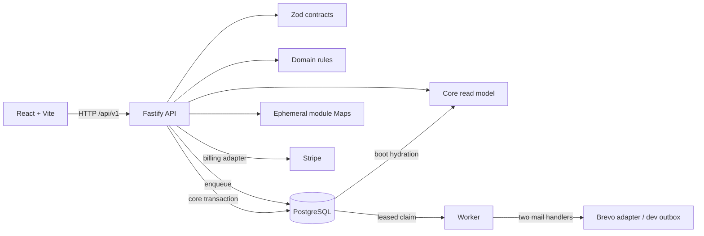

# TalentSphere ? architecture as implemented

Source cross-check: `431c425a`, 2026-10-23. Source inspection establishes code
behavior, not deployed behavior or production readiness. [SSOT.md](SSOT.md)
remains the authority for intended product behavior and is preserved unchanged.
This document owns implementation boundaries; [the index](docs/INDEX.md) assigns
other topics. The [coverage inventory](docs/system-model/01-inventory-and-coverage.md)
distinguishes structural discovery, inspection and runtime evidence.

## 1. Document purpose

Give maintainers the implemented topology, ownership, extension points and risks
without copying product requirements or dated audit results. Code wins a factual
conflict; changing intended behavior still follows SSOT and AGENTS authority.
Requirements below are explicitly distinguished from enforcement gaps.

## 2. Architecture at a glance

One React browser app, one Fastify API writer per database, and a PostgreSQL
worker form a pnpm modular monolith. Most routes share the `buildApp` closure in
`apps/api/src/server.ts`; Stripe routes use an injected dependency interface.
Domain modules provide pure business functions; the API owns orchestration,
authorization wiring, read models, persistence and integrations.

The [API reference](docs/engineering/API_CONTRACTS.md) owns endpoint counts and
schema associations. The [database reference](docs/engineering/DATABASE.md) owns
store/table relationships and migration inventory. Do not duplicate their counts.

## 3. System boundary

| Area        | Implemented boundary                                                                           | Limit                                                                    |
| ----------- | ---------------------------------------------------------------------------------------------- | ------------------------------------------------------------------------ |
| Identity    | Email/password, HMAC sessions, password change and session revocation                          | No Supabase Auth, OAuth or password-reset email flow                     |
| Persistence | PostgreSQL core plus dedicated stores; explicit memory mode                                    | Many long-tail features are ephemeral                                    |
| Billing     | Stripe Checkout/Portal/SDK callback, durable subscription/invoice/event records                | Disabled by default; live acceptance unverified                          |
| Email       | Opt-in Brevo (provider-independent service) for work-email verification and reference requests | Provider acceptance is not mailbox delivery; no push/SMS                 |
| AI          | Local heuristic and simpler assistant scaffold                                                 | No remote model execution; saved BYO keys are not integration            |
| Search      | In-process matching/ranking over available data                                                | No PostgreSQL FTS runtime integration                                    |
| Browser     | React routes, API fetch helpers, PWA manifest/capability detection                             | No implemented offline synchronization/service-worker installation       |
| Hosting     | Oracle container/Compose/proxy/backup assets exist                                             | Configuration is not proof of deployment or restore                      |
| Supabase    | SQL history and hosted adapter assets                                                          | Custom API identity remains distinct; live applied state unverified here |

## 4. Components

| Location                                                   | Responsibility                                                                       |
| ---------------------------------------------------------- | ------------------------------------------------------------------------------------ |
| `apps/api/src/index.ts`                                    | Load environment, validate deployed configuration, build and listen                  |
| `apps/api/src/server.ts`                                   | `buildApp`, hooks/errors, route orchestration, authorization, read models, `persist` |
| `apps/api/src/storage/`                                    | Core and dedicated SQL/memory implementations                                        |
| `apps/api/src/billing-stripe.ts`, `stripe-gateway.ts`      | Billing orchestration and the only Stripe SDK boundary                               |
| `apps/worker/src/index.ts`, `claim.ts`, `mail-provider.ts` | Durable claims, event acknowledgements and transactional email                       |
| `apps/web/src/App.tsx`, `pages/`, `components/`, `lib/`    | Routes, UI, session state and HTTP helpers                                           |
| `packages/domain/src/`                                     | State machines, scoring, policy and auth primitives; injected-query job store        |
| `packages/contracts/src/index.ts`                          | Zod request schemas, validation helpers and error envelope                           |
| `packages/config/src/env.ts`                               | Server environment schema and deployment/Stripe refusal checks                       |
| `packages/observability/src/`                              | Pino logger/redaction and separate audit interface                                   |
| `packages/ui/src/`                                         | Design tokens; components remain in the web app                                      |
| `packages/testing/src/`                                    | Shared mock factories                                                                |
| `supabase/`, `scripts/`, `tests/`                          | SQL, operational tools and executable checks                                         |

## 5. Responsibility owners

Reuse `hashPassword`/`verifyPassword` and `createSessionToken`/`verifySessionToken`
for authentication; `extractUser`/`resolveSession` for API identity. Resource
checks belong alongside domain predicates and the existing route authorization.
Application transitions use `ALLOWED_APPLICATION_TRANSITIONS`; evidence uses
`evidence.ts`; billing plans use `PLATFORM_PLANS`, with Stripe normalization and
reconciliation in their existing adapters/domain module. Request shapes belong
in contracts and errors in the global handler.

`persist` plus `PgCoreStore` owns core writes. Dedicated stores own their own
transactions. `runClaimCycle`, not `JobQueueEngine`, owns runtime job processing.
`SessionProvider` and `lib/session.ts` own browser session state; `apiJson` owns
common request/error behavior. Shared web components use the existing UI primitives.

## 6. Decision rationale

The monolith avoids premature independent services. Pure domain functions make
business logic testable without Fastify. HMAC sessions avoid an external identity
provider but require stable signing keys and explicit revocation. Zod plus one
error handler avoids divergent boundary validation/error formats. Local heuristic
AI avoids external inference cost, but is not equivalent to an LLM.

ADR-015 retained core Map reads to avoid rewriting every route while adding
transactional writes. The trade-off is boot-time hydration, single-writer scope
and stale reads after external SQL changes. Its pending owner-ratification status
is unchanged. Historical in-memory-only storage, unconnected worker and SQL-only
migration descriptions are superseded, not current constraints.

## 7. Dependency direction

Browser ? API ? contracts/domain ? storage/provider adapter. The worker uses the
injected-query job store and its own mail adapter; it cannot see API process Maps.
Domain business functions do not import Fastify, Zod or provider SDKs. The job
store's injected SQL function is an existing infrastructure seam, not a database
client owned by domain logic. Domain modules import declaring siblings, not their
own barrel. Contracts remain independent of domain.

Never put privileged credentials/database clients in the browser or make UI
checks authoritative. Do not introduce parallel auth helpers, error envelopes,
queues, audit stores or component libraries. Some authorization remains inline;
[route review](docs/system-model/06-route-authorization.md) records the gaps.

## 8. Execution flows

[System flows](docs/system-model/02-flows.md) contains the detailed diagrams.
The essential transaction boundaries are:

1. Login parses credentials, checks password against the account read model,
   optionally upgrades the hash, and issues a token. Subsequent requests resolve
   current account roles/status and session revocation/cutoff.
2. Evidence creation validates skills, computes domain state and commits evidence
   plus skill links before updating Maps. Verification uses guarded transitions.
3. Job applications validate job/evidence/actor, apply domain rules and commit.
   A partial database unique index arbitrates duplicate active applications.
4. Work-history email verification stores a hashed, expiring challenge and queues
   delivery. Reference requests store a token hash; submission consumes the token
   and updates work-history trust. References expire after 30 days in API checks.
5. Checkout redirects to Stripe; signed provider events reconcile local billing.
   Redirect success alone grants nothing. Billing state and event recording share
   a transaction, but subsequent background dispatch does not.
6. API effects usually commit inline before `dispatchJob`; the worker records
   most events and executes only the two transactional mail kinds.

Failures are not uniformly atomic across these steps. See database erasure limits,
worker lease risks and billing retry semantics in their owning references.

## 9. Rules that must hold

The invariants in section 25 are required design constraints, not a declaration
that every endpoint meets them. Server-side ownership, evidence provenance,
secret handling and assessment policy cannot be weakened to make a test pass.
Known violations stay visible in section 24 and the conflict register.

## 10. Extension points

| Change                    | Existing home                                                                             |
| ------------------------- | ----------------------------------------------------------------------------------------- |
| Domain rule/state machine | Owning `packages/domain/src/<context>.ts` and unit tests                                  |
| API route                 | Existing context in `server.ts`, or existing injected billing module                      |
| Payload                   | Contracts schema and route parsing                                                        |
| Persistent record         | Owning storage interface/implementation; additive migration if approved                   |
| Async effect              | Dispatch-kind registry plus worker handler; do not acknowledge undelivered work           |
| Notification              | Domain notification type/preferences; transactional core notification op where applicable |
| Browser page/component    | `pages`, `App.tsx`, existing navigation and `components/ui`                               |
| Session/data errors       | `SessionProvider`, `lib/session.ts`, `apiFetch`/`apiJson`                                 |
| Environment               | `packages/config/src/env.ts` and documented example, subject to build-file restriction    |
| Provider                  | Existing adapter boundary or an explicitly approved new integration                       |

## 11. Escalation

Follow [AGENTS.md](AGENTS.md). Escalate schema-breaking design, security
architecture, provider/AI entitlement, pricing, major API versioning and
consequential decisions. Identify affected owners and propose a concrete bounded
change. Ordinary fixes within established boundaries do not require inventing a
new approval step. Protected build files remain read-only without explicit user
authorization; a generic build/test request does not override that rule.

## 12. Authentication and authorization

`RegisterInputSchema` accepts candidate or recruiter only. Tokens contain user ID,
email, roles, issuance/expiry and session ID; default lifetime is 24 hours. Current
account roles/status override signed role snapshots. Password changes and signing
out other devices advance the issuance cutoff; individual sign-out persists a
revoked session. Non-active accounts have restricted appeal/data-rights access;
an erased credential is denied. Memory-mode tests can accept signed identities
absent from the account store; durable mode refuses them.

Tokens are in browser localStorage and are XSS-readable. There is no refresh-token
flow. Resource authorization is per handler, not global auth middleware. Several
organization actions accept any membership rather than checking membership role;
this is a policy gap, not the intended tenancy model. See
[security](docs/quality/SECURITY.md) and the route review.

## 13. Data architecture

[DATABASE.md](docs/engineering/DATABASE.md) owns the store map, relationships,
concurrency, lifecycle and migrations. Core Map reads are authoritative only
within the single API writer. SQL table existence and durability headers cannot
establish whole-feature durability. Dedicated billing/settings/audit stores are
not part of every `persist` transaction.

## 14. API architecture

[API_CONTRACTS.md](docs/engineering/API_CONTRACTS.md) owns every registered
method/path, request-schema association, errors and provider retry semantics.
There is no generated OpenAPI or universal pagination/idempotency layer. Hooks
provide Helmet, CORS, rate limiting, request IDs and a global error envelope;
handlers invoke authorization and domain validation.

## 15. Frontend architecture

`main.tsx` mounts React; `App.tsx` uses BrowserRouter and a shared Layout. Public
pages and authenticated workspaces are listed in
[APP_FLOW.md](docs/experience/APP_FLOW.md). Guards check token presence for UX;
API authorization remains authoritative. State uses React hooks and SessionContext,
not TanStack Query/Redux. `apiFetch` attaches the token and clears/redirects on a
401 with a token; 403 retains the session. Login handles bad credentials separately.
`apiJson` adds a default 20-second timeout, JSON/error parsing, throttle timing and
server-error masking. `RouteErrorBoundary` handles render failures.

The PWA manifest and `pwa.ts` report capabilities; offline readiness is detected
from an existing service-worker controller, not implemented by installing one.
No durable offline mutation/sync system was found. Design/accessibility targets
remain distinct from measured browser conformance.

## 16. Backend startup

`index.ts` loads environment and checks `productionConfigProblems`. `buildApp`
validates configuration, creates storage, checks health, acquires the writer lease
and hydrates core records before returning. `STORAGE=memory` is explicit for
non-durable development/tests; deployed API entry checks refuse it. The worker
reads its environment separately and checks its delivery prerequisites; it does
not run the entire API environment validator.

## 17. Integrations

Stripe SDK calls live in `stripe-gateway.ts`; normalized snapshots keep provider
objects out of business rules. Email goes through `apps/worker/src/email`: logical
template ids and variable validation (`templates.ts`), a vendor-free contract
(`types.ts`), one provider registry (`service.ts`), the only Brevo code
(`brevo.ts`, native fetch, 20-second timeout) and the worker's single env reader
(`config.ts`). To add a provider: write an adapter that passes
`tests/unit/email/provider-contract.ts`, add it to `buildProvider` and
`SUPPORTED_EMAIL_PROVIDERS`, set `EMAIL_PROVIDER`. Call sites do not change. Development mail goes to the
labelled log outbox. Neither live delivery nor live billing was exercised here.
Supabase Auth/Storage/Realtime/Queues, Mux, OAuth, LinkedIn and external LLM adapters
remain unimplemented targets. Hosted PostgreSQL assets do not implement those
other Supabase products.

## 18. Asynchronous behavior

`runClaimCycle` claims up to 10 jobs under a 60-second lease, then runs handlers
sequentially with a 30-second Promise.race timeout. Default maximum attempts is 3;
backoff is exponential with jitter and a cap. Unknown handlers dead-letter;
permanent errors fail; transient failures retry or become dead. Cancellation is
cooperative at acknowledgement and does not undo effects.

A timeout does not abort the underlying promise. Batch waiting can consume later
jobs' leases; expired leases can be reclaimed and execution duplicated. Completion
is not fenced by claim generation. Do not claim exactly-once delivery. Most
handlers only record events; no digest/rollup scheduler or heavy queue exists.
`JobQueueEngine` remains a separate unit-tested, unused memory engine. In memory
mode the standalone worker idles because it cannot access the API's Maps.

## 19. Error handling

DomainError and ZodError go through the central HTTP mapper; plugin status codes
are preserved. Unexpected deployed errors are masked. Rejected 4xx requests log
at info, 5xx faults at error. Provider adapters translate failures without exposing
secrets. There is no general client retry framework or distributed transaction.
See the API reference for exact codes and status distinctions.

## 20. Security boundaries and limits

Implemented controls include PBKDF2-SHA512 (default 210,000 iterations), HMAC
sessions/revocation, deployed configuration refusals, request validation,
role/resource checks, rate limiting, CORS/Helmet, hashed trust credentials and
log redaction. Hashes do not prove credential delivery or employer identity.
The API connection's privilege can bypass RLS; policies must be tested separately.
Cohort suppression does not by itself establish differential privacy.

Assessment submission does not execute code; it can still return simulated
`passed`/100 while storing unverified evidence with `executed:false`. Interview
execution is also simulated and refused in staging/production. Course completion
can mint authority-verified evidence from lesson completion without the required
final assessment. AI chat enforces a free quota, but the separate assistant query
scaffold skips it; saved consent is not universally enforced. These are open gaps.

## 21. Observability and operations

Pino logs and request IDs exist, as do SQL admin audit and admin health diagnostics.
Liveness alone does not prove database reachability or job completion. Worker
heartbeat writes occur between claim cycles when ten seconds have elapsed;
long batches can delay them. The API considers a heartbeat older than 45 seconds
unhealthy. Maintenance mode currently changes diagnostics, not request admission.
No deployed metrics/tracing/alert backend was established. See
[OPERATIONS.md](docs/quality/OPERATIONS.md) for configuration and recovery.

## 22. Testing architecture

[TESTING.md](docs/quality/TESTING.md) owns commands, prerequisites and dated evidence.
Unit tests often import source while the API imports built workspace packages;
stale `dist` can produce misleading failures or passes. Shared test signing keys
keep those copies compatible but do not prove matching source. PostgreSQL tests
exercise durability/RLS; Playwright uses built API/web artifacts. Source-only
checks cannot replace either. Reticle is required for user-visible changes, not
this documentation pass.

## 23. Deployment and runtime

The root build builds packages before apps; API/worker dev commands run compiled
`dist/index.js` rather than watchers. CI uses Node 24; the package manager is pinned
in the root manifest. Oracle assets exist under `deploy/oracle`, including Docker,
Compose/proxy and recovery instructions. CI configuration is verification evidence
only when its runs are inspected; no deployment or restore was observed here.
Local migrations use the custom runner; hosted Supabase uses a separate gated
manual adapter. Do not substitute `supabase db push` for the repository workflow.

## 24. Risks and unresolved decisions

- R-2: inline/duplicated authorization and organization-role inconsistencies.
- R-3: keep UI tokens and web primitives as distinct existing owners; no second UI kit.
- R-4: AI tier is hardcoded free despite billing entitlements; consent/quotas differ
  between assistant paths. Entitlement changes require an owner decision.
- R-6: SQL admin audit and observability's audit interface differ; cross-system
  event coverage/retention is not established.
- Long-tail persistence, worker leases/timeouts, erasure recovery, certificate
  assessment/revocation and billing concurrency remain material release risks.
- U-1/U-2: deployment assets and local proxies exist; deployed topology, gateway,
  restore and runtime acceptance remain unverified.
- U-3: tenant/membership permissions need an explicit policy reconciliation.

The [conflict register](docs/system-model/03-conflict-register.md) and
[route review](docs/system-model/06-route-authorization.md) preserve finding IDs,
evidence and decisions. Dated reports remain historical, not live release verdicts.

## 25. ARCHITECTURAL INVARIANTS

These are constraints to preserve and complete; they do not assert that the gaps
above are fixed. Invariant 007 has a known assistant-scaffold exception. Invariant
015 describes stored credentials, not the transient queued delivery payload.

- **INVARIANT-001:** Authorization is enforced server-side on every protected route; client checks are advisory only.
- **INVARIANT-002:** Every business rule/state machine has exactly one definition in `@talentsphere/domain`; routes and UI call it, never restate it.
- **INVARIANT-003:** `packages/domain` never imports frameworks, providers, or performs I/O; `core.ts` never imports anything; no domain module imports its own barrel.
- **INVARIANT-004:** All API failures are expressed as `DomainError`/`ZodError` and rendered solely through the global handler's `ErrorEnvelope` with a `request_id`.
- **INVARIANT-005:** Only `apps/api` (its `storage/` layer) and `apps/worker` may hold a database client; neither `apps/web`, `packages/domain` logic, nor `packages/contracts` ever may. (The domain package's job store takes an injected query function — it holds no client.)
- **INVARIANT-006:** Session tokens are signed with `TOKEN_SECRET` or a random per-process key — never a committed/hardcoded secret.
- **INVARIANT-007:** Free-tier AI usage always passes `assertWithinAIQuota`; paid inference for free users requires the explicit env policy flag plus human approval.
- **INVARIANT-008:** During `AI_PROHIBITED` assessment sessions, every AI entry point is rejected server-side (`ASSESSMENT_AI_PROHIBITED`).
- **INVARIANT-009:** Migration filenames form a contiguous sequence from `00001`; nothing in the repo claims SQL execution that didn't happen (honesty tests are part of the contract).
- **INVARIANT-010:** Application records move only along `ALLOWED_APPLICATION_TRANSITIONS`; terminal states are immutable.
- **INVARIANT-011:** New infrastructure technology (DB driver, broker, provider SDK, auth provider) enters the system only through a recorded human decision (ADR added to §26).
- **INVARIANT-012:** The durable worker claim loop is the current execution path; the in-process `JobQueueEngine` is reserved and not instantiated at runtime. Do not introduce a second scheduler/queue without an architecture decision.
- **INVARIANT-013:** A core-loop entity changes only through `persist()`; an update passes the read-model value it was derived from as `base`. The read model is never mutated before the database commits.
- **INVARIANT-014:** Every route that loads a record by id authorizes the caller against that record (owner, organization, participant, admin); "authenticated" is never sufficient on its own.
- **INVARIANT-015:** A verification credential (email code, referee token) is never returned to the person it verifies and is stored only as a hash.

## 26. Decision register

These IDs belong to the implemented-architecture register; SSOT has a distinct
numbering namespace. This reconciliation does not approve new architecture.

| ID      | Decision / status                                                                                                | Reason and trade-off / revisit                                                               |
| ------- | ---------------------------------------------------------------------------------------------------------------- | -------------------------------------------------------------------------------------------- |
| ADR-001 | Fastify modular monolith                                                                                         | Shared domain boundaries; split only for measured ownership/scale needs                      |
| ADR-002 | Pure domain business functions                                                                                   | Testability and reuse; preserve framework independence                                       |
| ADR-003 | Memory persistence, superseded for core by ADR-015                                                               | Long tail still loses state; migrate deliberately                                            |
| ADR-004 | Self-issued HMAC sessions                                                                                        | No external IdP; stable secret/revocation required; provider adoption is a security decision |
| ADR-005 | Shared Zod contracts                                                                                             | One request-shape owner; large file can be split without duplicate schemas                   |
| ADR-006 | Central error envelope                                                                                           | Consistent clients/logs; extend mappings deliberately                                        |
| ADR-007 | Local heuristic AI                                                                                               | No external inference cost; remote provider needs explicit approval                          |
| ADR-008 | Early memory queue engine, superseded at runtime                                                                 | Durable claim loop now runs; unused engine retained pending removal decision                 |
| ADR-009 | Early SQL-as-text migration guard, superseded                                                                    | Runner now executes SQL; checksum/honesty controls remain                                    |
| ADR-010 | pnpm, packages before apps                                                                                       | Built workspace dependencies are required; toolchain changes respect build-file protection   |
| ADR-011 | Reticle for visible changes                                                                                      | Real flow verdict required; setup alone is not verification                                  |
| ADR-015 | [Core persistence/read model](docs/engineering/adr/ADR-015-core-loop-persistence.md), pending owner ratification | One writer and boot hydration; move reads to SQL before scaling                              |
| ADR-016 | [Browser UI quality gates](docs/engineering/adr/ADR-016-browser-measured-ui-quality-gates.md)                    | Browser evidence, with its documented coverage limits                                        |

## 27. Agent quick reference

Read AGENTS, SSOT, relevant requirements/contracts/security/testing rules, then
locate the existing owner before changing code. Trace callers, validation,
side effects and tests. Preserve the architecture and build-file restriction;
report contradictions instead of silently changing policy. Do not copy demo
fallbacks, introduce parallel systems, or call documentation implemented.

## 28. Evidence and confidence

This document references source files and stable function names rather than
historic line numbers. Source presence is **implemented**, incomplete contract
coverage is **partial**, explicit future scope is **planned**, absence from the
inspected sources is **not implemented**, and missing proof is **unverified**.
Runtime or production claims need separately recorded execution evidence.
The documentation audit and its limitations are in
[the coverage inventory](docs/system-model/01-inventory-and-coverage.md).
