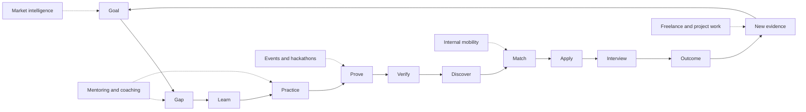

# 01 — Vision and Strategy

Product-level intent for TalentSphere as a complete career operating system. Everything here describes the **intended** product; nothing is a claim that it is built ([CONVENTIONS §1](../00_START_HERE/CONVENTIONS.md)). Module detail lives in [`02_MODULES/`](../02_MODULES/); decisions only the owner can make are in [08_STAKEHOLDER_DECISIONS_NEEDED.md](08_STAKEHOLDER_DECISIONS_NEEDED.md).

Related product-layer files:

| File | Contents |
|---|---|
| [02_SCOPE_AND_BOUNDARIES.md](02_SCOPE_AND_BOUNDARIES.md) | In, adjacent and out of scope; release tiers R0 to R6; completeness checklist |
| [03_PERSONAS_AND_ROLES.md](03_PERSONAS_AND_ROLES.md) | Every role, persona, lifecycle and org hierarchy |
| [04_PERMISSION_MATRIX.md](04_PERMISSION_MATRIX.md) | Role by capability matrix for all 30 modules; tenancy, delegation, separation of duties, break-glass |
| [05_USER_JOURNEYS.md](05_USER_JOURNEYS.md) | End-to-end journeys `JRN-` |
| [06_BUSINESS_MODEL_AND_CROSS_MODULE_RULES.md](06_BUSINESS_MODEL_AND_CROSS_MODULE_RULES.md) | Monetization options, entitlements, `BR-XCT-` rules and precedence |
| [07_MODULE_MAP_AND_DEPENDENCIES.md](07_MODULE_MAP_AND_DEPENDENCIES.md) | Entity ownership, dependency matrix, build order, shared services |
| [08_STAKEHOLDER_DECISIONS_NEEDED.md](08_STAKEHOLDER_DECISIONS_NEEDED.md) | `OD-PRD-` decisions and `DEC-001` to `DEC-004` |

## 1. Problem

Careers run on **claims** that are expensive to check. [SRC: Yash_Final_Project_Document/01_EXECUTIVE_AND_STRATEGY/PRODUCT_VISION_AND_BUSINESS_MODEL.md §1]

| Party | What goes wrong today | Cost it creates |
|---|---|---|
| Candidate / professional | Cannot cheaply prove a skill or a past role; a résumé line and a strong project look the same to a screener; learning certificates rarely translate into interviews | Rejection by keyword filters; repeated re-proving at every application; career switches stall [DER] |
| Student | Coursework, projects and faculty assessment stay inside the institution's systems and vanish at graduation | Graduates start their careers with an empty, unverifiable profile [SRC: SSOT §2.3 B2B2C flywheel] |
| Recruiter | Hundreds of unverified applications per role; verification (references, employment checks) is manual and slow | Screening time, missed good candidates, bad hires [SRC: STR-01 §1] |
| Hiring manager | Interview feedback is inconsistent and arrives late; no structured evidence in the packet | Slow, biased decisions [DER] |
| Institution | Cannot show employers or accreditors what graduates can do; placement is tracked in spreadsheets | Weak placement outcomes and reporting [SRC: SSOT J-09] |
| Instructor / mentor | Teaching and mentoring outcomes are invisible to employers; income depends on marketplaces that own the learner relationship | Low reach and income [DER] |
| Enterprise L&D | Skills of the existing workforce are unknown; internal roles are filled externally | Avoidable attrition and hiring cost [SRC: SSOT J-16, J-28] |

The common root: **no shared, person-controlled, graded record of capability that every party can trust and that every career activity adds to.** [DER]

## 2. Vision

> A person's skills, learning and work history are backed by evidence of graded strength that they own and control, and every career activity, from learning to hiring to mentoring, both consumes and produces that evidence. [SRC: STR-01 §2; SSOT §1.2]

The durable asset is the connected **Talent Graph and Evidence Graph**: capabilities, goals, experience, proof, learning, opportunities and outcomes stay attributable to a source and controlled by the person they describe. [SRC: SSOT §1.2]

### 2.1 Canonical loop

The GA loop of record is: **Goal → Gap → Learn → Practice → Prove → Verify → Discover → Match → Apply → Interview → Outcome → New Evidence.** [SRC: SSOT Amendment B] Other loop formulations (SSOT §1.1, §2.1, §2.3) are views of this loop. [SRC: SSOT Appendix E V61-03]

Dotted edges are the OS-expansion modules (gated by `DEC-002` and `OD-PRD-02`): each one plugs into the same loop rather than creating a parallel product. [DER]

## 3. Mission

Make career growth **transparent, verifiable and accessible** by giving every person a portable, evidence-backed career identity, and by giving every organization that learns with, hires or develops people a fair, consent-bound way to rely on it. [SRC: SSOT §2.1; DER]

## 4. Value proposition per audience

| Audience (role code) | Job they hire TalentSphere for | Value delivered | How the system knows it delivered |
|---|---|---|---|
| Guest (`GUE`) | Look at a job, a course, a public profile or a credential without signing up | Fast public pages; credential verification by link | Public page served; verification lookup answered [DER] |
| Candidate / professional (`CAN`) | Prove what I can do once, and have it count everywhere | Graded evidence ladder, referee verification, explainable matches, applications with a consented evidence snapshot, free core loop | Evidence items at rung ≥ artifact-backed; applications reaching `interviewing` [SRC: STR-01 GOAL-01] |
| Student (`STD`) | Leave my institution with proof, not just a transcript | Institution-issued credentials that the student keeps after graduation; placement drives | Graduating-cohort activation [SRC: STR-01 GOAL-05] |
| Instructor (`INS`) | Teach and have my learners' outcomes recognized | Studio, rubric grading, instructor attestations (issuer class `instructor`), learner outcome analytics | Course completion to evidence rate [SRC: STR-01 GOAL-04] |
| Mentor / coach (`MNT`) | Help people grow and be paid fairly for it | Bookable offerings, session notes, consented evidence view [PROP] | Completed sessions; mentee follow-up evidence [PROP] |
| Freelancer (`FRL`) | Win project work that also builds my record | Service offerings, proposals, milestone contracts, delivered work as evidence [PROP] | Completed contracts producing evidence [PROP] |
| Recruiter (`REC`) | Shortlist trustworthy candidates quickly | Evidence-first applications, consent-gated search and outreach, pipelines, scheduling, offers | Median time from `submitted` to first human review [SRC: STR-01 GOAL-02 REV2] |
| Hiring manager (`HMG`) | Decide well and fast | Structured scorecards, blind feedback, evidence packets, debrief | Time from final interview to decision [PROP] |
| Employer admin (`EAD`) | Run a compliant hiring organization | Org, teams, roles, SSO, brand, seats, audit | Active seats; access reviews completed [PROP] |
| Institution admin (`IAD`) | Show what graduates can do | Cohorts, licences, k-anonymous skill coverage, credentials, graduation transfer | Cohorts provisioned; credentials issued [DER] |
| Placement officer (`PLO`) | Place students | Placement drives, employer coordination, outcome reporting with alumni consent | Placement outcomes recorded [SRC: SSOT J-09] |
| Enterprise talent / L&D admin (`EXA`) | Know and grow the skills of the workforce | Skills inventory, internal mobility, mandated learning, HRIS sync [PROP] | Internal fills; mandated completion [SRC: SSOT J-16, J-28] |
| Moderator (`MOD`) | Keep the platform safe | Report queue, reason codes, appeals, integrity review | Time to first action; appeal overturn rate [PROP] |
| Support agent (`SUP`) | Resolve user problems without over-reaching | Time-boxed, reason-coded scoped access | Ticket resolution time; zero unscoped reads [PROP] |
| Finance operator (`FIN`) | Keep money correct | Refunds, disputes, reconciliation, payouts | Reconciliation breaks closed [SRC: COMMERCIAL_OPERATIONS §7] |
| Platform admin (`PAD`) | Operate the product | Flags, taxonomy, verification approvals, configuration | Change failure rate [PROP] |
| Super admin / security officer (`SAD`) | Protect the platform and its people | Break-glass, privileged access reviews, incident response | Confirmed cross-tenant exposures: target zero [SRC: STR-01 GOAL-06 REV2] |
| Integration principal (`API`) | Move data between TalentSphere and partner systems safely | Scoped OAuth clients, webhooks with replay | Webhook delivery success rate [PROP] |

## 5. "Career operating system": definition

### 5.1 What it means

An operating system, in this product, is **the layer every career activity runs on**. Concretely, TalentSphere is a career operating system when all of the following hold: [DER from owner goal and SSOT §4.1]

1. **One identity.** A person has one account and one career identity across learning, hiring, mentoring, freelancing, events and institutions; switching role context never requires a second account (`IDN`, `PRF`).
2. **One evidence substrate.** Every module that observes a person doing something career-relevant (finishing a course, passing an assessment, being hired, completing a gig, winning a hackathon) emits it into one evidence model with a provenance, an issuer class and a rung (`EVD`).
3. **One consent and privacy layer.** Every read of a person's data by another party passes the same consent and visibility checks, whatever module asks (`SET`, `BR-XCT-007` to `BR-XCT-013`).
4. **One set of shared services.** Notifications, messaging, scheduling, search, files, payments, moderation and AI are built once and used by every module (see [07 §6](07_MODULE_MAP_AND_DEPENDENCIES.md#6-shared-services)).
5. **Interoperability.** Data enters and leaves through documented imports, exports, a public API and webhooks; the person can take their record with them (`PLT`, `SET`).
6. **Extensibility by module, not by fork.** A new career service (for example a mentoring marketplace) is added as a module that consumes the shared services and writes to the evidence substrate.

### 5.2 What it does not mean

| Not this | Why | Source |
|---|---|---|
| A device or browser operating system, kernel access, or unrestricted hardware integration | The product is a browser and PWA platform; "OS" describes breadth of the career workflow | [SRC: SSOT §4.1, §3.3] |
| A general-purpose marketplace for any goods or services | Only career services (learning, mentoring, career-related freelance work, events) are transacted, and each is gated | [SRC: SSOT §4.2]; `OD-PRD-03` |
| A social-media clone optimized for engagement | Networking exists to produce referrals, mentoring and community learning; no infinite feed ranking by virality | [SRC: SSOT §4.2]; `OD-PRD-16` |
| An HR information system, payroll, benefits or performance-review suite | Enterprise features stop at skills, internal mobility and learning; employee master data stays in the customer's HRIS | [SRC: SSOT §4.2]; `OD-PRD-20` |
| An advertising network | No self-serve ads; any paid visibility is decision-gated and never alters ranking | [SRC: SSOT §4.2]; `OD-PRD-18`; `BR-XCT-020` |
| A sales-prospecting or business-development graph | People data is never sold or packaged for sales outreach | [SRC: SSOT §4.2, OD-31] |
| An autonomous hiring agent | AI explains and drafts; humans decide every consequential action | [SRC: SSOT §3.2]; `BR-XCT-021` |
| A replacement for every competitor at once | Imports from external platforms are adapters; TalentSphere remains independently functional | [SRC: SSOT §4.3] |

## 6. Product principles

Principles are tie-breakers for design decisions. They are ordered; when two conflict, the higher one wins, and the conflict is recorded. [SRC: SSOT §3.1 (12 principles); ordering is DER]

| # | Principle | What it forces in design | Source |
|---|---|---|---|
| 1 | The person owns their career identity | Export, portability, revocable sharing; institutions and employers never own a person's record | [SRC: STR-01 §5 "Learner owns career identity"] |
| 2 | Verified over claimed | Every evidence item shows its rung and issuer class; nothing reads "verified" without a server-side transition | [SRC: SSOT §3.1, Appendix E V61-17] |
| 3 | Candidate dignity first | Respectful rejection notices, no ghosting by design (stale-application nudges), no pay-to-apply | [SRC: SSOT §3.1] |
| 4 | Human-controlled AI | AI suggests, explains, drafts; never decides a consequential outcome; never becomes evidence | [SRC: SSOT §3.1, §3.2] |
| 5 | Evidence over popularity | Reputation is contextual; follower counts or likes never act as credibility | [SRC: SSOT §3.1, §3.2] |
| 6 | Fair by construction | No pay-to-rank; explainable matching; adverse-impact review | [SRC: STR-01 §7; SSOT Amendment E] |
| 7 | Privacy by purpose | Consent per purpose, default off, effective at the next read after revocation | [SRC: SSOT §15.2; Appendix E V61-16] |
| 8 | Accessible by default | Every journey works with keyboard and screen reader on a low-end phone | [SRC: SSOT §3.1, §21] |
| 9 | Monetization follows value | Charge for tools and scale, never for trust, rank or the core loop | [SRC: SSOT §3.1; COMMERCIAL_OPERATIONS §1] |
| 10 | One semantic model | One state vocabulary, one evidence model, one consent catalogue across modules | [SRC: SSOT §3.1, Appendix E V61-18] |
| 11 | Progressive disclosure and simplicity before scale | A new user reaches first value in one session; advanced controls appear when needed | [SRC: SSOT §3.1] |
| 12 | No deterministic career promises | The product never promises a job, salary or outcome; forecasts carry uncertainty | [SRC: SSOT §3.1] |

## 7. Product pillars

Pillars group modules by the outcome they produce. Every module belongs to exactly one pillar. [DER]

| Pillar | Outcome | Modules | Primary roles |
|---|---|---|---|
| P1 Foundation and trust | Safe, private, accessible access for everyone | `IDN`, `SET`, `NTF`, `TSF`, `ADM` | All |
| P2 Career identity and proof | A portable, graded, person-owned record | `PRF`, `EVD`, `BGV`, `REP` | `CAN`, `STD`, `FRL` |
| P3 Learning and practice | Skills built and demonstrated | `LRN`, `STU`, `ASM`, `INS` | `CAN`, `STD`, `INS`, `IAD`, `PLO` |
| P4 Opportunity and hiring | Fair, fast matching of people to work | `JOB`, `ATS`, `INT`, `EMP`, `SRC` | `CAN`, `REC`, `HMG`, `EAD` |
| P5 Network and guidance | Help from other people | `NET`, `MSG`, `MEN`, `EVT` | `CAN`, `MNT` |
| P6 Intelligence | Explainable guidance and insight | `AIC`, `MKT`, `ANL` | All |
| P7 Work and enterprise | Career growth inside and beyond employment | `GIG`, `ENT` | `FRL`, `EXA` |
| P8 Platform and commerce | Reach, integration and sustainability | `BIL`, `PWA`, `PLT` | `FIN`, `PAD`, `API` |

## 8. Differentiation

What a complete TalentSphere does that a combination of separate tools does not. Each claim is a design commitment, not a market claim. [DER; competitor behavior from general domain knowledge, tagged PROP where it shapes a capability]

| Capability | Typical separate tools | TalentSphere commitment |
|---|---|---|
| Graded evidence ladder (claimed, artifact-backed, peer-attested, authority-verified) with issuer class | Profiles show self-declared skills and endorsements with equal weight | Rung and issuer class shown everywhere; matching weights them differently [SRC: Appendix E V61-17] |
| Referee verification without an account | Reference checks by phone or a separate vendor | Single-use tokenized link; under three minutes on a phone [SRC: USR-01 P4] |
| Application as a consented evidence snapshot | Résumé PDF attachment | The employer sees exactly the items consented for that application; revocation tombstones live items [SRC: CONSENT_SCOPE_CATALOGUE `application.share_snapshot`] |
| Learning that produces evidence employers can open | Course certificates disconnected from hiring | Completion, graded work and assessments feed `EVD` with provenance [SRC: SSOT Amendment B] |
| Institution to independent identity transfer | Student accounts deleted at graduation | Graduation transfers credentials to the person's own identity [SRC: SSOT §5.7 managed learner lifecycle] |
| Explainable, uncertainty-aware matching with no pay-to-rank | Opaque ranking; paid boosts | Every match shows rationale and uncertainty; entitlements never change ranking inputs [SRC: SSOT §3.2; ADR-T22] |
| One consent ledger across all modules | Per-product privacy settings | One catalogue, one ledger, one revocation behavior [SRC: Appendix E V61-16] |
| Career services (mentoring, gigs, events) that write to the same record | Separate marketplaces with their own profiles | Completed sessions, contracts and hackathon results become evidence with their issuer class [PROP; gated `OD-PRD-02`] |

## 9. Success metrics framework

Definitions only. **No target value is set in this blueprint**; targets are set after a measured baseline and approved by the owner (`OD-PRD-01`). [SRC: SSOT OD-40 "set after 90 days of data"; STR-01 REV2 reading rule] Metric keys are plain names, not register ids.

### 9.1 North-star candidates (choose one or a hierarchy: `OD-PRD-01`)

| Metric key | Definition | Formula | Source |
|---|---|---|---|
| `ns.career_progress_verified` | People who made verifiable career progress in a period | Count of distinct people with at least one new outcome-class evidence item (hire, promotion, internal move, completed contract, institution credential) at rung ≥ artifact-backed in the period | [SRC: SSOT §2.4] |
| `ns.evidence_backed_conversations` | Hiring conversations that started from evidence | Count of applications or outreach threads that reached `interviewing` where the shared snapshot contained at least one item at rung ≥ artifact-backed | [SRC: Appendix E V61-28, target metrics catalogue] |

### 9.2 Input metrics by pillar

| Pillar | Metric key | Definition and formula | Owner role |
|---|---|---|---|
| P1 | `act.first_value_session` | Share of new accounts that complete onboarding and reach their role's first-value event within the first session: first-value accounts ÷ new accounts | `PAD` |
| P2 | `evd.active_with_3_backed` | Share of active candidates (signed in within the active window, value `OD-PRD-01`) holding ≥ 3 evidence items at rung ≥ artifact-backed | `PAD` |
| P2 | `bgv.referee_response_rate` | Referee requests answered ÷ referee requests sent, per period | `PAD` |
| P2 | `bgv.referee_median_minutes` | Median minutes from link open to referee submission | `PAD` |
| P3 | `lrn.completion_to_evidence` | Course completions that produced an evidence item ÷ course completions | `INS`, `PAD` |
| P3 | `lrn.learning_to_interview` | Candidates who reached `interviewing` within the attribution window after completing a course linked to the job's skills ÷ candidates who completed such a course (correlational only, SSOT OD-51) | `PAD` |
| P4 | `hir.time_to_first_review` | Median time from application `submitted` to first human review | `REC`, `EAD` |
| P4 | `hir.share_reaching_interview` | Applications reaching `interviewing` ÷ applications submitted | `REC`, `EAD` |
| P4 | `hir.offer_acceptance` | Offers accepted ÷ offers extended | `EAD` |
| P4 | `hir.candidate_notified_on_close` | Applications that reached a terminal state with a candidate notice sent ÷ applications reaching a terminal state | `EAD` |
| P5 | `net.referral_to_interview` | Referred applications reaching `interviewing` ÷ referred applications | `PAD` |
| P5 | `men.session_completion` | Booked sessions completed ÷ sessions booked (gated module) | `MNT`, `PAD` |
| P6 | `aic.explanation_coverage` | Match results shown with rationale and uncertainty ÷ match results shown (design target 100 percent; a gap is a defect) | `PAD` |
| P6 | `aic.suggestion_acceptance` | AI suggestions accepted with or without edits ÷ AI suggestions shown | `PAD` |
| P7 | `ent.internal_fill_rate` | Internal roles filled by internal candidates ÷ internal roles filled (gated module) | `EXA` |
| P7 | `gig.contract_completion` | Contracts completed without dispute ÷ contracts started (gated module) | `PAD` |
| P8 | `bil.paid_conversion` | Accounts or orgs on a paid plan ÷ eligible accounts or orgs, per segment | `FIN` |
| P8 | `plt.webhook_success` | Webhook deliveries acknowledged within the retry window ÷ deliveries attempted | `PAD` |

### 9.3 Guardrail metrics (must not degrade while input metrics improve)

| Metric key | Definition | Why it is a guardrail |
|---|---|---|
| `grd.cross_tenant_exposures` | Confirmed cross-tenant data exposures per period (target zero, an outcome measure, not proof of absence) | Tenancy is a critical invariant [SRC: SSOT §3.2; STR-01 GOAL-06 REV2] |
| `grd.consent_violations` | Reads of personal data without a live consent scope or snapshot, found by audit sampling | Privacy by purpose |
| `grd.adverse_impact_review_held` | Quarterly adverse-impact review held and recorded (yes or no), threshold set with counsel | Fairness [SRC: STR-01 GOAL-03 REV2] |
| `grd.autonomous_adverse_actions` | Consequential adverse actions with no human actor in the audit record (must be zero) | Human-controlled AI |
| `grd.accessibility_defects_open` | Open accessibility defects of severity high on core journeys | Accessible by default |
| `grd.ai_cost_per_active_user` | AI inference cost ÷ monthly active users, against the cost policy | Free users must not cause paid inference without policy [SRC: SSOT §16.4] |
| `grd.moderation_appeal_overturn` | Appeals overturned ÷ appeals decided | Moderation quality |
| `grd.candidate_complaints_per_1k` | Candidate complaints about employer conduct per 1,000 applications | Candidate dignity |
| `grd.support_tickets_per_1k_mau` | Support tickets per 1,000 monthly active users | Product clarity [SRC: STR-01 §8] |

### 9.4 Business metrics (reported separately from product outcomes)

Activation, retention (week 4 and week 12 cohorts), paid conversion by segment, revenue by stream, gross margin, AI cost, operational cost per active org, enterprise expansion. [SRC: SSOT §2.4] Values and margin target are open (`OD-PRD-01`, `OD-PRD-05` to `OD-PRD-07`). No revenue, volume or price figure is asserted in this blueprint.

### 9.5 Measurement rules

1. Every metric has one definition, owned in `ANL`; module specs cite the key rather than restating the formula. [DER]
2. Small cells are suppressed under `min_cohort_k` (`OD-PRD-12`). [SRC: SSOT Amendment G]
3. Learning-to-outcome metrics are correlational unless a causal method is separately validated. [SRC: SSOT OD-51]
4. Product analytics require `analytics.product` consent; operational telemetry has its own lawful basis and no personal profile building. [SRC: CONSENT_SCOPE_CATALOGUE]
5. A target becomes a commitment only after a baseline exists and the owner approves it. [SRC: STR-01 REV2]

## 10. Business model options (decision-gated)

The full model, entitlement philosophy and payment rules are in [06](06_BUSINESS_MODEL_AND_CROSS_MODULE_RULES.md). Summary of options; **no stream is active until its decision closes**, and no price is proposed. [SRC: SSOT Appendix E V61-09; COMMERCIAL_OPERATIONS §2]

| Stream | Payer | Mechanism options | Hard guardrail | Gate |
|---|---|---|---|---|
| Employer subscription | Employer org | Per seat; per active job slot; hybrid with quotas for verified search and outreach | Never pay-to-rank (`BR-XCT-020`) | `OD-PRD-06`, `OD-PRD-08` |
| Institution licence | Institution | Per learner seat; per cohort; campus licence | Learner owns identity after graduation (`BR-XCT-001`) | `OD-PRD-07` |
| Candidate premium | Candidate | Subscription for tools (extra variants, analytics, AI quota) | Core loop always free (`BR-XCT-027`) | `OD-PRD-05` |
| Course commerce, first-party | Learner | One-off or path purchase; platform is seller of record | Refund and dispute process (`BR-XCT-044`) | `OD-PRD-04` |
| Third-party marketplace fees (courses, mentoring, gigs, events) | Buyer or seller | Commission or listing fee | Payee KYC, held funds, tax (`BR-XCT-048`) | `OD-PRD-04`, `OD-PRD-02`, `OD-PRD-03` |
| Enterprise talent | Enterprise | Per employee per period for skills, mobility and L&D | Not an HRIS (`OD-PRD-20`) | `OD-PRD-02`, `OD-PRD-20` |
| Verification services | Employer org | Per check, consent-bound | Per-person consent (`BR-XCT-012`) | `OD-PRD-19` |
| Public API access | Partner or org | Included in enterprise tier or metered | Scoped keys; subject consent (`BR-XCT-055`) | `OD-PRD-23` |
| Aggregate insights | Employer, institution | k-anonymous market and salary benchmarks | No individual data; `min_cohort_k` (`BR-XCT-029`) | `OD-PRD-29`, `OD-PRD-12` |

Excluded as streams: advertising network, selling personal data, pay-to-apply, pay-to-rank, paid "verified" badges. [SRC: SSOT §4.2; COMMERCIAL_OPERATIONS §1]

## 11. Non-goals, and where the OS goal widens SSOT §4.2

### 11.1 Standing non-goals (unchanged)

[SRC: SSOT §3.3, §4.2]

1. Self-serve advertising network.
2. Sales-prospecting suite or business-development people graph.
3. Social-media clone optimized for engagement.
4. Generic HR, HRIS master data, payroll, benefits or performance management.
5. Cryptocurrency, token products, blockchain-backed credentials.
6. Autonomous consequential AI decisions; candidate-level predictive hiring decisions in GA unless admitted by a separate governance process (`OD-PRD-14`).
7. Native apps as a prerequisite for any core function (`OD-PRD-36`).
8. Runtime dependence on competitor platforms; they may only be import or syndication adapters.
9. Unnecessary realtime or live-streaming infrastructure (`OD-PRD-22`).
10. Opaque pay-to-rank in hiring.

### 11.2 Where the owner's OS goal brushes a non-goal

The owner confirmed the goal of a complete platform "strong like an operating system" for the whole career domain, including learning (`DEC-002`, `DEC-003`). Five OS-expansion modules and several capabilities inside core modules brush a non-goal. Each is specified narrowly and gated; none is silently admitted. [SRC: CONVENTIONS §4; COMMON_BRIEF known conflict]

| OS capability | Non-goal it brushes | Narrow boundary specified | Gate |
|---|---|---|---|
| `GIG` freelance and project work with contracts and milestone payments | General-purpose marketplace | Career-related professional services only (software, design, writing, analysis, tutoring and similar); no physical goods, no local services, no rentals; every completed contract produces evidence | `OD-PRD-02`, `OD-PRD-03`, `OD-PRD-04` |
| `MEN` paid mentoring and coaching sessions | General-purpose marketplace | Career mentoring, interview coaching, résumé review, portfolio review only; no therapy, legal or immigration advice | `OD-PRD-02`, `OD-PRD-04` |
| `EVT` events and hackathons | General-purpose marketplace; live-streaming infrastructure | Career events with registration, teams, submissions and judging; video uses an external meeting link; ticketing only if `OD-PRD-04` admits it | `OD-PRD-02`, `OD-PRD-22` |
| `ENT` internal mobility, skills inventory and L&D | Generic HR or HRIS | Skills, internal job postings, learning assignments, read-only HRIS sync; never payroll, compensation administration, leave, performance ratings or employee master data | `OD-PRD-02`, `OD-PRD-20` |
| `MKT` market intelligence and salary benchmarks | Sales-prospecting; data selling | Aggregate, k-anonymous labour-market data; no person-level data leaves the platform | `OD-PRD-02`, `OD-PRD-29` |
| `NET` posts, groups, community | Social-media clone | Career-topic community with chronological or relevance-by-topic ordering, no virality ranking, no public follower counts as credibility | `OD-PRD-16` |
| `EMP` company reviews | Social-media clone; defamation exposure | Structured reviews with moderation and verified-employment signal | `OD-PRD-17` |
| Promoted job visibility | Advertising network; pay-to-rank | Only labelled, separate slots that never change organic ranking; default is none | `OD-PRD-18` |
| `INT` and `MEN` video | Live-streaming infrastructure | Integration with external meeting providers; no first-party media servers | `OD-PRD-22` |

### 11.3 Recorded decision DEC-002

`DEC-002` (full text in [08 §2](08_STAKEHOLDER_DECISIONS_NEEDED.md#2-recorded-decisions)): the product scope is widened from the SSOT's "career platform" to a **career operating system** for the whole career domain. The widening conflicts with SSOT §4.2 where shown in §11.2 above. The conflict is **recorded, not resolved**: OS-expansion modules are fully specified but every one of their features is gated behind `OD-PRD-02` until the owner admits it module by module. SSOT §4.2 is not edited by this blueprint. [SRC: owner goal relayed in COMMON_BRIEF; CONVENTIONS §4]

## 12. Strategic risks

| ID | Risk | Likelihood driver | Impact | Mitigation in this blueprint |
|---|---|---|---|---|
| RSK-PRD-01 | Cold start on a multi-sided platform: candidates without employers, employers without candidates | Few early employers | No hiring outcomes, so no outcome evidence | Seed supply through institutions (`INS`) and single-player value (`PRF`, `EVD`, `LRN`) before marketplace depth; R1 pilot scope (`OD-PRD-09`) [SRC: STR-01 §9] |
| RSK-PRD-02 | Scope overreach: 30 modules dilute delivery of the core loop | OS goal | Nothing reaches production quality | Release tiers by dependency (02 §4); OS-expansion gated (`OD-PRD-02`) [SRC: SSOT §2.5] |
| RSK-PRD-03 | Referee non-response leaves evidence stuck at `claimed` | Busy referees | Weak evidence ladder | Tokenized mobile flow, reminders, alternative verification paths [SRC: STR-01 §9] |
| RSK-PRD-04 | Evidence gaming: fake referees, colluding attestations, purchased projects | Incentive to look verified | Trust collapse | Independence checks, anomaly review (anomaly is not guilt), revocation [SRC: SSOT §3.2] |
| RSK-PRD-05 | Regulatory exposure for automated employment decisions and AI | AI features in hiring | Legal action; forced withdrawal | No autonomous adverse decisions; descriptive only; adverse-impact review (`OD-PRD-14`) [SRC: SSOT Amendment E] |
| RSK-PRD-06 | AI cost overrun from free users | Popular AI features | Negative margin | Cost policy and quotas (`OD-PRD-21`) [SRC: SSOT §16.4] |
| RSK-PRD-07 | Marketplace money-flow liability (tax, payouts, refunds, fraud) | `GIG`, `MEN`, paid courses | Financial and legal loss | Seller-of-record decision first (`OD-PRD-04`); payouts inactive until then |
| RSK-PRD-08 | Institutions or employers treated as data owners of a person | Contract pressure | Loss of user trust; legal conflict | `BR-XCT-001`, graduation transfer, consent per institution |
| RSK-PRD-09 | Moderation load from community and reviews | `NET`, `EMP` reviews | Harm, defamation | Narrow community scope (`OD-PRD-16`, `OD-PRD-17`), moderation model (`OD-PRD-35`) |
| RSK-PRD-10 | Personas are hypothetical; no user research exists | No research budget recorded | Building the wrong thing | Research before R1 (`OD-PRD-25`) [SRC: USR-01 "Personas below are hypothetical"] |

## 13. Legacy source trace

| Source | Used for | Dropped or changed |
|---|---|---|
| `SSOT.md` §1–§4 | Vision, loop, principles, non-goals, scope exclusions | SSOT principle count mismatch (12 listed, 11 locked) noted, not resolved here; principles re-ordered as tie-breakers [DER] |
| `SSOT.md` Appendix E (V61-03, V61-09, V61-16, V61-17, V61-28) | Canonical loop, no prices, consent catalogue, evidence ladder, north-star conflict | North-star left open as `OD-PRD-01` |
| `Yash_Final_Project_Document/01_EXECUTIVE_AND_STRATEGY/PRODUCT_VISION_AND_BUSINESS_MODEL.md` (STR-01 and REV2) | Problem statement, goals, segments, business model, constitution | GOAL thresholds not copied; all values remain open |
| `Yash_Final_Project_Document/19_BUSINESS_AND_COMMERCIAL_OPERATIONS/COMMERCIAL_OPERATIONS.md` | Guardrails, packaging dimensions | All prices left open |
| `docs/PRICING.md` | Shows coded plan recommendations awaiting founder sign-off | Coded prices and quotas are **not** adopted as blueprint values |
| Owner goal relayed by the orchestrator (career OS, learning in scope) | §5, §11.2, `DEC-002`, `DEC-003` | — |
