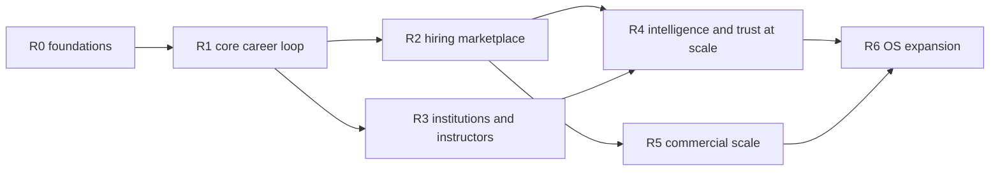

# 02 — Scope and Boundaries

What the complete product includes, what sits at its edge, and what it will not do. Tiers are dependency-based release tiers from [CONVENTIONS §6](../00_START_HERE/CONVENTIONS.md); they carry no dates. Every statement is intent, not build status.

## 1. Scope classes

| Class               | Meaning                                                                        | Build rule                                                                                       |
| ------------------- | ------------------------------------------------------------------------------ | ------------------------------------------------------------------------------------------------ |
| **In scope**        | Part of the complete career OS; specified in a module file                     | Build in its release tier once dependencies exist                                                |
| **In scope, gated** | Specified fully but brushes a non-goal or needs a commercial or legal decision | No build until the named `OD-` closes in favor; until then every capability is denied by default |
| **Adjacent**        | Integrated through an adapter; TalentSphere does not own the capability        | Build the adapter, never the capability                                                          |
| **Out of scope**    | Will not be built                                                              | Requests are declined and recorded                                                               |

## 2. Scope by domain

### 2.1 Foundation and trust

| Capability                                                                                                                                                                                   | Class           | Module | Notes                                                                                            |
| -------------------------------------------------------------------------------------------------------------------------------------------------------------------------------------------- | --------------- | ------ | ------------------------------------------------------------------------------------------------ |
| Account registration, email and phone verification, password, passkeys, MFA, OAuth sign-in, enterprise SSO (OIDC, SAML), SCIM provisioning, session and device management, account lifecycle | In scope        | `IDN`  | Self-issued first-party sessions; no browser-readable bearer token [SRC: SSOT Appendix E V61-13] |
| One account with many role grants and an explicit active context                                                                                                                             | In scope        | `IDN`  | `BR-XCT-080`                                                                                     |
| Privacy settings, field visibility, consent centre, data export, erasure, rectification, legal hold                                                                                          | In scope        | `SET`  | One consent catalogue [SRC: Appendix E V61-16]                                                   |
| In-app, email, push and digest notifications; preferences; quiet hours                                                                                                                       | In scope        | `NTF`  | SMS only for security codes, `OD-PRD-23` [PROP]                                                  |
| Reporting, moderation queue, appeals, policy enforcement, integrity review                                                                                                                   | In scope        | `TSF`  |                                                                                                  |
| Admin console, support tooling with scoped access, audit log, feature flags, reference data                                                                                                  | In scope        | `ADM`  | No impersonation [SRC: USR-01 REV2 §4]                                                           |
| Government identity document verification                                                                                                                                                    | In scope, gated | `BGV`  | `OD-PRD-26`                                                                                      |

### 2.2 Career identity and proof

| Capability                                                                                                                            | Class    | Module | Notes                                                                                       |
| ------------------------------------------------------------------------------------------------------------------------------------- | -------- | ------ | ------------------------------------------------------------------------------------------- |
| Profile, headline, skills, experience, education, résumé variants, résumé import and parsing, portfolio projects, public profile page | In scope | `PRF`  |                                                                                             |
| Evidence items, four-rung ladder, issuer class, credentials, certificates, revocation, versioned corrections, verification URLs       | In scope | `EVD`  | [SRC: Appendix E V61-17]                                                                    |
| Referee verification by tokenized link, employer-domain verification, employer confirmation of employment                             | In scope | `BGV`  |                                                                                             |
| Background checks (criminal, education, employment) through a licensed vendor                                                         | Adjacent | `BGV`  | Vendor does the check; TalentSphere manages consent, order and result display (`OD-PRD-19`) |
| Achievements, badges, XP, contextual reputation                                                                                       | In scope | `REP`  | Public leaderboards gated `OD-PRD-28`                                                       |
| Portable credential export (for example Open Badges or verifiable credential formats)                                                 | In scope | `EVD`  | Never claimed as standard-compliant until validated (`BR-XCT-070`)                          |

### 2.3 Learning and practice

| Capability                                                                                                                     | Class           | Module       | Notes                                                                               |
| ------------------------------------------------------------------------------------------------------------------------------ | --------------- | ------------ | ----------------------------------------------------------------------------------- |
| Course catalog, enrollment, lessons (video, text, code, quiz), progress, notes, Q&A, reviews, learning paths, certificates     | In scope        | `LRN`        | Learning is in scope (`DEC-003`)                                                    |
| Instructor onboarding, course studio, versioning, review and publishing, co-authoring                                          | In scope        | `STU`        |                                                                                     |
| Quizzes, coding challenges, projects with rubrics, peer review, timed assessments, AI modes, accommodations, integrity signals | In scope        | `ASM`        | Code runs only in an isolated runner [SRC: Appendix E V61-22]                       |
| Remote proctoring                                                                                                              | In scope, gated | `ASM`        | `OD-PRD-15`                                                                         |
| Paid first-party courses                                                                                                       | In scope, gated | `LRN`, `BIL` | `OD-PRD-04`                                                                         |
| Paid third-party course marketplace with instructor payouts                                                                    | In scope, gated | `STU`, `BIL` | `OD-PRD-04` [SRC: Appendix E V61-21]                                                |
| Accredited degrees, transcripts of record, exam-board functions                                                                | Out of scope    | —            | Institutions keep their student information systems (adjacent through `INS` import) |

### 2.4 Opportunity and hiring

| Capability                                                                                                                                         | Class                    | Module       | Notes                                                                                        |
| -------------------------------------------------------------------------------------------------------------------------------------------------- | ------------------------ | ------------ | -------------------------------------------------------------------------------------------- |
| Job postings, job search, saved searches and alerts, applications with evidence snapshot, application tracking, withdrawal                         | In scope                 | `JOB`        |                                                                                              |
| Requisitions, approvals, hiring teams, pipelines, stages, notes, bulk actions with human confirmation, offers, hiring decisions, post-hire outcome | In scope                 | `ATS`        |                                                                                              |
| Interview loops, panels, self-scheduling, calendar sync, scorecards, debriefs                                                                      | In scope                 | `INT`        | Video via external meeting providers (`OD-PRD-22`)                                           |
| Employer org, teams, roles, domain verification, brand page, company reviews                                                                       | In scope (reviews gated) | `EMP`        | Reviews `OD-PRD-17`                                                                          |
| Candidate discovery with consent, outreach requests with quotas                                                                                    | In scope                 | `SRC`, `MSG` |                                                                                              |
| Agency recruiting across client orgs                                                                                                               | In scope                 | `EMP`, `ATS` | `BR-XCT-057`                                                                                 |
| Promoted job placements                                                                                                                            | In scope, gated          | `JOB`, `BIL` | `OD-PRD-18`                                                                                  |
| Job aggregation by scraping third-party sites                                                                                                      | Out of scope             | —            | Terms-of-service and copyright exposure; jobs enter through employers or partner feeds [DER] |
| Payroll, onboarding paperwork, e-signature of employment contracts                                                                                 | Adjacent                 | `PLT`        | Offer acceptance records intent; signature and payroll stay in partner systems [PROP]        |

### 2.5 Network and guidance

| Capability                                                                        | Class           | Module       | Notes       |
| --------------------------------------------------------------------------------- | --------------- | ------------ | ----------- |
| Connections, follows, referral requests, referral tracking                        | In scope        | `NET`        |             |
| Community posts, articles, groups                                                 | In scope, gated | `NET`        | `OD-PRD-16` |
| Direct messages, application threads, cohort channels, attachments, read receipts | In scope        | `MSG`        |             |
| Mentoring and coaching offerings, booking, sessions, notes, ratings               | In scope, gated | `MEN`        | `OD-PRD-02` |
| Events, hackathons, teams, submissions, judging, results                          | In scope, gated | `EVT`        | `OD-PRD-02` |
| Monetary referral bonuses paid through the platform                               | In scope, gated | `NET`, `BIL` | `OD-PRD-27` |

### 2.6 Intelligence

| Capability                                                                                                                                    | Class               | Module | Notes                                           |
| --------------------------------------------------------------------------------------------------------------------------------------------- | ------------------- | ------ | ----------------------------------------------- |
| Explainable matching (lexical and skill-based first, AI later), recommendations, career assistant, résumé tailoring, job-description drafting | In scope            | `AIC`  | Human-controlled (`BR-XCT-036` to `BR-XCT-042`) |
| Candidate-level predictive hiring scores, automated screening-out                                                                             | Out of scope for GA | —      | Admission only through `OD-PRD-14`              |
| Career paths, skill demand, salary benchmarks                                                                                                 | In scope, gated     | `MKT`  | `OD-PRD-02`, `OD-PRD-17`, `OD-PRD-29`           |
| Product, hiring, institution and platform analytics                                                                                           | In scope            | `ANL`  | k-anonymous (`BR-XCT-029`)                      |

### 2.7 Work and enterprise

| Capability                                                                               | Class           | Module       | Notes                    |
| ---------------------------------------------------------------------------------------- | --------------- | ------------ | ------------------------ |
| Freelance service offerings, project posts, proposals, contracts, milestones, deliveries | In scope, gated | `GIG`        | `OD-PRD-02`, `OD-PRD-03` |
| Escrow and payouts for gigs                                                              | In scope, gated | `GIG`, `BIL` | `OD-PRD-04`              |
| Internal mobility marketplace, skills inventory, mandated learning, HRIS read sync       | In scope, gated | `ENT`        | `OD-PRD-20`              |
| Employee master data, compensation, performance ratings, leave                           | Out of scope    | —            | SSOT §4.2                |

### 2.8 Platform and commerce

| Capability                                                                                                             | Class                          | Module       | Notes                                                                |
| ---------------------------------------------------------------------------------------------------------------------- | ------------------------------ | ------------ | -------------------------------------------------------------------- |
| Plans, checkout, subscriptions, seats, invoices, refunds, dunning, entitlements                                        | In scope                       | `BIL`        | Stripe as processor [SRC: CLAUDE.md stack; COMMERCIAL_OPERATIONS §3] |
| Tax calculation and remittance                                                                                         | Adjacent                       | `BIL`        | Provider tax engine (`OD-PRD-04`, `OD-PRD-10`)                       |
| PWA install, offline read and drafts, push, browser extension                                                          | In scope                       | `PWA`        | Extension sync conflict `OD-PRD-36`                                  |
| Native iOS and Android apps                                                                                            | Out of scope until `OD-PRD-36` | —            | Not a prerequisite [SRC: SSOT §3.3]                                  |
| Public REST API, OAuth clients, webhooks, integrations (calendar, ATS, HRIS, SIS, LMS), files, media, malware scanning | In scope                       | `PLT`        | Priorities `OD-PRD-23`                                               |
| White-label and co-branding                                                                                            | In scope, gated                | `EMP`, `INS` | `OD-PRD-24`                                                          |

## 3. Domains considered and rejected

| Domain                                                                 | Considered because                                 | Rejected because                                                                                                                      | Source                       |
| ---------------------------------------------------------------------- | -------------------------------------------------- | ------------------------------------------------------------------------------------------------------------------------------------- | ---------------------------- |
| Payroll and benefits administration                                    | Enterprise customers ask for one HR suite          | Explicit non-goal; heavy regulation; no link to the evidence loop                                                                     | [SRC: SSOT §4.2]             |
| Performance reviews and employee ratings                               | Would produce "evidence" of on-the-job performance | Employer-owned evaluative data about employees creates coercion risk and conflicts with person ownership (`BR-XCT-001`); out of scope | [SRC: SSOT §4.2; DER]        |
| HRIS employee master data                                              | `ENT` needs employee lists                         | Read-only sync is enough; owning master data makes TalentSphere an HRIS                                                               | [SRC: SSOT §4.2]             |
| Self-serve advertising network                                         | Revenue                                            | Non-goal; undermines fairness and trust                                                                                               | [SRC: SSOT §4.2]             |
| Selling or licensing person-level data                                 | Revenue                                            | Breaks consent model; only k-anonymous aggregates are candidates (`OD-PRD-29`)                                                        | [SRC: SSOT §4.2; DER]        |
| Business-development people graph and sales prospecting                | Recruiter tools resemble prospecting               | Non-goal; outreach stays consent-gated and quota-bound                                                                                | [SRC: SSOT §4.2, OD-31]      |
| Blockchain or token credentials                                        | Credential portability                             | Excluded; portability uses standard formats without tokens                                                                            | [SRC: SSOT §3.3]             |
| Engagement-ranked social feed, stories, short video                    | Engagement                                         | Social-clone non-goal; moderation cost                                                                                                | [SRC: SSOT §4.2]             |
| First-party live video and streaming servers                           | Interviews, mentoring, events                      | Non-goal for infrastructure; external meeting providers suffice (`OD-PRD-22`)                                                         | [SRC: SSOT §4.2, OD-33]      |
| Immigration, visa and legal services                                   | Career moves across borders                        | Regulated professional advice; liability                                                                                              | [DER]                        |
| Education financing (loans, income-share agreements)                   | Learners need funding                              | Regulated credit; conflicts with "no deterministic career promises"                                                                   | [DER; SSOT §3.1]             |
| Relocation and housing services                                        | Career moves                                       | Not career evidence; general marketplace                                                                                              | [SRC: SSOT §4.2]             |
| Recruitment process outsourcing as a service run by TalentSphere staff | Employers want hires                               | TalentSphere is the platform, not an agency; agencies are customers                                                                   | [DER]                        |
| Local or physical-goods gig work (delivery, home services)             | Gig mode                                           | General-marketplace non-goal; produces no career evidence                                                                             | [SRC: SSOT §4.2]             |
| K-12 learning management                                               | Learning in scope                                  | Different safeguarding and legal regime; minimum-age policy (`OD-PRD-11`)                                                             | [DER]                        |
| Automated reference calls by AI voice                                  | Faster referee verification                        | Autonomous consequential AI; referee trust                                                                                            | [SRC: SSOT §3.2]             |
| Psychometric personality testing for hiring                            | Common in hiring suites                            | Validity and adverse-impact risk; predictive scoring excluded (`OD-PRD-14`)                                                           | [SRC: SSOT Amendment E; DER] |
| Cryptocurrency payouts                                                 | Global freelancers                                 | Excluded by SSOT §3.3                                                                                                                 | [SRC: SSOT §3.3]             |

## 4. Release-tier scope map (R0 to R6)

Tiers follow dependencies: a capability enters the first tier in which everything it needs exists. Tiers are not dates. Per-module dependencies are in [07](07_MODULE_MAP_AND_DEPENDENCIES.md). [SRC: CONVENTIONS §6]

| Tier                               | Goal of the tier                                                           | Capabilities entering (by module)                                                                                                                                                                                                                                                                                                                                                                                                                                                                                                                                                                                                                 | Depends on                                               | Exit condition (observable)                                                                                                                                                                                     |
| ---------------------------------- | -------------------------------------------------------------------------- | ------------------------------------------------------------------------------------------------------------------------------------------------------------------------------------------------------------------------------------------------------------------------------------------------------------------------------------------------------------------------------------------------------------------------------------------------------------------------------------------------------------------------------------------------------------------------------------------------------------------------------------------------- | -------------------------------------------------------- | --------------------------------------------------------------------------------------------------------------------------------------------------------------------------------------------------------------- |
| R0 foundations                     | Anyone can hold a safe account, control privacy and receive messages       | `IDN` register, sign-in, passkey, MFA, sessions, lifecycle · `SET` visibility, consent centre, export, erasure · `NTF` in-app and email transactional · `ADM` audit log, support console with scoped access, flags · `PLT` files, malware scan, outbox and worker · `ANL` event capture with consent · `PWA` installable shell, offline read cache · `TSF` report intake and manual moderation · `BIL` free plan entitlement stub                                                                                                                                                                                                                 | Nothing                                                  | A user registers, sets visibility, grants and revokes a consent, exports data, requests erasure; every step audited                                                                                             |
| R1 core career loop                | A candidate proves skills and work history, learns, applies and hears back | `PRF` profile, résumé import, variants, portfolio · `EVD` evidence ladder, credentials, verification URL · `BGV` referee and email-domain verification · `SRC` lexical job and course search, skill taxonomy · `LRN` first-party free catalog, enrollment, progress, certificates · `ASM` quizzes, projects, auto-graded non-code, unverified code attempts · `EMP` org creation and members (basic) · `JOB` posting, apply with snapshot, tracking, withdraw · `ATS` single pipeline, stage moves, reject with reason, notes · `INT` manual scheduling · `MSG` application threads · `AIC` non-AI explainable matching · `REP` completion badges | R0                                                       | One candidate completes Goal → Gap → Learn → Practice → Prove → Verify → Discover → Match → Apply → Interview → Outcome with evidence produced at Prove, Verify and Outcome (scope of the pilot is `OD-PRD-09`) |
| R2 hiring marketplace              | Employers hire at volume with fair, efficient tools                        | `ATS` requisitions, approvals, templates, offers, hiring decisions · `INT` loops, self-scheduling, calendar sync, scorecards, debrief · `EMP` teams, roles, SSO, brand page, agency relationships · `SRC` consent-gated candidate discovery · `MSG` outreach requests with quotas, real-time delivery · `NET` connections and referrals · `BIL` employer subscriptions, seats, checkout, dunning · `BGV` employer confirmation of employment                                                                                                                                                                                                      | R1                                                       | An org with several recruiters and hiring managers runs requisition to offer to hire with scorecards and approvals; candidates are notified at every terminal state                                             |
| R3 institutions and instructors    | Institutions and instructors teach, assess and place                       | `INS` institutions, cohorts, licences, faculty, k-anonymous analytics, graduation transfer, placement drives · `STU` instructor onboarding, studio, review, publishing · `LRN` institution-private catalogs, assignments · `ASM` rubric grading, peer review, instructor attestations, institution-run assessments · `BIL` institution licences                                                                                                                                                                                                                                                                                                   | R1 (R2 for placement drives with employers)              | A cohort is provisioned, taught, assessed, graduates and keeps its credentials on independent identities                                                                                                        |
| R4 intelligence and trust at scale | Guidance gets smarter while trust controls scale                           | `AIC` AI gateway, career assistant, tailoring, recommendations, JD drafting · `TSF` automated triage, integrity review at scale, appeals tooling · `BGV` background-check vendor integration · `REP` contextual reputation · `ANL` org and institution dashboards · `ASM` isolated code runner, proctoring if admitted (`OD-PRD-15`)                                                                                                                                                                                                                                                                                                              | R2, R3                                                   | AI features run only with consent and cost policy; adverse-impact review held; integrity flags reviewed by humans                                                                                               |
| R5 commercial scale                | The business scales across segments and partners                           | `BIL` invoicing, tax, paid first-party courses, candidate premium (`OD-PRD-05`), promoted placements if admitted · `PLT` public API, OAuth clients, webhooks, ATS/HRIS/SIS integrations · `IDN` SCIM · `PWA` browser extension · `EMP`/`INS` co-branding (`OD-PRD-24`)                                                                                                                                                                                                                                                                                                                                                                            | R2                                                       | A partner system syncs through the API with scoped keys; paid plans reconcile monthly                                                                                                                           |
| R6 OS expansion                    | Career services beyond hiring and learning                                 | `MEN`, `GIG`, `EVT`, `MKT`, `ENT`; third-party marketplace payouts (`OD-PRD-04`)                                                                                                                                                                                                                                                                                                                                                                                                                                                                                                                                                                  | R4, R5; each module also needs its `OD-PRD-02` admission | Each admitted module writes completed outcomes into `EVD`                                                                                                                                                       |

### 4.1 Tier rules

1. A module may have features in several tiers; the tier of a feature is set in its module file and must be ≥ the tier of every dependency. [SRC: CONVENTIONS §6]
2. A gated capability keeps its tier but cannot ship until its `OD-` closes in favor; if rejected, its features become `Withdrawn`. [DER]
3. No tier may ship a capability that bypasses a R0 control (consent, audit, tenancy, accessibility). [DER]
4. The R1 pilot scope may be narrowed by `OD-PRD-09`; narrowing does not redefine the GA loop. [SRC: docs/reports/FEATURE_STATUS_2026-10-21.md §A "A narrower beta must not silently redefine GA"]

## 5. What a complete product must include (checklist)

A module or tier is not "complete" until each applicable item has a specification and, at build time, executable evidence. [SRC: SSOT Amendment H; DER]

### 5.1 For every user-facing capability

- [ ] Happy path, empty, loading, error, offline and permission-denied states specified.
- [ ] Keyboard-only and screen-reader operation; visible focus; reduced-motion; target size; color-independent status (WCAG 2.2 AA target, `OD-PRD-33`).
- [ ] Works on a low-end phone over an intermittent network (PWA-first).
- [ ] Server-side authorization from the permission matrix; deny by default.
- [ ] Consent and visibility checks on every read of another person's data.
- [ ] Audit record for every consequential action; idempotent side effects.
- [ ] Rate limits and abuse controls on every write and every outbound message.
- [ ] Notifications with template name, channel and opt-out class.
- [ ] Localization-ready strings, locale-aware dates, numbers and currency (`OD-PRD-38`).
- [ ] Analytics events defined with consent class.
- [ ] Acceptance criteria including a negative case.

### 5.2 Account and data rights

- [ ] Registration, verification, sign-in, MFA, passkeys, recovery, session list, sign-out everywhere.
- [ ] Deactivate, reactivate, erasure with clocks (`OD-PRD-13`), export in machine-readable format.
- [ ] Consent centre listing every grant, grantee, expiry, with revoke.
- [ ] Access log: who viewed my evidence and when, within the disclosure rule (`BR-XCT-019`).
- [ ] Block, mute and report from every surface where another person appears.

### 5.3 Organizations and institutions

- [ ] Create, verify, configure, invite, assign roles, transfer ownership, close.
- [ ] SSO and SCIM for enterprise and campus tiers.
- [ ] Access reviews and member offboarding with reassignment of owned work.
- [ ] Org-level audit log and data export of org-owned records.
- [ ] Billing owner, seats, invoices, tax ids.

### 5.4 Operations

- [ ] Support console with time-boxed, reason-coded access and no impersonation.
- [ ] Moderation queue with reason codes, notices and appeals.
- [ ] Finance console for refunds, disputes, reconciliation, payouts.
- [ ] Feature flags with kill switches per module.
- [ ] Status page and incident communication templates.
- [ ] Break-glass procedure with post-incident review.

### 5.5 Legal and policy surfaces

- [ ] Terms of service, privacy notice, cookie notice, acceptable-use policy, community guidelines, employer terms, instructor terms, mentor and freelancer terms (gated modules), refund policy.
- [ ] Each policy versioned; acceptance recorded with version and timestamp; re-acceptance on material change.
- [ ] Data processing agreement for organizations and institutions.
- [ ] Accessibility statement.

### 5.6 Help and onboarding

- [ ] Role-specific onboarding to first value in one session.
- [ ] In-product help, searchable help center, contact support path for every plan (`OD-PRD-34`).
- [ ] Sample data or guided tour for org and institution admins.

## 6. Boundary rules between core and OS-expansion modules

1. OS-expansion modules (`MEN`, `GIG`, `EVT`, `MKT`, `ENT`) never own a core entity; they own only their own entities and write outcomes to `EVD` through its contract (see [07 §3](07_MODULE_MAP_AND_DEPENDENCIES.md#3-ownership-of-core-and-shared-entities)). [DER]
2. A core module must not depend hard on an OS-expansion module, so rejecting an expansion module never breaks the core loop. [DER]
3. Shared services used by expansion modules (scheduling, payments, messaging) are owned by core modules (`INT`, `BIL`, `MSG`) and specified generically. [DER]

## 7. Legacy source trace

| Source                                                                                          | Used for                                             | Dropped or changed                                                                              |
| ----------------------------------------------------------------------------------------------- | ---------------------------------------------------- | ----------------------------------------------------------------------------------------------- |
| `SSOT.md` §3.3, §4, Amendments B, E, H                                                          | Exclusions, non-goals, GA loop, production readiness | —                                                                                               |
| `SSOT.md` Appendix E V61-20, V61-21                                                             | Pilot scope contention, marketplace gating           | Kept open as `OD-PRD-09`, `OD-PRD-04`                                                           |
| `Yash_Final_Project_Document/01_EXECUTIVE_AND_STRATEGY/PRODUCT_VISION_AND_BUSINESS_MODEL.md` §6 | Positioning and boundaries                           | Widened by `DEC-002`                                                                            |
| SSOT phases Ph0 to Ph10                                                                         | Considered for tiering                               | Not used: tiers here are R0 to R6 and are not equated with SSOT phases [SRC: Appendix E V61-02] |
