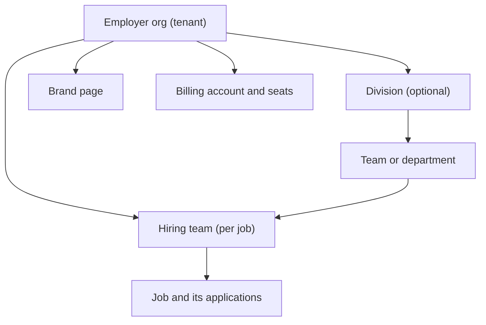
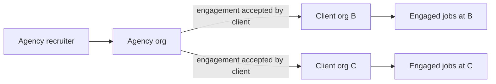
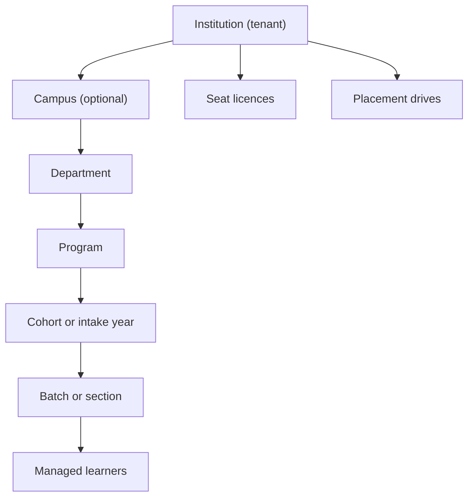
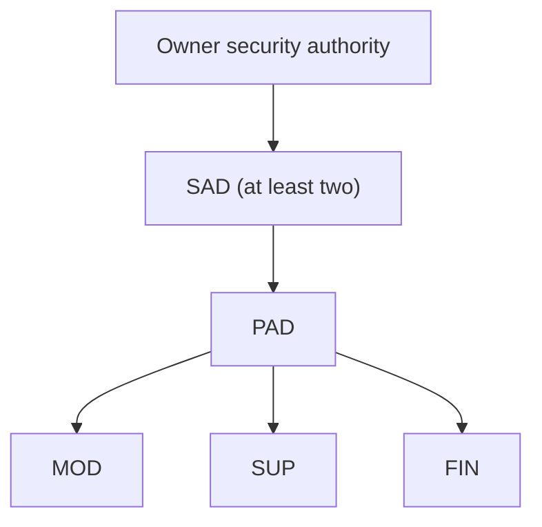

# 03 — Personas and Roles

Every canonical role from [CONVENTIONS §5](../00_START_HERE/CONVENTIONS.md): who holds it, what they want, how they become it and how they stop being it. Personas are **hypothetical**: no user research has been conducted, and validating them is `OD-PRD-25`. [SRC: Yash_Final_Project_Document/02_STAKEHOLDERS_AND_USERS/STAKEHOLDERS_ROLES_PERMISSIONS.md §2] Permissions are in [04](04_PERMISSION_MATRIX.md); journeys in [05](05_USER_JOURNEYS.md).

## 1. Role model in one paragraph

A **person** has one account (`IDN`). Every signed-in person holds the **`CAN` base grant** (or `STD` while they are a managed learner) because everyone has a career identity. All other roles are **grants** of the form `(principal, role, scope)`, where scope is one of `platform`, `org:<id>`, `institution:<id>`, `team:<id>`, `cohort:<id>`, `event:<id>` or `self`. A person may hold many grants; the UI shows one **active context** at a time and the server evaluates the grant for that context only (`BR-XCT-080`). Platform staff roles (`MOD`, `SUP`, `FIN`, `PAD`, `SAD`) are held on **separate staff accounts**, never on a personal account (`BR-XCT-060`). `API` is a non-human service principal. `GUE` is the absence of a session. [SRC: USR-01 REV2 §1 scoped grants; SSOT §5.4 deny-by-default; staff-account separation is PROP]

### 1.1 Role variants

Some legacy roles are variants (narrower grants) of a canonical role rather than separate roles. Variants inherit nothing beyond what the variant row says. [SRC: SSOT §5.4 Tier-2 roles; USR-01 REV2 §1; mapping is DER]

| Canonical role | Variant grant       | Scope                             | What the variant can do                                                     | Legacy name                               |
| -------------- | ------------------- | --------------------------------- | --------------------------------------------------------------------------- | ----------------------------------------- |
| `INS`          | `instructor`        | self (own courses)                | Author and teach own courses                                                | Instructor, Course Author, Content Author |
| `INS`          | `faculty`           | cohort                            | Teach, grade and monitor assigned institution batches                       | Faculty                                   |
| `INS`          | `proctor`           | event or assessment session       | Invigilate one institution-run assessment session; no profile access        | Faculty/Proctor (gated `OD-PRD-15`)       |
| `INS`          | `co_author`         | course                            | Edit drafts of one course; cannot publish or price                          | — [PROP]                                  |
| `REC`          | `recruiter`         | org, team                         | Jobs and applications of jobs where on the hiring team                      | Recruiter                                 |
| `REC`          | `agency_recruiter`  | agency org plus client engagement | Submit candidates to engaged client jobs only                               | Agency Recruiter                          |
| `REC`          | `coordinator`       | org, team                         | Schedule interviews and message candidates; cannot move stages or see notes | — [PROP]                                  |
| `HMG`          | `hiring_manager`    | team (assigned jobs)              | Review, decide, approve offers for assigned jobs                            | Hiring Manager                            |
| `HMG`          | `interviewer`       | interview loop                    | See the candidate packet for one loop and submit one scorecard              | Interviewer                               |
| `HMG`          | `viewer`            | team                              | Read-only job and pipeline counts; no candidate content                     | viewer                                    |
| `EAD`          | `org_owner`         | org                               | Everything `org_admin` can, plus billing owner, ownership transfer, closure | org_owner                                 |
| `EAD`          | `org_admin`         | org                               | Members, roles below owner, settings, templates                             | Org Admin                                 |
| `EAD`          | `billing_manager`   | org                               | Seats, invoices, payment method (if delegated by owner)                     | Billing/Procurement Manager               |
| `IAD`          | `inst_admin`        | institution                       | Institution settings, licences, cohorts, credentials                        | Institution Admin                         |
| `IAD`          | `department_admin`  | department                        | Same, limited to one department and its cohorts                             | Department Admin                          |
| `PLO`          | `placement_officer` | institution                       | Placement drives, employer coordination, outcomes                           | Institutional Partner, career counsellor  |
| `EXA`          | `talent_admin`      | org (enterprise module enabled)   | Skills inventory, internal mobility settings                                | Skills Analyst                            |
| `EXA`          | `ld_admin`          | org                               | Mandated learning, internal catalogs, completion reports                    | Corporate L&D                             |
| `SAD`          | `security_auditor`  | platform                          | Read-only audit and access-review evidence                                  | auditor                                   |
| `CAN`          | `peer_reviewer`     | assignment                        | Review one assigned submission under rubric, double-blind                   | Peer Reviewer                             |
| `CAN`          | `event_judge`       | event                             | Score submissions of one event                                              | — [PROP]                                  |
| `CAN`          | `company_reviewer`  | self                              | Write reviews of employers (gated `OD-PRD-17`)                              | Company Reviewer                          |

### 1.2 Non-role actors

| Actor                       | How they act                                                             | Allowed                                                                                | Source                |
| --------------------------- | ------------------------------------------------------------------------ | -------------------------------------------------------------------------------------- | --------------------- |
| External referee / verifier | Single-use, expiring token bound to one verification request; no account | Read the request prompt; submit exactly one response; report the request as fraudulent | [SRC: USR-01 REV2 §3] |
| External interview guest    | Calendar invite link to an external meeting; no TalentSphere access      | Join the meeting only                                                                  | [PROP]                |
| Background-check vendor     | `API` principal with a vendor key                                        | Receive an order, return a result for that order                                       | [DER]                 |

## 2. Personas

Legacy personas P-A to P-T are reused [SRC: SSOT §5.5]; P-U to P-Z are new and marked [PROP]. There is no P-P (numbering gap in the source).

| Persona           | Role(s)                                     | One-line context                                                                           |
| ----------------- | ------------------------------------------- | ------------------------------------------------------------------------------------------ |
| P-A Aisha         | `CAN`                                       | 22, computer-science graduate, first job search, mobile-first, limited data plan           |
| P-B Rohan         | `CAN`, later `MNT`                          | 31, backend engineer moving to AI/ML                                                       |
| P-C Priya         | `REC`, `EAD`                                | 29, two-person talent team at a startup                                                    |
| P-D Dev           | `PAD`                                       | 34, platform operations                                                                    |
| P-E Elena         | `HMG`                                       | 38, product director                                                                       |
| P-F Farid         | `REC` (`agency_recruiter`), `EAD` of agency | 40, agency lead with several client orgs                                                   |
| P-G Grace         | `INS`, `CAN`                                | 35, ex-ML engineer creating courses                                                        |
| P-H Hugo          | `MNT`, `HMG`                                | 45, principal engineer who mentors                                                         |
| P-I Ivy           | `PLO`                                       | 33, university career counsellor                                                           |
| P-J Dr. Rao       | `IAD` (`department_admin`)                  | 52, department head                                                                        |
| P-K Meera         | `INS` (`faculty`, `proctor`)                | 34, assistant professor                                                                    |
| P-L Tomas         | `EXA` (`ld_admin`)                          | 41, corporate L&D lead                                                                     |
| P-M Sam           | `CAN`                                       | 27, self-paced learner and career switcher                                                 |
| P-N Nina          | `CAN`, `INS`                                | 30, writes about her field (community gated)                                               |
| P-O Omar          | `CAN`                                       | 28, researches employers before applying                                                   |
| P-Q Quinn         | `CAN`                                       | 24, competitive programmer, hackathons                                                     |
| P-R Ravi          | `CAN`                                       | 34, finance to product career switch                                                       |
| P-S Sara          | `HMG`                                       | 42, engineering manager                                                                    |
| P-T Tara          | `EXA` (`talent_admin`)                      | 38, skills analyst                                                                         |
| P-U Uma [PROP]    | `FRL`                                       | 29, freelance designer with two retainer clients                                           |
| P-V Vikram [PROP] | `STD`                                       | 20, third-year student in a provisioned cohort                                             |
| P-W Wen [PROP]    | `MOD`                                       | 31, trust and safety moderator                                                             |
| P-X Xavier [PROP] | `FIN`                                       | 39, finance operations                                                                     |
| P-Y Yusuf [PROP]  | `SAD`                                       | 44, security officer                                                                       |
| P-Z Zoe [PROP]    | `SUP`                                       | 26, support agent [SRC: USR-01 P5 "Sam, support operator" renamed to avoid clash with P-M] |

## 3. Role profiles

Each profile uses the same fields. "Success measures" are definitions only; targets are open (`OD-PRD-01`). Lifecycle states are role-grant states, distinct from account states owned by `IDN`.

### 3.1 GUE — Guest

| Field            | Detail                                                                                                                                                                                                                                                                                                                                                                       |
| ---------------- | ---------------------------------------------------------------------------------------------------------------------------------------------------------------------------------------------------------------------------------------------------------------------------------------------------------------------------------------------------------------------------- |
| Who              | Anyone without a session: a job seeker arriving from a search engine, a recruiter checking a shared credential link, a referee opening a verification link, a parent looking at a course                                                                                                                                                                                     |
| Goals            | See a job, course, public profile, employer page or credential quickly; decide whether to sign up                                                                                                                                                                                                                                                                            |
| Pains            | Sign-up walls before any value; slow pages on mobile; unclear whether a credential is genuine                                                                                                                                                                                                                                                                                |
| Jobs to be done  | When I follow a shared credential link, I want to see who issued it and whether it is still valid, so I can trust it without creating an account. · When I find a job, I want the full description and requirements before registering, so I do not waste time. · When I am asked to confirm a colleague's role, I want to answer on my phone in minutes without an account. |
| Context of use   | Mobile browser, first visit, no install; often from email, chat or search                                                                                                                                                                                                                                                                                                    |
| Success measures | `act.guest_to_register` (registrations ÷ guest sessions that viewed a job or course); credential verification lookups answered                                                                                                                                                                                                                                               |
| Lifecycle        | No grant. Becomes `CAN` on registration (`JRN-GUE-01`); acts as referee only through a token (`JRN-GUE-03`)                                                                                                                                                                                                                                                                  |
| Must never       | Read anything not marked public; enumerate profiles; message anyone                                                                                                                                                                                                                                                                                                          |

### 3.2 CAN — Candidate / Professional

| Field            | Detail                                                                                                                                                                                                                                                                                                                                                                                                                                                                                          |
| ---------------- | ----------------------------------------------------------------------------------------------------------------------------------------------------------------------------------------------------------------------------------------------------------------------------------------------------------------------------------------------------------------------------------------------------------------------------------------------------------------------------------------------- |
| Who              | Every signed-in person in their personal capacity: job seekers, employed professionals, career switchers, learners (P-A, P-B, P-M, P-O, P-Q, P-R)                                                                                                                                                                                                                                                                                                                                               |
| Goals            | Prove skills and work history once; learn what closes a gap; find and win the right role; keep control of personal data                                                                                                                                                                                                                                                                                                                                                                         |
| Pains            | Re-entering the same history for every application; no feedback after applying; unverifiable bootcamp certificates; fear that the current employer sees the job search                                                                                                                                                                                                                                                                                                                          |
| Jobs to be done  | When I set a goal, I want to see the gap between my evidence and the target role, so I know what to learn next. · When I apply, I want to choose exactly what the employer sees, so I stay in control. · When an application stalls, I want a status I can trust, so I can plan. · When I leave a job, I want my former manager to confirm my role quickly, so the claim carries weight. · When I am contacted by a recruiter, I want to accept or decline without exposing my contact details. |
| Context of use   | Mostly mobile for browsing and status checks; desktop for profile building, assessments and applications; short sessions during commutes and evenings                                                                                                                                                                                                                                                                                                                                           |
| Success measures | `evd.active_with_3_backed`; `hir.share_reaching_interview` for their applications; time from goal set to first evidence item                                                                                                                                                                                                                                                                                                                                                                    |
| Lifecycle        | Granted at account creation (base grant). States follow the account: `pending_verification` → `active` ⇄ `suspended` → `deactivated` → `pending_erasure` → `erased` [SRC: SSOT Appendix E V61-18 account states]. A `STD` becomes `CAN` at graduation. The base grant cannot be removed without erasing the account                                                                                                                                                                             |
| Variants         | `peer_reviewer`, `event_judge`, `company_reviewer` (1.1)                                                                                                                                                                                                                                                                                                                                                                                                                                        |
| Must never       | See another candidate's applications; see recruiter internal notes outside a DSR; self-verify evidence                                                                                                                                                                                                                                                                                                                                                                                          |

### 3.3 STD — Student (candidate attached to an institution)

| Field            | Detail                                                                                                                                                                                                                                                                                                                                                                 |
| ---------------- | ---------------------------------------------------------------------------------------------------------------------------------------------------------------------------------------------------------------------------------------------------------------------------------------------------------------------------------------------------------------------- |
| Who              | A learner provisioned or invited by an institution into a cohort (P-V)                                                                                                                                                                                                                                                                                                 |
| Goals            | Complete assigned courses and assessments; receive faculty feedback; join placement drives; leave with portable credentials                                                                                                                                                                                                                                            |
| Pains            | Institutional systems that disappear at graduation; faculty seeing personal job-search activity; inflexible schedules                                                                                                                                                                                                                                                  |
| Jobs to be done  | When I finish a project, I want faculty-graded evidence on my own profile, so employers can trust it after I graduate. · When a placement drive opens, I want to apply with my institution's endorsement visible. · When I graduate, I want everything I earned to move to my independent account without losing anything.                                             |
| Context of use   | Campus Wi-Fi and phone data; laptop for assessments; timetabled sessions                                                                                                                                                                                                                                                                                               |
| Success measures | Assigned-course completion; credentials issued; graduating-cohort activation (`GOAL-05` definition [SRC: STR-01 REV2])                                                                                                                                                                                                                                                 |
| Lifecycle        | `provisioned` (institution created a seat) → `invited` → `claimed` (student accepted with own credentials) → `active_managed` → `graduation_pending` → `independent` (becomes `CAN`) or `revoked` (institution ended the seat before graduation; student keeps a `CAN` account and all evidence issued so far) → `archived` [SRC: SSOT §5.7 managed learner lifecycle] |
| Restrictions     | Enrollment in paid content limited to the institution's licence pool; job applications outside placement drives depend on institution policy (`OD-PRD-37`); discoverability default off and, if a minor, locked off (`BR-XCT-071`)                                                                                                                                     |
| Must never       | Be treated as institution-owned; lose earned evidence on revocation                                                                                                                                                                                                                                                                                                    |

### 3.4 INS — Instructor (variants: instructor, faculty, proctor, co-author)

| Field                              | Detail                                                                                                                                                                                                                                                                                                                                                                                                                        |
| ---------------------------------- | ----------------------------------------------------------------------------------------------------------------------------------------------------------------------------------------------------------------------------------------------------------------------------------------------------------------------------------------------------------------------------------------------------------------------------- |
| Who                                | Independent course creators (P-G, P-N), faculty of an institution (P-K), proctors                                                                                                                                                                                                                                                                                                                                             |
| Goals                              | Build and publish quality courses; teach batches; grade fairly; see learner outcomes; earn income (gated)                                                                                                                                                                                                                                                                                                                     |
| Pains                              | Authoring tools that fight them; review delays; no visibility of whether learners got jobs; plagiarism and AI-written submissions                                                                                                                                                                                                                                                                                             |
| Jobs to be done                    | When I draft a course, I want autosave, versioning and preview as a learner, so I can publish with confidence. · When a submission arrives, I want a rubric and side-by-side view, so grading is fast and consistent. · When a learner shows mastery, I want to attest it with my name, so it counts as instructor-issued evidence. · When learners in my batch fall behind, I want an at-risk list so I can intervene early. |
| Context of use                     | Desktop for authoring and grading; mobile for Q&A replies and notifications                                                                                                                                                                                                                                                                                                                                                   |
| Success measures                   | `lrn.completion_to_evidence` for own courses; median grading turnaround; course rating distribution                                                                                                                                                                                                                                                                                                                           |
| Lifecycle (independent instructor) | `applicant` → `under_review` → `approved` → `active` ⇄ `suspended` → `retired` [SRC: SSOT §5.7 instructor lifecycle]. Faculty: granted by `IAD` for a cohort, ends when the cohort closes or the grant is revoked. Proctor: granted per session, expires at session end                                                                                                                                                       |
| Must never                         | Attest their own evidence; review or rate their own course; read learner evidence outside their course; set prices while `OD-PRD-04` is open                                                                                                                                                                                                                                                                                  |

### 3.5 MNT — Mentor / Coach (gated module `MEN`)

| Field            | Detail                                                                                                                                                                                                                                                                                   |
| ---------------- | ---------------------------------------------------------------------------------------------------------------------------------------------------------------------------------------------------------------------------------------------------------------------------------------- |
| Who              | Experienced professionals offering mentoring, interview coaching, résumé or portfolio review (P-H, later P-B)                                                                                                                                                                            |
| Goals            | Help people progress; manage availability; be paid fairly if paid sessions are admitted                                                                                                                                                                                                  |
| Pains            | No-shows; unclear mentee goals; scheduling across time zones; payment collection                                                                                                                                                                                                         |
| Jobs to be done  | When a mentee books, I want their goal and the evidence they chose to share, so the session is useful. · When a session ends, I want private notes and an optional shared summary, so follow-up is easy. · When a mentee does not show, I want the no-show policy applied automatically. |
| Context of use   | Desktop and phone; sessions by external video link                                                                                                                                                                                                                                       |
| Success measures | `men.session_completion`; mentee follow-up evidence within the attribution window; rating distribution                                                                                                                                                                                   |
| Lifecycle        | `applicant` → `under_review` (identity and experience check, `OD-PRD-26`) → `active` ⇄ `paused` (mentor-set) ⇄ `suspended` (platform) → `retired` [PROP]                                                                                                                                 |
| Must never       | Read mentee evidence not shared through a consent scope; contact mentees outside the platform before a booking; endorse a mentee's evidence as authority-verified                                                                                                                        |

### 3.6 FRL — Freelancer (candidate with gig mode, gated module `GIG`)

| Field            | Detail                                                                                                                                                                                                                                                                                                                                             |
| ---------------- | -------------------------------------------------------------------------------------------------------------------------------------------------------------------------------------------------------------------------------------------------------------------------------------------------------------------------------------------------- |
| Who              | A `CAN` who enables gig mode to sell career-related professional services (P-U)                                                                                                                                                                                                                                                                    |
| Goals            | Win projects matching skills; deliver against milestones; get paid on time; turn delivered work into evidence                                                                                                                                                                                                                                      |
| Pains            | Unpaid milestones; scope creep; platform fees; profiles that do not show real delivered work                                                                                                                                                                                                                                                       |
| Jobs to be done  | When I see a project, I want to send a proposal with my relevant evidence attached, so the client trusts me. · When I deliver a milestone, I want the client to approve or raise a specific objection within a known window, so I get paid. · When a contract completes, I want the delivered work recorded as evidence with the client as issuer. |
| Context of use   | Desktop for proposals and delivery; mobile for messages                                                                                                                                                                                                                                                                                            |
| Success measures | `gig.contract_completion`; median days from milestone delivery to payment release                                                                                                                                                                                                                                                                  |
| Lifecycle        | `gig_mode_off` → `gig_mode_on` (terms accepted) → `payout_ready` (KYC and tax data accepted by provider, `BR-XCT-048`) ⇄ `restricted` (dispute ratio or policy) → `gig_mode_off` [PROP]                                                                                                                                                            |
| Must never       | Take payment off-platform for a platform contract (policy); sell non-career services (`OD-PRD-03`)                                                                                                                                                                                                                                                 |

### 3.7 REC — Recruiter (variants: recruiter, agency recruiter, coordinator)

| Field            | Detail                                                                                                                                                                                                                                                                                                                                                                                                                                                     |
| ---------------- | ---------------------------------------------------------------------------------------------------------------------------------------------------------------------------------------------------------------------------------------------------------------------------------------------------------------------------------------------------------------------------------------------------------------------------------------------------------- |
| Who              | In-house recruiters (P-C), agency recruiters (P-F), recruiting coordinators                                                                                                                                                                                                                                                                                                                                                                                |
| Goals            | Fill requisitions with qualified people quickly; keep candidates informed; stay compliant                                                                                                                                                                                                                                                                                                                                                                  |
| Pains            | Volume of unqualified applications; manual reference checks; scheduling ping-pong; hiring managers late with feedback                                                                                                                                                                                                                                                                                                                                      |
| Jobs to be done  | When applications arrive, I want them ordered by explained evidence fit, so I review the strongest first without auto-rejecting anyone. · When I source, I want to find only people who chose to be discoverable, and to send a request they can accept. · When an interview loop is needed, I want candidates to self-schedule against the panel's real availability. · When I reject, I want a respectful template with a reason code sent on my action. |
| Context of use   | Desktop, many hours per day, keyboard-heavy; mobile for approvals and quick replies                                                                                                                                                                                                                                                                                                                                                                        |
| Success measures | `hir.time_to_first_review`; `hir.share_reaching_interview`; `hir.candidate_notified_on_close`                                                                                                                                                                                                                                                                                                                                                              |
| Lifecycle        | Invited by `EAD` → `invited` → `active` (accepted; SSO enforced if configured) ⇄ `suspended` (org) → `removed` (offboarded; owned jobs reassigned, `BR-XCT-003`). Agency recruiter: additionally `engaged` per client org by the client's `EAD`                                                                                                                                                                                                            |
| Must never       | See applications for jobs where not on the hiring team; contact a non-discoverable person; export candidate data without audit; move a candidate's stage with no human action                                                                                                                                                                                                                                                                              |

### 3.8 HMG — Hiring Manager (variants: hiring manager, interviewer, viewer)

| Field            | Detail                                                                                                                                                                                                                                                                                                                          |
| ---------------- | ------------------------------------------------------------------------------------------------------------------------------------------------------------------------------------------------------------------------------------------------------------------------------------------------------------------------------- |
| Who              | Line managers who own the hire (P-E, P-S), panel interviewers, observers                                                                                                                                                                                                                                                        |
| Goals            | Define what good looks like; see evidence, not noise; decide quickly and fairly                                                                                                                                                                                                                                                 |
| Pains            | Unstructured interview feedback; anchoring on others' opinions; long packets                                                                                                                                                                                                                                                    |
| Jobs to be done  | When I open a requisition, I want to state must-have skills and a scorecard, so the panel evaluates consistently. · When I interview, I want to submit my scorecard before seeing others', so I am not anchored. · When the loop ends, I want a debrief view with every score and the evidence, so I can decide and record why. |
| Context of use   | Desktop and mobile, short bursts between meetings                                                                                                                                                                                                                                                                               |
| Success measures | Median hours from interview end to scorecard submission; time from final interview to decision                                                                                                                                                                                                                                  |
| Lifecycle        | Granted by `EAD` or a `REC` on a job's hiring team; interviewer grant per loop, expires 30 days after the loop closes [PROP]; removed with org membership                                                                                                                                                                       |
| Must never       | See jobs not assigned to their team; see others' scorecards before submitting their own; extend an offer without the approval chain                                                                                                                                                                                             |

### 3.9 EAD — Employer Admin (variants: org owner, org admin, billing manager)

| Field            | Detail                                                                                                                                                                                                                                                                                                     |
| ---------------- | ---------------------------------------------------------------------------------------------------------------------------------------------------------------------------------------------------------------------------------------------------------------------------------------------------------- |
| Who              | Founder or HR lead who set up the org (P-C), agency owner (P-F), IT admin for SSO                                                                                                                                                                                                                          |
| Goals            | Set up a trustworthy, verified org; control who can do what; manage spend; protect the brand                                                                                                                                                                                                               |
| Pains            | Ex-employees keeping access; seats paid but unused; reviews they cannot answer                                                                                                                                                                                                                             |
| Jobs to be done  | When someone leaves, I want to remove them and reassign their jobs in one step. · When we grow, I want SSO and SCIM so access follows our directory. · When a payment fails, I want a clear grace period and no data loss.                                                                                 |
| Context of use   | Desktop, occasional; mobile for approvals                                                                                                                                                                                                                                                                  |
| Success measures | Access reviews completed per period; share of members with MFA or SSO; seat utilization                                                                                                                                                                                                                    |
| Lifecycle        | Any `CAN` creates an org and becomes `org_owner` (`JRN-EAD-01`); org states `unverified` → `pending_verification` → `verified` ⇄ `restricted` → `closed` [PROP]. Last-owner rule: an org always has at least one owner [SRC: USR-01 REV2]. Ownership transfers only to an existing `org_admin` who accepts |
| Must never       | Read candidate application content unless also on that job's hiring team; file a DSR for an employee; consent on behalf of members                                                                                                                                                                         |

### 3.10 IAD — Institution Admin (variants: institution admin, department admin)

| Field            | Detail                                                                                                                                                                                                                                                          |
| ---------------- | --------------------------------------------------------------------------------------------------------------------------------------------------------------------------------------------------------------------------------------------------------------- |
| Who              | University, college or bootcamp administrators (P-J)                                                                                                                                                                                                            |
| Goals            | Provision cohorts, license content, assign faculty, issue credentials, show outcomes                                                                                                                                                                            |
| Pains            | Seat management in spreadsheets; data-protection obligations for students; outcomes data nobody trusts                                                                                                                                                          |
| Jobs to be done  | When a term starts, I want to import a roster and invite every student in one action. · When accreditation reviews come, I want k-anonymous skill coverage by program. · When a student graduates, I want their credentials to stay valid on their own account. |
| Context of use   | Desktop; term-based peaks                                                                                                                                                                                                                                       |
| Success measures | Seats claimed ÷ seats provisioned; credentials issued; graduating-cohort activation                                                                                                                                                                             |
| Lifecycle        | Institution created by a `CAN` and verified by `PAD` (`JRN-IAD-01`) → creator becomes `inst_admin`; additional admins invited; department admins scoped to a department                                                                                         |
| Must never       | Read individual evidence beyond institution-issued records and institution-run course work; see students' job-search activity; keep learner identity after graduation without `alumni.share_outcomes`                                                           |

### 3.11 PLO — Placement Officer

| Field            | Detail                                                                                                                                                                                                                                                                                    |
| ---------------- | ----------------------------------------------------------------------------------------------------------------------------------------------------------------------------------------------------------------------------------------------------------------------------------------- |
| Who              | Career-services staff at an institution (P-I)                                                                                                                                                                                                                                             |
| Goals            | Bring employers to campus, match students to drives, track placements, report outcomes                                                                                                                                                                                                    |
| Pains            | Chasing employers and students by email; outcome data incomplete after graduation                                                                                                                                                                                                         |
| Jobs to be done  | When an employer agrees to a drive, I want to publish it to eligible cohorts with criteria, so only eligible students apply. · When offers come in, I want them recorded against the drive. · When reporting, I want outcomes from alumni who consented, suppressed below `min_cohort_k`. |
| Context of use   | Desktop; seasonal peaks                                                                                                                                                                                                                                                                   |
| Success measures | Students placed ÷ eligible students per drive; drive-to-offer time                                                                                                                                                                                                                        |
| Lifecycle        | Granted by `IAD` within one institution; ends on revocation or institution closure                                                                                                                                                                                                        |
| Must never       | Apply on a student's behalf; see application content beyond what the student shares with the drive                                                                                                                                                                                        |

### 3.12 EXA — Enterprise Talent / L&D Admin (gated module `ENT`)

| Field            | Detail                                                                                                                                                                                                                                                                                          |
| ---------------- | ----------------------------------------------------------------------------------------------------------------------------------------------------------------------------------------------------------------------------------------------------------------------------------------------- |
| Who              | L&D leads (P-L) and skills analysts (P-T) in an employer org with the enterprise module                                                                                                                                                                                                         |
| Goals            | Know the skills of the workforce; fill roles internally; run mandated learning; report to leadership                                                                                                                                                                                            |
| Pains            | Skills data stale or self-reported; employees hide job interest from managers; HRIS and LMS disconnected                                                                                                                                                                                        |
| Jobs to be done  | When planning, I want an aggregate skills inventory by department, so I can target learning. · When a role opens, I want internal candidates to apply confidentially before external posting. · When compliance training is due, I want assignments, reminders and completion sync to the HRIS. |
| Context of use   | Desktop; reporting cycles                                                                                                                                                                                                                                                                       |
| Success measures | `ent.internal_fill_rate`; mandated-learning completion on time; skills-inventory coverage                                                                                                                                                                                                       |
| Lifecycle        | Granted by `EAD` when the org enables `ENT`; ends with revocation or module disablement                                                                                                                                                                                                         |
| Must never       | See an individual employee's external job search or external applications; read personal evidence the employee did not share to the org; use skills data for performance ratings                                                                                                                |

### 3.13 MOD — Moderator

| Field            | Detail                                                                                                                                                                                                                                                                                                                    |
| ---------------- | ------------------------------------------------------------------------------------------------------------------------------------------------------------------------------------------------------------------------------------------------------------------------------------------------------------------------- |
| Who              | Trust and safety staff (P-W) on staff accounts                                                                                                                                                                                                                                                                            |
| Goals            | Remove harm quickly, consistently and fairly; resolve appeals                                                                                                                                                                                                                                                             |
| Pains            | Context switching; abusive reporters; unclear policy edges                                                                                                                                                                                                                                                                |
| Jobs to be done  | When a report arrives, I want the content, policy, reporter history and prior actions in one view, so I decide consistently. · When I act, I want reason codes and templates so the user is told why. · When an integrity flag arrives, I want the signals with their uncertainty, so I do not mistake anomaly for guilt. |
| Context of use   | Desktop, shift-based, keyboard-driven queue                                                                                                                                                                                                                                                                               |
| Success measures | Median time to first action by severity; `grd.moderation_appeal_overturn`                                                                                                                                                                                                                                                 |
| Lifecycle        | Granted by `PAD` with `SAD` approval (two-person, `BR-XCT-062`) after training; reviewed monthly; dormant grant expires after 60 days [SRC: USR-01 §6]                                                                                                                                                                    |
| Must never       | Moderate content where they are a party; decide an appeal of their own action                                                                                                                                                                                                                                             |

### 3.14 SUP — Support Agent

| Field            | Detail                                                                                                                                                                                                    |
| ---------------- | --------------------------------------------------------------------------------------------------------------------------------------------------------------------------------------------------------- |
| Who              | Customer support staff (P-Z) on staff accounts                                                                                                                                                            |
| Goals            | Resolve tickets fast without seeing more than needed                                                                                                                                                      |
| Pains            | Users who cannot sign in; scope of access unclear; repeated identity questions                                                                                                                            |
| Jobs to be done  | When a ticket needs account data, I want time-boxed read access tied to the ticket, so access ends automatically. · When a user lost all factors, I want an identity-proofing checklist before resetting. |
| Context of use   | Desktop, shift-based                                                                                                                                                                                      |
| Success measures | Median resolution time; share of access sessions with a ticket and reason code (must be 100 percent)                                                                                                      |
| Lifecycle        | Granted by `PAD` with `SAD` approval; scoped access sessions expire after a set period (default 60 minutes [PROP], `OD-PRD-34`)                                                                           |
| Must never       | Impersonate a user; issue refunds; edit a user's profile or evidence; access their own or a known person's account                                                                                        |

### 3.15 FIN — Finance Operator

| Field            | Detail                                                                                                                                                                                           |
| ---------------- | ------------------------------------------------------------------------------------------------------------------------------------------------------------------------------------------------ |
| Who              | Finance operations staff (P-X)                                                                                                                                                                   |
| Goals            | Correct billing, timely refunds, clean reconciliation, safe payouts                                                                                                                              |
| Pains            | Webhook gaps; manual credits; chargebacks with missing evidence                                                                                                                                  |
| Jobs to be done  | When a refund is requested, I want the purchase, consumption and policy in one view, so I decide by rule. · When reconciling, I want processor and ledger differences listed, so I close breaks. |
| Context of use   | Desktop, monthly cycles                                                                                                                                                                          |
| Success measures | Reconciliation breaks open at period close; refund decision time                                                                                                                                 |
| Lifecycle        | Granted by `PAD` with `SAD` approval; dual control for large actions (`BR-XCT-061`)                                                                                                              |
| Must never       | Change entitlements except through billing actions; approve their own refund initiation above the threshold                                                                                      |

### 3.16 PAD — Platform Admin

| Field            | Detail                                                                                                                                                                                                                                                        |
| ---------------- | ------------------------------------------------------------------------------------------------------------------------------------------------------------------------------------------------------------------------------------------------------------- |
| Who              | Platform operations (P-D)                                                                                                                                                                                                                                     |
| Goals            | Operate the platform safely: configuration, flags, taxonomy, verifications, approvals                                                                                                                                                                         |
| Pains            | Risky changes without rollback; manual verification queues                                                                                                                                                                                                    |
| Jobs to be done  | When rolling out a feature, I want staged exposure with a kill switch. · When an employer requests verification, I want domain evidence and risk signals before approving. · When the skill taxonomy changes, I want a preview of affected profiles and jobs. |
| Context of use   | Desktop                                                                                                                                                                                                                                                       |
| Success measures | Change failure rate; verification queue age                                                                                                                                                                                                                   |
| Lifecycle        | Granted by `SAD` with a second `SAD` or `PAD` approval; monthly review                                                                                                                                                                                        |
| Must never       | Read personal data without a reason-coded, audited session; grant themselves roles                                                                                                                                                                            |

### 3.17 SAD — Super Admin / Security Officer (variant: security auditor)

| Field            | Detail                                                                                                                                                                                                     |
| ---------------- | ---------------------------------------------------------------------------------------------------------------------------------------------------------------------------------------------------------- |
| Who              | Security officer (P-Y), auditors                                                                                                                                                                           |
| Goals            | Protect users and tenants; respond to incidents; prove control effectiveness                                                                                                                               |
| Pains            | Over-privileged staff; audit evidence scattered                                                                                                                                                            |
| Jobs to be done  | When an incident starts, I want break-glass access that is logged and expires, so response is fast and accountable. · When auditing, I want every privileged grant and access session listed with reasons. |
| Context of use   | Desktop; incident-driven                                                                                                                                                                                   |
| Success measures | `grd.cross_tenant_exposures`; privileged-access review completion                                                                                                                                          |
| Lifecycle        | At least two `SAD` holders exist at all times [PROP]; granted by the owner's designated security authority; never self-granted                                                                             |
| Must never       | Use break-glass without an incident id; edit audit records                                                                                                                                                 |

### 3.18 API — Integration / Service Principal

| Field            | Detail                                                                                                                                               |
| ---------------- | ---------------------------------------------------------------------------------------------------------------------------------------------------- |
| Who              | A partner ATS, HRIS, SIS, calendar service, background-check vendor or an org's own scripts                                                          |
| Goals            | Sync data reliably within granted scopes                                                                                                             |
| Pains            | Opaque errors; webhook loss; key rotation outages                                                                                                    |
| Jobs to be done  | When a job changes in our ATS, we want it updated in TalentSphere idempotently. · When a webhook fails, we want automatic retries and a replay tool. |
| Context of use   | Machine-to-machine                                                                                                                                   |
| Success measures | `plt.webhook_success`; API error rate by client                                                                                                      |
| Lifecycle        | `created` by `EAD`, `IAD` or `PAD` → `active` → `rotating` (two keys valid during rotation) → `revoked` [PROP]                                       |
| Must never       | Act as a human for consequential decisions; read personal data outside its scope or without subject consent; outlive the org that owns it            |

## 4. Multi-role users

Most professional users hold several grants. Rules for combining them: [DER; `BR-XCT-056`, `BR-XCT-059`, `BR-XCT-080`]

1. **One account, many grants.** The account switcher lists every active grant as a context (for example "Personal", "Acme Corp — Recruiter", "City University — Faculty", "Mentor"). The server ignores any client-supplied role or tenant; it resolves the grant from the session's selected context and verifies it.
2. **No blending.** A screen shows data from one context only. Exceptions: the personal notification inbox and the personal calendar, which aggregate items addressed to the person with a context badge per item.
3. **Union, not escalation.** In a given context, capabilities are those of the grant for that context plus the `CAN` base for the person's own data. Holding `EAD` in org A never adds anything in org B.
4. **Conflict-of-interest exclusions** override grants: an instructor cannot grade their own submission in someone else's course; a recruiter cannot review their own application to their own org (it is routed to another team member); an `EAD` cannot write a review of their own org; a mentor cannot attest evidence of a paying mentee as authority-verified.
5. **Confidential job search.** When a person who is a member of org A (any grant) applies to a job at org A through the public marketplace, the application is visible only to that job's hiring team; members of org A outside the team see nothing, and org A admins see only a count. Internal applications through `ENT` follow their own disclosure rule (`OD-PRD-20`).
6. **Staff separation.** A staff role is held on a separate staff account; a staff member's personal account has no staff grants and staff tooling refuses requests about the staff member's own personal account.

Common combinations:

| Person                                  | Grants held                                                                   | Typical conflict handled by                                                                      |
| --------------------------------------- | ----------------------------------------------------------------------------- | ------------------------------------------------------------------------------------------------ |
| Engineer who mentors and interviews     | `CAN`, `MNT`, `HMG` (`interviewer` at employer)                               | Rule 4: a mentee who applies to the employer is flagged; the engineer is excluded from that loop |
| Course creator who is also a job seeker | `CAN`, `INS`                                                                  | Rule 4: cannot review own course; own learner analytics never show personal job-search data      |
| Recruiter who is looking for a new job  | `CAN`, `REC` at org A                                                         | Rule 5: their job search is invisible to org A                                                   |
| Faculty member who freelances           | `CAN`, `INS` (`faculty`), `FRL`                                               | Rule 2: freelance clients never see faculty context                                              |
| Agency owner                            | `CAN`, `EAD` of agency, `REC` (`agency_recruiter`) engaged by clients B and C | Rule 3: client B data never visible in client C context (`BR-XCT-057`)                           |
| Student who mentors juniors             | `STD`, `MNT` (if institution permits)                                         | `BR-XCT-071` if the student is a minor: mentoring offer disabled                                 |

## 5. Organization hierarchy models

### 5.1 Employer organization

| Level               | Purpose                                                        | Who creates               | Permission effect                                                                               |
| ------------------- | -------------------------------------------------------------- | ------------------------- | ----------------------------------------------------------------------------------------------- |
| Org                 | Tenant boundary for all org-owned data                         | `CAN` creating the org    | Every org record carries the org id; nothing crosses it without a consent bridge (`BR-XCT-055`) |
| Division (optional) | Large orgs with separate brands or budgets                     | `EAD`                     | `org_admin` grants may be scoped to a division [PROP]                                           |
| Team / department   | Structure for requisition approval routing and `ENT` reporting | `EAD`                     | Approval chains reference team heads                                                            |
| Hiring team         | The people who may see one job's applications                  | `REC` or `HMG` on the job | The only path to application content (`T` scope)                                                |

### 5.2 Agency and client relationship

An engagement is created by the agency and accepted by the client `EAD`; it lists the jobs the agency may submit to and the fee terms reference (fees are off-platform unless `OD-PRD-04` admits them). An agency recruiter sees only the submitted candidates' pipeline status at the client, not the client's other applicants. Candidate ownership: the first valid submission with candidate consent wins for a configurable window (default 180 days [PROP]) (`BR-XCT-057`).

### 5.3 Institution

| Level              | Admin role                         | Notes                                                           |
| ------------------ | ---------------------------------- | --------------------------------------------------------------- |
| Institution        | `inst_admin`                       | Licences, verification, credential templates, graduation policy |
| Campus, department | `department_admin`                 | Scoped reports and cohorts                                      |
| Program, cohort    | `inst_admin` or `department_admin` | Curriculum and assigned courses                                 |
| Batch / section    | `faculty`                          | Teaching, grading, at-risk monitoring                           |
| Placement          | `placement_officer`                | Drives for eligible cohorts                                     |

### 5.4 Enterprise (employer org with `ENT`)

The enterprise view reuses the employer hierarchy (5.1) and adds business units mapped from the HRIS by read-only sync. Employees are org members with the `CAN` base and an `employee` membership flag [PROP]; the flag grants nothing beyond seeing internal roles and assigned learning. `EXA` reports are aggregate by default with `min_cohort_k` suppression.

### 5.5 Platform staff

Edges mean "grants with second approval" (`BR-XCT-062`); no role grants itself or its own level.

## 6. Coverage check

| Role | Profile | Journeys in 05               | Matrix column in 04 |
| ---- | ------- | ---------------------------- | ------------------- |
| GUE  | 3.1     | `JRN-GUE-01` to `JRN-GUE-04` | yes                 |
| CAN  | 3.2     | `JRN-CAN-01` to `JRN-CAN-22` | yes                 |
| STD  | 3.3     | `JRN-STD-01` to `JRN-STD-04` | yes                 |
| INS  | 3.4     | `JRN-INS-01` to `JRN-INS-04` | yes                 |
| MNT  | 3.5     | `JRN-MNT-01` to `JRN-MNT-03` | yes                 |
| FRL  | 3.6     | `JRN-FRL-01` to `JRN-FRL-03` | yes                 |
| REC  | 3.7     | `JRN-REC-01` to `JRN-REC-08` | yes                 |
| HMG  | 3.8     | `JRN-HMG-01` to `JRN-HMG-03` | yes                 |
| EAD  | 3.9     | `JRN-EAD-01` to `JRN-EAD-05` | yes                 |
| IAD  | 3.10    | `JRN-IAD-01` to `JRN-IAD-03` | yes                 |
| PLO  | 3.11    | `JRN-PLO-01` to `JRN-PLO-02` | yes                 |
| EXA  | 3.12    | `JRN-EXA-01` to `JRN-EXA-03` | yes                 |
| MOD  | 3.13    | `JRN-MOD-01` to `JRN-MOD-03` | yes                 |
| SUP  | 3.14    | `JRN-SUP-01` to `JRN-SUP-02` | yes                 |
| FIN  | 3.15    | `JRN-FIN-01` to `JRN-FIN-02` | yes                 |
| PAD  | 3.16    | `JRN-PAD-01` to `JRN-PAD-03` | yes                 |
| SAD  | 3.17    | `JRN-SAD-01` to `JRN-SAD-02` | yes                 |
| API  | 3.18    | `JRN-API-01` to `JRN-API-02` | yes                 |

## 7. Legacy source trace

| Source                                                                                             | Used for                                                                                           | Dropped or changed                                                                              |
| -------------------------------------------------------------------------------------------------- | -------------------------------------------------------------------------------------------------- | ----------------------------------------------------------------------------------------------- |
| `SSOT.md` §5.4, §5.5, §5.7                                                                         | Tier-2 roles, personas P-A to P-T, lifecycles                                                      | Tier-1 JWT roles not used; 24 contextual roles mapped to 18 canonical roles plus variants (1.1) |
| `Yash_Final_Project_Document/02_STAKEHOLDERS_AND_USERS/STAKEHOLDERS_ROLES_PERMISSIONS.md` and REV2 | Scoped grants, referee as token actor, org owner vs admin, viewer, last-owner rule, access reviews | ROLE-AUD mapped to `SAD` variant `security_auditor`                                             |
| SSOT §5.9 boundary principles                                                                      | Faculty scoped to batches; managed-learner limits; instructors cannot review own courses           | Managed-learner pre-graduation application ban turned into `OD-PRD-37`                          |
