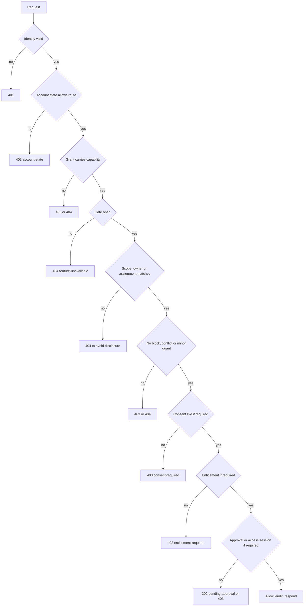

# 04 — Permission Matrix

Role by capability authorization for all 30 modules, plus the tenancy, delegation, separation-of-duties and break-glass rules that every cell depends on. Authorization is **deny by default**: a capability not granted here, or granted with a condition that is not met, is denied. [SRC: SSOT §5.4; USR-01 INV-T01] Module files refine each row into feature-level permissions and may only narrow a cell, never widen it; a module that needs a wider cell raises an `OD-`. Roles are defined in [03](03_PERSONAS_AND_ROLES.md); cross-cutting rules (`BR-XCT-`) in [06](06_BUSINESS_MODEL_AND_CROSS_MODULE_RULES.md).

## 1. How to read a cell

| Value | Meaning                                                                                                                                                                                  |
| ----- | ---------------------------------------------------------------------------------------------------------------------------------------------------------------------------------------- |
| `A`   | Allowed within the role's natural reach (for public data: anyone; for platform roles: platform-wide)                                                                                     |
| `O`   | Own only: the actor owns, authored, or is the subject of the resource                                                                                                                    |
| `S`   | Scoped: only within the tenant of the grant (the actor's org, institution, department)                                                                                                   |
| `P`   | Approval required: takes effect only after a second principal approves, or (for staff) only inside a reason-coded, time-boxed, audited access session tied to a ticket, case or incident |
| `—`   | Denied                                                                                                                                                                                   |
| `·`   | Not added by this role; the person has it through their `CAN` base grant in their personal context                                                                                       |

Modifiers appended to a value (several may combine, for example `Sce`):

| Modifier | Meaning                                                                                                                                                         |
| -------- | --------------------------------------------------------------------------------------------------------------------------------------------------------------- |
| `t`      | Only resources assigned to the actor: the hiring team of that job, the interview loop, the batch or cohort taught, the peer-review assignment, the event judged |
| `c`      | Only with a live consent scope from the subject or an application snapshot (`BR-XCT-012`); for `GUE`, only items the subject made public                        |
| `e`      | Also subject to an entitlement or quota from `BIL`; never affects ranking (`BR-XCT-020`)                                                                        |
| `g`      | Gated: denied until the named decision admits the capability (`OD-PRD-02` for OS-expansion modules, or the `OD-` in the row)                                    |

Columns: `GUE` Guest · `CAN` Candidate · `STD` Student · `INS` Instructor · `MNT` Mentor · `FRL` Freelancer · `REC` Recruiter · `HMG` Hiring manager · `EAD` Employer admin · `IAD` Institution admin · `PLO` Placement officer · `EXA` Enterprise talent / L&D admin · `MOD` Moderator · `SUP` Support agent · `FIN` Finance operator · `PAD` Platform admin · `SAD` Super admin / security officer · `API` Integration principal.

Variants (03 §1.1) narrow their canonical column: an `interviewer` has only the `HMG` cells marked `t` for one loop; a `viewer` has only `ATS.pipeline.metrics` and `JOB.job.view_public`; a `coordinator` has `INT.interview.schedule` and `MSG.application_thread` from the `REC` column; an `agency_recruiter` has `JOB.agency.submit` and `ATS.application.view` limited to submitted candidates; a `proctor` has only `ASM.proctor`; `org_owner` adds `EMP.ownership.transfer` and `BIL.org.subscribe`, which plain `org_admin` lacks; a `security_auditor` has only the read rows of the `SAD` column.

## 2. Evaluation order

Every request is decided server-side in this order; the first failing step denies. [SRC: SSOT §5.1 authorization chain; DER]

1. **Identity**: a valid session, or a valid referee token, or a valid API key. Client-supplied role, tenant or owner ids are ignored.
2. **Account state**: `suspended`, `deactivated`, `pending_erasure` accounts can only reach the routes their state allows (appeal, reactivate, cancel erasure, export).
3. **Grant**: the grant for the active context carries the capability in this matrix (or the `CAN` base does for the person's own data).
4. **Gate**: if the cell has `g`, the gating decision is closed in favor and the module flag is on.
5. **Scope**: the resource's tenant equals the grant's tenant (`S`), the actor is the owner or subject (`O`), or the actor is assigned (`t`).
6. **Relationship guards**: block list (`BR-XCT-017`), conflict-of-interest exclusions (`BR-XCT-059`), minor protections (`BR-XCT-071`).
7. **Consent**: for `c`, a live consent scope or application snapshot covering this resource and grantee, read at request time with no cache (`BR-XCT-008`).
8. **Entitlement**: for `e`, the quota or tool is available on the actor's or tenant's plan (`OD-PRD-08` decides whose).
9. **Approval or access session**: for `P`, a recorded approval by a different principal, or an open access session with ticket, reason and expiry.
10. **Rate limit and abuse controls** for the capability.
11. **Audit**: consequential actions and every `P` action write an audit record before the response is returned.

Denials for resources the actor must not know exist return `404`, not `403`, so the response does not disclose existence. [DER]

## 3. Matrix by module

218 capability rows across the 30 modules. Row keys are `<MODULE>.<resource>.<action>`; they are capability names for policy data and tests, not register ids.

### 3.1 IDN — Identity, Authentication & Account

| Capability                      | What it allows                                                         | GUE | CAN | STD | INS | MNT | FRL | REC | HMG | EAD | IAD | PLO | EXA | MOD | SUP | FIN | PAD | SAD | API |
| ------------------------------- | ---------------------------------------------------------------------- | --- | --- | --- | --- | --- | --- | --- | --- | --- | --- | --- | --- | --- | --- | --- | --- | --- | --- |
| `IDN.account.register`          | Create an account (email, passkey, OAuth)                              | A   | —   | —   | —   | —   | —   | —   | —   | —   | —   | —   | —   | —   | —   | —   | —   | —   | —   |
| `IDN.session.sign_in`           | Sign in, including enterprise SSO when the org enforces it             | A   | A   | A   | A   | A   | A   | A   | A   | A   | A   | A   | A   | A   | A   | A   | A   | A   | —   |
| `IDN.mfa.manage_own`            | Add or remove MFA factors and passkeys (mandatory for staff, EAD, IAD) | —   | O   | O   | O   | O   | O   | O   | O   | O   | O   | O   | O   | O   | O   | O   | O   | O   | —   |
| `IDN.session.revoke_own`        | List own devices and sign out sessions                                 | —   | O   | O   | O   | O   | O   | O   | O   | O   | O   | O   | O   | O   | O   | O   | O   | O   | —   |
| `IDN.account.deactivate_own`    | Deactivate or reactivate own account                                   | —   | O   | O   | ·   | ·   | ·   | ·   | ·   | ·   | ·   | ·   | ·   | —   | —   | —   | —   | —   | —   |
| `IDN.account.suspend_other`     | Suspend another account for policy reasons                             | —   | —   | —   | —   | —   | —   | —   | —   | —   | —   | —   | —   | P   | —   | —   | A   | A   | —   |
| `IDN.account.assisted_recovery` | Recover an account after identity proofing                             | —   | —   | —   | —   | —   | —   | —   | —   | —   | —   | —   | —   | —   | P   | —   | P   | A   | —   |
| `IDN.sso.configure`             | Configure OIDC/SAML SSO and enforcement for a tenant                   | —   | —   | —   | —   | —   | —   | —   | —   | S   | S   | —   | —   | —   | —   | —   | A   | —   | —   |
| `IDN.scim.provision`            | Provision and deprovision members by SCIM                              | —   | —   | —   | —   | —   | —   | —   | —   | S   | S   | —   | —   | —   | —   | —   | A   | —   | S   |
| `IDN.impersonate`               | Act as another user (never provided)                                   | —   | —   | —   | —   | —   | —   | —   | —   | —   | —   | —   | —   | —   | —   | —   | —   | —   | —   |

### 3.2 SET — Settings, Privacy, Consent & Data Rights

| Capability                       | What it allows                                                             | GUE | CAN | STD | INS | MNT | FRL | REC | HMG | EAD | IAD | PLO | EXA | MOD | SUP | FIN | PAD | SAD | API |
| -------------------------------- | -------------------------------------------------------------------------- | --- | --- | --- | --- | --- | --- | --- | --- | --- | --- | --- | --- | --- | --- | --- | --- | --- | --- |
| `SET.visibility.manage_own`      | Set profile, field and evidence visibility                                 | —   | O   | O   | ·   | ·   | ·   | ·   | ·   | ·   | ·   | ·   | ·   | —   | —   | —   | —   | —   | —   |
| `SET.consent.grant_revoke_own`   | Grant or revoke own consent scopes                                         | —   | O   | O   | ·   | ·   | ·   | ·   | ·   | ·   | ·   | ·   | ·   | —   | —   | —   | —   | —   | —   |
| `SET.consent.grant_for_other`    | Grant consent on behalf of another person (never provided)                 | —   | —   | —   | —   | —   | —   | —   | —   | —   | —   | —   | —   | —   | —   | —   | —   | —   | —   |
| `SET.dsr.file_own`               | File own export, erasure, rectification or restriction request             | —   | O   | O   | ·   | ·   | ·   | ·   | ·   | ·   | ·   | ·   | ·   | —   | —   | —   | —   | —   | —   |
| `SET.dsr.fulfil`                 | Complete a data-rights request after automated steps fail                  | —   | —   | —   | —   | —   | —   | —   | —   | —   | —   | —   | —   | —   | P   | —   | A   | P   | —   |
| `SET.consent_ledger.view_other`  | View another person's consent ledger                                       | —   | —   | —   | —   | —   | —   | —   | —   | —   | —   | —   | —   | —   | P   | —   | P   | A   | —   |
| `SET.legal_hold.place`           | Place or lift a legal hold on a subject's records                          | —   | —   | —   | —   | —   | —   | —   | —   | —   | —   | —   | —   | —   | —   | —   | P   | A   | —   |
| `SET.tenant_retention.configure` | Set retention for org- or institution-owned records within platform bounds | —   | —   | —   | —   | —   | —   | —   | —   | S   | S   | —   | —   | —   | —   | —   | A   | —   | —   |

### 3.3 NTF — Notifications & Communication Channels

| Capability                      | What it allows                                                               | GUE | CAN | STD | INS | MNT | FRL | REC | HMG | EAD | IAD | PLO | EXA | MOD | SUP | FIN | PAD | SAD | API |
| ------------------------------- | ---------------------------------------------------------------------------- | --- | --- | --- | --- | --- | --- | --- | --- | --- | --- | --- | --- | --- | --- | --- | --- | --- | --- |
| `NTF.preferences.manage_own`    | Set channels, digests, quiet hours per notification class                    | —   | O   | O   | ·   | ·   | ·   | ·   | ·   | ·   | ·   | ·   | ·   | O   | O   | O   | O   | O   | —   |
| `NTF.template.customize_tenant` | Customize candidate-facing templates (invite, rejection, offer) for a tenant | —   | —   | —   | —   | —   | —   | —   | —   | S   | S   | S   | S   | —   | —   | —   | A   | —   | —   |
| `NTF.broadcast.cohort`          | Send an announcement to an assigned cohort or batch                          | —   | —   | —   | St  | —   | —   | —   | —   | —   | S   | S   | —   | —   | —   | —   | —   | —   | —   |
| `NTF.broadcast.org`             | Send an announcement to org members                                          | —   | —   | —   | —   | —   | —   | —   | —   | S   | —   | —   | S   | —   | —   | —   | —   | —   | —   |
| `NTF.broadcast.platform`        | Send a platform-wide service announcement                                    | —   | —   | —   | —   | —   | —   | —   | —   | —   | —   | —   | —   | —   | —   | —   | P   | P   | —   |
| `NTF.delivery_log.view_other`   | View delivery log for another user's notifications                           | —   | —   | —   | —   | —   | —   | —   | —   | —   | —   | —   | —   | —   | P   | —   | A   | A   | —   |

### 3.4 REP — Gamification, Reputation & Recognition

| Capability                    | What it allows                                                      | GUE | CAN | STD | INS | MNT | FRL | REC | HMG | EAD | IAD | PLO | EXA | MOD | SUP | FIN | PAD | SAD | API |
| ----------------------------- | ------------------------------------------------------------------- | --- | --- | --- | --- | --- | --- | --- | --- | --- | --- | --- | --- | --- | --- | --- | --- | --- | --- |
| `REP.achievements.view_own`   | View own badges, XP and contextual reputation                       | —   | O   | O   | ·   | ·   | ·   | ·   | ·   | ·   | ·   | ·   | ·   | —   | —   | —   | —   | —   | —   |
| `REP.badge.display_toggle`    | Choose which badges appear on own profile                           | —   | O   | O   | ·   | ·   | ·   | ·   | ·   | ·   | ·   | ·   | ·   | —   | —   | —   | —   | —   | —   |
| `REP.badge_definition.create` | Define a badge for own course, event, program or employer challenge | —   | —   | —   | O   | —   | —   | —   | —   | S   | S   | —   | S   | —   | —   | —   | A   | —   | —   |
| `REP.reputation.view_other`   | View another person's contextual reputation signals                 | —   | A   | A   | ·   | ·   | ·   | Sc  | Sc  | —   | —   | —   | —   | —   | —   | —   | P   | —   | —   |
| `REP.leaderboard.view`        | View leaderboards (gated, OD-PRD-28)                                | Ag  | Ag  | Ag  | ·   | ·   | ·   | ·   | ·   | ·   | ·   | ·   | ·   | —   | —   | —   | A   | —   | —   |
| `REP.points.adjust`           | Reverse points or badges obtained by fraud                          | —   | —   | —   | —   | —   | —   | —   | —   | —   | —   | —   | —   | P   | —   | —   | P   | —   | —   |

### 3.5 PRF — Profile, Resume & Portfolio

| Capability                       | What it allows                                                            | GUE | CAN | STD | INS | MNT | FRL | REC | HMG | EAD | IAD | PLO | EXA | MOD | SUP | FIN | PAD | SAD | API |
| -------------------------------- | ------------------------------------------------------------------------- | --- | --- | --- | --- | --- | --- | --- | --- | --- | --- | --- | --- | --- | --- | --- | --- | --- | --- |
| `PRF.profile.edit_own`           | Create and edit own profile, experience, education, skills                | —   | O   | O   | ·   | ·   | ·   | ·   | ·   | ·   | ·   | ·   | ·   | —   | —   | —   | —   | —   | —   |
| `PRF.profile.view_public`        | View a profile page marked public                                         | A   | A   | A   | ·   | ·   | ·   | ·   | ·   | ·   | ·   | ·   | ·   | A   | A   | —   | A   | A   | —   |
| `PRF.profile.view_discoverable`  | View discoverable profile summaries (needs search.discoverable)           | —   | —   | —   | —   | —   | —   | Sc  | Sc  | —   | —   | Sc  | —   | —   | —   | —   | —   | —   | —   |
| `PRF.profile.view_cohort_member` | View cohort members' profiles within institution sharing                  | —   | —   | —   | Stc | —   | —   | —   | —   | —   | Sc  | Sc  | —   | —   | —   | —   | —   | —   | —   |
| `PRF.resume.variants`            | Create résumé variants (count above base is entitlement-gated)            | —   | Oe  | O   | ·   | ·   | ·   | ·   | ·   | ·   | ·   | ·   | ·   | —   | —   | —   | —   | —   | —   |
| `PRF.resume.import`              | Import and parse a résumé or LinkedIn export                              | —   | O   | O   | ·   | ·   | ·   | ·   | ·   | ·   | ·   | ·   | ·   | —   | —   | —   | —   | —   | —   |
| `PRF.portfolio.publish`          | Publish a portfolio project with artifacts                                | —   | O   | O   | ·   | ·   | ·   | ·   | ·   | ·   | ·   | ·   | ·   | —   | —   | —   | —   | —   | —   |
| `PRF.profile.view_support`       | View a user's profile in support context with ticket and reason           | —   | —   | —   | —   | —   | —   | —   | —   | —   | —   | —   | —   | P   | P   | —   | P   | A   | —   |
| `PRF.profile.edit_other`         | Edit another person's profile (never provided; takedown goes through TSF) | —   | —   | —   | —   | —   | —   | —   | —   | —   | —   | —   | —   | —   | —   | —   | —   | —   | —   |

### 3.6 EVD — Evidence, Work History & Credentials

| Capability                         | What it allows                                                                  | GUE | CAN | STD | INS | MNT | FRL | REC | HMG | EAD | IAD | PLO | EXA | MOD | SUP | FIN | PAD | SAD | API |
| ---------------------------------- | ------------------------------------------------------------------------------- | --- | --- | --- | --- | --- | --- | --- | --- | --- | --- | --- | --- | --- | --- | --- | --- | --- | --- |
| `EVD.evidence.create_own`          | Add a claim, artifact or link as own evidence                                   | —   | O   | O   | ·   | ·   | ·   | ·   | ·   | ·   | ·   | ·   | ·   | —   | —   | —   | —   | —   | —   |
| `EVD.evidence.view_other`          | Open another person's evidence artifact                                         | Ac  | —   | —   | St  | Oc  | —   | Sc  | Stc | —   | Sc  | Sc  | Sc  | P   | P   | —   | P   | P   | Sc  |
| `EVD.attest.instructor`            | Attest a learner's skill as issuer class instructor (instructor is not learner) | —   | —   | —   | St  | —   | —   | —   | —   | —   | —   | —   | —   | —   | —   | —   | —   | —   | —   |
| `EVD.credential.issue_institution` | Issue an institution credential to a learner of the institution                 | —   | —   | —   | —   | —   | —   | —   | —   | —   | S   | —   | —   | —   | —   | —   | —   | —   | S   |
| `EVD.credential.issue_employer`    | Confirm employment of a person who requested it from the verified org           | —   | —   | —   | —   | —   | —   | —   | —   | S   | —   | —   | —   | —   | —   | —   | —   | —   | —   |
| `EVD.credential.revoke_issued`     | Revoke a credential the actor's tenant or the actor issued, with reason         | —   | —   | —   | St  | —   | —   | —   | —   | S   | S   | —   | —   | —   | —   | —   | P   | —   | —   |
| `EVD.rung.override`                | Correct an evidence rung after a case decision                                  | —   | —   | —   | —   | —   | —   | —   | —   | —   | —   | —   | —   | —   | —   | —   | P   | P   | —   |
| `EVD.dispute.file`                 | Dispute a verification outcome on own evidence                                  | —   | O   | O   | ·   | ·   | ·   | ·   | ·   | ·   | ·   | ·   | ·   | —   | —   | —   | —   | —   | —   |

### 3.7 BGV — Verification & Background Checks

| Capability                   | What it allows                                         | GUE | CAN | STD | INS | MNT | FRL | REC | HMG | EAD | IAD | PLO | EXA | MOD | SUP | FIN | PAD | SAD | API |
| ---------------------------- | ------------------------------------------------------ | --- | --- | --- | --- | --- | --- | --- | --- | --- | --- | --- | --- | --- | --- | --- | --- | --- | --- |
| `BGV.referee.request`        | Request a referee to verify own work-history claim     | —   | O   | O   | ·   | ·   | ·   | ·   | ·   | ·   | ·   | ·   | ·   | —   | —   | —   | —   | —   | —   |
| `BGV.referee.respond`        | Respond to a verification request (referee token only) | A   | —   | —   | —   | —   | —   | —   | —   | —   | —   | —   | —   | —   | —   | —   | —   | —   | —   |
| `BGV.background.order`       | Order a background check on a candidate at offer stage | —   | —   | —   | —   | —   | —   | Pce | —   | Sce | —   | —   | —   | —   | —   | —   | —   | —   | —   |
| `BGV.background.consent`     | Consent to, review and dispute own background check    | —   | O   | O   | ·   | ·   | ·   | ·   | ·   | ·   | ·   | ·   | ·   | —   | —   | —   | —   | —   | —   |
| `BGV.background.view_result` | View the adjudication summary of a check               | —   | O   | O   | —   | —   | —   | Stc | Stc | Sc  | —   | —   | —   | —   | P   | —   | —   | —   | —   |
| `BGV.org_domain.verify`      | Approve an employer or institution verification        | —   | —   | —   | —   | —   | —   | —   | —   | O   | O   | —   | —   | —   | —   | —   | A   | —   | —   |
| `BGV.identity.verify_own`    | Verify own identity document (gated OD-PRD-26)         | —   | Og  | Og  | ·   | Og  | Og  | ·   | ·   | ·   | ·   | ·   | ·   | —   | —   | —   | —   | —   | —   |

### 3.8 SRC — Search & Discovery

| Capability                | What it allows                                   | GUE | CAN | STD | INS | MNT | FRL | REC | HMG | EAD | IAD | PLO | EXA | MOD | SUP | FIN | PAD | SAD | API |
| ------------------------- | ------------------------------------------------ | --- | --- | --- | --- | --- | --- | --- | --- | --- | --- | --- | --- | --- | --- | --- | --- | --- | --- |
| `SRC.jobs.search`         | Search and filter public jobs                    | A   | A   | A   | ·   | ·   | ·   | ·   | ·   | ·   | ·   | ·   | ·   | —   | —   | —   | A   | —   | S   |
| `SRC.courses.search`      | Search the course catalog                        | A   | A   | A   | ·   | ·   | ·   | ·   | ·   | ·   | ·   | ·   | ·   | —   | —   | —   | A   | —   | S   |
| `SRC.people.search`       | Search people (only discoverable or connections) | —   | A   | A   | ·   | ·   | ·   | Sce | Sc  | —   | —   | Sc  | —   | —   | —   | —   | —   | —   | —   |
| `SRC.saved_search.manage` | Save searches and alerts                         | —   | O   | O   | ·   | ·   | ·   | O   | O   | —   | —   | O   | —   | —   | —   | —   | —   | —   | —   |
| `SRC.taxonomy.curate`     | Edit skills, synonyms and occupation taxonomy    | —   | —   | —   | —   | —   | —   | —   | —   | —   | —   | —   | —   | —   | —   | —   | A   | —   | —   |
| `SRC.index.admin`         | Reindex, tune ranking weights (never by payment) | —   | —   | —   | —   | —   | —   | —   | —   | —   | —   | —   | —   | —   | —   | —   | P   | —   | —   |

### 3.9 LRN — Learning & Course Experience

| Capability                  | What it allows                                         | GUE | CAN | STD | INS | MNT | FRL | REC | HMG | EAD | IAD | PLO | EXA | MOD | SUP | FIN | PAD | SAD | API |
| --------------------------- | ------------------------------------------------------ | --- | --- | --- | --- | --- | --- | --- | --- | --- | --- | --- | --- | --- | --- | --- | --- | --- | --- |
| `LRN.catalog.browse`        | Browse catalog and preview lessons                     | A   | A   | A   | ·   | ·   | ·   | ·   | ·   | ·   | ·   | ·   | ·   | —   | —   | —   | A   | —   | S   |
| `LRN.enroll.free`           | Enroll in a free or licensed course                    | —   | O   | S   | ·   | ·   | ·   | ·   | ·   | ·   | ·   | ·   | ·   | —   | —   | —   | —   | —   | —   |
| `LRN.purchase`              | Buy a paid course (gated OD-PRD-04)                    | —   | Og  | —   | ·   | ·   | ·   | ·   | ·   | ·   | ·   | ·   | ·   | —   | —   | —   | —   | —   | —   |
| `LRN.progress.own`          | Track progress, notes, bookmarks; download for offline | —   | O   | O   | ·   | ·   | ·   | ·   | ·   | ·   | ·   | ·   | ·   | —   | —   | —   | —   | —   | —   |
| `LRN.qna.answer`            | Answer learner questions in a course                   | —   | —   | —   | O   | —   | —   | —   | —   | —   | —   | —   | —   | —   | —   | —   | —   | —   | —   |
| `LRN.review.write`          | Rate and review a course taken (never own course)      | —   | O   | O   | ·   | ·   | ·   | ·   | ·   | ·   | ·   | ·   | ·   | —   | —   | —   | —   | —   | —   |
| `LRN.assign`                | Assign a course to learners                            | —   | —   | —   | St  | —   | —   | —   | —   | —   | S   | —   | S   | —   | —   | —   | —   | —   | S   |
| `LRN.progress.view_learner` | View an individual learner's progress                  | —   | —   | —   | St  | Oc  | —   | —   | —   | —   | S   | Sc  | Sc  | —   | P   | —   | —   | —   | —   |

### 3.10 STU — Instructor Studio & Content Production

| Capability                   | What it allows                                          | GUE | CAN | STD | INS | MNT | FRL | REC | HMG | EAD | IAD | PLO | EXA | MOD | SUP | FIN | PAD | SAD | API |
| ---------------------------- | ------------------------------------------------------- | --- | --- | --- | --- | --- | --- | --- | --- | --- | --- | --- | --- | --- | --- | --- | --- | --- | --- |
| `STU.instructor.apply`       | Apply to become an instructor                           | —   | O   | —   | ·   | O   | O   | ·   | ·   | ·   | ·   | ·   | ·   | —   | —   | —   | —   | —   | —   |
| `STU.course.edit_draft`      | Create and edit a course draft                          | —   | —   | —   | O   | —   | —   | —   | —   | —   | S   | —   | S   | —   | —   | —   | —   | —   | —   |
| `STU.course.publish_public`  | Publish to the public catalog (needs content review)    | —   | —   | —   | P   | —   | —   | —   | —   | —   | P   | —   | —   | —   | —   | —   | A   | —   | —   |
| `STU.course.publish_private` | Publish to an institution or enterprise private catalog | —   | —   | —   | St  | —   | —   | —   | —   | —   | S   | —   | S   | —   | —   | —   | —   | —   | —   |
| `STU.course.review`          | Approve or return a course submitted for public review  | —   | —   | —   | —   | —   | —   | —   | —   | —   | —   | —   | —   | A   | —   | —   | A   | —   | —   |
| `STU.course.price`           | Set price and coupons (gated OD-PRD-04)                 | —   | —   | —   | Pg  | —   | —   | —   | —   | —   | Sg  | —   | —   | —   | —   | —   | A   | —   | —   |
| `STU.earnings.view`          | View own earnings and payouts (gated)                   | —   | —   | —   | Og  | —   | —   | —   | —   | —   | —   | —   | —   | —   | —   | A   | —   | —   | —   |
| `STU.coauthor.invite`        | Invite a co-author to a course                          | —   | —   | —   | O   | —   | —   | —   | —   | —   | S   | —   | S   | —   | —   | —   | —   | —   | —   |

### 3.11 ASM — Assessments, Challenges & Integrity

| Capability                  | What it allows                                              | GUE | CAN | STD | INS | MNT | FRL | REC | HMG | EAD | IAD | PLO | EXA | MOD | SUP | FIN | PAD | SAD | API |
| --------------------------- | ----------------------------------------------------------- | --- | --- | --- | --- | --- | --- | --- | --- | --- | --- | --- | --- | --- | --- | --- | --- | --- | --- |
| `ASM.attempt.take`          | Take a quiz, challenge or assessment                        | —   | O   | O   | ·   | ·   | ·   | ·   | ·   | ·   | ·   | ·   | ·   | —   | —   | —   | —   | —   | —   |
| `ASM.assessment.create`     | Create an assessment or challenge                           | —   | —   | —   | O   | —   | —   | S   | S   | S   | S   | —   | S   | —   | —   | —   | A   | —   | —   |
| `ASM.grade.rubric`          | Grade a submission against a rubric                         | —   | —   | —   | St  | —   | —   | St  | St  | —   | —   | —   | —   | —   | —   | —   | —   | —   | —   |
| `ASM.peer_review.do`        | Review an assigned peer submission (double-blind)           | —   | Ot  | Ot  | ·   | ·   | ·   | ·   | ·   | ·   | ·   | ·   | ·   | —   | —   | —   | —   | —   | —   |
| `ASM.ai_mode.set`           | Set the AI mode of an assessment (enforced server-side)     | —   | —   | —   | O   | —   | —   | S   | S   | S   | S   | —   | S   | —   | —   | —   | A   | —   | —   |
| `ASM.proctor`               | Invigilate an institution-run session (gated OD-PRD-15)     | —   | —   | —   | Stg | —   | —   | —   | —   | —   | Sg  | —   | —   | —   | —   | —   | —   | —   | —   |
| `ASM.integrity.review`      | Review an integrity flag and decide on a sanction           | —   | —   | —   | St  | —   | —   | —   | —   | —   | S   | —   | —   | P   | —   | —   | —   | —   | —   |
| `ASM.accommodation.request` | Request an accommodation (extra time, screen reader mode)   | —   | O   | O   | ·   | ·   | ·   | ·   | ·   | ·   | ·   | ·   | ·   | —   | —   | —   | —   | —   | —   |
| `ASM.accommodation.approve` | Approve an accommodation without disclosing it to employers | —   | —   | —   | St  | —   | —   | —   | —   | S   | S   | —   | S   | —   | —   | —   | A   | —   | —   |

### 3.12 JOB — Job Marketplace & Candidate Applications

| Capability                 | What it allows                                                              | GUE | CAN | STD | INS | MNT | FRL | REC | HMG | EAD | IAD | PLO | EXA | MOD | SUP | FIN | PAD | SAD | API |
| -------------------------- | --------------------------------------------------------------------------- | --- | --- | --- | --- | --- | --- | --- | --- | --- | --- | --- | --- | --- | --- | --- | --- | --- | --- |
| `JOB.job.view_public`      | View a published job                                                        | A   | A   | A   | ·   | ·   | ·   | ·   | ·   | ·   | ·   | ·   | ·   | A   | A   | —   | A   | A   | S   |
| `JOB.application.submit`   | Apply with a consented evidence snapshot                                    | —   | O   | P   | ·   | ·   | ·   | ·   | ·   | ·   | ·   | ·   | ·   | —   | —   | —   | —   | —   | —   |
| `JOB.application.withdraw` | Withdraw own application                                                    | —   | O   | O   | ·   | ·   | ·   | ·   | ·   | ·   | ·   | ·   | ·   | —   | —   | —   | —   | —   | —   |
| `JOB.job.create_draft`     | Create a job draft                                                          | —   | —   | —   | —   | —   | —   | S   | S   | S   | —   | —   | S   | —   | —   | —   | —   | —   | S   |
| `JOB.job.publish`          | Publish a job (job slots entitlement; org may require requisition approval) | —   | —   | —   | —   | —   | —   | Se  | —   | Se  | —   | —   | Sg  | —   | —   | —   | —   | —   | Se  |
| `JOB.job.close`            | Close, pause or reopen a job                                                | —   | —   | —   | —   | —   | —   | St  | St  | S   | —   | —   | —   | —   | —   | —   | —   | —   | S   |
| `JOB.job.report`           | Report a job as fraudulent or discriminatory                                | A   | A   | A   | ·   | ·   | ·   | ·   | ·   | ·   | ·   | ·   | ·   | —   | —   | —   | —   | —   | —   |
| `JOB.job.takedown`         | Take down a job for policy breach                                           | —   | —   | —   | —   | —   | —   | —   | —   | —   | —   | —   | —   | A   | —   | —   | A   | —   | —   |
| `JOB.agency.submit`        | Submit a consenting candidate to an engaged client job                      | —   | —   | —   | —   | —   | —   | Sc  | —   | —   | —   | —   | —   | —   | —   | —   | —   | —   | —   |
| `JOB.alerts.manage`        | Save jobs and manage job alerts                                             | —   | O   | O   | ·   | ·   | ·   | ·   | ·   | ·   | ·   | ·   | ·   | —   | —   | —   | —   | —   | —   |

### 3.13 ATS — Recruiter Workspace & Hiring Pipeline

| Capability                | What it allows                                           | GUE | CAN | STD | INS | MNT | FRL | REC | HMG | EAD | IAD | PLO | EXA | MOD | SUP | FIN | PAD | SAD | API |
| ------------------------- | -------------------------------------------------------- | --- | --- | --- | --- | --- | --- | --- | --- | --- | --- | --- | --- | --- | --- | --- | --- | --- | --- |
| `ATS.application.view`    | Read application content for a job                       | —   | —   | —   | —   | —   | —   | St  | St  | —   | —   | Sc  | —   | —   | P   | —   | —   | —   | Sc  |
| `ATS.pipeline.metrics`    | View pipeline counts and funnel for the org              | —   | —   | —   | —   | —   | —   | S   | St  | S   | —   | —   | —   | —   | —   | —   | —   | —   | —   |
| `ATS.stage.move`          | Move a stage or reject with a reason code (human action) | —   | —   | —   | —   | —   | —   | St  | St  | —   | —   | —   | —   | —   | —   | —   | —   | —   | Sc  |
| `ATS.note.add`            | Add a private evaluative note                            | —   | —   | —   | —   | —   | —   | St  | St  | —   | —   | —   | —   | —   | —   | —   | —   | —   | —   |
| `ATS.pipeline.template`   | Configure pipeline templates and reason codes            | —   | —   | —   | —   | —   | —   | S   | —   | S   | —   | —   | —   | —   | —   | —   | —   | —   | —   |
| `ATS.requisition.create`  | Create a requisition                                     | —   | —   | —   | —   | —   | —   | S   | S   | —   | —   | —   | S   | —   | —   | —   | —   | —   | S   |
| `ATS.requisition.approve` | Approve a requisition (approver is not requester)        | —   | —   | —   | —   | —   | —   | —   | Pt  | P   | —   | —   | —   | —   | —   | —   | —   | —   | —   |
| `ATS.offer.create`        | Draft an offer                                           | —   | —   | —   | —   | —   | —   | St  | —   | —   | —   | —   | —   | —   | —   | —   | —   | —   | —   |
| `ATS.offer.approve`       | Approve an offer in the approval chain                   | —   | —   | —   | —   | —   | —   | —   | Pt  | P   | —   | —   | —   | —   | —   | —   | —   | —   | —   |
| `ATS.export`              | Export candidate data from a job (audited)               | —   | —   | —   | —   | —   | —   | Pt  | —   | P   | —   | —   | —   | —   | —   | —   | —   | —   | —   |

### 3.14 INT — Interviews & Scheduling

| Capability                  | What it allows                                       | GUE | CAN | STD | INS | MNT | FRL | REC | HMG | EAD | IAD | PLO | EXA | MOD | SUP | FIN | PAD | SAD | API |
| --------------------------- | ---------------------------------------------------- | --- | --- | --- | --- | --- | --- | --- | --- | --- | --- | --- | --- | --- | --- | --- | --- | --- | --- |
| `INT.interview.schedule`    | Create an interview loop, panel and slots            | —   | —   | —   | —   | —   | —   | St  | St  | —   | —   | St  | —   | —   | —   | —   | —   | —   | —   |
| `INT.slot.self_schedule`    | Pick, reschedule or cancel own interview slot        | —   | O   | O   | ·   | ·   | ·   | ·   | ·   | ·   | ·   | ·   | ·   | —   | —   | —   | —   | —   | —   |
| `INT.scorecard.submit`      | Submit own scorecard for an assigned interview       | —   | —   | —   | —   | —   | —   | St  | St  | —   | —   | —   | —   | —   | —   | —   | —   | —   | —   |
| `INT.scorecard.view_others` | See other scorecards (only after submitting own)     | —   | —   | —   | —   | —   | —   | St  | Pt  | —   | —   | —   | —   | —   | —   | —   | —   | —   | —   |
| `INT.recording.enable`      | Record an interview (all-party consent, default off) | —   | —   | —   | —   | —   | —   | Pc  | Pc  | —   | —   | —   | —   | —   | —   | —   | —   | —   | —   |
| `INT.calendar.connect`      | Connect own calendar for availability                | —   | O   | O   | ·   | O   | O   | O   | O   | O   | O   | O   | O   | —   | —   | —   | —   | —   | —   |

### 3.15 EMP — Employer Organisation, Teams & Brand

| Capability               | What it allows                                                   | GUE | CAN | STD | INS | MNT | FRL | REC | HMG | EAD | IAD | PLO | EXA | MOD | SUP | FIN | PAD | SAD | API |
| ------------------------ | ---------------------------------------------------------------- | --- | --- | --- | --- | --- | --- | --- | --- | --- | --- | --- | --- | --- | --- | --- | --- | --- | --- |
| `EMP.org.create`         | Create an employer org and become its owner                      | —   | A   | —   | ·   | ·   | ·   | ·   | ·   | ·   | ·   | ·   | ·   | —   | —   | —   | —   | —   | —   |
| `EMP.member.manage`      | Invite members, assign roles below owner, remove members         | —   | —   | —   | —   | —   | —   | —   | —   | S   | —   | —   | —   | —   | —   | —   | —   | —   | S   |
| `EMP.ownership.transfer` | Transfer org ownership to an accepting admin                     | —   | —   | —   | —   | —   | —   | —   | —   | O   | —   | —   | —   | —   | —   | —   | —   | —   | —   |
| `EMP.brand.edit`         | Edit the employer brand page                                     | —   | —   | —   | —   | —   | —   | S   | —   | S   | —   | —   | —   | —   | —   | —   | —   | —   | —   |
| `EMP.review.write`       | Write a company review (gated OD-PRD-17; never own org as admin) | —   | Og  | —   | ·   | ·   | ·   | ·   | ·   | ·   | ·   | ·   | ·   | —   | —   | —   | —   | —   | —   |
| `EMP.review.respond`     | Respond publicly to a review of own org                          | —   | —   | —   | —   | —   | —   | —   | —   | S   | —   | —   | —   | —   | —   | —   | —   | —   | —   |
| `EMP.agency.engage`      | Accept or end an agency engagement                               | —   | —   | —   | —   | —   | —   | —   | —   | S   | —   | —   | —   | —   | —   | —   | —   | —   | —   |
| `EMP.audit.view`         | View the org audit log                                           | —   | —   | —   | —   | —   | —   | —   | —   | S   | —   | —   | —   | —   | —   | —   | A   | A   | —   |

### 3.16 NET — Networking, Community & Referrals

| Capability                 | What it allows                                          | GUE | CAN | STD | INS | MNT | FRL | REC | HMG | EAD | IAD | PLO | EXA | MOD | SUP | FIN | PAD | SAD | API |
| -------------------------- | ------------------------------------------------------- | --- | --- | --- | --- | --- | --- | --- | --- | --- | --- | --- | --- | --- | --- | --- | --- | --- | --- |
| `NET.connection.request`   | Send, accept or remove a connection                     | —   | O   | O   | ·   | ·   | ·   | ·   | ·   | ·   | ·   | ·   | ·   | —   | —   | —   | —   | —   | —   |
| `NET.referral.request`     | Ask a connection at an org for a referral               | —   | O   | P   | ·   | ·   | ·   | ·   | ·   | ·   | ·   | ·   | ·   | —   | —   | —   | —   | —   | —   |
| `NET.referral.give`        | Refer a connection to an org job (verified member only) | —   | O   | —   | ·   | ·   | ·   | ·   | ·   | ·   | ·   | ·   | ·   | —   | —   | —   | —   | —   | —   |
| `NET.post.create`          | Create a community post or article (gated OD-PRD-16)    | —   | Og  | Og  | ·   | ·   | ·   | ·   | ·   | ·   | ·   | ·   | ·   | —   | —   | —   | —   | —   | —   |
| `NET.group.manage`         | Create or moderate a community group (gated)            | —   | Og  | —   | Og  | ·   | ·   | ·   | ·   | ·   | S   | —   | —   | A   | —   | —   | A   | —   | —   |
| `NET.referral_bonus.track` | Track referral bonus eligibility (gated OD-PRD-27)      | —   | —   | —   | —   | —   | —   | Sg  | —   | Sg  | —   | —   | —   | —   | —   | —   | —   | —   | —   |

### 3.17 MSG — Messaging & Real-time Communication

| Capability                   | What it allows                                                        | GUE | CAN | STD | INS | MNT | FRL | REC | HMG | EAD | IAD | PLO | EXA | MOD | SUP | FIN | PAD | SAD | API |
| ---------------------------- | --------------------------------------------------------------------- | --- | --- | --- | --- | --- | --- | --- | --- | --- | --- | --- | --- | --- | --- | --- | --- | --- | --- |
| `MSG.application_thread`     | Message within an application thread                                  | —   | O   | O   | ·   | ·   | ·   | St  | St  | —   | —   | —   | —   | —   | —   | —   | —   | —   | —   |
| `MSG.outreach.first_contact` | Send a first-contact request (consent and quota)                      | —   | —   | —   | —   | —   | —   | Sce | —   | —   | —   | —   | —   | —   | —   | —   | —   | —   | —   |
| `MSG.connection.message`     | Message a connection or accepted contact                              | —   | O   | O   | ·   | ·   | ·   | ·   | ·   | ·   | ·   | ·   | ·   | —   | —   | —   | —   | —   | —   |
| `MSG.cohort.message`         | Message an assigned cohort or batch channel                           | —   | —   | —   | St  | —   | —   | —   | —   | —   | S   | S   | —   | —   | —   | —   | —   | —   | —   |
| `MSG.mentor.thread`          | Message within a mentoring booking (gated)                            | —   | Og  | Og  | ·   | Og  | ·   | ·   | ·   | ·   | ·   | ·   | ·   | —   | —   | —   | —   | —   | —   |
| `MSG.view_other`             | Read a thread one is not part of (reported threads, ticket, incident) | —   | —   | —   | —   | —   | —   | —   | —   | —   | —   | —   | —   | P   | P   | —   | —   | P   | —   |
| `MSG.block`                  | Block a user                                                          | —   | O   | O   | ·   | ·   | ·   | ·   | ·   | ·   | ·   | ·   | ·   | —   | —   | —   | —   | —   | —   |

### 3.18 AIC — AI Career Assistant, Matching & Recommendations

| Capability                 | What it allows                                                       | GUE | CAN | STD | INS | MNT | FRL | REC | HMG | EAD | IAD | PLO | EXA | MOD | SUP | FIN | PAD | SAD | API |
| -------------------------- | -------------------------------------------------------------------- | --- | --- | --- | --- | --- | --- | --- | --- | --- | --- | --- | --- | --- | --- | --- | --- | --- | --- |
| `AIC.assistant.use`        | Use the career assistant (consent ai.assist.process and cost policy) | —   | Oce | Oc  | Oce | Oce | Oce | Sce | Sce | —   | —   | —   | —   | —   | —   | —   | —   | —   | —   |
| `AIC.match.explain_own`    | See match explanations for own recommendations                       | —   | O   | O   | ·   | ·   | ·   | ·   | ·   | ·   | ·   | ·   | ·   | —   | —   | —   | —   | —   | —   |
| `AIC.suggested_order.view` | See advisory suggested order with rationale for a job                | —   | —   | —   | —   | —   | —   | St  | St  | —   | —   | —   | —   | —   | —   | —   | —   | —   | —   |
| `AIC.memory.manage_own`    | View and delete own AI memory                                        | —   | O   | O   | ·   | ·   | ·   | ·   | ·   | ·   | ·   | ·   | ·   | —   | —   | —   | —   | —   | —   |
| `AIC.provider.configure`   | Configure AI providers and cost policies (two-person)                | —   | —   | —   | —   | —   | —   | —   | —   | —   | —   | —   | —   | —   | —   | —   | P   | P   | —   |
| `AIC.auto_reject`          | Reject or rank out candidates automatically (never provided)         | —   | —   | —   | —   | —   | —   | —   | —   | —   | —   | —   | —   | —   | —   | —   | —   | —   | —   |

### 3.19 TSF — Trust, Safety & Moderation

| Capability                  | What it allows                                        | GUE | CAN | STD | INS | MNT | FRL | REC | HMG | EAD | IAD | PLO | EXA | MOD | SUP | FIN | PAD | SAD | API |
| --------------------------- | ----------------------------------------------------- | --- | --- | --- | --- | --- | --- | --- | --- | --- | --- | --- | --- | --- | --- | --- | --- | --- | --- |
| `TSF.report.file`           | Report content, a user, a job or a message            | A   | A   | A   | ·   | ·   | ·   | ·   | ·   | ·   | ·   | ·   | ·   | —   | —   | —   | —   | —   | —   |
| `TSF.report.action`         | Review a report and take an action with reason code   | —   | —   | —   | St  | —   | —   | —   | —   | —   | S   | —   | —   | A   | —   | —   | P   | —   | —   |
| `TSF.appeal.file`           | Appeal an action taken against own content or account | —   | O   | O   | ·   | ·   | ·   | ·   | ·   | ·   | ·   | ·   | ·   | —   | —   | —   | —   | —   | —   |
| `TSF.appeal.decide`         | Decide an appeal (different moderator)                | —   | —   | —   | —   | —   | —   | —   | —   | —   | —   | —   | —   | P   | —   | —   | —   | —   | —   |
| `TSF.policy.configure`      | Configure policy rules and automated filters          | —   | —   | —   | —   | —   | —   | —   | —   | —   | —   | —   | —   | —   | —   | —   | P   | —   | —   |
| `TSF.investigation.linkage` | Investigate linked accounts for fraud rings           | —   | —   | —   | —   | —   | —   | —   | —   | —   | —   | —   | —   | P   | —   | —   | —   | A   | —   |

### 3.20 INS — Institutions & Managed Learning

| Capability                | What it allows                                           | GUE | CAN | STD | INS | MNT | FRL | REC | HMG | EAD | IAD | PLO | EXA | MOD | SUP | FIN | PAD | SAD | API |
| ------------------------- | -------------------------------------------------------- | --- | --- | --- | --- | --- | --- | --- | --- | --- | --- | --- | --- | --- | --- | --- | --- | --- | --- |
| `INS.institution.create`  | Create an institution (platform verification follows)    | —   | A   | —   | ·   | ·   | ·   | ·   | ·   | ·   | ·   | ·   | ·   | —   | —   | —   | —   | —   | —   |
| `INS.learner.provision`   | Provision learners by CSV or SIS                         | —   | —   | —   | —   | —   | —   | —   | —   | —   | S   | —   | —   | —   | —   | —   | —   | —   | S   |
| `INS.cohort.manage`       | Create cohorts and batches; assign faculty               | —   | —   | —   | —   | —   | —   | —   | —   | —   | S   | —   | —   | —   | —   | —   | —   | —   | —   |
| `INS.analytics.cohort`    | View k-anonymous cohort analytics                        | —   | —   | —   | St  | —   | —   | —   | —   | —   | S   | S   | —   | —   | —   | —   | —   | —   | —   |
| `INS.learner.view_record` | View an individual learner record (institution-run work) | —   | —   | —   | St  | —   | —   | —   | —   | —   | S   | Sc  | —   | —   | P   | —   | —   | —   | —   |
| `INS.graduation.run`      | Run graduation and identity transfer                     | —   | —   | —   | —   | —   | —   | —   | —   | —   | S   | —   | —   | —   | —   | —   | —   | —   | —   |
| `INS.drive.manage`        | Create and manage a placement drive                      | —   | —   | —   | —   | —   | —   | —   | —   | —   | S   | S   | —   | —   | —   | —   | —   | —   | —   |
| `INS.drive.participate`   | Participate in a drive as an employer                    | —   | —   | —   | —   | —   | —   | Sc  | Sc  | S   | —   | —   | —   | —   | —   | —   | —   | —   | —   |
| `INS.outcomes.view`       | View placement outcomes (alumni.share_outcomes)          | —   | —   | —   | —   | —   | —   | —   | —   | —   | Sc  | Sc  | —   | —   | —   | —   | —   | —   | —   |

### 3.21 BIL — Billing, Plans & Entitlements

| Capability                | What it allows                                                            | GUE | CAN | STD | INS | MNT | FRL | REC | HMG | EAD | IAD | PLO | EXA | MOD | SUP | FIN | PAD | SAD | API |
| ------------------------- | ------------------------------------------------------------------------- | --- | --- | --- | --- | --- | --- | --- | --- | --- | --- | --- | --- | --- | --- | --- | --- | --- | --- |
| `BIL.plans.view`          | View plans and what each includes                                         | A   | A   | A   | ·   | ·   | ·   | ·   | ·   | ·   | ·   | ·   | ·   | —   | —   | A   | A   | —   | —   |
| `BIL.candidate.subscribe` | Buy, change or cancel a personal plan                                     | —   | O   | O   | ·   | ·   | ·   | ·   | ·   | ·   | ·   | ·   | ·   | —   | —   | —   | —   | —   | —   |
| `BIL.org.subscribe`       | Manage org subscription, seats, payment method (owner or billing manager) | —   | —   | —   | —   | —   | —   | —   | —   | S   | —   | —   | —   | —   | —   | —   | —   | —   | —   |
| `BIL.institution.licence` | Buy and manage institution seat licences                                  | —   | —   | —   | —   | —   | —   | —   | —   | —   | S   | —   | —   | —   | —   | —   | —   | —   | —   |
| `BIL.invoice.view`        | View invoices and receipts                                                | —   | O   | O   | ·   | ·   | ·   | ·   | ·   | S   | S   | —   | —   | —   | —   | A   | —   | —   | —   |
| `BIL.refund.request`      | Request a refund                                                          | —   | O   | O   | ·   | ·   | ·   | ·   | ·   | S   | S   | —   | —   | —   | —   | —   | —   | —   | —   |
| `BIL.refund.issue`        | Issue a refund (second operator above threshold)                          | —   | —   | —   | —   | —   | —   | —   | —   | —   | —   | —   | —   | —   | —   | P   | —   | —   | —   |
| `BIL.payout.setup`        | Complete payee KYC and tax details (gated)                                | —   | —   | —   | Og  | Og  | Og  | —   | —   | —   | —   | —   | —   | —   | —   | —   | —   | —   | —   |
| `BIL.payout.run`          | Approve a payout batch (gated; creator is not approver)                   | —   | —   | —   | —   | —   | —   | —   | —   | —   | —   | —   | —   | —   | —   | Pg  | —   | —   | —   |
| `BIL.catalog.edit`        | Create a new plan or price version                                        | —   | —   | —   | —   | —   | —   | —   | —   | —   | —   | —   | —   | —   | —   | P   | P   | —   | —   |
| `BIL.comp.grant`          | Grant a complimentary entitlement                                         | —   | —   | —   | —   | —   | —   | —   | —   | —   | —   | —   | —   | —   | —   | P   | P   | —   | —   |

### 3.22 MEN — Mentorship, Coaching & Career Services (gated)

| Capability                 | What it allows                                | GUE | CAN | STD | INS | MNT | FRL | REC | HMG | EAD | IAD | PLO | EXA | MOD | SUP | FIN | PAD | SAD | API |
| -------------------------- | --------------------------------------------- | --- | --- | --- | --- | --- | --- | --- | --- | --- | --- | --- | --- | --- | --- | --- | --- | --- | --- |
| `MEN.mentor.browse`        | Browse mentors and offerings                  | Ag  | Ag  | Ag  | ·   | ·   | ·   | ·   | ·   | ·   | ·   | ·   | ·   | —   | —   | —   | A   | —   | —   |
| `MEN.offering.publish`     | Publish a mentoring offering and availability | —   | —   | —   | —   | Og  | —   | —   | —   | —   | —   | —   | —   | —   | —   | —   | —   | —   | —   |
| `MEN.session.book`         | Book, reschedule or cancel a session          | —   | Og  | Og  | ·   | ·   | ·   | ·   | ·   | ·   | ·   | ·   | ·   | —   | —   | —   | —   | —   | —   |
| `MEN.notes.write`          | Write private session notes; share a summary  | —   | —   | —   | —   | Og  | —   | —   | —   | —   | —   | —   | —   | —   | —   | —   | —   | —   | —   |
| `MEN.evidence.view_shared` | View evidence the mentee shared for a booking | —   | —   | —   | —   | Ocg | —   | —   | —   | —   | —   | —   | —   | —   | —   | —   | —   | —   | —   |
| `MEN.mentor.approve`       | Approve a mentor application                  | —   | —   | —   | —   | —   | —   | —   | —   | —   | —   | —   | —   | Ag  | —   | —   | Ag  | —   | —   |

### 3.23 GIG — Freelance, Contract & Project Work (gated)

| Capability              | What it allows                                      | GUE | CAN | STD | INS | MNT | FRL | REC | HMG | EAD | IAD | PLO | EXA | MOD | SUP | FIN | PAD | SAD | API |
| ----------------------- | --------------------------------------------------- | --- | --- | --- | --- | --- | --- | --- | --- | --- | --- | --- | --- | --- | --- | --- | --- | --- | --- |
| `GIG.mode.enable`       | Turn on gig mode and accept freelancer terms        | —   | Og  | —   | ·   | ·   | ·   | ·   | ·   | ·   | ·   | ·   | ·   | —   | —   | —   | —   | —   | —   |
| `GIG.offering.publish`  | Publish a service offering                          | —   | —   | —   | —   | —   | Og  | —   | —   | —   | —   | —   | —   | —   | —   | —   | —   | —   | —   |
| `GIG.project.post`      | Post a project as a client                          | —   | Og  | —   | ·   | ·   | ·   | Sg  | —   | Sg  | —   | —   | —   | —   | —   | —   | —   | —   | —   |
| `GIG.proposal.submit`   | Submit a proposal                                   | —   | —   | —   | —   | —   | Og  | —   | —   | —   | —   | —   | —   | —   | —   | —   | —   | —   | —   |
| `GIG.contract.accept`   | Accept a proposal and fund a milestone as client    | —   | Og  | —   | ·   | ·   | ·   | Sg  | —   | Sg  | —   | —   | —   | —   | —   | —   | —   | —   | —   |
| `GIG.milestone.approve` | Approve or object to a delivered milestone (client) | —   | Og  | —   | ·   | ·   | ·   | Sg  | —   | Sg  | —   | —   | —   | —   | —   | —   | —   | —   | —   |
| `GIG.dispute.file`      | Open a dispute on a contract one is party to        | —   | Og  | —   | ·   | ·   | Og  | Sg  | —   | Sg  | —   | —   | —   | —   | —   | —   | —   | —   | —   |
| `GIG.dispute.resolve`   | Resolve a dispute and direct funds                  | —   | —   | —   | —   | —   | —   | —   | —   | —   | —   | —   | —   | —   | Pg  | Pg  | —   | —   | —   |

### 3.24 EVT — Events, Hackathons & Community Programmes (gated)

| Capability            | What it allows                                   | GUE | CAN | STD | INS | MNT | FRL | REC | HMG | EAD | IAD | PLO | EXA | MOD | SUP | FIN | PAD | SAD | API |
| --------------------- | ------------------------------------------------ | --- | --- | --- | --- | --- | --- | --- | --- | --- | --- | --- | --- | --- | --- | --- | --- | --- | --- |
| `EVT.event.browse`    | Browse public events                             | Ag  | Ag  | Ag  | ·   | ·   | ·   | ·   | ·   | ·   | ·   | ·   | ·   | —   | —   | —   | A   | —   | —   |
| `EVT.event.register`  | Register, form or join a team, submit            | —   | Og  | Og  | ·   | ·   | ·   | ·   | ·   | ·   | ·   | ·   | ·   | —   | —   | —   | —   | —   | —   |
| `EVT.event.create`    | Create and run an event or hackathon             | —   | —   | —   | Og  | —   | —   | —   | —   | Sg  | Sg  | Sg  | Sg  | —   | —   | —   | Ag  | —   | —   |
| `EVT.judge.score`     | Score submissions as an invited judge            | —   | Otg | —   | ·   | ·   | ·   | ·   | ·   | ·   | ·   | ·   | ·   | —   | —   | —   | —   | —   | —   |
| `EVT.results.publish` | Publish results and issue participation evidence | —   | —   | —   | Og  | —   | —   | —   | —   | Sg  | Sg  | Sg  | Sg  | —   | —   | —   | Ag  | —   | —   |

### 3.25 MKT — Market Intelligence & Career Pathing (gated)

| Capability           | What it allows                                | GUE | CAN | STD | INS | MNT | FRL | REC | HMG | EAD | IAD | PLO | EXA | MOD | SUP | FIN | PAD | SAD | API |
| -------------------- | --------------------------------------------- | --- | --- | --- | --- | --- | --- | --- | --- | --- | --- | --- | --- | --- | --- | --- | --- | --- | --- |
| `MKT.paths.view`     | View career paths and skill demand            | Ag  | Ag  | Ag  | ·   | ·   | ·   | ·   | ·   | ·   | ·   | ·   | ·   | —   | —   | —   | A   | —   | —   |
| `MKT.salary.view`    | View k-anonymous salary benchmarks            | —   | Ag  | Ag  | ·   | ·   | ·   | Sge | Sge | Sge | Sg  | Sg  | Sg  | —   | —   | —   | A   | —   | —   |
| `MKT.salary.submit`  | Submit an anonymous salary report             | —   | Og  | —   | ·   | ·   | ·   | ·   | ·   | ·   | ·   | ·   | ·   | —   | —   | —   | —   | —   | —   |
| `MKT.dataset.manage` | Manage labour-market datasets and suppression | —   | —   | —   | —   | —   | —   | —   | —   | —   | —   | —   | —   | —   | —   | —   | Ag  | —   | —   |

### 3.26 ENT — Enterprise Talent: Internal Mobility, Skills & L&D (gated)

| Capability                | What it allows                                            | GUE | CAN | STD | INS | MNT | FRL | REC | HMG | EAD | IAD | PLO | EXA | MOD | SUP | FIN | PAD | SAD | API |
| ------------------------- | --------------------------------------------------------- | --- | --- | --- | --- | --- | --- | --- | --- | --- | --- | --- | --- | --- | --- | --- | --- | --- | --- |
| `ENT.internal_role.post`  | Post an internal role                                     | —   | —   | —   | —   | —   | —   | Sg  | Sg  | —   | —   | —   | Sg  | —   | —   | —   | —   | —   | —   |
| `ENT.internal_role.apply` | Apply internally as an employee (confidential per policy) | —   | Sg  | —   | ·   | ·   | ·   | ·   | ·   | ·   | ·   | ·   | ·   | —   | —   | —   | —   | —   | —   |
| `ENT.skills.inventory`    | View aggregate skills inventory                           | —   | —   | —   | —   | —   | —   | —   | Stg | —   | —   | —   | Sg  | —   | —   | —   | —   | —   | —   |
| `ENT.learning.mandate`    | Assign mandatory learning and track completion            | —   | —   | —   | —   | —   | —   | —   | —   | —   | —   | —   | Sg  | —   | —   | —   | —   | —   | —   |
| `ENT.hris.sync`           | Sync org structure and completions with an HRIS           | —   | —   | —   | —   | —   | —   | —   | —   | Sg  | —   | —   | Sg  | —   | —   | —   | —   | —   | Sg  |

### 3.27 ANL — Analytics, Reporting & Insights

| Capability             | What it allows                                   | GUE | CAN | STD | INS | MNT | FRL | REC | HMG | EAD | IAD | PLO | EXA | MOD | SUP | FIN | PAD | SAD | API |
| ---------------------- | ------------------------------------------------ | --- | --- | --- | --- | --- | --- | --- | --- | --- | --- | --- | --- | --- | --- | --- | --- | --- | --- |
| `ANL.personal.view`    | View own analytics (views, funnel, course stats) | —   | O   | O   | O   | O   | O   | ·   | ·   | ·   | ·   | ·   | ·   | —   | —   | —   | —   | —   | —   |
| `ANL.org.view`         | View org hiring analytics                        | —   | —   | —   | —   | —   | —   | St  | St  | S   | —   | —   | S   | —   | —   | —   | —   | —   | —   |
| `ANL.institution.view` | View institution analytics (k-anonymous)         | —   | —   | —   | St  | —   | —   | —   | —   | —   | S   | S   | —   | —   | —   | —   | —   | —   | —   |
| `ANL.platform.view`    | View platform analytics                          | —   | —   | —   | —   | —   | —   | —   | —   | —   | —   | —   | —   | —   | —   | A   | A   | A   | —   |
| `ANL.metric.define`    | Define or change a metric definition             | —   | —   | —   | —   | —   | —   | —   | —   | —   | —   | —   | —   | —   | —   | —   | A   | —   | —   |
| `ANL.raw_export`       | Export event-level data with personal data       | —   | —   | —   | —   | —   | —   | —   | —   | —   | —   | —   | —   | —   | —   | —   | P   | P   | —   |

### 3.28 ADM — Admin Console, Support & Operations

| Capability                  | What it allows                                                   | GUE | CAN | STD | INS | MNT | FRL | REC | HMG | EAD | IAD | PLO | EXA | MOD | SUP | FIN | PAD | SAD | API |
| --------------------------- | ---------------------------------------------------------------- | --- | --- | --- | --- | --- | --- | --- | --- | --- | --- | --- | --- | --- | --- | --- | --- | --- | --- |
| `ADM.console.access`        | Open the admin console area for own staff role                   | —   | —   | —   | —   | —   | —   | —   | —   | —   | —   | —   | —   | A   | A   | A   | A   | A   | —   |
| `ADM.support_view.open`     | Open a time-boxed support view of an account (ticket and reason) | —   | —   | —   | —   | —   | —   | —   | —   | —   | —   | —   | —   | —   | P   | —   | P   | A   | —   |
| `ADM.ticket.manage`         | Create and follow own support tickets                            | —   | O   | O   | ·   | ·   | ·   | ·   | ·   | ·   | ·   | ·   | ·   | —   | —   | —   | —   | —   | —   |
| `ADM.flag.manage`           | Change a production feature flag (kill switch one-person)        | —   | —   | —   | —   | —   | —   | —   | —   | —   | —   | —   | —   | —   | —   | —   | P   | A   | —   |
| `ADM.role.grant_privileged` | Grant MOD, SUP, FIN, PAD or SAD (two-person)                     | —   | —   | —   | —   | —   | —   | —   | —   | —   | —   | —   | —   | —   | —   | —   | P   | P   | —   |
| `ADM.audit.view_platform`   | Read the platform audit log                                      | —   | —   | —   | —   | —   | —   | —   | —   | —   | —   | —   | —   | —   | —   | —   | A   | A   | —   |
| `ADM.reference_data.manage` | Manage locations, currencies, reason-code catalogs               | —   | —   | —   | —   | —   | —   | —   | —   | —   | —   | —   | —   | —   | —   | —   | A   | —   | —   |
| `ADM.break_glass`           | Use break-glass access during an incident                        | —   | —   | —   | —   | —   | —   | —   | —   | —   | —   | —   | —   | —   | —   | —   | —   | P   | —   |

### 3.29 PWA — PWA, Offline, Mobile & Browser Extension

| Capability           | What it allows                                 | GUE | CAN | STD | INS | MNT | FRL | REC | HMG | EAD | IAD | PLO | EXA | MOD | SUP | FIN | PAD | SAD | API |
| -------------------- | ---------------------------------------------- | --- | --- | --- | --- | --- | --- | --- | --- | --- | --- | --- | --- | --- | --- | --- | --- | --- | --- |
| `PWA.install`        | Install the PWA and use offline read cache     | A   | A   | A   | ·   | ·   | ·   | ·   | ·   | ·   | ·   | ·   | ·   | A   | A   | A   | A   | A   | —   |
| `PWA.offline_drafts` | Queue drafts offline and sync on reconnect     | —   | O   | O   | ·   | ·   | ·   | O   | O   | ·   | ·   | ·   | ·   | —   | —   | —   | —   | —   | —   |
| `PWA.push.subscribe` | Subscribe a device to push                     | —   | O   | O   | ·   | ·   | ·   | ·   | ·   | ·   | ·   | ·   | ·   | O   | O   | O   | O   | O   | —   |
| `PWA.extension.use`  | Use the browser extension to save jobs locally | —   | O   | O   | ·   | ·   | ·   | ·   | ·   | ·   | ·   | ·   | ·   | —   | —   | —   | —   | —   | —   |
| `PWA.cache.wipe_all` | Wipe offline caches on all devices             | —   | O   | O   | ·   | ·   | ·   | ·   | ·   | ·   | ·   | ·   | ·   | O   | O   | O   | O   | O   | —   |

### 3.30 PLT — Platform: Public API, Webhooks, Integrations, Media & Files

| Capability                  | What it allows                                         | GUE | CAN | STD | INS | MNT | FRL | REC | HMG | EAD | IAD | PLO | EXA | MOD | SUP | FIN | PAD | SAD | API |
| --------------------------- | ------------------------------------------------------ | --- | --- | --- | --- | --- | --- | --- | --- | --- | --- | --- | --- | --- | --- | --- | --- | --- | --- |
| `PLT.api_client.create`     | Create an OAuth client or API key for a tenant         | —   | —   | —   | —   | —   | —   | —   | —   | S   | S   | —   | —   | —   | —   | —   | A   | —   | —   |
| `PLT.webhook.manage`        | Create, test and replay webhooks                       | —   | —   | —   | —   | —   | —   | —   | —   | S   | S   | —   | —   | —   | —   | —   | A   | —   | S   |
| `PLT.api.call`              | Call the public API within key scope                   | —   | —   | —   | —   | —   | —   | —   | —   | —   | —   | —   | —   | —   | —   | —   | —   | —   | S   |
| `PLT.file.upload`           | Upload a file in a context the actor may write         | —   | O   | O   | O   | O   | O   | S   | S   | S   | S   | S   | S   | —   | —   | —   | —   | —   | S   |
| `PLT.integration.configure` | Connect an ATS, HRIS, SIS, LMS or calendar integration | —   | —   | —   | —   | —   | —   | —   | —   | S   | S   | —   | S   | —   | —   | —   | A   | —   | —   |
| `PLT.integration_log.view`  | View integration and delivery logs                     | —   | —   | —   | —   | —   | —   | —   | —   | S   | S   | —   | —   | —   | P   | —   | A   | A   | —   |
| `PLT.key.revoke`            | Revoke an API key                                      | —   | —   | —   | —   | —   | —   | —   | —   | S   | S   | —   | —   | —   | —   | —   | A   | A   | —   |

## 4. Tenancy and scoping rules

### 4.1 Scope types

| Scope                        | Carried by                                                      | Examples of resources                                                       | Created by                             |
| ---------------------------- | --------------------------------------------------------------- | --------------------------------------------------------------------------- | -------------------------------------- |
| `self`                       | Every account                                                   | Profile, evidence, applications, consents, own messages                     | Account creation                       |
| `org:<id>`                   | Employer org (agency orgs are employer orgs with `agency=true`) | Jobs, requisitions, pipelines, notes, scorecards, offers, brand page, seats | `EMP.org.create`                       |
| `team:<id>`                  | Hiring team inside an org                                       | Applications of the team's jobs                                             | `REC` or `HMG` on the job              |
| `institution:<id>`           | Institution                                                     | Cohorts, licences, credential templates, placement drives                   | `INS.institution.create`               |
| `department:<id>`            | Department inside an institution                                | Department cohorts and reports                                              | `IAD`                                  |
| `cohort:<id>` / `batch:<id>` | Cohort or batch                                                 | Assignments, cohort channel, learner records of institution-run work        | `IAD`                                  |
| `event:<id>`                 | Event or hackathon                                              | Teams, submissions, judging                                                 | Event organizer (gated)                |
| `engagement:<id>`            | Agency to client relationship                                   | Submitted candidates on engaged jobs                                        | Agency `EAD`, accepted by client `EAD` |
| `platform`                   | Staff accounts                                                  | Queues, consoles, configuration                                             | Privileged grant                       |
| `token:<request>`            | Referee token                                                   | One verification request                                                    | `BGV.referee.request`                  |
| `key:<id>`                   | API client                                                      | Resources named in the key's scope list                                     | `PLT.api_client.create`                |

### 4.2 Rules

1. **Tenant from the grant, never from the client.** Every tenant-scoped record stores its tenant id; the server resolves it from the actor's grant. A request naming a different tenant id is denied with `404`. (`BR-XCT-055`)
2. **Cross-tenant reads happen only across a consent bridge**: an application snapshot (`application.share_snapshot`), an employer share (`evidence.share_artefact`, `profile.share_contact`), an institution share (`evidence.share_institution`, `alumni.share_outcomes`), discoverability (`search.discoverable`, `evidence.share_summary`) or a mentoring booking share. Without a bridge, an org or institution sees nothing of a person beyond public fields. [SRC: CONSENT_SCOPE_CATALOGUE]
3. **The person is never a tenant member by default.** Applying to an org does not make the person a member; joining an org as an employee does not give the org access to the person's career identity (`BR-XCT-001`).
4. **Active context is explicit.** One active context per request; data from other contexts is never blended into the same response (`BR-XCT-080`).
5. **Agency isolation.** An agency recruiter sees client B data only in the `engagement:<B>` context and only for candidates the agency submitted; nothing from client B appears in client C context (`BR-XCT-057`).
6. **Institution boundary on individuals.** `IAD`, `PLO` and faculty read individual learner data only for institution-issued credentials and institution-run course work, plus what the learner shares through `evidence.share_institution`; everything else is aggregate with `min_cohort_k` suppression. [SRC: USR-01 matrix BR-T100, BR-T105]
7. **Enterprise boundary on employees.** `EXA` reads only aggregate skills data and data employees explicitly shared to the org; an employee's external job search, external applications and personal evidence are never visible to their employer (03 §4 rule 5).
8. **API keys are tenant-bound.** A key belongs to one tenant, carries an explicit scope list and dies with the tenant; personal data needs both the key scope and the subject's consent (`BR-XCT-055`).
9. **Staff reach is platform-wide but session-bound.** A staff `P` cell opens an access session tied to a ticket, case or incident, limited to the named subject or tenant, with an expiry; the subject can see the access in their access log unless a legal hold or investigation forbids it.
10. **Tenant closure.** When an org or institution closes, its grants end, its API keys are revoked, its org-owned records follow the tenant retention setting, and every person keeps their own records and issued credentials (credentials show the issuer as closed).

## 5. Delegation

Delegation lets a grant holder give part of their capability to another principal for a time. [PROP; `BR-XCT-063`, `BR-XCT-064`]

| Rule                  | Detail                                                                                                            |
| --------------------- | ----------------------------------------------------------------------------------------------------------------- |
| What can be delegated | Only capabilities the delegator holds, in the same scope, to a principal who already holds a grant in that tenant |
| Duration              | Start and end time required; maximum 90 days [PROP]; auto-expires                                                 |
| Re-delegation         | Not allowed                                                                                                       |
| Visibility            | Delegations appear in the tenant audit log and in both principals' settings                                       |
| Revocation            | Delegator, any `EAD`/`IAD` of the tenant, or `PAD` can revoke at once; effective at the next request              |
| Acting record         | Actions under delegation record both the delegate (actor) and the delegator (on behalf of)                        |

Typical delegations:

| Delegator    | Delegate                                        | Capability                                                    | Use                       |
| ------------ | ----------------------------------------------- | ------------------------------------------------------------- | ------------------------- |
| `HMG`        | Another `HMG` in the same org                   | `ATS.requisition.approve`, `ATS.offer.approve` for named jobs | Manager on leave          |
| `REC`        | `coordinator`                                   | `INT.interview.schedule` for named jobs                       | Scheduling help           |
| `org_owner`  | `billing_manager`                               | `BIL.org.subscribe`                                           | Finance team runs billing |
| `inst_admin` | `department_admin`                              | `INS.learner.provision` for one department                    | Department self-service   |
| Faculty      | Teaching assistant (faculty grant on one batch) | `ASM.grade.rubric` for one batch                              | Grading load              |

Non-delegable, always: org ownership transfer and closure; consent; data-rights requests; break-glass; privileged staff grants; issuing institution credentials (unless the delegate is also `IAD`); refund approval; payout approval; appeal decisions.

## 6. Separation of duties

A principal may not perform both actions in a pair on the same object. The server enforces each pair; the UI hides the second action but hiding is not enforcement. [SRC: SSOT §5.9; USR-01 REV2 §5; DER; `BR-XCT-058` to `BR-XCT-062`]

| Pair (first action, second action)                 | Object               | Enforced rule                                                                                                          |
| -------------------------------------------------- | -------------------- | ---------------------------------------------------------------------------------------------------------------------- |
| Create requisition, approve requisition            | Requisition          | Approver ≠ requester                                                                                                   |
| Draft offer, approve offer                         | Offer                | Every approver in the chain ≠ drafter; chain order kept                                                                |
| Submit course for review, approve course           | Course version       | Reviewer ≠ author or co-author                                                                                         |
| Request referee verification, respond as referee   | Verification request | Referee identity (email and, if signed in, account) ≠ candidate; referee email domain checks flag self-referral        |
| Learner submission, instructor attestation         | Evidence item        | Instructor ≠ learner                                                                                                   |
| Take moderation action, decide appeal              | Moderation case      | Appeal moderator ≠ original moderator                                                                                  |
| Initiate refund above threshold, approve refund    | Refund               | Approver ≠ initiator (threshold is a finance setting; default: any refund above one billing period of the plan [PROP]) |
| Create payout batch, approve payout batch          | Payout batch         | Approver ≠ creator                                                                                                     |
| Request privileged grant, approve privileged grant | Staff grant          | Two different approvers; requester cannot be approver; nobody grants themselves                                        |
| Open break-glass, approve break-glass              | Break-glass session  | Second `SAD` or designated approver ≠ requester                                                                        |
| Order background check, adjudicate adverse result  | Background check     | Adverse decision needs a second reviewer in the org                                                                    |
| Change AI provider or cost policy, approve change  | AI configuration     | Two-person                                                                                                             |
| Write company review, respond as employer          | Review               | Author cannot be an admin of the reviewed org                                                                          |
| Apply to a job, review that application            | Application          | An applicant who is on the org's hiring team is removed from that job's team for this application                      |
| Grade an assessment, take the same assessment      | Attempt              | Grader cannot grade own attempt                                                                                        |

## 7. Break-glass

Break-glass is the only way to bypass a consent or tenant boundary, and only for security incidents or legal obligations. [PROP; `BR-XCT-065`]

| Element                           | Rule                                                                                                                                                                |
| --------------------------------- | ------------------------------------------------------------------------------------------------------------------------------------------------------------------- |
| Who                               | `SAD` only, on a staff account with MFA verified within the last 5 minutes [PROP]                                                                                   |
| When                              | An open incident id or a legal-obligation case id is required; free-text reason of at least 20 characters                                                           |
| Approval                          | A second `SAD` approves within the console; if none responds within 15 minutes [PROP] and severity is critical, the session opens with a mandatory review flag      |
| Scope                             | Named subjects, tenants or data classes; never "all"                                                                                                                |
| Duration                          | Default 60 minutes [PROP]; extension needs a new approval; auto-closes                                                                                              |
| Logging                           | Every read and write in the session is audited with session id; the session record cannot be edited                                                                 |
| Notice                            | Affected tenants and people are notified after the incident unless law or the investigation forbids it; the decision not to notify is itself recorded with a reason |
| Review                            | Post-incident review within 5 working days [PROP] lists every access and its justification                                                                          |
| Prohibited even under break-glass | Editing audit records; changing evidence rungs; sending messages as a user; changing consent records                                                                |

## 8. Tests the matrix must generate

Policy tests are derived from this matrix as data. [SRC: USR-01 REV2 §5; DER]

1. For every row and column, one allow test where the cell is not `—`, and one deny test where it is `—`, including at least one negative control per `t`, `c`, `e`, `g` modifier.
2. A request with a forged tenant id returns `404` for every `S` row.
3. Revoking a consent scope makes the next `c` read fail with `403 consent-required`.
4. A `g` row returns `404 feature-unavailable` while its decision is open.
5. Every `P` row without an approval or access session returns `202 pending-approval` (business approvals) or `403` (staff access).
6. Every separation-of-duties pair in §6 fails when one principal attempts both.
7. A referee token cannot authenticate any route other than its own request.
8. `IDN.impersonate`, `SET.consent.grant_for_other`, `PRF.profile.edit_other` and `AIC.auto_reject` have no route at all.

## 9. Open items affecting the matrix

| Item                                               | Cells affected                                                          | Decision    |
| -------------------------------------------------- | ----------------------------------------------------------------------- | ----------- |
| Managed learners applying outside placement drives | `JOB.application.submit` (STD `P`)                                      | `OD-PRD-37` |
| Whose entitlement applies inside an org            | Every `e` cell for `REC`, `HMG`, `EAD`                                  | `OD-PRD-08` |
| Proctoring                                         | `ASM.proctor`                                                           | `OD-PRD-15` |
| Community posts and groups                         | `NET.post.create`, `NET.group.manage`                                   | `OD-PRD-16` |
| Company reviews, salary reports                    | `EMP.review.*`, `MKT.salary.*`                                          | `OD-PRD-17` |
| Identity document verification                     | `BGV.identity.verify_own`                                               | `OD-PRD-26` |
| OS-expansion modules                               | All `MEN`, `GIG`, `EVT`, `MKT`, `ENT` rows                              | `OD-PRD-02` |
| Paid courses and payouts                           | `LRN.purchase`, `STU.course.price`, `STU.earnings.view`, `BIL.payout.*` | `OD-PRD-04` |
| Public leaderboards                                | `REP.leaderboard.view`                                                  | `OD-PRD-28` |

## 10. Legacy source trace

| Source                                                                                                                    | Used for                                                                     | Dropped or changed                                                                                                         |
| ------------------------------------------------------------------------------------------------------------------------- | ---------------------------------------------------------------------------- | -------------------------------------------------------------------------------------------------------------------------- |
| `SSOT.md` §5.1, §5.4, §5.8, §5.9                                                                                          | Authorization chain, deny by default, boundary principles                    | §5.8 matrix (illustrative, 10 roles) superseded by this full matrix; "highest wins" kept only as ordering of granted roles |
| `Yash_Final_Project_Document/02_STAKEHOLDERS_AND_USERS/STAKEHOLDERS_ROLES_PERMISSIONS.md` and `PERMISSION_MATRIX_REV2.md` | Resource rows, `T`/`H` team scoping, referee token, viewer, org owner, tests | Re-expressed at module-capability granularity with the five cell values requested                                          |
| `Yash_Final_Project_Document/00_CONTROL_CENTRE/CONSENT_SCOPE_CATALOGUE.md`                                                | Consent bridges in §4.2                                                      | Scope ids reused unchanged                                                                                                 |
