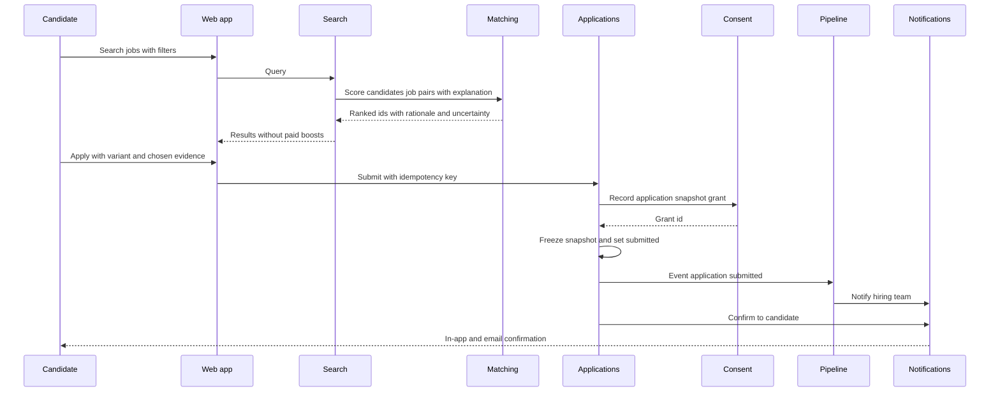
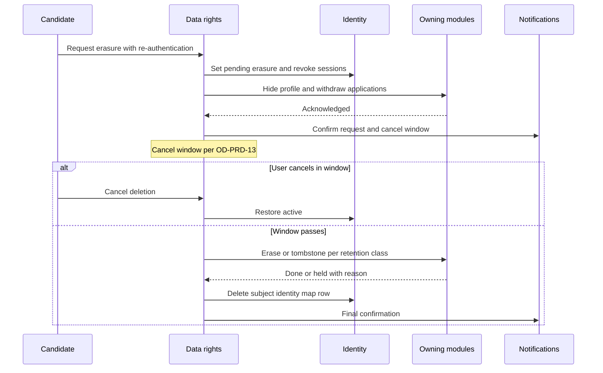
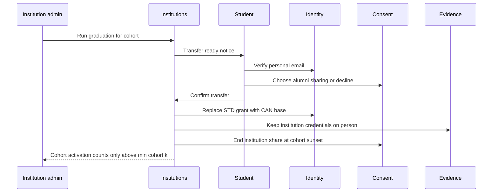
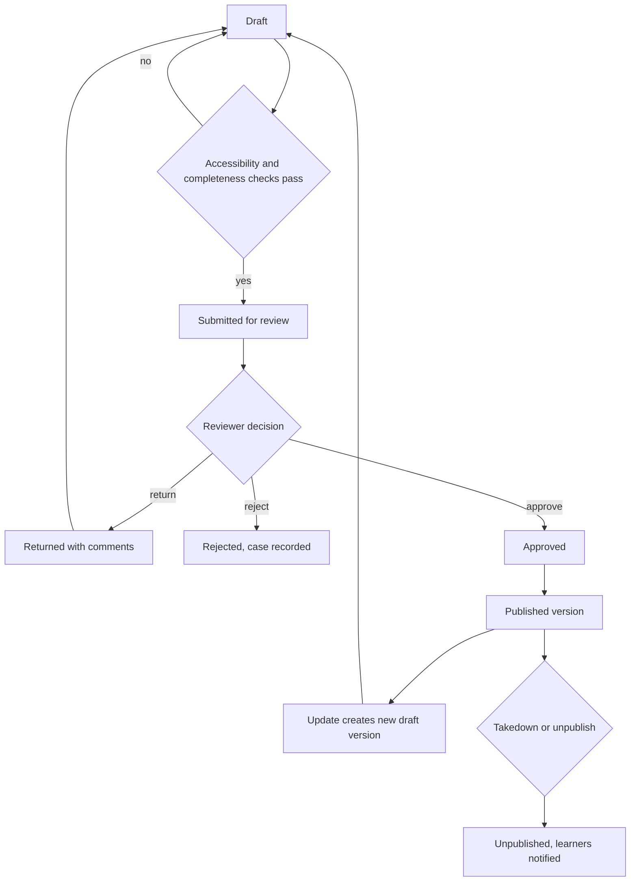
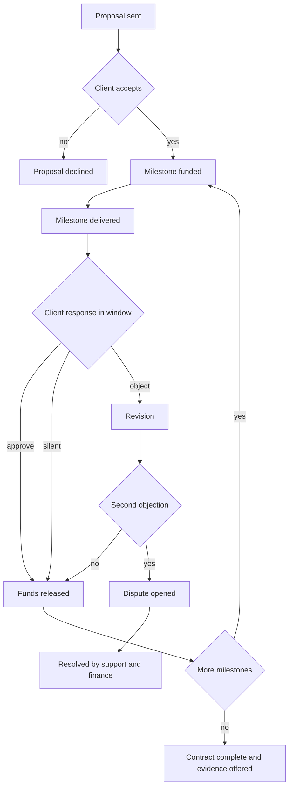
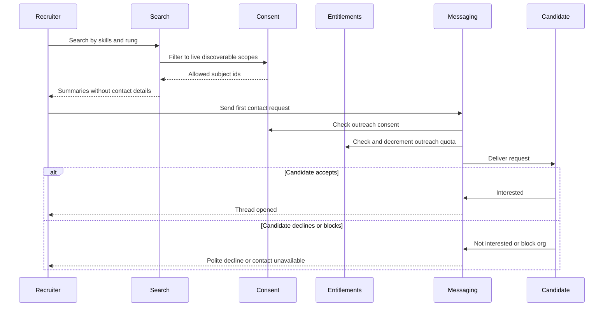
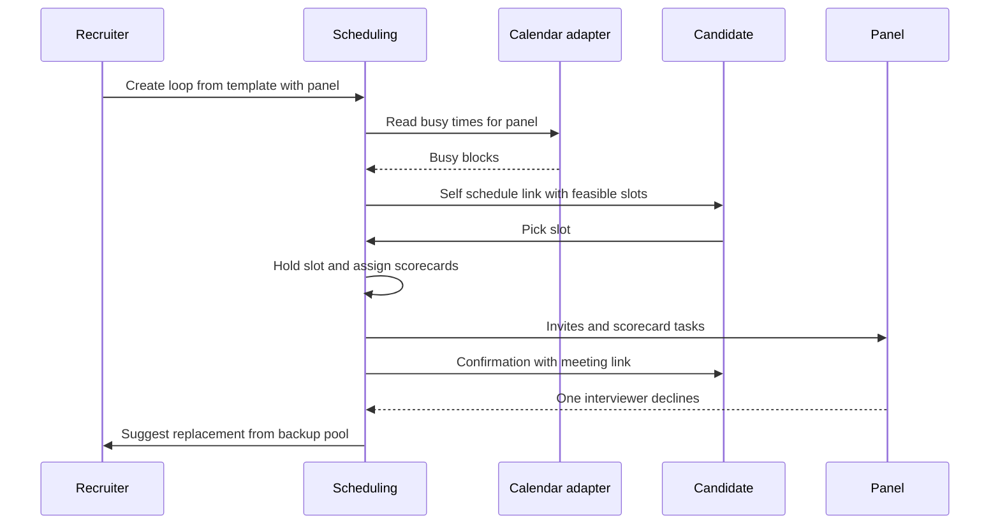

# 05 — User Journeys

End-to-end journeys across every role and module. Each journey states its trigger, preconditions, observable steps with system responses, the success outcome, failure branches and the modules touched. Journeys reference capabilities from [04](04_PERMISSION_MATRIX.md) and rules from [06](06_BUSINESS_MODEL_AND_CROSS_MODULE_RULES.md); module files own the feature-level detail. Every journey also follows the SSOT recovery contract: error → detection → explanation → recovery option → retry or alternative → resolution. [SRC: SSOT §5.2, §5.3]

## 0. Conventions

- Ids are `JRN-<ROLE>-<nn>` ([CONVENTIONS §3](../00_START_HERE/CONVENTIONS.md)). 78 journeys: GUE 4, CAN 22, STD 4, INS 4, MNT 3, FRL 3, REC 8, HMG 3, EAD 5, IAD 3, PLO 2, EXA 3, MOD 3, SUP 2, FIN 2, PAD 3, SAD 2, API 2.
- "Tier" is the release tier in which the journey can first complete end to end. Journeys in gated modules carry the gate.
- Legacy journeys J-01 to J-28 and UJ-01 to UJ-20 are mapped in §20.
- Every journey implicitly includes: offline detection with draft retention where drafts exist; duplicate-submit protection (idempotency key per action); session expiry returning the user to the same step after sign-in; and keyboard and screen-reader operability.

## 1. Guest journeys

### JRN-GUE-01 — Find a public job and sign up to apply

- **Role · persona · tier:** GUE → CAN · P-A Aisha · R1
- **Modules touched:** SRC, JOB, IDN, SET, PRF, NTF, PWA, ANL
- **Trigger:** Aisha opens a shared job link on her phone.
- **Preconditions:** Job is `published`; employer org is `verified` or shows "unverified employer" label.

| #   | Actor action                                                                | System response                                                                                                                                                                                   |
| --- | --------------------------------------------------------------------------- | ------------------------------------------------------------------------------------------------------------------------------------------------------------------------------------------------- |
| 1   | Opens the job URL                                                           | Public job page renders from cache-friendly endpoint: title, employer, location, work mode, salary range if provided, required skills, description, posting date, "Apply" button; no sign-in wall |
| 2   | Taps "Apply"                                                                | Sign-up sheet opens with "Continue with email", passkey and OAuth options; job id kept as return target                                                                                           |
| 3   | Enters email, accepts terms (version shown) and the minimum-age attestation | Account created in `pending_verification`; 6-digit code and magic link emailed; terms version and timestamp recorded                                                                              |
| 4   | Enters the code                                                             | Account `active`; `CAN` base grant created; prompted to set a passkey (skippable)                                                                                                                 |
| 5   | Answers two onboarding questions (target role, location)                    | Profile skeleton created with visibility defaults all private (`BR-XCT-014`)                                                                                                                      |
| 6   | Lands back on the job with "Continue application"                           | Application draft created, autosaved; continues in `JRN-CAN-07`                                                                                                                                   |

- **Success outcome:** Verified account with a draft application for the job; `idn.account.created` and `job.application.draft_created` events.
- **Failure branches:**
  - F1 — Email already registered → "Sign in instead" with the same return target; no disclosure of account details.
  - F2 — Code expired (15 minutes [PROP]) or wrong 5 times → new code offered; further attempts rate-limited with a visible retry time.
  - F3 — Job closed while signing up → draft not created; "This job closed" with three similar open jobs from `SRC`.
  - F4 — Age attestation declined → registration stops with an explanation; nothing stored beyond a rate-limit counter (`BR-XCT-071`, `OD-PRD-11`).
  - F5 — Offline at step 3 → form kept locally; submit queued only after reconnect with a visible "Waiting for connection".
- **Source:** [SRC: SSOT J-02; UJ-01]

### JRN-GUE-02 — Verify a credential from a shared link

- **Role · persona · tier:** GUE (a recruiter outside the platform) · R1
- **Modules touched:** EVD, PRF, BGV, TSF
- **Trigger:** A recruiter receives a certificate URL in a résumé PDF.
- **Preconditions:** The holder made the credential's verification page public.

| #   | Actor action                                  | System response                                                                                                                                                                                         |
| --- | --------------------------------------------- | ------------------------------------------------------------------------------------------------------------------------------------------------------------------------------------------------------- |
| 1   | Opens the verification URL                    | Page shows holder display name, credential title, issuer name and issuer class (platform, institution, employer org, instructor), issue date, expiry, status (`active`, `expired`, `revoked`), and rung |
| 2   | Clicks "How was this verified?"               | Plain-language provenance: what the issuer checked, when, and whether the issuer is verified                                                                                                            |
| 3   | Optionally enters the code printed on the PDF | Code match confirms the PDF corresponds to this credential                                                                                                                                              |
| 4   | Clicks "Report a problem"                     | Report form (reason, details); filed to `TSF`                                                                                                                                                           |

- **Success outcome:** The verifier sees authoritative status without an account; lookup counted in `ANL` without identifying the viewer.
- **Failure branches:**
  - F1 — Credential revoked → status "Revoked on date by issuer" with the issuer's public reason category; no private reason shown.
  - F2 — Holder made the page private → generic "This credential is not public" with no holder details (no existence leak beyond the URL).
  - F3 — Issuer org closed → "Issued by an organization that has since closed; valid as of issue date" (04 §4.2 rule 10).
  - F4 — Code mismatch → "This document does not match the credential record"; repeated mismatches rate-limited.
- **Source:** [SRC: SSOT F-96 evidence semantics; PROP for code match]

### JRN-GUE-03 — Referee confirms a work-history claim from a single-use link

- **Role · persona · tier:** GUE (referee token actor) · Priya the referee [SRC: USR-01 P4] · R1
- **Modules touched:** BGV, EVD, NTF, TSF, ANL
- **Trigger:** Email "Rohan asked you to confirm his role at Acme" with a link.
- **Preconditions:** Candidate created the request (`JRN-CAN-03`); token unused and unexpired (14 days [PROP]).

| #   | Actor action                                                                                  | System response                                                                                                                                                                 |
| --- | --------------------------------------------------------------------------------------------- | ------------------------------------------------------------------------------------------------------------------------------------------------------------------------------- |
| 1   | Opens link on phone                                                                           | Token validated; page shows only: candidate name, claimed title, employer, dates, the question "Did you work with this person in this role?", and who the referee is said to be |
| 2   | Chooses "Yes, I confirm", "Partly" (with what differs) or "No"                                | Choice recorded locally; for "Partly", fields to correct title or dates appear                                                                                                  |
| 3   | Optionally states relationship (manager, peer, report, client) and how they know              | Free text capped at 500 characters                                                                                                                                              |
| 4   | Confirms identity check: enters work email domain or signs in if they already have an account | Domain compared with the claimed employer's verified domain; independence checks run (referee ≠ candidate, no shared device or account signals)                                 |
| 5   | Submits                                                                                       | Token consumed; response stored; candidate notified; `EVD` moves the claim to `peer_attested` if "Yes" and checks pass                                                          |

- **Success outcome:** Claim at rung `peer_attested` with referee relationship and domain-match flag shown; referee median time recorded in `bgv.referee_median_minutes`.
- **Failure branches:**
  - F1 — Token expired or used → "This link has expired"; offer to tell the candidate (sends a notice, not the referee's details).
  - F2 — Referee answers "No" → claim stays `claimed` with "A referee did not confirm" visible only to the candidate; the candidate can dispute (`JRN-CAN-14`).
  - F3 — Independence check fails (same device fingerprint as candidate) → response held for `MOD` review; candidate sees "Under review"; anomaly is not guilt (`BR-XCT-025`).
  - F4 — Referee reports the request as unknown or fraudulent → request cancelled, `TSF` case opened, candidate rate-limited on new referee requests.
  - F5 — Referee clicks a link forwarded to someone else → identity step fails domain match; response accepted only as "unmatched referee" (lower weight) if they proceed.
- **Source:** [SRC: UJ-17; USR-01 REV2 §3]

### JRN-GUE-04 — Preview a course and register to enroll

- **Role · persona · tier:** GUE → CAN · P-M Sam · R1
- **Modules touched:** SRC, LRN, IDN, BIL
- **Trigger:** Sam searches the web for "SQL for analysts course" and lands on a catalog page.
- **Preconditions:** Course `published`, at least one lesson marked preview.

| #   | Actor action             | System response                                                                                                                                         |
| --- | ------------------------ | ------------------------------------------------------------------------------------------------------------------------------------------------------- |
| 1   | Opens course page        | Syllabus, skills taught, estimated hours, level, instructor with issuer class, rating distribution, what evidence completion produces, price or "Free"  |
| 2   | Plays the preview lesson | Lesson plays with captions and transcript; progress not stored                                                                                          |
| 3   | Clicks "Enroll"          | Sign-up sheet as in `JRN-GUE-01` steps 2 to 4                                                                                                           |
| 4   | After verification       | Enrollment created for a free course; for a paid course, checkout appears only if `OD-PRD-04` admits paid first-party courses, else "Not yet available" |
| 5   | Starts lesson 1          | Progress tracking begins; continues in `JRN-CAN-05`                                                                                                     |

- **Success outcome:** Active enrollment; `lrn.enrollment.created`.
- **Failure branches:**
  - F1 — Course unpublished between view and enroll → "This course is no longer available"; similar courses offered.
  - F2 — Video fails to load → transcript shown with retry; offline note if no network.
  - F3 — Paid checkout abandoned → no enrollment; cart not persisted beyond 24 hours [PROP].
- **Source:** [SRC: SSOT J-19]

## 2. Candidate journeys

### JRN-CAN-01 — Register, confirm email and reach first value

- **Role · persona · tier:** CAN · P-A Aisha · R0 (first value completes in R1)
- **Modules touched:** IDN, SET, PRF, AIC, NTF, ANL, PWA
- **Trigger:** Aisha clicks "Join" on the home page.
- **Preconditions:** None.

| #   | Actor action                                                                                                                              | System response                                                                                          |
| --- | ----------------------------------------------------------------------------------------------------------------------------------------- | -------------------------------------------------------------------------------------------------------- |
| 1   | Chooses passkey sign-up                                                                                                                   | Browser passkey ceremony; account in `pending_verification`                                              |
| 2   | Confirms email via code                                                                                                                   | Account `active`; welcome notification in-app (transactional, not marketing)                             |
| 3   | Chooses intent: "Find a job", "Learn a skill", "Prove my experience", "Switch careers"                                                    | Onboarding branch selected; intent stored for personalization only if `matching.recommend` granted later |
| 4   | Adds target role and up to 10 skills from taxonomy autocomplete                                                                           | Skills normalized to taxonomy ids; free text kept as unmatched skill flagged for curation                |
| 5   | Sees consent prompts with plain-language text, all default off                                                                            | Each grant recorded in the consent ledger with version                                                   |
| 6   | Reaches the "first value" screen for the chosen intent: three matched jobs with explanations, or a gap view, or "Add your first evidence" | `act.first_value_session` event recorded with consent class                                              |
| 7   | Accepts the install prompt (optional)                                                                                                     | PWA installed; no core function requires it                                                              |

- **Success outcome:** Active account, skeleton profile, first-value event within the session.
- **Failure branches:**
  - F1 — Passkey unsupported → falls back to email code plus password with strength meter.
  - F2 — User skips every step → dashboard shows a three-item checklist; no nagging more than once per day (`BR-XCT-067`).
  - F3 — No matched jobs for the location → "No matching jobs yet" with an alert offer and nearby or remote alternatives.
  - F4 — Disposable email domain → allowed but rate limits stricter; flagged for abuse scoring only.
- **Source:** [SRC: UJ-01, UJ-02; SSOT §5.2]

### JRN-CAN-02 — Import a résumé and build a profile with field visibility

- **Role · persona · tier:** CAN · P-B Rohan · R1
- **Modules touched:** PRF, PLT, AIC, SRC, SET, EVD
- **Trigger:** Rohan chooses "Import my résumé" from the profile checklist.
- **Preconditions:** Active account.

| #   | Actor action                                                                                  | System response                                                                                                                                                               |
| --- | --------------------------------------------------------------------------------------------- | ----------------------------------------------------------------------------------------------------------------------------------------------------------------------------- |
| 1   | Uploads a PDF or DOCX (max 10 MB [PROP]) or a LinkedIn data export                            | File stored privately; malware scan; parse job queued; progress indicator                                                                                                     |
| 2   | Waits                                                                                         | Parser extracts experience, education, skills; deterministic parser first, AI parsing only if `ai.assist.process` granted and cost policy allows (`BR-XCT-037`, `BR-XCT-039`) |
| 3   | Reviews a side-by-side diff: extracted field vs source text                                   | Each field marked "imported, unconfirmed"; nothing is saved to the profile until confirmed                                                                                    |
| 4   | Confirms, edits or discards each entry                                                        | Confirmed entries saved as profile entries and as `claimed` evidence items for roles and education                                                                            |
| 5   | Sets visibility per section: Private, Connections, Discoverable to verified employers, Public | Visibility stored per field; preview "as a recruiter sees it" and "as the public sees it"                                                                                     |
| 6   | Turns on `search.discoverable` (optional)                                                     | Profile summary indexed within 15 minutes [SRC: CONSENT_SCOPE_CATALOGUE BR-T063]                                                                                              |

- **Success outcome:** Profile with confirmed entries; evidence items at `claimed`; `prf.profile.updated`.
- **Failure branches:**
  - F1 — Scan detects malware → file quarantined and deleted; user told "This file could not be processed for security reasons".
  - F2 — Parse fails or low confidence → manual entry form prefilled with what was found; nothing invented.
  - F3 — Duplicate roles detected → merge suggestion; user chooses.
  - F4 — User closes mid-review → unconfirmed extraction kept 7 days [PROP] then deleted.
- **Source:** [SRC: SSOT J-17 LinkedIn migration; UJ-02]

### JRN-CAN-03 — Add a work-history claim and request referee verification

- **Role · persona · tier:** CAN · P-B Rohan · R1
- **Modules touched:** EVD, BGV, NTF, TSF
- **Trigger:** Rohan taps "Get this verified" on his Acme role.
- **Preconditions:** Role entry exists at `claimed`.

| #   | Actor action                                                                                                                                                                        | System response                                                                                                                            |
| --- | ----------------------------------------------------------------------------------------------------------------------------------------------------------------------------------- | ------------------------------------------------------------------------------------------------------------------------------------------ |
| 1   | Chooses verification method: referee, work-email confirmation, upload artifact (offer letter, payslip with redaction guidance) or employer confirmation (if Acme is a verified org) | Methods available listed with the rung each can reach                                                                                      |
| 2   | Picks referee; enters name, email, relationship                                                                                                                                     | Validation: email not the candidate's own, not a free domain if "work email required" chosen; max 3 open referee requests per claim [PROP] |
| 3   | Previews the exact message the referee receives                                                                                                                                     | Preview rendered from the template `bgv.referee_request`                                                                                   |
| 4   | Sends                                                                                                                                                                               | Token minted; email sent; claim shows "Waiting for referee"; reminders at day 3 and day 7 [PROP]                                           |
| 5   | Receives notification when referee responds                                                                                                                                         | Claim rung updated per `JRN-GUE-03`                                                                                                        |

- **Success outcome:** Claim at `peer_attested` (or `authority_verified` with issuer class `employer_org` if the verified employer confirms).
- **Failure branches:**
  - F1 — No response by expiry → request expires; candidate offered another referee or method.
  - F2 — Referee email bounces → candidate notified within minutes to correct the address.
  - F3 — Candidate tries to edit the claim while a request is open → edit creates a new version and cancels the open request with notice to the referee (`BR-XCT-069`).
  - F4 — Too many requests in a day → rate limit with time shown (abuse control).
- **Source:** [SRC: UJ-03; SSOT Appendix E V61-17]

### JRN-CAN-04 — Set a career goal, see the gap and accept a learning plan

- **Role · persona · tier:** CAN · P-R Ravi · R1 (non-AI gap), R4 (AI plan), R6 (MKT paths)
- **Modules touched:** AIC, SRC, MKT (gated), LRN, ASM, EVD, PRF
- **Trigger:** Ravi selects "Switch careers" and target role "Product manager".
- **Preconditions:** `matching.recommend` granted (needed to use profile for recommendations).

| #   | Actor action                          | System response                                                                                                                                     |
| --- | ------------------------------------- | --------------------------------------------------------------------------------------------------------------------------------------------------- |
| 1   | Picks target occupation from taxonomy | Required and common skills for the occupation shown with their source (taxonomy, or job-posting frequency from `MKT` if admitted)                   |
| 2   | Views the gap                         | Each skill shows: held with evidence (rung), held claimed only, missing; with uncertainty notes ("based on 3 evidence items")                       |
| 3   | Chooses "Build a plan"                | Plan of ordered steps: courses, practice challenges, portfolio project suggestions; each step names the gap it closes and evidence it would produce |
| 4   | Removes two steps and reorders        | Plan saved as user-owned; AI-generated items labelled (`BR-XCT-036`)                                                                                |
| 5   | Accepts the plan                      | Goal tracked; weekly progress digest offered (opt-in)                                                                                               |

- **Success outcome:** Active goal with plan; progress visible as evidence accrues.
- **Failure branches:**
  - F1 — `matching.recommend` not granted → gap still computed on-device view from profile shown only to Ravi, with explanation that recommendations need consent; no server-side recommendation stored.
  - F2 — No taxonomy match for a niche role → user picks the nearest occupation or defines skills manually.
  - F3 — AI unavailable or quota exhausted → non-AI rule-based plan from taxonomy and catalog; banner explains.
  - F4 — No course exists for a gap skill → "No course yet" with practice challenges and mentoring (if admitted) as alternatives.
- **Source:** [SRC: SSOT J-06, J-26 detailed flow]

### JRN-CAN-05 — Enroll, learn, complete a course and receive completion evidence

- **Role · persona · tier:** CAN · P-M Sam · R1
- **Modules touched:** LRN, ASM, EVD, REP, NTF, PWA
- **Trigger:** Sam opens an enrolled course from "Continue learning".
- **Preconditions:** Enrollment `active`.

| #   | Actor action                                                  | System response                                                                                                                                 |
| --- | ------------------------------------------------------------- | ----------------------------------------------------------------------------------------------------------------------------------------------- |
| 1   | Plays lesson video at 1.5x with captions                      | Position saved every 10 seconds [PROP] and on pause                                                                                             |
| 2   | Downloads the next two lessons for the train                  | Lessons cached in the PWA with licence check; expire after 30 days offline [PROP]                                                               |
| 3   | Completes in-lesson quiz offline                              | Answers saved as local draft; graded quizzes submit only online; practice quizzes graded locally then reconciled (`BR-XCT-078`)                 |
| 4   | Submits the final project with a repository link and write-up | Submission stored; rubric grading queued (auto-graded parts immediately)                                                                        |
| 5   | Receives grade and feedback                                   | Course `completed` when all required items pass                                                                                                 |
| 6   | Opens "Your new evidence"                                     | Completion credential with issuer class `platform` (first-party course) or `instructor`; project as `artifact_backed` evidence linked to skills |

- **Success outcome:** Completion credential and project evidence in `EVD`; `lrn.course.completed`; badge in `REP`.
- **Failure branches:**
  - F1 — Course version updated mid-way → learner stays on the enrolled version; offered to switch with progress mapping.
  - F2 — Project fails rubric threshold → feedback per criterion; resubmission allowed per course policy.
  - F3 — Offline cache licence expired → lessons hidden until online; progress preserved.
  - F4 — Plagiarism signal on project → held for instructor review, not auto-failed (`BR-XCT-025`).
- **Source:** [SRC: SSOT J-01, J-19, J-20; UJ-04]

### JRN-CAN-06 — Take a timed assessment under AI-prohibited mode and earn a credential

- **Role · persona · tier:** CAN · P-Q Quinn · R1 (non-code), R4 (code runner)
- **Modules touched:** ASM, AIC, EVD, TSF, SET, NTF
- **Trigger:** Quinn starts "Data Structures — Verified Assessment".
- **Preconditions:** Online; attempt allowance remaining; assessment AI mode `AI_PROHIBITED`.

| #   | Actor action                                                                          | System response                                                                                                              |
| --- | ------------------------------------------------------------------------------------- | ---------------------------------------------------------------------------------------------------------------------------- |
| 1   | Reads rules: duration, attempts, AI mode, integrity signals collected, accommodations | Explicit acknowledgement recorded                                                                                            |
| 2   | Requests extra time accommodation (optional)                                          | Request routed to the assessment owner; approved accommodations apply silently; never disclosed to employers (`BR-XCT-028`)  |
| 3   | Starts the attempt                                                                    | Server timer starts; AI gateway blocks every TalentSphere AI entry point for this user for the attempt window (`BR-XCT-038`) |
| 4   | Answers questions; code questions run in the isolated runner                          | Answers autosaved server-side every change; runner returns test results                                                      |
| 5   | Submits or timer ends                                                                 | Attempt locked; auto-grading; integrity signals evaluated                                                                    |
| 6   | Sees result                                                                           | Score band and per-topic breakdown; if passed, credential issued at `authority_verified`, issuer class `platform`            |

- **Success outcome:** Credential in `EVD` with assessment version and date; `asm.attempt.graded`.
- **Failure branches:**
  - F1 — Connection drops → timer continues server-side; on reconnect within grace (2 minutes [PROP]) the attempt resumes; otherwise submitted as is, with a support path.
  - F2 — User opens the AI assistant → `403 ai-prohibited` with explanation; logged as an integrity signal only if repeated.
  - F3 — Integrity anomaly (paste bursts, tab switching) → attempt held as "Under review", not failed; reviewed in `JRN-MOD-03`.
  - F4 — Code runner unavailable → code items marked "unscored"; no verified credential minted from simulated scores [SRC: Appendix E V61-22].
  - F5 — Attempts exhausted → cooldown shown (default 7 days [SRC: SSOT OD-39]).
- **Source:** [SRC: SSOT §17; J-21]

### JRN-CAN-07 — Search jobs, read the match explanation and apply

- **Role · persona · tier:** CAN · P-A Aisha, P-B Rohan · R1
- **Modules touched:** SRC, AIC, JOB, PRF, EVD, SET, ATS, NTF, ANL
- **Trigger:** Aisha searches "junior backend developer" in her city.
- **Preconditions:** Active account; profile with at least one evidence item.

| #   | Actor action                                                                       | System response                                                                                                                                                    |
| --- | ---------------------------------------------------------------------------------- | ------------------------------------------------------------------------------------------------------------------------------------------------------------------ |
| 1   | Searches with filters: location radius, remote, salary floor, posted within 7 days | Results ordered by relevance; no paid boosting in organic ranking (`BR-XCT-020`); each card shows match label with "Why?"                                          |
| 2   | Opens "Why?" on a job                                                              | Explanation: matched skills with her evidence rung, missing skills, location fit, uncertainty statement; no protected attributes used (`BR-XCT-022`, `BR-XCT-023`) |
| 3   | Clicks "Apply"                                                                     | Completeness gate: required screening questions, résumé variant selection, evidence picker                                                                         |
| 4   | Picks résumé variant and selects which evidence items to include                   | Snapshot preview "The employer will see exactly this"; contact details included only if she ticks "Share email and phone"                                          |
| 5   | Answers screening questions                                                        | Knockout questions shown with their rule; she can still apply (questions inform humans, never auto-reject, `BR-XCT-021`)                                           |
| 6   | Submits                                                                            | Idempotent submit; `application.share_snapshot` granted; application `submitted`; confirmation in-app and email                                                    |
| 7   | Hiring team notified                                                               | `ATS` card created in the first stage; recruiter notification per their preferences                                                                                |

- **Success outcome:** Application `submitted` with immutable snapshot; `job.application.submitted`.
- **Failure branches:**
  - F1 — Already has an active application to this job → "You already applied" with link to it (one active application per candidate and job [SRC: Appendix E V61-23]).
  - F2 — Job closes during the draft → submit blocked with "This job closed"; draft kept read-only.
  - F3 — Evidence item revoked between selection and submit → removed from snapshot with notice before submit.
  - F4 — Network failure on submit → retry with the same idempotency key; no duplicate application.
  - F5 — Job requires an assessment → applicant routed to it after submit; application remains `submitted` with "Assessment pending".
- **Source:** [SRC: SSOT J-02 detailed; UJ-05]

### JRN-CAN-08 — Track an application, self-schedule an interview and attend

- **Role · persona · tier:** CAN · P-B Rohan · R1 (manual scheduling), R2 (self-scheduling)
- **Modules touched:** JOB, ATS, INT, MSG, NTF, PWA
- **Trigger:** Notification "Acme invited you to schedule an interview".
- **Preconditions:** Application moved to an interview stage by a human.

| #   | Actor action                               | System response                                                                                                                                             |
| --- | ------------------------------------------ | ----------------------------------------------------------------------------------------------------------------------------------------------------------- |
| 1   | Opens the application tracker              | Candidate-facing status (`submitted`, `in_review`, `interviewing`, `offer_extended`, terminal states) with date of last change; internal stage names hidden |
| 2   | Opens the scheduling link                  | Available slots computed from panel calendars, shown in his time zone, with duration, format (video link, phone, onsite) and interviewers' names and titles |
| 3   | Picks a slot                               | Slot held for 10 minutes [PROP] during confirmation; confirmed to all parties; calendar invite with external meeting link                                   |
| 4   | Requests a reschedule two days later       | Allowed up to 24 hours before start [PROP]; new slots shown; panel notified                                                                                 |
| 5   | Sends a question in the application thread | Message delivered to the hiring team thread; recruiter replies                                                                                              |
| 6   | Attends the interview                      | Reminder 24 hours and 1 hour before; status remains `interviewing`                                                                                          |

- **Success outcome:** Interview completed; candidate sees next step within the employer's stated response window.
- **Failure branches:**
  - F1 — No slots available → "Request other times" sends proposed windows to the coordinator.
  - F2 — Interviewer cancels → candidate notified at once with new slots; never left without a path.
  - F3 — Application idle with no human action for 14 days [PROP] → candidate sees "No update yet" and the employer is nudged (`BR-XCT-077`).
  - F4 — Candidate no-show → recruiter marks no-show; candidate notified and may request one reschedule per employer policy.
- **Source:** [SRC: SSOT J-02; UJ-06]

### JRN-CAN-09 — Receive an offer, accept it, and the outcome becomes new evidence

- **Role · persona · tier:** CAN · P-A Aisha · R2
- **Modules touched:** ATS, JOB, BGV, EVD, NTF, PRF, SET
- **Trigger:** Notification "You have an offer from Acme".
- **Preconditions:** Offer approved through the approval chain (`JRN-REC-06`).

| #   | Actor action                                         | System response                                                                                                                                      |
| --- | ---------------------------------------------------- | ---------------------------------------------------------------------------------------------------------------------------------------------------- |
| 1   | Opens the offer                                      | Offer summary: title, start date, compensation fields the employer chose to include, expiry date, attached letter (PDF)                              |
| 2   | Asks a question in the thread                        | Recruiter replies; offer remains open until expiry                                                                                                   |
| 3   | Clicks "Accept" and types her name to confirm intent | Application `hired`; offer `accepted`; the employer is told; e-signature of the employment contract happens in the employer's tool if any (adjacent) |
| 4   | Is asked whether to add the role to her profile      | On yes: experience entry created as `claimed`, with an employer-confirmation request pre-filled to the verified org                                  |
| 5   | Employer confirms after start date                   | Evidence item moves to `authority_verified`, issuer class `employer_org`                                                                             |
| 6   | Other active applications                            | She is offered one-tap withdrawal with a polite template to each                                                                                     |

- **Success outcome:** Outcome recorded; new authority-verified evidence; `ns.career_progress_verified` counts her.
- **Failure branches:**
  - F1 — Offer expired → "This offer expired"; she may message the recruiter, who can re-issue.
  - F2 — Background check required before final → acceptance is conditional; `JRN-CAN-20` runs.
  - F3 — She declines → reason optional from list; application `offer_declined`; recruiter notified.
  - F4 — Employer rescinds → candidate notified with reason category; recorded for `TSF` employer-conduct metrics.
- **Source:** [SRC: SSOT J-02; UJ-06]

### JRN-CAN-10 — Respond to a recruiter first-contact request

- **Role · persona · tier:** CAN · P-B Rohan · R2
- **Modules touched:** MSG, SRC, SET, TSF, NTF
- **Trigger:** Notification "A recruiter at Globex wants to contact you about Senior ML Engineer".
- **Preconditions:** Rohan granted `outreach.recruiter_contact` and is discoverable.

| #   | Actor action                                                          | System response                                                                                                                              |
| --- | --------------------------------------------------------------------- | -------------------------------------------------------------------------------------------------------------------------------------------- |
| 1   | Opens the request                                                     | Shows recruiter name, verified org, role, salary range if given, why they reached out (matched skills); recruiter cannot see contact details |
| 2   | Chooses "Interested", "Not now", "Not interested" or "Block this org" | Response recorded                                                                                                                            |
| 3   | On "Interested"                                                       | Thread opens; recruiter can now message; contact details still masked unless he shares them                                                  |
| 4   | On "Not interested" with optional reason                              | Recruiter receives a polite decline; cannot send another request to Rohan for 90 days [PROP]                                                 |
| 5   | On "Block this org"                                                   | Org blocked: no outreach, search excludes him for that org, existing threads closed (`BR-XCT-017`)                                           |

- **Success outcome:** A consented conversation or a respected decline; outreach quota consumed on the recruiter side only.
- **Failure branches:**
  - F1 — Request expired (14 days [PROP]) → archived silently.
  - F2 — Message looks like a scam → "Report" opens `TSF` with the request attached; org recruiter flagged.
  - F3 — Rohan revoked `outreach.recruiter_contact` before opening → request hidden; recruiter told "This person is no longer accepting requests".
- **Source:** [SRC: UJ-12; CONSENT_SCOPE_CATALOGUE `outreach.recruiter_contact`]

### JRN-CAN-11 — Review consents and revoke an employer share

- **Role · persona · tier:** CAN · P-O Omar · R1
- **Modules touched:** SET, EVD, SRC, AIC, JOB, ANL
- **Trigger:** Omar opens Settings → Privacy → "Who can see my data".
- **Preconditions:** Several grants exist.

| #   | Actor action                              | System response                                                                                                                              |
| --- | ----------------------------------------- | -------------------------------------------------------------------------------------------------------------------------------------------- |
| 1   | Views the consent centre                  | Every grant listed: scope plain-language label, grantee, granted on, expires on, last used on                                                |
| 2   | Opens "Globex can open my evidence files" | Detail: which artifacts, access log entries by Globex (date, artifact, viewer role class)                                                    |
| 3   | Clicks "Revoke"                           | Confirmation explains the effect ("Globex will not be able to open your files from now; links already issued stop working within 5 minutes") |
| 4   | Confirms                                  | Ledger entry appended; next read by Globex fails; signed URLs lapse (`BR-XCT-008`)                                                           |
| 5   | Turns off `matching.recommend`            | Recommendations stop; stored explanations and embeddings deleted; he stays searchable only if discoverable (`BR-XCT-012`)                    |

- **Success outcome:** Revocations effective at next read; receipts downloadable.
- **Failure branches:**
  - F1 — Tries to revoke an application snapshot → explained that the snapshot is per application; withdrawing the application ends live sharing; the snapshot is kept per retention (`BR-XCT-034`).
  - F2 — Network failure → revocation not shown as done until server confirms.
- **Source:** [SRC: SSOT Appendix E V61-16; CONSENT_SCOPE_CATALOGUE]

### JRN-CAN-12 — Export data, then delete the account

- **Role · persona · tier:** CAN · P-O Omar · R0
- **Modules touched:** SET, IDN, every module holding personal data, NTF, BIL, ADM
- **Trigger:** Omar chooses "Download my data", then "Delete my account".
- **Preconditions:** Signed in with recent re-authentication (within 10 minutes [PROP]).

| #   | Actor action                      | System response                                                                                                                                                                                           |
| --- | --------------------------------- | --------------------------------------------------------------------------------------------------------------------------------------------------------------------------------------------------------- |
| 1   | Requests export                   | Export job collects data from every owning module; ready notification; download link valid 7 days [PROP]; JSON plus readable HTML                                                                         |
| 2   | Downloads                         | Download audited                                                                                                                                                                                          |
| 3   | Requests deletion                 | Screen lists what is deleted, what is retained and why (invoices, legal holds, org-owned hiring records about him per org retention), and the cancel window (`OD-PRD-13`)                                 |
| 4   | Confirms with re-authentication   | Account `pending_erasure`; sessions revoked; profile hidden at once; active applications withdrawn with notice to employers; active subscriptions cancelled at period end                                 |
| 5   | Cancel window passes              | Erasure runs: mutable records deleted, `subject_identity_map` row deleted so history keeps only an opaque reference (`BR-XCT-032`); messages he sent show "Deleted user" to counterparties (`BR-XCT-006`) |
| 6   | Receives final confirmation email | Account `erased`; email address released after the purge clock                                                                                                                                            |

- **Success outcome:** Erasure completed within the completion deadline; post-erasure sweep finds no residual identifiers.
- **Failure branches:**
  - F1 — Legal hold on his records → erasure proceeds for everything else; held records listed with reason category (`BR-XCT-033`).
  - F2 — He signs in during the cancel window → offered "Cancel deletion"; account restored to `active`.
  - F3 — He is the last owner of an org → blocked until ownership is transferred or the org closed.
  - F4 — Outstanding payout as freelancer or instructor → deletion waits for settlement or forfeiture choice.
- **Source:** [SRC: UJ-09; SSOT Appendix E V61-07, V61-19]

### JRN-CAN-13 — Recover access after losing password and passkey

- **Role · persona · tier:** CAN · P-A Aisha · R0
- **Modules touched:** IDN, NTF, ADM, SET
- **Trigger:** New phone, passkey gone, password forgotten.
- **Preconditions:** Account `active`.

| #   | Actor action                                  | System response                                                                               |
| --- | --------------------------------------------- | --------------------------------------------------------------------------------------------- |
| 1   | Clicks "Can't sign in"                        | Options: email reset link, recovery codes, a second registered passkey                        |
| 2   | Requests email reset                          | Link sent if the account exists; response identical whether or not it exists                  |
| 3   | Opens link within 30 minutes [PROP]           | Sets new password; all sessions revoked; MFA still required if enrolled                       |
| 4   | MFA device also lost                          | "Recover with support" opens an identity-proofing request                                     |
| 5   | Support verifies per checklist (`JRN-SUP-02`) | Recovery approved; 24-hour delay before MFA reset with notice to all registered emails [PROP] |
| 6   | Signs in and registers a new passkey          | Security notification sent; recovery codes regenerated                                        |

- **Success outcome:** Access restored without exposing the account to takeover.
- **Failure branches:**
  - F1 — Email account also lost → support path with stronger proofing (prior activity questions, government ID only if `OD-PRD-26` admits).
  - F2 — Owner of the account objects during the 24-hour delay → recovery cancelled; `SAD` alerted.
  - F3 — Repeated attempts → rate-limited by account and network.
- **Source:** [SRC: UJ-10]

### JRN-CAN-14 — Dispute a verification outcome

- **Role · persona · tier:** CAN · P-B Rohan · R1
- **Modules touched:** EVD, BGV, TSF, ADM, NTF
- **Trigger:** Referee answered "No" or an issuer revoked a credential.
- **Preconditions:** Evidence item owned by Rohan.

| #   | Actor action                                                                                             | System response                                                                                 |
| --- | -------------------------------------------------------------------------------------------------------- | ----------------------------------------------------------------------------------------------- |
| 1   | Opens the item and clicks "Dispute"                                                                      | Form: what is wrong, supporting artifacts (up to 5 files)                                       |
| 2   | Submits                                                                                                  | Case created in `TSF` with category `verification_dispute`; item shows "Disputed" to Rohan only |
| 3   | Moderator reviews referee response, independence signals, artifacts                                      | May request more information through the case thread                                            |
| 4   | Decision: uphold, overturn (rung restored or raised by a new verification path) or offer re-verification | Decision with reason; `EVD` transitions only via the case decision (`BR-XCT-068`)               |
| 5   | Rohan may appeal once                                                                                    | Appeal decided by a different moderator (`BR-XCT-052`)                                          |

- **Success outcome:** Disputed item resolved with an auditable reason.
- **Failure branches:**
  - F1 — Dispute about an institution-issued credential → routed to the issuer first; platform reviews only process failures.
  - F2 — Abusive dispute volume → rate limit; repeated bad-faith disputes can restrict the verification feature for 30 days [PROP].
- **Source:** [SRC: SSOT §6.3 evidence conflicts and revocation]

### JRN-CAN-15 — Ask a connection for a referral

- **Role · persona · tier:** CAN · P-A Aisha · R2
- **Modules touched:** NET, MSG, JOB, ATS, EMP, NTF
- **Trigger:** On a job page Aisha sees "2 connections work at Acme".
- **Preconditions:** Connection is a verified member of the job's org.

| #   | Actor action                                            | System response                                                                                              |
| --- | ------------------------------------------------------- | ------------------------------------------------------------------------------------------------------------ |
| 1   | Clicks "Ask for a referral"                             | Picks the connection; writes a note (max 1,000 characters); attaches her application draft or profile link   |
| 2   | Sends                                                   | Referral request delivered; max 3 open referral requests per job [PROP]                                      |
| 3   | Connection opens it                                     | Sees her shared items only; chooses "Refer", "Decline" or "Not comfortable"                                  |
| 4   | Connection refers with a statement of how they know her | Referral attached to her application (created or existing); hiring team sees "Referred by" with relationship |
| 5   | Application progresses                                  | Both see status updates appropriate to each (referrer sees only stage class, not notes)                      |

- **Success outcome:** Referred application; `net.referral.given`; referral counted in `net.referral_to_interview`.
- **Failure branches:**
  - F1 — Connection declines → Aisha sees "Not available to refer" (no reason exposed).
  - F2 — Connection left the org → referral option disabled.
  - F3 — Org disallows referrals for the job → button hidden with explanation.
- **Source:** [SRC: SSOT J-05; BR-233..BR-240]

### JRN-CAN-16 — Upgrade to a paid plan, hit a quota and cancel

- **Role · persona · tier:** CAN · P-B Rohan · R5 (gated `OD-PRD-05`)
- **Modules touched:** BIL, AIC, PRF, NTF
- **Trigger:** Rohan reaches the free AI assistance limit.
- **Preconditions:** Candidate premium admitted and priced by the owner.

| #   | Actor action                         | System response                                                                                              |
| --- | ------------------------------------ | ------------------------------------------------------------------------------------------------------------ |
| 1   | Sees "Daily AI limit reached"        | Explains what is free forever (evidence, applying, messaging) and what the paid plan adds; no dark patterns  |
| 2   | Opens plans                          | Monthly and yearly with total price including tax where known; cancellation terms                            |
| 3   | Pays in hosted checkout              | Entitlements change only after the verified webhook (`BR-XCT-043`)                                           |
| 4   | Returns                              | Banner "Plan active" once state confirmed; until then "Confirming payment"                                   |
| 5   | Later cancels in the customer portal | Cancel at period end; data kept; extra résumé variants become read-only beyond the free count (`BR-XCT-045`) |

- **Success outcome:** Paid entitlements applied server-side; cancellation honored without data loss.
- **Failure branches:**
  - F1 — Payment fails → no entitlement; clear retry.
  - F2 — Redirect succeeds but webhook delayed → entitlement waits; never granted from redirect alone.
  - F3 — Refund requested within the window → `JRN-FIN-01`.
- **Source:** [SRC: docs/PRICING.md; COMMERCIAL_OPERATIONS §3]

### JRN-CAN-17 — Tailor a résumé variant for a job with the AI assistant

- **Role · persona · tier:** CAN · P-R Ravi · R4
- **Modules touched:** AIC, PRF, JOB, SET, EVD
- **Trigger:** "Tailor for this job" on a job page.
- **Preconditions:** `ai.assist.process` granted; cost policy allows the request.

| #   | Actor action                                                         | System response                                                                                                          |
| --- | -------------------------------------------------------------------- | ------------------------------------------------------------------------------------------------------------------------ |
| 1   | Clicks "Tailor"                                                      | Shows what will be sent (profile sections, job text), redaction of contact details                                       |
| 2   | Confirms                                                             | AI gateway call; suggestions returned as a diff against his base variant                                                 |
| 3   | Accepts some suggestions, edits others                               | Accepted text saved in a new variant; suggestions labelled AI-assisted in version history                                |
| 4   | Tries to accept a suggestion claiming a skill he has no evidence for | Warning "This adds a claim not in your profile"; accepting creates a `claimed` item, never a verified one (`BR-XCT-036`) |
| 5   | Uses the variant in an application                                   | Snapshot includes the variant                                                                                            |

- **Success outcome:** Variant created by the candidate's explicit choices.
- **Failure branches:**
  - F1 — Consent missing → `403 consent-required` with one-tap grant.
  - F2 — Provider outage → "AI is unavailable"; manual editing unaffected.
  - F3 — During an `AI_PROHIBITED` attempt window → blocked (`BR-XCT-038`).
- **Source:** [SRC: SSOT §16]

### JRN-CAN-18 — Benchmark salary before negotiating

- **Role · persona · tier:** CAN · P-O Omar · R6 (gated `OD-PRD-02`, `OD-PRD-17`, `OD-PRD-12`)
- **Modules touched:** MKT, SRC, ATS, ANL
- **Trigger:** Omar has an offer and opens "Salary insights".
- **Preconditions:** `MKT` admitted.

| #   | Actor action                           | System response                                                                                                                               |
| --- | -------------------------------------- | --------------------------------------------------------------------------------------------------------------------------------------------- |
| 1   | Enters occupation, level, location     | Benchmark shows median and quartiles only for cells with at least `min_cohort_k` contributors; sources labelled (user reports, licensed data) |
| 2   | Narrows to company                     | If the company cell is below k → "Not enough data" with the nearest broader cell                                                              |
| 3   | Contributes his own salary anonymously | Report stored separately from his identity; can be deleted from his settings                                                                  |

- **Success outcome:** Benchmark seen without exposing any individual.
- **Failure branches:**
  - F1 — Repeated narrowing to infer a small cell (differencing) → query budget and suppression of complementary cells.
  - F2 — Implausible report → excluded by outlier rule; contributor not told which.
- **Source:** [SRC: SSOT BR-177..BR-183; Amendment G]

### JRN-CAN-19 — Use the app offline and sync drafts

- **Role · persona · tier:** CAN · P-A Aisha · R0 (read cache), R1 (drafts)
- **Modules touched:** PWA, JOB, PRF, LRN, MSG
- **Trigger:** Train enters a tunnel while she edits an application draft and a message.
- **Preconditions:** PWA installed or visited.

| #   | Actor action              | System response                                                                                             |
| --- | ------------------------- | ----------------------------------------------------------------------------------------------------------- |
| 1   | Keeps editing             | Offline banner; drafts saved locally with timestamp                                                         |
| 2   | Taps "Submit application" | Blocked: "Submitting needs a connection"; submit not queued for server-authoritative actions (`BR-XCT-078`) |
| 3   | Sends a message           | Queued with "Will send when online"; can be cancelled                                                       |
| 4   | Reconnects                | Queued message sent with its idempotency key; draft synced; conflicts shown if the draft changed elsewhere  |
| 5   | Resolves a conflict       | Side-by-side choose-one or merge                                                                            |

- **Success outcome:** No lost work; no action taken on stale state.
- **Failure branches:**
  - F1 — Signed out remotely while offline → local drafts encrypted at rest are wiped on next online check if "sign out everywhere" was used.
  - F2 — Storage quota exceeded → oldest cached lessons evicted first; drafts never evicted silently.
- **Source:** [SRC: SSOT §19; J-11]

### JRN-CAN-20 — Consent to and review a background check

- **Role · persona · tier:** CAN · P-A Aisha · R4
- **Modules touched:** BGV, ATS, NTF, SET, PLT
- **Trigger:** Conditional offer requires a check.
- **Preconditions:** Offer extended; vendor integration admitted (`OD-PRD-19`).

| #   | Actor action                                                     | System response                                                                                      |
| --- | ---------------------------------------------------------------- | ---------------------------------------------------------------------------------------------------- |
| 1   | Opens request                                                    | Shows check types, vendor name, what data goes to the vendor, legal disclosures for her jurisdiction |
| 2   | Gives consent and enters required data in the vendor-hosted form | TalentSphere does not store identity numbers [PROP]; vendor order created                            |
| 3   | Waits                                                            | Status: `ordered`, `in_progress`, `completed`                                                        |
| 4   | Receives result notice                                           | Sees her full report from the vendor; employer sees only the adjudication summary                    |
| 5   | If employer intends adverse action                               | Pre-adverse notice with report copy and dispute window before any final decision (`BR-XCT-021`)      |

- **Success outcome:** Check completed with consent; any adverse action follows notice and human review.
- **Failure branches:**
  - F1 — She declines consent → employer informed "Candidate declined"; no automatic rejection.
  - F2 — Vendor error → status `on_hold` with vendor contact; recruiter notified.
- **Source:** [DER; SSOT §3.2]

### JRN-CAN-21 — Appeal a moderation takedown

- **Role · persona · tier:** CAN · P-N Nina · R1
- **Modules touched:** TSF, NTF, ADM
- **Trigger:** Notice "Your project was removed for violating the intellectual-property policy".
- **Preconditions:** Takedown action with reason code.

| #   | Actor action                                            | System response                                                                            |
| --- | ------------------------------------------------------- | ------------------------------------------------------------------------------------------ |
| 1   | Opens the notice                                        | Shows the content, the policy clause, the action, and the appeal deadline (14 days [PROP]) |
| 2   | Files an appeal with explanation and proof of ownership | Appeal case created; content kept under hold (`BR-XCT-054`)                                |
| 3   | Waits                                                   | Second moderator assigned (`BR-XCT-052`)                                                   |
| 4   | Decision                                                | Upheld (final for platform) or overturned (content restored, record annotated)             |

- **Success outcome:** Appeal decided within the stated service time with a reason.
- **Failure branches:**
  - F1 — Deadline passed → appeal refused with explanation.
  - F2 — Legal takedown order → appeal explains the legal basis; platform cannot restore; counter-notice route given where law provides one.
- **Source:** [SRC: UJ-19]

### JRN-CAN-22 — Register for a hackathon, form a team, submit and receive results

- **Role · persona · tier:** CAN · P-Q Quinn · R6 (gated `OD-PRD-02`)
- **Modules touched:** EVT, NET, MSG, ASM, EVD, REP, NTF
- **Trigger:** Quinn sees "Climate Data Hackathon" in events.
- **Preconditions:** Event `registration_open`.

| #   | Actor action                                                           | System response                                                                                                     |
| --- | ---------------------------------------------------------------------- | ------------------------------------------------------------------------------------------------------------------- |
| 1   | Registers, accepts event rules and code of conduct                     | Registration confirmed; calendar entries                                                                            |
| 2   | Creates a team and invites two connections                             | Team of up to the event's maximum; invites accepted                                                                 |
| 3   | Uses the team channel                                                  | Channel in `MSG`, scoped to the event                                                                               |
| 4   | Submits repository link, demo video link, write-up before the deadline | Submission locked at deadline; late submissions refused                                                             |
| 5   | Judges score with the event rubric                                     | Scores aggregated; conflicts of interest excluded (judge cannot score a team with a connection on it, `BR-XCT-059`) |
| 6   | Results published                                                      | Participation and placement evidence issued to each member with issuer class of the organizer                       |

- **Success outcome:** Team submission evaluated; evidence issued.
- **Failure branches:**
  - F1 — Team member withdraws → team continues if above the minimum size; else allowed to merge.
  - F2 — Plagiarism report → submission held; organizer and `MOD` review.
- **Source:** [SRC: SSOT §5.7 contest lifecycle; J-21]

## 3. Student journeys

### JRN-STD-01 — Claim an institution-provisioned account

- **Role · persona · tier:** STD · P-V Vikram · R3
- **Modules touched:** INS, IDN, SET, NTF, PRF
- **Trigger:** Email "City University invited you to TalentSphere".
- **Preconditions:** Seat `provisioned` by `IAD` (`JRN-IAD-01`).

| #   | Actor action                                            | System response                                                                                                                                       |
| --- | ------------------------------------------------------- | ----------------------------------------------------------------------------------------------------------------------------------------------------- |
| 1   | Opens invite                                            | Shows institution, program, cohort, what the institution can and cannot see (plain list)                                                              |
| 2   | Chooses "I already have an account" or "Create account" | Existing account: the `STD` grant is attached to it; new: account created with the invite email                                                       |
| 3   | Reviews institution sharing                             | `evidence.share_institution` explained; institution-run course work is visible to faculty by the enrollment itself; personal job search never visible |
| 4   | Accepts                                                 | Seat `claimed`; state `active_managed`; assigned courses appear                                                                                       |

- **Success outcome:** Student linked to cohort without losing independence.
- **Failure branches:**
  - F1 — Invite expired (30 days [PROP]) → "Ask your institution to resend".
  - F2 — Invite email differs from the account email → claim allowed after verifying the invite email.
  - F3 — Student is under the minimum age for independent accounts → managed mode only, discoverability locked off (`BR-XCT-071`).
- **Source:** [SRC: SSOT §5.7 managed learner; J-12]

### JRN-STD-02 — Complete an assigned course with a peer-reviewed assignment

- **Role · persona · tier:** STD · P-V Vikram · R3
- **Modules touched:** LRN, ASM, INS, EVD, NTF
- **Trigger:** Faculty assigns "Software Engineering Project" with a due date.
- **Preconditions:** `active_managed`.

| #   | Actor action                              | System response                                                                                 |
| --- | ----------------------------------------- | ----------------------------------------------------------------------------------------------- |
| 1   | Opens assignment                          | Brief, rubric, due date in his time zone, peer-review requirement (2 reviews [SRC: SSOT OD-37]) |
| 2   | Submits                                   | Submission time-stamped; late policy applied                                                    |
| 3   | Reviews two peers' anonymized submissions | Double-blind; rubric required for each criterion; comments checked for abuse                    |
| 4   | Receives peer and faculty grades          | Faculty grade is final; peer grades inform it per course rule                                   |
| 5   | Course completes                          | Institution-issued credential with issuer class `institution`                                   |

- **Success outcome:** Graded work and credential on Vikram's profile.
- **Failure branches:**
  - F1 — Missed due date → late window or zero per policy; faculty can grant extension.
  - F2 — Peer review not done → his own grade withheld until done, per course rule.
  - F3 — Abusive review comment → hidden and reported.
- **Source:** [SRC: SSOT J-25; §5.9 double-blind]

### JRN-STD-03 — Apply through a campus placement drive

- **Role · persona · tier:** STD · P-V Vikram · R3 (needs R2 employer side)
- **Modules touched:** INS, JOB, ATS, INT, NTF, SET
- **Trigger:** Notification "Globex placement drive open for your cohort".
- **Preconditions:** Drive published by `PLO` (`JRN-PLO-01`); Vikram meets eligibility.

| #   | Actor action                 | System response                                                                                  |
| --- | ---------------------------- | ------------------------------------------------------------------------------------------------ |
| 1   | Opens drive                  | Roles, eligibility criteria, schedule, what is shared with Globex                                |
| 2   | Applies to a role            | Application created under the drive; snapshot includes institution-issued credentials he selects |
| 3   | Attends drive interview slot | Scheduling as in `JRN-CAN-08`                                                                    |
| 4   | Receives offer               | Offer recorded against the drive; `PLO` sees outcome only per drive consent                      |

- **Success outcome:** Application through the drive with institution context.
- **Failure branches:**
  - F1 — Not eligible → reason shown (criterion not met); appeal to `PLO`.
  - F2 — Institution policy limits number of drive applications → counter shown; exceeding blocked with explanation.
- **Source:** [SRC: SSOT J-09]

### JRN-STD-04 — Graduate and move to an independent career identity

- **Role · persona · tier:** STD → CAN · P-V Vikram · R3
- **Modules touched:** INS, IDN, SET, EVD, PRF, LRN, NTF
- **Trigger:** Institution runs graduation for the cohort.
- **Preconditions:** Seat `active_managed`.

| #   | Actor action                                                       | System response                                                                                                                                              |
| --- | ------------------------------------------------------------------ | ------------------------------------------------------------------------------------------------------------------------------------------------------------ |
| 1   | Receives "Your graduation transfer is ready"                       | State `graduation_pending`; list of everything moving to his independent identity                                                                            |
| 2   | Confirms a personal email if the account used an institution email | Primary email switched after verification, so access survives the institution closing the mailbox                                                            |
| 3   | Chooses whether to grant `alumni.share_outcomes` and which fields  | Default off; offered once with plain text                                                                                                                    |
| 4   | Completes                                                          | Grant becomes `CAN`; institution's licensed course access ends per licence; credentials stay valid; `evidence.share_institution` ends with the cohort sunset |

- **Success outcome:** Independent `CAN` with all earned evidence; graduating-cohort activation counted.
- **Failure branches:**
  - F1 — Student ignores the transfer → after 30 days [PROP] transfer completes automatically with defaults (no alumni sharing).
  - F2 — Institution revokes seat before graduation → student keeps a `CAN` account and all issued evidence.
  - F3 — Licensed course in progress → learner offered to continue by buying or enrolling in a free equivalent; progress record kept.
- **Source:** [SRC: SSOT §5.7, J-12; CONSENT_SCOPE_CATALOGUE `alumni.share_outcomes`]

## 4. Instructor journeys

### JRN-INS-01 — Apply to teach and get approved

- **Role · persona · tier:** CAN → INS · P-G Grace · R3
- **Modules touched:** STU, BGV, ADM, TSF, NTF
- **Trigger:** Grace clicks "Teach on TalentSphere".
- **Preconditions:** Verified account.

| #   | Actor action                                                               | System response                                |
| --- | -------------------------------------------------------------------------- | ---------------------------------------------- |
| 1   | Fills application: expertise areas, sample lesson, links to prior teaching | Draft autosaved                                |
| 2   | Accepts instructor terms (version recorded)                                | Application `under_review`                     |
| 3   | Reviewer checks sample quality and identity signals                        | Decision `approved` or `returned` with reasons |
| 4   | Grace is approved                                                          | `INS` grant `active`; studio unlocked          |

- **Success outcome:** Active instructor.
- **Failure branches:**
  - F1 — Returned → can resubmit once after 14 days [PROP].
  - F2 — Plagiarized sample → rejected; `TSF` case.
- **Source:** [SRC: SSOT §5.7 instructor lifecycle; OD-27]

### JRN-INS-02 — Author, submit and publish a course

- **Role · persona · tier:** INS · P-G Grace · R3
- **Modules touched:** STU, PLT, TSF, LRN, SRC, ASM, NTF
- **Trigger:** "New course" in studio.
- **Preconditions:** `INS` active.

| #   | Actor action                                                           | System response                                                                                 |
| --- | ---------------------------------------------------------------------- | ----------------------------------------------------------------------------------------------- |
| 1   | Creates outline: modules, lessons, skills taught from taxonomy         | Draft version 1                                                                                 |
| 2   | Uploads videos, writes text lessons, adds quizzes and a rubric project | Media transcoded, captions auto-generated and editable; accessibility checklist score shown     |
| 3   | Previews as learner                                                    | Learner view with keyboard and screen-reader checks                                             |
| 4   | Submits for public review                                              | Version locked; review SLA shown (72 hours [SRC: SSOT OD-42])                                   |
| 5   | Moderator reviews against content policy                               | Approve, return with comments, or reject                                                        |
| 6   | Approved → publishes                                                   | Course `published`; indexed in search; enrolled learners of earlier versions keep their version |

- **Success outcome:** Published course version; `stu.course.published`.
- **Failure branches:**
  - F1 — Missing captions on a video → submission blocked until added.
  - F2 — Returned → comments per lesson; resubmission creates version 1.1.
  - F3 — Copyright claim after publishing → `TSF` takedown flow; enrolled learners notified.
- **Source:** [SRC: SSOT §5.7 course lifecycle; J-07, J-13]

### JRN-INS-03 — Grade submissions and attest learner skills

- **Role · persona · tier:** INS · P-K Meera · R3
- **Modules touched:** ASM, EVD, LRN, NTF
- **Trigger:** Grading queue shows 40 submissions.
- **Preconditions:** Meera teaches the batch (`t` scope).

| #   | Actor action                                              | System response                                                                                                                |
| --- | --------------------------------------------------------- | ------------------------------------------------------------------------------------------------------------------------------ |
| 1   | Opens queue sorted by submission time                     | Side-by-side rubric and submission; keyboard shortcuts per criterion                                                           |
| 2   | Grades, writes feedback                                   | Saved per submission; returned to learner when "Release grades" is pressed                                                     |
| 3   | For a strong learner, clicks "Attest skill" on two skills | Attestation with issuer class `instructor`; independence check (instructor ≠ learner, not a connection-only relationship flag) |
| 4   | Releases grades                                           | Learners notified; evidence items created                                                                                      |

- **Success outcome:** Grades released; attested skills at `authority_verified` with issuer class `instructor`, shown distinctly from platform-verified (`BR-XCT-016`).
- **Failure branches:**
  - F1 — Meera's own account appears as learner → attestation blocked (`BR-XCT-059`).
  - F2 — Grade changed after release → new version with reason; learner notified.
- **Source:** [SRC: SSOT Appendix E V61-17; USR-01 REV2 BR-T119]

### JRN-INS-04 — Run a faculty batch and intervene with at-risk learners

- **Role · persona · tier:** INS (faculty) · P-K Meera · R3
- **Modules touched:** INS, LRN, ANL, MSG, NTF
- **Trigger:** Weekly at-risk digest.
- **Preconditions:** Faculty grant on the batch.

| #   | Actor action            | System response                                                                                                                 |
| --- | ----------------------- | ------------------------------------------------------------------------------------------------------------------------------- |
| 1   | Opens at-risk list      | Learners flagged by transparent rules (no activity for 10 days, two missed deadlines) with the rule shown; no opaque risk score |
| 2   | Messages three learners | Messages via the batch channel or direct batch thread                                                                           |
| 3   | Grants an extension     | Due date changed for that learner; logged                                                                                       |
| 4   | Marks intervention done | Outcome tracked for the batch report (k-anonymous at institution level)                                                         |

- **Success outcome:** At-risk learners contacted; follow-up tracked.
- **Failure branches:**
  - F1 — Learner opted out of non-essential messages → only course-required messages allowed.
  - F2 — Faculty tries to view learner's job applications → no such view exists (`BR-XCT-012`).
- **Source:** [SRC: SSOT J-15]

## 5. Mentor journeys (gated `OD-PRD-02`)

### JRN-MNT-01 — Become a mentor and publish availability

- **Role · persona · tier:** CAN → MNT · P-H Hugo · R6
- **Modules touched:** MEN, BGV, INT, BIL, PRF
- **Trigger:** "Offer mentoring".
- **Preconditions:** Verified account with at least one `authority_verified` or `peer_attested` work-history item [PROP].

| #   | Actor action                                                                 | System response                                                |
| --- | ---------------------------------------------------------------------------- | -------------------------------------------------------------- |
| 1   | Creates offering: topic, format, duration, free or paid, cancellation policy | Paid only if `OD-PRD-04` admits; price fields hidden otherwise |
| 2   | Connects calendar and sets weekly availability                               | Availability computed from calendar busy times plus rules      |
| 3   | Submits for review                                                           | Mentor application `under_review`                              |
| 4   | Approved                                                                     | Offering listed                                                |

- **Success outcome:** Listed mentor with bookable slots.
- **Failure branches:**
  - F1 — Paid offering without payout setup → saved as draft until `BIL.payout.setup` complete.
  - F2 — Offering describes therapy or legal advice → rejected as out of scope.
- **Source:** [SRC: SSOT J-08; OD-50]

### JRN-MNT-02 — Run a booked session with notes and follow-up

- **Role · persona · tier:** MNT, CAN · P-H Hugo, P-R Ravi · R6
- **Modules touched:** MEN, INT, MSG, EVD, SET, NTF
- **Trigger:** Ravi books a 45-minute "Product interview practice".
- **Preconditions:** Slot available.

| #   | Actor action                                                     | System response                                          |
| --- | ---------------------------------------------------------------- | -------------------------------------------------------- |
| 1   | Ravi books, states goal, shares two evidence items               | Booking `confirmed`; share granted for this booking only |
| 2   | Hugo prepares                                                    | Sees goal and shared items; nothing else                 |
| 3   | Session at external meeting link                                 | Reminders; join link                                     |
| 4   | Hugo writes private notes and a shared summary with action items | Summary sent to Ravi; private notes only Hugo's          |
| 5   | Ravi rates the session                                           | Rating aggregated; free-text reviewed for abuse          |

- **Success outcome:** Session `completed`; mentee's follow-up actions tracked toward his goal.
- **Failure branches:**
  - F1 — Share revoked before session → items disappear from Hugo's view.
  - F2 — Inappropriate conduct report → `TSF` case; mentor offerings paused pending review.
- **Source:** [SRC: SSOT J-08]

### JRN-MNT-03 — Handle a mentee no-show and refund

- **Role · persona · tier:** MNT · P-H Hugo · R6 (paid needs `OD-PRD-04`)
- **Modules touched:** MEN, BIL, TSF, NTF
- **Trigger:** Mentee does not join within 10 minutes [PROP].

| #   | Actor action                  | System response                                                                                        |
| --- | ----------------------------- | ------------------------------------------------------------------------------------------------------ |
| 1   | Hugo marks no-show            | Booking `no_show_mentee`; policy applied: paid session not refunded unless mentee disputes with reason |
| 2   | Mentee disputes ("emergency") | Case to `SUP`; refund decision by rule; money movement by `FIN`                                        |
| 3   | Mentor no-show instead        | Automatic full refund; mentor reliability counter incremented; repeated no-shows pause offering        |

- **Success outcome:** Policy applied consistently; money moves only through `BIL`.
- **Failure branches:**
  - F1 — Both claim the other did not show → meeting-provider join logs requested if integrated; otherwise refund by default to the payer [PROP].
- **Source:** [PROP]

## 6. Freelancer journeys (gated `OD-PRD-02`, `OD-PRD-03`)

### JRN-FRL-01 — Turn on gig mode and publish a service offering

- **Role · persona · tier:** CAN → FRL · P-U Uma · R6
- **Modules touched:** GIG, PRF, BGV, BIL
- **Trigger:** "Offer services" in profile.
- **Preconditions:** Verified account.

| #   | Actor action                                                                                                  | System response                                           |
| --- | ------------------------------------------------------------------------------------------------------------- | --------------------------------------------------------- |
| 1   | Accepts freelancer terms                                                                                      | `FRL` grant; gig mode on                                  |
| 2   | Creates offering: category (career-related professional services only), deliverables, packages, delivery time | Category validated against the allowed list (`OD-PRD-03`) |
| 3   | Attaches portfolio evidence                                                                                   | Evidence rung shown on offering                           |
| 4   | Completes payout setup with the payment provider                                                              | `payout_ready` after provider verification (`BR-XCT-048`) |
| 5   | Publishes                                                                                                     | Offering searchable                                       |

- **Success outcome:** Published offering backed by evidence.
- **Failure branches:**
  - F1 — Category not allowed → explanation and the allowed list.
  - F2 — Payout verification fails → offering can be published for unpaid inquiries only; contracts blocked until fixed.
- **Source:** [PROP]

### JRN-FRL-02 — Win a project, deliver milestones and get paid

- **Role · persona · tier:** FRL, client (CAN or EAD/REC) · P-U Uma · R6 (escrow needs `OD-PRD-04`)
- **Modules touched:** GIG, MSG, BIL, EVD, TSF, NTF
- **Trigger:** Client posts "Redesign careers page".
- **Preconditions:** Uma `payout_ready`.

| #   | Actor action                                          | System response                                                                                                                          |
| --- | ----------------------------------------------------- | ---------------------------------------------------------------------------------------------------------------------------------------- |
| 1   | Uma submits proposal with price, milestones, timeline | Proposal visible to client only                                                                                                          |
| 2   | Client accepts and funds milestone 1                  | Funds held by the payment provider on the platform's account (seller-of-record model per `OD-PRD-04`)                                    |
| 3   | Uma delivers milestone 1 with files                   | Delivery recorded; client review window (7 days [PROP]) starts                                                                           |
| 4   | Client approves                                       | Funds released to Uma minus fee; next milestone funded                                                                                   |
| 5   | Contract completes                                    | Both rate; delivered work offered to Uma as evidence with issuer class of the client org if verified, else `peer_attested` by the client |

- **Success outcome:** Paid milestones; new evidence.
- **Failure branches:**
  - F1 — Client silent through review window → auto-approve after window with notice at 48 and 24 hours [PROP].
  - F2 — Client objects with specifics → revision cycle; second objection allows dispute (`JRN-FRL-03`).
  - F3 — Off-platform payment solicitation detected in messages → warning and `TSF` signal.
- **Source:** [PROP]

### JRN-FRL-03 — Dispute an unpaid milestone

- **Role · persona · tier:** FRL · P-U Uma · R6
- **Modules touched:** GIG, TSF, BIL, ADM, NTF
- **Trigger:** Client objects a second time.
- **Preconditions:** Milestone funded and delivered.

| #   | Actor action                                                    | System response                                         |
| --- | --------------------------------------------------------------- | ------------------------------------------------------- |
| 1   | Uma opens dispute with statement and evidence                   | Funds stay held; both parties notified                  |
| 2   | Client responds within 5 days [PROP]                            | Case packet assembled: contract, messages, deliveries   |
| 3   | `SUP` mediates; proposes split                                  | Either party accepts or escalates                       |
| 4   | Escalated decision by `SUP` with `FIN` executing money movement | Decision with reason; funds moved; both may appeal once |

- **Success outcome:** Funds released according to a recorded decision.
- **Failure branches:**
  - F1 — Client does not respond → decision on available evidence.
  - F2 — Chargeback by client's bank → `JRN-FIN-01` chargeback path; freelancer payout clawback rules per terms.
- **Source:** [PROP]

## 7. Recruiter journeys

### JRN-REC-01 — Accept an org invite and set up the workspace

- **Role · persona · tier:** CAN → REC · P-C Priya · R1
- **Modules touched:** EMP, IDN, ATS, NTF, INT
- **Trigger:** Email "Acme added you as a recruiter".
- **Preconditions:** `EAD` invited Priya's email (`JRN-EAD-02`).

| #   | Actor action                                                                       | System response                                                                                             |
| --- | ---------------------------------------------------------------------------------- | ----------------------------------------------------------------------------------------------------------- |
| 1   | Opens invite, signs in or registers                                                | Invite email must match a verified email on the account; if the org enforces SSO, redirected to the org IdP |
| 2   | Accepts                                                                            | `REC` grant `active` in `org:Acme`; context switcher shows "Acme — Recruiter"                               |
| 3   | Sets notification preferences for new applications (instant, hourly digest, daily) | Stored per context                                                                                          |
| 4   | Connects calendar                                                                  | Busy times only are read (no event details)                                                                 |
| 5   | Opens the recruiter home                                                           | Empty states: "No jobs yet — create a requisition" with a checklist                                         |

- **Success outcome:** Working recruiter context with calendar and notifications.
- **Failure branches:**
  - F1 — Invite expired (7 days [PROP]) → "Ask your admin to resend".
  - F2 — SSO login fails → IdP error shown with the admin contact; no fallback to password when SSO is enforced.
  - F3 — Seat limit reached → invite cannot be accepted; `EAD` notified to add a seat.
- **Source:** [SRC: UJ-11]

### JRN-REC-02 — Open a requisition, get approval and publish a job

- **Role · persona · tier:** REC · P-C Priya · R1 (publish), R2 (approvals)
- **Modules touched:** ATS, JOB, EMP, TSF, BIL, SRC, AIC
- **Trigger:** Hiring manager asks for a "Backend Engineer II".
- **Preconditions:** Org verified; job slots available on the plan.

| #   | Actor action                                                                                                                    | System response                                                                                                                                   |
| --- | ------------------------------------------------------------------------------------------------------------------------------- | ------------------------------------------------------------------------------------------------------------------------------------------------- |
| 1   | Creates requisition: title, team, headcount, location, work mode, salary range, must-have and nice-to-have skills from taxonomy | Requisition `draft`                                                                                                                               |
| 2   | Uses "Draft description" (AI, optional)                                                                                         | Draft labelled AI-assisted; bias-language checker flags terms; recruiter edits (`BR-XCT-041`)                                                     |
| 3   | Submits for approval                                                                                                            | Routed to the team's approver (`HMG` or `EAD`), never the requester (`BR-XCT-058`)                                                                |
| 4   | Approver approves                                                                                                               | Requisition `approved`; job draft created from it                                                                                                 |
| 5   | Adds screening questions, pipeline template, hiring team                                                                        | Hiring team members get `t` scope on this job                                                                                                     |
| 6   | Publishes                                                                                                                       | Automated policy checks (prohibited content, discriminatory requirements, missing employer identity); job `published`; indexed; job slot consumed |

- **Success outcome:** Published job with hiring team; `job.job.published`.
- **Failure branches:**
  - F1 — Approver rejects → requisition `returned` with comment.
  - F2 — Policy check fails → publish blocked with the clause; recruiter edits or requests review.
  - F3 — No job slot → `402 entitlement-required` with "Close a job or upgrade"; never silently unpublishes another job.
  - F4 — Salary range missing where the launch jurisdiction requires it (`OD-PRD-10`) → publish blocked for that location.
- **Source:** [SRC: SSOT J-03; UJ-11]

### JRN-REC-03 — Screen applicants with evidence and move or reject

- **Role · persona · tier:** REC · P-C Priya · R1
- **Modules touched:** ATS, JOB, EVD, AIC, MSG, NTF, ANL
- **Trigger:** 120 applications in "New".
- **Preconditions:** On the job's hiring team.

| #   | Actor action                                       | System response                                                                                                                                                             |
| --- | -------------------------------------------------- | --------------------------------------------------------------------------------------------------------------------------------------------------------------------------- |
| 1   | Opens the stage list with "Suggested order" toggle | Suggested order with rationale per card (skills matched with rung, missing skills); default view is submission order; never labelled "shortlist" [SRC: STR-01 REV2 BR-T072] |
| 2   | Opens a candidate                                  | Snapshot: chosen résumé variant, evidence items with rung and issuer class, screening answers; artifacts open only within the snapshot grant                                |
| 3   | Moves 15 to "Phone screen"                         | Stage change recorded with actor; candidate-facing status becomes `in_review`                                                                                               |
| 4   | Selects 40 and clicks "Reject"                     | Bulk action requires a reason code and a template; confirmation states the count; each rejection is a human action recorded with the actor (`BR-XCT-021`, `BR-XCT-026`)     |
| 5   | Adds a private note                                | Visible only to the hiring team                                                                                                                                             |

- **Success outcome:** Every applicant has a human decision or remains in review; rejected candidates are notified.
- **Failure branches:**
  - F1 — Candidate revoked an artifact → artifact shows "No longer shared"; snapshot text remains.
  - F2 — Concurrent edits by two recruiters → last-write conflict shown; stage moves are versioned so a stale move is refused.
  - F3 — Recruiter tries to filter by age, gender or similar → no such filters exist; free-text notes scanned for protected-attribute terms with a warning [PROP].
- **Source:** [SRC: SSOT J-03; UJ-11]

### JRN-REC-04 — Search discoverable candidates and send outreach

- **Role · persona · tier:** REC · P-F Farid or P-C Priya · R2
- **Modules touched:** SRC, PRF, EVD, MSG, SET, BIL, TSF
- **Trigger:** Few qualified applicants for a niche role.
- **Preconditions:** Org verified; outreach quota available.

| #   | Actor action                                             | System response                                                                                              |
| --- | -------------------------------------------------------- | ------------------------------------------------------------------------------------------------------------ |
| 1   | Searches by skills, rung minimum, location, availability | Only profiles with live `search.discoverable` returned; summary fields only if `evidence.share_summary` live |
| 2   | Opens a summary                                          | Headline, skills with rung, evidence titles; no contact details, no full artifacts                           |
| 3   | Sends a first-contact request with role and message      | Requires `outreach.recruiter_contact`; quota decremented; message checked for spam patterns                  |
| 4   | Candidate accepts (`JRN-CAN-10`)                         | Thread opens; candidate may apply or share more                                                              |

- **Success outcome:** Consented conversation started.
- **Failure branches:**
  - F1 — Candidate not accepting requests → "Contact unavailable"; no quota consumed.
  - F2 — Quota exhausted → `402` with reset date; no ranking or visibility change for paying more (`BR-XCT-020`).
  - F3 — Many declines and reports → recruiter outreach paused for review.
- **Source:** [SRC: UJ-12; SSOT BR-130]

### JRN-REC-05 — Schedule a panel interview loop

- **Role · persona · tier:** REC (or coordinator) · P-C Priya · R2
- **Modules touched:** INT, ATS, MSG, NTF, PLT
- **Trigger:** Candidate moved to "Onsite".
- **Preconditions:** Panel members have calendars connected or have set manual availability.

| #   | Actor action                                                          | System response                                                                         |
| --- | --------------------------------------------------------------------- | --------------------------------------------------------------------------------------- |
| 1   | Chooses loop template: four 45-minute interviews, two may be parallel | Template defines interview types and scorecards                                         |
| 2   | Selects panel members                                                 | Each gets `interviewer` grant for this loop                                             |
| 3   | Sends self-schedule link                                              | System computes feasible loop slots across panel calendars in the candidate's time zone |
| 4   | Candidate picks a slot                                                | Holds placed, invites sent to panel and candidate with external meeting links           |
| 5   | One interviewer declines                                              | Replacement suggested from a backup pool; candidate not disturbed unless time changes   |

- **Success outcome:** Confirmed loop; every interviewer has a scorecard task.
- **Failure branches:**
  - F1 — No feasible slot in 10 business days [PROP] → coordinator notified to adjust panel.
  - F2 — Calendar provider outage → manual scheduling with proposed times.
  - F3 — Candidate requests accessibility needs → note shared with panel without diagnosis details.
- **Source:** [SRC: SSOT OD-09; UJ-06]

### JRN-REC-06 — Prepare an offer through the approval chain

- **Role · persona · tier:** REC · P-C Priya · R2
- **Modules touched:** ATS, EMP, NTF, BGV, MSG
- **Trigger:** Debrief decision "Hire" (`JRN-HMG-03`).
- **Preconditions:** Application `interviewing` with a recorded hire decision.

| #   | Actor action                                                                      | System response                                                                                   |
| --- | --------------------------------------------------------------------------------- | ------------------------------------------------------------------------------------------------- |
| 1   | Drafts offer from template: title, level, start date, compensation fields, expiry | Offer `draft`; fields outside the requisition salary range flagged                                |
| 2   | Submits for approval                                                              | Chain from org policy (for example hiring manager then finance approver); each approver ≠ drafter |
| 3   | Approvers approve                                                                 | Offer `approved`; out-of-range requires an extra approver                                         |
| 4   | Sends                                                                             | Application `offer_extended`; candidate notified (`JRN-CAN-09`)                                   |

- **Success outcome:** Approved offer delivered.
- **Failure branches:**
  - F1 — Approver rejects → back to draft with comment.
  - F2 — Approver unavailable → delegation if set (04 §5); otherwise escalation to `EAD` after 48 hours [PROP].
- **Source:** [SRC: SSOT J-03]

### JRN-REC-07 — Agency recruiter submits a candidate to a client

- **Role · persona · tier:** REC (agency) · P-F Farid · R2
- **Modules touched:** EMP, ATS, JOB, SET, MSG, NTF
- **Trigger:** Client Globex engaged the agency for three jobs.
- **Preconditions:** Engagement `active`; candidate is in a conversation with Farid.

| #   | Actor action                            | System response                                                                                         |
| --- | --------------------------------------- | ------------------------------------------------------------------------------------------------------- |
| 1   | Selects candidate and client job        | Candidate receives a consent request naming the client and job                                          |
| 2   | Candidate consents and chooses evidence | Application created at the client with source "Agency: Farid's agency"                                  |
| 3   | Client hiring team reviews              | Farid sees stage class of his submitted candidates only                                                 |
| 4   | Duplicate check                         | If the candidate already applied directly, the first valid submission owns the candidacy (`BR-XCT-057`) |

- **Success outcome:** Consented agency submission with clear ownership.
- **Failure branches:**
  - F1 — Engagement ended → submit blocked.
  - F2 — Candidate declines → nothing is shared with the client.
- **Source:** [SRC: SSOT J-10]

### JRN-REC-08 — Participate in a campus placement drive

- **Role · persona · tier:** REC · P-C Priya · R3
- **Modules touched:** INS, JOB, ATS, INT, NTF
- **Trigger:** Invitation from City University placement office.
- **Preconditions:** Org verified.

| #   | Actor action                            | System response                                                              |
| --- | --------------------------------------- | ---------------------------------------------------------------------------- |
| 1   | Accepts drive invitation, selects roles | Drive jobs created as drive-restricted (visible only to eligible students)   |
| 2   | Reviews applicants                      | Standard pipeline with drive tag; institution-issued credentials highlighted |
| 3   | Schedules drive-day interviews          | Slots within the drive window                                                |
| 4   | Records offers                          | Drive outcome updated for the `PLO`                                          |

- **Success outcome:** Offers recorded against the drive.
- **Failure branches:**
  - F1 — Recruiter requests student contact list → not provided; only applicants who applied are visible.
- **Source:** [SRC: SSOT J-09]

## 8. Hiring manager journeys

### JRN-HMG-01 — Define role requirements, scorecard and assessment

- **Role · persona · tier:** HMG · P-S Sara · R2
- **Modules touched:** ATS, ASM, JOB, SRC
- **Trigger:** Sara opens a new requisition assigned to her team.
- **Preconditions:** `HMG` grant on the team.

| #   | Actor action                                                               | System response                                                           |
| --- | -------------------------------------------------------------------------- | ------------------------------------------------------------------------- |
| 1   | States must-have skills with minimum rung                                  | Stored on requisition; used in explanations, never as automatic rejection |
| 2   | Builds a scorecard: 4 to 6 competencies with behavioral anchors            | Scorecard template saved                                                  |
| 3   | Attaches a take-home assessment from the library with `AI_RESTRICTED` mode | Assessment linked; candidates see rules before starting                   |

- **Success outcome:** Structured evaluation defined before any interview.
- **Failure branches:**
  - F1 — Competency wording flagged by bias checker → suggestion; Sara decides.
- **Source:** [SRC: SSOT J-27]

### JRN-HMG-02 — Review a candidate packet and submit a blind scorecard

- **Role · persona · tier:** HMG (interviewer) · P-E Elena · R2
- **Modules touched:** INT, ATS, EVD
- **Trigger:** Interview completed.
- **Preconditions:** `interviewer` grant on the loop.

| #   | Actor action                               | System response                                                                                   |
| --- | ------------------------------------------ | ------------------------------------------------------------------------------------------------- |
| 1   | Opens packet                               | Snapshot, assessment results, her assigned competencies                                           |
| 2   | Scores each competency with evidence notes | Draft autosaved                                                                                   |
| 3   | Submits                                    | Scorecard locked; others' scorecards become visible to her only now (`INT.scorecard.view_others`) |

- **Success outcome:** Independent scorecard submitted; `hmg` turnaround measured.
- **Failure branches:**
  - F1 — Not submitted within 24 hours [PROP] → reminders; debrief waits or proceeds without it, shown as missing.
  - F2 — Tries to view others first → blocked with explanation.
- **Source:** [SRC: UJ-13]

### JRN-HMG-03 — Run the debrief, decide and record a post-hire outcome

- **Role · persona · tier:** HMG · P-S Sara · R2
- **Modules touched:** ATS, INT, ANL, EVD, NTF
- **Trigger:** All scorecards in.
- **Preconditions:** Loop complete.

| #   | Actor action                                                            | System response                                                                                                                                  |
| --- | ----------------------------------------------------------------------- | ------------------------------------------------------------------------------------------------------------------------------------------------ |
| 1   | Opens debrief                                                           | Matrix of competencies by interviewer, evidence notes, disagreements highlighted                                                                 |
| 2   | Records decision "Hire" or "No hire" with rationale                     | Decision stored with actor; triggers `JRN-REC-06` or rejection flow                                                                              |
| 3   | 90 days after start [PROP], answers "Is the hire meeting expectations?" | Aggregate outcome stored for org analytics only, never shown to the hired person as a rating and never exported as their evidence (`BR-XCT-001`) |

- **Success outcome:** Decision with rationale; post-hire outcome feeds hiring-quality analytics.
- **Failure branches:**
  - F1 — Split panel → decision requires `HMG` rationale explicitly addressing dissent.
- **Source:** [SRC: SSOT J-27]

## 9. Employer admin journeys

### JRN-EAD-01 — Create and verify an employer organization

- **Role · persona · tier:** CAN → EAD · P-C Priya · R1
- **Modules touched:** EMP, BGV, IDN, ADM, NTF
- **Trigger:** "Hire on TalentSphere".
- **Preconditions:** Verified account.

| #   | Actor action                                                      | System response                                   |
| --- | ----------------------------------------------------------------- | ------------------------------------------------- |
| 1   | Enters legal name, display name, website, size, country           | Org `unverified`; creator becomes `org_owner`     |
| 2   | Verifies domain by a work email at the domain or a DNS TXT record | Domain `verified` on success                      |
| 3   | Optionally submits registration documents                         | Org `pending_verification` for `PAD` review       |
| 4   | `PAD` approves (`JRN-PAD-02` pattern)                             | Org `verified`; "Verified employer" badge on jobs |

- **Success outcome:** Verified org able to publish jobs without the "unverified" label.
- **Failure branches:**
  - F1 — Domain already claimed by another org → claim dispute to `PAD`; neither gains the badge until resolved.
  - F2 — Free email domain → org may exist but cannot verify by email; DNS required.
  - F3 — Risk signals (newly registered domain, job-scam patterns) → manual review before any job publishes.
- **Source:** [SRC: SSOT J-04; UJ-14]

### JRN-EAD-02 — Invite members, assign roles and enforce SSO

- **Role · persona · tier:** EAD · P-C Priya · R2
- **Modules touched:** EMP, IDN, NTF, PLT
- **Trigger:** Team grows.
- **Preconditions:** Org verified; plan supports SSO.

| #   | Actor action                                                                    | System response                                                              |
| --- | ------------------------------------------------------------------------------- | ---------------------------------------------------------------------------- |
| 1   | Invites emails with role (`org_admin`, `recruiter`, `hiring_manager`, `viewer`) | Invites sent; seats checked                                                  |
| 2   | Configures SAML with IdP metadata                                               | Test sign-in required before enabling                                        |
| 3   | Enables enforcement                                                             | Members must sign in via SSO in the org context; personal context unaffected |
| 4   | Enables SCIM                                                                    | Deprovisioned users lose org grants within minutes                           |

- **Success outcome:** Members in correct roles; SSO enforced.
- **Failure branches:**
  - F1 — Admin tries to make someone `org_owner` while only `org_admin` → denied (owner only).
  - F2 — SSO misconfiguration → enforcement blocked until test passes; owner keeps a recovery sign-in path.
- **Source:** [SRC: UJ-14; USR-01 REV2]

### JRN-EAD-03 — Buy seats, survive a failed payment, downgrade

- **Role · persona · tier:** EAD (owner or billing manager) · R2
- **Modules touched:** BIL, EMP, JOB, NTF
- **Trigger:** Card declined at renewal.
- **Preconditions:** Active subscription.

| #   | Actor action                    | System response                                                                                                                                                   |
| --- | ------------------------------- | ----------------------------------------------------------------------------------------------------------------------------------------------------------------- |
| 1   | Receives "Payment failed"       | Subscription `past_due`; full entitlements during grace (`OD-PRD-06`) with banner                                                                                 |
| 2   | Updates card in customer portal | Retry succeeds; `active`                                                                                                                                          |
| 3   | Alternative: does nothing       | Dunning stages; at exhaustion, free-tier entitlements; jobs beyond the free limit stop accepting new applications but are not deleted; data intact (`BR-XCT-045`) |

- **Success outcome:** No data loss; clear status at every stage.
- **Failure branches:**
  - F1 — Downgrade below current seat count → owner chooses which members lose seats; removed members keep personal accounts.
- **Source:** [SRC: COMMERCIAL_OPERATIONS §3–§4]

### JRN-EAD-04 — Offboard a member and run an access review

- **Role · persona · tier:** EAD · R2
- **Modules touched:** EMP, ATS, INT, IDN, ADM
- **Trigger:** A recruiter leaves; quarterly access-review prompt.
- **Preconditions:** Member active.

| #   | Actor action               | System response                                                                                 |
| --- | -------------------------- | ----------------------------------------------------------------------------------------------- |
| 1   | Clicks "Remove member"     | Shows owned jobs, open offers, scheduled interviews                                             |
| 2   | Reassigns each to a member | Ownership moved; candidates see no disruption                                                   |
| 3   | Confirms                   | Org grants revoked at once; API keys created by the member stay owned by the org (`BR-XCT-003`) |
| 4   | Runs access review         | List of members, roles, last activity, MFA/SSO status; each confirmed or revoked                |

- **Success outcome:** No orphaned work; review recorded in org audit log.
- **Failure branches:**
  - F1 — Removing the last owner → blocked.
  - F2 — Member is mid-offer approval → approval re-routed.
- **Source:** [SRC: USR-01 §6; UJ-14]

### JRN-EAD-05 — Publish the brand page and respond to reviews

- **Role · persona · tier:** EAD · R2 (reviews gated `OD-PRD-17`)
- **Modules touched:** EMP, TSF, SRC, NTF
- **Trigger:** Org wants a public careers presence.
- **Preconditions:** Org verified.

| #   | Actor action                                                     | System response                                                                                        |
| --- | ---------------------------------------------------------------- | ------------------------------------------------------------------------------------------------------ |
| 1   | Edits brand page: about, values, benefits, media, open jobs feed | Draft preview; media scanned                                                                           |
| 2   | Publishes                                                        | Page public and indexed                                                                                |
| 3   | A review appears                                                 | Admin can respond publicly once per review; cannot edit, hide or learn the author's identity           |
| 4   | Reports a review as false                                        | `TSF` reviews; review stays visible unless the policy threshold for interim hide is met (`BR-XCT-053`) |

- **Success outcome:** Brand page live; reviews answered without suppression.
- **Failure branches:**
  - F1 — Admin attempts to write a review of own org → denied (`BR-XCT-059`).
- **Source:** [SRC: SSOT J-22, J-24]

## 10. Institution admin journeys

### JRN-IAD-01 — Set up an institution, buy a licence and provision a cohort

- **Role · persona · tier:** CAN → IAD · P-J Dr. Rao · R3
- **Modules touched:** INS, BIL, IDN, PLT, NTF, BGV
- **Trigger:** Department signs up.
- **Preconditions:** Verified account.

| #   | Actor action                                                                      | System response                                                                                        |
| --- | --------------------------------------------------------------------------------- | ------------------------------------------------------------------------------------------------------ |
| 1   | Creates institution with official domain                                          | `pending_verification`; `PAD` review                                                                   |
| 2   | Buys or is assigned a seat licence (`OD-PRD-07`)                                  | Seats available                                                                                        |
| 3   | Creates program and cohort; uploads roster CSV (name, email, student id optional) | Validation report: duplicates, invalid emails, over-seat rows; max rows per batch [SRC: SSOT OD-21 5k] |
| 4   | Confirms                                                                          | Seats `provisioned`; invites sent (`JRN-STD-01`)                                                       |

- **Success outcome:** Cohort provisioned with invites out.
- **Failure branches:**
  - F1 — Rows exceed seats → only rows within seats processed after explicit choice.
  - F2 — Student already on platform with that email → invite attaches grant on claim.
- **Source:** [SRC: SSOT J-14]

### JRN-IAD-02 — Read cohort skill coverage without seeing private data

- **Role · persona · tier:** IAD · P-J Dr. Rao · R3
- **Modules touched:** INS, ANL, EVD
- **Trigger:** Accreditation report due.
- **Preconditions:** Cohort active.

| #   | Actor action         | System response                                                                                                                          |
| --- | -------------------- | ---------------------------------------------------------------------------------------------------------------------------------------- |
| 1   | Opens skill coverage | Share of learners with evidence per skill, by rung, from institution-run work and shared evidence; cells below `min_cohort_k` suppressed |
| 2   | Drills to a program  | Same suppression; no learner names unless the view is institution-run course grades                                                      |
| 3   | Exports PDF          | Export carries suppression and method notes                                                                                              |

- **Success outcome:** Aggregate report with no individual inference.
- **Failure branches:**
  - F1 — Filter combination yields small cell → suppressed with "Not enough learners".
- **Source:** [SRC: USR-01 BR-T100]

### JRN-IAD-03 — Issue institution credentials and correct one

- **Role · persona · tier:** IAD · R3
- **Modules touched:** INS, EVD, NTF, TSF
- **Trigger:** Program completion.
- **Preconditions:** Credential template approved.

| #   | Actor action                            | System response                                                               |
| --- | --------------------------------------- | ----------------------------------------------------------------------------- |
| 1   | Selects completed learners and template | Preview per learner                                                           |
| 2   | Issues                                  | Credentials `active`, issuer class `institution`, verification URLs           |
| 3   | Discovers a wrong name on one           | Issues a corrected version; old version `superseded` with link (`BR-XCT-069`) |
| 4   | Revokes one for academic misconduct     | Reason recorded; holder notified; public status "Revoked"                     |

- **Success outcome:** Credentials valid and correctable with history.
- **Failure branches:**
  - F1 — Holder disputes revocation → routed to institution's process; platform tracks the case.
- **Source:** [SRC: SSOT §6.3]

## 11. Placement officer journeys

### JRN-PLO-01 — Organize a placement drive with employers

- **Role · persona · tier:** PLO · P-I Ivy · R3
- **Modules touched:** INS, EMP, JOB, INT, NTF
- **Trigger:** Placement season.
- **Preconditions:** `PLO` grant.

| #   | Actor action                                                                      | System response                                                  |
| --- | --------------------------------------------------------------------------------- | ---------------------------------------------------------------- |
| 1   | Creates drive: dates, eligible cohorts, criteria (program, year, credential held) | Drive `draft`                                                    |
| 2   | Invites employers                                                                 | Invitations to verified orgs (`JRN-REC-08`)                      |
| 3   | Publishes to eligible students                                                    | Notifications to eligible students only                          |
| 4   | Monitors                                                                          | Applications per role, interviews scheduled, offers; counts only |

- **Success outcome:** Drive with employers and applicants.
- **Failure branches:**
  - F1 — Criteria use a protected attribute → not offered as a criterion.
- **Source:** [SRC: SSOT J-09]

### JRN-PLO-02 — Produce the placement outcome report

- **Role · persona · tier:** PLO · P-I Ivy · R3
- **Modules touched:** INS, ANL, SET
- **Trigger:** End of season.
- **Preconditions:** Drives closed.

| #   | Actor action   | System response                                                                                 |
| --- | -------------- | ----------------------------------------------------------------------------------------------- |
| 1   | Opens outcomes | Drive offers plus alumni outcomes from `alumni.share_outcomes`; suppressed below `min_cohort_k` |
| 2   | Exports        | Method notes: coverage rate (share of graduates who shared), suppressed cells                   |

- **Success outcome:** Honest report stating coverage, not a claimed placement rate for non-sharers.
- **Failure branches:**
  - F1 — Alumnus revokes sharing → excluded from the next run.
- **Source:** [SRC: SSOT J-09; CONSENT_SCOPE_CATALOGUE]

## 12. Enterprise talent journeys (gated `OD-PRD-02`, `OD-PRD-20`)

### JRN-EXA-01 — Launch internal mobility and post an internal role

- **Role · persona · tier:** EXA · P-T Tara · R6
- **Modules touched:** ENT, ATS, JOB, SET, NTF
- **Trigger:** Leadership asks to fill roles internally first.
- **Preconditions:** `ENT` enabled for the org.

| #   | Actor action                                                                                                         | System response                                        |
| --- | -------------------------------------------------------------------------------------------------------------------- | ------------------------------------------------------ |
| 1   | Configures policy: internal window (10 days [PROP]), whether current manager is notified on application (default no) | Policy saved                                           |
| 2   | Posts internal role                                                                                                  | Visible only to org members with the employee flag     |
| 3   | Employee applies                                                                                                     | Application confidential to the hiring team per policy |
| 4   | Window closes                                                                                                        | Role may be published externally                       |

- **Success outcome:** Internal candidates considered first.
- **Failure branches:**
  - F1 — Employee's manager is on the hiring team → employee warned before applying.
- **Source:** [SRC: SSOT J-16, J-28; PROP]

### JRN-EXA-02 — Assign mandatory learning and track completion

- **Role · persona · tier:** EXA · P-L Tomas · R6
- **Modules touched:** ENT, LRN, NTF, PLT
- **Trigger:** Annual security training.
- **Preconditions:** Course in the internal catalog.

| #   | Actor action                                | System response                                                                                                                     |
| --- | ------------------------------------------- | ----------------------------------------------------------------------------------------------------------------------------------- |
| 1   | Assigns course to departments with due date | Assignments created; employees notified                                                                                             |
| 2   | Monitors completion                         | Counts by department; individual completion of mandated courses visible to `EXA` (lawful basis: employment obligation, `OD-PRD-20`) |
| 3   | Syncs completions to HRIS                   | Via `JRN-API-01` style integration                                                                                                  |

- **Success outcome:** Completion tracked and synced.
- **Failure branches:**
  - F1 — HRIS sync fails → retries; report flags unsynced records.
- **Source:** [SRC: SSOT J-16]

### JRN-EXA-03 — Run a skills inventory and gap report

- **Role · persona · tier:** EXA · P-T Tara · R6
- **Modules touched:** ENT, ANL, AIC, MKT, EVD
- **Trigger:** Workforce planning.
- **Preconditions:** Employees shared skills to the org (opt-in).

| #   | Actor action                | System response                                                                                 |
| --- | --------------------------- | ----------------------------------------------------------------------------------------------- |
| 1   | Opens inventory             | Aggregate skill counts by department and rung; suppressed below `min_cohort_k`; coverage stated |
| 2   | Compares with target skills | Gap list with learning suggestions                                                              |
| 3   | Exports                     | No individual names                                                                             |

- **Success outcome:** Aggregate gap report.
- **Failure branches:**
  - F1 — Request for individual skill list → denied (`BR-XCT-001`).
- **Source:** [SRC: SSOT J-28]

## 13. Moderator journeys

### JRN-MOD-01 — Work the report queue and take down content

- **Role · persona · tier:** MOD · P-W Wen · R0
- **Modules touched:** TSF, NTF, ADM, JOB, NET, MSG
- **Trigger:** Queue item "Job post: suspected scam" severity high.
- **Preconditions:** Staff account with `MOD`.

| #   | Actor action                                                              | System response                                                                                                |
| --- | ------------------------------------------------------------------------- | -------------------------------------------------------------------------------------------------------------- |
| 1   | Opens item                                                                | Content, reporter count, reporter reliability, prior actions on the account, policy clauses suggested          |
| 2   | Chooses action: no violation, label, restrict, take down, suspend account | Reason code required                                                                                           |
| 3   | Confirms take down                                                        | Content hidden; copy preserved under hold (`BR-XCT-054`); applicants to a scam job notified with safety advice |
| 4   | Notice sent to the poster with appeal path                                | Template by reason code                                                                                        |

- **Success outcome:** Action with reason, notice and appeal path; time-to-action recorded.
- **Failure branches:**
  - F1 — Moderator is connected to the poster → item auto-reassigned (`BR-XCT-059`).
  - F2 — Suspension beyond 7 days [PROP] → needs a second moderator (`IDN.account.suspend_other` `P`).
- **Source:** [SRC: UJ-19]

### JRN-MOD-02 — Decide an appeal as a second moderator

- **Role · persona · tier:** MOD · R0
- **Modules touched:** TSF, NTF
- **Trigger:** Appeal filed (`JRN-CAN-21`).
- **Preconditions:** Different moderator from the original.

| #   | Actor action                     | System response                                            |
| --- | -------------------------------- | ---------------------------------------------------------- |
| 1   | Opens appeal                     | Original decision, appeal statement, new evidence          |
| 2   | Upholds or overturns with reason | Overturn restores content and annotates the account record |

- **Success outcome:** Appeal decided; overturn rate tracked.
- **Failure branches:**
  - F1 — Original moderator opens the appeal → blocked.
- **Source:** [SRC: SSOT §5.9 quorum moderation]

### JRN-MOD-03 — Review an assessment integrity flag

- **Role · persona · tier:** MOD · R1
- **Modules touched:** ASM, TSF, EVD, NTF
- **Trigger:** Attempt held "Under review" (`JRN-CAN-06` F3).
- **Preconditions:** Flag with signals.

| #   | Actor action                                                | System response                                                          |
| --- | ----------------------------------------------------------- | ------------------------------------------------------------------------ |
| 1   | Opens case                                                  | Signals with base rates and uncertainty; no single signal shown as proof |
| 2   | Requests explanation from the candidate (optional)          | Candidate responds within 7 days [PROP]                                  |
| 3   | Decides: clear, invalidate attempt, or restrict assessments | Sanctions beyond invalidation need a second reviewer                     |

- **Success outcome:** Fair decision; cleared attempts release their credential.
- **Failure branches:**
  - F1 — Insufficient evidence → cleared by default (anomaly is not guilt, `BR-XCT-025`).
- **Source:** [SRC: SSOT §3.2, §17.4]

## 14. Support agent journeys

### JRN-SUP-01 — Resolve a ticket with time-boxed scoped access

- **Role · persona · tier:** SUP · P-Z Zoe · R0
- **Modules touched:** ADM, IDN, SET, NTF
- **Trigger:** Ticket "My application shows submitted twice".
- **Preconditions:** Staff account with `SUP`.

| #   | Actor action                             | System response                                                                                    |
| --- | ---------------------------------------- | -------------------------------------------------------------------------------------------------- |
| 1   | Opens ticket, clicks "Open support view" | Requires reason code and ticket id; scope: this user's applications only; expiry 60 minutes [PROP] |
| 2   | Inspects                                 | Read-only view; every read audited; user's access log shows a support access entry                 |
| 3   | Finds a display duplicate (one record)   | Files a defect; replies to user                                                                    |
| 4   | Session ends                             | Access revoked automatically                                                                       |

- **Success outcome:** Resolved without editing user data or impersonating.
- **Failure branches:**
  - F1 — Agent needs to change data → creates a request to the owning module's admin action or to the user; no direct edit.
  - F2 — Ticket is about the agent's own account → refused (`BR-XCT-060`).
- **Source:** [SRC: UJ-18]

### JRN-SUP-02 — Assist an identity-proofed account recovery

- **Role · persona · tier:** SUP · R0
- **Modules touched:** IDN, ADM, NTF
- **Trigger:** Recovery request from `JRN-CAN-13`.
- **Preconditions:** Request open.

| #   | Actor action                                                                          | System response                                          |
| --- | ------------------------------------------------------------------------------------- | -------------------------------------------------------- |
| 1   | Follows checklist: control of registered email, recent activity facts, device history | Score of proofs recorded                                 |
| 2   | Approves recovery                                                                     | 24-hour delayed reset with notices to all known channels |
| 3   | Insufficient proofs                                                                   | Refuses with the reason category and next options        |

- **Success outcome:** Recovery granted only with sufficient proof.
- **Failure branches:**
  - F1 — Account is privileged (`EAD` owner, `IAD`) → requires `SAD` approval.
- **Source:** [SRC: UJ-10]

## 15. Finance operator journeys

### JRN-FIN-01 — Process a refund and a chargeback

- **Role · persona · tier:** FIN · P-X Xavier · R2
- **Modules touched:** BIL, ADM, NTF
- **Trigger:** Refund request from an org; separately a chargeback notice.
- **Preconditions:** Payment record exists.

| #   | Actor action                     | System response                                                                                              |
| --- | -------------------------------- | ------------------------------------------------------------------------------------------------------------ |
| 1   | Opens refund request             | Purchase, usage, policy rule result                                                                          |
| 2   | Approves                         | Refund via processor; entitlement change only when webhook confirms; above threshold a second `FIN` approves |
| 3   | Opens chargeback                 | Evidence package assembled from delivery and access logs                                                     |
| 4   | Submits response before deadline | Outcome recorded on reconciliation                                                                           |

- **Success outcome:** Refund issued by rule; chargeback answered in time.
- **Failure branches:**
  - F1 — Processor error → retry with idempotency key; no double refund.
- **Source:** [SRC: COMMERCIAL_OPERATIONS §5]

### JRN-FIN-02 — Run monthly reconciliation and a payout batch

- **Role · persona · tier:** FIN · R5 (payouts R6 gated `OD-PRD-04`)
- **Modules touched:** BIL, ANL, ADM
- **Trigger:** Period close.
- **Preconditions:** Period ended.

| #   | Actor action          | System response                                              |
| --- | --------------------- | ------------------------------------------------------------ |
| 1   | Opens reconciliation  | Processor records vs internal ledger; breaks listed          |
| 2   | Resolves breaks       | Each with reason                                             |
| 3   | Creates payout batch  | Payees `payout_ready`; held funds for open disputes excluded |
| 4   | Second `FIN` approves | Batch sent; payees notified                                  |

- **Success outcome:** Closed period, approved payouts.
- **Failure branches:**
  - F1 — Payee KYC lapsed → payee excluded with notice.
- **Source:** [SRC: COMMERCIAL_OPERATIONS §7]

## 16. Platform admin journeys

### JRN-PAD-01 — Roll out a feature flag and use the kill switch

- **Role · persona · tier:** PAD · P-D Dev · R0
- **Modules touched:** ADM, ANL, PWA
- **Trigger:** New scheduling feature ready.
- **Preconditions:** Flag exists.

| #   | Actor action                                          | System response                                                      |
| --- | ----------------------------------------------------- | -------------------------------------------------------------------- |
| 1   | Sets exposure to internal accounts, then a percentage | Change requires a second `PAD` approval in production                |
| 2   | Watches error and guardrail metrics                   | Dashboard per flag                                                   |
| 3   | Errors spike → kills the flag                         | Kill is one-person and immediate; clients pick it up on next request |

- **Success outcome:** Controlled rollout; reversible.
- **Failure branches:**
  - F1 — Flag removal while still referenced → blocked.
- **Source:** [SRC: SSOT §22.3]

### JRN-PAD-02 — Change the skill taxonomy safely

- **Role · persona · tier:** PAD · R1
- **Modules touched:** SRC, ADM, AIC, EVD, JOB, PRF
- **Trigger:** Two skills should merge ("ReactJS" and "React").
- **Preconditions:** Both skills exist.

| #   | Actor action   | System response                                                                          |
| --- | -------------- | ---------------------------------------------------------------------------------------- |
| 1   | Proposes merge | Impact preview: profiles, jobs, courses, evidence affected                               |
| 2   | Applies        | Old id becomes an alias; references remapped by background job; no evidence rung changes |

- **Success outcome:** Taxonomy consistent; search and matching use the merged skill.
- **Failure branches:**
  - F1 — Job fails midway → resumable; aliases keep old ids resolvable.
- **Source:** [SRC: SSOT §6.2]

### JRN-PAD-03 — Grant a privileged role with two-person approval

- **Role · persona · tier:** PAD, SAD · R0
- **Modules touched:** ADM, IDN
- **Trigger:** New moderator hired.
- **Preconditions:** Staff account created.

| #   | Actor action                                    | System response                         |
| --- | ----------------------------------------------- | --------------------------------------- |
| 1   | `PAD` requests `MOD` grant with training record | Request pending                         |
| 2   | `SAD` approves                                  | Grant active; review date set (monthly) |

- **Success outcome:** Privileged grant with two approvers.
- **Failure branches:**
  - F1 — Requester tries to approve → denied (`BR-XCT-062`).
- **Source:** [SRC: USR-01 §6]

## 17. Security officer journeys

### JRN-SAD-01 — Use break-glass access during an incident

- **Role · persona · tier:** SAD · P-Y Yusuf · R0
- **Modules touched:** ADM, IDN, SET, NTF
- **Trigger:** Incident: suspected account takeover ring.
- **Preconditions:** Incident id open.

| #   | Actor action                            | System response                                           |
| --- | --------------------------------------- | --------------------------------------------------------- |
| 1   | Requests break-glass for named accounts | Second `SAD` approves; session 60 minutes [PROP]          |
| 2   | Investigates                            | All access audited                                        |
| 3   | Session closes                          | Post-incident review scheduled; notices decided per 04 §7 |

- **Success outcome:** Fast, accountable access.
- **Failure branches:**
  - F1 — No incident id → refused.
- **Source:** [PROP; 04 §7]

### JRN-SAD-02 — Respond to a suspected cross-tenant exposure

- **Role · persona · tier:** SAD · R0
- **Modules touched:** ADM, PLT, NTF, SET, ANL
- **Trigger:** Canary test or report shows org B data in org A view.
- **Preconditions:** Alert.

| #   | Actor action                                                | System response                          |
| --- | ----------------------------------------------------------- | ---------------------------------------- |
| 1   | Declares critical incident                                  | Affected feature flag killed             |
| 2   | Scopes exposure from audit logs                             | List of records and viewers              |
| 3   | Notifies affected tenants and people per legal requirements | Templates with what, when, what we did   |
| 4   | Records in incident register                                | `grd.cross_tenant_exposures` incremented |

- **Success outcome:** Exposure contained and disclosed.
- **Failure branches:**
  - F1 — Audit gap prevents scoping → treat all possibly affected as affected.
- **Source:** [SRC: SSOT §3.2 "Cross-tenant exposure is a critical incident"]

## 18. Integration principal journeys

### JRN-API-01 — Partner ATS syncs jobs and applications through the public API

- **Role · persona · tier:** API · R5
- **Modules touched:** PLT, JOB, ATS, SET, EMP
- **Trigger:** Org connects its external ATS.
- **Preconditions:** `EAD` created an OAuth client with scopes `jobs.write`, `applications.read`.

| #   | Actor action                        | System response                                                                                        |
| --- | ----------------------------------- | ------------------------------------------------------------------------------------------------------ |
| 1   | Partner pushes job with external id | Upsert by external id; idempotent                                                                      |
| 2   | Partner reads applications          | Only for the org's jobs and only within the snapshot grant; contact only if shared                     |
| 3   | Partner updates stage               | Recorded as a human action only if the payload names the acting user; otherwise refused (`BR-XCT-021`) |

- **Success outcome:** Two-way sync without consent leaks.
- **Failure branches:**
  - F1 — Rate limit → `429` with retry-after.
  - F2 — Scope missing → `403` naming the scope.
- **Source:** [SRC: SSOT §13.3]

### JRN-API-02 — Webhook delivery fails, retries and is replayed

- **Role · persona · tier:** API · R5
- **Modules touched:** PLT, NTF, ADM
- **Trigger:** Partner endpoint down.
- **Preconditions:** Webhook subscription active.

| #   | Actor action                        | System response                                  |
| --- | ----------------------------------- | ------------------------------------------------ |
| 1   | Event emitted                       | Signed delivery attempted                        |
| 2   | Endpoint returns 500                | Exponential backoff retries over 24 hours [PROP] |
| 3   | Retries exhausted                   | Subscription marked failing; `EAD` notified      |
| 4   | `EAD` replays from the delivery log | Deliveries resent with original event ids        |

- **Success outcome:** No silent data loss.
- **Failure branches:**
  - F1 — Signature secret rotated → both secrets valid during rotation window.
- **Source:** [PROP]

## 19. Coverage check

### 19.1 Modules touched

| Module | Journeys                                                                                                               |
| ------ | ---------------------------------------------------------------------------------------------------------------------- |
| IDN    | GUE-01, CAN-01, CAN-12, CAN-13, STD-01, STD-04, REC-01, EAD-01, EAD-02, EAD-04, IAD-01, SUP-01, SUP-02, PAD-03, SAD-01 |
| SET    | GUE-01, CAN-01, CAN-02, CAN-11, CAN-12, STD-01, STD-04, REC-04, REC-07, PLO-02, EXA-01, SAD-01, API-01                 |
| NTF    | Most journeys; notably CAN-01, CAN-08, REC-02, MOD-01, SAD-02                                                          |
| REP    | CAN-05, CAN-22                                                                                                         |
| PRF    | GUE-01, CAN-02, CAN-04, CAN-09, CAN-17, FRL-01, MNT-01                                                                 |
| EVD    | GUE-02, GUE-03, CAN-03, CAN-05, CAN-06, CAN-09, CAN-14, INS-03, IAD-03, HMG-03                                         |
| BGV    | GUE-03, CAN-03, CAN-20, INS-01, EAD-01                                                                                 |
| SRC    | GUE-01, GUE-04, CAN-04, CAN-07, REC-04, PAD-02                                                                         |
| LRN    | GUE-04, CAN-05, STD-02, INS-02, EXA-02                                                                                 |
| STU    | INS-01, INS-02                                                                                                         |
| ASM    | CAN-06, STD-02, INS-03, HMG-01, MOD-03                                                                                 |
| JOB    | GUE-01, CAN-07, CAN-09, REC-02, REC-03, STD-03, API-01                                                                 |
| ATS    | CAN-07, CAN-08, REC-02, REC-03, REC-06, HMG-03, API-01                                                                 |
| INT    | CAN-08, REC-05, HMG-02, MNT-01                                                                                         |
| EMP    | EAD-01 to EAD-05, REC-01, REC-07                                                                                       |
| NET    | CAN-15, CAN-22                                                                                                         |
| MSG    | CAN-08, CAN-10, REC-04, MNT-02, FRL-02                                                                                 |
| AIC    | CAN-04, CAN-07, CAN-17, REC-02, REC-03                                                                                 |
| TSF    | GUE-03, CAN-14, CAN-21, MOD-01 to MOD-03, EAD-05                                                                       |
| INS    | STD-01 to STD-04, IAD-01 to IAD-03, PLO-01, PLO-02, REC-08                                                             |
| BIL    | CAN-16, EAD-03, FIN-01, FIN-02, MNT-03, FRL-02                                                                         |
| MEN    | MNT-01 to MNT-03                                                                                                       |
| GIG    | FRL-01 to FRL-03                                                                                                       |
| EVT    | CAN-22                                                                                                                 |
| MKT    | CAN-04, CAN-18, EXA-03                                                                                                 |
| ENT    | EXA-01 to EXA-03                                                                                                       |
| ANL    | CAN-01, INS-04, IAD-02, PLO-02, PAD-01                                                                                 |
| ADM    | CAN-13, SUP-01, SUP-02, PAD-01 to PAD-03, SAD-01, SAD-02                                                               |
| PWA    | GUE-01, CAN-05, CAN-19, PAD-01                                                                                         |
| PLT    | CAN-02, REC-05, API-01, API-02, EXA-02                                                                                 |

All 30 modules are touched by at least one journey.

### 19.2 Diagrams

Sequence diagrams: `JRN-CAN-07`, `JRN-CAN-12`, `JRN-STD-04`, `JRN-REC-04`, `JRN-REC-05`. Flowcharts: `JRN-INS-02`, `JRN-FRL-02`.

## 20. Legacy journey mapping

| Legacy                                   | New journeys                                                                                                                                  |
| ---------------------------------------- | --------------------------------------------------------------------------------------------------------------------------------------------- |
| J-01 Learn → Prove → Showcase            | CAN-05, CAN-06, CAN-02                                                                                                                        |
| J-02 Apply → Track → Hire                | CAN-07, CAN-08, CAN-09                                                                                                                        |
| J-03 Post → Source → Hire                | REC-02 to REC-06                                                                                                                              |
| J-04 Org setup                           | EAD-01, EAD-02                                                                                                                                |
| J-05 Referral                            | CAN-15                                                                                                                                        |
| J-06, J-26 Career path, switcher         | CAN-04                                                                                                                                        |
| J-07, J-13, J-18 Creator                 | INS-01, INS-02 (monetization gated `OD-PRD-04`)                                                                                               |
| J-08 Mentor                              | MNT-01 to MNT-03                                                                                                                              |
| J-09, J-12 Institution, graduation       | PLO-01, PLO-02, STD-03, STD-04                                                                                                                |
| J-10 Agency                              | REC-07                                                                                                                                        |
| J-11 Extension                           | CAN-19 (extension sync conflict `OD-PRD-36`)                                                                                                  |
| J-14 Procurement                         | IAD-01                                                                                                                                        |
| J-15 Faculty                             | INS-04                                                                                                                                        |
| J-16, J-28 Corporate L&D, skills analyst | EXA-02, EXA-03                                                                                                                                |
| J-17 LinkedIn migration                  | CAN-02                                                                                                                                        |
| J-19, J-20 Self-paced learner, path      | GUE-04, CAN-05                                                                                                                                |
| J-21 Contestant                          | CAN-06, CAN-22                                                                                                                                |
| J-22 Researcher                          | CAN-18, EAD-05                                                                                                                                |
| J-23 Author, newsletter                  | Not mapped: community content gated `OD-PRD-16`                                                                                               |
| J-24 Reviewer                            | EAD-05 (`OD-PRD-17`)                                                                                                                          |
| J-25 Peer reviewer                       | STD-02                                                                                                                                        |
| J-27 Hiring manager                      | HMG-01 to HMG-03                                                                                                                              |
| UJ-01 to UJ-20 (target blueprint)        | Covered by GUE-01, CAN-01 to CAN-03, CAN-05 to CAN-13, REC-01, REC-03, REC-04, HMG-02, EAD-02, INS-02, IAD-02, GUE-03, SUP-01, MOD-01, PAD-01 |
