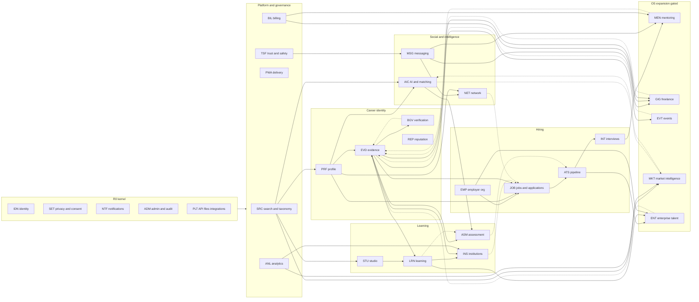

# 07 — Module Map and Dependencies

How the 30 modules relate: who owns each core entity, which modules depend on which, the build order those dependencies imply, and the shared services every module uses. Module files in [`02_MODULES/`](../02_MODULES/) own their detail; where this file and a module file disagree on ownership, this file is the arbiter until the conflict is recorded and decided (`BR-XCT-002`). Entity names below are product-level names; module files assign `ENT-` ids.

## 1. Modules by group

| Group | Modules | Role in the career OS |
|---|---|---|
| Foundation | `IDN`, `SET`, `NTF` | Identity, privacy and consent, communication channels |
| Governance | `TSF`, `ADM` | Safety, moderation, operations, audit |
| Platform | `SRC`, `ANL`, `PWA`, `PLT` | Discovery, measurement, delivery surfaces, integration and files |
| Career identity | `PRF`, `EVD`, `BGV` | The person's record and its verification |
| Engagement | `REP` | Recognition |
| Learning | `LRN`, `STU`, `ASM` | Learning, authoring, assessment |
| Institutions | `INS` | Managed learning and placement |
| Hiring | `JOB`, `ATS`, `INT`, `EMP` | Marketplace, pipeline, interviews, employer tenant |
| Social | `NET`, `MSG` | Network and messaging |
| Intelligence | `AIC` | Matching, recommendations, AI assistance |
| Commercial | `BIL` | Plans, payments, entitlements |
| OS expansion (gated `OD-PRD-02`) | `MEN`, `GIG`, `EVT`, `MKT`, `ENT` | Career services beyond hiring and learning |

## 2. Module relationship diagram

Solid edges are hard dependencies (the module cannot function without the target); dotted edges are soft (degrades gracefully). The R0 kernel is drawn as one node to keep the diagram readable; every module depends hard on it.

The dotted edges from the expansion modules back to `EVD` show the evidence they emit through `EVD`'s intake contract; `EVD` does not depend on them (02 §6).

## 3. Ownership of core and shared entities

One owner per entity. "Writes via" names how other modules change the entity: by calling the owner's command contract, never by writing its tables. [SRC: SSOT §12.5 data and change ownership; DER]

| Entity | Owner | Readers (main) | Writes via | Notes |
|---|---|---|---|---|
| Account, credential factor, session, device | `IDN` | All | `IDN` commands | Account states per SSOT V61-18 |
| Role grant, active context, delegation | `IDN` | Policy service, `EMP`, `INS`, `ADM` | Grant commands from `EMP`, `INS`, `ADM` | `EMP` and `INS` request grants; `IDN` stores them |
| Policy decision (capability evaluation) | `IDN` (policy service) | All | n/a — computed | Derived from [04](04_PERMISSION_MATRIX.md) as data |
| Consent grant, consent ledger, scope catalogue | `SET` | All reading others' data | `SET` commands | `JOB` records the snapshot grant through `SET` |
| Data-rights request, legal hold, retention policy | `SET` | `ADM`, owning modules | `SET` orchestrates; modules execute erasure of their own data | |
| Visibility setting (field level) | `SET` | `PRF`, `EVD`, `SRC` | `SET` commands | |
| Notification, preference, template, delivery record | `NTF` | All | `NTF` send contract | Templates for tenants customized via `NTF` |
| Audit event | `ADM` | `SAD`, tenants (own scope) | Append-only audit contract | Append-only; subject by opaque reference |
| Support ticket, access session, feature flag, reference data (locations, currencies, reason-code catalogs) | `ADM` | All | `ADM` | |
| File object, media asset, scan result | `PLT` | All | `PLT` upload contract | Modules hold file references only |
| API client, API key, webhook subscription, delivery log, integration connection | `PLT` | `EMP`, `INS`, `ENT`, `ADM` | `PLT` | Keys bound to a tenant |
| Outbox event, background job | `PLT` | All | Each module writes its own outbox rows through the shared outbox library; `PLT` owns the delivery mechanism | Ownership of an event's meaning stays with the emitting module |
| Search index document | `SRC` | All search surfaces | Projection from owner events | Never a source of truth |
| Skill, occupation, taxonomy alias | `SRC` | `PRF`, `EVD`, `JOB`, `LRN`, `ASM`, `AIC`, `MKT`, `ENT` | `SRC` curation (by `PAD`) | Single taxonomy for all modules |
| Saved search, job alert | `SRC` | `NTF` | `SRC` | |
| Profile, experience entry, education entry, résumé variant, portfolio project | `PRF` | `JOB`, `ATS`, `SRC`, `AIC`, `NET`, `MEN`, `GIG` | `PRF` | Experience entries link to `EVD` items |
| Evidence item, evidence version, rung, credential, verification URL | `EVD` | All | `EVD` intake contract (from `LRN`, `ASM`, `BGV`, `INS`, `ATS`, `MEN`, `GIG`, `EVT`, `ENT`) | Only `EVD` changes a rung (`BR-XCT-068`) |
| Verification request (referee, email, domain), background-check order, identity check | `BGV` | `EVD`, `ATS`, `EMP`, `INS` | `BGV` | `BGV` emits outcomes; `EVD` decides rung |
| Org verification record | `BGV` | `EMP`, `INS`, `JOB` | `BGV` | Used for employers and institutions |
| Badge definition, badge award, XP ledger, reputation signal | `REP` | `PRF`, `SRC` | `REP` | Never a ranking input by popularity (`BR-XCT-073`) |
| Course, course version, lesson, learning path (content) | `STU` | `LRN`, `INS`, `ENT`, `SRC` | `STU` | Authoring lifecycle including publish |
| Catalog listing, enrollment, progress, note, course review, certificate issuance request | `LRN` | `INS`, `ENT`, `ANL`, `EVD` | `LRN` | Certificates become `EVD` credentials |
| Assessment, question bank, attempt, submission, rubric grade, peer review, accommodation, integrity flag | `ASM` | `LRN`, `ATS`, `INS`, `TSF`, `EVD` | `ASM` | Integrity cases escalate into `TSF` cases |
| Employer org, division, team, membership, brand page, agency engagement, company review | `EMP` | `JOB`, `ATS`, `INT`, `ENT`, `SRC` | `EMP` | Reviews authored by users but stored and moderated in `EMP` with `TSF` |
| Job posting, screening question, application, application snapshot, candidate-visible status, withdrawal | `JOB` | `ATS`, `SRC`, `AIC`, `INS`, `NET` | `JOB` | Candidate-visible status is derived from `ATS` stage by a mapping `ATS` publishes |
| Requisition, hiring team, pipeline template, pipeline position, evaluative note, offer, hiring decision, post-hire outcome | `ATS` | `INT`, `ANL`, `ENT` | `ATS` | `ATS` asks `JOB` to update candidate-visible status |
| Interview loop, interview, slot, availability rule, scorecard, debrief | `INT` | `ATS`, `MEN` | `INT` | Scheduling engine is shared with `MEN` and `EVT` |
| Connection, follow, referral request, referral, community post, group | `NET` | `JOB`, `ATS`, `SRC` | `NET` | Posts and groups gated `OD-PRD-16` |
| Conversation, message, attachment reference, read receipt, outreach request | `MSG` | `ATS`, `NET`, `MEN`, `GIG`, `EVT`, `INS` | `MSG` | Threads typed by context |
| Match result, explanation, recommendation, AI interaction log, AI memory, AI cost ledger | `AIC` | `JOB`, `ATS`, `LRN`, `PRF` | `AIC` | Explanations deleted on `matching.recommend` revocation |
| Report, moderation case, action, appeal, policy rule | `TSF` | All UGC modules | `TSF` | |
| Institution, campus, department, program, cohort, batch, seat, faculty assignment, placement drive, graduation run | `INS` | `LRN`, `ASM`, `JOB`, `ANL` | `INS` | |
| Plan, price version, subscription, entitlement, invoice, payment, refund, dispute, payee, payout | `BIL` | All | `BIL` | Entitlement check is a shared service |
| Mentor profile, offering, booking, session note, rating | `MEN` | `PRF`, `EVD` | `MEN` | Gated |
| Service offering, project, proposal, contract, milestone, delivery, gig dispute | `GIG` | `EVD`, `BIL` | `GIG` | Gated |
| Event, registration, team, submission, judging score, result | `EVT` | `EVD`, `REP` | `EVT` | Gated |
| Career path, labour-market dataset, salary report, salary aggregate | `MKT` | `AIC`, `SRC` | `MKT` | Gated |
| Internal role, employee flag, skills inventory snapshot, learning mandate, HRIS mapping | `ENT` | `ATS`, `LRN`, `ANL` | `ENT` | Gated |
| Metric definition, aggregate dataset, dashboard, report export | `ANL` | All | `ANL` | Aggregation service enforces `BR-XCT-029` |
| Offline cache manifest, push subscription, extension install | `PWA` | `NTF` | `PWA` | Device-local data is never authoritative |

### 3.1 Ownership conflicts found and how they are settled here

| Contested entity | Contenders | Settled owner | Reason |
|---|---|---|---|
| Application | `JOB`, `ATS` | `JOB` owns the application and its candidate-visible status; `ATS` owns the pipeline position and everything evaluative | The candidate's act and the employer's process have different lifecycles and visibility |
| Skill taxonomy | `SRC`, `AIC`, `MKT`, `PRF` | `SRC` | Normalization belongs with search; `MKT` is gated and cannot own a core entity (02 §6) |
| Course | `STU`, `LRN` | `STU` for content and versions; `LRN` for enrollment and delivery | Authoring and learning have different users and states |
| Scheduling (slots, availability) | `INT`, `MEN`, `EVT` | `INT` | Core module; expansion modules consume it |
| Company review | `EMP`, `NET`, `TSF` | `EMP` (moderated through `TSF`) | Displayed on the employer page; org cannot edit (04 matrix `EMP.review.*`) |
| Verification outcome vs rung | `BGV`, `EVD` | `BGV` owns the verification case; `EVD` owns the rung | One place moves the ladder |
| Audit log | `ADM`, `IDN`, `PLT` | `ADM` | Operations and security review live in the console |
| Credential issuance by institutions | `INS`, `EVD` | `EVD` stores and serves; `INS` requests issuance | Single credential model |

## 4. Dependency matrix

Rows depend on columns. `H` hard, `S` soft, `K` kernel co-dependency (the R0 kernel modules are built together), `—` self.

| Depends on → | IDN | SET | NTF | ADM | PLT | ANL | PWA | TSF | BIL | PRF | EVD | BGV | SRC | LRN | STU | ASM | JOB | ATS | INT | EMP | NET | MSG | AIC | INS | REP | MEN | GIG | EVT | MKT | ENT |
|---|---|---|---|---|---|---|---|---|---|---|---|---|---|---|---|---|---|---|---|---|---|---|---|---|---|---|---|---|---|---|
| **IDN** | — | K | K | K | K | S | S |  |  |  |  |  |  |  |  |  |  |  |  |  |  |  |  |  |  |  |  |  |  |  |
| **SET** | K | — | K | K | K |  |  |  |  |  |  |  |  |  |  |  |  |  |  |  |  |  |  |  |  |  |  |  |  |  |
| **NTF** | K | K | — | K | K |  | S |  |  |  |  |  |  |  |  |  |  |  |  |  |  |  |  |  |  |  |  |  |  |  |
| **ADM** | K | K | K | — | K |  |  |  |  |  |  |  |  |  |  |  |  |  |  |  |  |  |  |  |  |  |  |  |  |  |
| **PLT** | K | K | K | K | — |  |  | S |  |  |  |  |  |  |  |  |  |  |  |  |  |  |  |  |  |  |  |  |  |  |
| **ANL** | H | H |  | H |  | — |  |  |  |  |  |  |  |  |  |  |  |  |  |  |  |  |  |  |  |  |  |  |  |  |
| **PWA** | H |  | S |  | H |  | — |  |  |  |  |  |  |  |  |  |  |  |  |  |  |  |  |  |  |  |  |  |  |  |
| **TSF** | H |  | H | H | H |  |  | — |  |  |  |  |  |  |  |  |  |  |  |  |  | S | S |  |  |  |  |  |  |  |
| **BIL** | H | H | H | H | S |  |  |  | — |  |  |  |  |  |  |  |  |  |  |  |  |  |  |  |  |  |  |  |  |  |
| **PRF** | H | H | S |  | H |  |  | S |  | — | S |  | H |  |  |  |  |  |  |  |  |  | S |  |  |  |  |  |  |  |
| **EVD** | H | H | H | H | H |  |  | S |  | H | — | S | H |  |  |  |  |  |  |  |  |  |  |  |  |  |  |  |  |  |
| **BGV** | H | H | H |  | S |  |  | S | S |  | H | — |  |  |  |  |  |  |  | S |  |  |  |  |  |  |  |  |  |  |
| **SRC** | H | H |  | H | S |  |  |  |  |  |  |  | — |  |  |  |  |  |  |  |  |  | S |  |  |  |  |  |  |  |
| **LRN** | H |  | H |  | H |  | S |  | S |  | H |  | H | — | H | S |  |  |  |  |  |  |  |  | S |  |  |  |  |  |
| **STU** | H |  |  | H | H |  |  | H | S |  |  |  | H |  | — |  |  |  |  |  |  |  |  |  |  |  |  |  |  |  |
| **ASM** | H |  |  |  | H |  |  | S |  |  | H |  | H | S |  | — |  |  |  |  |  |  | H |  |  |  |  |  |  |  |
| **JOB** | H | H | H |  |  |  |  | H | S | H | H |  | H |  |  |  | — |  |  | H |  |  | S |  |  |  |  |  |  |  |
| **ATS** |  |  | H |  |  | S |  |  |  |  | H | S |  |  |  | S | H | — | S | H |  | S | S |  |  |  |  |  |  |  |
| **INT** |  |  | H |  | S |  |  |  |  |  |  |  |  |  |  |  |  | H | — | H |  | S |  |  |  |  |  |  |  |  |
| **EMP** | H |  | H | H | S |  |  | S | S |  |  | S |  |  |  |  |  |  |  | — |  |  |  |  |  |  |  |  |  |  |
| **NET** | H | H | H |  |  |  |  | H |  | H |  |  |  |  |  |  | S |  |  |  | — | H |  |  |  |  |  |  |  |  |
| **MSG** | H | H | H |  | S |  |  | H |  |  |  |  |  |  |  |  |  |  |  |  |  | — |  |  |  |  |  |  |  |  |
| **AIC** | H | H |  | H |  |  |  |  | S | H | S |  | H |  |  |  |  |  |  |  |  |  | — |  |  |  |  |  | S |  |
| **INS** | H | H | H |  |  | H |  |  | S |  | H |  |  | H |  |  | S |  | S | S |  |  |  | — |  |  |  |  |  |  |
| **REP** | H |  |  |  |  |  |  | S |  |  | S |  |  | S |  | S |  |  |  |  | S |  |  |  | — |  |  |  |  |  |
| **MEN** | H | H |  |  |  |  |  | H | H | H | S |  |  |  |  |  |  |  | H |  |  | H |  |  |  | — |  |  |  |  |
| **GIG** | H |  |  |  |  |  |  | H | H | H | H | S |  |  |  |  |  |  |  |  |  | H |  |  |  |  | — |  |  |  |
| **EVT** | H |  | H |  |  |  |  | H | S |  | H |  |  |  |  | S |  |  |  |  | S | S |  |  | S |  |  | — |  |  |
| **MKT** |  | H |  |  |  | H |  |  |  |  |  |  | H |  |  |  | S |  |  |  |  |  | S |  |  |  |  |  | — |  |
| **ENT** |  | H |  |  | S | H |  |  |  | H |  |  |  | H |  |  |  | H |  | H |  |  |  |  |  |  |  |  |  | — |

## 5. Dependencies by module

| Module | Hard dependencies | Soft dependencies | Depended on by |
|---|---|---|---|
| IDN | NTF, ADM, SET, PLT | ANL, PWA | SET (K), NTF (K), ADM (K), PLT (K), ANL (H), PWA (H), TSF (H), BIL (H), PRF (H), EVD (H), BGV (H), SRC (H), LRN (H), STU (H), ASM (H), JOB (H), EMP (H), NET (H), MSG (H), AIC (H), INS (H), REP (H), MEN (H), GIG (H), EVT (H) |
| SET | IDN, NTF, ADM, PLT | none | IDN (K), NTF (K), ADM (K), PLT (K), ANL (H), BIL (H), PRF (H), EVD (H), BGV (H), SRC (H), JOB (H), NET (H), MSG (H), AIC (H), INS (H), MEN (H), MKT (H), ENT (H) |
| NTF | IDN, SET, ADM, PLT | PWA | IDN (K), SET (K), ADM (K), PLT (K), PWA (S), TSF (H), BIL (H), PRF (S), EVD (H), BGV (H), LRN (H), JOB (H), ATS (H), INT (H), EMP (H), NET (H), MSG (H), INS (H), EVT (H) |
| ADM | IDN, SET, NTF, PLT | none | IDN (K), SET (K), NTF (K), PLT (K), ANL (H), TSF (H), BIL (H), EVD (H), SRC (H), STU (H), EMP (H), AIC (H) |
| PLT | IDN, SET, ADM, NTF | TSF | IDN (K), SET (K), NTF (K), ADM (K), PWA (H), TSF (H), BIL (S), PRF (H), EVD (H), BGV (S), SRC (S), LRN (H), STU (H), ASM (H), INT (S), EMP (S), MSG (S), ENT (S) |
| ANL | IDN, SET, ADM | none | IDN (S), ATS (S), INS (H), MKT (H), ENT (H) |
| PWA | IDN, PLT | NTF | IDN (S), NTF (S), LRN (S) |
| TSF | IDN, NTF, ADM, PLT | MSG, AIC | PLT (S), PRF (S), EVD (S), BGV (S), STU (H), ASM (S), JOB (H), EMP (S), NET (H), MSG (H), REP (S), MEN (H), GIG (H), EVT (H) |
| BIL | IDN, NTF, ADM, SET | PLT | BGV (S), LRN (S), STU (S), JOB (S), EMP (S), AIC (S), INS (S), MEN (H), GIG (H), EVT (S) |
| PRF | IDN, SET, PLT, SRC | NTF, AIC, EVD, TSF | EVD (H), JOB (H), NET (H), AIC (H), MEN (H), GIG (H), ENT (H) |
| EVD | PRF, IDN, SET, PLT, SRC, NTF, ADM | BGV, TSF | PRF (S), BGV (H), LRN (H), ASM (H), JOB (H), ATS (H), AIC (S), INS (H), REP (S), MEN (S), GIG (H), EVT (H) |
| BGV | EVD, IDN, NTF, SET | PLT, BIL, EMP, TSF | EVD (S), ATS (S), EMP (S), GIG (S) |
| SRC | IDN, SET, ADM | PLT, AIC | PRF (H), EVD (H), LRN (H), STU (H), ASM (H), JOB (H), AIC (H), MKT (H) |
| LRN | IDN, STU, SRC, EVD, NTF, PLT | BIL, REP, PWA, ASM | ASM (S), INS (H), REP (S), ENT (H) |
| STU | IDN, PLT, TSF, ADM, SRC | BIL | LRN (H) |
| ASM | IDN, EVD, AIC, PLT, SRC | TSF, LRN | LRN (S), ATS (S), REP (S), EVT (S) |
| JOB | IDN, EMP, PRF, EVD, SET, SRC, NTF, TSF | BIL, AIC | ATS (H), NET (S), INS (S), MKT (S) |
| ATS | JOB, EMP, NTF, EVD | MSG, INT, ASM, BGV, AIC, ANL | INT (H), ENT (H) |
| INT | ATS, EMP, NTF | PLT, MSG | ATS (S), INS (S), MEN (H) |
| EMP | IDN, NTF, ADM | PLT, BGV, BIL, TSF | BGV (S), JOB (H), ATS (H), INT (H), INS (S), ENT (H) |
| NET | IDN, PRF, SET, MSG, TSF, NTF | JOB | REP (S), EVT (S) |
| MSG | IDN, SET, NTF, TSF | PLT | TSF (S), ATS (S), INT (S), NET (H), MEN (H), GIG (H), EVT (S) |
| AIC | IDN, SET, PRF, SRC, ADM | EVD, BIL, MKT | TSF (S), PRF (S), SRC (S), ASM (H), JOB (S), ATS (S), MKT (S) |
| INS | IDN, LRN, EVD, NTF, SET, ANL | JOB, EMP, BIL, INT | none |
| REP | IDN | EVD, LRN, ASM, NET, TSF | LRN (S), EVT (S) |
| MEN | IDN, PRF, INT, MSG, BIL, TSF, SET | EVD | none |
| GIG | IDN, PRF, MSG, BIL, TSF, EVD | BGV | none |
| EVT | IDN, NTF, TSF, EVD | ASM, NET, REP, BIL, MSG | none |
| MKT | SRC, ANL, SET | JOB, AIC | AIC (S) |
| ENT | EMP, ATS, LRN, PRF, ANL, SET | PLT | none |
