# ADM — Admin Console, Support & Operations

Status: intended product specification. Nothing in this file claims anything is built. Legacy inputs: `SSOT.md` F-17, F-35, F-83, BR-28, BR-29; `Yash_Final_Project_Document/18_OPERATIONS_AND_SUPPORT`.

## 1. Purpose, outcomes and boundaries

**Purpose.** ADM is the back office of TalentSphere: the one governed place where staff run the platform, help users, control risk and prove what they did. [DER]

**Outcomes.**

1. A support agent resolves a user problem without database access, and every look at personal data is justified, time-boxed and recorded. [DER]
2. A platform admin can stop a misbehaving feature in minutes (flag, kill switch, maintenance mode) without a deploy. [SRC: SSOT F-35, BR-28] [DER]
3. No single staff member can perform a destructive or financially significant action alone (two-person approval, break-glass review). [SRC: SSOT BR-29] [DER]
4. Every administrative action is attributable, reasoned, reversible where possible, and visible in an append-only audit trail. [SRC: SSOT BR-29]
5. Operations staff see the real state of the platform (health, queues, incidents) and never a falsely green view: unknown is shown as unknown. [SRC: SSOT §20.2, BR-28]

### 1.1 In scope

Admin console information architecture and authentication hardening; user, organization and institution administration; role and permission administration; privileged access grants, break-glass and two-person approval; feature flags, kill switches and configuration management; announcements and maintenance; the support desk (tickets, SLAs, macros, impersonation, knowledge base, CSAT); the content CMS for landing, help and legal pages; the audit log viewer; the data-request handling console; finance and operations tooling; the job queue and dead-letter console; incident tooling; the platform health dashboard; bulk operations and admin exports.

### 1.2 Out of scope (owned elsewhere)

| Capability | Owner | ADM relationship |
|---|---|---|
| Authentication, sessions, MFA, passkeys for end users | IDN | ADM consumes force-logout, session revoke, credential-reset APIs |
| Consent records, data export and erasure execution, legal-hold flag | SET | ADM provides the staff queue and decisions; SET executes |
| Moderation queues, reports, appeals, sanctions | TSF | ADM links to TSF cases; does not duplicate moderation tooling |
| Plans, entitlements, invoices, payment provider state | BIL | ADM provides refund and dispute tooling that calls BIL |
| Notification delivery, templates, channels | NTF | ADM publishes announcements through NTF and in-app banner surface |
| Job queue engine, scheduler, outbox | PLT | ADM owns the console over PLT's job platform |
| Metrics definitions and dashboards for product analytics | ANL | ADM owns only the platform-health dashboard |
| Employer-side org admin (teams, brand) | EMP | ADM administers orgs from the platform side only |
| Institution-side admin (cohorts, roster) | INS | ADM administers institutions from the platform side only |
| Human-resources, payroll or staff scheduling for TalentSphere's own employees | none | Out of scope (SSOT §4.2 non-goal: not generic HR) |

### 1.3 Owned versus consumed

ADM **owns**: admin roles and assignments, privileged grants, approval requests, the audit event store and its viewer, feature flags, kill switches, configuration entries, announcements, tickets and the knowledge base, CMS pages, incident records and impersonation sessions. ADM **consumes**: user, org and institution records (read and administrative-state write through owning modules' APIs), billing operations (BIL), data-rights execution (SET), job engine (PLT), moderation cases (TSF).

### 1.4 Principles

- **Administrative actions go through the product, never around it.** No direct database edits as an operating procedure. [SRC: Yash 18 PROC-01]
- **Least privilege by default and by time.** Standing access is narrow and read-mostly; wider access is granted for a stated reason and expires. [DER]
- **Masked by default.** Personal data in admin views is masked until a justified unmask. [DER]
- **Unknown is not healthy.** [SRC: SSOT §20.2]
- **Admin surfaces are a separate trust zone:** separate origin, stricter session policy, never cached offline (see PWA, FR-PWA-008). [DER]

## 2. Roles and permission matrix

Roles use the canonical codes: `SUP` Support Agent, `MOD` Moderator, `FIN` Finance Operator, `PAD` Platform Admin, `SAD` Super Admin / Security Officer. `EAD` and `IAD` appear only where they interact with support. Support lead and finance lead are **admin role variants** with extra capabilities (not new canonical roles): `SUP-L` (SUP + approver/queue management) and `FIN-L` (FIN + approver). [PROP]

Legend: **R** read, **W** write, **A** approve, **M** masked read (PII masked), **G** read after active grant, **2P** requires two-person approval, **—** none.

| Capability | SUP | SUP-L | MOD | FIN | FIN-L | PAD | SAD |
|---|---|---|---|---|---|---|---|
| Console access (with step-up MFA) | R | R | R | R | R | R | R |
| User directory search | M | M | M | M | M | M | M |
| Unmask user PII (grant + ticket) | G | G | G | G | G | G | G |
| Suspend / reinstate account | — | W | W (via TSF) | — | — | W | W |
| Force logout, trigger credential reset | W | W | — | — | — | W | W |
| Merge accounts | — | — | — | — | — | W + 2P | W + 2P |
| Delete / erase account | — | — | — | — | — | 2P (via SET) | 2P (via SET) |
| Org approve / suspend | — | W | — | — | — | W | W |
| Institution onboarding and tenant config | — | — | — | — | — | W | W |
| Admin role assignment | — | — | — | — | — | W (not SAD-tier) + 2P | W + 2P |
| Privileged grant request | W | W | W | W | W | W | W |
| Privileged grant approval | — | A (SUP scope) | — | — | A (FIN scope) | A | A |
| Break-glass invoke | — | — | — | — | — | W | W |
| Feature flag read | R | R | R | R | R | R | R |
| Feature flag write (non-prod / prod) | — | — | — | — | — | W / W | W / W |
| Kill switch activate | — | — | W (TSF-scope switches) | — | — | W | W |
| Kill switch deactivate | — | — | — | — | — | W | W |
| Config read / write | — | — | — | — | — | R / W | R / W |
| Config write on security-class keys | — | — | — | — | — | — | W + 2P |
| Announcements and maintenance | — | W (drafts) | — | — | — | W | W |
| Tickets (own queue / all queues) | W / — | W / W | — | — | — | W / W | R / R |
| Macros author | — | W | — | — | — | W | — |
| Impersonation start | W (consented, read-only) | W | — | — | — | W | W (2P for non-consented) |
| Knowledge base author / publish | W / — | W / W | — | — | — | W / W | — |
| CMS page edit / publish | — | — | — | — | — | W / W | W / W |
| Legal page publish | — | — | — | — | — | W + 2P | W + 2P |
| Audit log viewer | scoped R | scoped R | scoped R | scoped R | scoped R | R | R (all) |
| Audit export | — | — | — | — | — | W | W |
| Data-request console | W (intake only) | W | — | — | — | W | W |
| Refund / dispute actions | — | — | — | W (below threshold) | W + A | — | R |
| Job queue / DLQ console | — | — | — | — | — | W | R |
| Incident declare / command | W (declare) | W (declare) | — | — | — | W | W |
| Platform health dashboard | R | R | R | R | R | R | R |
| Bulk operations | — | — | — | — | — | W | W |

Separation rules: the requester of a 2P action can never approve it; `SAD` role assignments require a second `SAD`; no role can grant a permission it does not itself hold (BR-ADM-023). [DER]

## 3. Sub-module map

| Code | Sub-module | Features |
|---|---|---|
| A | Console foundation and access | FR-ADM-001 to FR-ADM-004 |
| B | Entity administration | FR-ADM-005 to FR-ADM-008 |
| C | Privileged access and approvals | FR-ADM-009 to FR-ADM-013 |
| D | Platform controls | FR-ADM-014 to FR-ADM-019 |
| E | Support desk | FR-ADM-020 to FR-ADM-028 |
| F | Content CMS | FR-ADM-029 to FR-ADM-031 |
| G | Oversight and compliance | FR-ADM-032 to FR-ADM-034 |
| H | Finance and operations | FR-ADM-035 to FR-ADM-039 |

## 4. Feature specifications

Common conventions used by every feature below (not repeated in each field):

- **Reason code.** A mutation by staff carries a reason code chosen from the catalogue plus free text where stated. Catalogue is configuration (`admin.reasonCodes`). [DER]
- **Audit.** Every mutation writes an audit event (`EVT-ADM-*` as listed, plus the generic `admin.action.performed` envelope) with actor, role, target, before and after summary, reason, request id, source IP and session id. BR-ADM-002.
- **Step-up.** Mutations tagged "step-up" require a successful MFA challenge within the last 15 minutes. BR-ADM-001.
- **Error envelope.** API errors use the platform problem+json shape (FR-PLT-008). Staff-facing messages state what happened and what to do next.
- **Accessibility.** The console meets WCAG 2.1 AA: full keyboard operation, visible focus, no information by color alone, tables with proper headers, live regions for async status. [DER]

### A. Console foundation and access

### FR-ADM-001 — Admin console shell and information architecture

- **Sub-module:** A. Console foundation and access
- **Priority / tier:** Must · R0
- **Source:** [SRC: SSOT F-17 Admin Console] · [DER] for the section layout
- **Purpose and outcome:** Staff reach every back-office tool through one role-scoped shell with predictable navigation; the system knows it works when a staff member can reach any permitted tool in at most three clicks and never sees a tool they cannot use.
- **Roles and permissions:** `SUP, SUP-L, MOD, FIN, FIN-L, PAD, SAD: view shell (items filtered by permission)` · `GUE, CAN, STD, REC, EAD, IAD: no access (404, not 403)`
- **Preconditions and entry points:** A staff identity with at least one admin role and a completed step-up login (FR-ADM-002). Entry: the admin origin root; deep links from ticket email notifications; the command palette.
- **User interactions and actions:** 1. Sign in at the admin origin. 2. Land on the role-specific home (support queue for SUP, finance worklist for FIN, health overview for PAD). 3. Use the left navigation sections: Home, People (users, orgs, institutions), Support, Content, Platform Controls, Operations, Finance, Compliance, Audit, Settings. 4. Press `Ctrl/Cmd+K` to open the command palette and jump to any permitted page, ticket id, user id or org id. 5. Pin up to 8 favorites. 6. Switch the environment indicator (read-only label: production, staging) which cannot be changed from the UI.
- **System behaviour:** Navigation is generated from the caller's effective permissions (role grants plus active privileged grants). The shell shows a persistent environment banner (red band in production for write-capable roles), the active grant countdown if any, an open-approval count, and an incident banner if a P0 or P1 incident is open. Page loads are lazily code-split and never precached by the service worker (FR-PWA-008). Unknown routes return a neutral not-found page.
- **UI elements and controls:** Left nav (collapsible, default expanded on desktop, drawer on narrow screens); top bar with environment label, grant timer, approvals badge, incident badge, search field (command palette trigger), profile menu with "End admin session"; breadcrumbs; page title with a "Why am I seeing this?" popover listing the permission that grants access.
- **Configuration options:** Platform: navigation catalogue and permission mapping (code-defined). User: favorites, density (comfortable default, compact), table column choices (persisted per user). Org: n/a — back office is platform-level.
- **Business rules:** BR-ADM-001, BR-ADM-026
- **Validation:** Favorites limit 8; each favorite must be a route the user can currently access; invalid favorites are dropped silently on next load and the user is told once.
- **Inputs and outputs:** Input: session identity and effective permissions. Output: rendered shell, navigation model, badge counts.
- **Filters, sorting, search:** Command palette searches permitted pages, ticket ids (`T-` prefix), user ids and emails (masked results), org names. Results are authorization-filtered server-side before display; unauthorized entities never appear even as counts.
- **Notifications and communication:** None directly. Badge counts update by polling every 30 seconds while focused (no push for admin surfaces).
- **Error handling and edge cases:** Permission removed mid-session: the next request returns 403 with `permission_revoked`; the shell reloads navigation and shows "Your access changed". Badge service down: badges show a dash, not zero. Two tabs open: environment and grant timer stay in sync via the session endpoint. Session expiry: unsaved form content is retained in memory for re-auth and discarded if the identity differs.
- **Dependencies:** FR-ADM-002, FR-ADM-007, ENT-ADM-01, ENT-ADM-02; IDN session service.
- **Security and privacy:** Server enforces every route and API; client hiding is cosmetic. Admin origin is separate from the product origin with a strict CSP. Not indexable (`noindex`, `robots` disallow).
- **Acceptance criteria:**
  - Given a `SUP` user, when the shell loads, then Finance and Platform Controls sections are absent and a direct URL to `/finance` returns not-found.
  - Given a PAD user with an active P0 incident, when any page loads, then the incident banner links to the incident room.
  - Given the badge service is failing, when the shell loads, then badges render as "–" and no count is shown as 0.

### FR-ADM-002 — Admin authentication hardening and session policy

- **Sub-module:** A. Console foundation and access
- **Priority / tier:** Must · R0
- **Source:** [DER] standard practice for privileged consoles; builds on [SRC: SSOT BR-29]
- **Purpose and outcome:** Staff sessions are short, strongly authenticated and bound to a managed context; a stolen cookie or a phished password is not enough to act as staff.
- **Roles and permissions:** `all staff roles: sign in, step up` · `SAD: edit session policy with 2P`
- **Preconditions and entry points:** Staff account provisioned through FR-ADM-007 with at least one phishing-resistant factor (passkey or security key) enrolled. Entry: admin origin login page.
- **User interactions and actions:** 1. Enter work email; the system routes to the organization SSO (OIDC or SAML, FR-PLT-021) if configured, otherwise to passkey login. 2. Authenticate with a passkey or security key. 3. On mutation tagged step-up, a modal asks for re-authentication with the passkey. 4. A session shows remaining time; the user can extend once while within the absolute limit. 5. "End admin session" signs out everywhere on the admin origin.
- **System behaviour:** Admin sessions are separate from end-user sessions and never share cookies (distinct origin, `__Host-` prefixed cookies, SameSite strict). Idle timeout 30 minutes, absolute lifetime 8 hours `[PROP]`. Step-up validity 15 minutes `[PROP]`. Concurrent sessions: max 2 per staff identity; a third revokes the oldest. Network policy: optional IP/network allowlist per role (VPN egress ranges). Impossible-travel check against previous admin login; a trigger forces re-authentication and alerts SAD. Password-only and SMS factors are not accepted for staff. All sign-ins, step-ups, failures and revocations are audited.
- **UI elements and controls:** Login form with "Sign in with SSO" and "Use passkey" buttons; step-up modal with explanation of the action about to run; session-expiry warning toast at 5 minutes remaining; error banners.
- **Configuration options:** Platform: idle timeout, absolute lifetime, step-up validity, allowlist ranges per role, max concurrent sessions, SSO enforcement (default on once SSO configured). Changing any of these is a security-class config (BR-ADM-012).
- **Business rules:** BR-ADM-001, BR-ADM-026
- **Validation:** Allowlist entries must be valid CIDR; a change that would lock out the editor's own current IP is rejected with a message. Timeout bounds: idle 5 to 60 minutes, absolute 1 to 12 hours.
- **Inputs and outputs:** Input: credentials, passkey assertion. Output: admin session cookie, step-up claim with timestamp.
- **Filters, sorting, search:** n/a — authentication flow.
- **Notifications and communication:** Email to the staff member and a SAD digest on new-device admin sign-in, impossible-travel block, and session policy change. Class: security, non-optional.
- **Error handling and edge cases:** Lost passkey: recovery only through SAD-assisted re-enrollment with a second SAD approval and out-of-band identity check (no self-service recovery for staff). SSO outage: break-glass local accounts exist only for SAD and are monitored (FR-ADM-011). Clock skew on assertions beyond 60 seconds: reject with "device clock out of sync". Repeated failures: 5 failures in 10 minutes lock the staff identity for 15 minutes and alert SAD.
- **Dependencies:** IDN passkey and session primitives (planned), FR-PLT-021, FR-ADM-007.
- **Security and privacy:** Staff credentials and assertions never logged; session ids hashed in audit; admin cookie not readable by scripts; admin origin refuses framing.
- **Acceptance criteria:**
  - Given a staff member idle for 31 minutes, when they click any action, then they are redirected to login and no action executes.
  - Given a mutation tagged step-up and the last step-up was 20 minutes ago, when the user submits, then a passkey challenge appears and the mutation is held until it succeeds.
  - Given a login from a new country 10 minutes after one from another, when the second succeeds at the credential step, then the session is blocked, SAD is alerted and the staff member sees "Sign-in blocked for review".

### FR-ADM-003 — Command palette and global admin search

- **Sub-module:** A. Console foundation and access
- **Priority / tier:** Should · R1
- **Source:** [PROP] (modeled on internal tools at large SaaS support teams)
- **Purpose and outcome:** Staff find a user, org, ticket, job, flag or audit event by identifier in seconds, which shortens every support and ops task.
- **Roles and permissions:** `all staff roles: search (results filtered by permission)`
- **Preconditions and entry points:** Active admin session. Entry: `Ctrl/Cmd+K` or the search field in the top bar.
- **User interactions and actions:** 1. Open the palette. 2. Type an identifier or phrase; prefix filters narrow types: `user:`, `org:`, `ticket:`, `flag:`, `job:`, `audit:`. 3. Use arrow keys to move, `Enter` to open, `Ctrl+Enter` to open in a new tab. 4. Recent items appear when the field is empty.
- **System behaviour:** Exact-id match first, then email and name prefix (users are shown masked), then full-text across org names, ticket subjects and flag keys. Each search is rate-limited and logged with the query hash only (not the plain text) when it targets personal data. Searching by email for an unmask-protected field returns the user only when the exact email is typed in full (prevents browsing).
- **UI elements and controls:** Modal dialog with combobox input, grouped result list, type chips, keyboard hints. States: empty (recent), loading skeleton, no results, error with retry.
- **Configuration options:** Platform: result limit per group (default 5), searchable entity types per role.
- **Business rules:** BR-ADM-005, BR-ADM-002
- **Validation:** Query 2 to 200 characters. Email-style queries must be a complete address. Wildcard characters are treated literally.
- **Inputs and outputs:** Input: query string, type filters. Output: grouped, permission-filtered results with deep links.
- **Filters, sorting, search:** Type chips; ordering by exact match, recency, relevance.
- **Notifications and communication:** none.
- **Error handling and edge cases:** More than 20 searches by email in one minute: throttled with "Too many lookups; slow down" and an audit flag for anomaly review (FR-ADM-013 alert). Search backend unavailable: palette falls back to id-only exact lookups.
- **Dependencies:** FR-ADM-001, SRC platform search (planned), FR-ADM-032.
- **Security and privacy:** Server-side authorization per result; no result counts leak existence of entities the role cannot see; query text of PII lookups not stored.
- **Acceptance criteria:**
  - Given a SUP user, when they type `flag:`, then no flag results appear because SUP has read-only visibility only through the flag page, and the palette shows "No access".
  - Given a user types a partial email, when results load, then no user is returned and the palette says "Enter the full email".
  - Given 21 email lookups in a minute, when the 21st is sent, then it is throttled and an anomaly event is recorded.

### FR-ADM-004 — Admin notes, reason codes and action envelope

- **Sub-module:** A. Console foundation and access
- **Priority / tier:** Must · R0
- **Source:** [SRC: SSOT BR-29 confirmation + audit + rollback] · [SRC: Yash 18 PROC common controls]
- **Purpose and outcome:** Every admin mutation uses one consistent action envelope (reason, confirmation, audit, rollback hint) so actions are reviewable and where possible reversible.
- **Roles and permissions:** `all staff roles: perform actions they are otherwise permitted` · `SAD: manage reason-code catalogue`
- **Preconditions and entry points:** Any admin mutation dialog. Internal notes appear on user, org, ticket and case detail pages.
- **User interactions and actions:** 1. Trigger an action (for example, "Suspend account"). 2. A confirmation dialog states the effect in plain words and lists side effects (sessions revoked, notifications sent). 3. Select a reason code; add free text where the catalogue marks it required. 4. Type the target's short id for destructive actions to confirm. 5. Submit. 6. Success toast offers "Undo" when the action has a defined inverse and the undo window is open. 7. Add internal notes with `@` mentions of staff.
- **System behaviour:** The envelope is a single server contract: `{action, target, reasonCode, reasonText, idempotencyKey, expectedVersion}`. Server rejects missing reasons, stale `expectedVersion` (409) and duplicate idempotency keys (returns the first result). The inverse is registered at execution time with an expiry (default 15 minutes for suspend, role change; none for erase). Internal notes are append-only, timestamped, attributed, and not visible to end users; note text is run through secret and credential pattern detection (blocks pasted tokens or passwords).
- **UI elements and controls:** Reason select (required), free-text area (counter, required for catalogue items flagged), confirmation text field for destructive class, "Undo" snackbar button (visible 15 minutes via "Recent actions" menu), note composer with mention picker.
- **Configuration options:** Platform: reason-code catalogue (code, label, requires-text flag, action classes), undo windows per action class, note retention.
- **Business rules:** BR-ADM-002, BR-ADM-003, BR-ADM-028
- **Validation:** Reason text 10 to 1000 characters when required; notes 1 to 5000 characters; reason code must belong to the action's class; typed confirmation must match the short id exactly (case-insensitive).
- **Inputs and outputs:** Input: action envelope. Output: result, audit event id, undo token if available.
- **Filters, sorting, search:** Recent-actions menu lists the actor's last 20 actions with filter by outcome.
- **Notifications and communication:** Mentions in notes email or in-console notify the mentioned staff (class: operational).
- **Error handling and edge cases:** Concurrent change by another admin: 409 with a diff and "Reload". Undo after the window: disabled with a tooltip. Note containing a detected secret: blocked with "Remove the credential before saving". Action fails after partial effects: system marks the audit event `partial` and opens a follow-up task in the actor's worklist.
- **Dependencies:** ENT-ADM-05, FR-ADM-032.
- **Security and privacy:** Notes are internal records that may still be disclosable under data-subject access; [DEC-REQ] OD-ADM-06 decides whether notes are included in access exports.
- **Acceptance criteria:**
  - Given a suspend action without a reason code, when submitted, then the API returns 422 `reason_required` and nothing changes.
  - Given a successful suspend, when the actor chooses Undo within 15 minutes, then the account returns to its previous state and a second audit event links to the first.
  - Given a note that contains a string matching a bearer-token pattern, when saved, then it is rejected and nothing is stored.

### B. Entity administration

### FR-ADM-005 — User directory and account lookup

- **Sub-module:** B. Entity administration
- **Priority / tier:** Must · R0
- **Source:** [SRC: SSOT F-17] · [SRC: Yash 18 PROC-01]
- **Purpose and outcome:** Support and admin staff locate an account and read its administrative facts (state, roles, org memberships, plan, flags, recent security events) with personal data masked, in under 30 seconds.
- **Roles and permissions:** `SUP, SUP-L, MOD, FIN, PAD, SAD: view masked` · `unmask: with active grant (FR-ADM-009)`
- **Preconditions and entry points:** Admin session; entry from People menu, command palette, ticket header user chip.
- **User interactions and actions:** 1. Search by exact user id, full email, handle, phone (full) or external reference. 2. Open the result. 3. Read tabs: Overview, Security, Memberships, Billing summary, Support history, Activity (non-content events), Consents. 4. Click an eye icon beside a masked field to request an unmask (opens the grant dialog). 5. Use "Copy user id".
- **System behaviour:** Masking shows first letter and domain of email, last 2 digits of phone, no date of birth, no address, no resume text, no message content, no assessment content (sealed classes, BR-ADM-017). Overview shows account state (`SM-ADM-10`), created date, last sign-in, verification statuses (as flags only), org and institution memberships. Every view of an unmasked field writes `admin.pii.viewed` with field names. Pages never show passwords, tokens, recovery codes or session secrets in any form.
- **UI elements and controls:** Search box with scope select; result table (id, masked name, state, plan, org); detail page with tab bar; state chip; "Request unmask" icon buttons; "Open in tickets" button.
- **Configuration options:** Platform: masking rules per field; sealed-class list; default tab per role.
- **Business rules:** BR-ADM-005, BR-ADM-017
- **Validation:** Search term must be an exact identifier shape (uuid, full email, handle, E.164 phone); partial matches are refused to prevent enumeration.
- **Inputs and outputs:** Input: identifier. Output: masked account detail view.
- **Filters, sorting, search:** Filter by account state, role, plan, org; sort by created, last sign-in. Listing is only available to PAD/SAD with a filter set; SUP can only look up by identifier.
- **Notifications and communication:** none.
- **Error handling and edge cases:** Account erased: detail shows tombstone with erasure date and retained financial-record reference only. Multiple accounts with one email (should not occur): show all with a data-integrity warning and open an engineering ticket automatically. Deactivated user: shown as read-only with restore options by permitted roles.
- **Dependencies:** IDN, SET, BIL (summary), FR-ADM-009.
- **Security and privacy:** Role-limited projection computed server-side; export disabled on this view; screenshots discouraged by watermark overlay showing viewer id (see FR-ADM-036).
- **Acceptance criteria:**
  - Given a SUP user searches a full email, when the account exists, then name and email are masked and a "Request unmask" control is shown.
  - Given a SUP user types the first 3 letters of an email, when searching, then no results are listed and a message asks for a full email.
  - Given a user whose account was erased, when looked up by id, then only the tombstone appears and no personal field is retrievable.

### FR-ADM-006 — Account lifecycle administration actions

- **Sub-module:** B. Entity administration
- **Priority / tier:** Must · R0
- **Source:** [SRC: Yash 18 PROC-01] · [SRC: SSOT BR-29]
- **Purpose and outcome:** Authorized staff apply administrative state changes to an account (suspend, reinstate, deactivate, reactivate, force logout, unlock, merge, credential-reset trigger, email-change assist) with correct side effects and traceability.
- **Roles and permissions:** `SUP: unlock, force logout, trigger credential reset` · `SUP-L, PAD, SAD: suspend, reinstate, deactivate, reactivate` · `PAD, SAD: merge (2P)` · `erase: via SET with 2P`
- **Preconditions and entry points:** Account detail page (FR-ADM-005); an open ticket reference is required for every action except security emergencies, which require an incident id.
- **User interactions and actions:** 1. Open the account, choose an action from the "Actions" menu. 2. Fill the action envelope (FR-ADM-004). 3. For merge, search the second account, review a side-by-side preview of what moves (memberships, credentials, evidence, applications) and what is blocked (conflicting verified credentials), then submit for approval. 4. For credential reset, confirm that the system will email the account holder a reset link; the agent never sees or sets a password.
- **System behaviour:** Suspend revokes all sessions and API tokens, hides public profile, pauses outbound notifications except security and legal, keeps data. Reinstate restores prior visibility. Deactivate follows the user-initiated deactivation path (IDN) on the user's behalf only with a ticket where the user requested it. Force logout revokes sessions. Unlock clears lockout counters. Merge: moves records under a single account within one transaction after a 2P approval; the retired account becomes a tombstone redirecting to the survivor for 90 days `[PROP]`; irreversible fields are logged. Email-change assist sends a verification link to both old and new addresses; the change completes only after the new address verifies. All actions notify the account holder on a verified channel unless legal restrictions apply (BR-ADM-025).
- **UI elements and controls:** Actions menu, confirm dialog, merge wizard (3 steps: select, preview, submit), state chip, "Pending approval" banner for 2P actions.
- **Configuration options:** Platform: suspension reason catalogue; merge tombstone duration (90 days `[PROP]`); notification suppression allowed reasons (legal hold, investigation).
- **Business rules:** BR-ADM-002, BR-ADM-003, BR-ADM-004, BR-ADM-025, BR-ADM-027
- **Validation:** Cannot act on own account (BR-ADM-003); cannot suspend a staff account except by SAD; merge requires both accounts non-erased and not under legal hold; identity of requester verified through the ticket verification checklist before sensitive actions.
- **Inputs and outputs:** Input: action envelope, optional second account id. Output: updated state, audit event, notification record.
- **Filters, sorting, search:** n/a — per-account actions.
- **Notifications and communication:** Account holder receives `account.suspended`, `account.reinstated`, `account.merge.completed`, `account.credential_reset` templates (security class). Suppressed when BR-ADM-025 applies.
- **Error handling and edge cases:** Account has active interview or live assessment: suspend is allowed but the system lists affected sessions and notifies counterparties with a neutral message. Merge conflict on verified credentials: blocked with a field-level explanation. Concurrent merge on one account: second request fails with `account_locked_for_merge`. Merge approval expires after 24 hours: request becomes `expired` and nothing moves.
- **Dependencies:** FR-ADM-005, FR-ADM-010, IDN, SET, NTF (planned).
- **Security and privacy:** Dangerous actions are 2P; merges are logged with before and after record counts; suspended users can still file appeals and data requests.
- **Acceptance criteria:**
  - Given a SUP-L user suspends an account with a reason, when submitted, then all sessions are revoked within 60 seconds and the account holder is emailed.
  - Given a SUP agent opens the Actions menu, when viewing, then Suspend and Merge are absent.
  - Given a merge request approved by the same person who requested it, when they click Approve, then the system refuses with `self_approval_forbidden`.

### FR-ADM-007 — Admin role and permission administration

- **Sub-module:** B. Entity administration
- **Priority / tier:** Must · R0
- **Source:** [SRC: Yash 18 PROC-07 access review] · [DER] RBAC with permission sets
- **Purpose and outcome:** Staff roles are assigned from a fixed catalogue of permission sets; effective permissions are inspectable; privilege escalation is impossible by construction.
- **Roles and permissions:** `PAD: assign non-SAD roles with 2P` · `SAD: assign any role with 2P` · `all staff: view own effective permissions`
- **Preconditions and entry points:** Settings > Staff and roles. Staff identity exists (created by SAD through invitation).
- **User interactions and actions:** 1. Open staff list. 2. Invite staff by work email with a role and an expiry date (default 12 months `[PROP]`). 3. Open a staff member to view roles, effective permissions matrix, and last access review. 4. Add or remove a role; the change enters approval. 5. Disable a staff identity (immediate, one approver, reversible). 6. Compare two staff members' permissions.
- **System behaviour:** Roles are permission sets defined in code and versioned; custom roles are not allowed `[PROP]` (avoid sprawl) except permission-set composition by SAD with 2P. A permission can be assigned only by a role that holds it and is flagged `delegable` (BR-ADM-023). Invitations expire in 72 hours. Removal revokes sessions at once. Role changes emit audit events and an email to the staff member and SAD digest. The system calculates "toxic combinations" (for example FIN + PAD config write) and blocks them unless SAD approves an exception with expiry.
- **UI elements and controls:** Staff table; invite dialog; role chips with expiry dates; effective-permissions viewer with search; "Compare" panel; disable toggle with confirmation.
- **Configuration options:** Platform: role catalogue, toxic-combination rules, default role expiry, invitation validity.
- **Business rules:** BR-ADM-003, BR-ADM-004, BR-ADM-023, BR-ADM-032
- **Validation:** Work email must be on an allowed staff domain list; role expiry must be within 24 months; at least two active SAD identities must always exist (cannot remove the second-to-last).
- **Inputs and outputs:** Input: staff email, role, expiry. Output: pending approval or applied assignment; effective permission snapshot.
- **Filters, sorting, search:** Filter by role, status (active, invited, disabled, expiring in 30 days), last sign-in; sort by name, expiry.
- **Notifications and communication:** Invitation email (class: security); expiry reminders at 30 and 7 days to staff and their manager contact; change notices.
- **Error handling and edge cases:** Invitation to a domain not allowed: rejected with reason. Removing a role that holds an in-flight approval: approvals reassigned to eligible peers and listed. Role expired: access removed at midnight UTC and sessions revoked.
- **Dependencies:** FR-ADM-010, FR-ADM-012, FR-ADM-002, ENT-ADM-01, ENT-ADM-02.
- **Security and privacy:** Role catalogue edits are code reviewed; assignment history retained 7 years `[PROP]`; no wildcard permissions.
- **Acceptance criteria:**
  - Given a PAD user requests the SAD role for someone, when submitted, then the system returns `escalation_forbidden`.
  - Given only two SAD identities exist, when one is disabled, then the action is refused with "At least two Super Admins are required".
  - Given a role expiry date passes, when midnight UTC occurs, then the staff member loses access and active sessions are revoked.

### FR-ADM-008 — Organization and institution administration (platform side)

- **Sub-module:** B. Entity administration
- **Priority / tier:** Must · R2 (orgs) · R3 (institutions)
- **Source:** [SRC: SSOT BR-036 jobs require approved org] · [SRC: Yash 18 PROC-02]
- **Purpose and outcome:** Platform staff vet and administer employer organizations and institutions: approval, suspension, ownership transfer, tenant settings visibility, SSO status and seat overview, without replicating the org's own admin tools.
- **Roles and permissions:** `SUP-L, PAD, SAD: approve, suspend` · `PAD, SAD: ownership transfer with 2P, tenant config` · `SUP, FIN: view`
- **Preconditions and entry points:** People > Organizations or Institutions; ticket links; verification queue.
- **User interactions and actions:** 1. Open the verification queue (orgs with `pending_verification`). 2. Review submitted evidence (legal name, domain ownership check result, registration document view via grant, owner identity). 3. Approve, request more information (templated message) or reject with reason. 4. For existing orgs, open the detail: members, plan, SSO status, seat counts, integration list, open jobs count, risk flags. 5. Suspend org (cascade preview shown). 6. Transfer ownership to a verified member after owner request or after owner-unavailable procedure with documentary evidence. 7. For institutions, open tenant configuration view: domains, SSO connection state, SCIM state, roster import history, retention overrides (read) and change them under 2P.
- **System behaviour:** Approval flips `SM-EMP org verification` (EMP-owned) via API and notifies the owner. Suspension hides open jobs, pauses new applications and messaging from the org, keeps candidate data intact and notifies the owner with reason class. Cascade preview lists jobs, active interviews, pending offers and integrations that will pause. Ownership transfer produces a 2P approval and an email to old and new owners. Domain verification result shown as a stored fact with timestamp. Repeat suspensions within 90 days raise a risk flag.
- **UI elements and controls:** Verification queue table; evidence viewer (watermarked); decision buttons; cascade preview panel; ownership transfer wizard; tenant config tabs.
- **Configuration options:** Platform: verification checklist items; auto-approval rules (default off); suspension reason catalogue.
- **Business rules:** BR-ADM-002, BR-ADM-004, BR-ADM-033, BR-ADM-017
- **Validation:** Rejection requires a reason code and free text; ownership transfer target must be an existing verified member with an active account; institutions require at least one verified domain before SSO can be enabled.
- **Inputs and outputs:** Input: decision or action envelope. Output: new org state, notification, audit event.
- **Filters, sorting, search:** Filter by state, plan, country, age in queue, risk flag; sort by waiting time.
- **Notifications and communication:** Owner receives `org.approved`, `org.info_requested`, `org.rejected`, `org.suspended`, `org.ownership_transferred` (service class).
- **Error handling and edge cases:** Free-mail domain on a company claim: flagged and routed to manual review. Suspended org with active billing: billing continues unless FIN pauses it; staff are shown the conflict. Owner unreachable: documented procedure requires two staff and legal-owner proof.
- **Dependencies:** EMP (planned), INS (planned), BGV (planned), FR-ADM-010.
- **Security and privacy:** Registration documents are sealed files viewed only under grant; evidence retention follows BGV rules.
- **Acceptance criteria:**
  - Given an org in the queue, when SUP-L approves, then the owner receives `org.approved` and the org can post jobs.
  - Given suspension, when the cascade preview shows 12 open jobs, then confirmation requires typing the org short id.
  - Given a PAD user requests ownership transfer to a member with a deactivated account, when submitted, then the API returns `target_ineligible`.

### C. Privileged access and approvals

### FR-ADM-009 — Time-boxed privileged access grants

- **Sub-module:** C. Privileged access and approvals
- **Priority / tier:** Must · R0
- **Source:** [SRC: Yash 18 PROC-04 privileged access grant] · [SRC: Yash 18 INV-T14 redaction]
- **Purpose and outcome:** Staff see personal or sealed data only through a justified, scoped, expiring grant, so access is the exception that leaves a record, not the default.
- **Roles and permissions:** `SUP, MOD, FIN, PAD: request` · `SUP-L: approve SUP-scope grants` · `FIN-L: approve FIN-scope` · `PAD, SAD: approve any, never own request`
- **Preconditions and entry points:** A ticket, case or incident reference exists. Entry: "Request unmask" icon (FR-ADM-005), ticket sidebar, case page.
- **User interactions and actions:** 1. Click "Request access". 2. Choose scope: subject (one user or org), data class (contact details, work history, documents, billing, messages metadata), purpose from catalogue, duration (15 minutes, 1 hour, 4 hours, 8 hours max). 3. Link the ticket or case. 4. Submit. 5. If auto-approvable (see below) the grant activates at once; otherwise the approver receives it in the approvals inbox and approves or denies with a comment. 6. While active, a timer chip shows remaining time; "Revoke now" ends it early.
- **System behaviour:** Grants are subject-scoped and class-scoped, never global. Auto-approval applies only to the lowest class (contact details for the ticket's own requester, 15 minutes). Everything else needs an approver of a different identity. Content classes (messages body, assessment answers, sealed documents) are never grantable to SUP or FIN; only legal-process procedure via SAD with 2P (FR-ADM-033). Expiry is enforced server-side at each request, not only by the UI. All reads under a grant write `admin.pii.viewed` events carrying the grant id. A grant ends automatically when its ticket closes. Subject notification: for orgs and institutions the contract may require disclosure; for individuals, a quarterly "staff access to your data" summary is available in the user's privacy center (SET planned) [PROP].
- **UI elements and controls:** Request dialog (scope, class, purpose, duration, ticket link, justification text); approvals inbox row (requester, subject, class, duration, ticket); active-grant timer chip; "Revoke now" button.
- **Configuration options:** Platform: purposes catalogue, max duration (8 hours), auto-approval matrix, class-to-role eligibility, user-facing summary on/off.
- **Business rules:** BR-ADM-005, BR-ADM-008, BR-ADM-017
- **Validation:** Justification 20 to 500 characters; duration from the allowed set; ticket must be open and assigned to the requester or in their queue; subject must exist.
- **Inputs and outputs:** Input: grant request. Output: grant record (`SM-ADM-02`), activation token scoped to the session.
- **Filters, sorting, search:** Approvals inbox filter by class, requester, age; sort by oldest first.
- **Notifications and communication:** Approver notified in-console and by email on new request (operational class); requester notified of decision; SAD weekly digest of grants by class.
- **Error handling and edge cases:** Grant expires mid-form: the page masks the data again and keeps the unsaved note. Approver unavailable for 30 minutes: request escalates to the next eligible approver. Duplicate request for the same subject, class and ticket: returns the existing grant.
- **Dependencies:** FR-ADM-010, FR-ADM-005, FR-ADM-032, ENT-ADM-03.
- **Security and privacy:** Grant tokens bound to the admin session and IP; cannot be exported or shared; content classes excluded; data-subject access requests reveal staff access events to the subject on request.
- **Acceptance criteria:**
  - Given a SUP agent requests contact-details access on their own ticket requester for 15 minutes, when submitted, then the grant auto-activates and expires at 15 minutes.
  - Given a request for message bodies by a SUP agent, when submitted, then the API returns `class_not_grantable_to_role`.
  - Given a grant expired 1 second ago, when the agent reloads the page, then the fields are masked again and an `admin.grant.expired` event exists.

### FR-ADM-010 — Two-person approval engine

- **Sub-module:** C. Privileged access and approvals
- **Priority / tier:** Must · R0
- **Source:** [SRC: SSOT BR-29 confirmation + audit + rollback] · [DER] four-eyes principle
- **Purpose and outcome:** Dangerous actions execute only after a second authorized person independently approves, with the exact payload frozen so the approver approves what actually runs.
- **Roles and permissions:** `requester: any staff holding the action permission` · `approver: a different identity holding the approver permission for the action class` · `SAD: approve any class`
- **Preconditions and entry points:** The action is in the dangerous-action catalogue (FR-ADM-010 table below). Entry: any action dialog that returns "Requires approval".
- **User interactions and actions:** 1. Requester completes the action envelope and submits; the system shows "Sent for approval". 2. Approver opens the Approvals inbox, sees the frozen payload, the diff, the reason, and the ticket. 3. Approver approves or rejects with a comment, then re-authenticates with step-up. 4. On approval the action executes automatically; requester gets the result. 5. Requester may withdraw while pending.
- **System behaviour:** Dangerous-action catalogue `[PROP]`: account merge; account erasure; admin role grant for PAD and SAD; security-class config change; legal page publish; kill-switch deactivation of a P0 switch during an incident (approval from incident commander instead); bulk operation over 500 records; refund above FIN-L threshold; legal-process disclosure; data-retention override; webhook secret mass rotation; org ownership transfer; direct DLQ purge. The request freezes `{action, target, payload hash, expectedVersion}`; any difference at execution (target state changed, version stale) cancels the request with `stale_payload` and the requester resubmits. Requests expire after 24 hours `[PROP]`. Approver must differ from requester and must not be in the requester's reporting chain for the same action more than once per quarter (anti-collusion statistics shown to SAD). Execution is idempotent through the request id.
- **UI elements and controls:** Approvals inbox (tabs: To approve, Requested by me, History); detail with payload diff, risk summary and affected-record count; Approve and Reject buttons; comment field; withdraw button.
- **Configuration options:** Platform: catalogue and approver class per action, expiry (24 hours default), amount thresholds, minimum approvers (1 default, 2 for erasure and SAD grants `[PROP]`).
- **Business rules:** BR-ADM-003, BR-ADM-004, BR-ADM-024
- **Validation:** Approver identity ≠ requester; approver holds permission; approval within expiry; step-up age ≤ 15 minutes.
- **Inputs and outputs:** Input: request, decision. Output: executed result or rejection, `SM-ADM-03` states.
- **Filters, sorting, search:** Filter by action class, requester, status, age; sort by oldest pending.
- **Notifications and communication:** Eligible approvers notified in-console and by email; requester notified at each transition; expiry warning at 4 hours remaining.
- **Error handling and edge cases:** No eligible approver online: request stays queued and pages the on-call admin after 1 hour. Approver approves after the target changed: refused with `stale_payload`. Execution fails: request state `failed` with error, no retry unless the requester resubmits; partial effects reported.
- **Dependencies:** FR-ADM-002, FR-ADM-004, ENT-ADM-04.
- **Security and privacy:** Payload stored hash-and-body; body redacted of secrets; approvals are immutable audit evidence.
- **Acceptance criteria:**
  - Given an account-merge request, when the requester clicks Approve on it, then the API returns `self_approval_forbidden`.
  - Given a request approved 25 hours after creation, when attempted, then it is `expired` and nothing executes.
  - Given the target account changed state after submission, when the approver approves, then the request ends `stale_payload` and the requester is told to resubmit.

### FR-ADM-011 — Break-glass access

- **Sub-module:** C. Privileged access and approvals
- **Priority / tier:** Must · R1
- **Source:** [DER] standard emergency-access control; [PROP] parameters
- **Purpose and outcome:** In an emergency when normal approvers are unreachable, a designated admin can take elevated access immediately, at the cost of loud alerts and mandatory review.
- **Roles and permissions:** `PAD, SAD: invoke (only if listed in the break-glass roster)` · `SAD (a different person): review and close`
- **Preconditions and entry points:** An open P0 or P1 incident id, or a documented security emergency. Entry: Incident page "Break-glass" action (hidden from everyone not on the roster).
- **User interactions and actions:** 1. Select scope (which permission set, subject or system) and enter the justification and incident id. 2. Re-authenticate with a passkey. 3. Confirm "This will alert Security and will be reviewed". 4. Use the elevated access (timer chip). 5. End early or let it expire. 6. Complete the post-use review form within 2 business days.
- **System behaviour:** The grant activates at once, max 60 minutes `[PROP]`, one extension of 30 minutes with a second roster member's acknowledgement. Alerts: page the on-call SAD, post to the security channel, create a review task. All actions under the elevated permission are tagged `break_glass:true` in audit and visible in a dedicated timeline. After expiry the system opens a review task; the reviewer (not the invoker) marks "justified", "unjustified" or "needs more info". Unjustified outcomes create a security incident record and an HR-notice hook (out of platform). Unreviewed past 2 business days escalates to SAD lead and blocks the invoker's next break-glass.
- **UI elements and controls:** Break-glass dialog (scope select, incident id, justification), red timer banner, review form, roster management page (SAD only).
- **Configuration options:** Platform: roster membership (SAD, 2P), max duration (60 minutes), review deadline (2 business days), scope catalogue.
- **Business rules:** BR-ADM-007, BR-ADM-008, BR-ADM-024
- **Validation:** Incident id must be an open incident; justification 30 to 1000 characters; invoker must be on roster and not in a cooling-off after an unjustified review (30 days `[PROP]`).
- **Inputs and outputs:** Input: scope, incident, justification. Output: grant (`SM-ADM-02` with `break_glass` flag), alerts, review task.
- **Filters, sorting, search:** Break-glass register filter by invoker, outcome, month.
- **Notifications and communication:** Immediate page and email to SAD on-call and security channel; review reminders; monthly register digest to SAD.
- **Error handling and edge cases:** Alerting channel down: invocation is blocked, not allowed silently (fail closed); the roster can fall back to a documented offline procedure recorded afterwards. Invoker locked out due to SSO failure: local SAD emergency account with hardware key (monitored).
- **Dependencies:** FR-ADM-038, FR-ADM-032, FR-ADM-002, ENT-ADM-03.
- **Security and privacy:** Elevation never exceeds the declared scope; cannot unmask sealed content classes; audit events duplicated to an external immutable sink (FR-ADM-032).
- **Acceptance criteria:**
  - Given a roster member in an open P0, when they invoke break-glass, then access is active within 5 seconds and the on-call SAD is paged.
  - Given a non-roster PAD user, when they open the incident page, then the break-glass action is absent and a direct API call returns `not_on_roster`.
  - Given a break-glass session unreviewed after 2 business days, when the deadline passes, then the review escalates and the invoker cannot start another.

### FR-ADM-012 — Periodic access review and recertification

- **Sub-module:** C. Privileged access and approvals
- **Priority / tier:** Should · R1
- **Source:** [SRC: Yash 18 PROC-07 access review]
- **Purpose and outcome:** Every staff role assignment and standing permission is re-confirmed on a schedule by a named reviewer, and unconfirmed access is removed.
- **Roles and permissions:** `SAD: create campaigns, review PAD assignments` · `SUP-L, FIN-L: review their teams` · `PAD: review non-SAD roles`
- **Preconditions and entry points:** Settings > Access reviews; campaigns start on schedule.
- **User interactions and actions:** 1. A campaign opens quarterly `[PROP]` and lists each staff member with roles, last sign-in, last use of each permission group. 2. The reviewer chooses Keep, Reduce (select roles to remove) or Remove for each row, with a comment on any change. 3. Submit the campaign. 4. SAD sees completion and exceptions.
- **System behaviour:** Rows not decided by the deadline (14 days `[PROP]`) are auto-removed for roles unused in 90 days and escalated for the rest. Reducing creates immediate role changes through FR-ADM-007 with reviewer attribution. Reviewers cannot review their own access; those rows go to the reviewer's superior or SAD. Evidence report (PDF/CSV) is exportable with the audit trail.
- **UI elements and controls:** Campaign list; review table with radio decision per row, usage columns, comment; progress bar; export button.
- **Configuration options:** Platform: cadence (quarterly), deadline (14 days), unused-days threshold (90), auto-removal on/off (default on).
- **Business rules:** BR-ADM-032, BR-ADM-003
- **Validation:** Every row requires a decision before submit; comment required for Reduce or Remove.
- **Inputs and outputs:** Input: decisions. Output: role changes, evidence report.
- **Filters, sorting, search:** Filter by team, role, last-use age; sort by risk (role breadth).
- **Notifications and communication:** Reviewer invitation and reminders at 7, 3 and 1 days (operational).
- **Error handling and edge cases:** Reviewer leaves company mid-campaign: rows reassign to SAD. Role removal would leave an in-flight approval orphaned: approvals reassign (see FR-ADM-007). Campaign with zero staff: closes with a note.
- **Dependencies:** FR-ADM-007, FR-ADM-032, ENT-ADM-22.
- **Security and privacy:** Reports contain staff data only; retained 7 years `[PROP]`.
- **Acceptance criteria:**
  - Given a staff member has not used finance permissions for 120 days, when the deadline passes without a decision, then those permissions are removed and logged.
  - Given a reviewer is also a row, when they open it, then the row is disabled with "Reviewed by your superior".
  - Given a Reduce decision without a comment, when submitting, then the submission is rejected for that row.

### FR-ADM-013 — Admin activity monitoring and anomaly alerts

- **Sub-module:** C. Privileged access and approvals
- **Priority / tier:** Should · R1
- **Source:** [PROP] (insider-risk control common in regulated back offices)
- **Purpose and outcome:** Unusual staff behavior (mass lookups, off-hours access, repeated denied attempts, large exports) is detected and reviewed, deterring misuse and exposing compromised staff accounts.
- **Roles and permissions:** `SAD: configure rules, review alerts` · `PAD: view alerts about non-SAD staff` · `staff: see alerts about themselves`
- **Preconditions and entry points:** Audit stream (FR-ADM-032). Entry: Compliance > Staff activity.
- **User interactions and actions:** 1. Open the alert queue. 2. Open an alert to see the rule, the events and a baseline comparison. 3. Mark Benign, Needs follow-up (creates a task) or Confirmed (opens a security incident). 4. Tune thresholds per rule with change approval.
- **System behaviour:** Rules (defaults `[PROP]`): more than 20 distinct subject lookups in 10 minutes; more than 5 unmask requests in an hour; access outside the staff member's usual hours or region; export of more than 1,000 rows; repeated denied permission checks (more than 10 in 10 minutes); first use of a permission after 90 days dormancy. A triggered rule can optionally step up the session or suspend the staff identity (SAD decision only, never automatic suspension in v1). Alerts are deduplicated per rule and actor per hour.
- **UI elements and controls:** Alert table; detail with timeline; decision buttons; rule list with thresholds and enable toggles.
- **Configuration options:** Platform: rule set, thresholds, auto-step-up (default on), working-hours windows per team.
- **Business rules:** BR-ADM-002, BR-ADM-009
- **Validation:** Threshold values must be positive integers within bounds; disabling a rule requires 2P.
- **Inputs and outputs:** Input: audit events. Output: alerts, tasks, incidents.
- **Filters, sorting, search:** Filter by rule, actor, severity, status; sort by recency.
- **Notifications and communication:** High-severity alerts page SAD on-call; weekly digest.
- **Error handling and edge cases:** Rule storms from a deployment: rate cap per rule with a "suppressed N similar" counter. Actor is SAD: alert routes to another SAD only.
- **Dependencies:** FR-ADM-032, FR-ADM-002, ENT-ADM-05.
- **Security and privacy:** Monitoring is disclosed in staff policy [DEC-REQ] OD-ADM-09; alerts contain metadata, not content.
- **Acceptance criteria:**
  - Given a SUP agent looks up 25 different users in 10 minutes, when the 21st lookup occurs, then an alert is created for SAD review.
  - Given an alert marked Confirmed, when saved, then a security incident record is opened with the alert linked.
  - Given an alert on a SAD user, when assigned, then it never appears in that user's own review queue.

### D. Platform controls

### FR-ADM-014 — Feature flag console

- **Sub-module:** D. Platform controls
- **Priority / tier:** Must · R1
- **Source:** [SRC: SSOT F-35 Feature Flag Console]
- **Purpose and outcome:** Engineers and admins release, ramp and retire features through typed flags with audited changes and safe targeting, without redeploying.
- **Roles and permissions:** `PAD, SAD: create, edit, change rollout` · `all staff: read` · `prod change on security-class flags: 2P`
- **Preconditions and entry points:** Platform Controls > Flags; flags are declared in code with a key, type and default; the console edits runtime values.
- **User interactions and actions:** 1. Open a flag: see description, owner, type (boolean, string, number, JSON), environments, targeting rules, rollout percentage, history. 2. Add targeting: by role, org, institution, plan, country, user cohort, percentage bucket. 3. Preview "Who gets this?" for a sample subject. 4. Change state (off, on, percentage) with reason and optional schedule. 5. Archive after code removal.
- **System behaviour:** Evaluation order: kill switch (FR-ADM-015) beats flags; explicit user override; targeting rules top to bottom; percentage by stable hash of subject id and flag key; default. Evaluations are server-side for authorization-relevant flags and client-delivered for UI-only flags via a signed bootstrap that includes only flags marked `clientVisible`. Each flag has owner and expiry date (default 90 days `[PROP]`); expired flags appear in a stale-flag report and block creation of new flags by that owner after 3 stale items. Prod changes are versioned with rollback to any prior version. Metrics hooks capture exposure counts per variant for ANL.
- **UI elements and controls:** Flag table; flag detail with environment tabs; rule builder (condition rows); percentage slider with numeric input; schedule picker; "Evaluate for…" tester; history with Rollback button.
- **Configuration options:** Platform: default expiry, client-visible whitelist, security-class list, evaluation cache TTL (30 seconds `[PROP]`).
- **Business rules:** BR-ADM-010, BR-ADM-002, BR-ADM-011
- **Validation:** Key matches `^[a-z0-9]+(\.[a-z0-9_]+)*$` and exists in code registry; percentage 0 to 100; type-matching values; rule conditions reference known attributes; JSON values validated against the declared schema.
- **Inputs and outputs:** Input: flag change envelope. Output: new version, propagation status.
- **Filters, sorting, search:** Filter by owner, state, stale, environment, client-visible; sort by last change.
- **Notifications and communication:** Owner notified when flag nears expiry (14 days) and when changed by another person; security-class changes notify SAD.
- **Error handling and edge cases:** Flag evaluation service unreachable: SDK serves last known value then code default; stale values older than 5 minutes show in health. Rule referencing a deleted org: ignored with warning. Rollout drop from 50% to 10% will remove users from the feature: preview shows the count of subjects who lose access.
- **Dependencies:** FR-ADM-015, FR-ADM-016, ENT-ADM-06.
- **Security and privacy:** Flag values never hold secrets; client bootstrap contains no targeting rules; subject identifiers hashed in exposure logs.
- **Acceptance criteria:**
  - Given a flag at 10% rollout, when the same user is evaluated twice, then both results are identical.
  - Given a security-class flag edit in production, when submitted by a PAD user alone, then it enters 2P approval and does not apply.
  - Given a flag key not present in the code registry, when creating, then the API returns `unknown_flag_key`.

### FR-ADM-015 — Kill switches

- **Sub-module:** D. Platform controls
- **Priority / tier:** Must · R1
- **Source:** [DER] operational necessity; [SRC: SSOT §13.4 degraded modes]
- **Purpose and outcome:** Operators disable a single risky capability or integration instantly and safely, with a defined degraded experience, to stop damage during an incident.
- **Roles and permissions:** `PAD, SAD: activate, deactivate` · `MOD: activate TSF-scope switches` · `deactivation of P0-class switches during an incident: incident commander approval`
- **Preconditions and entry points:** Switch catalogue defined in code (name, scope, degraded behavior, owner, runbook). Entry: Platform Controls > Kill switches; incident page quick actions.
- **User interactions and actions:** 1. Find the switch (for example `ai.generation`, `payments.checkout`, `uploads`, `registration`, `messaging.send`, `webhooks.outbound`, `integration.<provider>`, `extension.scan`). 2. Read the "What users will see" preview and dependent features. 3. Activate with reason and (optionally) auto-expire time. 4. Confirm. 5. Deactivate later with reason; high-impact switches ramp back in steps (10, 50, 100 percent) if configured.
- **System behaviour:** Activation takes effect within 15 seconds `[PROP]` globally through the config channel; all call sites check the switch and return a defined degraded response (never an unhandled error). The degraded behavior is a stated, user-visible message and for queued work a pause rather than loss. An active switch raises a banner in the admin shell and, when user-facing, an automatic status entry. Auto-expire reminders prompt the operator; switches do not silently expire unless configured. Activation by a single person is allowed for speed; a post-use review task is created for P0-class switches.
- **UI elements and controls:** Switch list with state chips; detail with degraded preview, dependencies, runbook link; "Activate" and "Deactivate" buttons; ramp-back control; history.
- **Configuration options:** Platform: auto-expire duration, ramp steps, P0 classification, user-facing message text per switch (CMS-managed, FR-ADM-029).
- **Business rules:** BR-ADM-011, BR-ADM-002, BR-ADM-029
- **Validation:** Reason required; auto-expire between 5 minutes and 14 days; cannot activate a switch whose degraded behavior text is missing.
- **Inputs and outputs:** Input: activation request. Output: state, propagation confirmations from instances, audit event.
- **Filters, sorting, search:** Filter by scope and state.
- **Notifications and communication:** On activation: ops channel, incident room if open, SAD digest. Optional user-facing status banner.
- **Error handling and edge cases:** Instance did not acknowledge within 60 seconds: health shows "partially propagated" with instance list; operator can force reload. Queue consumers paused by a switch resume in order on deactivation with rate limiting. Switch flapping (3 toggles in 10 minutes) warns the operator.
- **Dependencies:** FR-ADM-016, FR-ADM-017, FR-ADM-038, PLT jobs (FR-PLT-039), ENT-ADM-07.
- **Security and privacy:** Switch state fetched from a signed, cached config source so a dependency outage does not unset it; only the console and a break-glass CLI can change it.
- **Acceptance criteria:**
  - Given `uploads` is activated, when a user starts an upload, then they see the configured message and no file is stored.
  - Given a switch not acknowledged by one instance after 60 seconds, when the operator opens the switch, then health shows `partially propagated` with the instance id.
  - Given an operator activates a switch without a degraded message in the catalogue, when submitting, then the API returns `degraded_behavior_missing`.

### FR-ADM-016 — Configuration management

- **Sub-module:** D. Platform controls
- **Priority / tier:** Must · R1
- **Source:** [DER]; [SRC: SSOT BR-28 admin status states]
- **Purpose and outcome:** Operational settings (limits, thresholds, intervals, templates references, policy values) are edited in the console against typed schemas with versioning and rollback, never by editing environment files.
- **Roles and permissions:** `PAD: read, write` · `SAD: write security-class keys with 2P` · `others: none`
- **Preconditions and entry points:** Config keys are declared in a code registry with schema, default, class (standard, security, financial) and reload mode.
- **User interactions and actions:** 1. Search a key or browse by area. 2. Edit the value in a typed editor; the diff against current appears. 3. Choose apply mode: immediately, schedule, or canary (percentage of instances). 4. Submit with reason; 2P for security and financial keys. 5. Roll back to any prior version.
- **System behaviour:** Validation by schema on server; cross-key invariants checked (for example, idle timeout ≤ absolute lifetime). Versions are immutable. Hot reload by subscription; keys marked `restartRequired` show a pending status until instances restart. Secrets (API keys, signing keys) are not config: they live in the secret manager and appear in the console only as "set / rotated at" metadata with a rotation action (FR-PLT-016). Effective-value view shows the value an instance actually runs and any lag.
- **UI elements and controls:** Registry table; editor by type (number with unit, duration, enum, list, JSON with schema validation); diff view; apply-mode selector; history list; rollback button.
- **Configuration options:** Platform: key classes, reload modes.
- **Business rules:** BR-ADM-012, BR-ADM-002
- **Validation:** Schema type, min and max, units, enumerations; invariants across keys; secret-pattern detection rejects values that look like credentials.
- **Inputs and outputs:** Input: key, value, apply mode. Output: new version, propagation status.
- **Filters, sorting, search:** Filter by area, class, changed in last 7 days; search by key.
- **Notifications and communication:** Change notices to key owners; security-class changes notify SAD.
- **Error handling and edge cases:** Invalid cross-key invariant: 422 with the violated rule. Canary instances error rate rises: automatic halt and alert, operator can promote or roll back. Concurrent edit: 409 with diff.
- **Dependencies:** FR-ADM-010, FR-ADM-032, FR-ADM-019, ENT-ADM-08.
- **Security and privacy:** Security-class values (CORS-like origins, SSO enforcement, retention) need 2P; config history kept 2 years `[PROP]`.
- **Acceptance criteria:**
  - Given a rate-limit key set to a negative number, when saved, then the API returns a schema violation and the value is unchanged.
  - Given a canary at 10% shows a 5xx spike, when the monitor trips, then the apply halts and the previous version is restored on canary instances.
  - Given a value that matches a private-key pattern, when saved, then it is rejected with `secret_not_allowed_in_config`.

### FR-ADM-017 — Announcements and banners

- **Sub-module:** D. Platform controls
- **Priority / tier:** Should · R1
- **Source:** [PROP]
- **Purpose and outcome:** Staff publish targeted, scheduled in-product messages (maintenance notices, incidents, product news, policy changes) and know who saw them.
- **Roles and permissions:** `PAD, SAD: publish` · `SUP-L: draft, request publish` · `all: none`
- **Preconditions and entry points:** Content > Announcements.
- **User interactions and actions:** 1. Create an announcement: type (info, warning, critical, maintenance), title, body (limited rich text), call-to-action link, audience (all, role, org, institution, country, plan), surfaces (web banner, PWA banner, email via NTF, status page), locale versions, start and end. 2. Preview per surface and locale. 3. Submit for approval (critical needs a second approver). 4. Publish or schedule. 5. End early.
- **System behaviour:** Audience resolved at display time. Dismissible for info and warning (dismissal remembered per user), not dismissible for critical and maintenance. Content is sanitized (BR-ADM-027); links must be https and on an allowlist for internal domains or marked external. One critical banner at a time; others queue. Reach and dismiss counts recorded. Emails go through NTF with its unsubscribe rules; critical operational and legal messages bypass marketing opt-out but obey security-class rules.
- **UI elements and controls:** Composer, audience builder, surface checkboxes, schedule pickers (UTC and local preview), preview tabs, approve and publish buttons, performance panel (views, dismissals, clicks).
- **Configuration options:** Platform: maximum concurrent banners (1 critical, 2 others), allowed link domains, default dismiss memory 30 days.
- **Business rules:** BR-ADM-013, BR-ADM-027
- **Validation:** Title 5 to 80 characters; body up to 600 characters; end after start; at least one locale; CTA link valid and allowed.
- **Inputs and outputs:** Input: announcement. Output: scheduled or live banner, reach metrics.
- **Filters, sorting, search:** Filter by type, status, audience; sort by start.
- **Notifications and communication:** Email variant optional; class: service.
- **Error handling and edge cases:** Overlap with another critical banner: queued with a warning. Missing locale falls back to English with a flag. Banner content XSS attempt: stripped by sanitizer and a warning is logged.
- **Dependencies:** FR-ADM-029, FR-ADM-018, NTF (planned), ENT-ADM-09.
- **Security and privacy:** No personal data in announcement content; audience targeting by attributes only.
- **Acceptance criteria:**
  - Given a critical announcement is live, when a user views the app, then the banner has no dismiss control.
  - Given an announcement with a `javascript:` link, when saved, then validation fails with `link_not_allowed`.
  - Given an announcement targeting one org, when a user of another org loads the app, then it is not shown.

### FR-ADM-018 — Maintenance mode and scheduled maintenance windows

- **Sub-module:** D. Platform controls
- **Priority / tier:** Should · R1
- **Source:** [SRC: Yash 18 PROC-11 maintenance windows] · [DER]
- **Purpose and outcome:** Planned maintenance is scheduled, announced and executed in a controlled read-only or partial mode that keeps critical paths alive.
- **Roles and permissions:** `PAD, SAD: schedule, enter, exit` · `all staff: view`
- **Preconditions and entry points:** Operations > Maintenance. Change calendar (FR-ADM-019) has a slot.
- **User interactions and actions:** 1. Create a window: start, end, scope (read-only whole platform, a module, an integration), reason and affected features. 2. Link an announcement (auto-created). 3. At start, the system moves to the mode; operator can extend once with justification. 4. Exit mode with a health check gate (must be green or acknowledged).
- **System behaviour:** Read-only mode rejects writes with a friendly response and `Retry-After`; reads, authentication, health endpoints, payment provider webhooks and the admin console remain available. Queued jobs continue unless the window pauses them (selectable). The PWA shows the offline-safe read cache and defers queued writes until the window ends (FR-PWA-014). The status page and banners are updated automatically at start and end. Window overruns raise an incident suggestion.
- **UI elements and controls:** Window form; mode selector; job-pause checkbox; countdown; "Extend" and "End now" buttons; preflight checklist.
- **Configuration options:** Platform: minimum notice (72 hours for planned `[PROP]`), preflight checklist items, maximum window length.
- **Business rules:** BR-ADM-029, BR-ADM-013
- **Validation:** Start in the future by at least the notice period (except emergency flag with justification); end after start; scope must exist.
- **Inputs and outputs:** Input: window. Output: scheduled mode transitions, status updates.
- **Filters, sorting, search:** Filter by status, scope.
- **Notifications and communication:** Announcements at T-72h, T-24h, T-1h, start, end via banner and email to affected admins (org and institution admins) [PROP]; push where subscribed (FR-PWA-022).
- **Error handling and edge cases:** Exit blocked by failing health: operator may exit with acknowledgement and an incident is opened if it stays red for 15 minutes. Scheduler failure: the mode change can also be triggered manually. Writes arriving from webhooks during read-only are buffered by providers' retries; the platform returns 503 with Retry-After for non-critical webhooks.
- **Dependencies:** FR-ADM-017, FR-ADM-019, FR-ADM-015, FR-PWA-014, PLT.
- **Security and privacy:** Mode flag is a signed config; cannot be set by non-admin paths.
- **Acceptance criteria:**
  - Given read-only mode, when a candidate submits a form, then they see "Temporarily read-only" and the request returns 503 with Retry-After.
  - Given read-only mode, when a payment webhook arrives, then it is accepted and processed.
  - Given an emergency window without justification text, when submitted with start under 72 hours, then it is rejected.

### FR-ADM-019 — Change calendar and change freeze

- **Sub-module:** D. Platform controls
- **Priority / tier:** Could · R1
- **Source:** [SRC: Yash 18 PROC-14 change and release management] · [PROP] for calendar UI
- **Purpose and outcome:** All risky changes (deploys, flag ramps, config canaries, maintenance, integration cutovers) appear on one calendar, and a freeze blocks scheduled risky changes during sensitive periods.
- **Roles and permissions:** `PAD, SAD: schedule, declare freeze` · `all staff: view`
- **Preconditions and entry points:** Operations > Change calendar.
- **User interactions and actions:** 1. View month and week calendar with colored event types. 2. Add a planned change with owner, risk level, rollback plan link. 3. Declare a freeze window with scope and reason. 4. Request an exception for an urgent change (needs approval).
- **System behaviour:** Flag ramps, config applies and maintenance windows scheduled inside a freeze are blocked at schedule time and at run time unless an approved exception exists. Deploy events arrive through an API from the release pipeline (read-only entries). Conflicts (two high-risk changes in one hour) show a warning.
- **UI elements and controls:** Calendar with filters, event drawer, freeze banner, exception request dialog.
- **Configuration options:** Platform: risk levels, default freeze windows (none).
- **Business rules:** BR-ADM-012, BR-ADM-004
- **Validation:** Rollback plan link required for high risk; freeze end after start.
- **Inputs and outputs:** Input: change entries. Output: calendar, enforcement decisions.
- **Filters, sorting, search:** Filter by type, risk, owner.
- **Notifications and communication:** Freeze start and end broadcast to staff channel.
- **Error handling and edge cases:** Release pipeline unreachable: calendar marks deploy info stale. Exception approved then freeze extended: exception stays bound to its original window.
- **Dependencies:** FR-ADM-014, FR-ADM-016, FR-ADM-018, FR-ADM-010.
- **Security and privacy:** Calendar contains no personal data.
- **Acceptance criteria:**
  - Given a freeze window, when an operator schedules a flag ramp inside it, then the schedule is rejected with `change_freeze_active`.
  - Given an approved exception, when the change runs, then it proceeds and is tagged `freeze_exception`.
  - Given two high-risk changes within one hour, when the second is saved, then a conflict warning is shown but save is allowed.

### E. Support desk

### FR-ADM-020 — Ticket intake from every channel

- **Sub-module:** E. Support desk
- **Priority / tier:** Must · R1
- **Source:** [SRC: Yash 18 PROC-03] · [PROP] for channels
- **Purpose and outcome:** Users, org admins and institutions reach support from inside the product with context attached, and also by email, so every request becomes one trackable ticket.
- **Roles and permissions:** `CAN, STD, INS, MNT, FRL, REC, HMG, EAD, IAD: create, view own, reply, close own` · `GUE: create (contact form, limited)` · `SUP: all via workspace`
- **Preconditions and entry points:** In-app "Help" > "Contact support"; contextual "Report a problem" on error pages; email to the support address; public contact form for locked-out users; API for integrators (`API`).
- **User interactions and actions:** 1. Choose a category (account access, billing, job posting, application, assessment, learning, privacy request, safety report, technical problem, other). 2. The form suggests up to 3 knowledge base articles as the user types the subject. 3. Describe the issue (up to 5000 characters) and attach files (screenshots, PDF; max 5 files, 10 MB each). 4. Optionally tick "Include technical details" (app version, browser, route, request id, last 5 error ids, device class, network state). 5. Submit and receive a ticket id (`T-nnnnnn`). 6. Track status under Help > My requests; reply in thread; mark resolved.
- **System behaviour:** Authenticated tickets bind to the user id and org context; guest tickets require an email and are verified by a link before an agent sees body details. Email-to-ticket: sender matched to an account by verified address only; replies threaded by a token in the address. Category triggers routing (queue, priority, SLA policy). Safety reports and privacy requests are not handled as ordinary tickets: they are routed into TSF and SET intake with a linked ticket stub. Attachments are virus scanned (FR-PLT-031) and image EXIF stripped. Auto-reply sends the ticket id and expected first response per SLA policy. Duplicate detection: same user, same category, within 24 hours and open: offers "Add to existing request".
- **UI elements and controls:** Category select; subject field with suggestions panel; description textarea with counter; file drop zone; "Include technical details" checkbox with a "View what is sent" link; submit button; confirmation screen with id.
- **Configuration options:** Platform: categories, routing map, attachment limits, auto-reply text, guest form on/off (default on). Org: support contacts shown to org members (IAD and EAD can set an internal first-line contact before platform support).
- **Business rules:** BR-ADM-016, BR-ADM-015
- **Validation:** Subject 5 to 120 characters; description 20 to 5000 characters; file types pdf, png, jpg, txt, csv; guest email syntactically valid and rate-limited (5 tickets per hour per IP and per address).
- **Inputs and outputs:** Input: category, text, files, technical details. Output: ticket record `SM-ADM-01` state `new`, confirmation email and in-app entry.
- **Filters, sorting, search:** My requests filter by status; sort by last update.
- **Notifications and communication:** `support.ticket.received` (service), `support.ticket.reply` (service), `support.ticket.resolved` with reopen link; opt-out not applicable for service messages.
- **Error handling and edge cases:** Attachment fails scan: attachment rejected, ticket still created, user told which file failed. Email from unverified address: ticket created as guest with a "verify your email" challenge before agent exposure. Spam burst: guest form rate limit with CAPTCHA fallback. User is suspended: may still create tickets in categories `appeal`, `privacy request`, `billing`.
- **Dependencies:** FR-ADM-021, FR-ADM-025, FR-PLT-030, FR-PLT-031, TSF, SET, ENT-ADM-10, ENT-ADM-11.
- **Security and privacy:** Technical details whitelist only (BR-ADM-016): no tokens, no cookies, no form contents. Ticket bodies classified confidential; retention 24 months after close `[PROP]`; subject to erasure (BR-ADM-018).
- **Acceptance criteria:**
  - Given a signed-in candidate submits a problem, when they tick technical details, then the ticket contains the request id and route but no token or form data.
  - Given a guest submits with an unverified email, when an agent opens the ticket, then the body is hidden until the address is verified.
  - Given an attachment that fails the virus scan, when the ticket is created, then the ticket exists, the file is absent and the user sees which file was refused.

### FR-ADM-021 — Ticket workspace, queues and assignment

- **Sub-module:** E. Support desk
- **Priority / tier:** Must · R1
- **Source:** [PROP] (modeled on Zendesk, Intercom and Freshdesk agent workspaces)
- **Purpose and outcome:** Agents work tickets from a prioritized queue with all context in one place, so first responses and resolutions meet SLA.
- **Roles and permissions:** `SUP: work assigned and queue tickets` · `SUP-L: assign, reassign, manage queues, merge, split` · `PAD: all` · `SAD: read`
- **Preconditions and entry points:** Support > Queue. Agent has an active shift status.
- **User interactions and actions:** 1. Open a queue (unassigned, mine, team, escalated, waiting on user, breaching soon). 2. Claim a ticket or accept the auto-assigned one. 3. Read the thread, the user chip (masked), plan and org chips, recent errors and linked tickets. 4. Reply publicly or add an internal note. 5. Apply a macro (FR-ADM-023). 6. Change status, priority, category, tags. 7. Request a grant to see PII (FR-ADM-009). 8. Link a Jira-style engineering reference (external id). 9. Merge duplicates, split a ticket containing two issues. 10. Resolve with a resolution code.
- **System behaviour:** Auto-assignment by skill tags (billing, institution, safety-adjacent, language) and load (max 8 concurrent open per agent `[PROP]`), with round robin within the skill group. Statuses follow `SM-ADM-01`. Presence/collision: opening a ticket shows who else is viewing; replying while another agent has typed a draft warns and offers to view it. Reply sends through the original channel; replies always carry the signature and ticket id. Public replies are scanned for secrets patterns and for credential requests ("send your password") and blocked (BR-ADM-016). Merge combines threads chronologically and keeps both ids; split creates a child ticket linked to the parent. Reopen window 14 days `[PROP]`; after that a new linked ticket is created.
- **UI elements and controls:** Queue list with columns (id, subject, requester, priority, SLA timer, status, assignee); thread view; composer (public reply / internal note toggle); right rail (requester context, org, plan, recent errors, linked items); status and priority selects; bulk-select toolbar; keyboard shortcuts (`j/k` navigate, `r` reply, `n` note, `s` status, `?` help).
- **Configuration options:** Platform: queues, skills, concurrency caps, resolution codes, auto-close after 7 days of no user reply once Pending (default `[PROP]`), reopen window.
- **Business rules:** BR-ADM-015, BR-ADM-016, BR-ADM-034
- **Validation:** Resolution code required to resolve; reply 1 to 10000 characters; merge only same requester or same org unless SUP-L overrides; split must leave original with at least one message.
- **Inputs and outputs:** Input: agent actions. Output: updated ticket state and messages; events.
- **Filters, sorting, search:** Filter by queue, status, priority, category, assignee, org, plan, tag, SLA state; sort by SLA due, priority, created, updated; full-text search over subject and messages (agents only within their queues).
- **Notifications and communication:** Requester notified of public replies; agents notified of assignment and mentions; breach warnings to SUP-L.
- **Error handling and edge cases:** Requester account erased mid-ticket: thread retained for the SLA record with body redacted (BR-ADM-018). Two agents reply simultaneously: second send is blocked with "A reply was just sent; review it". Email delivery bounces: ticket flagged `contact_failed` and an in-app notice is used.
- **Dependencies:** FR-ADM-020, FR-ADM-022, FR-ADM-023, FR-ADM-028, ENT-ADM-10, ENT-ADM-11.
- **Security and privacy:** Agents see only queues in their team scope; PII masked unless grant active; every ticket view is logged at metadata level.
- **Acceptance criteria:**
  - Given 8 open tickets assigned to an agent, when a new ticket auto-assigns, then it goes to another agent in the skill group.
  - Given an agent types "please send me your password" in a public reply, when sending, then the send is blocked with `credential_request_forbidden`.
  - Given two tickets from the same user, when SUP merges them, then both ids resolve to one thread and the requester sees one conversation.

### FR-ADM-022 — SLA policies and timers

- **Sub-module:** E. Support desk
- **Priority / tier:** Must · R1
- **Source:** [SRC: Yash 18 OPEN-16 service levels open] · [DEC-REQ] OD-ADM-03 for numbers
- **Purpose and outcome:** Each ticket carries first-response and resolution clocks that follow business hours and pauses, so the team sees breaches coming and customers' contractual targets are measurable.
- **Roles and permissions:** `SUP-L, PAD: define policies` · `SUP: view timers` · `EAD, IAD: view their own org's SLA performance`
- **Preconditions and entry points:** Policies defined under Support > SLA; assigned automatically by plan, category and priority.
- **User interactions and actions:** 1. Define a policy with matching conditions (plan, category, priority, org tag), targets for first response and resolution, business calendar, escalation steps. 2. Agents see a timer chip per ticket (green, amber at 75%, red at breach). 3. SUP-L sees the "breaching soon" queue. 4. Orgs with contractual SLA see a monthly attainment report.
- **System behaviour:** Clocks start at ticket creation; pause while status is `pending_user` or `on_hold_external`; resume on user reply. Business calendars per region with holidays; 24x7 calendar for P0-class incidents. Default `[PROP]` targets: first response 8 business hours for standard, 2 hours for institution and enterprise tiers, 1 hour for safety-adjacent categories; resolution targets per priority. Actual values await OD-ADM-03. At 75% of target the system raises an amber alert; at breach it notifies SUP-L and escalates per policy. Breach events are recorded with cause (waiting for engineering, pause misuse, capacity).
- **UI elements and controls:** Policy editor; calendar editor; timer chips; attainment report with month selector; breach reason selector.
- **Configuration options:** Platform: policies, calendars, escalation steps, warning threshold (75%).
- **Business rules:** BR-ADM-015
- **Validation:** Targets positive durations; conditions non-overlapping or ordered by priority; calendar hours valid.
- **Inputs and outputs:** Input: policy, ticket events. Output: timers, alerts, attainment metrics.
- **Filters, sorting, search:** Report filter by policy, org, category, month.
- **Notifications and communication:** Breach warnings to SUP-L (operational).
- **Error handling and edge cases:** Timer service lag: timers recompute from event history on read, never from cached counters alone. Policy edited while tickets open: only new tickets use the new policy unless SUP-L chooses "apply to open". Agent abuse of pause status: pause time over 5 days flagged.
- **Dependencies:** FR-ADM-021, ENT-ADM-13.
- **Security and privacy:** Reports show counts and times, not content.
- **Acceptance criteria:**
  - Given a ticket pending user reply for 2 days, when the SLA clock is computed, then those 2 days are excluded from resolution time.
  - Given 75% of the first-response target elapsed, when no reply exists, then an amber alert fires once.
  - Given a policy edit, when open tickets exist, then they keep the old policy unless "apply to open" is chosen.

### FR-ADM-023 — Macros and canned responses

- **Sub-module:** E. Support desk
- **Priority / tier:** Should · R1
- **Source:** [PROP]
- **Purpose and outcome:** Agents answer common issues consistently and quickly with approved templates that can also set ticket fields.
- **Roles and permissions:** `SUP-L, PAD: create, edit, retire` · `SUP: use, suggest edits`
- **Preconditions and entry points:** Reply composer "Macros" button; Support > Macros library.
- **User interactions and actions:** 1. Open the macro picker and search by title or tag. 2. Preview with placeholders resolved. 3. Insert; edit the text; send. 4. Authors define: title, body with placeholders (`{{requester.firstName}}`, `{{ticket.id}}`, `{{agent.firstName}}`, `{{kb.article.url}}`), actions (set status, tag, priority, add internal note), allowed categories, locales. 5. Authors can see usage and CSAT per macro.
- **System behaviour:** Placeholders resolve only from a whitelist; unresolved placeholders block sending. Macros are versioned; retired macros stay on historical messages. Macros containing links must use allowed domains. Policy-sensitive macros (refund promises, security advice) require SUP-L approval before activation.
- **UI elements and controls:** Picker with search and preview; macro editor with placeholder insertion menu; locale tabs; actions list; usage panel.
- **Configuration options:** Platform: placeholder whitelist, approval-required categories.
- **Business rules:** BR-ADM-016
- **Validation:** Title unique per locale; body up to 5000 characters; placeholders valid; at most 5 actions.
- **Inputs and outputs:** Input: macro definition. Output: inserted text and ticket updates.
- **Filters, sorting, search:** Filter by category, locale, owner; sort by usage.
- **Notifications and communication:** Authors notified when their macro is retired by others.
- **Error handling and edge cases:** Unresolved placeholder: send blocked with the placeholder listed. Macro refers to a retired KB article: warns and offers a replacement.
- **Dependencies:** FR-ADM-021, FR-ADM-025, ENT-ADM-12.
- **Security and privacy:** Macros never include personal data literals; link domains allowlisted.
- **Acceptance criteria:**
  - Given a macro with `{{requester.firstName}}`, when applied to a ticket whose requester has no first name, then send is blocked until the agent edits the greeting.
  - Given a macro that sets status to Pending, when applied and sent, then the ticket moves to Pending and the SLA clock pauses.
  - Given a macro link to a non-allowed domain, when saved, then validation fails.

### FR-ADM-024 — Support impersonation with consent and audit

- **Sub-module:** E. Support desk
- **Priority / tier:** Should · R2
- **Source:** [PROP] with controls from [SRC: Yash 18 INV-T14, PROC-04]
- **Purpose and outcome:** An agent can see exactly what a user sees to diagnose a problem, with the user's explicit consent, tight limits and a full record, so support is faster without becoming a backdoor.
- **Roles and permissions:** `SUP, SUP-L, PAD: start consented read-only session` · `SAD with 2P: non-consented session for security or legal necessity` · `CAN, STD, REC, EAD, IAD, INS, MNT: grant or refuse consent, end session`
- **Preconditions and entry points:** Open ticket from the user; user not under legal hold or active safety investigation (unless SAD path). Entry: ticket sidebar "Request view-as access".
- **User interactions and actions:** 1. Agent requests view-as access and states the purpose. 2. User receives an in-app prompt and email: scope, duration (30 minutes), what the agent can and cannot do. 3. User taps Allow or Deny; can revoke at any time from Settings > Privacy > Support access. 4. Agent opens the session; a persistent orange banner in the admin tab shows "Viewing as <masked name>". 5. Agent navigates user-visible pages. 6. Either party ends; the user gets a summary of pages viewed.
- **System behaviour:** The session issues a view-as token on a separate cookie scope, read-only. Blocked actions (BR-ADM-030): any write, password or MFA change, payment, sending messages, accepting terms, submitting assessments or applications, viewing sealed content, exporting data, changing notification preferences. The user's own app displays a visible indicator "Support is viewing your account" while active. Sessions auto-end at 30 minutes or when the ticket closes. Page-view trail (route and timestamp, not content) is stored and available to the user. Non-consented sessions are limited to SAD under 2P with a stated legal or security basis; the user is informed afterward unless BR-ADM-025 applies.
- **UI elements and controls:** Agent: request dialog, orange banner, "End session" button. User: consent prompt (Allow, Deny, "Ask me later"), privacy settings list of past sessions, "Revoke" button, live banner in the app.
- **Configuration options:** Platform: duration (30 minutes), enable by role, categories allowed; user: allow support access requests (default on) or require email confirmation.
- **Business rules:** BR-ADM-006, BR-ADM-030, BR-ADM-017, BR-ADM-025
- **Validation:** Purpose text 20 to 300 characters; consent token single-use, valid 10 minutes; ticket linkage mandatory.
- **Inputs and outputs:** Input: consent decision. Output: view-as session `SM-ADM-04`, trail, summary email.
- **Filters, sorting, search:** Trail viewer filter by session.
- **Notifications and communication:** `support.viewas.requested` (security), `support.viewas.started`, `support.viewas.ended` with page-view summary.
- **Error handling and edge cases:** User denies: ticket continues with screen-recording or screenshot guidance. User unresponsive for 10 minutes: request expires. Agent attempts a blocked action: blocked at the API with `impersonation_read_only` and logged. User revokes during the session: terminates within 5 seconds.
- **Dependencies:** FR-ADM-009, FR-ADM-032, IDN, ENT-ADM-14.
- **Security and privacy:** View-as token cannot call write endpoints even if the UI is modified; org admins can disable support view-as for their members [DEC-REQ] OD-ADM-04.
- **Acceptance criteria:**
  - Given a consented session, when the agent clicks "Submit application", then the API returns `impersonation_read_only` and nothing is submitted.
  - Given the user revokes consent mid-session, when 5 seconds pass, then the agent view returns 401 and the session ends.
  - Given no consent, when SUP tries to start, then the control is unavailable and a direct API call returns `consent_required`.

### FR-ADM-025 — Knowledge base and help center

- **Sub-module:** E. Support desk
- **Priority / tier:** Should · R1
- **Source:** [PROP] for the full capability; help route existence [SRC: SSOT §3 route inventory]
- **Purpose and outcome:** Users resolve common questions without contacting support; the system proves it by measuring deflection and article helpfulness.
- **Roles and permissions:** `GUE, CAN, and all product roles: read, rate` · `SUP-L, PAD: author, publish, retire` · `SUP: draft`
- **Preconditions and entry points:** Public `/help`; in-app help drawer; ticket form suggestions; macros reference articles.
- **User interactions and actions:** 1. Reader opens Help; browses categories (Getting started, Account, Profile and resume, Learning, Jobs and applications, Interviews, Employers, Institutions, Billing, Privacy and safety, Developers) or searches. 2. Reads an article with steps, screenshots and related links. 3. Taps "Was this helpful?" (Yes, No with reason). 4. Authors write articles in a structured editor: title, summary, body blocks (steps, callout, table, image, video embed), audience (all, role, plan), locale, owner, review date. 5. Authors submit for review; reviewer publishes. 6. Authors see search misses and low-rated articles.
- **System behaviour:** Articles are versioned, with draft, in review, published, outdated (past review date), retired states. Search ranks by title, tags, popularity and rating; zero-result queries are logged for authors (query text stored without user identity). Audience-gated articles (for example org admin guides) require sign-in. Article lifecycle: review every 180 days `[PROP]`; overdue articles show an "may be outdated" label and notify the owner. Contextual links: product screens carry help ids so "Learn more" opens the right article. Deflection: when a reader opens an article from the ticket form and then abandons the form, it counts as a deflection signal.
- **UI elements and controls:** Help home (search, categories, popular); article page (TOC, helpfulness widget, "Still need help?" button to ticket form); editor with block palette; review diff view; analytics page.
- **Configuration options:** Platform: categories, review cadence, search synonyms, locales.
- **Business rules:** BR-ADM-031, BR-ADM-027
- **Validation:** Title 5 to 100 characters; summary up to 200; body sanitized; at least one category; images need alt text (blocks publish without it).
- **Inputs and outputs:** Input: article content, ratings, queries. Output: published articles, analytics.
- **Filters, sorting, search:** Reader search with category filter; author filters by state, owner, rating, review overdue.
- **Notifications and communication:** Reviewer assigned; owner reminder on overdue review.
- **Error handling and edge cases:** Search service down: fallback to category browse. Article retired: redirect to its replacement or to category with a notice. Image missing alt text: publish blocked.
- **Dependencies:** FR-ADM-029, FR-ADM-031, SRC search (planned), ENT-ADM-15.
- **Security and privacy:** Public articles contain no personal data; ratings anonymous; sanitized content only.
- **Acceptance criteria:**
  - Given a new article with an image lacking alt text, when submitted for review, then validation fails naming the image.
  - Given a published article past its review date, when a reader opens it, then an "may be outdated" label appears and the owner is notified.
  - Given an org-admin-only article, when a signed-out visitor opens the URL, then they are redirected to sign-in and the content is not in the HTML.

### FR-ADM-026 — CSAT and support quality review

- **Sub-module:** E. Support desk
- **Priority / tier:** Could · R2
- **Source:** [PROP]
- **Purpose and outcome:** Resolved tickets collect satisfaction feedback and leads sample conversations for quality, producing coaching signals and macro and KB improvements.
- **Roles and permissions:** `CAN and other requesters: rate` · `SUP-L, PAD: review, calibrate` · `SUP: see own scores`
- **Preconditions and entry points:** Ticket resolved email and in-app prompt; Support > Quality.
- **User interactions and actions:** 1. Requester gets a 1 to 5 rating and an optional comment, 3 days after resolution (once). 2. Leads sample tickets (random 5% and every rating 1 or 2) and score against a rubric (accuracy, tone, policy adherence, security hygiene). 3. Leads add coaching notes. 4. Agents view their scores and comments.
- **System behaviour:** Ratings link to ticket, agent, macro and KB article used. Low rating (1 to 2) opens a follow-up task for SUP-L within 2 business days. Rubric scores aggregate monthly; calibration sessions compare reviewers. Individual scores are not shown to peers.
- **UI elements and controls:** Rating widget (five buttons with labels, not color only); review form with rubric sliders; dashboard of CSAT trend, response rate, by category and queue.
- **Configuration options:** Platform: survey delay (3 days), sampling rate, rubric items, low-rating threshold.
- **Business rules:** BR-ADM-015
- **Validation:** One rating per resolved ticket per requester; comment up to 1000 characters; rubric scores integer 1 to 5.
- **Inputs and outputs:** Input: rating, review. Output: CSAT metrics, tasks.
- **Filters, sorting, search:** Filter by agent, queue, category, score; sort by date.
- **Notifications and communication:** Survey email and in-app prompt (service class, optional); low-score tasks to SUP-L.
- **Error handling and edge cases:** Ticket reopened after rating: rating retained, new rating allowed after the next resolution. Comment with abusive content: stored but hidden from the agent view pending lead review.
- **Dependencies:** FR-ADM-021, ENT-ADM-21.
- **Security and privacy:** Comments follow ticket retention; agent scores are employee data handled under staff policy.
- **Acceptance criteria:**
  - Given a ticket resolved 3 days ago with no rating, when the survey job runs, then one prompt is sent.
  - Given a rating of 1, when received, then a follow-up task appears in the SUP-L queue.
  - Given a second rating attempt on the same resolution, when submitted, then it is rejected with `already_rated`.

### FR-ADM-027 — Escalation, problem linking and known-issue messaging

- **Sub-module:** E. Support desk
- **Priority / tier:** Should · R2
- **Source:** [PROP]
- **Purpose and outcome:** When many tickets share one root cause, agents link them to a problem record, communicate once, and resolve them together when the fix ships.
- **Roles and permissions:** `SUP: link ticket to problem` · `SUP-L, PAD: create, update, resolve problem` · `PAD: link to incident`
- **Preconditions and entry points:** Ticket sidebar "Link to problem"; Support > Problems.
- **User interactions and actions:** 1. Create a problem with title, description, workaround text, affected area. 2. Link tickets (single or bulk from a filtered list). 3. Optionally link an incident (FR-ADM-038). 4. Publish a known-issue banner on the relevant help article. 5. When resolved, bulk-send a resolution macro and resolve linked tickets.
- **System behaviour:** Counts linked tickets and affected distinct users; thresholds (5 tickets in 1 hour `[PROP]`) raise a suggestion to PAD. Known-issue statuses show on the help center. Bulk resolve respects each ticket's state (pending-user tickets receive the message but remain open for the user's confirmation).
- **UI elements and controls:** Problems list; problem detail; link picker; bulk-link toolbar; known-issue editor.
- **Configuration options:** Platform: auto-suggest threshold.
- **Business rules:** BR-ADM-022, BR-ADM-034
- **Validation:** Workaround text up to 1000 characters; a problem cannot be resolved while linked incident is open unless acknowledged.
- **Inputs and outputs:** Input: links. Output: problem record, bulk actions.
- **Filters, sorting, search:** Filter by status, area, count.
- **Notifications and communication:** Linked requesters receive the workaround message once per problem.
- **Error handling and edge cases:** Ticket linked to two problems: allowed only one primary. Problem deleted: links remain with a tombstone reference.
- **Dependencies:** FR-ADM-021, FR-ADM-038, FR-ADM-025.
- **Security and privacy:** Problem text is public if shown in help center; contains no personal data.
- **Acceptance criteria:**
  - Given 6 tickets with the same category in an hour, when the threshold fires, then PAD sees a "Possible problem" suggestion.
  - Given a problem resolved, when bulk-send is chosen, then each linked requester receives one message and resolved tickets get a resolution code.
  - Given a ticket already primary-linked, when another primary link is added, then the API returns `primary_problem_exists`.

### FR-ADM-028 — Requester verification checklist

- **Sub-module:** E. Support desk
- **Priority / tier:** Must · R1
- **Source:** [SRC: Yash 18 PROC-01 verification challenge]
- **Purpose and outcome:** Before an agent changes anything sensitive on an account, the requester is verified through a checklist that never reveals account data, preventing social-engineering takeovers.
- **Roles and permissions:** `SUP, SUP-L: run checklist` · `PAD: configure`
- **Preconditions and entry points:** Ticket categories flagged sensitive (email change, MFA reset, org ownership change, payout change, erasure).
- **User interactions and actions:** 1. Agent starts the checklist from the ticket. 2. The system sends a one-time code to the verified email or an in-app approval to the signed-in session (the agent never sees the code). 3. For lost-factor cases, the requester completes a secondary challenge (previously verified phone code, or identity document check via BGV vendor). 4. The checklist result (passed, failed, expired) is shown. 5. Only a passed result unlocks the sensitive action.
- **System behaviour:** Checklist results valid for 30 minutes and for that ticket only. Three failures lock the checklist for 24 hours and notify the account holder on all verified channels. The checklist avoids knowledge-based questions about account content. Agents cannot override a failed checklist; SUP-L can only escalate to SAD for a documented procedure.
- **UI elements and controls:** Checklist card with steps and statuses; "Send verification" button; countdown; escalation button.
- **Configuration options:** Platform: sensitive categories, methods per category, validity (30 minutes), lock duration.
- **Business rules:** BR-ADM-005, BR-ADM-002
- **Validation:** Methods available depend on what the account has verified; codes 6 digits, single use, 10 minutes.
- **Inputs and outputs:** Input: requester responses. Output: pass or fail token bound to ticket.
- **Filters, sorting, search:** n/a — per-ticket flow.
- **Notifications and communication:** One-time code messages and a "someone tried to verify your identity" security notice.
- **Error handling and edge cases:** No verified channel exists: only identity-document path. Requester responds from a different contact than on file: treated as unverified.
- **Dependencies:** FR-ADM-006, IDN, BGV (planned).
- **Security and privacy:** Codes never displayed to agents or logged; rate limits per account and per ticket.
- **Acceptance criteria:**
  - Given an email-change ticket, when the agent tries to execute without a passed checklist, then the API returns `verification_required`.
  - Given 3 failed attempts, when the fourth starts, then it is refused for 24 hours and the holder is notified.
  - Given a passed checklist 31 minutes ago, when the agent submits the action, then it is refused as expired.

### F. Content CMS

### FR-ADM-029 — CMS for landing, help and system pages

- **Sub-module:** F. Content CMS
- **Priority / tier:** Should · R1
- **Source:** [PROP]; [SRC: SSOT §3 public routes]
- **Purpose and outcome:** Non-engineers update marketing, help-linked and system message pages through a safe structured editor with review and instant rollback.
- **Roles and permissions:** `PAD, SAD: edit, publish` · `SUP-L: edit help-linked and system messages, request publish` · `all: none (public sees result)`
- **Preconditions and entry points:** Content > Pages. Pages declared in a registry (route, template, fields).
- **User interactions and actions:** 1. Choose a page (home, pricing narrative, about, careers-of-platform, status messages, error pages, kill-switch messages, email footer text). 2. Edit fields in a template-bound editor: headings, text blocks, images with alt text, calls to action, FAQs, comparison tables. 3. Preview on desktop, tablet, phone and in dark mode. 4. Submit for review; reviewer approves. 5. Publish now or schedule. 6. Roll back to any prior version.
- **System behaviour:** Template-bound content only (no arbitrary HTML or scripts). Rich text sanitized with an allowlist. Published versions immutable; publishing swaps a pointer atomically and invalidates CDN keys (FR-PLT-036). Pages carry SEO fields (title, description, canonical, Open Graph image). Required fields validated per template. Scheduled publishing runs in UTC with timezone preview. Image upload through the media service with size and dimension limits.
- **UI elements and controls:** Page list; field editor; preview selector; review panel; publish and schedule buttons; version list with diff; SEO panel.
- **Configuration options:** Platform: templates, allowed blocks, reviewers per page class.
- **Business rules:** BR-ADM-027, BR-ADM-014
- **Validation:** Title 10 to 70 characters for SEO; description 50 to 160; images ≤ 2 MB, alt text required; links valid; template required fields present.
- **Inputs and outputs:** Input: content fields. Output: published page version and cache invalidation.
- **Filters, sorting, search:** Filter by class, status, locale; sort by updated.
- **Notifications and communication:** Reviewers notified of requests; owners notified on publish.
- **Error handling and edge cases:** Concurrent edit: optimistic lock with diff on conflict. Publish while CDN purge fails: marked `published, cache pending` and retried; health surfaces it. Embedded script attempt: stripped and reported.
- **Dependencies:** FR-PLT-030, FR-PLT-036, FR-ADM-031, ENT-ADM-16.
- **Security and privacy:** CSP prevents inline scripts; content has no personal data; editing requires step-up.
- **Acceptance criteria:**
  - Given a page published at 10:00, when a roll-back is chosen at 10:05, then the previous version is live and caches are invalidated within 60 seconds.
  - Given pasted content with a script tag, when saved, then the tag is removed and a sanitization notice is shown.
  - Given SUP-L publishes a home page, when they click Publish, then the API returns 403 and only "Request publish" is possible.

### FR-ADM-030 — Legal documents: versioning and re-consent trigger

- **Sub-module:** F. Content CMS
- **Priority / tier:** Must · R1
- **Source:** [DER] with SET consent rules; [SRC: Yash 18 PROC-09 data rights]
- **Purpose and outcome:** Terms, privacy policy, cookie policy, acceptable use, data processing addendum and similar documents have exact effective dates and versions, and a material change prompts the right users to accept again.
- **Roles and permissions:** `PAD, SAD: draft, publish with 2P` · `all users: read current and historic versions`
- **Preconditions and entry points:** Content > Legal. Legal counsel review is an external step recorded as an attachment.
- **User interactions and actions:** 1. Create a new version: body, effective date, summary of changes, change class (editorial, material). 2. Attach counsel approval reference. 3. Submit for 2P. 4. On approval it is scheduled. 5. At the effective date, the public page switches and, for material changes, affected users are prompted at next sign-in. 6. View acceptance statistics and a per-user acceptance record.
- **System behaviour:** Versions are immutable once published; prior versions stay public at stable URLs (`/legal/terms/2026-11-01`). Re-consent: SET owns consent records; ADM publishes the version and emits `legal.version.published`, which SET uses to require acceptance. Material changes require a minimum notice period (30 days `[PROP]` for existing users) before effect; editorial changes can be immediate. Org-level documents (DPA) track signatory and date for each org.
- **UI elements and controls:** Version editor; diff vs current; change class selector; schedule picker; acceptance dashboard; "Download all versions" button.
- **Configuration options:** Platform: document types, audiences, notice periods.
- **Business rules:** BR-ADM-014, BR-ADM-027
- **Validation:** Effective date at least notice period ahead for material; summary of changes required; counsel reference required for material.
- **Inputs and outputs:** Input: document version. Output: published version, event, acceptance statistics.
- **Filters, sorting, search:** Filter by document type, status.
- **Notifications and communication:** Notice email and in-app banner to affected users at publication and effective date (service class, non-optional for material changes).
- **Error handling and edge cases:** Withdraw a scheduled version before effect: allowed with 2P. Region-specific variant: documents carry a jurisdiction field and are served by user region with fallback.
- **Dependencies:** FR-ADM-010, FR-ADM-029, SET (planned), ENT-ADM-16.
- **Security and privacy:** Acceptance records are personal data owned by SET; ADM sees counts, not individuals, unless a grant exists.
- **Acceptance criteria:**
  - Given a material change scheduled with 10 days of notice, when submitted, then validation fails with `notice_period_not_met`.
  - Given a published version, when a user opens the dated URL a year later, then the exact text is shown.
  - Given a legal publish approved by the same requester, when submitted, then it is refused.

### FR-ADM-031 — Content localization and translation workflow

- **Sub-module:** F. Content CMS
- **Priority / tier:** Could · R4
- **Source:** [PROP]
- **Purpose and outcome:** CMS pages, help articles and announcements exist in multiple languages with clear fallback and freshness tracking so no user sees stale translated policy.
- **Roles and permissions:** `PAD, SUP-L: manage locales` · `translators (external vendor principals, API): submit translations`
- **Preconditions and entry points:** Locale list configured; source content published.
- **User interactions and actions:** 1. Enable a locale for a content class. 2. Export strings for translation (XLIFF) or assign in-console. 3. Import and review translations. 4. See per-locale coverage and stale markers when the source changes. 5. Publish locale versions.
- **System behaviour:** Each locale version references the source version it translates; a source change marks translations `stale`; stale legal translations are not shown (fallback to source locale with a notice). Right-to-left locales supported by templates. Machine translation drafts are allowed only as drafts, never auto-published `[PROP]`.
- **UI elements and controls:** Locale matrix; XLIFF export and import; side-by-side editor; stale badges.
- **Configuration options:** Platform: enabled locales, fallback chain, machine-draft on/off.
- **Business rules:** BR-ADM-014, BR-ADM-027
- **Validation:** XLIFF schema valid; placeholders preserved; translations cannot remove required legal clauses (checksum on clause ids).
- **Inputs and outputs:** Input: translations. Output: locale versions.
- **Filters, sorting, search:** Filter by locale, stale, class.
- **Notifications and communication:** Translator task notices for vendor principals.
- **Error handling and edge cases:** Missing placeholders: import rejected per string. Locale disabled: content falls back to default.
- **Dependencies:** FR-ADM-029, FR-ADM-030, FR-ADM-025.
- **Security and privacy:** Vendor access scoped to the content classes assigned; no personal data in translation files.
- **Acceptance criteria:**
  - Given a source legal text changed, when the translated version is viewed, then the source locale is shown with a notice.
  - Given an XLIFF missing a placeholder, when imported, then that string is rejected and listed.
  - Given a locale disabled, when a user with that language visits, then the default locale renders.

### G. Oversight and compliance

### FR-ADM-032 — Audit log store and viewer

- **Sub-module:** G. Oversight and compliance
- **Priority / tier:** Must · R0
- **Source:** [SRC: SSOT §20.2 audit events] · [SRC: SSOT BR-29 audit]
- **Purpose and outcome:** Every administrative and security-relevant event is recorded in an append-only, tamper-evident log that authorized staff can search, filter and export to answer who did what, when, why and with what result.
- **Roles and permissions:** `SAD, PAD: search all` · `SUP, SUP-L, MOD, FIN, FIN-L: search events in their scope` · `staff: view events about themselves` · `CAN: see staff access to own data via privacy center (SET planned)`
- **Preconditions and entry points:** Audit > Events; deep links from any admin page ("History" tab); incident timelines.
- **User interactions and actions:** 1. Open the viewer; set a time range (default last 24 hours). 2. Filter by actor, actor role, action, target type and id, outcome, reason code, break-glass flag, request id. 3. Open an event: full envelope, before and after summary, related events (same request id, same grant, same approval). 4. Save a filter as a view. 5. Export results (CSV or JSON) with reason (FR-ADM-036). 6. Verify integrity for a range (shows hash chain check result).
- **System behaviour:** Producers anywhere in the platform write events through one audit API. Events are append-only; no update or delete path exists even for SAD. Each event carries a hash of the previous event in its chain segment and segments are anchored periodically to an external immutable store (`[PROP]` object-lock storage) so tampering is detectable. Ingestion is asynchronous through the outbox with at-least-once delivery and dedupe by event id; a gap detector alerts on sequence holes. Retention: security and admin events 7 years `[PROP]`, ticket-view metadata 24 months `[PROP]`; personal data inside events is minimized to ids and field names, never values of masked fields. Erasure requests (SET) replace subject ids with pseudonymous tokens while retaining the event skeleton (BR-ADM-018).
- **UI elements and controls:** Filter bar with chips; results table (time UTC with local toggle, actor, action, target, outcome); event drawer; "Verify integrity" button; saved views; export button.
- **Configuration options:** Platform: retention per event class, anchoring cadence, viewer page size (50).
- **Business rules:** BR-ADM-009, BR-ADM-002, BR-ADM-018
- **Validation:** Time range max 90 days per query for non-SAD; at least one filter beyond time for ranges over 7 days; export limits per FR-ADM-036.
- **Inputs and outputs:** Input: filters. Output: events, integrity result.
- **Filters, sorting, search:** As listed; sort by time ascending or descending; free-text over action names and reason text.
- **Notifications and communication:** Alert to SAD when integrity check fails or ingestion gap detected.
- **Error handling and edge cases:** Ingestion backlog: viewer shows "Events up to <time> are available; recent events are delayed" instead of silently omitting. Integrity failure: marked on the range with the first mismatching event and an incident is opened. Event for erased subject: pseudonymous token displayed.
- **Dependencies:** PLT outbox (FR-PLT-039), ENT-ADM-05, all modules as producers.
- **Security and privacy:** Viewing the audit log is itself audited; scoping prevents SUP from reading finance events; immutable sink credentials separate from application credentials.
- **Acceptance criteria:**
  - Given an admin suspended an account, when SAD filters by target id, then the event shows actor, reason code, before and after state and request id.
  - Given the ingestion lag is 5 minutes, when the viewer loads, then a banner states events up to now-5 minutes are complete.
  - Given an attempt to delete an event through any API, when called, then no such endpoint exists and the platform returns 404.

### FR-ADM-033 — Data request handling console

- **Sub-module:** G. Oversight and compliance
- **Priority / tier:** Must · R1
- **Source:** [SRC: Yash 18 PROC-09 data rights handling] · [SRC: SSOT BR-063 export (legacy)]
- **Purpose and outcome:** Staff process privacy requests (access, export, rectification, erasure, restriction, objection, consent withdrawal) and legal-process requests within statutory deadlines with every decision recorded.
- **Roles and permissions:** `SUP, SUP-L: intake, verify` · `PAD, SAD: decide, approve erasure and legal disclosures with 2P` · `privacy lead (a SAD-class designation): decide edge cases`
- **Preconditions and entry points:** Requests arrive from the user's privacy center (SET), tickets in category "privacy request", or email; legal-process requests arrive from counsel.
- **User interactions and actions:** 1. Open Compliance > Data requests; each case shows type, requester, jurisdiction, received date, statutory due date, status, verification state. 2. Run verification (FR-ADM-028). 3. Review automated findings: data inventory by module, legal holds, retention exceptions, open disputes, financial records that must be retained. 4. For erasure: the case requires 2P and shows what will be erased, anonymized or retained, with the legal basis for retention. 5. Approve; SET executes; the case tracks job completion per module. 6. Close with a response letter generated from a template.
- **System behaviour:** Deadlines computed from the jurisdiction rule table [DEC-REQ] OD-ADM-05; reminders at 50%, 80% and 100%. Extension notice supported where law permits. Execution is delegated to SET job orchestration; ADM observes per-module completion and blocks closure until all modules report done or documented exceptions. Legal hold (flag by SAD) blocks erasure and records the hold reason class. Rectification requests apply through the owning modules' correction flows. Law-enforcement and regulator requests require counsel reference, SAD approval and 2P; disclosure packages are assembled from audited exports and watermarked. Requester communication logged in the case.
- **UI elements and controls:** Case list; case detail with timeline, module checklist, retention exceptions table, decision panel; response composer; legal-hold toggle (SAD).
- **Configuration options:** Platform: jurisdiction deadline table, module inventory, response templates, hold reasons.
- **Business rules:** BR-ADM-018, BR-ADM-005, BR-ADM-004
- **Validation:** Verification required before access or erasure; erasure blocked under hold; counsel reference required for legal-process cases.
- **Inputs and outputs:** Input: case, decisions. Output: SET jobs, response, audit.
- **Filters, sorting, search:** Filter by type, due date, status, jurisdiction; sort by due date.
- **Notifications and communication:** Requester receives acknowledgment, extension notices, completion letter (legal class); staff receive deadline reminders.
- **Error handling and edge cases:** Module job fails: case state `blocked` with module and error; retry by SET job tooling; deadline timer continues and warns. Requester is also a staff member: case goes to a different SAD than the requester's manager chain. Request from a deceased user or authorized agent: requires documentary verification path.
- **Dependencies:** SET (planned), FR-ADM-028, FR-ADM-010, FR-ADM-032, ENT-ADM-19.
- **Security and privacy:** Case data highly confidential; disclosure packages encrypted and delivered via expiring signed link (FR-PLT-034) with password sent separately.
- **Acceptance criteria:**
  - Given an erasure case with an active legal hold, when SAD tries to approve, then the approval is blocked with the hold reason.
  - Given a case at 80% of its statutory time, when the reminder job runs, then the owner and SUP-L are notified once.
  - Given one module reports failure, when the owner tries to close the case, then closing is blocked with the failing module named.

### FR-ADM-034 — Bulk operations with dry-run and safe execution

- **Sub-module:** G. Oversight and compliance
- **Priority / tier:** Should · R2
- **Source:** [SRC: SSOT BR-31 schedulers dry-run default, idempotent delivery keys] · [DER]
- **Purpose and outcome:** Staff apply a change to many records at once (for example tag accounts, pause orgs, resend notifications, requeue jobs) with a mandatory preview and the ability to stop and undo.
- **Roles and permissions:** `PAD, SAD: run` · `others: none` · `over 500 records: 2P`
- **Preconditions and entry points:** Operations > Bulk operations; allowed operation types are registered in code.
- **User interactions and actions:** 1. Choose an operation type. 2. Define the target set by saved filter or by uploading ids (CSV, max 10,000 rows). 3. Run dry-run: the system returns counts (would change, skipped with reasons, errors) and a sample of 20 diffs. 4. Download the dry-run report. 5. Submit for execution with reason (and approval if over threshold). 6. Watch progress; pause, resume or cancel. 7. Download the result report; trigger undo where the operation defines an inverse.
- **System behaviour:** The executor processes in batches (default 100) with rate limits, per-record idempotency keys and per-record audit events. A dry-run must be younger than 1 hour and for the identical target set and parameters or execution is refused. Failure threshold: stops automatically if more than 5% of attempted records fail `[PROP]`. Concurrency: one bulk operation per operation type at a time. Jobs run on the platform job engine (FR-PLT-039).
- **UI elements and controls:** Operation picker; target set builder; dry-run button and report; reason field; progress panel with pause, resume, cancel; result report download; undo button.
- **Configuration options:** Platform: operation registry, approval threshold (500), failure threshold (5%), batch size.
- **Business rules:** BR-ADM-024, BR-ADM-004, BR-ADM-002
- **Validation:** CSV ids valid and unique; maximum 10,000; operation parameters validated per type; target set cannot include staff identities unless the operation allows it.
- **Inputs and outputs:** Input: operation, targets, parameters. Output: dry-run report, execution report, audit events.
- **Filters, sorting, search:** Reports filter by outcome.
- **Notifications and communication:** Starter notified on completion or auto-stop.
- **Error handling and edge cases:** Dry-run stale: execution blocked with `dry_run_stale`. Cancellation mid-run: processed records stay changed and are listed; remaining are untouched. Worker crash: resumes from the last committed batch.
- **Dependencies:** FR-ADM-010, FR-ADM-037, FR-PLT-039, FR-PLT-037, ENT-ADM-24.
- **Security and privacy:** Uploaded id lists are deleted after 30 days; reports masked per viewer role.
- **Acceptance criteria:**
  - Given no dry-run, when the operator submits an execution, then the API returns `dry_run_required`.
  - Given 12% of attempted records fail, when the 5% threshold is crossed, then the run stops and reports.
  - Given 800 targets, when submitted, then the request enters 2P approval before any record changes.

### H. Finance and operations

### FR-ADM-035 — Finance operations: refunds, disputes and reconciliation worklists

- **Sub-module:** H. Finance and operations
- **Priority / tier:** Should · R5
- **Source:** [SRC: Yash 18 PROC-13 billing disputes, refunds, chargebacks] · [SRC: SSOT BR-32 webhook-owned subscription state]
- **Purpose and outcome:** Finance staff resolve refund requests, chargebacks and failed-payment cases and reconcile payment-provider records against internal ledgers, without the console ever becoming the source of billing truth.
- **Roles and permissions:** `FIN: process below threshold` · `FIN-L: approve above threshold, adjust` · `SAD: read` · `SUP: view billing summary only`
- **Preconditions and entry points:** Finance > Worklists; ticket links in billing category.
- **User interactions and actions:** 1. Open the refund queue; each item shows order, amount, reason, policy window result, user history. 2. Approve full or partial refund, or deny with reason. 3. Open the disputes queue: view provider dispute status, evidence deadline, assemble evidence (order record, access logs, policy acceptance, communication). 4. Submit evidence to the provider through BIL. 5. Reconciliation: view daily provider payout versus internal ledger variance; mark items investigated with notes. 6. Handle failed-payment dunning exceptions (extend grace, pause) within policy.
- **System behaviour:** All money movement goes through BIL APIs; ADM only submits decisions. Refund policy windows come from BIL policy configuration. Amounts above the FIN-L threshold (parameter, default `[PROP]` set by OD-ADM-07) require a second approver. The console displays provider state as `live`, `inferred` or `degraded` per BR-28 so FIN knows whether the view is trustworthy. Dispute evidence deadlines raise reminders at 5, 2 and 1 days. Reconciliation variance above tolerance opens an investigation task. Idempotency keys prevent double refunds.
- **UI elements and controls:** Queues with SLA chips; refund decision dialog (amount, reason, notify toggle); evidence builder; reconciliation table with variance column; notes.
- **Configuration options:** Platform: refund thresholds, reconciliation tolerance, dunning exception limits.
- **Business rules:** BR-ADM-019, BR-ADM-002, BR-ADM-004
- **Validation:** Partial refund ≤ remaining refundable amount; currency matches order; reason code required; evidence files within provider limits.
- **Inputs and outputs:** Input: decisions and evidence. Output: BIL refund and dispute actions, ledger entries, audit.
- **Filters, sorting, search:** Filter by status, amount band, provider, age; sort by deadline.
- **Notifications and communication:** Customer notified through BIL templates on refund processed or denied; FIN-L notified for approvals needed.
- **Error handling and edge cases:** Provider API timeout: action marked `unknown`, reconciled by polling; never retried blindly. Duplicate click: idempotency returns the first result. Refund exceeds payout available: provider error shown with next step.
- **Dependencies:** BIL (planned), FR-ADM-010, FR-ADM-021, ENT-ADM-04.
- **Security and privacy:** No card data in the console (provider tokens and last4 only); finance data scoped to FIN roles.
- **Acceptance criteria:**
  - Given a refund above the threshold, when FIN approves, then it moves to FIN-L approval and no money moves until approved.
  - Given the provider times out, when FIN retries, then the system checks provider state first and does not issue a second refund.
  - Given a dispute with 2 days to the deadline, when the daily job runs, then FIN-L receives a reminder.

### FR-ADM-036 — Admin exports, saved views and watermarking

- **Sub-module:** H. Finance and operations
- **Priority / tier:** Should · R1
- **Source:** [DER]; [SRC: SSOT BR-27 analytics whitelist]
- **Purpose and outcome:** Staff save frequent filters and export data when needed under controls that limit leakage and attribute any copy to the person who made it.
- **Roles and permissions:** `PAD, SAD: export` · `SUP-L, FIN-L: export within scope` · `others: saved views only`
- **Preconditions and entry points:** Any admin table with an export button; "Saved views" menu.
- **User interactions and actions:** 1. Save the current filter and columns as a named view (private or shared with a role). 2. Click Export; choose format (CSV, JSON, XLSX), columns from a whitelist and a reason. 3. Confirm row count. 4. Receive a download link when the file is ready.
- **System behaviour:** Exports run as jobs; files are encrypted at rest, delivered by signed link valid 24 hours and single-download by default; a watermark column and file metadata record the exporter id and time; CSV injection guarded (cells starting with `=`, `+`, `-`, `@` prefixed). Row limits: 5,000 per export for non-SAD `[PROP]`; above that needs 2P. Masked fields stay masked in exports unless a grant covers the subject set. Export events are audited; counts feed anomaly rules (FR-ADM-013).
- **UI elements and controls:** Saved views menu; export dialog (format, columns, reason, row count); download banner; "My exports" list with expiry.
- **Configuration options:** Platform: row limits, link validity, column whitelist per table.
- **Business rules:** BR-ADM-020, BR-ADM-005
- **Validation:** Reason 10 to 300 characters; format allowed; columns subset of whitelist.
- **Inputs and outputs:** Input: query, columns. Output: encrypted file plus signed link.
- **Filters, sorting, search:** Saved views filter by owner and shared.
- **Notifications and communication:** Ready-to-download notification to exporter.
- **Error handling and edge cases:** Exceeds row limit: dialog offers narrowing or 2P. Link expired: re-request. File generation fails: job retried twice then reported.
- **Dependencies:** FR-PLT-034, FR-PLT-038, FR-ADM-010, FR-ADM-013, ENT-ADM-20, ENT-ADM-25.
- **Security and privacy:** Exports are personal-data copies: tracked, short-lived, deleted after expiry.
- **Acceptance criteria:**
  - Given an export of 6,000 rows by PAD, when requested, then the request goes to approval.
  - Given a cell value starting with `=`, when exported to CSV, then it is prefixed so spreadsheets do not execute it.
  - Given a link downloaded once, when opened again, then it returns expired.

### FR-ADM-037 — Job queue and dead-letter console

- **Sub-module:** H. Finance and operations
- **Priority / tier:** Must · R1
- **Source:** [SRC: SSOT §13.5-§13.8 dual queue, job schema, DLQ/repair workflow] · [SRC: ARCHITECTURE worker claims background_jobs]
- **Purpose and outcome:** Operators see queue depth, running, failed and dead jobs per kind and safely retry, requeue, cancel or purge them, so no work is silently lost.
- **Roles and permissions:** `PAD: view, retry, requeue, cancel` · `SAD: view; purge with 2P` · `SUP: none`
- **Preconditions and entry points:** Operations > Jobs.
- **User interactions and actions:** 1. See per-kind cards: queued, running, retrying, dead counts, oldest age, throughput, p95 duration. 2. Open a kind to list jobs with filters. 3. Open a job: payload (redacted), attempt history with errors, lease info, idempotency key, correlated request id, related entity. 4. Retry now, requeue with delay, cancel (queued only), or mark resolved with reason. 5. Bulk-retry a filtered set via bulk operations (FR-ADM-034). 6. Pause or resume a kind (kind-level kill switch).
- **System behaviour:** Retry is allowed only for kinds flagged `replaySafe` (idempotent consumers); others show "Repair required" with a runbook. Redaction masks payload fields tagged personal. A job entering `dead` creates an alert with count thresholds per kind and a ticket stub for ops. Replay preserves the original idempotency key so side effects (emails, charges) cannot duplicate. Purge is permitted only after the retention period and with 2P; it archives payload hash and metadata.
- **UI elements and controls:** Kind cards; job table; job drawer; retry, requeue, cancel buttons; pause toggle; runbook link; age histogram.
- **Configuration options:** Platform: replay-safe flags per kind, alert thresholds, retention of dead jobs (30 days `[PROP]`).
- **Business rules:** BR-ADM-021, BR-ADM-002
- **Validation:** Retry only for `dead` or `failed`; delay up to 7 days; reason required for resolve and cancel.
- **Inputs and outputs:** Input: operator actions. Output: job state transitions, audit.
- **Filters, sorting, search:** Filter by kind, status, age, entity, error class; sort by age or attempts; search by job id or idempotency key.
- **Notifications and communication:** Alerts to PAD on-call when dead count over threshold.
- **Error handling and edge cases:** Retry of a non-replay-safe job: refused with `not_replay_safe`. Lease expired job shown as `stuck` with a "Reclaim" action. Large payload preview truncated with size notice.
- **Dependencies:** FR-PLT-039, FR-PLT-040, FR-ADM-015, FR-ADM-034.
- **Security and privacy:** Payloads can contain personal data: redacted by default; unredacted view needs a grant (FR-ADM-009) and is audited.
- **Acceptance criteria:**
  - Given a dead job of a non-replay-safe kind, when PAD clicks Retry, then the API returns `not_replay_safe` and shows the runbook.
  - Given a replay of an email job, when it succeeds, then no second email is sent because the idempotency key is unchanged.
  - Given 15 dead jobs of one kind, when the threshold is 10, then an alert fires once.

### FR-ADM-038 — Incident management tooling and public status

- **Sub-module:** H. Finance and operations
- **Priority / tier:** Must · R1
- **Source:** [SRC: Yash 18 INCIDENT_MANAGEMENT, PROC-10] · [SRC: SSOT §20.5 alert severity]
- **Purpose and outcome:** Incidents are declared, coordinated, communicated and reviewed in one workflow, and users get honest status updates.
- **Roles and permissions:** `SUP, SUP-L, PAD, SAD: declare` · `PAD, SAD: serve as incident commander, update status` · `all staff: read`
- **Preconditions and entry points:** Alert from monitoring, agent declaration, support problem linking (FR-ADM-027).
- **User interactions and actions:** 1. Declare: title, severity (P0 to P3), affected components, summary. 2. Assign roles (commander, communications lead, scribe). 3. Work in the incident room: timeline (auto entries from alerts, switches, deploys, break-glass), notes, tasks, linked tickets and runbooks. 4. Post public updates to the status page (investigating, identified, monitoring, resolved) using templates. 5. Resolve with root-cause category and customer impact. 6. Schedule a blameless post-incident review within 5 business days `[PROP]`; publish action items.
- **System behaviour:** Severities map to response targets from SSOT (P0 10 minutes, P1 30 minutes, P2 4 hours, P3 1 business day). Incident state per `SM-ADM-05`. Declaring P0 or P1 shows the banner in the admin shell and auto-creates a status entry draft. Updates cadence reminders every 30 minutes for P0, 60 for P1. Status page is an independent static site on separate infrastructure fed by API so it survives platform outage. Break-glass and kill-switch actions attach to the incident timeline. Post-incident review tracks action items with owners to completion.
- **UI elements and controls:** Declare dialog; incident room (timeline, roles, tasks, links); status update composer with template picker; severity changer; resolve dialog; review form.
- **Configuration options:** Platform: severity matrix, components list, update cadence, status-page templates.
- **Business rules:** BR-ADM-022, BR-ADM-007
- **Validation:** Severity required; at least one component; resolved needs root-cause category and impact summary; public text reviewed against a "no personal data, no speculation" lint.
- **Inputs and outputs:** Input: incident data. Output: incident record, status entries, review tasks.
- **Filters, sorting, search:** Filter by severity, status, component, period.
- **Notifications and communication:** Paging of on-call via the paging provider (adapter); staff channel posts; status subscribers receive updates by email, RSS and webhook.
- **Error handling and edge cases:** Status page provider outage: console shows "status page not updated" and offers a manual copy. Duplicate incidents: merge with timeline union. Severity downgrade requires a note.
- **Dependencies:** FR-ADM-015, FR-ADM-011, FR-ADM-039, FR-ADM-027, ENT-ADM-17, ENT-ADM-18.
- **Security and privacy:** Public updates contain no personal data or internal hostnames; postmortems published internally by default.
- **Acceptance criteria:**
  - Given a P0 declared, when saved, then the admin banner appears for all staff and a draft status entry is created.
  - Given a public update containing an email address, when posted, then the lint blocks it.
  - Given a resolved incident with no review within 5 business days, when the deadline passes, then the commander is reminded and SAD is notified.

### FR-ADM-039 — Platform health dashboard

- **Sub-module:** H. Finance and operations
- **Priority / tier:** Must · R1
- **Source:** [SRC: SSOT §20.2, §20.4, §20.6 Platform Health] · [SRC: SSOT BR-28]
- **Purpose and outcome:** Staff see the real health of services, dependencies, queues and integrations, with unknown clearly distinguished from healthy, to detect problems before users report them.
- **Roles and permissions:** `all staff: view` · `PAD: configure thresholds` · `SAD: view security panel`
- **Preconditions and entry points:** Operations > Health; admin home for PAD.
- **User interactions and actions:** 1. View tiles: API availability, p95 latency, error rate, web vitals, database (connections, slow queries, replication lag), queue depth and age, job success rate, integration health (FR-PLT-026), storage and CDN, push delivery, email delivery, payments webhooks, AI provider error rate, release version. 2. Click a tile for charts and recent events. 3. Switch the time range (1 hour, 24 hours, 7 days). 4. View the "freshness" of each metric (last sample time). 5. Open linked runbook or declare incident.
- **System behaviour:** Each tile has a state `live`, `inferred`, `degraded` or `not configured` (BR-28) and a color plus icon plus text label. Missing samples beyond 2 intervals show `unknown`, never green. Alert thresholds per SSOT table (for example errors 5 in 5 minutes, 3 consecutive uptime failures). Synthetic checks (login, search, apply path in a test tenant) run every minute from two regions `[PROP]`. Overall score is not a single opaque number: the page lists failing components first.
- **UI elements and controls:** Tile grid; time-range selector; component detail charts; freshness label; "Open runbook" and "Declare incident" buttons.
- **Configuration options:** Platform: thresholds, synthetic check list, sample intervals.
- **Business rules:** BR-ADM-022, BR-ADM-029
- **Validation:** Threshold values positive and within bounds; synthetic checks use only the dedicated test tenant.
- **Inputs and outputs:** Input: metrics, checks. Output: dashboard and alerts.
- **Filters, sorting, search:** Filter by component group and state.
- **Notifications and communication:** Alerts per severity table to on-call.
- **Error handling and edge cases:** Metrics backend down: dashboard shows "monitoring unavailable" as a red state of its own. Partial region failure: shows per-region state.
- **Dependencies:** FR-PLT-026, FR-PLT-039, observability stack (external), ANL (planned).
- **Security and privacy:** Dashboards contain no personal data; security panel limited to SAD.
- **Acceptance criteria:**
  - Given no samples for 3 intervals, when the dashboard loads, then the tile shows Unknown, not Healthy.
  - Given error rate above threshold, when the evaluation runs, then an alert is sent and the tile turns degraded with an icon and the word "Degraded".
  - Given a synthetic login check fails twice in a row, when evaluated, then an alert opens with the failing step named.

## 5. Business rules

| ID | Rule | Rationale | Enforced where | Source |
|---|---|---|---|---|
| BR-ADM-001 | Admin console access requires an active staff role, a phishing-resistant factor (passkey or security key) or SSO, and for any mutation a step-up authentication no older than 15 minutes. | Staff accounts are the highest-value target. | Admin authentication service; mutation middleware | [DER] [PROP] 15 minutes |
| BR-ADM-002 | Every staff mutation carries a reason code (and free text where the catalogue requires) and writes one audit event with actor, role, target, before and after summary, reason, request id and session id. A mutation that cannot write its audit event does not execute. | Accountability; reversibility. | Action envelope (FR-ADM-004); audit API | [SRC: SSOT BR-29] |
| BR-ADM-003 | A staff member cannot act on their own account, role assignment, grant, approval request or ticket as agent. The requester of a two-person action can never be its approver. | Separation of duties. | Policy layer on every admin action | [DER] |
| BR-ADM-004 | Actions in the dangerous-action catalogue execute only after approval by a second authorized identity, against a frozen payload; approval expires after 24 hours. | Limits damage from error or compromise. | Approval engine (FR-ADM-010) | [SRC: SSOT BR-29] [DER] |
| BR-ADM-005 | Personal data in admin views is masked by default. Unmasking requires an active privileged grant for that subject and data class. Lookups use exact identifiers; partial-match browsing of personal data is refused. | Least privilege; anti-enumeration. | Admin read projections; search | [DER] |
| BR-ADM-006 | Support view-as sessions require the user's explicit, revocable consent, are read-only and time-boxed; non-consented sessions are limited to SAD with two-person approval and a stated legal or security basis. | Trust; privacy. | Impersonation service (FR-ADM-024) | [PROP] |
| BR-ADM-007 | Break-glass access is limited to a named roster, requires an open P0 or P1 incident, lasts at most 60 minutes (one 30-minute extension), pages Security immediately and must be reviewed by a different person within 2 business days. | Emergency access without silent abuse. | Break-glass service (FR-ADM-011) | [DER] [PROP] parameters |
| BR-ADM-008 | Privileged grants are scoped to one subject and data class, last at most 8 hours, expire server-side on every request, and end when their ticket closes. | Time-boxed access. | Grant service (FR-ADM-009) | [SRC: Yash 18 PROC-04] |
| BR-ADM-009 | The audit log is append-only and tamper-evident (hash chain, external anchoring); no API deletes or edits an event; viewing it is audited; ingestion gaps and integrity failures raise alerts. | Evidence value. | Audit store (FR-ADM-032) | [SRC: SSOT §20.2] [DER] |
| BR-ADM-010 | Every feature flag has a code-declared key, a type, an owner and an expiry (default 90 days); evaluation order is kill switch, explicit override, targeting rules, percentage, default; flags never hold secrets; authorization-relevant flags evaluate server-side only. | Flag sprawl and leakage control. | Flag service (FR-ADM-014) | [SRC: SSOT F-35] [PROP] expiry |
| BR-ADM-011 | A kill switch overrides flags; each switch declares a degraded behavior and message before it can be activated; activation propagates within 15 seconds and call sites fail static (defined response, no unhandled error); switch state survives dependency outages. | Safe, fast containment. | Switch service (FR-ADM-015) | [DER] |
| BR-ADM-012 | Configuration values are typed, schema-validated, versioned and reversible; secrets are never stored as configuration; security-class and financial-class keys require two-person approval; changes cannot be applied inside an active change freeze without an approved exception. | Safe operability. | Config service (FR-ADM-016, FR-ADM-019) | [DER] |
| BR-ADM-013 | Critical and maintenance announcements are not dismissible; at most one critical banner is live; audience is resolved at display time; links must be https and allowlisted or marked external. | Reliable incident communication. | Announcement service | [PROP] |
| BR-ADM-014 | Legal document versions are immutable once published and remain reachable at dated URLs; material changes require counsel reference, two-person approval and the minimum notice period (30 days default) before effect and trigger re-consent through SET. | Legal certainty. | Legal publishing (FR-ADM-030) | [DER] [PROP] notice |
| BR-ADM-015 | SLA clocks start at ticket creation, follow the policy's business calendar, pause only in `pending_user` and `on_hold_external`, and are recomputed from event history; breaches are recorded with a cause. | Measurable service. | SLA service (FR-ADM-022) | [DER] |
| BR-ADM-016 | Support never requests passwords, one-time codes or full card numbers; outbound replies are scanned for credential patterns and blocked; automatic technical details attached to tickets use a whitelist (no tokens, cookies or form contents); pasted secrets in notes are rejected. | Social-engineering and leakage prevention. | Composer validation; intake | [SRC: Yash 18 INV-T14] |
| BR-ADM-017 | Sealed data classes (assessment answers and keys, message bodies, identity documents, background-check reports, health-class data) are never visible to SUP or FIN through any grant; access is only through the legal-process procedure with two-person approval. | Strong containment of the most sensitive data. | Projection layer; grant service | [DER] |
| BR-ADM-018 | Erasure and retention in ADM records: tickets, notes and audit events about an erased subject are pseudonymized, not deleted, where needed for accountability; a legal hold blocks erasure; privacy requests are tracked against jurisdiction deadlines and cannot close with any module incomplete. | Compliance with accountability. | Data-request console; SET | [SRC: Yash 18 PROC-09] [DEC-REQ] |
| BR-ADM-019 | Refunds and disputes are executed only through BIL, with idempotency keys; amounts above the FIN-L threshold require a second approver; the console labels provider state `live`, `inferred` or `degraded` and never edits billing truth directly. | Financial integrity. | Finance tooling (FR-ADM-035) | [SRC: SSOT BR-32, BR-28] |
| BR-ADM-020 | Admin exports are reasoned, row-limited (5,000 without approval), watermarked with exporter identity, CSV-injection safe, encrypted, delivered by single-use signed link valid 24 hours, and audited. | Leak attribution. | Export service (FR-ADM-036) | [DER] [PROP] limits |
| BR-ADM-021 | A dead job can be replayed only if its kind is flagged replay-safe; replay preserves the original idempotency key; payload views are redacted unless a grant applies; purge needs two-person approval and archives metadata. | No duplicate side effects. | Job console (FR-ADM-037) | [SRC: SSOT §13.5 DLQ] |
| BR-ADM-022 | Incidents use severities P0 to P3 with response targets (10 minutes, 30 minutes, 4 hours, 1 business day) and update cadences; public updates contain no personal data and are never knowingly false or optimistic; a post-incident review follows P0 and P1. | Honest operations. | Incident tooling (FR-ADM-038) | [SRC: SSOT §20.5] |
| BR-ADM-023 | A role assignment cannot grant a permission the assigner does not hold and have flagged delegable; PAD cannot assign SAD-tier roles; role expiry is mandatory (maximum 24 months). | No privilege escalation. | Role service (FR-ADM-007) | [DER] |
| BR-ADM-024 | Bulk operations require a dry-run younger than one hour on the identical target set; over 500 records need two-person approval; the run stops automatically when more than 5% of attempted records fail; one run per operation type at a time. | Blast-radius control. | Bulk executor (FR-ADM-034) | [SRC: SSOT BR-31 dry-run default] |
| BR-ADM-025 | The account holder is notified of administrative actions on their account through a verified channel, except when SAD records a legal or safety basis for non-disclosure with a review date. | Transparency with limited exceptions. | Notification step in action pipeline | [DER] [DEC-REQ] OD-ADM-08 |
| BR-ADM-026 | Admin sessions: idle timeout 30 minutes, absolute lifetime 8 hours, at most 2 concurrent sessions, separate origin and cookies from end-user sessions, optional network allowlist, and impossible-travel blocking. | Session hijack resistance. | Admin session service | [DER] [PROP] values |
| BR-ADM-027 | All staff-authored rich content (announcements, KB, CMS, macros, legal) is sanitized against an allowlist; scripts, inline event handlers and unknown embeds are removed; images require alt text; links follow the allowlist. | XSS and accessibility. | Sanitizer; publish validators | [DER] |
| BR-ADM-028 | Internal notes are append-only, attributed and never shown to end users; they cannot be edited after 5 minutes (corrections are new notes). | Integrity of case history. | Notes service | [DER] |
| BR-ADM-029 | Maintenance read-only mode keeps authentication, health endpoints, payment-provider webhooks, the admin console and status publishing available; all other writes return 503 with Retry-After. | Safe maintenance. | Request middleware | [DER] |
| BR-ADM-030 | View-as sessions can never change passwords or MFA, make payments, send messages, accept terms, submit assessments or applications, export data, change notification preferences or view sealed content; the API enforces this independent of the UI. | Prevent abuse via impersonation. | View-as token scope | [PROP] |
| BR-ADM-031 | Help articles have an owner and review date (180 days); overdue articles are labeled; retired articles redirect; audience-gated articles are not served to unauthorized visitors. | Content accuracy. | KB service | [PROP] |
| BR-ADM-032 | Staff access is recertified quarterly; unreviewed roles unused for 90 days are removed at the deadline; at least two active SAD identities must exist; toxic role combinations need SAD-approved, time-limited exceptions. | Access hygiene. | Access review service | [SRC: Yash 18 PROC-07] [PROP] numbers |
| BR-ADM-033 | Suspending an organization shows a cascade preview and pauses (never deletes) jobs, applications intake and org messaging; candidate data is untouched; reinstatement restores the prior state. | Non-destructive enforcement. | Org admin service | [DER] |
| BR-ADM-034 | Ticket merges keep both ids and thread chronology; a ticket has at most one primary problem link; tickets reopen within 14 days, afterwards a linked new ticket is created. | Clean case history. | Ticket service | [PROP] |

## 6. State machines

### SM-ADM-01 — Support ticket

States: `new`, `open`, `pending_user`, `on_hold_external`, `solved`, `closed`, `merged`. Terminal: `closed`, `merged`.

| From | To | Trigger | Guard |
|---|---|---|---|
| new | open | agent assigned or first agent action | agent has queue access |
| open | pending_user | agent reply requesting information | public reply sent |
| pending_user | open | requester reply | — |
| pending_user | solved | no reply for 7 days (auto) | policy auto-close on |
| open | on_hold_external | engineering or vendor dependency | external reference present |
| on_hold_external | open | dependency answered | — |
| open | solved | agent resolves | resolution code set |
| solved | open | requester reply or reopen | within 14 days |
| solved | closed | 14 days elapse | no reopen |
| new, open | merged | merge into another ticket | same requester or SUP-L override |

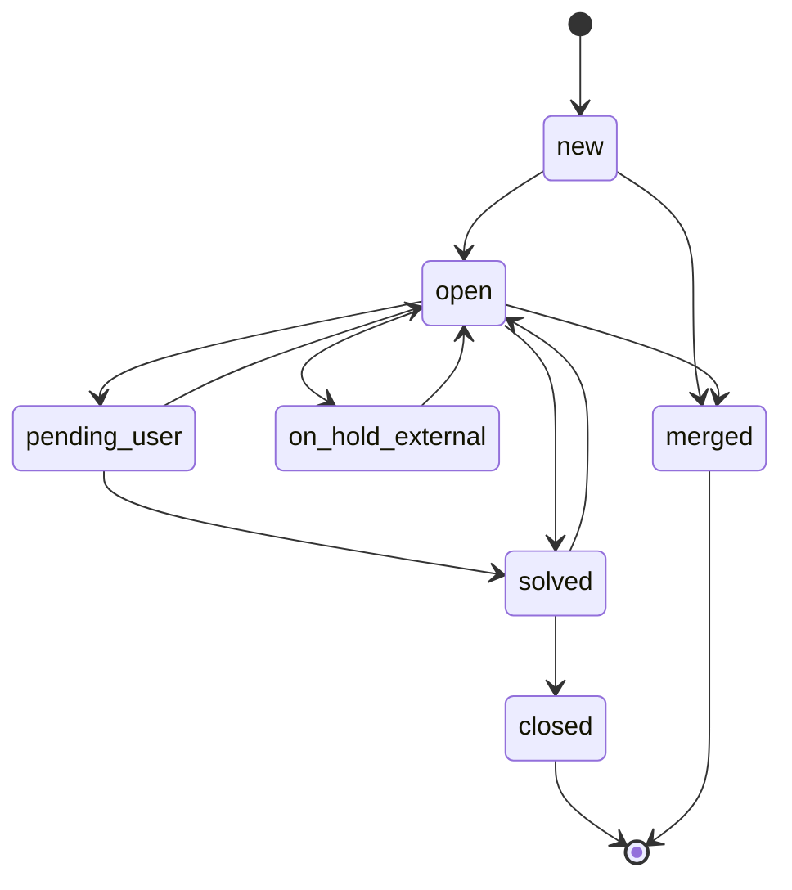

### SM-ADM-02 — Privileged grant (including break-glass)

States: `requested`, `active`, `denied`, `expired`, `revoked`, `under_review`, `review_justified`, `review_unjustified`. Terminal: `denied`, `expired` (standard), `revoked`, `review_justified`, `review_unjustified`.

| From | To | Trigger | Guard |
|---|---|---|---|
| requested | active | auto-approval or approver approves | approver ≠ requester; ticket open |
| requested | denied | approver denies or 30 minutes lapse | — |
| active | expired | duration elapses or ticket closes | standard grant |
| active | revoked | requester or approver revokes | — |
| active | under_review | break-glass ends or expires | break-glass flag |
| under_review | review_justified / review_unjustified | reviewer decision | reviewer ≠ invoker; within 2 business days |

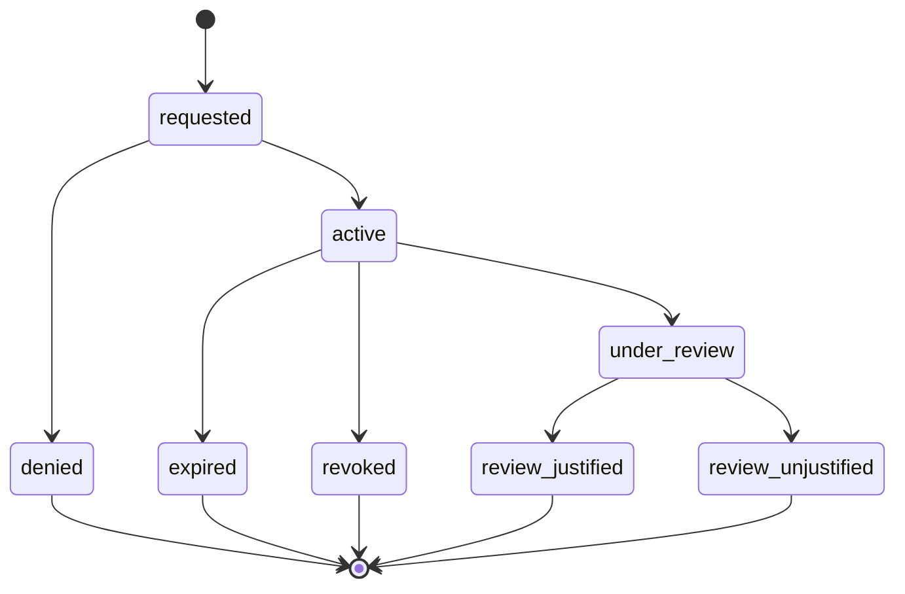

### SM-ADM-03 — Approval request (two-person)

States: `pending`, `approved`, `executing`, `executed`, `rejected`, `withdrawn`, `expired`, `stale`, `failed`. Terminal: `executed`, `rejected`, `withdrawn`, `expired`, `stale`, `failed`.

| From | To | Trigger | Guard |
|---|---|---|---|
| pending | approved | approver approves | approver ≠ requester; step-up fresh; payload hash unchanged |
| pending | rejected | approver rejects | comment required |
| pending | withdrawn | requester withdraws | — |
| pending | expired | 24 hours elapse | — |
| pending | stale | target version changed | expectedVersion mismatch |
| approved | executing | executor starts | idempotent by request id |
| executing | executed | success | — |
| executing | failed | error | partial effects recorded |

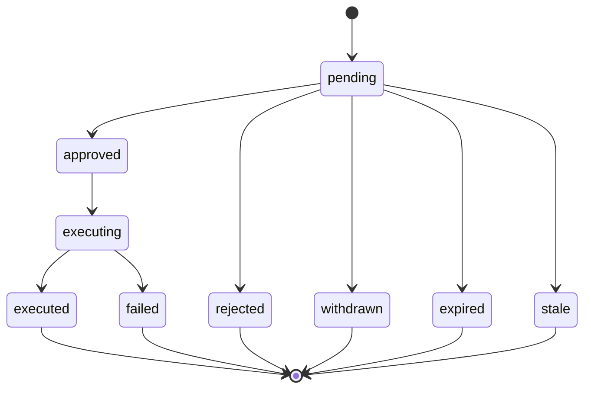

### SM-ADM-04 — Impersonation (view-as) session

States: `requested`, `consented`, `active`, `ended`, `denied`, `expired`, `revoked`. Terminal: `ended`, `denied`, `expired`, `revoked`.

| From | To | Trigger | Guard |
|---|---|---|---|
| requested | consented | user allows | within 10 minutes; token single-use |
| requested | denied | user denies | — |
| requested | expired | 10 minutes without answer | — |
| consented | active | agent opens session | ticket open |
| active | ended | agent or user ends; 30 minutes elapse; ticket closes | — |
| active | revoked | user revokes in privacy settings | terminates within 5 seconds |

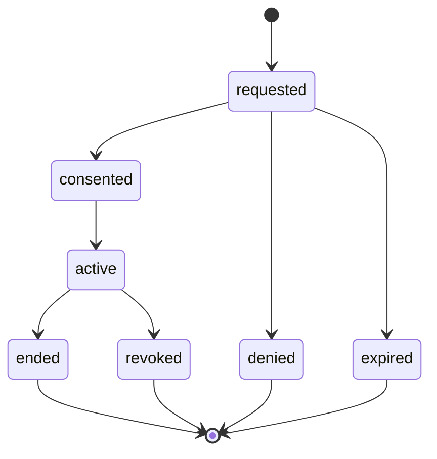

### SM-ADM-05 — Incident

States: `declared`, `investigating`, `identified`, `monitoring`, `resolved`, `review_pending`, `closed`. Terminal: `closed`.

| From | To | Trigger | Guard |
|---|---|---|---|
| declared | investigating | commander assigned | commander set |
| investigating | identified | cause or mitigation identified | note required |
| identified | monitoring | fix applied | — |
| monitoring | investigating | regression | — |
| monitoring | resolved | stable for the agreed period | root-cause category, impact summary |
| resolved | review_pending | P0 or P1 | review scheduled |
| resolved, review_pending | closed | review complete (P0, P1) or immediately (P2, P3) | action items assigned |

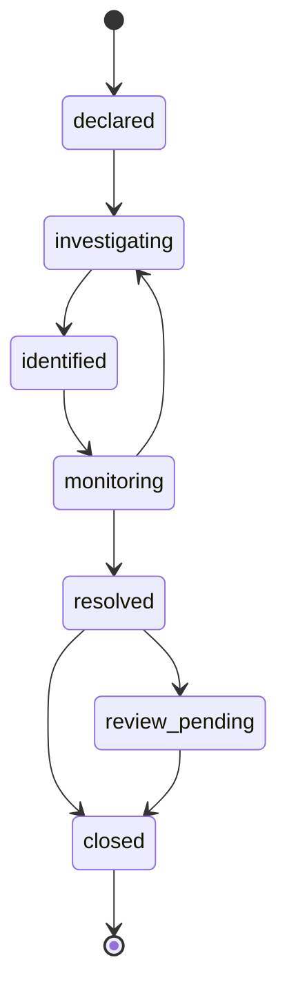

### SM-ADM-06 — Announcement and maintenance window

States: `draft`, `in_review`, `scheduled`, `live`, `ended`, `cancelled`. Terminal: `ended`, `cancelled`.

| From | To | Trigger | Guard |
|---|---|---|---|
| draft | in_review | submit | validation passes |
| in_review | draft | rejected | comment |
| in_review | scheduled | approved | critical needs second approver |
| scheduled | live | start time | — |
| live | ended | end time or manual end | — |
| draft, in_review, scheduled | cancelled | author cancels | — |

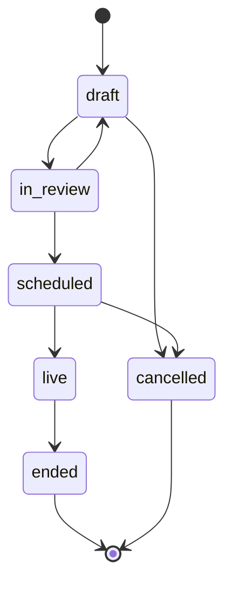

### SM-ADM-07 — Content version (CMS page, legal document, help article)

States: `draft`, `in_review`, `approved`, `published`, `superseded`, `retired`. Help articles add the computed flag `outdated` (not a state). Terminal: `superseded`, `retired`.

| From | To | Trigger | Guard |
|---|---|---|---|
| draft | in_review | author submits | validators pass |
| in_review | draft | reviewer rejects | — |
| in_review | approved | reviewer approves | legal: 2P and counsel reference |
| approved | published | publish or schedule time | effective date rules |
| published | superseded | newer version published | — |
| published | retired | retire action | redirect target set (articles) |

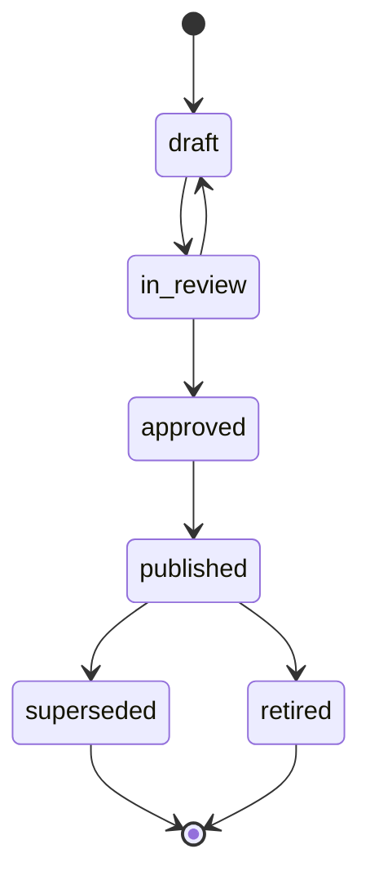

### SM-ADM-08 — Data request case (staff handling)

States: `received`, `verifying`, `in_review`, `approved`, `executing`, `blocked`, `completed`, `rejected`, `withdrawn`. Terminal: `completed`, `rejected`, `withdrawn`.

| From | To | Trigger | Guard |
|---|---|---|---|
| received | verifying | intake complete | — |
| verifying | in_review | verification passed | FR-ADM-028 passed |
| verifying | rejected | verification failed or abandoned after 30 days | notice sent |
| in_review | approved | decision | erasure: 2P and no hold |
| in_review | rejected | lawful refusal | reason and legal basis recorded |
| approved | executing | SET jobs enqueued | — |
| executing | blocked | module failure | — |
| blocked | executing | retry | — |
| executing | completed | all modules done | response letter sent |
| received, verifying, in_review | withdrawn | requester withdraws | — |

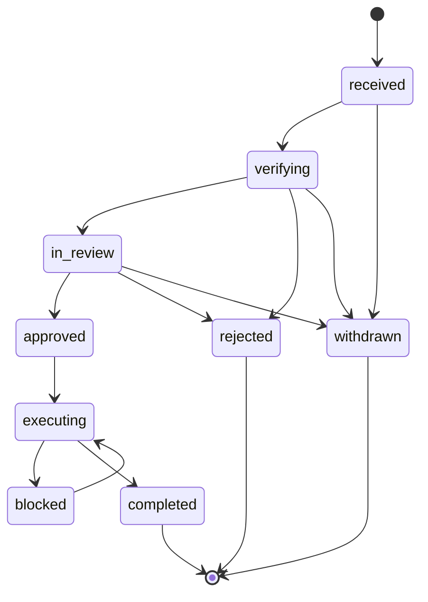

### SM-ADM-09 — Feature flag lifecycle

States: `proposed`, `active`, `rolling_out`, `fully_on`, `stale`, `archived`. Terminal: `archived`.

| From | To | Trigger | Guard |
|---|---|---|---|
| proposed | active | first environment enabled | key exists in code registry |
| active | rolling_out | percentage between 1 and 99 | — |
| rolling_out | fully_on | 100 percent | — |
| rolling_out | active | rollback to 0 | — |
| active, rolling_out, fully_on | stale | expiry date passes | — |
| stale | archived | code removed and archive confirmed | no references in registry |
| stale | active | expiry extended | owner justification |

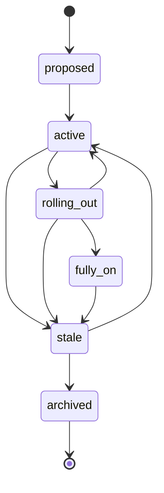

### SM-ADM-10 — Administrative account state

This is the admin-imposed overlay on the account lifecycle owned by IDN. States: `active`, `suspended`, `deactivated`, `merged`, `erased`. Terminal: `merged` (after tombstone expiry), `erased`.

| From | To | Trigger | Guard |
|---|---|---|---|
| active | suspended | admin suspend | reason; not self; not staff unless SAD |
| suspended | active | admin reinstate | reason |
| active, suspended | deactivated | user request or admin on request | ticket |
| deactivated | active | reactivation | identity verified |
| active, suspended | merged | merge approved | 2P; no conflicts |
| active, suspended, deactivated | erased | erasure executed | 2P; no legal hold |

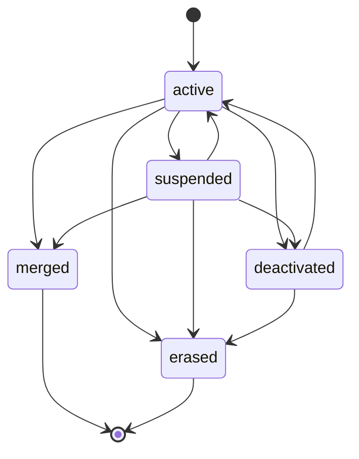

## 7. Screen inventory

All admin screens live on the separate admin origin; routes below are paths on that origin. [PROP]

| ID | Name | Route proposal | Roles | Purpose | Key states |
|---|---|---|---|---|---|
| SCR-ADM-001 | Admin sign-in | `/login` | all staff | Passkey or SSO sign-in | default, SSO redirect, blocked, locked, device-clock error |
| SCR-ADM-002 | Step-up dialog | modal | all staff | Re-authenticate for mutation | challenge, success, failed, timed out |
| SCR-ADM-003 | Admin home | `/` | all staff | Role-specific overview, badges | loading, partial data, incident banner |
| SCR-ADM-004 | Command palette | modal | all staff | Global search and jump | empty (recent), results, throttled, no access |
| SCR-ADM-005 | User directory | `/people/users` | SUP, SUP-L, MOD, FIN, PAD, SAD | Exact-identifier lookup | empty, results, refused partial match |
| SCR-ADM-006 | User detail | `/people/users/:id` | same | Masked account facts, actions | masked, unmasked (grant), tombstone, erased |
| SCR-ADM-007 | Account action dialogs and merge wizard | modal, `/people/users/:id/merge` | SUP-L, PAD, SAD | Suspend, reinstate, merge | confirm, pending approval, executed, error |
| SCR-ADM-008 | Organization and institution list and detail | `/people/orgs`, `/people/orgs/:id`, `/people/institutions/:id` | SUP-L, PAD, SAD (view: SUP, FIN) | Verification queue, suspension, ownership transfer, tenant config | queue empty, cascade preview, suspended |
| SCR-ADM-009 | Staff and roles | `/settings/staff` | PAD, SAD | Invite, assign roles, effective permissions | list, invite, pending approval, expiring |
| SCR-ADM-010 | Access reviews | `/settings/access-reviews` | SAD, SUP-L, FIN-L, PAD | Quarterly recertification | open, in progress, overdue, closed |
| SCR-ADM-011 | Approvals inbox | `/approvals` | requesters and approvers | Review, approve, reject, withdraw | to approve, mine, history, stale, expired |
| SCR-ADM-012 | Grant request and active-grant chip | modal and top bar | SUP, MOD, FIN, PAD | Request and monitor privileged access | requested, active, expiring, expired |
| SCR-ADM-013 | Break-glass | `/incidents/:id/break-glass` | roster (PAD, SAD) | Invoke emergency access; review | not on roster (hidden), active, under review |
| SCR-ADM-014 | Staff activity alerts | `/compliance/staff-activity` | SAD, PAD | Anomaly queue and rules | queue, rule editor, suppressed storm |
| SCR-ADM-015 | Feature flags | `/controls/flags`, `/controls/flags/:key` | PAD, SAD (read: all) | Targeting, rollout, history | list, editing, pending approval, stale |
| SCR-ADM-016 | Kill switches | `/controls/switches` | PAD, SAD, MOD (scoped) | Activate, deactivate, ramp back | inactive, active, partial propagation |
| SCR-ADM-017 | Configuration | `/controls/config` | PAD, SAD | Typed settings, diff, rollback | editing, canary, halted, rolled back |
| SCR-ADM-018 | Announcements | `/content/announcements` | PAD, SAD, SUP-L (draft) | Compose, target, schedule | draft, in review, live, ended |
| SCR-ADM-019 | Maintenance and change calendar | `/ops/maintenance`, `/ops/calendar` | PAD, SAD (view: all) | Windows, freeze, exceptions | scheduled, active read-only, freeze |
| SCR-ADM-020 | Support queue | `/support/queue` | SUP, SUP-L, PAD | Prioritized queues | empty, filtered, SLA breaching |
| SCR-ADM-021 | Ticket workspace | `/support/tickets/:id` | SUP, SUP-L, PAD | Thread, context, macros, actions | collision warning, pending approval, merged |
| SCR-ADM-022 | SLA policies and reports | `/support/sla` | SUP-L, PAD | Policies, calendars, attainment | editing, report, no data |
| SCR-ADM-023 | Macros | `/support/macros` | SUP-L, PAD (use: SUP) | Library and editor | list, editor, retired |
| SCR-ADM-024 | View-as session | `/support/viewas/:id` | SUP, SUP-L, PAD | Consented read-only view | awaiting consent, active, ended |
| SCR-ADM-025 | Knowledge base editor and analytics | `/content/help`, `/content/help/:id` | SUP-L, PAD (draft: SUP) | Articles, review queue, misses | draft, in review, outdated |
| SCR-ADM-026 | Support quality and CSAT | `/support/quality` | SUP-L, PAD | Ratings, rubric reviews | trend, review form, empty |
| SCR-ADM-027 | Problems and known issues | `/support/problems` | SUP, SUP-L, PAD | Link tickets, known-issue messages | open, resolved, bulk send |
| SCR-ADM-028 | Content pages (CMS) | `/content/pages` | PAD, SAD | Template-bound editing, preview, publish | draft, review, published, cache pending |
| SCR-ADM-029 | Legal documents | `/content/legal` | PAD, SAD | Versions, effective dates, acceptance | draft, 2P pending, scheduled, live |
| SCR-ADM-030 | Localization | `/content/locales` | PAD, SUP-L | Locale coverage and stale items | coverage matrix, stale, import errors |
| SCR-ADM-031 | Audit log viewer | `/audit` | SAD, PAD, scoped others | Search and verify events | filtered, lagging banner, integrity result |
| SCR-ADM-032 | Data requests | `/compliance/requests`, `/compliance/requests/:id` | SUP, SUP-L, PAD, SAD | Cases, deadlines, decisions | list, blocked, hold, completed |
| SCR-ADM-033 | Bulk operations | `/ops/bulk` | PAD, SAD | Dry-run, execute, undo | dry-run report, running, stopped |
| SCR-ADM-034 | Finance worklists | `/finance/refunds`, `/finance/disputes`, `/finance/reconciliation` | FIN, FIN-L (read: SAD) | Refunds, disputes, variance | queue, decision dialog, provider degraded |
| SCR-ADM-035 | Exports and saved views | modal, `/me/exports` | PAD, SAD, leads | Export dialog and downloads | preparing, ready, expired |
| SCR-ADM-036 | Jobs and dead letters | `/ops/jobs`, `/ops/jobs/:id` | PAD (view: SAD) | Queue health, retry, requeue | healthy, dead jobs, stuck |
| SCR-ADM-037 | Incidents and incident room | `/incidents`, `/incidents/:id` | PAD, SAD, declarers | Declare, coordinate, communicate | active, resolved, review pending |
| SCR-ADM-038 | Platform health | `/ops/health` | all staff | Service, queue, integration state | healthy, degraded, unknown, monitoring down |
| SCR-ADM-039 | User-side: Contact support and My requests | `/help/contact`, `/help/requests` (product origin) | all signed-in roles, GUE (form) | Ticket intake and tracking | empty, submitted, attachment failed |
| SCR-ADM-040 | User-side: Support access settings and consent prompt | `/settings/privacy/support-access` (product origin) | all signed-in roles | Consent, revoke, view past sessions | prompt, active session banner, history |
| SCR-ADM-041 | Public help center | `/help`, `/help/:slug` (product origin) | GUE and all | Search, read, rate | home, article, no results, outdated label |
| SCR-ADM-042 | Public status page | separate host | GUE and all | Component status and incidents | operational, degraded, maintenance |

## 8. Data entities owned

| ID | Entity | Key attributes | Relationships | Retention class |
|---|---|---|---|---|
| ENT-ADM-01 | StaffIdentity | id, workEmail, status, createdBy, lastSignInAt, networkPolicyId | has many RoleAssignment; has many Session | Staff record: life of employment plus 7 years |
| ENT-ADM-02 | AdminRole and RoleAssignment | roleCode, permissionSetVersion, delegable flags; assignment: staffId, roleCode, expiresAt, grantedBy | StaffIdentity | 7 years after removal |
| ENT-ADM-03 | PrivilegedGrant | id, requesterId, approverId, subjectType, subjectId, dataClass, purpose, ticketRef, startsAt, expiresAt, state, breakGlass | Ticket, Incident, AuditEvent | 7 years (metadata only) |
| ENT-ADM-04 | ApprovalRequest | id, actionClass, payloadHash, payloadBody (redacted), requesterId, approverIds, state, expiresAt, expectedVersion | AuditEvent | 7 years |
| ENT-ADM-05 | AuditEvent | id, ts, actorId, actorRole, action, targetType, targetId, outcome, reasonCode, requestId, sessionId, summaryBefore, summaryAfter, prevHash, hash | all admin entities | 7 years security class; 24 months view-metadata class |
| ENT-ADM-06 | FeatureFlag | key, type, owner, expiresAt, state, rulesVersion, clientVisible, securityClass | FlagVersion | Life of flag plus 2 years |
| ENT-ADM-07 | KillSwitch | key, scope, degradedBehavior, messageRef, owner, p0Class, state, activatedBy, autoExpireAt | FeatureFlag (precedence), Incident | Life plus 2 years |
| ENT-ADM-08 | ConfigEntry and ConfigVersion | key, class, schemaRef, value, version, appliedAt, applyMode | AuditEvent | 2 years of versions |
| ENT-ADM-09 | Announcement | id, type, title, body, audience, surfaces, locales, startsAt, endsAt, state, metrics | CmsPage (messages) | 2 years |
| ENT-ADM-10 | Ticket | id, requesterId or guestEmail, orgId, category, priority, state, assigneeId, queueId, slaPolicyId, tags, problemId, resolutionCode | TicketMessage, SlaPolicy, Problem | 24 months after close; pseudonymized on erasure |
| ENT-ADM-11 | TicketMessage | id, ticketId, authorKind, authorId, channel, bodyRef, attachmentIds, isInternal, createdAt | Ticket, File (PLT) | Same as ticket |
| ENT-ADM-12 | Macro | id, title, body, placeholders, actions, locales, version, status | Ticket usage stats | Life plus 1 year |
| ENT-ADM-13 | SlaPolicy | id, conditions, firstResponseTarget, resolutionTarget, calendarId, escalationSteps | Ticket | Life plus 2 years |
| ENT-ADM-14 | ImpersonationSession | id, agentId, subjectId, ticketId, state, consentAt, startsAt, endsAt, pageTrail | Ticket, AuditEvent | 24 months |
| ENT-ADM-15 | KbArticle | id, slug, title, body blocks, audience, locale, ownerId, reviewDueAt, state, rating counts | CmsPage, Macro references | Life plus 1 year |
| ENT-ADM-16 | CmsPage and ContentVersion | pageKey, templateId, fields, seo, version, state, publishedAt; legal: effectiveAt, changeClass, counselRef | Locale variants | Legal versions permanent; other 2 years |
| ENT-ADM-17 | Incident | id, title, severity, state, components, commanderId, declaredAt, resolvedAt, rootCauseCategory, impactSummary | IncidentUpdate, Ticket, PrivilegedGrant | 7 years |
| ENT-ADM-18 | IncidentUpdate | id, incidentId, kind (timeline, public), body, publishedAt, authorId | Incident | 7 years |
| ENT-ADM-19 | DataRequestCase | id, subjectRef, type, jurisdiction, receivedAt, dueAt, state, holdFlag, moduleChecklist, decisionBy | SET request (planned), Ticket | 7 years metadata |
| ENT-ADM-20 | AdminSavedView | id, ownerId, table, filter, columns, sharedWithRole | StaffIdentity | Life of owner |
| ENT-ADM-21 | CsatResponse | id, ticketId, score, comment, agentId, macroIds | Ticket | 24 months |
| ENT-ADM-22 | AccessReview | id, campaignId, reviewerId, staffId, decision, decidedAt, comment | StaffIdentity | 7 years |
| ENT-ADM-23 | ProblemRecord | id, title, workaround, state, linkedIncidentId, ticketCount | Ticket, Incident | 2 years |
| ENT-ADM-24 | BulkOperationRun | id, type, targetSetRef, dryRunId, params, state, counts, startedBy | AuditEvent | 2 years |
| ENT-ADM-25 | AdminExport | id, requesterId, table, columns, rowCount, fileRef, expiresAt, downloadedAt | File (PLT) | File 24 hours; metadata 2 years |

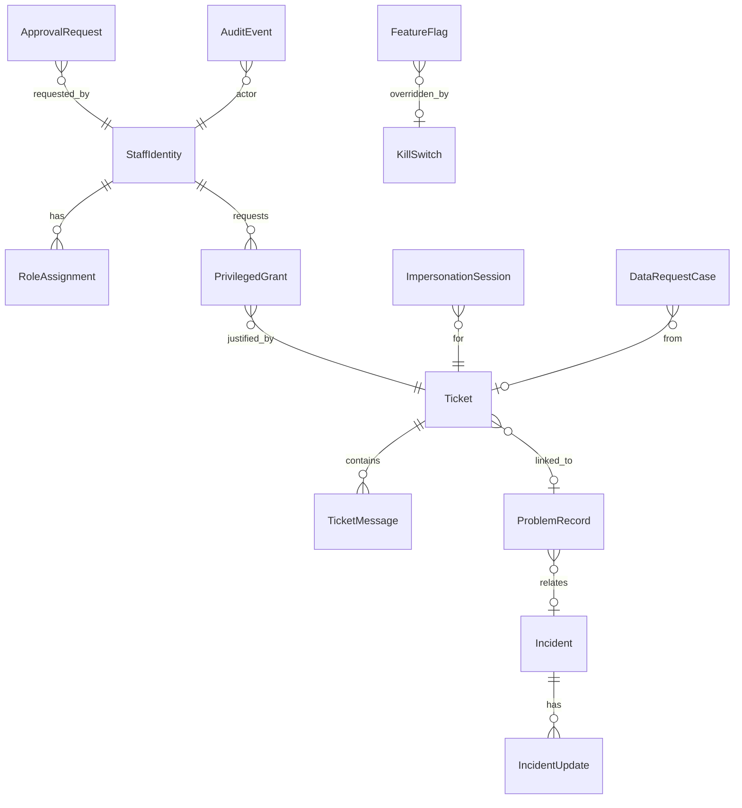

## 9. Events emitted and consumed

### 9.1 Emitted

| ID | Name | Trigger | Key payload | Consumers |
|---|---|---|---|---|
| EVT-ADM-001 | `admin.action.performed` | Any admin mutation (generic envelope) | actor, role, action, target, reasonCode, outcome, requestId | audit store, anomaly rules |
| EVT-ADM-002 | `admin.session.started` | Staff sign-in success | staffId, method, network, deviceId | audit, anomaly rules |
| EVT-ADM-003 | `admin.session.stepup_completed` | Step-up success | staffId, validUntil | audit |
| EVT-ADM-004 | `admin.session.blocked` | Impossible travel, lockout, policy block | staffId, reason | SAD alerts, audit |
| EVT-ADM-005 | `admin.staff.invited` | Staff invitation sent | email hash, role, expiry | audit |
| EVT-ADM-006 | `admin.staff.role_changed` | Role assignment applied or removed | staffId, role, before, after | audit, access review |
| EVT-ADM-007 | `admin.staff.disabled` | Staff identity disabled | staffId, reason | IDN (revoke sessions), audit |
| EVT-ADM-008 | `admin.account.suspended` | Account suspended | accountId, reason, expectedUndoUntil | IDN, NTF, TSF, audit |
| EVT-ADM-009 | `admin.account.reinstated` | Account reinstated | accountId | IDN, NTF, audit |
| EVT-ADM-010 | `admin.account.merged` | Merge executed | survivorId, retiredId, counts | all owning modules, audit |
| EVT-ADM-011 | `admin.account.force_logged_out` | Sessions revoked by staff | accountId | IDN, audit |
| EVT-ADM-012 | `admin.org.approved` | Org approved | orgId | EMP, JOB, NTF |
| EVT-ADM-013 | `admin.org.suspended` | Org suspended | orgId, reason class, cascade counts | EMP, JOB, ATS, MSG, NTF |
| EVT-ADM-014 | `admin.org.ownership_transferred` | Ownership transfer executed | orgId, from, to | EMP, NTF |
| EVT-ADM-015 | `admin.grant.requested` | Grant requested | grantId, class, subject type | approvers, audit |
| EVT-ADM-016 | `admin.grant.activated` | Grant active | grantId, expiresAt | audit |
| EVT-ADM-017 | `admin.grant.ended` | Grant expired or revoked | grantId, endReason | audit |
| EVT-ADM-018 | `admin.pii.viewed` | Unmasked field read | grantId, subjectId, fields | audit, SET privacy center |
| EVT-ADM-019 | `admin.approval.requested` | Two-person request created | requestId, actionClass | approvers, audit |
| EVT-ADM-020 | `admin.approval.decided` | Approved, rejected, expired, stale, executed, failed | requestId, outcome | requester, audit |
| EVT-ADM-021 | `admin.breakglass.invoked` | Break-glass started | grantId, incidentId, scope | SAD paging, audit |
| EVT-ADM-022 | `admin.breakglass.reviewed` | Review decision | grantId, outcome | audit, SAD |
| EVT-ADM-023 | `admin.flag.changed` | Flag version applied | key, env, versionBefore, versionAfter | flag SDKs, ANL, audit |
| EVT-ADM-024 | `admin.killswitch.activated` | Switch on | key, reason, incidentId | all call sites, status, audit |
| EVT-ADM-025 | `admin.killswitch.deactivated` | Switch off | key, ramp state | all call sites, audit |
| EVT-ADM-026 | `admin.config.changed` | Config version applied | key, versionBefore, versionAfter, class | services, audit |
| EVT-ADM-027 | `admin.announcement.published` | Announcement live | id, audience, type | NTF, web and PWA clients |
| EVT-ADM-028 | `admin.maintenance.started` | Window begins | windowId, scope | all services, PWA |
| EVT-ADM-029 | `admin.maintenance.ended` | Window ends | windowId | all services, PWA |
| EVT-ADM-030 | `support.ticket.created` | Ticket created | ticketId, category, requesterKind | queue router, ANL |
| EVT-ADM-031 | `support.ticket.replied` | Public reply | ticketId, direction | NTF, SLA |
| EVT-ADM-032 | `support.ticket.resolved` | Resolved | ticketId, resolutionCode | CSAT, NTF |
| EVT-ADM-033 | `support.ticket.sla_breached` | SLA target missed | ticketId, policyId, cause | SUP-L alerts, ANL |
| EVT-ADM-034 | `support.viewas.started` | View-as active | sessionId, ticketId | user app banner, audit |
| EVT-ADM-035 | `support.viewas.ended` | View-as ended | sessionId, reason, pageCount | NTF summary, audit |
| EVT-ADM-036 | `support.csat.submitted` | Rating received | ticketId, score | SUP-L tasks, ANL |
| EVT-ADM-037 | `support.problem.linked` | Ticket linked to problem | problemId, ticketId | problem counters |
| EVT-ADM-038 | `admin.cms.published` | CMS page or article published | pageKey, version | CDN invalidation, search index |
| EVT-ADM-039 | `legal.version.published` | Legal version scheduled or effective | docType, version, changeClass, effectiveAt | SET (re-consent), NTF |
| EVT-ADM-040 | `admin.datarequest.opened` | Case created | caseId, type, dueAt | SET, SLA reminders |
| EVT-ADM-041 | `admin.datarequest.completed` | Case completed | caseId, outcome | SET, audit |
| EVT-ADM-042 | `admin.export.created` | Export generated | exportId, rowCount, table | anomaly rules, audit |
| EVT-ADM-043 | `admin.bulk.completed` | Bulk run ended | runId, counts, outcome | audit |
| EVT-ADM-044 | `admin.job.replayed` | Dead job replayed or cancelled | jobId, kind, action | PLT, audit |
| EVT-ADM-045 | `admin.incident.declared` | Incident declared | incidentId, severity, components | paging, status page, banner |
| EVT-ADM-046 | `admin.incident.resolved` | Incident resolved | incidentId, impact | status page, review scheduler |
| EVT-ADM-047 | `admin.alert.anomaly_detected` | Anomaly rule triggered | ruleId, actorId, severity | SAD queue |
| EVT-ADM-048 | `admin.accessreview.completed` | Campaign closed | campaignId, removals | audit |
| EVT-ADM-049 | `admin.audit.integrity_failed` | Chain check fails or ingestion gap | range, firstMismatch | SAD paging |
| EVT-ADM-050 | `admin.finance.refund_decided` | Refund approved or denied | orderId, amount, decision | BIL, NTF |

### 9.2 Consumed (owned by other modules; marked planned where the module is not yet specified)

| Event | Owner | Used for |
|---|---|---|
| `plt.job.dead` | PLT (planned) | Dead-letter alerts (FR-ADM-037) |
| `plt.integration.health_changed` | PLT (planned) | Health dashboard tiles (FR-ADM-039) |
| `set.datarequest.submitted` | SET (planned) | Create data-request case (FR-ADM-033) |
| `set.datarequest.module_completed` | SET (planned) | Module checklist progress |
| `tsf.case.opened` | TSF (planned) | Link to tickets and org suspension context |
| `bil.dispute.opened` | BIL (planned) | Dispute worklist |
| `bil.payout.reconciled` | BIL (planned) | Reconciliation worklist |
| `idn.login.failed` / `idn.account.locked` | IDN (planned) | Staff lockout alerts |
| `ntf.delivery.failed` | NTF (planned) | Ticket `contact_failed` flag |
| `emp.org.verification_submitted` | EMP (planned) | Verification queue |

## 10. Integrations and external dependencies

| Dependency | Direction | Purpose | Notes |
|---|---|---|---|
| Identity provider for staff (OIDC or SAML) | Inbound | Staff SSO with passkey enforcement | via adapter, FR-PLT-021 |
| Paging provider | Outbound | On-call paging for P0 and P1, break-glass | adapter; provider undecided |
| Status page host | Outbound | Public status, subscribers | independent infrastructure; OD-ADM-11 |
| Email provider | Outbound | Ticket mail, announcements | through NTF and FR-PLT-023 |
| Object store with object-lock | Outbound | Audit anchoring, evidence | `[PROP]` |
| Support desk vendor (optional) | Bidirectional | If OD-ADM-01 chooses buy over build | same ticket contract, adapter |
| Payment provider | Bidirectional | Disputes, refunds (through BIL) | not accessed directly |
| Observability stack | Inbound | Metrics, traces, alerts | read via API |
| Translation vendor | Outbound | XLIFF exchange | optional |
| Identity-verification vendor | Outbound | Requester verification fallback | via BGV |

## 11. Cross-module dependencies

| ADM depends on | Why |
|---|---|
| IDN | Staff authentication, passkeys, session revoke, account state |
| SET | Privacy requests execution, consent records, legal-hold flag, user privacy center |
| NTF | Delivery of announcements, ticket mail, security notices |
| PLT | Job engine, files, webhooks, rate limits, adapters, outbox |
| BIL | Refunds, disputes, plan summaries |
| TSF | Moderation cases, sanctions linkage |
| EMP and INS | Org and institution records for administration |
| BGV | Identity-document verification for requester checks |
| ANL | Metrics storage and dashboards beyond health |
| SRC | Search backend for help center and admin search |

| Depends on ADM | Why |
|---|---|
| All modules | Audit API, feature flags, kill switches, configuration, maintenance mode, announcements |
| PLT | Kill-switch and job-console surfaces |
| PWA | Maintenance mode, update gating, admin-origin exclusion from caching |
| SET | Legal version publication events |
| TSF | Shared ticket and case linking |

## 12. Module-level metrics

| Metric | Definition and formula | Owner role |
|---|---|---|
| First response time | Median and p90 of (first agent public reply time minus ticket creation) in business hours, by category | SUP-L |
| Resolution time | Median and p90 of (resolved time minus created time) excluding paused time | SUP-L |
| SLA attainment | Tickets meeting target ÷ tickets resolved, by policy and month | SUP-L |
| Contact rate | Tickets created per 1,000 weekly active users, by category | SUP-L |
| Deflection rate | Help article sessions from ticket form that did not end in a submission ÷ help sessions from ticket form | SUP-L |
| CSAT | Mean score and share of 4 to 5 ratings among responses; response rate shown beside it | SUP-L |
| Re-open rate | Tickets reopened within 14 days ÷ tickets resolved | SUP-L |
| Privileged grant volume | Grants per week by class, share auto-approved, mean duration | SAD |
| Break-glass rate | Break-glass invocations per quarter and share reviewed justified | SAD |
| Approval latency | Median time from approval request to decision | PAD |
| Stale flag count | Flags past expiry still active | PAD |
| Change failure rate | Flag or config changes followed by rollback or incident within 24 hours ÷ changes | PAD |
| Kill-switch propagation time | Median time from activation to all instances acknowledging | PAD |
| DLQ depth and age | Dead jobs by kind and oldest age | PAD |
| Data request on-time rate | Cases closed before statutory due date ÷ cases closed | SAD |
| Audit completeness | Events ingested ÷ events produced, per day (target by OD) | SAD |
| Incident MTTA and MTTR | Mean time to acknowledge and resolve by severity | PAD |
| Access review completion | Rows decided by deadline ÷ rows in campaign | SAD |

## 13. Open decisions

| ID | Question | Options | Default proposal | Who decides | Blocking |
|---|---|---|---|---|---|
| OD-ADM-01 | Build the support desk in-house or integrate a vendor desk behind an adapter? | A: build; B: vendor with adapter; C: vendor first, build later | C `[PROP]` | Product owner | FR-ADM-020 to FR-ADM-027 implementation shape |
| OD-ADM-02 | Admin console on a separate origin, or a path on the product origin with stricter policy? | Separate origin; same origin | Separate origin `[PROP]` | Security and platform lead | FR-ADM-002, FR-PWA-008 |
| OD-ADM-03 | Support service levels (first response, resolution) per plan and priority. | Values by tier | Defaults in FR-ADM-022 `[PROP]`; legacy OPEN-16 unresolved | Product owner with support lead | FR-ADM-022 enforcement |
| OD-ADM-04 | May org admins disable support view-as for their members? | Yes; no; for institutions only | Yes for orgs and institutions | Product owner and legal | FR-ADM-024 |
| OD-ADM-05 | Statutory deadlines and jurisdictions the platform commits to for privacy requests. | Per target markets | Table of jurisdictions with 30-day default `[PROP]` | Legal and privacy lead | FR-ADM-033 |
| OD-ADM-06 | Are internal staff notes disclosed in data-subject access exports? | Include; include with redaction; exclude | Include with redaction pending counsel review | Legal | FR-ADM-004 |
| OD-ADM-07 | Refund approval threshold requiring FIN-L. | Amount per currency | Parameter `admin.refund.secondApprovalAmount`, no default amount until decided | Finance owner | FR-ADM-035 |
| OD-ADM-08 | Policy for non-notification of account actions (law enforcement, safety). | Never; with SAD basis and review date | With SAD basis and 30-day review `[PROP]` | Legal and security | BR-ADM-025 |
| OD-ADM-09 | Staff monitoring disclosure and works-council or labor-law requirements. | Disclosed policy; consult | Disclosed policy | Legal | FR-ADM-013 |
| OD-ADM-10 | Where may staff access production personal data from (regions, managed devices)? | Any; allowlisted regions; managed devices only | Managed devices plus allowlist `[PROP]` | Security lead | FR-ADM-002 |
| OD-ADM-11 | Status page: build, or use a hosted provider? | Build; hosted | Hosted provider through adapter `[PROP]` | Platform lead | FR-ADM-038 |
| OD-ADM-12 | May custom admin roles be created, or only the fixed catalogue? | Fixed; custom with SAD approval | Fixed catalogue `[PROP]` | Security lead | FR-ADM-007 |
| OD-ADM-13 | Does staff-run support and finance tooling brush the SSOT §4.2 non-goal of generic HR or payroll (staff scheduling, performance scores)? | Keep strictly to operations tooling; allow agent scoring | Strictly operations; agent scoring only inside FR-ADM-026 rubric `[PROP]` | Product owner | FR-ADM-026 |

## 14. Risks

| ID | Risk | Likelihood / impact | Mitigation |
|---|---|---|---|
| RSK-ADM-01 | Insider misuse of personal data through support access. | Medium / High | Masking, grants, anomaly rules, audit, quarterly reviews (FR-ADM-005, 009, 012, 013). |
| RSK-ADM-02 | Compromise of an admin account yields platform-wide damage. | Low / Critical | Passkeys, separate origin, 2P, step-up, network allowlist, break-glass monitoring. |
| RSK-ADM-03 | Kill switch fails to propagate during a real incident. | Low / High | Signed cached state, instance acknowledgements, drills, partial-propagation alerts. |
| RSK-ADM-04 | Support service levels never defined, so the desk cannot be managed. | High / Medium | OD-ADM-03; defaults shown in tooling. |
| RSK-ADM-05 | Admin scope grows into generic HR or payroll tooling, violating the SSOT non-goal. | Medium / Medium | OD-ADM-13; reviews of new admin features against §1.2. |
| RSK-ADM-06 | Audit log volume and cost grow faster than planned. | Medium / Medium | Event class retention, summary-only payloads, tiered storage. |
| RSK-ADM-07 | Impersonation erodes user trust. | Low / High | Consent by default, user-visible trail, org opt-out, read-only enforcement. |
| RSK-ADM-08 | Flag and config debt makes behavior unpredictable. | High / Medium | Owner and expiry, stale reports, creation block for owners with stale flags. |
| RSK-ADM-09 | Two-person approval slows incident response. | Medium / Medium | Break-glass, kill-switch single-person activation with review. |
| RSK-ADM-10 | Staff time-zone coverage is insufficient for SLAs and statutory deadlines. | Medium / Medium | Business calendars, on-call rota outside platform, escalation to SAD. |

## 15. Legacy source trace

| Legacy source | Informed | Dropped or changed |
|---|---|---|
| SSOT F-17 Admin Console, F-35 Feature Flag Console, F-83 Admin Platform Expansion | Console, flags, expansion routes | Phase numbers dropped; all treated as unbuilt |
| SSOT BR-28, BR-29 | Status honesty, confirmation + audit + rollback | Rollback generalized to undo windows and 2P |
| SSOT §13.5 to §13.8, §20.2, §20.4 to §20.6 | Job console, health dashboard, severity targets | Cadences moved to PLT |
| SSOT §10.18 BR-31 | Dry-run default for schedulers | Extended to bulk operations |
| Yash 18 OPERATIONS_AND_SUPPORT_PROCESSES (PROC-01 to PROC-16) | Account admin, tickets, grants, access review, data rights, incident, maintenance, billing | Staffing and SLA numbers left open (OD-ADM-03) |
| Yash 18 INCIDENT_MANAGEMENT, RUNBOOK_INDEX | Incident workflow | Runbook content out of scope |
| docs/registries/FEATURE_REGISTRY.md F-17, F-35, F-83 | Existence of admin features | Registry status ignored |
| Own knowledge of Zendesk, Intercom, Freshdesk, Okta admin consoles, PagerDuty and Statuspage | Macros, CSAT, problem linking, break-glass, status page, anomaly rules | Tagged `[PROP]` |
| Dropped: any staff payroll, performance or scheduling tooling | Non-goal in SSOT §4.2 | See OD-ADM-13 |
