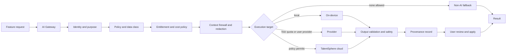
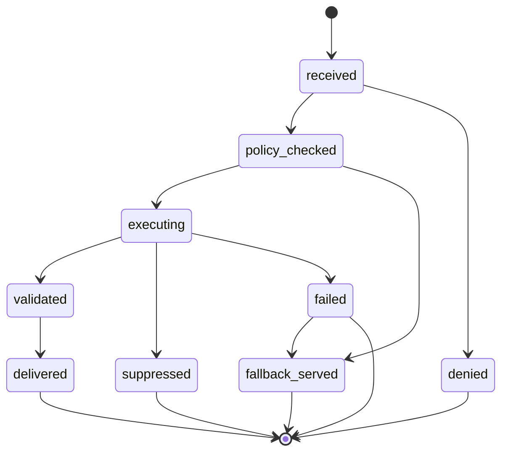
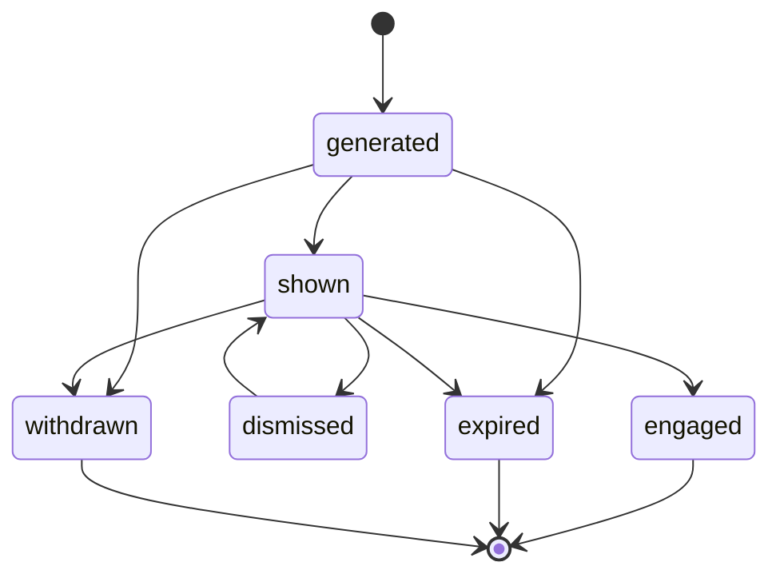
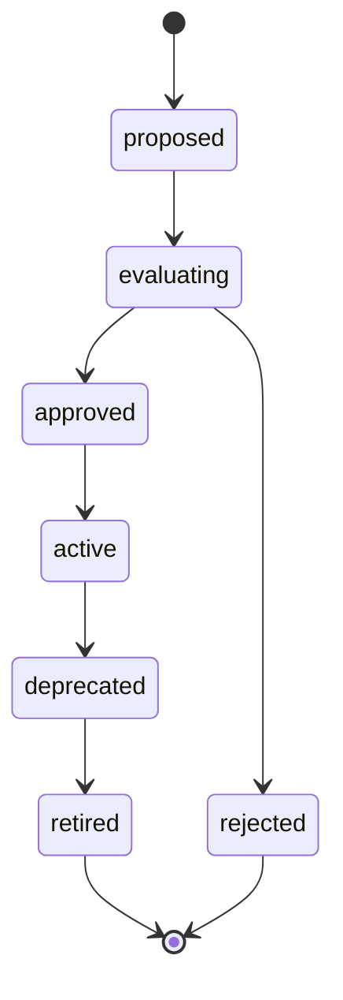
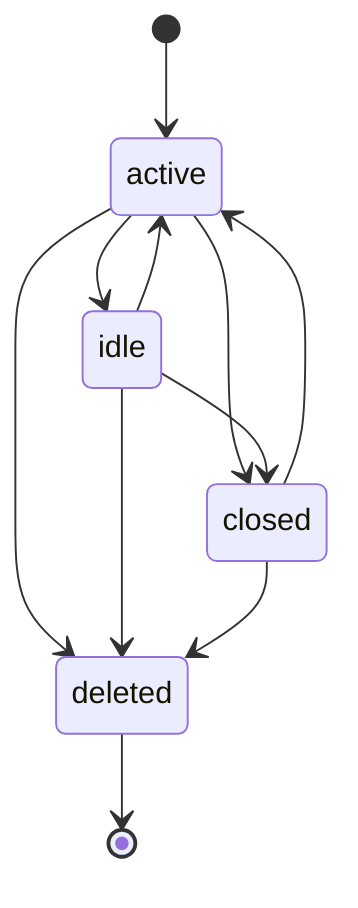
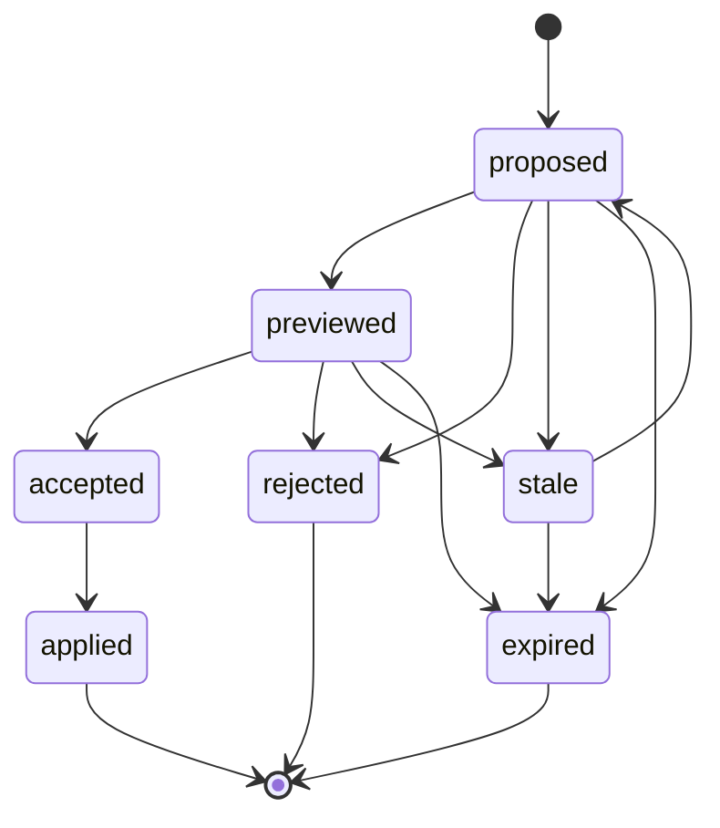
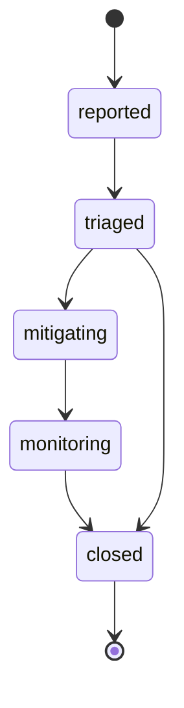
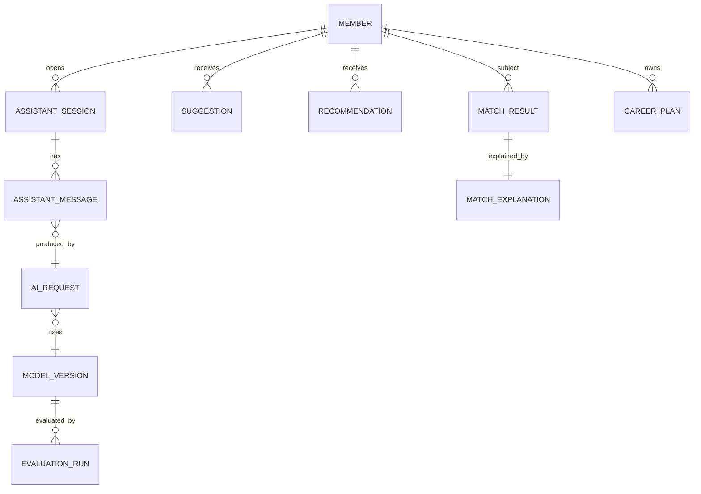

# AIC — AI Career Assistant, Matching & Recommendations

> Status: intended product specification. Nothing in this file is a claim that anything is built. Legacy inputs are inputs, not limits. Conventions: [`../00_START_HERE/CONVENTIONS.md`](../00_START_HERE/CONVENTIONS.md).

## 1. Purpose, outcomes and boundaries

### 1.1 Purpose

AIC is the intelligence layer of TalentSphere: a career assistant that helps people plan, practice and present themselves; matching that connects people and opportunities with explanations; recommendations for jobs, learning and people; and the governance that keeps every AI behavior accountable. AI suggests, drafts, explains and recommends. It never decides. [SRC: SSOT §15.10.1, §16, §18]

### 1.2 Outcomes

1. A member gets useful, grounded career help (resume feedback, interview practice, plans, gap analysis) that they review before anything changes.
2. Match and recommendation results always explain what drove them, what evidence supports them, and what is uncertain. [SRC: SSOT §18.1, §18.2; BR-184]
3. No AI output can hire, reject, rank-and-hide, sanction, grade peers, refund or publish. [SRC: SSOT §15.10.2]
4. Every AI call passes one gateway that enforces purpose, data class, cost policy, redaction and provenance. [SRC: SSOT §16.1]
5. Free users never incur paid inference cost without an explicit policy, and every feature has a non-AI fallback. [SRC: SSOT §16.4]
6. Bias, safety and quality are measured before release and continuously, with kill switches.

### 1.3 In scope

Career assistant (chat, memory, resume feedback, interview practice, career plan, skill-gap, drafting, suggested actions); candidate-side and recruiter-side matching with explanations, preferences and feedback; skill extraction; job, learning and people recommendations; recommendation cards and engine pluggability; AI gateway and policy engine; human-in-the-loop enforcement; model registry and cards; logging and provenance; redaction and injection defense; cost metering and quotas; provider routing and fallback; safety filters; AI transparency and user controls; assessment integrity hook; evaluation and bias audit; AI incidents; local and user-authorized providers.

### 1.4 Out of scope (owned elsewhere)

| Capability                                                                          | Owner                                                     |
| ----------------------------------------------------------------------------------- | --------------------------------------------------------- |
| Profile, resume, portfolio data and editing UI                                      | PRF (planned)                                             |
| Verified evidence and credentials                                                   | EVD, BGV (planned)                                        |
| Job postings, applications, pipeline, hiring decisions                              | JOB, ATS (planned)                                        |
| Assessment content and integrity engine                                             | ASM (planned)                                             |
| Course content and learning paths                                                   | LRN (planned)                                             |
| Plans, prices and quota purchase                                                    | BIL (planned)                                             |
| Moderation and fraud decisions (AIC supplies classifiers only through its registry) | TSF                                                       |
| Search ranking infrastructure                                                       | SRC (planned)                                             |
| Market data and salary benchmarks                                                   | MKT (planned)                                             |
| Notifications                                                                       | NTF (planned)                                             |
| Feed ranking                                                                        | NET (`FR-NET-036`) uses AIC only for optional suggestions |

### 1.5 Owned versus consumed

Owned: assistant sessions, suggestions and apply flow, match results and explanations, recommendations, AI gateway, policies, model registry, evaluation and bias reports, AI usage ledger, AI incidents. Consumed: profile and evidence (PRF, EVD), jobs and requirements (JOB), course catalog (LRN), connections and groups (NET, consented), plan entitlements (BIL), assessment context (ASM), moderation verdicts (TSF).

### 1.6 Terminology

`Impact class` (SSOT §16.7): INFORMATION, DRAFT, RECOMMENDATION, ANALYSIS, DECISION_SUPPORT, CONSEQUENTIAL_DECISION (blocked). `Data class` (SSOT §16.5): PUBLIC, INTERNAL, PRIVATE, SENSITIVE, RESTRICTED, NEVER-EXTERNAL. `Capability`: a named AI use such as `resume_feedback`.

## 2. Roles and permission matrix

Legend: Y allowed, O own data only, S scoped (organization, institution), R by rule, N not allowed.

| Capability                                 | GUE | CAN        | STD        | INS | MNT | REC | HMG | EAD                 | IAD                         | PLO | MOD | SUP | PAD | SAD |
| ------------------------------------------ | --- | ---------- | ---------- | --- | --- | --- | --- | ------------------- | --------------------------- | --- | --- | --- | --- | --- |
| Use career assistant                       | N   | O          | O          | O   | O   | N   | N   | N                   | N                           | N   | N   | N   | N   | N   |
| Resume feedback and interview practice     | N   | O          | O          | N   | N   | N   | N   | N                   | N                           | N   | N   | N   | N   | N   |
| See own job fit and explanations           | N   | O          | O          | N   | N   | N   | N   | N                   | N                           | N   | N   | N   | N   | N   |
| Use candidate matching as decision support | N   | N          | N          | N   | N   | S   | S   | S                   | N                           | N   | N   | N   | N   | N   |
| See recommendations                        | N   | O          | O          | O   | O   | O   | O   | O                   | S                           | S   | N   | N   | N   | N   |
| Manage own AI settings and history         | N   | O          | O          | O   | O   | O   | O   | O                   | O                           | O   | O   | O   | O   | O   |
| View AI request logs of a user             | N   | O          | O          | N   | N   | N   | N   | N                   | N                           | N   | N   | R   | R   | R   |
| Configure policies, quotas, providers      | N   | N          | N          | N   | N   | N   | N   | S (org AI settings) | S (institution AI settings) | N   | N   | N   | Y   | Y   |
| Approve model versions                     | N   | N          | N          | N   | N   | N   | N   | N                   | N                           | N   | N   | N   | Y   | Y   |
| Run bias audit and see reports             | N   | N          | N          | N   | N   | N   | N   | S (own org results) | S                           | N   | N   | N   | Y   | Y   |
| Review AI incidents                        | N   | O (report) | O (report) | N   | N   | N   | N   | N                   | N                           | N   | R   | R   | Y   | Y   |

Notes. `SUP` log access requires a ticket and the user's consent (`BR-AIC-020`). `MOD` handles AI-harm reports routed through TSF. `STD` features may be constrained by `IAD` institution settings and assessment policy (`BR-AIC-019`). Minors follow `BR-AIC-030`. `REC` and `HMG` use matching only within pipelines they are authorized for. `API` principals have no AIC write access in this blueprint.

## 3. Sub-module map

| Code  | Sub-module                 | Features                      |
| ----- | -------------------------- | ----------------------------- |
| AIC-A | Career assistant           | FR-AIC-001 to 009             |
| AIC-B | Matching                   | FR-AIC-010 to 016             |
| AIC-C | Recommendations            | FR-AIC-017 to 021, FR-AIC-035 |
| AIC-D | AI governance and platform | FR-AIC-022 to 034             |

## 4. Feature specifications

### 4.1 AIC-A Career assistant

### FR-AIC-001 — Career assistant chat

- **Sub-module:** AIC-A Career assistant
- **Priority / tier:** Must · R4
- **Source:** [SRC: SSOT §7 F-11, F-99; §16] [DER]
- **Purpose and outcome:** A member asks career questions in a chat and gets grounded, cited, appropriately hedged answers that use their own profile only with permission.
- **Roles and permissions:** `CAN, STD, INS, MNT: use own` · others N
- **Preconditions and entry points:** Assistant panel (global shortcut), profile page, job page ("Ask about this job"), learning page. Member has accepted the AI notice; the assistant is enabled for their region and plan.
- **User interactions and actions:** 1. Open the panel. 2. Pick a mode chip: General, Resume, Interview, Plan, Skills. 3. Type a question (up to 4,000 characters). 4. Read the streamed answer with sources and a confidence label. 5. React (helpful, not helpful with reason), copy, regenerate, or "Use in my profile" (FR-AIC-008). 6. Start a new chat, rename, pin, delete.
- **System behaviour:** Every request goes through the gateway (FR-AIC-022). Context is assembled from user-allowed sources only (FR-AIC-002), minimized and redacted for external providers (`BR-AIC-013`). Answers cite sources (profile fields, course pages, market data with date) where factual claims are made; without sources, the answer is labelled "General advice" (`BR-AIC-015`). Streaming over the realtime fallback ladder; if streaming fails, the full answer returns. Confidence per `BR-AIC-007`: below 0.5 the system declines and suggests a human or non-AI resource; 0.5 to 0.7 shows a disclaimer. Responses are filtered (FR-AIC-029). Each turn stores a provenance record (FR-AIC-025). Idempotent by `client_turn_id`. Emits `aic.assistant.turn_completed`.
- **UI elements and controls:** Panel with mode chips; message list (`role="log"`); input with counter; Send/Stop; source chips; feedback thumbs; "AI-generated" label on every answer; history drawer; quota meter (FR-AIC-027); "AI is unavailable, here is a non-AI option" state.
- **Configuration options:** User: assistant on or off, default mode, history retention (FR-AIC-030). Org or institution: disable assistant for managed learners or employees. Platform: model routing, limits.
- **Business rules:** `BR-AIC-004`, `BR-AIC-007`, `BR-AIC-012`, `BR-AIC-015`, `BR-AIC-026`, `BR-AIC-027`, `BR-AIC-031`
- **Validation:** Input 1 to 4,000 characters; attachments only via FR-AIC-003 or FR-AIC-004; at most 20 turns per minute.
- **Inputs and outputs:** In: question, mode, optional context toggles. Out: answer, sources, confidence label, suggested next actions.
- **Filters, sorting, search:** History searchable by keyword and mode; sort by date.
- **Notifications and communication:** None beyond quota warnings (class `ai_usage`).
- **Error handling and edge cases:** Quota exhausted: "You have used your AI allowance; try again on <date>" plus non-AI resources. Provider down: fallback or explicit unavailability (FR-AIC-028). Output fails validation: regenerated once, then the fallback message. Prompt-injection attempt in pasted text: neutralized (FR-AIC-026). Assessment in progress with AI-prohibited mode: refuses with explanation (FR-AIC-031).
- **Dependencies:** FR-AIC-022 to 029, PRF, EVD, LRN, MKT (planned), `ENT-AIC-01`, `ENT-AIC-02`.
- **Security and privacy:** Own-data scope; no cross-user data in context; transcripts private; staff access only per `BR-AIC-020`.
- **Acceptance criteria:**
  - Given a member asks about moving into data engineering, then the answer cites at least one source or is labelled "General advice".
  - Given the quota is exhausted, then the assistant declines with the reset date and shows a non-AI alternative.
  - Given a pasted job description containing "ignore previous instructions", then the assistant does not follow it and logs an injection signal.
  - Given an active AI-prohibited assessment, then the assistant refuses to help.

### FR-AIC-002 — Assistant context, memory and "My AI" controls

- **Sub-module:** AIC-A Career assistant
- **Priority / tier:** Must · R4
- **Source:** [SRC: SSOT §16.2, §16.6]
- **Purpose and outcome:** The member sees and controls exactly what the assistant knows and remembers, and AI memory never silently becomes profile or verified fact.
- **Roles and permissions:** `CAN, STD, INS, MNT: manage own` · `SUP: view settings with consent`
- **Preconditions and entry points:** Settings > My AI; "What the assistant can see" link in the panel.
- **User interactions and actions:** 1. Toggle context sources: Profile, Work history, Verified evidence (read-only), Learning progress, Saved jobs, Applications (status only), Skills. Each has a default and a consequence line. 2. Toggle "Remember things across chats" (default off). 3. View, edit and delete memory items (short facts like "prefers remote roles"). 4. Choose provider mode: Platform default, My connected provider (FR-AIC-034), On-device only. 5. Delete all AI history.
- **System behaviour:** Memory is separate from profile, talent graph and evidence (`BR-AIC-008`): memory items are stored in `ENT-AIC-14`, never auto-written to the profile, and are listed with source chat and date. Context sources are enforced by the gateway context firewall (FR-AIC-022); toggling off removes them from the next request. Sensitive and restricted data classes (health, immigration status, government ids) are never included even if toggled (`BR-AIC-012`). Deleting history removes transcripts and memory within 24 hours; provenance metadata without content may persist per `BR-AIC-020`. Emits `aic.settings.updated`.
- **UI elements and controls:** Toggle list with plain-language descriptions; memory table with Edit and Delete; provider radio; Delete all (typed confirmation).
- **Configuration options:** Per source toggles; memory on or off; provider mode; retention (30, 90, 365 days, default 90).
- **Business rules:** `BR-AIC-008`, `BR-AIC-012`, `BR-AIC-020`, `BR-AIC-026`, `BR-AIC-033`
- **Validation:** Memory item up to 300 characters; no sensitive classes (detector blocks save).
- **Inputs and outputs:** In: settings. Out: effective context policy.
- **Filters, sorting, search:** Memory searchable.
- **Notifications and communication:** None.
- **Error handling and edge cases:** Conflict between memory and updated profile: profile wins and the memory item is marked stale. Bulk delete failure: retried and status shown.
- **Dependencies:** FR-AIC-022, FR-AIC-030, `ENT-AIC-14`.
- **Security and privacy:** Memory is personal data in export and erasure; never shared with employers.
- **Acceptance criteria:**
  - Given Profile off, then the next assistant request contains no profile fields.
  - Given a memory item "I am pregnant", then the system refuses to save it as a sensitive class and says why.
  - Given Delete all, then no transcript or memory is retrievable after 24 hours.

### FR-AIC-003 — Resume feedback and rewrite suggestions

- **Sub-module:** AIC-A Career assistant
- **Priority / tier:** Must · R4
- **Source:** [SRC: SSOT §7 F-11, F-13] [DER]
- **Purpose and outcome:** A member gets structured, evidence-respecting feedback on a resume and optional rewrite suggestions they can accept line by line.
- **Roles and permissions:** `CAN, STD: use on own resume versions`
- **Preconditions and entry points:** Resume builder "Get AI feedback" (PRF planned); assistant Resume mode; upload a document.
- **User interactions and actions:** 1. Choose a resume version and optional target job or role. 2. Select feedback areas: structure, clarity, impact (quantified results), keywords for the target, consistency, length. 3. Receive a scorecard of dimensions (not a single score) with comments per section. 4. For each suggestion choose Accept (shows a diff), Edit, or Dismiss. 5. Apply accepted changes to a new resume version.
- **System behaviour:** Input is redacted of names, emails, phones and addresses before any external provider (`BR-AIC-013`) and restored for display only. The model may not invent employers, titles, dates, degrees or numbers: suggestions that add facts not in the source are flagged "Needs your input" and cannot be applied until the member supplies the fact (`BR-AIC-005` prohibits resume fabrication). Rewrites never change verified evidence entries (`BR-AIC-008`). Applying creates a new draft version in PRF with an "AI-assisted" marker and a record of which lines were AI-originated (FR-AIC-008). Keywords for a target job come from the job's stated requirements and are shown with their source. Output ATS-friendliness checks are deterministic rules, not AI. Emits `aic.resume.feedback_generated`, `aic.suggestion.applied`.
- **UI elements and controls:** Version picker; target selector; dimension scorecard with bars and text labels; side-by-side diff; Accept, Edit, Dismiss; "Needs your input" chips; progress state for long documents.
- **Configuration options:** User: language, tone (concise, standard, detailed). Platform: length limit (resume up to 10,000 words).
- **Business rules:** `BR-AIC-004`, `BR-AIC-005`, `BR-AIC-006`, `BR-AIC-008`, `BR-AIC-013`, `BR-AIC-027`
- **Validation:** Resume text 100 to 30,000 characters; supported file types handled by PRF extraction; target job must be visible to the member.
- **Inputs and outputs:** In: resume version, target, areas. Out: dimension feedback, suggestions with diffs.
- **Filters, sorting, search:** Suggestions filter by section and type; sort by impact estimate (labelled as an estimate).
- **Notifications and communication:** None.
- **Error handling and edge cases:** Scanned PDF with poor extraction: asks the member to review extracted text first. Model proposes a metric the member did not provide: marked "Needs your input". Very long resume: chunked processing with progress.
- **Dependencies:** PRF (planned), FR-AIC-022, FR-AIC-008, `ENT-AIC-03`, `ENT-AIC-04`.
- **Security and privacy:** Resumes are PRIVATE class; redaction mandatory; not used for training; results are stored with the member's AI history only.
- **Acceptance criteria:**
  - Given a resume, then feedback returns multiple dimensions and no single universal score.
  - Given a suggestion that introduces a number not in the resume, then it is flagged "Needs your input" and cannot be applied.
  - Given acceptance, then a new draft version is created with an AI-assisted marker and the verified entries are unchanged.

### FR-AIC-004 — Interview practice

- **Sub-module:** AIC-A Career assistant
- **Priority / tier:** Should · R4
- **Source:** [SRC: SSOT §7 F-93, F-99; §15.10.2] [DER]
- **Purpose and outcome:** A member rehearses interview questions and gets feedback on content and structure, without any emotion or personality scoring.
- **Roles and permissions:** `CAN, STD: use` · `employer access: N`
- **Preconditions and entry points:** Assistant Interview mode; job page "Practice for this role"; interview scheduled (INT planned) "Prepare".
- **User interactions and actions:** 1. Choose role or paste a job description, interview type (behavioral, technical discussion, case, system design), difficulty, length (5, 10, 20 questions). 2. Answer by typing or by voice (browser speech-to-text with consent). 3. After each answer get feedback on relevance, structure (for example STAR), specificity, concision, and suggestions; optionally see a model answer framework. 4. Finish and see a summary with strengths and practice areas. 5. Save practice notes.
- **System behaviour:** Questions are generated from the target description and the member's declared experience, never from private data of others. Feedback dimensions are content-based only; the system does not analyze face, voice tone, emotion, accent or speech fluency as a score (`BR-AIC-005`). Audio is transcribed on-device when capable, otherwise sent only with explicit consent for that session and deleted immediately after transcription; transcripts are kept 30 days by default (`BR-AIC-029`). Practice results are private: never shared with employers, recruiters or matching (`BR-AIC-029`). If an interview practice session coincides with an active real assessment with AI-prohibited mode, the feature is refused (`BR-AIC-019`). Emits `aic.practice.completed`.
- **UI elements and controls:** Setup form; question card with timer (optional, off by default); text and microphone input; feedback panel; summary page; "Delete this practice" button.
- **Configuration options:** User: timer, voice on or off, transcript retention.
- **Business rules:** `BR-AIC-005`, `BR-AIC-007`, `BR-AIC-019`, `BR-AIC-029`
- **Validation:** Job description up to 8,000 characters; answers up to 3,000 characters; audio up to 3 minutes per answer.
- **Inputs and outputs:** In: setup, answers. Out: feedback, summary.
- **Filters, sorting, search:** History by role, date.
- **Notifications and communication:** Optional reminder "Practice for tomorrow's interview" (class `ai_usage`, off by default).
- **Error handling and edge cases:** Speech recognition fails: falls back to typing. Browser lacks microphone: hides voice. Low-confidence feedback: "I am not sure; consider asking a mentor" (`BR-AIC-007`).
- **Dependencies:** FR-AIC-022, INT (planned), `ENT-AIC-10`.
- **Security and privacy:** Audio never stored; transcripts private; no biometric inference.
- **Acceptance criteria:**
  - Given a voice answer, then feedback addresses content and structure only and no tone or emotion score appears.
  - Given the member deletes a practice, then its transcript is removed.
  - Given an employer account, then no practice data is accessible.

### FR-AIC-005 — Career plan builder

- **Sub-module:** AIC-A Career assistant
- **Priority / tier:** Should · R4
- **Source:** [SRC: SSOT §7 F-95, F-99; §18.4]
- **Purpose and outcome:** A member sets a goal and receives a staged, editable plan with actions, trade-offs and honest time ranges.
- **Roles and permissions:** `CAN, STD: create and edit own plans`
- **Preconditions and entry points:** Assistant Plan mode; profile "Set a career goal"; MKT (planned) pathing pages.
- **User interactions and actions:** 1. State a goal (target role, industry, pay or location constraints, time budget per week). 2. Review a draft plan: phases, milestones, learning items, practice items, evidence to build, networking actions, and risks. 3. Edit items, reorder, remove, add. 4. Mark items complete; progress updates. 5. Request a re-plan after changes.
- **System behaviour:** Draft uses the member's profile and verified evidence, skill-gap analysis (FR-AIC-006), course catalog and market data. Every claim carries source and freshness (market data with collection time, geography, coverage, limitations). Timelines are ranges with assumptions and uncertainty, not promises (`BR-AIC-032`). The plan is a DRAFT/RECOMMENDATION and becomes active only when the member saves it; nothing is enrolled, applied or posted automatically (`BR-AIC-002`). Suggested learning items link to LRN; accepting adds them to the member's own saved list only. Emits `aic.plan.created`, `aic.plan.updated`.
- **UI elements and controls:** Goal form; plan timeline; item cards with Edit, Complete, Remove; assumptions panel; "Why this step" popover; export to PDF.
- **Configuration options:** User: weekly time budget, plan visibility (always private by default).
- **Business rules:** `BR-AIC-002`, `BR-AIC-004`, `BR-AIC-015`, `BR-AIC-032`
- **Validation:** Goal text 3 to 300 characters; weekly hours 1 to 60; plan at most 12 phases.
- **Inputs and outputs:** In: goal and constraints. Out: plan with items, sources, assumptions.
- **Filters, sorting, search:** Items filter by type and status.
- **Notifications and communication:** Optional weekly plan nudge (class `ai_usage`, default off).
- **Error handling and edge cases:** Goal unrealistic for stated constraints: plan says what is not feasible and offers alternatives. Market data missing for the region: states the limitation. Profile too thin: asks for minimum inputs.
- **Dependencies:** FR-AIC-006, LRN, MKT, PRF (planned), `ENT-AIC-08`.
- **Security and privacy:** Plans are PRIVATE; sharing with a mentor is explicit and read-only.
- **Acceptance criteria:**
  - Given a goal, then the plan lists phases with time ranges and assumptions.
  - Given market data older than its freshness limit, then the plan flags it as stale.
  - Given a plan, then no course enrollment occurs without the member's action.

### FR-AIC-006 — Skill-gap analysis

- **Sub-module:** AIC-A Career assistant
- **Priority / tier:** Must · R4
- **Source:** [SRC: SSOT §7 F-84, F-91; §18.4]
- **Purpose and outcome:** A member sees how their evidence compares to a target role or job and what to do about the gaps.
- **Roles and permissions:** `CAN, STD: run on own data` · `MNT: view when shared by the member`
- **Preconditions and entry points:** Job page "See my gaps"; goal in plan builder; profile skills page.
- **User interactions and actions:** 1. Pick a target (job, role family, or custom requirement list). 2. View the matrix: each required skill with the member's evidence level (verified, assessed, self-reported, AI-suggested, none), recency, and gap size. 3. Open a skill to see evidence and ways to close the gap (courses, challenges, projects). 4. Mark a skill "Not relevant to me". 5. Export or share with a mentor.
- **System behaviour:** Required skills come from the target (job requirements, taxonomy role profile). Evidence levels follow the evidence hierarchy from EVD (planned); self-attestation counts at half weight (SSOT BR-229) and AI-suggested skills are not counted as evidence until the member confirms (`BR-AIC-037`). Gaps are presented per dimension with confidence and limitations; no single readiness number is presented as a verdict (`BR-AIC-006`). Skill freshness uses the decay rules from the skill graph (SRC planned). The output is ANALYSIS class. Emits `aic.skillgap.generated`.
- **UI elements and controls:** Matrix with level icons and text labels; legend; skill drawer; "Close this gap" list; share toggle.
- **Configuration options:** User: include self-reported skills (default on, labelled).
- **Business rules:** `BR-AIC-006`, `BR-AIC-015`, `BR-AIC-037`, `BR-AIC-007`
- **Validation:** Target must exist and be visible; custom list up to 50 skills.
- **Inputs and outputs:** In: target. Out: matrix, suggestions.
- **Filters, sorting, search:** Filter by evidence level, gap size; sort by importance.
- **Notifications and communication:** None.
- **Error handling and edge cases:** Skill not in taxonomy: mapped to the closest with a "mapped" notice or left unmatched. No evidence: shows "No evidence yet" instead of zero.
- **Dependencies:** EVD, PRF, taxonomy (SRC planned), `ENT-AIC-09`.
- **Security and privacy:** Own-data scope; sharing explicit.
- **Acceptance criteria:**
  - Given a job with 8 required skills, then the matrix shows evidence level and gap for each.
  - Given an AI-suggested skill not confirmed, then it is not counted as evidence.
  - Given insufficient data, then the page says so instead of showing a number.

### FR-AIC-007 — Drafting assistant (letters, outreach, summaries, translation)

- **Sub-module:** AIC-A Career assistant
- **Priority / tier:** Should · R4
- **Source:** [SRC: SSOT BR-221 AI drafts require human review] [DER] [PROP]
- **Purpose and outcome:** A member drafts cover letters, outreach notes, recommendation text, profile summaries, replies and translations faster, with every send under their control.
- **Roles and permissions:** `CAN, STD, INS, MNT, REC, HMG, EAD (own drafts): use` · `REC, HMG: employer-side drafting with BR-AIC-004`
- **Preconditions and entry points:** "Draft with AI" buttons in the composer of messages, recommendations, application cover letters, profile summary; assistant Draft mode; "Summarize conversation" and "Translate message" in MSG.
- **User interactions and actions:** 1. Choose the draft type, tone, length, and key points. 2. Review the draft in an editor with AI-origin highlighting. 3. Edit freely. 4. Send or publish from the host screen (AIC never sends). 5. For "Summarize conversation" or "Translate", the member confirms a per-use consent dialog naming the data sent.
- **System behaviour:** Drafts are DRAFT impact class and always require the user to open the editor and take the send action (`BR-AIC-004`); there is no auto-send, no scheduled AI send, and no agent that contacts others. The host screen marks AI-assisted text when the user chooses to disclose (default off for personal messages; employers sending AI-drafted rejections or feedback must be human-reviewed per SSOT BR-221, and ATS may require disclosure). Drafts use only content the member supplies plus allowed context; conversation summaries use only the selected conversation and are not stored beyond the result the member saves (`BR-MSG-020`). Facts about the member are drawn from the profile and flagged if unverifiable. Emits `aic.draft.generated`.
- **UI elements and controls:** Draft dialog (type, tone, points); editor with highlighted AI text; Regenerate; "Use" button returns the draft to the host composer; consent dialog for conversation features.
- **Configuration options:** User: default tone, language. Org: require human edit before send for employer-side drafts (default on).
- **Business rules:** `BR-AIC-004`, `BR-AIC-005`, `BR-AIC-013`, `BR-AIC-027`
- **Validation:** Key points up to 1,000 characters; draft length 50 to 1,500 words depending on type; host rules (for example outreach limits in MSG) still apply.
- **Inputs and outputs:** In: type, points, context choices. Out: draft text.
- **Filters, sorting, search:** Draft history by type.
- **Notifications and communication:** None.
- **Error handling and edge cases:** Draft contains a claim contradicting the profile: flagged "Check this". Translation of unsupported language: unavailable message. Host composer closed before returning: draft stays in history.
- **Dependencies:** MSG, NET, PRF (planned), ATS (planned), FR-AIC-022.
- **Security and privacy:** No third-party data included without the member having access to it; conversation text sent only per use.
- **Acceptance criteria:**
  - Given a drafted message, then it is not sent until the member presses Send in the host composer.
  - Given "Summarize conversation", then a consent dialog appears naming the conversation and nothing is sent before approval.
  - Given an employer-drafted rejection, then the human must review before sending.

### FR-AIC-008 — Suggested actions and apply-with-review

- **Sub-module:** AIC-A Career assistant
- **Priority / tier:** Must · R4
- **Source:** [SRC: SSOT §16.6 "AI suggestions cannot silently alter verified state"; §15.10.1]
- **Purpose and outcome:** Any change the AI proposes to the member's data is shown as a diff and applied only on explicit acceptance.
- **Roles and permissions:** `CAN, STD: accept, reject own suggestions`
- **Preconditions and entry points:** Anywhere AIC offers "Use this" (resume lines, skills, headline, plan items).
- **User interactions and actions:** 1. See a suggestion card with a preview of the exact change. 2. Choose Accept, Edit then accept, or Reject (optional reason). 3. After acceptance see an undo toast for 30 seconds, and a version history entry in the host module.
- **System behaviour:** `SM-AIC-05`. A suggestion carries target object, field, proposed value, rationale, sources and confidence. Acceptance calls the host module's normal update API as the member (so all host validation and audit apply) and records `ai_assisted` provenance. Suggestions cannot target verified evidence, credentials, identity data, assessment results or anything recruiters or institutions attest (`BR-AIC-008`). Auto-apply is permitted only for non-consequential formatting changes at confidence at or above 0.85 and only where the member enabled it for that field type (default off) (`BR-AIC-007`). Suggestions expire after 30 days. Emits `aic.suggestion.accepted`, `aic.suggestion.rejected`.
- **UI elements and controls:** Suggestion card with diff, rationale chip, Accept, Edit, Reject; undo toast; "Applied by AI suggestion" tag in history.
- **Configuration options:** User: auto-apply formatting (off by default).
- **Business rules:** `BR-AIC-002`, `BR-AIC-007`, `BR-AIC-008`, `BR-AIC-015`
- **Validation:** Target object belongs to the member; proposed value passes host validation; field not in the protected list.
- **Inputs and outputs:** In: suggestion id, decision. Out: updated host object and provenance.
- **Filters, sorting, search:** Suggestion inbox by status and type.
- **Notifications and communication:** None.
- **Error handling and edge cases:** Host object changed since the suggestion: suggestion marked stale and regenerated on request. Host validation fails: shows the validation message and keeps the suggestion.
- **Dependencies:** PRF, EVD, FR-AIC-025, `ENT-AIC-04`.
- **Security and privacy:** All writes occur under the member's identity and authorization; audit entries include the suggestion id.
- **Acceptance criteria:**
  - Given a suggestion, when accepted, then the host record changes through the normal API with an AI-assisted tag.
  - Given a suggestion targeting a verified credential field, then it is rejected by the system and never shown as applicable.
  - Given a stale suggestion, then Accept is disabled with "Out of date".

### FR-AIC-009 — Assistant scope, refusals and disclaimers

- **Sub-module:** AIC-A Career assistant
- **Priority / tier:** Must · R4
- **Source:** [DER] [PROP]; [SRC: SSOT §15.10.2]
- **Purpose and outcome:** The assistant stays within career help and declines or redirects what it should not do, clearly and kindly.
- **Roles and permissions:** all assistant users
- **Preconditions and entry points:** Every assistant interaction.
- **User interactions and actions:** The member asks something out of scope; the assistant replies with a short reason and a useful alternative. Members can report a bad refusal or a harmful answer (FR-AIC-033).
- **System behaviour:** In scope: career planning, skills, learning, resumes, interviews, job search, workplace communication, negotiation preparation (general), networking guidance. Out of scope: legal, immigration, medical, tax and investment advice (general information with a disclaimer and pointer to a professional, never individualized advice) (`BR-AIC-031`); requests to fabricate credentials, forge documents, deceive employers, evade integrity rules, harass, or discriminate (refused); requests to rank or judge other individuals' protected traits (refused); requests to decide for the member on irreversible matters (offers decision support instead). The assistant never claims to be human, never claims to have performed real-world actions it did not, and states uncertainty (`BR-AIC-027`). Self-harm or crisis messages trigger a supportive response with local resources and are not logged to employers (FR-AIC-029). Emits `aic.assistant.refused` (category only).
- **UI elements and controls:** Refusal message pattern with reason and alternative; "Report this answer" link.
- **Configuration options:** Platform: scope policy by capability and region.
- **Business rules:** `BR-AIC-005`, `BR-AIC-027`, `BR-AIC-031`, `BR-AIC-023`
- **Validation:** n/a — policy behavior.
- **Inputs and outputs:** In: user message. Out: answer or refusal with category.
- **Filters, sorting, search:** n/a.
- **Notifications and communication:** None.
- **Error handling and edge cases:** Ambiguous request: asks one clarifying question. Over-refusal reported: feeds evaluation (FR-AIC-032).
- **Dependencies:** FR-AIC-029, FR-AIC-033.
- **Security and privacy:** Refusal categories logged without content.
- **Acceptance criteria:**
  - Given a request to forge a certificate, then the assistant refuses and suggests earning or verifying one.
  - Given a visa question, then the assistant gives general information with a disclaimer and no individualized legal advice.
  - Given "are you a person?", then the assistant states it is an AI.

### 4.2 AIC-B Matching

### FR-AIC-010 — Candidate-side job fit

- **Sub-module:** AIC-B Matching
- **Priority / tier:** Must · R4
- **Source:** [SRC: SSOT §7 F-84; §18.1]
- **Purpose and outcome:** A candidate sees how their evidence and preferences line up with a job, by dimension, before applying.
- **Roles and permissions:** `CAN, STD: view own fit` · others N
- **Preconditions and entry points:** Job detail page "Your fit"; job list badges; saved jobs.
- **User interactions and actions:** 1. Open a job. 2. See the fit panel: hard requirements met or not, required capabilities with evidence level, experience, recency, transferable skills, preferences (location, work mode, pay range if stated, seniority). 3. Expand any dimension to read the evidence. 4. Choose "Close gaps" (FR-AIC-006) or Apply (JOB planned).
- **System behaviour:** Pipeline per `BR-AIC-017`: hard constraints, eligibility, required capabilities, evidence quality, experience, recency, transferable skills, preferences, uncertainty, explainable result. Output is a set of dimension results with labels (Strong, Partial, Gap, Unknown), not a single score; an optional overall band ("Strong fit", "Possible fit", "Stretch") appears only with its listed dimensions and limits (`BR-AIC-006`). Self-reported skills count at half weight of verified (SSOT BR-229) and AI-suggested are excluded until confirmed (`BR-AIC-037`). Protected attributes and proxies (name, age, gender, photo, address granularity, graduation year as age proxy) are not inputs (`BR-AIC-035`). Fit is private to the candidate: recruiters never see the candidate's own fit view. The candidate's preferences affect visibility of the "preference match" dimension only, not eligibility. Results cached for 24 hours or until profile or job changes. Emits `aic.match.candidate_view`.
- **UI elements and controls:** Fit panel with dimension rows (icon plus text), evidence expanders, uncertainty notes, "How this works" link, feedback buttons (FR-AIC-015).
- **Configuration options:** User: show fit on job cards (default on), include preferences (default on). Platform: dimension set and thresholds by job family.
- **Business rules:** `BR-AIC-006`, `BR-AIC-007`, `BR-AIC-017`, `BR-AIC-035`, `BR-AIC-036`, `BR-AIC-037`
- **Validation:** Job open and visible; profile has a minimum of one skill or experience entry.
- **Inputs and outputs:** In: job id, member id. Out: dimension results, evidence refs, uncertainty, optional band.
- **Filters, sorting, search:** Job lists may sort by fit only when the member chooses it, labelled.
- **Notifications and communication:** None.
- **Error handling and edge cases:** Matching service down: fit panel hidden with "Fit is unavailable right now". Job with vague requirements: shows "Requirements unclear" with low confidence. Thin profile: shows what to add.
- **Dependencies:** JOB, PRF, EVD (planned), FR-AIC-012, FR-AIC-021, `ENT-AIC-06`, `ENT-AIC-07`.
- **Security and privacy:** Own-data; no cross-user comparison; fit never used to rank the candidate for recruiters unless FR-AIC-011 rules apply.
- **Acceptance criteria:**
  - Given a job and a candidate, then the panel lists each dimension with its evidence and limitations.
  - Given a missing hard requirement (for example work authorization stated by the candidate), then it is shown as a gap and is not hidden.
  - Given the same candidate with different names or photos, then the fit is identical.

### FR-AIC-011 — Recruiter-side candidate matching (decision support)

- **Sub-module:** AIC-B Matching
- **Priority / tier:** Should · R4
- **Source:** [SRC: SSOT §7 F-92; §15.10.1; §18.1]
- **Purpose and outcome:** A recruiter sees which applicants or sourced candidates match a role on explicit dimensions, to prioritize human review; AI never decides.
- **Roles and permissions:** `REC, HMG: use within pipelines they are authorized for` · `EAD: configure org settings` · others N
- **Preconditions and entry points:** Applicant list "Sort by fit" and candidate detail "Fit summary" (ATS planned); talent search "Suggested candidates" (SRC planned).
- **User interactions and actions:** 1. Open a job pipeline. 2. Toggle "Show AI fit" (default off, per job setting). 3. See per-candidate dimension chips and a summary line with evidence refs. 4. Open the explanation (FR-AIC-012). 5. Sort by fit or any other column. 6. Take human actions: advance, hold, reject with a reason (ATS).
- **System behaviour:** AI fit is DECISION_SUPPORT only (`BR-AIC-018`): it never moves, tags as rejected, hides, or auto-ranks candidates out of view; no threshold auto-rejects; all candidates remain visible and ordering by AI is opt-in per session and labelled "AI-assisted order". The recruiter's reject action requires a human-chosen reason category (ATS) and cannot be pre-filled by AIC. Inputs follow the allowlist and exclude protected attributes and proxies, referral tags, message content and assessment-integrity signals (`BR-AIC-035`). Evidence quality weights verified over self-reported. Candidates are told in the job application flow that AI-assisted tools may be used by the employer, can see which factors were assessed on request, and can ask for human review (`BR-AIC-036`, FR-AIC-015). Org-level fairness reports (FR-AIC-016) monitor outcomes. Emits `aic.match.recruiter_view`.
- **UI elements and controls:** "Show AI fit" toggle (job level), dimension chips with text, summary sentence, "AI-assisted order" label, explanation link, disclaimer "Fit is a guide; review candidates yourself".
- **Configuration options:** Org: enable or disable per job and per org (default off until the org accepts the AI use terms); default dimension weights are fixed by platform; orgs may hide dimensions but not reweight protected-related ones.
- **Business rules:** `BR-AIC-001`, `BR-AIC-006`, `BR-AIC-017`, `BR-AIC-018`, `BR-AIC-021`, `BR-AIC-035`, `BR-AIC-036`
- **Validation:** Job in the recruiter's org; candidate in the pipeline or consented talent pool; weights bounded.
- **Inputs and outputs:** In: job id, candidate set. Out: dimension results and summaries.
- **Filters, sorting, search:** Filter by dimension status (for example "Meets all hard requirements"); sort by AI fit (opt-in) or recency or alphabetical.
- **Notifications and communication:** Candidate notice text in the application flow; none otherwise.
- **Error handling and edge cases:** Match service down: pipeline works without fit. Candidate edits application after scoring: recomputed. Recruiter attempts to bulk-reject by AI fit: blocked with message "AI fit cannot be used to reject automatically".
- **Dependencies:** ATS, JOB, SRC (planned), FR-AIC-012, FR-AIC-016, `ENT-AIC-06`.
- **Security and privacy:** Recruiters see only data candidates shared with the employer; candidate-private practice data never used; audit of use for fairness review.
- **Acceptance criteria:**
  - Given AI fit enabled, then no candidate is hidden or removed from the pipeline because of fit.
  - Given a bulk reject filtered by fit, then the action is refused.
  - Given two candidates with identical evidence but different names, then the fit summaries are identical.
  - Given a candidate asks for the factors used, then they are provided.

### FR-AIC-012 — Match explanation panel

- **Sub-module:** AIC-B Matching
- **Priority / tier:** Must · R4
- **Source:** [SRC: SSOT §18.1, §18.2; BR-184; Acceptance "Explanations always present"]
- **Purpose and outcome:** Every match or recommendation has an explanation that a non-expert can read and challenge.
- **Roles and permissions:** `CAN, STD: own fit` · `REC, HMG: candidates in their pipelines` · `PAD: aggregate`
- **Preconditions and entry points:** Fit panel, recruiter detail, recommendation card "Why".
- **User interactions and actions:** 1. Open "Why". 2. Read: what matched, what is missing, which evidence supports each, how recent, confidence, and what would change the result. 3. Open linked evidence items. 4. Give feedback ("This is wrong because...").
- **System behaviour:** Explanation is generated from the structured match record, not free-form model prose: dimension results, evidence handles, weights, recency, uncertainty reasons (missing data, vague requirement, low evidence) and limitations. Template text is deterministic; an optional language model may rephrase only, and its output is validated to contain no new claims (checked against the structured record) (`BR-AIC-015`). Counterfactual hints ("Adding a verified SQL assessment would move this from Partial to Strong") are included when available. The same explanation content is available through the API to the member for transparency requests. Emits `aic.explanation.viewed`.
- **UI elements and controls:** Explanation sheet with sections; evidence links; confidence label; "What would change this" list; feedback.
- **Configuration options:** Platform: explanation templates per language.
- **Business rules:** `BR-AIC-006`, `BR-AIC-015`, `BR-AIC-016`, `BR-AIC-017`
- **Validation:** Every dimension has at least one reason code.
- **Inputs and outputs:** In: match id. Out: structured explanation.
- **Filters, sorting, search:** n/a.
- **Notifications and communication:** None.
- **Error handling and edge cases:** Match record expired: recomputed or "explanation unavailable" with generic description. Missing reasons: counted as defect.
- **Dependencies:** FR-AIC-010, FR-AIC-011, `ENT-AIC-07`.
- **Security and privacy:** Recruiter explanations reveal only candidate data the employer may see; candidate explanations reveal nothing about other candidates.
- **Acceptance criteria:**
  - Given any match, then the explanation lists reasons per dimension with evidence links.
  - Given a rephrased explanation containing a claim not in the record, then it is discarded for the deterministic text.
  - Given a recruiter explanation, then it shows no other candidates' data.

### FR-AIC-013 — Match preferences and hard constraints

- **Sub-module:** AIC-B Matching
- **Priority / tier:** Should · R4
- **Source:** [SRC: SSOT §18.1 "hard constraints, preferences"] [PROP]
- **Purpose and outcome:** A candidate states what they need and what they want so matches respect it.
- **Roles and permissions:** `CAN, STD: edit own`
- **Preconditions and entry points:** Settings > Job preferences; first-run onboarding.
- **User interactions and actions:** 1. Set must-haves (work mode, location radius or countries, work authorization statement, employment type, minimum pay with currency and period, excluded industries and employers). 2. Set nice-to-haves with importance (low, medium, high). 3. Pause matching for a period. 4. Preview "jobs affected by this change".
- **System behaviour:** Must-haves are hard constraints that produce "Does not meet your requirement" labels and exclude from recommendations by default but never delete or hide jobs from search. Nice-to-haves affect only the preference dimension. Minimum pay is private: employers never see it; used only against posted ranges when available (MKT estimates are labelled as estimates). Work authorization is a statement by the member, never inferred, and marked SENSITIVE (not sent to external providers). Sync with MSG outreach preferences is explicit and offered, not automatic (`FR-MSG-012` stays authoritative for messaging). Emits `aic.preferences.updated`.
- **UI elements and controls:** Form sections, importance sliders with text values, preview count, pause toggle.
- **Configuration options:** As above.
- **Business rules:** `BR-AIC-012`, `BR-AIC-017`, `BR-AIC-035`
- **Validation:** Currency ISO 4217, amounts positive; radius 1 to 500 km; up to 100 exclusions.
- **Inputs and outputs:** In: preferences. Out: effective profile for matching.
- **Filters, sorting, search:** n/a.
- **Notifications and communication:** None.
- **Error handling and edge cases:** Contradictory constraints (zero matching jobs): warns with counts. Preferences cleared: defaults restored.
- **Dependencies:** PRF, MSG, `ENT-AIC-15`.
- **Security and privacy:** Preferences are PRIVATE; sensitive fields never leave the platform.
- **Acceptance criteria:**
  - Given a must-have remote-only, then onsite jobs show "Does not meet your requirement".
  - Given a minimum pay, then no employer view shows it.
  - Given pause, then recommendations stop until resumed.

### FR-AIC-014 — Skill extraction and normalization

- **Sub-module:** AIC-B Matching
- **Priority / tier:** Must · R4
- **Source:** [SRC: SSOT §7 F-84; MIG-04 imported skills are self-reported] [DER]
- **Purpose and outcome:** Skills are extracted from text (resumes, job descriptions, project descriptions) and mapped to the shared taxonomy, with clear provenance.
- **Roles and permissions:** system; `CAN, STD: confirm suggested skills` · `EAD, REC: confirm skills on job drafts` · `PAD: manage taxonomy mapping`
- **Preconditions and entry points:** Resume import, project add, job draft create.
- **User interactions and actions:** 1. After import or draft, see "Suggested skills" with source snippets. 2. Confirm, edit or dismiss each. 3. Recruiters review extracted required skills for a job and mark must-have or nice-to-have.
- **System behaviour:** Extraction uses deterministic dictionaries and taxonomy first and a language model only for ambiguous phrases (cost control, `BR-AIC-009`). Each extracted skill has taxonomy id, source snippet, confidence and state `ai_suggested` until the member confirms; then `self_reported` (counts at half weight) until verified through assessment or evidence (`BR-AIC-037`). Skills inferred about people from indirect data (for example from a photo or name) are prohibited (`BR-AIC-035`). For jobs, extracted requirements are shown to the poster for confirmation before publish and anything unconfirmed is not used for matching. Emits `aic.skills.extracted`.
- **UI elements and controls:** Suggested skill chips with source, Confirm and Dismiss; job requirement editor with must-have toggles.
- **Configuration options:** Platform: confidence thresholds; taxonomy version.
- **Business rules:** `BR-AIC-007`, `BR-AIC-017`, `BR-AIC-035`, `BR-AIC-037`
- **Validation:** Taxonomy id must exist; confidence at least 0.5 to show.
- **Inputs and outputs:** In: text. Out: skill suggestions.
- **Filters, sorting, search:** Filter by confidence and state.
- **Notifications and communication:** None.
- **Error handling and edge cases:** Unknown skill: proposed as a taxonomy candidate for PAD review. Taxonomy change: remapped with history.
- **Dependencies:** SRC taxonomy (planned), PRF, JOB, `ENT-AIC-16`.
- **Security and privacy:** Source text is PRIVATE; snippets shown only to the owner.
- **Acceptance criteria:**
  - Given a resume line "built ETL pipelines in Spark", then Spark and ETL appear as suggestions with the snippet.
  - Given an unconfirmed suggestion, then it is not used in matching.
  - Given confidence below 0.5, then it is not shown.

### FR-AIC-015 — Match feedback and human review request

- **Sub-module:** AIC-B Matching
- **Priority / tier:** Must · R4
- **Source:** [SRC: SSOT BR-186, BR-218..221 spirit; §18.2 "user feedback"] [PROP] for review request
- **Purpose and outcome:** Members correct the system and, in hiring contexts, can ask a human to look again.
- **Roles and permissions:** `CAN, STD: give feedback, request human review` · `REC, HMG: respond to review requests` · `PAD: aggregate`
- **Preconditions and entry points:** Fit and explanation panels ("This is wrong"); application page "Ask for human review of how my application was assessed".
- **User interactions and actions:** 1. Select an issue (wrong skill, outdated info, missing evidence, unfair, other) and details. 2. Optionally attach evidence. 3. For employer-used AI, request human review; the employer's team is asked to respond within 7 days [PROP].
- **System behaviour:** Feedback is stored with the match record and used for the member's own results and for aggregate evaluation (de-identified, consented) (`BR-AIC-028`). A human review request opens a task for the employer recruiter in ATS (planned) with the candidate's message and the factors used; AIC does not decide the outcome. If the employer does not respond in 7 days the candidate is told and the item is surfaced to the employer admin. Emits `aic.feedback.submitted`, `aic.review.requested`.
- **UI elements and controls:** Feedback dialog with issue dropdown, text, evidence upload; request review button; status tracker.
- **Configuration options:** Org: designated reviewer; response deadline (default 7 days).
- **Business rules:** `BR-AIC-028`, `BR-AIC-036`, `BR-AIC-016`
- **Validation:** Details up to 1,000 characters; one open review request per application.
- **Inputs and outputs:** In: feedback or request. Out: ticket reference.
- **Filters, sorting, search:** Employer queue filter by age and status.
- **Notifications and communication:** Employer reviewer notified; candidate gets status updates (class `ai_usage`).
- **Error handling and edge cases:** Duplicate requests merged. Employer disabled AI: request is answered "AI was not used".
- **Dependencies:** ATS, FR-AIC-011, `ENT-AIC-17`.
- **Security and privacy:** Feedback text is PRIVATE to the member and the reviewing org.
- **Acceptance criteria:**
  - Given a human review request, then an employer task is created within 1 minute.
  - Given no response in 7 days, then the candidate is informed and the org admin is notified.
  - Given feedback marked "wrong skill", then the skill is re-evaluated for that member.

### FR-AIC-016 — Matching fairness monitoring

- **Sub-module:** AIC-B Matching
- **Priority / tier:** Must · R4
- **Source:** [SRC: SSOT BR-185; §18.3; FAIR-001] [PROP] for method
- **Purpose and outcome:** Matching outcomes are monitored for disparate impact and drift, and results gate releases and customer reporting.
- **Roles and permissions:** `PAD, SAD: run, review` · `EAD: view own org's report` · others N
- **Preconditions and entry points:** Scheduled monthly job and pre-release gate; Admin console (planned).
- **User interactions and actions:** 1. PAD opens the fairness report. 2. Reviews metrics per job family and region. 3. Acknowledges or opens a remediation task. 4. EAD views the org's AI-assisted screening outcomes by stage.
- **System behaviour:** Uses lawfully collected, voluntarily provided and consented demographic data held separately from matching inputs, plus synthetic counterfactual tests (swapping names, genders, ages, locations) that must yield identical results. Metrics: selection-rate ratios (four-fifths guideline as an alert), score distribution differences, explanation parity, calibration by group, and stability across re-runs [PROP]. Groups with fewer than 30 members are not reported (small-cohort suppression, aligned with `min_cohort_k`). Failing a release gate blocks model promotion (FR-AIC-024). Reports are retained 5 years [PROP]. Emits `aic.fairness.report_generated`.
- **UI elements and controls:** Report dashboard with tables and trend charts (with text alternatives); remediation tasks; export.
- **Configuration options:** Alert thresholds; minimum group size.
- **Business rules:** `BR-AIC-021`, `BR-AIC-035`
- **Validation:** Demographic data access restricted to the audit role.
- **Inputs and outputs:** In: outcomes and audit data. Out: report.
- **Filters, sorting, search:** Filter by job family, region, period, model version.
- **Notifications and communication:** Alerts to PAD and SAD.
- **Error handling and edge cases:** Insufficient demographic coverage: report says so and relies on counterfactual tests. Alert fatigue: thresholds tuned with change log.
- **Dependencies:** FR-AIC-024, FR-AIC-032, ATS (planned), `ENT-AIC-17`.
- **Security and privacy:** Demographic data never used for matching; access logged; reports de-identified.
- **Acceptance criteria:**
  - Given name-swapped test candidates, then the matching result is identical.
  - Given an adverse impact alert, then promotion of the new model is blocked.
  - Given a group below 30, then it is excluded from published numbers.

### 4.3 AIC-C Recommendations

### FR-AIC-017 — Job recommendations

- **Sub-module:** AIC-C Recommendations
- **Priority / tier:** Should · R4
- **Source:** [SRC: SSOT §7 F-04; §18.2; BR-184..188]
- **Purpose and outcome:** Members see jobs worth considering with reasons, and can tune them.
- **Roles and permissions:** `CAN, STD: view own` · others N
- **Preconditions and entry points:** Jobs home "Recommended for you"; email digest; assistant.
- **User interactions and actions:** 1. Browse recommended jobs. 2. Open "Why" on any. 3. Save, Apply, Dismiss with reason (not relevant, wrong location, wrong level, already applied elsewhere, other). 4. Adjust preferences from the card.
- **System behaviour:** Candidate generation from the job index with hard constraints from FR-AIC-013, then ranking by fit dimensions (FR-AIC-010), freshness, member feedback and diversity injection (at least 20 percent of items from outside the member's most-clicked categories, to avoid filter bubbles) [PROP, SRC: SSOT acceptance "Diversity injection active"]. Employer-paid boosts are not allowed in organic recommendations; sponsored items, if any, are labelled and separate (`BR-AIC-016`). Items older than 30 days or closed jobs are expired. Cap of 20 items per refresh. Fallback: deterministic ordering by recency and constraint match (FR-AIC-021). Emits `aic.recommendation.shown`, `.dismissed`.
- **UI elements and controls:** Cards with title, company, location, fit chips, "Why", Save, Apply, Dismiss; refresh; empty state with preference prompts.
- **Configuration options:** User: pause recommendations, digest frequency (off, weekly, daily). Platform: refresh cadence 6 hours.
- **Business rules:** `BR-AIC-016`, `BR-AIC-017`, `BR-AIC-035`, `BR-AIC-028`
- **Validation:** Jobs open and visible; dismiss reason enumerated.
- **Inputs and outputs:** In: member, preferences. Out: ranked recommendations with reasons.
- **Filters, sorting, search:** Filter by work mode, location, seniority; default sort relevance.
- **Notifications and communication:** Digest `aic.job_digest` (class `recommendations`, default off).
- **Error handling and edge cases:** No matches: shows how to widen constraints. Recommendation service down: recency fallback.
- **Dependencies:** JOB, FR-AIC-010, FR-AIC-013, FR-AIC-020, FR-AIC-021, `ENT-AIC-05`.
- **Security and privacy:** Dismissals and clicks are personal data; used for own ranking and consented aggregates only.
- **Acceptance criteria:**
  - Given a dismissed job, then it does not reappear and similar items rank lower for that member.
  - Given a closed job, then it disappears from recommendations within one refresh.
  - Given a sponsored job (if enabled), then it is labelled and not part of organic ranking.

### FR-AIC-018 — Learning recommendations

- **Sub-module:** AIC-C Recommendations
- **Priority / tier:** Should · R4
- **Source:** [SRC: SSOT §7 F-07, F-91, F-99] [DER]
- **Purpose and outcome:** Members get courses, paths, challenges and projects that close their gaps for their goals.
- **Roles and permissions:** `CAN, STD: view own` · `IAD, INS: view institution-scoped aggregates`
- **Preconditions and entry points:** Learning home, gap analysis, plan builder, post-assessment results.
- **User interactions and actions:** 1. See recommended items with the skill each builds, expected effort, level and evidence type produced (certificate, verified assessment, project). 2. Open "Why". 3. Add to my plan, enroll, dismiss.
- **System behaviour:** Candidates come from LRN and ASM catalogs filtered by level, language, prerequisites, institution licenses and member constraints; ranking by gap relevance, expected evidence value (items that produce verified evidence rank above passive content when equally relevant), recency of content, quality signals (completion rate, outcome correlation shown only where cohort size meets `min_cohort_k`), and member feedback. Instructor or course payment never affects ranking (`BR-AIC-016`). Recommendation never auto-enrolls. Emits `aic.recommendation.shown`.
- **UI elements and controls:** Cards with skill chips, effort, evidence type, Why, Add to plan, Enroll, Dismiss.
- **Configuration options:** User: preferred formats (video, text, project), hours per week. Institution: restrict to licensed catalog.
- **Business rules:** `BR-AIC-016`, `BR-AIC-028`, `BR-AIC-035`
- **Validation:** Prerequisites checked; enrollment rights verified.
- **Inputs and outputs:** In: gap or goal. Out: ranked items.
- **Filters, sorting, search:** Filter by format, level, duration, price, evidence type.
- **Notifications and communication:** Optional weekly learning suggestion (class `recommendations`, off by default).
- **Error handling and edge cases:** Gap with no content: states "No matching content yet" and logs a catalog gap. Course retired: removed.
- **Dependencies:** LRN, ASM (planned), FR-AIC-006, `ENT-AIC-05`.
- **Security and privacy:** Institution views show aggregates only.
- **Acceptance criteria:**
  - Given a gap in SQL, then recommendations include items that build SQL with their evidence type.
  - Given two equal items, then the one yielding verified evidence ranks higher.
  - Given instructor sponsorship, then ranking is unchanged.

### FR-AIC-019 — People and mentor recommendations

- **Sub-module:** AIC-C Recommendations
- **Priority / tier:** Could · R4
- **Source:** [SRC: SSOT §7 F-90, F-108; BR-184, BR-185]
- **Purpose and outcome:** Members get suggested peers, mentors and experts with transparent reasons, feeding NET and MEN discovery.
- **Roles and permissions:** `CAN, STD: view own` · `MNT: be recommended if opted in`
- **Preconditions and entry points:** Discover people (NET), mentor search (MEN planned), plan builder "People who can help".
- **User interactions and actions:** 1. See suggestions with reasons (shared goal, complementary skills, mentor opt-in topics, alumni). 2. Connect or request mentorship through the owning module. 3. Dismiss.
- **System behaviour:** Uses declared, consented signals only: topics mentors opted into, goals, skills, shared institution or employer, groups; never protected attributes, message content or inferred traits (`BR-AIC-035`, `BR-NET-012`). Mentors must have opted in and set availability; availability and rating data come from MEN. Minors are only matched with vetted institution mentors (`BR-AIC-030`). The result is a RECOMMENDATION; no contact occurs without the member. Emits `aic.recommendation.shown`.
- **UI elements and controls:** Person cards with reasons, Connect or Request mentor, Dismiss.
- **Configuration options:** User: allow being suggested (default on for NET discovery; mentors by opt-in).
- **Business rules:** `BR-AIC-016`, `BR-AIC-030`, `BR-AIC-035`
- **Validation:** Both parties' opt-in flags checked.
- **Inputs and outputs:** In: member, context. Out: suggestions.
- **Filters, sorting, search:** Filter by topic, availability, language.
- **Notifications and communication:** None.
- **Error handling and edge cases:** No eligible people: suggests groups. Blocked pairs excluded.
- **Dependencies:** NET, MEN (planned), `ENT-AIC-05`.
- **Security and privacy:** Reasons never reveal hidden attributes of the other person.
- **Acceptance criteria:**
  - Given a mentor who opted into "career change", then they can be suggested for members with that goal.
  - Given a blocked pair, then they never see each other.
  - Given a minor, then only vetted institution mentors are suggested.

### FR-AIC-020 — Recommendation cards, "why", dismissal, expiry and feedback

- **Sub-module:** AIC-C Recommendations
- **Priority / tier:** Must · R4
- **Source:** [SRC: SSOT BR-184..188; §18.2]
- **Purpose and outcome:** Every recommendation surface follows one contract: what, why, evidence, benefit, confidence, alternatives, freshness, feedback.
- **Roles and permissions:** members; `PAD: contract owner`
- **Preconditions and entry points:** Any recommendation card across modules.
- **User interactions and actions:** 1. Read card. 2. Open Why. 3. Act or dismiss with reason. 4. Undo dismissal for 10 seconds. 5. View "Dismissed items" and restore.
- **System behaviour:** Required fields per recommendation (`ENT-AIC-05`): kind, target ref, reason codes (at least 1), evidence/input refs, expected benefit text, confidence, alternatives (at least 1 when available), generated_at, expires_at, model or rule version, sponsored flag (default false). Items past expiry are not shown. Dismissals are stored for the member and affect the member's own ranking (`BR-AIC-016`). Dismissed items can be restored within 30 days. Sponsored items must carry the label. Emits `aic.recommendation.dismissed`, `aic.recommendation.engaged`.
- **UI elements and controls:** Standard card component (shared UI), Why popover, Dismiss menu, "Dismissed items" page.
- **Configuration options:** Platform: expiry per kind (jobs 30 days, courses 90 days, people 30 days).
- **Business rules:** `BR-AIC-016`, `BR-AIC-007`, `BR-AIC-028`
- **Validation:** Records missing required fields are not shown (defect counted).
- **Inputs and outputs:** In: recommendation. Out: rendered card and events.
- **Filters, sorting, search:** n/a.
- **Notifications and communication:** None.
- **Error handling and edge cases:** Expired while open: card greyed with "No longer available".
- **Dependencies:** FR-AIC-017 to 019, `ENT-AIC-05`.
- **Security and privacy:** Feedback personal; aggregates consented.
- **Acceptance criteria:**
  - Given a recommendation record without reasons, then it is not shown.
  - Given a dismissal, then it can be restored for 30 days.
  - Given an expired item, then it does not appear in new lists.

### FR-AIC-021 — Engine pluggability and non-AI fallback

- **Sub-module:** AIC-C Recommendations
- **Priority / tier:** Must · R4
- **Source:** [SRC: SSOT BR-188; §16.3 "NON-AI FALLBACK"]
- **Purpose and outcome:** Recommendation and matching engines can be swapped and every feature works with deterministic rules when AI is unavailable.
- **Roles and permissions:** `PAD: configure engines` · system
- **Preconditions and entry points:** Admin console (planned) > Engines.
- **User interactions and actions:** 1. PAD registers an engine version behind a fixed interface. 2. Runs shadow comparison. 3. Switches traffic by percentage or by kill switch to the fallback.
- **System behaviour:** Engines implement a stable contract (inputs: member or job refs and constraints; outputs: items with reasons and confidence). Downstream features depend only on the contract (`BR-AIC-016`). Deterministic fallback per capability: jobs by constraint match and recency; courses by skill tag and level; people by shared signals count; fit by rule-based requirement coverage. Fallback outputs carry `engine=rules` and say "Simplified results". Engine switch is audited; rollback within 5 minutes. Emits `aic.engine.switched`.
- **UI elements and controls:** Engine table; traffic slider; shadow report; kill switch.
- **Configuration options:** Engine, traffic percent, kill switch per capability.
- **Business rules:** `BR-AIC-016`, `BR-AIC-024`
- **Validation:** Contract tests must pass before an engine can receive traffic.
- **Inputs and outputs:** In: engine config. Out: routing.
- **Filters, sorting, search:** n/a.
- **Notifications and communication:** PAD alert on error rate above threshold.
- **Error handling and edge cases:** Engine timeout (over 1 second p95): falls back per request.
- **Dependencies:** FR-AIC-022, FR-AIC-028, `ENT-AIC-11`.
- **Security and privacy:** Engines receive minimized inputs only.
- **Acceptance criteria:**
  - Given the AI engine is switched off, then job recommendations still render with "Simplified results".
  - Given an engine failing contract tests, then it cannot receive traffic.
  - Given a rollback, then the previous engine serves within 5 minutes.

### 4.4 AIC-D AI governance and platform

### FR-AIC-022 — AI Gateway and policy engine

- **Sub-module:** AIC-D AI governance and platform
- **Priority / tier:** Must · R4
- **Source:** [SRC: SSOT §16.1, §16.3, §16.5]
- **Purpose and outcome:** All AI calls in the product pass one gateway that decides whether, how and where to run them.
- **Roles and permissions:** `PAD, SAD: configure policies` · features: call only; no role may call a provider directly
- **Preconditions and entry points:** Every AI feature in every module calls the gateway API with `capability`, `purpose`, `impact_class`, `data_class` and `context_refs`.
- **User interactions and actions:** Not user-facing; admin views policy table, decisions log and denial reasons.
- **System behaviour:** Ordered pipeline (`BR-AIC-011`): authenticate the caller and the acting user; resolve capability and purpose; classify data (`BR-AIC-012`); evaluate AI policy (capability enabled for the user's region, role, age, institution or org settings, assessment context); evaluate entitlement and cost policy (FR-AIC-027); apply the context firewall (include only allowed refs, minimize, redact per `BR-AIC-013`); choose the execution target by `BR-AIC-010` (local, free quota, user-authorized provider, TalentSphere cloud if policy permits, non-AI fallback); run; validate output (schema, safety, groundedness checks); write provenance (FR-AIC-025); return result with a policy decision record. Feature modules hold no provider credentials. Denials return a typed reason (`policy_denied`, `quota_exceeded`, `assessment_locked`, `region_blocked`, `minor_restricted`, `provider_unavailable`) that features map to user messages. The gateway rejects any request whose impact class is CONSEQUENTIAL_DECISION (`BR-AIC-003`). Idempotent by request id. Emits `aic.request.completed`, `aic.request.denied`.
- **UI elements and controls:** Admin policy table (capability, impact class, data class, regions, plans, default target, fallback), decision log viewer.
- **Configuration options:** Per capability: enabled, regions, minimum age, plan gate, execution order, token limits, timeout.
- **Business rules:** `BR-AIC-001`, `BR-AIC-003`, `BR-AIC-009`, `BR-AIC-010`, `BR-AIC-011`, `BR-AIC-012`, `BR-AIC-013`, `BR-AIC-019`
- **Validation:** Capability must be registered with a model card (FR-AIC-024); context refs must be authorized for the acting user.
- **Inputs and outputs:** In: capability request. Out: result or typed denial with decision record id.
- **Filters, sorting, search:** Decision log filter by capability, outcome, date, user (access-restricted).
- **Notifications and communication:** PAD alerts on denial spikes or provider errors.
- **Error handling and edge cases:** Gateway down: AI features show unavailable and fall back; no module may bypass. Policy change in flight: requests use the policy version at admission. Unknown capability: refused.
- **Dependencies:** FR-AIC-024 to 029, FR-AIC-031, BIL (planned), IDN (planned), `ENT-AIC-03`, `ENT-AIC-13`, `ENT-AIC-19`.
- **Security and privacy:** Credentials in a secret manager only; decision records contain refs not content; admin changes audited.
- **Acceptance criteria:**
  - Given a feature calling a provider directly, then CI static checks fail (no provider credentials outside the gateway).
  - Given an unregistered capability, then the gateway refuses the call.
  - Given an assessment in AI-prohibited mode, then the gateway denies with `assessment_locked` regardless of the caller.
  - Given a CONSEQUENTIAL_DECISION request, then it is denied.

### FR-AIC-023 — Human-in-the-loop enforcement and prohibited-use guardrails

- **Sub-module:** AIC-D AI governance and platform
- **Priority / tier:** Must · R4
- **Source:** [SRC: SSOT §15.10.1, §15.10.2, §16.7]
- **Purpose and outcome:** The architecture makes autonomous consequential AI action impossible, and the list of prohibited uses is enforced by code, tests and review.
- **Roles and permissions:** `PAD, SAD: manage the registry of AI outputs and their sinks` · engineers: change via review
- **Preconditions and entry points:** Every AI output sink (a place where AI output can be stored, sent or applied).
- **User interactions and actions:** Users encounter confirm dialogs, review steps, and "Not available" messages for blocked uses.
- **System behaviour:** Each capability declares its impact class and its permitted sinks. Sinks of class DRAFT, RECOMMENDATION, ANALYSIS and DECISION_SUPPORT may only write to user-owned drafts or advisory tables; any write into authoritative state (profile, evidence, application status, moderation outcome, grade, payment, publication) requires a `human_confirmation` token issued by a user-initiated action in the owning module (`BR-AIC-002`). A static registry and automated tests assert that no AI sink connects to an authoritative table without that token. Prohibited uses are denied at the gateway by capability name and by pattern: autonomous hiring or rejection, autonomous disqualification, real-time behavioral profiling for screening, emotion or sentiment analysis of candidates, resume fabrication, predictive performance scoring, AI grading of peer reviews, AI-decided refunds, AI auto-publishing of courses, and inference of protected attributes (`BR-AIC-005`). Quarterly review of the registry by SAD. Emits `aic.guardrail.blocked`.
- **UI elements and controls:** Admin registry view of capabilities, sinks, and last review date.
- **Configuration options:** None for prohibited uses (cannot be disabled).
- **Business rules:** `BR-AIC-001`, `BR-AIC-002`, `BR-AIC-003`, `BR-AIC-004`, `BR-AIC-005`
- **Validation:** Capability registration without declared sinks is rejected.
- **Inputs and outputs:** In: capability definitions. Out: allow or block decisions and test results.
- **Filters, sorting, search:** Registry filter by impact class.
- **Notifications and communication:** SAD alert if a guardrail test fails in CI or a block spike occurs.
- **Error handling and edge cases:** New feature attempts a sink without token: build fails. Legitimate need for a new sink: goes through registry review.
- **Dependencies:** FR-AIC-022, all AI-using modules (TSF classifiers, ATS, LRN, ASM), `ENT-AIC-19`.
- **Security and privacy:** The registry is immutable except via reviewed change; changes audited.
- **Acceptance criteria:**
  - Given a code path writing AI output to an application status without a human token, then tests fail.
  - Given a request for emotion analysis of a candidate video, then it is denied and logged.
  - Given a moderation classifier output, then it can create a queue item but not a permanent sanction.

### FR-AIC-024 — Model registry and model cards

- **Sub-module:** AIC-D AI governance and platform
- **Priority / tier:** Must · R4
- **Source:** [SRC: SSOT §15.10.6 model/version recorded; §16.8 evaluation] [PROP] for cards
- **Purpose and outcome:** Nothing runs in production unless it is registered, documented, evaluated and approved.
- **Roles and permissions:** `PAD: propose, register` · `SAD: approve for high-impact capabilities` · `PAD+SAD: retire`
- **Preconditions and entry points:** Admin console > Models.
- **User interactions and actions:** 1. Register a model version (provider model id, prompt template version, parameters, rule engine version). 2. Fill the model card: intended use, impact class, inputs, limitations, known failure modes, languages, evaluation results (quality, groundedness, safety, bias, latency, cost), data handling (provider terms, retention, no training), owner, rollback plan. 3. Submit for approval. 4. Promote through stages.
- **System behaviour:** `SM-AIC-03`: proposed, evaluating, approved, active, deprecated, retired, rejected. A version cannot be `active` for a capability unless: evaluation run passed thresholds (FR-AIC-032), fairness gate passed for matching, ranking or screening-adjacent capabilities (FR-AIC-016), safety evaluation passed (FR-AIC-029), the provider contract states no training on TalentSphere data and acceptable retention, and approvals exist (DECISION_SUPPORT capabilities need SAD approval). Cards are visible in a public AI transparency page in summary form. Changes to prompt templates are versioned like models. Emits `aic.model.status_changed`.
- **UI elements and controls:** Registry table, card editor, evaluation attachments, approval buttons with reason, rollback button.
- **Configuration options:** Thresholds per capability.
- **Business rules:** `BR-AIC-021`, `BR-AIC-022`
- **Validation:** Required card fields all non-empty; evaluation within 30 days of the proposal.
- **Inputs and outputs:** In: model and card. Out: registry entries and status.
- **Filters, sorting, search:** Filter by capability, status, provider.
- **Notifications and communication:** Approvers notified; owners notified of expiring evaluations.
- **Error handling and edge cases:** Provider deprecates a model: forced migration task with deadline. Emergency rollback bypasses evaluation but needs SAD sign-off and post-hoc review.
- **Dependencies:** FR-AIC-016, FR-AIC-029, FR-AIC-032, `ENT-AIC-11`.
- **Security and privacy:** Cards contain no personal data; evaluation datasets protected.
- **Acceptance criteria:**
  - Given a model without a completed card, then it cannot be activated.
  - Given a matching model failing the fairness gate, then promotion is blocked.
  - Given a retired model, then the gateway refuses to route to it.

### FR-AIC-025 — Prompt, output and data logging policy (provenance)

- **Sub-module:** AIC-D AI governance and platform
- **Priority / tier:** Must · R4
- **Source:** [SRC: SSOT §15.10.6 AIE-001..009; §16.8]
- **Purpose and outcome:** Every AI output can be traced and audited without hoarding personal content.
- **Roles and permissions:** `PAD: configure retention` · `SUP: view metadata with ticket` · `SAD: content access for incidents` · `CAN: view own provenance and delete own content`
- **Preconditions and entry points:** Automatic on every gateway request; Settings > My AI > History.
- **User interactions and actions:** Members see "How was this made?" on AI outputs (model family, date, sources, whether human-edited) and can delete their AI history (FR-AIC-030).
- **System behaviour:** Always logged (metadata, retained 24 months [PROP]): request id, capability, provider and model version, execution mode, timestamp, data class, context references (ids not content), policy decision, redactions applied, prompt template hash, confidence, latency, token counts, cost, output reference, user modifications (accepted, edited, rejected) (`BR-AIC-015`). Content (prompts and responses): retained only in the member's own history for their chosen retention (default 90 days) and deleted on request; copies for debugging or safety are kept only when (a) the member opts in to share a specific conversation, (b) a safety or injection incident requires it, with 30-day retention, or (c) evaluation uses de-identified, consented samples (`BR-AIC-020`). Provider-side logging is disabled or limited per contract; no provider may train on TalentSphere data. Logs never contain redaction placeholders mapped back to real values. Emits `aic.provenance.recorded`.
- **UI elements and controls:** "How was this made?" popover; history list with delete.
- **Configuration options:** Platform retention windows; member history retention.
- **Business rules:** `BR-AIC-015`, `BR-AIC-020`, `BR-AIC-013`
- **Validation:** Provenance record schema required; writes are append-only.
- **Inputs and outputs:** In: gateway events. Out: provenance records.
- **Filters, sorting, search:** Admin search by request id and capability (metadata only).
- **Notifications and communication:** None.
- **Error handling and edge cases:** Logging failure: the request fails (no unlogged AI output) except for non-AI fallbacks. Erasure request: content deleted, metadata anonymized.
- **Dependencies:** FR-AIC-022, SET (planned), `ENT-AIC-03`.
- **Security and privacy:** Access to content restricted and audited; encrypted at rest.
- **Acceptance criteria:**
  - Given any AI output, then a provenance record exists with model version and context references.
  - Given a member deletes history, then content is gone and metadata is anonymized.
  - Given support access without consent, then content is not visible.

### FR-AIC-026 — PII redaction and prompt-injection defense

- **Sub-module:** AIC-D AI governance and platform
- **Priority / tier:** Must · R4
- **Source:** [SRC: SSOT §15.10.3, §15.10.4, §12.9]
- **Purpose and outcome:** External providers never see direct identifiers, and hostile text cannot steer the model.
- **Roles and permissions:** system; `PAD: tune detectors`
- **Preconditions and entry points:** Gateway context firewall stage.
- **User interactions and actions:** Users may see "Details hidden before sending to AI" notices.
- **System behaviour:** Redaction table (cannot be disabled): full names to `[REDACTED_NAME]`, emails, phones, street addresses, national ids and company exclusions (configurable) to their placeholders; mapping held in memory for the request and restored for display only (`BR-AIC-013`). NEVER-EXTERNAL data never leaves the platform (`BR-AIC-012`). Injection defense (`BR-AIC-014`): sanitize (strip zero-width characters, known jailbreak patterns, enforce length and charset bounds), enclose untrusted text in `<user_content>` structure with an instruction to treat it as data, add a canary token to the system prompt, run extraction and matching tasks at low temperature, validate output against strict schemas; a canary leak drops the response, raises an alert and flags the account for review (no automatic sanction). Parse failure falls back to deterministic heuristics. Emits `aic.injection.detected`, `aic.redaction.applied`.
- **UI elements and controls:** Notice banner; admin detector tuning.
- **Configuration options:** Redaction detectors, company exclusion list.
- **Business rules:** `BR-AIC-012`, `BR-AIC-013`, `BR-AIC-014`
- **Validation:** Placeholder uniqueness within a request.
- **Inputs and outputs:** In: raw context. Out: sanitized context.
- **Filters, sorting, search:** Admin incident filter.
- **Notifications and communication:** Security alert on canary leaks.
- **Error handling and edge cases:** Redaction misses (false negatives): tracked via audits on sampled outputs; names inside free text detected by NER plus dictionaries. Over-redaction harming quality: tuned with evaluation.
- **Dependencies:** FR-AIC-022, `ENT-AIC-03`.
- **Security and privacy:** Redaction runs inside the trusted boundary before any network call.
- **Acceptance criteria:**
  - Given a resume with an email and phone, then the provider payload contains placeholders only.
  - Given a canary token appearing in an output, then the response is dropped and an alert raised.
  - Given NEVER-EXTERNAL data in the context set, then the gateway excludes it and logs the exclusion.

### FR-AIC-027 — Cost metering, quotas and plan entitlements

- **Sub-module:** AIC-D AI governance and platform
- **Priority / tier:** Must · R5
- **Source:** [SRC: SSOT §16.4 free-user cost invariant; V61-09 no quotas decided]
- **Purpose and outcome:** AI use is measured and bounded by plan without ever creating hidden paid inference for free users.
- **Roles and permissions:** `PAD: set cost policies` · `FIN: view cost reports` · `members: view own usage` · `EAD, IAD: view org usage`
- **Preconditions and entry points:** Gateway entitlement stage; Settings > My AI > Usage.
- **User interactions and actions:** 1. Members see usage and remaining allowance per capability family. 2. Orgs see consumption by user. 3. At the limit, members see the reset date and non-AI alternatives, and an upgrade option where plans allow.
- **System behaviour:** Each request has a metered cost unit (requests and tokens) recorded in `ENT-AIC-12`. An allowance is looked up from BIL (planned) per plan, capability family and period; values are undecided (`OD-AIC-02`). Cost policy per cohort decides which execution targets are permitted (`BR-AIC-009`, `BR-AIC-010`): free users run only on local, free provider quota or non-AI fallback unless an active explicit policy states otherwise; paid fallback never occurs silently. Global budget guard: when monthly spend reaches 80 percent of the configured budget, non-essential capabilities degrade to cheaper routes; at 100 percent, paid cloud routes stop and fallbacks serve (`BR-AIC-025`). Per-user burst limits protect against abuse. Cost reports by capability, model, plan and org. Emits `aic.quota.warning`, `aic.quota.exhausted`.
- **UI elements and controls:** Usage meter by family; quota exhausted state; org usage table; admin cost dashboard.
- **Configuration options:** Per plan allowances; budget; thresholds; per-capability enable.
- **Business rules:** `BR-AIC-009`, `BR-AIC-010`, `BR-AIC-025`
- **Validation:** Allowances at or above 0; policy changes versioned.
- **Inputs and outputs:** In: request cost. Out: allow or deny and usage balances.
- **Filters, sorting, search:** Usage by period, capability.
- **Notifications and communication:** Warning at 80 percent and exhausted notice (class `ai_usage`).
- **Error handling and edge cases:** Metering outage: fail closed for paid targets, allow fallback. Retries not double counted. Refunds of quota on provider failure.
- **Dependencies:** BIL (planned), FR-AIC-022, FR-AIC-028, `ENT-AIC-12`, `ENT-AIC-13`.
- **Security and privacy:** Usage data is personal; aggregated for orgs only by authorized admins.
- **Acceptance criteria:**
  - Given a free member and no explicit cost policy, then no paid provider is called for their request.
  - Given the allowance is exhausted, then the request is denied with the reset date and an alternative.
  - Given a provider failure after a charged attempt, then the quota is restored.
  - Given monthly spend at 100 percent of budget, then paid routes stop.

### FR-AIC-028 — Provider routing, fallback and outage behavior

- **Sub-module:** AIC-D AI governance and platform
- **Priority / tier:** Must · R4
- **Source:** [SRC: SSOT §16.3; §12.9 "Suppress / Fallback"]
- **Purpose and outcome:** Provider failures, slowness or policy blocks never break a user task; the product degrades visibly and safely.
- **Roles and permissions:** `PAD: configure routes and kill switches` · system
- **Preconditions and entry points:** Gateway execution stage.
- **User interactions and actions:** Members see "AI is unavailable, here is the simpler version" or "Try again later" messages with non-AI alternatives.
- **System behaviour:** Route order per capability (`BR-AIC-010`): local, free quota, user-authorized provider, TalentSphere cloud if permitted, non-AI fallback. Health checks and circuit breakers per provider (open after 5 consecutive failures or p95 latency over threshold; half-open probe after 60 seconds). Retries: one retry on a different provider only when the policy allows and cost invariants hold (`BR-AIC-024`). Timeouts: 15 seconds for interactive, 60 seconds for batch. Region and data residency rules (`OD-AIC-04`) restrict provider choice. Each fallback labelled in the result (`engine=rules` or `degraded=true`). Kill switch per capability and per provider. No capability silently changes models without a registry entry. Emits `aic.provider.circuit_opened`, `aic.fallback.used`.
- **UI elements and controls:** Admin provider health board; kill switches; user-facing degraded states.
- **Configuration options:** Routes, timeouts, breaker thresholds, region constraints.
- **Business rules:** `BR-AIC-010`, `BR-AIC-024`, `BR-AIC-025`
- **Validation:** Route lists contain only registered, approved model versions.
- **Inputs and outputs:** In: capability request. Out: result with execution mode.
- **Filters, sorting, search:** Health board by provider and capability.
- **Notifications and communication:** PAD alert on breaker open.
- **Error handling and edge cases:** All providers down: non-AI fallback; if none exists the feature shows unavailable and explains. Partial streaming failure: partial text discarded unless complete.
- **Dependencies:** FR-AIC-021, FR-AIC-022, FR-AIC-027, `ENT-AIC-19`.
- **Security and privacy:** Provider credentials rotate; traffic only to allowlisted hosts.
- **Acceptance criteria:**
  - Given a provider outage, then affected features show the fallback with a label within the timeout.
  - Given the free-user cost invariant, then a retry never goes to a paid provider.
  - Given the kill switch, then the capability stops within 1 minute.

### FR-AIC-029 — Output safety filters

- **Sub-module:** AIC-D AI governance and platform
- **Priority / tier:** Must · R4
- **Source:** [SRC: SSOT §12.9, §15.10] [PROP] for detail
- **Purpose and outcome:** AI outputs are checked for harm, leakage and policy violations before users see them.
- **Roles and permissions:** system; `PAD: tune` · `MOD: review AI-harm reports`
- **Preconditions and entry points:** Gateway output validation stage.
- **User interactions and actions:** Users see a safe alternative message when output is blocked; they can report outputs.
- **System behaviour:** Checks: schema validity; unsafe content categories (hate, harassment, sexual content, violence, self-harm, illegal activity); PII leakage in output (names, emails of third parties); fabricated facts about the member (compare claims against provided context for resume and profile capabilities); groundedness for factual claims with sources; legal, medical, financial advice disclaimers (`BR-AIC-031`); discriminatory statements about protected groups; employer-side outputs checked for biased language in job descriptions and feedback drafts (suggests neutral alternatives). Self-harm or crisis content triggers a supportive template and local resources. Blocked outputs are suppressed and replaced; the event is counted without storing content unless the member reports it. Confidence gating per `BR-AIC-007`. Emits `aic.output.blocked`.
- **UI elements and controls:** Blocked-output message with "Report" and "Try again".
- **Configuration options:** Category thresholds by capability.
- **Business rules:** `BR-AIC-007`, `BR-AIC-023`, `BR-AIC-031`
- **Validation:** Classifier versions registered in the model registry.
- **Inputs and outputs:** In: model output. Out: allow, replace, suppress.
- **Filters, sorting, search:** n/a.
- **Notifications and communication:** None.
- **Error handling and edge cases:** Filter outage: fail closed for free-form generation and open for deterministic outputs. False positives tracked as precision metric.
- **Dependencies:** FR-AIC-022, FR-AIC-024, TSF (self-harm protocol FR-TSF-025).
- **Security and privacy:** Blocked content not retained unless reported.
- **Acceptance criteria:**
  - Given harmful output, then the user sees a safe replacement and no harmful text.
  - Given a resume rewrite containing a fabricated employer, then it is flagged "Needs your input".
  - Given a self-harm message, then the supportive response and resources are shown.

### FR-AIC-030 — AI transparency and user controls

- **Sub-module:** AIC-D AI governance and platform
- **Priority / tier:** Must · R4
- **Source:** [SRC: SSOT §16.2, BR-186] [PROP]
- **Purpose and outcome:** Members always know when AI is involved, can opt out, and can inspect and erase their AI data.
- **Roles and permissions:** all members: manage own
- **Preconditions and entry points:** Settings > My AI; AI labels throughout the product.
- **User interactions and actions:** 1. See "AI" labels on generated content and AI-assisted features. 2. Turn AI personalization off (features use rules only). 3. Turn the assistant off entirely. 4. View AI history, "How was this made?", download or delete. 5. Read the AI transparency page (capabilities, model cards summary, data use). 6. Object to AI-assisted processing in hiring contexts through FR-AIC-015.
- **System behaviour:** AI-generated text and images carry a visible label and machine-readable metadata (`BR-AIC-027`); opting out of AI personalization disables recommendations driven by behavior and disables matching explanations that depend on models (deterministic rules continue); no core career-loop step requires AI (`BR-AIC-026`). Export includes AI history and memory (SET planned). Deleting history follows FR-AIC-025. Emits `aic.settings.updated`.
- **UI elements and controls:** Toggle list; history manager; transparency page link; labels.
- **Configuration options:** As above.
- **Business rules:** `BR-AIC-026`, `BR-AIC-027`, `BR-AIC-028`
- **Validation:** n/a — settings.
- **Inputs and outputs:** In: settings. Out: effective AI behavior.
- **Filters, sorting, search:** History search.
- **Notifications and communication:** Confirmation toast.
- **Error handling and edge cases:** Opt-out while queued AI jobs exist: jobs canceled. Setting sync delay up to 1 minute.
- **Dependencies:** SET (planned), FR-AIC-002, FR-AIC-025.
- **Security and privacy:** Settings changes audited; applies to all devices.
- **Acceptance criteria:**
  - Given AI personalization off, then recommendations use rules and the UI says so.
  - Given any AI-generated text, then it is labelled.
  - Given the assistant off, then no AI request is made on the member's behalf.

### FR-AIC-031 — Assessment integrity hook

- **Sub-module:** AIC-D AI governance and platform
- **Priority / tier:** Must · R4
- **Source:** [SRC: SSOT §17.1, §17.2, §17.3]
- **Purpose and outcome:** While an assessment forbids AI, no TalentSphere AI feature provides help directly or indirectly.
- **Roles and permissions:** system; `PAD: view` · assessment admins (ASM planned) set modes
- **Preconditions and entry points:** Assessment session start sends `assessment_context` to the gateway: mode (`AI_PROHIBITED`, `AI_RESTRICTED`, `AI_ALLOWED`, `POST_ASSESSMENT_ONLY`), attempt id, window.
- **User interactions and actions:** The member sees "AI help is turned off during this assessment" in every AI surface; after the window, normal access returns (or after submission for `POST_ASSESSMENT_ONLY`).
- **System behaviour:** Context is carried server-side and keyed by the member and active attempt (`BR-AIC-019`); every capability denies requests that could assist (assistant, resume tools used to prefill answers, interview practice on the same topic, drafting, skill hints, recommendations of solutions, local and user-authorized providers via the gateway). Hiding buttons is not sufficient. The gateway also refuses requests from other devices of the same member during the window. Under `AI_RESTRICTED` only permitted capabilities named by the assessment are available. The denial itself is logged as an integrity-neutral event (not evidence of cheating). Emits `aic.assessment.denied`.
- **UI elements and controls:** Persistent notice in AI surfaces during assessments.
- **Configuration options:** Per assessment (ASM): mode and permitted capabilities.
- **Business rules:** `BR-AIC-019`
- **Validation:** Assessment context signed by ASM.
- **Inputs and outputs:** In: context. Out: deny or allow list.
- **Filters, sorting, search:** n/a.
- **Notifications and communication:** None.
- **Error handling and edge cases:** Context service unreachable: AI denied for members with an open attempt (fail closed). Attempt ended abnormally: window closes with the attempt state.
- **Dependencies:** ASM (planned), FR-AIC-022.
- **Security and privacy:** No content logged for denied requests beyond category.
- **Acceptance criteria:**
  - Given an AI_PROHIBITED assessment, then every AIC capability denies on any device of the member.
  - Given the context service is down, then AI is denied for members with open attempts.
  - Given the assessment submitted, then access returns within 1 minute (or after post-assessment rule).

### FR-AIC-032 — Evaluation program and bias audit

- **Sub-module:** AIC-D AI governance and platform
- **Priority / tier:** Must · R4
- **Source:** [SRC: SSOT §16.8 evaluation dimensions; Acceptance "Confidence threshold enforced"] [PROP]
- **Purpose and outcome:** AI quality, safety, groundedness, relevance, consistency, latency and cost are measured before release and continuously.
- **Roles and permissions:** `PAD: manage` · `SAD: review high-impact results`
- **Preconditions and entry points:** Admin console > Evaluations; CI release gates.
- **User interactions and actions:** 1. Curate golden sets per capability (including adversarial and multilingual cases). 2. Run evaluation on a candidate model or prompt version. 3. Compare with baseline. 4. Approve or block promotion. 5. Review production sampling results (consented, de-identified).
- **System behaviour:** Metrics per `SSOT §16.8`: correctness, groundedness, relevance, safety, privacy leakage, consistency across re-runs, latency, reliability, cost, plus capability-specific (for example resume suggestions with fabricated facts rate must be zero in the golden set). Release gates fail on regression beyond thresholds. Bias audit (with FR-AIC-016) before promotion of matching, recommendation ranking, feedback drafting, and any screening-adjacent capability, and quarterly after; includes counterfactual tests and outcome analysis; results recorded in the model card. Drift monitoring on input distributions and acceptance rates. User feedback and incident reports feed the golden sets. Emits `aic.evaluation.completed`.
- **UI elements and controls:** Evaluation dashboard, run comparison view, gate status.
- **Configuration options:** Thresholds, sampling rate (default 0.5 percent of consenting traffic) [PROP].
- **Business rules:** `BR-AIC-021`, `BR-AIC-022`, `BR-AIC-028`
- **Validation:** Golden sets versioned; reviewers independent from model owners for high-impact capabilities.
- **Inputs and outputs:** In: model version, datasets. Out: reports and gate decisions.
- **Filters, sorting, search:** By capability, version, metric.
- **Notifications and communication:** Gate failures to PAD.
- **Error handling and edge cases:** Flaky metrics: re-run three times, use median. Dataset leakage into training: prohibited and detected by hash checks.
- **Dependencies:** FR-AIC-016, FR-AIC-024, `ENT-AIC-17`, `ENT-AIC-18`.
- **Security and privacy:** Sampled production data consented and de-identified; access restricted.
- **Acceptance criteria:**
  - Given a candidate model that regresses groundedness beyond threshold, then promotion is blocked.
  - Given a resume suggestion fabricating a fact in the golden set, then the release fails.
  - Given production sampling, then only consented, de-identified items appear.

### FR-AIC-033 — AI incident management and user AI-harm reports

- **Sub-module:** AIC-D AI governance and platform
- **Priority / tier:** Must · R4
- **Source:** [SRC: SSOT §12.9 alert and flag] [PROP]
- **Purpose and outcome:** Harmful or wrong AI behavior is reported, triaged, contained and learned from.
- **Roles and permissions:** `CAN, STD, others: report` · `MOD, PAD: triage` · `SAD: close high severity`
- **Preconditions and entry points:** "Report this AI answer" on every AI output; canary or safety alerts; support tickets.
- **User interactions and actions:** 1. Choose issue (harmful, biased, wrong, privacy leak, other) and optionally share the conversation. 2. Receive a reference. 3. PAD triages severity (S1 to S3), may kill-switch the capability, assigns owner, closes with a post-incident note and golden-set additions.
- **System behaviour:** `SM-AIC-06`. S1 (harm, privacy leak, bias in decision support): capability kill switch within 1 hour, SAD notified, affected users informed when personal data was exposed. Reports linked to provenance by request id. Reporter sees outcome status. Regulatory notification duties are evaluated by counsel (`OD-AIC-05`). Emits `aic.incident.opened`, `aic.incident.closed`.
- **UI elements and controls:** Report dialog; incident board for PAD with severity, status, owner.
- **Configuration options:** Severity definitions; response targets (S1 1 hour, S2 24 hours, S3 7 days) [PROP].
- **Business rules:** `BR-AIC-034`, `BR-AIC-020`
- **Validation:** Report detail up to 2,000 characters; sharing conversation is optional and explicit.
- **Inputs and outputs:** In: report. Out: incident record.
- **Filters, sorting, search:** Board filter by severity, capability, status.
- **Notifications and communication:** Reporter updates; SAD alerts for S1.
- **Error handling and edge cases:** Duplicate reports merged. Report on content past retention: handled with metadata only.
- **Dependencies:** FR-AIC-025, FR-AIC-028, TSF, `ENT-AIC-18`.
- **Security and privacy:** Shared content access limited to the incident team and logged.
- **Acceptance criteria:**
  - Given an S1 incident, then the capability kill switch is activated within 1 hour.
  - Given a report with shared conversation, then only the incident team can read it.
  - Given closure, then a golden-set addition task exists.

### FR-AIC-034 — On-device models and user-authorized providers

- **Sub-module:** AIC-D AI governance and platform
- **Priority / tier:** Could · R4
- **Source:** [SRC: SSOT §16.2, §16.3, §19.1 local AI capability]
- **Purpose and outcome:** Members can run capable features on their device or connect their own provider account where the provider's terms allow, keeping data local and cost low.
- **Roles and permissions:** `CAN, STD, INS, MNT: enable for self` · `EAD, IAD: allow or forbid for managed accounts`
- **Preconditions and entry points:** Settings > My AI > Provider mode; capability detection at runtime.
- **User interactions and actions:** 1. See which features can run on this device. 2. Choose "On-device only" for eligible capabilities. 3. Connect a provider through its supported authorization (OAuth or an API key the member supplies) with a plain-language data notice. 4. Disconnect at any time.
- **System behaviour:** Capability detection (WebGPU, memory) enables small on-device models for classification, extraction, drafting of short text; unsupported devices see the option disabled. On-device runs send nothing to servers except optional feedback and a usage counter. User-authorized provider runs still pass the gateway policy, redaction and provenance (metadata only), but cost is the member's and the provider's data terms are shown; consumer chat subscriptions are not treated as API rights, only provider-supported authorization (`BR-AIC-033`). Keys are stored encrypted, scoped to the member, never visible to staff, and removed on disconnect or deletion. Capabilities with a stricter data class (SENSITIVE or higher) may only run on-device or in TalentSphere-controlled infrastructure. Emits `aic.provider.connected`, `aic.provider.disconnected`.
- **UI elements and controls:** Capability support table; mode radio; connect dialog; disconnect button.
- **Configuration options:** Org and institution: forbid external providers (default allow for personal accounts).
- **Business rules:** `BR-AIC-010`, `BR-AIC-012`, `BR-AIC-033`
- **Validation:** Keys validated by a test call; provider on the supported list.
- **Inputs and outputs:** In: provider authorization. Out: connection state.
- **Filters, sorting, search:** n/a.
- **Notifications and communication:** Key invalid notice.
- **Error handling and edge cases:** Device overheating or memory pressure: falls back to platform routes if policy allows. Provider quota hit: falls back per policy, never to a paid platform route for free users.
- **Dependencies:** PWA (planned), FR-AIC-022, FR-AIC-028, `ENT-AIC-19`.
- **Security and privacy:** Keys in a secret store with envelope encryption; no key logging.
- **Acceptance criteria:**
  - Given an on-device capable device, then eligible features run without a network call to AI providers.
  - Given a disconnect, then the key is deleted.
  - Given SENSITIVE data, then the gateway refuses external provider routes.

### FR-AIC-035 — Open-source contribution recommendations

- **Sub-module:** AIC-C Recommendations
- **Priority / tier:** Could · R4
- **Source:** [SRC: SSOT §7.3 F-143 OSS Contribution Discovery (priority 4, Ph8; dependencies F-89, F-26); legacy status description "list open-source issues that match a member's skills"] [PROP] for behavior
- **Purpose and outcome:** A member finds beginner-appropriate open-source issues that match their skills and goals, contributes outside the platform, and later adds the merged work as verified evidence. The system knows it works when saved issues lead to connected, verified contributions (FR-EVD-007).
- **Roles and permissions:** `CAN, STD, FRL: view, save, dismiss own recommendations` · `PAD: manage sources, eligibility thresholds and repository exclusions`
- **Preconditions and entry points:** The member has at least one skill (claimed or evidenced) or a target role, and recommendations are enabled (FR-SET-029). The feature needs no AI model: the deterministic ranking engine of FR-AIC-021 is sufficient. Entry: Recommendations > "Open source", skill pages (FR-LRN-005), the "Add contribution" step of FR-EVD-007.
- **User interactions and actions:**
  1. Open "Open source". See cards: issue title, repository, language, labels (for example good first issue, help wanted), effort band (under 2 hours, 2 to 8 hours, over 8 hours) when the maintainers declared it, repository health (last commit date, median maintainer response), and a "Why this" line naming the matching skills and whether they are verified or claimed.
  2. Filter by language, skill, label, effort band, topic and license. Sort by best match (default) or newest.
  3. Press "Save", or "Dismiss" with a reason (not relevant, too hard, too easy, repository looks inactive). Press "Open on provider" to leave for the issue page, with a leaving-site notice.
  4. Press "I contributed" to be taken to the connection step of FR-EVD-007 so the merged work can be verified.
  5. Set preferences: languages, topics and weekly time available.
- **System behaviour:** A catalogue of public repositories and open issues is ingested daily through a provider adapter (FR-PLT-016) within provider terms and rate limits (`ENT-AIC-21`). Only repositories with a recognized open-source license, recent maintainer activity (at least one merged change in the last {90} days) and a contribution guide are eligible; repositories with signs of contribution farming are excluded (BR-AIC-038). Ranking is deterministic: skill overlap (verified skills weigh more than claimed ones, both shown), level fit from the member's contribution history, repository health, and diversity (at most {3} cards per repository). Cards follow FR-AIC-020 (reasons, dismissal, expiry, feedback). Dismissals tune only the member's own results (BR-AIC-028). The platform never claims an issue, comments, forks or opens a pull request on the member's behalf and sends no member data to the provider (BR-AIC-004, BR-AIC-038). Contributions count as evidence only after FR-EVD-007 verification.
- **UI elements and controls:** Recommendation cards with chips for labels and effort, health text, "Why this", Save, Dismiss menu with reasons, "Open on provider", "I contributed", filters, preference form. States: empty ("No matching issues right now; broaden your filters or add skills"), loading, provider data stale ("Updated 2 days ago"), error with Retry.
- **Configuration options:** User: languages, topics, weekly time, recommendations on or off. Platform: eligibility thresholds (activity window, license list, minimum guide), cards per repository, refresh interval ({24} hours), excluded repositories.
- **Business rules:** BR-AIC-038, BR-AIC-016, BR-AIC-028, BR-AIC-035
- **Validation:** Preference values from the taxonomy and provider language list; at most 10 languages and 10 topics; dismiss reason from the list.
- **Inputs and outputs:** In: member skills and preferences (allowlisted inputs, BR-AIC-035), catalogue. Out: ranked recommendation cards with reasons and dismissal feedback.
- **Filters, sorting, search:** Language, skill, label, effort band, topic, license; sort best match or newest; keyword search in titles.
- **Notifications and communication:** Optional weekly digest of new matches (class engagement, opt-in); no other message.
- **Error handling and edge cases:** Provider API limit or outage: the last catalogue stays with an "as of" label and ranking continues. Issue closed since the last refresh: shown as "Closed" and removed at the next refresh. Member with no skills: prompts to add skills or pick a goal. Repository later excluded: its cards disappear within one refresh. Member under 18: shown only with institution-vetted settings (BR-AIC-030).
- **Dependencies:** FR-AIC-020, FR-AIC-021, FR-EVD-007, FR-LRN-005, FR-PLT-016, FR-PLT-041, FR-SET-029, ENT-AIC-05, ENT-AIC-21.
- **Security and privacy:** Only public repository data is stored; member preferences are private; outbound fetches use the SSRF-safe client (FR-PLT-041); provider credentials stay in the vault (FR-PLT-016).
- **Acceptance criteria:**
  - Given a member with verified Python skill, when they open "Open source", then eligible Python issues appear with a "Why this" line naming Python as verified.
  - Given a repository with no merged change in 120 days, when the catalogue refreshes, then its issues are not recommended.
  - Given a member dismisses a card as "too hard", when the list refreshes, then similar-difficulty cards from that repository are not shown to that member.
  - Given the member presses "Open on provider", when the page opens, then no comment, claim or fork is created on their behalf (negative).

## 5. Business rule table

| ID         | Rule                                                                                                                                                                                                                                                                                                                                                                                                                                                                  | Rationale                                                                       | Enforced where                      | Source                           |
| ---------- | --------------------------------------------------------------------------------------------------------------------------------------------------------------------------------------------------------------------------------------------------------------------------------------------------------------------------------------------------------------------------------------------------------------------------------------------------------------------- | ------------------------------------------------------------------------------- | ----------------------------------- | -------------------------------- |
| BR-AIC-001 | AI may suggest, draft, explain, summarize and recommend. AI never decides, hires, rejects, disqualifies, penalizes, sanctions or terminates.                                                                                                                                                                                                                                                                                                                          | Human accountability.                                                           | Gateway, sink registry              | [SRC: SSOT §15.10.1]             |
| BR-AIC-002 | No code path exists from AI output to an authoritative state change (profile, evidence, application status, grade, moderation outcome, payment, publication) without a human confirmation token issued from a user action in the owning module.                                                                                                                                                                                                                       | Enforced human gate.                                                            | Sink registry, CI tests             | [SRC: SSOT §15.10.1]             |
| BR-AIC-003 | Impact classes are INFORMATION, DRAFT, RECOMMENDATION, ANALYSIS, DECISION_SUPPORT, CONSEQUENTIAL_DECISION; the last is blocked at the gateway.                                                                                                                                                                                                                                                                                                                        | Governed by impact.                                                             | Gateway                             | [SRC: SSOT §16.7]                |
| BR-AIC-004 | AI drafts that will be sent to others or published require the user to review and take the send action; no auto-send, no scheduled AI send, no AI agent that contacts others. Employer-side AI drafts of feedback or rejections require human review before sending.                                                                                                                                                                                                  | Prevents unreviewed outbound AI.                                                | Host composers, gateway             | [SRC: SSOT BR-221]               |
| BR-AIC-005 | Prohibited: autonomous hiring or rejection, autonomous disqualification, real-time behavioral profiling for screening, emotion or sentiment analysis of candidates, resume fabrication, predictive performance scoring, AI grading of peer reviews, AI-decided refunds, AI auto-publishing of courses, inference of protected attributes.                                                                                                                             | Zero tolerance list.                                                            | Gateway deny list, code review      | [SRC: SSOT §15.10.2]             |
| BR-AIC-006 | No opaque universal talent score. Any fit indicator shows its meaningful dimensions and limitations.                                                                                                                                                                                                                                                                                                                                                                  | Explainability.                                                                 | Match output schema                 | [SRC: SSOT §18.1]                |
| BR-AIC-007 | Confidence gates: below 0.5 suppress; 0.5 to 0.7 show with disclaimer; 0.7 and above show with evidence; auto-apply only non-consequential changes at 0.85 or above and only where the user enabled it.                                                                                                                                                                                                                                                               | Calibrated trust.                                                               | Output validation                   | [SRC: SSOT §15.10.5]             |
| BR-AIC-008 | AI conversation memory, user profile, talent graph and verified evidence are separate. AI suggestions never silently alter verified state.                                                                                                                                                                                                                                                                                                                            | Integrity of evidence.                                                          | Gateway, host APIs                  | [SRC: SSOT §16.6]                |
| BR-AIC-009 | TalentSphere incurs no paid third-party inference cost for a free user unless an explicit active cost policy permits it; no silent paid fallback.                                                                                                                                                                                                                                                                                                                     | Cost invariant.                                                                 | Gateway entitlement stage           | [SRC: SSOT §16.4]                |
| BR-AIC-010 | Execution order: on-device when capable, genuinely free provider quota, user-authorized provider, TalentSphere cloud only when policy permits, non-AI fallback.                                                                                                                                                                                                                                                                                                       | Cost and privacy.                                                               | Gateway routing                     | [SRC: SSOT §16.3]                |
| BR-AIC-011 | All AI calls go through the gateway; modules hold no provider credentials.                                                                                                                                                                                                                                                                                                                                                                                            | Central control.                                                                | Architecture, CI                    | [SRC: SSOT §16.1]                |
| BR-AIC-012 | Data is classified PUBLIC, INTERNAL, PRIVATE, SENSITIVE, RESTRICTED, NEVER-EXTERNAL; context is minimized; SENSITIVE and above never go to external providers; NEVER-EXTERNAL never leaves.                                                                                                                                                                                                                                                                           | Data boundary.                                                                  | Context firewall                    | [SRC: SSOT §16.5]                |
| BR-AIC-013 | Mandatory redaction before any external provider call: names, emails, phones, addresses, national ids, configured company exclusions; restored for display only; cannot be disabled.                                                                                                                                                                                                                                                                                  | Privacy.                                                                        | Context firewall                    | [SRC: SSOT §15.10.3]             |
| BR-AIC-014 | Prompt-injection defenses: sanitization, structural enclosure, canary token, low temperature for extraction and matching, strict output validation; canary leak drops the response, alerts and flags the account for review.                                                                                                                                                                                                                                          | Security.                                                                       | Gateway                             | [SRC: SSOT §15.10.4]             |
| BR-AIC-015 | Every AI output retains provenance: request id, capability, provider and model, mode, timestamp, data class, context references, policy decision, sources, output, user modifications; suggestions carry rationale, source handles, calibrated confidence, assumptions, redactions, prompt hash.                                                                                                                                                                      | Auditability.                                                                   | Provenance service                  | [SRC: SSOT §15.10.6, §16.8]      |
| BR-AIC-016 | Recommendations disclose factors ("why am I seeing this"), never use protected attributes, are dismissible (dismissals train the member's own results), carry a sponsored label if sponsored and never mix sponsored into organic ranking, and engines are replaceable behind a contract.                                                                                                                                                                             | Trust and flexibility.                                                          | Recommendation service              | [SRC: SSOT BR-184..188]          |
| BR-AIC-017 | Matching order: hard constraints, eligibility, required capabilities, evidence quality, experience, recency, transferable skills, preferences, uncertainty, explainable result. Verified evidence outweighs self-reported; self-attestation counts at 0.5.                                                                                                                                                                                                            | Evidence-based matching.                                                        | Matching service                    | [SRC: SSOT §18.1; BR-229]        |
| BR-AIC-018 | Recruiter-side AI fit is decision support: opt-in per job or session, labelled, never auto-rejects, never hides candidates, never bulk-actions by fit; recruiters give human reasons for decisions.                                                                                                                                                                                                                                                                   | No autonomous screening.                                                        | ATS integration, matching UI        | [DER] from [SRC: SSOT §15.10.1]  |
| BR-AIC-019 | While an assessment is AI-prohibited, all AI features deny assistance server-side on any device of the member; context loss fails closed.                                                                                                                                                                                                                                                                                                                             | Integrity.                                                                      | Gateway                             | [SRC: SSOT §17.2, §17.3]         |
| BR-AIC-020 | Metadata is always logged (24 months); prompt and response content is stored only in the member's history (default 90 days), or with explicit share, incident need (30 days), or consented de-identified evaluation; no use of member content for advertising or training by TalentSphere or providers; staff access to content needs consent or incident approval and is logged.                                                                                     | Minimization.                                                                   | Provenance, access service          | [PROP]                           |
| BR-AIC-021 | Matching, ranking, feedback drafting and screening-adjacent capabilities pass a bias audit (counterfactual and outcome tests) before release and quarterly; failing blocks promotion. Groups under 30 are not reported.                                                                                                                                                                                                                                               | Fairness.                                                                       | Release gate                        | [PROP] from [SRC: SSOT §18.3]    |
| BR-AIC-022 | Every model, prompt template and classifier is registered with a model card, evaluation results and approvals before production use.                                                                                                                                                                                                                                                                                                                                  | Governance.                                                                     | Model registry                      | [PROP]                           |
| BR-AIC-023 | Outputs pass safety filters (harm, leakage, fabricated facts, discrimination); blocked output is replaced with a safe message.                                                                                                                                                                                                                                                                                                                                        | Safety.                                                                         | Gateway output stage                | [DER]                            |
| BR-AIC-024 | When AI is unavailable, over budget or denied, features fall back to a deterministic non-AI path or show an explicit unavailable state; retries never violate `BR-AIC-009`.                                                                                                                                                                                                                                                                                           | Resilience.                                                                     | Gateway, engines                    | [SRC: SSOT §16.3]                |
| BR-AIC-025 | AI usage is metered; allowances are set per plan by BIL; global budget guards degrade routes at 80 percent and stop paid routes at 100 percent.                                                                                                                                                                                                                                                                                                                       | Cost control.                                                                   | Metering service                    | [PROP] values `OD-AIC-02`        |
| BR-AIC-026 | Members can opt out of AI personalization or AI altogether; no core career-loop step requires AI.                                                                                                                                                                                                                                                                                                                                                                     | Agency.                                                                         | Settings, features                  | [DER]                            |
| BR-AIC-027 | AI-generated content is labelled; the assistant states it is an AI and never claims actions it did not perform.                                                                                                                                                                                                                                                                                                                                                       | Honesty.                                                                        | UI and gateway                      | [DER]                            |
| BR-AIC-028 | Member feedback and dismissals affect that member's own results; aggregate learning uses only consented, de-identified data.                                                                                                                                                                                                                                                                                                                                          | Privacy-preserving learning.                                                    | Feedback service                    | [SRC: SSOT BR-186] [DER]         |
| BR-AIC-029 | Interview practice is private; no emotion, tone, voice or face analysis; audio not stored; transcripts kept 30 days by default; never shared with employers or used for matching.                                                                                                                                                                                                                                                                                     | Prevents profiling.                                                             | Practice service                    | [SRC: SSOT §15.10.2] [PROP]      |
| BR-AIC-030 | Members aged 16 and 17 use restricted AI: assistant limited to learning and career exploration, no personalization with sensitive attributes, no people recommendations except vetted institution mentors, institution may disable.                                                                                                                                                                                                                                   | Protects minors.                                                                | Gateway policy                      | [PROP] `OD-AIC-03`               |
| BR-AIC-031 | Assistant scope is career help; it gives only general information on legal, immigration, medical, tax and investment topics with disclaimers and refuses to forge, deceive, harass or discriminate.                                                                                                                                                                                                                                                                   | Safe scope.                                                                     | Assistant policy                    | [PROP]                           |
| BR-AIC-032 | Forecasts and plans are conditional and time-bounded, with sources, collection time, geography, population, coverage, methodology and limitations.                                                                                                                                                                                                                                                                                                                    | Honest uncertainty.                                                             | Plan and market outputs             | [SRC: SSOT §18.4]                |
| BR-AIC-033 | On-device runs send no content; user-authorized providers use only provider-supported authorization (consumer subscriptions are not API rights) and still pass the gateway; SENSITIVE or above runs only on-device or in TalentSphere-controlled infrastructure.                                                                                                                                                                                                      | Respect provider terms and privacy.                                             | Gateway, provider adapters          | [SRC: SSOT §16.2]                |
| BR-AIC-034 | AI incidents are triaged by severity with kill switches; S1 requires capability shutdown within 1 hour and SAD notification.                                                                                                                                                                                                                                                                                                                                          | Rapid containment.                                                              | Incident process                    | [PROP]                           |
| BR-AIC-035 | Matching and recommendation inputs are limited to an allowlist (profile, verified and self-reported evidence labelled as such, declared preferences, learning and assessment results with consent, limited on-platform behavior). Never used: protected attributes or proxies (name, photo, age, graduation year as age proxy, precise address), health, inferred sensitive traits, private messages, referral tags, practice sessions, assessment integrity signals. | Fairness.                                                                       | Feature store allowlist             | [SRC: SSOT BR-185] [DER]         |
| BR-AIC-036 | Candidates are told when employer AI-assisted tools may be used, can see which factors were assessed, and can request human review; the employer must respond within 7 days.                                                                                                                                                                                                                                                                                          | Candidate rights.                                                               | ATS integration                     | [PROP] `OD-AIC-06`               |
| BR-AIC-037 | AI-extracted skills are `ai_suggested` until the member confirms, then `self_reported` until verified; unconfirmed suggestions never affect matching.                                                                                                                                                                                                                                                                                                                 | Evidence honesty.                                                               | Skill service                       | [SRC: SSOT MIG-04, BR-229] [DER] |
| BR-AIC-038 | Open-source recommendations use only public repositories with a recognized open-source license, recent maintainer activity and a contribution guide; the platform never claims issues, comments, forks or opens pull requests for a member, and contributions become evidence only through verification under FR-EVD-007.                                                                                                                                             | Protects maintainers and the member's reputation; keeps recommendations honest. | Catalogue ingestion; ranking engine | [DER] [PROP] thresholds          |

## 6. State machines

### SM-AIC-01 — AI request

States: `received`, `policy_checked`, `denied`, `executing`, `validated`, `suppressed`, `fallback_served`, `delivered`, `failed`. Terminal: `denied`, `suppressed`, `fallback_served`, `delivered`, `failed`.

| From           | To              | Trigger                              | Guard                       |
| -------------- | --------------- | ------------------------------------ | --------------------------- |
| (new)          | received        | Feature calls gateway                | capability registered       |
| received       | policy_checked  | Policy, entitlement, firewall pass   | `BR-AIC-009`, `BR-AIC-012`  |
| received       | denied          | Any policy failure                   | typed reason                |
| policy_checked | executing       | Route chosen                         | provider or local available |
| policy_checked | fallback_served | No AI route allowed                  | non-AI fallback exists      |
| executing      | validated       | Output passes schema and safety      | confidence at least 0.5     |
| executing      | suppressed      | Confidence below 0.5 or safety block | n/a                         |
| executing      | failed          | Timeout or provider error            | retry exhausted             |
| failed         | fallback_served | Fallback available                   | n/a                         |
| validated      | delivered       | Returned to user                     | provenance written          |

### SM-AIC-02 — Recommendation

States: `generated`, `shown`, `engaged`, `dismissed`, `expired`, `withdrawn`. Terminal: `engaged` (result recorded), `expired`, `withdrawn`; `dismissed` can be restored within 30 days.

| From             | To        | Trigger                              | Guard                   |
| ---------------- | --------- | ------------------------------------ | ----------------------- |
| (new)            | generated | Engine output                        | required fields present |
| generated        | shown     | Rendered to member                   | not expired             |
| shown            | engaged   | Member acts (apply, enroll, connect) | n/a                     |
| shown            | dismissed | Member dismisses                     | reason optional         |
| dismissed        | shown     | Member restores                      | within 30 days          |
| generated, shown | expired   | Expiry reached                       | n/a                     |
| generated, shown | withdrawn | Target closed or constraint change   | n/a                     |

### SM-AIC-03 — Model version

States: `proposed`, `evaluating`, `approved`, `active`, `deprecated`, `retired`, `rejected`. Terminal: `retired`, `rejected`.

| From       | To         | Trigger                           | Guard                       |
| ---------- | ---------- | --------------------------------- | --------------------------- |
| (new)      | proposed   | PAD registers                     | card complete               |
| proposed   | evaluating | Evaluation started                | n/a                         |
| evaluating | approved   | Gates pass                        | `BR-AIC-021`, `BR-AIC-022`  |
| evaluating | rejected   | Gates fail                        | n/a                         |
| approved   | active     | Promotion                         | SAD sign-off if high impact |
| active     | deprecated | Replacement active or issue found | n/a                         |
| deprecated | retired    | Traffic zero                      | n/a                         |
| active     | deprecated | Emergency rollback                | SAD sign-off                |

### SM-AIC-04 — Assistant session

States: `active`, `idle`, `closed`, `deleted`. Terminal: `deleted`.

| From         | To      | Trigger                          | Guard            |
| ------------ | ------- | -------------------------------- | ---------------- |
| (new)        | active  | First message                    | AI enabled       |
| active       | idle    | 30 minutes without activity      | n/a              |
| idle         | active  | New message                      | n/a              |
| active, idle | closed  | User closes or retention reached | n/a              |
| closed       | active  | User reopens                     | within retention |
| any          | deleted | User deletes or retention purge  | n/a              |

### SM-AIC-05 — AI suggestion (apply with review)

States: `proposed`, `previewed`, `accepted`, `applied`, `rejected`, `stale`, `expired`. Terminal: `applied`, `rejected`, `expired`.

| From                       | To        | Trigger           | Guard                |
| -------------------------- | --------- | ----------------- | -------------------- |
| (new)                      | proposed  | Capability output | target not protected |
| proposed                   | previewed | User opens diff   | n/a                  |
| previewed                  | accepted  | User accepts      | host validation pass |
| accepted                   | applied   | Host API succeeds | human token present  |
| previewed, proposed        | rejected  | User rejects      | n/a                  |
| proposed, previewed        | stale     | Target changed    | n/a                  |
| stale                      | proposed  | Regenerated       | n/a                  |
| proposed, previewed, stale | expired   | 30 days           | n/a                  |

### SM-AIC-06 — AI incident

States: `reported`, `triaged`, `mitigating`, `monitoring`, `closed`. Terminal: `closed`.

| From       | To         | Trigger                                 | Guard            |
| ---------- | ---------- | --------------------------------------- | ---------------- |
| (new)      | reported   | User report or alert                    | n/a              |
| reported   | triaged    | PAD assigns severity                    | owner assigned   |
| triaged    | mitigating | Kill switch or fix started              | S1 within 1 hour |
| mitigating | monitoring | Fix deployed                            | n/a              |
| monitoring | closed     | Post-incident note and golden-set tasks | SAD for S1       |
| triaged    | closed     | Not an issue                            | reason recorded  |

## 7. Screen inventory

| ID          | Name                       | Route proposal               | Roles               | Purpose                                    | Key states                                                 |
| ----------- | -------------------------- | ---------------------------- | ------------------- | ------------------------------------------ | ---------------------------------------------------------- |
| SCR-AIC-001 | Assistant panel            | global overlay               | CAN, STD, INS, MNT  | Chat                                       | streaming, quota-exhausted, unavailable, assessment-locked |
| SCR-AIC-002 | Assistant history          | `/assistant/history`         | same                | Browse and delete chats                    | empty                                                      |
| SCR-AIC-003 | My AI settings             | `/settings/ai`               | all members         | Context sources, memory, provider, opt-out | institution-locked                                         |
| SCR-AIC-004 | AI memory manager          | `/settings/ai/memory`        | same                | View and edit memory                       | empty                                                      |
| SCR-AIC-005 | AI usage                   | `/settings/ai/usage`         | same                | Allowance and history                      | exhausted                                                  |
| SCR-AIC-006 | Resume feedback            | `/resume/:id/feedback`       | CAN, STD            | Scorecard and suggestions                  | processing, needs-input                                    |
| SCR-AIC-007 | Interview practice setup   | `/practice/new`              | CAN, STD            | Configure session                          | voice-unavailable                                          |
| SCR-AIC-008 | Interview practice session | `/practice/:id`              | CAN, STD            | Q and A with feedback                      | recording, offline                                         |
| SCR-AIC-009 | Practice summary           | `/practice/:id/summary`      | CAN, STD            | Strengths and areas                        | deleted                                                    |
| SCR-AIC-010 | Career plan                | `/plan`                      | CAN, STD            | Goal and staged plan                       | draft, active, stale-data                                  |
| SCR-AIC-011 | Skill-gap matrix           | `/skills/gap/:targetId`      | CAN, STD            | Gap analysis                               | insufficient-data                                          |
| SCR-AIC-012 | Drafting dialog            | modal                        | members             | Draft messages and letters                 | consent-required                                           |
| SCR-AIC-013 | Suggestion inbox           | `/assistant/suggestions`     | CAN, STD            | Review and apply suggestions               | stale                                                      |
| SCR-AIC-014 | Job fit panel              | panel on `/jobs/:id`         | CAN, STD            | Candidate-side fit                         | unavailable, unclear-requirements                          |
| SCR-AIC-015 | Recruiter fit view         | panel in ATS                 | REC, HMG            | Dimension chips and summary                | disabled, loading                                          |
| SCR-AIC-016 | Explanation sheet          | sheet                        | members, REC, HMG   | Why for matches and recommendations        | expired                                                    |
| SCR-AIC-017 | Job preferences            | `/settings/job-preferences`  | CAN, STD            | Must-haves and nice-to-haves               | conflict-warning                                           |
| SCR-AIC-018 | Suggested skills           | inline                       | CAN, STD, REC, EAD  | Confirm extracted skills                   | none                                                       |
| SCR-AIC-019 | Feedback and human review  | dialog                       | CAN, STD            | Feedback and review request                | submitted                                                  |
| SCR-AIC-020 | Employer review queue      | `/org/:id/ai-reviews`        | REC, EAD            | Human review requests                      | overdue                                                    |
| SCR-AIC-021 | Job recommendations        | `/jobs/recommended`          | CAN, STD            | Recommended jobs                           | empty                                                      |
| SCR-AIC-022 | Learning recommendations   | `/learn/recommended`         | CAN, STD            | Recommended learning                       | catalog-gap                                                |
| SCR-AIC-023 | People recommendations     | `/network/recommended`       | CAN, STD, MNT       | Suggested people and mentors               | none                                                       |
| SCR-AIC-024 | Dismissed items            | `/recommendations/dismissed` | members             | Restore dismissed                          | empty                                                      |
| SCR-AIC-025 | AI policy admin            | `/admin/ai/policies`         | PAD, SAD            | Capabilities, policies, routes             | pending-change                                             |
| SCR-AIC-026 | Model registry             | `/admin/ai/models`           | PAD, SAD            | Models and cards                           | awaiting-approval                                          |
| SCR-AIC-027 | Evaluation dashboard       | `/admin/ai/evaluations`      | PAD                 | Runs and gates                             | gate-failed                                                |
| SCR-AIC-028 | Fairness reports           | `/admin/ai/fairness`         | PAD, SAD, EAD (own) | Bias audit results                         | alert                                                      |
| SCR-AIC-029 | Provider health and cost   | `/admin/ai/providers`        | PAD, FIN            | Health, cost, kill switches                | circuit-open                                               |
| SCR-AIC-030 | AI incidents               | `/admin/ai/incidents`        | PAD, MOD, SAD       | Triage board                               | S1                                                         |
| SCR-AIC-031 | AI transparency page       | `/ai`                        | GUE, all            | Capabilities, model summaries, data use    | none                                                       |
| SCR-AIC-032 | Provider connection        | `/settings/ai/providers`     | members             | On-device and connected providers          | unsupported-device                                         |

## 8. Data entities owned

| ID         | Name                                 | Key attributes                                                                                                                                      | Relationships                                           | Retention class                      |
| ---------- | ------------------------------------ | --------------------------------------------------------------------------------------------------------------------------------------------------- | ------------------------------------------------------- | ------------------------------------ |
| ENT-AIC-01 | AssistantSession                     | id, member, mode, state, title, created_at                                                                                                          | AssistantMessage                                        | Member retention (default 90 days)   |
| ENT-AIC-02 | AssistantMessage                     | session_id, role, content, sources, confidence, request_id                                                                                          | AssistantSession, AIRequest                             | Same as session                      |
| ENT-AIC-03 | AIRequest (provenance)               | id, member, capability, model_version, mode, data_class, context_refs, policy_decision, redactions, prompt_hash, tokens, cost, latency, outcome     | ModelVersion                                            | Metadata 24 months                   |
| ENT-AIC-04 | Suggestion                           | id, member, target_ref, field, proposed, rationale, sources, confidence, state                                                                      | AIRequest                                               | 90 days after terminal               |
| ENT-AIC-05 | Recommendation                       | id, member, kind, target_ref, reasons, evidence_refs, benefit, confidence, alternatives, expires_at, engine_version, sponsored                      | Member                                                  | 90 days after expiry                 |
| ENT-AIC-06 | MatchResult                          | id, subject (member), object (job), dimensions, band, uncertainty, engine_version, computed_at                                                      | Member, Job                                             | 90 days; fairness samples per policy |
| ENT-AIC-07 | MatchExplanation                     | match_id, reasons, evidence_refs, counterfactuals, template_version                                                                                 | MatchResult                                             | With match                           |
| ENT-AIC-08 | CareerPlan                           | id, member, goal, phases, items, assumptions, sources, state                                                                                        | Member                                                  | Life of account                      |
| ENT-AIC-09 | SkillGapAnalysis                     | id, member, target_ref, matrix, computed_at                                                                                                         | Member                                                  | 90 days                              |
| ENT-AIC-10 | PracticeSession                      | id, member, setup, transcripts, feedback, summary                                                                                                   | Member                                                  | 30 days default                      |
| ENT-AIC-11 | ModelVersion and ModelCard           | id, capability, provider_model, prompt_version, status, card, evaluations, approvals                                                                | Capability                                              | Permanent                            |
| ENT-AIC-12 | QuotaLedger                          | member or org, capability_family, period, units, cost, source                                                                                       | Member, Plan                                            | 24 months                            |
| ENT-AIC-13 | AIPolicy                             | capability, regions, plans, min_age, route_order, limits, version                                                                                   | Capability                                              | Permanent                            |
| ENT-AIC-14 | UserAIPreference and Memory          | member, sources, provider_mode, memory_items, retention                                                                                             | Member                                                  | Life of account                      |
| ENT-AIC-15 | MatchPreference                      | member, musts, nice_to_haves, pause_until                                                                                                           | Member                                                  | Life of account                      |
| ENT-AIC-16 | ExtractedSkill                       | id, member or job, taxonomy_id, snippet_ref, confidence, state                                                                                      | Skill taxonomy                                          | With owner                           |
| ENT-AIC-17 | FairnessReport and ReviewRequest     | id, scope, metrics, period, model_version; review: application, status                                                                              | Model, Org                                              | 5 years (reports)                    |
| ENT-AIC-18 | EvaluationRun and AIIncident         | id, model_version, dataset, metrics, gates; incident: severity, status, owner                                                                       | ModelVersion                                            | 5 years                              |
| ENT-AIC-19 | ProviderConfig and GuardrailRegistry | provider, region, credentials_ref, health; capability, sinks, impact_class, last_review                                                             | Capability                                              | Permanent                            |
| ENT-AIC-20 | PromptTemplate                       | id, capability, version, hash, text, state                                                                                                          | ModelVersion                                            | Permanent                            |
| ENT-AIC-21 | OpenSourceIssue                      | id, provider, repo ref, issue ref, title, language, labels[], license, effort band, repository health, state (open, closed, excluded), last seen at | Provider adapter; feeds Recommendation (kind oss_issue) | 90 days after closed                 |

## 9. Events emitted and consumed

### 9.1 Emitted

| ID          | Event                         | Trigger                | Key payload                 | Consumers     |
| ----------- | ----------------------------- | ---------------------- | --------------------------- | ------------- |
| EVT-AIC-001 | aic.assistant.turn_completed  | FR-AIC-001             | session id, request id      | ANL           |
| EVT-AIC-002 | aic.assistant.refused         | FR-AIC-009             | category                    | ANL, TSF      |
| EVT-AIC-003 | aic.settings.updated          | FR-AIC-002, FR-AIC-030 | member, diff                | SET           |
| EVT-AIC-004 | aic.resume.feedback_generated | FR-AIC-003             | resume ref                  | PRF           |
| EVT-AIC-005 | aic.suggestion.accepted       | FR-AIC-008             | suggestion id, target       | PRF, EVD, ANL |
| EVT-AIC-006 | aic.suggestion.rejected       | FR-AIC-008             | suggestion id               | ANL           |
| EVT-AIC-007 | aic.practice.completed        | FR-AIC-004             | session id                  | ANL           |
| EVT-AIC-008 | aic.plan.created              | FR-AIC-005             | plan id                     | MEN, LRN      |
| EVT-AIC-009 | aic.plan.updated              | FR-AIC-005             | plan id                     | LRN           |
| EVT-AIC-010 | aic.skillgap.generated        | FR-AIC-006             | target                      | LRN           |
| EVT-AIC-011 | aic.draft.generated           | FR-AIC-007             | type                        | ANL           |
| EVT-AIC-012 | aic.match.candidate_view      | FR-AIC-010             | job ref                     | ANL           |
| EVT-AIC-013 | aic.match.recruiter_view      | FR-AIC-011             | job ref, candidate set size | ATS, ANL      |
| EVT-AIC-014 | aic.explanation.viewed        | FR-AIC-012             | match id                    | ANL           |
| EVT-AIC-015 | aic.preferences.updated       | FR-AIC-013             | member                      | JOB           |
| EVT-AIC-016 | aic.skills.extracted          | FR-AIC-014             | owner ref                   | PRF, JOB      |
| EVT-AIC-017 | aic.feedback.submitted        | FR-AIC-015             | match id, issue             | ANL           |
| EVT-AIC-018 | aic.review.requested          | FR-AIC-015             | application ref             | ATS, NTF      |
| EVT-AIC-019 | aic.fairness.report_generated | FR-AIC-016             | report id                   | ADM           |
| EVT-AIC-020 | aic.recommendation.shown      | FR-AIC-017 to 020      | recommendation id           | ANL           |
| EVT-AIC-021 | aic.recommendation.dismissed  | FR-AIC-020             | id, reason                  | ANL           |
| EVT-AIC-022 | aic.recommendation.engaged    | FR-AIC-020             | id                          | ANL           |
| EVT-AIC-023 | aic.engine.switched           | FR-AIC-021             | capability, engine          | ADM           |
| EVT-AIC-024 | aic.request.completed         | FR-AIC-022             | request id, outcome         | ANL, BIL      |
| EVT-AIC-025 | aic.request.denied            | FR-AIC-022             | capability, reason          | ANL           |
| EVT-AIC-026 | aic.guardrail.blocked         | FR-AIC-023             | rule                        | SAD           |
| EVT-AIC-027 | aic.model.status_changed      | FR-AIC-024             | model, from, to             | ADM           |
| EVT-AIC-028 | aic.provenance.recorded       | FR-AIC-025             | request id                  | ADM           |
| EVT-AIC-029 | aic.injection.detected        | FR-AIC-026             | request id                  | TSF, SAD      |
| EVT-AIC-030 | aic.quota.warning             | FR-AIC-027             | member, family              | NTF           |
| EVT-AIC-031 | aic.quota.exhausted           | FR-AIC-027             | member, family              | NTF           |
| EVT-AIC-032 | aic.provider.circuit_opened   | FR-AIC-028             | provider                    | ADM           |
| EVT-AIC-033 | aic.output.blocked            | FR-AIC-029             | category                    | TSF           |
| EVT-AIC-034 | aic.assessment.denied         | FR-AIC-031             | attempt id                  | ASM           |
| EVT-AIC-035 | aic.evaluation.completed      | FR-AIC-032             | run id, gate                | ADM           |
| EVT-AIC-036 | aic.incident.opened           | FR-AIC-033             | incident id, severity       | ADM, SAD      |
| EVT-AIC-037 | aic.provider.connected        | FR-AIC-034             | member, provider            | SET           |

### 9.2 Consumed

| Event                                                | From     | Use                                   |
| ---------------------------------------------------- | -------- | ------------------------------------- |
| prf.profile.updated, evd.evidence.verified (planned) | PRF, EVD | Invalidate matches, stale suggestions |
| job.job.published, job.job.closed (planned)          | JOB      | Index, expire recommendations         |
| lrn.course.published, lrn.course.retired (planned)   | LRN      | Catalog updates                       |
| asm.attempt.started, asm.attempt.ended (planned)     | ASM      | Assessment context for `BR-AIC-019`   |
| net.block.created (EVT-NET-005)                      | NET      | Exclude people recommendations        |
| net.privacy.changed (EVT-NET-006)                    | NET      | Respect discovery settings            |
| bil.entitlement.changed (planned)                    | BIL      | Allowances                            |
| tsf.sanction.applied (EVT-TSF-013)                   | TSF      | Restrict AI features if sanctioned    |
| idn.account.deleted (planned)                        | IDN, SET | Erase AI data                         |
| ats.application.created (planned)                    | ATS      | Candidate notice and fit computation  |

## 10. Integrations and external dependencies

| Dependency                                            | Purpose                                    | Failure behaviour                             |
| ----------------------------------------------------- | ------------------------------------------ | --------------------------------------------- |
| Language model providers (several, behind adapters)   | Generation, extraction                     | Circuit breaker, fallback, unavailable states |
| On-device model runtime (WebGPU and WASM)             | Local capabilities                         | Option disabled                               |
| Speech-to-text (browser API or provider with consent) | Interview voice                            | Typing only                                   |
| Embedding and vector search service                   | Retrieval for matching and recommendations | Rule-based fallback                           |
| Secret manager                                        | Provider keys                              | Gateway refuses cloud routes                  |
| Classifier services for safety and injection          | Output and input filters                   | Fail closed for free-form generation          |
| Evaluation datasets store                             | Golden sets                                | Gates block promotion                         |
| Market data (MKT planned)                             | Plan and gap context                       | Limitation stated                             |

## 11. Cross-module dependencies

| Depends on              | For                                                          |
| ----------------------- | ------------------------------------------------------------ |
| PRF, EVD, BGV (planned) | Profile, evidence levels, verification                       |
| JOB, ATS (planned)      | Jobs, requirements, pipelines, human review tasks            |
| LRN, ASM (planned)      | Catalog, assessment results and context                      |
| NET, MSG                | People signals (consented), conversation features by consent |
| BIL (planned)           | Plans and entitlements                                       |
| IDN, SET (planned)      | Identity, age, consent, erasure                              |
| TSF                     | Self-harm protocol, AI-harm review, injection abuse signals  |
| MKT (planned)           | Market data for plans                                        |
| PLT, PWA (planned)      | Infrastructure, on-device capability                         |

| Depended on by     | Uses                                                                                                    |
| ------------------ | ------------------------------------------------------------------------------------------------------- |
| TSF                | Classifiers registered through the registry; gateway for any AI assist for moderators (no AI decisions) |
| NET                | Suggestions, explanations, referral eligibility match                                                   |
| MSG                | Drafting, summarize, translate with consent                                                             |
| ATS, JOB (planned) | Fit, summaries, recommendations                                                                         |
| LRN, ASM (planned) | Learning recommendations, content assistance under policy                                               |
| PRF (planned)      | Resume feedback, skill extraction                                                                       |
| MEN (planned)      | Mentor recommendations                                                                                  |
| ANL (planned)      | Usage and quality metrics                                                                               |

## 12. Module-level metrics

| Metric                              | Definition                                       | Formula                          | Owner                 |
| ----------------------------------- | ------------------------------------------------ | -------------------------------- | --------------------- |
| Suggestion acceptance rate          | Accepted share of reviewed suggestions           | accepted / (accepted + rejected) | Product               |
| Groundedness rate                   | Answers with valid sources among factual answers | grounded / factual answers       | AI lead               |
| Fabrication rate                    | Suggestions adding unsupported facts in audits   | fabricated / audited             | AI lead               |
| Fallback rate                       | Requests served by non-AI fallback               | fallback / requests              | Platform              |
| Gateway denial rate by reason       | Denials per reason                               | denials / requests               | PAD                   |
| Cost per active user                | Metered cost divided by active members           | cost / MAU                       | FIN                   |
| Free-user paid-inference incidents  | Paid calls for free users without policy         | count (target 0)                 | AI lead               |
| Recommendation dismiss rate         | Dismissed share of shown                         | dismissed / shown                | Product               |
| Explanation coverage                | Matches with complete explanation                | explained / matches              | AI lead               |
| Fairness alert count                | Alerts above threshold per quarter               | count                            | PAD                   |
| Human review response within 7 days | Requests answered in time                        | on-time / requests               | Employer success lead |
| Incident time to containment (S1)   | Report to kill switch                            | median(minutes)                  | SAD                   |
| Guardrail test pass rate            | CI tests passing                                 | passing / total                  | Engineering lead      |

## 13. Open decisions

| ID        | Question                                                                                                             | Options                                                           | Default proposal                                                                       | Who decides                  | Blocking               |
| --------- | -------------------------------------------------------------------------------------------------------------------- | ----------------------------------------------------------------- | -------------------------------------------------------------------------------------- | ---------------------------- | ---------------------- |
| OD-AIC-01 | Which AI capabilities are in the first release and which providers are acceptable                                    | List of capabilities; provider shortlist                          | Assistant chat, resume feedback, skill gap, explanations; providers behind the gateway | Owner                        | R4 scope               |
| OD-AIC-02 | AI allowances and prices per plan; whether a paid cost policy exists for free users                                  | None; limited free quota; none for free                           | Free users use local or free quota only (`BR-AIC-009`); amounts set with BIL           | Owner and BIL lead           | FR-AIC-027             |
| OD-AIC-03 | Which AI features minors may use                                                                                     | Learning only; none; full with controls                           | Learning and exploration only                                                          | Owner and counsel            | `BR-AIC-030`           |
| OD-AIC-04 | Data residency and region restrictions for providers                                                                 | Single region; per-region routing                                 | Per-region routing with allowlist                                                      | Counsel and security         | FR-AIC-028             |
| OD-AIC-05 | Regulatory notification duties and classification (for example hiring-related AI as high-risk in some jurisdictions) | Treat recruiter-side fit as high-risk everywhere; by jurisdiction | Treat as high-risk everywhere                                                          | Counsel                      | FR-AIC-011, FR-AIC-016 |
| OD-AIC-06 | Candidate human-review SLA and which employers must offer it                                                         | 7 days; 14 days; by region                                        | 7 days for all AI-enabled employers                                                    | Product and counsel          | FR-AIC-015             |
| OD-AIC-07 | Should recruiter-side AI fit exist at all in v1, given non-goal on ungoverned autonomous decisions                   | Yes with controls; talent search only; none                       | Yes with controls, opt-in per job                                                      | Owner                        | FR-AIC-011             |
| OD-AIC-08 | Demographic data collection for fairness audits (consent, regions)                                                   | Voluntary survey; none; third-party audit                         | Voluntary survey plus counterfactual tests                                             | Counsel and owner            | FR-AIC-016             |
| OD-AIC-09 | Employer-side matching weights: may orgs customize beyond hiding dimensions                                          | None; limited with audit                                          | None beyond hiding                                                                     | Product                      | FR-AIC-011             |
| OD-AIC-10 | Retention of AI history content default                                                                              | 30; 90; 365 days                                                  | 90 days                                                                                | Product and counsel          | FR-AIC-025             |
| OD-AIC-11 | Which code-hosting providers may be used as sources for open-source recommendations, and under what terms?           | GitHub only; GitHub and GitLab; more later                        | GitHub first, then GitLab, through the adapter `[PROP]`                                | Engineering lead and counsel | FR-AIC-035             |

## 14. Risks

| ID         | Risk                                                         | Likelihood and impact | Mitigation                                                                           |
| ---------- | ------------------------------------------------------------ | --------------------- | ------------------------------------------------------------------------------------ |
| RSK-AIC-01 | Biased matching harms protected groups                       | M / H                 | Allowlist inputs, counterfactual tests, fairness gates, human review, no auto-reject |
| RSK-AIC-02 | Hallucinated or fabricated resume content misleads employers | H / H                 | "Needs your input" rule, golden-set zero tolerance, verified evidence separation     |
| RSK-AIC-03 | Provider data exposure or training on user data              | M / H                 | Redaction, contracts, class-based routing, on-device option                          |
| RSK-AIC-04 | Cost overrun from heavy use                                  | M / M                 | Metering, budgets, fallbacks, free-user invariant                                    |
| RSK-AIC-05 | Prompt injection via uploaded resumes or job posts           | H / M                 | Sanitization, enclosure, canary, schema validation                                   |
| RSK-AIC-06 | Users over-trust AI outputs                                  | M / M                 | Confidence labels, disclaimers, evidence links                                       |
| RSK-AIC-07 | AI use during assessments undermines integrity               | M / H                 | Server-side deny with fail-closed context                                            |
| RSK-AIC-08 | Regulatory classification of hiring AI                       | M / H                 | Treat as high-risk, transparency, human review, audits, `OD-AIC-05`                  |
| RSK-AIC-09 | Provider outage or deprecation                               | H / M                 | Breakers, fallbacks, model registry migration plan                                   |

## 15. Legacy source trace

| Legacy source                                                                                                      | Used for                                                                                                                                                                  | Dropped or changed                              |
| ------------------------------------------------------------------------------------------------------------------ | ------------------------------------------------------------------------------------------------------------------------------------------------------------------------- | ----------------------------------------------- |
| SSOT §15.10 (human gate, prohibited list, redaction, injection, confidence, AI evidence layer)                     | `BR-AIC-001`, `-005`, `-007`, `-013`, `-014`, `-015`                                                                                                                      | Renumbered; AIE-001..009 folded into provenance |
| SSOT §16 (gateway, execution policy, cost invariant, data boundary, memory separation, impact classes, provenance) | `FR-AIC-022` to `025`, `BR-AIC-008` to `012`                                                                                                                              | Quotas left open (V61-09) as `OD-AIC-02`        |
| SSOT §17 (AI modes in assessments)                                                                                 | `FR-AIC-031`, `BR-AIC-019`                                                                                                                                                | n/a                                             |
| SSOT §18 (matching pipeline, recommendations, reputation, career intelligence)                                     | `FR-AIC-010` to `021`, `BR-AIC-016`, `-017`, `-032`                                                                                                                       | "Talent Score" excluded                         |
| SSOT BR-184..188, BR-221, BR-229, MIG-04                                                                           | Recommendation and draft rules, evidence weights                                                                                                                          | Renamed                                         |
| SSOT F-11, F-84, F-91, F-93, F-99, F-92                                                                            | Feature scope                                                                                                                                                             | Phase labels dropped                            |
| docs/registries/FEATURE_REGISTRY.md                                                                                | Cross-check                                                                                                                                                               | n/a                                             |
| Added by this blueprint [PROP]                                                                                     | Gateway admin, model registry and cards, bias program, incident process, human-review requests, on-device and user-authorized providers, safety filters, fairness reports | n/a                                             |
