# ASM: Assessments, Challenges and Integrity

> Status: intended product specification. Nothing in this file is a claim that anything is built. Existing code and legacy documents are inputs, not limits (see [CONVENTIONS](../00_START_HERE/CONVENTIONS.md) §1).

Source aliases used in evidence tags: `SSOT` = `SSOT.md`; `YASH-G3` = `Yash_Final_Project_Document/05_FEATURE_SPECIFICATIONS/SPEC_G3_ASSESSMENT_AND_LEARNING.md`; `YASH-MICRO` = `Yash_Final_Project_Document/05_FEATURE_SPECIFICATIONS/MICRO_FEATURE_SPECS.md`; `FREG` = `docs/registries/FEATURE_REGISTRY.md`. Course-embedded use is specified in [LRN](./LRN_Learning_Course_Experience.md) and [STU](./STU_Instructor_Studio_Content_Production.md).

## 1. Purpose, outcomes and boundaries

### 1.1 Purpose

ASM is the "Practice" and "Prove" engine of TalentSphere. It lets people practice skills in a challenges arena, take quizzes, exams and certification tests, and lets employers and institutions assign assessments, with results that are fair, honest and trustworthy enough to become verified career evidence. Its defining promise: a result that employers can rely on, produced by a process that is transparent to the candidate, never fakes a pass, treats integrity signals as questions for a human rather than verdicts, and keeps AI assistance out of assessments that mint evidence [SRC: SSOT §17; YASH-G3 SPEC-05].

### 1.2 Outcomes

| Outcome | How the system knows |
|---|---|
| Passing results are trustworthy | Evidence minted only from `passed` attempts with no open integrity case; zero evidence from `unverified`, `voided` or `under_review` attempts (reconciliation job) |
| Candidates get a fair, accessible experience | Accommodation grant turnaround; accessibility audit; false-positive rate of integrity flags |
| Authors can build valid, reliable assessments | Share of published assessments that reach evidence-eligible calibration; item discrimination distribution |
| Practice is abundant and safe | Practice sessions per active learner; sandbox error rate; judge latency p95 |
| Results are portable by consent | Result shares created and revoked; no employer view without consent |

### 1.3 In scope

Challenge arena (coding, MCQ and objective formats, scenario, project, system design, SQL, data), practice mode, hints and solutions, challenge discussion, sets and interview prep, contests; assessment, question, test-suite and rubric authoring, question bank, composition and randomization, versioning and publishing; sandbox execution, language catalog, judge queue, objective, manual and rubric grading, AI-assisted grading suggestions; attempt sessions, timers, integrity policy, browser signals, similarity detection, AI-assist policy enforcement, identity verification, remote proctoring, case review, appeals, item security; attempts and retakes, accommodations, scheduled exams; scoring, calibration, skill-level mapping; employer-assigned assessments and templates, certification exams and their validity; results, sharing with consent, leaderboards, score reports; accessibility, fairness monitoring, author analytics, issue reports and regrade, data retention.

### 1.4 Out of scope (owned elsewhere)

| Capability | Owner | Boundary |
|---|---|---|
| Course player, lesson flow, course grade and completion | LRN | LRN embeds ASM attempts for quizzes (context `course_lesson`) and consumes results |
| Course authoring placement, weights, completion rule | STU | STU embeds ASM builders and owns only course context |
| Evidence ledger and rungs | EVD (planned) | ASM calls the issuer API; it never writes evidence |
| Candidate pipeline, recruiter workflows, scorecards | ATS (planned) | Employer-assigned assessment results are delivered to ATS on consent |
| Live interview rooms and collaborative coding | INT (planned) | Share the sandbox runner; interview sessions are not ASM attempts |
| AI model gateway | AIC (planned) | ASM writes assessment restrictions; the gateway enforces them on every call |
| Identity verification provider integration | BGV (planned) | ASM requests identity checks and receives results |
| Remote proctoring vendor | External, behind adapter (OD-ASM-02) | ASM stores sessions and decisions |
| Notification delivery, billing for paid exams | NTF, BIL (planned) | ASM names templates; BIL sells exam seats |
| Case management for integrity and abuse | ASM owns integrity cases; TSF (planned) owns broader trust cases | Shared moderation tooling |

### 1.5 Owned versus consumed

Owned: challenges, assessments and versions, questions and banks, test suites, rubrics, attempts, answers, submissions, runner jobs, signals, integrity cases, appeals, restrictions, accommodations, certification definitions and records, registrations, employer assignments, result shares, leaderboards, item statistics, fairness reports, runtimes. Consumed: accounts (IDN), skills ontology (EVD or AIC), entitlements for paid exams (BIL), consent (SET), course context (STU, LRN).

## 2. Roles and permission matrix

Role mapping note: SSOT lists "Exam Administrator", "Employer" and "Proctor" as actors without a §5.4 role [SRC: SSOT §3 note V61-05]. This blueprint maps Exam Administrator to `PAD` for platform exams and `IAD` for institution exams, Employer to `EAD`, `REC` and `HMG` for assigning assessments, and Proctor to `MOD` (integrity reviewer pool) or an external vendor principal (`API`). This is recorded as OD-ASM-07.

Cell legend: **R** read, **C** create, **U** update, **D** delete, **A** administer, **-** none, **S** scoped (see note).

| Capability | GUE | CAN | STD | INS | EAD/REC/HMG | IAD | MOD | SUP | PAD |
|---|---|---|---|---|---|---|---|---|---|
| Browse challenge catalog | R | R | R | R | R | R | R | R | R |
| Attempt challenges and practice | - | C | C | C | - | - | - | - | - |
| Take assessments and exams | - | C | C | C | - | - | - | - | - |
| Author challenges and assessments | - | - | - | C U (own, S) | C U (employer templates) | C U (institution) | - | - | A |
| Manage question bank | - | - | - | C U (own, shared S) | C U (own org) | C U (institution) | R | - | A |
| Grade manually (rubric) | - | - | - | C (own course or assessment) | C (own assigned) | C | - | - | A |
| View attempt details | - | own | own | S (own authored) | S (assigned, consented) | S (cohort, aggregate default) | S (case) | S (grant) | R (audit) |
| Assign assessment to candidate | - | - | - | - | C | C (members) | - | - | A |
| Run integrity review and decide | - | - | - | - | - | - | C U (decide) | R | A |
| File appeal | - | C | C | C | - | - | - | - | - |
| Decide appeal | - | - | - | - | - | - | C (second reviewer) | - | A |
| Grant accommodation | - | request | request | - | - | S (institution) | - | C (verify and grant) | A |
| Share results | - | C (own) | C (own) | - | - | - | - | - | - |
| View leaderboards | R (public tabs) | R, opt-out | R, opt-out | R | - | R | R | R | R |
| Configure integrity policy and runtimes | - | - | - | - | - | - | - | - | A |
| Issue and revoke certification | - | - | - | - | - | S (institution exams) | revoke (integrity) | - | A |

`SAD` has audit access; `API` principals include the runner service, the proctoring vendor and ATS integrations with narrowly scoped capabilities. Authorization is enforced server-side on every request, and answer keys and hidden test data are readable only by the grading service and authorized authors.

## 3. Sub-module map

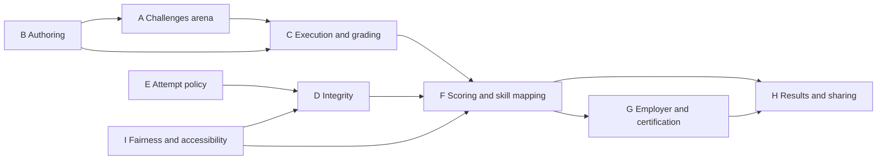

| Code | Sub-module | Features |
|---|---|---|
| A | Challenges arena | FR-ASM-001 to 015 |
| B | Authoring and question bank | FR-ASM-016 to 022 |
| C | Execution and grading | FR-ASM-023 to 028 |
| D | Integrity and proctoring | FR-ASM-029 to 039 |
| E | Attempt policy | FR-ASM-040 to 042 |
| F | Scoring, calibration and skill mapping | FR-ASM-043 to 045 |
| G | Employer-assigned and certification | FR-ASM-046 to 049 |
| H | Results, sharing and leaderboards | FR-ASM-050 to 053 |
| I | Fairness, accessibility and operations | FR-ASM-054 to 058 |

## 4. Feature specifications

Notification opt-out classes (owned by NTF, planned): `TRANSACTIONAL` (cannot be disabled), `LEARNING` (practice and reminders), `SOCIAL`, `OPERATIONAL` (author and staff work items).

### A. Challenges arena

### FR-ASM-001 — Challenge catalog

- **Sub-module:** A. Challenges arena
- **Priority / tier:** Must · R1
- **Source:** [SRC: SSOT §9.2 F-08 step 1; FREG F-08] [DER]
- **Purpose and outcome:** Candidates find a challenge to practice or prove a skill. Success is click-through to a first attempt and a spread across difficulty levels.
- **Roles and permissions:** `GUE: view public listing` · `CAN, STD, INS: view, filter, save` · `PAD: view all states`
- **Preconditions and entry points:** `/challenges`; links from skill pages, courses and career plans.
- **User interactions and actions:**
  1. Open the catalog; see cards with title, type icon, difficulty, skills, languages, average solve rate, time estimate, and your status (not started, in progress, solved, assisted).
  2. Filter by type (coding, objective, scenario, project, system design, SQL, data), difficulty (easy, medium, hard, expert), skill, language, company-sourced (if shown), duration, status, set.
  3. Sort by recommended, newest, difficulty, solve rate, popularity.
  4. Search by title, skill or tag; save a challenge to a list.
  5. Open a challenge to its detail page (FR-ASM-002).
- **System behavior:** Lists only `published` challenges visible to the viewer (retired challenges stay visible to people who solved them). Difficulty is author-set then recalibrated from solve data after enough attempts {200} (FR-ASM-044) and shown with the method. Recommended sort uses AIC (planned) with consent and falls back to difficulty by skill gap. Counts and solve rates are aggregates only (BR-ASM-036).
- **UI elements and controls:** Filter panel, sort select, search box, challenge cards with status icons and text, saved-list heart, pagination.
- **Configuration options:** Platform: difficulty labels, visibility of solve rates. User: default filters.
- **Business rules:** BR-ASM-049, BR-ASM-036
- **Validation:** Filter values from enumerated sets; query up to 100 characters.
- **Inputs and outputs:** In: filters, query. Out: challenge list with status decoration.
- **Filters, sorting, search:** As above.
- **Notifications and communication:** n/a — none.
- **Error handling and edge cases:** No results: empty state with "Clear filters" and recommended starters. Index lag: counts labeled approximate. Private or employer-only challenges never appear.
- **Dependencies:** ENT-ASM-01, SRC (planned), FR-ASM-002.
- **Security and privacy:** Status decoration only for the signed-in viewer; hidden tests and solution text never in list payloads.
- **Acceptance criteria:**
  1. Given a mix of states, when a guest lists, then only published public challenges show.
  2. Given a filter for SQL and hard, when applied, then only matching challenges are listed with matching count.
  3. Negative: Given an employer-private challenge, when a candidate not invited requests it, then `404` is returned.

### FR-ASM-002 — Challenge detail and start screen

- **Sub-module:** A. Challenges arena
- **Priority / tier:** Must · R1
- **Source:** [SRC: YASH-G3 SPEC-05 §3.2 start disclosure, §4 SCR-ASSESS-START; SSOT §17] [DER]
- **Purpose and outcome:** Candidates understand exactly what they are about to do, including rules, time, integrity signals and AI policy, before any attempt starts. Success is informed consent and fewer disputes.
- **Roles and permissions:** `CAN, STD, INS: view and start` · `GUE: view summary`
- **Preconditions and entry points:** Challenge or assessment detail route `/challenges/:id`, `/assessments/:id`.
- **User interactions and actions:**
  1. Read the summary: type, difficulty, estimated time, skills, languages, scoring, pass threshold, attempts rules, whether it can produce verified evidence, accommodations available.
  2. Read the policy box: AI policy label (for example "AI assistance is not allowed during this attempt"), integrity signals collected (listed), proctoring requirements if any, retake rules, results release rules.
  3. For timed items, see the exact duration and that the clock is server-controlled.
  4. Tick "I have read the rules" (required for evidence-eligible items) and press Start.
  5. Request accommodations before starting (link to FR-ASM-041).
- **System behavior:** The disclosure content is generated from the assessment configuration so it is always accurate (BR-ASM-015). Starting records acceptance with the policy version hash (BR-ASM-056). Practice items start immediately with a lighter disclosure.
- **UI elements and controls:** Summary card, policy box with icons and text, signals list, accommodation link, rules checkbox, Start button (disabled until the box is ticked when required).
- **Configuration options:** Author: policy text additions. Platform: disclosure template.
- **Business rules:** BR-ASM-001, BR-ASM-015, BR-ASM-056
- **Validation:** Start requires eligibility (cooldown, attempts, registration, identity if required).
- **Inputs and outputs:** In: acceptance. Out: attempt start (FR-ASM-029).
- **Filters, sorting, search:** n/a — detail page.
- **Notifications and communication:** n/a — none.
- **Error handling and edge cases:** Not eligible: reason and next step (cooldown ends at, register first, verify identity). Policy changed after acceptance: new acceptance required before the next attempt. Page opened while attempt in progress: shows Resume.
- **Dependencies:** FR-ASM-029, FR-ASM-031, FR-ASM-040.
- **Security and privacy:** No answer or test data in page payload.
- **Acceptance criteria:**
  1. Given an evidence-eligible assessment, when the page loads, then the AI policy, signals list and retake rules are shown and Start is disabled until acknowledged.
  2. Given a cooldown with 2 hours left, when opening, then Start is disabled with the end time shown.
  3. Negative: Given a direct API start without acknowledgment, when called, then `422 rules_not_accepted` is returned.

### FR-ASM-003 — Coding workspace

- **Sub-module:** A. Challenges arena
- **Priority / tier:** Must · R1
- **Source:** [SRC: SSOT §9.2 F-08 step 2] [DER]
- **Purpose and outcome:** Candidates write, run and submit code in a capable browser editor. Success is low friction from reading to first run and no lost work.
- **Roles and permissions:** `CAN, STD, INS: use`
- **Preconditions and entry points:** Coding challenge attempt `/challenges/:id/attempt`.
- **User interactions and actions:**
  1. Read the problem statement (Markdown with examples, constraints, images), switch language from the allowed list.
  2. Write code in the editor with syntax highlighting, indentation, bracket matching, find and replace, themes, font size, vim or emacs keymaps (optional), multi-file for project-style problems.
  3. Press Run (FR-ASM-004) or Submit; see results in the output panel; use custom input to test.
  4. Reset to starter code (confirmation), view starter code diff, and download code.
  5. Use the timer, if timed; autosave indicator shows state.
- **System behavior:** Code autosaves every 5 seconds and on change after debounce to the attempt draft (idempotent by sequence). Language switching keeps separate drafts per language. Editor features available depend on the AI policy: autocomplete suggestions from AI are disabled when AI is not allowed (BR-ASM-001); basic lexical completion is allowed. Paste events are counted when integrity policy requires (BR-ASM-015). Submissions are snapshots (BR-ASM-047).
- **UI elements and controls:** Problem panel, editor (Monaco-class), language select, Run, Submit, custom input box, output and test tabs, reset, settings gear, timer, saved indicator, banner for AI policy.
- **Configuration options:** User: editor preferences. Author: allowed languages, starter code per language, multi-file layout.
- **Business rules:** BR-ASM-001, BR-ASM-007, BR-ASM-011, BR-ASM-038, BR-ASM-047
- **Validation:** Code up to 256 KB per file and 1 MB total; language must be allowed for the challenge.
- **Inputs and outputs:** In: code, custom input. Out: run and submission results.
- **Filters, sorting, search:** n/a — workspace.
- **Notifications and communication:** n/a — none.
- **Error handling and edge cases:** Editor fails to load: plain-text fallback editor. Connection lost: local draft preserved and synced later; submit disabled until online. Two tabs: second blocked for graded attempts (BR-ASM-006), allowed in practice with a warning. Large output truncated with notice.
- **Dependencies:** FR-ASM-004, FR-ASM-023, FR-ASM-024, FR-ASM-029.
- **Security and privacy:** Code is candidate-owned; visible to graders, reviewers and similarity checks only; accessibility mode offers a simple editor with screen-reader announcements.
- **Acceptance criteria:**
  1. Given a started challenge, when the learner types and waits 5 seconds, then the draft is saved and a refresh restores it.
  2. Given a graded attempt open in one tab, when opened in another, then the second is refused with an explanation.
  3. Negative: Given a language not allowed for the challenge, when a run is requested through the API, then `422 language_not_allowed` is returned.

### FR-ASM-004 — Run against public tests

- **Sub-module:** A. Challenges arena
- **Priority / tier:** Must · R1
- **Source:** [SRC: SSOT §9.2 F-08 step 3; BR-051] [DER]
- **Purpose and outcome:** Candidates test their code against visible cases without spending a submission. Success is fast, reliable feedback with clear errors.
- **Roles and permissions:** `CAN, STD, INS: run`
- **Preconditions and entry points:** Run button and shortcut in the workspace.
- **User interactions and actions:**
  1. Press Run (or `Ctrl+Enter`); optionally provide custom stdin.
  2. See status Queued, Running, then results per public test case: pass or fail, expected versus actual, runtime and memory, stdout and stderr, compiler errors with line links.
  3. Click an error line to jump to it in the editor.
  4. Rerun after edits; cancel a long run.
- **System behavior:** Executes against public tests only in the sandbox (FR-ASM-023) with the same limits as submission; does not consume a submission and never affects scores or evidence (BR-ASM-011). Rate limit 30 runs per minute per user (BR-ASM-039). Hidden test names are never revealed. A queued run shows honest queue state and elapsed time.
- **UI elements and controls:** Run and Cancel buttons, results tabs, test case list with diff view, custom input area, status chip.
- **Configuration options:** Platform: run rate limit, queue wait warning (30 s).
- **Business rules:** BR-ASM-011, BR-ASM-039
- **Validation:** Custom input up to 64 KB.
- **Inputs and outputs:** In: code, input. Out: structured output (stdout, stderr, exit code, duration, memory), per-test results.
- **Filters, sorting, search:** n/a — results panel.
- **Notifications and communication:** n/a — none.
- **Error handling and edge cases:** Rate limit hit: message with seconds left. Sandbox queue slow: "Still waiting, retry or keep waiting". Sandbox unavailable: honest message; draft preserved. Timeout of user code: shows `time limit exceeded` for that test, not a platform error.
- **Dependencies:** FR-ASM-023, FR-ASM-025.
- **Security and privacy:** No network from user code; outputs are truncated to 64 KB.
- **Acceptance criteria:**
  1. Given code with a syntax error, when running, then the compiler error appears with the line number and no test results.
  2. Given an infinite loop, when running, then that test shows time limit exceeded and other tests still report.
  3. Negative: Given the 31st run in a minute, when requested, then `429` is returned and the editor shows the wait time.

### FR-ASM-005 — Objective question challenges

- **Sub-module:** A. Challenges arena
- **Priority / tier:** Must · R1
- **Source:** [SRC: SSOT §7 F-68, F-115; YASH-G3 SPEC-05 §3.5] [DER]
- **Purpose and outcome:** Candidates answer multiple-choice and other auto-gradable formats. Success is correct delivery, scoring and feedback in quizzes, challenges and exams.
- **Roles and permissions:** `CAN, STD, INS: attempt`
- **Preconditions and entry points:** Challenge, assessment or course quiz of objective type.
- **User interactions and actions:**
  1. Answer questions: single choice, multiple select (with partial credit), true or false, ordering, matching, fill in the blank (exact or pattern), numeric with tolerance, hotspot or image click (with keyboard alternative), short text with keyword match.
  2. Navigate with Next, Previous or the navigator; flag questions for review.
  3. Submit; see unanswered count and confirm.
  4. See feedback according to the results release policy (FR-ASM-050).
- **System behavior:** Questions delivered one at a time or in blocks per configuration; per-attempt randomization from a seed (BR-ASM-024); answers autosaved per question with sequence (BR-ASM-007). The client never receives answer keys or explanations until release (BR-ASM-003). Scoring per BR-ASM-010: multi-select partial credit = (correct selected minus incorrect selected) over total correct, floored at 0.
- **UI elements and controls:** Question pane, option controls (radio or checkbox with labels), navigator grid, flag toggle, timer, Submit with confirmation, "Saved" indicator.
- **Configuration options:** Author: delivery mode, shuffle, review allowed, partial credit, negative marking (off by default).
- **Business rules:** BR-ASM-003, BR-ASM-007, BR-ASM-010, BR-ASM-024
- **Validation:** Answers conform to the question type schema; numeric tolerance rules; text length limits.
- **Inputs and outputs:** In: answers. Out: result and feedback.
- **Filters, sorting, search:** n/a — attempt UI.
- **Notifications and communication:** n/a — none.
- **Error handling and edge cases:** Disconnect: local cache replays idempotently before the deadline. Question edited by author mid-attempt: attempt keeps its pinned version (BR-ASM-023). Unanswered questions score zero.
- **Dependencies:** FR-ASM-017, FR-ASM-026, FR-ASM-029, FR-ASM-030.
- **Security and privacy:** Answer keys server-side only; copy and paste signals counted only when policy requires.
- **Acceptance criteria:**
  1. Given a multi-select with 3 correct and a candidate choosing 2 correct and 1 incorrect, when scored, then partial credit is (2 minus 1) over 3.
  2. Given the same autosave sent out of order, when processed, then the highest sequence wins.
  3. Negative: Given any client request for the question payload, when inspected, then no answer key field is present.

### FR-ASM-006 — Scenario challenges

- **Sub-module:** A. Challenges arena
- **Priority / tier:** Should · R4
- **Source:** [PROP] (situational judgment and branching case formats as in CodeSignal, Codility, SHL)
- **Purpose and outcome:** Candidates handle realistic work situations (support escalation, incident response, stakeholder decisions) with graded choices or free-text responses. Success is valid measurement of judgment and behavior skills.
- **Roles and permissions:** `CAN, STD, INS: attempt` · `INS, EAD: author`
- **Preconditions and entry points:** Scenario challenge or assessment.
- **User interactions and actions:**
  1. Read the scenario with context documents, logs, emails or dashboards presented as panels.
  2. Choose actions at decision points; branching reveals consequences and new information; or write a response (memo, message, plan).
  3. Rank options or allocate points across options where the format requires.
  4. Submit; see feedback per release policy.
- **System behavior:** Scenario graph with nodes (information, decision, response) and scoring weights per path. Judgment items use expert-keyed scoring with partial credit by distance from expert consensus [PROP]. Free-text responses are graded by rubric (FR-ASM-027) with optional AI suggestions (FR-ASM-028). The scenario state is server-held; the path is stored for review. Scenarios never reveal the keyed best path before release.
- **UI elements and controls:** Context panels with tabs, decision buttons or ranking list (keyboard-operable), response editor, progress map without revealing branches.
- **Configuration options:** Author: graph, keys, rubric, time limits.
- **Business rules:** BR-ASM-003, BR-ASM-020, BR-ASM-021
- **Validation:** Graph must be acyclic from start to an end, every decision has keyed scores; responses up to 5,000 characters.
- **Inputs and outputs:** In: decisions, responses. Out: score and feedback.
- **Filters, sorting, search:** n/a — attempt UI.
- **Notifications and communication:** n/a — none.
- **Error handling and edge cases:** Reload mid-scenario resumes at the current node. Orphan nodes flagged at authoring. Manual grading backlog shows "Awaiting review".
- **Dependencies:** FR-ASM-016, FR-ASM-020, FR-ASM-027.
- **Security and privacy:** Keys hidden; response text treated as personal data.
- **Acceptance criteria:**
  1. Given a branching scenario, when the candidate picks option B at node 2, then node 3B appears and the path is stored.
  2. Given a response needing manual grading, when submitted, then status shows Awaiting review and the score is withheld.
  3. Negative: Given a scenario graph with an unreachable end node, when publishing, then `422 invalid_graph` is returned.

### FR-ASM-007 — Project challenges

- **Sub-module:** A. Challenges arena
- **Priority / tier:** Should · R4
- **Source:** [SRC: SSOT §7 F-124; FREG F-100] [DER]
- **Purpose and outcome:** Candidates build a small real project (repository, design, analysis, document) and receive rubric-based review. Success is portfolio-ready work backed by reviewer judgment.
- **Roles and permissions:** `CAN, STD, INS: submit` · `Reviewers (INS, EAD, MOD pool): review`
- **Preconditions and entry points:** Project challenge detail; time window for the project.
- **User interactions and actions:**
  1. Read the brief, requirements, rubric and deadline.
  2. Work off-platform or in the workspace; submit links (repository, demo), files and a write-up.
  3. Optionally run automated checks (build, tests, lint) on the submitted repository snapshot.
  4. Receive review scores and comments; resubmit within allowed revisions.
  5. Choose to publish the project to the portfolio (PRF, planned).
- **System behavior:** Submission captures an immutable snapshot (commit hash, archive hash, artifact hashes, BR-ASM-047). Automated checks run in the sandbox against the snapshot. Human review by rubric is required before any evidence is minted (BR-ASM-050). Reviewers see similarity flags (FR-ASM-033). Reviewer SLA shown. AI-use statement is part of the declaration.
- **UI elements and controls:** Brief panel, submission form, status timeline, check results, review panel, publish toggle.
- **Configuration options:** Author: rubric, revisions, auto-check script, reviewer pool.
- **Business rules:** BR-ASM-020, BR-ASM-047, BR-ASM-050
- **Validation:** Links `https`; archive up to 200 MB; repository must be reachable at submission time.
- **Inputs and outputs:** In: submission. Out: review result.
- **Filters, sorting, search:** Reviewer queue filters.
- **Notifications and communication:** `asm.project.reviewed` (`LEARNING`), `asm.project.review_due` to reviewers (`OPERATIONAL`).
- **Error handling and edge cases:** Repository becomes private: reviewer sees "Link unreachable" and the candidate is notified to fix it within 48 hours. Reviewer inactivity: reassign after SLA. Large repository: shallow snapshot.
- **Dependencies:** FR-ASM-020, FR-ASM-023, FR-ASM-027, FR-ASM-033, PRF (planned).
- **Security and privacy:** Private repositories accessed only through scoped read tokens the candidate grants and revokes after snapshot.
- **Acceptance criteria:**
  1. Given a submission with a repository link, when submitted, then the commit hash snapshot is stored and automated checks run on it.
  2. Given a reviewer scoring all rubric criteria, when finalized, then the score and comments are visible to the candidate.
  3. Negative: Given a project challenge, when passed only by automated checks, then no evidence is minted until a human review is finalized.

### FR-ASM-008 — System design challenges

- **Sub-module:** A. Challenges arena
- **Priority / tier:** Could · R4
- **Source:** [SRC: SSOT §7 F-135 "System Design Practice"] [DER]
- **Purpose and outcome:** Candidates produce a system design (diagram plus written rationale) and get structured feedback. Success is reliable human-graded design assessment.
- **Roles and permissions:** `CAN, STD, INS: attempt` · `Reviewers: grade`
- **Preconditions and entry points:** System design challenge.
- **User interactions and actions:**
  1. Read the requirements and constraints (scale, latency, budget, team).
  2. Draw components on a whiteboard canvas (boxes, arrows, labels, databases, queues, caches) or upload a diagram; write assumptions, data model, APIs, trade-offs and failure handling in structured sections.
  3. Optionally add capacity estimates in a table.
  4. Submit within the time limit; receive rubric feedback.
- **System behavior:** Canvas state saved as structured JSON plus an exported image. Rubric criteria: requirements coverage, component choice, data design, scalability, reliability, trade-offs, communication. Graded by humans with AI suggestions allowed only as drafts (FR-ASM-028). Under `AI_PROHIBITED` no AI help is offered. Practice mode may offer reference designs after submission.
- **UI elements and controls:** Canvas toolbar (keyboard-accessible alternatives such as a structured outline editor), notes sections, estimate table, timer.
- **Configuration options:** Author: rubric, time, reference design visibility.
- **Business rules:** BR-ASM-001, BR-ASM-020, BR-ASM-050
- **Validation:** Canvas up to 500 nodes; text sections up to 8,000 characters each.
- **Inputs and outputs:** In: design artifacts. Out: rubric scores.
- **Filters, sorting, search:** n/a — attempt UI.
- **Notifications and communication:** `asm.design.reviewed` (`LEARNING`).
- **Error handling and edge cases:** Canvas unusable for some candidates: outline editor produces an equivalent structured design. Large diagrams: auto-fit export. Late submission after time limit: rejected.
- **Dependencies:** FR-ASM-020, FR-ASM-027, FR-ASM-028.
- **Security and privacy:** Designs are candidate-owned; sharing only on consent.
- **Acceptance criteria:**
  1. Given a design with a diagram and all sections, when submitted, then reviewers see the structured data and the exported image.
  2. Given an accessibility need, when using the outline editor, then an equivalent design can be submitted.
  3. Negative: Given an AI-prohibited design assessment, when the candidate calls the AI endpoint, then `403 ai_prohibited` is returned.

### FR-ASM-009 — SQL challenges

- **Sub-module:** A. Challenges arena
- **Priority / tier:** Should · R1
- **Source:** [SRC: SSOT §9.2 F-08 languages (SQL)] [DER]
- **Purpose and outcome:** Candidates write SQL against provided datasets and are graded on result correctness. Success is deterministic, safe grading.
- **Roles and permissions:** `CAN, STD, INS: attempt` · `INS, PAD: author`
- **Preconditions and entry points:** SQL challenge.
- **User interactions and actions:**
  1. See the schema explorer (tables, columns, types, sample rows) and problem statement.
  2. Write queries; run to preview results (limited rows).
  3. Submit; see pass or fail per hidden dataset and, in practice mode, the diff of expected versus actual for visible data.
  4. Switch SQL dialect where multiple are offered.
- **System behavior:** Each run executes in an ephemeral isolated database seeded from the challenge schema; read-only except temporary objects as configured; statement timeout {10 s}, row cap {10,000}, memory limits. Grading compares result sets with options: ordered or unordered, column names or positions, numeric tolerance, null handling, duplicate handling. Multiple datasets (visible and hidden) prevent hardcoding. Only allowed statement classes (SELECT and, for some challenges, DML on temp tables) run; DDL on the base schema and extensions are blocked.
- **UI elements and controls:** Schema explorer, SQL editor, result grid with pagination, diff view, dialect select.
- **Configuration options:** Author: schema, datasets, comparison rules, dialect.
- **Business rules:** BR-ASM-011, BR-ASM-052
- **Validation:** Query up to 64 KB; single statement unless multi-statement allowed.
- **Inputs and outputs:** In: SQL. Out: result and grade.
- **Filters, sorting, search:** Schema explorer search.
- **Notifications and communication:** n/a — none.
- **Error handling and edge cases:** Syntax error shown with position. Long-running query killed at limit with message. Non-deterministic queries (random, now) flagged at authoring and normalized.
- **Dependencies:** FR-ASM-019, FR-ASM-023.
- **Security and privacy:** No access to other schemas, files or network; datasets synthetic and free of personal data (BR-ASM-052).
- **Acceptance criteria:**
  1. Given the correct unordered result, when submitted with unordered comparison, then it passes regardless of row order.
  2. Given a query hardcoding visible rows, when run on hidden datasets, then it fails.
  3. Negative: Given a statement attempting `COPY` or file access, when run, then it is rejected before execution.

### FR-ASM-010 — Data challenges

- **Sub-module:** A. Challenges arena
- **Priority / tier:** Could · R4
- **Source:** [PROP] (Kaggle-style and analytics assessments)
- **Purpose and outcome:** Candidates analyze data (cleaning, analysis, visualization, modeling) and are graded on outputs. Success is valid measurement of data skills with safe execution.
- **Roles and permissions:** `CAN, STD, INS: attempt` · `INS, PAD: author`
- **Preconditions and entry points:** Data challenge.
- **User interactions and actions:**
  1. Download or open the dataset in the workspace (notebook-style environment with Python or R).
  2. Complete tasks: compute answers, produce a cleaned dataset, generate a chart, or train a model and output predictions.
  3. Submit result files (CSV, JSON, image) and the notebook.
  4. See score from checkers and rubric where human review applies.
- **System behavior:** Notebooks run in the sandbox with resource caps and a pinned library set and no network. Checkers compare submitted outputs: exact values with tolerance, schema validity, metric thresholds (for example accuracy on a hidden test set), image similarity is not used for grading but rubric review. Predictions are scored on hidden labels never exposed to the candidate (BR-ASM-003). Datasets must be licensed and free of personal data (BR-ASM-052).
- **UI elements and controls:** Notebook workspace, file panel, submit panel, results panel.
- **Configuration options:** Author: dataset, checker script, metric, runtime image.
- **Business rules:** BR-ASM-003, BR-ASM-011, BR-ASM-052
- **Validation:** Output files up to 100 MB; allowed types; metric computed server-side.
- **Inputs and outputs:** In: outputs and notebook. Out: score.
- **Filters, sorting, search:** n/a — workspace.
- **Notifications and communication:** n/a — none.
- **Error handling and edge cases:** Kernel crash: autosave restores. Metric ties: deterministic tiebreak. Resource exhaustion fails the run only.
- **Dependencies:** FR-ASM-019, FR-ASM-023, FR-ASM-024.
- **Security and privacy:** Hidden labels never leave the grader; datasets synthetic or licensed.
- **Acceptance criteria:**
  1. Given predictions meeting the metric threshold, when submitted, then the score reflects the hidden metric.
  2. Given an attempt to read the hidden labels path, when run, then access is denied and logged.
  3. Negative: Given a notebook attempting network access, when run, then the call fails and the attempt continues.

### FR-ASM-011 — Practice mode

- **Sub-module:** A. Challenges arena
- **Priority / tier:** Must · R1
- **Source:** [SRC: SSOT §9.2 F-08 step 10] [DER]
- **Purpose and outcome:** Learners practice freely with unlimited retries and help, without affecting evidence. Success is more practice sessions and stronger later performance.
- **Roles and permissions:** `CAN, STD, INS: use`
- **Preconditions and entry points:** "Practice" toggle on a challenge; practice sets; readiness quizzes in courses.
- **User interactions and actions:**
  1. Start in Practice mode; see the mode label and rules (unlimited attempts, hints, no evidence).
  2. Run, submit, reveal hints and read explanations as allowed.
  3. See attempt history and progress per skill.
  4. Switch to Graded mode (if the challenge can be graded) with the disclosure.
- **System behavior:** Practice attempts never mint evidence, never count toward leaderboards or XP awards unless the platform's REP rules explicitly allow (BR-ASM-025). In practice, AI assistance may be offered inside the editor if the challenge policy allows (draft-only, never executes code) [SRC: SSOT F-08 step 11]. Practice data feeds skill-gap and recommendation signals with consent. Practice and graded attempts are separate records.
- **UI elements and controls:** Mode switch with explanation, hints panel, solution unlock, history list.
- **Configuration options:** Author: hints, solution unlock, AI help permitted in practice.
- **Business rules:** BR-ASM-025, BR-ASM-001
- **Validation:** Mode must match challenge capabilities.
- **Inputs and outputs:** In: practice attempts. Out: feedback.
- **Filters, sorting, search:** History filter by status.
- **Notifications and communication:** `asm.practice.streak` optional (`LEARNING`).
- **Error handling and edge cases:** Practice solved then graded attempt: independent. AI unavailable: hints only.
- **Dependencies:** FR-ASM-012, FR-ASM-034.
- **Security and privacy:** Practice history private to the candidate.
- **Acceptance criteria:**
  1. Given practice mode, when the candidate submits 10 attempts, then all are allowed and none creates evidence.
  2. Given graded mode, when the same code is submitted, then it is a separate attempt subject to limits.
  3. Negative: Given a practice-passed attempt, when the evidence consumer is queried, then no item exists for it.

### FR-ASM-012 — Hints and solutions

- **Sub-module:** A. Challenges arena
- **Priority / tier:** Should · R1
- **Source:** [SRC: SSOT §9.2 F-08 step 10 hints] [DER]
- **Purpose and outcome:** Learners get progressive help without spoiling learning or compromising graded integrity. Success is solved rates among hint users without shortcut abuse.
- **Roles and permissions:** `CAN, STD, INS: use in practice` · `INS, PAD: author`
- **Preconditions and entry points:** Practice mode only (never in AI-prohibited graded attempts).
- **User interactions and actions:**
  1. Open Hints; reveal them one at a time (each shows a confirmation for cost where configured).
  2. After meeting the unlock rule (solved, N failed attempts, or time), open the editorial: approach explanation and reference solutions in several languages.
  3. Mark helpful or not.
- **System behavior:** Hint reveals and solution views are recorded. Viewing the full solution before solving marks the attempt `assisted`, excluded from rankings and evidence (BR-ASM-026). Graded attempts under `AI_PROHIBITED` show no hints (BR-ASM-001). Hint content is author-written; AI-generated hints, if any, are drafts reviewed by the author.
- **UI elements and controls:** Hint list with reveal buttons, editorial tab with unlock status, helpful buttons.
- **Configuration options:** Author: hint count, unlock rules.
- **Business rules:** BR-ASM-001, BR-ASM-026
- **Validation:** Hints 1 to 5 per challenge; unlock rule values within bounds.
- **Inputs and outputs:** In: reveals. Out: hint text.
- **Filters, sorting, search:** n/a — short list.
- **Notifications and communication:** n/a — none.
- **Error handling and edge cases:** Unlock rule not met: shows requirement. Solution text for retired languages hidden.
- **Dependencies:** FR-ASM-011.
- **Security and privacy:** Solutions never in public API before unlock; usage private.
- **Acceptance criteria:**
  1. Given 3 failed attempts and unlock at 3, when opening the editorial, then it is available.
  2. Given the editorial viewed before solving, when solved, then the status shows assisted.
  3. Negative: Given a graded AI-prohibited attempt, when requesting a hint, then `403 hints_disabled` is returned.

### FR-ASM-013 — Challenge discussion and shared solutions

- **Sub-module:** A. Challenges arena
- **Priority / tier:** Could · R4
- **Source:** [PROP]
- **Purpose and outcome:** Learners discuss problems and share solutions after solving, building community without spoiling. Success is healthy engagement with low spoiler complaints.
- **Roles and permissions:** `CAN, STD, INS: post after solving or in discussion tab` · `MOD: moderate`
- **Preconditions and entry points:** Discussion tab on a challenge.
- **User interactions and actions:**
  1. Read discussion threads (spoiler-tagged hidden by default).
  2. Post a question, approach or solution after solving; mark spoiler.
  3. Upvote, comment, report.
  4. Sort by top, newest.
- **System behavior:** Posting solutions requires a solved status for the challenge; text-only questions allowed anytime without code. Posts for evidence-eligible or employer-private challenges are disabled. Reports route to moderation; similar-code posts from before solve are flagged. Rate limits apply.
- **UI elements and controls:** Thread list, spoiler toggle, composer with code block, vote buttons.
- **Configuration options:** Author: discussion on or off per challenge.
- **Business rules:** BR-ASM-026, BR-ASM-027
- **Validation:** Post up to 10,000 characters; code up to 20 KB.
- **Inputs and outputs:** In: posts. Out: threads.
- **Filters, sorting, search:** Sort and filter by language.
- **Notifications and communication:** `asm.discussion.reply` (`SOCIAL`).
- **Error handling and edge cases:** Spoiler without tag: hidden by moderator. Posts on retired challenge remain read-only.
- **Dependencies:** TSF (planned), FR-ASM-012.
- **Security and privacy:** Public posts under display name; no personal data.
- **Acceptance criteria:**
  1. Given a solved challenge, when posting a solution, then it appears collapsed as a spoiler.
  2. Given an unsolved challenge, when posting code, then `403 solve_required` is returned.
  3. Negative: Given an evidence-eligible assessment, when opening the discussion tab, then it is not available.

### FR-ASM-014 — Challenge sets and interview prep

- **Sub-module:** A. Challenges arena
- **Priority / tier:** Could · R4
- **Source:** [SRC: SSOT §7 F-78 "Practice Sets & Interview Prep"] [DER]
- **Purpose and outcome:** Candidates follow curated sets (by skill, role, company style) with progress and timed mock rounds. Success is set completion and readiness.
- **Roles and permissions:** `CAN, STD, INS: use` · `INS, PAD: author sets`
- **Preconditions and entry points:** `/challenges/sets`.
- **User interactions and actions:**
  1. Browse sets (for example "SQL for analysts", "30 backend interview problems").
  2. Start a set; see ordered items with status and estimated time.
  3. Start a mock round: timed mix with a cumulative score and review at the end.
  4. See readiness summary and recommended next set.
- **System behavior:** Sets are ordered or unordered lists of published challenges. Mock rounds are practice by default with the timer server-controlled and are never evidence. Readiness summary uses solve rate, time and hint use. Sets can be linked from skill pages and career plans.
- **UI elements and controls:** Set cards, progress bars with text, mock round start, summary report.
- **Configuration options:** Author: set content and ordering.
- **Business rules:** BR-ASM-025
- **Validation:** 3 to 100 items per set.
- **Inputs and outputs:** In: set choice. Out: progress and summary.
- **Filters, sorting, search:** Filter by role, skill, difficulty.
- **Notifications and communication:** `asm.set.progress` (`LEARNING`).
- **Error handling and edge cases:** Retired item in a set: skipped with note. Empty set not published.
- **Dependencies:** FR-ASM-001, FR-ASM-011.
- **Security and privacy:** Private progress.
- **Acceptance criteria:**
  1. Given a set of 10 items with 4 solved, when viewed, then 40 percent progress shows.
  2. Given a mock round, when time ends, then answers are auto-submitted and the summary opens.
  3. Negative: Given a set containing an employer-private challenge, when publishing publicly, then it is rejected.

### FR-ASM-015 — Contests

- **Sub-module:** A. Challenges arena
- **Priority / tier:** Could · R6
- **Source:** [SRC: SSOT §7 F-76; BR-139; OD-44] [DER]
- **Purpose and outcome:** Candidates compete in timed contests with live standings and earn rankings and certificates. Success is fair, reliable contests under load.
- **Roles and permissions:** `CAN, STD, INS: register, compete` · `PAD, IAD: organize` · `MOD: review`
- **Preconditions and entry points:** `/contests`; registration window.
- **User interactions and actions:**
  1. Register for an upcoming contest; see rules, scoring, schedule, prizes or certificates.
  2. Enter at start time; solve problems; submit solutions; see live standings (optionally frozen in the final period).
  3. See final results after the integrity review and appeals window.
  4. Receive contest certificate or badge if eligible.
- **System behavior:** Contests run in a separate sandbox pool (SSOT OD-44). Submissions are locked at the server-authoritative end time; clock skew never extends (BR-ASM-028). Scoring modes: points with time penalty, or ICPC-style. Standings freeze for the last {30 minutes} if configured. Plagiarism checks (FR-ASM-033) run across submissions; flagged entries are held for review before final standings. Rated contests update a rating using a documented formula; unrated contests do not. Late registration closes at a configured time. Candidates must accept the rules and identity requirements.
- **UI elements and controls:** Contest lobby, problem list, standings table, countdown, submission list, announcements.
- **Configuration options:** Organizer: duration, scoring, freeze, rated flag, eligibility, problem set.
- **Business rules:** BR-ASM-028, BR-ASM-029, BR-ASM-017
- **Validation:** Registration before cutoff; one account per person (identity checks if required).
- **Inputs and outputs:** In: submissions. Out: standings and results.
- **Filters, sorting, search:** Standings by country, institution, friends.
- **Notifications and communication:** `asm.contest.reminder`, `asm.contest.results` (`LEARNING`).
- **Error handling and edge cases:** Judge overload: queue shown, submission time recorded at receipt not at judging. Contest cancelled: notice and no ratings change. Disconnect: submissions already received count.
- **Dependencies:** FR-ASM-023, FR-ASM-025, FR-ASM-033, FR-ASM-052, ENT-ASM-23.
- **Security and privacy:** Display names; opt-out from public standings (leaderboard rules).
- **Acceptance criteria:**
  1. Given a submission received 1 second after the end time, when processed, then it is rejected.
  2. Given a judging delay, when a submission was received before the end, then it is judged and counts.
  3. Negative: Given a candidate who did not register, when submitting, then `403 not_registered` is returned.

### B. Authoring and question bank

### FR-ASM-016 — Assessment builder

- **Sub-module:** B. Authoring and question bank
- **Priority / tier:** Must · R3
- **Source:** [SRC: YASH-G3 SPEC-05 §3.1; SSOT §7 F-115 step 1] [DER]
- **Purpose and outcome:** Authors define an assessment: its purpose, content, timing, policies and results. Success is assessments that publish correctly and behave as the disclosure says.
- **Roles and permissions:** `INS (own, course context), EAD (employer templates), IAD (institution), PAD (platform): create, edit` · `MOD: view`
- **Preconditions and entry points:** Studio quiz authoring (STU), employer template tool, institution console, platform admin; route `/author/assessments/:id`.
- **User interactions and actions:**
  1. Create an assessment; choose context (`standalone`, `course_lesson`, `certification`, `employer_assigned`, `contest`, `practice`) and mode (`auto_graded`, `code`, `manual`, `mixed`).
  2. Set title, description, skills (1 to 5 from the ontology), duration (5 to 240 minutes), pass threshold, attempts policy, results release policy, accessibility options.
  3. Choose AI policy (`AI_PROHIBITED`, `AI_RESTRICTED`, `AI_ALLOWED`, `POST_ASSESSMENT_ONLY`) and integrity policy level (FR-ASM-031).
  4. Add content: questions from the bank, new questions, challenges, pools and sections with weights (FR-ASM-021).
  5. Preview as a candidate, run the validation checklist, submit for review where required, and publish (FR-ASM-022).
- **System behavior:** The builder produces a draft assessment version. Rules enforced: any assessment that can mint evidence must be `AI_PROHIBITED` (BR-ASM-001, BR-ASM-005); evidence-eligible assessments require calibration or standard setting (BR-ASM-035); points sum and weights validated. The disclosure text is generated from the configuration (BR-ASM-015). Autosave and edit locking as in STU. Employer templates are labeled and cannot mint platform evidence (BR-ASM-043).
- **UI elements and controls:** Settings form, content outline, preview, validation checklist, policy cards with plain-language effect summaries.
- **Configuration options:** Author: all above. Platform: limits on duration, attempts, available policies per context.
- **Business rules:** BR-ASM-001, BR-ASM-004, BR-ASM-005, BR-ASM-015, BR-ASM-043
- **Validation:** Title 5 to 120 characters; skills 1 to 5; pass threshold 1 to 100; duration 5 to 240; at least 1 question; points total greater than 0; AI policy compatibility with context.
- **Inputs and outputs:** In: definition. Out: draft version.
- **Filters, sorting, search:** Author's assessment list filters by context, state, skill.
- **Notifications and communication:** `asm.assessment.validation_failed` (`OPERATIONAL`).
- **Error handling and edge cases:** Selecting `AI_ALLOWED` on an evidence-eligible context is blocked. Deleting a question used by a published version is blocked. Concurrent edits produce a conflict (token) as in STU. Switching context after content exists re-validates content.
- **Dependencies:** FR-ASM-017, FR-ASM-018, FR-ASM-021, FR-ASM-022, STU FR-STU-029.
- **Security and privacy:** Drafts visible to the author team only; answer keys visible to authors but not exported without permission.
- **Acceptance criteria:**
  1. Given a certification context with AI policy `AI_ALLOWED`, when saving, then `422 ai_policy_incompatible` is returned.
  2. Given valid settings and 10 questions, when the checklist runs, then it reports no blocking items.
  3. Negative: Given an author without edit rights, when opening the builder URL, then `403` is returned.

### FR-ASM-017 — Question authoring

- **Sub-module:** B. Authoring and question bank
- **Priority / tier:** Must · R3
- **Source:** [SRC: SSOT §7 F-115 step 2; YASH-G3 SPEC-05 §3.5] [DER]
- **Purpose and outcome:** Authors write high-quality questions of all supported types with keys, explanations and metadata. Success is items that pass review and perform well statistically.
- **Roles and permissions:** `INS, EAD, IAD, PAD: author` · `reviewers: review`
- **Preconditions and entry points:** Question bank, assessment builder, STU quiz authoring.
- **User interactions and actions:**
  1. Choose type: single choice, multiple select, true or false, ordering, matching, fill in the blank, numeric, short text, hotspot, code, SQL, data, essay, scenario, file upload.
  2. Write the stem (rich text with code, images with alt text, math), options with per-option feedback, correct answer(s), scoring rule, explanation, difficulty estimate, skills and tags, estimated time, language.
  3. Preview as a candidate; run the item checker (ambiguity hints, duplicate options, length bias, "all of the above" warnings).
  4. Submit for review; reviewer approves or comments; the item becomes `active` (SM-ASM-03).
- **System behavior:** Items are versioned; editing an active item creates a new version (BR-ASM-022). Answer keys and explanations are stored separately from the stem and delivered only by the grading and release services (BR-ASM-003). Accessibility lint: images need alt text; color-only cues rejected. Duplicate detection warns on near-identical stems in the bank. Item security level labeled `public`, `standard`, `secure` (FR-ASM-039).
- **UI elements and controls:** Type picker, rich editor, option editor with correct toggles, metadata panel, preview, checker panel, review status.
- **Configuration options:** Platform: allowed types per context, maximum options (10), review required (default yes for evidence-eligible).
- **Business rules:** BR-ASM-003, BR-ASM-022, BR-ASM-023
- **Validation:** Stem 10 to 5,000 characters; options 2 to 10; at least 1 correct; numeric tolerance not negative; explanations up to 3,000 characters.
- **Inputs and outputs:** In: item definition. Out: item version.
- **Filters, sorting, search:** Bank search by text, skill, tag, state, difficulty, author.
- **Notifications and communication:** `asm.item.review_requested` to reviewers (`OPERATIONAL`).
- **Error handling and edge cases:** No correct answer: save blocked. Partial credit config inconsistent: error with the rule. Item referenced in running attempts: edit creates a new version without changing attempts.
- **Dependencies:** FR-ASM-018, FR-ASM-039, ENT-ASM-04.
- **Security and privacy:** Keys never in client payloads or exports without permission; item text protected as confidential when `secure`.
- **Acceptance criteria:**
  1. Given a multiple-select item with 2 correct options, when saved, then it validates and previews without showing the key.
  2. Given an edit to an active item used in a published assessment, when saved, then a new item version is created and the published assessment is unchanged.
  3. Negative: Given an item with images lacking alt text, when submitting for review, then `422 alt_text_required` is returned.

### FR-ASM-018 — Question bank

- **Sub-module:** B. Authoring and question bank
- **Priority / tier:** Must · R3
- **Source:** [SRC: SSOT BR-113; §7 F-115 step 2] [DER]
- **Purpose and outcome:** Authors and organizations keep a governed library of reusable questions. Success is reuse without exposure or retroactive change.
- **Roles and permissions:** `INS, EAD, IAD, PAD: manage own and shared banks` · `MOD: read for review`
- **Preconditions and entry points:** `/author/bank`; pickers in the builder.
- **User interactions and actions:**
  1. Browse banks (personal, team, organization, platform) with search and facets.
  2. Create folders and tags; import questions (QTI, CSV, JSON) with mapping preview; export.
  3. See each item's usage (assessments), statistics (difficulty, discrimination after calibration), exposure counts, and state.
  4. Retire an item (cannot be drawn into new assessments) or clone it to edit.
  5. Share a bank with teammates or an organization with read or edit permission.
- **System behavior:** Item lifecycle SM-ASM-03. Retired items remain in old published versions (BR-ASM-022). Imports validate each item and report failures; no partial silent import. Platform banks can be licensed or read-only. Stats come from FR-ASM-044. Access is audited; bulk export of `secure` items needs elevated permission and is logged.
- **UI elements and controls:** Bank tree, item table, filters, import wizard, usage drawer, sharing dialog.
- **Configuration options:** Platform: import formats, export permissions, sharing scopes.
- **Business rules:** BR-ASM-022, BR-ASM-023, BR-ASM-040
- **Validation:** Import files up to 20 MB, 5,000 items per import; per-item schema validation.
- **Inputs and outputs:** In: items and files. Out: bank state and import report.
- **Filters, sorting, search:** Filter by type, skill, difficulty, state, security level, usage; sort by recent, usage, discrimination.
- **Notifications and communication:** `asm.bank.import_done` (`OPERATIONAL`).
- **Error handling and edge cases:** Duplicate import deduplicated by content hash with report. Share revoked while item used: usage stays in versions. Bank deleted: soft delete with items archived.
- **Dependencies:** FR-ASM-017, FR-ASM-044.
- **Security and privacy:** Item exposure tracked; leak response (FR-ASM-039); role-limited access.
- **Acceptance criteria:**
  1. Given an item retired in the bank, when building a new assessment, then it cannot be added.
  2. Given a QTI import with 3 invalid items, when run, then valid items import and the failures are listed.
  3. Negative: Given a user without export permission, when exporting `secure` items, then `403` is returned.

### FR-ASM-019 — Test suite authoring

- **Sub-module:** B. Authoring and question bank
- **Priority / tier:** Must · R1
- **Source:** [SRC: SSOT BR-051; YASH-G3 SPEC-05 §3.3] [DER]
- **Purpose and outcome:** Authors create public and hidden tests, checkers and datasets that grade code, SQL and data challenges correctly. Success is graders that are correct, deterministic and not gameable.
- **Roles and permissions:** `INS, EAD (templates), IAD, PAD: author`
- **Preconditions and entry points:** Challenge authoring; question type code, SQL, data.
- **User interactions and actions:**
  1. Define test cases: input, expected output, weight, public or hidden, time and memory overrides, explanation for public cases.
  2. Choose comparison: exact, whitespace-trimmed, token-based, floating tolerance, or a custom checker program for multiple valid answers.
  3. Provide a reference solution; run the full suite against it and against intentionally wrong solutions (mutation checks) to validate coverage.
  4. Generate cases with a generator script and seed; review edge cases (empty input, maximum size).
  5. Set sample-to-hidden ratio and total score.
- **System behavior:** Test suites are versioned and linked to the assessment version. Hidden tests are stored encrypted and accessible only to the grader and authors (BR-ASM-003). The validation run must pass with the reference solution and fail with the registered wrong solutions; otherwise publishing is blocked. Custom checkers run in the sandbox. Flaky tests (inconsistent results over repeated runs) are flagged. Non-deterministic output requires a checker.
- **UI elements and controls:** Test table, comparison select, checker editor, validation runner, wrong-solution registry, generator panel.
- **Configuration options:** Platform: max test count (200), size limits, allowed checker languages.
- **Business rules:** BR-ASM-003, BR-ASM-011, BR-ASM-052
- **Validation:** At least 2 public and 3 hidden tests by default [PROP]; input and output size within limits; weights positive.
- **Inputs and outputs:** In: tests and checkers. Out: validated suite.
- **Filters, sorting, search:** Tests by public or hidden, weight, runtime.
- **Notifications and communication:** `asm.suite.validation_failed` (`OPERATIONAL`).
- **Error handling and edge cases:** Reference solution fails a test: blocked. Suite too slow: warning with per-test timing. Leak of hidden test through error messages: output redaction option for hidden cases.
- **Dependencies:** FR-ASM-023, FR-ASM-024, FR-ASM-009, FR-ASM-010.
- **Security and privacy:** Hidden tests encrypted at rest; access audited.
- **Acceptance criteria:**
  1. Given a reference solution that passes all tests and a wrong solution that fails at least one, when validating, then the suite is accepted.
  2. Given a suite with only public tests, when publishing a graded challenge, then it is blocked.
  3. Negative: Given a hidden test name in a candidate-visible error, when running, then the name is redacted.

### FR-ASM-020 — Rubric builder

- **Sub-module:** B. Authoring and question bank
- **Priority / tier:** Must · R3
- **Source:** [SRC: SSOT §7 F-69; BR-111; YASH-G3 SPEC-05 §3.2 manual] [DER]
- **Purpose and outcome:** Authors define rubrics used for manual and peer grading across assessments, assignments and projects. Success is consistent grading and explainable results.
- **Roles and permissions:** `INS, EAD, IAD, PAD: author` (used by STU assignments too)
- **Preconditions and entry points:** Assessment builder, STU assignment authoring, rubric library.
- **User interactions and actions:**
  1. Create a rubric: criteria (name, description, weight or points), performance levels with descriptors and point values, optional "evidence required" notes.
  2. Add anchor examples per level (sample responses).
  3. Preview the scoring form; clone from templates; version the rubric.
  4. Attach to questions, assignments or whole assessments; set whether a second grader is required.
- **System behavior:** Rubrics are versioned and pinned to the assessment version and to each submission (BR-ASM-020). Criteria points sum to the item's points. Calibration support: sample responses graded by multiple graders show agreement stats (FR-ASM-027). Accessible scoring form with keyboard operation. Language-neutral descriptors recommended.
- **UI elements and controls:** Rubric grid editor, level descriptors, anchor examples panel, weights, preview, version history.
- **Configuration options:** Platform: rubric templates, limits (12 criteria, 6 levels).
- **Business rules:** BR-ASM-020
- **Validation:** Points total equals item points; levels ordered by points; descriptors 5 to 500 characters.
- **Inputs and outputs:** In: rubric. Out: rubric version.
- **Filters, sorting, search:** Rubric library by skill, type.
- **Notifications and communication:** n/a — none.
- **Error handling and edge cases:** Edits after use create a new version and leave old grades intact. Deleting a rubric in use is blocked.
- **Dependencies:** FR-ASM-027, STU FR-STU-030.
- **Security and privacy:** Rubrics visible to candidates only as configured (before or after).
- **Acceptance criteria:**
  1. Given criteria totaling the item points, when saved, then the rubric validates.
  2. Given a rubric edited after use, when saved, then a new version is created and earlier submissions keep the old.
  3. Negative: Given criteria totaling 90 of 100 points, when saving, then `422 rubric_total` is returned.

### FR-ASM-021 — Assessment composition and randomization

- **Sub-module:** B. Authoring and question bank
- **Priority / tier:** Must · R3
- **Source:** [SRC: SSOT §17.4 randomized questions and options; F-115 step 4] [DER]
- **Purpose and outcome:** Authors build balanced assessments from pools and blueprints so each attempt is fair, varied and hard to leak. Success is equivalent difficulty across forms.
- **Roles and permissions:** `INS, EAD, IAD, PAD: configure`
- **Preconditions and entry points:** Assessment builder, Composition tab.
- **User interactions and actions:**
  1. Define sections and, per section, either fixed items or random draws from pools (filter by skill, difficulty, tag) with a count.
  2. Set blueprint constraints (for example 40 percent easy, 40 medium, 20 hard; at least 2 items per skill).
  3. Choose shuffling of questions, options and section order; allow back navigation or lock after answering; one item per page or block.
  4. Preview sample forms and see the difficulty and coverage report across 100 simulated draws.
- **System behavior:** Each attempt gets a seed; the form is generated deterministically from the seed and stored (BR-ASM-024) so audits can reproduce it. The blueprint solver ensures constraints; pools must be at least 1.5 times the draw size for evidence-eligible assessments to limit exposure. Equivalence checks compare expected difficulty variance between forms. Items drawn are pinned to versions at start (BR-ASM-023).
- **UI elements and controls:** Section builder, pool filters, blueprint table, simulator, shuffle toggles.
- **Configuration options:** Platform: minimum pool ratio (1.5), maximum forms variance.
- **Business rules:** BR-ASM-023, BR-ASM-024
- **Validation:** Blueprint satisfiable with the pool; draw count not above pool size.
- **Inputs and outputs:** In: composition rules. Out: form generator.
- **Filters, sorting, search:** Pool item filters.
- **Notifications and communication:** n/a — none.
- **Error handling and edge cases:** Unsatisfiable blueprint: blocked with the unsatisfied constraint. Pool shrinks after retirement: assessment flagged for revalidation. Seeds replayed for appeals.
- **Dependencies:** FR-ASM-018, FR-ASM-044.
- **Security and privacy:** Forms stored per attempt; seeds are not exposed to candidates.
- **Acceptance criteria:**
  1. Given a seed, when regenerating the form twice, then the item set and order are identical.
  2. Given a blueprint needing 3 hard items and only 2 in the pool, when saving, then it is blocked.
  3. Negative: Given an evidence-eligible assessment with a pool ratio of 1.0, when publishing, then it is blocked with the minimum ratio.

### FR-ASM-022 — Assessment versioning and publishing

- **Sub-module:** B. Authoring and question bank
- **Priority / tier:** Must · R3
- **Source:** [SRC: YASH-G3 SPEC-05 §3.1 (published version immutable)] [DER]
- **Purpose and outcome:** Published assessments are immutable and changes flow through versions, review and calibration. Success is no running attempt ever changing under a candidate.
- **Roles and permissions:** `INS, EAD, IAD, PAD: submit` · `MOD, PAD: approve evidence-eligible` · `reviewers`
- **Preconditions and entry points:** Builder, Publish tab.
- **User interactions and actions:**
  1. Run the validation checklist and submit for review (required for evidence-eligible assessments and certifications).
  2. Reviewer checks content quality, policy compatibility, item security and accessibility; approves or requests changes.
  3. Publish as `calibrating` (usable, but not evidence-eligible) or, once calibration passes or an expert standard setting is recorded, as `evidence_eligible`.
  4. Create a new version from a published one; see the diff; retire old versions when no attempts are running.
- **System behavior:** SM-ASM-02: `draft`, `in_review`, `published_calibrating`, `published_eligible`, `retired`. Running attempts always remain on their version (BR-ASM-004). Evidence minting is allowed only from `published_eligible` versions (BR-ASM-005). Retiring a version stops new attempts and keeps results valid. Publishing events notify catalogs.
- **UI elements and controls:** Checklist, review request, version list with diff, publish buttons, eligibility status with reasons.
- **Configuration options:** Platform: calibration thresholds, review requirements.
- **Business rules:** BR-ASM-004, BR-ASM-005, BR-ASM-035
- **Validation:** Checklist must pass; reviewer must not be the author.
- **Inputs and outputs:** In: publish request. Out: version state.
- **Filters, sorting, search:** Version list filters.
- **Notifications and communication:** `asm.assessment.published`, `asm.assessment.review_decided` (`OPERATIONAL`).
- **Error handling and edge cases:** Publishing during active attempts of the previous version: allowed, attempts continue on theirs. Eligibility revoked after bad item stats: new attempts stop minting until fixed; past minted evidence is reviewed by a human.
- **Dependencies:** FR-ASM-044, FR-ASM-016, ADM (planned).
- **Security and privacy:** Reviews audited.
- **Acceptance criteria:**
  1. Given a published version, when an author edits, then a new draft version is created and the published one is unchanged.
  2. Given a `published_calibrating` version, when an attempt passes, then no evidence is minted.
  3. Negative: Given a reviewer who authored the version, when approving, then `403 author_cannot_approve` is returned.

### C. Execution and grading

### FR-ASM-023 — Sandbox execution service

- **Sub-module:** C. Execution and grading
- **Priority / tier:** Must · R4
- **Source:** [SRC: SSOT §9.2 F-08 step 4; BR-049, BR-050; YASH-G3 SPEC-05 §3.3; V61-22] [DER]; limit values [PROP] pending OD-ASM-01
- **Purpose and outcome:** Candidate code, queries and notebooks run in isolated sandboxes so grading is safe, fair and verifiable. Success is zero escapes and signed, reproducible results.
- **Roles and permissions:** `System: execute` · `PAD: configure pools` · `Candidates, authors: indirect use`
- **Preconditions and entry points:** Run, submit, contest, interview and course exercise requests (INT and LRN use the same service through its interface).
- **User interactions and actions:**
  1. Candidate presses Run or Submit; sees queue and run status.
  2. Authors validate suites against reference solutions in the same sandbox.
  3. Operators see pool health, queue depth and error rates in the ops console.
- **System behavior:** Each execution runs in an ephemeral sandbox: no network egress, read-only base filesystem, writable scratch only, no host mounts, no secrets in the environment, seccomp syscall filtering, process and thread caps, and per-run CPU {2 s per test}, wall {10 s per test}, total {30 s}, memory {256 to 512 MB}, disk {1 GB}, output {64 KB} (BR-ASM-011). The runner receives `{attemptId, snapshotHash, language, files, testSuiteId, limits}` and returns `{attemptId, snapshotHash, runnerVersion, testResults[], signature}`; the grader verifies the signature and snapshot hash before using the result (BR-ASM-051). Pools are separated by purpose (practice, graded, contest, interview) so a flood in one does not starve another. User code failures (loops, memory) fail that test and never mark the attempt as a runner error. Runner implementation technology is an architecture decision.
- **UI elements and controls:** Candidate-facing status only; ops console with pool metrics and kill switches.
- **Configuration options:** Platform: limits per language and context, pool sizes, autoscaling, regional placement.
- **Business rules:** BR-ASM-011, BR-ASM-038, BR-ASM-051
- **Validation:** Request schema; snapshot immutable; limits not above platform maximums.
- **Inputs and outputs:** In: execution request. Out: signed result.
- **Filters, sorting, search:** Ops dashboards by pool, language, error class.
- **Notifications and communication:** `asm.runner.degraded` to operations (`OPERATIONAL`).
- **Error handling and edge cases:** Runner crash: retry up to 3 times, then honest unverified fallback (FR-ASM-025). Bad signature or mismatched hash: result discarded and retried. Network attempt in user code: blocked and recorded as a signal, never an automatic failure. Provider outage: queue with honest state.
- **Dependencies:** PLT (planned) compute, FR-ASM-024, FR-ASM-025, INT (planned), FR-LRN-043.
- **Security and privacy:** Defense in depth; no persistent storage between runs; security tests (escape attempts) in release gates; code treated as candidate data.
- **Acceptance criteria:**
  1. Given a submission opening a network socket, when run, then the connection fails and the test reports failure.
  2. Given an infinite loop, when run, then it is killed at the wall limit, that test fails and the attempt remains gradable.
  3. Negative: Given a result with a wrong signature, when posted to the internal result endpoint, then `403` is returned and the result is ignored.

### FR-ASM-024 — Language and runtime catalog

- **Sub-module:** C. Execution and grading
- **Priority / tier:** Must · R4
- **Source:** [SRC: SSOT §9.2 F-08 step 2 (Python 3.12, Node 20, TypeScript 5, Java 17, C++17, C, Go 1.22, Rust 1.75, SQL); BR-024] [DER]
- **Purpose and outcome:** The platform maintains a pinned, allowlisted set of languages, versions and libraries so results are reproducible. Success is stable grading across time.
- **Roles and permissions:** `PAD: manage` · `INS, EAD: select per challenge` · `CAN: view`
- **Preconditions and entry points:** Admin runtime console; author language picker.
- **User interactions and actions:**
  1. Admin adds a runtime: language, version, image digest, compile and run commands, default limits, allowed libraries, lint and format tools, editor mode.
  2. Admin runs the conformance suite (hello world, resource limits, determinism, network blocked, filesystem rules) and promotes the runtime from `candidate` to `active`.
  3. Authors choose which active runtimes a challenge allows and set per-language limit multipliers.
  4. Admin deprecates a runtime with a date; affected challenges get notices.
- **System behavior:** Runtimes are immutable images identified by digest (BR-ASM-038). Library allowlists apply per runtime; installing packages at run time is not allowed. Deprecated runtimes keep running for existing attempts and re-grades. Per-language multipliers reflect speed differences (for example 2x for interpreted languages) within platform bounds to keep fairness across languages [PROP].
- **UI elements and controls:** Runtime table, conformance results, deprecate dialog, author language multi-select.
- **Configuration options:** Platform: default allowlist, multiplier bounds.
- **Business rules:** BR-ASM-038
- **Validation:** Image digest present; conformance suite passes; version string unique.
- **Inputs and outputs:** In: runtime definition. Out: active runtime.
- **Filters, sorting, search:** By language, state.
- **Notifications and communication:** `asm.runtime.deprecated` to authors (`OPERATIONAL`).
- **Error handling and edge cases:** Conformance failure: stays candidate. Runtime removed while used: blocked. Security patch: new image digest version with parallel run and re-validation of suites.
- **Dependencies:** FR-ASM-023, FR-ASM-019.
- **Security and privacy:** Images scanned; provenance recorded.
- **Acceptance criteria:**
  1. Given a runtime failing the network-blocked check, when promoting, then promotion is refused.
  2. Given a deprecated runtime and an existing attempt, when re-graded, then the old image is used.
  3. Negative: Given an author choosing a runtime that is not active, when saving, then `422 runtime_inactive` is returned.

### FR-ASM-025 — Judge queue, async grading and honest status

- **Sub-module:** C. Execution and grading
- **Priority / tier:** Must · R4
- **Source:** [SRC: SSOT §9.2 F-08 step 5; V61-22; YASH-G3 SPEC-05 §3.4] [DER]
- **Purpose and outcome:** Submissions are graded asynchronously and the candidate always sees true status, including when verification is not possible. Success is no fake pass and no silent failure.
- **Roles and permissions:** `System: dispatch` · `CAN, STD: view own status` · `PAD: ops`
- **Preconditions and entry points:** A submitted code, SQL or data attempt.
- **User interactions and actions:**
  1. After Submit, see "Queued", "Running", then "Passed", "Failed", "Error" with per-test details where allowed; the page updates by push or polling every 2 seconds up to 60 seconds, then switches to "We'll email you when grading finishes" with a link back.
  2. If the runner is unavailable beyond the retry budget, see "Submitted. This can't be automatically verified yet, so it won't count as verified evidence", with option to attach the solution as ordinary evidence (EVD, planned).
  3. See a re-grade notice when a runner returns and the attempt is within 30 days.
- **System behavior:** Jobs are queued with attempt id and snapshot hash, fenced by generation so only the highest-generation result writes (BR-ASM-051). Retries up to 3 with backoff; on exhaustion the attempt enters `unverified` (SM-ASM-01): no score, no pass wording, no evidence (BR-ASM-012). A re-grade job processes eligible unverified attempts within 30 days when a runner exists; older attempts need a retake. Status vocabulary is the single enumerated set `queued`, `running`, `passed`, `failed`, `error`, `timed_out`, `unverified`.
- **UI elements and controls:** Status chip with text, progress details, "Notify me" toggle, unverified explanation panel.
- **Configuration options:** Platform: retry budget, polling cadence, re-grade window (30 days).
- **Business rules:** BR-ASM-012, BR-ASM-013, BR-ASM-051
- **Validation:** Job schema; idempotent per (attemptId, snapshotHash).
- **Inputs and outputs:** In: submission snapshot. Out: result record and status.
- **Filters, sorting, search:** Ops queue by age and pool.
- **Notifications and communication:** `asm.grading.finished` (`LEARNING`), `asm.attempt.unverified` (`TRANSACTIONAL`).
- **Error handling and edge cases:** Two workers grade the same attempt: only the highest generation is stored. Delayed jobs: queue position shown. Timeouts of user code are `timed_out` per test, not platform errors.
- **Dependencies:** FR-ASM-023, FR-ASM-029, EVD (planned).
- **Security and privacy:** Status endpoints return only the candidate's own data.
- **Acceptance criteria:**
  1. Given no runner available, when a code attempt is submitted, then the state is `unverified`, no score is shown and zero evidence exists.
  2. Given the runner returns within 20 days, when the re-grade job runs, then the attempt is graded normally and a pass mints evidence once.
  3. Negative: Given an attempt 31 days old and unverified, when the re-grade job runs, then it stays unverified and the candidate is prompted to retake.

### FR-ASM-026 — Objective auto-grading

- **Sub-module:** C. Execution and grading
- **Priority / tier:** Must · R3
- **Source:** [SRC: YASH-G3 SPEC-05 §3.5; SSOT §7 F-115 step 6] [DER]
- **Purpose and outcome:** Objective answers are scored deterministically, instantly and identically every time. Success is exact, auditable scores.
- **Roles and permissions:** `System: grade`
- **Preconditions and entry points:** Submit or deadline auto-submit of attempts containing objective items.
- **User interactions and actions:**
  1. Candidate submits (or time ends); grading completes within seconds; result appears per release policy.
  2. Author sees item-level results in analytics.
- **System behavior:** Scores per BR-ASM-010: item score = points times correctness fraction by type rules (single, multi partial, ordering by pairwise correctness or exact per config, matching per pair, numeric tolerance, text keyword rules with normalization, fill-in with regex and case policy). Unanswered items score zero; negative marking only when configured. Total = sum earned over available times 100, rounded half-up to 0.01; pass is inclusive of the threshold. Grading is a pure function of the pinned item versions and the answers, so re-grades are reproducible. Auto-grade p95 within 5 seconds [PROP]. Mixed assessments hold the final result until manual parts finish, showing partial status.
- **UI elements and controls:** n/a — service; candidate results page in FR-ASM-050.
- **Configuration options:** Author: partial credit and negative marking; platform: rounding.
- **Business rules:** BR-ASM-003, BR-ASM-010, BR-ASM-023
- **Validation:** Answer schema per type; item version pinned.
- **Inputs and outputs:** In: answers, item versions. Out: item scores, total, pass flag.
- **Filters, sorting, search:** n/a — service.
- **Notifications and communication:** `asm.attempt.graded` (`LEARNING`).
- **Error handling and edge cases:** Item defect discovered later: regrade flow (FR-ASM-057). Missing key: item excluded and flagged, attempt escalated for review. Floating rounding handled with decimals not floats.
- **Dependencies:** FR-ASM-005, FR-ASM-029, FR-ASM-043.
- **Security and privacy:** Grader only has key access.
- **Acceptance criteria:**
  1. Given threshold 70, when scores are 69.99 and 70.00, then results are fail and pass.
  2. Given the same answers graded twice, when compared, then results are identical.
  3. Negative: Given an item with no key, when grading, then the attempt is escalated and no pass is minted.

### FR-ASM-027 — Manual and rubric grading

- **Sub-module:** C. Execution and grading
- **Priority / tier:** Must · R3
- **Source:** [SRC: SSOT §7 F-115 step 6 essay manual queue; YASH-G3 SPEC-05 §3.2] [DER]
- **Purpose and outcome:** Human graders score essays, projects, designs and assignments consistently using rubrics, with quality control. Success is inter-grader agreement within thresholds and graded work released on time.
- **Roles and permissions:** `INS (own), grader pool (assigned), IAD, PAD: grade` · `MOD: moderate`
- **Preconditions and entry points:** Grading queues (STU FR-STU-031 for course work; assessment grading queue for standalone).
- **User interactions and actions:**
  1. Open the queue; claim tasks (anonymized by default).
  2. Score each rubric criterion; add comments and annotations; save draft; finalize.
  3. Where double grading applies, see only your own score until both are final.
  4. Moderators resolve large disagreements (difference above the tolerance) by third grade or consensus.
  5. Release grades; handle disputes (FR-ASM-038).
- **System behavior:** Rubric version pinned (BR-ASM-020). Double grading policy per assessment: all, a sample percent, or borderline scores near the cut. Final score = agreed or moderated score; agreement stats (weighted kappa or mean absolute difference) per grader and assessment inform calibration. Graders cannot grade their own attempts or those of related accounts (BR-ASM-046). Evidence minting waits for finalization. Time spent and queue age tracked; SLA reminders. AI suggestions (FR-ASM-028) appear only if enabled and never as defaults.
- **UI elements and controls:** Queue, workbench with split view, rubric scorer, annotations, moderation panel.
- **Configuration options:** Assessment: double-grading policy, tolerance, anonymity, SLA.
- **Business rules:** BR-ASM-020, BR-ASM-046, BR-ASM-013
- **Validation:** All criteria scored to finalize; comments required for scores at extremes if configured.
- **Inputs and outputs:** In: scores and comments. Out: final grade.
- **Filters, sorting, search:** Queue by assessment, age, state, flagged.
- **Notifications and communication:** `asm.grading.queue_aging` (`OPERATIONAL`), `asm.grade.released` (`LEARNING`).
- **Error handling and edge cases:** Grader inactivity: lease expiry returns the task. Disagreement beyond tolerance: automatic moderation task. Rubric criterion removed after grading: not possible (pinned).
- **Dependencies:** FR-ASM-020, STU FR-STU-031.
- **Security and privacy:** Graders see only what they need; anonymized by default; all views audited.
- **Acceptance criteria:**
  1. Given double grading with scores 8 and 6 and tolerance 1, when finalized, then a moderation task is created.
  2. Given anonymized mode, when the workbench opens, then no name or avatar is shown.
  3. Negative: Given a grader related to the candidate, when claiming, then `409 conflict_of_interest` is returned.

### FR-ASM-028 — AI-assisted grading suggestions

- **Sub-module:** C. Execution and grading
- **Priority / tier:** Could · R4
- **Source:** [SRC: SSOT §16 AI governance; §17] [PROP]
- **Purpose and outcome:** Graders get draft rubric scores and comments to speed up consistent grading, with humans always deciding. Success is faster grading without loss of agreement or fairness.
- **Roles and permissions:** `Graders: view suggestions` · `PAD: enable per assessment type`
- **Preconditions and entry points:** Grading workbench; feature enabled for the assessment (default off for evidence-eligible assessments).
- **User interactions and actions:**
  1. Open a submission; optionally request a suggestion; see proposed criterion scores with rationale and quoted evidence from the response.
  2. Accept, edit or reject each suggestion; the final score is the grader's.
  3. Report a bad suggestion.
- **System behavior:** Suggestions are generated through the AI gateway with the capability's evaluation policy (BR-ASM-021); they are drafts and never auto-applied. The candidate is told AI assisted the grader where the policy requires (disclosed in the assessment disclosure). No protected attributes or identity are sent; responses are anonymized. Calibration monitors suggestion-versus-final agreement and bias by group (FR-ASM-055). Suggestions are never used to decide integrity outcomes.
- **UI elements and controls:** Suggestion panel with accept per criterion, rationale view, report button.
- **Configuration options:** Platform: enable per assessment type; confidence display policy.
- **Business rules:** BR-ASM-021
- **Validation:** Suggestion schema validated; low-quality outputs suppressed per capability rules.
- **Inputs and outputs:** In: response text and rubric. Out: suggested scores.
- **Filters, sorting, search:** n/a — panel.
- **Notifications and communication:** n/a — none.
- **Error handling and edge cases:** AI outage: grader proceeds manually. Suggestion contradicts rubric: flagged. Data boundary: content not used for model training without consent.
- **Dependencies:** AIC (planned) gateway, FR-ASM-027, FR-ASM-055.
- **Security and privacy:** Candidate text sent only to approved providers under data terms; opt-out per assessment for sensitive content.
- **Acceptance criteria:**
  1. Given suggestions enabled, when a grader finalizes without accepting any, then the final scores are the grader's own.
  2. Given an evidence-eligible assessment, when viewing settings, then suggestions are off by default.
  3. Negative: Given the AI gateway returns an invalid score outside the rubric range, when displayed, then it is suppressed.

### D. Integrity and proctoring

### FR-ASM-029 — Attempt session management

- **Sub-module:** D. Integrity and proctoring
- **Priority / tier:** Must · R3
- **Source:** [SRC: YASH-G3 SPEC-05 §3.2, §9; SSOT §17.4] [DER]
- **Purpose and outcome:** An attempt runs as one controlled session that survives crashes and disconnects without letting a second session or late changes in. Success is zero lost answers and zero parallel sessions.
- **Roles and permissions:** `CAN, STD, INS: own attempts`
- **Preconditions and entry points:** Start from the detail page after eligibility and acknowledgment; Resume button.
- **User interactions and actions:**
  1. Press Start; the server creates the attempt, fixes the start time, deadline, question order seed and policy copy, and returns the first questions without any keys.
  2. Answer; the UI shows "Saved" after each autosave; flag questions.
  3. If the browser crashes or the connection drops, reopen the assessment and press Resume to land on the same question with the server timer.
  4. Submit with a confirmation that lists unanswered questions; see "Submitted" and the next step.
  5. Attempt to open the same attempt on another device: see a message that another session is active, with an option to take over (which ends the first session) only if the policy allows.
- **System behavior:** One `in_progress` attempt per (account, assessment) (BR-ASM-006); a second concurrent session is refused or replaces the first per policy and is logged as a signal. Autosave `PUT` with `{questionId, value, clientSeq}`; highest `clientSeq` wins; late writes rejected `409 attempt_closed` (BR-ASM-007). Heartbeat every 30 seconds updates last-seen and signal counters; silence over 5 minutes continues the attempt (timer runs) and records a connection gap. Submit is idempotent with an idempotency key (BR-ASM-057). Offline: answers cache locally and replay idempotently before the deadline; after deadline the last server autosave is graded.
- **UI elements and controls:** Question navigator, saved indicator, resume banner, Submit dialog, session-conflict dialog.
- **Configuration options:** Assessment: take-over allowed, heartbeat interval, back navigation.
- **Business rules:** BR-ASM-006, BR-ASM-007, BR-ASM-008, BR-ASM-023, BR-ASM-057
- **Validation:** Attempt state and deadline checked on every write; answer schema per type.
- **Inputs and outputs:** In: answers, heartbeats, submit. Out: attempt state and result pointer.
- **Filters, sorting, search:** n/a — attempt UI.
- **Notifications and communication:** `asm.attempt.resume_reminder` after 15 minutes of inactivity in a long assessment (`LEARNING`, off for proctored).
- **Error handling and edge cases:** Clock drift between nodes: all deadlines from database time. Auto-submit job delayed: any request after the deadline triggers lazy submission. Duplicate submit: returns the existing result. Version retired mid-attempt: attempt continues on its version.
- **Dependencies:** FR-ASM-030, FR-ASM-026, ENT-ASM-08, ENT-ASM-09.
- **Security and privacy:** Payloads exclude keys and grading config; session binding to device fingerprint only where integrity policy requires and is disclosed.
- **Acceptance criteria:**
  1. Given a disconnect at minute 10 of 30 and reconnect at minute 12, when resuming, then the same attempt and question show with the timer at minute 12.
  2. Given autosave sequence 5 then 4 for the same question, when processed, then the stored answer is sequence 5.
  3. Negative: Given an attempt open on device A, when device B starts it under a no-take-over policy, then the second session is refused with an explanation.

### FR-ASM-030 — Server-authoritative timer and time limits

- **Sub-module:** D. Integrity and proctoring
- **Priority / tier:** Must · R3
- **Source:** [SRC: SSOT §17.4; F-115 acceptance (timer within 100 ms); YASH-G3 AC-07-02-02, AC-07-02-05] [DER]
- **Purpose and outcome:** Time limits are enforced by the server and displayed accurately, with accommodations and clear warnings. Success is no advantage from clock manipulation and no unfair cut-offs.
- **Roles and permissions:** `System: enforce` · `CAN, STD: see timer`
- **Preconditions and entry points:** Any timed attempt.
- **User interactions and actions:**
  1. See a timer synced to the server; it shows remaining time and warns at 10, 5 and 1 minute through a polite live region without taking focus.
  2. Optionally hide the visible clock (the deadline still applies) to reduce anxiety.
  3. At the deadline, see "Time is up, your answers are being submitted" and the result flow.
  4. Pause is not available for timed graded attempts, except where policy allows a scheduled break.
- **System behavior:** `deadline_at = started_at + duration × accommodationMultiplier` computed once from database time (BR-ASM-008). The client displays a countdown reconciled against server time at each heartbeat; client clock changes have no effect (BR-ASM-002). A scheduler auto-submits at the deadline; any request after it triggers lazy submission so correctness never depends on job lag. Breaks (if configured) have their own allowed durations and do not extend the total. Timer accuracy target is within 100 ms of server time [SRC: SSOT F-115].
- **UI elements and controls:** Timer text with optional hide, warning announcements, deadline banner.
- **Configuration options:** Assessment: duration, warnings, scheduled breaks. Candidate: hide clock (not for proctored).
- **Business rules:** BR-ASM-002, BR-ASM-008
- **Validation:** Duration 5 to 240 minutes; multiplier from the approved set.
- **Inputs and outputs:** In: heartbeats. Out: remaining time.
- **Filters, sorting, search:** n/a — timer.
- **Notifications and communication:** n/a — none beyond on-screen warnings.
- **Error handling and edge cases:** Client set 2 hours back: deadline unchanged. Heartbeat gaps: timer keeps running server-side. Daylight saving or time zone: deadlines are instants. Scheduler outage: lazy check ensures correct state.
- **Dependencies:** FR-ASM-029, FR-ASM-041.
- **Security and privacy:** Time data is part of the attempt record.
- **Acceptance criteria:**
  1. Given a 40-minute test and a 1.5 accommodation, when started, then the deadline is 60 minutes from start.
  2. Given the auto-submit job delayed 10 minutes, when a late request arrives, then answers as of the deadline are graded and the late write is rejected.
  3. Negative: Given a client clock set back by 2 hours, when viewing the timer, then remaining time still derives from the server.

### FR-ASM-031 — Integrity policy configuration

- **Sub-module:** D. Integrity and proctoring
- **Priority / tier:** Must · R3
- **Source:** [SRC: SSOT §17.4; YASH-G3 SPEC-05 §3.7] [DER]
- **Purpose and outcome:** Each assessment has an explicit integrity level with only the signals and checks it needs. Success is proportionate integrity with disclosure and low false positives.
- **Roles and permissions:** `PAD: define levels` · `INS, EAD, IAD, PAD: select per assessment within allowed levels`
- **Preconditions and entry points:** Assessment builder, Integrity tab.
- **User interactions and actions:**
  1. Choose a level: `L0 practice` (no signals), `L1 standard` (basic signals and similarity), `L2 secure` (adds identity check and session binding), `L3 proctored` (adds remote proctoring).
  2. See what each level collects, what candidates are told and what review follows.
  3. Adjust allowed options: signals subset, similarity thresholds, take-over, fullscreen requirement (off by default), device restrictions.
  4. Preview the candidate disclosure.
- **System behavior:** Level determines the minimal set of collectors (FR-ASM-032), checks (FR-ASM-033, 035) and proctoring (FR-ASM-036). Evidence-eligible assessments require at least L1; certification exams default to L2 or L3 per OD-ASM-02. Fullscreen is never mandatory unless L3 and always with an accessible alternative (BR-ASM-037). Policies are versioned and copied into each attempt at start. Signals are never used to auto-fail (BR-ASM-014).
- **UI elements and controls:** Level cards with plain-language descriptions, signals checklist, disclosure preview.
- **Configuration options:** Platform: level definitions, defaults by context, retention.
- **Business rules:** BR-ASM-014, BR-ASM-015, BR-ASM-016, BR-ASM-037
- **Validation:** Level must be allowed for the context; L3 requires an enabled vendor.
- **Inputs and outputs:** In: level and options. Out: policy version.
- **Filters, sorting, search:** n/a — settings.
- **Notifications and communication:** n/a — none.
- **Error handling and edge cases:** L3 selected while the vendor is down: assessment cannot start; scheduled exams are rescheduled. Policy change after candidates registered: notice and re-acknowledgment.
- **Dependencies:** FR-ASM-032, FR-ASM-033, FR-ASM-035, FR-ASM-036.
- **Security and privacy:** Data collection limited to the level; retention per FR-ASM-058.
- **Acceptance criteria:**
  1. Given level L1, when an attempt starts, then only the L1 signals are collected and listed in the disclosure.
  2. Given an evidence-eligible assessment set to L0, when publishing, then it is blocked.
  3. Negative: Given L3 with fullscreen required and no alternative, when saving, then `422 accessible_alternative_required` is returned.

### FR-ASM-032 — Browser integrity signals

- **Sub-module:** D. Integrity and proctoring
- **Priority / tier:** Must · R3
- **Source:** [SRC: YASH-G3 SPEC-05 §3.7; SSOT §17.4 (copy/paste/focus/device signals)] [DER]
- **Purpose and outcome:** The system records a small, disclosed set of behavioral signals that help human reviewers, never decide outcomes. Success is useful signals with a low false-positive rate.
- **Roles and permissions:** `System: collect` · `CAN, STD: see signals considered` · `MOD: review`
- **Preconditions and entry points:** Attempts at L1 or above.
- **User interactions and actions:**
  1. Before starting, the candidate sees the exact list of signals to be collected.
  2. During the attempt, a discreet indicator shows that integrity monitoring is on, with a link to the list.
  3. After a flag, the candidate sees which signals were considered and can respond or appeal.
- **System behavior:** Collected, minimal signals: window blur count and total blur seconds, tab-visibility changes, paste event count and size category (never clipboard contents), copy attempts on protected content, fullscreen exits (only if fullscreen is required), answer-time anomalies (for example all answers under 3 seconds), second-session join attempts (blocked), device change mid-attempt, AI-gateway blocked calls (FR-ASM-034), similarity score (FR-ASM-033). Not collected: keystroke logging, screen capture, webcam or microphone unless L3 with consent (BR-ASM-015, BR-ASM-016). Counters are sent with heartbeats. Thresholds convert signals into a review priority score, not a verdict (BR-ASM-014). Signals retained {90 days} unless a case is open (BR-ASM-041). False-positive rates by signal are tracked (FR-ASM-055).
- **UI elements and controls:** Monitoring indicator, signal disclosure list, candidate response form after a flag.
- **Configuration options:** Platform: signals per level, thresholds, retention.
- **Business rules:** BR-ASM-014, BR-ASM-015, BR-ASM-041
- **Validation:** Counter bounds; client-reported signals are untrusted and cross-checked server-side where possible.
- **Inputs and outputs:** In: counters. Out: signal records and priority.
- **Filters, sorting, search:** Reviewer views filter by signal type.
- **Notifications and communication:** `asm.integrity.flagged` to the candidate (`TRANSACTIONAL`) when a case opens.
- **Error handling and edge cases:** Legitimate blur (accessibility tools, system dialogs, screen reader popups) does not escalate alone. Browsers that cannot report visibility: signal absent, never inferred. Counters tampered with: server-side sanity limits.
- **Dependencies:** FR-ASM-029, FR-ASM-037, FR-ASM-055.
- **Security and privacy:** Signals are special-purpose personal data; access limited to reviewers; candidates can see theirs.
- **Acceptance criteria:**
  1. Given high blur count only, when thresholds are crossed, then a case opens, the attempt is not failed and the candidate sees the signal list.
  2. Given a paste event, when recorded, then only the count and size category are stored, not the content.
  3. Negative: Given a keystroke-logging request in an integrity configuration, when saved, then it is rejected as unsupported.

### FR-ASM-033 — Plagiarism and code similarity detection

- **Sub-module:** D. Integrity and proctoring
- **Priority / tier:** Should · R4
- **Source:** [SRC: SSOT §9.2 F-08 step 8; BR-052; §17.4] [DER]
- **Purpose and outcome:** The system finds suspiciously similar submissions and texts and routes them to human review. Success is catching copying without punishing coincidence.
- **Roles and permissions:** `System: compute` · `MOD, graders: view evidence` · `CAN, STD: see their own flag details`
- **Preconditions and entry points:** Submitted code, SQL, essay, project or assignment content at L1 or above.
- **User interactions and actions:**
  1. Reviewer opens a flagged pair or group: sees similarity score, matched segments side by side with normalization applied, and submission timelines.
  2. Reviewer marks the match as coincidental (common solution, starter code), collaboration, or copying, with a note.
  3. Candidate sees evidence summary on a case and can respond.
- **System behavior:** Runs asynchronously (BR-ASM-017). Code: tokenization and AST normalization (identifier renaming, whitespace, ordering) compared against the corpus of other submissions to the same challenge and a rolling window of public sources [PROP]; exclusions for starter code and trivial solutions (short programs get low-confidence flags). Text: n-gram and semantic similarity against submissions and an approved web corpus; quotes and citations are excluded when marked. Similarity alone never penalizes; it opens a case with priority proportional to score and uniqueness of the solution. Cross-account links (same device, same timing) add context but not proof. Detection thresholds are reviewed against false-positive data (FR-ASM-055).
- **UI elements and controls:** Pair viewer with diff, normalization toggle, timeline, decision form.
- **Configuration options:** Platform: thresholds, corpus scope, retention of fingerprints.
- **Business rules:** BR-ASM-014, BR-ASM-017
- **Validation:** Minimum program length for scoring; common-solution allowlist per challenge.
- **Inputs and outputs:** In: submissions. Out: similarity records and cases.
- **Filters, sorting, search:** Reviewer queue by score, challenge, age.
- **Notifications and communication:** `asm.integrity.flagged` (`TRANSACTIONAL`) when a case opens.
- **Error handling and edge cases:** Starter code overlap ignored. Public solution widely published: flagged as low confidence. Large cohorts: sampling for cost with full checks on evidence-eligible items. Corpus outage: attempt proceeds and check runs later.
- **Dependencies:** FR-ASM-037, PLT (planned).
- **Security and privacy:** Fingerprints stored instead of full text beyond retention; candidate code remains private.
- **Acceptance criteria:**
  1. Given two submissions identical after identifier renaming, when checked, then a high-priority case is opened.
  2. Given a trivial one-line solution matching many others, when checked, then no case is opened.
  3. Negative: Given a high similarity score, when no reviewer has decided, then the attempt result and evidence are unchanged (not voided automatically).

### FR-ASM-034 — AI-assist policy modes and enforcement

- **Sub-module:** D. Integrity and proctoring
- **Priority / tier:** Must · R3
- **Source:** [SRC: SSOT §17.1 to §17.3; YASH-G3 SPEC-05 §3.6; V61-22] [DER]
- **Purpose and outcome:** The AI policy of an assessment is enforced on the server across every route, so AI cannot be used in assessments that forbid it. Success is zero successful AI calls during `AI_PROHIBITED` attempts.
- **Roles and permissions:** `System: enforce` · `CAN, STD: see policy` · `INS, EAD, IAD, PAD: choose mode`
- **Preconditions and entry points:** Assessment start; any AI request by a principal.
- **User interactions and actions:**
  1. Candidate sees a persistent banner stating the policy (for example "AI assistance is disabled for this assessment").
  2. In-editor and in-app AI controls are absent during prohibited attempts; for restricted modes only the permitted assistance appears.
  3. If a candidate tries AI through another route, the call is refused (`403 ai_prohibited`) and recorded as a signal.
  4. After the attempt ends (plus a short margin), AI becomes available again.
- **System behavior:** Modes: `AI_PROHIBITED` (no answers, solving hints, generated code, debugging, screenshot-to-answer help, alternative solution paths, or indirect help via any TalentSphere feature or provider), `AI_RESTRICTED` (named allowed capabilities such as syntax lookup or explanation of concepts, not solution generation), `AI_ALLOWED` (any, draft-only in editors), `POST_ASSESSMENT_ONLY` (AI available only after submission). On attempt start with a restricting mode the ASM module writes a `principal_restriction` `{principal, kind, attemptId, until: deadline_at + 5 minutes}` that the AI gateway checks inline on every call (BR-ASM-001). The restriction table is authoritative; caches have TTL up to 5 seconds and fail closed for restricted principals. Blocked AI calls are logged as signals and can open a review, never an auto-fail (BR-ASM-014). Evidence-eligible assessments must be `AI_PROHIBITED` (BR-ASM-001). Provider adapters cannot override assessment context.
- **UI elements and controls:** Policy banner, absence of AI controls, notice on blocked calls.
- **Configuration options:** Assessment: mode and allowed capabilities. Platform: margin (5 minutes).
- **Business rules:** BR-ASM-001, BR-ASM-014
- **Validation:** Mode and capability list compatible with context; evidence-eligible implies prohibited.
- **Inputs and outputs:** In: attempt start and AI calls. Out: restriction records, 403 responses.
- **Filters, sorting, search:** Signals filter `ai_blocked`.
- **Notifications and communication:** n/a — banner and inline messages.
- **Error handling and edge cases:** Multiple devices: restriction applies to the principal across all clients. Gateway cache miss: inline check against the table. Expired restriction: AI allowed again at deadline plus margin. Candidate on a third-party AI tool outside the platform: not detectable by the platform; the policy states this honestly and risk is handled by proctoring levels.
- **Dependencies:** AIC (planned) gateway, FR-ASM-029, FR-ASM-016.
- **Security and privacy:** Restriction checks in the gateway, not only in the UI; blocked-call logs contain no AI prompt text beyond the endpoint name.
- **Acceptance criteria:**
  1. Given an `AI_PROHIBITED` attempt in progress, when the candidate calls AI via UI, API client or another remote, then `403 ai_prohibited` is returned each time and a signal is logged without failing the attempt.
  2. Given deadline plus 5 minutes passed, when the candidate calls AI, then the call is allowed subject to quota.
  3. Negative: Given an assessment marked `AI_ALLOWED` in an evidence-eligible context, when publishing, then `422 ai_policy_incompatible` is returned.

### FR-ASM-035 — Identity verification for high-stakes assessments

- **Sub-module:** D. Integrity and proctoring
- **Priority / tier:** Should · R4
- **Source:** [SRC: SSOT §7 F-45 identity verification; F-115 step 5] [DER] [PROP] for levels
- **Purpose and outcome:** For secure and proctored assessments the candidate's identity is checked proportionately. Success is reduced impersonation without needless barriers.
- **Roles and permissions:** `CAN, STD: complete check` · `MOD: review failures`
- **Preconditions and entry points:** Assessment integrity level L2 or L3; registration for a certification exam.
- **User interactions and actions:**
  1. Before the exam, choose a method: reuse a recent platform identity verification, government ID with selfie through the BGV provider, or an institution-attested identity.
  2. At check-in, confirm the person matches the verified identity (for example a live selfie compared to the verified one) if required by the level.
  3. If the check fails, see why in plain words and options (retry, alternative method, support).
- **System behavior:** The ASM module requests identity checks from BGV (planned) and stores only result, method, time and provider reference, not images (BR-ASM-045). Check validity window {30 days} for reuse; check-in match is attempt-scoped. Failures route to manual review, not automatic rejection; accommodations for those unable to use a camera are available (FR-ASM-041). Name on exam records is the verified name, which can differ from the display name; employers see the verified-identity badge only with consent.
- **UI elements and controls:** Method picker, instructions, capture screen with guidance, result screen.
- **Configuration options:** Platform: methods per level, validity window.
- **Business rules:** BR-ASM-045, BR-ASM-016
- **Validation:** Provider result schema; mismatches flagged.
- **Inputs and outputs:** In: verification request. Out: result reference.
- **Filters, sorting, search:** Reviewer queue by failure reason.
- **Notifications and communication:** `asm.identity.result` (`TRANSACTIONAL`).
- **Error handling and edge cases:** Provider outage: exam postponed with notice. Lighting or camera issues: guidance and retry. Candidate without ID: institution or in-person alternative.
- **Dependencies:** BGV (planned), FR-ASM-031, FR-ASM-042.
- **Security and privacy:** Biometric-adjacent data handled by the provider; platform stores minimal result; retention minimal.
- **Acceptance criteria:**
  1. Given a recent platform verification, when registering for an L2 exam, then no new ID capture is needed.
  2. Given a failed live match, when the candidate retries with another method, then the attempt proceeds if the new check passes.
  3. Negative: Given a failed check, when time arrives, then the exam does not start and no automatic ban is applied.

### FR-ASM-036 — Remote proctoring (vendor-gated)

- **Sub-module:** D. Integrity and proctoring
- **Priority / tier:** Could · R6
- **Source:** [SRC: SSOT §7 F-45; OD-35; F-115 step 5] [DEC-REQ] OD-ASM-02
- **Purpose and outcome:** For exams that require it, a vendor monitors the session (live or recorded or AI-flagged) under strict privacy and fairness rules. Success is credible high-stakes results with documented candidate consent and review.
- **Roles and permissions:** `CAN, STD: consent and take` · `MOD (proctor pool) or vendor principal: monitor and review` · `PAD: configure vendor`
- **Preconditions and entry points:** Assessment at L3; vendor enabled; candidate consent obtained at registration.
- **User interactions and actions:**
  1. At registration, see what is recorded (webcam, microphone, screen), why, retention, who sees it, and alternatives (test centre or institution-supervised) where offered; consent or choose the alternative.
  2. Run a system check (browser, camera, microphone, network, room scan if required).
  3. Take the exam; see proctoring status; chat with a live proctor if the mode is live.
  4. After the exam, see whether a review is pending; appeal findings (FR-ASM-038).
- **System behavior:** Vendor adapter provides sessions with modes `live`, `record_and_review` and `ai_flagged_review` (flags are indicators, BR-ASM-014). Data flows: only the vendor and reviewers access recordings; ASM stores session references, flags with timestamps and decisions. Recordings are retained {30 days} unless a case is open (BR-ASM-054). No automatic fail from AI flags. Candidates cannot be required to do proctoring for standard assessments; a lawful alternative must exist where proctoring is mandatory for a credential [PROP]. Proctor unavailability postpones the exam rather than lowering the level (SSOT F-115 failure modes). Accessibility accommodations apply (FR-ASM-041).
- **UI elements and controls:** Consent screen, system check wizard, proctor chat, status chip, post-exam notice.
- **Configuration options:** Platform: vendor, modes, retention, regions.
- **Business rules:** BR-ASM-014, BR-ASM-016, BR-ASM-054
- **Validation:** Consent recorded with version and time; system check passes before start.
- **Inputs and outputs:** In: session streams (vendor). Out: flags and decisions.
- **Filters, sorting, search:** Reviewer queue by flag type and severity.
- **Notifications and communication:** `asm.proctoring.review_pending`, `asm.proctoring.decided` (`TRANSACTIONAL`).
- **Error handling and edge cases:** Vendor outage during exam: attempt paused only if policy allows with timer adjustments approved by a staff member, else the exam is rescheduled with no penalty. Candidate disconnects: reconnect window 5 minutes. Consent withdrawn mid-exam: exam ends and a reschedule or alternative is offered.
- **Dependencies:** Proctoring vendor (adapter), FR-ASM-031, FR-ASM-037, FR-ASM-042.
- **Security and privacy:** Recordings encrypted, region-restricted, access audited; DPIA required before enabling; no facial recognition to infer traits.
- **Acceptance criteria:**
  1. Given a proctored exam, when the candidate declines consent, then they are offered the alternative and are not penalized.
  2. Given a recording older than 30 days with no open case, when the retention job runs, then it is deleted.
  3. Negative: Given an AI flag of suspicious gaze, when no reviewer has decided, then the attempt result is unchanged.

### FR-ASM-037 — Integrity case review and decisions

- **Sub-module:** D. Integrity and proctoring
- **Priority / tier:** Must · R3
- **Source:** [SRC: YASH-G3 SPEC-05 §3.7; SSOT §17.4 "human review and appeals"] [DER]
- **Purpose and outcome:** Flagged attempts get a fair, documented human decision. Success is decisions within SLA, low overturn rate and consistent outcomes.
- **Roles and permissions:** `MOD (integrity reviewers): review and decide` · `CAN, STD: respond, view signals` · `PAD: policy owner`
- **Preconditions and entry points:** A case opened by signals, similarity, proctoring flags, reports or staff; reviewer queue `/staff/integrity`.
- **User interactions and actions:**
  1. Reviewer opens a case: attempt summary, signals timeline, similarity evidence, proctoring flags, candidate history (prior cases and their outcomes), and the candidate's response if any.
  2. Reviewer requests more information from the candidate or a second opinion.
  3. Reviewer decides: clear (no action), warn, void the attempt, void and restrict (for severe repeated cases), each with a reason code and note.
  4. The candidate is notified with the signals considered, the decision and the appeal path.
- **System behavior:** SM-ASM-05: `opened`, `in_review`, `awaiting_candidate`, `decided_clear`, `decided_warn`, `decided_void`, `appealed`, `closed`. Evidence minting for a flagged pass waits for the decision (BR-ASM-013); clear releases it once; void mints nothing and revokes any minted evidence and certification (BR-ASM-058). Reviewers cannot decide cases involving their own organization or related accounts (BR-ASM-046). SLA {7 days} with escalation. Decision quality sampling and reviewer calibration run quarterly; aggregated false-positive rates feed FR-ASM-055.
- **UI elements and controls:** Case workbench, evidence tabs, decision dialog, templates for notices, SLA timer.
- **Configuration options:** Platform: reason codes, SLA, restriction rules.
- **Business rules:** BR-ASM-013, BR-ASM-014, BR-ASM-018, BR-ASM-046, BR-ASM-058
- **Validation:** Void needs a reason code and note of 30 to 1,000 characters; restriction requires second reviewer.
- **Inputs and outputs:** In: decision. Out: attempt state and notices.
- **Filters, sorting, search:** Queue by priority, age, assessment, signal types.
- **Notifications and communication:** `asm.case.opened`, `asm.case.decided` (`TRANSACTIONAL`).
- **Error handling and edge cases:** Candidate silent: case decides on available evidence after a stated window {5 days}. Evidence already shared with an employer: revocation notice goes through EVD (planned) and the share record. Reviewer disagreement: second reviewer.
- **Dependencies:** FR-ASM-032, FR-ASM-033, FR-ASM-036, FR-ASM-038, EVD (planned), ENT-ASM-13.
- **Security and privacy:** Cases restricted to reviewers and the candidate; sensitive details minimized; audit of all views.
- **Acceptance criteria:**
  1. Given a case decided clear on a passed attempt, when processed, then evidence is minted exactly once.
  2. Given a void decision, when processed, then no evidence exists for the attempt, any minted item is revoked and the candidate receives notice with the appeal path.
  3. Negative: Given a reviewer from the candidate's organization, when claiming the case, then `409 conflict_of_interest` is returned.

### FR-ASM-038 — Appeals

- **Sub-module:** D. Integrity and proctoring
- **Priority / tier:** Must · R3
- **Source:** [SRC: SSOT §7 F-115 step 11 (appeal SLA 7 days); YASH-G3 SPEC-05 §3.7 (appeal to another reviewer)] [DER]
- **Purpose and outcome:** Candidates can contest integrity decisions and grading outcomes and receive an independent review. Success is accessible, timely and independent appeals.
- **Roles and permissions:** `CAN, STD, INS: file` · `MOD (second reviewer), graders: decide` · `PAD: final escalation`
- **Preconditions and entry points:** Decision notice link; results page "Appeal"; window {14 days} from the decision [PROP].
- **User interactions and actions:**
  1. Open the appeal form: choose type (integrity decision, grading dispute, technical failure, accommodation not honored), explain, attach evidence (screenshots, logs), request a human review.
  2. Receive a receipt with expected decision date.
  3. See the decision with reasons and any score or evidence changes.
  4. Escalate once to a final reviewer if the policy allows.
- **System behavior:** One appeal per decision. Assignment to a reviewer who did not take part in the original decision (BR-ASM-018). Grading disputes go to a second grader or moderator with the rubric and original grader's comments. Technical failures are checked against logs (heartbeats, errors, runner status) and may result in an attempt reset without penalty. Outcomes: upheld, overturned (restore evidence, remove flag), adjusted (rescore). Every outcome is audited and reflected in aggregate fairness metrics.
- **UI elements and controls:** Appeal form with evidence upload, status tracker, decision view.
- **Configuration options:** Platform: window, SLA, escalation levels.
- **Business rules:** BR-ASM-018, BR-ASM-046
- **Validation:** Description 50 to 3,000 characters; attachments up to 20 MB total.
- **Inputs and outputs:** In: appeal. Out: decision.
- **Filters, sorting, search:** Staff queue by type, SLA.
- **Notifications and communication:** `asm.appeal.received`, `asm.appeal.decided` (`TRANSACTIONAL`).
- **Error handling and edge cases:** Appeal after the window: allowed only by staff exception with reason. Reviewer unavailable: reassigned at SLA. Overturned after employer shared results: update notice to share recipients through the share record.
- **Dependencies:** FR-ASM-037, FR-ASM-027, FR-ASM-051.
- **Security and privacy:** Appeal content visible to reviewers and the candidate only.
- **Acceptance criteria:**
  1. Given a void decision, when appealing within the window, then a different reviewer is assigned.
  2. Given an overturned decision, when processed, then evidence is minted once and the case is closed with notice.
  3. Negative: Given a second appeal on the same decision, when filing, then `409 appeal_exists` is returned unless an escalation path is configured.

### FR-ASM-039 — Item security and exposure control

- **Sub-module:** D. Integrity and proctoring
- **Priority / tier:** Should · R4
- **Source:** [SRC: SSOT §7 F-115 step 2 (answer keys), VER-024 key leakage test; §17.4] [PROP] for exposure management
- **Purpose and outcome:** Exam content stays secret and fresh. Success is no systematic leaks and rapid response when leaks occur.
- **Roles and permissions:** `System: monitor` · `PAD, MOD: respond` · `INS, EAD: view own item exposure`
- **Preconditions and entry points:** Items with security level `secure`; certification pools.
- **User interactions and actions:**
  1. Authors see exposure counts per item and recommended retirement thresholds.
  2. Staff receive alerts about leak indicators: items appearing on public sites (scanner), abnormal item performance (very high pass rate with short response times), repeated copy attempts.
  3. Staff retire or replace compromised items, and decide on handling affected attempts.
- **System behavior:** Per-attempt randomization (FR-ASM-021), pool rotation, exposure caps {max attempts per item} then retire or rest, watermarking of rendered question text with a hidden attempt token to trace leaks [PROP], copy and print restrictions on secure items (honest note: these deter, not prevent), no keys in payloads (BR-ASM-003), monitoring of public sources via an approved web scan service, and item-level performance drift detection. Leak response (BR-ASM-040): retire items, review attempts that included the item, optionally rescore without it with notice. Key-leak tests are part of release gates.
- **UI elements and controls:** Exposure dashboard, alerts list, retire and replace actions, impact report.
- **Configuration options:** Platform: exposure caps, scan scope, watermark on or off.
- **Business rules:** BR-ASM-003, BR-ASM-040
- **Validation:** Retirement requires a replacement plan for pools below the minimum ratio.
- **Inputs and outputs:** In: signals and scans. Out: alerts and item states.
- **Filters, sorting, search:** Items by exposure, drift, security level.
- **Notifications and communication:** `asm.item.exposure_alert` (`OPERATIONAL`).
- **Error handling and edge cases:** False positive leak (common phrase): marked as not leaked. Mass retirement shrinking pools: assessment auto-flagged to `calibrating` until refilled.
- **Dependencies:** FR-ASM-017, FR-ASM-018, FR-ASM-021, FR-ASM-044.
- **Security and privacy:** Watermark tokens tie to attempts only for leak response; usage disclosed in the candidate agreement.
- **Acceptance criteria:**
  1. Given an item over its exposure cap, when the next form is generated, then it is not drawn.
  2. Given a confirmed leak, when the item is retired, then affected attempts are listed for review and the assessment's eligibility is re-evaluated.
  3. Negative: Given any candidate-facing API response, when scanned, then no answer key or hidden test field appears.

### E. Attempt policy

### FR-ASM-040 — Attempts, retakes and cooldowns

- **Sub-module:** E. Attempt policy
- **Priority / tier:** Must · R3
- **Source:** [SRC: YASH-G3 SPEC-05 §3.8; SSOT §7 F-115 step 9; BR-107, BR-140] [DER]
- **Purpose and outcome:** Retake rules are clear, enforced consistently and fair. Success is no confusion at the retake boundary and no gaming through unlimited tries.
- **Roles and permissions:** `CAN, STD, INS: take within limits` · `INS, EAD, IAD, PAD: configure` · `SUP: grant exceptions with reason`
- **Preconditions and entry points:** Start screen; assessment settings.
- **User interactions and actions:**
  1. See the rules on the detail page: attempts allowed, cooldown after a fail, window cap (for example 3 attempts per 7 days), retake after pass allowed or not, which attempt counts (best, latest, first pass).
  2. After a failed attempt see the exact time the next attempt opens.
  3. Request an exception (technical failure, accommodation issue); support decides.
- **System behavior:** Defaults for standalone assessments: cooldown {24 hours} after fail, at most {3} attempts per rolling 7 days (BR-ASM-009). Certification exams use their own policy (cooldown {7 days}, SSOT F-115) set per exam. Course quizzes follow STU settings (attempt maximum, practice unlimited). Practice is unlimited. "Counting attempt" policy: `best`, `latest` or `first_pass`; evidence is minted on the first qualifying pass and later better scores can add a higher-level evidence only when the skill-level rules permit (FR-ASM-045). Exceptions reset a counter with an audited reason. Cooldown is evaluated on server time; at 23 h 59 m start is refused, at 24 h 00 m accepted.
- **UI elements and controls:** Rules summary, cooldown countdown, attempts-left indicator, exception request link.
- **Configuration options:** Assessment: attempts, cooldown, window cap, counting policy. Platform: bounds and defaults.
- **Business rules:** BR-ASM-009, BR-ASM-030, BR-ASM-046
- **Validation:** Attempts 1 to 20 or unlimited for practice; cooldown 0 to 90 days.
- **Inputs and outputs:** In: start request. Out: allowed or `409 cooldown`, `409 attempt_cap`.
- **Filters, sorting, search:** Staff exception queue.
- **Notifications and communication:** `asm.retake.available` (`LEARNING`) when cooldown ends, optional.
- **Error handling and edge cases:** Voided attempt: does not count toward the cap if voided for technical reasons, counts if for integrity. Abandoned attempt: counts if started and any answer saved. Concurrent starts: one wins.
- **Dependencies:** FR-ASM-029, FR-ASM-002.
- **Security and privacy:** Exception grants audited.
- **Acceptance criteria:**
  1. Given a fail at 10:00, when starting at 09:59 the next day, then `409 cooldown` is returned and at 10:00 it is accepted.
  2. Given 3 attempts in 7 days, when starting a 4th, then `409 attempt_cap` is returned.
  3. Negative: Given a candidate requesting an exception without a reason, when submitting, then `422 reason_required` is returned.

### FR-ASM-041 — Accommodations

- **Sub-module:** E. Attempt policy
- **Priority / tier:** Must · R3
- **Source:** [SRC: YASH-G3 SPEC-05 §3.8; SSOT §7 F-116] [DER]
- **Purpose and outcome:** Candidates with documented needs receive adjustments (extra time, breaks, alternative formats, assistive technology allowances) without stigma or loss of validity. Success is quick turnaround and accommodation data kept private.
- **Roles and permissions:** `CAN, STD: request` · `SUP: verify and grant` · `IAD: grant for institution assessments` · `PAD: policy` · `employers: no access`
- **Preconditions and entry points:** Request link on the assessment detail page, account settings, or institution portal.
- **User interactions and actions:**
  1. Open the request form: choose needs (extra time 1.25, 1.5 or 2.0 times, extra breaks, screen reader and magnification allowance, separate low-distraction mode, alternative formats such as large print or captioned audio, no camera alternative, extended deadlines for assignments).
  2. Provide supporting information (a document or an institution attestation) or request a conversation; documentation may be reused for later assessments.
  3. Track the request; on grant, see the accommodations that will apply to future attempts.
  4. Receive confirmation before starting; use them automatically.
- **System behavior:** Grants are stored per account with validity dates and scope (SM-ASM-12); multipliers are applied at attempt start to compute the deadline and stored on the attempt (BR-ASM-019). Accommodation details are visible to the candidate, the granting staff and, in aggregate, to reviewers only when needed; they are never shown to employers or recruiters and never appear on result shares or score reports (BR-ASM-019). Integrity thresholds adjust for assistive technology (for example blur tolerance with screen readers). Requests are decided within {5 business days} [PROP]; urgent requests before a scheduled exam get priority. Institutions can pre-grant for their members.
- **UI elements and controls:** Request form with plain-language options, document upload, status tracker, "My accommodations" page.
- **Configuration options:** Platform: multipliers {1.25, 1.5, 2.0}, SLA, documentation rules.
- **Business rules:** BR-ASM-019, BR-ASM-037
- **Validation:** Multiplier from approved set; document types and size limits; expiry required for time-limited needs.
- **Inputs and outputs:** In: request and documents. Out: accommodation grant.
- **Filters, sorting, search:** Support queue by exam date, status.
- **Notifications and communication:** `asm.accommodation.requested`, `asm.accommodation.granted` (`TRANSACTIONAL`).
- **Error handling and edge cases:** Grant arrives after the exam is scheduled: applies to the scheduled attempt. Request denied: reasons and appeal route (FR-ASM-038). Documents expired: reminder before expiry. Accommodation not applied due to a bug: appeal with technical logs and remedy attempt.
- **Dependencies:** FR-ASM-030, FR-ASM-054, ENT-ASM-16.
- **Security and privacy:** Disability-related data is special category: encrypted, access logged, minimal retention, consent recorded.
- **Acceptance criteria:**
  1. Given accommodation 1.5 on a 40-minute test, when starting, then the deadline is 60 minutes from start.
  2. Given a shared result, when an employer views it, then no accommodation information is present.
  3. Negative: Given a multiplier of 3.0 requested through the API, when granting, then `422 multiplier_not_allowed` is returned.

### FR-ASM-042 — Exam scheduling and registration

- **Sub-module:** E. Attempt policy
- **Priority / tier:** Should · R4
- **Source:** [SRC: SSOT §7 F-115 step 3 registration; WF-33, WF-53] [DER]
- **Purpose and outcome:** Candidates register for scheduled or windowed exams, with eligibility checks, seats and rescheduling. Success is predictable exam logistics and low no-show rates.
- **Roles and permissions:** `CAN, STD: register, reschedule, cancel` · `IAD, PAD: manage sessions and seats`
- **Preconditions and entry points:** Exam detail page; institution exam calendar.
- **User interactions and actions:**
  1. Check eligibility (prerequisite course completion, minimum XP or evidence, identity, payment if the exam is paid).
  2. Choose a slot (fixed session) or a window (take any time within it); see time zone and capacity.
  3. Complete required steps (identity, system check, accommodation, candidate agreement).
  4. Reschedule or cancel up to the cutoff (default 24 hours before); see the policy for fees or forfeits.
  5. Receive reminders and check in 15 minutes before a fixed session.
- **System behavior:** SM-ASM-08 for registration. Seats reserved atomically; waitlist optional. No-show consumes the attempt only if the policy says so and the candidate did not cancel in time (BR-ASM-044). Paid exams call BIL (planned) with a refundable reservation. Time zones and DST are handled by instants. Scheduled sessions of L3 exams book proctor capacity. Cancelled sessions release seats and notify.
- **UI elements and controls:** Eligibility checklist, slot picker with time zone, registration summary, reschedule and cancel buttons, check-in button.
- **Configuration options:** Exam: windows, capacity, cutoffs, fees, no-show policy.
- **Business rules:** BR-ASM-044, BR-ASM-045
- **Validation:** Eligibility rules satisfied; slot not full; reschedule before cutoff.
- **Inputs and outputs:** In: registration action. Out: registration state.
- **Filters, sorting, search:** Slots by date, region, language.
- **Notifications and communication:** `asm.exam.registered`, `asm.exam.reminder` (24 h and 1 h), `asm.exam.cancelled` (`TRANSACTIONAL`).
- **Error handling and edge cases:** Overbooking race: atomic reservation; loser sees the next slots. Proctor capacity shortfall: slot closed to new registrations. Technical failure at check-in: reschedule without penalty after review.
- **Dependencies:** FR-ASM-035, FR-ASM-036, FR-ASM-041, BIL (planned), ENT-ASM-19.
- **Security and privacy:** Registration data is personal; access limited to administrators.
- **Acceptance criteria:**
  1. Given one seat left, when two candidates register simultaneously, then one registers and one is told it is full.
  2. Given a cancellation 30 hours before, when processed with a 24-hour cutoff, then the registration is cancelled with no forfeit.
  3. Negative: Given unmet prerequisites, when registering by API, then `409 not_eligible` lists the unmet items.

### F. Scoring, calibration and skill mapping

### FR-ASM-043 — Scoring models and pass thresholds

- **Sub-module:** F. Scoring, calibration and skill mapping
- **Priority / tier:** Must · R3
- **Source:** [SRC: SSOT §9.2 F-08 step 6; YASH-G3 SPEC-05 §3.5] [DER]
- **Purpose and outcome:** Scores are computed by documented, deterministic models and pass thresholds are applied consistently. Success is explainable results and reproducible re-grades.
- **Roles and permissions:** `System: compute` · `INS, EAD, IAD, PAD: choose model within options`
- **Preconditions and entry points:** After grading of all parts.
- **User interactions and actions:**
  1. Author chooses a model: percentage of points (default), weighted sections, section-minimums (must pass each section), compensatory or conjunctive rules, or scaled score from a conversion table after calibration.
  2. Candidate sees the score, pass or fail, and per-section breakdown per release policy.
  3. Author can simulate score distributions on past attempts before changing thresholds (for new versions).
- **System behavior:** Percentage model per BR-ASM-010 with half-up rounding to 0.01. Coding challenge model: `score = passed weight / total weight × 100`, optionally adjusted by a difficulty weight and a time bonus within a documented cap (for example up to 10 percent), normalized to 0 to 100 [SRC: SSOT F-08 step 6]. Section minimums: pass requires each minimum. Scaled scores map raw to a reporting scale using an approved table that is versioned with the assessment (BR-ASM-035). Pass threshold inclusive. Mixed assessments finalize when all components are graded. The model and parameters are recorded on the result for audit.
- **UI elements and controls:** Model selector, section weight table, simulator, results breakdown.
- **Configuration options:** Assessment: model, weights, minimums. Platform: time-bonus cap.
- **Business rules:** BR-ASM-010, BR-ASM-035, BR-ASM-055
- **Validation:** Weights total 100; thresholds 1 to 100; scale tables monotonic.
- **Inputs and outputs:** In: component scores. Out: final score and pass flag.
- **Filters, sorting, search:** n/a — computation.
- **Notifications and communication:** n/a — in results.
- **Error handling and edge cases:** Threshold change affects new attempts only; past results keep their version's threshold. Missing component: result pending. Tie at threshold passes.
- **Dependencies:** FR-ASM-026, FR-ASM-027, FR-ASM-044.
- **Security and privacy:** Model parameters hidden from candidates where they reveal keys.
- **Acceptance criteria:**
  1. Given threshold 70 and scores 69.99 and 70.00, when computed, then fail and pass respectively.
  2. Given section minimums, when one section is below, then the attempt fails despite a high total.
  3. Negative: Given non-monotonic scale table, when saving, then `422 scale_invalid` is returned.

### FR-ASM-044 — Calibration and item analysis

- **Sub-module:** F. Scoring, calibration and skill mapping
- **Priority / tier:** Should · R4
- **Source:** [SRC: SSOT §7 F-115 step 10 item analysis; acceptance "computed within 24h"] [DER]
- **Purpose and outcome:** Items and assessments are validated with data so difficulty, discrimination and reliability are known before results are treated as evidence. Success is calibrated assessments and early detection of bad items.
- **Roles and permissions:** `System: compute` · `INS, EAD, IAD, PAD, MOD: view` · `PAD: decide eligibility`
- **Preconditions and entry points:** Published assessments with attempts; nightly jobs.
- **User interactions and actions:**
  1. Authors open Item analysis: per item difficulty index (p-value), discrimination (point-biserial or upper-lower), distractor analysis, average time, flags (too easy, too hard, negative discrimination, ambiguous key).
  2. Authors open Assessment analysis: reliability (for example Cronbach alpha or KR-20), score distribution, standard error, pass rate, time distribution.
  3. Authors act: revise, retire, key-check, or rescore (via FR-ASM-057).
  4. Staff see calibration status and eligibility decisions.
- **System behavior:** Statistics computed within 24 hours of new attempts once minimum sample size {200 attempts per assessment, 50 per item} is reached [PROP]. Items with negative discrimination or extreme difficulty are flagged and excluded from scoring only by an author or staff decision, never automatically. Assessments move from `published_calibrating` to `published_eligible` when reliability, coverage and a standard-setting record meet thresholds (BR-ASM-035, BR-ASM-055). Challenge difficulty ratings are recalibrated from solve rates and time. Small-sample statistics are labeled provisional.
- **UI elements and controls:** Item table with flags, distractor charts with tables, reliability card, eligibility panel.
- **Configuration options:** Platform: sample sizes, reliability thresholds, flag rules.
- **Business rules:** BR-ASM-035, BR-ASM-055
- **Validation:** Minimum samples; stats computed on first valid attempts per candidate to avoid retake bias.
- **Inputs and outputs:** In: attempt data. Out: statistics and flags.
- **Filters, sorting, search:** Items by flag, difficulty, discrimination.
- **Notifications and communication:** `asm.item.flagged` (`OPERATIONAL`).
- **Error handling and edge cases:** Skewed sample (one cohort): labeled and cohort split offered. Item with too few responses: no flags. Eligibility revoked on drift (FR-ASM-022).
- **Dependencies:** FR-ASM-022, FR-ASM-055, FR-ASM-056.
- **Security and privacy:** Aggregate statistics only; no individual identification.
- **Acceptance criteria:**
  1. Given 200 attempts, when the nightly job runs, then item statistics exist for items with at least 50 responses.
  2. Given an item with negative discrimination, when computed, then it is flagged to the author and not removed from scoring automatically.
  3. Negative: Given an assessment below reliability thresholds, when evaluating eligibility, then it stays `published_calibrating`.

### FR-ASM-045 — Skill-level mapping

- **Sub-module:** F. Scoring, calibration and skill mapping
- **Priority / tier:** Must · R3
- **Source:** [SRC: YASH-G3 SPEC-05 §3.5 evidence minting; SSOT §9.1 F-84, F-96] [DER]
- **Purpose and outcome:** A result is translated into skill evidence at an honest level with provenance. Success is level claims that predict later performance and are not inflated by retakes.
- **Roles and permissions:** `System: map` · `INS, EAD, IAD, PAD: define bands` · `CAN, STD: view`
- **Preconditions and entry points:** Passed attempt on a `published_eligible` assessment with no open integrity case.
- **User interactions and actions:**
  1. Author defines level bands per skill (for example score 70 to 84 means working level, 85 or more advanced) using the ontology scale and item-to-skill mapping.
  2. Candidate sees "This result gives you evidence for SQL at working level" with the rule and what raises it (higher score on a retake after the waiting period or an advanced assessment).
  3. Candidate chooses visibility of the resulting evidence in EVD (planned).
- **System behavior:** Per-skill scores come from items mapped to skills; bands convert them to levels. Evidence is requested from the issuer API with `issuerRef=assessment:<id>@<version>`, skills and levels, rung `authority_verified` with the class set by the assessment context (platform, institution or employer assessments are labeled), idempotent on attemptId (BR-ASM-013). Practice, unverified, voided and calibrating results never mint (BR-ASM-005). A better later score can upgrade the level only through a new qualifying attempt; evidence is not overwritten silently. Recency: levels decay or expire per skill decay rules in EVD (planned). Employer assessments produce employer-private results, not platform evidence (BR-ASM-043).
- **UI elements and controls:** Level explanation card, evidence link, band table (author).
- **Configuration options:** Author: bands per skill; platform: ontology scale.
- **Business rules:** BR-ASM-005, BR-ASM-013, BR-ASM-034, BR-ASM-043
- **Validation:** Bands cover 0 to 100 without gaps; skills from ontology; mapping coverage minimum.
- **Inputs and outputs:** In: per-skill scores. Out: evidence request.
- **Filters, sorting, search:** n/a — rule.
- **Notifications and communication:** `asm.evidence.added` (`LEARNING`).
- **Error handling and edge cases:** EVD outage: retries; candidate sees "evidence pending". Overlapping bands blocked. Skill retired: mapped to successor.
- **Dependencies:** EVD (planned), FR-ASM-043, FR-ASM-044, FR-LRN-071.
- **Security and privacy:** Evidence visibility controlled by the candidate.
- **Acceptance criteria:**
  1. Given a pass with 88 on SQL items, when mapped, then one evidence item at the advanced level is requested once.
  2. Given the mint job retried 3 times, when processed, then exactly one item exists.
  3. Negative: Given a calibrating assessment, when a candidate passes, then no evidence is minted and the result page says why.

### G. Employer-assigned and certification

### FR-ASM-046 — Employer-assigned assessments

- **Sub-module:** G. Employer-assigned and certification
- **Priority / tier:** Should · R2
- **Source:** [SRC: SSOT §7 F-104 "Pre-Hire Assessment Customization", F-88; WF-45] [DER]
- **Purpose and outcome:** Employers invite candidates to take an assessment as part of a hiring process, with candidate consent and clear data sharing. Success is completion rate and no unexpected data disclosure.
- **Roles and permissions:** `REC, HMG, EAD: assign, view shared results` · `CAN, STD: accept, decline, take` · `PAD: oversight`
- **Preconditions and entry points:** From the ATS pipeline (planned) action "Send assessment"; candidate receives an invitation link.
- **User interactions and actions:**
  1. Recruiter selects a platform assessment or an employer template (FR-ASM-047), sets a deadline and message, and sends to one or more candidates.
  2. Candidate sees the invitation: employer, role, assessment details, time limit, deadline, what the employer will see, retake rules; chooses Accept or Decline.
  3. After accepting, candidate completes any identity or system steps and takes the assessment within the window.
  4. Employer sees status (invited, accepted, started, completed, expired) and, on completion, the result scope the candidate agreed to.
- **System behavior:** SM-ASM-10. An assignment is created only with a candidate who is already an applicant or has opted into the employer contact (BR-ASM-032). Consent screen lists exactly which fields the employer will see (score, per-skill breakdown, pass or fail, time taken, integrity outcome yes or no) and what it will not (accommodations, raw signals, other employers' data); declining has no negative effect on the candidate's account. Candidates may choose to also keep the result as their own evidence if the assessment is platform-evidence-eligible. Results delivered to ATS (planned) on completion. Employers cannot see candidates' practice or other results without separate shares. Assessments assigned by employers use the candidate's accommodations transparently (employer sees only that time rules were applied by policy, not why).
- **UI elements and controls:** Assignment dialog (assessment picker, deadline, message), invitation page with consent, status tracker table, results view.
- **Configuration options:** Employer: default assessments, reminders. Platform: maximum deadline, maximum reminders (2).
- **Business rules:** BR-ASM-032, BR-ASM-033, BR-ASM-019, BR-ASM-043
- **Validation:** Deadline at least 24 hours; candidate must be eligible to be contacted; one open assignment per (assessment, candidate, employer).
- **Inputs and outputs:** In: assignment. Out: invitation, result share.
- **Filters, sorting, search:** Employer view filters by role, status, assessment.
- **Notifications and communication:** `asm.assignment.invited`, `asm.assignment.reminder`, `asm.assignment.completed` (`TRANSACTIONAL`).
- **Error handling and edge cases:** Candidate does not respond: reminder then expiry. Candidate withdraws consent after completion: share revoked per FR-ASM-051 and employer notified. Employer deletes the requisition: assignment cancelled with notice.
- **Dependencies:** ATS (planned), FR-ASM-047, FR-ASM-051, ENT-ASM-20.
- **Security and privacy:** Purpose-bound consent; employer access logged; retention per employer agreement and candidate rights.
- **Acceptance criteria:**
  1. Given an invitation, when the candidate declines, then the employer sees "Declined" and no data is shared.
  2. Given completion, when the employer opens results, then only the consented fields appear.
  3. Negative: Given a candidate who is not an applicant and has not opted in, when an employer assigns, then `403 candidate_not_contactable` is returned.

### FR-ASM-047 — Employer assessment templates

- **Sub-module:** G. Employer-assigned and certification
- **Priority / tier:** Could · R2
- **Source:** [SRC: SSOT §7 F-104] [DER]
- **Purpose and outcome:** Employers build role-specific assessments from platform items or their own, with fairness safeguards. Success is relevant, defensible pre-hire assessments.
- **Roles and permissions:** `EAD, REC, HMG: author and manage templates` · `PAD: review policy compliance`
- **Preconditions and entry points:** Employer workspace, Assessments.
- **User interactions and actions:**
  1. Create a template: choose items from licensed platform banks or write their own; set time, passing guidance, role and skills.
  2. See a job-relatedness check: each item must be mapped to a skill listed in the job requirements.
  3. Run the fairness review prompts (no protected-attribute content, plain language, accessibility).
  4. Publish privately to the organization; reuse across requisitions.
- **System behavior:** Employer templates are labeled "Employer assessment" and never mint platform-verified evidence (BR-ASM-043). Item security rules apply to platform items licensed to the employer (not exportable). Employer-authored items go through automated checks and sampled review. Pass thresholds are guidance for the employer only; the platform does not make hiring decisions. Disallowed content (personality tests claiming to infer protected traits, medical questions, illegal questions) is blocked by policy checks and keywords with manual review.
- **UI elements and controls:** Template builder (simplified builder FR-ASM-016), job-relatedness mapper, fairness checklist.
- **Configuration options:** Employer: default time and reminders. Platform: licensed banks, disallowed content rules.
- **Business rules:** BR-ASM-043, BR-ASM-032, BR-ASM-036
- **Validation:** Each item mapped to a skill; time within limits; content policy checks.
- **Inputs and outputs:** In: template. Out: private assessment.
- **Filters, sorting, search:** Template list by role and skill.
- **Notifications and communication:** `asm.template.policy_review` (`OPERATIONAL`).
- **Error handling and edge cases:** Policy violation: blocked with the rule. Licensed item withdrawn: template flagged. Template used in an active assignment cannot be deleted.
- **Dependencies:** FR-ASM-016, FR-ASM-018, EMP (planned), ATS (planned).
- **Security and privacy:** Templates private to the employer organization; candidate data not accessible from template tools.
- **Acceptance criteria:**
  1. Given a template with items mapped to job skills, when published, then it is available for assignments within the organization.
  2. Given a candidate passing an employer template, when evidence is queried, then no platform evidence exists for it.
  3. Negative: Given an item asking about a protected attribute, when saving, then `422 disallowed_content` is returned.

### FR-ASM-048 — Certification exams

- **Sub-module:** G. Employer-assigned and certification
- **Priority / tier:** Must · R4
- **Source:** [SRC: SSOT §7 F-77, F-115; BR-140; WF-33, WF-53] [DER]
- **Purpose and outcome:** The platform offers formal certification exams that award credentials after a defined pass. Success is credible, verifiable certifications with low dispute rates.
- **Roles and permissions:** `CAN, STD: register and take` · `PAD (exam administrators), IAD (institution exams): define, schedule` · `MOD: integrity review`
- **Preconditions and entry points:** Certification catalog `/certifications`; prerequisites per definition.
- **User interactions and actions:**
  1. Browse certifications: title, skill, level, format (objective, coding, mixed), duration, pass threshold, retake policy, proctoring level, validity, price.
  2. Register (FR-ASM-042); prepare with the official practice set.
  3. Take the exam (FR-ASM-029 flow with L2 or L3 integrity); results after grading and review.
  4. On pass, receive the certification (certificate and evidence), displayed on the profile and verifiable publicly.
  5. On fail, see the retake date and diagnostic feedback by domain.
- **System behavior:** SM-ASM-07 for the person's certification record and SM-ASM-01 for the attempt. A definition fixes title, skills, exam form blueprint, duration, pass threshold, retake policy, proctoring level, price and validity. A pass in a single attempt at the configured score is required (BR-ASM-030). Integrity cases must be resolved before certification is issued (BR-ASM-013). Issuance creates the certification record, a verifiable credential through EVD (planned) with the exam version, and an XP award via REP (planned). Retake cooldown default {7 days} (FR-ASM-040). Item analysis and appeals follow FR-ASM-044 and FR-ASM-038.
- **UI elements and controls:** Certification detail page, registration flow, exam UI, results with domain breakdown, certificate view.
- **Configuration options:** Exam administrator: all definition parameters. Platform: allowed formats, minimum item counts.
- **Business rules:** BR-ASM-005, BR-ASM-009, BR-ASM-013, BR-ASM-030, BR-ASM-058
- **Validation:** Exam must be `published_eligible`; L2 minimum integrity; prerequisites satisfied.
- **Inputs and outputs:** In: registration and attempt. Out: certification record.
- **Filters, sorting, search:** Catalog filters by skill, level, price, format.
- **Notifications and communication:** `asm.certification.passed`, `asm.certification.failed`, `asm.certification.issued` (`TRANSACTIONAL`).
- **Error handling and edge cases:** Pass with an open integrity case: result "Under review" until decided. Exam version retired between registration and attempt: candidate moves to the current version without penalty. Exam item challenged: FR-ASM-057 process.
- **Dependencies:** FR-ASM-016, FR-ASM-022, FR-ASM-031, FR-ASM-042, FR-ASM-049, EVD (planned), REP (planned).
- **Security and privacy:** Exam content secure; results private until the candidate shares or publishes the credential.
- **Acceptance criteria:**
  1. Given a passing score at the threshold and no open case, when graded, then the certification is issued once.
  2. Given a pass with an integrity flag, when graded, then the status is "Under review" and no certification exists until a decision.
  3. Negative: Given a candidate without prerequisites, when registering, then `409 not_eligible` is returned.

### FR-ASM-049 — Certification validity, renewal and revocation

- **Sub-module:** G. Employer-assigned and certification
- **Priority / tier:** Should · R4
- **Source:** [SRC: SSOT §24.5 OD-18 (certificate validity perpetual by default, configurable)] [DEC-REQ] OD-ASM-05
- **Purpose and outcome:** Certifications have defined validity, renewal paths and clear revocation, and verifiers always see the true status. Success is trustworthy credentials without silent staleness.
- **Roles and permissions:** `CAN, STD: renew, view` · `PAD, MOD: revoke` · `GUE, all: verify`
- **Preconditions and entry points:** Certification record page; public verification link.
- **User interactions and actions:**
  1. See validity (for example perpetual or valid until a date), renewal options (retake the exam, shorter recertification exam, continuing-education evidence), and reminders.
  2. Renew within the renewal window; the validity extends from the previous expiry.
  3. Verifiers open the public verification page and see Valid, Expired or Revoked with reason class.
  4. If revoked (integrity void upheld, fraud found, exam compromised), the holder is notified with an appeal path.
- **System behavior:** SM-ASM-07: `active`, `expiring`, `expired`, `revoked`, `renewed`. Default validity perpetual unless the definition sets a period (OD-ASM-05). Renewal windows open {90 days} before expiry. Revocation propagates to EVD (planned) and to result shares and employers who hold it. Expired certifications remain verifiable as expired. Reinstatement after a successful appeal restores the record with a history entry.
- **UI elements and controls:** Certification card with validity, renewal button, verification page, revocation notice.
- **Configuration options:** Definition: validity, renewal options.
- **Business rules:** BR-ASM-031, BR-ASM-058
- **Validation:** Renewal only within the window; revoke needs reason class and note.
- **Inputs and outputs:** In: renew or revoke. Out: record state.
- **Filters, sorting, search:** Staff list by expiring soon, revoked.
- **Notifications and communication:** `asm.certification.expiring` (90, 30, 7 days; `TRANSACTIONAL`), `asm.certification.revoked` (`TRANSACTIONAL`).
- **Error handling and edge cases:** Missed renewal: expired state with a grace period option {30 days} per definition. Revocation after employer shared: employer notified through the share.
- **Dependencies:** FR-ASM-048, EVD (planned), FR-ASM-051.
- **Security and privacy:** Verification page shows minimal fields and respects the holder's visibility choice.
- **Acceptance criteria:**
  1. Given a certification expiring in 60 days, when the renewal window opens, then the holder is notified and can renew.
  2. Given a revocation, when verifying, then the status shows Revoked with the reason class and date.
  3. Negative: Given a renewal request 200 days before expiry with a 90-day window, when submitted, then `409 window_closed` is returned.

### H. Results, sharing and leaderboards

### FR-ASM-050 — Results and feedback

- **Sub-module:** H. Results, sharing and leaderboards
- **Priority / tier:** Must · R3
- **Source:** [SRC: YASH-G3 SPEC-05 §4 SCR-ASSESS-RESULT; SSOT §7 F-115 step 7] [DER]
- **Purpose and outcome:** Candidates see what happened, why, and what to do next, with honest wording for every state. Success is clear next steps and few disputes.
- **Roles and permissions:** `CAN, STD, INS: view own` · `authors: configure release`
- **Preconditions and entry points:** After submission or grading; results route `/assessments/:id/attempts/:attemptId/result`.
- **User interactions and actions:**
  1. See the outcome: passed, failed, under review (integrity), unverified (could not be automatically verified), pending manual grading, or voided (with reason class and appeal link).
  2. See score and per-skill or per-domain breakdown according to the release policy; see "what this means" and next steps (retake date, recommended practice, related courses, certificate).
  3. Review questions and answers when allowed: see your answer, whether correct, explanation; correct answers appear per policy (immediate, after the retake window, after deadline, never).
  4. Download the score report (FR-ASM-053) or share (FR-ASM-051).
- **System behavior:** The results release policy is author-configured and recorded on the attempt version (BR-ASM-048). For evidence-eligible assessments, per-question correct answers are not revealed until the retake window closes or never, to protect item security [PROP] (open: reveal after pass, YASH-G3 pending decision). `unverified` shows no score and no pass or fail wording (BR-ASM-012). Flagged attempts show "Your result is being reviewed", the signals considered and the appeal link. Technical failures show a remedy offer.
- **UI elements and controls:** Result banner with text, breakdown table and chart with data table, review panel, next-step cards, share and download buttons.
- **Configuration options:** Author: release policy per component and timing.
- **Business rules:** BR-ASM-012, BR-ASM-048
- **Validation:** n/a — read screen.
- **Inputs and outputs:** In: attempt id. Out: result view.
- **Filters, sorting, search:** Question review filter by correct, incorrect, flagged.
- **Notifications and communication:** `asm.result.ready` (`LEARNING`).
- **Error handling and edge cases:** Result opened before grading completes: "Grading in progress" with expected time. Missing explanation: neutral text. Answers hidden: placeholder explains why.
- **Dependencies:** FR-ASM-025, FR-ASM-026, FR-ASM-043.
- **Security and privacy:** Own results only; no keys before release.
- **Acceptance criteria:**
  1. Given an `unverified` attempt, when viewing, then no score, pass or fail wording or badge appears and the explanation is shown.
  2. Given a flagged attempt, when viewing, then "Your result is being reviewed" and the signals considered appear.
  3. Negative: Given release policy "after retake window", when requesting correct answers earlier, then they are not returned.

### FR-ASM-051 — Results sharing with consent

- **Sub-module:** H. Results, sharing and leaderboards
- **Priority / tier:** Must · R2
- **Source:** [SRC: SSOT §3 principles; §10.24 consent; BR-190] [DER]
- **Purpose and outcome:** Candidates choose who sees which results, for how long, and can revoke it. Success is zero unconsented disclosure and easy portability.
- **Roles and permissions:** `CAN, STD: create and revoke shares` · `EAD, REC, HMG: view what is shared with them`
- **Preconditions and entry points:** Results page "Share"; profile and application flows; employer assignment consent.
- **User interactions and actions:**
  1. Choose what to share: pass or fail only, score band, score and per-skill breakdown, certificate, or the evidence item.
  2. Choose with whom: a link (anyone with it), a named employer or recruiter, an application, or the public profile.
  3. Set an expiry (default 30 days) and optionally a view limit.
  4. See who viewed it and when; revoke at any time.
  5. Preview exactly what the recipient will see.
- **System behavior:** Shares are scoped, time-bound and revocable (BR-ASM-033); revoked links return `410`. Shared data never includes accommodations, raw integrity signals or other attempts. Verified integrity status is shown as "Result verified" or "Under review". Shared views carry a verification id (FR-ASM-053). If the underlying result is later voided or revoked, active shares show the updated status and recipients with named access are notified.
- **UI elements and controls:** Share dialog with scope radios, recipient picker, expiry picker, preview, access log, revoke button.
- **Configuration options:** Platform: maximum expiry (365 days), default scope.
- **Business rules:** BR-ASM-019, BR-ASM-033
- **Validation:** Scope from enumerated set; named recipients must be platform users or verified email.
- **Inputs and outputs:** In: share settings. Out: share record and link.
- **Filters, sorting, search:** Shares list by status.
- **Notifications and communication:** `asm.share.viewed` (`LEARNING`, optional), `asm.share.revoked_notice` to recipients (`TRANSACTIONAL`).
- **Error handling and edge cases:** Link forwarded: link shares are bearer, so copies work until revoked (disclosed); named shares require sign-in. Expired share: `410`. Result voided: status banner on share.
- **Dependencies:** FR-ASM-050, SET (planned), ATS (planned), ENT-ASM-21.
- **Security and privacy:** Consent recorded with scope and purpose; access log kept for the candidate; recipients cannot re-share through the platform.
- **Acceptance criteria:**
  1. Given a share of "pass or fail only", when the recipient opens it, then no score or breakdown is visible.
  2. Given revocation, when the link is opened, then `410` is returned.
  3. Negative: Given an employer without a share, when requesting the candidate's result by API, then `403` is returned.

### FR-ASM-052 — Leaderboards

- **Sub-module:** H. Results, sharing and leaderboards
- **Priority / tier:** Could · R6
- **Source:** [SRC: SSOT §9.2 F-08 step 9; §7 F-23, F-76] [DER]
- **Purpose and outcome:** Learners see motivating rankings (weekly, all-time, per skill, per contest) with privacy and fairness protections. Success is engagement without gaming or harm.
- **Roles and permissions:** `CAN, STD: view and opt out` · `GUE: view public tabs`
- **Preconditions and entry points:** `/challenges/leaderboard`; contest pages.
- **User interactions and actions:**
  1. Open tabs: weekly, all-time, by skill, by country or institution, contests.
  2. See rank, display name, score (points), solved count; find yourself via "Jump to my rank".
  3. Opt out of appearing publicly (still see your own rank privately).
  4. Report a suspicious entry.
- **System behavior:** Rankings use only graded, unflagged, unassisted solves (BR-ASM-026, BR-ASM-029); voided or under-review entries are removed or held. Points follow documented difficulty and time rules; ties break deterministically (earlier achievement time). Display requires an opted-in display name; real names are never used. Precomputed with {15 minute} freshness. Anti-gaming: duplicate account detection, solution-sharing detection, rate anomalies. Minors and users who opted out never appear publicly (OD-ASM-06 on age rules).
- **UI elements and controls:** Tab list, ranked table with text rank, search, jump button, opt-out switch in settings.
- **Configuration options:** Platform: tabs, point formulas, freshness; user: visibility.
- **Business rules:** BR-ASM-026, BR-ASM-029
- **Validation:** Display name rules; opt-out takes effect within one refresh.
- **Inputs and outputs:** In: solves. Out: rankings.
- **Filters, sorting, search:** Tabs, region, institution; search by display name.
- **Notifications and communication:** `asm.leaderboard.rank_change` optional (`SOCIAL`).
- **Error handling and edge cases:** Entry removed after a void: rank recalculated with a note on the user's profile. Many ties: shown as shared rank. Large board: cursor pagination.
- **Dependencies:** FR-ASM-015, FR-ASM-037, REP (planned).
- **Security and privacy:** Opt-out respected; no real names; minimal profile link.
- **Acceptance criteria:**
  1. Given two users with equal points, when ranked, then the one who reached the score first is ahead.
  2. Given a user who opted out, when viewing the public board, then they do not appear and still see their own rank.
  3. Negative: Given an assisted solve, when computing points, then it is excluded.

### FR-ASM-053 — Assessment history and score reports

- **Sub-module:** H. Results, sharing and leaderboards
- **Priority / tier:** Should · R3
- **Source:** [PROP]
- **Purpose and outcome:** Candidates keep a history of their attempts and can download a signed, verifiable score report. Success is portable proof without exposing private data.
- **Roles and permissions:** `CAN, STD, INS: own` · `verifiers: check report id`
- **Preconditions and entry points:** `/me/assessments`.
- **User interactions and actions:**
  1. See attempts grouped by assessment with date, mode, score, status and policy label.
  2. Filter by status, skill, context; compare scores over time per skill.
  3. Download a score report (PDF) for a completed attempt: assessment, version, date, result status, score band or score per choice, skills, verification id and QR.
  4. Verify a report: public page by id shows status (valid, under review, voided, revoked).
- **System behavior:** Reports are signed with a hash of canonical content and a verification id (BR-ASM-053); the report reflects the current status of the attempt (if later voided, verification shows voided). Accommodations never appear. Reports omit question content. History includes practice only on request.
- **UI elements and controls:** History table, trends charts with tables, download button, verification page.
- **Configuration options:** Candidate: include practice in history.
- **Business rules:** BR-ASM-019, BR-ASM-053
- **Validation:** Report only for graded attempts.
- **Inputs and outputs:** In: attempt id. Out: PDF and verification page.
- **Filters, sorting, search:** As above.
- **Notifications and communication:** n/a — none.
- **Error handling and edge cases:** Report requested for an under-review attempt: marked "Under review". Unverified: not available.
- **Dependencies:** FR-ASM-050, FR-ASM-051.
- **Security and privacy:** Verification page shows minimal data; ids unguessable.
- **Acceptance criteria:**
  1. Given a passed attempt, when downloading, then the report has a verification id that resolves to Valid.
  2. Given the attempt later voided, when verifying the old report, then the page shows Voided.
  3. Negative: Given an `unverified` attempt, when requesting a report, then `409 not_reportable` is returned.

### I. Fairness, accessibility and operations

### FR-ASM-054 — Accessible assessment delivery

- **Sub-module:** I. Fairness, accessibility and operations
- **Priority / tier:** Must · R3
- **Source:** [SRC: SSOT §21.4; YASH-G3 SPEC-05 §8 (no mandatory fullscreen or camera, timer not only cue)] [DER]
- **Purpose and outcome:** Every assessment can be taken with assistive technology and alternative interactions. Success is a WCAG 2.2 AA audit pass and accommodation-ready interfaces.
- **Roles and permissions:** `All candidates: use`
- **Preconditions and entry points:** All attempt screens.
- **User interactions and actions:**
  1. Operate every control by keyboard with logical order and visible focus.
  2. Use a screen reader with correct names, roles and states; hear timer announcements politely at 10, 5 and 1 minute; skip the timer region.
  3. Adjust text size, spacing, contrast and color mode without losing content; zoom to 400 percent without two-dimensional scrolling for text content.
  4. Use alternative interactions: keyboard-operable ordering and matching, outline editor for diagrams, accessible code editor mode, captions for any audio or video item and transcripts.
- **System behavior:** Item authoring enforces accessibility lint (alt text, no color-only meaning, transcripts) (FR-ASM-017). No mandatory fullscreen, camera or microphone at L0 to L2 (BR-ASM-037); L3 offers an accessible alternative. Time pressure is limited by accommodations (FR-ASM-041). Motion respects reduced-motion. Accessible forms are tested in release gates with assistive technology matrices.
- **UI elements and controls:** Skip links, accessible navigator, preferences panel, keyboard help dialog.
- **Configuration options:** Candidate: display preferences. Platform: conformance test matrix.
- **Business rules:** BR-ASM-037
- **Validation:** n/a — platform behavior.
- **Inputs and outputs:** In: preferences. Out: adapted rendering.
- **Filters, sorting, search:** n/a — UI.
- **Notifications and communication:** n/a — none.
- **Error handling and edge cases:** Item type with no accessible alternative: blocked from evidence-eligible use. Third-party editor limitations: fallback accessible editor.
- **Dependencies:** FR-ASM-017, FR-ASM-041.
- **Security and privacy:** Preferences are sensitive; not shared with employers.
- **Acceptance criteria:**
  1. Given keyboard only, when completing a 10-question quiz and submitting, then every action is operable.
  2. Given a screen reader, when the timer reaches 5 minutes, then a polite announcement is made without moving focus.
  3. Negative: Given an item type lacking an accessible alternative, when publishing for evidence-eligible use, then it is blocked.

### FR-ASM-055 — Fairness and bias monitoring

- **Sub-module:** I. Fairness, accessibility and operations
- **Priority / tier:** Should · R4
- **Source:** [SRC: SSOT §3 principles; §17.4; YASH-G3 SPEC-05 §8 "Fairness: false-positive monitoring"] [PROP] for the method
- **Purpose and outcome:** The platform monitors whether assessments, integrity flags and AI suggestions treat groups fairly and acts on findings. Success is documented checks and corrective actions without individual profiling.
- **Roles and permissions:** `PAD, fairness analyst role (ANL planned): view` · `MOD: view flag-rate reports` · `authors: view item-level DIF flags`
- **Preconditions and entry points:** Scheduled analyses; dashboards.
- **User interactions and actions:**
  1. Analysts open the fairness dashboard: pass rates and score distributions by consented self-reported groups, language, accommodation use, device type and region.
  2. See differential item functioning (DIF) flags per item and integrity flag rates and overturn rates by group.
  3. Create actions: review items, adjust thresholds, retire items, retrain reviewers, pause a signal.
  4. Publish a periodic fairness summary internally (and externally where policy requires).
- **System behavior:** Uses only voluntarily provided demographic data with explicit consent and minimum group size {30} with suppression below it (BR-ASM-036); never infers protected attributes. Methods: Mantel-Haenszel or logistic regression DIF, effect-size thresholds, and flag-rate parity checks; findings are signals for human review, not proofs. Signals showing disparate flag rates trigger a mandatory review of thresholds before further use (BR-ASM-014). AI grading suggestion agreement is monitored by group (FR-ASM-028).
- **UI elements and controls:** Dashboard with tables and charts, filters, action tracker.
- **Configuration options:** Platform: groups, thresholds, cadence.
- **Business rules:** BR-ASM-014, BR-ASM-036
- **Validation:** Minimum group size; consent verified.
- **Inputs and outputs:** In: attempts, flags, demographic consent. Out: reports and actions.
- **Filters, sorting, search:** By assessment, period, group dimension.
- **Notifications and communication:** `asm.fairness.finding` (`OPERATIONAL`).
- **Error handling and edge cases:** Insufficient data: shown as such. Group definitions change: versioned. Contradictory metrics: both reported.
- **Dependencies:** ANL (planned), FR-ASM-044, FR-ASM-032, FR-ASM-037.
- **Security and privacy:** Aggregated analysis; demographics stored separately from attempts with restricted access; no individual-level exports.
- **Acceptance criteria:**
  1. Given 25 candidates in a group, when reporting, then the group is suppressed.
  2. Given a signal's flag rate for one group over twice the baseline, when detected, then a review task is created.
  3. Negative: Given a request to infer demographics from names, when evaluated, then it is rejected by policy.

### FR-ASM-056 — Author analytics

- **Sub-module:** I. Fairness, accessibility and operations
- **Priority / tier:** Should · R4
- **Source:** [SRC: SSOT §7 F-115 step 10; F-114] [DER]
- **Purpose and outcome:** Authors understand how their assessments perform and improve them. Success is revisions informed by data.
- **Roles and permissions:** `INS, EAD, IAD, PAD: own scope`
- **Preconditions and entry points:** Author dashboard per assessment.
- **User interactions and actions:**
  1. See attempts, completion rate, pass rate, mean and distribution, time per item and per assessment, item difficulty and discrimination, common wrong answers, runner error rates for code items.
  2. Compare versions; see changes after edits.
  3. Export aggregate tables (no individual data).
- **System behavior:** Aggregates only with small-group suppression (groups under 10); item stats follow FR-ASM-044; course quizzes link to STU analytics. Data freshness stamp. Outcome claims are labeled correlational.
- **UI elements and controls:** Dashboard with tables, charts, version compare, export.
- **Configuration options:** Platform: suppression threshold.
- **Business rules:** BR-ASM-036
- **Validation:** Date range up to 24 months.
- **Inputs and outputs:** In: filters. Out: aggregates.
- **Filters, sorting, search:** By version, period, item.
- **Notifications and communication:** `asm.author.weekly_summary` (`OPERATIONAL`).
- **Error handling and edge cases:** Few attempts: provisional labels. Employer authors see only their organization's data.
- **Dependencies:** FR-ASM-044, STU FR-STU-048.
- **Security and privacy:** No individual-level data.
- **Acceptance criteria:**
  1. Given 200 attempts, when opening analytics, then pass rate and distribution show with the freshness stamp.
  2. Given 8 attempts in a segment, when filtering, then the segment is suppressed.
  3. Negative: Given an author of another assessment, when requesting the analytics, then `403` is returned.

### FR-ASM-057 — Item and challenge issue reports and regrade

- **Sub-module:** I. Fairness, accessibility and operations
- **Priority / tier:** Must · R3
- **Source:** [PROP] (errata handling) [DER] from SSOT §7 F-115 item analysis
- **Purpose and outcome:** Candidates can report faulty questions, tests or environments; confirmed defects are corrected and affected results fixed fairly. Success is fast, transparent remediation.
- **Roles and permissions:** `CAN, STD, INS: report` · `authors, MOD, PAD: triage and decide`
- **Preconditions and entry points:** "Report an issue with this question" during practice and after an attempt (not during graded attempts, except a technical-problem button).
- **User interactions and actions:**
  1. Report with category (wrong answer key, ambiguous question, broken test case, environment problem, accessibility barrier, offensive content) and notes.
  2. Staff or author triages: confirm, reject with reason, or request more information.
  3. For a confirmed defect, choose remediation: fix and republish a new version, void the item (award full credit to all, or exclude the item and rescore), or keep with a note.
  4. Candidates affected see a notice and the corrected result.
- **System behavior:** Remediation options are applied through a regrade job that recomputes scores from pinned data (BR-ASM-042); any change in pass or fail triggers evidence updates: upgrades mint once, downgrades revoke with human confirmation and notice. Authors of the item cannot be the only approvers of a decision to keep a disputed item. Reports are aggregated by item; thresholds of reports raise priority. Regrades are audited, and a public changelog entry appears for certification exams when material.
- **UI elements and controls:** Report dialog, triage queue, remediation wizard with impact preview (counts of affected attempts and outcome changes), notice templates.
- **Configuration options:** Platform: report categories, thresholds.
- **Business rules:** BR-ASM-042, BR-ASM-013
- **Validation:** Impact preview required before applying; reason required.
- **Inputs and outputs:** In: report or remediation decision. Out: regrade job and notices.
- **Filters, sorting, search:** Queue by item, count, severity.
- **Notifications and communication:** `asm.item.report_received`, `asm.regrade.applied` (`TRANSACTIONAL`).
- **Error handling and edge cases:** Regrade changes a pass to fail after evidence was shared: human decision with notice; defaults favor the candidate for author errors (award credit). Concurrent regrades: serialized per assessment.
- **Dependencies:** FR-ASM-026, FR-ASM-045, FR-ASM-037, ENT-ASM-32.
- **Security and privacy:** Reports visible to staff and authors without reporter identity unless needed.
- **Acceptance criteria:**
  1. Given a confirmed wrong key, when full credit is awarded for the item, then affected attempts are rescored and newly passing attempts mint evidence once.
  2. Given a regrade that would flip a pass to fail, when applying, then it requires a human confirmation and notice.
  3. Negative: Given a report submitted during a graded attempt for a content question, when submitted, then it is deferred until after the attempt.

### FR-ASM-058 — Assessment data retention

- **Sub-module:** I. Fairness, accessibility and operations
- **Priority / tier:** Must · R3
- **Source:** [SRC: YASH-G3 SPEC-05 §8 (signals retention 90 d); SSOT §15.9] [DER]
- **Purpose and outcome:** Assessment data is kept as long as needed and no longer, with clear rules per data type. Success is automated retention enforcement and complete data-right exports.
- **Roles and permissions:** `System: enforce` · `PAD: configure` · `CAN, STD: export and delete per rights`
- **Preconditions and entry points:** Retention jobs; SET (planned) data-rights workflow.
- **User interactions and actions:**
  1. Candidates see retention periods in the disclosure and privacy settings.
  2. Candidates export their assessment data (attempts, answers, scores, signals shown to them, accommodations they hold).
  3. Candidates request deletion of eligible data; see what is retained and why.
- **System behavior:** Defaults [PROP]: integrity signals {90 days} unless a case is open (BR-ASM-041); proctoring recordings {30 days} unless a case is open (BR-ASM-054); answers and code of completed attempts {24 months}; scores and result records kept while evidence or certification refer to them; hidden test and item data kept as long as the version exists; accommodation records until expiry plus {12 months}; case records per legal period. Erasure removes personal answers and submissions but retains anonymized aggregates and, where evidence refers to a result, a minimal tombstone verifying status without personal data (as LRN BR-LRN-060). Legal holds pause deletion with logged reason.
- **UI elements and controls:** Privacy settings panel, export and delete requests.
- **Configuration options:** Platform: retention periods per data class.
- **Business rules:** BR-ASM-041, BR-ASM-054
- **Validation:** Deletion requests re-authenticate; legal hold blocks deletion.
- **Inputs and outputs:** In: request. Out: export archive, deletion report.
- **Filters, sorting, search:** n/a — jobs.
- **Notifications and communication:** `asm.data.export_ready` (`TRANSACTIONAL`).
- **Error handling and edge cases:** Open case: deletion deferred with notice. Backup copies age out per backup policy. Export includes only the candidate's own data.
- **Dependencies:** SET (planned), FR-ASM-032, FR-ASM-036.
- **Security and privacy:** Retention automation audited; exports encrypted with single-use links.
- **Acceptance criteria:**
  1. Given signals older than 90 days with no open case, when the retention job runs, then they are deleted.
  2. Given an open integrity case, when the job runs, then its signals are retained.
  3. Negative: Given a deletion request on an attempt referenced by a certification, when processed, then the personal answers are removed and the certification tombstone remains verifiable.

## 5. Business rules

Parameters in braces are `[PROP]` defaults pending the decisions in section 13.

| ID | Rule | Rationale | Enforced where | Source |
|---|---|---|---|---|
| BR-ASM-001 | Every assessment has one AI policy mode: `AI_PROHIBITED`, `AI_RESTRICTED`, `AI_ALLOWED` or `POST_ASSESSMENT_ONLY`. Any assessment that can mint verified evidence must be `AI_PROHIBITED`. While an `AI_PROHIBITED` attempt is active, no answers, solving hints, generated code, debugging, screenshot-to-answer help, alternative solution paths or indirect help may be provided by any platform feature or provider; the restriction is enforced inline in the AI gateway, never only in the UI. | Protect result validity. | Assessment builder, AI gateway | [SRC: SSOT §17.1 to §17.3; V61-22] |
| BR-ASM-002 | Time is server-authoritative: deadlines and durations come from database time; client clocks never extend or shorten them. | Prevent time manipulation. | Attempt service | [SRC: SSOT §17.4] |
| BR-ASM-003 | Answer keys, hidden tests, rubric answer notes and grading configuration never appear in client payloads, logs or exports to candidates; only the grading service and authorized authors can read them. | Prevent leakage. | API, storage | [SRC: SSOT §17.4; VER-024] |
| BR-ASM-004 | A published assessment version is immutable; edits create a new version; running attempts stay on their version. | Fairness and auditability. | Version service | [SRC: YASH-G3 SPEC-05 §3.1] |
| BR-ASM-005 | Evidence may be minted only from `passed` attempts of a `published_eligible` version, non-practice, with integrity level at least L1, AI policy `AI_PROHIBITED`, and no open integrity case. | Honest evidence. | Evidence consumer | [SRC: YASH-G3 SPEC-05 §3.5; INV-T26] |
| BR-ASM-006 | At most one `in_progress` attempt per (account, assessment); a second concurrent session is refused or replaces the first only where policy allows, and is logged as a signal. | Prevent parallel sessions. | Attempt service | [SRC: YASH-G3 SPEC-05 §9] |
| BR-ASM-007 | Autosave is idempotent: the server keeps the highest `clientSeq` per question; writes after the deadline are rejected with `409 attempt_closed`. | Offline tolerance and correctness. | Attempt service | [SRC: YASH-G3 SPEC-05 §3.2] |
| BR-ASM-008 | `deadline_at = started_at + duration × accommodationMultiplier`; the attempt is auto-submitted at the deadline, with lazy deadline checks on any later request. | Deadline correctness regardless of job lag. | Attempt service, scheduler | [SRC: YASH-G3 SPEC-05 §3.2] |
| BR-ASM-009 | Default attempt limits for standalone assessments: cooldown {24 hours} after a fail and at most {3} attempts per rolling 7 days; certification exams and course quizzes use their own configured policies; practice is unlimited. | Prevent brute-force retries. | Attempt service | [SRC: YASH-G3 SPEC-05 §3.8; SSOT BR-107] [PROP] OD-ASM-04 |
| BR-ASM-010 | Score = points earned divided by points available times 100, rounded half-up to 0.01; pass is inclusive of the threshold; multi-select partial credit = (correct selected minus incorrect selected) over total correct, floored at 0; unanswered scores 0. | Deterministic scoring. | Grading service | [SRC: YASH-G3 SPEC-05 §3.5] |
| BR-ASM-011 | Code, SQL and data are executed only in the isolated sandbox with no network, read-only base filesystem, resource limits, and public tests only for Run; hidden tests run only on Submit and are never revealed. | Safety and fairness. | Sandbox service | [SRC: SSOT BR-049, BR-050, BR-051] |
| BR-ASM-012 | If a code attempt cannot be verified because the runner is unavailable past the retry budget, its state is `unverified`: no score, no pass or fail wording, no evidence; eligible attempts (at most 30 days old) are re-graded when a runner exists. | Never fake a pass. | Judge service | [SRC: YASH-G3 SPEC-05 §3.4; V61-22] |
| BR-ASM-013 | Evidence is never minted from `unverified`, `voided` or `under_review` attempts; at most one mint per attempt (idempotent on attemptId); minting for a flagged pass waits for the integrity decision. | Evidence integrity. | Evidence consumer | [SRC: YASH-G3 SPEC-05 §3.5; INV-T26, INV-T27] |
| BR-ASM-014 | Integrity signals and AI-detection outputs are indicators for human review, never proof; they cannot fail, void or penalize an attempt automatically. | Fairness. | Integrity services | [SRC: SSOT §17.4] |
| BR-ASM-015 | Every attempt discloses before start the integrity signals collected, AI policy, retake and release rules; the signal set is minimal: no keystroke logging, screen capture or webcam except at L3 with consent. | Transparency and minimization. | Start screen, collectors | [SRC: YASH-G3 SPEC-05 §3.7] |
| BR-ASM-016 | Remote proctoring applies only to assessments configured at L3, requires explicit consent and a lawful alternative where proctoring is mandatory for a credential, and uses no inference of personal traits. | Privacy and fairness. | Proctoring service | [SRC: SSOT §7 F-45] [PROP] |
| BR-ASM-017 | Similarity and plagiarism checks run asynchronously and open review cases; they never penalize on their own. | Avoid false penalties. | Similarity service | [SRC: SSOT BR-052] |
| BR-ASM-018 | Each integrity decision or grade may be appealed once; an appeal is decided by a reviewer who did not take part in the original decision, within {7 days}. | Independent review. | Appeal service | [SRC: SSOT F-115 step 11; YASH-G3 SPEC-05 §3.7] |
| BR-ASM-019 | Accommodation multipliers are {1.25, 1.5, 2.0}, stored on the attempt, granted after verification of need, and never shown to employers, recruiters or on shared results and score reports. | Dignity and privacy. | Accommodation service, share views | [SRC: YASH-G3 SPEC-05 §3.8; BR-T030] |
| BR-ASM-020 | Manual scores reference rubric criteria; the rubric version is pinned to the assessment version and each submission; double grading and moderation apply per policy. | Consistent grading. | Grading service | [DER] |
| BR-ASM-021 | AI grading suggestions are drafts for human graders only, are off by default for evidence-eligible assessments, send no identity or protected attributes, and are never the final grade. | Human accountability. | Grading workbench, AI gateway | [SRC: SSOT §16] [PROP] |
| BR-ASM-022 | Question items have a lifecycle (draft, in review, active, flagged, retired); editing an active item creates a new version; retired items cannot be drawn into new assessments. | Stability of published assessments. | Bank service | [SRC: SSOT BR-113] |
| BR-ASM-023 | Each attempt pins the item versions drawn at start; later edits or retirements never change an attempt in progress or past attempts. | No retroactive edits. | Attempt service | [SRC: SSOT BR-113; F-115 edge cases] |
| BR-ASM-024 | Forms are generated from a stored per-attempt seed (order, options, pool draw) so they are reproducible for audit. | Auditability. | Form generator | [SRC: SSOT §17.4] [DER] |
| BR-ASM-025 | Practice attempts (and mock rounds) never mint evidence and do not count for leaderboards or evidence-related XP. | Separate learning from proof. | Evidence consumer, leaderboard | [SRC: SSOT §9.2 F-08 step 10] |
| BR-ASM-026 | Viewing a full solution before solving marks the challenge `assisted`; assisted solves are excluded from evidence and rankings; hints and solutions are unavailable in `AI_PROHIBITED` graded attempts. | Fair rankings. | Hint service | [DER] |
| BR-ASM-027 | Shared solutions and spoilers may be posted only after the poster has solved the challenge; evidence-eligible and employer-private assessments have no discussion. | Protect assessments. | Discussion service | [PROP] |
| BR-ASM-028 | Contest submissions lock at the server-authoritative end time; clock skew never extends; a submission received before the end is judged and counts even if judged later. | Fair contests. | Contest service | [SRC: SSOT BR-139] |
| BR-ASM-029 | Leaderboards include only graded, unflagged, unassisted solves from opted-in display names; voided entries are removed; ties break by earlier achievement time. | Integrity of rankings. | Leaderboard service | [DER] |
| BR-ASM-030 | A certification pass requires the configured score in a single attempt; retake policy is per exam (default cooldown {7 days}); issuance waits for any open integrity case. | Credential credibility. | Certification service | [SRC: SSOT BR-140; F-115] |
| BR-ASM-031 | Certification validity is per definition (default perpetual {OD-ASM-05}); expired and revoked certifications stay verifiable with status and reason class. | Honest verification. | Certification service | [SRC: SSOT OD-18] [DEC-REQ] OD-ASM-05 |
| BR-ASM-032 | An employer may assign an assessment only to a candidate who is an applicant or has opted into employer contact; the candidate sees exactly what the employer will see and may decline without penalty. | Consent. | Assignment service | [SRC: SSOT §3 principles] [DER] |
| BR-ASM-033 | Result shares are scoped, time-bound and revocable; revoked or expired shares return `410`; shares never expose accommodations, raw signals or other attempts. | Candidate control. | Share service | [SRC: SSOT BR-190] [DER] |
| BR-ASM-034 | Skill levels are derived from documented per-skill bands on calibrated assessments; retakes can upgrade a level only through a new qualifying attempt and never overwrite earlier evidence. | No inflation. | Skill mapping | [DER] |
| BR-ASM-035 | Item and assessment statistics are computed after minimum samples {200 attempts, 50 per item}; an assessment becomes `published_eligible` only when reliability, coverage and standard-setting thresholds are met. | Valid measurement. | Calibration jobs | [PROP] OD-ASM-08 |
| BR-ASM-036 | Statistics and fairness reports hide groups smaller than {10} (outcome and demographic analyses {30}); demographic data is voluntary, consented and never inferred. | Privacy and statistical validity. | Analytics services | [PROP] |
| BR-ASM-037 | Assessment delivery meets WCAG 2.2 AA; no mandatory fullscreen, camera or microphone below L3; accessible alternatives exist for every item type used in evidence-eligible assessments. | Inclusion. | UI, authoring checks | [SRC: SSOT §21.4; YASH-G3 SPEC-05 §8] |
| BR-ASM-038 | Only allowlisted, pinned language runtimes (image digests) and library sets are used; packages are never installed at run time; deprecated runtimes still serve existing attempts and re-grades. | Reproducibility. | Runtime catalog | [SRC: SSOT BR-024] |
| BR-ASM-039 | Rate limits per user: Run {30 per minute}; Submit {10 per minute}. | Protect the sandbox. | API gateway | [SRC: SSOT §9.2 F-08] |
| BR-ASM-040 | Secure items have exposure caps and rotation; confirmed leaks trigger retirement and review of affected attempts with possible rescoring. | Test security. | Item security service | [PROP] |
| BR-ASM-041 | Integrity signals are retained {90 days} unless a case is open. | Minimization. | Retention job | [SRC: YASH-G3 SPEC-05 §8] |
| BR-ASM-042 | Confirmed item defects are remedied by fix, credit or exclusion with rescoring from pinned data; outcome changes are audited and downgrades need human confirmation and notice. | Fair remediation. | Regrade service | [PROP] |
| BR-ASM-043 | Employer-authored assessments are labeled and never mint platform-verified evidence; results flow only to the employer by candidate consent. | Prevent borrowed authority. | Evidence consumer | [DER] |
| BR-ASM-044 | Registration for scheduled exams reserves seats atomically; cancellation before the cutoff {24 hours} has no penalty; a no-show consumes an attempt only if the policy states so. | Predictability. | Registration service | [PROP] |
| BR-ASM-045 | Identity verification results are stored as result, method, time and provider reference only; images are not stored by ASM; failures route to manual review, never auto-rejection. | Privacy. | Identity service | [PROP] |
| BR-ASM-046 | Authors, graders and reviewers cannot grade, review or decide on their own attempts or those of related accounts or the same organization where conflict rules apply. | Independence. | Assignment services | [SRC: YASH-MICRO AC-05-04-53, AC-05-04-54] |
| BR-ASM-047 | A submission snapshot (code, files, hashes) is immutable once submitted; grading and re-grading use the snapshot hash. | Auditability. | Submission service | [SRC: YASH-G3 SPEC-05 §3.3] |
| BR-ASM-048 | The results release policy (score, breakdown, per-question feedback, correct answers) is set per assessment and recorded; for evidence-eligible assessments correct answers are not shown before the retake window closes unless OD-ASM-03 decides otherwise. | Item security vs learning. | Results service | [PROP] OD-ASM-03 |
| BR-ASM-049 | Only published challenges appear in the public catalog; retired challenges remain visible to those who solved them; employer-private and institution-private items are never listed publicly. | Visibility control. | Catalog service | [DER] |
| BR-ASM-050 | Projects, system designs, essays and scenarios graded by humans require a finalized human review before any evidence is minted. | No auto-pass on subjective work. | Evidence consumer | [PROP] |
| BR-ASM-051 | Runner results carry a signature and the snapshot hash; the grader verifies both; writes are fenced by job generation so only the highest generation stores a result. | Tamper resistance and concurrency. | Judge service | [SRC: YASH-G3 SPEC-05 §3.3] |
| BR-ASM-052 | Datasets for SQL and data challenges are synthetic or properly licensed and contain no personal data. | Privacy and licensing. | Authoring checks | [DER] |
| BR-ASM-053 | Score reports have a verification id and hash; verification shows the current status of the attempt (valid, under review, voided, revoked). | Honest verification. | Report service | [PROP] |
| BR-ASM-054 | Proctoring recordings are retained {30 days} unless a case is open and are accessible only to the vendor and assigned reviewers. | Minimization. | Retention job | [PROP] |
| BR-ASM-055 | Pass thresholds for evidence-eligible assessments are set through a documented standard-setting process (for example Angoff or bookmark) and reviewed when item statistics change materially. | Defensible cut scores. | Publish workflow | [PROP] OD-ASM-08 |
| BR-ASM-056 | The candidate must accept the current rules (AI policy, integrity signals, retake rules) before an evidence-eligible attempt starts; acceptance records the policy version hash. | Informed consent. | Start flow | [SRC: YASH-G3 SPEC-05 §3.2] |
| BR-ASM-057 | Start and submit endpoints are idempotent with an idempotency key. | Safe retries. | API | [SRC: YASH-G3 SPEC-05 §5] |
| BR-ASM-058 | A voided attempt mints nothing and revokes any evidence or certification minted from it; revocation is propagated to result shares. | Consistency after decisions. | Integrity and evidence services | [SRC: YASH-G3 SPEC-05 §3.5] |

## 6. State machines

### SM-ASM-01 Attempt

States: `created`, `in_progress`, `submitted`, `grading`, `passed`, `failed`, `unverified`, `under_review`, `voided`, `abandoned`. Terminal: `passed`, `failed`, `unverified` (until re-graded), `voided`, `abandoned`. `under_review` is a hold applied to `passed` or `failed` before evidence minting.

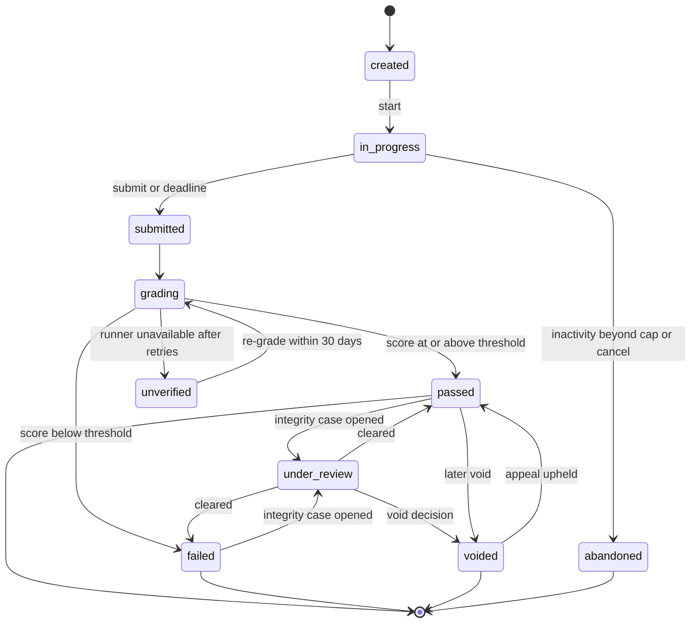

| From | To | Trigger | Guard |
|---|---|---|---|
| `created` | `in_progress` | Start | Eligible, rules accepted, no other open attempt (BR-ASM-006, BR-ASM-056) |
| `in_progress` | `submitted` | Submit or scheduler | Deadline or user action (BR-ASM-008) |
| `grading` | `unverified` | Retry budget exhausted | Code attempt only (BR-ASM-012) |
| `passed` | `under_review` | Case opened | Evidence minting held (BR-ASM-013) |
| `under_review` | `voided` | Reviewer | Reason code and note (BR-ASM-018) |

Forbidden: `unverified -> passed` without a re-grade; any edit after `submitted`; minting from `unverified`, `under_review` or `voided`.

### SM-ASM-02 Assessment version

States: `draft`, `in_review`, `published_calibrating`, `published_eligible`, `retired`. Terminal: `retired`.

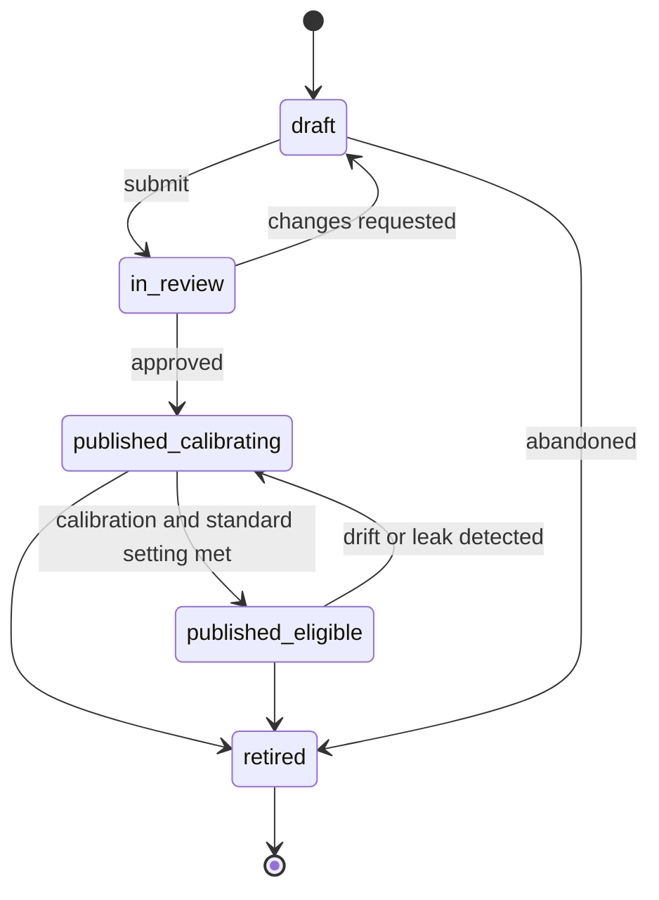

| From | To | Trigger | Guard |
|---|---|---|---|
| `published_calibrating` | `published_eligible` | Calibration job and staff approval | BR-ASM-035, BR-ASM-055 |

### SM-ASM-03 Question item

States: `draft`, `in_review`, `active`, `flagged`, `retired`. Terminal: `retired`.

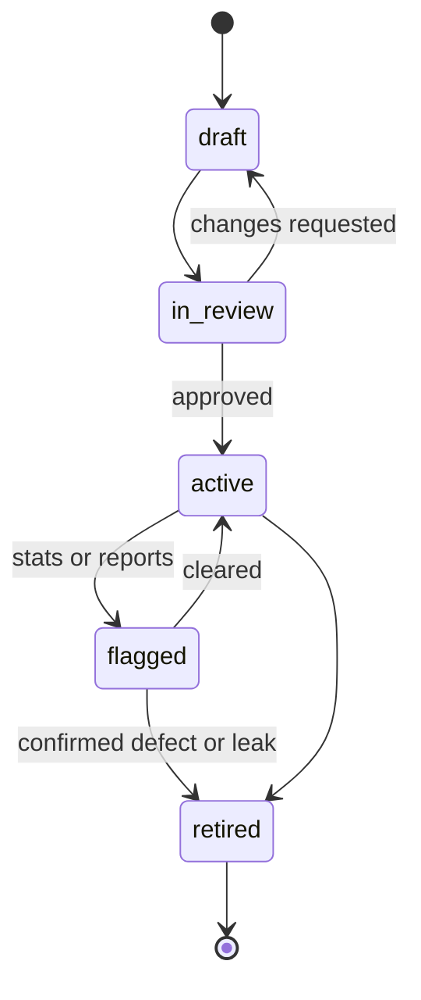

| From | To | Trigger | Guard |
|---|---|---|---|
| `active` | `flagged` | Calibration or issue reports | BR-ASM-022, BR-ASM-042 |

### SM-ASM-04 Judge job

States: `queued`, `running`, `passed`, `failed`, `error`, `timed_out`, `runner_unavailable`. Terminal: all except `queued` and `running`.

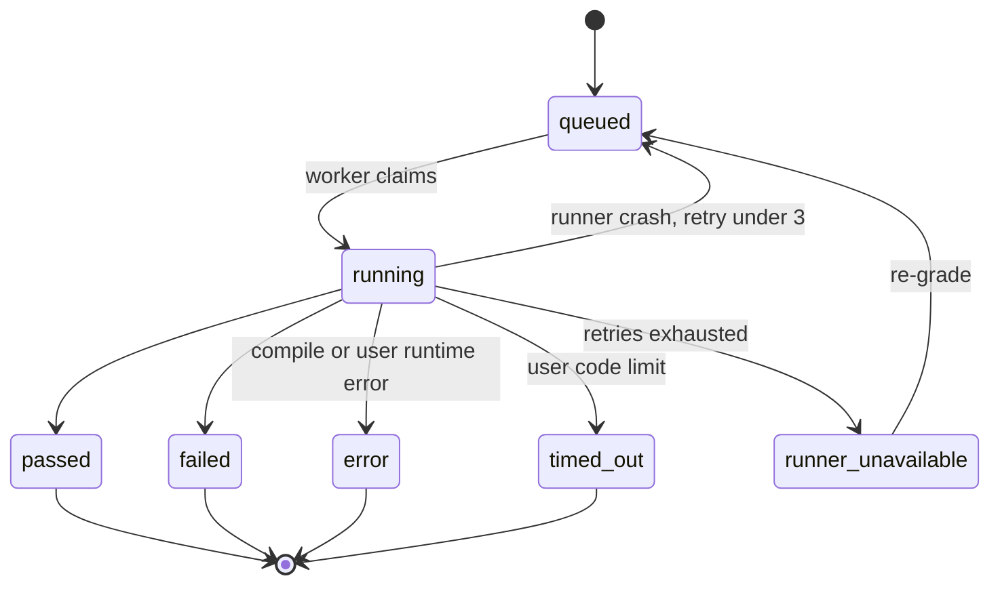

| From | To | Trigger | Guard |
|---|---|---|---|
| `running` | `queued` | Runner crash | Attempt count under 3 (BR-ASM-051) |

### SM-ASM-05 Integrity case

States: `opened`, `in_review`, `awaiting_candidate`, `decided_clear`, `decided_warn`, `decided_void`, `appealed`, `closed`. Terminal: `closed`.

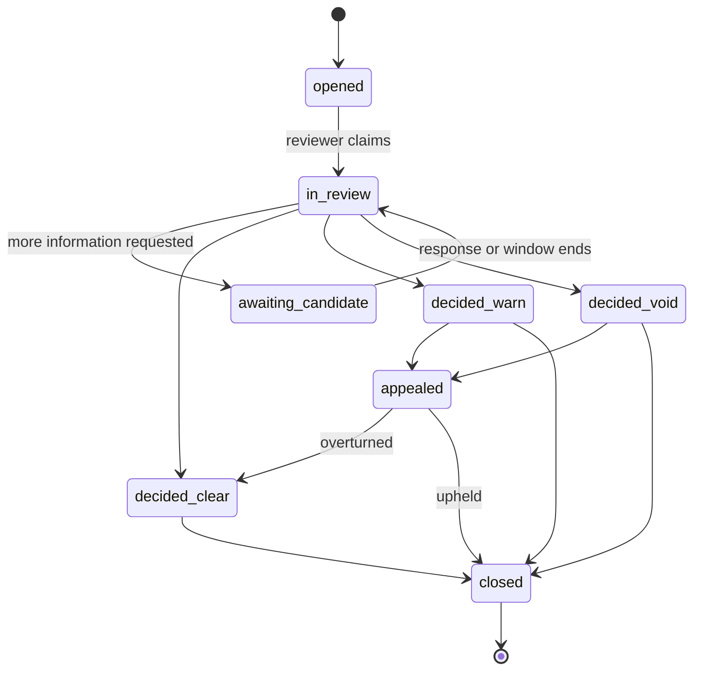

| From | To | Trigger | Guard |
|---|---|---|---|
| `in_review` | `decided_void` | Reviewer | Reason code, no conflict (BR-ASM-046) |
| `decided_void` | `appealed` | Candidate | Different reviewer (BR-ASM-018) |

### SM-ASM-06 Appeal

States: `filed`, `assigned`, `decided_upheld`, `decided_overturned`, `decided_adjusted`, `closed`. Terminal: `closed`.

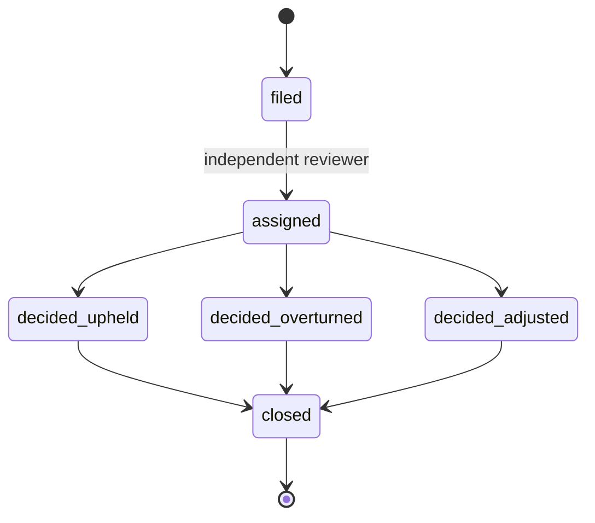

| From | To | Trigger | Guard |
|---|---|---|---|
| `filed` | `assigned` | Assignment | Reviewer not part of original decision (BR-ASM-018) |

### SM-ASM-07 Certification record

States: `active`, `expiring`, `expired`, `revoked`, `renewed`. Terminal: `expired` and `revoked` (a renewed record is a new `active` record linked to the old one).

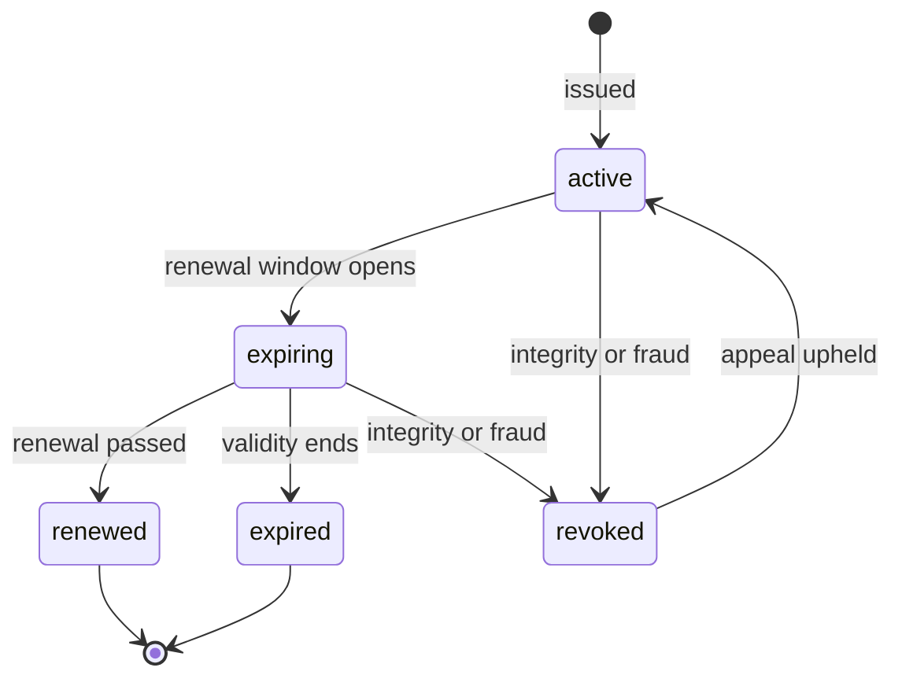

| From | To | Trigger | Guard |
|---|---|---|---|
| `expiring` | `renewed` | Renewal pass | Within window (BR-ASM-031) |
| `active` | `revoked` | Staff | Reason class and note (BR-ASM-058) |

### SM-ASM-08 Exam registration

States: `registered`, `checked_in`, `in_progress`, `completed`, `no_show`, `cancelled`, `rescheduled`. Terminal: `completed`, `no_show`, `cancelled`.

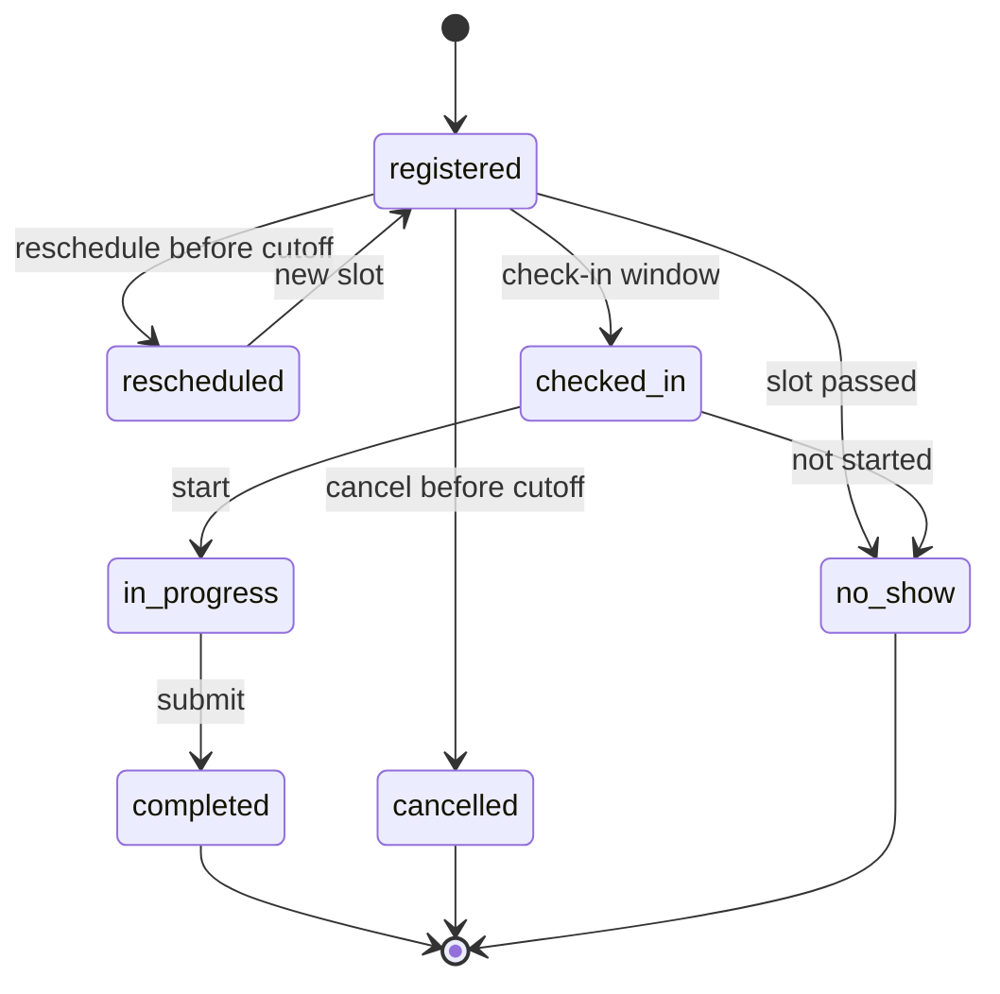

| From | To | Trigger | Guard |
|---|---|---|---|
| `registered` | `cancelled` | Candidate | Before cutoff (BR-ASM-044) |

### SM-ASM-09 Contest

States: `draft`, `registration_open`, `live`, `frozen`, `ended`, `results_published`, `archived`, `cancelled`. Terminal: `archived`, `cancelled`.

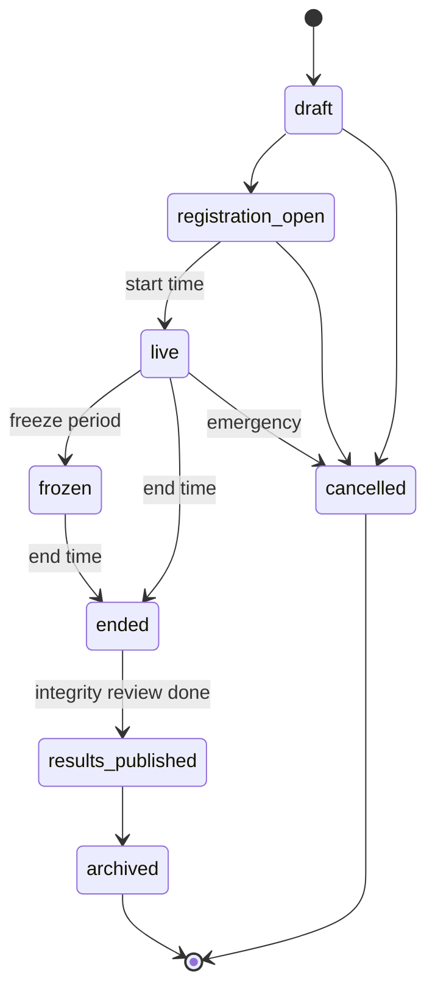

| From | To | Trigger | Guard |
|---|---|---|---|
| `ended` | `results_published` | Organizer | Similarity cases reviewed (BR-ASM-028, BR-ASM-017) |

### SM-ASM-10 Employer assignment

States: `invited`, `accepted`, `declined`, `started`, `completed`, `expired`, `shared`, `withdrawn`. Terminal: `declined`, `expired`, `withdrawn`, `shared` (after completion and share).

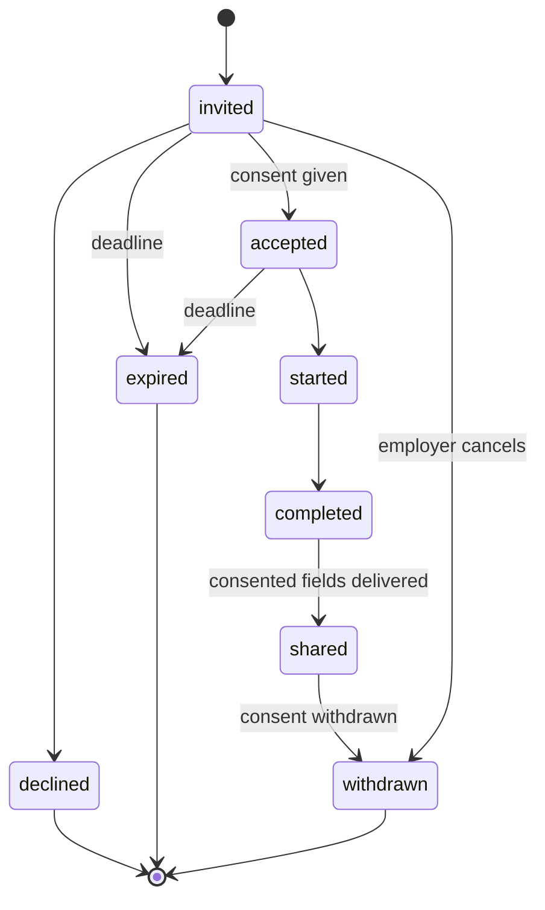

| From | To | Trigger | Guard |
|---|---|---|---|
| `invited` | `accepted` | Candidate | Consent screen shown (BR-ASM-032) |
| `completed` | `shared` | System | Only consented scope (BR-ASM-033) |

### SM-ASM-11 Manual grading task

States: `queued`, `claimed`, `graded_draft`, `moderation`, `finalized`. Terminal: `finalized`.

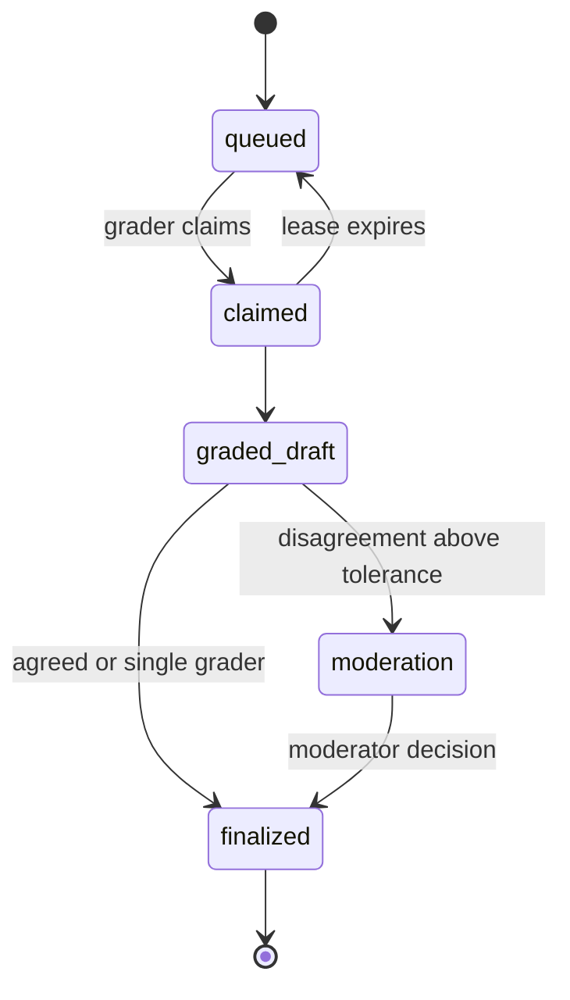

| From | To | Trigger | Guard |
|---|---|---|---|
| `graded_draft` | `moderation` | System | Score difference above tolerance (BR-ASM-020) |

### SM-ASM-12 Accommodation grant

States: `requested`, `info_needed`, `verified`, `active`, `denied`, `expired`, `revoked`. Terminal: `denied`, `expired`, `revoked`.

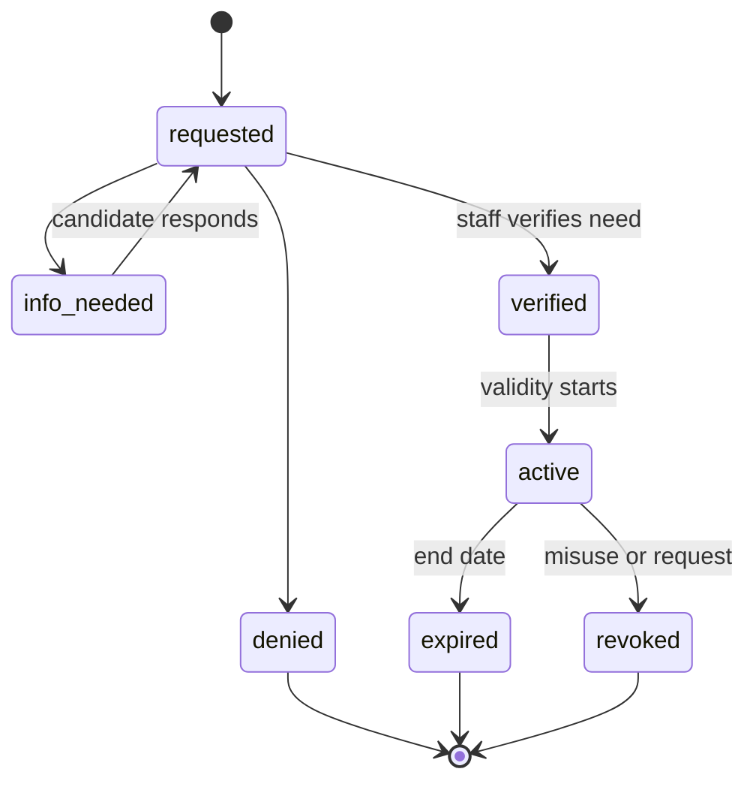

| From | To | Trigger | Guard |
|---|---|---|---|
| `requested` | `verified` | Support | Documentation or attestation (BR-ASM-019) |

## 7. Screen inventory

Key states for every screen include loading (skeleton), empty, error with retry, forbidden and offline where applicable. Only screen-specific states are listed.

| ID | Name | Route proposal | Roles | Purpose | Key states |
|---|---|---|---|---|---|
| SCR-ASM-001 | Challenge catalog | `/challenges` | GUE, CAN, STD, INS | Browse and filter (FR-ASM-001) | no results, approximate counts |
| SCR-ASM-002 | Challenge and assessment detail | `/challenges/:id`, `/assessments/:id` | GUE, CAN, STD, INS | Rules, policy box and start (FR-ASM-002) | cooldown, not eligible, resume, acknowledgment pending |
| SCR-ASM-003 | Coding workspace | `/challenges/:id/attempt` | CAN, STD, INS | Edit, run, submit (FR-ASM-003, 004) | queued, running, rate limited, runner unavailable, unverified |
| SCR-ASM-004 | Objective attempt | `/assessments/:id/attempt` | CAN, STD, INS | Questions, navigator, timer (FR-ASM-005, 029, 030) | saved, offline queue, deadline passed, submit confirm |
| SCR-ASM-005 | Scenario attempt | `/assessments/:id/scenario` | CAN, STD, INS | Branching scenario (FR-ASM-006) | awaiting manual review |
| SCR-ASM-006 | Project submission | `/challenges/:id/project` | CAN, STD, INS | Project submit and status (FR-ASM-007) | link unreachable, in review |
| SCR-ASM-007 | System design workspace | `/challenges/:id/design` | CAN, STD, INS | Canvas and notes (FR-ASM-008) | outline mode |
| SCR-ASM-008 | SQL workspace | `/challenges/:id/sql` | CAN, STD, INS | Schema, editor, results (FR-ASM-009) | timeout, syntax error |
| SCR-ASM-009 | Data workspace | `/challenges/:id/notebook` | CAN, STD, INS | Notebook and submit (FR-ASM-010) | kernel restart |
| SCR-ASM-010 | Practice hub | `/practice` | CAN, STD, INS | Practice entry and history (FR-ASM-011) | none |
| SCR-ASM-011 | Hints and editorial panel | panel within SCR-ASM-003 | CAN, STD, INS | Hints and solutions (FR-ASM-012) | locked, assisted warning |
| SCR-ASM-012 | Challenge discussion | `/challenges/:id/discuss` | CAN, STD, INS | Threads (FR-ASM-013) | spoiler hidden, disabled |
| SCR-ASM-013 | Challenge sets | `/challenges/sets`, `/challenges/sets/:id` | CAN, STD, INS | Sets and mock rounds (FR-ASM-014) | retired item |
| SCR-ASM-014 | Contest lobby | `/contests/:id` | CAN, STD, INS | Register and enter (FR-ASM-015) | before start, live, ended |
| SCR-ASM-015 | Contest standings | `/contests/:id/standings` | all signed-in | Live standings | frozen, final |
| SCR-ASM-016 | Result page | `/assessments/:id/attempts/:attemptId/result` | CAN, STD, INS | Results and feedback (FR-ASM-050) | passed, failed, under review, unverified, pending manual, voided |
| SCR-ASM-017 | Share dialog and shared view | dialog; `/r/:shareId` | CAN; recipients | Consented sharing (FR-ASM-051) | revoked, expired |
| SCR-ASM-018 | My assessments | `/me/assessments` | CAN, STD, INS | History, reports (FR-ASM-053) | no attempts |
| SCR-ASM-019 | Score report verification | `/verify/report/:id` | GUE, all | Verify score report | valid, under review, voided |
| SCR-ASM-020 | Leaderboard | `/challenges/leaderboard` | GUE, all | Rankings (FR-ASM-052) | opted out, refresh lag |
| SCR-ASM-021 | Certification catalog | `/certifications` | GUE, CAN, STD | Browse certifications (FR-ASM-048) | none |
| SCR-ASM-022 | Certification detail and registration | `/certifications/:id` | CAN, STD | Eligibility and slots (FR-ASM-042) | full, not eligible, registered |
| SCR-ASM-023 | Exam check-in and system check | `/exams/:regId/check-in` | CAN, STD | Pre-exam steps | camera failed, ready |
| SCR-ASM-024 | Proctoring consent | `/exams/:regId/consent` | CAN, STD | Consent and alternative (FR-ASM-036) | declined, alternative chosen |
| SCR-ASM-025 | Identity check | `/exams/:regId/identity` | CAN, STD | Identity verification (FR-ASM-035) | pending, failed |
| SCR-ASM-026 | Accommodations | `/me/accommodations` | CAN, STD | Request and view (FR-ASM-041) | pending, active, denied |
| SCR-ASM-027 | Appeal | `/appeals/:id` | CAN, STD, INS, MOD | File and track (FR-ASM-038) | window closed, decided |
| SCR-ASM-028 | Author assessment list | `/author/assessments` | INS, EAD, IAD, PAD | Manage assessments | filters |
| SCR-ASM-029 | Assessment builder | `/author/assessments/:id` | INS, EAD, IAD, PAD | Build and publish (FR-ASM-016, 022) | validation errors, version conflict |
| SCR-ASM-030 | Composition and integrity settings | `/author/assessments/:id/composition` | INS, EAD, IAD, PAD | Blueprint, randomization, integrity (FR-ASM-021, 031) | unsatisfiable blueprint |
| SCR-ASM-031 | Question editor | `/author/questions/:id` | INS, EAD, IAD, PAD | Item authoring (FR-ASM-017) | review needed |
| SCR-ASM-032 | Question bank | `/author/bank` | INS, EAD, IAD, PAD | Bank (FR-ASM-018) | import report |
| SCR-ASM-033 | Test suite editor | `/author/challenges/:id/tests` | INS, EAD, IAD, PAD | Tests and checkers (FR-ASM-019) | validation run |
| SCR-ASM-034 | Rubric editor | `/author/rubrics/:id` | INS, EAD, IAD, PAD | Rubrics (FR-ASM-020) | total mismatch |
| SCR-ASM-035 | Author analytics and item analysis | `/author/assessments/:id/analytics` | INS, EAD, IAD, PAD | Results and item stats (FR-ASM-044, 056) | insufficient data |
| SCR-ASM-036 | Grading queue and workbench | `/grading`, `/grading/:taskId` | graders | Manual grading (FR-ASM-027) | claimed, moderation |
| SCR-ASM-037 | Integrity review queue | `/staff/integrity` | MOD, PAD | Cases queue (FR-ASM-037) | SLA warning |
| SCR-ASM-038 | Integrity case workbench | `/staff/integrity/:caseId` | MOD, PAD | Evidence and decision | awaiting candidate |
| SCR-ASM-039 | Exam administration | `/staff/exams` | PAD, IAD | Definitions, sessions, seats (FR-ASM-048, 042) | capacity |
| SCR-ASM-040 | Runtime and sandbox operations | `/staff/runtimes` | PAD | Runtimes and pools (FR-ASM-023, 024) | degraded pool |
| SCR-ASM-041 | Fairness dashboard | `/staff/fairness` | PAD, analyst | Fairness reports (FR-ASM-055) | suppressed groups |
| SCR-ASM-042 | Issue triage and regrade | `/author/issues` | authors, MOD, PAD | Reports and remediation (FR-ASM-057) | impact preview |
| SCR-ASM-043 | Employer assignments | `/employer/assessments` | EAD, REC, HMG | Assign and track (FR-ASM-046) | declined, expired |
| SCR-ASM-044 | Employer invitation | `/assessments/invite/:token` | CAN, STD | Consent and accept (FR-ASM-046) | expired, declined |
| SCR-ASM-045 | Employer template builder | `/employer/assessment-templates` | EAD, REC, HMG | Templates (FR-ASM-047) | policy blocked |
| SCR-ASM-046 | Certification record and verification | `/me/certifications`, `/verify/cert/:id` | CAN, GUE | Validity and renewal (FR-ASM-049) | expiring, revoked |
| SCR-ASM-047 | Assessment privacy settings | `/settings/assessments` | CAN, STD | Retention, export, leaderboard visibility (FR-ASM-058) | export pending |

## 8. Data entities owned

Retention classes: `ACCT` deleted or anonymized with the account; `EVID` kept while evidence or a certification refers to it (tombstone after erasure); `LOG90` {90 days}; `REC30` {30 days}; `LEGAL` legal or audit period; `AGG` anonymized aggregate; `SECURE` encrypted, restricted, kept for the life of the item version.

| ID | Entity | Key attributes | Relationships | Retention |
|---|---|---|---|---|
| ENT-ASM-01 | Challenge | id, type, title, statement, difficulty, skills[], languages[], state, suiteId, visibility (public, employer, institution), solveRate | n Attempts; TestSuite | SECURE for tests; public for statement |
| ENT-ASM-02 | Assessment | id, context, mode, title, ownerRef, skills[], integrityLevel, aiPolicy, state | n AssessmentVersion | LEGAL while versions referenced |
| ENT-ASM-03 | AssessmentVersion | id, assessmentId, number, config, composition, thresholds, releasePolicy, state (SM-ASM-02), publishedAt | n Attempt | SECURE |
| ENT-ASM-04 | QuestionItem and ItemVersion | id, bankId, type, stem, options, keyRef, explanation, skills, difficulty, securityLevel, state (SM-ASM-03) | Bank; used in versions | SECURE |
| ENT-ASM-05 | QuestionBank | id, ownerRef, scope, sharing | n Items | ACCT of owner or org |
| ENT-ASM-06 | TestSuite | id, challengeId, tests[] (public, hidden), checkers, weights, version | Challenge | SECURE |
| ENT-ASM-07 | Rubric and RubricVersion | id, criteria[], levels[], points, version | Used by items, assignments | LEGAL |
| ENT-ASM-08 | Attempt | id, accountId, assessmentVersionId, context, state (SM-ASM-01), startedAt, deadlineAt, multiplier, seed, score, result, autoSubmitted, evidenceId, policyHash | n Answers; Case | EVID; answers {24 months} |
| ENT-ASM-09 | AttemptAnswer | attemptId, questionId, value, clientSeq, savedAt | Attempt | {24 months} |
| ENT-ASM-10 | SubmissionSnapshot | attemptId, hash, filesRef, createdAt | Attempt | {24 months} |
| ENT-ASM-11 | RunnerJob | id, attemptId, snapshotHash, generation, state (SM-ASM-04), runnerVersion, resultSignature | Attempt | LOG90 |
| ENT-ASM-12 | AttemptSignal | attemptId, kind, count, detailMin, at | Attempt | LOG90 unless case open |
| ENT-ASM-13 | IntegrityCase | id, attemptId, state (SM-ASM-05), priority, signalsConsidered, reviewerIds, decision, reasonCode, notes | Attempt; Appeal | LEGAL |
| ENT-ASM-14 | Appeal | id, caseOrAttemptRef, type, state (SM-ASM-06), reviewerId, outcome | Case | LEGAL |
| ENT-ASM-15 | PrincipalRestriction | principal, kind, attemptId, until | Attempt | LOG90 |
| ENT-ASM-16 | AccommodationGrant | accountId, kind, multiplier, state (SM-ASM-12), grantedBy, reasonCode, validFrom, expiresAt, docRef | Account | LEGAL; restricted |
| ENT-ASM-17 | CertificationDefinition | id, title, skills, blueprint, threshold, retakePolicy, integrityLevel, validity, price | n Records | LEGAL |
| ENT-ASM-18 | CertificationRecord | id, accountId, definitionId, attemptId, state (SM-ASM-07), issuedAt, expiresAt, revokedReason | Account | EVID |
| ENT-ASM-19 | ExamRegistration | id, accountId, definitionId, slot, state (SM-ASM-08), paymentRef | Account | LEGAL |
| ENT-ASM-20 | EmployerAssignment | id, employerRef, candidateId, assessmentVersionId, state (SM-ASM-10), consentScope, deadline | Attempt | LEGAL while employer relation |
| ENT-ASM-21 | ResultShare | id, attemptId, scope, recipientRef, expiresAt, revokedAt, accessLog | Attempt | LEGAL |
| ENT-ASM-22 | LeaderboardEntry | accountId, board, points, solved, updatedAt | Account | ACCT |
| ENT-ASM-23 | Contest | id, title, window, scoring, rated, freeze, problems[], state (SM-ASM-09) | n Entries | LEGAL |
| ENT-ASM-24 | ItemStatistic | itemVersionId, n, difficulty, discrimination, distractors, timeStats, flags | Item | AGG |
| ENT-ASM-25 | FairnessReport | id, scope, period, metrics, suppressed, actions | Assessment | AGG |
| ENT-ASM-26 | LanguageRuntime | id, language, version, imageDigest, limits, libs, state | Used by challenges | LEGAL |
| ENT-ASM-27 | ProctoringSession | attemptId, vendorRef, mode, consentRef, flags[], reviewState | Attempt | REC30 for media; flags LOG90 unless case |
| ENT-ASM-28 | IdentityCheckRef | accountId, method, result, at, providerRef | Account | EVID or {24 months} |
| ENT-ASM-29 | HintUnlock | attemptId or practiceId, hintIndex, solutionViewed, at | Attempt | ACCT |
| ENT-ASM-30 | ChallengeSet | id, title, items[], ordered | Challenges | PUBLIC |
| ENT-ASM-31 | ScoreReport | id, attemptId, hash, verificationId, createdAt | Attempt | EVID |
| ENT-ASM-32 | ItemIssueReport | id, reporterId, itemRef, category, note, state, outcome | Item | ACCT; outcome AGG |

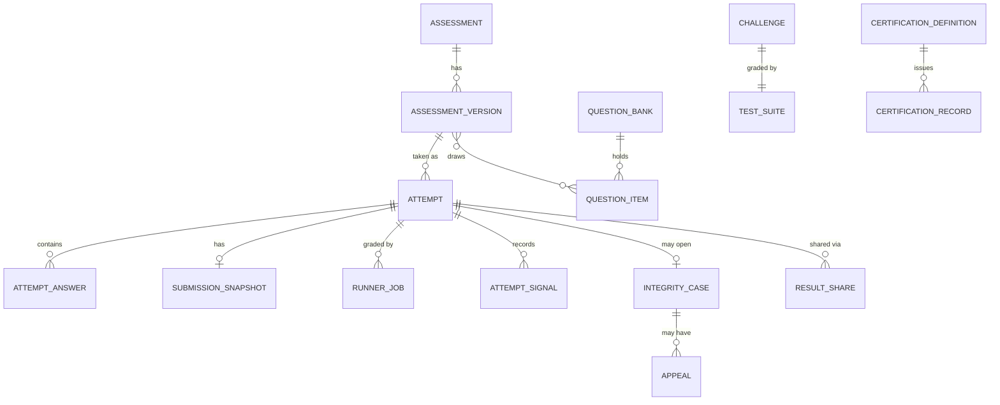

## 9. Events emitted and consumed

### 9.1 Emitted

| ID | Event name | Trigger | Key payload | Consumers |
|---|---|---|---|---|
| EVT-ASM-001 | `assessment.attempt.started` | Attempt created | attemptId, versionId, context, policyHash | AI gateway (restriction), ANL |
| EVT-ASM-002 | `assessment.attempt.submitted` | Submit or deadline | attemptId, autoSubmitted | grading |
| EVT-ASM-003 | `assessment.attempt.graded` | Final grade (passed or failed) | attemptId, score, passed, versionId, context, courseRef | LRN, EVD, ATS, REP, NTF |
| EVT-ASM-004 | `assessment.attempt.unverified` | Runner unavailable | attemptId, reason | NTF, ops |
| EVT-ASM-005 | `assessment.attempt.voided` | Void decision | attemptId, reasonClass | LRN, EVD, ATS, REP |
| EVT-ASM-006 | `assessment.attempt.abandoned` | Inactivity or cancel | attemptId | ANL |
| EVT-ASM-007 | `assessment.challenge.solved` | Challenge passed (graded or practice, flagged assisted or not) | accountId, challengeId, assisted | REP, AIC |
| EVT-ASM-008 | `assessment.evidence.requested` | Qualifying pass | attemptId, skills, levels, issuerRef | EVD |
| EVT-ASM-009 | `assessment.integrity.flagged` | Case opened | caseId, attemptId, priority | MOD queue, NTF |
| EVT-ASM-010 | `assessment.integrity.decided` | Case decision | caseId, decision | EVD, LRN, ATS, NTF |
| EVT-ASM-011 | `assessment.appeal.filed` | Appeal filed | appealId | MOD queue |
| EVT-ASM-012 | `assessment.appeal.decided` | Appeal decided | appealId, outcome | NTF, EVD |
| EVT-ASM-013 | `assessment.accommodation.granted` | Grant active | accountId, scope (no details) | ASM internal |
| EVT-ASM-014 | `assessment.version.published` | Publish | versionId, state | catalogs |
| EVT-ASM-015 | `assessment.version.eligible` | Evidence-eligible | versionId | EVD, catalogs |
| EVT-ASM-016 | `assessment.version.retired` | Retired | versionId | LRN, STU |
| EVT-ASM-017 | `assessment.item.retired` | Item retired | itemId | authors |
| EVT-ASM-018 | `assessment.item.stats_updated` | Nightly stats | itemVersionId, aggregates | STU, authors |
| EVT-ASM-019 | `assessment.item.flagged` | Flag raised | itemId, reason | authors |
| EVT-ASM-020 | `assessment.regrade.applied` | Regrade done | assessmentId, affected, changes | LRN, EVD, NTF |
| EVT-ASM-021 | `assessment.certification.issued` | Certification issued | recordId, definitionId | EVD, PRF, REP, NTF |
| EVT-ASM-022 | `assessment.certification.revoked` | Revoked | recordId, reasonClass | EVD, PRF, ATS |
| EVT-ASM-023 | `assessment.certification.expired` | Validity ended | recordId | EVD, PRF |
| EVT-ASM-024 | `assessment.exam.registered` | Registered | registrationId | NTF, proctoring |
| EVT-ASM-025 | `assessment.exam.cancelled` | Cancelled | registrationId | NTF, seats |
| EVT-ASM-026 | `assessment.assignment.invited` | Employer invitation | assignmentId | NTF |
| EVT-ASM-027 | `assessment.assignment.completed` | Completed and consented | assignmentId, scope | ATS |
| EVT-ASM-028 | `assessment.share.created` | Share created | shareId, scope | audit |
| EVT-ASM-029 | `assessment.share.revoked` | Revoked | shareId | recipients |
| EVT-ASM-030 | `assessment.contest.started` | Contest live | contestId | ANL |
| EVT-ASM-031 | `assessment.contest.ended` | Contest ended | contestId | leaderboard |
| EVT-ASM-032 | `assessment.leaderboard.updated` | Board refreshed | board | ANL |
| EVT-ASM-033 | `assessment.ai_restriction.set` | Restriction written | principal, until | AI gateway |
| EVT-ASM-034 | `assessment.proctoring.flagged` | Vendor flag | attemptId, flagType | integrity queue |
| EVT-ASM-035 | `assessment.runner.degraded` | Pool unhealthy | pool, severity | ops |

### 9.2 Consumed

| Event (producer) | Used by | Effect |
|---|---|---|
| `studio.course.published`, `studio.version.published` (STU) | FR-ASM-016 | Link course-context assessments to published versions |
| `learning.enrollment.expired`, `learning.enrollment.refunded` (LRN) | FR-ASM-029 | Close open course attempts |
| `billing.purchase.fulfilled` (BIL, planned) | FR-ASM-042 | Confirm paid exam seats |
| `verification.result` (BGV, planned) | FR-ASM-035 | Identity result |
| `consent.changed` (SET, planned) | FR-ASM-046, 051 | Withdraw employer sharing, personalization |
| `ats.assessment.requested` (ATS, planned) | FR-ASM-046 | Create employer assignment |
| `evidence.item.revoked` (EVD, planned) | FR-ASM-045 | Mark minted evidence status in results |
| `trust.case.decided` (TSF, planned) | FR-ASM-037 | Apply broader trust decisions |
| `identity.account.erased` (IDN, planned) | FR-ASM-058 | Run erasure rules |

## 10. Integrations and external dependencies

| Dependency | Direction | Purpose | Failure behavior |
|---|---|---|---|
| Sandbox compute pools (PLT, planned; technology per OD-ASM-01) | Outbound | Run code, SQL, data | Queue with honest status, then `unverified` |
| AI gateway (AIC, planned) | Outbound restriction writes and inline checks | Enforce AI policy; AI grading suggestions | Fail closed for restricted principals |
| Proctoring vendor adapter (OD-ASM-02) | Outbound and inbound | Remote proctoring sessions and flags | Exam postponed, no level reduction |
| Identity verification provider via BGV (planned) | Outbound | Identity checks | Honest pending state; manual review |
| Evidence issuer API (EVD, planned) | Outbound | Mint and revoke evidence | Retry; "evidence pending" |
| Plagiarism corpora and web scan services | Outbound | Similarity and leak detection | Check deferred; no auto-penalty |
| Payments via BIL (planned) | Via BIL | Paid exams | Registration held |
| ATS (planned) | Both | Employer assignments and results | Queue and retry |
| Notification service (NTF, planned) | Outbound | Templates | Retry |
| File storage and scanning (PLT, planned) | Outbound | Submissions, datasets | Hold until scanned |
| QTI and CSV import/export | Offline files | Bank import | Per-item error report |

## 11. Cross-module dependencies

| Depends on | What ASM needs |
|---|---|
| IDN (planned) | Accounts, sessions, re-authentication, age gates |
| EVD (planned) | Evidence issuer API, skills ontology, revocation |
| AIC (planned) | AI gateway enforcement, recommendations, grading suggestions |
| BGV (planned) | Identity checks |
| SET (planned) | Consent records, data rights |
| BIL (planned) | Paid exam seats, refunds |
| NTF (planned) | Templates and channels |
| STU, LRN | Course context for quizzes; course version and enrollment data |
| ATS, EMP (planned) | Employer assignments and organization context |
| INS (planned) | Institution exams, cohorts, accommodations pre-grants |
| TSF (planned) | Broader abuse handling |
| PLT (planned) | Compute, storage, scanning |
| ANL (planned) | Aggregate analytics |

| Depended on by | What they use |
|---|---|
| LRN | In-lesson quizzes and exams, practice runner, results for completion and grades |
| STU | Quiz authoring components, rubric engine, item stats |
| EVD (planned) | Evidence requests and revocations |
| ATS, JOB (planned) | Candidate assessment results by consent |
| INT (planned) | Sandbox runner for interviews |
| PRF (planned) | Certifications and shared results |
| REP (planned) | Solve and certification events |
| AIC, MKT (planned) | Skill signals |
| INS (planned) | Institution exam results within scope |

## 12. Module-level metrics

| Metric | Definition and formula | Owner role |
|---|---|---|
| Challenge start-to-submit rate | Graded or practice submissions divided by challenge starts | Assessment product owner |
| Judge latency p95 | 95th percentile seconds from submit to final status | Engineering lead |
| Runner availability | Share of submissions graded without falling back to `unverified` | Engineering lead |
| Unverified rate | Code attempts ending `unverified` divided by code attempts | Engineering lead |
| Evidence integrity | Evidence items minted only from eligible `passed` attempts divided by all minted items (target 100 percent) | Trust owner |
| Integrity flag rate | Cases opened per 1,000 evidence-eligible attempts, split by signal | Integrity owner |
| Flag false-positive rate | Cases decided `clear` divided by cases decided | Integrity owner |
| Appeal overturn rate | Appeals overturned divided by appeals decided | Integrity owner |
| Case decision SLA attainment | Cases decided within SLA divided by cases | Integrity owner |
| Accommodation turnaround | Median business days from request to decision | Support lead |
| Item quality | Share of active items with discrimination above threshold after calibration | Assessment product owner |
| Calibration coverage | Evidence-eligible assessments divided by evidence-seeking assessments | Assessment product owner |
| Certification pass rate and retake rate | Passes over first attempts; retakes over fails | Certification owner |
| Fairness disparity ratio | Pass rate and flag rate ratio between groups above suppression size | Fairness analyst |
| Accessibility defects open | Count of open candidate-reported barriers older than SLA | Accessibility owner |
| AI-block events | Blocked AI calls during prohibited attempts per 1,000 attempts | Integrity owner |

## 13. Open decisions

| ID | Question | Options | Default proposal | Who decides | Blocks |
|---|---|---|---|---|---|
| OD-ASM-01 | Sandbox technology, isolation model and resource limits (the TD-05 decision text is missing from the SSOT) | Container with seccomp; microVM; managed service | Isolated, network-less runner with signed results; limits as in BR-ASM-011; until it exists, code attempts stay `unverified` (SSOT V61-22) | Engineering, Security | FR-ASM-023, 025 |
| OD-ASM-02 | Proctoring vendor, which exams need L3, and the alternative for candidates who refuse | Vendor live; vendor recorded; none; test centre | Vendor behind an adapter at SSOT Ph10 (OD-35); L3 only for high-stakes certifications with an alternative | Founder, Legal | FR-ASM-036 |
| OD-ASM-03 | Show correct answers after a pass or fail on evidence-eligible assessments? | Never; after retake window; immediately | After the retake window closes, for secure items never (YASH-G3 decision pending) | Product, Assessment lead | FR-ASM-050 |
| OD-ASM-04 | Attempt and cooldown defaults for evidence-eligible assessments | 24 h and 3 per 7 days; stricter; per assessment | 24 h and 3 per 7 days; certification 7 days | Product | FR-ASM-040 |
| OD-ASM-05 | Certification validity default and renewal | Perpetual; 2 years; per certification | Perpetual default, configurable; renewal by retake or recertification exam (SSOT OD-18) | Product | FR-ASM-049 |
| OD-ASM-06 | Leaderboard display rules and minors | Public; opt-in only; institution only | Opt-out available, display names only, minors excluded from public boards | Legal, Product | FR-ASM-052 |
| OD-ASM-07 | Role mapping: Exam Administrator, Proctor, Employer actors have no SSOT §5.4 role | Map to PAD, IAD, MOD, EAD as in section 2; create new roles | Map as in section 2 | Product, Security | Section 2 |
| OD-ASM-08 | Calibration thresholds, sample sizes and the standard-setting method | Angoff; bookmark; empirical | 200 attempts, 50 per item, reliability threshold set by psychometrician, Angoff for exams | Assessment lead | FR-ASM-044, 055 |
| OD-ASM-09 | Is AI-assisted grading allowed, and where? | Off; practice and assignments only; all | Off for evidence-eligible; optional for assignments and practice | Product, Legal | FR-ASM-028 |
| OD-ASM-10 | Similarity corpus scope and fingerprint retention | Platform only; platform plus public web | Platform plus approved public corpus; fingerprints retained with the case | Security, Legal | FR-ASM-033 |
| OD-ASM-11 | Employer assessment data retention and delivery to ATS | Delete with requisition; retain per employer agreement | Delete on requisition close plus {12 months}, subject to candidate rights | Legal | FR-ASM-046 |
| OD-ASM-12 | Contest infrastructure and rated contests | Separate sandbox pool; shared | Separate pool (SSOT OD-44); rated contests after unrated pilot | Engineering | FR-ASM-015 |
| OD-ASM-13 | Which integrity signals and thresholds may be enabled before validation | All at L1; only after false-positive study | Enable flagging only after a fairness review (YASH-G3 testing note) | Integrity lead, Legal | FR-ASM-032 |
| OD-ASM-14 | Publish practice item content or keep secure | Public statements; hidden | Public for practice challenges; secure for exam pools | Product | FR-ASM-039 |

## 14. Risks

| ID | Risk | Likelihood and impact | Mitigation |
|---|---|---|---|
| RSK-ASM-01 | Sandbox escape or abuse (crypto mining, network probing) | Medium, high | Network-less isolation, seccomp, limits, security tests, separate pools |
| RSK-ASM-02 | False-positive integrity flags harm candidates or disproportionately affect groups | Medium, high | Human review, disclosure, appeals, fairness monitoring, thresholds validated before enabling |
| RSK-ASM-03 | AI misuse outside the platform cannot be detected | High, medium | Honest policy statements, proctoring levels for high stakes, item design resistant to lookup |
| RSK-ASM-04 | Item leaks undermine exams | Medium, high | Pools, rotation, exposure caps, watermarking, leak scans, response playbook |
| RSK-ASM-05 | Runner outages cause backlogs and many `unverified` attempts | Medium, medium | Multiple pools, autoscaling, honest status, re-grade window |
| RSK-ASM-06 | Proctoring privacy and legal exposure | Medium, high | Consent, alternatives, DPIA, minimal retention, vendor contracts |
| RSK-ASM-07 | Accommodation data exposure | Low, high | Special-category controls, access logs, no employer visibility |
| RSK-ASM-08 | Employers misuse assessments for discriminatory screening | Medium, high | Job-relatedness mapping, disallowed content rules, consent, audit |
| RSK-ASM-09 | Evidence inflation from poorly calibrated or short assessments | Medium, high | Calibration, standard setting, eligibility gate, level bands |
| RSK-ASM-10 | Sandbox compute cost grows unbounded | Medium, medium | Rate limits, caps per user, queue priorities, cost dashboards |
| RSK-ASM-11 | Timer, clock or session manipulation | Low, high | Server authority, session binding, signals, tests |
| RSK-ASM-12 | Content licensing disputes for imported item banks | Medium, medium | License matrix, provenance fields, takedown path (STU process reuse) |
| RSK-ASM-13 | Candidate anxiety and perceived unfairness reduce adoption | Medium, medium | Clear disclosure, accessible design, practice mode, appeals |

## 15. Legacy source trace

| Legacy source | Used for | Dropped or changed and why |
|---|---|---|
| `SSOT.md` §9.2 F-08 (Challenges Arena), §10.17, §10.21 to §10.22, §10.26 (BR-139, BR-140), §17 (assessment and exam integrity), §7 rows F-45, F-76, F-77, F-78, F-104, F-115, F-135 | Catalog, workspace, run versus submit, scoring, sandbox limits, contests, certification, AI modes, integrity controls, proctoring gate | The sandbox limits' decision text (TD-05) is missing in the SSOT, so limits are `[PROP]` with OD-ASM-01; XP awards are left to REP (planned) |
| `SSOT.md` §9.2 F-115 (Certification Exam Platform), WF-33 and WF-53 | Exam definition, registration, auto-grading, retake cooldown, item analysis, appeal SLA | WF-33 and WF-53 duplicate; this module treats them as one flow with registration and attempt machines |
| `SSOT.md` Appendix E V61-22 | Unverified fallback, runner gating of verified code evidence | None |
| `Yash_Final_Project_Document/05_FEATURE_SPECIFICATIONS/SPEC_G3_ASSESSMENT_AND_LEARNING.md` SPEC-05 | Attempt lifecycle, heartbeat, autosave, runner contract, unverified fallback, scoring, minting, AI restriction, signals, accommodations, acceptance criteria | Signal retention and reveal-after-pass left as decisions (OD-ASM-03, OD-ASM-13) |
| `Yash_Final_Project_Document/05_FEATURE_SPECIFICATIONS/MICRO_FEATURE_SPECS.md` AC-05-04-53, AC-05-04-54, AC-07-01-01 | Independence rules, catalog disclosure | None |
| `docs/registries/FEATURE_REGISTRY.md` F-08, F-45, F-76 to F-78, F-104, F-115, F-134, F-135 | Cross-check of scope | Registry status is not treated as built |
| `SSOT.md` §3 and §16 (principles, AI governance) | Consent, human accountability, AI suggestions rules | None |
| Own knowledge of HackerRank, CodeSignal, LeetCode, Codility, Pearson VUE, ProctorU, Kaggle, Credly, psychometrics practice (Angoff, DIF) | Challenge types, contests, calibration, certification lifecycle, proctoring and fairness methods | Tagged `[PROP]` where used |
