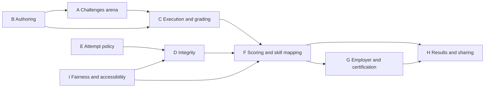

# ASM: Assessments, Challenges and Integrity

> Status: intended product specification. Nothing in this file is a claim that anything is built. Existing code and legacy documents are inputs, not limits (see [CONVENTIONS](../00_START_HERE/CONVENTIONS.md) §1).

Source aliases used in evidence tags: `SSOT` = `SSOT.md`; `YASH-G3` = `Yash_Final_Project_Document/05_FEATURE_SPECIFICATIONS/SPEC_G3_ASSESSMENT_AND_LEARNING.md`; `YASH-MICRO` = `Yash_Final_Project_Document/05_FEATURE_SPECIFICATIONS/MICRO_FEATURE_SPECS.md`; `FREG` = `docs/registries/FEATURE_REGISTRY.md`. Course-embedded use is specified in [LRN](./LRN_Learning_Course_Experience.md) and [STU](./STU_Instructor_Studio_Content_Production.md).

## 1. Purpose, outcomes and boundaries

### 1.1 Purpose

ASM is the "Practice" and "Prove" engine of TalentSphere. It lets people practice skills in a challenges arena, take quizzes, exams and certification tests, and lets employers and institutions assign assessments, with results that are fair, honest and trustworthy enough to become verified career evidence. Its defining promise: a result that employers can rely on, produced by a process that is transparent to the candidate, never fakes a pass, treats integrity signals as questions for a human rather than verdicts, and keeps AI assistance out of assessments that mint evidence [SRC: SSOT §17; YASH-G3 SPEC-05].

### 1.2 Outcomes

| Outcome | How the system knows |
|---|---|
| Passing results are trustworthy | Evidence minted only from `passed` attempts with no open integrity case; zero evidence from `unverified`, `voided` or `under_review` attempts (reconciliation job) |
| Candidates get a fair, accessible experience | Accommodation grant turnaround; accessibility audit; false-positive rate of integrity flags |
| Authors can build valid, reliable assessments | Share of published assessments that reach evidence-eligible calibration; item discrimination distribution |
| Practice is abundant and safe | Practice sessions per active learner; sandbox error rate; judge latency p95 |
| Results are portable by consent | Result shares created and revoked; no employer view without consent |

### 1.3 In scope

Challenge arena (coding, MCQ and objective formats, scenario, project, system design, SQL, data), practice mode, hints and solutions, challenge discussion, sets and interview prep, contests; assessment, question, test-suite and rubric authoring, question bank, composition and randomization, versioning and publishing; sandbox execution, language catalog, judge queue, objective, manual and rubric grading, AI-assisted grading suggestions; attempt sessions, timers, integrity policy, browser signals, similarity detection, AI-assist policy enforcement, identity verification, remote proctoring, case review, appeals, item security; attempts and retakes, accommodations, scheduled exams; scoring, calibration, skill-level mapping; employer-assigned assessments and templates, certification exams and their validity; results, sharing with consent, leaderboards, score reports; accessibility, fairness monitoring, author analytics, issue reports and regrade, data retention.

### 1.4 Out of scope (owned elsewhere)

| Capability | Owner | Boundary |
|---|---|---|
| Course player, lesson flow, course grade and completion | LRN | LRN embeds ASM attempts for quizzes (context `course_lesson`) and consumes results |
| Course authoring placement, weights, completion rule | STU | STU embeds ASM builders and owns only course context |
| Evidence ledger and rungs | EVD (planned) | ASM calls the issuer API; it never writes evidence |
| Candidate pipeline, recruiter workflows, scorecards | ATS (planned) | Employer-assigned assessment results are delivered to ATS on consent |
| Live interview rooms and collaborative coding | INT (planned) | Share the sandbox runner; interview sessions are not ASM attempts |
| AI model gateway | AIC (planned) | ASM writes assessment restrictions; the gateway enforces them on every call |
| Identity verification provider integration | BGV (planned) | ASM requests identity checks and receives results |
| Remote proctoring vendor | External, behind adapter (OD-ASM-02) | ASM stores sessions and decisions |
| Notification delivery, billing for paid exams | NTF, BIL (planned) | ASM names templates; BIL sells exam seats |
| Case management for integrity and abuse | ASM owns integrity cases; TSF (planned) owns broader trust cases | Shared moderation tooling |

### 1.5 Owned versus consumed

Owned: challenges, assessments and versions, questions and banks, test suites, rubrics, attempts, answers, submissions, runner jobs, signals, integrity cases, appeals, restrictions, accommodations, certification definitions and records, registrations, employer assignments, result shares, leaderboards, item statistics, fairness reports, runtimes. Consumed: accounts (IDN), skills ontology (EVD or AIC), entitlements for paid exams (BIL), consent (SET), course context (STU, LRN).

## 2. Roles and permission matrix

Role mapping note: SSOT lists "Exam Administrator", "Employer" and "Proctor" as actors without a §5.4 role [SRC: SSOT §3 note V61-05]. This blueprint maps Exam Administrator to `PAD` for platform exams and `IAD` for institution exams, Employer to `EAD`, `REC` and `HMG` for assigning assessments, and Proctor to `MOD` (integrity reviewer pool) or an external vendor principal (`API`). This is recorded as OD-ASM-07.

Cell legend: **R** read, **C** create, **U** update, **D** delete, **A** administer, **-** none, **S** scoped (see note).

| Capability | GUE | CAN | STD | INS | EAD/REC/HMG | IAD | MOD | SUP | PAD |
|---|---|---|---|---|---|---|---|---|---|
| Browse challenge catalog | R | R | R | R | R | R | R | R | R |
| Attempt challenges and practice | - | C | C | C | - | - | - | - | - |
| Take assessments and exams | - | C | C | C | - | - | - | - | - |
| Author challenges and assessments | - | - | - | C U (own, S) | C U (employer templates) | C U (institution) | - | - | A |
| Manage question bank | - | - | - | C U (own, shared S) | C U (own org) | C U (institution) | R | - | A |
| Grade manually (rubric) | - | - | - | C (own course or assessment) | C (own assigned) | C | - | - | A |
| View attempt details | - | own | own | S (own authored) | S (assigned, consented) | S (cohort, aggregate default) | S (case) | S (grant) | R (audit) |
| Assign assessment to candidate | - | - | - | - | C | C (members) | - | - | A |
| Run integrity review and decide | - | - | - | - | - | - | C U (decide) | R | A |
| File appeal | - | C | C | C | - | - | - | - | - |
| Decide appeal | - | - | - | - | - | - | C (second reviewer) | - | A |
| Grant accommodation | - | request | request | - | - | S (institution) | - | C (verify and grant) | A |
| Share results | - | C (own) | C (own) | - | - | - | - | - | - |
| View leaderboards | R (public tabs) | R, opt-out | R, opt-out | R | - | R | R | R | R |
| Configure integrity policy and runtimes | - | - | - | - | - | - | - | - | A |
| Issue and revoke certification | - | - | - | - | - | S (institution exams) | revoke (integrity) | - | A |

`SAD` has audit access; `API` principals include the runner service, the proctoring vendor and ATS integrations with narrowly scoped capabilities. Authorization is enforced server-side on every request, and answer keys and hidden test data are readable only by the grading service and authorized authors.

## 3. Sub-module map

| Code | Sub-module | Features |
|---|---|---|
| A | Challenges arena | FR-ASM-001 to 015 |
| B | Authoring and question bank | FR-ASM-016 to 022 |
| C | Execution and grading | FR-ASM-023 to 028 |
| D | Integrity and proctoring | FR-ASM-029 to 039 |
| E | Attempt policy | FR-ASM-040 to 042 |
| F | Scoring, calibration and skill mapping | FR-ASM-043 to 045 |
| G | Employer-assigned and certification | FR-ASM-046 to 049 |
| H | Results, sharing and leaderboards | FR-ASM-050 to 053 |
| I | Fairness, accessibility and operations | FR-ASM-054 to 058 |

## 4. Feature specifications

Notification opt-out classes (owned by NTF, planned): `TRANSACTIONAL` (cannot be disabled), `LEARNING` (practice and reminders), `SOCIAL`, `OPERATIONAL` (author and staff work items).

### A. Challenges arena

### FR-ASM-001 — Challenge catalog

- **Sub-module:** A. Challenges arena
- **Priority / tier:** Must · R1
- **Source:** [SRC: SSOT §9.2 F-08 step 1; FREG F-08] [DER]
- **Purpose and outcome:** Candidates find a challenge to practice or prove a skill. Success is click-through to a first attempt and a spread across difficulty levels.
- **Roles and permissions:** `GUE: view public listing` · `CAN, STD, INS: view, filter, save` · `PAD: view all states`
- **Preconditions and entry points:** `/challenges`; links from skill pages, courses and career plans.
- **User interactions and actions:**
  1. Open the catalog; see cards with title, type icon, difficulty, skills, languages, average solve rate, time estimate, and your status (not started, in progress, solved, assisted).
  2. Filter by type (coding, objective, scenario, project, system design, SQL, data), difficulty (easy, medium, hard, expert), skill, language, company-sourced (if shown), duration, status, set.
  3. Sort by recommended, newest, difficulty, solve rate, popularity.
  4. Search by title, skill or tag; save a challenge to a list.
  5. Open a challenge to its detail page (FR-ASM-002).
- **System behavior:** Lists only `published` challenges visible to the viewer (retired challenges stay visible to people who solved them). Difficulty is author-set then recalibrated from solve data after enough attempts {200} (FR-ASM-044) and shown with the method. Recommended sort uses AIC (planned) with consent and falls back to difficulty by skill gap. Counts and solve rates are aggregates only (BR-ASM-036).
- **UI elements and controls:** Filter panel, sort select, search box, challenge cards with status icons and text, saved-list heart, pagination.
- **Configuration options:** Platform: difficulty labels, visibility of solve rates. User: default filters.
- **Business rules:** BR-ASM-049, BR-ASM-036
- **Validation:** Filter values from enumerated sets; query up to 100 characters.
- **Inputs and outputs:** In: filters, query. Out: challenge list with status decoration.
- **Filters, sorting, search:** As above.
- **Notifications and communication:** n/a — none.
- **Error handling and edge cases:** No results: empty state with "Clear filters" and recommended starters. Index lag: counts labeled approximate. Private or employer-only challenges never appear.
- **Dependencies:** ENT-ASM-01, SRC (planned), FR-ASM-002.
- **Security and privacy:** Status decoration only for the signed-in viewer; hidden tests and solution text never in list payloads.
- **Acceptance criteria:**
  1. Given a mix of states, when a guest lists, then only published public challenges show.
  2. Given a filter for SQL and hard, when applied, then only matching challenges are listed with matching count.
  3. Negative: Given an employer-private challenge, when a candidate not invited requests it, then `404` is returned.

### FR-ASM-002 — Challenge detail and start screen

- **Sub-module:** A. Challenges arena
- **Priority / tier:** Must · R1
- **Source:** [SRC: YASH-G3 SPEC-05 §3.2 start disclosure, §4 SCR-ASSESS-START; SSOT §17] [DER]
- **Purpose and outcome:** Candidates understand exactly what they are about to do, including rules, time, integrity signals and AI policy, before any attempt starts. Success is informed consent and fewer disputes.
- **Roles and permissions:** `CAN, STD, INS: view and start` · `GUE: view summary`
- **Preconditions and entry points:** Challenge or assessment detail route `/challenges/:id`, `/assessments/:id`.
- **User interactions and actions:**
  1. Read the summary: type, difficulty, estimated time, skills, languages, scoring, pass threshold, attempts rules, whether it can produce verified evidence, accommodations available.
  2. Read the policy box: AI policy label (for example "AI assistance is not allowed during this attempt"), integrity signals collected (listed), proctoring requirements if any, retake rules, results release rules.
  3. For timed items, see the exact duration and that the clock is server-controlled.
  4. Tick "I have read the rules" (required for evidence-eligible items) and press Start.
  5. Request accommodations before starting (link to FR-ASM-041).
- **System behavior:** The disclosure content is generated from the assessment configuration so it is always accurate (BR-ASM-015). Starting records acceptance with the policy version hash (BR-ASM-056). Practice items start immediately with a lighter disclosure.
- **UI elements and controls:** Summary card, policy box with icons and text, signals list, accommodation link, rules checkbox, Start button (disabled until the box is ticked when required).
- **Configuration options:** Author: policy text additions. Platform: disclosure template.
- **Business rules:** BR-ASM-001, BR-ASM-015, BR-ASM-056
- **Validation:** Start requires eligibility (cooldown, attempts, registration, identity if required).
- **Inputs and outputs:** In: acceptance. Out: attempt start (FR-ASM-029).
- **Filters, sorting, search:** n/a — detail page.
- **Notifications and communication:** n/a — none.
- **Error handling and edge cases:** Not eligible: reason and next step (cooldown ends at, register first, verify identity). Policy changed after acceptance: new acceptance required before the next attempt. Page opened while attempt in progress: shows Resume.
- **Dependencies:** FR-ASM-029, FR-ASM-031, FR-ASM-040.
- **Security and privacy:** No answer or test data in page payload.
- **Acceptance criteria:**
  1. Given an evidence-eligible assessment, when the page loads, then the AI policy, signals list and retake rules are shown and Start is disabled until acknowledged.
  2. Given a cooldown with 2 hours left, when opening, then Start is disabled with the end time shown.
  3. Negative: Given a direct API start without acknowledgment, when called, then `422 rules_not_accepted` is returned.

### FR-ASM-003 — Coding workspace

- **Sub-module:** A. Challenges arena
- **Priority / tier:** Must · R1
- **Source:** [SRC: SSOT §9.2 F-08 step 2] [DER]
- **Purpose and outcome:** Candidates write, run and submit code in a capable browser editor. Success is low friction from reading to first run and no lost work.
- **Roles and permissions:** `CAN, STD, INS: use`
- **Preconditions and entry points:** Coding challenge attempt `/challenges/:id/attempt`.
- **User interactions and actions:**
  1. Read the problem statement (Markdown with examples, constraints, images), switch language from the allowed list.
  2. Write code in the editor with syntax highlighting, indentation, bracket matching, find and replace, themes, font size, vim or emacs keymaps (optional), multi-file for project-style problems.
  3. Press Run (FR-ASM-004) or Submit; see results in the output panel; use custom input to test.
  4. Reset to starter code (confirmation), view starter code diff, and download code.
  5. Use the timer, if timed; autosave indicator shows state.
- **System behavior:** Code autosaves every 5 seconds and on change after debounce to the attempt draft (idempotent by sequence). Language switching keeps separate drafts per language. Editor features available depend on the AI policy: autocomplete suggestions from AI are disabled when AI is not allowed (BR-ASM-001); basic lexical completion is allowed. Paste events are counted when integrity policy requires (BR-ASM-015). Submissions are snapshots (BR-ASM-047).
- **UI elements and controls:** Problem panel, editor (Monaco-class), language select, Run, Submit, custom input box, output and test tabs, reset, settings gear, timer, saved indicator, banner for AI policy.
- **Configuration options:** User: editor preferences. Author: allowed languages, starter code per language, multi-file layout.
- **Business rules:** BR-ASM-001, BR-ASM-007, BR-ASM-011, BR-ASM-038, BR-ASM-047
- **Validation:** Code up to 256 KB per file and 1 MB total; language must be allowed for the challenge.
- **Inputs and outputs:** In: code, custom input. Out: run and submission results.
- **Filters, sorting, search:** n/a — workspace.
- **Notifications and communication:** n/a — none.
- **Error handling and edge cases:** Editor fails to load: plain-text fallback editor. Connection lost: local draft preserved and synced later; submit disabled until online. Two tabs: second blocked for graded attempts (BR-ASM-006), allowed in practice with a warning. Large output truncated with notice.
- **Dependencies:** FR-ASM-004, FR-ASM-023, FR-ASM-024, FR-ASM-029.
- **Security and privacy:** Code is candidate-owned; visible to graders, reviewers and similarity checks only; accessibility mode offers a simple editor with screen-reader announcements.
- **Acceptance criteria:**
  1. Given a started challenge, when the learner types and waits 5 seconds, then the draft is saved and a refresh restores it.
  2. Given a graded attempt open in one tab, when opened in another, then the second is refused with an explanation.
  3. Negative: Given a language not allowed for the challenge, when a run is requested through the API, then `422 language_not_allowed` is returned.

### FR-ASM-004 — Run against public tests

- **Sub-module:** A. Challenges arena
- **Priority / tier:** Must · R1
- **Source:** [SRC: SSOT §9.2 F-08 step 3; BR-051] [DER]
- **Purpose and outcome:** Candidates test their code against visible cases without spending a submission. Success is fast, reliable feedback with clear errors.
- **Roles and permissions:** `CAN, STD, INS: run`
- **Preconditions and entry points:** Run button and shortcut in the workspace.
- **User interactions and actions:**
  1. Press Run (or `Ctrl+Enter`); optionally provide custom stdin.
  2. See status Queued, Running, then results per public test case: pass or fail, expected versus actual, runtime and memory, stdout and stderr, compiler errors with line links.
  3. Click an error line to jump to it in the editor.
  4. Rerun after edits; cancel a long run.
- **System behavior:** Executes against public tests only in the sandbox (FR-ASM-023) with the same limits as submission; does not consume a submission and never affects scores or evidence (BR-ASM-011). Rate limit 30 runs per minute per user (BR-ASM-039). Hidden test names are never revealed. A queued run shows honest queue state and elapsed time.
- **UI elements and controls:** Run and Cancel buttons, results tabs, test case list with diff view, custom input area, status chip.
- **Configuration options:** Platform: run rate limit, queue wait warning (30 s).
- **Business rules:** BR-ASM-011, BR-ASM-039
- **Validation:** Custom input up to 64 KB.
- **Inputs and outputs:** In: code, input. Out: structured output (stdout, stderr, exit code, duration, memory), per-test results.
- **Filters, sorting, search:** n/a — results panel.
- **Notifications and communication:** n/a — none.
- **Error handling and edge cases:** Rate limit hit: message with seconds left. Sandbox queue slow: "Still waiting, retry or keep waiting". Sandbox unavailable: honest message; draft preserved. Timeout of user code: shows `time limit exceeded` for that test, not a platform error.
- **Dependencies:** FR-ASM-023, FR-ASM-025.
- **Security and privacy:** No network from user code; outputs are truncated to 64 KB.
- **Acceptance criteria:**
  1. Given code with a syntax error, when running, then the compiler error appears with the line number and no test results.
  2. Given an infinite loop, when running, then that test shows time limit exceeded and other tests still report.
  3. Negative: Given the 31st run in a minute, when requested, then `429` is returned and the editor shows the wait time.

### FR-ASM-005 — Objective question challenges

- **Sub-module:** A. Challenges arena
- **Priority / tier:** Must · R1
- **Source:** [SRC: SSOT §7 F-68, F-115; YASH-G3 SPEC-05 §3.5] [DER]
- **Purpose and outcome:** Candidates answer multiple-choice and other auto-gradable formats. Success is correct delivery, scoring and feedback in quizzes, challenges and exams.
- **Roles and permissions:** `CAN, STD, INS: attempt`
- **Preconditions and entry points:** Challenge, assessment or course quiz of objective type.
- **User interactions and actions:**
  1. Answer questions: single choice, multiple select (with partial credit), true or false, ordering, matching, fill in the blank (exact or pattern), numeric with tolerance, hotspot or image click (with keyboard alternative), short text with keyword match.
  2. Navigate with Next, Previous or the navigator; flag questions for review.
  3. Submit; see unanswered count and confirm.
  4. See feedback according to the results release policy (FR-ASM-050).
- **System behavior:** Questions delivered one at a time or in blocks per configuration; per-attempt randomization from a seed (BR-ASM-024); answers autosaved per question with sequence (BR-ASM-007). The client never receives answer keys or explanations until release (BR-ASM-003). Scoring per BR-ASM-010: multi-select partial credit = (correct selected minus incorrect selected) over total correct, floored at 0.
- **UI elements and controls:** Question pane, option controls (radio or checkbox with labels), navigator grid, flag toggle, timer, Submit with confirmation, "Saved" indicator.
- **Configuration options:** Author: delivery mode, shuffle, review allowed, partial credit, negative marking (off by default).
- **Business rules:** BR-ASM-003, BR-ASM-007, BR-ASM-010, BR-ASM-024
- **Validation:** Answers conform to the question type schema; numeric tolerance rules; text length limits.
- **Inputs and outputs:** In: answers. Out: result and feedback.
- **Filters, sorting, search:** n/a — attempt UI.
- **Notifications and communication:** n/a — none.
- **Error handling and edge cases:** Disconnect: local cache replays idempotently before the deadline. Question edited by author mid-attempt: attempt keeps its pinned version (BR-ASM-023). Unanswered questions score zero.
- **Dependencies:** FR-ASM-017, FR-ASM-026, FR-ASM-029, FR-ASM-030.
- **Security and privacy:** Answer keys server-side only; copy and paste signals counted only when policy requires.
- **Acceptance criteria:**
  1. Given a multi-select with 3 correct and a candidate choosing 2 correct and 1 incorrect, when scored, then partial credit is (2 minus 1) over 3.
  2. Given the same autosave sent out of order, when processed, then the highest sequence wins.
  3. Negative: Given any client request for the question payload, when inspected, then no answer key field is present.

### FR-ASM-006 — Scenario challenges

- **Sub-module:** A. Challenges arena
- **Priority / tier:** Should · R4
- **Source:** [PROP] (situational judgment and branching case formats as in CodeSignal, Codility, SHL)
- **Purpose and outcome:** Candidates handle realistic work situations (support escalation, incident response, stakeholder decisions) with graded choices or free-text responses. Success is valid measurement of judgment and behavior skills.
- **Roles and permissions:** `CAN, STD, INS: attempt` · `INS, EAD: author`
- **Preconditions and entry points:** Scenario challenge or assessment.
- **User interactions and actions:**
  1. Read the scenario with context documents, logs, emails or dashboards presented as panels.
  2. Choose actions at decision points; branching reveals consequences and new information; or write a response (memo, message, plan).
  3. Rank options or allocate points across options where the format requires.
  4. Submit; see feedback per release policy.
- **System behavior:** Scenario graph with nodes (information, decision, response) and scoring weights per path. Judgment items use expert-keyed scoring with partial credit by distance from expert consensus [PROP]. Free-text responses are graded by rubric (FR-ASM-027) with optional AI suggestions (FR-ASM-028). The scenario state is server-held; the path is stored for review. Scenarios never reveal the keyed best path before release.
- **UI elements and controls:** Context panels with tabs, decision buttons or ranking list (keyboard-operable), response editor, progress map without revealing branches.
- **Configuration options:** Author: graph, keys, rubric, time limits.
- **Business rules:** BR-ASM-003, BR-ASM-020, BR-ASM-021
- **Validation:** Graph must be acyclic from start to an end, every decision has keyed scores; responses up to 5,000 characters.
- **Inputs and outputs:** In: decisions, responses. Out: score and feedback.
- **Filters, sorting, search:** n/a — attempt UI.
- **Notifications and communication:** n/a — none.
- **Error handling and edge cases:** Reload mid-scenario resumes at the current node. Orphan nodes flagged at authoring. Manual grading backlog shows "Awaiting review".
- **Dependencies:** FR-ASM-016, FR-ASM-020, FR-ASM-027.
- **Security and privacy:** Keys hidden; response text treated as personal data.
- **Acceptance criteria:**
  1. Given a branching scenario, when the candidate picks option B at node 2, then node 3B appears and the path is stored.
  2. Given a response needing manual grading, when submitted, then status shows Awaiting review and the score is withheld.
  3. Negative: Given a scenario graph with an unreachable end node, when publishing, then `422 invalid_graph` is returned.

### FR-ASM-007 — Project challenges

- **Sub-module:** A. Challenges arena
- **Priority / tier:** Should · R4
- **Source:** [SRC: SSOT §7 F-124; FREG F-100] [DER]
- **Purpose and outcome:** Candidates build a small real project (repository, design, analysis, document) and receive rubric-based review. Success is portfolio-ready work backed by reviewer judgment.
- **Roles and permissions:** `CAN, STD, INS: submit` · `Reviewers (INS, EAD, MOD pool): review`
- **Preconditions and entry points:** Project challenge detail; time window for the project.
- **User interactions and actions:**
  1. Read the brief, requirements, rubric and deadline.
  2. Work off-platform or in the workspace; submit links (repository, demo), files and a write-up.
  3. Optionally run automated checks (build, tests, lint) on the submitted repository snapshot.
  4. Receive review scores and comments; resubmit within allowed revisions.
  5. Choose to publish the project to the portfolio (PRF, planned).
- **System behavior:** Submission captures an immutable snapshot (commit hash, archive hash, artifact hashes, BR-ASM-047). Automated checks run in the sandbox against the snapshot. Human review by rubric is required before any evidence is minted (BR-ASM-050). Reviewers see similarity flags (FR-ASM-033). Reviewer SLA shown. AI-use statement is part of the declaration.
- **UI elements and controls:** Brief panel, submission form, status timeline, check results, review panel, publish toggle.
- **Configuration options:** Author: rubric, revisions, auto-check script, reviewer pool.
- **Business rules:** BR-ASM-020, BR-ASM-047, BR-ASM-050
- **Validation:** Links `https`; archive up to 200 MB; repository must be reachable at submission time.
- **Inputs and outputs:** In: submission. Out: review result.
- **Filters, sorting, search:** Reviewer queue filters.
- **Notifications and communication:** `asm.project.reviewed` (`LEARNING`), `asm.project.review_due` to reviewers (`OPERATIONAL`).
- **Error handling and edge cases:** Repository becomes private: reviewer sees "Link unreachable" and the candidate is notified to fix it within 48 hours. Reviewer inactivity: reassign after SLA. Large repository: shallow snapshot.
- **Dependencies:** FR-ASM-020, FR-ASM-023, FR-ASM-027, FR-ASM-033, PRF (planned).
- **Security and privacy:** Private repositories accessed only through scoped read tokens the candidate grants and revokes after snapshot.
- **Acceptance criteria:**
  1. Given a submission with a repository link, when submitted, then the commit hash snapshot is stored and automated checks run on it.
  2. Given a reviewer scoring all rubric criteria, when finalized, then the score and comments are visible to the candidate.
  3. Negative: Given a project challenge, when passed only by automated checks, then no evidence is minted until a human review is finalized.

### FR-ASM-008 — System design challenges

- **Sub-module:** A. Challenges arena
- **Priority / tier:** Could · R4
- **Source:** [SRC: SSOT §7 F-135 "System Design Practice"] [DER]
- **Purpose and outcome:** Candidates produce a system design (diagram plus written rationale) and get structured feedback. Success is reliable human-graded design assessment.
- **Roles and permissions:** `CAN, STD, INS: attempt` · `Reviewers: grade`
- **Preconditions and entry points:** System design challenge.
- **User interactions and actions:**
  1. Read the requirements and constraints (scale, latency, budget, team).
  2. Draw components on a whiteboard canvas (boxes, arrows, labels, databases, queues, caches) or upload a diagram; write assumptions, data model, APIs, trade-offs and failure handling in structured sections.
  3. Optionally add capacity estimates in a table.
  4. Submit within the time limit; receive rubric feedback.
- **System behavior:** Canvas state saved as structured JSON plus an exported image. Rubric criteria: requirements coverage, component choice, data design, scalability, reliability, trade-offs, communication. Graded by humans with AI suggestions allowed only as drafts (FR-ASM-028). Under `AI_PROHIBITED` no AI help is offered. Practice mode may offer reference designs after submission.
- **UI elements and controls:** Canvas toolbar (keyboard-accessible alternatives such as a structured outline editor), notes sections, estimate table, timer.
- **Configuration options:** Author: rubric, time, reference design visibility.
- **Business rules:** BR-ASM-001, BR-ASM-020, BR-ASM-050
- **Validation:** Canvas up to 500 nodes; text sections up to 8,000 characters each.
- **Inputs and outputs:** In: design artifacts. Out: rubric scores.
- **Filters, sorting, search:** n/a — attempt UI.
- **Notifications and communication:** `asm.design.reviewed` (`LEARNING`).
- **Error handling and edge cases:** Canvas unusable for some candidates: outline editor produces an equivalent structured design. Large diagrams: auto-fit export. Late submission after time limit: rejected.
- **Dependencies:** FR-ASM-020, FR-ASM-027, FR-ASM-028.
- **Security and privacy:** Designs are candidate-owned; sharing only on consent.
- **Acceptance criteria:**
  1. Given a design with a diagram and all sections, when submitted, then reviewers see the structured data and the exported image.
  2. Given an accessibility need, when using the outline editor, then an equivalent design can be submitted.
  3. Negative: Given an AI-prohibited design assessment, when the candidate calls the AI endpoint, then `403 ai_prohibited` is returned.

### FR-ASM-009 — SQL challenges

- **Sub-module:** A. Challenges arena
- **Priority / tier:** Should · R1
- **Source:** [SRC: SSOT §9.2 F-08 languages (SQL)] [DER]
- **Purpose and outcome:** Candidates write SQL against provided datasets and are graded on result correctness. Success is deterministic, safe grading.
- **Roles and permissions:** `CAN, STD, INS: attempt` · `INS, PAD: author`
- **Preconditions and entry points:** SQL challenge.
- **User interactions and actions:**
  1. See the schema explorer (tables, columns, types, sample rows) and problem statement.
  2. Write queries; run to preview results (limited rows).
  3. Submit; see pass or fail per hidden dataset and, in practice mode, the diff of expected versus actual for visible data.
  4. Switch SQL dialect where multiple are offered.
- **System behavior:** Each run executes in an ephemeral isolated database seeded from the challenge schema; read-only except temporary objects as configured; statement timeout {10 s}, row cap {10,000}, memory limits. Grading compares result sets with options: ordered or unordered, column names or positions, numeric tolerance, null handling, duplicate handling. Multiple datasets (visible and hidden) prevent hardcoding. Only allowed statement classes (SELECT and, for some challenges, DML on temp tables) run; DDL on the base schema and extensions are blocked.
- **UI elements and controls:** Schema explorer, SQL editor, result grid with pagination, diff view, dialect select.
- **Configuration options:** Author: schema, datasets, comparison rules, dialect.
- **Business rules:** BR-ASM-011, BR-ASM-052
- **Validation:** Query up to 64 KB; single statement unless multi-statement allowed.
- **Inputs and outputs:** In: SQL. Out: result and grade.
- **Filters, sorting, search:** Schema explorer search.
- **Notifications and communication:** n/a — none.
- **Error handling and edge cases:** Syntax error shown with position. Long-running query killed at limit with message. Non-deterministic queries (random, now) flagged at authoring and normalized.
- **Dependencies:** FR-ASM-019, FR-ASM-023.
- **Security and privacy:** No access to other schemas, files or network; datasets synthetic and free of personal data (BR-ASM-052).
- **Acceptance criteria:**
  1. Given the correct unordered result, when submitted with unordered comparison, then it passes regardless of row order.
  2. Given a query hardcoding visible rows, when run on hidden datasets, then it fails.
  3. Negative: Given a statement attempting `COPY` or file access, when run, then it is rejected before execution.

### FR-ASM-010 — Data challenges

- **Sub-module:** A. Challenges arena
- **Priority / tier:** Could · R4
- **Source:** [PROP] (Kaggle-style and analytics assessments)
- **Purpose and outcome:** Candidates analyze data (cleaning, analysis, visualization, modeling) and are graded on outputs. Success is valid measurement of data skills with safe execution.
- **Roles and permissions:** `CAN, STD, INS: attempt` · `INS, PAD: author`
- **Preconditions and entry points:** Data challenge.
- **User interactions and actions:**
  1. Download or open the dataset in the workspace (notebook-style environment with Python or R).
  2. Complete tasks: compute answers, produce a cleaned dataset, generate a chart, or train a model and output predictions.
  3. Submit result files (CSV, JSON, image) and the notebook.
  4. See score from checkers and rubric where human review applies.
- **System behavior:** Notebooks run in the sandbox with resource caps and a pinned library set and no network. Checkers compare submitted outputs: exact values with tolerance, schema validity, metric thresholds (for example accuracy on a hidden test set), image similarity is not used for grading but rubric review. Predictions are scored on hidden labels never exposed to the candidate (BR-ASM-003). Datasets must be licensed and free of personal data (BR-ASM-052).
- **UI elements and controls:** Notebook workspace, file panel, submit panel, results panel.
- **Configuration options:** Author: dataset, checker script, metric, runtime image.
- **Business rules:** BR-ASM-003, BR-ASM-011, BR-ASM-052
- **Validation:** Output files up to 100 MB; allowed types; metric computed server-side.
- **Inputs and outputs:** In: outputs and notebook. Out: score.
- **Filters, sorting, search:** n/a — workspace.
- **Notifications and communication:** n/a — none.
- **Error handling and edge cases:** Kernel crash: autosave restores. Metric ties: deterministic tiebreak. Resource exhaustion fails the run only.
- **Dependencies:** FR-ASM-019, FR-ASM-023, FR-ASM-024.
- **Security and privacy:** Hidden labels never leave the grader; datasets synthetic or licensed.
- **Acceptance criteria:**
  1. Given predictions meeting the metric threshold, when submitted, then the score reflects the hidden metric.
  2. Given an attempt to read the hidden labels path, when run, then access is denied and logged.
  3. Negative: Given a notebook attempting network access, when run, then the call fails and the attempt continues.

### FR-ASM-011 — Practice mode

- **Sub-module:** A. Challenges arena
- **Priority / tier:** Must · R1
- **Source:** [SRC: SSOT §9.2 F-08 step 10] [DER]
- **Purpose and outcome:** Learners practice freely with unlimited retries and help, without affecting evidence. Success is more practice sessions and stronger later performance.
- **Roles and permissions:** `CAN, STD, INS: use`
- **Preconditions and entry points:** "Practice" toggle on a challenge; practice sets; readiness quizzes in courses.
- **User interactions and actions:**
  1. Start in Practice mode; see the mode label and rules (unlimited attempts, hints, no evidence).
  2. Run, submit, reveal hints and read explanations as allowed.
  3. See attempt history and progress per skill.
  4. Switch to Graded mode (if the challenge can be graded) with the disclosure.
- **System behavior:** Practice attempts never mint evidence, never count toward leaderboards or XP awards unless the platform's REP rules explicitly allow (BR-ASM-025). In practice, AI assistance may be offered inside the editor if the challenge policy allows (draft-only, never executes code) [SRC: SSOT F-08 step 11]. Practice data feeds skill-gap and recommendation signals with consent. Practice and graded attempts are separate records.
- **UI elements and controls:** Mode switch with explanation, hints panel, solution unlock, history list.
- **Configuration options:** Author: hints, solution unlock, AI help permitted in practice.
- **Business rules:** BR-ASM-025, BR-ASM-001
- **Validation:** Mode must match challenge capabilities.
- **Inputs and outputs:** In: practice attempts. Out: feedback.
- **Filters, sorting, search:** History filter by status.
- **Notifications and communication:** `asm.practice.streak` optional (`LEARNING`).
- **Error handling and edge cases:** Practice solved then graded attempt: independent. AI unavailable: hints only.
- **Dependencies:** FR-ASM-012, FR-ASM-034.
- **Security and privacy:** Practice history private to the candidate.
- **Acceptance criteria:**
  1. Given practice mode, when the candidate submits 10 attempts, then all are allowed and none creates evidence.
  2. Given graded mode, when the same code is submitted, then it is a separate attempt subject to limits.
  3. Negative: Given a practice-passed attempt, when the evidence consumer is queried, then no item exists for it.

### FR-ASM-012 — Hints and solutions

- **Sub-module:** A. Challenges arena
- **Priority / tier:** Should · R1
- **Source:** [SRC: SSOT §9.2 F-08 step 10 hints] [DER]
- **Purpose and outcome:** Learners get progressive help without spoiling learning or compromising graded integrity. Success is solved rates among hint users without shortcut abuse.
- **Roles and permissions:** `CAN, STD, INS: use in practice` · `INS, PAD: author`
- **Preconditions and entry points:** Practice mode only (never in AI-prohibited graded attempts).
- **User interactions and actions:**
  1. Open Hints; reveal them one at a time (each shows a confirmation for cost where configured).
  2. After meeting the unlock rule (solved, N failed attempts, or time), open the editorial: approach explanation and reference solutions in several languages.
  3. Mark helpful or not.
- **System behavior:** Hint reveals and solution views are recorded. Viewing the full solution before solving marks the attempt `assisted`, excluded from rankings and evidence (BR-ASM-026). Graded attempts under `AI_PROHIBITED` show no hints (BR-ASM-001). Hint content is author-written; AI-generated hints, if any, are drafts reviewed by the author.
- **UI elements and controls:** Hint list with reveal buttons, editorial tab with unlock status, helpful buttons.
- **Configuration options:** Author: hint count, unlock rules.
- **Business rules:** BR-ASM-001, BR-ASM-026
- **Validation:** Hints 1 to 5 per challenge; unlock rule values within bounds.
- **Inputs and outputs:** In: reveals. Out: hint text.
- **Filters, sorting, search:** n/a — short list.
- **Notifications and communication:** n/a — none.
- **Error handling and edge cases:** Unlock rule not met: shows requirement. Solution text for retired languages hidden.
- **Dependencies:** FR-ASM-011.
- **Security and privacy:** Solutions never in public API before unlock; usage private.
- **Acceptance criteria:**
  1. Given 3 failed attempts and unlock at 3, when opening the editorial, then it is available.
  2. Given the editorial viewed before solving, when solved, then the status shows assisted.
  3. Negative: Given a graded AI-prohibited attempt, when requesting a hint, then `403 hints_disabled` is returned.

### FR-ASM-013 — Challenge discussion and shared solutions

- **Sub-module:** A. Challenges arena
- **Priority / tier:** Could · R4
- **Source:** [PROP]
- **Purpose and outcome:** Learners discuss problems and share solutions after solving, building community without spoiling. Success is healthy engagement with low spoiler complaints.
- **Roles and permissions:** `CAN, STD, INS: post after solving or in discussion tab` · `MOD: moderate`
- **Preconditions and entry points:** Discussion tab on a challenge.
- **User interactions and actions:**
  1. Read discussion threads (spoiler-tagged hidden by default).
  2. Post a question, approach or solution after solving; mark spoiler.
  3. Upvote, comment, report.
  4. Sort by top, newest.
- **System behavior:** Posting solutions requires a solved status for the challenge; text-only questions allowed anytime without code. Posts for evidence-eligible or employer-private challenges are disabled. Reports route to moderation; similar-code posts from before solve are flagged. Rate limits apply.
- **UI elements and controls:** Thread list, spoiler toggle, composer with code block, vote buttons.
- **Configuration options:** Author: discussion on or off per challenge.
- **Business rules:** BR-ASM-026, BR-ASM-027
- **Validation:** Post up to 10,000 characters; code up to 20 KB.
- **Inputs and outputs:** In: posts. Out: threads.
- **Filters, sorting, search:** Sort and filter by language.
- **Notifications and communication:** `asm.discussion.reply` (`SOCIAL`).
- **Error handling and edge cases:** Spoiler without tag: hidden by moderator. Posts on retired challenge remain read-only.
- **Dependencies:** TSF (planned), FR-ASM-012.
- **Security and privacy:** Public posts under display name; no personal data.
- **Acceptance criteria:**
  1. Given a solved challenge, when posting a solution, then it appears collapsed as a spoiler.
  2. Given an unsolved challenge, when posting code, then `403 solve_required` is returned.
  3. Negative: Given an evidence-eligible assessment, when opening the discussion tab, then it is not available.

### FR-ASM-014 — Challenge sets and interview prep

- **Sub-module:** A. Challenges arena
- **Priority / tier:** Could · R4
- **Source:** [SRC: SSOT §7 F-78 "Practice Sets & Interview Prep"] [DER]
- **Purpose and outcome:** Candidates follow curated sets (by skill, role, company style) with progress and timed mock rounds. Success is set completion and readiness.
- **Roles and permissions:** `CAN, STD, INS: use` · `INS, PAD: author sets`
- **Preconditions and entry points:** `/challenges/sets`.
- **User interactions and actions:**
  1. Browse sets (for example "SQL for analysts", "30 backend interview problems").
  2. Start a set; see ordered items with status and estimated time.
  3. Start a mock round: timed mix with a cumulative score and review at the end.
  4. See readiness summary and recommended next set.
- **System behavior:** Sets are ordered or unordered lists of published challenges. Mock rounds are practice by default with the timer server-controlled and are never evidence. Readiness summary uses solve rate, time and hint use. Sets can be linked from skill pages and career plans.
- **UI elements and controls:** Set cards, progress bars with text, mock round start, summary report.
- **Configuration options:** Author: set content and ordering.
- **Business rules:** BR-ASM-025
- **Validation:** 3 to 100 items per set.
- **Inputs and outputs:** In: set choice. Out: progress and summary.
- **Filters, sorting, search:** Filter by role, skill, difficulty.
- **Notifications and communication:** `asm.set.progress` (`LEARNING`).
- **Error handling and edge cases:** Retired item in a set: skipped with note. Empty set not published.
- **Dependencies:** FR-ASM-001, FR-ASM-011.
- **Security and privacy:** Private progress.
- **Acceptance criteria:**
  1. Given a set of 10 items with 4 solved, when viewed, then 40 percent progress shows.
  2. Given a mock round, when time ends, then answers are auto-submitted and the summary opens.
  3. Negative: Given a set containing an employer-private challenge, when publishing publicly, then it is rejected.

### FR-ASM-015 — Contests

- **Sub-module:** A. Challenges arena
- **Priority / tier:** Could · R6
- **Source:** [SRC: SSOT §7 F-76; BR-139; OD-44] [DER]
- **Purpose and outcome:** Candidates compete in timed contests with live standings and earn rankings and certificates. Success is fair, reliable contests under load.
- **Roles and permissions:** `CAN, STD, INS: register, compete` · `PAD, IAD: organize` · `MOD: review`
- **Preconditions and entry points:** `/contests`; registration window.
- **User interactions and actions:**
  1. Register for an upcoming contest; see rules, scoring, schedule, prizes or certificates.
  2. Enter at start time; solve problems; submit solutions; see live standings (optionally frozen in the final period).
  3. See final results after the integrity review and appeals window.
  4. Receive contest certificate or badge if eligible.
- **System behavior:** Contests run in a separate sandbox pool (SSOT OD-44). Submissions are locked at the server-authoritative end time; clock skew never extends (BR-ASM-028). Scoring modes: points with time penalty, or ICPC-style. Standings freeze for the last {30 minutes} if configured. Plagiarism checks (FR-ASM-033) run across submissions; flagged entries are held for review before final standings. Rated contests update a rating using a documented formula; unrated contests do not. Late registration closes at a configured time. Candidates must accept the rules and identity requirements.
- **UI elements and controls:** Contest lobby, problem list, standings table, countdown, submission list, announcements.
- **Configuration options:** Organizer: duration, scoring, freeze, rated flag, eligibility, problem set.
- **Business rules:** BR-ASM-028, BR-ASM-029, BR-ASM-017
- **Validation:** Registration before cutoff; one account per person (identity checks if required).
- **Inputs and outputs:** In: submissions. Out: standings and results.
- **Filters, sorting, search:** Standings by country, institution, friends.
- **Notifications and communication:** `asm.contest.reminder`, `asm.contest.results` (`LEARNING`).
- **Error handling and edge cases:** Judge overload: queue shown, submission time recorded at receipt not at judging. Contest cancelled: notice and no ratings change. Disconnect: submissions already received count.
- **Dependencies:** FR-ASM-023, FR-ASM-025, FR-ASM-033, FR-ASM-052, ENT-ASM-23.
- **Security and privacy:** Display names; opt-out from public standings (leaderboard rules).
- **Acceptance criteria:**
  1. Given a submission received 1 second after the end time, when processed, then it is rejected.
  2. Given a judging delay, when a submission was received before the end, then it is judged and counts.
  3. Negative: Given a candidate who did not register, when submitting, then `403 not_registered` is returned.

### B. Authoring and question bank

### FR-ASM-016 — Assessment builder

- **Sub-module:** B. Authoring and question bank
- **Priority / tier:** Must · R3
- **Source:** [SRC: YASH-G3 SPEC-05 §3.1; SSOT §7 F-115 step 1] [DER]
- **Purpose and outcome:** Authors define an assessment: its purpose, content, timing, policies and results. Success is assessments that publish correctly and behave as the disclosure says.
- **Roles and permissions:** `INS (own, course context), EAD (employer templates), IAD (institution), PAD (platform): create, edit` · `MOD: view`
- **Preconditions and entry points:** Studio quiz authoring (STU), employer template tool, institution console, platform admin; route `/author/assessments/:id`.
- **User interactions and actions:**
  1. Create an assessment; choose context (`standalone`, `course_lesson`, `certification`, `employer_assigned`, `contest`, `practice`) and mode (`auto_graded`, `code`, `manual`, `mixed`).
  2. Set title, description, skills (1 to 5 from the ontology), duration (5 to 240 minutes), pass threshold, attempts policy, results release policy, accessibility options.
  3. Choose AI policy (`AI_PROHIBITED`, `AI_RESTRICTED`, `AI_ALLOWED`, `POST_ASSESSMENT_ONLY`) and integrity policy level (FR-ASM-031).
  4. Add content: questions from the bank, new questions, challenges, pools and sections with weights (FR-ASM-021).
  5. Preview as a candidate, run the validation checklist, submit for review where required, and publish (FR-ASM-022).
- **System behavior:** The builder produces a draft assessment version. Rules enforced: any assessment that can mint evidence must be `AI_PROHIBITED` (BR-ASM-001, BR-ASM-005); evidence-eligible assessments require calibration or standard setting (BR-ASM-035); points sum and weights validated. The disclosure text is generated from the configuration (BR-ASM-015). Autosave and edit locking as in STU. Employer templates are labeled and cannot mint platform evidence (BR-ASM-043).
- **UI elements and controls:** Settings form, content outline, preview, validation checklist, policy cards with plain-language effect summaries.
- **Configuration options:** Author: all above. Platform: limits on duration, attempts, available policies per context.
- **Business rules:** BR-ASM-001, BR-ASM-004, BR-ASM-005, BR-ASM-015, BR-ASM-043
- **Validation:** Title 5 to 120 characters; skills 1 to 5; pass threshold 1 to 100; duration 5 to 240; at least 1 question; points total greater than 0; AI policy compatibility with context.
- **Inputs and outputs:** In: definition. Out: draft version.
- **Filters, sorting, search:** Author's assessment list filters by context, state, skill.
- **Notifications and communication:** `asm.assessment.validation_failed` (`OPERATIONAL`).
- **Error handling and edge cases:** Selecting `AI_ALLOWED` on an evidence-eligible context is blocked. Deleting a question used by a published version is blocked. Concurrent edits produce a conflict (token) as in STU. Switching context after content exists re-validates content.
- **Dependencies:** FR-ASM-017, FR-ASM-018, FR-ASM-021, FR-ASM-022, STU FR-STU-029.
- **Security and privacy:** Drafts visible to the author team only; answer keys visible to authors but not exported without permission.
- **Acceptance criteria:**
  1. Given a certification context with AI policy `AI_ALLOWED`, when saving, then `422 ai_policy_incompatible` is returned.
  2. Given valid settings and 10 questions, when the checklist runs, then it reports no blocking items.
  3. Negative: Given an author without edit rights, when opening the builder URL, then `403` is returned.

### FR-ASM-017 — Question authoring

- **Sub-module:** B. Authoring and question bank
- **Priority / tier:** Must · R3
- **Source:** [SRC: SSOT §7 F-115 step 2; YASH-G3 SPEC-05 §3.5] [DER]
- **Purpose and outcome:** Authors write high-quality questions of all supported types with keys, explanations and metadata. Success is items that pass review and perform well statistically.
- **Roles and permissions:** `INS, EAD, IAD, PAD: author` · `reviewers: review`
- **Preconditions and entry points:** Question bank, assessment builder, STU quiz authoring.
- **User interactions and actions:**
  1. Choose type: single choice, multiple select, true or false, ordering, matching, fill in the blank, numeric, short text, hotspot, code, SQL, data, essay, scenario, file upload.
  2. Write the stem (rich text with code, images with alt text, math), options with per-option feedback, correct answer(s), scoring rule, explanation, difficulty estimate, skills and tags, estimated time, language.
  3. Preview as a candidate; run the item checker (ambiguity hints, duplicate options, length bias, "all of the above" warnings).
  4. Submit for review; reviewer approves or comments; the item becomes `active` (SM-ASM-03).
- **System behavior:** Items are versioned; editing an active item creates a new version (BR-ASM-022). Answer keys and explanations are stored separately from the stem and delivered only by the grading and release services (BR-ASM-003). Accessibility lint: images need alt text; color-only cues rejected. Duplicate detection warns on near-identical stems in the bank. Item security level labeled `public`, `standard`, `secure` (FR-ASM-039).
- **UI elements and controls:** Type picker, rich editor, option editor with correct toggles, metadata panel, preview, checker panel, review status.
- **Configuration options:** Platform: allowed types per context, maximum options (10), review required (default yes for evidence-eligible).
- **Business rules:** BR-ASM-003, BR-ASM-022, BR-ASM-023
- **Validation:** Stem 10 to 5,000 characters; options 2 to 10; at least 1 correct; numeric tolerance not negative; explanations up to 3,000 characters.
- **Inputs and outputs:** In: item definition. Out: item version.
- **Filters, sorting, search:** Bank search by text, skill, tag, state, difficulty, author.
- **Notifications and communication:** `asm.item.review_requested` to reviewers (`OPERATIONAL`).
- **Error handling and edge cases:** No correct answer: save blocked. Partial credit config inconsistent: error with the rule. Item referenced in running attempts: edit creates a new version without changing attempts.
- **Dependencies:** FR-ASM-018, FR-ASM-039, ENT-ASM-04.
- **Security and privacy:** Keys never in client payloads or exports without permission; item text protected as confidential when `secure`.
- **Acceptance criteria:**
  1. Given a multiple-select item with 2 correct options, when saved, then it validates and previews without showing the key.
  2. Given an edit to an active item used in a published assessment, when saved, then a new item version is created and the published assessment is unchanged.
  3. Negative: Given an item with images lacking alt text, when submitting for review, then `422 alt_text_required` is returned.

### FR-ASM-018 — Question bank

- **Sub-module:** B. Authoring and question bank
- **Priority / tier:** Must · R3
- **Source:** [SRC: SSOT BR-113; §7 F-115 step 2] [DER]
- **Purpose and outcome:** Authors and organizations keep a governed library of reusable questions. Success is reuse without exposure or retroactive change.
- **Roles and permissions:** `INS, EAD, IAD, PAD: manage own and shared banks` · `MOD: read for review`
- **Preconditions and entry points:** `/author/bank`; pickers in the builder.
- **User interactions and actions:**
  1. Browse banks (personal, team, organization, platform) with search and facets.
  2. Create folders and tags; import questions (QTI, CSV, JSON) with mapping preview; export.
  3. See each item's usage (assessments), statistics (difficulty, discrimination after calibration), exposure counts, and state.
  4. Retire an item (cannot be drawn into new assessments) or clone it to edit.
  5. Share a bank with teammates or an organization with read or edit permission.
- **System behavior:** Item lifecycle SM-ASM-03. Retired items remain in old published versions (BR-ASM-022). Imports validate each item and report failures; no partial silent import. Platform banks can be licensed or read-only. Stats come from FR-ASM-044. Access is audited; bulk export of `secure` items needs elevated permission and is logged.
- **UI elements and controls:** Bank tree, item table, filters, import wizard, usage drawer, sharing dialog.
- **Configuration options:** Platform: import formats, export permissions, sharing scopes.
- **Business rules:** BR-ASM-022, BR-ASM-023, BR-ASM-040
- **Validation:** Import files up to 20 MB, 5,000 items per import; per-item schema validation.
- **Inputs and outputs:** In: items and files. Out: bank state and import report.
- **Filters, sorting, search:** Filter by type, skill, difficulty, state, security level, usage; sort by recent, usage, discrimination.
- **Notifications and communication:** `asm.bank.import_done` (`OPERATIONAL`).
- **Error handling and edge cases:** Duplicate import deduplicated by content hash with report. Share revoked while item used: usage stays in versions. Bank deleted: soft delete with items archived.
- **Dependencies:** FR-ASM-017, FR-ASM-044.
- **Security and privacy:** Item exposure tracked; leak response (FR-ASM-039); role-limited access.
- **Acceptance criteria:**
  1. Given an item retired in the bank, when building a new assessment, then it cannot be added.
  2. Given a QTI import with 3 invalid items, when run, then valid items import and the failures are listed.
  3. Negative: Given a user without export permission, when exporting `secure` items, then `403` is returned.

### FR-ASM-019 — Test suite authoring

- **Sub-module:** B. Authoring and question bank
- **Priority / tier:** Must · R1
- **Source:** [SRC: SSOT BR-051; YASH-G3 SPEC-05 §3.3] [DER]
- **Purpose and outcome:** Authors create public and hidden tests, checkers and datasets that grade code, SQL and data challenges correctly. Success is graders that are correct, deterministic and not gameable.
- **Roles and permissions:** `INS, EAD (templates), IAD, PAD: author`
- **Preconditions and entry points:** Challenge authoring; question type code, SQL, data.
- **User interactions and actions:**
  1. Define test cases: input, expected output, weight, public or hidden, time and memory overrides, explanation for public cases.
  2. Choose comparison: exact, whitespace-trimmed, token-based, floating tolerance, or a custom checker program for multiple valid answers.
  3. Provide a reference solution; run the full suite against it and against intentionally wrong solutions (mutation checks) to validate coverage.
  4. Generate cases with a generator script and seed; review edge cases (empty input, maximum size).
  5. Set sample-to-hidden ratio and total score.
- **System behavior:** Test suites are versioned and linked to the assessment version. Hidden tests are stored encrypted and accessible only to the grader and authors (BR-ASM-003). The validation run must pass with the reference solution and fail with the registered wrong solutions; otherwise publishing is blocked. Custom checkers run in the sandbox. Flaky tests (inconsistent results over repeated runs) are flagged. Non-deterministic output requires a checker.
- **UI elements and controls:** Test table, comparison select, checker editor, validation runner, wrong-solution registry, generator panel.
- **Configuration options:** Platform: max test count (200), size limits, allowed checker languages.
- **Business rules:** BR-ASM-003, BR-ASM-011, BR-ASM-052
- **Validation:** At least 2 public and 3 hidden tests by default [PROP]; input and output size within limits; weights positive.
- **Inputs and outputs:** In: tests and checkers. Out: validated suite.
- **Filters, sorting, search:** Tests by public or hidden, weight, runtime.
- **Notifications and communication:** `asm.suite.validation_failed` (`OPERATIONAL`).
- **Error handling and edge cases:** Reference solution fails a test: blocked. Suite too slow: warning with per-test timing. Leak of hidden test through error messages: output redaction option for hidden cases.
- **Dependencies:** FR-ASM-023, FR-ASM-024, FR-ASM-009, FR-ASM-010.
- **Security and privacy:** Hidden tests encrypted at rest; access audited.
- **Acceptance criteria:**
  1. Given a reference solution that passes all tests and a wrong solution that fails at least one, when validating, then the suite is accepted.
  2. Given a suite with only public tests, when publishing a graded challenge, then it is blocked.
  3. Negative: Given a hidden test name in a candidate-visible error, when running, then the name is redacted.

### FR-ASM-020 — Rubric builder

- **Sub-module:** B. Authoring and question bank
- **Priority / tier:** Must · R3
- **Source:** [SRC: SSOT §7 F-69; BR-111; YASH-G3 SPEC-05 §3.2 manual] [DER]
- **Purpose and outcome:** Authors define rubrics used for manual and peer grading across assessments, assignments and projects. Success is consistent grading and explainable results.
- **Roles and permissions:** `INS, EAD, IAD, PAD: author` (used by STU assignments too)
- **Preconditions and entry points:** Assessment builder, STU assignment authoring, rubric library.
- **User interactions and actions:**
  1. Create a rubric: criteria (name, description, weight or points), performance levels with descriptors and point values, optional "evidence required" notes.
  2. Add anchor examples per level (sample responses).
  3. Preview the scoring form; clone from templates; version the rubric.
  4. Attach to questions, assignments or whole assessments; set whether a second grader is required.
- **System behavior:** Rubrics are versioned and pinned to the assessment version and to each submission (BR-ASM-020). Criteria points sum to the item's points. Calibration support: sample responses graded by multiple graders show agreement stats (FR-ASM-027). Accessible scoring form with keyboard operation. Language-neutral descriptors recommended.
- **UI elements and controls:** Rubric grid editor, level descriptors, anchor examples panel, weights, preview, version history.
- **Configuration options:** Platform: rubric templates, limits (12 criteria, 6 levels).
- **Business rules:** BR-ASM-020
- **Validation:** Points total equals item points; levels ordered by points; descriptors 5 to 500 characters.
- **Inputs and outputs:** In: rubric. Out: rubric version.
- **Filters, sorting, search:** Rubric library by skill, type.
- **Notifications and communication:** n/a — none.
- **Error handling and edge cases:** Edits after use create a new version and leave old grades intact. Deleting a rubric in use is blocked.
- **Dependencies:** FR-ASM-027, STU FR-STU-030.
- **Security and privacy:** Rubrics visible to candidates only as configured (before or after).
- **Acceptance criteria:**
  1. Given criteria totaling the item points, when saved, then the rubric validates.
  2. Given a rubric edited after use, when saved, then a new version is created and earlier submissions keep the old.
  3. Negative: Given criteria totaling 90 of 100 points, when saving, then `422 rubric_total` is returned.

### FR-ASM-021 — Assessment composition and randomization

- **Sub-module:** B. Authoring and question bank
- **Priority / tier:** Must · R3
- **Source:** [SRC: SSOT §17.4 randomized questions and options; F-115 step 4] [DER]
- **Purpose and outcome:** Authors build balanced assessments from pools and blueprints so each attempt is fair, varied and hard to leak. Success is equivalent difficulty across forms.
- **Roles and permissions:** `INS, EAD, IAD, PAD: configure`
- **Preconditions and entry points:** Assessment builder, Composition tab.
- **User interactions and actions:**
  1. Define sections and, per section, either fixed items or random draws from pools (filter by skill, difficulty, tag) with a count.
  2. Set blueprint constraints (for example 40 percent easy, 40 medium, 20 hard; at least 2 items per skill).
  3. Choose shuffling of questions, options and section order; allow back navigation or lock after answering; one item per page or block.
  4. Preview sample forms and see the difficulty and coverage report across 100 simulated draws.
- **System behavior:** Each attempt gets a seed; the form is generated deterministically from the seed and stored (BR-ASM-024) so audits can reproduce it. The blueprint solver ensures constraints; pools must be at least 1.5 times the draw size for evidence-eligible assessments to limit exposure. Equivalence checks compare expected difficulty variance between forms. Items drawn are pinned to versions at start (BR-ASM-023).
- **UI elements and controls:** Section builder, pool filters, blueprint table, simulator, shuffle toggles.
- **Configuration options:** Platform: minimum pool ratio (1.5), maximum forms variance.
- **Business rules:** BR-ASM-023, BR-ASM-024
- **Validation:** Blueprint satisfiable with the pool; draw count not above pool size.
- **Inputs and outputs:** In: composition rules. Out: form generator.
- **Filters, sorting, search:** Pool item filters.
- **Notifications and communication:** n/a — none.
- **Error handling and edge cases:** Unsatisfiable blueprint: blocked with the unsatisfied constraint. Pool shrinks after retirement: assessment flagged for revalidation. Seeds replayed for appeals.
- **Dependencies:** FR-ASM-018, FR-ASM-044.
- **Security and privacy:** Forms stored per attempt; seeds are not exposed to candidates.
- **Acceptance criteria:**
  1. Given a seed, when regenerating the form twice, then the item set and order are identical.
  2. Given a blueprint needing 3 hard items and only 2 in the pool, when saving, then it is blocked.
  3. Negative: Given an evidence-eligible assessment with a pool ratio of 1.0, when publishing, then it is blocked with the minimum ratio.

### FR-ASM-022 — Assessment versioning and publishing

- **Sub-module:** B. Authoring and question bank
- **Priority / tier:** Must · R3
- **Source:** [SRC: YASH-G3 SPEC-05 §3.1 (published version immutable)] [DER]
- **Purpose and outcome:** Published assessments are immutable and changes flow through versions, review and calibration. Success is no running attempt ever changing under a candidate.
- **Roles and permissions:** `INS, EAD, IAD, PAD: submit` · `MOD, PAD: approve evidence-eligible` · `reviewers`
- **Preconditions and entry points:** Builder, Publish tab.
- **User interactions and actions:**
  1. Run the validation checklist and submit for review (required for evidence-eligible assessments and certifications).
  2. Reviewer checks content quality, policy compatibility, item security and accessibility; approves or requests changes.
  3. Publish as `calibrating` (usable, but not evidence-eligible) or, once calibration passes or an expert standard setting is recorded, as `evidence_eligible`.
  4. Create a new version from a published one; see the diff; retire old versions when no attempts are running.
- **System behavior:** SM-ASM-02: `draft`, `in_review`, `published_calibrating`, `published_eligible`, `retired`. Running attempts always remain on their version (BR-ASM-004). Evidence minting is allowed only from `published_eligible` versions (BR-ASM-005). Retiring a version stops new attempts and keeps results valid. Publishing events notify catalogs.
- **UI elements and controls:** Checklist, review request, version list with diff, publish buttons, eligibility status with reasons.
- **Configuration options:** Platform: calibration thresholds, review requirements.
- **Business rules:** BR-ASM-004, BR-ASM-005, BR-ASM-035
- **Validation:** Checklist must pass; reviewer must not be the author.
- **Inputs and outputs:** In: publish request. Out: version state.
- **Filters, sorting, search:** Version list filters.
- **Notifications and communication:** `asm.assessment.published`, `asm.assessment.review_decided` (`OPERATIONAL`).
- **Error handling and edge cases:** Publishing during active attempts of the previous version: allowed, attempts continue on theirs. Eligibility revoked after bad item stats: new attempts stop minting until fixed; past minted evidence is reviewed by a human.
- **Dependencies:** FR-ASM-044, FR-ASM-016, ADM (planned).
- **Security and privacy:** Reviews audited.
- **Acceptance criteria:**
  1. Given a published version, when an author edits, then a new draft version is created and the published one is unchanged.
  2. Given a `published_calibrating` version, when an attempt passes, then no evidence is minted.
  3. Negative: Given a reviewer who authored the version, when approving, then `403 author_cannot_approve` is returned.

### C. Execution and grading

