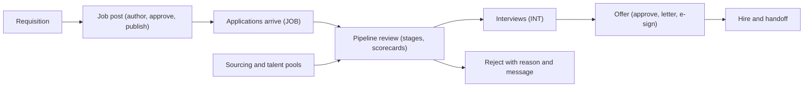
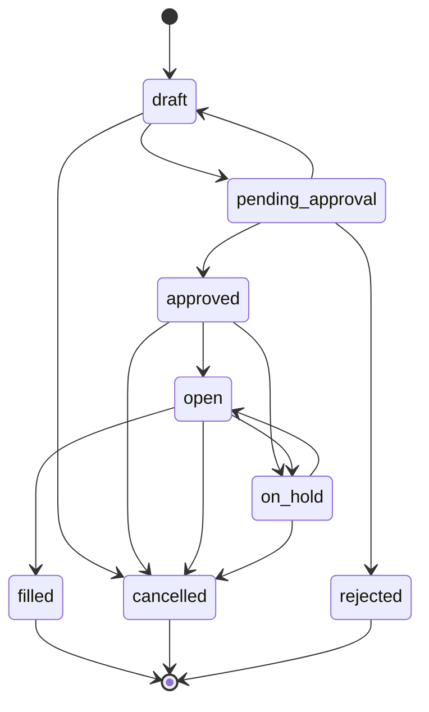
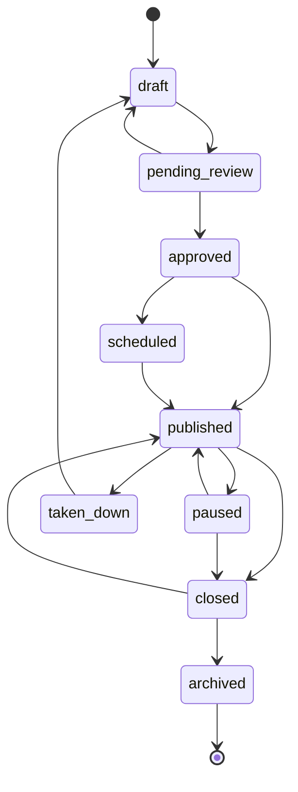
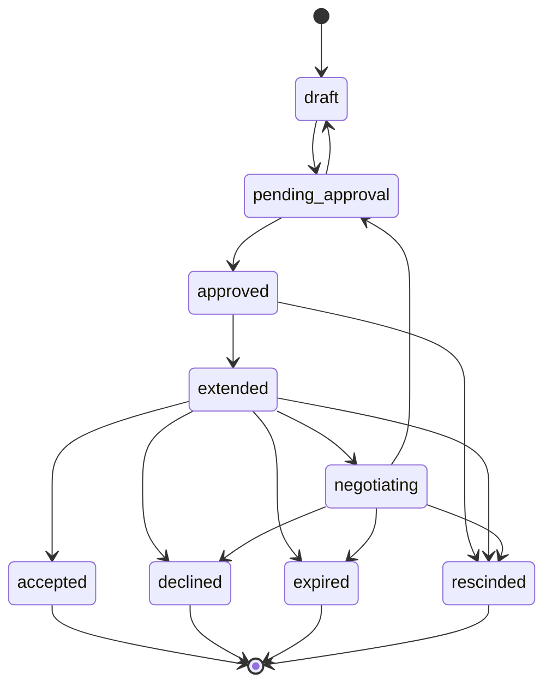
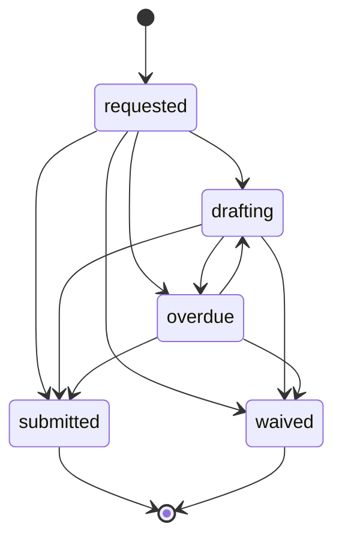
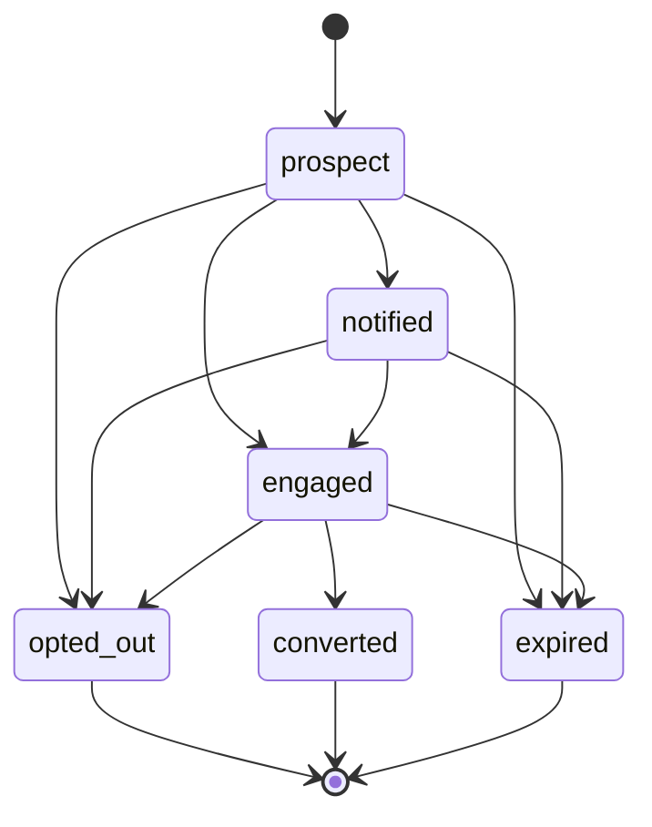
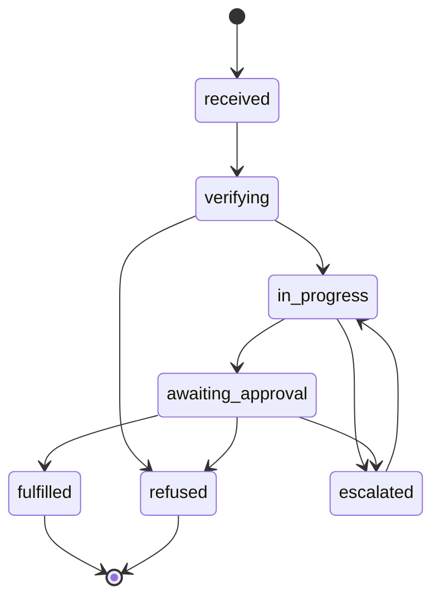
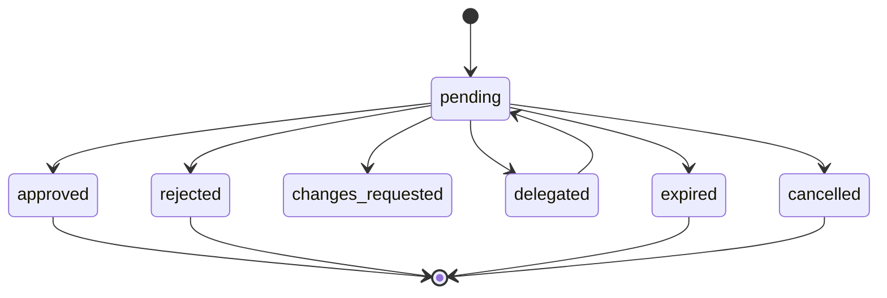
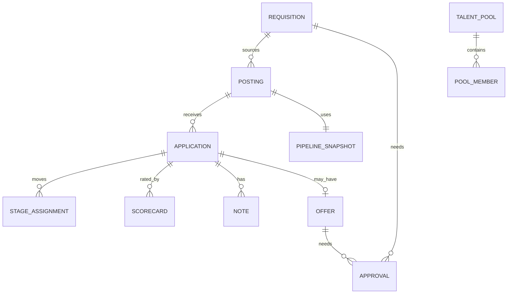

# ATS — Recruiter Workspace & Hiring Pipeline

> Status: intended product specification. Nothing in this file claims anything is built. See [CONVENTIONS](../00_START_HERE/CONVENTIONS.md).

## 1. Purpose, outcomes and boundaries

### 1.1 Purpose

ATS is the employer-side system of record for hiring. It takes a need to hire (requisition), turns it into a compliant job posting, runs every applicant through a configurable pipeline with structured, evidence-based review, and ends in an offer and a hire or a respectful rejection. Because TalentSphere holds verified candidate evidence (credentials, assessments, work history), ATS is designed so reviewers decide from evidence and structured rubrics, not from résumé keywords alone. It also carries the governance a hiring system needs: audit, fairness monitoring, retention and candidate data rights. [SRC: SSOT §9.7 F-05, F-06, F-37, F-102, F-103, F-122] [DER]

### 1.2 Outcomes

| Outcome                                                                             | How the system knows                                                                                      |
| ----------------------------------------------------------------------------------- | --------------------------------------------------------------------------------------------------------- |
| A recruiter goes from approved requisition to published job quickly and compliantly | Time from requisition approval to publish; share of postings passing readiness on first try               |
| No applicant is lost or left without a decision                                     | Zero applications without an owner after SLA; every terminal outcome has a reason and a candidate message |
| Reviewers compare candidates on evidence and the same rubric                        | Share of decisions with all required scorecards; comparison runs on structured rubrics only               |
| Every consequential action is explainable                                           | Audit coverage of 100 percent of state-changing commands [SRC: SSOT §9.7 F-06 acceptance]                 |
| The process is monitored for fairness and legality                                  | Adverse-impact reports run on schedule; retention and rights requests meet deadlines                      |

### 1.3 Boundaries

| In scope (owned by ATS)                                                                                           | Out of scope                                                          | Consumed                                           |
| ----------------------------------------------------------------------------------------------------------------- | --------------------------------------------------------------------- | -------------------------------------------------- |
| Requisitions, approvals, headcount                                                                                | Employer org, seats, roles, billing (EMP, BIL planned)                | Org, members, roles, entitlements from EMP and BIL |
| Job authoring, templates, compliance checks, screening question definitions, publishing, multi-posting, lifecycle | Candidate-facing listing, search and application form rendering (JOB) | Candidate applications from JOB                    |
| Pipeline stages, automation, review views, bulk actions, rejection, communications                                | Interview scheduling, rooms, feedback collection forms engine (INT)   | Interviews and feedback from INT                   |
| Scorecards, notes, collaboration, hiring team                                                                     | Candidate profile and evidence storage (PRF, EVD, BGV planned)        | Profile, credentials, assessment results           |
| Talent pools, sourcing, outreach, duplicates, agency submissions                                                  | Messaging transport (MSG, NTF planned)                                | Delivery services                                  |
| Offers, approvals, letters, negotiation, hire handoff                                                             | E-signature provider, HRIS (external)                                 | Provider hooks                                     |
| SLA, DEI monitoring, audit, retention, rights, reporting, AI-assist governance                                    | Platform-wide analytics (ANL planned)                                 | Warehouse, if any                                  |

Ownership of shared entities: ATS owns Requisition, Job Posting, Pipeline, Stage Assignment, Scorecard, Note, Offer, Talent Pool, Rejection, Hire. JOB owns Application and its snapshot; ATS changes an Application only through `API-ATS-02` commands that append status events. [DER]

## 2. Roles and permission matrix

Legend: Y allowed, O own or assigned records only, T scoped to jobs where the person is on the hiring team, A audited override, N not allowed.

| Capability                      | REC                | HMG                | EAD | Interviewer (employer member, planned role in EMP) | Coordinator | CAN    | PAD                    | SUP    |
| ------------------------------- | ------------------ | ------------------ | --- | -------------------------------------------------- | ----------- | ------ | ---------------------- | ------ |
| Create requisition              | Y                  | Request only       | Y   | N                                                  | N           | N      | N                      | N      |
| Approve requisition, offer      | Approver role only | Approver role only | Y   | N                                                  | N           | N      | N                      | N      |
| Author and publish job          | T                  | Draft only         | Y   | N                                                  | T (draft)   | N      | N                      | N      |
| View applications and pipeline  | T                  | T                  | Y   | Assigned stage only                                | T           | N      | N                      | N      |
| Move stage, reject, bulk action | T                  | T (own jobs)       | Y   | N                                                  | T           | N      | N                      | N      |
| Submit scorecard                | Y                  | Y                  | Y   | Y (assigned)                                       | N           | N      | N                      | N      |
| View others' scorecards         | After own submit   | After own submit   | Y   | After own submit                                   | N           | N      | N                      | N      |
| Notes and mentions              | T                  | T                  | Y   | Assigned                                           | T           | N      | N                      | N      |
| Source candidates, outreach     | Y                  | N                  | Y   | N                                                  | N           | N      | N                      | N      |
| Create and send offers          | T                  | Draft/recommend    | Y   | N                                                  | N           | N      | N                      | N      |
| View DEI aggregate reports      | N                  | N                  | Y   | N                                                  | N           | N      | Y (platform aggregate) | N      |
| Candidate rights requests       | N                  | N                  | Y   | N                                                  | N           | Submit | A                      | Assist |
| Audit log read                  | Own actions        | Own actions        | Y   | N                                                  | N           | N      | A                      | A      |

Hiring team roles are defined per job (FR-ATS-028). `SUP` and `PAD` can see only metadata unless a candidate or employer grants a time-boxed, audited access. [DER]

## 3. Sub-module map

| Code | Sub-module                   | Features          |
| ---- | ---------------------------- | ----------------- |
| A    | Requisitions                 | FR-ATS-001 to 003 |
| B    | Job authoring                | FR-ATS-004 to 007 |
| C    | Publishing                   | FR-ATS-008 to 010 |
| D    | Pipeline configuration       | FR-ATS-011, 012   |
| E    | Candidate review             | FR-ATS-013 to 024 |
| F    | Collaboration and scorecards | FR-ATS-025 to 030 |
| G    | Sourcing and CRM             | FR-ATS-031 to 035 |
| H    | Offers and hire              | FR-ATS-036 to 040 |
| I    | Governance and reporting     | FR-ATS-041 to 048 |

## 4. Feature specifications

### Sub-module A: Requisitions

### FR-ATS-001 — Requisition creation

- **Sub-module:** A Requisitions
- **Priority / tier:** Must · R2
- **Source:** [SRC: BR-071 requisition protection; SSOT F-05] [DER]
- **Purpose and outcome:** Record the approved need to hire (role, headcount, budget, team) before a job is posted; success is a requisition with a unique id that jobs link to.
- **Roles and permissions:** `REC: create, edit own` · `EAD: create, edit all` · `HMG: request` · `PAD: none`
- **Preconditions and entry points:** Employer org active and verified (EMP-002) or in accelerated-review policy; `/ats/requisitions/new`; "Request headcount" from hiring manager workspace.
- **User interactions and actions:** 1) Click New requisition. 2) Fill: title, department, location(s), employment type, level, headcount (1 to 500), hiring manager, recruiter owner, target start date, reason (New role, Backfill with backfilled person's name, Growth), budget band (min, max, currency), confidentiality flag. 3) Choose approval chain (default from org policy, FR-EMP-014). 4) Save draft or Submit for approval.
- **System behaviour:** Creates requisition in `draft` (SM-ATS-01), assigns id `REQ-<org>-<seq>`, validates budget currency, snapshots the approval chain, and on submit creates approval requests (FR-ATS-002). Confidential requisitions hide title from non-team members. Duplicate detection warns on same title, department and location open within 90 days.
- **UI elements and controls:** Form fields with required markers, hiring manager and recruiter pickers (org members), budget inputs, confidentiality toggle (default off), Save draft, Submit, Cancel.
- **Configuration options:** Org: required fields, default approval chain, numbering prefix.
- **Business rules:** BR-ATS-001, BR-ATS-002, BR-ATS-003, BR-ATS-037
- **Validation:** Title 3 to 120 chars; headcount integer 1 to 500; budget min <= max, non-negative; start date not in the past; hiring manager must be an active org member.
- **Inputs and outputs:** In: fields above. Out: requisition id, status, approval requests.
- **Filters, sorting, search:** Requisition list: filter by status, department, owner, location; sort by created, target start; search by title or id.
- **Notifications and communication:** Approvers notified `ats.requisition.approval_requested` (in-app, email, class workflow); creator notified of decision.
- **Error handling and edge cases:** Duplicate warning is non-blocking. Hiring manager deactivated later: requisition flags "owner needed" and EAD is notified. Save fails: form state preserved.
- **Dependencies:** FR-EMP-010, FR-EMP-013, FR-EMP-014, ENT-ATS-01.
- **Security and privacy:** Budget data restricted to hiring team and approvers; confidential flag hides from org-wide lists.
- **Acceptance criteria:**
  - Given an active org, When a recruiter submits a valid requisition, Then it is `pending_approval` with approval requests created.
  - Given headcount 0, When saving, Then validation error on headcount.
  - Given a confidential requisition, When a non-team member lists requisitions, Then it is absent.
  - Negative: Given a candidate-role account, When calling create, Then 403.

### FR-ATS-002 — Requisition approval chain

- **Sub-module:** A Requisitions
- **Priority / tier:** Must · R2
- **Source:** [DER] [PROP]
- **Purpose and outcome:** Route requisitions through finance, department and HR approvers; success is a recorded approve or reject by every required approver.
- **Roles and permissions:** `Approver role: approve, reject, delegate` · `EAD: configure chains, override with reason (A)` · `REC: view status`
- **Preconditions and entry points:** Requisition `pending_approval`; approval inbox `/ats/approvals`.
- **User interactions and actions:** 1) Open request with requisition summary and budget. 2) Approve, Reject (reason required, up to 1,000 chars) or Request changes (comment). 3) Delegate to another eligible approver. 4) Creator edits on Changes requested and resubmits.
- **System behaviour:** Chains are sequential or parallel groups with minimum approver counts. Approvers cannot approve their own requisition (BR-ATS-026 pattern). Decisions are immutable approval records (SM-ATS-07). When all steps approve, requisition becomes `approved`; on any reject becomes `rejected`; changes requested returns to `draft` and restarts only the affected steps if the budget or headcount did not change. Approval times out after 5 business days [PROP] with reminders at 2 and 4 days and escalation to EAD.
- **UI elements and controls:** Approval card with diff of changes since last view, Approve, Reject, Request changes, Delegate, comment box, chain progress bar.
- **Configuration options:** Org (EMP-014): chain by department, budget threshold, timeout, delegation allowed.
- **Business rules:** BR-ATS-003, BR-ATS-026, BR-ATS-037
- **Validation:** Reject and Request changes need a reason; delegate must hold approver role and not be the creator.
- **Inputs and outputs:** In: decision, reason. Out: approval record, requisition state change.
- **Filters, sorting, search:** Inbox filter by pending, decided; sort by age.
- **Notifications and communication:** Approver reminders `ats.approval.reminder`; creator result notice; escalation to EAD.
- **Error handling and edge cases:** Approver leaves org: step reassigns to delegate or EAD. Concurrent decisions on a parallel group: both recorded; minimum count decides. Requisition edited while pending: approvers see "changed since" banner and prior approvals on changed fields are voided.
- **Dependencies:** FR-EMP-014, SM-ATS-07, NTF (planned).
- **Security and privacy:** Approval records immutable and audit logged.
- **Acceptance criteria:**
  - Given a two-step chain, When both approve, Then requisition is `approved`.
  - Given the creator is also an approver, When they try to approve, Then refused.
  - Given a timeout, When 5 business days elapse, Then EAD is notified.
  - Negative: Given a Reject without a reason, When submitted, Then validation error.

### FR-ATS-003 — Headcount and budget tracking

- **Sub-module:** A Requisitions
- **Priority / tier:** Should · R2
- **Source:** [SRC: BR-071] [PROP]
- **Purpose and outcome:** Keep requisition fill count, open duration and spend against budget visible; success is no over-hiring and no abandoned requisitions.
- **Roles and permissions:** `REC, HMG: view own` · `EAD: view all, adjust`
- **Preconditions and entry points:** Requisition list and detail; hire events.
- **User interactions and actions:** 1) View filled / headcount, open days, offers outstanding. 2) Adjust headcount (needs re-approval if increase). 3) Put on hold, close as cancelled or filled.
- **System behaviour:** Each hire decrements remaining headcount; at zero the requisition becomes `filled` and open postings close per FR-ATS-040. Offers outstanding plus hires cannot exceed headcount unless org policy allows overbooking. Aging: a requisition open more than 21 days with no pipeline activity flags for review; at 30 days it auto-pauses its postings with notice [SRC: BR-071]. Billing credit for auto-pause is a BIL (planned) decision (OD-ATS-04).
- **UI elements and controls:** Progress meter, aging chip, Hold, Cancel, Adjust headcount buttons with reason field.
- **Configuration options:** Org: aging thresholds (21 and 30 days), overbooking allowed (default off).
- **Business rules:** BR-ATS-030, BR-ATS-032
- **Validation:** Headcount cannot go below filled plus outstanding offers.
- **Inputs and outputs:** In: adjustments. Out: updated counts, state.
- **Filters, sorting, search:** Filter by aging, state.
- **Notifications and communication:** `ats.requisition.aging` to owner and hiring manager.
- **Error handling and edge cases:** Hire reversed (rescinded after accept): headcount restored. Hold with live postings: postings pause.
- **Dependencies:** FR-ATS-040, FR-ATS-010, BIL (planned).
- **Security and privacy:** Budget fields restricted.
- **Acceptance criteria:**
  - Given headcount 2 and two hires, When the second is recorded, Then requisition becomes `filled`.
  - Given 31 days of no activity, When the job runs, Then postings pause and the owner is notified.
  - Negative: Given headcount reduced below hires, When saving, Then refused.

### Sub-module B: Job authoring

### FR-ATS-004 — Job authoring studio

- **Sub-module:** B Authoring
- **Priority / tier:** Must · R2
- **Source:** [SRC: SSOT F-05 Post Job Studio; BR-10]
- **Purpose and outcome:** Write a complete, structured job posting; success is a posting that passes readiness checks.
- **Roles and permissions:** `REC: author on own team jobs` · `HMG: draft sections` · `EAD: all`
- **Preconditions and entry points:** Approved requisition (BR-ATS-003) or policy allowing no requisition; `/ats/jobs/new?requisition=`.
- **User interactions and actions:** 1) Choose template or blank. 2) Fill sections: title, summary, responsibilities, must-have and nice-to-have requirements, skills (canonical picker), location and work mode, eligibility (hiring countries, sponsorship, hybrid days), employment type, level, pay (FR-ATS-006), benefits, application method (native apply or external URL), closing date, application questions (FR-ATS-007), pipeline template (FR-ATS-011), hiring team (FR-ATS-028), diversity statement. 3) Use rich-text editor with headings, lists, links. 4) Preview as candidate (desktop and mobile). 5) Save draft; autosave every 30 seconds. 6) Submit for review (FR-ATS-008).
- **System behaviour:** Stores a versioned draft; every save creates a revision (BR-ATS-046). Readiness checklist updates live (BR-ATS-005). Skills must map to canonical ids (BR-144 legacy tag) so search and fit work. HTML is sanitized on save. Collaborative edits lock per section with presence indicators; conflicts resolved last-save-wins per section with warning.
- **UI elements and controls:** Section accordion editor, skills picker, location picker with multi-site support, pay inputs, readiness panel (checklist with pass, warning, fail), Preview toggle, Save draft, Submit for review, Revision history with Restore.
- **Configuration options:** Org: required sections, default benefits and EEO text, max description length. Platform: allowed external apply domains.
- **Business rules:** BR-ATS-005, BR-ATS-006, BR-ATS-010, BR-ATS-046, BR-ATS-040
- **Validation:** Title 3 to 100 chars; description 300 to 20,000 chars; at least 3 skills (max 30); location required unless fully remote with hiring countries; employment type and level required; closing date 1 to 180 days ahead; external apply URL https.
- **Inputs and outputs:** In: fields. Out: job draft revision, readiness report.
- **Filters, sorting, search:** Jobs list: filter by status, owner, requisition, location; search by title.
- **Notifications and communication:** Co-author mention notices; submit triggers review notice (FR-ATS-008).
- **Error handling and edge cases:** Autosave failure: banner and local copy. Pasted Word content: stripped to allowed markup. Requisition headcount filled: new drafts blocked with message.
- **Dependencies:** FR-ATS-005..007, FR-ATS-011, FR-ATS-028, FR-EMP-004, ENT-ATS-02.
- **Security and privacy:** Drafts visible to hiring team only; confidential requisition drafts hidden.
- **Acceptance criteria:**
  - Given missing pay in a jurisdiction requiring it, When viewing readiness, Then it shows a failing item and Submit is disabled.
  - Given two editors on different sections, When both save, Then both changes persist.
  - Given a revision, When Restore is pressed, Then a new revision with the older content is created.
  - Negative: Given a script tag in the description, When saved, Then it is removed.

### FR-ATS-005 — Job templates and snippets

- **Sub-module:** B Authoring
- **Priority / tier:** Should · R2
- **Source:** [SRC: F-37 Job Templates]
- **Purpose and outcome:** Reuse approved wording and structure; success is faster, more consistent postings.
- **Roles and permissions:** `REC: use, create personal` · `EAD: create org templates, lock sections`
- **Preconditions and entry points:** Template picker in authoring; `/ats/templates`.
- **User interactions and actions:** 1) Save a job as template (name, scope: personal or org). 2) Insert a snippet (equal-opportunity statement, benefits block, company intro) at cursor. 3) Mark sections as locked in org templates. 4) Archive or edit a template.
- **System behaviour:** Template application copies content; later template edits do not alter existing jobs. Locked sections are read-only in jobs created from that template (the job editor shows a lock). Template versions are numbered. Platform provides starter templates per role family [PROP].
- **UI elements and controls:** Template gallery with search, preview, Use button, Save as template dialog, snippet menu, lock toggles (EAD).
- **Configuration options:** Org: templates required for certain departments (default off).
- **Business rules:** BR-ATS-010, BR-ATS-002
- **Validation:** Name 3 to 80 chars unique within scope; locked sections must exist.
- **Inputs and outputs:** In: job content or snippet text. Out: template record.
- **Filters, sorting, search:** Filter by role family, scope; sort by last used.
- **Notifications and communication:** n/a.
- **Error handling and edge cases:** Template contains prohibited language: save blocked with lint results. Deleting a template in use: archived, existing jobs unaffected.
- **Dependencies:** FR-ATS-004, FR-ATS-006.
- **Security and privacy:** Org templates are org-scoped (BR-ATS-002).
- **Acceptance criteria:**
  - Given an org template with a locked EEO section, When a recruiter creates a job from it, Then the section cannot be edited.
  - Given a template later edited, When a prior job is opened, Then its content is unchanged.
  - Negative: Given a template containing "young and energetic", When saving, Then lint blocks or warns per rule class.

### FR-ATS-006 — Pay, compliance and inclusive-language checks

- **Sub-module:** B Authoring
- **Priority / tier:** Must · R2
- **Source:** [DER: pay transparency and anti-discrimination law] [PROP]
- **Purpose and outcome:** Prevent unlawful or exclusionary postings before they publish.
- **Roles and permissions:** `REC, HMG, EAD: see results` · `PAD: manage rule sets`
- **Preconditions and entry points:** Live panel in the authoring studio; runs again at submit and publish.
- **User interactions and actions:** 1) Enter pay min, max, currency, period, basis (base, OTE). 2) See checks: pay required for these locations, range width, prohibited phrases (age, gender, nationality, marital status, "native speaker" where not a requirement), biased wording suggestions (gendered words), accessibility reading level, missing equal-opportunity statement. 3) Apply a suggested replacement with one click or dismiss with reason (for warnings).
- **System behaviour:** Rule sets are keyed by jurisdiction of each job location; where disclosure is required, missing pay is a hard fail (BR-ATS-006). Hard-fail terms (explicit protected attributes) block publishing; warnings can be dismissed with a recorded reason. The lint explains each hit. Rule set version is stored with the revision. Range width over 2.0 ratio produces a warning [PROP].
- **UI elements and controls:** Check list with severity icons and text labels, inline highlights in editor, Apply suggestion, Dismiss with reason select.
- **Configuration options:** Org: extra prohibited words, stricter width ratio. Platform: jurisdiction rule library.
- **Business rules:** BR-ATS-006, BR-ATS-010
- **Validation:** Pay min <= max; currency ISO 4217; period valid; hard-fail list non-dismissible.
- **Inputs and outputs:** In: draft content and locations. Out: check report with severity, location of hit, suggestion.
- **Filters, sorting, search:** n/a.
- **Notifications and communication:** n/a.
- **Error handling and edge cases:** Unknown jurisdiction: warning "no rule set; check local law" and not a hard fail. Rule update after draft: re-run flags new hits on next save. False positive on hard-fail: EAD can file an exception request to PAD with audit.
- **Dependencies:** FR-ATS-004, PAD rule library (ADM planned).
- **Security and privacy:** Dismissal reasons are audit logged; rules do not process candidate data.
- **Acceptance criteria:**
  - Given a location requiring pay disclosure and no pay, When submitting, Then blocked.
  - Given text "recent graduate preferred", When linting, Then an age-proxy warning appears with an alternative.
  - Given a hard-fail phrase, When dismissal is attempted, Then not allowed.
  - Negative: Given a dismissed warning, When the reason is empty, Then dismissal is refused.

### FR-ATS-007 — Screening question builder

- **Sub-module:** B Authoring
- **Priority / tier:** Must · R2
- **Source:** [DER] [PROP] (JOB renders: FR-JOB-018, FR-JOB-019)
- **Purpose and outcome:** Define the application questions, must-haves and knockouts; success is a form candidates can complete and a reviewer can read.
- **Roles and permissions:** `REC, EAD: build` · `HMG: suggest`
- **Preconditions and entry points:** Authoring studio "Application questions" section; question library.
- **User interactions and actions:** 1) Add question from the library or custom: type (short text, long text, single choice, multi choice, yes/no, number, date, file, URL, work authorization, salary expectation, availability date). 2) Mark Required. 3) Mark Must-have and set criterion (equals, at least, includes) with mode Advisory or Strict (FR-JOB-019). 4) Add conditional display rule. 5) Reorder by drag or keyboard. 6) Preview as candidate.
- **System behaviour:** Questions versioned; published definition version pinned to applications (BR-JOB-009). Validation blocks forbidden questions (protected attributes, national id, bank details, free-text knockouts, questions about marital status, age, health) and strict mode on non-approved rule types (BR-JOB-018). Library questions carry approved legal wording. Max 30 questions. Editing a published job's questions creates a new version; existing drafts see the change per FR-JOB-018.
- **UI elements and controls:** Question list with drag handles and Move up/down buttons, type select, required switch, criterion editor, condition builder, Preview, Delete with confirm.
- **Configuration options:** Org: default question set per job family. Platform: allowed knockout types and forbidden topic lists.
- **Business rules:** BR-ATS-005, BR-ATS-015
- **Validation:** Label 3 to 300 chars; choice options 2 to 20, unique; number min <= max; conditions must refer to earlier questions; strict criteria only on approved types.
- **Inputs and outputs:** In: questions. Out: versioned form definition.
- **Filters, sorting, search:** Library search by topic.
- **Notifications and communication:** n/a.
- **Error handling and edge cases:** Forbidden topic: save blocked with explanation. Deleting a question referenced by a condition: warns and removes the condition after confirm. Changing a strict criterion after applicants exist: allowed only for future applicants; existing decisions not re-run.
- **Dependencies:** FR-JOB-018, FR-JOB-019, ENT-ATS-03.
- **Security and privacy:** Questions about sensitive categories must use FR-ATS-042 self-ID instead and are never shown to reviewers.
- **Acceptance criteria:**
  - Given a question "What is your date of birth", When saving, Then blocked as forbidden.
  - Given a strict criterion of type free text, When saving, Then rejected.
  - Given a conditional question, When its parent is deleted, Then the user must confirm and the condition is removed.
  - Negative: Given 31 questions, When adding another, Then refused.

### Sub-module C: Publishing

### FR-ATS-008 — Posting review, approval, scheduling and publish

- **Sub-module:** C Publishing
- **Priority / tier:** Must · R2
- **Source:** [SRC: SSOT F-04 job state machine; BR-10, BR-11, BR-036, BR-062]
- **Purpose and outcome:** Move a draft to a live, searchable listing under policy; success is a published posting with a listing projection in JOB.
- **Roles and permissions:** `REC: submit, publish if policy allows` · `Approver: approve` · `EAD: publish, override` · `MOD/PAD: platform review where required`
- **Preconditions and entry points:** Draft passes readiness (BR-ATS-005); requisition approved; org verified.
- **User interactions and actions:** 1) Submit for review. 2) If org policy requires internal approval, approvers act. 3) If platform review is required (unverified org), moderators review. 4) Choose Publish now or Schedule (date and time with time zone). 5) See state: pending review, approved, scheduled, published.
- **System behaviour:** SM-ATS-02: draft, pending_review, approved, scheduled, published, paused, closed, taken_down, archived. Verified organizations receive accelerated automatic approval when readiness and fraud scoring pass [SRC: BR-062]; unverified go to platform review (BR-ATS-004). Publishing creates the listing projection in JOB (ENT-JOB-01), indexes it, and starts distribution (FR-ATS-009). Scheduled publishes run via a job with idempotent keys. Publish fails closed: if any readiness check fails at publish time, state stays `approved` with an error list.
- **UI elements and controls:** Review submission dialog, readiness summary, Publish now and Schedule buttons, time zone picker, state banner, rejection reason display.
- **Configuration options:** Org: require internal approval (default off for verified orgs), who may publish. Platform: review SLA targets.
- **Business rules:** BR-ATS-003, BR-ATS-004, BR-ATS-005, BR-ATS-007
- **Validation:** Schedule time at least 5 minutes ahead and within 90 days.
- **Inputs and outputs:** In: submit, schedule time. Out: state change, listing projection, review decision with reason.
- **Filters, sorting, search:** Review queue (platform side) sorted by risk then age.
- **Notifications and communication:** Author notified on approve, reject (with reasons), publish (`ats.posting.published`); class workflow.
- **Error handling and edge cases:** Rejected by moderation: returns to `draft` with reasons (state `rejected_by_moderation` is recorded as an event, not a state). Schedule collides with org downtime: runs on recovery with at most 1 hour delay and a notice. Fraud score high: held for platform review regardless of verification.
- **Dependencies:** FR-JOB-036, FR-EMP-002, FR-ATS-002, FR-ATS-009, SM-ATS-02, TSF (planned).
- **Security and privacy:** Only approved content is indexed; draft content never public.
- **Acceptance criteria:**
  - Given a verified org and a ready draft, When Publish now is pressed, Then the listing is live in search within the indexing target.
  - Given an unverified org, When submitting, Then state is `pending_review`.
  - Given a scheduled time, When it arrives, Then the posting publishes exactly once.
  - Negative: Given a readiness failure at publish, When publishing, Then it stays `approved` and lists failing checks.

### FR-ATS-009 — Multi-posting and job board distribution

- **Sub-module:** C Publishing
- **Priority / tier:** Could · R5
- **Source:** [PROP] [SRC: Greenhouse and Lever multiposting patterns]
- **Purpose and outcome:** Distribute a posting to external boards and career sites; success is correct, in-sync external postings.
- **Roles and permissions:** `REC, EAD: configure and distribute` · `PAD: manage board connectors`
- **Preconditions and entry points:** Posting `published`; board connected (EMP-026); entitlement (BIL planned).
- **User interactions and actions:** 1) In the job, open Distribution. 2) Select boards (free feeds, paid boards where connected). 3) Review mapped fields and cost estimate (if paid). 4) Confirm. 5) View status per board (queued, live, failed, closed) and applicant source tags.
- **System behaviour:** Posting content is transformed to each board's schema; updates, pause and close propagate. Applicants from external boards arrive via the connector as applications with source tag and are deduplicated (FR-ATS-034). Failures retry with backoff and surface errors. Paid actions need explicit confirmation and entitlement.
- **UI elements and controls:** Board checklist, field-mapping preview, cost line, Confirm, status table with Retry and Remove.
- **Configuration options:** Org: enabled boards, default distribution on publish (off).
- **Business rules:** BR-ATS-007, BR-ATS-005, BR-ATS-045
- **Validation:** Board-specific required fields; external apply URL must resolve to the platform application page where "native apply" is chosen.
- **Inputs and outputs:** In: board selection. Out: external post ids and status.
- **Filters, sorting, search:** Source filter in pipeline.
- **Notifications and communication:** Failure notice to recruiter.
- **Error handling and edge cases:** Board rejects content: error shown with board message. Board outage: queued retries up to 24 hours. Close in platform but board closing fails: reminder task to close manually.
- **Dependencies:** FR-EMP-026, BIL (planned), ENT-ATS-04.
- **Security and privacy:** Credentials for boards stored encrypted in EMP integrations vault.
- **Acceptance criteria:**
  - Given a connected board, When distributing, Then an external post id is recorded.
  - Given the posting closes, When propagation runs, Then the board is told to close.
  - Negative: Given no entitlement for a paid board, When confirming, Then blocked with upgrade message.

### FR-ATS-010 — Posting lifecycle controls

- **Sub-module:** C Publishing
- **Priority / tier:** Must · R2
- **Source:** [SRC: SSOT §10.15 BR-11, BR-057, BR-12]
- **Purpose and outcome:** Pause, resume, close, reopen, repost and expire postings predictably.
- **Roles and permissions:** `REC (T), EAD: all` · `HMG: request pause`
- **Preconditions and entry points:** Job detail actions; automatic expiry.
- **User interactions and actions:** 1) Pause (reason). 2) Resume. 3) Close with reason (Filled, Cancelled, Expired, Paused indefinitely) and choose what happens to applicants: keep in pipeline (default) or reject all with templated message. 4) Reopen a closed posting within 30 days. 5) Repost (creates new posting version with new publish date, preserving applicants). 6) Extend closing date.
- **System behaviour:** Transitions per SM-ATS-02. Default expiry 60 days from publish, configurable 14 to 90 (BR-ATS-008; OD-JOB-03). Pause removes from search immediately but keeps existing applications. Close notifies applicants once (BR-JOB-041). Repost retains original publish date for display (BR-JOB-027). Taken-down postings can only be restored by MOD or PAD. Auto-close at expiry sends a 7-day and 1-day warning to the owner.
- **UI elements and controls:** Action menu (Pause, Resume, Close, Reopen, Repost, Extend), close dialog with applicant-handling radio, expiry chip.
- **Configuration options:** Org: default expiry; platform: reopen window.
- **Business rules:** BR-ATS-007, BR-ATS-008, BR-ATS-009
- **Validation:** Extension within 90 days total of original publish unless EAD override with reason; reopen only if requisition has headcount remaining.
- **Inputs and outputs:** In: action, reason. Out: state change, projection update, applicant notices.
- **Filters, sorting, search:** Jobs list by status and expiry date.
- **Notifications and communication:** Expiry warnings `ats.posting.expiring`; applicant close notice by JOB.
- **Error handling and edge cases:** Closing with interviews scheduled: warns and keeps interviews. Repost with active duplicate: blocked until the previous closes. Reopen after requisition filled: refused.
- **Dependencies:** FR-JOB-035, FR-JOB-040, FR-ATS-003, SM-ATS-02.
- **Security and privacy:** Audit logged.
- **Acceptance criteria:**
  - Given a published posting, When paused, Then it disappears from search and applicants remain.
  - Given expiry day, When reached, Then posting closes and applicants get one notice.
  - Given a closed posting for a filled requisition, When Reopen is pressed, Then refused.
  - Negative: Given taken_down state, When REC tries to restore, Then 403.

### Sub-module D: Pipeline configuration

### FR-ATS-011 — Pipeline templates and stage configuration

- **Sub-module:** D Pipeline
- **Priority / tier:** Must · R2
- **Source:** [SRC: SSOT F-06 step 1; V61-18 vocabulary] [DER]
- **Purpose and outcome:** Define the stages candidates pass through; success is a pipeline every job can use and every stage mapped to a candidate-visible status.
- **Roles and permissions:** `EAD: manage org templates` · `REC (T): customize per job` · `HMG: view`
- **Preconditions and entry points:** `/ats/settings/pipelines`; job authoring step.
- **User interactions and actions:** 1) Create or clone a pipeline template. 2) Add, rename, reorder, delete stages. 3) For each stage set: category (Applied, Screening, Interview, Assessment, Offer, Hired), required scorecard template, interview plan (INT-001), SLA days, auto-communication templates, whether candidate sees the stage name. 4) Set default for the org or job family. 5) Per job, customize a copy.
- **System behaviour:** Default template: Applied, In review, Shortlisted, Interview, Assessment, Offer, Hired [SRC: F-06 step 1]. Every stage maps to exactly one system category, which maps to a candidate status in SM-JOB-01 (BR-ATS-011). A job takes a snapshot copy at creation; later template edits do not affect existing jobs unless the owner chooses "Apply to open jobs", which moves nothing automatically. Deleting a stage that holds candidates requires choosing a destination stage; the move is recorded as a transition.
- **UI elements and controls:** Stage list with drag handles and Move buttons, stage settings drawer, category select, SLA number input, template pickers, "Apply to open jobs" with impact preview.
- **Configuration options:** Org: default template; stages count 3 to 15.
- **Business rules:** BR-ATS-011, BR-ATS-012
- **Validation:** Stage name 2 to 40 chars unique within pipeline; at least one Applied and one Hired/terminal category; Offer stage must follow an Interview or Assessment stage; SLA 1 to 60 days.
- **Inputs and outputs:** In: stage definitions. Out: pipeline snapshot per job.
- **Filters, sorting, search:** Template list search.
- **Notifications and communication:** n/a.
- **Error handling and edge cases:** Deleting last stage in a category: refused. Rename: history keeps stage id so timelines stay correct. Candidate-visible name equals internal name only if sharing is on.
- **Dependencies:** FR-INT-001, FR-ATS-026, FR-ATS-012, ENT-ATS-05.
- **Security and privacy:** Org scoped.
- **Acceptance criteria:**
  - Given a pipeline with stage "Phone screen" mapped to Interview, When a candidate is there, Then the candidate sees status "Interviewing".
  - Given a stage with 12 candidates, When deleting it, Then a destination is required and 12 transitions are recorded.
  - Negative: Given a pipeline without an Applied stage, When saving, Then refused.

### FR-ATS-012 — Stage automation rules

- **Sub-module:** D Pipeline
- **Priority / tier:** Should · R2
- **Source:** [PROP] [SRC: BR-171 AI not sole decision, BR-069, BR-070]
- **Purpose and outcome:** Remove repetitive work with safe rules; success is fewer manual moves without any unreviewed rejection.
- **Roles and permissions:** `REC (T), EAD: configure`
- **Preconditions and entry points:** Stage settings, Automations tab.
- **User interactions and actions:** 1) Add a rule: trigger (application enters stage, scorecard submitted, interview completed, candidate no response for N business days, SLA breached), conditions (source, location, knockout flag, assessment score band), action (send template email, create task, assign owner, move to "Needs review" flag, add tag, request scorecards). 2) Test with dry run on last 30 applications. 3) Enable. 4) View rule run log.
- **System behaviour:** Allowed actions never include final rejection by an automated rule except the knockout decline defined in FR-JOB-019 (BR-ATS-015). Rules run in a deterministic order, each execution idempotent per (rule, application, trigger instance), logged with outcome. Candidate non-response: reminder at 5 business days and a "candidate unresponsive" flag at 8 [SRC: BR-070]; the flag does not change status. Rule changes are versioned and audited.
- **UI elements and controls:** Rule builder (trigger, conditions, actions), Dry run button with preview table, Enable switch, run log table.
- **Configuration options:** Org: max 20 rules per pipeline; sending hours.
- **Business rules:** BR-ATS-015, BR-ATS-031, BR-ATS-037
- **Validation:** Valid trigger-action combos; email actions need a template; N between 1 and 30.
- **Inputs and outputs:** In: rule definition. Out: executions and effects.
- **Filters, sorting, search:** Run log filter by rule, outcome.
- **Notifications and communication:** Rule-sent emails per FR-ATS-023; owner notified on rule failure.
- **Error handling and edge cases:** Loop prevention: a rule cannot trigger itself via its action more than once per application. Conflicting rules: priority order shown and enforced. Template deleted: rule disabled with notice.
- **Dependencies:** FR-ATS-023, FR-ATS-041, FR-JOB-019.
- **Security and privacy:** Conditions cannot use protected attributes or DEI self-ID data.
- **Acceptance criteria:**
  - Given a rule "no response 5 days, send reminder", When the condition is met, Then one reminder is sent once.
  - Given a rule attempting a reject action, When saving, Then refused.
  - Given a dry run, When executed, Then no effects occur and a preview is shown.
  - Negative: Given a condition on self-identified gender, When saving, Then refused.

### Sub-module E: Candidate review

### FR-ATS-013 — Application inbox and Kanban pipeline

- **Sub-module:** E Review
- **Priority / tier:** Must · R2
- **Source:** [SRC: SSOT F-06 step 1; acceptance "Kanban sync <200ms"]
- **Purpose and outcome:** See and move all applicants of a job; success is every applicant visible in exactly one stage.
- **Roles and permissions:** `REC (T), HMG (T), EAD, Coordinator (T): view, move (not HMG for other jobs)` · `Interviewer: assigned only`
- **Preconditions and entry points:** `/ats/jobs/:jobId/pipeline`; new-application notification links.
- **User interactions and actions:** 1) Open job pipeline. 2) See columns per stage with counts. 3) Drag a card to another column, or use the card menu "Move to" (keyboard accessible). 4) Click a card for detail (FR-ATS-015). 5) Select multiple cards for bulk actions (FR-ATS-021). 6) Filter and search within the job (FR-ATS-018).
- **System behaviour:** Cards show name (or anonymous label in blind mode, FR-ATS-048), headline, verified-signal badges, source, days in stage, SLA state, scorecard summary dots, tags, referral tag. New applications land in the first stage. Moves call the stage transition command (FR-ATS-020); the board updates for all viewers via a live channel within 200 ms target [SRC] and handles conflicting moves by last committed wins with a toast. Columns paginate (50 per page).
- **UI elements and controls:** Board columns, cards, drag handle, "Move to" menu, filter bar, bulk select checkboxes, column counts, SLA colored chip with text, "Collapse column".
- **Configuration options:** User: card fields, density. Org: default fields.
- **Business rules:** BR-ATS-012, BR-ATS-040, BR-ATS-044, BR-ATS-002
- **Validation:** Transition validity per FR-ATS-020.
- **Inputs and outputs:** In: drag or menu move. Out: updated stage assignment and event.
- **Filters, sorting, search:** Within-board filters; sort within column by applied date, days in stage, rating.
- **Notifications and communication:** Move may trigger stage automations and candidate messages.
- **Error handling and edge cases:** Invalid transition: card snaps back with reason. Two recruiters move the same card: second sees conflict toast. Live channel down: manual refresh banner. 2,000+ applicants: virtual scrolling and server paging.
- **Dependencies:** FR-JOB-023, FR-ATS-020, ENT-ATS-06.
- **Security and privacy:** Visibility by hiring team (BR-ATS-040); no cross-tenant data (BR-ATS-002).
- **Acceptance criteria:**
  - Given a new application, When submitted, Then it appears in the first column.
  - Given a drag to an invalid stage, When dropped, Then it snaps back with an explanation.
  - Given a keyboard user, When using "Move to", Then the card moves without drag.
  - Negative: Given an interviewer not assigned to the candidate, When opening the board, Then the card is not listed.

### FR-ATS-014 — Table view and saved views

- **Sub-module:** E Review
- **Priority / tier:** Should · R2
- **Source:** [PROP]
- **Purpose and outcome:** Work through large applicant lists in a sortable table with saved views; success is quick triage.
- **Roles and permissions:** `REC (T), HMG (T), EAD, Coordinator (T)`
- **Preconditions and entry points:** Pipeline view toggle; `/ats/candidates`.
- **User interactions and actions:** 1) Switch to Table. 2) Choose columns (name, stage, applied date, source, location, rating average, verified signals count, tags, owner, SLA). 3) Sort and filter. 4) Save the configuration as a named view, private or shared with the team. 5) Export current view to CSV (EAD or REC with export permission).
- **System behaviour:** Views store columns, filters, sort. CSV export excludes sensitive answers and self-ID data, includes only visible columns, logs the export in the audit trail (BR-ATS-037) and is capped at 10,000 rows [PROP].
- **UI elements and controls:** Column chooser, header sort toggles, filter chips, Save view dialog, Export button, row checkboxes.
- **Configuration options:** Org: allow exports (default on for EAD, REC).
- **Business rules:** BR-ATS-002, BR-ATS-037, BR-ATS-040
- **Validation:** View name 2 to 60 chars.
- **Inputs and outputs:** In: view config. Out: table rows, CSV.
- **Filters, sorting, search:** Full filter set of FR-ATS-018.
- **Notifications and communication:** n/a.
- **Error handling and edge cases:** Export over cap: offer narrowing filters. Shared view referencing a deleted tag: filter ignored with notice.
- **Dependencies:** FR-ATS-018, ENT-ATS-06.
- **Security and privacy:** Export is personal data processing: reason prompt and audit.
- **Acceptance criteria:**
  - Given a saved shared view, When a teammate opens it, Then they see the same columns and filters.
  - Given an export, When it completes, Then the audit log records user, filters, row count.
  - Negative: Given a user without export permission, When pressing Export, Then 403.

### FR-ATS-015 — Candidate application detail

- **Sub-module:** E Review
- **Priority / tier:** Must · R2
- **Source:** [SRC: SSOT F-06 step 2]
- **Purpose and outcome:** One page with everything needed to evaluate a candidate for this job.
- **Roles and permissions:** `Hiring team (T)`
- **Preconditions and entry points:** Card click; `/ats/applications/:id`.
- **User interactions and actions:** 1) Read header (name, headline, location, source, referral, stage, owner). 2) Tabs: Overview, Evidence (FR-ATS-016), Resume and documents (FR-ATS-017), Answers, Timeline, Scorecards, Notes, Communications (FR-ATS-024), Interviews. 3) Actions: Move stage, Reject, Schedule interview, Add note, Request scorecard, Share with hiring manager, Tag, Assign owner, Compare. 4) Switch application versions if the candidate updated (see diff).
- **System behaviour:** Loads the latest snapshot and shows "Updated" marker with diff if new versions exist (FR-JOB-028). Unverified claims are labelled. Knockout mismatches are highlighted. Previous applications by the same candidate to the org (with outcomes and dates) are shown to authorized reviewers with a warning to avoid anchoring, and only within retention (BR-ATS-035). Blind mode hides identity fields until configured stage (FR-ATS-048). Viewing logs "viewed" with the user for audit and may drive the candidate "Viewed" signal when employer opts in (OD-JOB-09).
- **UI elements and controls:** Header, tab bar, action toolbar, side panel with quick scorecard summary, keyboard shortcuts (J/K next/prev candidate, M move, R reject) with help overlay.
- **Configuration options:** User: default tab, shortcuts. Org: blind mode, previous-applications panel on/off.
- **Business rules:** BR-ATS-016, BR-ATS-020, BR-ATS-044, BR-ATS-047, BR-ATS-048
- **Validation:** n/a — read; actions validated in their features.
- **Inputs and outputs:** In: application id. Out: composed review view.
- **Filters, sorting, search:** Timeline filter by event type.
- **Notifications and communication:** n/a.
- **Error handling and edge cases:** Candidate withdrew: banner and read-only actions except notes. Candidate erased: record shows "Erased" with only aggregate stats. Missing documents: placeholder with scan status.
- **Dependencies:** FR-ATS-016, 017, 024, 025, 027, FR-JOB-028, ENT-ATS-06.
- **Security and privacy:** Access logged; sensitive answers masked until needed; candidate data never visible across orgs.
- **Acceptance criteria:**
  - Given an updated application, When opened, Then the Updated marker and a diff are shown.
  - Given blind mode on, When opening a candidate in Applied stage, Then name and photo are hidden.
  - Given a withdrawn candidate, When opening, Then Move and Reject are disabled.
  - Negative: Given a user outside the hiring team, When opening the URL, Then 404.

### FR-ATS-016 — Evidence panel

- **Sub-module:** E Review
- **Priority / tier:** Must · R2
- **Source:** [SRC: BR-064 verified signals; BR-167 reputation consent; SSOT vision evidence-first]
- **Purpose and outcome:** Reviewers evaluate verified credentials, assessments and work history rather than only claims.
- **Roles and permissions:** `Hiring team (T): view`
- **Preconditions and entry points:** Evidence tab on application detail.
- **User interactions and actions:** 1) See evidence grouped by requirement of the job: each required skill shows Verified (source and date), Assessed (score band, assessment name, integrity status), Claimed only, or No evidence. 2) Open an item to see provenance (issuer, verification method, date, freshness). 3) Open a portfolio or project sample. 4) Filter to Verified only.
- **System behaviour:** Pulls from EVD, ASM, BGV (planned). Reputation and other non-application data appear only with candidate consent or because of the active application (BR-ATS-044). Freshness decay flag is shown where skills are stale. Evidence is read-only here. Items revoked after display show "Revoked" with date. Employer cannot see verification details the candidate chose to withhold; those show as "Not shared".
- **UI elements and controls:** Requirement-by-requirement list, status badges with text, provenance popover, "Verified only" toggle.
- **Configuration options:** Org: show/hide assessment raw scores (default bands only).
- **Business rules:** BR-ATS-044, BR-ATS-016
- **Validation:** n/a.
- **Inputs and outputs:** In: application id, job requirements. Out: evidence matrix.
- **Filters, sorting, search:** Filter by status; sort by requirement priority.
- **Notifications and communication:** n/a.
- **Error handling and edge cases:** EVD unavailable: panel shows cached state with age and "Live check unavailable". Credential expired: shown as Expired. Conflicting evidence: both displayed, no auto-resolution.
- **Dependencies:** EVD, ASM, BGV (planned).
- **Security and privacy:** Only consented evidence shown; access logged.
- **Acceptance criteria:**
  - Given a verified credential matching a requirement, When opened, Then the requirement shows Verified with issuer and date.
  - Given a credential revoked yesterday, When viewing, Then it shows Revoked.
  - Negative: Given the candidate withheld a credential, When viewing, Then it shows "Not shared" and no details.

### FR-ATS-017 — Resume parsing and document viewer

- **Sub-module:** E Review
- **Priority / tier:** Must · R2
- **Source:** [SRC: BR-043, BR-044]
- **Purpose and outcome:** View documents safely and see a structured summary; success is reviewers who never download unsafe files.
- **Roles and permissions:** `Hiring team (T)`
- **Preconditions and entry points:** Documents tab.
- **User interactions and actions:** 1) Select a document in the left list. 2) View in an in-browser viewer (PDF, DOCX rendered, images). 3) Toggle "Parsed view" for structured work history, education, skills. 4) Search text within the document. 5) Download original (if org allows).
- **System behaviour:** Rendering is from the scanned, immutable copy; parsed data is advisory, labelled "Machine parsed", and never overrides the candidate's structured answers. Parsing errors show raw text. Downloads are logged and watermarked with viewer and date if org setting on [PROP].
- **UI elements and controls:** Document list, viewer with zoom and page controls, Parsed/Original toggle, search box, Download button.
- **Configuration options:** Org: allow download, watermark.
- **Business rules:** BR-ATS-039, BR-ATS-038
- **Validation:** n/a.
- **Inputs and outputs:** In: document id. Out: rendered view, parsed fields.
- **Filters, sorting, search:** In-document search.
- **Notifications and communication:** n/a.
- **Error handling and edge cases:** Corrupt document: "Cannot display; download original". Still scanning: "Scanning" and no access. Parser confidence low: label shown.
- **Dependencies:** PLT (planned) files, FR-JOB-020.
- **Security and privacy:** Signed short-lived URLs; extracted text encrypted at rest.
- **Acceptance criteria:**
  - Given a clean PDF, When opened, Then it renders in the viewer.
  - Given a document flagged by the scanner, When opened, Then access is denied.
  - Negative: Given org download off, When Download is pressed, Then the control is absent and API returns 403.

### FR-ATS-018 — Applicant search and filters

- **Sub-module:** E Review
- **Priority / tier:** Must · R2
- **Source:** [DER] [PROP]
- **Purpose and outcome:** Find applicants by skill, evidence and attributes across a job or the whole org.
- **Roles and permissions:** `Hiring team (T), EAD all`
- **Preconditions and entry points:** Search box in pipeline and `/ats/candidates`.
- **User interactions and actions:** 1) Type keywords or boolean expressions (AND, OR, NOT, quotes). 2) Apply filters: stage, job, source, applied date, location, verified skill, assessment band, tags, owner, rating range, referral, knockout flag, unresponsive flag. 3) Save search. 4) Open results.
- **System behaviour:** Index covers application fields, parsed resume text, notes (only for users allowed to see notes) and tags; excludes self-ID data and sensitive answers. Results restricted to jobs the user can access. Filters never include protected attributes (BR-ATS-010 family; BR-ATS-033).
- **UI elements and controls:** Search input with syntax help, filter drawer, chips, Save search.
- **Configuration options:** User: saved searches (20).
- **Business rules:** BR-ATS-002, BR-ATS-033, BR-ATS-040
- **Validation:** Query max 300 chars; boolean syntax errors shown inline.
- **Inputs and outputs:** In: query and filters. Out: result list.
- **Filters, sorting, search:** This feature; sorting by relevance, date, rating.
- **Notifications and communication:** n/a.
- **Error handling and edge cases:** No results: suggestions. Index lag: banner when results may be minutes behind. Erased candidates removed from index within 24 hours.
- **Dependencies:** ENT-ATS-06, search service.
- **Security and privacy:** Results query-scoped by hiring team; audit of org-wide searches by EAD.
- **Acceptance criteria:**
  - Given a boolean query `python AND NOT intern`, When run, Then results match.
  - Given a user not on a job's team, When searching, Then that job's applicants are absent.
  - Negative: Given a filter parameter `gender=`, When sent, Then ignored and logged.

### FR-ATS-019 — Candidate comparison

- **Sub-module:** E Review
- **Priority / tier:** Should · R2
- **Source:** [SRC: F-103 Candidate Comparison and Rubric; BR-176] · also [SRC: SSOT §7 F-167 Candidate Comparison & Rubric (Enhanced); weights per OD-ATS-11]
- **Purpose and outcome:** Compare shortlisted candidates side by side on the same structured criteria; success is decisions that reference rubric rows.
- **Roles and permissions:** `Hiring team (T)`
- **Preconditions and entry points:** Select 2 to 6 candidates, then Compare.
- **User interactions and actions:** 1) Select candidates. 2) Open comparison grid. 3) Rows: requirements with evidence status, rubric competencies with submitted scorecard averages (only after the viewer submitted their own), interview recommendation counts, knockout flags, SLA. 4) Pin or hide rows. 5) Export as PDF for debrief (internal).
- **System behaviour:** Only structured rubric data are compared; free-form scores are not allowed (BR-ATS-019). Scorecard data respects blind review: a user who has not submitted sees evidence rows only. No overall automated ranking is produced; if AI assist is on, a labelled advisory column may appear (FR-ATS-047).
- **UI elements and controls:** Comparison grid with sticky headers, row toggles, Export, candidate remove X.
- **Configuration options:** Org: show averages (default on after debrief unlocking).
- **Business rules:** BR-ATS-017, BR-ATS-019, BR-ATS-038
- **Validation:** 2 to 6 candidates in the same job.
- **Inputs and outputs:** In: application ids. Out: grid.
- **Filters, sorting, search:** Sort columns by chosen row.
- **Notifications and communication:** n/a.
- **Error handling and edge cases:** Different jobs selected: refused. Candidate with no scorecards: cells "Not yet rated".
- **Dependencies:** FR-ATS-026, 027, 016.
- **Security and privacy:** PDF export logged; contains no self-ID.
- **Acceptance criteria:**
  - Given 3 candidates with submitted scorecards, When compared, Then rubric rows align.
  - Given a viewer who has not submitted their own scorecard, When opening comparison, Then others' scores are hidden.
  - Negative: Given 7 candidates selected, When Compare is pressed, Then refused.

### FR-ATS-020 — Stage transitions and dispositions

- **Sub-module:** E Review
- **Priority / tier:** Must · R2
- **Source:** [SRC: SSOT F-06 step 3; BR-17, BR-20, BR-041]
- **Purpose and outcome:** Move an application through the pipeline with validation and an append-only record.
- **Roles and permissions:** `REC (T), EAD, Coordinator (T)`; `HMG (T): move own jobs`
- **Preconditions and entry points:** Kanban, table, detail, bulk actions, automation.
- **User interactions and actions:** 1) Choose destination stage. 2) If moving backward, give a reason (text). 3) If moving to Offer, system checks prerequisites. 4) If moving to a terminal disposition, choose Reject (FR-ATS-022) or Hired (FR-ATS-040). 5) Optionally send a stage message.
- **System behaviour:** Valid forward moves to any later stage are allowed when org config "allow stage skipping" is on (default on for Applied to Interview and Assessment); otherwise sequential. Entering Offer requires completed required scorecards [SRC: BR-042] (BR-ATS-025). Each transition appends a status event with actor, from, to, reason, timestamp (BR-ATS-012) and maps to the candidate status via SM-JOB-01. The command is idempotent per (application, expected-from-stage, request id), preventing double moves.
- **UI elements and controls:** Stage menu, reason textarea (backward), confirmation toast with Undo (30 seconds, only if no candidate notification was sent).
- **Configuration options:** Org: allow skipping; require reason for backward.
- **Business rules:** BR-ATS-012, BR-ATS-013, BR-ATS-025, BR-ATS-037
- **Validation:** Destination belongs to the job's pipeline; application active; reason 5 to 500 chars for backward moves.
- **Inputs and outputs:** In: application id, to stage, reason, expected from stage. Out: status event, updated projection.
- **Filters, sorting, search:** n/a.
- **Notifications and communication:** Candidate status change via JOB (EVT-JOB-010); stage automation messages; interviewer notices.
- **Error handling and edge cases:** Stale `expectedFrom`: 409 "Candidate already moved" and refreshed view. Application withdrawn mid-move: 409. Undo after notification sent: not offered.
- **Dependencies:** SM-JOB-01, FR-ATS-011, FR-ATS-022.
- **Security and privacy:** Audit; cross-tenant impossible.
- **Acceptance criteria:**
  - Given an application in In review, When moved to Interview, Then a status event exists and the candidate status becomes Interviewing.
  - Given scorecards incomplete, When moving to Offer, Then refused with the list of missing scorecards.
  - Given a repeated request id, When replayed, Then no duplicate event.
  - Negative: Given a stale expected stage, When moving, Then 409.

### FR-ATS-021 — Bulk actions

- **Sub-module:** E Review
- **Priority / tier:** Must · R2
- **Source:** [SRC: SSOT F-06 step 1 "Bulk actions"; BR-077 dry-run principle]
- **Purpose and outcome:** Apply the same action to many applications safely.
- **Roles and permissions:** `REC (T), EAD`
- **Preconditions and entry points:** Selection in pipeline or table.
- **User interactions and actions:** 1) Select applications (checkboxes, "select all matching filter"). 2) Choose action: Move to stage, Reject with reason and template, Add tag, Assign owner, Send email template, Request scorecards, Add to talent pool. 3) For more than 25 items or any reject or email, see a dry-run preview listing outcomes. 4) Confirm. 5) See progress and per-item result report.
- **System behaviour:** Max 500 per batch [PROP]. Runs as a background job with an id; each item processed independently and idempotently; failures reported per item with reason (no silent partial) [SRC: BR-077 principle]. Rejection candidate messages respect the delay (BR-ATS-014). Items that become invalid mid-run (withdrawn) are skipped and reported.
- **UI elements and controls:** Selection toolbar, action menu, preview table with counts (will change, skipped, blocked), progress bar, results download.
- **Configuration options:** Org: batch cap, allowed actions per role.
- **Business rules:** BR-ATS-021, BR-ATS-013, BR-ATS-014, BR-ATS-037
- **Validation:** Reason required for reject; template required for email; all items must be in jobs the user can access.
- **Inputs and outputs:** In: ids or filter, action, params. Out: batch id, per-item results.
- **Filters, sorting, search:** Batch history list.
- **Notifications and communication:** Completion notice in-app; candidate messages per template.
- **Error handling and edge cases:** Browser closed mid-batch: continues server side. Mixed stages in selection: allowed for tag and email, restricted for move (validated per item). Duplicate submit: same batch id returns existing.
- **Dependencies:** FR-ATS-020, 022, 023.
- **Security and privacy:** Audit entry per batch and per item.
- **Acceptance criteria:**
  - Given 30 applicants, When bulk rejecting, Then a preview appears before execution.
  - Given 2 of 30 already withdrawn, When executing, Then 28 succeed and 2 are reported skipped.
  - Given 501 items, When submitting, Then refused with the cap.
  - Negative: Given a user lacking access to one job in the selection, When submitting, Then the batch is refused entirely with the offending ids.

### FR-ATS-022 — Rejection reasons and dispositions

- **Sub-module:** E Review
- **Priority / tier:** Must · R2
- **Source:** [SRC: BR-217 minimum reason category; F-122]
- **Purpose and outcome:** Every rejection has a reason from a managed taxonomy and a respectful candidate communication.
- **Roles and permissions:** `REC (T), HMG (T), EAD: reject` · `EAD: manage taxonomy`
- **Preconditions and entry points:** Reject action, bulk action, auto-decline.
- **User interactions and actions:** 1) Click Reject. 2) Choose reason category (Skills gap, Experience level, Role filled, Better-matched candidates, Compensation mismatch, Location or eligibility, Assessment result, Interview outcome, Withdrawn interest by other means, Other). 3) Optionally choose a feedback template and add personal feedback with at least one actionable suggestion if the tone is negative. 4) Choose send timing (default delayed 24 hours) or "don't send" only if org policy allows. 5) Confirm.
- **System behaviour:** Creates a `rejected` transition. Reason category is shown to the candidate [SRC: BR-217]; personal feedback is visible only to the candidate [SRC: BR-219]. Delay default 24 hours [SRC: BR-045]; during the delay the rejection can be undone. Candidates cannot be left without notice: org setting "don't send" is not offered by default (BR-ATS-014). Taxonomy categories map to candidate-facing wording; custom org reasons must map to a category.
- **UI elements and controls:** Reason radio list, template dropdown, message editor with merge fields, send-timing select, Confirm, Undo during delay.
- **Configuration options:** Org: delay (0 to 72 hours), allowed to suppress notice (default off), templates.
- **Business rules:** BR-ATS-013, BR-ATS-014
- **Validation:** Reason required; message up to 2,000 chars; negative tone without actionable element flagged for confirmation [SRC: BR-223].
- **Inputs and outputs:** In: application id, reason, template, message, timing. Out: rejection record, scheduled message.
- **Filters, sorting, search:** Reports by reason.
- **Notifications and communication:** `job.application.status_changed` to candidate after the delay, template `ats.rejection`, class transactional.
- **Error handling and edge cases:** Candidate withdrew in the delay window: message cancelled. Undo after sending: not possible; a correction message is offered. AI-drafted feedback must be human-reviewed before send [SRC: BR-221].
- **Dependencies:** FR-ATS-023, FR-JOB-029, ENT-ATS-07.
- **Security and privacy:** Free-text reviewed for protected attribute mentions via lint (warning).
- **Acceptance criteria:**
  - Given a rejection with reason Skills gap, When confirmed, Then the candidate receives the notice after 24 hours with the reason category.
  - Given undo within 24 hours, When pressed, Then the rejection is reversed and no message is sent.
  - Given no reason chosen, When confirming, Then refused.
  - Negative: Given org policy forbids suppression, When "don't send" is chosen via API, Then 422.

### FR-ATS-023 — Templated candidate communications

- **Sub-module:** E Review
- **Priority / tier:** Must · R2
- **Source:** [SRC: BR-224 org-configurable feedback templates]
- **Purpose and outcome:** Send consistent, personalized candidate emails and messages.
- **Roles and permissions:** `REC (T): send, use` · `EAD: manage org templates`
- **Preconditions and entry points:** Candidate detail Communicate, bulk email, automations.
- **User interactions and actions:** 1) Choose a template (Acknowledgement, Request documents, Interview invitation (INT), Rejection, Offer follow-up, Custom). 2) Merge fields ({{candidate.firstName}}, {{job.title}}, {{company.name}}, {{recruiter.name}}). 3) Preview rendered text for the candidate. 4) Send now or schedule. 5) Save as template.
- **System behaviour:** Sends via NTF/MSG (planned) from a platform address with reply-to routing back to the thread; every send is logged in the candidate communication log (FR-ATS-024). Unsubstituted merge fields block sending. Sending hours honor candidate time zone (default 08:00 to 20:00) [PROP]. Templates versioned; sent messages keep the rendered copy.
- **UI elements and controls:** Template picker, editor with merge field menu, Preview, Send, Schedule, language select.
- **Configuration options:** Org: signature, sending hours, reply routing.
- **Business rules:** BR-ATS-014, BR-ATS-002
- **Validation:** Subject 3 to 150 chars; body up to 10,000 chars; known merge fields only.
- **Inputs and outputs:** In: template, recipients, values. Out: delivery record.
- **Filters, sorting, search:** Template list search by category.
- **Notifications and communication:** The feature is the communication; template class transactional or workflow; candidates may mute non-essential messages from a specific employer but not status notices.
- **Error handling and edge cases:** Bounce: flagged on candidate with notification to sender. Candidate blocked sender: send blocked with neutral message. Missing field value: blocked and field named.
- **Dependencies:** NTF, MSG (planned), FR-ATS-024.
- **Security and privacy:** No sensitive internal data in merge fields; links tracked only with consent.
- **Acceptance criteria:**
  - Given a template with {{job.title}}, When previewed, Then the title appears.
  - Given an unknown merge field, When sending, Then blocked.
  - Negative: Given the candidate muted the employer, When sending a marketing-style message, Then not delivered, while a status notice still is.

### FR-ATS-024 — Candidate communication log

- **Sub-module:** E Review
- **Priority / tier:** Should · R2
- **Source:** [PROP]
- **Purpose and outcome:** Everyone on the team sees what has been sent and received; success is no duplicate or contradictory outreach.
- **Roles and permissions:** `Hiring team (T)`
- **Preconditions and entry points:** Communications tab.
- **User interactions and actions:** 1) View chronological list of emails, platform messages, notes of calls (logged manually), automations. 2) Reply inline. 3) Log a call or external message. 4) Filter by type.
- **System behaviour:** Inbound replies attach to the thread via reply-to tokens. Manual logs are labelled. Delivery status per message (sent, delivered, bounced, opened only if tracking enabled). Redaction is possible only by EAD for legal reasons with audit.
- **UI elements and controls:** Thread list, reply box, Log call dialog, delivery icons with text.
- **Configuration options:** Org: open tracking off by default.
- **Business rules:** BR-ATS-002, BR-ATS-037, BR-ATS-020
- **Validation:** Log entry 1 to 2,000 chars.
- **Inputs and outputs:** In: messages. Out: unified log.
- **Filters, sorting, search:** By type, date.
- **Notifications and communication:** New reply notifies owner.
- **Error handling and edge cases:** Reply from unknown address: held as unmatched in a queue. Candidate deleted: log anonymized.
- **Dependencies:** FR-ATS-023, MSG (planned).
- **Security and privacy:** Included in candidate data access requests (FR-ATS-045).
- **Acceptance criteria:**
  - Given a candidate reply by email, When received, Then it appears in the thread.
  - Given a manual call log, When saved, Then it is labelled "Logged manually".
  - Negative: Given a non-team user, When requesting the log, Then 404.

### Sub-module F: Collaboration and scorecards

### FR-ATS-025 — Notes and mentions

- **Sub-module:** F Collaboration
- **Priority / tier:** Must · R2
- **Source:** [SRC: SSOT F-06 step 8; BR-19]
- **Purpose and outcome:** The hiring team discusses candidates privately inside the record.
- **Roles and permissions:** `Hiring team (T): create, view` · `EAD: view all` · `CAN: never`
- **Preconditions and entry points:** Notes tab; quick note in cards.
- **User interactions and actions:** 1) Write a note (rich text, up to 5,000 chars). 2) Mention teammates with @name (only people with access). 3) Attach a file (up to 10 MB). 4) Edit own note within 15 minutes, delete own note (soft delete). 5) Reply to a note (thread). 6) Pin a note.
- **System behaviour:** Notes visible only to the hiring team of that job (BR-ATS-020). Mentions notify the person and grant no additional access; mentioning someone without access prompts "Add to hiring team?" for REC/EAD or is refused. Edits keep revision history visible to EAD. Notes are included in candidate data access requests unless redaction rules apply (OD-ATS-05). A lint warns when a note mentions protected attributes ("she is pregnant") and asks to confirm or edit.
- **UI elements and controls:** Rich-text editor, mention autocomplete, attach button, Pin, Reply, edit/delete icons, warning dialog.
- **Configuration options:** Org: note retention follows application retention; lint on (default).
- **Business rules:** BR-ATS-020, BR-ATS-040, BR-ATS-037
- **Validation:** 1 to 5,000 chars; attachments scanned.
- **Inputs and outputs:** In: note text, mentions. Out: note record, notifications.
- **Filters, sorting, search:** Sort newest first; filter pinned; search text.
- **Notifications and communication:** `ats.note.mention` in-app and email digest, class workflow.
- **Error handling and edge cases:** Mentioned user leaves team: mention remains, no access. Deleted note: placeholder "Note deleted by author" with metadata kept for audit.
- **Dependencies:** ENT-ATS-08.
- **Security and privacy:** Never in candidate projection; never exported to the candidate except via rights process.
- **Acceptance criteria:**
  - Given a mention of a team member, When posted, Then they are notified.
  - Given a mention of a non-member, When posting as an interviewer, Then refused.
  - Given a note, When the candidate views their application, Then no note content is present.
  - Negative: Given a note after the 15 minute window, When the author edits, Then refused (delete and re-add only).

### FR-ATS-026 — Scorecard templates and rubrics

- **Sub-module:** F Scorecards
- **Priority / tier:** Must · R2
- **Source:** [SRC: SSOT F-06 step 4; BR-176 structured rubrics]
- **Purpose and outcome:** Define what interviewers rate and how; success is every rating anchored to a described level.
- **Roles and permissions:** `EAD, REC: create and edit templates` · `HMG: edit for own jobs`
- **Preconditions and entry points:** `/ats/settings/scorecards`; stage configuration.
- **User interactions and actions:** 1) Create a template: name, competencies (technical, communication, problem solving, collaboration, role-specific, values), for each a description and behavioral anchors for 1 to 5. 2) Add must-have requirement rows linked to job requirements. 3) Add overall recommendation scale (Strong no, No, Yes, Strong yes). 4) Add optional free text prompts. 5) Attach template to a stage or interview round.
- **System behaviour:** Default rubric uses four competencies and 1 to 5 scale [SRC]. Template versions are immutable once used; edits create a new version. Anchors are required so ratings are comparable. Templates can import from the INT question kit.
- **UI elements and controls:** Competency list builder, anchor editor per level, recommendation scale, preview, Attach to stage.
- **Configuration options:** Org: default template; scale (5-point default).
- **Business rules:** BR-ATS-016, BR-ATS-018, BR-ATS-019
- **Validation:** 2 to 12 competencies; each with 5 anchors of 3 to 300 chars; names unique.
- **Inputs and outputs:** In: template. Out: versioned template.
- **Filters, sorting, search:** Template list.
- **Notifications and communication:** n/a.
- **Error handling and edge cases:** Editing a template in use: new version; open scorecards remain on old version. Missing anchors: blocked.
- **Dependencies:** FR-INT-002, FR-ATS-011, ENT-ATS-09.
- **Security and privacy:** Org scoped; competency descriptions lint against protected attributes ("cultural fit" flagged: use values-based descriptors) [PROP].
- **Acceptance criteria:**
  - Given a competency without anchors, When saving, Then refused.
  - Given a template used by scorecards, When edited, Then a new version is created.
  - Negative: Given a competency named "culture fit" without definition, When saving, Then warning requires a behavioral definition.

### FR-ATS-027 — Scorecard submission, blind review and debrief view

- **Sub-module:** F Scorecards
- **Priority / tier:** Must · R2
- **Source:** [SRC: SSOT F-06 step 4; BR-019, BR-174] [PROP: blind default]
- **Purpose and outcome:** Collect independent ratings first, then compare, to reduce groupthink.
- **Roles and permissions:** `Assigned interviewers, REC, HMG: submit` · `After own submit: view others`
- **Preconditions and entry points:** Scorecard request notification; INT feedback form (FR-INT-029) after an interview; candidate detail.
- **User interactions and actions:** 1) Open assigned scorecard. 2) Rate each competency 1 to 5 using anchors, add evidence notes per competency, and overall recommendation. 3) Save draft. 4) Submit. 5) After submit, view others' scorecards and the summary (averages, spread, recommendations). 6) Add an addendum (later) if a view changes.
- **System behaviour:** Draft autosaves. Until the person submits, they cannot see others' ratings (BR-ATS-017). Submission is immutable; changes occur only via addendum entries (compensating, BR-ATS-018). Overdue scorecards are reminded per SLA (FR-ATS-041). Debrief summary highlights disagreement (spread of 2 or more points). Required scorecards for a stage are tracked and gate Offer (BR-ATS-025). Interviewer who also is the hiring manager is treated normally.
- **UI elements and controls:** Rating radio groups with anchor text, notes textareas, recommendation select, Save draft, Submit with confirm, Add addendum, summary panel.
- **Configuration options:** Org: blind review (default on), required notes with each rating (default on for rating 1 and 5).
- **Business rules:** BR-ATS-016, BR-ATS-017, BR-ATS-018, BR-ATS-019, BR-ATS-025
- **Validation:** All competencies rated to submit; notes required when rating 1 or 5 if org setting on; overall recommendation required.
- **Inputs and outputs:** In: ratings, notes, recommendation. Out: submitted scorecard, summary.
- **Filters, sorting, search:** Summary filter by interviewer, stage.
- **Notifications and communication:** `ats.scorecard.requested`, `.reminder`, `.submitted` to owner; class workflow.
- **Error handling and edge cases:** Interviewer left the company: scorecard waived by REC with reason, recorded. Submitted by mistake: addendum, not edit. Two submissions at once: idempotent per (scorecard, version).
- **Dependencies:** FR-ATS-026, FR-INT-029, ENT-ATS-09, SM-ATS-04.
- **Security and privacy:** Private to hiring team; never candidate visible [SRC: BR-19].
- **Acceptance criteria:**
  - Given blind review on, When an interviewer has not submitted, Then others' scores are hidden from them.
  - Given a submitted scorecard, When the author tries to edit, Then refused and an addendum is offered.
  - Given a rating of 1 without notes, When submitting, Then blocked.
  - Negative: Given a candidate calling the scorecard API, When requested, Then 403.

### FR-ATS-028 — Hiring team and job-level permissions

- **Sub-module:** F Collaboration
- **Priority / tier:** Must · R2
- **Source:** [SRC: BR-12, BR-040] [PROP]
- **Purpose and outcome:** Give the right people the right access per job; success is no one sees candidates for jobs outside their remit.
- **Roles and permissions:** `REC (owner), EAD: manage team`
- **Preconditions and entry points:** Job settings, Hiring team.
- **User interactions and actions:** 1) Add members from org (EMP roles): Recruiter, Coordinator, Hiring manager, Interviewer, Approver. 2) For each, set stage visibility (all stages, or specific stages) and anonymity setting (see blind mode). 3) Remove a member. 4) Transfer ownership.
- **System behaviour:** Access checks combine org role (EMP-012) and job team membership (BR-ATS-040). Interviewers by default see only candidates in their assigned interview stages. Removing a member revokes access immediately and reassigns their open scorecards and tasks to the owner. Org-level EAD retains access. Ownership transfer logs.
- **UI elements and controls:** Team table with role select, stage visibility multi-select, Add member picker, Remove, Transfer owner.
- **Configuration options:** Org: default team from department; interviewer default visibility.
- **Business rules:** BR-ATS-040, BR-ATS-002, BR-ATS-037
- **Validation:** Exactly one owner; at least one hiring manager before publish; members must be active org members with seat (EMP-011).
- **Inputs and outputs:** In: member and role. Out: membership records.
- **Filters, sorting, search:** n/a.
- **Notifications and communication:** Added member notified `ats.team.added`.
- **Error handling and edge cases:** Last owner removal: blocked. Seat exhausted: add blocked with link to seats.
- **Dependencies:** FR-EMP-011, FR-EMP-012, ENT-ATS-10.
- **Security and privacy:** Least privilege.
- **Acceptance criteria:**
  - Given an interviewer limited to the Interview stage, When opening the pipeline, Then only candidates in that stage appear.
  - Given removal of a member, When saved, Then access ends immediately.
  - Negative: Given removal of the only owner, When saving, Then refused.

### FR-ATS-029 — Hiring manager workspace

- **Sub-module:** F Collaboration
- **Priority / tier:** Should · R2
- **Source:** [SRC: F-102 Hiring Manager Portal]
- **Purpose and outcome:** A focused view for managers who are not full-time recruiters; success is manager actions completed within SLA.
- **Roles and permissions:** `HMG: use` · `REC: view manager activity`
- **Preconditions and entry points:** `/ats/manager`; login landing for HMG.
- **User interactions and actions:** 1) See "Needs your decision" (candidates to review, scorecards due, offers to approve). 2) Review candidate cards with a simplified evidence summary. 3) Give Yes/No/Maybe with one-click and rationale for shortlisting. 4) Request requisitions and open roles. 5) View open requisitions and time-to-fill. 6) Approve offers when approver.
- **System behaviour:** Aggregates tasks from pipeline, scorecards, approvals. Shortlist recommendations are advisory inputs recorded as a "manager recommendation" on the application; the recruiter performs the stage move unless org setting grants HMG move rights. Weekly digest emails list pending items.
- **UI elements and controls:** Task list with due dates, candidate review cards with Yes/No/Maybe, filters, requisition tiles.
- **Configuration options:** Org: HMG move rights (default off); digest day.
- **Business rules:** BR-ATS-040, BR-ATS-016, BR-ATS-031
- **Validation:** Rationale 0 to 1,000 chars; required for No.
- **Inputs and outputs:** In: recommendations. Out: manager recommendation records.
- **Filters, sorting, search:** Tasks by job, due.
- **Notifications and communication:** `ats.manager.digest` weekly, class workflow.
- **Error handling and edge cases:** HMG on multiple orgs: org switcher. No pending work: empty state shows open roles.
- **Dependencies:** FR-ATS-013, 027, 037, 003.
- **Security and privacy:** Same access limits as hiring team.
- **Acceptance criteria:**
  - Given 3 candidates awaiting review, When the manager opens the workspace, Then they appear under Needs your decision.
  - Given a No recommendation without rationale, When saved, Then refused.
  - Negative: Given HMG move rights off, When pressing Move, Then the control is absent.

### FR-ATS-030 — Recruiter home and tasks

- **Sub-module:** F Collaboration
- **Priority / tier:** Should · R2
- **Source:** [PROP]
- **Purpose and outcome:** A daily start page showing what needs action across jobs.
- **Roles and permissions:** `REC, Coordinator: own` · `EAD: team view`
- **Preconditions and entry points:** `/ats`.
- **User interactions and actions:** 1) See widgets: new applicants (unreviewed), SLA breaches, interviews today, scorecards overdue, offers pending, aging requisitions. 2) Click through. 3) Create personal tasks (title, due date, linked candidate). 4) Mark done or snooze.
- **System behaviour:** Widgets are computed per user from jobs they own or team-lead. Tasks generated by automations or rules appear with source. Snooze up to 7 days. Counts are consistent with pipeline filters.
- **UI elements and controls:** Widgets, task list with checkbox, Add task, Snooze menu.
- **Configuration options:** User: widget order and visibility.
- **Business rules:** BR-ATS-031, BR-ATS-040
- **Validation:** Task title 1 to 150; due date valid.
- **Inputs and outputs:** In: tasks. Out: widget data.
- **Filters, sorting, search:** Task filter by due, linked job.
- **Notifications and communication:** Daily summary email optional, class workflow.
- **Error handling and edge cases:** Large counts: capped "99+". Deleted candidate: task archived.
- **Dependencies:** FR-ATS-041, FR-INT-034.
- **Security and privacy:** Only accessible records.
- **Acceptance criteria:**
  - Given 5 unreviewed applicants, When opening home, Then the widget shows 5 and links to a filtered pipeline.
  - Given a snoozed task, When the snooze ends, Then it reappears.
  - Negative: Given a coordinator without access to a job, When counts compute, Then that job is excluded.

### Sub-module G: Sourcing and CRM

### FR-ATS-031 — Talent pools and CRM

- **Sub-module:** G Sourcing
- **Priority / tier:** Should · R5
- **Source:** [PROP] [SRC: Lever and Greenhouse CRM patterns] [SRC: BR-079 consent principle]
- **Purpose and outcome:** Keep promising candidates warm for future roles; success is hires from pools.
- **Roles and permissions:** `REC, EAD: manage pools` · `CAN: consent, leave`
- **Preconditions and entry points:** `/ats/pools`; "Add to pool" from applications or sourcing.
- **User interactions and actions:** 1) Create a pool (name, skills, owner, visibility). 2) Add candidates (from rejected applicants with consent, from sourcing). 3) Tag, add notes, set follow-up reminders. 4) Send a pool-wide campaign (FR-ATS-033). 5) Move a candidate from pool to a job pipeline as a sourced application with candidate consent. 6) Remove or auto-expire.
- **System behaviour:** Each membership records lawful basis: candidate consent given at application ("keep me for future roles", default off) or sourced within platform with the candidate's "open to opportunities" setting; sourced candidates must be notified of processing within 30 days (BR-ATS-023). Memberships expire after 12 months [PROP] unless renewed by consent. Candidate can see which employers hold them in pools and leave (SET planned).
- **UI elements and controls:** Pool list, member table, Add to pool dialog, consent status chip, expiry date column, Remove.
- **Configuration options:** Org: pool expiry (12 months), default consent text.
- **Business rules:** BR-ATS-022, BR-ATS-023, BR-ATS-045
- **Validation:** Pool name unique per org; membership requires lawful basis field.
- **Inputs and outputs:** In: members. Out: pool records.
- **Filters, sorting, search:** Filter by skill, status, last contact.
- **Notifications and communication:** Candidate notice `ats.pool.added` for sourced members within 30 days; renewal request before expiry.
- **Error handling and edge cases:** Candidate withdraws consent: removed within 24 hours. Blocked employer: add refused. Duplicate: merges to one membership.
- **Dependencies:** FR-JOB-041, SET (planned), ENT-ATS-11.
- **Security and privacy:** Pool data exportable in rights requests; stale members purged.
- **Acceptance criteria:**
  - Given a candidate consented at apply, When rejected, Then they can be added to a pool with basis "consent".
  - Given a sourced member, When 30 days pass without the notice, Then an alert flags the pool owner.
  - Negative: Given a candidate who blocked the employer, When adding, Then refused.

### FR-ATS-032 — Sourcing search

- **Sub-module:** G Sourcing
- **Priority / tier:** Should · R5
- **Source:** [PROP] [SRC: BR-064, BR-167]
- **Purpose and outcome:** Find qualified, open-to-work candidates in the platform's talent index; success is replies and applications.
- **Roles and permissions:** `REC, EAD: search` (entitlement from BIL)
- **Preconditions and entry points:** `/ats/sourcing`; entitlement active.
- **User interactions and actions:** 1) Search by skills (verified vs claimed), title, location, work authorization indicator (only if candidate opted in), availability, assessment bands, boolean text. 2) View result cards with limited profile (anonymized until contact allowed, per policy). 3) Save search with alert. 4) Add to pool or send outreach.
- **System behaviour:** Index contains only candidates whose visibility is "Visible to recruiters" and who have not blocked the searching employer (BR-ATS-045). Results show verified evidence preferentially; no protected attributes filters. Profile detail reveals contact only after the candidate accepts outreach or when platform policy allows. Search volume capped per recruiter (e.g., 500 profile views per day [PROP]) to limit scraping. Every search is logged.
- **UI elements and controls:** Search bar, filter drawer, result cards, "Verified only" toggle, Save, Add to pool, Reach out.
- **Configuration options:** Org: daily view cap, contact reveal policy.
- **Business rules:** BR-ATS-022, BR-ATS-045, BR-ATS-033
- **Validation:** Query max 300 chars; cap enforcement.
- **Inputs and outputs:** In: query. Out: candidate cards.
- **Filters, sorting, search:** Relevance, last active, verified count.
- **Notifications and communication:** Saved search alerts to recruiter `ats.sourcing.new_matches`.
- **Error handling and edge cases:** Cap reached: message. Candidate changed visibility: removed from index within minutes.
- **Dependencies:** SRC (planned), FR-JOB-041, BIL (planned).
- **Security and privacy:** Anti-scraping controls; query log retention 12 months.
- **Acceptance criteria:**
  - Given a candidate with visibility Off, When searched, Then absent.
  - Given 501 profile views, When viewing another, Then blocked.
  - Negative: Given filter on gender, When sent, Then ignored.

### FR-ATS-033 — Outreach campaigns and sequences

- **Sub-module:** G Sourcing
- **Priority / tier:** Could · R5
- **Source:** [PROP]
- **Purpose and outcome:** Contact sourced candidates respectfully at scale; success is replies without complaints.
- **Roles and permissions:** `REC, EAD`
- **Preconditions and entry points:** Sourcing results, pools.
- **User interactions and actions:** 1) Create a sequence: up to 4 steps with delays 2 to 14 days. 2) Write message templates with job link and merge fields. 3) Select recipients. 4) Preview and launch. 5) Monitor replies, opt-outs, interest.
- **System behaviour:** Delivered as platform messages (and email if the candidate allows). Stops automatically on reply, application, or opt-out. Every message includes "Not interested / stop contacting me" which suppresses the employer globally for 12 months [PROP]. Daily cap per recruiter 100 (BR-ATS-043; OD-ATS-06). Complaint rate above 2 percent pauses the campaign.
- **UI elements and controls:** Sequence builder, recipient list, preview, Launch, stats dashboard.
- **Configuration options:** Org caps, quiet hours.
- **Business rules:** BR-ATS-022, BR-ATS-043, BR-ATS-045
- **Validation:** 1 to 4 steps; message length 50 to 2,000 chars; must include job or role.
- **Inputs and outputs:** In: sequence, recipients. Out: sends and outcomes.
- **Filters, sorting, search:** Stats by sequence.
- **Notifications and communication:** Candidate messages class recruiter_outreach, opt-out per employer and global.
- **Error handling and edge cases:** Recipient opted out mid-sequence: stop and log. Blocked employer: send blocked.
- **Dependencies:** FR-ATS-031, 032, MSG, NTF (planned).
- **Security and privacy:** Contact data not exported in clear.
- **Acceptance criteria:**
  - Given a reply, When received, Then the sequence stops for that candidate.
  - Given a daily cap, When exceeded, Then sending pauses and the owner is notified.
  - Negative: Given a candidate who clicked stop, When launching a new campaign, Then they are excluded.

### FR-ATS-034 — Duplicate detection and merge

- **Sub-module:** G Sourcing
- **Priority / tier:** Should · R2
- **Source:** [PROP]
- **Purpose and outcome:** Avoid double handling of the same person; success is one candidate record per person per org.
- **Roles and permissions:** `REC (T), EAD: review and merge`
- **Preconditions and entry points:** Duplicate banner on application; `/ats/duplicates`.
- **User interactions and actions:** 1) See "Possible duplicate" banner with matched fields. 2) Open side-by-side. 3) Choose Merge (select primary), Keep separate, or Not a duplicate. 4) Undo merge within 30 days.
- **System behaviour:** Matching on verified email, platform profile id, phone, resume fingerprint, name plus employer history (fuzzy, lower confidence). Never auto-merges (BR-ATS-024). Merge combines applications under one candidate view without altering application records; notes and scorecards remain tied to their applications. A candidate applying to two jobs is normal, not a duplicate to remove. Undo restores prior grouping.
- **UI elements and controls:** Banner, comparison pane, Merge, Keep separate, Not a duplicate, Undo.
- **Configuration options:** Org: matching strictness.
- **Business rules:** BR-ATS-024, BR-ATS-037
- **Validation:** Same org only.
- **Inputs and outputs:** In: pair. Out: merge record.
- **Filters, sorting, search:** Queue sorted by confidence.
- **Notifications and communication:** n/a.
- **Error handling and edge cases:** Merge of candidate and erased record: refused. Conflicting contact data: primary wins, other kept as history.
- **Dependencies:** FR-JOB-023, ENT-ATS-12.
- **Security and privacy:** Merge audit logged.
- **Acceptance criteria:**
  - Given two applications with the same verified email, When opened, Then the banner appears.
  - Given Merge confirmed, When viewing the candidate, Then both applications are listed under one profile.
  - Negative: Given low-confidence match, When the job runs, Then no automatic merge happens.

### FR-ATS-035 — Agency and referral submissions

- **Sub-module:** G Sourcing
- **Priority / tier:** Could · R5
- **Source:** [PROP] [SRC: F-142 referral tag BR-235]
- **Purpose and outcome:** Accept candidates submitted by recruitment agencies and employees with clear attribution.
- **Roles and permissions:** `Agency REC (EMP-018): submit` · `Employer REC: review` · `EAD: manage agreements`
- **Preconditions and entry points:** Agency-client relationship active (FR-EMP-017); job open to agencies.
- **User interactions and actions:** 1) Agency recruiter selects a job and submits a candidate (the candidate must have a platform account and consent, or is invited to apply). 2) Employer sees the submission tagged with agency. 3) Employer accepts or declines the submission. 4) Employee referrals arrive through FR-JOB-024 with tag.
- **System behaviour:** Submission creates an application with `source=agency:<id>` only after the candidate confirms (BR-ATS-042). Attribution window (protected period) is configured per agency agreement [DEC-REQ OD-ATS-07]. The first valid submission within the window holds attribution. Fees are outside platform scope (billing remains between parties) unless BIL adds it.
- **UI elements and controls:** Agency submit form, submission queue, accept and decline buttons, source tag.
- **Configuration options:** Per job: open to agencies; per agreement: window days.
- **Business rules:** BR-ATS-042, BR-ATS-045
- **Validation:** One active submission per candidate per job; candidate consent recorded.
- **Inputs and outputs:** In: submission. Out: application with source tag.
- **Filters, sorting, search:** Filter by source.
- **Notifications and communication:** Candidate consent request `ats.agency.consent_request`; employer notice.
- **Error handling and edge cases:** Candidate declines: submission void. Duplicate from two agencies: first confirmed wins.
- **Dependencies:** FR-EMP-017, FR-EMP-018, FR-JOB-024.
- **Security and privacy:** Agency sees only its own submissions' status.
- **Acceptance criteria:**
  - Given a submission, When the candidate confirms, Then an application with the agency source tag exists.
  - Given two agencies, When both submit, Then attribution goes to the first confirmed.
  - Negative: Given no candidate consent, When submitting, Then no application is created.

### Sub-module H: Offers and hire

### FR-ATS-036 — Offer creation and compensation package

- **Sub-module:** H Offers
- **Priority / tier:** Must · R2
- **Source:** [SRC: SSOT F-06 step 6; BR-042]
- **Purpose and outcome:** Build a complete offer for a candidate; success is an approved, consistent offer record.
- **Roles and permissions:** `REC (T), EAD: create` · `HMG: recommend terms`
- **Preconditions and entry points:** Application in Interview or Assessment stage with required scorecards complete (BR-ATS-025); "Create offer" on candidate detail.
- **User interactions and actions:** 1) Choose offer template. 2) Fill: job title, level, department, manager, start date, employment type, location, base pay with currency and period, bonus, equity, sign-on, relocation, benefits summary, probation, expiry date, notes for approvers (internal). 3) See compensation band comparison and flag if outside band. 4) Save draft; Submit for approval (FR-ATS-037).
- **System behaviour:** One active offer per application (BR-ATS-027). Out-of-band amounts require extra approval. Default expiry 7 days from extension [PROP] (BR-ATS-028). Currency and pay stored per BR-JOB-008 conventions. Draft visible only to the hiring team and approvers; pay data classed Confidential.
- **UI elements and controls:** Offer form, band indicator bar with text, template picker, Save draft, Submit, internal notes field.
- **Configuration options:** Org: offer templates, comp bands (from EMP-014 or imported), default expiry.
- **Business rules:** BR-ATS-025, BR-ATS-026, BR-ATS-027, BR-ATS-028
- **Validation:** Start date after today; pay positive; expiry 1 to 30 days; required fields per template; equity units numeric.
- **Inputs and outputs:** In: offer fields. Out: offer draft (SM-ATS-03).
- **Filters, sorting, search:** Offers list by status, job.
- **Notifications and communication:** Approvers notified on submit.
- **Error handling and edge cases:** Second offer attempt: refused with link to the active one. Candidate withdrew: creation blocked. Currency differs from band currency: converted comparison labelled approximate.
- **Dependencies:** FR-ATS-027, FR-ATS-037, ENT-ATS-13.
- **Security and privacy:** Confidential; access restricted to team and approvers; audit.
- **Acceptance criteria:**
  - Given complete scorecards, When creating an offer, Then the draft saves.
  - Given an active offer, When creating another for the same application, Then refused.
  - Given pay above band, When submitting, Then an extra approval step is added.
  - Negative: Given incomplete required scorecards, When creating, Then refused listing who is missing.

### FR-ATS-037 — Offer approval chain

- **Sub-module:** H Offers
- **Priority / tier:** Must · R2
- **Source:** [PROP] [SRC: BR-042]
- **Purpose and outcome:** Controlled sign-off before an offer reaches the candidate.
- **Roles and permissions:** `Approver role: approve, reject` · `EAD: configure`
- **Preconditions and entry points:** Offer `pending_approval`; approvals inbox.
- **User interactions and actions:** 1) Open request with offer summary and band comparison. 2) Approve, Reject (reason), or Request changes. 3) Delegate.
- **System behaviour:** Same engine as FR-ATS-002 (SM-ATS-07). Chain by amount or level. Approvers cannot approve own offers or offers to relatives declared via conflict-of-interest (self-declared flag). Approval snapshot ties to an offer version; any material edit after approval voids approvals (BR-ATS-026).
- **UI elements and controls:** Approval card, comp diff, decision buttons.
- **Configuration options:** Org chain thresholds.
- **Business rules:** BR-ATS-026, BR-ATS-037
- **Validation:** Reason required for reject.
- **Inputs and outputs:** In: decision. Out: approval record, offer state.
- **Filters, sorting, search:** Inbox filters.
- **Notifications and communication:** Reminders; result notices to creator.
- **Error handling and edge cases:** Approver absent: delegate or EAD override with reason. Edit after approval: re-approval needed.
- **Dependencies:** FR-ATS-002, FR-ATS-036.
- **Security and privacy:** Immutable approval records.
- **Acceptance criteria:**
  - Given an approved offer, When pay is edited, Then state returns to `pending_approval`.
  - Given creator as approver, When approving own offer, Then refused.
  - Negative: Given a reject with no reason, When submitting, Then validation error.

### FR-ATS-038 — Offer letter generation and e-sign hooks

- **Sub-module:** H Offers
- **Priority / tier:** Should · R5
- **Source:** [PROP]
- **Purpose and outcome:** Produce the letter and obtain signature through the employer's chosen provider.
- **Roles and permissions:** `REC (T), EAD: generate, send` · `CAN: view, sign`
- **Preconditions and entry points:** Offer `approved`.
- **User interactions and actions:** 1) Select a letter template (versioned, with legal text managed by EAD). 2) Preview merged letter. 3) Attach extra documents (policies). 4) Extend offer: the candidate is notified. 5) If e-sign is on, candidate signs via the provider flow or inside the platform viewer.
- **System behaviour:** Letter generated as a PDF snapshot with the offer version id. E-sign through a provider connector (EMP-026) creates an envelope; provider webhooks update the signature state; the platform stores the signed copy and certificate. Where no provider is connected the candidate decision is the platform acceptance only, and legal effect is outside the platform (OD-JOB-04). Letter content cannot contradict offer fields: mismatch check blocks send.
- **UI elements and controls:** Template select, preview, Add attachments, Extend offer button, signature status chip.
- **Configuration options:** Org: provider, letter templates, signature required before accept (default off).
- **Business rules:** BR-ATS-029, BR-ATS-028
- **Validation:** Template merge fields complete; attachments scanned; max 5 attachments 10 MB.
- **Inputs and outputs:** In: template, attachments. Out: letter PDF, envelope id, signed copy.
- **Filters, sorting, search:** n/a.
- **Notifications and communication:** Candidate `job.offer.received`; signature reminders.
- **Error handling and edge cases:** Provider outage: fallback to platform acceptance if org allows, else wait with notice. Signer declines: offer remains extended, recruiter notified. Webhook replay: idempotent.
- **Dependencies:** FR-EMP-026, FR-JOB-031, FR-JOB-032.
- **Security and privacy:** Documents encrypted; signature audit trail retained with the offer.
- **Acceptance criteria:**
  - Given an approved offer and template, When extended, Then a PDF snapshot with offer version exists and the candidate is notified.
  - Given provider webhook delivered twice, When processed, Then one signed record exists.
  - Negative: Given letter pay different from offer pay, When sending, Then blocked.

### FR-ATS-039 — Offer negotiation and tracking

- **Sub-module:** H Offers
- **Priority / tier:** Must · R2
- **Source:** [SRC: F-06 step 6 "draft → negotiate → accept/decline"; F-128]
- **Purpose and outcome:** Handle counters and extensions while keeping a clean history.
- **Roles and permissions:** `REC (T), EAD`
- **Preconditions and entry points:** Offer `extended`.
- **User interactions and actions:** 1) See candidate responses: question, time extension request, counter proposal (JOB candidates send notes; structured counter fields optional). 2) Revise the offer (creates a new version and returns to approval if material). 3) Extend expiry (EAD or per org). 4) Rescind with reason (rare). 5) Record verbal decisions logged by recruiter (labelled).
- **System behaviour:** Offer state `negotiating` while a revision is pending; the candidate sees the current version only plus history. Rescind sets `rescinded`, notifies the candidate immediately, and requires EAD approval with reason; candidate-facing message is templated and reviewed. Offer expiry auto-sets `expired` and notifies both sides (24-hour warning).
- **UI elements and controls:** Response panel, Revise, Extend expiry date picker, Rescind button with reason, version history.
- **Configuration options:** Org: who can rescind.
- **Business rules:** BR-ATS-027, BR-ATS-028, BR-ATS-026
- **Validation:** Rescind reason 10 to 500 chars; new expiry later than current.
- **Inputs and outputs:** In: revision or decision. Out: offer versions and state.
- **Filters, sorting, search:** Offers by status.
- **Notifications and communication:** `ats.offer.revised`, `.rescinded`, `.expired`.
- **Error handling and edge cases:** Simultaneous accept and rescind: first committed wins. Revision after accept: refused.
- **Dependencies:** FR-JOB-032, SM-ATS-03.
- **Security and privacy:** Offer history is audit-grade.
- **Acceptance criteria:**
  - Given a counter request, When the recruiter revises and gets approval, Then the candidate sees version 2.
  - Given expiry passes, When the job runs, Then the offer is `expired` and both parties are notified.
  - Negative: Given an accepted offer, When revising, Then refused.

### FR-ATS-040 — Hire and handoff

- **Sub-module:** H Offers
- **Priority / tier:** Must · R2
- **Source:** [SRC: SSOT F-06 pipeline "hired"; F-122] [PROP: HRIS hook]
- **Purpose and outcome:** Mark the hire, close remaining candidates properly, and hand data to the employer's HR system.
- **Roles and permissions:** `REC (T), EAD`
- **Preconditions and entry points:** Offer `accepted` (and signed if required).
- **User interactions and actions:** 1) Click Mark as hired; confirm actual start date. 2) Choose handling of other candidates for this requisition: keep for later (pool, with consent), or reject with "Position filled" template. 3) Trigger HRIS export (webhook or file). 4) Close or keep requisition open per remaining headcount.
- **System behaviour:** Hired requires accepted offer (BR-ATS-030). Application becomes `hired`; headcount decrements; when zero, requisition `filled` and postings close. Other active applications for the same candidate to the same requisition are closed as `closed`. Remaining candidates receive the chosen template. A hire event feeds EVD (planned) for employment verification only with candidate consent. Export payload is minimal (name, contact, job, start date, pay) and sent via EMP webhook (EMP-025) with delivery retries.
- **UI elements and controls:** Mark as hired dialog, remaining candidates handling radio, HRIS export status.
- **Configuration options:** Org: HRIS connector, default handling.
- **Business rules:** BR-ATS-030, BR-ATS-014
- **Validation:** Start date valid; at least headcount remaining.
- **Inputs and outputs:** In: confirmation. Out: hired state, events, export.
- **Filters, sorting, search:** Hires report.
- **Notifications and communication:** `ats.application.hired` to team; candidate congratulations; other candidates closure notices.
- **Error handling and edge cases:** Candidate no-show on start date: record "Did not start", re-open headcount. HRIS webhook fails: retries 24 hours then task.
- **Dependencies:** FR-ATS-003, FR-EMP-025, EVD (planned).
- **Security and privacy:** Export minimized; candidate consent for employment verification.
- **Acceptance criteria:**
  - Given an accepted offer, When Mark as hired is confirmed, Then application is `hired` and headcount decrements.
  - Given headcount reaches zero, When the hire is saved, Then the requisition is `filled` and postings close.
  - Negative: Given no accepted offer, When Mark as hired is pressed, Then refused.

### Sub-module I: Governance and reporting

### FR-ATS-041 — SLA, aging and stuck-candidate alerts

- **Sub-module:** I Governance
- **Priority / tier:** Should · R2
- **Source:** [SRC: BR-069, BR-070, BR-071]
- **Purpose and outcome:** Keep candidates from waiting indefinitely; success is falling time in stage and no ignored applicants.
- **Roles and permissions:** `REC, HMG, EAD: view alerts` · `EAD: configure`
- **Preconditions and entry points:** Stage SLA settings; dashboards.
- **User interactions and actions:** 1) Set SLA per stage (days). 2) See chips: On track, Due soon (80 percent), Breached. 3) Receive reminders and escalations. 4) Snooze with reason once per candidate stage.
- **System behaviour:** Default review SLA 5 business days from application [PROP]. Interviewer inactivity: reminder at 3, escalation to hiring manager at 7 business days [SRC: BR-069 first part]. The legacy rule of auto-moving to `stale_withdrawn` at 14 days is not adopted as a status change: instead the system proposes an action to the recruiter and logs it (OD-ATS-03). Candidate non-response: reminders at 5 and flag at 8 business days (FR-ATS-012). Requisition aging: FR-ATS-003.
- **UI elements and controls:** SLA chips with text, escalation list, snooze action.
- **Configuration options:** Org SLA values, business calendar.
- **Business rules:** BR-ATS-031, BR-ATS-032
- **Validation:** SLA 1 to 60 days.
- **Inputs and outputs:** In: events. Out: alerts, escalations.
- **Filters, sorting, search:** Filter by breached.
- **Notifications and communication:** `ats.sla.reminder`, `ats.sla.escalation`, class workflow.
- **Error handling and edge cases:** Holidays: business calendar excludes them. Candidate on hold: SLA paused.
- **Dependencies:** FR-ATS-011, FR-ATS-012, FR-JOB-035.
- **Security and privacy:** n/a.
- **Acceptance criteria:**
  - Given 7 business days of interviewer inactivity, When the job runs, Then the hiring manager receives an escalation.
  - Given a snooze, When used twice, Then the second is refused.
  - Negative: Given 14 days inactivity, When the job runs, Then no automatic status change occurs.

### FR-ATS-042 — Voluntary self-identification and adverse-impact monitoring

- **Sub-module:** I Governance
- **Priority / tier:** Should · R4
- **Source:** [SRC: BR-172 AI excludes protected attributes] [PROP] [DER: EEO/four-fifths monitoring]
- **Purpose and outcome:** Monitor selection rates by group without exposing or using protected data in decisions.
- **Roles and permissions:** `CAN: provide or decline` · `EAD: view aggregate reports` · `REC/HMG: no access to individual data`
- **Preconditions and entry points:** Optional step in the application form; reports at `/ats/compliance`.
- **User interactions and actions:** 1) Candidate sees an optional form clearly stating purpose, with "Prefer not to say" on every question. 2) EAD opens an adverse-impact report per job family and period: selection rate by group per stage, impact ratio, sample sizes. 3) EAD reads flagged stages (ratio below 0.8) and annotates actions taken.
- **System behaviour:** Self-ID stored in a separate store, never joined to reviewer views, never in search or automation (BR-ATS-033). Reports show only cells with at least 10 people (k >= 10) [SRC: BR-220 principle]; smaller cells are suppressed or merged. The four-fifths rule is applied as a screening signal only, not proof; statistical tests optional. Categories are jurisdiction-configurable. Reports are not decision inputs for individual candidates. Retention limited (BR-ATS-035).
- **UI elements and controls:** Self-ID form, impact table, trend chart with text equivalents, annotation box.
- **Configuration options:** Org: enable collection; categories per jurisdiction.
- **Business rules:** BR-ATS-033, BR-ATS-034, BR-ATS-041
- **Validation:** Each field optional; categories from the configured list.
- **Inputs and outputs:** In: self-ID answers. Out: aggregate reports.
- **Filters, sorting, search:** Report by job family, period, stage.
- **Notifications and communication:** Alert to EAD when impact ratio < 0.8 with sample >= 30 [PROP].
- **Error handling and edge cases:** Insufficient sample: "Not enough data". Candidate edits answers: allowed until decision, then locked.
- **Dependencies:** FR-JOB-018, ENT-ATS-14, ANL (planned).
- **Security and privacy:** Special-category data handling: explicit consent, encryption, separate access role, deletion on request.
- **Acceptance criteria:**
  - Given 8 candidates in a group, When the report runs, Then the group cell is suppressed.
  - Given a recruiter, When requesting an individual's self-ID, Then 403.
  - Given impact ratio 0.7 with sample 40, When computed, Then an alert is raised to EAD.
  - Negative: Given an automation condition on self-ID, When saving, Then refused.

### FR-ATS-043 — Audit trail and decision log

- **Sub-module:** I Governance
- **Priority / tier:** Must · R2
- **Source:** [SRC: BR-067, BR-037 audit 100 percent acceptance]
- **Purpose and outcome:** Reconstruct who did what and why on any requisition, job, application or offer.
- **Roles and permissions:** `EAD: read org log` · `REC/HMG: own actions` · `PAD, SAD: platform audit (A)`
- **Preconditions and entry points:** `/ats/audit`; candidate timeline "Internal log".
- **User interactions and actions:** 1) Filter by object, actor, action, date. 2) Open an entry to see before/after and reason. 3) Export log segment for legal (EAD, audited).
- **System behaviour:** Every state-changing command writes an immutable entry (actor, role, time, object, before, after, reason, request id, IP summary) in the same transaction (BR-ATS-037). Entries cannot be edited or deleted; retention is longer than application retention for legal defensibility (default 7 years for decision logs [PROP], OD-ATS-08) with personal data minimized after application purge.
- **UI elements and controls:** Filter bar, log table, detail drawer, Export.
- **Configuration options:** Platform retention class.
- **Business rules:** BR-ATS-037, BR-ATS-035
- **Validation:** Date range max 12 months per export.
- **Inputs and outputs:** In: filters. Out: entries.
- **Filters, sorting, search:** By actor, object, action, time.
- **Notifications and communication:** n/a.
- **Error handling and edge cases:** Log write failure rolls back the command. Purged candidate: entries keep pseudonymous id.
- **Dependencies:** ENT-ATS-15.
- **Security and privacy:** Tamper-evident (hash chain) [PROP]; access to log is itself logged.
- **Acceptance criteria:**
  - Given a rejection, When viewing the log, Then actor, reason and time are present.
  - Given an attempt to alter an entry via API, When called, Then refused.
  - Negative: Given a failed log write, When a command runs, Then the command is rolled back.

### FR-ATS-044 — Data retention and purge policies

- **Sub-module:** I Governance
- **Priority / tier:** Must · R2
- **Source:** [DER: data protection] [PROP]
- **Purpose and outcome:** Keep candidate data only as long as justified and delete it on schedule; success is zero overdue purges.
- **Roles and permissions:** `EAD: configure within platform limits` · `PAD: set platform min/max`
- **Preconditions and entry points:** `/ats/settings/retention`.
- **User interactions and actions:** 1) Set retention for unsuccessful applications (default 24 months after close, range 6 to 36 [PROP]), hired candidates (per employer HR policy hand-off), talent pool (12 months), recordings (INT-033). 2) Apply legal hold to a candidate, job or requisition with reason. 3) Preview upcoming purges.
- **System behaviour:** A daily job purges or anonymizes data past retention, skipping items on legal hold; aggregated metrics are retained without personal data. Purge removes documents, answers, notes (or anonymizes them), scorecards' personal details while keeping aggregates and audit pseudonyms. Candidates are not notified for routine purge but are for early erasure requests. Hold changes are audited.
- **UI elements and controls:** Retention settings form, hold manager, purge preview table.
- **Configuration options:** As above; platform bounds.
- **Business rules:** BR-ATS-035, BR-ATS-036, BR-ATS-037
- **Validation:** Values within platform bounds; hold reason required.
- **Inputs and outputs:** In: policy. Out: purge runs and reports.
- **Filters, sorting, search:** Purge preview by date.
- **Notifications and communication:** Pre-purge summary to EAD 7 days earlier.
- **Error handling and edge cases:** Purge failure: retried and alerted; partial purge is reported. Hold during purge: skipped item recorded.
- **Dependencies:** PLT (planned) files, FR-ATS-045.
- **Security and privacy:** Deletion verified by checksum report; backups expire per platform policy.
- **Acceptance criteria:**
  - Given an application closed 25 months ago with retention 24, When the job runs, Then personal data is removed.
  - Given a legal hold, When the job runs, Then the record is skipped and logged.
  - Negative: Given retention set to 60 months, When saving, Then refused by the platform cap.

### FR-ATS-045 — Candidate rights requests (GDPR)

- **Sub-module:** I Governance
- **Priority / tier:** Must · R2
- **Source:** [SRC: BR-063 export within 30 days] [DER: GDPR Arts 15 to 22]
- **Purpose and outcome:** Fulfil access, rectification, erasure, restriction and objection requests from candidates on the employer side within deadlines.
- **Roles and permissions:** `CAN: submit (SET)` · `EAD: fulfil` · `SUP: assist (metadata only)`
- **Preconditions and entry points:** Request forwarded from SET (planned) or the candidate's application page; EAD queue `/ats/rights`.
- **User interactions and actions:** 1) EAD sees request with type, candidate, due date. 2) System assembles a data package for access (application, answers, documents, communications, scorecards summary, notes subject to redaction rules, self-ID if present). 3) EAD reviews redactions (third-party data, privileged legal notes) and approves. 4) For erasure, review exceptions (legal hold, defence of claims) and execute. 5) Respond with explanation for any refusal.
- **System behaviour:** SM-ATS-06. Clock starts at receipt, 30 days target with one extension notice [PROP]. Erasure removes or anonymizes across ATS stores, search index and caches within 24 hours of execution; audit pseudonyms retained. Objection to profiling/AI use stops automated assist for that candidate. Fulfilment records kept without the erased personal data.
- **UI elements and controls:** Queue, request detail, package preview with redaction tools, Approve and send, Refuse with reason, Execute erasure.
- **Configuration options:** Org: DPO contact; redaction policy for notes (OD-ATS-05).
- **Business rules:** BR-ATS-036, BR-ATS-035, BR-ATS-037
- **Validation:** Verified identity of requester (SET); refusal needs legal basis from a list.
- **Inputs and outputs:** In: request. Out: package, decision, erasure receipt.
- **Filters, sorting, search:** Queue by due date, type.
- **Notifications and communication:** Acknowledgement immediately; due-date reminders at 14 and 25 days to EAD; fulfilment notice to candidate.
- **Error handling and edge cases:** Request while legal hold: partial fulfilment with explanation. Candidate has applications in several orgs: each org handles its own data. Missed deadline: escalates to PAD.
- **Dependencies:** SET (planned), FR-ATS-044, FR-JOB-042.
- **Security and privacy:** Package link single-use; access logged.
- **Acceptance criteria:**
  - Given an access request, When EAD approves the package, Then the candidate receives it within 30 days.
  - Given an erasure request without hold, When executed, Then candidate data is absent from search within 24 hours.
  - Given a hold, When erasure is requested, Then refused with reason shown.
  - Negative: Given an unverified requester, When submitting, Then the request is not processed.

### FR-ATS-046 — Hiring reporting and analytics

- **Sub-module:** I Reporting
- **Priority / tier:** Should · R4
- **Source:** [SRC: F-97, F-113] [PROP]
- **Purpose and outcome:** Understand funnel health and speed; success is decisions based on data.
- **Roles and permissions:** `REC: own jobs` · `HMG: own requisitions` · `EAD: all`
- **Preconditions and entry points:** `/ats/reports`.
- **User interactions and actions:** 1) Choose a report: funnel conversion per stage, time to fill, time to hire, time in stage, source effectiveness, offer acceptance rate, rejection reasons, recruiter workload, interviewer load, candidate experience scores. 2) Filter by period, job family, department, location. 3) Export CSV or schedule an email.
- **System behaviour:** Metrics are defined once (see §12). Cohorts with fewer than 10 candidates are labelled "Small sample" and, for demographic cuts, suppressed (BR-ATS-041). Data refresh at least hourly. No individual candidate rows in demographic reports. Scheduled reports run under the creator's permissions.
- **UI elements and controls:** Report picker, filters, charts with data table alternative, Export, Schedule.
- **Configuration options:** Org: report visibility by role.
- **Business rules:** BR-ATS-041, BR-ATS-002
- **Validation:** Period max 24 months.
- **Inputs and outputs:** In: filters. Out: tables and charts.
- **Filters, sorting, search:** As described.
- **Notifications and communication:** Scheduled report email `ats.report.scheduled`, class workflow.
- **Error handling and edge cases:** Empty period: empty state. Data lag: banner with last refresh.
- **Dependencies:** ANL (planned), all ATS entities.
- **Security and privacy:** Exports audit logged.
- **Acceptance criteria:**
  - Given a period, When funnel report runs, Then conversion between stages sums consistently with the pipeline counts.
  - Given a demographic cut with 6 people, When shown, Then suppressed.
  - Negative: Given REC requesting another team's job data, When called, Then 403.

### FR-ATS-047 — AI-assist governance

- **Sub-module:** I Governance
- **Priority / tier:** Should · R4
- **Source:** [SRC: BR-065, BR-066, BR-171, BR-172, BR-221] [DER: AI hiring regulation]
- **Purpose and outcome:** Allow AI help (summaries, evidence matching, draft messages) without automated decisions or opaque ranking.
- **Roles and permissions:** `EAD: enable and configure` · `REC, HMG: use` · `PAD: audit models`
- **Preconditions and entry points:** Org setting AI assist; assist panels in application detail.
- **User interactions and actions:** 1) EAD enables features: candidate summary, requirement-to-evidence matching, interview question suggestions, message drafts. 2) Reviewer sees outputs labelled "AI generated, advisory". 3) Reviewer accepts, edits or dismisses. 4) Candidate can see which AI tools were used where required by law (disclosure page).
- **System behaviour:** AI never moves, rejects or ranks candidates automatically (BR-ATS-038). Inputs exclude protected attributes and self-ID. Outputs below confidence 0.5 are suppressed; between 0.5 and 0.7 show a disclaimer [SRC]. Every AI output stores model id, version, inputs hash, and reviewer action. Org must complete an annual bias audit attestation where the law requires (OD-ATS-09). Candidate objection (FR-ATS-045) disables assist for them. Drafts require human review before send [SRC: BR-221].
- **UI elements and controls:** Assist panel with label, confidence chip, Accept, Edit, Dismiss, "Why" popover listing source evidence.
- **Configuration options:** Org: per-feature switches (default off); jurisdictions requiring notice.
- **Business rules:** BR-ATS-038, BR-ATS-033
- **Validation:** n/a.
- **Inputs and outputs:** In: application evidence. Out: advisory text with citations.
- **Filters, sorting, search:** AI usage log.
- **Notifications and communication:** Candidate disclosure text in privacy notice and application form where required.
- **Error handling and edge cases:** Model outage: panel hidden, workflow unaffected. Output cites missing evidence: blocked as unsupported.
- **Dependencies:** AIC (planned), FR-ATS-045.
- **Security and privacy:** Candidate data not used to train models unless separate consent (SET planned).
- **Acceptance criteria:**
  - Given AI summary at confidence 0.6, When displayed, Then it carries a disclaimer.
  - Given confidence 0.4, When generated, Then it is not shown.
  - Given any AI output, When the reviewer ignores it, Then no stage change occurs.
  - Negative: Given a request for auto-ranking via API, When called, Then not available.

### FR-ATS-048 — Blind screening mode

- **Sub-module:** I Governance
- **Priority / tier:** Could · R4
- **Source:** [PROP]
- **Purpose and outcome:** Reduce bias in early screening by hiding identity cues until a chosen stage.
- **Roles and permissions:** `EAD, REC (owner): enable per job` · `Reviewers: use`
- **Preconditions and entry points:** Job settings, Screening.
- **User interactions and actions:** 1) Enable blind mode and choose the stage at which identity is revealed (default Interview). 2) Reviewers see candidates as "Candidate 1024" with evidence and answers. 3) After reveal stage, identity appears.
- **System behaviour:** Hides name, photo, email, phone, address, graduation years, and linked social URLs, and redacts resume PDF identity fields via parsed view only (original document viewing requires reveal). Also hides employer names if configured. Reveal happens automatically on transition and is logged.
- **UI elements and controls:** Blind mode toggle, reveal-stage select, anonymous card labels.
- **Configuration options:** Org: default on for selected job families.
- **Business rules:** BR-ATS-047
- **Validation:** Reveal stage must exist.
- **Inputs and outputs:** In: setting. Out: masked views.
- **Filters, sorting, search:** Search excludes masked fields before reveal.
- **Notifications and communication:** n/a.
- **Error handling and edge cases:** Free-text answers may leak identity: warning shown that masking is best effort. Original document access before reveal: blocked.
- **Dependencies:** FR-ATS-015, FR-ATS-017.
- **Security and privacy:** Masking applied server side.
- **Acceptance criteria:**
  - Given blind mode with reveal at Interview, When a candidate is in In review, Then name and email are not in the API response.
  - Given the move to Interview, When it completes, Then identity is revealed and the reveal is logged.
  - Negative: Given an API request for the original resume before reveal, When called, Then 403.

## 5. Business rule table

| ID         | Rule                                                                                                                                                                                                        | Rationale                         | Enforced where                     | Source                                         |
| ---------- | ----------------------------------------------------------------------------------------------------------------------------------------------------------------------------------------------------------- | --------------------------------- | ---------------------------------- | ---------------------------------------------- |
| BR-ATS-001 | Only users with the Recruiter or Employer Admin role and an active seat may create requisitions and job postings; hiring managers may request or draft only.                                                | Accountability.                   | API authorization                  | [SRC: BR-01]                                   |
| BR-ATS-002 | Every ATS record carries `organization_id`; cross-tenant reads and writes are prohibited.                                                                                                                   | Tenant isolation.                 | Data layer and policies            | [SRC: BR-080, BR-040]                          |
| BR-ATS-003 | A job posting may be published only against an approved requisition unless org policy explicitly allows requisition-free postings.                                                                          | Budget control.                   | Publish command                    | [DER]                                          |
| BR-ATS-004 | Jobs require an approved organization and a verified owner; verified organizations receive accelerated automatic approval, unverified go to platform review.                                                | Fraud control.                    | Publish workflow                   | [SRC: BR-036, BR-062]                          |
| BR-ATS-005 | Publish readiness is validated server-side: title, description length, location or eligibility, employment type, level, 3+ skills, pay where required, apply method, hiring manager, no hard-fail language. | Quality and law.                  | Publish command                    | [SRC: BR-10]                                   |
| BR-ATS-006 | Where a job location falls under a pay-disclosure rule, pay range is mandatory and cannot be hidden.                                                                                                        | Pay transparency law.             | Readiness check                    | [DER] [DEC-REQ OD-JOB-07]                      |
| BR-ATS-007 | Posting lifecycle changes are server-owned and follow SM-ATS-02; only own-organization postings may be changed.                                                                                             | Integrity.                        | Domain command                     | [SRC: BR-11, BR-12]                            |
| BR-ATS-008 | Postings auto-close after expiry; default 60 days, configurable 14 to 90.                                                                                                                                   | Freshness.                        | Scheduler                          | [SRC: BR-057; OD-JOB-03]                       |
| BR-ATS-009 | Reposting creates a new posting version for the same requisition, preserves applicants, and is blocked while another posting is active for the same requisition and location.                               | No duplicates.                    | Repost command                     | [PROP]                                         |
| BR-ATS-010 | Posting text is linted: explicit protected-attribute requirements are hard-fail; biased wording is a warning needing a recorded reason to dismiss.                                                          | Non-discrimination.               | Authoring, publish                 | [PROP]                                         |
| BR-ATS-011 | Every pipeline stage maps to exactly one system category and thereby to one candidate-visible status.                                                                                                       | Consistent status.                | Pipeline config validation         | [DER] [SRC: V61-18]                            |
| BR-ATS-012 | Stage transitions are server-owned, validated, idempotent and append a status event; backward moves need a reason; invalid transitions are blocked.                                                         | Auditability.                     | Transition command                 | [SRC: BR-17, BR-041, BR-20]                    |
| BR-ATS-013 | Rejection and other terminal dispositions require a reason category from the managed taxonomy.                                                                                                              | Candidate feedback and reporting. | Command                            | [SRC: BR-217]                                  |
| BR-ATS-014 | Rejection messages send with a configurable delay (default 24 hours); a candidate must be notified of rejection; free text is visible only to the candidate.                                                | Dignity, correctness.             | Message scheduler                  | [SRC: BR-045, BR-219] [PROP: mandatory notice] |
| BR-ATS-015 | Automation rules may not reject or rank candidates; the only automated decline is a knockout decline on approved objective rule types in strict mode, with human review on request.                         | Human oversight.                  | Rule validator                     | [SRC: BR-171] [PROP]                           |
| BR-ATS-016 | Scorecards, notes and ratings are private to the hiring team and never candidate-visible.                                                                                                                   | Candour.                          | Projection, API                    | [SRC: BR-19]                                   |
| BR-ATS-017 | Blind review (default on): a reviewer cannot see others' scorecards before submitting their own.                                                                                                            | Independent judgment.             | Scorecard API                      | [PROP]                                         |
| BR-ATS-018 | Submitted scorecards are immutable; changes happen by addendum (compensating entry).                                                                                                                        | Evidence integrity.               | Scorecard service                  | [SRC: BR-174]                                  |
| BR-ATS-019 | Candidate comparison uses structured rubrics only; no free-form scores or automated overall ranking.                                                                                                        | Fair comparison.                  | Comparison service                 | [SRC: BR-176]                                  |
| BR-ATS-020 | Notes are visible only to the job's hiring team; mentions grant no access; they may be subject to data access requests.                                                                                     | Privacy.                          | Notes service                      | [SRC: BR-19] [DER]                             |
| BR-ATS-021 | Bulk actions: max 500 items per batch; preview for more than 25 items or any reject/email; per-item results; no silent partial imports.                                                                     | Safety.                           | Batch service                      | [SRC: BR-077] [PROP]                           |
| BR-ATS-022 | Outreach to sourced candidates only if the candidate's visibility permits and the employer is not blocked; opt-outs are honored globally for 12 months.                                                     | Consent.                          | Sourcing and outreach              | [PROP]                                         |
| BR-ATS-023 | Talent pool membership requires a lawful basis (consent or sourced with notice within 30 days) and expires after 12 months unless renewed.                                                                  | Data protection.                  | Pool service                       | [DER]                                          |
| BR-ATS-024 | Duplicate candidates are never merged automatically; merges are human-confirmed and reversible for 30 days.                                                                                                 | Accuracy.                         | Duplicate service                  | [PROP]                                         |
| BR-ATS-025 | An offer can be created only after required scorecards for the offer stage are complete.                                                                                                                    | Evidence before offer.            | Offer command                      | [SRC: BR-042]                                  |
| BR-ATS-026 | Offers follow an approval chain; approvers cannot approve their own offers; material edits void prior approvals; approval records are immutable.                                                            | Control.                          | Approval engine                    | [PROP]                                         |
| BR-ATS-027 | One active offer per application.                                                                                                                                                                           | Clarity.                          | Unique constraint                  | [SRC: SSOT F-06 step 6]                        |
| BR-ATS-028 | Offers have a mandatory expiry (default 7 days); expiry is automatic.                                                                                                                                       | Closure.                          | Scheduler                          | [PROP]                                         |
| BR-ATS-029 | Offer letters are immutable snapshots tied to an offer version; letter pay must match offer pay; e-sign is through a connected provider.                                                                    | Consistency.                      | Letter service                     | [PROP]                                         |
| BR-ATS-030 | Hired requires an accepted offer; hiring decrements headcount, closes the requisition at zero and closes other applications for that requisition.                                                           | Integrity.                        | Hire command                       | [DER]                                          |
| BR-ATS-031 | SLA defaults: review within 5 business days; interviewer reminder at 3 and escalation at 7; candidate non-response reminders at 5 and flag at 8; escalations propose, never auto-change status.             | Candidate experience.             | SLA job                            | [SRC: BR-069, BR-070 partly] [PROP; OD-ATS-03] |
| BR-ATS-032 | Requisitions inactive more than 21 days are flagged; at 30 days postings are auto-paused with notice.                                                                                                       | Prevent abandoned requisitions.   | Aging job                          | [SRC: BR-071]                                  |
| BR-ATS-033 | Self-identification data is voluntary, stored separately, never visible to reviewers, never an input to search, rules, AI or scoring.                                                                       | Fairness.                         | Data model and API                 | [DER] [SRC: BR-172]                            |
| BR-ATS-034 | Adverse-impact monitoring uses the four-fifths screening rule with minimum sample sizes; results are for governance, not individual decisions.                                                              | Compliance.                       | Reporting                          | [DER]                                          |
| BR-ATS-035 | Retention: unsuccessful applications default 24 months after close (6 to 36 allowed); legal hold overrides purge; purge removes personal data but keeps aggregates and pseudonymous audit.                  | Data minimization.                | Purge job                          | [PROP]                                         |
| BR-ATS-036 | Candidate rights requests are fulfilled within 30 days (one documented extension); erasure completes in all stores and indexes within 24 hours of execution unless a legal exception applies.               | GDPR.                             | Rights workflow                    | [SRC: BR-063] [DER]                            |
| BR-ATS-037 | Every state-changing command writes an immutable audit entry in the same transaction.                                                                                                                       | Accountability.                   | Command layer                      | [SRC: BR-067]                                  |
| BR-ATS-038 | AI output is advisory, labelled, confidence thresholds apply (below 0.5 suppressed, below 0.7 disclaimer), excludes protected attributes, and never decides stage, rejection or ranking.                    | Safe AI.                          | AI gateway                         | [SRC: BR-065, BR-066, BR-171, BR-172, BR-221]  |
| BR-ATS-039 | Candidate documents are scanned before extraction and served only from scanned copies via signed URLs.                                                                                                      | Security.                         | File service                       | [SRC: BR-043, BR-044]                          |
| BR-ATS-040 | Access to a job's candidates is limited to its hiring team and EAD; interviewers see only candidates in their assigned stages by default.                                                                   | Least privilege.                  | Access policy                      | [SRC: BR-040, BR-12] [PROP]                    |
| BR-ATS-041 | Report cohorts below 10 are labelled small sample and demographic cells below 10 are suppressed.                                                                                                            | Privacy.                          | Reporting                          | [SRC: BR-207, BR-220 principle]                |
| BR-ATS-042 | Agency submissions create applications only after candidate consent; attribution goes to the first confirmed submission within the agreement window.                                                        | Fairness and consent.             | Submission service                 | [PROP; OD-ATS-07]                              |
| BR-ATS-043 | Outreach sequences have at most 4 steps, stop on reply or application, include an opt-out, and are capped per recruiter per day (default 100).                                                              | Anti-spam.                        | Outreach service                   | [PROP; OD-ATS-06]                              |
| BR-ATS-044 | Recruiters see verified signals, labelled by provenance; unverified claims are marked; reputation data appears only with candidate consent or an active application.                                        | Honesty and consent.              | Evidence API                       | [SRC: BR-064, BR-167]                          |
| BR-ATS-045 | Candidate privacy settings are honored: blocked employers cannot source or contact; sourcing visibility off excludes the candidate; external boards and agencies receive no data without consent.           | Candidate control.                | Sourcing, distribution, submission | [PROP] aligned [SRC: BR-JOB-036]               |
| BR-ATS-046 | Every job posting save creates a retained revision; published versions are never overwritten.                                                                                                               | Traceability.                     | Authoring service                  | [PROP]                                         |
| BR-ATS-047 | Blind screening mode masks identity fields server-side until the configured reveal stage; reveal is logged.                                                                                                 | Bias reduction.                   | Projection                         | [PROP]                                         |
| BR-ATS-048 | Previous applications by the same candidate to the same org are shown only to authorized reviewers, within retention, with an anchoring warning, and may be turned off by org policy.                       | Fair review.                      | Application detail                 | [PROP]                                         |

## 6. State machines

### SM-ATS-01 — Requisition

States: `draft`, `pending_approval`, `approved`, `open`, `on_hold`, `filled`, `cancelled`, `rejected`. Terminal: `filled`, `cancelled`, `rejected`.

| From                           | To               | Trigger                       | Guard                  |
| ------------------------------ | ---------------- | ----------------------------- | ---------------------- |
| (none)                         | draft            | Created                       | Org active             |
| draft                          | pending_approval | Submit                        | Required fields valid  |
| pending_approval               | approved         | All approval steps approve    | BR-ATS-026 pattern     |
| pending_approval               | rejected         | Any required approver rejects | Reason                 |
| pending_approval               | draft            | Changes requested             | Comment                |
| approved                       | open             | First posting published       | Readiness              |
| approved, open                 | on_hold          | Owner holds or aging 30 days  | Reason or system       |
| on_hold                        | open             | Resume                        | Headcount remaining    |
| open                           | filled           | Headcount reaches zero        | BR-ATS-030             |
| draft, approved, open, on_hold | cancelled        | Owner cancels                 | Reason; postings close |

### SM-ATS-02 — Job posting

States: `draft`, `pending_review`, `approved`, `scheduled`, `published`, `paused`, `closed`, `taken_down`, `archived`. Terminal: `archived`. Names follow the proposed V61-18 vocabulary; `rejected_by_moderation` is an event that returns the posting to `draft`. [SRC: SSOT §9.7 F-04 diagram, V61-18]

| From                                                          | To             | Trigger                                    | Guard               |
| ------------------------------------------------------------- | -------------- | ------------------------------------------ | ------------------- |
| (none)                                                        | draft          | Created                                    | Role allowed        |
| draft                                                         | pending_review | Submit                                     | Readiness passes    |
| pending_review                                                | approved       | Approval or automatic accelerated approval | BR-ATS-004          |
| pending_review                                                | draft          | Rejected by reviewer or moderation         | Reasons recorded    |
| approved                                                      | scheduled      | Schedule                                   | Future time         |
| approved, scheduled                                           | published      | Publish now or time reached                | Readiness re-check  |
| published                                                     | paused         | Pause                                      | Reason              |
| paused                                                        | published      | Resume                                     | Not expired         |
| published, paused                                             | closed         | Close, expiry, requisition filled          | BR-ATS-008          |
| closed                                                        | published      | Reopen within 30 days                      | Headcount remaining |
| draft, pending_review, approved, scheduled, published, paused | taken_down     | Moderator or PAD takedown                  | Reason              |
| taken_down                                                    | draft          | Restore by MOD or PAD after appeal         | Audit               |
| closed                                                        | archived       | 12 months after close, or manual           | none                |

### SM-ATS-03 — Offer

States: `draft`, `pending_approval`, `approved`, `extended`, `negotiating`, `accepted`, `declined`, `rescinded`, `expired`, `superseded`. Terminal: `accepted` (then hire), `declined`, `rescinded`, `expired`, `superseded`. [SRC: SSOT §10.9 conflicting Offer outcomes: this machine names all outcomes; V61-18 `offer_declined`]

| From                            | To               | Trigger                                 | Guard                          |
| ------------------------------- | ---------------- | --------------------------------------- | ------------------------------ |
| (none)                          | draft            | Create                                  | BR-ATS-025, BR-ATS-027         |
| draft                           | pending_approval | Submit                                  | Fields valid                   |
| pending_approval                | approved         | Approval chain complete                 | BR-ATS-026                     |
| pending_approval                | draft            | Rejected or changes requested           | Reason                         |
| approved                        | extended         | Extend to candidate                     | Letter ready                   |
| extended                        | negotiating      | Candidate counter or recruiter revision | none                           |
| negotiating                     | pending_approval | Material revision                       | BR-ATS-026                     |
| extended                        | accepted         | Candidate accepts                       | BR-JOB-023, e-sign if required |
| extended, negotiating           | declined         | Candidate declines                      | BR-JOB-023                     |
| extended, negotiating           | expired          | Expiry reached                          | BR-ATS-028                     |
| approved, extended, negotiating | rescinded        | Employer rescinds                       | EAD approval, reason           |
| draft, pending_approval         | superseded       | Replaced by a new offer version path    | Same application only          |

### SM-ATS-04 — Scorecard

States: `requested`, `drafting`, `submitted`, `overdue`, `waived`. Terminal: `submitted`, `waived` (addenda append to submitted).

| From                         | To        | Trigger                                | Guard                  |
| ---------------------------- | --------- | -------------------------------------- | ---------------------- |
| (none)                       | requested | Interview completed or stage entry     | Assignee set           |
| requested                    | drafting  | First save                             | none                   |
| requested, drafting          | overdue   | Due date passed                        | SLA                    |
| overdue                      | drafting  | Save                                   | none                   |
| requested, drafting, overdue | submitted | Submit                                 | All competencies rated |
| requested, drafting, overdue | waived    | REC waives (interviewer left, no-show) | Reason                 |

### SM-ATS-05 — Talent pool membership

States: `prospect`, `notified`, `engaged`, `opted_out`, `converted`, `expired`. Terminal: `opted_out`, `converted`, `expired`.

| From               | To        | Trigger                                 | Guard             |
| ------------------ | --------- | --------------------------------------- | ----------------- |
| (none)             | prospect  | Added with lawful basis                 | BR-ATS-023        |
| prospect           | notified  | Sourcing notice sent within 30 days     | none              |
| prospect, notified | engaged   | Candidate replies or applies            | none              |
| any non-terminal   | opted_out | Candidate opts out or withdraws consent | none              |
| engaged            | converted | Application created for a job           | Candidate consent |
| any non-terminal   | expired   | 12 months without renewal               | BR-ATS-023        |

### SM-ATS-06 — Candidate rights request

States: `received`, `verifying`, `in_progress`, `awaiting_approval`, `fulfilled`, `refused`, `escalated`. Terminal: `fulfilled`, `refused`.

| From              | To                | Trigger                           | Guard              |
| ----------------- | ----------------- | --------------------------------- | ------------------ |
| (none)            | received          | Forwarded from SET or candidate   | none               |
| received          | verifying         | Identity check started            | none               |
| verifying         | in_progress       | Identity verified                 | none               |
| verifying         | refused           | Identity not verifiable           | Reason             |
| in_progress       | awaiting_approval | Package or erasure plan assembled | none               |
| awaiting_approval | fulfilled         | EAD approves and executes         | Hold check         |
| awaiting_approval | refused           | Legal exception                   | Legal basis listed |
| any non-terminal  | escalated         | Deadline at risk (day 25)         | Notify PAD         |
| escalated         | in_progress       | Owner reassigned                  | none               |

### SM-ATS-07 — Approval request

States: `pending`, `approved`, `rejected`, `changes_requested`, `delegated`, `expired`, `cancelled`. Terminal: `approved`, `rejected`, `expired`, `cancelled`.

| From      | To                | Trigger                                     | Guard             |
| --------- | ----------------- | ------------------------------------------- | ----------------- |
| (none)    | pending           | Subject submitted                           | Approver eligible |
| pending   | approved          | Approver approves                           | Not creator       |
| pending   | rejected          | Approver rejects                            | Reason            |
| pending   | changes_requested | Approver requests changes                   | Comment           |
| pending   | delegated         | Approver delegates                          | Delegate eligible |
| delegated | pending           | New approver assigned                       | none              |
| pending   | expired           | 5 business days then escalation window ends | Policy            |
| pending   | cancelled         | Subject withdrawn or voided by edit         | none              |

## 7. Screen inventory

| ID          | Name                                | Route proposal            | Roles                  | Purpose                      | Key states                              |
| ----------- | ----------------------------------- | ------------------------- | ---------------------- | ---------------------------- | --------------------------------------- |
| SCR-ATS-001 | Recruiter home                      | `/ats`                    | REC, Coordinator, EAD  | Daily tasks                  | empty, counts, errors                   |
| SCR-ATS-002 | Requisition list                    | `/ats/requisitions`       | REC, HMG, EAD          | Manage requisitions          | filters, aging, confidential            |
| SCR-ATS-003 | Requisition editor and detail       | `/ats/requisitions/:id`   | REC, HMG, EAD          | Create, approve status       | each SM-ATS-01 state                    |
| SCR-ATS-004 | Approvals inbox                     | `/ats/approvals`          | Approvers              | Decide                       | pending, decided                        |
| SCR-ATS-005 | Job list                            | `/ats/jobs`               | REC, HMG, EAD          | Jobs by status               | empty, expiring                         |
| SCR-ATS-006 | Job authoring studio                | `/ats/jobs/:id/edit`      | REC, HMG, EAD          | Write job                    | readiness fail/pass, conflicts          |
| SCR-ATS-007 | Question builder                    | `/ats/jobs/:id/questions` | REC, EAD               | Define questions             | forbidden, preview                      |
| SCR-ATS-008 | Publish and distribution            | `/ats/jobs/:id/publish`   | REC, EAD               | Review, schedule, distribute | pending review, scheduled, failed board |
| SCR-ATS-009 | Pipeline board                      | `/ats/jobs/:id/pipeline`  | Hiring team            | Kanban                       | loading, conflict toast, blind mode     |
| SCR-ATS-010 | Pipeline table and views            | `/ats/jobs/:id/table`     | Hiring team            | Table                        | saved views                             |
| SCR-ATS-011 | Application detail                  | `/ats/applications/:id`   | Hiring team            | Review                       | tabs; withdrawn; erased                 |
| SCR-ATS-012 | Comparison                          | `/ats/jobs/:id/compare`   | Hiring team            | Side by side                 | hidden scores                           |
| SCR-ATS-013 | Scorecard form                      | `/ats/scorecards/:id`     | Interviewers, REC, HMG | Rate                         | drafting, submitted, overdue            |
| SCR-ATS-014 | Hiring manager workspace            | `/ats/manager`            | HMG                    | Decisions                    | empty                                   |
| SCR-ATS-015 | Talent pools                        | `/ats/pools`              | REC, EAD               | CRM                          | consent status                          |
| SCR-ATS-016 | Sourcing search                     | `/ats/sourcing`           | REC, EAD               | Find candidates              | cap reached                             |
| SCR-ATS-017 | Outreach campaigns                  | `/ats/outreach`           | REC, EAD               | Sequences                    | running, paused                         |
| SCR-ATS-018 | Duplicates queue                    | `/ats/duplicates`         | REC, EAD               | Merge                        | empty                                   |
| SCR-ATS-019 | Offer editor                        | `/ats/offers/:id`         | REC, EAD               | Build, track                 | each SM-ATS-03 state                    |
| SCR-ATS-020 | Pipeline and stage settings         | `/ats/settings/pipelines` | EAD                    | Configure                    | impact preview                          |
| SCR-ATS-021 | Templates (job, message, scorecard) | `/ats/settings/templates` | EAD, REC               | Reuse                        | versions                                |
| SCR-ATS-022 | Compliance and DEI                  | `/ats/compliance`         | EAD                    | Impact reports               | small sample                            |
| SCR-ATS-023 | Audit log                           | `/ats/audit`              | EAD                    | Review                       | filters                                 |
| SCR-ATS-024 | Retention and holds                 | `/ats/settings/retention` | EAD                    | Policies                     | preview                                 |
| SCR-ATS-025 | Rights requests                     | `/ats/rights`             | EAD                    | Fulfil                       | due soon, escalated                     |
| SCR-ATS-026 | Reports                             | `/ats/reports`            | REC, HMG, EAD          | Analytics                    | empty period                            |
| SCR-ATS-027 | AI-assist settings                  | `/ats/settings/ai`        | EAD                    | Govern AI                    | off by default                          |

Accessibility notes: Kanban supports full keyboard operation through "Move to" menus; SLA, status and rating indicators have text alternatives; charts have data tables; focus management in dialogs; shortcuts are discoverable and can be disabled. [DER]

## 8. Data entities owned

| ID         | Entity                                              | Key attributes                                                                                            | Relationships                   | Retention class                           |
| ---------- | --------------------------------------------------- | --------------------------------------------------------------------------------------------------------- | ------------------------------- | ----------------------------------------- |
| ENT-ATS-01 | Requisition                                         | id, org, title, department, headcount, filled, budget band, owner, hiring manager, state, confidentiality | Has postings, approvals         | 7 years metadata, personal data minimized |
| ENT-ATS-02 | Job posting and revision                            | posting id, requisition id, content, revision no., state, pay, eligibility, expiry, published at          | Requisition, applications (JOB) | Revisions 24 months after close           |
| ENT-ATS-03 | Screening form definition                           | posting id, version, questions, criteria                                                                  | Posting                         | With posting                              |
| ENT-ATS-04 | Distribution record                                 | posting id, board, external id, status                                                                    | Posting                         | With posting                              |
| ENT-ATS-05 | Pipeline template and job snapshot                  | stages, categories, SLA, templates                                                                        | Org, posting                    | With posting                              |
| ENT-ATS-06 | Stage assignment and candidate review view          | application id, stage id, owner, tags, flags, manager recommendation, SLA state                           | JOB application                 | Per BR-ATS-035                            |
| ENT-ATS-07 | Disposition                                         | application id, category, template, message, timing                                                       | Application                     | Per BR-ATS-035                            |
| ENT-ATS-08 | Note                                                | application id, author, body, mentions, pinned, revisions                                                 | Application                     | Per BR-ATS-035                            |
| ENT-ATS-09 | Scorecard (template, version, submission, addendum) | template id, version, competencies, anchors; submission ratings, notes, recommendation                    | Interview, application          | Per BR-ATS-035                            |
| ENT-ATS-10 | Hiring team membership                              | posting id, member, role, stage visibility                                                                | Posting, EMP member             | With posting                              |
| ENT-ATS-11 | Talent pool and membership                          | pool, candidate, basis, state, expiry                                                                     | Candidate                       | 12 months                                 |
| ENT-ATS-12 | Candidate merge record                              | primary, secondary, confidence, merged by, undo until                                                     | Candidates                      | 30 days then permanent log                |
| ENT-ATS-13 | Offer and version                                   | offer id, application id, terms, version, state, expiry, letter ref, signature ref                        | Application, approvals          | 7 years if hired; else per BR-ATS-035     |
| ENT-ATS-14 | Self-identification record                          | candidate, org, categories (encrypted), consent                                                           | Candidate                       | Shortest of policy, 24 months             |
| ENT-ATS-15 | Audit entry                                         | actor, object, action, before, after, reason, request id, hash                                            | All                             | 7 years (OD-ATS-08)                       |
| ENT-ATS-16 | Approval request                                    | subject type/id, step, approver, state, decision reason                                                   | Requisition, offer, posting     | 7 years                                   |
| ENT-ATS-17 | Automation rule and run                             | trigger, conditions, actions, executions                                                                  | Pipeline                        | 12 months runs                            |
| ENT-ATS-18 | Rights request                                      | type, candidate, state, due date, outcome                                                                 | Candidate                       | 6 years                                   |
| ENT-ATS-19 | Recruiter task                                      | owner, title, due, linked object, state                                                                   | Application                     | 12 months                                 |
| ENT-ATS-20 | AI output record                                    | application, feature, model version, confidence, reviewer action                                          | Application                     | 24 months                                 |
| ENT-ATS-21 | Communication message                               | application, direction, channel, template version, rendered body, delivery status                         | Application                     | Per BR-ATS-035                            |
| ENT-ATS-22 | Saved view and search                               | owner, scope, config                                                                                      | User                            | Until deleted                             |

## 9. Events emitted and consumed

| ID          | Event                                 | Emitted by             | Consumed by                                |
| ----------- | ------------------------------------- | ---------------------- | ------------------------------------------ |
| EVT-ATS-001 | `ats.requisition.created`             | FR-ATS-001             | ANL (planned)                              |
| EVT-ATS-002 | `ats.requisition.approved`            | FR-ATS-002             | Authoring, BIL (planned)                   |
| EVT-ATS-003 | `ats.requisition.filled`              | FR-ATS-040             | ATS posting closer, ANL                    |
| EVT-ATS-004 | `ats.posting.published`               | FR-ATS-008             | JOB projection, search index, distribution |
| EVT-ATS-005 | `ats.posting.paused`                  | FR-ATS-010             | JOB                                        |
| EVT-ATS-006 | `ats.posting.closed`                  | FR-ATS-010             | JOB, NTF                                   |
| EVT-ATS-007 | `ats.posting.taken_down`              | TSF path               | JOB, EMP                                   |
| EVT-ATS-008 | `ats.application.stage_changed`       | FR-ATS-020             | JOB (status), INT, NTF, ANL                |
| EVT-ATS-009 | `ats.application.rejected`            | FR-ATS-022             | JOB, NTF, ANL                              |
| EVT-ATS-010 | `ats.application.hired`               | FR-ATS-040             | EMP webhooks, EVD (planned), ANL           |
| EVT-ATS-011 | `ats.bulk_action.completed`           | FR-ATS-021             | NTF                                        |
| EVT-ATS-012 | `ats.scorecard.requested`             | FR-ATS-027             | NTF                                        |
| EVT-ATS-013 | `ats.scorecard.submitted`             | FR-ATS-027             | ATS summary                                |
| EVT-ATS-014 | `ats.note.created`                    | FR-ATS-025             | NTF (mentions)                             |
| EVT-ATS-015 | `ats.offer.submitted`                 | FR-ATS-036             | Approvals                                  |
| EVT-ATS-016 | `ats.offer.extended`                  | FR-ATS-038             | JOB, NTF                                   |
| EVT-ATS-017 | `ats.offer.revised`                   | FR-ATS-039             | JOB                                        |
| EVT-ATS-018 | `ats.offer.rescinded`                 | FR-ATS-039             | JOB, NTF                                   |
| EVT-ATS-019 | `ats.offer.decided`                   | JOB acceptance command | ATS, NTF                                   |
| EVT-ATS-020 | `ats.approval.decided`                | FR-ATS-002, 037        | ATS                                        |
| EVT-ATS-021 | `ats.pool.member_added`               | FR-ATS-031             | NTF                                        |
| EVT-ATS-022 | `ats.outreach.sent`                   | FR-ATS-033             | MSG, ANL                                   |
| EVT-ATS-023 | `ats.duplicate.merged`                | FR-ATS-034             | Search index                               |
| EVT-ATS-024 | `ats.sla.breached`                    | FR-ATS-041             | NTF, ANL                                   |
| EVT-ATS-025 | `ats.rights.requested` / `.fulfilled` | FR-ATS-045             | SET (planned)                              |
| EVT-ATS-026 | `ats.data.purged`                     | FR-ATS-044             | Search index, ANL                          |
| EVT-ATS-027 | `ats.ai.output_generated`             | FR-ATS-047             | ANL, audit                                 |
| EVT-ATS-028 | `ats.automation.executed`             | FR-ATS-012             | audit                                      |
| EVT-ATS-029 | `ats.application.viewed`              | FR-ATS-015             | JOB (if employer opt-in)                   |

Consumed: `job.application.submitted`, `job.application.withdrawn`, `job.application.updated`, `job.interview_invite.responded`, `job.offer.viewed`, `job.offer.decided`, `int.interview.completed`, `int.feedback.submitted`, `emp.org.verified`, `emp.member.removed`, `tsf.listing.taken_down` (sibling or planned).

## 10. Integrations and external dependencies

| Dependency                              | Use                           | Failure behaviour                          |
| --------------------------------------- | ----------------------------- | ------------------------------------------ |
| E-signature providers                   | Offer letters                 | Platform acceptance fallback if org allows |
| HRIS and payroll hooks                  | Hire handoff                  | Retry then task                            |
| External job boards                     | Multi-posting                 | Retry, manual close task                   |
| Email transport (NTF planned)           | Candidate communication       | Retry, bounce handling                     |
| Virus scanner, file store (PLT planned) | Documents                     | Access denied until clean                  |
| Search service                          | Applicant and sourcing search | Degraded DB query                          |
| AI service (AIC planned)                | Assist                        | Panel hidden                               |
| Rule library for jurisdictions          | Compliance checks             | Warn when unknown                          |

## 11. Cross-module dependencies

| Depends on                   | For                                                   | Depended on by                   |
| ---------------------------- | ----------------------------------------------------- | -------------------------------- |
| JOB                          | Applications, candidate responses, listing projection | JOB: status, offers, feedback    |
| INT                          | Interview plans, scheduling, feedback forms           | INT: stage and scorecard tasks   |
| EMP                          | Org, roles, seats, approval policy, integrations      | EMP: policy and webhook delivery |
| PRF, EVD, BGV, ASM (planned) | Evidence                                              | none                             |
| NTF, MSG (planned)           | Delivery                                              | none                             |
| SET (planned)                | Rights, consent                                       | SET: rights fulfilment           |
| BIL (planned)                | Entitlements                                          | BIL: usage metering              |
| TSF (planned)                | Takedown                                              | TSF: posting actions             |
| ANL (planned)                | Warehouse metrics                                     | ANL                              |
| AIC (planned)                | AI assist                                             | AIC                              |

## 12. Module-level metrics

| Metric                       | Definition and formula                                                             | Owner role |
| ---------------------------- | ---------------------------------------------------------------------------------- | ---------- |
| Time to publish              | Median time from requisition approval to first publish                             | EAD        |
| Time to fill                 | Median days from requisition open to filled                                        | EAD        |
| Time to hire                 | Median days from application to hire                                               | REC        |
| Stage conversion             | Applications reaching stage N+1 / applications reaching stage N                    | REC        |
| Time in stage                | Median days in stage; p90                                                          | REC        |
| SLA compliance               | Applications reviewed within SLA / applications due                                | EAD        |
| Source effectiveness         | Hires per source / applications per source                                         | REC        |
| Offer acceptance rate        | Accepted / extended offers                                                         | EAD        |
| Scorecard completion rate    | Submitted on time / requested                                                      | HMG        |
| Adverse-impact ratio         | Group selection rate / highest group selection rate per stage (cells with n >= 10) | EAD        |
| Rights SLA                   | Requests fulfilled within 30 days / requests                                       | EAD        |
| Rejection with feedback rate | Rejections with reason and message sent / rejections                               | REC        |

## 13. Open decisions

| ID        | Question                                                                                                                                                                                           | Options                                                                                                                                                                           | Default proposal                                                                        | Decides                         | Blocks                 |
| --------- | -------------------------------------------------------------------------------------------------------------------------------------------------------------------------------------------------- | --------------------------------------------------------------------------------------------------------------------------------------------------------------------------------- | --------------------------------------------------------------------------------------- | ------------------------------- | ---------------------- |
| OD-ATS-01 | May requisition-free postings exist                                                                                                                                                                | Never; policy opt-in                                                                                                                                                              | Org policy opt-in                                                                       | Product owner                   | FR-ATS-004, 008        |
| OD-ATS-02 | Should the platform enforce approval of postings by verified orgs                                                                                                                                  | Always review; accelerated for verified                                                                                                                                           | Accelerated for verified, with fraud scoring                                            | Product owner and T&S           | FR-ATS-008             |
| OD-ATS-03 | Legacy BR-069 auto-transitions to `stale_withdrawn` after 14 days; `candidate_unresponsive` as a status                                                                                            | Adopt as status; propose only; flag                                                                                                                                               | Propose only, flag `candidate_unresponsive`, no automatic status change                 | Product owner                   | FR-ATS-041             |
| OD-ATS-04 | Billing credit when a requisition auto-pauses (BR-071)                                                                                                                                             | Credit; none                                                                                                                                                                      | Defer to BIL                                                                            | Finance and product owner       | FR-ATS-003             |
| OD-ATS-05 | Are internal notes disclosable in data access requests                                                                                                                                             | Always; redacted; never                                                                                                                                                           | Disclosable with redaction of third-party data and privileged notes, counsel to confirm | Counsel                         | FR-ATS-025, 045        |
| OD-ATS-06 | Daily outreach cap and global opt-out period                                                                                                                                                       | 100 and 12 months proposed                                                                                                                                                        | As proposed                                                                             | Product owner                   | FR-ATS-033             |
| OD-ATS-07 | Agency attribution window and fees                                                                                                                                                                 | Window days; fees on platform or outside                                                                                                                                          | Window set per agreement; fees outside platform                                         | Product owner                   | FR-ATS-035             |
| OD-ATS-08 | Audit and decision log retention                                                                                                                                                                   | 3, 7 years                                                                                                                                                                        | 7 years                                                                                 | Counsel                         | FR-ATS-043             |
| OD-ATS-09 | AI bias-audit attestation requirement per jurisdiction                                                                                                                                             | Always; where required                                                                                                                                                            | Where required                                                                          | Counsel                         | FR-ATS-047             |
| OD-ATS-10 | Do employers bear sourcing features (brush with the §4.2 non-goal of generic HR)                                                                                                                   | Include narrowly; exclude                                                                                                                                                         | Include as career-domain sourcing only; no payroll, HRIS or performance management      | Product owner                   | FR-ATS-031 to 033, 040 |
| OD-ATS-11 | Legacy F-167 asks for side-by-side rubric scores "with weights" for more than two candidates, while `BR-ATS-019` forbids an automated overall ranking. May hiring teams define competency weights? | A: no weights, rows only (current FR-ATS-019); B: team-defined weights shown as an informational weighted subtotal that never sorts or filters automatically; C: weighted ranking | A `[PROP]`; B is a possible later option                                                | Product owner and fairness lead | FR-ATS-019             |

## 14. Risks

| ID         | Risk                                                                | Mitigation                                     |
| ---------- | ------------------------------------------------------------------- | ---------------------------------------------- |
| RSK-ATS-01 | Automated or AI-assisted screening creates discrimination liability | BR-ATS-015, BR-ATS-038, blind mode, monitoring |
| RSK-ATS-02 | Candidate PII leak across tenants or to the candidate (notes)       | BR-ATS-002, BR-ATS-016, contract tests         |
| RSK-ATS-03 | Over-complex pipelines slow recruiters                              | Defaults, templates, saved views               |
| RSK-ATS-04 | Retention and rights obligations missed                             | Scheduled jobs, escalation at day 25           |
| RSK-ATS-05 | Scraping of sourcing index                                          | Caps, logging, contact reveal policy           |
| RSK-ATS-06 | Offer errors (wrong pay, wrong letter)                              | Letter vs offer match check, approvals         |
| RSK-ATS-07 | Integrations (boards, HRIS) fail silently                           | Retries with visible status and tasks          |
| RSK-ATS-08 | Legacy state vocabulary disagreement causes enum drift              | SM names are authoritative here; OD in JOB     |

## 15. Legacy source trace

| Legacy file                                                           | Informed                                                                         | Dropped or changed                            |
| --------------------------------------------------------------------- | -------------------------------------------------------------------------------- | --------------------------------------------- |
| SSOT §9.7 F-05, F-06; §10.15 to §10.16                                | Pipeline, scorecards, offers, state machine, rules                               | Phase labels; calendar OD deferred to INT     |
| FEATURE_REGISTRY F-37, F-102, F-103, F-122, F-88                      | Templates, HM portal, comparison, rejection feedback                             | Statuses ignored                              |
| BUSINESS_RULE_REGISTRY BR-040..045, 062, 064, 067, 069..071, 077, 080 | SLA, access, scanning, audit, requisition aging                                  | `stale_withdrawn` auto-transition not adopted |
| SSOT §10.31, §10.37                                                   | AI human review, rejection feedback                                              | Interview-specific rules moved to INT         |
| Own knowledge (Greenhouse, Lever, Workday Recruiting)                 | Requisition approvals, multi-posting, CRM, blind mode, adverse-impact monitoring | Tagged [PROP]                                 |
