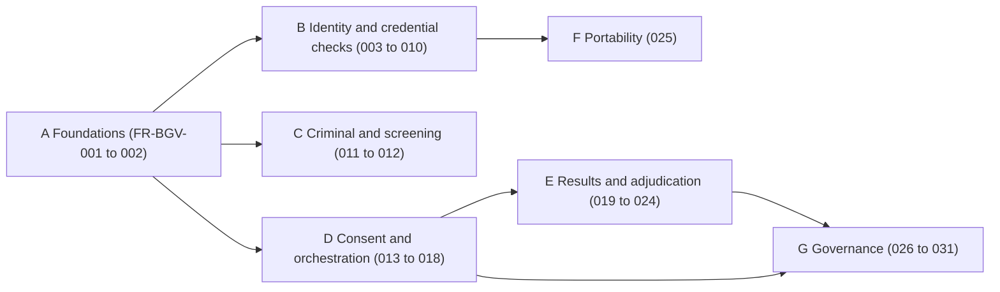
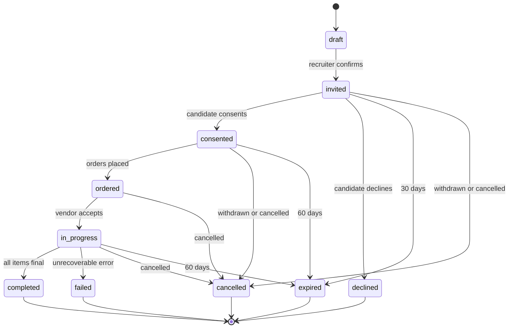
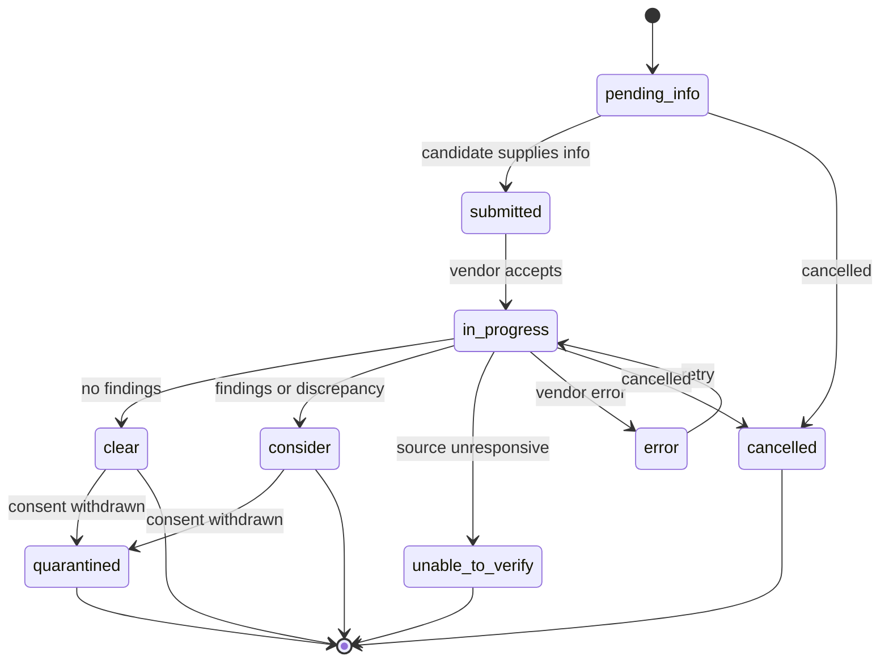
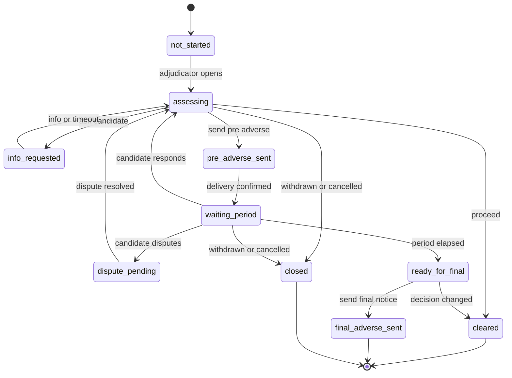
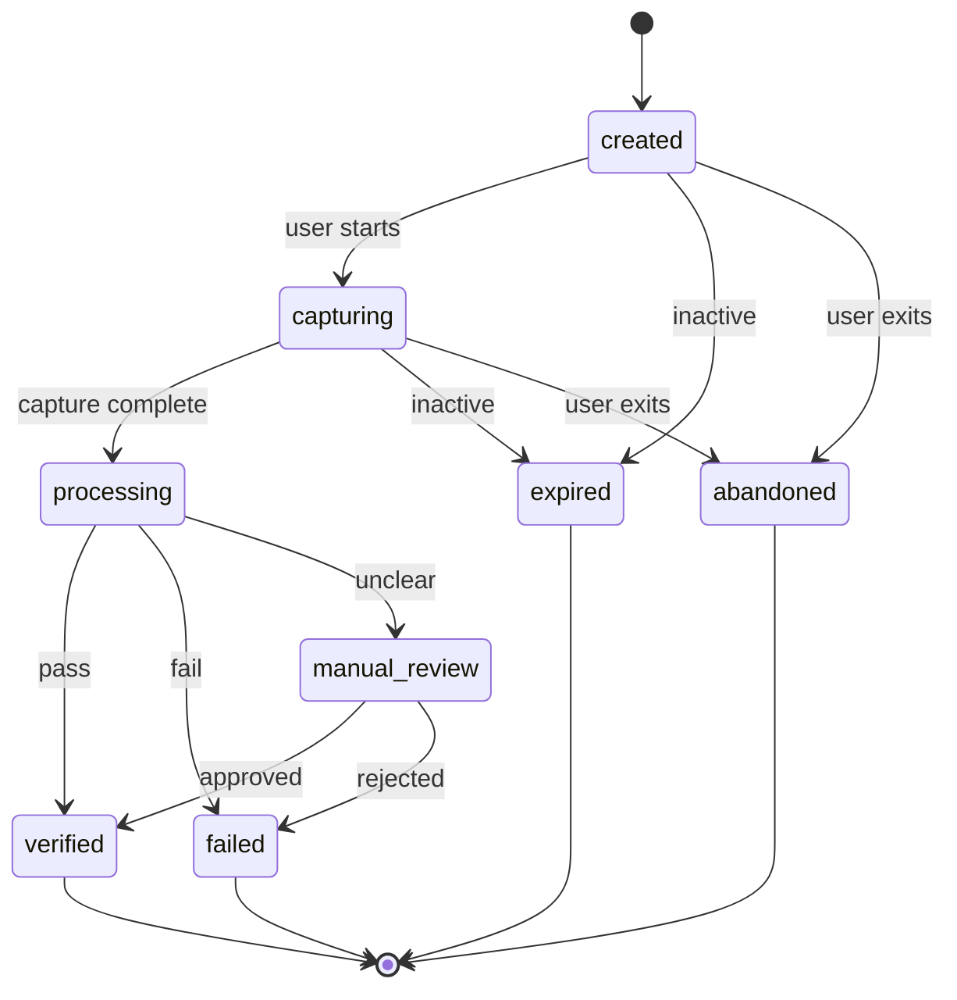
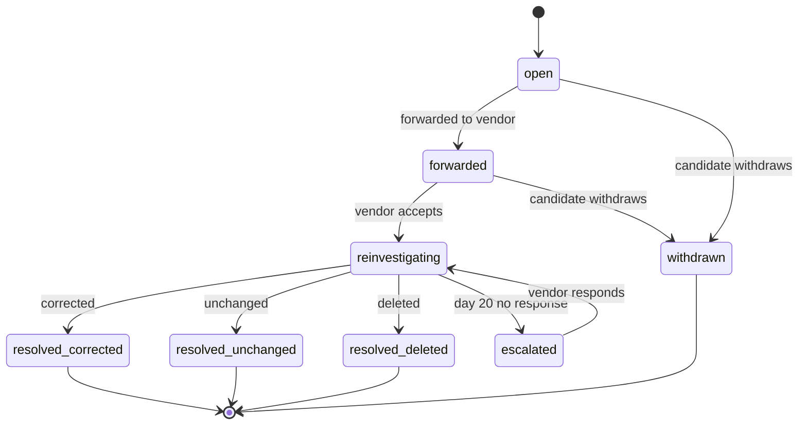
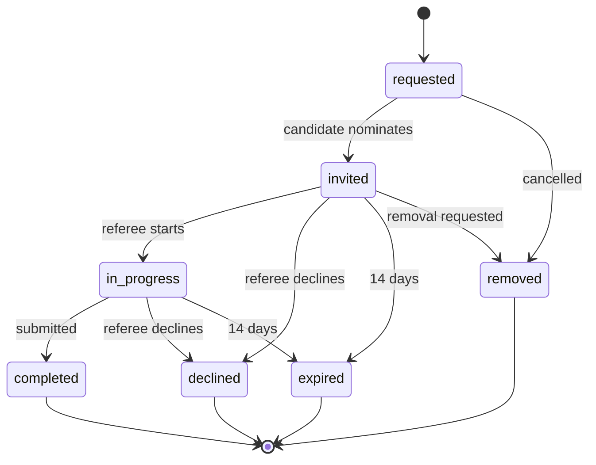
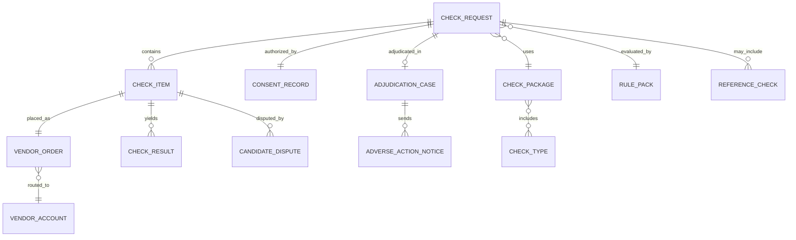

# BGV — Verification & Background Checks

> Status: intended product specification. Nothing here is a claim that anything is built. Legacy inputs: `SSOT.md` F-81 Identity Verification (Ph9, priority 3), F-94, §3.2 invariants, §4.2 non-goals, §13.3 integration register (IDV vendor, OD-27), §15 privacy. The legacy corpus has no specification for criminal or background checks; everything about them below is `[PROP]` or `[DER]` and **requires legal review per jurisdiction before build** (OD-BGV-01).

## 1. Purpose, outcomes and boundaries

### 1.1 Purpose

BGV runs **formal, consent-based verification checks** that an employer or a candidate orders: identity, education, employment, references, professional licenses, right to work, criminal records and (narrowly) sanctions screening. BGV orchestrates vendors, captures consent, enforces jurisdiction rules, delivers results to the right people only, supports adjudication and adverse-action steps, handles candidate disputes, and applies retention. BGV is **not** a hiring decision engine: people decide.

### 1.2 Outcomes

1. A candidate is never checked without informed, specific consent, and always knows what is being checked, by whom, why and how to dispute it.
2. An employer can run the checks a role legitimately needs, at the point in the process the law allows, without handling raw vendor systems.
3. Sensitive results reach only the people authorized to decide, and never flow into profiles, search, matching or analytics.
4. A candidate can get identity or education verified once and reuse it with consent.
5. Every consent, order, view, decision and notice is auditable.

### 1.3 In scope, out of scope, owned vs consumed

| Area                                                                  | Owned by BGV | Not owned (owner)                                                 |
| --------------------------------------------------------------------- | ------------ | ----------------------------------------------------------------- |
| Check catalog, packages, jurisdiction rule packs                      | Yes          | Role and requisition definition: ATS (planned)                    |
| Identity verification and the opt-in identity badge                   | Yes          | Account login, MFA, KYC for payouts: IDN, BIL (planned)           |
| Employer-ordered education, employment, license, right-to-work checks | Yes          | Candidate-initiated work history verification and references: EVD |
| Employer-initiated reference checks and referee forms                 | Yes          | Candidate-solicited references shown on profile: EVD              |
| Criminal and sanctions screening orders via vendors                   | Yes          | None; no in-house data source                                     |
| Consent capture for checks, disclosures                               | Yes          | Global consent ledger: SET (planned) receives records             |
| Adjudication, pre-adverse and adverse action workflow, disputes       | Yes          | Final hiring decision and offer: ATS (planned)                    |
| Vendor adapters, webhooks, cost and billing hooks                     | Yes          | Plans, invoices, payments: BIL (planned)                          |
| Retention and disposal of check data                                  | Yes          | Platform-wide DSAR orchestration: SET (planned)                   |

**Consumed:** applications and stages (JOB, ATS planned), employer organizations and seats (EMP planned), candidate profile name/location (PRF), prior verified work history and education (EVD), notifications (NTF), billing (BIL), audit and tooling (ADM).

### 1.4 Non-goals and hard boundaries

- BGV results **never** appear on profiles, in search, matching, recommendations, reputation or analytics (BR-BGV-013, BR-BGV-038). The only candidate-facing public artifact is the opt-in "Identity verified" mark.
- No continuous monitoring, no credit checks, no social-media screening in this scope (OD-BGV-04, OD-BGV-05).
- The platform has no proprietary record database; it only orders from approved vendors.
- This conflicts with `SSOT.md` §4.2 non-goal "not generic HR"? Background screening is part of hiring, not HR administration; specified narrowly. See OD-BGV-02.

## 2. Roles and permission matrix

`Y` allowed, `-` not allowed, `A` with audit, `S` status only (no result content), `C` own checks only.

| Capability                                                     | CAN/STD/FRL  | REC                        | HMG                        | EAD                        | IAD/PLO                     | MOD | SUP      | PAD               | SAD             | API (vendor) |
| -------------------------------------------------------------- | ------------ | -------------------------- | -------------------------- | -------------------------- | --------------------------- | --- | -------- | ----------------- | --------------- | ------------ |
| View check catalog and what is checked about me                | C            | -                          | -                          | -                          | -                           | -   | -        | Y                 | Y               | -            |
| Configure packages and role policies for the org               | -            | -                          | -                          | Y                          | -                           | -   | -        | Y                 | Y               | -            |
| Initiate a check request for a candidate                       | -            | Y (permitted stage)        | Y (if delegated)           | Y                          | -                           | -   | -        | -                 | -               | -            |
| Give or decline consent                                        | C            | -                          | -                          | -                          | -                           | -   | -        | -                 | -               | -            |
| Provide information for a check                                | C            | -                          | -                          | -                          | -                           | -   | -        | -                 | -               | -            |
| See check status                                               | C            | S                          | S                          | S                          | -                           | -   | S (case) | Y                 | Y               | -            |
| View result content                                            | C (own copy) | A (adjudicator permission) | A (adjudicator permission) | A (adjudicator permission) | -                           | -   | -        | -                 | A (break-glass) | -            |
| Record adjudication and send adverse action notices            | -            | Y (adjudicator)            | Y (adjudicator)            | Y                          | -                           | -   | -        | -                 | -               | -            |
| Dispute a result                                               | C            | -                          | -                          | -                          | -                           | -   | -        | -                 | -               | -            |
| Post vendor results and status                                 | -            | -                          | -                          | -                          | -                           | -   | -        | -                 | -               | Y            |
| Manage vendors, rule packs, retention schedules                | -            | -                          | -                          | -                          | -                           | -   | -        | Y (dual approval) | Y               | -            |
| Institution-ordered verification of own students (credentials) | -            | -                          | -                          | -                          | Y (education/identity only) | -   | -        | -                 | -               | -            |
| Run reports on checks (aggregate)                              | -            | -                          | -                          | Y (own org)                | Y (own inst)                | -   | -        | Y                 | Y               | -            |

"Adjudicator permission" is an organization-level capability granted by EAD to named users (default: none). Support agents never see result content. Staff access to results is break-glass with a case reason and dual notification (BR-BGV-034).

## 3. Sub-module map

| Sub-module | Name                               | Features          |
| ---------- | ---------------------------------- | ----------------- |
| A          | Foundations: catalog and rules     | FR-BGV-001 to 002 |
| B          | Identity and credential checks     | FR-BGV-003 to 010 |
| C          | Criminal and screening checks      | FR-BGV-011 to 012 |
| D          | Consent and orchestration          | FR-BGV-013 to 018 |
| E          | Results, adjudication and disputes | FR-BGV-019 to 024 |
| F          | Portability                        | FR-BGV-025        |
| G          | Governance                         | FR-BGV-026 to 031 |

## 4. Feature specifications

### Sub-module A: Foundations

### FR-BGV-001 — Check catalog and packages

- **Sub-module:** A Foundations
- **Priority / tier:** Must · R4
- **Source:** [PROP]; relates to SSOT §13.3 (IDV vendor outbound integration)
- **Purpose and outcome:** The platform defines which check types exist and which employers may bundle into packages for roles. Success is a catalog where every type declares what it collects, what it returns, where it is allowed, and how long it takes.
- **Roles and permissions:** `PAD: define check types, enable per country` · `EAD: build packages from enabled types` · `REC/HMG: select an approved package` · `CAN: view what a package contains`
- **Preconditions and entry points:** At least one vendor adapter enabled for a country. Entry: Admin "Check catalog"; Employer settings "Screening packages".
- **User interactions and actions:**
  1. PAD defines a check type: key (identity, education, employment, reference, license, right_to_work, criminal_county, criminal_national, sanctions), description in candidate language, data required from candidate, data returned, typical turnaround, countries and vendors supported, rule-pack requirement.
  2. EAD creates a package (name, included types, role families it applies to, price estimate shown).
  3. REC selects the package when initiating a check; candidate sees the same contents on the consent screen.
- **System behaviour:** A type is selectable only if (a) enabled by PAD, (b) a vendor supports the candidate's country, and (c) a jurisdiction rule pack exists and permits it (FR-BGV-002). Packages are versioned; initiated requests pin the package version. Employers cannot add types outside the enabled catalog (BR-BGV-004).
- **UI elements and controls:** Catalog table with country matrix, type editor, package builder with drag-in types, price estimate, version history.
- **Configuration options:** Platform: types enabled per country. Org: packages per role family; default package (none).
- **Business rules:** BR-BGV-003, BR-BGV-004, BR-BGV-022.
- **Validation:** package must contain ≥ 1 type; at most 8 types; package name unique per org; types must be enabled in every country the package is used (checked at initiation).
- **Inputs and outputs:** In: type definitions, package definitions. Out: catalog and package records.
- **Filters, sorting, search:** Filter catalog by country, type, vendor.
- **Notifications and communication:** PAD alert when a vendor withdraws support for a type.
- **Error handling and edge cases:** Type removed while packages use it → packages flagged `needs_update`, pending requests continue on pinned version. Country unsupported → package unavailable with reason.
- **Dependencies:** FR-BGV-002, FR-BGV-016, ENT-BGV-01, ENT-BGV-02, EMP (planned).
- **Security and privacy:** Catalog is non-sensitive; changes audited.
- **Acceptance criteria:**
  1. Given a package with identity and education, when a recruiter initiates it for a supported country, then both checks appear on the consent screen.
  2. Given a type not enabled for a country, when a recruiter tries to include it, then it is unavailable.
  3. Given an EAD attempts to add a type outside the catalog via API, when posted, then rejected. (negative)

### FR-BGV-002 — Jurisdiction rule engine

- **Sub-module:** A Foundations
- **Priority / tier:** Must · R4
- **Source:** [PROP]; [DEC-REQ] legal validation (OD-BGV-01)
- **Purpose and outcome:** Each check is evaluated against the rules of the candidate's and employer's jurisdictions (timing, scope, disclosures, notices, lookback, retention). Success is that a prohibited check cannot be ordered.
- **Roles and permissions:** `PAD (compliance reviewer): author and publish rule packs with dual approval` · `system: evaluate` · `EAD/REC: see the reason a check is blocked`
- **Preconditions and entry points:** Rule packs published for relevant jurisdictions. Entry: evaluated on every initiation, consent and order.
- **User interactions and actions:**
  1. Recruiter selects a package; the system evaluates and shows allowed, blocked (reason) or allowed with conditions (e.g., "only after conditional offer", "state notice required").
  2. Compliance reviewer edits a rule pack in the admin console: sets fields, previews against test cases, requests approval.
- **System behaviour:** A rule pack is a versioned declarative document per jurisdiction (country, region, city) with: permitted check types, earliest permitted stage (e.g., `after_conditional_offer`), required disclosures (templates), consent form requirements, lookback limit, convictions-only or arrests allowed, excluded record classes (sealed, expunged, juvenile), pre-adverse waiting period, mandatory notices, salary-threshold exemptions, retention min/max, language requirements. Evaluation considers the candidate's residence and work location and the employer's location; the strictest applicable rule wins (BR-BGV-005). Unknown jurisdiction → blocked for sensitive checks. Rule pack changes need two approvals and an effective date; requests in flight keep their pinned version except where law requires otherwise (flagged for manual review). Example rule classes for US (FCRA-style disclosure and adverse-action sequence, state and local fair-chance timing), EU/UK (restrictions on criminal-offence data; use of official certificates supplied by the candidate), and others are authored with counsel; nothing here asserts a specific legal requirement.
- **UI elements and controls:** Rule pack editor (structured form, not free text), test-case runner, approval workflow, evaluation result panel on initiation.
- **Configuration options:** Platform: rule packs, effective dates. Org: none (employers cannot loosen rules).
- **Business rules:** BR-BGV-003, BR-BGV-005, BR-BGV-036.
- **Validation:** rule pack schema; effective date in future; two distinct approvers; all required templates present.
- **Inputs and outputs:** In: candidate residence, employer location, role location, check types, stage. Out: allowed or blocked decision with conditions and reasons.
- **Filters, sorting, search:** Rule pack list by jurisdiction and status.
- **Notifications and communication:** Notify EAD when a rule change affects their packages.
- **Error handling and edge cases:** Conflicting packs (candidate in one jurisdiction, role in another) → strictest rule; ties logged. Rule engine unavailable → ordering blocked (fail closed). Candidate relocates mid-process → re-evaluation required before ordering.
- **Dependencies:** ENT-BGV-03, FR-BGV-013, legal counsel process (outside the product).
- **Security and privacy:** Rule packs are non-sensitive but audited; evaluation inputs (address) are Restricted and not logged in plain text.
- **Acceptance criteria:**
  1. Given a rule pack requiring a conditional offer for criminal checks, when a recruiter initiates one at the screening stage, then the system blocks it with the reason.
  2. Given a candidate in region A and employer in region B, when evaluated, then the stricter lookback applies.
  3. Given the rule engine is down, when a recruiter tries to order, then ordering is refused (fail closed). (negative)

### Sub-module B: Identity and credential checks

### FR-BGV-003 — Identity verification

- **Sub-module:** B Identity and credential checks
- **Priority / tier:** Should · R4
- **Source:** [SRC: SSOT F-81 Identity Verification (Ph9, priority 3); §13.3 IDV vendor, OD-27] and [PROP] flow design
- **Purpose and outcome:** A person proves they are the owner of a government-issued identity using document capture and a liveness check through a vendor. Success is an identity assurance result usable for the badge (FR-BGV-004) and for employer checks.
- **Roles and permissions:** `CAN/STD/FRL: start own` · `REC/HMG/EAD: request identity check for a candidate with consent` · `system: results`
- **Preconditions and entry points:** Signed-in user; vendor available in country. Entry: Settings "Verify your identity"; consent screen of an employer package.
- **User interactions and actions:**
  1. User reads what will be collected (document image, selfie/liveness video) and the vendor name; ticks explicit biometric consent; presses "Start".
  2. User selects country and document type (passport, national ID, driving license, residence permit).
  3. Vendor SDK or hosted page guides capture of document front/back and a liveness check.
  4. User sees "Processing" then Verified, Needs review, or Failed with reasons and next steps.
  5. User may choose "Verify another way" (manual review by uploading documents to the vendor review, or in-person where available).
- **System behaviour:** The platform creates a session with the vendor adapter (SM-BGV-04), redirects the user to the vendor-hosted flow, and receives a signed webhook with a result and an assurance level (document authentic, face match, liveness, data match to profile name and date of birth). The platform stores the **result** (assurance level, document type, country, date, vendor reference) and the verified legal name hash, not the document images or biometrics (BR-BGV-014). Name mismatch with the PRF name → user is asked to update the profile or add an alias (never auto-edited). Retry limit 3 per 24 h. Under-age subjects are not eligible for employer-ordered checks (BR-BGV-033).
- **UI elements and controls:** Consent screen with checkboxes (separate biometric consent), country and document selects, vendor-hosted capture, status page, "Verify another way" link.
- **Configuration options:** Platform: vendors, assurance level required, retry limits.
- **Business rules:** BR-BGV-001, BR-BGV-002, BR-BGV-014, BR-BGV-024, BR-BGV-033.
- **Validation:** document type valid for country; document not expired; age ≥ 18 for employer-ordered; consent present before session creation.
- **Inputs and outputs:** In: consent, country, document type. Out: assurance result record.
- **Filters, sorting, search:** n/a — single session; history list on settings.
- **Notifications and communication:** Result email and in-app (template `bgv.identity.result`, transactional).
- **Error handling and edge cases:** Poor image quality → vendor prompts retake. Document unsupported → "Verify another way". Vendor timeout (15 min) → session `expired`, retry allowed. Suspected fraud → `manual_review`, user told only "needs review". Biometric consent declined → alternative manual path offered; no penalty displayed to employers except "identity not verified".
- **Dependencies:** FR-BGV-016 (adapter), ENT-BGV-14, ENT-BGV-15, IDN (planned).
- **Security and privacy:** Biometric and document data stay with the vendor under contract limits; the platform keeps only the result; sessions logged; no use of the result for ranking.
- **Acceptance criteria:**
  1. Given a valid passport and liveness pass, when the vendor posts a verified result, then the user sees Verified and an assurance record exists without images.
  2. Given the user declines biometric consent, when proceeding, then the manual alternative is offered and no session is created with the biometric flow.
  3. Given an expired document, when submitted, then it is rejected before sending to the vendor. (negative)

### FR-BGV-004 — Verified identity badge and reuse

- **Sub-module:** B Identity and credential checks
- **Priority / tier:** Should · R4
- **Source:** [SRC: SSOT F-81] and [PROP]
- **Purpose and outcome:** A verified person may show an "Identity verified" mark and reuse the result with employers instead of repeating checks. Success is a user-controlled mark and share action.
- **Roles and permissions:** `CAN/STD/FRL: show/hide mark, share with employer` · `REC/HMG: see mark if shown; receive shared result summary`
- **Preconditions and entry points:** Identity assurance record valid. Entry: Settings > Identity; profile privacy tab; employer consent screen "Use my verified identity".
- **User interactions and actions:**
  1. Toggle "Show Identity verified on my profile" (default off).
  2. When an employer requests identity verification, choose "Share my existing verification" or "Verify again".
  3. See the sharing log and revoke future sharing.
- **System behaviour:** The mark shows "Identity verified" with date and method class (document + liveness) and nothing else. Validity 24 months `[PROP]` or until legal-name change flagged by PRF; expired marks disappear and the user is prompted. Sharing with an employer creates a consent record naming the employer and purpose and gives the employer an assurance summary (level, date, name match yes/no), not documents. Reuse requires the assurance level to meet the employer's package minimum; otherwise a new check is required.
- **UI elements and controls:** Toggle, validity date, "Share" dialog, sharing log, "Verify again" button.
- **Configuration options:** Platform: validity (24 months), minimum levels. User: show mark.
- **Business rules:** BR-BGV-015, BR-BGV-016, BR-BGV-013.
- **Validation:** assurance record valid and unexpired; share recipient is a verified employer organization.
- **Inputs and outputs:** In: toggle, share choice. Out: mark state and shared summary.
- **Filters, sorting, search:** SRC may offer a recruiter facet "Identity verified" only for users who chose to show the mark (FR-SRC-023).
- **Notifications and communication:** Expiry reminder 30 days before (class `account_activity`).
- **Error handling and edge cases:** Legal name changed on profile → mark suspended until re-verified. Vendor reports document revoked → mark removed. User hides mark → search facet stops matching immediately.
- **Dependencies:** FR-BGV-003, PRF (FR-PRF-032), ENT-BGV-15.
- **Security and privacy:** Mark exposes no personal data; shares are consent-based and logged; employers cannot see the user's other checks.
- **Acceptance criteria:**
  1. Given the toggle on, when the profile loads, then "Identity verified" appears with date only.
  2. Given the assurance record expired, when viewed, then the mark is absent and a prompt is shown.
  3. Given the toggle off, when a recruiter filters by identity verified, then the user is excluded. (negative)

### FR-BGV-005 — Education verification

- **Sub-module:** B Identity and credential checks
- **Priority / tier:** Should · R4
- **Source:** [PROP]; relates to SSOT F-94, F-52
- **Purpose and outcome:** An employer confirms a candidate's degree or program with the institution or a registry. Success is a result of Verified, Discrepancy or Unable to verify.
- **Roles and permissions:** `REC/HMG/EAD: order with consent` · `CAN: consent, provide details` · `IAD: respond to platform-routed institution requests`
- **Preconditions and entry points:** Package includes education; consent given. Entry: check request.
- **User interactions and actions:**
  1. Candidate confirms the education entries to be checked (institution, degree, dates, student id optional) and consents.
  2. System attempts, in order: (a) reuse of a valid EVD verification issued by an institution (FR-EVD-022 institution class) or platform-issued credential, (b) registry or clearinghouse lookup via the vendor, (c) institution contact request.
  3. Candidate and employer see status; result appears when complete.
- **System behaviour:** Each education entry becomes a `CheckItem`. Results: `verified` (degree, field, dates match), `discrepancy` (lists mismatching fields, no judgment), `unable_to_verify` (institution closed, no response after 15 business days `[PROP]`), `in_progress`. A discrepancy goes first to the candidate for explanation before the employer sees it as "discrepancy" (BR-BGV-007 step); minor differences (name format, abbreviations) are normalized. Results are written back to EVD as institution-class evidence only if the candidate agrees (FR-BGV-025).
- **UI elements and controls:** Entry confirmation list, consent checkbox, status chips, discrepancy explanation form (candidate), result card (employer).
- **Configuration options:** Platform: normalization rules, SLA. Org: package inclusion.
- **Business rules:** BR-BGV-001, BR-BGV-016, BR-BGV-017, BR-BGV-023.
- **Validation:** entries have institution and degree; dates plausible; student id optional.
- **Inputs and outputs:** In: entries, consent. Out: per-entry result.
- **Filters, sorting, search:** Org check list filter by result and age.
- **Notifications and communication:** Candidate: request and result; employer: completion (class `hiring_updates`).
- **Error handling and edge cases:** Institution requires fee or student authorization → candidate prompted to provide a release letter. Foreign institution → vendor with country support or marked unable. Duplicate entries → merged.
- **Dependencies:** EVD (FR-EVD-016, FR-EVD-022), FR-BGV-016, PRF entries.
- **Security and privacy:** Only the checked entries are sent; student ids encrypted; results restricted by BR-BGV-012.
- **Acceptance criteria:**
  1. Given an institution-issued credential in EVD, when ordered, then the check completes by reuse without a vendor call.
  2. Given a mismatch of graduation year, when found, then the candidate is asked to explain before the employer sees a discrepancy.
  3. Given no consent, when a recruiter orders, then the order is refused. (negative)

### FR-BGV-006 — Employment verification

- **Sub-module:** B Identity and credential checks
- **Priority / tier:** Must · R4
- **Source:** [SRC: SSOT F-94 "Employment verification < 7d"]; [PROP] employer-initiated flow
- **Purpose and outcome:** An employer verifies a candidate's employment history during hiring, reusing existing verification when valid. Success is a per-role result.
- **Roles and permissions:** `REC/HMG/EAD: order with consent` · `CAN: consent, select roles` · `verifier: respond via EVD portal or vendor`
- **Preconditions and entry points:** Package includes employment; consent given.
- **User interactions and actions:**
  1. Candidate picks which roles may be verified (default last 7 years `[PROP]`; "current employer" is off by default and needs explicit permission, BR-BGV-020).
  2. System reuses EVD verified records meeting acceptance rules (employer_org class, verified within 12 months, facts match the PRF entry); otherwise it sends a verification request through the EVD responder portal (FR-EVD-009) or the vendor's data network.
  3. Employer sees per-role result and facts (title, dates), no free-text from verifiers beyond what the package allows.
- **System behaviour:** Each role is a `CheckItem`; results `verified`, `discrepancy`, `unable_to_verify`. Verification via the EVD portal reuses SM-EVD-02 with a BGV-context flag so the verifier sees "requested by a prospective employer" only if the candidate agreed to disclose the prospective employer's name (BR-BGV-020). Employers do not get salary or reason for leaving (EVD BR-EVD-013). Results may be written to EVD with candidate agreement.
- **UI elements and controls:** Role selector with "current employer" switch and warning text, result table, discrepancy path as in FR-BGV-005.
- **Configuration options:** Org: lookback years (default 7), acceptance window for reuse (12 months). Platform: limits.
- **Business rules:** BR-BGV-001, BR-BGV-016, BR-BGV-017, BR-BGV-020.
- **Validation:** roles belong to the candidate's PRF entries; at most 10 roles per request.
- **Inputs and outputs:** In: role selection, consent. Out: per-role results.
- **Filters, sorting, search:** Filter by role result.
- **Notifications and communication:** Verifier request (EVD template), candidate and employer updates.
- **Error handling and edge cases:** Employer defunct → `unable_to_verify` with peer alternative suggested. Verifier says dates differ → `discrepancy` and candidate explanation step. Candidate removes a role from the selection → no check for it.
- **Dependencies:** EVD (FR-EVD-008, 009), FR-BGV-016.
- **Security and privacy:** Current employer is never contacted without permission; verifier doesn't see other candidate data.
- **Acceptance criteria:**
  1. Given a role verified in EVD 3 months ago by an employer_org verifier, when ordered, then the check returns verified by reuse.
  2. Given "current employer" is off, when the check runs, then the current employer is not contacted.
  3. Given a request that selects a role not on the candidate's profile, when submitted, then rejected. (negative)

### FR-BGV-007 — Reference check (employer-initiated)

- **Sub-module:** B Identity and credential checks
- **Priority / tier:** Should · R4
- **Source:** [SRC: SSOT F-94 "Referee system"] and [PROP] employer-initiated, confidential
- **Purpose and outcome:** A hiring team collects structured references from referees the candidate nominated. Success is completed questionnaires visible only to the hiring team.
- **Roles and permissions:** `REC/HMG: request, view completed` · `CAN: nominate referees, consent` · `referee: respond`
- **Preconditions and entry points:** Candidate at a permitted stage; package includes reference check.
- **User interactions and actions:**
  1. Recruiter selects a questionnaire template (peer, manager, direct report) from the approved set (≤ 12 questions).
  2. Candidate nominates 2–4 referees (name, email, relationship, organization) and consents.
  3. Referees receive an invitation (FR-BGV-008).
  4. Recruiter sees completed responses with a summary header (relationship, duration).
- **System behaviour:** SM-BGV-06 per referee. Only candidate-nominated referees are contacted (BR-BGV-019); the employer cannot add "off-list" referees through the platform. Referees cannot be the candidate or share the candidate's email domain unless a documented organization (BR-EVD-012 applies). Questionnaires exclude protected-attribute topics (shared with EVD BR-EVD-032). Responses are confidential to the hiring team and are not copied into the candidate's EVD (unless the referee and candidate both agree, FR-BGV-025). The candidate can see which referees completed but not their answers unless the employer's policy and the referee's consent allow.
- **UI elements and controls:** Template picker, referee nomination form, status list, response viewer.
- **Configuration options:** Org: approved templates, minimum referees (default 2). Platform: template library.
- **Business rules:** BR-BGV-001, BR-BGV-019, BR-BGV-020.
- **Validation:** 2–4 referees; distinct emails; relationship required.
- **Inputs and outputs:** In: template, referees. Out: responses.
- **Filters, sorting, search:** Filter responses by referee type.
- **Notifications and communication:** Referee invite and reminders (day 3, 6), candidate and recruiter updates.
- **Error handling and edge cases:** Referee declines → status `declined`; candidate may nominate another. No responses by day 10 → recruiter alerted. Referee asks for removal → deleted.
- **Dependencies:** FR-BGV-008, EVD rules, ENT-BGV-16.
- **Security and privacy:** Referee personal data minimized and deleted with the request per retention; responses restricted.
- **Acceptance criteria:**
  1. Given three nominated referees who complete the form, when viewed, then the recruiter sees three responses.
  2. Given the recruiter tries to add an extra referee not nominated, when saving, then rejected.
  3. Given a referee using the candidate's own email, when nominating, then rejected. (negative)

### FR-BGV-008 — Referee response form (hiring context)

- **Sub-module:** B Identity and credential checks
- **Priority / tier:** Should · R4
- **Source:** [DER]
- **Purpose and outcome:** Referees answer a hiring questionnaire quickly with clear disclosure of who will see it. Success is a signed response.
- **Roles and permissions:** `referee (token): respond`
- **Preconditions and entry points:** Invitation link `/bgv/ref/:token`.
- **User interactions and actions:**
  1. Read disclosure: who asked (organization name if candidate allowed, else "a prospective employer"), who sees answers, retention, right to decline.
  2. Confirm relationship and period.
  3. Answer the questions; select rating scales with example text for extremes.
  4. Choose "Allow the candidate to see my answers" (optional).
  5. Submit.
- **System behaviour:** Identity proof by email code. Response is immutable after submission except one correction within 7 days. The page is `noindex`, uses no third-party scripts, and shows an explicit "Decline to answer" button. Abusive text triggers review (TSF planned).
- **UI elements and controls:** Disclosure panel, relationship fields, rating radios, text fields, consent checkbox, Submit, Decline.
- **Configuration options:** Platform: languages, template library.
- **Business rules:** BR-BGV-019, BR-BGV-002.
- **Validation:** required questions; text ≤ 1000 chars per answer.
- **Inputs and outputs:** In: answers. Out: response record.
- **Filters, sorting, search:** n/a.
- **Notifications and communication:** Confirmation to referee.
- **Error handling and edge cases:** Token expired → request new link via candidate. Code mismatch × 5 → lock 30 min. Referee tries to submit twice → second as correction within 7 days or rejected.
- **Dependencies:** FR-BGV-007.
- **Security and privacy:** As above; referee email stored hashed after completion.
- **Acceptance criteria:**
  1. Given a valid token, when the referee submits all required answers, then the response is recorded and confirmation shown.
  2. Given "Decline", when pressed, then the status becomes declined without answers.
  3. Given a submission 9 days later, when sent as a correction, then it is refused. (negative)

### FR-BGV-009 — Professional license verification

- **Sub-module:** B Identity and credential checks
- **Priority / tier:** Could · R4
- **Source:** [PROP]
- **Purpose and outcome:** Verify licenses (nursing, engineering, legal, financial) against the issuing authority. Success is a result with status (active, expired, suspended, revoked) and expiry.
- **Roles and permissions:** `REC/HMG/EAD: order with consent` · `CAN: consent, provide license number`
- **Preconditions and entry points:** Package includes license; vendor or authority registry adapter available.
- **User interactions and actions:**
  1. Candidate confirms license type, issuing authority, number.
  2. Consent; system queries the registry via adapter.
  3. Employer sees status, expiry and any public disciplinary flag if the registry returns it and the rule pack allows.
- **System behaviour:** Results saved as `CheckItem`; adapters per authority return normalized status. Public disciplinary actions are shown only if returned by an official source and allowed by the rule pack; they are never summarized by AI. The result may be written to EVD as a credential import with `authority_verified` (class institution) if the candidate agrees.
- **UI elements and controls:** License form, consent, result card.
- **Configuration options:** Platform: supported authorities.
- **Business rules:** BR-BGV-001, BR-BGV-017.
- **Validation:** license number format per authority; country supported.
- **Inputs and outputs:** In: license data, consent. Out: normalized status.
- **Filters, sorting, search:** Filter by status.
- **Notifications and communication:** Result updates.
- **Error handling and edge cases:** Registry down → pending with retry; name mismatch → candidate explanation.
- **Dependencies:** FR-BGV-016, EVD.
- **Security and privacy:** License numbers encrypted; results restricted.
- **Acceptance criteria:**
  1. Given an active license, when queried, then the result shows active with expiry.
  2. Given the registry returns a public disciplinary flag, when the rule pack allows it, then the flag is shown verbatim.
  3. Given no consent, when ordering, then refused. (negative)

### FR-BGV-010 — Right-to-work verification

- **Sub-module:** B Identity and credential checks
- **Priority / tier:** Could · R4
- **Source:** [PROP]
- **Purpose and outcome:** An employer confirms a candidate may legally work in the country of employment through methods allowed there. Success is a recorded outcome without collecting more than required.
- **Roles and permissions:** `EAD/REC (authorized): initiate` · `CAN: provide share code or documents`
- **Preconditions and entry points:** Employer has a legal basis (job in a supported country) and the rule pack allows it at this stage; typically after a conditional offer.
- **User interactions and actions:**
  1. Employer initiates "Right to work".
  2. Candidate follows the method for the country (government share-code check, document upload through vendor, or manual in-person document check recorded by the employer).
  3. Outcome: Eligible (with end date if any), Not eligible, Needs follow-up.
- **System behaviour:** Collects only what the method requires; the outcome record has method, date, expiry and reviewer; document images are held by the vendor or employer system, not the platform, unless a country requires copy retention (rule pack). Reverification reminders sent to the employer before expiry. Non-discrimination notice displayed to the employer: the check applies to all hires, not selectively (BR-BGV-021).
- **UI elements and controls:** Method selector, instruction panel, outcome form, reminder settings.
- **Configuration options:** Platform: supported countries and methods.
- **Business rules:** BR-BGV-021, BR-BGV-001, BR-BGV-003.
- **Validation:** method valid for country; initiated by an authorized org role.
- **Inputs and outputs:** In: method data. Out: outcome record.
- **Filters, sorting, search:** Filter by expiry date.
- **Notifications and communication:** Reverification reminders to the employer, 60/30 days before expiry.
- **Error handling and edge cases:** Share code expired → candidate generates a new one. Employer requests before the allowed stage → blocked by rule engine. "Not eligible" → follows adjudication rules but is not criminal; the employer must handle per local law (information text).
- **Dependencies:** FR-BGV-002, FR-BGV-016.
- **Security and privacy:** Immigration status is highly sensitive; Restricted classification, minimal retention.
- **Acceptance criteria:**
  1. Given an eligible share code, when verified, then outcome eligible with end date is stored.
  2. Given the employer tries to start before the permitted stage, when initiating, then blocked.
  3. Given a candidate who declines to share documents, when the employer proceeds, then the outcome is "Needs follow-up" and no negative inference is stored. (negative)

### Sub-module C: Criminal and screening checks

### FR-BGV-011 — Criminal record check

- **Sub-module:** C Criminal and screening checks
- **Priority / tier:** Should · R4
- **Source:** [PROP]; [DEC-REQ] OD-BGV-01, OD-BGV-02
- **Purpose and outcome:** An employer orders a criminal record check through an approved vendor, lawfully scoped, with candidate consent. Success is a report to authorized adjudicators and a correct adjudication trail.
- **Roles and permissions:** `REC/HMG/EAD: order (adjudicator permission to view)` · `CAN: consent, provide required identifiers, receive copy`
- **Preconditions and entry points:** Package includes a criminal check; rule pack permits it at this stage; consent complete (FR-BGV-014); candidate age ≥ 18; identity verified or identity data supplied.
- **User interactions and actions:**
  1. Recruiter initiates only at permitted stage (system blocks earlier).
  2. Candidate completes identifiers on a vendor-hosted form (name, date of birth, addresses for the lookback, national id where required).
  3. Vendor performs searches per the rule pack scope (e.g., county, national, sex-offender registry where legally allowed).
  4. Report posted; recruiter with adjudicator permission opens it with a reason code; others see only status.
  5. Adjudication per FR-BGV-020.
- **System behaviour:** The order includes only scope allowed by the rule pack: record classes, lookback, convictions vs arrests, excluded sealed/expunged/juvenile (BR-BGV-005). Identifiers are entered on the vendor's hosted form so the platform doesn't store national ids (BR-BGV-024). The report is stored encrypted in a segregated store with field-level access (BR-BGV-025). The report is normalized to categories with raw vendor text preserved. Platform does not decide pass/fail (BR-BGV-006) and offers no automated scoring. Ordering is idempotent per (request, type). Results older than 90 days cannot be used for a decision (BR-BGV-028).
- **UI elements and controls:** Initiation dialog with rule evaluation result, vendor-hosted form link, status chips, report viewer with reason code prompt, watermark with viewer id.
- **Configuration options:** Platform: vendors, jurisdictions. Org: adjudicator users; packages.
- **Business rules:** BR-BGV-001, BR-BGV-003, BR-BGV-005, BR-BGV-006, BR-BGV-012, BR-BGV-013, BR-BGV-024, BR-BGV-025, BR-BGV-028, BR-BGV-033.
- **Validation:** rule evaluation allowed; consent valid and matching vendor and scope; identifiers complete per vendor.
- **Inputs and outputs:** In: request and consent. Out: vendor order, normalized report.
- **Filters, sorting, search:** Org list filter by status; reports not searchable by content.
- **Notifications and communication:** Candidate: request, status, and result copy; recruiter: completion (status only).
- **Error handling and edge cases:** Vendor returns "possible match" needing review → status `review_needed` and vendor performs identity-confirmation; candidate informed. Records outside the lookback are filtered out by the platform even if vendor returns them. Candidate refuses → request `declined`, employer notified only that the candidate declined; employer must apply uniform policy (information text).
- **Dependencies:** FR-BGV-002, 013, 014, 015, 016, 017, 019, 020.
- **Security and privacy:** Restricted data; encrypted; viewer identity watermark; access reason logged; no export from the platform except to the candidate.
- **Acceptance criteria:**
  1. Given permitted stage and valid consent, when ordered, then the vendor receives only the allowed scope.
  2. Given a vendor result containing a record older than the lookback, when processed, then it is excluded from the report shown.
  3. Given a recruiter without adjudicator permission, when opening the report, then access is denied and only status is visible. (negative)

### FR-BGV-012 — Sanctions and watchlist screening

- **Sub-module:** C Criminal and screening checks
- **Priority / tier:** Could · R5
- **Source:** [PROP]; [DEC-REQ] OD-BGV-04
- **Purpose and outcome:** Organizations required by law or policy (e.g., financial services) screen candidates against sanctions and regulatory lists. Success is a limited-scope check available only to attested organizations.
- **Roles and permissions:** `EAD: enable with attestation` · `REC: order` · `CAN: consent`
- **Preconditions and entry points:** Organization attests a regulatory basis for the role family; rule pack allows.
- **User interactions and actions:**
  1. EAD attests the legal basis and selects role families.
  2. Recruiter adds the screening to a package for those roles.
  3. Candidate consents; vendor screens; result: No match, Potential match (requires human confirmation).
- **System behaviour:** Only official sanctions and regulatory lists; no adverse-media or social-media scanning. A potential match is a lead, not a finding: it routes to human review with the vendor's evidence and gives the candidate a chance to respond before any adverse action (BR-BGV-007).
- **UI elements and controls:** Attestation form, package toggle, result card.
- **Configuration options:** Org: role families. Platform: lists, vendors.
- **Business rules:** BR-BGV-035, BR-BGV-006, BR-BGV-007.
- **Validation:** attestation present and reviewed by PAD; role family eligible.
- **Inputs and outputs:** In: identifiers. Out: match status.
- **Filters, sorting, search:** Filter by match status.
- **Notifications and communication:** As other checks.
- **Error handling and edge cases:** Common-name false positives → human confirmation using identifiers. List provider outage → pending.
- **Dependencies:** FR-BGV-016, FR-BGV-020.
- **Security and privacy:** Restricted data.
- **Acceptance criteria:**
  1. Given an attested org, when added to a package, then the candidate sees it on the consent screen.
  2. Given a potential match, when displayed, then it is labeled "Potential match, human review required".
  3. Given an org without attestation, when adding sanctions screening, then blocked. (negative)

### Sub-module D: Consent and orchestration

### FR-BGV-013 — Employer check request and fair-timing safeguards

- **Sub-module:** D Consent and orchestration
- **Priority / tier:** Must · R4
- **Source:** [PROP]
- **Purpose and outcome:** A hiring team starts checks from an application at the right stage with the right package. Success is a request that passes rule evaluation and reaches the candidate for consent.
- **Roles and permissions:** `REC/HMG (delegated): initiate` · `EAD: policy`
- **Preconditions and entry points:** Application at a permitted stage (ATS planned); org package for the role; candidate contact available. Entry: candidate card "Start checks".
- **User interactions and actions:**
  1. Recruiter presses "Start checks"; selects a package (default per role).
  2. System shows rule evaluation, estimated cost and turnaround.
  3. Recruiter confirms; candidate is invited to review and consent (FR-BGV-014).
- **System behaviour:** Creates a `CheckRequest` (SM-BGV-01) pinned to package and rule pack versions. Stage-gating: sensitive checks (criminal, right-to-work, sanctions) require the rule pack's earliest stage; the platform exposes `afterConditionalOffer` as an ATS stage flag (ATS planned). Org-level policy enforces "uniform application": the same package for all finalists in a role is a prompt, not a hard rule. Request expires if the candidate doesn't act within 30 days (BR-BGV-028). Duplicate active requests for the same application are blocked.
- **UI elements and controls:** Start checks dialog, package select, evaluation panel, cost estimate, confirm button.
- **Configuration options:** Org: default package per role family, delegation. Platform: expiry.
- **Business rules:** BR-BGV-003, BR-BGV-004, BR-BGV-028, BR-BGV-031.
- **Validation:** application active; package valid; no duplicate active request; org billing active (BIL).
- **Inputs and outputs:** In: application, package. Out: check request.
- **Filters, sorting, search:** Org list of requests filter by role, status, stage.
- **Notifications and communication:** Candidate invitation (email, template `bgv.request.invite`, transactional); reminders day 3, 7, 14.
- **Error handling and edge cases:** Candidate withdraws application → request cancelled and data purged per retention. Billing inactive → blocked. Package changed after request → new request required.
- **Dependencies:** ATS (planned), BIL (planned), FR-BGV-001, FR-BGV-002.
- **Security and privacy:** Request metadata is Confidential; audit entry on creation.
- **Acceptance criteria:**
  1. Given an application at the permitted stage, when a recruiter starts checks, then a request is created and the candidate is invited.
  2. Given an active request for the same application, when another is started, then rejected.
  3. Given an earlier stage than allowed for a criminal check, when starting, then blocked with reason. (negative)

### FR-BGV-014 — Candidate consent and disclosure capture

- **Sub-module:** D Consent and orchestration
- **Priority / tier:** Must · R4
- **Source:** [PROP]; consent as purpose-bound and versioned [SRC: SSOT §6 Consent; V61-16 (Proposed)]
- **Purpose and outcome:** The candidate gives clear, specific consent per check type, employer and vendor, after seeing a standalone disclosure. Success is an immutable consent record that gates every order.
- **Roles and permissions:** `CAN/STD/FRL: view, consent, decline, withdraw before order` · `system: enforce`
- **Preconditions and entry points:** Check request invited. Entry: email link `/checks/:id/consent`; "Checks" in candidate account.
- **User interactions and actions:**
  1. Candidate signs in (or verifies by one-time code if no account).
  2. Reads the standalone disclosure in their language: who is requesting, which checks, which vendor, what data is collected, how results are used, retention, how to dispute, rights (jurisdiction text from the rule pack).
  3. Checks a separate box per check type and a separate box for biometric (if identity), and optionally "Send me a copy of my report".
  4. Signs by typing their full name and pressing "I consent"; or presses "Decline".
  5. Can "Withdraw consent" until the order is placed; after that, "Request cancellation".
- **System behaviour:** Disclosure document is standalone (no other content, BR-BGV-002). The consent record stores: disclosure version hash, check types, employer, vendor list, jurisdiction pack version, timestamp, IP and device summary, signature text, language. Consent is valid for that request only; it expires with the request. The consent is mirrored to SET's consent ledger (planned). Employers cannot proceed until consent exists; an order is rejected if consent doesn't cover the type or the vendor (BR-BGV-001, BR-BGV-037). Decline is recorded neutrally; the employer sees "Candidate declined" and no other inference data.
- **UI elements and controls:** Disclosure viewer (scrollable, accessible, printable), per-check checkboxes, biometric checkbox, signature field, Consent/Decline buttons, language selector, "Download disclosure PDF".
- **Configuration options:** Platform: disclosure templates per rule pack and language.
- **Business rules:** BR-BGV-001, BR-BGV-002, BR-BGV-029, BR-BGV-037.
- **Validation:** all mandatory check boxes for requested types; signature equals account legal name approx. (case-insensitive match warning, not block); disclosure version current.
- **Inputs and outputs:** In: checkbox choices, signature. Out: consent record.
- **Filters, sorting, search:** Candidate list of consents by status.
- **Notifications and communication:** Copy of consent and disclosure to candidate (email, template `bgv.consent.copy`, transactional, cannot be disabled).
- **Error handling and edge cases:** Disclosure updated after invitation but before consent → new version shown. Candidate consents on a second device → idempotent. Candidate withdraws before ordering → request `cancelled`; no vendor call. Language not available → English plus notice and a request for translation `[PROP]`.
- **Dependencies:** SET consent ledger (planned), ENT-BGV-06, ENT-BGV-07.
- **Security and privacy:** IP and device stored for evidentiary value only (Confidential); consent records retained per BR-BGV-026.
- **Acceptance criteria:**
  1. Given a candidate ticks all boxes and signs, when submitted, then a consent record with disclosure version hash exists and the order is allowed.
  2. Given consent covers only identity, when a recruiter orders criminal, then the order is rejected.
  3. Given the candidate withdraws before placement, when the recruiter orders, then rejected with "consent withdrawn". (negative)

### FR-BGV-015 — Candidate check portal

- **Sub-module:** D Consent and orchestration
- **Priority / tier:** Must · R4
- **Source:** [PROP]
- **Purpose and outcome:** The candidate sees every check about them, supplies needed information, and tracks status. Success is no surprise: nothing runs that the candidate can't see.
- **Roles and permissions:** `CAN/STD/FRL: view own`
- **Preconditions and entry points:** At least one request. Entry: `/checks`.
- **User interactions and actions:**
  1. See a list of requests: employer, package, status, last update.
  2. Open a request: per-check status timeline, information still needed (button "Provide"), explanations of what each check is.
  3. Actions: Provide information, Explain a discrepancy, Withdraw consent (if before order), Request my report, Dispute a result, Contact support.
- **System behaviour:** Shows only candidate-appropriate information: statuses and, for completed checks, the candidate's own report copy (FR-BGV-023). Employer decisions are not shown except notices required by law (FR-BGV-021, FR-BGV-022). Timeline uses plain language ("Waiting for your previous employer to respond").
- **UI elements and controls:** Request list, detail timeline, action buttons, help panel.
- **Configuration options:** n/a.
- **Business rules:** BR-BGV-011, BR-BGV-025.
- **Validation:** n/a.
- **Inputs and outputs:** In: candidate inputs. Out: status views.
- **Filters, sorting, search:** Filter by status and employer.
- **Notifications and communication:** Status changes (in-app, email; transactional for legally required ones).
- **Error handling and edge cases:** No requests → empty state "No one has requested checks about you". Vendor delay → shows expected date and escalation contact.
- **Dependencies:** FR-BGV-014, FR-BGV-023.
- **Security and privacy:** Strong authentication (step-up) before showing reports.
- **Acceptance criteria:**
  1. Given an active request, when opened, then each check shows its status.
  2. Given a completed criminal check, when opened, then the candidate can view their copy after step-up auth.
  3. Given another user's request id, when requested, then 404. (negative)

### FR-BGV-016 — Vendor adapter framework

- **Sub-module:** D Consent and orchestration
- **Priority / tier:** Must · R4
- **Source:** [SRC: SSOT §13.4 integration layer doctrine (ADR-009), §13.3 IDV vendor]; [PROP] interface
- **Purpose and outcome:** Vendors plug in behind one interface so vendors can be added, swapped or removed without changing product flows. Success is vendor-independent orders and results.
- **Roles and permissions:** `PAD: configure vendors (dual approval)` · `SAD: approve contracts and keys` · `system: call`
- **Preconditions and entry points:** Vendor contracted and security reviewed. Entry: Admin "Vendors".
- **User interactions and actions:**
  1. PAD registers a vendor: name, countries, check types, capabilities, data residency, retention terms, endpoints, webhook secret, test credentials.
  2. PAD runs the vendor test suite (sandbox orders, webhook replay).
  3. PAD enables the vendor for countries/types after dual approval; sets priority and failover rules.
- **System behaviour:** Adapter interface: `createOrder`, `getStatus`, `cancelOrder`, `getReport`, `handleWebhook`, `getCapabilities`, `hostedFormUrl`. All calls use per-vendor credentials from a secret store, timeouts, retries with backoff, circuit breakers, and idempotency keys (BR-BGV-023). The adapter maps vendor statuses to the platform's `CheckItem` states and categories. Data sent is minimized to the vendor contract and consent scope. Vendor switching: allowed only to vendors listed in the consent disclosure (BR-BGV-037).
- **UI elements and controls:** Vendor list, capability matrix, test runner, enable toggle, priority and failover settings, health indicators.
- **Configuration options:** Platform: vendor, country, type, priority, failover, timeouts.
- **Business rules:** BR-BGV-022, BR-BGV-023, BR-BGV-024, BR-BGV-036, BR-BGV-037.
- **Validation:** all capability fields present; sandbox tests passed; second approver ≠ first.
- **Inputs and outputs:** In: vendor config. Out: adapter instance and health.
- **Filters, sorting, search:** Vendors filter by country and type.
- **Notifications and communication:** Alerts to PAD on circuit breaker open or webhook failures.
- **Error handling and edge cases:** Vendor 5xx → retry with backoff, then mark order `error` with employer notified "delayed". Vendor change requiring re-consent → requests paused with candidate notice. Secret rotation → no downtime via dual secret window.
- **Dependencies:** ENT-BGV-08, ENT-BGV-09, PLT (planned) secret store.
- **Security and privacy:** Credentials in vault; webhook signatures verified; vendor data processing agreements recorded; sub-processor list published.
- **Acceptance criteria:**
  1. Given a new vendor passes the test suite and receives dual approval, when enabled, then orders can route to it.
  2. Given a webhook with an invalid signature, when received, then it is rejected and logged.
  3. Given a single approver, when enabling a vendor, then the action is blocked. (negative)

### FR-BGV-017 — Vendor webhook intake and status sync

- **Sub-module:** D Consent and orchestration
- **Priority / tier:** Must · R4
- **Source:** [DER]
- **Purpose and outcome:** Vendor updates and results enter the platform reliably and exactly once. Success is consistent statuses even with duplicate or out-of-order webhooks.
- **Roles and permissions:** `API (vendor service principal): post` · `system: reconcile`
- **Preconditions and entry points:** Order placed. Entry: `POST /api/v1/bgv/webhooks/:vendor`.
- **User interactions and actions:**
  1. Vendor sends signed status or result webhooks.
  2. System acknowledges immediately (2xx) after durable enqueue.
  3. A worker applies updates in order and emits events.
  4. A nightly reconciliation pulls status for orders pending > 24 h.
- **System behaviour:** Verifies signature and timestamp (replay window 5 minutes); deduplicates by vendor event id; orders by vendor sequence/timestamp; validates that the order exists and consent is active; stores raw payload encrypted; maps to normalized results; if the order's consent was withdrawn, the result is quarantined and deleted per rule (BR-BGV-029). Poison messages go to a dead-letter queue with alerts.
- **UI elements and controls:** Admin webhook monitor (volume, failures, DLQ).
- **Configuration options:** Platform: replay window, retries.
- **Business rules:** BR-BGV-023, BR-BGV-025.
- **Validation:** signature; schema; known order.
- **Inputs and outputs:** In: vendor payloads. Out: status updates and events.
- **Filters, sorting, search:** Monitor filters by vendor, status.
- **Notifications and communication:** Alerts on DLQ growth.
- **Error handling and edge cases:** Out-of-order → buffered until predecessor or timeout then reconciled. Unknown order → 202 then quarantined. Duplicate → 200 no-op.
- **Dependencies:** FR-BGV-016.
- **Security and privacy:** Payloads encrypted; PII not logged; per-vendor secrets.
- **Acceptance criteria:**
  1. Given a duplicate webhook, when received twice, then state changes once.
  2. Given a webhook older than the replay window, when received, then rejected.
  3. Given a result for a withdrawn consent, when received, then it is quarantined and not shown. (negative)

### FR-BGV-018 — Check lifecycle: cancel, expire and re-run

- **Sub-module:** D Consent and orchestration
- **Priority / tier:** Should · R4
- **Source:** [PROP]
- **Purpose and outcome:** Requests and items can be cancelled, expire cleanly, or be re-run when legitimately needed. Success is no orphaned orders and clear costs.
- **Roles and permissions:** `REC/HMG/EAD: cancel, re-run (new consent where needed)` · `CAN: withdraw consent, request cancellation`
- **Preconditions and entry points:** Request exists. Entry: request detail.
- **User interactions and actions:**
  1. Recruiter presses "Cancel request" with reason (candidate withdrew, role closed, hired without check).
  2. Candidate presses "Withdraw consent" (before order) or "Request cancellation" (after).
  3. Recruiter presses "Re-run" for a failed item or for results older than 90 days.
- **System behaviour:** Cancel before order: no cost. Cancel after order: adapter `cancelOrder`; vendor may have partial costs recorded to the ledger (FR-BGV-028). Withdrawn consent after placement: platform asks vendor to cancel and stops using results; any results received are quarantined and deleted per retention. Requests expire 30 days after invitation if consent isn't given, or 60 days after consent if not complete `[PROP]`. Re-run needs fresh consent if the previous one expired or differs in scope (BR-BGV-001, BR-BGV-028).
- **UI elements and controls:** Cancel dialog with reason, re-run button with cost notice, expiry banner.
- **Configuration options:** Platform: expiry windows.
- **Business rules:** BR-BGV-028, BR-BGV-029, BR-BGV-030.
- **Validation:** reason required; re-run permitted only for failed or stale items.
- **Inputs and outputs:** In: action, reason. Out: state changes.
- **Filters, sorting, search:** Filter by cancelled, expired.
- **Notifications and communication:** Both parties on cancellation or expiry.
- **Error handling and edge cases:** Vendor cannot cancel → mark `cancel_requested`, costs accrue. Re-run while the old result exists → both retained until retention applies, only the latest used.
- **Dependencies:** FR-BGV-016, FR-BGV-028.
- **Security and privacy:** Cancelled data purged per schedule.
- **Acceptance criteria:**
  1. Given consent withdrawn before ordering, when the recruiter proceeds, then no vendor call occurs.
  2. Given a 100-day-old result, when used in adjudication, then the system requires a re-run.
  3. Given a re-run request without fresh consent when the old consent expired, when submitted, then rejected. (negative)

### Sub-module E: Results, adjudication and disputes

### FR-BGV-019 — Result delivery and access control

- **Sub-module:** E Results, adjudication and disputes
- **Priority / tier:** Must · R4
- **Source:** [PROP]
- **Purpose and outcome:** Results reach only authorized adjudicators; everyone else sees status. Success is least-privilege access with a trail.
- **Roles and permissions:** `adjudicator-permission holders (REC/HMG/EAD): view with reason` · `other org users: status only` · `CAN: own copy` · `SAD: break-glass`
- **Preconditions and entry points:** Result available; viewer has permission. Entry: request detail "View report".
- **User interactions and actions:**
  1. Authorized user presses "View report", selects a reason code (adjudication, audit), and passes step-up authentication.
  2. Report opens in a restricted viewer with a visible watermark (viewer, time).
  3. User may add adjudication notes or begin adjudication (FR-BGV-020).
- **System behaviour:** Statuses shown to the wider team: `clear` (no items requiring review), `review_needed`, `pending`, `declined`. The distinction between clear and review_needed is computed from vendor categories and a rule-pack-defined mapping; it is information for routing, not a recommendation to reject. The report content is not downloadable, copyable by default or exportable by the employer; printing is disabled (best effort). Every view logged (BR-BGV-034). Access auto-expires from the adjudicator after the decision closure + 30 days `[PROP]`.
- **UI elements and controls:** Status chips (text + icon), "View report" with reason modal, restricted viewer with watermark, adjudication button.
- **Configuration options:** Org: who has adjudicator permission (EAD). Platform: step-up policy.
- **Business rules:** BR-BGV-012, BR-BGV-013, BR-BGV-025, BR-BGV-034.
- **Validation:** permission present; reason code chosen; step-up passed.
- **Inputs and outputs:** In: reason. Out: report view or denial.
- **Filters, sorting, search:** Org list filter by status; no content search.
- **Notifications and communication:** Candidate may opt to be told when the report is viewed (class `account_activity`, default on for sensitive checks).
- **Error handling and edge cases:** Adjudicator leaves the org → access revoked at once. Report purged → viewer shows "No longer retained". Viewer session timeout 10 min → re-auth.
- **Dependencies:** FR-BGV-014, ENT-BGV-10, ENT-BGV-19.
- **Security and privacy:** Restricted data; encrypted; viewer watermark; anomaly alerts for bulk viewing.
- **Acceptance criteria:**
  1. Given an adjudicator opens a report with a reason, when viewed, then a log entry with reason exists and the candidate is notified if opted.
  2. Given a hiring manager without permission, when opening the request, then only status is shown.
  3. Given a view attempt without step-up auth, when requested, then denied. (negative)

### FR-BGV-020 — Individualized assessment and adjudication

- **Sub-module:** E Results, adjudication and disputes
- **Priority / tier:** Must · R4
- **Source:** [PROP]
- **Purpose and outcome:** Before any adverse decision based on a report, a human assesses relevance and records reasons. Success is a case file that supports fair, explainable decisions.
- **Roles and permissions:** `adjudicators (REC/HMG/EAD): assess, decide` · `CAN: receive notices, respond`
- **Preconditions and entry points:** Report `review_needed`. Entry: "Start adjudication".
- **User interactions and actions:**
  1. Adjudicator opens the case; the system shows a checklist: nature and gravity of the offense, time elapsed, relevance to the job's duties (role description from ATS), accuracy of the report, rehabilitation evidence supplied by the candidate.
  2. Adjudicator records a written rationale for each factor (≥ 30 chars).
  3. Chooses: "Proceed with hiring", "Request more information from the candidate", or "Proceed to pre-adverse action".
  4. If proceeding to pre-adverse action, system moves to FR-BGV-021.
- **System behaviour:** SM-BGV-03. The platform enforces completion of the checklist and rationale before it allows the next step (BR-BGV-007). A second reviewer is required in orgs that enable dual adjudication (default off). The case stores decision, rationale and timestamps; these records are retained longer than the report (BR-BGV-026). No auto-decisions or scoring (BR-BGV-006). Candidates can submit supplementary information during adjudication (documents, letter).
- **UI elements and controls:** Checklist form, rationale text areas with counters, decision buttons, candidate information request dialog.
- **Configuration options:** Org: dual adjudication, role description requirement. Platform: factor templates per rule pack.
- **Business rules:** BR-BGV-006, BR-BGV-007, BR-BGV-026.
- **Validation:** all factors have rationale; decision selected; role description present.
- **Inputs and outputs:** In: factor rationales, decision. Out: case record.
- **Filters, sorting, search:** Case list filter by status, age.
- **Notifications and communication:** Candidate notified when more information is requested.
- **Error handling and edge cases:** Adjudicator changes mid-case → handover with notes. Candidate supplies info after decision window → prompts re-assessment. Case idle > 14 days → reminder to adjudicator and escalation to EAD.
- **Dependencies:** FR-BGV-019, FR-BGV-021, ATS role data (planned).
- **Security and privacy:** Rationales are Restricted; accessible to adjudicators and audit only.
- **Acceptance criteria:**
  1. Given all factors have rationales, when the adjudicator chooses pre-adverse, then the case moves to the notice step.
  2. Given a missing rationale, when advancing, then the system blocks.
  3. Given an attempt to reject the candidate directly in ATS using a `review_needed` status without a completed case, when submitted, then the platform blocks the rejection reason "background check". (negative)

### FR-BGV-021 — Pre-adverse action notice

- **Sub-module:** E Results, adjudication and disputes
- **Priority / tier:** Must · R4
- **Source:** [PROP]; sequence pattern from FCRA-style regimes (counsel to validate, OD-BGV-01)
- **Purpose and outcome:** The candidate is told before any final adverse decision, gets a copy of the report and a chance to respond. Success is a recorded notice and a waiting period.
- **Roles and permissions:** `adjudicators: send` · `CAN: receive, respond`
- **Preconditions and entry points:** Adjudication case with pre-adverse decision.
- **User interactions and actions:**
  1. Adjudicator previews the notice (generated from the rule pack template): the fact that information in a report may be used, a copy of the report, the vendor's contact details, the right to dispute with the vendor, a summary-of-rights document where required.
  2. Presses "Send pre-adverse notice"; the waiting period begins (default 5 business days, rule-pack override).
  3. Candidate responds in the portal (explain, dispute, submit context) or does nothing.
- **System behaviour:** Notice sent by email and in-app; delivery recorded; waiting period computed in business days of the candidate's jurisdiction; the "final adverse" button is disabled until the period ends and no dispute is pending (BR-BGV-008, BR-BGV-010). A candidate response reopens adjudication. Everything is stored with timestamps.
- **UI elements and controls:** Notice preview, "Send" button with checklist, countdown timer, response panel.
- **Configuration options:** Platform: waiting period, templates per jurisdiction and language.
- **Business rules:** BR-BGV-008, BR-BGV-010, BR-BGV-011.
- **Validation:** adjudication complete; report copy attached; period configured.
- **Inputs and outputs:** In: send action. Out: notice record, countdown.
- **Filters, sorting, search:** Org list by waiting-period end.
- **Notifications and communication:** Notice (transactional, cannot be disabled); reminder to the adjudicator when the period ends.
- **Error handling and edge cases:** Email bounce → fallback to in-app and registered mail option `[PROP]`; the waiting period doesn't start until delivery is confirmed. Candidate disputes → waiting extended until reinvestigation completes (FR-BGV-024).
- **Dependencies:** FR-BGV-020, FR-BGV-022, FR-BGV-023, FR-BGV-024.
- **Security and privacy:** Notice includes report copy delivered through the secure portal link, not as an email attachment.
- **Acceptance criteria:**
  1. Given a sent notice, when the 5 business days pass with no dispute, then final adverse becomes available.
  2. Given a dispute opened on day 2, when the days pass, then final adverse remains blocked.
  3. Given an adjudicator tries final adverse on day 1, when pressed, then blocked. (negative)

### FR-BGV-022 — Final adverse action notice

- **Sub-module:** E Results, adjudication and disputes
- **Priority / tier:** Must · R4
- **Source:** [PROP]
- **Purpose and outcome:** A final decision based on a report is communicated with the legally required content. Success is a recorded notice and a decision reason that can be audited.
- **Roles and permissions:** `adjudicators: send` · `CAN: receive`
- **Preconditions and entry points:** Pre-adverse period ended; no pending dispute; adjudicator confirms.
- **User interactions and actions:**
  1. Adjudicator reviews the candidate's response (if any) and confirms the final decision.
  2. Previews the final notice (decision taken in part on report information, vendor identity and contact, statement that the vendor did not make the decision, right to dispute accuracy, right to a further free copy, rule-pack-specific statements).
  3. Presses "Send final notice".
- **System behaviour:** The ATS is updated with a rejection reason category `background_check` only after the notice is sent. The report is flagged for retention under the adverse-action schedule (BR-BGV-026). If the adjudicator instead decides to proceed, a "cleared" outcome is recorded and the candidate is told the process is complete (optional courtesy).
- **UI elements and controls:** Final confirmation checklist, notice preview, Send button.
- **Configuration options:** Platform: templates.
- **Business rules:** BR-BGV-009, BR-BGV-026.
- **Validation:** pre-adverse completed and elapsed; no pending dispute.
- **Inputs and outputs:** In: decision. Out: notice record; ATS update.
- **Filters, sorting, search:** Filter closed cases by outcome.
- **Notifications and communication:** Notice (transactional).
- **Error handling and edge cases:** Candidate withdrew before final → case closed `candidate_withdrew`. Delivery failure → retry and fallback; ATS not updated until delivered.
- **Dependencies:** FR-BGV-021, ATS (planned).
- **Security and privacy:** Restricted record.
- **Acceptance criteria:**
  1. Given the period elapsed, when the notice is sent, then ATS shows rejection reason "background check".
  2. Given the final notice delivery fails, when checking ATS, then the rejection is not recorded.
  3. Given an unresolved dispute, when sending, then blocked. (negative)

### FR-BGV-023 — Candidate copy of report

- **Sub-module:** E Results, adjudication and disputes
- **Priority / tier:** Must · R4
- **Source:** [PROP]
- **Purpose and outcome:** The candidate can always obtain a copy of their report. Success is a secure, timely copy.
- **Roles and permissions:** `CAN: request and view own` · `system: deliver`
- **Preconditions and entry points:** Completed check; report still retained.
- **User interactions and actions:**
  1. Candidate chooses "Request my report" (or opted-in automatic copy).
  2. Passes step-up authentication.
  3. Views or downloads the report in the portal; sees vendor contact for disputes.
- **System behaviour:** Copy is delivered when the result arrives if the candidate chose "Send me a copy"; automatically with a pre-adverse notice. Download available for 30 days after delivery with logging. Copy includes the same content the adjudicator saw, but not the employer's internal notes.
- **UI elements and controls:** Request button, secure viewer, download button, vendor contact card.
- **Configuration options:** Platform: copy availability window.
- **Business rules:** BR-BGV-011.
- **Validation:** step-up passed; candidate is subject of the report.
- **Inputs and outputs:** In: request. Out: report copy.
- **Filters, sorting, search:** n/a.
- **Notifications and communication:** Copy-ready notice with secure link.
- **Error handling and edge cases:** Report purged → message with retention date and vendor contact. Candidate's account erased → request via SET process.
- **Dependencies:** FR-BGV-015, FR-BGV-017.
- **Security and privacy:** Copy delivered only to the authenticated subject.
- **Acceptance criteria:**
  1. Given a completed report, when the candidate requests it, then it is shown after step-up.
  2. Given a pre-adverse notice, when sent, then the copy is attached through the portal.
  3. Given a different logged-in user, when requesting the same report id, then 404. (negative)

### FR-BGV-024 — Candidate dispute of results

- **Sub-module:** E Results, adjudication and disputes
- **Priority / tier:** Must · R4
- **Source:** [PROP]; consistent with SSOT BR-154 (appeal path concept for credentials)
- **Purpose and outcome:** A candidate can challenge inaccurate or incomplete information and get reinvestigation. Success is a tracked dispute that pauses adverse action.
- **Roles and permissions:** `CAN: open, supply evidence, withdraw` · `vendor: reinvestigate` · `adjudicators: view dispute status` · `SUP: assist (no result access)`
- **Preconditions and entry points:** A result exists. Entry: "Dispute" on the check in the portal; link in notices.
- **User interactions and actions:**
  1. Candidate selects the item they dispute, describes what is wrong, attaches supporting documents.
  2. System confirms receipt and shows the timeline.
  3. Candidate sees outcome: Corrected, Unchanged (with reasons), Deleted.
- **System behaviour:** SM-BGV-05. The platform forwards the dispute to the vendor within 1 business day (BR-BGV-010); the vendor has 30 days `[PROP]` to reinvestigate. The adjudication case is paused. On correction, a new report version replaces the old one (old retained in audit but not shown to adjudicators except a note of correction), and adjudication restarts. The platform does not itself judge accuracy. If the vendor fails to respond in time, the disputed item is excluded from adjudication until resolved.
- **UI elements and controls:** Dispute form with item picker, attachments, timeline, outcome view.
- **Configuration options:** Platform: reinvestigation SLA, forwarding SLA.
- **Business rules:** BR-BGV-010, BR-BGV-011.
- **Validation:** description 50–2000 chars; at most 3 open disputes per request.
- **Inputs and outputs:** In: dispute, evidence. Out: dispute record.
- **Filters, sorting, search:** Staff queue by age.
- **Notifications and communication:** Status updates to candidate and the employer's adjudicators (status only).
- **Error handling and edge cases:** Vendor unresponsive → escalation to PAD at day 20. Dispute after the retention purge → informs the candidate of the retention and offers vendor contact.
- **Dependencies:** FR-BGV-016, FR-BGV-021.
- **Security and privacy:** Dispute evidence stored Restricted.
- **Acceptance criteria:**
  1. Given a dispute, when submitted, then the vendor receives it within 1 business day.
  2. Given an open dispute, when an adjudicator tries final adverse, then blocked.
  3. Given a fourth open dispute for one request, when submitted, then rejected. (negative)

### Sub-module F: Portability

### FR-BGV-025 — Candidate-initiated reusable verification

- **Sub-module:** F Portability
- **Priority / tier:** Could · R5
- **Source:** [PROP]; relates to SSOT F-163 credential portability
- **Purpose and outcome:** A candidate gets identity, education and employment verified once and shares the verified result with several employers. Success is fewer repeated checks and candidate control.
- **Roles and permissions:** `CAN/STD/FRL: order and share own` · `REC/HMG: receive shared summaries`
- **Preconditions and entry points:** Entry: Settings > Verifications; "Get verified" prompt in applications.
- **User interactions and actions:**
  1. Candidate buys or is granted a "Verified profile" bundle (identity, education, employment) priced by BIL.
  2. Completes consent and information once.
  3. When an employer requests those checks, the candidate chooses "Share my verified results".
  4. Candidate can write results to EVD as evidence (education/employment) and see sharing logs.
- **System behaviour:** Results are stored as `PortableVerification` with validity windows (identity 24 months, education indefinite unless disputed, employment 12 months). Criminal checks are not portable across employers by default (context and staleness); a candidate-initiated criminal check is excluded from this feature (OD-BGV-03). Sharing creates a per-employer consent record and the employer receives a summary (status, date, method) rather than raw documents. Staleness rules enforced at the time of sharing.
- **UI elements and controls:** Bundle selection, status dashboard, share dialog, sharing log, "Add to my evidence" toggle.
- **Configuration options:** Platform: validity windows, pricing hooks. User: auto-share default (off).
- **Business rules:** BR-BGV-016, BR-BGV-013, BR-BGV-031.
- **Validation:** results valid and not disputed; recipient verified employer.
- **Inputs and outputs:** In: choices. Out: portable results and shares.
- **Filters, sorting, search:** Filter by type and validity.
- **Notifications and communication:** Validity expiry reminder; share confirmations.
- **Error handling and edge cases:** Result disputed after sharing → recipients notified of status change. Name change → identity-linked results flagged.
- **Dependencies:** FR-BGV-003, 005, 006, EVD, BIL (planned).
- **Security and privacy:** Same restrictions as employer-initiated; each share is consent-bound.
- **Acceptance criteria:**
  1. Given a valid portable education result, when shared with an employer, then the employer sees a summary and no documents.
  2. Given an expired result, when sharing, then the user is prompted to renew.
  3. Given an attempt to share a criminal check via this route, when requested, then unavailable. (negative)

### Sub-module G: Governance

### FR-BGV-026 — Retention and disposal

- **Sub-module:** G Governance
- **Priority / tier:** Must · R4
- **Source:** [PROP]; [DEC-REQ] OD-BGV-06
- **Purpose and outcome:** Check data is kept only as long as needed and legally required. Success is automated disposal with proof.
- **Roles and permissions:** `PAD (compliance): manage schedules (dual approval)` · `system: dispose` · `CAN: request deletion subject to retention`
- **Preconditions and entry points:** Retention schedules per jurisdiction and data class.
- **User interactions and actions:**
  1. Compliance reviewer defines schedules: report content, raw vendor payloads, identity results, consent records, adjudication case records, notices.
  2. System runs disposal jobs daily; produces a disposal log.
  3. Candidate requests deletion in SET; BGV evaluates holds and retention minimums and responds.
- **System behaviour:** Defaults `[PROP]`: report content and raw payloads deleted 12 months after the final decision (or 90 days if the application ended without a decision); adverse-action records (decision, rationale, notices, consent) retained 5 years or the jurisdiction's required period; identity assurance results retained for the validity period; unfinished requests purged 30 days after expiry. Legal hold overrides disposal. Disposal removes data from primary stores and queues vendor deletion requests; backups age out within the documented window.
- **UI elements and controls:** Schedule editor, disposal log, hold manager.
- **Configuration options:** Platform: schedules per jurisdiction.
- **Business rules:** BR-BGV-026, BR-BGV-027.
- **Validation:** schedule min ≤ max per rule pack; two approvals.
- **Inputs and outputs:** In: schedules. Out: disposal logs.
- **Filters, sorting, search:** Log by date and data class.
- **Notifications and communication:** Candidate deletion request responses.
- **Error handling and edge cases:** Disposal job fails → alert, retry; partial disposal tracked per item. Deletion request conflicting with a minimum retention → candidate told which categories remain and until when.
- **Dependencies:** SET (planned), ENT-BGV-21.
- **Security and privacy:** Disposal logs contain no PII.
- **Acceptance criteria:**
  1. Given a report 12 months past decision, when the job runs, then content is deleted and the log shows it.
  2. Given a legal hold, when the job runs, then the record remains.
  3. Given a deletion request for an adverse-action record within the 5-year minimum, when processed, then it is refused with the reason and end date. (negative)

### FR-BGV-027 — Audit log and compliance reporting

- **Sub-module:** G Governance
- **Priority / tier:** Must · R4
- **Source:** [SRC: SSOT BR-67 admin actions audit logged] and [PROP]
- **Purpose and outcome:** Every consequential action is recorded and org and platform compliance can be demonstrated. Success is a tamper-evident log and reports.
- **Roles and permissions:** `EAD: view own org log and reports` · `PAD/SAD: all` · `auditors (SAD): export`
- **Preconditions and entry points:** Entry: "Compliance" in employer settings and admin.
- **User interactions and actions:**
  1. Filter the log by request, user, event type, date.
  2. Run reports: consents collected and withdrawn, checks by stage, time between consent and order, adverse actions with notices and waiting period compliance, report views by user, disputes and outcomes.
  3. Export reports (CSV) without PII (case ids only) unless authorized.
- **System behaviour:** Append-only audit store with hash chaining; entries: consent, order, status, view, decision, notice, dispute, configuration change. Alerts for anomalies (view volume, access outside hours, adverse action without notice). Retention per BR-BGV-026.
- **UI elements and controls:** Log table with filters, report builder, export button, alert settings.
- **Configuration options:** Org: alert thresholds. Platform: retention.
- **Business rules:** BR-BGV-034, BR-BGV-032.
- **Validation:** date ranges ≤ 12 months per export.
- **Inputs and outputs:** In: filters. Out: logs and reports.
- **Filters, sorting, search:** As above.
- **Notifications and communication:** Anomaly alerts to EAD and PAD.
- **Error handling and edge cases:** Log write failure → the action fails (fail closed). Large export → async job.
- **Dependencies:** ADM (planned), ENT-BGV-19.
- **Security and privacy:** Log entries avoid report content; viewer identity visible to org admins.
- **Acceptance criteria:**
  1. Given a report view, when the log is queried, then it shows viewer, reason and time.
  2. Given an adverse action without a recorded pre-adverse notice, when the compliance report runs, then it is flagged.
  3. Given an audit write failure, when a view is attempted, then access is denied. (negative)

### FR-BGV-028 — Cost estimation and billing hooks

- **Sub-module:** G Governance
- **Priority / tier:** Should · R5
- **Source:** [PROP]; billing owned by BIL (planned)
- **Purpose and outcome:** Employers see cost before ordering and are charged accurately; vendor costs are traceable. Success is an itemized ledger.
- **Roles and permissions:** `EAD: view costs, set budgets` · `REC: see estimate` · `FIN: reconcile` · `PAD: configure pricing`
- **Preconditions and entry points:** Package selected; billing active.
- **User interactions and actions:**
  1. Recruiter sees the estimate per check and total with a note on variable costs (e.g., extra jurisdictions).
  2. EAD sets monthly budget and approval threshold (orders above need EAD approval).
  3. FIN views the cost ledger and reconciles vendor invoices.
- **System behaviour:** Estimate = vendor price + platform fee `[PROP]` + known surcharges. At order, a hold or usage record is created via the BIL hook; actual costs from vendor posted at completion; cancelled items follow vendor cancellation terms. Candidates are not charged for employer-initiated checks. Budget exceeded → approval required. Ledger entries immutable; adjustments are new entries.
- **UI elements and controls:** Estimate panel, budget settings, ledger table, approval requests.
- **Configuration options:** Org: budget, approval threshold. Platform: fee schedule.
- **Business rules:** BR-BGV-031.
- **Validation:** budget ≥ 0; approvals by EAD.
- **Inputs and outputs:** In: orders. Out: ledger entries, invoices lines.
- **Filters, sorting, search:** Ledger filter by vendor, org, period.
- **Notifications and communication:** Budget alerts at 80% and 100%.
- **Error handling and edge cases:** Vendor price change mid-month → new estimates only. Billing hook fails → order waits (no free orders).
- **Dependencies:** BIL (planned), FR-BGV-013, FR-BGV-016.
- **Security and privacy:** Ledger holds no check results.
- **Acceptance criteria:**
  1. Given a package, when selected, then the estimate matches the sum of items.
  2. Given an order above the approval threshold, when placed by a recruiter, then it waits for EAD approval.
  3. Given billing inactive, when placing an order, then blocked. (negative)

### FR-BGV-029 — Vendor performance and SLA monitoring

- **Sub-module:** G Governance
- **Priority / tier:** Should · R5
- **Source:** [PROP]
- **Purpose and outcome:** Platform operators see vendor turnaround, error and dispute rates and can reroute. Success is early detection of vendor degradation.
- **Roles and permissions:** `PAD: view, adjust routing` · `SAD: contracts`
- **Preconditions and entry points:** Orders flowing. Entry: Admin dashboard.
- **User interactions and actions:**
  1. View per vendor and type: turnaround p50/p90, completion rate, error rate, dispute rate, correction rate.
  2. Set SLA targets and alerts.
  3. Switch priority or enable failover to another listed vendor.
- **System behaviour:** Metrics computed from events; alerts when SLA breached for 3 consecutive hours or a day's error rate exceeds threshold. Failover only to vendors listed in the disclosures (BR-BGV-037). Reports exclude PII.
- **UI elements and controls:** Charts with data tables, SLA editor, routing controls.
- **Configuration options:** Platform: targets.
- **Business rules:** BR-BGV-022, BR-BGV-037.
- **Validation:** target > 0.
- **Inputs and outputs:** In: events. Out: metrics.
- **Filters, sorting, search:** Filters by vendor, type, country, period.
- **Notifications and communication:** PAD alerts.
- **Error handling and edge cases:** Low volume → metrics flagged "insufficient data".
- **Dependencies:** FR-BGV-016.
- **Security and privacy:** Aggregates only.
- **Acceptance criteria:**
  1. Given p90 turnaround above target for 3 hours, when evaluated, then an alert fires.
  2. Given failover to an unlisted vendor, when attempted, then blocked.
  3. Given fewer than 10 orders in a period, when charted, then a "low data" notice shows. (negative: no misleading precision)

### FR-BGV-030 — Admin configuration, test mode and sandbox

- **Sub-module:** G Governance
- **Priority / tier:** Should · R4
- **Source:** [DER] from SSOT BR-31 (dry-run default), BR-28 (honest status)
- **Purpose and outcome:** Operators can safely test vendors and rule packs without real checks. Success is a clearly labeled test mode that cannot touch real candidates.
- **Roles and permissions:** `PAD: use test mode` · `SAD: approve go-live`
- **Preconditions and entry points:** Admin console.
- **User interactions and actions:**
  1. Switch an org or environment into test mode (banner shown to all users).
  2. Create synthetic candidates and run orders against vendor sandboxes.
  3. Review outputs; run rule pack test cases; request go-live approval.
- **System behaviour:** Test data is isolated, labeled, never mixed with production reports, auto-deleted after 30 days. Production vendors can't be called from test mode. Go-live requires two approvals and a checklist (rule pack validated by counsel, disclosures translated, retention configured, vendor DPA recorded). The admin status page shows live, test, or not configured honestly.
- **UI elements and controls:** Mode switch, synthetic data generator, checklist, status badge.
- **Configuration options:** Platform: environments.
- **Business rules:** BR-BGV-036.
- **Validation:** checklist completeness.
- **Inputs and outputs:** In: test actions. Out: test results.
- **Filters, sorting, search:** n/a.
- **Notifications and communication:** Go-live approval notices.
- **Error handling and edge cases:** Real person's data entered in test mode → blocked by PII pattern check on synthetic-only fields.
- **Dependencies:** FR-BGV-016, FR-BGV-002.
- **Security and privacy:** Test mode cannot send real notices to external emails except allowlisted test addresses.
- **Acceptance criteria:**
  1. Given test mode, when an order is created, then only the vendor sandbox is called.
  2. Given go-live with one approver, when requested, then it is blocked.
  3. Given an external email address in test mode, when sending, then the notice is suppressed. (negative)

### FR-BGV-031 — Fair-hiring monitoring and safeguards

- **Sub-module:** G Governance
- **Priority / tier:** Should · R5
- **Source:** [PROP]; [DEC-REQ] OD-BGV-07
- **Purpose and outcome:** Organizations and the platform can see whether background checks produce disparate outcomes and detect misuse. Success is monitoring that doesn't store protected attributes beyond what's voluntary.
- **Roles and permissions:** `EAD: view org aggregates` · `PAD/SAD: platform aggregates`
- **Preconditions and entry points:** Enough volume (k ≥ 10 per cell `[PROP]`).
- **User interactions and actions:**
  1. EAD opens "Fair hiring" dashboard: share of checks by stage, rate of review_needed, rate of adverse actions, time to decision, uniform-policy compliance (same package for the same role).
  2. Optional voluntary demographic data (collected by ATS planned, with consent) enables adverse-impact ratios computed only where the cell size meets k.
  3. System shows warnings, e.g., "Checks were ordered for 20% of finalists in Role X, 100% for others".
- **System behaviour:** Aggregation only; no individual-level protected data in BGV. Cells below k are suppressed. Alerts for non-uniform application and for adverse actions without individualized assessment. Platform-level monitoring detects employers with unusual patterns for trust and safety review.
- **UI elements and controls:** Dashboard with data tables, alerts list, explanation panels.
- **Configuration options:** Platform: k threshold. Org: alert subscription.
- **Business rules:** BR-BGV-032, BR-BGV-006.
- **Validation:** k enforced.
- **Inputs and outputs:** In: events and ATS aggregates. Out: aggregates and alerts.
- **Filters, sorting, search:** Filters by role, period.
- **Notifications and communication:** Alerts to EAD.
- **Error handling and edge cases:** Insufficient data → "Not enough data to show". ATS demographic feed absent → adverse-impact view hidden.
- **Dependencies:** ATS (planned), ANL (planned).
- **Security and privacy:** Aggregates only; no cell below k.
- **Acceptance criteria:**
  1. Given 15 checks in a role family, when the dashboard loads, then aggregates display.
  2. Given 6 checks, when the dashboard loads, then cells are suppressed.
  3. Given a criminal-check adverse action without individualized assessment, when computing, then an alert is raised. (negative)

## 5. Business rule table

All rules are `[PROP]`/`[DER]` unless a source is cited; jurisdiction-specific content must be validated by counsel (OD-BGV-01).

| ID         | Rule                                                                                                                                                                                                                                                                                                                                                  | Rationale                                   | Enforced where                                                        | Source                                                   |
| ---------- | ----------------------------------------------------------------------------------------------------------------------------------------------------------------------------------------------------------------------------------------------------------------------------------------------------------------------------------------------------- | ------------------------------------------- | --------------------------------------------------------------------- | -------------------------------------------------------- |
| BR-BGV-001 | No check is ordered without a valid, specific, informed consent from the candidate that names the check types, the requesting employer, the vendor(s) and the purpose. Consent is per request and expires with it.                                                                                                                                    | Lawful basis, trust.                        | Order service (rejects orders not covered by consent)                 | [SRC: SSOT §6 Consent "purpose-bound, versioned"]; [DER] |
| BR-BGV-002 | The disclosure is a standalone document in the candidate's language, versioned and hash-stored. Biometric processing needs its own separate consent.                                                                                                                                                                                                  | Clear, uncluttered disclosure.              | Consent flow                                                          | [PROP]                                                   |
| BR-BGV-003 | A check may be ordered only if the jurisdiction rule pack permits that type at the current stage (for example after a conditional offer where required). Unknown jurisdiction blocks sensitive checks. Rule engine failure blocks ordering.                                                                                                           | Fair-chance and timing laws.                | Rule engine at initiation and order                                   | [PROP]                                                   |
| BR-BGV-004 | Employers may order only check types enabled in the catalog and included in a package approved for the role family; checks must be justified by the role.                                                                                                                                                                                             | Proportionality.                            | Package builder; initiation                                           | [PROP]                                                   |
| BR-BGV-005 | Criminal check scope follows the strictest applicable rule pack: lookback, convictions versus arrests, and exclusion of sealed, expunged and juvenile records. The platform filters out-of-scope records even if a vendor returns them.                                                                                                               | Legal scope control.                        | Result normalizer                                                     | [PROP]                                                   |
| BR-BGV-006 | The platform makes no automated hiring decision and provides no pass/fail score from check results. Humans adjudicate.                                                                                                                                                                                                                                | Accountability.                             | Product design; ATS integration blocks auto-rejection from BGV status | [DER]                                                    |
| BR-BGV-007 | Before any adverse decision based on a report, an individualized assessment (nature and gravity, time elapsed, relevance to duties, accuracy, rehabilitation evidence) with written rationale is required; discrepancies and potential matches go to the candidate for explanation before being treated as findings.                                  | Fairness; contestability.                   | Adjudication case workflow                                            | [PROP]                                                   |
| BR-BGV-008 | A pre-adverse action notice with a copy of the report and rights information is sent before a final adverse action, followed by a waiting period (default 5 business days, rule-pack override) during which the candidate can respond or dispute.                                                                                                     | Opportunity to respond.                     | Notice workflow; final-adverse guard                                  | [PROP]                                                   |
| BR-BGV-009 | A final adverse action notice with required content is sent and recorded before the ATS rejection reason `background_check` is stored.                                                                                                                                                                                                                | Compliance trail.                           | Notice workflow; ATS integration                                      | [PROP]                                                   |
| BR-BGV-010 | A candidate dispute is forwarded to the vendor within 1 business day, pauses adverse action, and the vendor has 30 days to reinvestigate. Disputed items are excluded from adjudication until resolved.                                                                                                                                               | Accuracy and fairness.                      | Dispute workflow                                                      | [PROP]                                                   |
| BR-BGV-011 | A candidate may always obtain a copy of their report (while retained) through the secure portal after step-up authentication.                                                                                                                                                                                                                         | Transparency.                               | Portal                                                                | [PROP]                                                   |
| BR-BGV-012 | Only users with the adjudicator permission in the ordering organization can view report content, with a reason code and step-up authentication; other users see status only. Support agents never see content.                                                                                                                                        | Least privilege.                            | Report viewer authz                                                   | [PROP]                                                   |
| BR-BGV-013 | Check results and adjudication data never appear in profiles, search, matching, recommendations, reputation or analytics. The only public artifact is the opt-in "Identity verified" mark.                                                                                                                                                            | Prevents discriminatory spillover.          | Architecture boundary; contract tests on other modules' payloads      | [DER]                                                    |
| BR-BGV-014 | Identity documents and biometrics stay with the vendor under contract; the platform stores only the assurance result, document type, country, dates and a name hash. Biometric consent is explicit and a non-biometric alternative is always offered.                                                                                                 | Minimization of sensitive data.             | Identity adapter and storage                                          | [SRC: SSOT §15 privacy by purpose]; [PROP]               |
| BR-BGV-015 | The identity mark is opt-in, shows only "Identity verified" with date, is valid 24 months, and is withdrawn on legal-name change until re-verified.                                                                                                                                                                                                   | Controlled disclosure.                      | Badge service                                                         | [PROP]                                                   |
| BR-BGV-016 | Prior verified results may be reused only when still valid (identity 24 months, employment 12 months, education until disputed), meeting the employer's minimum level, and with the candidate's per-employer consent. Criminal results are never reused across employers.                                                                             | Avoids stale or out-of-context data.        | Reuse resolver                                                        | [PROP]                                                   |
| BR-BGV-017 | Verification outcomes are `verified`, `discrepancy`, `unable_to_verify` (not adverse in itself) or `in_progress`. Minor format differences are normalized before a discrepancy is raised.                                                                                                                                                             | Avoid false negatives.                      | Normalizer                                                            | [PROP]                                                   |
| BR-BGV-018 | A candidate's decision to decline or withdraw consent is recorded neutrally; employers see only "declined" and the platform shows an information text that the employer should apply policy uniformly.                                                                                                                                                | Avoid penalizing privacy choices unfairly.  | Consent flow; employer UI                                             | [PROP]                                                   |
| BR-BGV-019 | Reference checks contact only candidate-nominated referees, use approved questionnaires without protected-attribute topics, and responses are confidential to the hiring team.                                                                                                                                                                        | Fairness and confidentiality.               | Reference service                                                     | [DER] from SSOT F-94                                     |
| BR-BGV-020 | A candidate's current employer is never contacted without explicit permission for that check. The prospective employer's name is disclosed to verifiers only if the candidate agreed.                                                                                                                                                                 | Protects candidates' current jobs.          | Employment check; reference check                                     | [PROP]                                                   |
| BR-BGV-021 | Right-to-work checks collect only what the national method requires, are applied to all hires uniformly, and are not started before the permitted stage.                                                                                                                                                                                              | Non-discrimination.                         | Right-to-work service; rule engine                                    | [PROP]                                                   |
| BR-BGV-022 | Only vendors that are contracted, security-reviewed and registered with declared countries, check types, data residency and retention terms may be used.                                                                                                                                                                                              | Third-party risk.                           | Vendor registry                                                       | [SRC: SSOT §13.4 integration layer]; [PROP]              |
| BR-BGV-023 | Orders are idempotent per (request, check type); vendor webhooks are signature-verified, replay-protected (5-minute window), deduplicated by vendor event id and applied in order.                                                                                                                                                                    | Exactly-once effects.                       | Order service; webhook intake                                         | [DER]                                                    |
| BR-BGV-024 | Only data needed for the check is sent to the vendor; national ids and similar identifiers are entered on vendor-hosted forms and not stored by the platform.                                                                                                                                                                                         | Minimization.                               | Adapters                                                              | [PROP]                                                   |
| BR-BGV-025 | All BGV data is classified Restricted: encrypted at rest with field-level keys, stored apart from general data, never copied to analytics stores, and accessed through audited services.                                                                                                                                                              | Sensitive data protection.                  | Storage design                                                        | [SRC: SSOT §15 field-level encryption]; [PROP]           |
| BR-BGV-026 | Retention defaults (to be set by jurisdiction): report content and raw payloads deleted 12 months after final decision (90 days if no decision); consent, notices and adjudication records kept 5 years or the legal minimum; identity assurance kept for its validity period; unfinished requests purged 30 days after expiry. Legal hold overrides. | Data minimization with legal defensibility. | Retention job                                                         | [PROP]; [DEC-REQ] OD-BGV-06                              |
| BR-BGV-027 | Candidates may request access, correction and deletion; deletion is refused only for records within a legal minimum retention, and the response states which categories remain and until when.                                                                                                                                                        | Data rights.                                | DSAR handler with SET                                                 | [SRC: SSOT §15.9 privacy]; [PROP]                        |
| BR-BGV-028 | A check invitation expires after 30 days without consent; an in-progress request expires 60 days after consent; a result may be used in a decision for 90 days from completion; older results require a re-run with fresh consent.                                                                                                                    | Currency of data.                           | Scheduler; adjudication guard                                         | [PROP]                                                   |
| BR-BGV-029 | Withdrawal of consent before ordering cancels the request with no vendor call; after ordering it triggers vendor cancellation and quarantine and deletion of any results received.                                                                                                                                                                    | Honor consent.                              | Lifecycle service                                                     | [PROP]                                                   |
| BR-BGV-030 | Cancellation costs follow the vendor terms and are recorded in the ledger; employers are shown the possible cost before cancelling after order.                                                                                                                                                                                                       | Transparency.                               | Billing hook                                                          | [PROP]                                                   |
| BR-BGV-031 | Employers see an estimate before ordering and pay for employer-initiated checks; candidates are not charged. Candidate-initiated portable verification is priced via BIL (planned). Orders do not proceed if billing is inactive.                                                                                                                     | Clear economics.                            | Billing hook                                                          | [PROP]; amounts [DEC-REQ] (BIL)                          |
| BR-BGV-032 | Fair-hiring monitoring uses aggregates only; cells below k (default 10) are suppressed; no protected attribute is stored by BGV.                                                                                                                                                                                                                      | Monitoring without profiling.               | Analytics job                                                         | [SRC: SSOT BR-158 k ≥ 10 default]; [PROP]                |
| BR-BGV-033 | Employer-ordered checks cannot be run on subjects under 18; criminal checks are never available for minors.                                                                                                                                                                                                                                           | Child protection.                           | Eligibility check using IDN age flag                                  | [DER]                                                    |
| BR-BGV-034 | Every consent, order, status change, report view, decision, notice, dispute and configuration change is written to an append-only, hash-chained audit log. A failed audit write fails the action. Staff break-glass access needs a case reason and notifies the candidate and the org admin.                                                          | Accountability.                             | Audit service                                                         | [SRC: SSOT BR-67]; [PROP]                                |
| BR-BGV-035 | Sanctions and watchlist screening is available only to organizations that attest a regulatory basis for the role family and covers official lists only; a potential match is a lead requiring human confirmation.                                                                                                                                     | Narrow scope, avoid false positives.        | Package builder; adjudication                                         | [PROP]                                                   |
| BR-BGV-036 | Rule packs, vendor enablement and go-live need two different approvers, are versioned with effective dates, and in-flight requests keep their pinned version unless law requires otherwise.                                                                                                                                                           | Change control.                             | Admin console                                                         | [SRC: SSOT BR-29 confirmation + audit]; [PROP]           |
| BR-BGV-037 | A vendor may be replaced or failed over only to vendors listed in the consent disclosure; otherwise the candidate must re-consent.                                                                                                                                                                                                                    | Consent specificity.                        | Router                                                                | [PROP]                                                   |
| BR-BGV-038 | Check data is never used for advertising, product analytics beyond operational metrics, model training or any purpose beyond the consented check.                                                                                                                                                                                                     | Purpose limitation.                         | Data access policy; audits                                            | [SRC: SSOT §15.2 privacy by purpose]; [PROP]             |

## 6. State machines

### SM-BGV-01 — Check request

States: `draft`, `invited`, `consented`, `ordered`, `in_progress`, `completed`, `declined`, `cancelled`, `expired`, `failed`. Terminal: `completed`, `declined`, `cancelled`, `expired`, `failed`.

| From                                          | To            | Trigger                                 | Guard                                   |
| --------------------------------------------- | ------------- | --------------------------------------- | --------------------------------------- |
| `[*]`                                         | `draft`       | Recruiter starts                        | application active                      |
| `draft`                                       | `invited`     | Recruiter confirms                      | rule evaluation allowed, billing active |
| `invited`                                     | `consented`   | Candidate consents                      | disclosure current                      |
| `invited`                                     | `declined`    | Candidate declines                      | none                                    |
| `invited`                                     | `expired`     | 30 days                                 | none                                    |
| `consented`                                   | `ordered`     | System places orders                    | consent covers types and vendors        |
| `ordered`                                     | `in_progress` | Vendor accepts                          | none                                    |
| `in_progress`                                 | `completed`   | All items final                         | none                                    |
| `in_progress`                                 | `failed`      | Vendor error not recoverable            | after retries                           |
| `invited`/`consented`/`ordered`/`in_progress` | `cancelled`   | Employer cancels or candidate withdraws | BR-BGV-029                              |
| `consented`/`ordered`/`in_progress`           | `expired`     | 60 days after consent                   | none                                    |

### SM-BGV-02 — Check item

States: `pending_info`, `submitted`, `in_progress`, `clear`, `consider` (record or discrepancy to review), `unable_to_verify`, `quarantined` (consent withdrawn), `cancelled`, `error`. Terminal: `clear`, `consider`, `unable_to_verify`, `quarantined`, `cancelled`.

| From             | To                       | Trigger                            | Guard            |
| ---------------- | ------------------------ | ---------------------------------- | ---------------- |
| `[*]`            | `pending_info`           | Item created                       | none             |
| `pending_info`   | `submitted`              | Candidate supplies info            | complete         |
| `submitted`      | `in_progress`            | Vendor accepts                     | none             |
| `in_progress`    | `clear`                  | Result without findings            | none             |
| `in_progress`    | `consider`               | Findings or discrepancy            | normalized       |
| `in_progress`    | `unable_to_verify`       | Source unresponsive or unsupported | SLA elapsed      |
| `in_progress`    | `error`                  | Vendor error                       | retry limit      |
| `error`          | `in_progress`            | Retry succeeds                     | none             |
| any              | `cancelled`              | Cancel                             | BR-BGV-029       |
| any result state | `quarantined`            | Consent withdrawn after result     | none             |
| `consider`       | `consider` (new version) | Dispute correction                 | version appended |

### SM-BGV-03 — Adjudication and adverse action

States: `not_started`, `assessing`, `info_requested`, `pre_adverse_sent`, `waiting_period`, `dispute_pending`, `ready_for_final`, `final_adverse_sent`, `cleared`, `closed`. Terminal: `final_adverse_sent`, `cleared`, `closed`.

| From               | To                   | Trigger                                 | Guard                  |
| ------------------ | -------------------- | --------------------------------------- | ---------------------- |
| `[*]`              | `not_started`        | A report is `consider`                  | none                   |
| `not_started`      | `assessing`          | Adjudicator opens case                  | adjudicator permission |
| `assessing`        | `info_requested`     | Request info from candidate             | none                   |
| `info_requested`   | `assessing`          | Info received or 7 days pass            | none                   |
| `assessing`        | `cleared`            | Decision to proceed                     | all factors recorded   |
| `assessing`        | `pre_adverse_sent`   | Send pre-adverse                        | all factors recorded   |
| `pre_adverse_sent` | `waiting_period`     | Delivery confirmed                      | none                   |
| `waiting_period`   | `dispute_pending`    | Candidate disputes                      | none                   |
| `dispute_pending`  | `assessing`          | Dispute resolved                        | new report version     |
| `waiting_period`   | `ready_for_final`    | Period elapsed, no dispute              | none                   |
| `waiting_period`   | `assessing`          | Candidate responds with context         | none                   |
| `ready_for_final`  | `final_adverse_sent` | Adjudicator confirms and sends          | notice recorded        |
| `ready_for_final`  | `cleared`            | Adjudicator changes decision            | none                   |
| any                | `closed`             | Candidate withdrew or request cancelled | none                   |

### SM-BGV-04 — Identity verification session

States: `created`, `capturing`, `processing`, `verified`, `failed`, `manual_review`, `expired`, `abandoned`. Terminal: `verified`, `failed`, `expired`, `abandoned`. Transitions: `created` to `capturing` (user starts vendor flow), `capturing` to `processing` (capture complete), `processing` to `verified` or `failed` or `manual_review`, `manual_review` to `verified` or `failed`, `created`/`capturing` to `expired` (15 minutes inactive), `created`/`capturing` to `abandoned` (user exits). Retry creates a new session (max 3 per 24 h).

### SM-BGV-05 — Candidate dispute

States: `open`, `forwarded`, `reinvestigating`, `resolved_corrected`, `resolved_unchanged`, `resolved_deleted`, `withdrawn`, `escalated`. Terminal: resolved states and `withdrawn`. Transitions: `open` to `forwarded` (within 1 business day), `forwarded` to `reinvestigating` (vendor accepts), `reinvestigating` to resolved states (vendor outcome), `reinvestigating` to `escalated` (day 20 without response, PAD involved) and back, `open`/`forwarded` to `withdrawn` (candidate).

### SM-BGV-06 — Reference check (per referee)

States: `requested`, `invited`, `in_progress`, `completed`, `declined`, `expired`, `removed`. Terminal: `completed`, `declined`, `expired`, `removed`. Transitions: `requested` to `invited` (candidate nominated and consented), `invited` to `in_progress` (referee starts), `in_progress` to `completed` (submitted), `invited`/`in_progress` to `declined` (referee declines), `invited`/`in_progress` to `expired` (14 days), any to `removed` (referee asks for removal or request cancelled).

## 7. Screen inventory

| ID          | Name                                | Route proposal                        | Roles         | Purpose                                   | Key states                                  |
| ----------- | ----------------------------------- | ------------------------------------- | ------------- | ----------------------------------------- | ------------------------------------------- |
| SCR-BGV-001 | Check catalog admin                 | `/admin/bgv/catalog`                  | PAD           | Define types (FR-BGV-001)                 | empty, country matrix                       |
| SCR-BGV-002 | Screening packages                  | `/employer/screening/packages`        | EAD           | Build packages (FR-BGV-001)               | draft, needs update                         |
| SCR-BGV-003 | Rule pack editor                    | `/admin/bgv/rules`                    | PAD           | Jurisdiction rules (FR-BGV-002)           | draft, awaiting second approval, effective  |
| SCR-BGV-004 | Identity verification start         | `/settings/identity`                  | CAN           | Consent and start (FR-BGV-003)            | not started, in progress, verified, expired |
| SCR-BGV-005 | Identity capture (vendor hosted)    | external                              | CAN           | Capture and liveness                      | capturing, failed                           |
| SCR-BGV-006 | Identity result and mark controls   | `/settings/identity/result`           | CAN           | Badge toggle, share (FR-BGV-004)          | verified, expired                           |
| SCR-BGV-007 | Start checks dialog                 | modal in ATS                          | REC, HMG      | Initiate, rules and estimate (FR-BGV-013) | blocked, allowed with conditions            |
| SCR-BGV-008 | Consent and disclosure              | `/checks/:id/consent`                 | CAN           | Consent per type (FR-BGV-014)             | unsigned, signed, withdrawn, declined       |
| SCR-BGV-009 | Candidate check list                | `/checks`                             | CAN           | All requests (FR-BGV-015)                 | none, active, completed                     |
| SCR-BGV-010 | Candidate check detail              | `/checks/:id`                         | CAN           | Timeline, provide info (FR-BGV-015)       | info needed, delayed                        |
| SCR-BGV-011 | Provide information form            | `/checks/:id/info`                    | CAN           | Education, employment, license details    | draft, submitted                            |
| SCR-BGV-012 | Discrepancy explanation             | `/checks/:id/items/:itemId/explain`   | CAN           | Explain mismatch (FR-BGV-005)             | open                                        |
| SCR-BGV-013 | Candidate report viewer             | `/checks/:id/report`                  | CAN           | Own report copy (FR-BGV-023)              | step-up required, retained, purged          |
| SCR-BGV-014 | Candidate dispute form              | `/checks/:id/dispute`                 | CAN           | Dispute (FR-BGV-024)                      | open, reinvestigating, resolved             |
| SCR-BGV-015 | Employer check list                 | `/employer/screening`                 | REC, HMG, EAD | Requests and statuses                     | filters, empty                              |
| SCR-BGV-016 | Employer check detail (status view) | `/employer/screening/:id`             | REC, HMG, EAD | Status only (FR-BGV-019)                  | pending, review needed                      |
| SCR-BGV-017 | Restricted report viewer            | `/employer/screening/:id/report`      | adjudicators  | View report (FR-BGV-019)                  | reason prompt, step-up, watermark, purged   |
| SCR-BGV-018 | Adjudication case                   | `/employer/screening/:id/case`        | adjudicators  | Checklist and decision (FR-BGV-020)       | assessing, info requested                   |
| SCR-BGV-019 | Pre-adverse notice                  | `/employer/screening/:id/pre-adverse` | adjudicators  | Preview and send (FR-BGV-021)             | countdown, dispute pending                  |
| SCR-BGV-020 | Final adverse notice                | `/employer/screening/:id/final`       | adjudicators  | Send final (FR-BGV-022)                   | blocked, ready, sent                        |
| SCR-BGV-021 | Reference nomination                | `/checks/:id/references`              | CAN           | Nominate referees (FR-BGV-007)            | 0 to 4 referees                             |
| SCR-BGV-022 | Reference results                   | `/employer/screening/:id/references`  | REC, HMG      | Completed responses                       | pending, completed                          |
| SCR-BGV-023 | Referee response form               | `/bgv/ref/:token`                     | referee       | Answer questionnaire (FR-BGV-008)         | disclosure, form, declined, expired         |
| SCR-BGV-024 | Right-to-work                       | `/employer/screening/:id/rtw`         | EAD, REC      | Method and outcome (FR-BGV-010)           | share code, document, outcome               |
| SCR-BGV-025 | Verified profile bundle (portable)  | `/settings/verifications`             | CAN           | Portable checks (FR-BGV-025)              | not started, valid, expiring                |
| SCR-BGV-026 | Budget and costs                    | `/employer/screening/costs`           | EAD, FIN      | Ledger, budget (FR-BGV-028)               | over budget                                 |
| SCR-BGV-027 | Compliance reports and audit log    | `/employer/screening/compliance`      | EAD           | Reports (FR-BGV-027)                      | filters, export                             |
| SCR-BGV-028 | Fair hiring dashboard               | `/employer/screening/fair-hiring`     | EAD           | Aggregates (FR-BGV-031)                   | suppressed cells                            |
| SCR-BGV-029 | Vendor admin                        | `/admin/bgv/vendors`                  | PAD           | Adapters and health (FR-BGV-016, 029)     | test, live, degraded                        |
| SCR-BGV-030 | Webhook monitor                     | `/admin/bgv/webhooks`                 | PAD           | Intake health (FR-BGV-017)                | DLQ                                         |
| SCR-BGV-031 | Retention and holds                 | `/admin/bgv/retention`                | PAD           | Schedules, disposal logs (FR-BGV-026)     | hold active                                 |
| SCR-BGV-032 | Test mode and go-live               | `/admin/bgv/test`                     | PAD, SAD      | Sandbox (FR-BGV-030)                      | test banner, approval                       |

## 8. Data entities owned

| ID         | Name                        | Key attributes                                                                                             | Relationships                     | Retention class                      |
| ---------- | --------------------------- | ---------------------------------------------------------------------------------------------------------- | --------------------------------- | ------------------------------------ |
| ENT-BGV-01 | CheckType                   | key, description, requiredData, returnedData, countries, vendors, status                                   | 1:n packages                      | Permanent                            |
| ENT-BGV-02 | CheckPackage                | id, orgId, name, version, typeKeys, roleFamilies                                                           | n:1 org (EMP)                     | Permanent while referenced           |
| ENT-BGV-03 | RulePack                    | id, jurisdiction, version, rules, effectiveFrom, approvers                                                 | n:1 jurisdiction                  | Permanent (history)                  |
| ENT-BGV-04 | CheckRequest                | id, applicationRef, orgId, candidateRef, packageVersion, rulePackVersion, state, expiresAt                 | 1:n CheckItem                     | Restricted; per schedule             |
| ENT-BGV-05 | CheckItem                   | id, requestId, typeKey, state, subjectData ref, resultCategory                                             | n:1 CheckRequest; 1:1 VendorOrder | Restricted; per schedule             |
| ENT-BGV-06 | ConsentRecord               | id, requestId, candidateRef, disclosureVersionHash, types, vendors, signature, ip, device, at, withdrawnAt | n:1 CheckRequest                  | 5 years or legal minimum             |
| ENT-BGV-07 | DisclosureVersion           | id, language, text, hash, rulePack, effectiveFrom                                                          | referenced by consents            | Permanent                            |
| ENT-BGV-08 | VendorAccount               | id, vendor, capabilities, countries, secretsRef, status, priority                                          | 1:n VendorOrder                   | Permanent                            |
| ENT-BGV-09 | VendorOrder                 | id, itemId, vendorId, vendorRef, idempotencyKey, status, costs                                             | n:1 CheckItem                     | Per schedule                         |
| ENT-BGV-10 | CheckResult                 | id, itemId, version, normalized, rawEncryptedRef, receivedAt                                               | n:1 CheckItem                     | Restricted; 12 months after decision |
| ENT-BGV-11 | AdjudicationCase            | id, requestId, state, factors, rationale, decision, adjudicators                                           | 1:1 CheckRequest                  | 5 years or legal minimum             |
| ENT-BGV-12 | AdverseActionNotice         | id, caseId, type (pre, final), content hash, sentAt, deliveredAt                                           | n:1 AdjudicationCase              | 5 years or legal minimum             |
| ENT-BGV-13 | CandidateDispute            | id, itemId, description, state, vendorRef, outcome                                                         | n:1 CheckItem                     | Per schedule                         |
| ENT-BGV-14 | IdentityVerificationSession | id, candidateRef, vendor, state, startedAt                                                                 | 1:1 IdentityAssurance             | 30 days                              |
| ENT-BGV-15 | IdentityAssurance           | id, candidateRef, level, documentType, country, verifiedAt, validUntil, nameHash, shown                    | n:1 candidate                     | Validity period                      |
| ENT-BGV-16 | ReferenceCheck              | id, requestId, refereeName, refereeEmailHash, relationship, state                                          | n:1 CheckRequest                  | Per schedule                         |
| ENT-BGV-17 | ReferenceResponse           | id, referenceId, answers, signedAt                                                                         | 1:1 ReferenceCheck                | Restricted; per schedule             |
| ENT-BGV-18 | RightToWorkRecord           | id, requestId, method, outcome, expiry, reviewer                                                           | n:1 CheckRequest                  | Per rule pack                        |
| ENT-BGV-19 | BgvAuditEntry               | id, actorRef, action, targetRef, reason, at, prevHash, hash                                                | append-only                       | Permanent (no PII)                   |
| ENT-BGV-20 | BgvCostLedgerEntry          | id, orgId, requestId, itemId, amount, currency, kind                                                       | n:1 CheckRequest                  | 7 years `[PROP]` (finance)           |
| ENT-BGV-21 | RetentionSchedule           | id, jurisdiction, dataClass, retentionDays, holdFlag, version                                              | referenced by jobs                | Permanent                            |
| ENT-BGV-22 | PortableVerification        | id, candidateRef, type, result, validUntil, shares                                                         | n:1 candidate                     | Validity period                      |
| ENT-BGV-23 | FairHiringMetric            | id, orgId, period, cell, counts                                                                            | aggregate only                    | 24 months                            |

## 9. Events emitted and consumed

### 9.1 Emitted

| ID          | Event                      | Trigger                           | Key payload                               | Consumers           |
| ----------- | -------------------------- | --------------------------------- | ----------------------------------------- | ------------------- |
| EVT-BGV-001 | `bgv.request.created`      | Recruiter confirms                | requestId, applicationRef, packageVersion | ATS, NTF            |
| EVT-BGV-002 | `bgv.consent.given`        | Candidate consents                | requestId, types                          | SET ledger, ATS     |
| EVT-BGV-003 | `bgv.consent.declined`     | Candidate declines                | requestId                                 | ATS                 |
| EVT-BGV-004 | `bgv.consent.withdrawn`    | Withdrawal                        | requestId, stage                          | ATS, SET ledger     |
| EVT-BGV-005 | `bgv.order.placed`         | Vendor order created              | itemId, vendor                            | BIL                 |
| EVT-BGV-006 | `bgv.item.status_changed`  | Item status update                | itemId, from, to (no content)             | ATS, NTF            |
| EVT-BGV-007 | `bgv.request.completed`    | All items final                   | requestId, statusSummary                  | ATS, NTF            |
| EVT-BGV-008 | `bgv.request.cancelled`    | Cancellation                      | requestId, reason                         | ATS, BIL            |
| EVT-BGV-009 | `bgv.request.expired`      | Expiry                            | requestId                                 | ATS                 |
| EVT-BGV-010 | `bgv.report.viewed`        | Adjudicator views                 | requestId, viewerRef, reason              | NTF (opt-in), audit |
| EVT-BGV-011 | `bgv.adjudication.started` | Case opened                       | caseId                                    | ATS                 |
| EVT-BGV-012 | `bgv.adverse.pre_sent`     | Pre-adverse sent                  | caseId, sentAt                            | ATS, NTF            |
| EVT-BGV-013 | `bgv.adverse.final_sent`   | Final notice sent                 | caseId                                    | ATS                 |
| EVT-BGV-014 | `bgv.adjudication.cleared` | Proceed decision                  | caseId                                    | ATS                 |
| EVT-BGV-015 | `bgv.dispute.opened`       | Candidate dispute                 | disputeId                                 | NTF, vendor adapter |
| EVT-BGV-016 | `bgv.dispute.resolved`     | Outcome                           | disputeId, outcome                        | ATS, NTF            |
| EVT-BGV-017 | `bgv.identity.verified`    | Identity success                  | assuranceId, level                        | PRF, NTF            |
| EVT-BGV-018 | `bgv.identity.failed`      | Identity failure                  | sessionId                                 | NTF                 |
| EVT-BGV-019 | `bgv.identity.expired`     | Validity end or name change       | assuranceId                               | PRF, SRC            |
| EVT-BGV-020 | `bgv.identity.shared`      | Shared with employer              | assuranceId, orgId                        | audit               |
| EVT-BGV-021 | `bgv.reference.completed`  | Reference submitted               | referenceId                               | NTF                 |
| EVT-BGV-022 | `bgv.portable.created`     | Portable verification             | verificationId, type                      | EVD, PRF            |
| EVT-BGV-023 | `bgv.vendor.degraded`      | SLA breach or circuit open        | vendorId                                  | ADM                 |
| EVT-BGV-024 | `bgv.retention.disposed`   | Disposal job                      | dataClass, counts                         | audit               |
| EVT-BGV-025 | `bgv.rulepack.published`   | Rule pack effective               | jurisdiction, version                     | ATS, EMP            |
| EVT-BGV-026 | `bgv.fairhiring.alert`     | Non-uniform or missing assessment | orgId, type                               | EAD notifications   |

### 9.2 Consumed (planned names)

`ats.application.stage_changed`, `ats.application.withdrawn`, `ats.requisition.closed`, `prf.profile.updated`, `evd.workhistory.verified`, `evd.credential.issued`, `emp.org.status_changed`, `emp.membership.changed`, `idn.account.age_flag_changed`, `idn.account.erased`, `set.dsr.deletion_requested`, `bil.entitlement.changed`.

## 10. Integrations and external dependencies

| Dependency                                   | Purpose                                                             | Notes                                                        |
| -------------------------------------------- | ------------------------------------------------------------------- | ------------------------------------------------------------ |
| Identity verification vendors                | Document capture, liveness, data match                              | Vendor-hosted flow; SDK optional; assurance levels mapped    |
| Background screening vendors                 | Criminal, education, employment, sanctions, license, right-to-work  | One adapter interface (FR-BGV-016); country coverage differs |
| Government and registry services             | Right-to-work share codes, license registries, education registries | Adapters or via vendors                                      |
| Secret store and KMS (PLT, planned)          | Vendor credentials, field encryption                                | Segregated BGV keys                                          |
| Email and secure portal links (NTF, planned) | Notices and copies                                                  | Delivery receipts required                                   |
| ATS (planned)                                | Stage, role description, rejection reason                           | Boundary contract: status only                               |
| BIL (planned)                                | Usage and invoices                                                  | Ledger hooks                                                 |
| SET consent ledger (planned)                 | Consent mirror and DSAR                                             | Withdrawal events                                            |
| Legal and compliance process                 | Rule pack authoring, disclosures, translations                      | Outside the product; gating for go-live                      |

## 11. Cross-module dependencies

| Depends on         | Why                                                                             |
| ------------------ | ------------------------------------------------------------------------------- |
| ATS, JOB (planned) | Stage gating, application context, rejection reason                             |
| EMP (planned)      | Verified employer organizations, seats, adjudicator permission                  |
| EVD                | Reuse of verified work history, education, credentials; write-back with consent |
| PRF                | Names, roles, education entries to check; identity mark display                 |
| IDN (planned)      | Age flag, step-up authentication, account erasure                               |
| SET (planned)      | Consent ledger, DSAR, retention orchestration                                   |
| BIL (planned)      | Pricing, invoices                                                               |
| NTF (planned)      | Delivery of transactional notices                                               |
| ADM (planned)      | Admin console, audit tooling                                                    |

| Depended on by | Uses                                           |
| -------------- | ---------------------------------------------- |
| ATS (planned)  | Check status, adverse-action trail             |
| PRF            | "Identity verified" mark                       |
| SRC            | Opt-in identity facet                          |
| EVD            | Written-back verified education and employment |
| ANL (planned)  | Operational metrics only (no results)          |

## 12. Module-level metrics

| Metric                             | Definition                                                             | Formula                                    | Owner role |
| ---------------------------------- | ---------------------------------------------------------------------- | ------------------------------------------ | ---------- |
| Consent completion rate            | Invited requests where the candidate consents                          | consented / invited                        | PAD        |
| Consent decline rate               | Requests declined                                                      | declined / invited                         | PAD        |
| Time to complete                   | From consent to completed (by check type)                              | p50 and p90 of (completedAt − consentedAt) | PAD        |
| Vendor SLA attainment              | Orders completed within target                                         | on-time / completed                        | PAD        |
| Discrepancy rate                   | Items ending `consider` due to discrepancy                             | consider(discrepancy) / items              | PAD        |
| Dispute rate and correction rate   | Disputes per completed report; corrected share                         | disputes / reports; corrected / resolved   | PAD        |
| Adverse-action compliance          | Adverse actions with assessment, pre-adverse notice and waiting period | compliant / adverse actions (target 100%)  | SAD        |
| Report view audit coverage         | Report views with a reason code and log entry                          | logged / views (target 100%)               | SAD        |
| Identity verification success rate | Verified / sessions                                                    | verified / created                         | PAD        |
| Disposal timeliness                | Items disposed by schedule                                             | disposed on time / due                     | SAD        |
| Blocked-by-rule orders             | Orders blocked by rule engine                                          | blocked / attempted                        | PAD        |
| Cost per completed request         | Ledger cost per completed request                                      | sum cost / completed                       | FIN        |

## 13. Open decisions

| ID        | Question                                                                                             | Options                                                                       | Default proposal                                                                                                          | Who decides                   | Blocking                           |
| --------- | ---------------------------------------------------------------------------------------------------- | ----------------------------------------------------------------------------- | ------------------------------------------------------------------------------------------------------------------------- | ----------------------------- | ---------------------------------- |
| OD-BGV-01 | Which jurisdictions launch, and who validates rule packs and disclosures?                            | US only; US+UK+India; none until counsel signs off                            | No criminal checks anywhere until counsel approves a rule pack per jurisdiction; identity, education and employment first | Legal counsel + product owner | FR-BGV-002, FR-BGV-011, FR-BGV-014 |
| OD-BGV-02 | Does background screening fit within SSOT §4.2 non-goals ("not generic HR") and the owner's OS goal? | In scope as hiring support; out of scope except identity/education/employment | In scope, narrowly, as hiring support only                                                                                | Product owner                 | Whole module                       |
| OD-BGV-03 | May candidates carry criminal check results between employers?                                       | Never; with age limit 30 days; yes                                            | Never (employer-specific)                                                                                                 | Legal + product owner         | FR-BGV-025, BR-BGV-016             |
| OD-BGV-04 | Is sanctions and watchlist screening in scope?                                                       | Yes (attested orgs); no                                                       | Yes, attested orgs only, later release                                                                                    | Product owner                 | FR-BGV-012                         |
| OD-BGV-05 | Are credit checks, social media screening, driving records or continuous monitoring in scope?        | No; some later                                                                | No (explicit non-scope)                                                                                                   | Product owner + legal         | Scope                              |
| OD-BGV-06 | Retention periods per data class and jurisdiction                                                    | Defaults here; counsel's schedule                                             | Defaults in BR-BGV-026 until counsel sets schedules                                                                       | Legal                         | FR-BGV-026                         |
| OD-BGV-07 | Does the ATS collect voluntary demographic data for adverse-impact analysis?                         | No; voluntary with consent; yes                                               | Voluntary with consent, outside BGV                                                                                       | Legal + product owner         | FR-BGV-031                         |
| OD-BGV-08 | Vendor selection and number of vendors at launch                                                     | One per type; two for failover                                                | Two vendors per critical type and region where available                                                                  | Product owner + procurement   | FR-BGV-016                         |
| OD-BGV-09 | Platform fee and who bears vendor cost for candidate-initiated checks                                | Candidate pays; employer sponsors; subscription bundle                        | Priced in BIL; decision pending                                                                                           | Product owner + finance       | FR-BGV-025, FR-BGV-028             |
| OD-BGV-10 | Should a "compliance reviewer" be a distinct role?                                                   | PAD sub-role; new role                                                        | PAD sub-role                                                                                                              | Product owner                 | Permission matrix                  |
| OD-BGV-11 | Does identity verification apply to all users (e.g., for recruiters and instructors) beyond opt-in?  | Opt-in for candidates; required for recruiters and instructors                | Opt-in for candidates; required for payout roles via BIL; recruiters via EMP                                              | Product owner                 | FR-BGV-003                         |
| OD-BGV-12 | Waiting period length and notice delivery fallback                                                   | 5 business days; jurisdiction-specific; mail fallback                         | 5 business days default, rule-pack override                                                                               | Legal                         | FR-BGV-021                         |

## 14. Risks

| ID         | Risk                                                                        | Impact                        | Mitigation                                                                                |
| ---------- | --------------------------------------------------------------------------- | ----------------------------- | ----------------------------------------------------------------------------------------- |
| RSK-BGV-01 | Non-compliance with consumer reporting, fair-chance or data protection laws | Regulatory action, litigation | Rule engine, counsel-reviewed packs, fail closed, audit                                   |
| RSK-BGV-02 | Inaccurate vendor data causes wrongful rejection                            | Harm to candidates, liability | Individualized assessment, pre-adverse notice, disputes, no automated decisions           |
| RSK-BGV-03 | Leak of check data                                                          | Severe harm                   | Restricted classification, segregation, field encryption, watermark, logs, anomaly alerts |
| RSK-BGV-04 | Employers misuse checks for discrimination or fishing                       | Harm, brand risk              | Packages by role, uniform-policy prompts, fair-hiring monitoring, TSF review              |
| RSK-BGV-05 | Vendor outage or country coverage gaps                                      | Delays                        | Failover to disclosed vendors, SLA monitoring, status transparency                        |
| RSK-BGV-06 | Biometric data handling failures                                            | Privacy harm                  | Vendor-held data, separate consent, non-biometric alternative                             |
| RSK-BGV-07 | Check data bleeds into profiles, search or matching                         | Discrimination                | BR-BGV-013, contract tests on other modules, data access policy                           |
| RSK-BGV-08 | Consent flow friction reduces completion                                    | Hiring delays                 | Clear language, mobile-first, reminders                                                   |
| RSK-BGV-09 | Retention schedule conflicts across jurisdictions                           | Legal exposure                | Jurisdiction-level schedules, holds, counsel sign-off                                     |
| RSK-BGV-10 | Candidates cannot reach vendors to dispute                                  | Unresolved errors             | Platform-forwarded disputes, SLA tracking, escalation                                     |

## 15. Legacy source trace

| Legacy source                                                                                                     | Used for                                                                    | Dropped or changed                                                                                                       |
| ----------------------------------------------------------------------------------------------------------------- | --------------------------------------------------------------------------- | ------------------------------------------------------------------------------------------------------------------------ |
| `SSOT.md` F-81 Identity Verification (priority 3, Ph9)                                                            | Identity verification and vendor integration                                | Raised to a defined flow; scope limited to results and opt-in badge; vendor not chosen (OD-27 in source, OD-BGV-08 here) |
| `SSOT.md` §13.3 and §13.4 integration register and doctrine                                                       | Vendor adapter boundaries                                                   | Used for FR-BGV-016                                                                                                      |
| `SSOT.md` F-94, F-96                                                                                              | Employment verification, references (reuse with EVD)                        | Employer-initiated verification and references moved here                                                                |
| `SSOT.md` §15 privacy and field encryption, BR-67, BR-29, BR-158                                                  | Privacy classification, audit, dual approval, k threshold                   | Applied to BGV                                                                                                           |
| `SSOT.md` §4.2 non-goals                                                                                          | Scope conflict recorded (OD-BGV-02)                                         | None                                                                                                                     |
| `SSOT.md`, `docs/`, `Yash_Final_Project_Document/` (searched for "background check", "criminal", "BGV", "Checkr") | No specification found; one unrelated mention in module federation contract | Criminal and sanctions checks, adjudication, adverse action, disputes, retention are all new `[PROP]`                    |
| `ARCHITECTURE.md`, `FEATURE_STATUS_2026-10-21.md`                                                                 | Not used                                                                    | n/a                                                                                                                      |
