# BIL — Billing, Plans & Entitlements

Module code: `BIL` · Group: Commercial · Release tier: R5 (commercial scale), with the entitlement model and enforcement points needed from R1.

Everything in this file describes the intended product. Nothing here claims that anything is built. What exists today is recorded only in `ARCHITECTURE.md`, `docs/reports/` and `docs/PRICING.md`. Per the owner's rule, every price, quota, allowance and cap in this file is a parameter name with a `[PROP]` default or no default; none is a decision. `docs/PRICING.md` is read only as an input.

## 1. Purpose, outcomes and boundaries

### 1.1 Purpose

BIL decides what each account is entitled to, collects money for it, and proves that the books agree with the payment provider. It is the only module that talks to the payment provider, and the only source of entitlements for paid capability across all other modules. [SRC: SSOT F-16, BR-055, BR-056, BR-32; docs/PRICING.md]

### 1.2 Outcomes

| Outcome                                                                      | How the system knows                                                               |
| ---------------------------------------------------------------------------- | ---------------------------------------------------------------------------------- |
| Every role can see exactly what its plan includes and what it has left       | Entitlement view returns values with source (plan, grant, seat, contract)          |
| Paid access follows verified payment state and nothing else                  | Entitlements recomputed only from webhook-confirmed state (BR-BIL-001, BR-BIL-002) |
| No plan buys credibility, hiring rank, assessment bypass or private evidence | Integrity guard passes on every plan version (BR-BIL-004)                          |
| Money movements reconcile                                                    | Daily reconciliation run has zero unexplained differences (SM-BIL-12)              |
| Seats are never oversold                                                     | Pool counters reconcile to assignments (BR-BIL-017)                                |
| Failed payments recover or degrade access in defined steps                   | Dunning state machine reaches `recovered` or `exhausted` (SM-BIL-03)               |
| Finance can correct mistakes safely                                          | Adjustments carry reason, approver and audit (BR-BIL-022)                          |

### 1.3 Boundaries

**In scope (owned):** plan catalogue and price books; entitlement definitions, grants and resolution; enforcement-point contract; trials; checkout; subscription lifecycle (upgrade, downgrade, proration, cancel, pause); customer portal; payment methods (as provider references); invoices, credit notes and receipts; tax collection; coupons; refunds, credits and disputes; dunning; webhook ingestion; reconciliation; ledger and revenue-recognition hooks; usage metering and quotas (AI, posting, outreach, invitations); seat pools and team seats; procurement and purchase approval; enterprise contracts and quotes; one-time and course payments; payouts to earners; finance operator console; billing notices; finance reporting; billing compliance.

**Out of scope (owned elsewhere):**

| Capability                                           | Owner                                                                | Relationship                                                           |
| ---------------------------------------------------- | -------------------------------------------------------------------- | ---------------------------------------------------------------------- |
| Course catalogue, course pricing display, enrollment | LRN, STU (planned)                                                   | They set the product and price reference; BIL charges                  |
| Seat assignment to individual students               | INS (this batch)                                                     | BIL owns pools; INS owns assignment (FR-INS-010 to 012)                |
| Job posting limits being applied to a job            | JOB, ATS (planned)                                                   | BIL owns the limit value and the check function; JOB calls it          |
| AI request execution                                 | AIC (planned)                                                        | AIC asks BIL to reserve and settle quota                               |
| Notification delivery                                | NTF (planned)                                                        | BIL emits events                                                       |
| Identity and sessions                                | IDN (planned)                                                        | BIL reads the authenticated principal                                  |
| Support tickets and general admin                    | ADM (planned)                                                        | FIN console is billing-specific                                        |
| General ledger, payroll, accounts payable            | Out of product (SSOT §4.2 non-goal: not a generic HR/payroll system) | BIL emits hooks (FR-BIL-020) for an external ERP                       |
| Sales prospecting and CRM                            | Out of product                                                       | Enterprise quotes are a document workflow only (FR-BIL-027, OD-BIL-12) |
| Advertising                                          | Out of product (SSOT §4.2 non-goal)                                  | No ad billing exists                                                   |

**Non-goal brushes (SSOT §4.2):** enterprise quotes and invoicing must not grow into a CRM; payouts must not grow into a payroll system. Both are specified narrowly and recorded as OD-BIL-12 and OD-BIL-10.

### 1.4 Owned versus consumed

Owned entities: `ENT-BIL-01` to `ENT-BIL-28` (section 8). Consumed: user, organization (IDN, EMP planned), institution (INS), course and product references (LRN planned), usage events from AIC, JOB, NET, MSG (planned).

## 2. Roles and permission matrix

Legend: V view, C create, U update, A approve, X execute, `own` own account only, `org` the billing owner of an organization, `—` none.

| Capability                       | CAN/STD/FRL/MNT/INS | REC/HMG                | EAD (billing owner) | IAD (billing role) | FIN                | SUP                        | PAD                 | SAD   | API        |
| -------------------------------- | ------------------- | ---------------------- | ------------------- | ------------------ | ------------------ | -------------------------- | ------------------- | ----- | ---------- |
| View plans and prices            | V                   | V                      | V                   | V                  | V                  | V                          | V                   | V     | V          |
| View own entitlements and usage  | V own               | V own                  | V org               | V org              | V any              | V any (read-only, audited) | V any               | V any | —          |
| Checkout, change, cancel plan    | X own               | X own (if org permits) | X org               | X org              | —                  | —                          | —                   | —     | —          |
| Manage payment methods, invoices | X own               | —                      | X org               | X org              | V                  | V                          | V                   | V     | —          |
| Apply coupon                     | X own               | X own                  | X org               | X org              | V                  | —                          | —                   | —     | —          |
| Request refund                   | C own               | C own                  | C org               | C org              | A                  | —                          | A (bounded)         | —     | —          |
| Purchase seats, request quote    | —                   | —                      | C                   | C                  | A                  | —                          | —                   | —     | —          |
| Create plan or price version     | —                   | —                      | —                   | —                  | C draft            | —                          | A                   | A     | —          |
| Create coupon                    | —                   | —                      | —                   | —                  | C, A within bounds | —                          | A beyond bounds     | —     | —          |
| Post adjustment or credit        | —                   | —                      | —                   | —                  | C                  | —                          | A (second approver) | —     | —          |
| Override entitlement grant       | —                   | —                      | —                   | —                  | C                  | —                          | A                   | A     | —          |
| View reconciliation, ledger      | —                   | —                      | —                   | —                  | V, X               | —                          | V                   | V     | —          |
| Replay webhook event             | —                   | —                      | —                   | —                  | X                  | —                          | X                   | X     | —          |
| Provider webhook                 | —                   | —                      | —                   | —                  | —                  | —                          | —                   | —     | X (signed) |

Notes: Billing actions follow the buyer's context, not a single role (BR-BIL-033). `SUP` has read-only billing view with a reason captured. `PLO` and `INS` hold no billing rights (SSOT BR-078 via BR-INS-004). Two-person approval applies to refunds and adjustments above the threshold parameter (BR-BIL-022).

## 3. Sub-module map

| Code | Sub-module                                  | Features          |
| ---- | ------------------------------------------- | ----------------- |
| A    | Plans and entitlements                      | FR-BIL-001 to 006 |
| B    | Checkout and subscription lifecycle         | FR-BIL-007 to 012 |
| C    | Invoices, tax, promotions, refunds, dunning | FR-BIL-013 to 017 |
| D    | Provider integration and books              | FR-BIL-018 to 020 |
| E    | Usage metering                              | FR-BIL-021 to 023 |
| F    | Seats, procurement and contracts            | FR-BIL-024 to 028 |
| G    | Payouts                                     | FR-BIL-029        |
| H    | Finance operations and governance           | FR-BIL-030 to 033 |

## 4. Feature specifications

### A. Plans and entitlements

### FR-BIL-001 — Plan catalogue and versioned price book

- **Sub-module:** A. Plans and entitlements
- **Priority / tier:** Must · R1 (catalogue), R5 (full price book)
- **Source:** [SRC: SSOT F-16 plans Free, Pro, Team, Enterprise; docs/PRICING.md `PLATFORM_PLANS`] · [DER] · also [SRC: SSOT §7 F-61 Premium Candidate Tier (OD-34 gated; see OD-BIL-01)]
- **Purpose and outcome:** `FIN` defines which plans exist for which audience and what each costs in each currency, with every change versioned. Known by every plan having an immutable active price version.
- **Roles and permissions:** `FIN: create draft, edit draft` · `PAD, SAD: approve and publish` · `all roles: read published`
- **Preconditions and entry points:** Finance console `/admin/billing/plans`. Plan names and audiences are pending OD-BIL-14.
- **User interactions and actions:** 1. Create a plan: key, name, audience (candidate, recruiter or employer, institution, instructor, mentor, freelancer), billing interval options (monthly, annual, one-time), tier order. 2. Add a price version per currency and region (FR-BIL-006): amount in minor units, interval, trial days (FR-BIL-008), effective date. 3. Attach an entitlement set (FR-BIL-002). 4. Run the integrity check (FR-BIL-004). 5. Submit for approval. 6. Approver publishes; the system creates the matching provider price object.
- **System behaviour:** A published price version is immutable; edits create a new version with `effective_from`. Existing subscriptions keep their version until renewal and receive notice before a higher price applies (BR-BIL-037). Unpublished drafts are invisible to the public API. Archiving a plan stops new sales; existing subscribers continue until they change or cancel (grandfathering). A plan may not be deleted if any subscription references it. Provider price creation is idempotent on (plan version id).
- **UI elements and controls:** Plan list with status chips (draft, pending approval, published, archived), plan editor tabs (Basics, Prices, Entitlements, Preview), price table by currency, "Run integrity check" button, "Submit for approval", approver diff view.
- **Configuration options:** Platform: plan audiences list, allowed intervals, minimum approvers (default 2: author plus one approver, `[PROP]`).
- **Business rules:** BR-BIL-004, BR-BIL-005, BR-BIL-006, BR-BIL-018, BR-BIL-037
- **Validation:** Key lowercase `a-z0-9_`, 3-40 chars, unique; amounts integers at least 0; currency ISO 4217 from the supported list; one active version per (plan, currency, region, interval); effective date not earlier than now plus 1 hour.
- **Inputs and outputs:** In: plan and price definitions. Out: published price book, provider price ids, diff log.
- **Filters, sorting, search:** Filter by audience, status, currency; search by key or name.
- **Notifications and communication:** `bil.plan.pending_approval` to approvers (internal); `bil.price.change_notice` to affected subscribers (FR-BIL-031).
- **Error handling and edge cases:** Provider price creation fails: version stays `pending_provider`, retried with backoff, not sellable. Approver is the author: refused. Two drafts for the same slot: second blocked. Currency removed from the support list: existing subscriptions unaffected, new sales blocked.
- **Dependencies:** FR-BIL-002, FR-BIL-004, FR-BIL-006, payment provider; `ENT-BIL-01`, `ENT-BIL-02`.
- **Security and privacy:** Plan edits audited; no PII. Prices are public data after publish.
- **Acceptance criteria:**
  - Given a published price version, when `FIN` edits the amount, then a new draft version is created and the published one is unchanged.
  - Given a draft failing the integrity check, when submitted, then submission is refused with the violated rule.
  - Given an author who is also the only approver, when they try to publish, then the system refuses.

### FR-BIL-002 — Entitlement model: features, limits, flags and meters

- **Sub-module:** A. Plans and entitlements
- **Priority / tier:** Must · R1
- **Source:** [SRC: SSOT §5 Entitlement definition; BR-056; docs/PRICING.md entitlement keys] · [DER]
- **Purpose and outcome:** One vocabulary of entitlement keys describes everything a plan can include. Known by every gated capability in the product naming exactly one key.
- **Roles and permissions:** `FIN: create draft key` · `PAD: approve` · `module owners: register keys for their module` · `all authenticated: read own values`
- **Preconditions and entry points:** `/admin/billing/entitlements`. Modules register keys at design time.
- **User interactions and actions:** 1. Define a key: name, module, type (boolean flag, integer limit, rate window limit, metered quota, enum tier), unit, default value for free, description shown to users. 2. Set per-plan values in the plan editor. 3. Mark the key "customer-visible" with copy. 4. Deprecate a key (hidden, still enforced until removed).
- **System behaviour:** Keys are the contract between BIL and modules (examples: `ai.requests_per_day`, `ai.tokens_per_day`, `jobs.active_limit`, `outreach.per_week`, `assessments.invites_per_month`, `seats.included`, `storage.mb`, `analytics.advanced` ). A key with no enforcement point is flagged "unenforced" and cannot appear in marketing copy (carries forward the 2026-11-20 finding that unenforced claims were removed from plan copy). Adding a value type is a platform change, not a data change.
- **UI elements and controls:** Key table, editor with type-specific fields, "Enforced by" column listing registered enforcement points (FR-BIL-003), warnings for unenforced keys.
- **Configuration options:** Platform: unit list; defaults for free plan values (parameters, OD-BIL-05).
- **Business rules:** BR-BIL-001, BR-BIL-004, BR-BIL-026
- **Validation:** Key `module.name` lowercase, unique; integer limits 0 to 2,147,483,647 or null for unlimited; rate windows from list (hour, day, week, month); enum values predefined.
- **Inputs and outputs:** In: key definitions. Out: entitlement vocabulary used by plans and enforcement.
- **Filters, sorting, search:** Filter by module, type, enforced status.
- **Notifications and communication:** Internal alert when a key is unenforced for more than 14 days.
- **Error handling and edge cases:** Plan value missing for a key: falls back to the key's default; the editor shows "inherited default". Removing a key still referenced by an enforcement point: blocked. Type change of a live key: blocked; create a new key.
- **Dependencies:** FR-BIL-001, FR-BIL-003; `ENT-BIL-03`, `ENT-BIL-04`.
- **Security and privacy:** No PII; admin-only writes; audited.
- **Acceptance criteria:**
  - Given a key with no registered enforcement point, when it is added to a plan's customer-visible list, then publishing is blocked.
  - Given a deprecated key, when a request hits its enforcement point, then the limit is still applied.
  - Given a type change on a live key, when attempted, then it is rejected.

### FR-BIL-003 — Entitlement resolution and enforcement points

- **Sub-module:** A. Plans and entitlements
- **Priority / tier:** Must · R1
- **Source:** [SRC: BR-056; CLAUDE rule "business rules live only in domain; routes call them"; docs/PRICING.md enforcement table]
- **Purpose and outcome:** Every gated action asks BIL once, server-side, what the actor may do and gets a consistent answer. Known by an enforcement test per key that bypasses the UI.
- **Roles and permissions:** `all modules: call check` · `FIN: view resolution trace` · `SUP: view trace (audited)` · `API: call with service identity`
- **Preconditions and entry points:** Any module action that consumes or depends on an entitlement.
- **User interactions and actions:** End users see consequences: a disabled button with an explanation, an upgrade prompt, a limit message. Developers: 1. Register the enforcement point (module, key, function). 2. Call `check(actor, key, context)` before the action and `consume(actor, key, amount, idempotency key)` after, where metered.
- **System behaviour:** Resolution order for an actor and key: (1) active contract or manual grant with unexpired window (FR-BIL-027, FR-BIL-030), (2) seat-derived grant from an institution or team pool, (3) the billing owner's active or trialing subscription, (4) free plan default. Highest value wins for limits; any `deny` flag (for example a suspended account) overrides all. Result includes value, remaining, source and reason code. Resolution is cached up to 60 seconds and invalidated on any entitlement event. Paid access derives only from verified provider state: `past_due` follows the dunning policy, `canceled`, `unpaid` and `expired` resolve to free values (BR-BIL-001, BR-BIL-013). The UI never decides: it renders what the API returns.
- **UI elements and controls:** Shared entitlement-aware components: locked-feature badge, "Upgrade" link to the right plan, usage meter, limit dialog (FR-BIL-023).
- **Configuration options:** Platform: cache TTL (default 60 seconds), fail-open or fail-closed per key class (default fail-closed for paid features, fail-open for read-only free features when BIL is unreachable, `[PROP]`).
- **Business rules:** BR-BIL-001, BR-BIL-009, BR-BIL-026
- **Validation:** `check` requires an authenticated principal and a registered key; unknown key is an error, not a silent allow.
- **Inputs and outputs:** In: actor, key, context (organization, resource). Out: allowed boolean, limit, remaining, source, reason code.
- **Filters, sorting, search:** Trace view filters by actor, key, time.
- **Notifications and communication:** None directly; see FR-BIL-023.
- **Error handling and edge cases:** BIL unreachable: apply fail policy and log. Actor has two sources: highest wins and the trace shows both. Race on the last unit: `consume` is atomic and returns insufficient; module shows the limit dialog. Subscription changed during request: the next check sees new state; in-flight action completes under the old state.
- **Dependencies:** FR-BIL-002, FR-BIL-018, all consuming modules; `ENT-BIL-17`.
- **Security and privacy:** Client-supplied plan claims are ignored; trace views audited; resolution responses contain no payment data.
- **Acceptance criteria:**
  - Given a canceled subscription, when the user calls a paid-only endpoint directly with the API, then the response is 402 with the entitlement reason code.
  - Given a seat-derived grant and a free plan, when resolved, then the grant value applies and its source is `seat`.
  - Given a key with no registered enforcement point, when a module calls check, then an error is returned and logged (never allow by default).

### FR-BIL-004 — Monetization integrity guard

- **Sub-module:** A. Plans and entitlements
- **Priority / tier:** Must · R1
- **Source:** [SRC: docs/PRICING.md invariants (`validateMonetizationIntegrity`, SSOT section 64): no plan buys credibility, hiring rank, assessment bypass or private evidence; SSOT §4.2 avoid opaque pay-to-rank]
- **Purpose and outcome:** The system refuses to publish any plan or grant that sells trust. Known by the guard blocking violating versions.
- **Roles and permissions:** `FIN: run check` · `PAD, SAD: approve exceptions (none allowed for the listed classes)` · `all: n/a`
- **Preconditions and entry points:** Runs automatically at plan submit, contract creation and manual grant.
- **User interactions and actions:** 1. Author submits a plan, contract or grant. 2. Sees pass or a list of violations with the entitlement key and rule. 3. Fixes and resubmits.
- **System behaviour:** Maintains a denylist of entitlement classes that can never be sold: verification status or badge level, ranking boost in candidate search or job search, assessment score or integrity-check bypass, access to another user's private evidence, removal of moderation outcomes, review or rating placement. A key is tagged with a class in FR-BIL-002; tagging a key into a forbidden class is itself blocked at plan save. Allowed commercial advantages are explicit: capacity, convenience, analytics, speed of delivery of non-trust features (more AI messages, more active jobs, more seats, more reports). Sponsored placement is excluded (SSOT OD-32).
- **UI elements and controls:** Violation list with rule ids, link to the offending key, "No exceptions" notice.
- **Configuration options:** Platform: denylist classes (changes need `SAD` approval).
- **Business rules:** BR-BIL-004
- **Validation:** Every entitlement key must carry a class tag from a fixed list.
- **Inputs and outputs:** In: plan, contract or grant. Out: pass or violations.
- **Filters, sorting, search:** n/a — inline check.
- **Notifications and communication:** `bil.integrity.blocked` to the author and `PAD` (internal).
- **Error handling and edge cases:** New key tagged incorrectly: reviewers see the tag in approval; mis-tag found later: plans using the key are flagged and sales paused until reviewed. Enterprise custom request for "priority ranking": refused with explanation citing BR-BIL-004.
- **Dependencies:** FR-BIL-001, FR-BIL-002, FR-BIL-027; `ENT-BIL-03`.
- **Security and privacy:** Audit record of every pass and block.
- **Acceptance criteria:**
  - Given a plan with a "search ranking boost" key, when submitted, then it is blocked citing BR-BIL-004.
  - Given a manual grant that bypasses an integrity check, when created, then the grant is refused.
  - Given a plan with only capacity keys, when submitted, then the guard passes.

### FR-BIL-005 — Pricing page and plan comparison

- **Sub-module:** A. Plans and entitlements
- **Priority / tier:** Must · R5
- **Source:** [SRC: docs/PRICING.md "no comparison table yet"] · [DER]
- **Purpose and outcome:** Visitors and members compare plans for their audience in their currency and start checkout. Known by a rendered comparison from published versions only.
- **Roles and permissions:** `GUE, all roles: view` · `FIN: preview unpublished`
- **Preconditions and entry points:** `/pricing`, in-app upgrade prompts, `/pricing?audience=recruiter`.
- **User interactions and actions:** 1. Choose audience tab (Candidates, Employers, Institutions, Instructors). 2. Toggle monthly or annual. 3. Read the comparison table of customer-visible entitlements. 4. Click "Start" (checkout), "Start trial" (if offered), or "Contact us" for enterprise (FR-BIL-027). 5. See current plan highlighted when signed in.
- **System behaviour:** Renders only customer-visible, enforced keys (BR-BIL-004 and FR-BIL-002). Shows the price for the viewer's billing country, using the saved billing country if signed in, else a country picker defaulting from the browser region with an explicit selector (BR-BIL-028). Taxes shown as "excl." or "incl." per region. Annual price shown with the effective monthly equivalent and savings computed from the price book, never typed copy. Page is cacheable per (audience, country).
- **UI elements and controls:** Audience tabs, interval toggle (default monthly), comparison table with checks and limits, price cards with CTA buttons, country and currency selector, FAQ accordion, legal footer with refund and cancellation summary.
- **Configuration options:** Platform: which audiences are visible, FAQ content, default interval.
- **Business rules:** BR-BIL-004, BR-BIL-006, BR-BIL-028
- **Validation:** Country from ISO 3166 list; interval from available set.
- **Inputs and outputs:** In: audience, country, interval. Out: rendered prices and entitlements.
- **Filters, sorting, search:** Tab and toggle only.
- **Notifications and communication:** n/a — static public page.
- **Error handling and edge cases:** Price book load fails: page shows cached copy with "Prices may be out of date" or an error with retry. Unsupported country: shows "Not yet available in your country" with a waitlist email field. Currency mismatch with saved billing profile: shows the saved profile currency and a link to change country (starts FR-BIL-006 flow).
- **Dependencies:** FR-BIL-001, FR-BIL-002, FR-BIL-006, FR-BIL-007; `ENT-BIL-02`.
- **Security and privacy:** No account data on the public render; analytics events carry no PII.
- **Acceptance criteria:**
  - Given an unenforced entitlement key, when the page renders, then it is not listed.
  - Given a visitor in a supported country, when the page loads, then prices appear in that country's currency from the published version.
  - Given an unsupported country, when selected, then no checkout button is shown.

### FR-BIL-006 — Regional pricing and currency

- **Sub-module:** A. Plans and entitlements
- **Priority / tier:** Should · R5
- **Source:** [SRC: CON-010 money in integer minor units plus ISO-4217; docs/PRICING.md "currency is USD only"] · [PROP] regional pricing
- **Purpose and outcome:** A buyer pays in a local currency at a price set for their region. Known by a subscription with exactly one currency and a fixed price version.
- **Roles and permissions:** `FIN: manage regions and prices (draft)` · `PAD: approve` · `all: view`
- **Preconditions and entry points:** Price versions per (plan, currency, region). `/admin/billing/regions`.
- **User interactions and actions:** 1. Define a region: name, country list, currency, tax display mode (inclusive or exclusive), supported payment methods. 2. Add price versions for the region. 3. Optionally enable a policy for localized or purchasing-power-adjusted prices (OD-BIL-08). 4. Buyer: sees the region price automatically and can change billing country with proof requirements.
- **System behaviour:** Region is decided from the billing country entered at checkout and validated against card issuer country and (where available) tax-location evidence; IP is only a hint (BR-BIL-028). A subscription is single-currency for its life; a change of country creates a new subscription at period end with notice, never an in-place conversion. Foreign exchange for finance reporting uses dated rates stored in the ledger (FR-BIL-020). Region-restricted payment methods are filtered at checkout.
- **UI elements and controls:** Region table, country multi-select, currency select, tax mode select, price matrix, buyer-side country select with explanation.
- **Configuration options:** Platform: default region; supported currency list; rounding rule per currency (charm pricing yes or no, `[PROP]`).
- **Business rules:** BR-BIL-006, BR-BIL-028, BR-BIL-036
- **Validation:** Each country in at most one region; currency decimals per ISO (JPY 0, BHD 3); price multiples respect the currency's minimum unit.
- **Inputs and outputs:** In: region and price config. Out: price resolution function by (plan, country).
- **Filters, sorting, search:** Region list by currency.
- **Notifications and communication:** `bil.region.country_change` to the buyer when a country change is scheduled.
- **Error handling and edge cases:** Buyer in a high-price region claims a low-price country: mismatch between card country, billing country and tax evidence triggers a manual review hold before access, not an instant block (`FIN` queue). Currency not supported by the provider: region cannot be activated.
- **Dependencies:** FR-BIL-001, FR-BIL-014, FR-BIL-020, provider; `ENT-BIL-02`, `ENT-BIL-23`.
- **Security and privacy:** Billing country is Confidential; mismatch review uses minimal data.
- **Acceptance criteria:**
  - Given a region with INR pricing, when a buyer with an Indian billing country checks out, then the charge is in INR at the published version.
  - Given an active subscription, when the buyer changes country, then the current subscription continues unchanged until period end.
  - Given a country in two regions, when `FIN` saves the second, then the save is rejected.

### B. Checkout and subscription lifecycle

### FR-BIL-007 — Checkout

- **Sub-module:** B. Checkout and subscription lifecycle
- **Priority / tier:** Must · R5
- **Source:** [SRC: SSOT F-16 Stripe Checkout, WF-09; docs/PRICING.md checkout enabled only with provider settings]
- **Purpose and outcome:** A buyer selects a plan and pays through a provider-hosted page, and access starts only when the provider confirms. Known by a subscription reaching `active` or `trialing` via webhook.
- **Roles and permissions:** `CAN, STD, FRL, MNT, INS: buy individual plans` · `EAD, IAD (billing role): buy organization plans` · `REC, HMG: buy only if org policy allows` · `GUE: must sign in first`
- **Preconditions and entry points:** Signed-in verified-email account; plan published and sellable in the buyer's region; entry from `/pricing`, upgrade prompts, limit dialogs.
- **User interactions and actions:** 1. Click a plan CTA. 2. Confirm summary (plan, interval, price, tax estimate, billing owner: me or my organization). 3. Enter billing country and, for organizations, legal name and tax id. 4. Click "Continue to payment" and complete payment on the hosted page (cards, wallets, local methods allowed by region). 5. Return to `/billing/success` which shows "Processing" until the webhook arrives, then the new plan.
- **System behaviour:** Creates a checkout session on the provider with the plan version id, client reference (billing account id), idempotency key (account, plan version, 10-minute window) and region-allowed payment methods. The success redirect grants nothing (BR-BIL-002). The webhook (FR-BIL-018) creates or updates `ENT-BIL-06` and entitlement grants. An account with an active subscription in the same plan family cannot start a second one: it is routed to FR-BIL-009. Abandoned session expires in 24 hours.
- **UI elements and controls:** Summary card, billing-owner radio (Me, My organization), country select, tax id input (organizations), "Continue to payment" button (disabled while invalid), processing page with spinner and polling every 3 seconds up to 60 seconds, then "We will email you when it is ready".
- **Configuration options:** Platform: checkout enabled flag by mode (`disabled`, `test`, `live`), allowed payment methods per region.
- **Business rules:** BR-BIL-001, BR-BIL-002, BR-BIL-009, BR-BIL-033, BR-BIL-034
- **Validation:** Country required; organization legal name 2-200 chars; tax id validated by format and, where available, registry lookup (FR-BIL-014); plan must be sellable in the region.
- **Inputs and outputs:** In: plan, owner, billing details. Out: redirect URL, then subscription state and receipt.
- **Filters, sorting, search:** n/a — single flow.
- **Notifications and communication:** `bil.checkout.completed` receipt email (transactional) with invoice link; `bil.checkout.abandoned` reminder only if the buyer opted into reminders (marketing class, once).
- **Error handling and edge cases:** Payment fails on the hosted page: buyer returns with `/billing/cancelled`, no state change. Webhook delayed: processing page times out gracefully; entitlement appears when webhook lands. Double-click or two tabs: idempotency key returns the same session. Provider outage: checkout disabled banner. Test-mode session in live mode: impossible by mode isolation (BR-BIL-034).
- **Dependencies:** FR-BIL-001, FR-BIL-014, FR-BIL-018, provider; `ENT-BIL-05`, `ENT-BIL-06`.
- **Security and privacy:** No card data on TalentSphere servers (BR-BIL-014); billing details Confidential; rate limit 10 sessions per hour per account.
- **Acceptance criteria:**
  - Given a successful payment, when the webhook arrives, then the subscription is `active` and entitlements update within 60 seconds.
  - Given a manual visit to `/billing/success` without payment, when loaded, then no entitlement changes.
  - Given an account already subscribed to the same plan family, when it starts checkout, then it is redirected to change plan.

### FR-BIL-008 — Free trials

- **Sub-module:** B. Checkout and subscription lifecycle
- **Priority / tier:** Should · R5
- **Source:** [SRC: docs/PRICING.md "no trials exist"; SSOT states trialing as a subscription state] · [PROP] policy details (OD-BIL-04)
- **Purpose and outcome:** A buyer tries a paid plan for a fixed period and converts or lapses cleanly. Known by `trialing` then `active` or `canceled`.
- **Roles and permissions:** `CAN, REC, EAD, IAD: start` · `FIN: configure, revoke trial eligibility` · `PAD: read`
- **Preconditions and entry points:** Plan version has `trial_days` above 0; account has not used a trial in this plan family (BR-BIL-010).
- **User interactions and actions:** 1. Click "Start free trial". 2. Complete checkout flow (payment method required by default, `trial_requires_card`). 3. Use the plan. 4. Receive reminders. 5. Cancel any time before the end, or let it convert.
- **System behaviour:** Subscription is created with `trialing` and a trial end timestamp; entitlements equal the plan's for the trial. At trial end the provider charges; success sets `active`, failure goes to dunning with no extra free time. Eligibility is tracked per user, per billing account and per payment fingerprint to stop repeat trials. Cancel in trial ends access at once or at trial end per setting (default at trial end).
- **UI elements and controls:** "Start free trial" button with days shown, trial banner with end date and "Cancel trial" link, conversion confirmation.
- **Configuration options:** Per plan: trial days (default none; `[PROP]` 14 for paid candidate and recruiter entry plans), card required (default yes), access on cancel (default until trial end).
- **Business rules:** BR-BIL-010, BR-BIL-038, BR-BIL-001
- **Validation:** Trial days 1-90; one trial per (user, plan family) and per payment fingerprint.
- **Inputs and outputs:** In: trial start. Out: trial subscription, reminders, conversion.
- **Filters, sorting, search:** Finance view filters trials by end date and conversion state.
- **Notifications and communication:** `bil.trial.started`, `bil.trial.ending` at 3 days and 1 day before (transactional), `bil.trial.converted`, `bil.trial.canceled`.
- **Error handling and edge cases:** Card declined at conversion: `past_due` and dunning. User with a previous trial on another email but the same card: trial refused with explanation. Trial ends during provider outage: entitlements held until webhook, not extended beyond 48 hours.
- **Dependencies:** FR-BIL-007, FR-BIL-017; `ENT-BIL-06`.
- **Security and privacy:** Payment fingerprint stored as a hash; used only for abuse control.
- **Acceptance criteria:**
  - Given a user who used a trial, when they start another in the same plan family, then it is refused.
  - Given a trial ending in 3 days, when the scheduler runs, then one reminder is sent.
  - Given a failed conversion charge, when the webhook arrives, then the state is `past_due` and not `active`.

### FR-BIL-009 — Upgrade, downgrade and proration

- **Sub-module:** B. Checkout and subscription lifecycle
- **Priority / tier:** Must · R5
- **Source:** [SRC: BR-055 subscription changes apply at period boundary or prorated; docs/PRICING.md "Stripe: upgrade/downgrade proration not done"]
- **Purpose and outcome:** A subscriber changes plan, interval or seat count and is charged fairly. Known by a preview matching the next invoice.
- **Roles and permissions:** `subscription owner or billing owner: change` · `FIN: change on behalf with audit` · `SUP: none`
- **Preconditions and entry points:** Active or trialing subscription. `/billing/plan`.
- **User interactions and actions:** 1. Choose a new plan or interval. 2. See a preview: effective date, proration credit and charge, new price, what changes in entitlements (gains and losses listed), over-limit warnings. 3. Confirm. 4. Cancel a scheduled downgrade before it takes effect.
- **System behaviour:** Upgrades apply immediately with proration: unused time on the old price is credited and the new price is charged for the remaining period, invoiced at once (or at next invoice if the setting is chosen). Downgrades and interval switches to a cheaper plan apply at period end by default (BR-BIL-007), shown as `scheduled_change`. Downgrade never deletes data: resources over the new limit become read-only or are flagged, not removed (BR-BIL-008). Moves between currencies are not allowed here (FR-BIL-006). Idempotent on (subscription, target price version, requested-at minute).
- **UI elements and controls:** Plan selector, preview panel with line items, over-limit list, "Confirm upgrade" and "Schedule downgrade" buttons, "Undo scheduled change".
- **Configuration options:** Platform: downgrade timing (default period end), prorate upgrades (default yes), invoice immediately on upgrade (default yes).
- **Business rules:** BR-BIL-007, BR-BIL-008, BR-BIL-009
- **Validation:** Target plan same audience family and currency; seat count at least current assigned seats.
- **Inputs and outputs:** In: target plan, quantity. Out: preview, scheduled or immediate change, invoice.
- **Filters, sorting, search:** n/a — single flow.
- **Notifications and communication:** `bil.subscription.changed`, `bil.downgrade.scheduled`, `bil.downgrade.effective` (transactional).
- **Error handling and edge cases:** Upgrade payment fails: change not applied, subscription remains on the old plan, buyer sees the decline. Downgrade with 12 active jobs against a limit of 5: warning lists them; at effective date the oldest-published stay live, newer ones are set to "paused by plan limit" only after a 7-day notice and the owner may choose which to keep (BR-BIL-008). Change during dunning: blocked until payment recovered.
- **Dependencies:** FR-BIL-003, FR-BIL-017, FR-BIL-018, provider proration API; `ENT-BIL-06`, `ENT-BIL-07`.
- **Security and privacy:** Changes audited with actor.
- **Acceptance criteria:**
  - Given an upgrade mid-period, when confirmed, then the preview amount equals the invoice amount.
  - Given a scheduled downgrade, when the period ends, then entitlements drop and data is retained read-only.
  - Given a failed upgrade charge, when the webhook arrives, then the old plan stays active.

### FR-BIL-010 — Cancellation, pause and reactivation

- **Sub-module:** B. Checkout and subscription lifecycle
- **Priority / tier:** Must · R5
- **Source:** [DER] standard subscription practice; [SRC: BR-055]
- **Purpose and outcome:** A subscriber can stop paying easily and come back later. Known by `cancel_at_period_end` state, `canceled`, or `paused`.
- **Roles and permissions:** `subscription owner or billing owner: cancel, pause, resume` · `FIN: cancel on behalf` · `SUP: none`
- **Preconditions and entry points:** `/billing/plan` and the customer portal.
- **User interactions and actions:** 1. Click "Cancel plan". 2. Choose a reason (list plus optional note). 3. See what is kept and lost and the end date. 4. Confirm. 5. Optionally "Pause" for 1 to 3 months. 6. Click "Resume" any time before end, or "Reactivate" afterwards.
- **System behaviour:** Cancel sets `cancel_at_period_end`; access continues to the end date. A pause stops billing and drops entitlements to free for the pause window (maximum 3 months per 12, `[PROP]`), then resumes automatically. Reactivating after cancellation creates a new subscription at current prices with no trial. Cancellation is not obstructed: no retention flow longer than one optional screen. Refund rules are in FR-BIL-016.
- **UI elements and controls:** Cancel dialog with reason select, "Keep my plan" (primary) and "Cancel at period end" (secondary), pause duration select, "Resume" button.
- **Configuration options:** Platform: pause allowed (default on for individual plans), maximum pause length.
- **Business rules:** BR-BIL-007, BR-BIL-008
- **Validation:** Reason from list; pause length 1-3 months.
- **Inputs and outputs:** In: cancel or pause. Out: new state, end date.
- **Filters, sorting, search:** Finance view by reason and date.
- **Notifications and communication:** `bil.subscription.cancel_scheduled`, `bil.subscription.ended`, `bil.subscription.paused`, `bil.subscription.resumed`.
- **Error handling and edge cases:** Cancel during trial: per FR-BIL-008. Cancel with scheduled downgrade: cancel wins. Organization plan canceled with assigned seats: members see the end date and seat grants end then. Pause requested twice in a year: refused with the limit.
- **Dependencies:** FR-BIL-009, FR-BIL-018, FR-BIL-025; `ENT-BIL-06`.
- **Security and privacy:** Cancellation reasons are Internal analytics data.
- **Acceptance criteria:**
  - Given a cancel at period end, when the period ends, then the state is `canceled` and entitlements resolve to free.
  - Given a pause, when its window ends, then billing resumes without user action.
  - Given a non-owner member of the organization, when they call cancel, then 403.

### FR-BIL-011 — Customer portal and payment methods

- **Sub-module:** B. Checkout and subscription lifecycle
- **Priority / tier:** Must · R5
- **Source:** [SRC: SSOT F-16 Customer Portal; data entity `payment_methods`]
- **Purpose and outcome:** Billing owners update cards, see invoices and billing details in one place. Known by updated default payment method taking effect on the next charge.
- **Roles and permissions:** `billing owner: view, update` · `FIN, SUP: view masked` · `others: none`
- **Preconditions and entry points:** A billing account exists. `/billing` and "Manage payment" link.
- **User interactions and actions:** 1. Open Billing. 2. Add a payment method (hosted element), set default, remove a non-default one. 3. Edit billing name, address, tax id, invoice email recipients (up to 5). 4. View upcoming invoice and history. 5. Open the provider-hosted portal for anything not built natively.
- **System behaviour:** Stores only provider references and display data (brand, last four, expiry) (BR-BIL-014). Setting a default updates the provider and pending invoices. Removing the only method on an active paid subscription is blocked unless the subscription is canceled. Expiring card reminders at 30 and 7 days. Billing detail edits apply to future invoices only; finalized invoices are not rewritten (BR-BIL-016).
- **UI elements and controls:** Payment methods list with "Default" badge, "Add method", "Remove", billing details form, recipients chips, upcoming invoice card.
- **Configuration options:** Platform: allowed methods by region; recipients max (5).
- **Business rules:** BR-BIL-014, BR-BIL-016
- **Validation:** Address country in supported list; tax id format; recipient emails valid and not duplicates.
- **Inputs and outputs:** In: method tokens from provider elements, details. Out: updated references.
- **Filters, sorting, search:** Invoice history by date and status.
- **Notifications and communication:** `bil.method.expiring`, `bil.method.updated` (transactional).
- **Error handling and edge cases:** 3-D Secure challenge needed: handled in provider flow with return. Add fails: message with provider reason code mapped to plain text. Removing method in use by pending invoice: blocked.
- **Dependencies:** FR-BIL-013, FR-BIL-017, provider; `ENT-BIL-05`, `ENT-BIL-11`.
- **Security and privacy:** PCI scope limited to hosted elements; masked data only; audit of changes.
- **Acceptance criteria:**
  - Given a new default method, when the next invoice is charged, then it uses the new method.
  - Given the only method on an active plan, when the owner removes it, then the removal is blocked.
  - Given a non-owner, when they open billing, then access is denied.

### FR-BIL-012 — Organization billing owner and employer subscriptions

- **Sub-module:** B. Checkout and subscription lifecycle
- **Priority / tier:** Must · R5
- **Source:** [SRC: docs/PRICING.md review note "entitlements follow the acting user's subscription, not the organisation's; org-level billing owner is an open decision"] · [DER]
- **Purpose and outcome:** An employer organization pays once and its members receive the entitlements, so a free-plan member of a paying organization is not accidentally capped. Known by member entitlement source `org`.
- **Roles and permissions:** `EAD: set billing owner, buy` · `REC, HMG: consume` · `PAD: read` · `FIN: view`
- **Preconditions and entry points:** Organization exists (EMP planned). `/billing/organization`.
- **User interactions and actions:** 1. `EAD` designates a billing owner (a user with billing permission) and billing email. 2. Buys an organization plan. 3. Chooses coverage: all members or specific teams. 4. Members see "Covered by {organization}" in their entitlements. 5. Transfers billing ownership with the new owner's acceptance.
- **System behaviour:** The subscription belongs to the organization's billing account. Entitlement resolution (FR-BIL-003) adds the organization grant to covered members. Organization limits (active jobs, seats) are counted at organization level and enforced in one transaction per organization, closing the earlier per-process race noted in the legacy review. Leaving the organization removes the covered grants immediately. Individual subscriptions held by a member remain separate and are not merged.
- **UI elements and controls:** Billing owner picker, coverage select (All members default), covered-members table with remove action, transfer ownership dialog.
- **Configuration options:** Organization: coverage scope. Platform: organizations without a subscription use `free_active_jobs_limit` (parameter, OD-BIL-05, no default decided).
- **Business rules:** BR-BIL-009, BR-BIL-017, BR-BIL-035
- **Validation:** Billing owner must be an active `EAD` or have the billing grant; one billing owner per organization; transfer requires acceptance within 7 days.
- **Inputs and outputs:** In: owner, coverage. Out: organization subscription and covered grants.
- **Filters, sorting, search:** Covered members by team, status.
- **Notifications and communication:** `bil.org.owner_changed`, `bil.org.member_covered` (in-app).
- **Error handling and edge cases:** Billing owner leaves the company: the organization gets 14 days to name a new owner; plan continues, `EAD`s are notified daily. No billing owner and payment due: standard dunning, notices go to all `EAD`. Two organizations claim the same member: member picks an active context.
- **Dependencies:** EMP (planned), FR-BIL-003, FR-BIL-025; `ENT-BIL-05`, `ENT-BIL-17`.
- **Security and privacy:** Only billing owner and `FIN` see payment details; members see plan name and coverage.
- **Acceptance criteria:**
  - Given an organization plan covering all members, when a member with a free personal plan publishes a job, then the organization limit applies.
  - Given a member removed from the organization, when they next check entitlements, then the org grant is gone.
  - Given a billing owner who leaves, when 14 days pass without a replacement, then `PAD` is notified for follow-up.

### C. Invoices, tax, promotions, refunds, dunning

### FR-BIL-013 — Invoices, credit notes and receipts

- **Sub-module:** C. Invoices, tax, promotions, refunds, dunning
- **Priority / tier:** Must · R5
- **Source:** [SRC: data entity `invoices`; WF-16 invoice reconciled] · [DER]
- **Purpose and outcome:** Every charge has a legally usable invoice, and corrections happen by credit note. Known by sequential invoice numbers and immutable finalized documents.
- **Roles and permissions:** `billing owner: view, download` · `FIN: view all, issue credit notes` · `SUP: view (audited)`
- **Preconditions and entry points:** `/billing/invoices`, email links.
- **User interactions and actions:** 1. Open invoice list. 2. Open one, see lines, tax, totals, payment status, billing details. 3. Download PDF. 4. Request a billing detail correction before payment (FR-BIL-011) or a credit note and reissue after finalization (via support to `FIN`). 5. Pay an open invoice (for manual-collection customers).
- **System behaviour:** Invoice numbers are gapless per issuing legal entity and fiscal year. A finalized invoice is immutable (BR-BIL-016); corrections are a credit note referencing the invoice and a new invoice. PDF rendering uses the region's mandatory fields (seller and buyer legal details, tax ids, tax lines, currency, due date). Receipts are generated for card payments. Manual-collection invoices (enterprise, purchase orders) carry payment terms and bank details.
- **UI elements and controls:** Invoice table, status chips (draft, open, paid, void, uncollectible), PDF button, "Pay now", credit note link.
- **Configuration options:** Platform: issuing entities, numbering format, payment terms (default 30 days for manual collection, `[PROP]`).
- **Business rules:** BR-BIL-016, BR-BIL-015, BR-BIL-006
- **Validation:** Totals equal sum of lines plus tax; currency matches subscription.
- **Inputs and outputs:** In: billing events. Out: invoices, credit notes, PDFs.
- **Filters, sorting, search:** Filter by status, date range, amount; search by number or PO.
- **Notifications and communication:** `bil.invoice.paid` receipt, `bil.invoice.due` reminders for manual collection at 7 and 1 days before due and on due date, `bil.invoice.overdue`.
- **Error handling and edge cases:** PDF render failure: retried, link shows "Preparing". Buyer needs a changed tax id after payment: credit note and reissue by `FIN`. Rounding: line-level rounding rule documented and tested.
- **Dependencies:** FR-BIL-014, FR-BIL-018, FR-BIL-020; `ENT-BIL-08`, `ENT-BIL-09`.
- **Security and privacy:** Invoices Confidential; signed time-limited links; retained per BR-BIL-032.
- **Acceptance criteria:**
  - Given a finalized invoice, when anyone edits a line, then the edit is rejected.
  - Given a credit note, when issued, then it references the invoice and totals reconcile to the ledger.
  - Given two concurrent invoice finalizations, when numbered, then there are no gaps or duplicates.

### FR-BIL-014 — Tax calculation and tax identification

- **Sub-module:** C. Invoices, tax, promotions, refunds, dunning
- **Priority / tier:** Must · R5
- **Source:** [PROP] standard practice (VAT, GST, sales tax, reverse charge); approach is OD-BIL-03
- **Purpose and outcome:** The right tax is calculated and shown, and business buyers can supply a valid tax id. Known by invoices with correct tax lines.
- **Roles and permissions:** `billing owner: enter tax id and address` · `FIN: configure tax settings, view` · `PAD: read`
- **Preconditions and entry points:** Checkout and billing details.
- **User interactions and actions:** 1. Enter billing address and optional tax id. 2. See tax estimate in checkout. 3. Mark "purchasing as a business". 4. View tax on invoices.
- **System behaviour:** Calls a tax engine (provider tax or dedicated) with product tax code, address and buyer type. Validates tax ids by format and registry check where available (for example EU VIES); valid business ids in reverse-charge regions yield zero-rated invoices with the required wording (BR-BIL-036). Registrations per jurisdiction are configured by `FIN` (thresholds and effective dates); the system never collects tax in jurisdictions with no configured registration, and reports a gap list. Tax inclusive or exclusive display follows the region (FR-BIL-006).
- **UI elements and controls:** Address form, business toggle, tax id field with validation status, tax line in summary.
- **Configuration options:** Platform: registrations, product tax codes, display mode per region.
- **Business rules:** BR-BIL-015, BR-BIL-036
- **Validation:** Address required fields vary by country; tax id format per country.
- **Inputs and outputs:** In: address, tax id, items. Out: tax amounts and jurisdiction.
- **Filters, sorting, search:** Tax report filter by jurisdiction and period.
- **Notifications and communication:** `bil.tax.id_invalid` (in-app).
- **Error handling and edge cases:** Registry service down: accept id as "pending validation", charge tax, re-check and credit later if valid. Tax engine unavailable: checkout blocked with retry rather than guessing a rate. Address change after invoice: affects future invoices only.
- **Dependencies:** FR-BIL-007, FR-BIL-013, tax service; `ENT-BIL-23`.
- **Security and privacy:** Tax ids Confidential; stored encrypted.
- **Acceptance criteria:**
  - Given a valid EU business tax id in a reverse-charge case, when invoiced, then tax is zero with the wording.
  - Given the tax engine unavailable, when the buyer pays, then checkout is not completed with an assumed rate.
  - Given a jurisdiction with no registration, when a buyer there checks out, then no tax is collected and the gap is listed for `FIN`.

### FR-BIL-015 — Coupons and promotions

- **Sub-module:** C. Invoices, tax, promotions, refunds, dunning
- **Priority / tier:** Should · R5
- **Source:** [SRC: BR-099 coupon cannot reduce price below platform minimum; OD-43 coupon max discount 75%; WF-26; SSOT permission matrix "manage coupons (bounded)"]
- **Purpose and outcome:** Approved discounts can be redeemed safely. Known by redemption records and bounded discounts.
- **Roles and permissions:** `FIN: create within bounds` · `PAD: approve above bounds` · `INS (instructor): create for own courses within bounds` · `buyers: redeem`
- **Preconditions and entry points:** `/admin/billing/coupons`; checkout field "Have a code?".
- **User interactions and actions:** `FIN`: 1. Create a coupon: code or auto-generated, type (percent, fixed amount, free trial extension), applies-to (plans, products), duration (once, N cycles, forever), validity dates, redemption limits (total, per account), eligibility (new customers, audience, region), stackable flag. 2. Activate. Buyer: 3. Enter code at checkout; see discount applied or an error.
- **System behaviour:** Validation at checkout and again at the webhook. Maximum discount parameter `coupon_max_percent` (default 75, SRC OD-43) and platform minimum price per product (BR-BIL-011). Single redemption per account unless multi-use. Codes are case-insensitive, stored hashed for bulk-generated sets. Instructor coupons reduce instructor share only unless the platform co-funds (OD-BIL-10). Revocation prevents new redemptions; existing discounts for the duration continue unless revoked with "end discounts".
- **UI elements and controls:** Coupon table, creation form with live preview of discounted price, usage bar, "Revoke" button, bulk code generator (CSV export).
- **Configuration options:** Platform: `coupon_max_percent`, minimum price floor, stacking default off.
- **Business rules:** BR-BIL-011
- **Validation:** Percent 1-`coupon_max_percent`; fixed amount below price minus floor; end after start; per-account limit at least 1.
- **Inputs and outputs:** In: coupon definition, code at checkout. Out: discount lines on invoice.
- **Filters, sorting, search:** Filter by status, creator, expiry; search by code.
- **Notifications and communication:** None to buyers; internal alert at 90 percent of redemption limit.
- **Error handling and edge cases:** Expired, exhausted or ineligible code: specific message (not "invalid" generically, but without leaking eligibility rules of other users). Brute-force guessing: 10 failed codes per hour per account then lockout of the field for 1 hour. Two coupons stacked when disallowed: second refused.
- **Dependencies:** FR-BIL-007, FR-BIL-013; `ENT-BIL-12`, `ENT-BIL-13`.
- **Security and privacy:** Redemptions audited; fraud flags on one device redeeming many accounts.
- **Acceptance criteria:**
  - Given a 90 percent coupon with `coupon_max_percent` at 75, when `FIN` saves, then the save is rejected.
  - Given a single-use coupon, when the same account redeems it twice, then the second fails.
  - Given a coupon that would go below the price floor, when applied, then the discount is capped at the floor.

### FR-BIL-016 — Refunds, credits and disputes

- **Sub-module:** C. Invoices, tax, promotions, refunds, dunning
- **Priority / tier:** Must · R5
- **Source:** [SRC: BR-100 refund window 30 days pro-rated after 20%; OD-29; WF-27; SSOT §5.8 Finance Admin refunds; SM Course Order]
- **Purpose and outcome:** Buyers can request refunds under a published policy and finance resolves them consistently, including chargebacks. Known by refund records in terminal states.
- **Roles and permissions:** `buyer: request` · `FIN: review, approve, deny, issue` · `PAD: approve above threshold, second approver` · `SUP: create request on behalf`
- **Preconditions and entry points:** A paid invoice within the refund window or an exception. `/billing/invoices/:id` "Request refund"; `/admin/billing/refunds`.
- **User interactions and actions:** 1. Buyer picks an invoice or purchase, selects a reason, adds a note. 2. Sees the policy result preview (eligible full, eligible pro-rata, outside window). 3. Submits. 4. `FIN` reviews with usage data (for courses: progress percent; for subscriptions: usage this period), approves or denies with reason. 5. Refund issues to the original method.
- **System behaviour:** Course purchases: full refund within 30 days when progress is at most 20 percent, pro-rated otherwise within the window, parameters `refund_window_days`, `refund_full_progress_pct` (SRC OD-29). Subscriptions: parameters pending OD-BIL-07 (default `[PROP]`: first payment refundable within 14 days if usage under a small threshold, renewals not refundable except billing error). Approving creates a provider refund (idempotent on refund id), a credit note, ledger entries, entitlement reversal (for course access: revoke or keep per policy) and payout clawback for earners (FR-BIL-029). Refunds above `refund_dual_approval_amount` need a second approver (BR-BIL-022). Credits (account balance) are allowed only as goodwill and never withdrawable (BR-BIL-023). Chargebacks (disputes) open a `dispute` record, freeze related payout, collect evidence and track outcome.
- **UI elements and controls:** Buyer form with policy preview, status tracker; `FIN` queue with side-by-side usage evidence, "Approve full", "Approve partial" (amount field), "Deny" with reason template; dispute evidence upload.
- **Configuration options:** Platform: window days, progress thresholds, dual-approval amount, auto-approve rules (default none).
- **Business rules:** BR-BIL-012, BR-BIL-022, BR-BIL-023, BR-BIL-024
- **Validation:** Refund amount at most remaining refundable amount; reason from list; note up to 1000 chars; one open request per invoice.
- **Inputs and outputs:** In: request, decision. Out: refund, credit note, entitlement change.
- **Filters, sorting, search:** Queue by status, age, amount, type; search by invoice or user.
- **Notifications and communication:** `bil.refund.requested` (to `FIN`), `bil.refund.decided` (buyer, transactional), `bil.dispute.opened` (to `FIN`).
- **Error handling and edge cases:** Provider refund fails: state `failed` with retry; no double refund through idempotency. Refund after partial payout: clawback offsets future payouts or becomes a receivable. Chargeback lost: entitlement revoked and account flagged for review. Card closed: provider routes to bank refund or `FIN` handles manually with documented method.
- **Dependencies:** FR-BIL-013, FR-BIL-020, FR-BIL-029, LRN (planned) progress; `ENT-BIL-14`, `ENT-BIL-15`, `ENT-BIL-26`.
- **Security and privacy:** Decisions audited with approvers; evidence retention per BR-BIL-032.
- **Acceptance criteria:**
  - Given a course purchase 10 days old with 15 percent progress, when requested, then the preview says eligible for a full refund.
  - Given a refund above the dual-approval amount, when `FIN` approves alone, then it stays `awaiting_second_approval`.
  - Given a duplicate provider callback, when processed, then only one refund exists.

### FR-BIL-017 — Dunning and failed-payment recovery

- **Sub-module:** C. Invoices, tax, promotions, refunds, dunning
- **Priority / tier:** Must · R5
- **Source:** [SRC: docs/PRICING.md "failed/unpaid/canceled = free"; BR-056] · [PROP] schedule
- **Purpose and outcome:** Failed renewals are retried and communicated, and access degrades in defined steps. Known by dunning ending `recovered` or `exhausted`.
- **Roles and permissions:** `system: run` · `billing owner: update method, retry` · `FIN: view, pause dunning, extend grace`
- **Preconditions and entry points:** A payment failure webhook.
- **User interactions and actions:** 1. Owner receives a notice with a link "Update payment method". 2. Owner updates method, clicks "Retry now" or waits for automatic retry. 3. `FIN` can extend grace for a named account with reason.
- **System behaviour:** Schedule parameter `dunning_schedule` default `[PROP]`: retry at day 1, 3, 5, 7 (smart retry by provider allowed), notices at each step. Subscription state `past_due`: entitlements continue for `dunning_grace_days` (default 7), then degrade to free values while data remains (BR-BIL-013), then `unpaid` and finally `canceled` at day 21. Recovery restores entitlements within 60 seconds. Hard declines (card stolen, closed) skip retries and ask for a new method immediately. In-app banner and email use plain wording with the date access will change.
- **UI elements and controls:** Banner "Payment failed. Update your payment method by {date}", "Update method" and "Retry now" buttons, dunning timeline in `FIN` view.
- **Configuration options:** Platform: schedule, grace days, final cancel day; per-contract overrides by `FIN`.
- **Business rules:** BR-BIL-013
- **Validation:** Grace extension at most 30 days with reason; one extension per cycle.
- **Inputs and outputs:** In: failures. Out: retries, state transitions, notices.
- **Filters, sorting, search:** `FIN` view by dunning step, amount, age.
- **Notifications and communication:** `bil.payment.failed`, `bil.payment.final_notice`, `bil.payment.recovered` (transactional, cannot be opted out).
- **Error handling and edge cases:** Retry succeeds after degrade: restore. Webhook ordering issue (success arrives before failure): state machine ignores stale events by provider timestamp. Seat pool or org plan degraded: all covered members' grants follow.
- **Dependencies:** FR-BIL-018, FR-BIL-003, FR-BIL-031; `ENT-BIL-10`.
- **Security and privacy:** Notices carry no card data.
- **Acceptance criteria:**
  - Given a failed renewal, when day 8 arrives with no payment, then paid entitlements resolve to free values and data is retained.
  - Given recovery on day 10, when the payment webhook arrives, then entitlements are restored within 60 seconds.
  - Given a hard decline, when processed, then no automatic retry is scheduled.

### D. Provider integration and books

### FR-BIL-018 — Provider webhook ingestion and idempotency

- **Sub-module:** D. Provider integration and books
- **Priority / tier:** Must · R5
- **Source:** [SRC: SSOT SCI-06 payment webhook idempotent on event id; F-16 acceptance "webhook idempotency 100%, zero double-billing"; docs/PRICING.md duplicate/stale/forged webhooks covered]
- **Purpose and outcome:** Provider events change state exactly once and in a consistent order. Known by all events in `processed` or `ignored_duplicate` with no dead letters unresolved.
- **Roles and permissions:** `API: provider posts signed events` · `FIN, PAD: view, replay` · `SAD: manage secrets`
- **Preconditions and entry points:** Public HTTPS endpoint registered with the provider; signing secret in the secret store.
- **User interactions and actions:** Operators: 1. Open `/admin/billing/webhooks`. 2. Filter failures. 3. Inspect payload (secrets redacted). 4. Click "Replay" on a failed or dead-lettered event.
- **System behaviour:** Verifies the signature and timestamp tolerance (5 minutes) before parsing; rejects otherwise with 400. Stores the raw event (`ENT-BIL-21`) keyed by provider event id with a unique constraint; duplicates are acknowledged and ignored. Processing is transactional with outbox events and handles out-of-order delivery by comparing provider object versions or timestamps and re-fetching authoritative state from the provider when ambiguous. Failures retry with exponential backoff up to 10 times then `dead_letter` with an alert. Handlers are idempotent so replay is safe. Test-mode events are rejected in live mode and conversely (BR-BIL-034).
- **UI elements and controls:** Event table, payload viewer, "Replay" button with confirm, counters by state.
- **Configuration options:** Platform: retry count, tolerance seconds, event types subscribed.
- **Business rules:** BR-BIL-002, BR-BIL-003, BR-BIL-034
- **Validation:** Signature valid; event type in the handled list; livemode flag matches environment.
- **Inputs and outputs:** In: provider events. Out: state changes, outbox events, 2xx acknowledgement.
- **Filters, sorting, search:** Filter by type, state, date; search by provider id.
- **Notifications and communication:** Alert to `FIN` and on-call when any event is dead-lettered or backlog older than 5 minutes.
- **Error handling and edge cases:** Forged event: 400, logged, rate-limited by IP. Secret rotated: both secrets accepted for the overlap window. Unknown event type: stored and ignored. Replay of an event that already changed state: no double effect.
- **Dependencies:** Provider, outbox (PLT planned), all state owners; `ENT-BIL-21`.
- **Security and privacy:** Payloads may include email and last four; stored encrypted; access audited.
- **Acceptance criteria:**
  - Given the same event delivered twice, when processed, then state changes once.
  - Given a payload with a bad signature, when received, then it is rejected and no record changes.
  - Given an older update arriving after a newer one, when processed, then the newer state is kept.

### FR-BIL-019 — Reconciliation with the payment provider

- **Sub-module:** D. Provider integration and books
- **Priority / tier:** Must · R5
- **Source:** [SRC: SSOT WF-16 "invoice reconciled"; F-16 "zero double-billing"] · [PROP] daily process
- **Purpose and outcome:** Internal records and provider records agree, and differences are found within a day. Known by a reconciliation run with zero unexplained items.
- **Roles and permissions:** `FIN: run, review, resolve` · `PAD: read` · `system: schedule`
- **Preconditions and entry points:** `/admin/billing/reconciliation`; nightly job.
- **User interactions and actions:** 1. View last run: counts matched, missing internal, missing provider, amount mismatch, state mismatch. 2. Open an item with both sides. 3. Choose a resolution: re-sync from provider, post adjustment (FR-BIL-030), mark explained with note. 4. Export.
- **System behaviour:** Pulls provider balance transactions, charges, refunds, payouts and subscriptions for the window and matches by provider id to ledger and subscription tables. Never auto-corrects money: discrepancies are tickets (BR-BIL-029); state mismatches (for example provider says canceled but internal `active`) can be re-synced by authorized action, which re-fetches provider state and replays handlers. Bank settlement matching uses payout ids. Runs are stored with window and result for audit.
- **UI elements and controls:** Run summary tiles, mismatch table with side-by-side view, resolution dropdown, "Re-sync" and "Create adjustment" buttons.
- **Configuration options:** Platform: schedule (default daily 02:00 UTC), tolerance (zero for money).
- **Business rules:** BR-BIL-029
- **Validation:** Resolution note required; adjustments follow FR-BIL-030.
- **Inputs and outputs:** In: provider data, ledger. Out: run report, tickets.
- **Filters, sorting, search:** Filter by type, amount, age, status.
- **Notifications and communication:** `bil.recon.discrepancy` to `FIN` when any item remains after a run.
- **Error handling and edge cases:** Provider API rate limit: resumable cursor. Late-arriving events cause transient mismatch: items under 2 hours old are held "pending" not flagged. Run fails: retried, alert after second failure.
- **Dependencies:** FR-BIL-018, FR-BIL-020, FR-BIL-030; `ENT-BIL-28`.
- **Security and privacy:** Finance data Confidential; reports access audited.
- **Acceptance criteria:**
  - Given a charge present at the provider and absent internally, when reconciled, then an item is created and no data is auto-created silently.
  - Given a clean day, when the run completes, then it shows zero open items.
  - Given a re-sync action, when applied, then the entitlement follows the provider state.

### FR-BIL-020 — Billing ledger and revenue-recognition hooks

- **Sub-module:** D. Provider integration and books
- **Priority / tier:** Should · R5
- **Source:** [PROP]; boundary from SSOT §4.2 (no general accounting system)
- **Purpose and outcome:** Every money movement is an append-only ledger entry, and an external accounting system can pull recognized revenue. Known by ledger totals matching invoices and exports.
- **Roles and permissions:** `FIN: view, export, configure mappings` · `PAD: read` · `API: ERP integration with scoped token`
- **Preconditions and entry points:** `/admin/billing/ledger`; export API.
- **User interactions and actions:** 1. `FIN` configures account mappings (product to revenue account code, tax account, refunds). 2. Views ledger by period. 3. Exports journal CSV or pulls via API. 4. Views deferred revenue schedule for annual plans and contracts.
- **System behaviour:** Double-entry style entries (debit, credit, account code, currency, amount in minor units, FX rate and base amount, source object). Entries are append-only (BR-BIL-030); fixes are reversing entries. Recognition schedules: monthly subscriptions at period; annual and contract revenue straight-line over the service period; usage and one-time at delivery; marketplace sales recognized as net or gross per OD-BIL-13. Hooks emit `bil.ledger.posted` and a daily closed-period summary for an ERP. The module is not a general ledger: no payables, payroll or non-billing journals.
- **UI elements and controls:** Ledger table, period selector, mapping table, schedule viewer, export buttons.
- **Configuration options:** Platform: base currency, FX rate source and timing, period close day.
- **Business rules:** BR-BIL-006, BR-BIL-030
- **Validation:** Every posting balances to zero per currency; period closed entries cannot be edited.
- **Inputs and outputs:** In: billing events. Out: ledger, schedules, exports.
- **Filters, sorting, search:** Filter by account, period, source type, currency.
- **Notifications and communication:** `bil.period.closed` (internal).
- **Error handling and edge cases:** Missing FX rate: posting held with alert. Closed period correction: reversing entry in the open period with reference. Unbalanced posting: transaction rolls back.
- **Dependencies:** FR-BIL-013, FR-BIL-016, FR-BIL-018; `ENT-BIL-22`.
- **Security and privacy:** No card data; PII minimal (account id only).
- **Acceptance criteria:**
  - Given an annual invoice, when recognition runs monthly, then 1/12 is recognized each month and deferred revenue falls accordingly.
  - Given an attempt to edit a ledger row, when issued, then it is rejected.
  - Given an unbalanced posting, when attempted, then nothing is saved.

### E. Usage metering

### FR-BIL-021 — AI quota metering and enforcement

- **Sub-module:** E. Usage metering
- **Priority / tier:** Must · R4 (needed before AI features go to paid users)
- **Source:** [SRC: docs/PRICING.md AI_QUOTA_LIMITS derived from entitlements, meter in process memory flagged ephemeral; SSOT §16.4 and Amendment C: no paid inference for a free user without an explicit active cost policy; OD-07 numeric quota undecided] · also [SRC: SSOT §7 F-61 Premium Candidate Tier (OD-34 gated)]
- **Purpose and outcome:** AI features consume a metered quota that follows the plan and survives restarts. Known by durable counters and accurate remaining values.
- **Roles and permissions:** `all authenticated: consume own, view own` · `FIN: configure limits via entitlements, view usage` · `SUP: view (audited)` · `API (AIC service): reserve, settle`
- **Preconditions and entry points:** Any AIC request (chat, resume assist, interview practice feedback). Usage shown in `/billing/usage` and in the AI panel.
- **User interactions and actions:** 1. User sends an AI request. 2. Sees remaining quota in the panel. 3. At the limit, sees the limit dialog (FR-BIL-023). 4. Views usage history by day and feature.
- **System behaviour:** AIC calls `reserve(actor, key, estimated units, request id)` before the model call and `settle(request id, actual units)` after; unused reservation returns. Counters are durable, shared across instances, atomic, and keyed by (billing subject, meter, window). Windows are rolling or calendar per key, in UTC with the user's local reset time displayed (BR-BIL-020). Keys include `ai.requests_per_day` and `ai.tokens_per_day` (values per plan are parameters, never in this file). Free users receive paid inference only if an explicit `ai_free_cost_policy` is active (BR-BIL-019); otherwise the feature is deterministic-only or locked. Quota cannot be bypassed by assessments: features in assessments marked `AI_PROHIBITED` never call the meter at all (ASM planned).
- **UI elements and controls:** Usage bar (used of limit with reset time), history chart (accessible table alternative), limit dialog with "Upgrade" and "Wait until reset" actions.
- **Configuration options:** Platform: key values per plan (OD-BIL-01), `ai_free_cost_policy` (default off), reservation timeout (default 5 minutes).
- **Business rules:** BR-BIL-019, BR-BIL-020, BR-BIL-026
- **Validation:** Request id unique per reservation; estimated units positive integer.
- **Inputs and outputs:** In: reserve and settle calls. Out: allowed, remaining, reset time, reason code (402 on exceeded).
- **Filters, sorting, search:** History filter by feature and date range.
- **Notifications and communication:** `bil.usage.threshold` at 80 and 100 percent (in-app; email optional by preference, class: usage).
- **Error handling and edge cases:** Model call fails: reservation released, no charge to quota. Settle never arrives: reservation expires after the timeout and releases. Concurrent requests near the limit: atomic reserve, one wins. Plan change mid-window: new limit applies to the remaining window, used amount kept. Meter store unavailable: fail closed for paid-cost calls.
- **Dependencies:** FR-BIL-003, AIC (planned); `ENT-BIL-16`.
- **Security and privacy:** Usage stores counts and feature names, never prompts or responses.
- **Acceptance criteria:**
  - Given a free user and no active cost policy, when they call a paid-model feature, then it is refused with the reason code and no inference occurs.
  - Given 20 parallel requests with 5 units left, when reserved, then exactly 5 succeed.
  - Given an API restart, when usage is read, then counters are unchanged.

### FR-BIL-022 — Other usage limits: job posting, outreach, invitations and exports

- **Sub-module:** E. Usage metering
- **Priority / tier:** Must · R5
- **Source:** [SRC: BR-130 outreach weekly caps; docs/PRICING.md `assertCanPublishAnotherJob`, free-recruiter posting policy open]
- **Purpose and outcome:** Non-AI capacity limits are enforced the same way. Known by each limit key enforced with a bypass test.
- **Roles and permissions:** `REC, HMG, EAD: consume` · `CAN: consume where applicable` · `FIN: configure values via plans` · `PAD: read`
- **Preconditions and entry points:** Actions: publish a job, send recruiter outreach, invite candidates to an assessment, export data, add a seat.
- **User interactions and actions:** 1. User attempts an action. 2. Sees usage and remaining in context ("3 of 5 active jobs"). 3. At the limit, sees the limit dialog.
- **System behaviour:** Count-type limits (active jobs) are computed from live state in the same transaction as the action, scoped to the organization, closing the multi-instance race recorded in the legacy review. Rate-type limits (outreach per week) use windowed counters. Values: `jobs.active_limit`, `outreach.per_week` (SRC BR-130 gives 20 and 50 for two plan names; plan mapping is OD-BIL-14), `assessments.invites_per_month`, `exports.per_month`. Free-organization posting uses parameter `free_active_jobs_limit`, undecided (BR-BIL-035). Downgrade over-limit handling per BR-BIL-008.
- **UI elements and controls:** Inline counters, disabled action with tooltip reason, limit dialog.
- **Configuration options:** Per plan values; window start day (default Monday UTC for weekly).
- **Business rules:** BR-BIL-008, BR-BIL-017, BR-BIL-021, BR-BIL-035
- **Validation:** Limits are non-negative integers or unlimited.
- **Inputs and outputs:** In: action intent. Out: allow or limit response with reason.
- **Filters, sorting, search:** Usage page filter by meter and period.
- **Notifications and communication:** `bil.usage.threshold`.
- **Error handling and edge cases:** Job closed frees a slot immediately. Two recruiters publish simultaneously at the last slot: one fails. Org downgrade leaves 12 active jobs over a limit of 5: no new publishes until under the limit; existing handled by FR-BIL-009.
- **Dependencies:** FR-BIL-003, JOB, ATS, NET (planned); `ENT-BIL-16`.
- **Security and privacy:** Counters hold no content.
- **Acceptance criteria:**
  - Given a limit of 5 and 5 active jobs, when a recruiter publishes a sixth through the API directly, then the response is 402.
  - Given two simultaneous publishes at 4 of 5, when processed, then exactly one succeeds.
  - Given the weekly window rolls over, when the next week starts, then outreach counters reset.

### FR-BIL-023 — Usage notices, limit dialogs and overage policy

- **Sub-module:** E. Usage metering
- **Priority / tier:** Should · R5
- **Source:** [PROP]; [SRC: docs/PRICING.md limit-reached prompt in `PaidPlans.tsx`]
- **Purpose and outcome:** Users learn about limits before and when they hit them, and know their options. Known by consistent dialogs and a defined overage behavior.
- **Roles and permissions:** `all authenticated: view own` · `FIN: configure overage policy` · `PAD: approve policy changes`
- **Preconditions and entry points:** Any limit response from FR-BIL-003.
- **User interactions and actions:** 1. Hit a limit. 2. See a dialog: what limit, reset time, options (Upgrade, Buy add-on credits if enabled, Wait). 3. Click an option or dismiss.
- **System behaviour:** Default policy is hard cap with upgrade prompt. If OD-BIL-09 enables add-on credit packs, credits are purchased as one-time products (FR-BIL-028), carry expiry, and are consumed after the plan quota. No automatic overage billing without explicit opt-in and a user-set monthly cap. Notices at 80 and 100 percent respect the user's usage-notice preference.
- **UI elements and controls:** Standard dialog component, usage threshold toast, preference toggle in Billing.
- **Configuration options:** Platform: overage mode (`hard_cap` default, `credits`, `metered`), credit pack sizes (parameters), monthly spend cap default zero.
- **Business rules:** BR-BIL-020, BR-BIL-026
- **Validation:** Opt-in to metered overage requires a payment method and a numeric monthly cap.
- **Inputs and outputs:** In: limit event. Out: dialog and optional purchase.
- **Filters, sorting, search:** n/a — dialog.
- **Notifications and communication:** `bil.usage.threshold`; `bil.credits.expiring` at 14 and 3 days.
- **Error handling and edge cases:** Upgrade link for an audience with no higher plan: dialog offers "Contact us". User dismisses repeatedly: no more than one prompt per limit per hour (no nagging).
- **Dependencies:** FR-BIL-003, FR-BIL-021, FR-BIL-028; `ENT-BIL-16`.
- **Security and privacy:** No personal data beyond usage counts.
- **Acceptance criteria:**
  - Given hard-cap mode, when the limit is reached, then no usage beyond it occurs and the dialog shows the reset time.
  - Given metered overage with a cap of 10 units, when the 11th is attempted, then it is refused.
  - Given a dismissed dialog, when the user retries within the hour, then no second modal appears (inline message only).

### F. Seats, procurement and contracts

### FR-BIL-024 — Seat pools (institutional)

- **Sub-module:** F. Seats, procurement and contracts
- **Priority / tier:** Must · R3 manual by `FIN`, R5 self-serve
- **Source:** [SRC: BR-072 to BR-075, BR-081; SCI-09 purchase license pool idempotent on PO plus event id; F-41; §23.4 exit 2]
- **Purpose and outcome:** An institution holds a pool of seats for specific courses or packages that INS assigns without overselling. Known by pool counters that reconcile to assignments.
- **Roles and permissions:** `IAD (billing role): purchase, view` · `FIN: create manually, adjust with approval` · `INS module: assign and release seats via service` · `PAD: read`
- **Preconditions and entry points:** Verified institution (INS). `/institution/seats` (INS screen) and `/admin/billing/pools`.
- **User interactions and actions:** 1. `IAD` selects a package (courses, paths, or a bundle), quantity, term (start and end), and pays (checkout), or approves a quote. 2. Pool becomes `active`. 3. `FIN` can create a pool manually for invoiced deals. 4. `IAD` requests a top-up, extension or renewal.
- **System behaviour:** A pool has `total_seats`, `valid_from`, `valid_until`, product scope. `assigned` is derived from INS assignments; a check constraint and row lock enforce assigned at most total (BR-BIL-017). Purchase is idempotent on (PO number or checkout session, provider event id). Pricing is the institution price tier from the price book, per package and volume tier (BR-BIL-018, SSOT OD-15 volume-tier per-seat). Top-ups extend `total_seats` with their own validity or merge when dates match. Expiry moves the pool to `expired` and emits events so INS applies grace rules (BR-INS-011). Seat refunds are not offered after assignment except by contract.
- **UI elements and controls:** Package picker, quantity stepper with tier price preview, term dates, quote or pay options; pool detail with balance, history, top-up button.
- **Configuration options:** Platform: volume tiers and packages in the price book (parameters), minimum order, maximum term (default 36 months, `[PROP]`).
- **Business rules:** BR-BIL-017, BR-BIL-018, BR-BIL-027
- **Validation:** Quantity integer 1-1,000,000; term end after start, at most maximum; package must be licensable to the institution's region.
- **Inputs and outputs:** In: package, quantity, term. Out: pool, invoice, events.
- **Filters, sorting, search:** Pools by status, expiry, package.
- **Notifications and communication:** `bil.pool.activated`, `bil.pool.expiring` at 60, 30, 7 days (to `IAD` and `FIN`), `bil.pool.expired`.
- **Error handling and edge cases:** Duplicate purchase submission: idempotency key returns the same pool. Payment pending (invoice): pool is `pending` with zero usable seats until payment or `FIN` approves provisional activation. Counter mismatch from nightly check: writes frozen on the pool and `PAD` alerted (BR-INS-009 consistent).
- **Dependencies:** INS FR-INS-010 to FR-INS-012, FR-BIL-013, FR-BIL-026, FR-BIL-018; `ENT-BIL-18`.
- **Security and privacy:** Tenant-scoped; purchase audited.
- **Acceptance criteria:**
  - Given a pool of 50 seats, when 60 simultaneous assignments arrive through INS, then at most 50 succeed.
  - Given the same purchase order submitted twice, when processed, then one pool exists.
  - Given an expired pool, when INS asks for a seat, then the request is refused.

### FR-BIL-025 — Team seats for employer organizations

- **Sub-module:** F. Seats, procurement and contracts
- **Priority / tier:** Should · R5
- **Source:** [SRC: SSOT F-16 "Team" plan; docs/PRICING.md "multi-seat workspace removed from plan copy until implemented"] · [DER]
- **Purpose and outcome:** An employer plan is priced per seat and seats are assigned to recruiters and hiring managers. Known by the covered members matching seats.
- **Roles and permissions:** `EAD: buy, assign` · `REC, HMG: consume seat` · `FIN: view` · `PAD: read`
- **Preconditions and entry points:** Organization plan with per-seat pricing. `/billing/organization/seats`.
- **User interactions and actions:** 1. `EAD` adds or removes seats (quantity). 2. Assigns seats to members or enables "auto-assign on join". 3. Sees unassigned seats and cost.
- **System behaviour:** Quantity changes prorate (FR-BIL-009). Unassigned seats are retained and billed; removal is allowed only down to the assigned count. Seat-derived entitlements apply to the assigned user inside the organization context only. Interviewer-only and view-only roles may be free of seat per plan definition (parameter `seat_roles`).
- **UI elements and controls:** Quantity stepper, seat table with assign dropdown, auto-assign toggle (default off), cost summary.
- **Configuration options:** Per plan: which roles need a seat, minimum and maximum seats.
- **Business rules:** BR-BIL-009, BR-BIL-017
- **Validation:** Quantity within plan min and max; cannot go below assigned seats.
- **Inputs and outputs:** In: quantity, assignments. Out: updated subscription items and grants.
- **Filters, sorting, search:** Seat table by role, status.
- **Notifications and communication:** `bil.seat.assigned` to member, `bil.seat.removed` to member (in-app and email).
- **Error handling and edge cases:** Member without a seat tries a seat-gated action: prompt to request a seat from `EAD` (creates a request). Seats reduced mid-cycle: effect at period end by default.
- **Dependencies:** FR-BIL-009, FR-BIL-012; `ENT-BIL-07`, `ENT-BIL-17`.
- **Security and privacy:** Seat assignments visible to `EAD` and the member.
- **Acceptance criteria:**
  - Given 5 seats all assigned, when `EAD` reduces to 4, then the change is refused.
  - Given an unassigned recruiter, when they use a seat-gated feature, then they see a request-seat prompt.
  - Given seats added mid-cycle, when confirmed, then the preview shows the prorated charge.

### FR-BIL-026 — Procurement: purchase request, PO and approval

- **Sub-module:** F. Seats, procurement and contracts
- **Priority / tier:** Should · R5
- **Source:** [SRC: WF-16, WF-23 Purchase Approval; SCI-09 PO plus Stripe event id idempotency; Billing/Procurement Manager role in SSOT §5]
- **Purpose and outcome:** Institutions and employers that buy through purchase orders get an approval trail and an invoice that matches the PO. Known by a purchase request reaching `paid` or `closed`.
- **Roles and permissions:** `IAD, EAD: create request, upload PO` · `approver in the buyer organization (named role): approve` · `FIN: review, issue invoice, record payment` · `PAD: read`
- **Preconditions and entry points:** `/billing/purchase-requests`.
- **User interactions and actions:** 1. Requester drafts: items, quantity, term, billing contact, PO number and file. 2. Submits for internal approval (buyer's own approver by email link, no account needed when external). 3. `FIN` reviews, confirms pricing and terms, issues invoice. 4. Buyer pays by bank transfer or card. 5. `FIN` records payment; pool or subscription is provisioned.
- **System behaviour:** Follows SM-BIL-07. PO number unique per buyer. Invoice cites PO. Provisioning waits for payment or `FIN` provisional release (net terms allowed by contract). Idempotent on (PO number, buyer). Prices must match the price book or an approved quote (BR-BIL-031).
- **UI elements and controls:** Request form, approval status, document list, invoice link, payment instructions panel.
- **Configuration options:** Platform: net terms options (parameters), accepted bank methods by region.
- **Business rules:** BR-BIL-018, BR-BIL-031, BR-BIL-016
- **Validation:** PO number 3-40 chars; PO file PDF up to 10 MB; amounts match items.
- **Inputs and outputs:** In: request and PO. Out: invoice, provisioning.
- **Filters, sorting, search:** By status, buyer, age, PO.
- **Notifications and communication:** `bil.purchase.submitted`, `bil.purchase.approved`, `bil.purchase.invoiced`, `bil.purchase.paid`.
- **Error handling and edge cases:** Approver link expired: requester resends. PO value differs from invoice: `FIN` flags and asks for amended PO. Payment partial: remains `invoiced` with balance shown.
- **Dependencies:** FR-BIL-013, FR-BIL-024, FR-BIL-027; `ENT-BIL-19`.
- **Security and privacy:** PO files Confidential; approver links single-use.
- **Acceptance criteria:**
  - Given an approved request, when `FIN` issues the invoice, then it carries the PO number.
  - Given the same PO number resubmitted by the same buyer, when processed, then it is rejected as duplicate.
  - Given a partial payment, when recorded, then the pool is not fully activated unless contract allows.

### FR-BIL-027 — Enterprise contracts, quotes and entitlement overrides

- **Sub-module:** F. Seats, procurement and contracts
- **Priority / tier:** Should · R5
- **Source:** [SRC: SSOT F-16 Enterprise plan; BR-130 custom caps for Enterprise] · [DER]; narrow by §4.2 (no CRM), OD-BIL-12
- **Purpose and outcome:** Large customers get custom terms recorded as data, not as hidden flags. Known by contract grants with expiry that resolve in FR-BIL-003.
- **Roles and permissions:** `FIN: create quote, contract, grants` · `PAD: approve` · `EAD, IAD: view, accept quote` · `SAD: approve exceptions to custom limits above bounds`
- **Preconditions and entry points:** "Contact us" requests create a lead record limited to name, organization, email and requirement text; `/admin/billing/contracts`.
- **User interactions and actions:** 1. `FIN` builds a quote from price book items with negotiated discounts within approval bounds, custom entitlement values, term, payment terms, renewal terms. 2. Integrity check (FR-BIL-004). 3. Approval. 4. Send quote link; buyer reviews, signs by typed acceptance with name and title, or uploads a countersigned document. 5. Contract becomes active; grants and invoices schedule start.
- **System behaviour:** Follows SM-BIL-08. Contract terms generate `ENT-BIL-17` grants with start and end dates; renewals create new contract versions with notice per terms (default 60 days, `[PROP]`). Discounts beyond bounds need `PAD` approval. No pipeline stages, activity logging, lead scoring or outreach sequences exist (BR-BIL-031). Contract documents stored with hash.
- **UI elements and controls:** Quote builder, entitlement override table, approval panel, buyer acceptance page, contract timeline.
- **Configuration options:** Platform: discount approval bounds, renewal notice default.
- **Business rules:** BR-BIL-004, BR-BIL-018, BR-BIL-031
- **Validation:** Term end after start; custom entitlement values within platform ceilings; at least one signatory.
- **Inputs and outputs:** In: quote data, acceptance. Out: contract, grants, invoice schedule.
- **Filters, sorting, search:** By status, buyer, renewal date.
- **Notifications and communication:** `bil.quote.sent`, `bil.contract.renewal_due` at 90, 60, 30 days, `bil.contract.expired`.
- **Error handling and edge cases:** Quote expires: link shows expired. Contract terminated early: grants end at effective date; refund per terms through FR-BIL-016. Overlapping contract and subscription: highest value applies.
- **Dependencies:** FR-BIL-003, FR-BIL-004, FR-BIL-026; `ENT-BIL-20`, `ENT-BIL-17`.
- **Security and privacy:** Commercial terms Confidential; version history immutable.
- **Acceptance criteria:**
  - Given an approved contract with a custom limit, when active, then resolution shows source `contract`.
  - Given a requested "priority ranking" override, when saved, then blocked by BR-BIL-004.
  - Given a contract past its end date, when resolved, then the grant no longer applies.

### FR-BIL-028 — One-time purchases and course payments

- **Sub-module:** F. Seats, procurement and contracts
- **Priority / tier:** Should · R5
- **Source:** [SRC: WF-25 Course Purchase & Enrolment; SSOT §10.10 Course Order machine; BR-07 conflict with learner purchases]
- **Purpose and outcome:** A learner or buyer pays once for a course, assessment attempt, credit pack, mentor session or similar, and receives the right. Known by an order reaching `fulfilled`.
- **Roles and permissions:** `CAN, STD, FRL, MNT, INS: buy` · `FIN: view, refund` · `module owners: fulfill`
- **Preconditions and entry points:** Product detail pages in LRN, MEN, ASM; cart or direct buy.
- **User interactions and actions:** 1. Select a product. 2. See price, tax and total, and apply a coupon. 3. Pay via hosted checkout. 4. Receive confirmation and access.
- **System behaviour:** An order has items each owned by a module with a fulfillment callback on payment confirmation (webhook-owned, BR-BIL-002). Orders are idempotent on (buyer, product, checkout session). Marketplace items route proceeds to the seller's balance (FR-BIL-029) with platform fee parameter (default 30 percent commission, 70 percent seller share per SRC OD-28, `[PROP]` confirmation). Refund and access reversal per FR-BIL-016.
- **UI elements and controls:** Order summary, coupon field, pay button, receipt page, order history list.
- **Configuration options:** Platform: platform fee percent, minimum price, allowed products per region.
- **Business rules:** BR-BIL-002, BR-BIL-011, BR-BIL-012, BR-BIL-024, BR-BIL-033
- **Validation:** Price at least platform minimum or free; product must be published; buyer must not already own it.
- **Inputs and outputs:** In: items. Out: order, invoice or receipt, fulfillment event.
- **Filters, sorting, search:** Order history by date, product, status.
- **Notifications and communication:** `bil.order.paid`, `bil.order.fulfilled` (transactional).
- **Error handling and edge cases:** Fulfillment callback fails: order `paid_pending_fulfillment`, retried, alert; buyer sees "We are activating your purchase". Product unpublished between cart and pay: pay blocked, items listed.
- **Dependencies:** FR-BIL-007, FR-BIL-013, FR-BIL-016, LRN, MEN, ASM (planned); `ENT-BIL-29`, `ENT-BIL-08`.
- **Security and privacy:** Same as checkout.
- **Acceptance criteria:**
  - Given a paid order, when the webhook is received twice, then fulfillment runs once.
  - Given a failed fulfillment, when retried successfully, then the buyer gets access without paying again.
  - Given a price below the minimum, when a seller sets it, then it is rejected.

### G. Payouts

### FR-BIL-029 — Payouts to earners (instructors, mentors, freelancers)

- **Sub-module:** G. Payouts
- **Priority / tier:** Should · R5
- **Source:** [SRC: WF-28 Instructor Payout Settlement; BR-101 70 percent of net revenue, OD-28; data `payout_profiles`, `creator_payouts`] · [PROP] reuse by MEN and GIG
- **Purpose and outcome:** People who earn through the platform complete payout onboarding and receive settled funds on schedule. Known by payout records reaching `paid`.
- **Roles and permissions:** `INS (instructor), MNT, FRL: onboard, view balance and statements` · `FIN: review holds, approve manual payouts, clawbacks` · `PAD: read`
- **Preconditions and entry points:** `/earnings`. Earner has at least one earning event.
- **User interactions and actions:** 1. Earner opens Earnings and starts payout onboarding (provider-hosted identity and bank details). 2. Sees pending and available balances by source. 3. Picks payout schedule within options. 4. Downloads statements. 5. Sees holds with reasons.
- **System behaviour:** Earnings events (course sale share, mentor session fee, gig milestone release) post to the earner's balance with a hold period parameter (default 14 days after the underlying payment, to cover refunds, `[PROP]`). Available balance above `min_payout` is paid on schedule through the provider's connected-account transfer (idempotent on payout id). Refunds and disputes claw back from pending or future balances (BR-BIL-024). Tax forms and reporting per FR-BIL-033. Held escrow for gigs is not a normal balance: it requires the GIG escrow decision (BR-BIL-025, OD-BIL-10).
- **UI elements and controls:** Balance cards, earning events table, onboarding status stepper, schedule select, statement download, hold reason chips.
- **Configuration options:** Platform: hold days, minimum payout, schedules (weekly, monthly), supported countries.
- **Business rules:** BR-BIL-024, BR-BIL-025, BR-BIL-006
- **Validation:** Onboarding complete before any transfer; country in the supported list.
- **Inputs and outputs:** In: earning events, onboarding data via provider. Out: payouts and statements.
- **Filters, sorting, search:** Events by source, date, status.
- **Notifications and communication:** `bil.payout.paid`, `bil.payout.failed`, `bil.payout.onboarding_required` (transactional).
- **Error handling and edge cases:** Bank rejects: payout `failed`, funds return to balance, earner prompted. Negative balance after clawback: carried forward, not paid until positive. Earner in unsupported country: earning disabled at listing time with explanation.
- **Dependencies:** FR-BIL-016, FR-BIL-028, MEN, GIG, STU (planned); `ENT-BIL-24`, `ENT-BIL-25`.
- **Security and privacy:** Identity and bank data held by the provider; platform stores references only.
- **Acceptance criteria:**
  - Given an earner without completed onboarding, when a payout runs, then no transfer occurs and a prompt is shown.
  - Given a refund after payout, when processed, then a clawback reduces future payouts.
  - Given the same payout job retried, when executed, then only one transfer exists.

### H. Finance operations and governance

### FR-BIL-030 — Finance operator console, adjustments and dual approval

- **Sub-module:** H. Finance operations and governance
- **Priority / tier:** Must · R5
- **Source:** [SRC: SSOT §5 Finance Admin; permission matrix "manage coupons/pricing"] · [PROP] controls
- **Purpose and outcome:** `FIN` can find any customer's billing state and correct it with controls. Known by every correction carrying a reason and approver.
- **Roles and permissions:** `FIN: search, view, propose adjustments, grant entitlements` · `PAD: second approver` · `SUP: read-only view with reason` · `SAD: audit`
- **Preconditions and entry points:** `/admin/billing`.
- **User interactions and actions:** 1. Search by email, account, organization, invoice, provider id. 2. Open the customer view: subscriptions, entitlements with sources, invoices, payments, credits, usage, disputes, notes. 3. Propose an adjustment: type (credit, debit, write-off, entitlement grant with expiry, extend grace), amount, reason code, note. 4. Second approver approves or rejects when above `adjustment_dual_approval_amount` or for any entitlement grant above bounds. 5. Executed adjustment posts to the ledger and logs.
- **System behaviour:** Adjustments never edit history; they post new entries (BR-BIL-030). Entitlement grants are recorded as `ENT-BIL-17` grants with expiry and reason (BR-BIL-031). Approver cannot be the proposer. All views of customer billing by `SUP` and `FIN` write access logs. Bulk adjustments need a file preview and dual approval.
- **UI elements and controls:** Global search, customer tabs, adjustment form with reason code select, approval inbox, activity log.
- **Configuration options:** Platform: reason codes, dual-approval amount, maximum grant length (default 12 months).
- **Business rules:** BR-BIL-022, BR-BIL-030, BR-BIL-031, BR-BIL-004
- **Validation:** Amount positive in the account's currency; reason code and note (10-500 chars) required; grant expiry required.
- **Inputs and outputs:** In: adjustment request. Out: ledger entry, grant, audit.
- **Filters, sorting, search:** Search across entities; approvals inbox by status.
- **Notifications and communication:** `bil.adjustment.pending_approval` to `PAD`; `bil.adjustment.executed` to proposer.
- **Error handling and edge cases:** Approver rejects: proposer sees reason. Adjustment touches a closed ledger period: posts in the open period with reference. Account has a legal hold: adjustments blocked.
- **Dependencies:** FR-BIL-003, FR-BIL-020; `ENT-BIL-27`, `ENT-BIL-17`.
- **Security and privacy:** Role-gated; reason capture; all actions audited.
- **Acceptance criteria:**
  - Given an adjustment above the threshold, when proposed, then it stays pending until a second approver approves.
  - Given the proposer attempts to approve their own, when submitted, then it is rejected.
  - Given an entitlement grant without an expiry, when saved, then it is rejected.

### FR-BIL-031 — Billing communications

- **Sub-module:** H. Finance operations and governance
- **Priority / tier:** Must · R5
- **Source:** [PROP]; [SRC: BR-123 opt-in marketing rules apply to marketing class only]
- **Purpose and outcome:** Billing messages are timely, clear and compliant. Known by each billing event having one template and delivery record.
- **Roles and permissions:** `FIN: edit copy within approved templates` · `PAD: approve` · `recipients: billing owner, covered member as defined`
- **Preconditions and entry points:** Billing events.
- **User interactions and actions:** 1. Recipients receive an email and in-app item with a link to the right Billing page. 2. `FIN` previews templates by locale and sends test emails.
- **System behaviour:** Template catalogue: receipts, invoices, renewal reminder (before annual renewal: 30 and 7 days), price change notice (at least 30 days before a higher price applies, BR-BIL-037), trial reminders, dunning, card expiring, refund decisions, usage thresholds, seat and pool notices, contract renewals. Transactional class cannot be opted out; usage and renewal reminders have their own class. Localized by region; amounts shown in the account currency with tax mode. NTF delivers; BIL supplies the content and variables.
- **UI elements and controls:** Template list, preview with locale switch, test send.
- **Configuration options:** Reminder days, sender names, locales.
- **Business rules:** BR-BIL-037
- **Validation:** Variables required per template; links must target the billing domain.
- **Inputs and outputs:** In: events. Out: messages.
- **Filters, sorting, search:** Delivery log by template, recipient, status.
- **Notifications and communication:** This feature is the notification catalogue; see templates above.
- **Error handling and edge cases:** Bounce: flag the contact and notify the owner in-app. Missing locale: fall back to English. Duplicate event: dedupe by (event id, template).
- **Dependencies:** NTF (planned), FR-BIL-017; `ENT-BIL-05`.
- **Security and privacy:** No card numbers; invoice links signed.
- **Acceptance criteria:**
  - Given an annual renewal in 30 days, when the scheduler runs, then one reminder is sent.
  - Given a higher price effective next renewal, when scheduled, then a notice goes out at least 30 days before.
  - Given the same event processed twice, when sending, then one message results.

### FR-BIL-032 — Finance reporting and exports

- **Sub-module:** H. Finance operations and governance
- **Priority / tier:** Should · R5
- **Source:** [PROP]; [SRC: SSOT Yash docs cost and FinOps context]
- **Purpose and outcome:** `FIN` reads the commercial health of the product and exports data for the accountants. Known by report figures matching ledger totals.
- **Roles and permissions:** `FIN: view, export` · `PAD: view` · `SAD: view`
- **Preconditions and entry points:** `/admin/billing/reports`.
- **User interactions and actions:** 1. Choose a report: MRR and ARR movement, subscriptions by plan, churn and reactivation, trial conversion, revenue by product and region, refunds and disputes, receivables aging, tax collected by jurisdiction, seat utilization, usage by meter, payouts. 2. Set period and filters. 3. Export CSV or schedule delivery.
- **System behaviour:** Reports read the ledger and subscription history; definitions are shown with each metric; each run stores parameters and as-of. Segments with fewer than `min_cohort_k` accounts are suppressed when a report is shared outside `FIN`. Amounts shown in base currency with FX policy stated.
- **UI elements and controls:** Report gallery, filter bar, chart with accessible table, export menu, schedule dialog.
- **Configuration options:** Base currency, FX policy, schedule recipients.
- **Business rules:** BR-BIL-006, BR-BIL-030
- **Validation:** Period at most 5 years; recipients must be `FIN` or `PAD`.
- **Inputs and outputs:** In: parameters. Out: report and export.
- **Filters, sorting, search:** By plan, region, currency, period.
- **Notifications and communication:** `bil.report.ready` (in-app).
- **Error handling and edge cases:** Large export: asynchronous with link. Data restated: banner with difference. Missing FX: row flagged.
- **Dependencies:** FR-BIL-020, ANL (planned); `ENT-BIL-22`.
- **Security and privacy:** Aggregates only except the receivables list; exports logged.
- **Acceptance criteria:**
  - Given a month, when MRR is reported, then components (new, expansion, contraction, churn) sum to the net change.
  - Given a shared segment of 4 accounts, when exported outside `FIN`, then suppressed.
  - Given a scheduled report whose recipient lost the `FIN` role, when it runs, then that recipient is skipped.

### FR-BIL-033 — Billing compliance and security controls

- **Sub-module:** H. Finance operations and governance
- **Priority / tier:** Must · R5
- **Source:** [PROP] standard (PCI DSS scope reduction, SCA, record keeping); [SRC: BR-123 and SET data rights for consent]
- **Purpose and outcome:** The module stays within payment-card and tax compliance scope and handles data-rights requests correctly. Known by a scope statement, controls and a retention job.
- **Roles and permissions:** `SAD: manage secrets and policy` · `FIN: view compliance dashboard` · `PAD: read`
- **Preconditions and entry points:** Platform configuration; `/admin/billing/compliance`.
- **User interactions and actions:** 1. `SAD` rotates provider keys and webhook secrets. 2. `FIN` views controls status: hosted payment fields only, strong customer authentication enabled, webhook signing, secret age, retention job last run. 3. Handles a data-erasure request that touches billing records.
- **System behaviour:** Card entry only via provider-hosted elements (BR-BIL-014). Strong customer authentication is requested where required. Keys live in the secret store and never in client code or logs. Billing records are retained for the statutory period (default 7 years `[PROP]`, BR-BIL-032) even after account deletion, with personal fields minimized or pseudonymized where law allows; the erasure flow explains what is kept and why. Test and live data separated (BR-BIL-034). Tax and invoice documents retained as issued.
- **UI elements and controls:** Controls checklist, key age indicators, retention run log, erasure request panel.
- **Configuration options:** Retention period by jurisdiction (parameter), key rotation interval (default 180 days).
- **Business rules:** BR-BIL-014, BR-BIL-032, BR-BIL-034
- **Validation:** Rotation requires overlap window; erasure requests verified by IDN.
- **Inputs and outputs:** In: keys, requests. Out: status, logs.
- **Filters, sorting, search:** n/a — dashboard.
- **Notifications and communication:** `bil.secret.rotation_due` to `SAD`.
- **Error handling and edge cases:** Rotation breaks webhooks: dual-secret window. Erasure request during an open dispute: deferred with notice. Retention job fails: alert, no deletion occurs.
- **Dependencies:** SET (planned) data rights, IDN, PLT secret store; `ENT-BIL-05`.
- **Security and privacy:** Least-privilege access; all secret access audited.
- **Acceptance criteria:**
  - Given a request payload, when logged, then no card number or secret appears.
  - Given an erasure request, when processed, then invoices remain with minimized personal fields and the requester is told why.
  - Given a secret older than the rotation interval, when the dashboard loads, then it shows overdue.

## 5. Business rule table

| ID         | Rule                                                                                                                                                                                                          | Rationale                                          | Enforced where                            | Source                                                     |
| ---------- | ------------------------------------------------------------------------------------------------------------------------------------------------------------------------------------------------------------- | -------------------------------------------------- | ----------------------------------------- | ---------------------------------------------------------- |
| BR-BIL-001 | Entitlements derive only from verified provider state, contract grants, seat pools or the free default; never from client claims or redirects.                                                                | Prevents free access and spoofing.                 | Entitlement resolver                      | [SRC: BR-056; docs/PRICING.md]                             |
| BR-BIL-002 | Subscription and order state is webhook-owned; a checkout success redirect grants nothing.                                                                                                                    | Provider is the source of truth.                   | Checkout return handler, webhook handlers | [SRC: BR-32]                                               |
| BR-BIL-003 | Provider events are verified by signature, stored once by provider event id, processed idempotently and tolerate out-of-order delivery.                                                                       | Zero double-billing.                               | Webhook endpoint                          | [SRC: SCI-06; F-16]                                        |
| BR-BIL-004 | No plan, coupon, contract or grant may sell credibility, verification level, hiring or search rank, assessment bypass, access to private evidence, or moderation outcomes.                                    | Platform trust; SSOT bans opaque pay-to-rank.      | Integrity guard at publish and grant      | [SRC: docs/PRICING.md invariants; §4.2]                    |
| BR-BIL-005 | Published price versions are immutable; price changes create new versions with an effective date.                                                                                                             | Auditability and fairness.                         | Price book service                        | [DER]                                                      |
| BR-BIL-006 | Money is integer minor units with an ISO 4217 currency; one currency per subscription.                                                                                                                        | Avoids rounding errors.                            | Domain money type                         | [SRC: CON-010]                                             |
| BR-BIL-007 | Upgrades apply immediately with proration; downgrades and cheaper interval changes apply at period end by default.                                                                                            | Fairness and predictable revenue.                  | Subscription change service               | [SRC: BR-055]                                              |
| BR-BIL-008 | Downgrade or lapse never deletes user data; over-limit resources become read-only or paused after notice and the owner chooses which to keep.                                                                 | Trust and data safety.                             | Plan change and limit services            | [SRC: docs/PRICING.md "downgrades do not unpublish"] [DER] |
| BR-BIL-009 | Entitlements follow the billing owner of the covered context: personal plan for the individual, organization plan for covered members within the organization.                                                | Resolves the per-user versus per-organization gap. | Resolver                                  | [SRC: docs/PRICING.md review note] [DEC-REQ] OD-BIL-06     |
| BR-BIL-010 | One trial per user per plan family and per payment fingerprint.                                                                                                                                               | Abuse control.                                     | Trial service                             | [PROP]                                                     |
| BR-BIL-011 | Coupons cannot reduce a price below the platform minimum, exceed `coupon_max_percent` (default 75), or be redeemed more than allowed.                                                                         | Margin protection.                                 | Coupon service                            | [SRC: BR-099; OD-43]                                       |
| BR-BIL-012 | Course purchase refunds: full within the window at or below the progress threshold, pro-rated within the window otherwise (defaults 30 days, 20 percent).                                                     | Published fair policy.                             | Refund policy engine                      | [SRC: BR-100; OD-29]                                       |
| BR-BIL-013 | Failed payments follow the dunning schedule; after the grace period paid entitlements resolve to free values; data is retained.                                                                               | Clear consequences.                                | Dunning service, resolver                 | [SRC: docs/PRICING.md] [PROP]                              |
| BR-BIL-014 | Card data never touches TalentSphere systems; only provider tokens and masked display data are stored.                                                                                                        | PCI scope minimization.                            | Checkout and portal design                | [DER]                                                      |
| BR-BIL-015 | Tax is calculated by the tax engine at checkout; no tax is collected in an unregistered jurisdiction; no assumed rates.                                                                                       | Compliance.                                        | Tax service                               | [PROP]                                                     |
| BR-BIL-016 | Finalized invoices are immutable; corrections are credit notes and new invoices; numbering is gapless per issuing entity and year.                                                                            | Legal validity.                                    | Invoice service                           | [DER]                                                      |
| BR-BIL-017 | Seat and organization-limit consumption is atomic: assigned seats never exceed total and limits never oversell under concurrency.                                                                             | Fairness and revenue integrity.                    | Row locks, check constraints              | [SRC: BR-074]                                              |
| BR-BIL-018 | Institutional and enterprise prices come from the price book (volume tiers per package) or an approved quote; never hard-coded.                                                                               | Pricing is configurable and OD-gated.              | Price book, quote service                 | [SRC: BR-081; OD-15]                                       |
| BR-BIL-019 | No paid inference for a free user without an explicit active cost policy; AI quota is reserved before the call and settled after.                                                                             | Cost control.                                      | AI meter                                  | [SRC: §16.4; Amendment C]                                  |
| BR-BIL-020 | Usage meters are durable, atomic, idempotent on usage event key and use documented windows with reset time shown to users.                                                                                    | Accurate limits across instances.                  | Meter service                             | [PROP]                                                     |
| BR-BIL-021 | Outreach caps are weekly per seat, values from the plan; custom values only by contract.                                                                                                                      | Anti-spam and plan clarity.                        | Outreach check                            | [SRC: BR-130]                                              |
| BR-BIL-022 | Refunds and adjustments above `refund_dual_approval_amount` or `adjustment_dual_approval_amount`, and all entitlement grants above bounds, need a second approver who is not the proposer.                    | Fraud and error control.                           | Approval workflow                         | [PROP]                                                     |
| BR-BIL-023 | Refunds return to the original payment method; credits are goodwill only, non-withdrawable and expiring per policy.                                                                                           | Anti-laundering.                                   | Refund and credit services                | [DER]                                                      |
| BR-BIL-024 | Earner balances carry a hold period, require completed payout onboarding, and are subject to clawback for refunds and disputes.                                                                               | Protects against reversals.                        | Payout service                            | [SRC: WF-28; BR-101] [PROP]                                |
| BR-BIL-025 | Holding funds for third-party work (escrow) is not part of ordinary balances and exists only if the escrow decision gate is approved.                                                                         | Regulatory and non-goal risk.                      | Payout service feature flag               | [DEC-REQ] OD-BIL-10                                        |
| BR-BIL-026 | Every gated capability checks one registered entitlement key on the server; UI hints are never authoritative; an unregistered key is an error.                                                                | No UI-only gating.                                 | Enforcement-point registry                | [SRC: CLAUDE rule business rules in domain]                |
| BR-BIL-027 | Seat revocation, grace and release follow INS rules; BIL only returns seats to the pool and expires pools.                                                                                                    | Single owner per rule.                             | Seat service                              | [SRC: BR-073, BR-075]                                      |
| BR-BIL-028 | Region and currency come from the billing country, validated against card issuer and tax evidence, never from IP alone.                                                                                       | Prevents price arbitrage and tax errors.           | Checkout, region service                  | [PROP]                                                     |
| BR-BIL-029 | Reconciliation never changes money silently; discrepancies become items resolved by authorized actions.                                                                                                       | Auditable books.                                   | Reconciliation service                    | [PROP]                                                     |
| BR-BIL-030 | Ledger entries are append-only and balanced; corrections are reversing entries in the open period.                                                                                                            | Accounting integrity.                              | Ledger service                            | [PROP]                                                     |
| BR-BIL-031 | Enterprise custom terms are stored as contract grants with expiry; no hidden manual flags; quotes are documents, not a pipeline.                                                                              | Visibility and non-goal protection.                | Contract and grant services               | [DER] [SRC: §4.2]                                          |
| BR-BIL-032 | Billing records are retained for the statutory period (default 7 years) with minimized personal fields after account deletion.                                                                                | Legal obligation.                                  | Retention job                             | [PROP] OD-BIL-02                                           |
| BR-BIL-033 | Billing actions follow the buyer's context: candidates and learners buy personal plans and courses, employers buy employer plans, institutions buy seats; roles without a billing capability cannot purchase. | Resolves legacy BR-07.                             | Authorization layer                       | [SRC: BR-07 conflict] [DEC-REQ] OD-BIL-11                  |
| BR-BIL-034 | Test mode and live mode are isolated: data, keys and webhooks never cross; live requires explicit enablement.                                                                                                 | Prevents accidental charges.                       | Environment guard                         | [SRC: docs/PRICING.md]                                     |
| BR-BIL-035 | Organizations without a subscription are limited by `free_active_jobs_limit`; the value is undecided and the decision is recorded.                                                                            | Legacy policy gap.                                 | Limit service                             | [SRC: docs/PRICING.md] [DEC-REQ] OD-BIL-05                 |
| BR-BIL-036 | Region rules decide tax display, reverse charge for valid business tax ids and invoice wording.                                                                                                               | Compliance.                                        | Tax and invoice services                  | [PROP]                                                     |
| BR-BIL-037 | A higher price for an existing subscriber needs at least 30 days' notice before renewal.                                                                                                                      | Consumer fairness.                                 | Price change scheduler                    | [PROP]                                                     |
| BR-BIL-038 | Trial parameters (days, card required, access on cancel) are per plan and never inferred.                                                                                                                     | Configurable policy.                               | Plan version                              | [PROP] OD-BIL-04                                           |

## 6. State machines

### SM-BIL-01 — Subscription

States: `incomplete`, `trialing`, `active`, `past_due`, `paused`, `unpaid`, `canceled`, `expired`. Terminal: `canceled`, `expired`. `cancel_at_period_end` is a flag on `active` or `trialing`, not a state.

| From       | To         | Trigger                             | Guard               |
| ---------- | ---------- | ----------------------------------- | ------------------- |
| (new)      | incomplete | Checkout session created            | n/a                 |
| incomplete | active     | Payment confirmed by webhook        | No trial            |
| incomplete | trialing   | Checkout completed with trial       | Trial eligible      |
| incomplete | expired    | Session expires unpaid              | 24 hours            |
| trialing   | active     | Trial ends and charge succeeds      | n/a                 |
| trialing   | past_due   | Charge fails at conversion          | n/a                 |
| trialing   | canceled   | Cancel                              | Per setting         |
| active     | past_due   | Renewal charge fails                | n/a                 |
| past_due   | active     | Payment recovered                   | n/a                 |
| past_due   | unpaid     | Grace exhausted                     | n/a                 |
| unpaid     | active     | Payment recovered                   | n/a                 |
| unpaid     | canceled   | Final cancel day                    | n/a                 |
| active     | paused     | Owner pauses                        | Allowed on plan     |
| paused     | active     | Pause ends or owner resumes         | n/a                 |
| active     | canceled   | Period ends with cancel flag        | n/a                 |
| canceled   | active     | Reactivate creates new subscription | New subscription id |

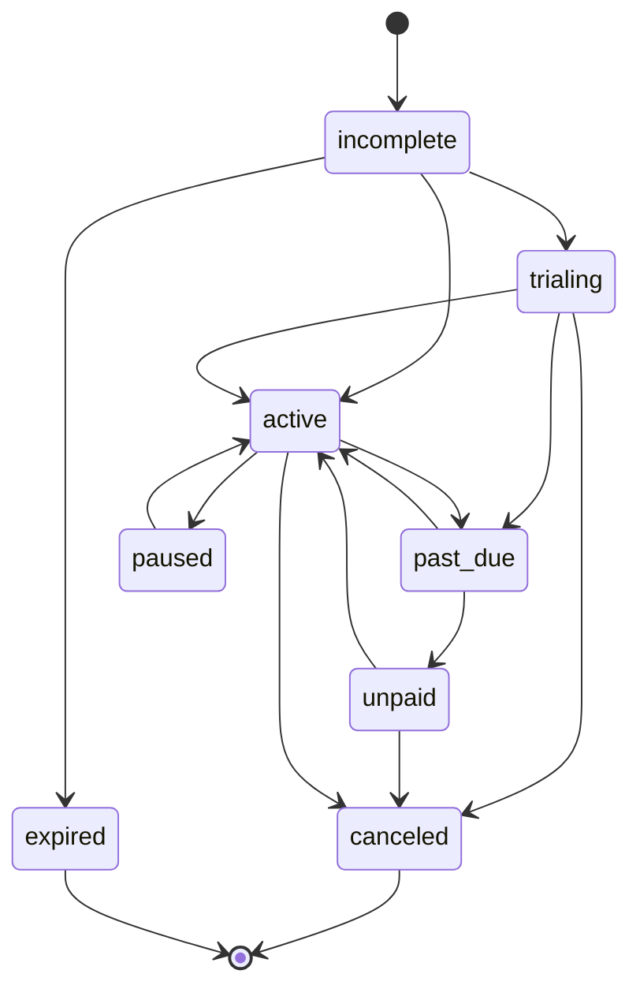

### SM-BIL-02 — Invoice

States: `draft`, `open`, `paid`, `void`, `uncollectible`. Terminal: `paid`, `void`, `uncollectible`.

| From  | To            | Trigger           | Guard                           |
| ----- | ------------- | ----------------- | ------------------------------- |
| draft | open          | Finalize          | Totals balance, number assigned |
| open  | paid          | Payment confirmed | Amount equals due               |
| open  | void          | `FIN` voids       | No payment, reason              |
| open  | uncollectible | Write-off         | Dual approval above threshold   |
| draft | void          | Discard           | n/a                             |

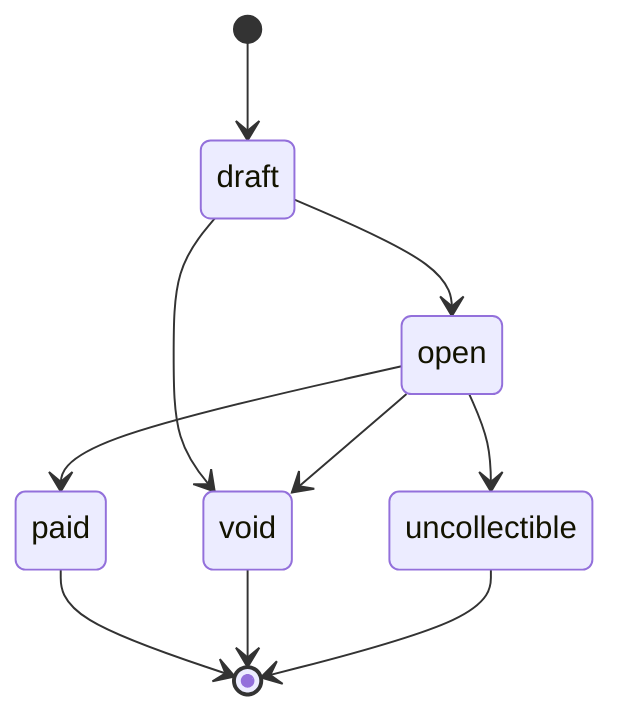

### SM-BIL-03 — Dunning case

States: `scheduled`, `retrying`, `grace`, `degraded`, `recovered`, `exhausted`. Terminal: `recovered`, `exhausted`.

| From      | To        | Trigger           | Guard                             |
| --------- | --------- | ----------------- | --------------------------------- |
| (new)     | scheduled | Payment failure   | Soft decline                      |
| (new)     | degraded  | Hard decline      | Skip retries, grace still applies |
| scheduled | retrying  | Retry time        | n/a                               |
| retrying  | recovered | Payment succeeds  | n/a                               |
| retrying  | grace     | Retry fails       | Retries remain                    |
| grace     | degraded  | Grace days elapse | n/a                               |
| degraded  | recovered | Payment succeeds  | Entitlements restored             |
| degraded  | exhausted | Final cancel day  | Subscription canceled             |

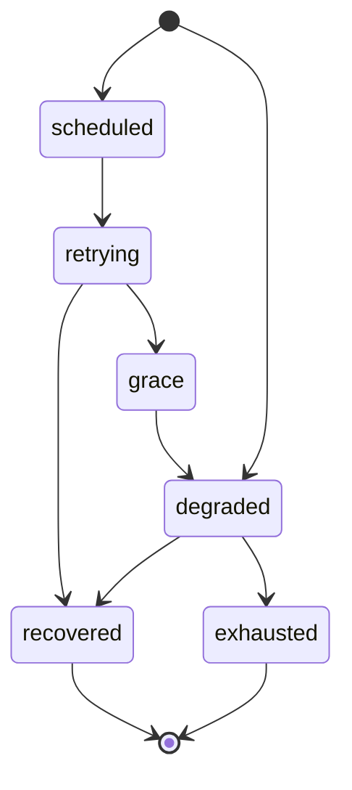

### SM-BIL-04 — Refund

States: `requested`, `under_review`, `awaiting_second_approval`, `approved`, `processing`, `refunded`, `denied`, `failed`. Terminal: `refunded`, `denied`, `failed` (a retry creates a new attempt on the same record from `failed` to `processing` by `FIN`).

| From                                   | To                       | Trigger           | Guard                            |
| -------------------------------------- | ------------------------ | ----------------- | -------------------------------- |
| requested                              | under_review             | `FIN` opens       | n/a                              |
| under_review                           | approved                 | `FIN` approves    | At or below dual-approval amount |
| under_review                           | awaiting_second_approval | `FIN` approves    | Above dual-approval amount       |
| awaiting_second_approval               | approved                 | Second approver   | Different person                 |
| under_review, awaiting_second_approval | denied                   | Decision          | Reason                           |
| approved                               | processing               | Provider call     | Idempotency key                  |
| processing                             | refunded                 | Provider confirms | n/a                              |
| processing                             | failed                   | Provider error    | n/a                              |
| failed                                 | processing               | `FIN` retries     | n/a                              |

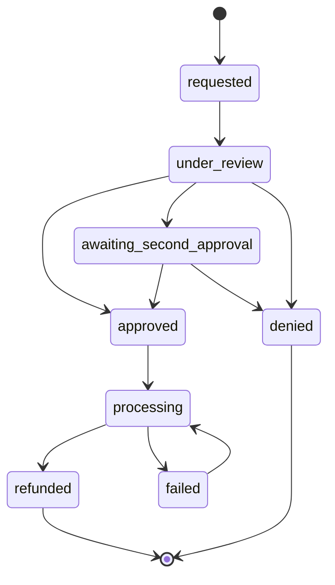

### SM-BIL-05 — Coupon

States: `draft`, `active`, `exhausted`, `expired`, `revoked`. Terminal: `exhausted`, `expired`, `revoked`.

| From   | To        | Trigger                  | Guard                                   |
| ------ | --------- | ------------------------ | --------------------------------------- |
| draft  | active    | Activate                 | Bounds valid, approved if beyond bounds |
| active | exhausted | Redemption limit reached | n/a                                     |
| active | expired   | End date passes          | n/a                                     |
| active | revoked   | `FIN` revokes            | Reason                                  |

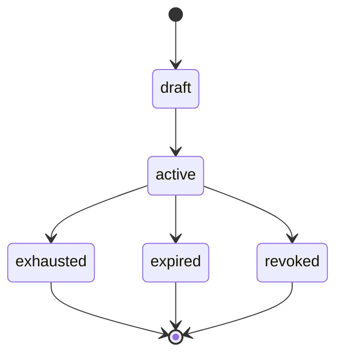

### SM-BIL-06 — Seat pool

States: `pending`, `active`, `expiring`, `expired`, `cancelled`. Terminal: `expired`, `cancelled`.

| From             | To        | Trigger                                        | Guard                                   |
| ---------------- | --------- | ---------------------------------------------- | --------------------------------------- |
| (new)            | pending   | Purchase created                               | Awaiting payment or approval            |
| pending          | active    | Payment confirmed or `FIN` provisional release | Idempotent on PO or event id            |
| active           | expiring  | 60 days before end                             | n/a                                     |
| expiring         | active    | Renewal or extension                           | n/a                                     |
| active, expiring | expired   | End date reached                               | n/a                                     |
| pending          | cancelled | Purchase cancelled or unpaid timeout           | n/a                                     |
| active           | cancelled | Contract termination                           | No assigned seats or approved exception |

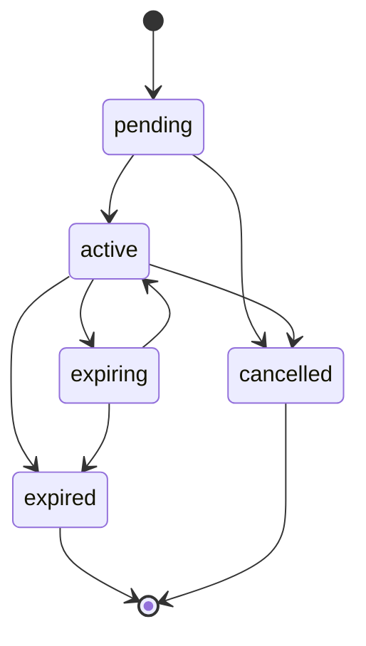

### SM-BIL-07 — Purchase request

States: `draft`, `submitted`, `approved`, `invoiced`, `paid`, `rejected`, `cancelled`. Terminal: `paid`, `rejected`, `cancelled`.

| From                                 | To        | Trigger                    | Guard                       |
| ------------------------------------ | --------- | -------------------------- | --------------------------- |
| draft                                | submitted | Requester submits          | PO present when required    |
| submitted                            | approved  | Buyer approver approves    | n/a                         |
| submitted                            | rejected  | Approver rejects           | Reason                      |
| approved                             | invoiced  | `FIN` issues invoice       | Price matches book or quote |
| invoiced                             | paid      | Payment recorded in full   | n/a                         |
| draft, submitted, approved, invoiced | cancelled | Requester or `FIN` cancels | Not paid                    |

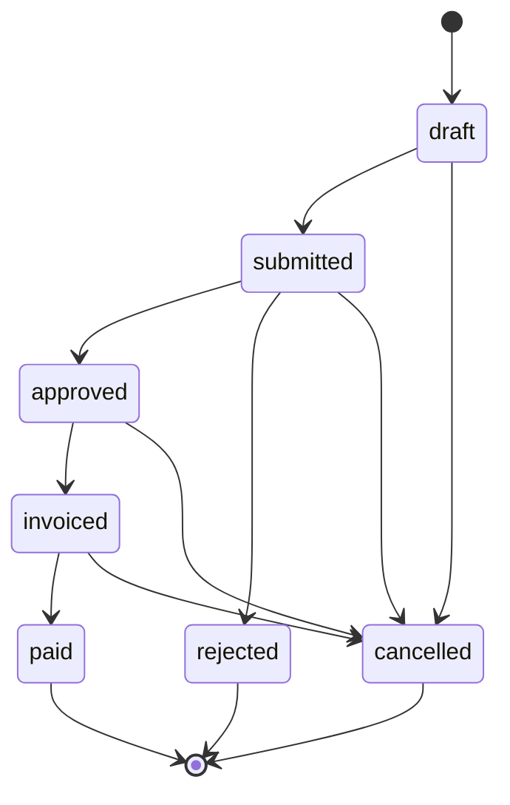

### SM-BIL-08 — Enterprise quote and contract

States: `draft`, `pending_approval`, `sent`, `accepted`, `active`, `renewing`, `expired`, `terminated`, `declined`. Terminal: `expired`, `terminated`, `declined`.

| From             | To               | Trigger                         | Guard                  |
| ---------------- | ---------------- | ------------------------------- | ---------------------- |
| draft            | pending_approval | `FIN` submits                   | Integrity check passed |
| pending_approval | sent             | Approved                        | Approver differs       |
| sent             | accepted         | Buyer accepts                   | Signatory recorded     |
| sent             | declined         | Buyer declines or quote expires | n/a                    |
| accepted         | active           | Start date                      | Grants created         |
| active           | renewing         | Notice window opens             | n/a                    |
| renewing         | active           | New version accepted            | n/a                    |
| active, renewing | expired          | End date                        | n/a                    |
| active           | terminated       | Early termination               | Approval, terms        |

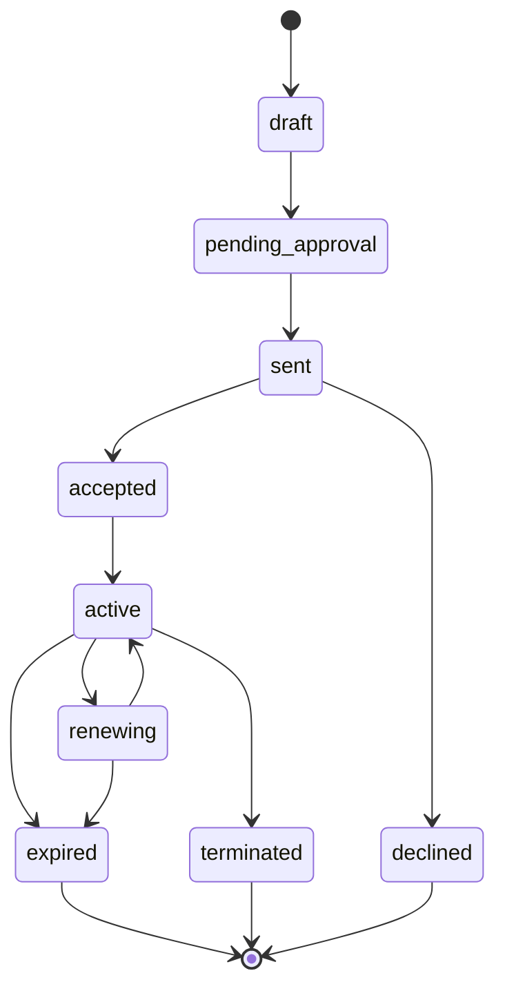

### SM-BIL-09 — Webhook event

States: `received`, `verified`, `processed`, `failed`, `dead_letter`, `ignored_duplicate`, `rejected`. Terminal: `processed`, `ignored_duplicate`, `rejected`, `dead_letter` (replay returns to `verified`).

| From        | To                | Trigger                     | Guard             |
| ----------- | ----------------- | --------------------------- | ----------------- |
| received    | rejected          | Bad signature or wrong mode | n/a               |
| received    | verified          | Signature valid             | n/a               |
| received    | ignored_duplicate | Provider event id exists    | n/a               |
| verified    | processed         | Handler succeeds            | n/a               |
| verified    | failed            | Handler error               | n/a               |
| failed      | processed         | Retry succeeds              | Up to 10 attempts |
| failed      | dead_letter       | Retries exhausted           | Alert             |
| dead_letter | verified          | Operator replay             | Audit             |

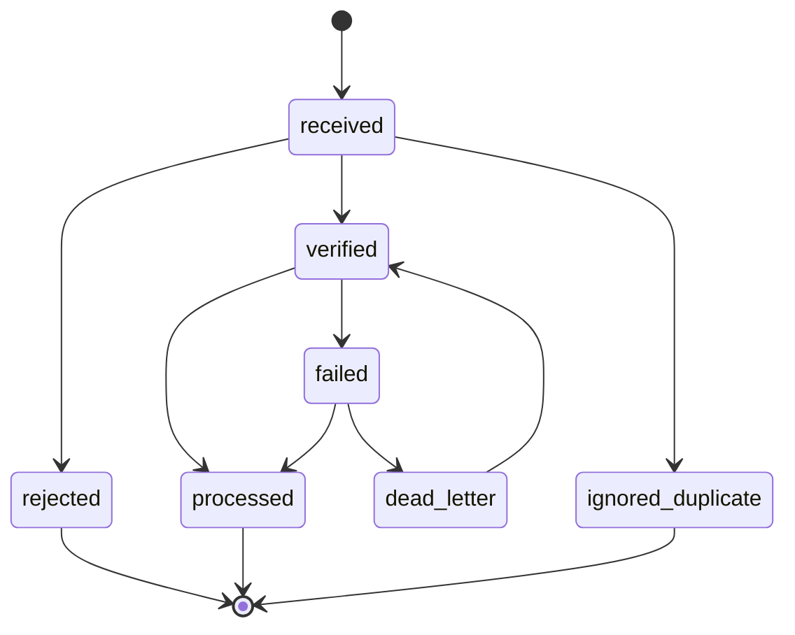

### SM-BIL-10 — Payout

States: `pending_hold`, `available`, `scheduled`, `in_transit`, `paid`, `failed`, `held_review`. Terminal: `paid`.

| From                    | To          | Trigger                  | Guard                                         |
| ----------------------- | ----------- | ------------------------ | --------------------------------------------- |
| pending_hold            | available   | Hold days elapse         | No open dispute                               |
| available               | scheduled   | Payout run               | Balance at least minimum, onboarding complete |
| scheduled               | in_transit  | Transfer created         | Idempotency                                   |
| in_transit              | paid        | Provider confirms        | n/a                                           |
| in_transit              | failed      | Provider reports failure | Funds returned to balance                     |
| failed                  | available   | Earner fixes details     | n/a                                           |
| pending_hold, available | held_review | Dispute or fraud flag    | `FIN` decides                                 |
| held_review             | available   | Cleared                  | n/a                                           |

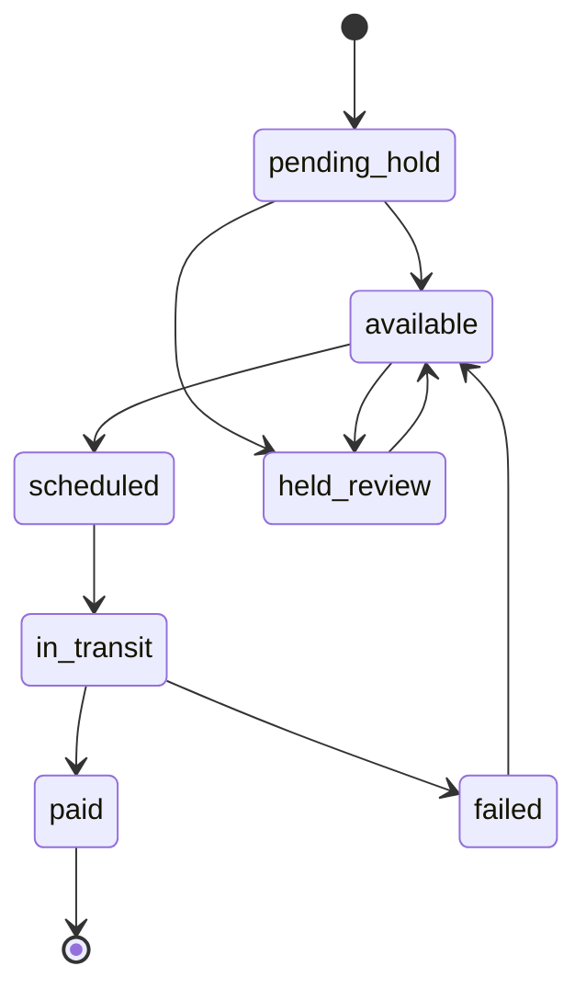

### SM-BIL-11 — Dispute (chargeback)

States: `opened`, `evidence_submitted`, `won`, `lost`, `accepted`. Terminal: `won`, `lost`, `accepted`.

| From               | To                 | Trigger                 | Guard                         |
| ------------------ | ------------------ | ----------------------- | ----------------------------- |
| opened             | evidence_submitted | `FIN` submits evidence  | Before deadline               |
| opened             | accepted           | `FIN` accepts liability | n/a                           |
| evidence_submitted | won                | Provider outcome        | n/a                           |
| evidence_submitted | lost               | Provider outcome        | Entitlement revoked, clawback |

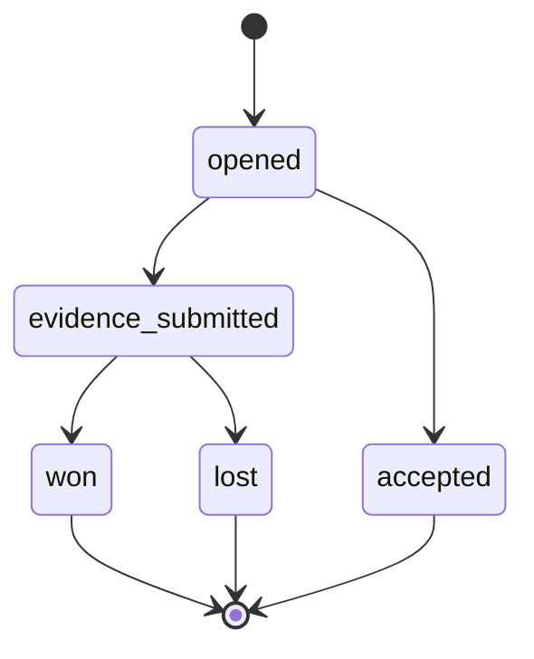

### SM-BIL-12 — Reconciliation run

States: `scheduled`, `running`, `clean`, `discrepancies_open`, `resolved`, `failed`. Terminal: `clean`, `resolved`.

| From               | To                 | Trigger                      | Guard         |
| ------------------ | ------------------ | ---------------------------- | ------------- |
| scheduled          | running            | Job starts                   | n/a           |
| running            | clean              | No items                     | n/a           |
| running            | discrepancies_open | Items found                  | Alert         |
| running            | failed             | Error                        | Retry         |
| failed             | running            | Retry                        | n/a           |
| discrepancies_open | resolved           | All items explained or fixed | Notes present |

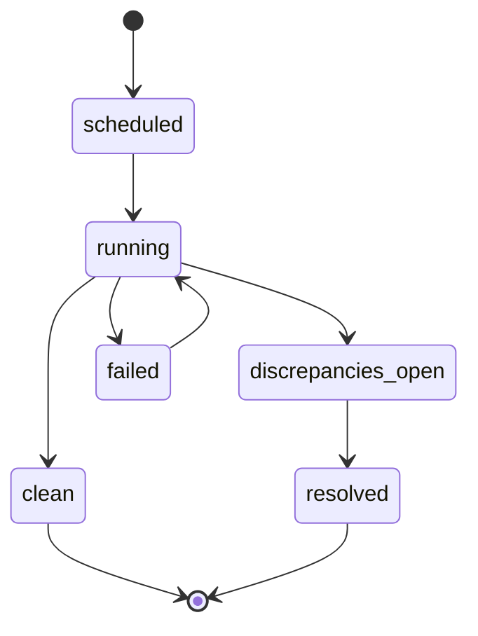

## 7. Screen inventory

| ID          | Name                     | Route proposal                           | Roles             | Purpose                           | Key states                           |
| ----------- | ------------------------ | ---------------------------------------- | ----------------- | --------------------------------- | ------------------------------------ |
| SCR-BIL-001 | Pricing                  | `/pricing`                               | GUE, all          | Compare plans                     | loading, country unsupported, cached |
| SCR-BIL-002 | Checkout summary         | `/billing/checkout`                      | buyers            | Confirm plan and details          | invalid, processing                  |
| SCR-BIL-003 | Checkout return          | `/billing/success`, `/billing/cancelled` | buyers            | Processing and result             | processing, delayed, failed          |
| SCR-BIL-004 | Billing home             | `/billing`                               | billing owner     | Plan, next invoice, methods       | past due banner, trial banner        |
| SCR-BIL-005 | Change plan              | `/billing/plan`                          | billing owner     | Upgrade, downgrade, cancel, pause | preview, over-limit                  |
| SCR-BIL-006 | Payment methods          | `/billing/methods`                       | billing owner     | Manage cards                      | expiring, only-method                |
| SCR-BIL-007 | Invoices                 | `/billing/invoices`                      | billing owner     | History, PDFs                     | empty, open invoice                  |
| SCR-BIL-008 | Refund request           | `/billing/invoices/:id/refund`           | buyer             | Request refund                    | eligible, outside window             |
| SCR-BIL-009 | Usage                    | `/billing/usage`                         | all authenticated | Quotas and history                | at limit, reset time                 |
| SCR-BIL-010 | Limit dialog             | in-app modal                             | all               | Explain limit and options         | hard cap, credits                    |
| SCR-BIL-011 | Organization billing     | `/billing/organization`                  | EAD               | Owner, coverage, seats            | no owner, covered list               |
| SCR-BIL-012 | Purchase requests        | `/billing/purchase-requests`             | IAD, EAD          | PO flow                           | draft, awaiting approval, invoiced   |
| SCR-BIL-013 | Quote acceptance         | `/quotes/:token`                         | EAD, IAD          | Accept enterprise quote           | valid, expired                       |
| SCR-BIL-014 | Earnings                 | `/earnings`                              | INS, MNT, FRL     | Balances, payouts                 | onboarding needed, hold, negative    |
| SCR-BIL-015 | Order receipt            | `/orders/:id`                            | buyers            | Purchase confirmation             | paid, activating                     |
| SCR-BIL-016 | Admin plans and prices   | `/admin/billing/plans`                   | FIN, PAD          | Price book                        | draft, pending approval              |
| SCR-BIL-017 | Entitlement keys         | `/admin/billing/entitlements`            | FIN, PAD          | Vocabulary                        | unenforced warning                   |
| SCR-BIL-018 | Regions                  | `/admin/billing/regions`                 | FIN               | Currency and tax mode             | conflict                             |
| SCR-BIL-019 | Coupons                  | `/admin/billing/coupons`                 | FIN               | Create, revoke                    | list, near limit                     |
| SCR-BIL-020 | Refund and dispute queue | `/admin/billing/refunds`                 | FIN               | Decide refunds                    | awaiting second approval             |
| SCR-BIL-021 | Customer billing view    | `/admin/billing/customers/:id`           | FIN, SUP          | Inspect and adjust                | restricted for SUP                   |
| SCR-BIL-022 | Adjustments inbox        | `/admin/billing/adjustments`             | FIN, PAD          | Approve adjustments               | pending                              |
| SCR-BIL-023 | Webhooks                 | `/admin/billing/webhooks`                | FIN, PAD          | Event health                      | dead letters                         |
| SCR-BIL-024 | Reconciliation           | `/admin/billing/reconciliation`          | FIN               | Resolve discrepancies             | clean, items                         |
| SCR-BIL-025 | Ledger                   | `/admin/billing/ledger`                  | FIN               | Entries, mappings                 | period closed                        |
| SCR-BIL-026 | Pools                    | `/admin/billing/pools`                   | FIN               | Seat pools                        | pending, expiring                    |
| SCR-BIL-027 | Contracts                | `/admin/billing/contracts`               | FIN, PAD          | Quotes and contracts              | renewing                             |
| SCR-BIL-028 | Dunning view             | `/admin/billing/dunning`                 | FIN               | Failed payments                   | extension dialog                     |
| SCR-BIL-029 | Reports                  | `/admin/billing/reports`                 | FIN               | Finance reports                   | suppressed segment                   |
| SCR-BIL-030 | Compliance               | `/admin/billing/compliance`              | SAD, FIN          | Controls                          | overdue rotation                     |
| SCR-BIL-031 | Notification templates   | `/admin/billing/templates`               | FIN, PAD          | Preview templates                 | locale fallback                      |

Accessibility notes: all amounts announce currency and sign; charts have table alternatives; destructive actions (cancel, void, refund) use confirmation dialogs with focus returned to the trigger; checkout and billing pages meet WCAG 2.2 AA and work at 320 px width.

## 8. Data entities owned

Retention classes: `R-fin` statutory financial retention (default 7 years), `R-config` kept while product exists, `R-short` 90 days, `R-session` 30 days.

| ID         | Name                          | Key attributes                                                                                                                      | Relationships               | Retention                            |
| ---------- | ----------------------------- | ----------------------------------------------------------------------------------------------------------------------------------- | --------------------------- | ------------------------------------ |
| ENT-BIL-01 | Plan                          | id, key, name, audience, status                                                                                                     | has many PlanVersion        | R-config                             |
| ENT-BIL-02 | PlanVersion                   | id, plan_id, currency, region_id, interval, amount_minor, trial_days, effective_from, provider_price_id, status                     | Plan, region                | R-fin                                |
| ENT-BIL-03 | EntitlementKey                | key, module, type, unit, class tag, customer_visible, enforced_by                                                                   | used by PlanEntitlement     | R-config                             |
| ENT-BIL-04 | PlanEntitlement               | plan_version_id, key, value                                                                                                         | PlanVersion, EntitlementKey | R-fin                                |
| ENT-BIL-05 | BillingAccount                | id, owner_type (user or organization), owner_id, provider_customer_id, country, billing details, tax profile ref                    | owner                       | R-fin                                |
| ENT-BIL-06 | Subscription                  | id, billing_account_id, plan_version_id, state (SM-BIL-01), period start and end, cancel_at_period_end, trial_end, scheduled_change | BillingAccount              | R-fin                                |
| ENT-BIL-07 | SubscriptionItem              | subscription_id, kind (seat, add-on), quantity                                                                                      | Subscription                | R-fin                                |
| ENT-BIL-08 | Invoice                       | id, number, account_id, state (SM-BIL-02), currency, totals, tax, due_date, po_number, pdf_ref                                      | BillingAccount              | R-fin                                |
| ENT-BIL-09 | InvoiceLine                   | invoice_id, description, quantity, unit_amount_minor, tax_code, source_ref                                                          | Invoice                     | R-fin                                |
| ENT-BIL-10 | PaymentAttempt                | id, invoice_id, provider_ref, status, failure_code, dunning_step                                                                    | Invoice                     | R-fin                                |
| ENT-BIL-11 | PaymentMethodRef              | id, account_id, provider_ref, brand, last4, expiry, fingerprint_hash, is_default                                                    | BillingAccount              | R-fin                                |
| ENT-BIL-12 | Coupon                        | id, code, type, value, applies_to, limits, validity, state (SM-BIL-05)                                                              | has many redemptions        | R-fin                                |
| ENT-BIL-13 | CouponRedemption              | coupon_id, account_id, invoice_id, amount_minor                                                                                     | Coupon                      | R-fin                                |
| ENT-BIL-14 | Refund                        | id, invoice_id, amount_minor, reason, state (SM-BIL-04), approvers[], provider_ref                                                  | Invoice                     | R-fin                                |
| ENT-BIL-15 | CreditEntry                   | account_id, amount_minor, currency, reason, expires_at                                                                              | BillingAccount              | R-fin                                |
| ENT-BIL-16 | UsageCounter                  | subject, key, window_start, used, reserved                                                                                          | EntitlementKey              | R-short for detail, aggregates R-fin |
| ENT-BIL-17 | EntitlementGrant              | id, subject (user or organization), key, value, source (contract, seat, manual, org), starts_at, ends_at, reason                    | resolver                    | R-fin                                |
| ENT-BIL-18 | SeatPool                      | id, institution_id, package_ref, total, valid_from, valid_until, state (SM-BIL-06)                                                  | Institution (INS)           | R-fin                                |
| ENT-BIL-19 | PurchaseRequest               | id, buyer, items, po_number, state (SM-BIL-07), approver                                                                            | BillingAccount              | R-fin                                |
| ENT-BIL-20 | Contract                      | id, buyer, version, terms, entitlement overrides, state (SM-BIL-08), documents[]                                                    | BillingAccount              | R-fin                                |
| ENT-BIL-21 | WebhookEvent                  | provider_event_id, type, payload_ref, state (SM-BIL-09), attempts                                                                   | n/a                         | R-short for payload, id R-fin        |
| ENT-BIL-22 | LedgerEntry                   | id, journal_id, account_code, debit_minor, credit_minor, currency, fx_rate, source_ref, period                                      | source objects              | R-fin                                |
| ENT-BIL-23 | TaxProfile and Registration   | account tax ids, validation status; platform registrations by jurisdiction                                                          | BillingAccount              | R-fin                                |
| ENT-BIL-24 | EarnerBalanceEntry and Payout | user_id, source, amount_minor, state (SM-BIL-10), hold_until, provider_transfer_ref                                                 | PayoutAccount               | R-fin                                |
| ENT-BIL-25 | PayoutAccount                 | user_id, provider_account_ref, onboarding_status, country                                                                           | user                        | R-fin                                |
| ENT-BIL-26 | Dispute                       | id, payment_ref, state (SM-BIL-11), evidence_refs, deadline                                                                         | PaymentAttempt              | R-fin                                |
| ENT-BIL-27 | AdjustmentRequest             | id, account_id, type, amount_minor, reason_code, proposer, approver, state                                                          | BillingAccount              | R-fin                                |
| ENT-BIL-28 | ReconciliationRun             | id, window, state (SM-BIL-12), item counts, items[]                                                                                 | n/a                         | R-fin                                |
| ENT-BIL-29 | Order                         | id, buyer, items (module, product_ref, price), state, invoice_id, fulfillment_state                                                 | BillingAccount              | R-fin                                |

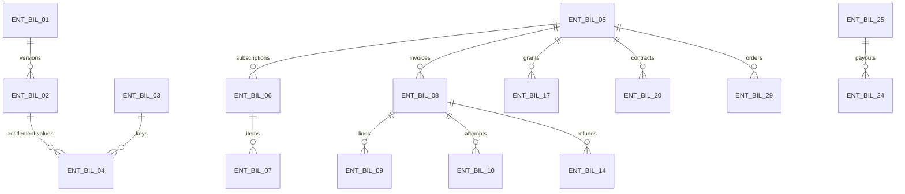

## 9. Events emitted and consumed

### 9.1 Emitted

| ID          | Event                               | Emitted when                                   | Key payload                 | Consumers (planned)               |
| ----------- | ----------------------------------- | ---------------------------------------------- | --------------------------- | --------------------------------- |
| EVT-BIL-001 | `bil.plan.published`                | Price version published                        | plan_version_id             | ANL, SRC                          |
| EVT-BIL-002 | `bil.checkout.completed`            | Webhook confirms checkout                      | account_id, subscription_id | NTF, ANL                          |
| EVT-BIL-003 | `bil.subscription.activated`        | State `active`                                 | subscription_id, plan       | all modules via entitlement cache |
| EVT-BIL-004 | `bil.subscription.changed`          | Plan or quantity changed                       | from, to, effective         | NTF, ANL                          |
| EVT-BIL-005 | `bil.subscription.cancel_scheduled` | Cancel at period end set                       | end date                    | NTF                               |
| EVT-BIL-006 | `bil.subscription.ended`            | State `canceled` or `expired`                  | subscription_id             | all modules                       |
| EVT-BIL-007 | `bil.subscription.paused`           | Paused                                         | window                      | NTF                               |
| EVT-BIL-008 | `bil.trial.started`                 | Trial begins                                   | trial_end                   | NTF                               |
| EVT-BIL-009 | `bil.trial.converted`               | Trial to active                                | subscription_id             | ANL                               |
| EVT-BIL-010 | `bil.invoice.finalized`             | Invoice opened                                 | invoice_id                  | NTF, ledger                       |
| EVT-BIL-011 | `bil.invoice.paid`                  | Invoice paid                                   | invoice_id, amount          | NTF, ledger                       |
| EVT-BIL-012 | `bil.payment.failed`                | Payment attempt fails                          | invoice_id, code            | NTF                               |
| EVT-BIL-013 | `bil.payment.recovered`             | Dunning recovered                              | subscription_id             | NTF                               |
| EVT-BIL-014 | `bil.dunning.degraded`              | Access degraded                                | subscription_id             | all modules                       |
| EVT-BIL-015 | `bil.entitlements.changed`          | Any change to an actor's resolved entitlements | subject, keys               | all modules                       |
| EVT-BIL-016 | `bil.coupon.redeemed`               | Redemption                                     | coupon_id, account          | ANL                               |
| EVT-BIL-017 | `bil.refund.requested`              | Request created                                | refund_id                   | NTF                               |
| EVT-BIL-018 | `bil.refund.completed`              | Provider confirms                              | refund_id, amount           | LRN, ledger, payouts              |
| EVT-BIL-019 | `bil.refund.denied`                 | Denied                                         | refund_id                   | NTF                               |
| EVT-BIL-020 | `bil.dispute.opened`                | Chargeback received                            | dispute_id                  | FIN queue                         |
| EVT-BIL-021 | `bil.dispute.closed`                | Outcome                                        | dispute_id, outcome         | ledger, payouts                   |
| EVT-BIL-022 | `bil.usage.threshold`               | 80 or 100 percent used                         | subject, key                | NTF                               |
| EVT-BIL-023 | `bil.usage.limit_reached`           | Limit hit                                      | subject, key                | ANL                               |
| EVT-BIL-024 | `bil.pool.activated`                | Seat pool active                               | pool_id, institution_id     | INS                               |
| EVT-BIL-025 | `bil.pool.expiring`                 | 60, 30, 7 days                                 | pool_id                     | INS, NTF                          |
| EVT-BIL-026 | `bil.pool.expired`                  | Pool expired                                   | pool_id                     | INS                               |
| EVT-BIL-027 | `bil.seat.assigned`                 | Team seat assigned                             | user, org                   | NTF                               |
| EVT-BIL-028 | `bil.purchase.status_changed`       | Purchase request state change                  | request_id, state           | NTF                               |
| EVT-BIL-029 | `bil.contract.activated`            | Contract start                                 | contract_id                 | all modules                       |
| EVT-BIL-030 | `bil.contract.renewal_due`          | Notice windows                                 | contract_id                 | NTF                               |
| EVT-BIL-031 | `bil.order.paid`                    | One-time order paid                            | order_id, items             | LRN, MEN, ASM, GIG                |
| EVT-BIL-032 | `bil.order.fulfilled`               | Fulfillment done                               | order_id                    | NTF                               |
| EVT-BIL-033 | `bil.payout.paid`                   | Payout paid                                    | user, amount                | NTF                               |
| EVT-BIL-034 | `bil.payout.failed`                 | Payout failed                                  | user                        | NTF                               |
| EVT-BIL-035 | `bil.adjustment.executed`           | Adjustment posted                              | adjustment_id               | ledger                            |
| EVT-BIL-036 | `bil.ledger.posted`                 | Journal posted                                 | journal_id                  | ERP hook                          |
| EVT-BIL-037 | `bil.recon.discrepancy`             | Items remain after run                         | run_id, count               | FIN                               |
| EVT-BIL-038 | `bil.webhook.dead_lettered`         | Event dead-lettered                            | event_id                    | on-call                           |
| EVT-BIL-039 | `bil.price.change_notice`           | Price increase scheduled                       | subscriptions affected      | NTF                               |
| EVT-BIL-040 | `bil.region.country_change`         | Country change scheduled                       | account                     | NTF                               |

### 9.2 Consumed

`idn.user.deleted` (minimize personal data), `emp.organization.created`, `emp.member.removed` (revoke org coverage), `ins.institution.verified` (allow pool purchase), `ins.seat.released`, `ins.offboarding.started`, `aic.request.completed` (settle quota), `job.job.published` and `job.job.closed` (limit counts), `lrn.enrollment.refund_eligible_data`, `men.session.completed` and `gig.milestone.released` (earning events, planned), `set.account.erasure_requested`.

## 10. Integrations and external dependencies

| System                                                                   | Direction | Purpose                                                                  | Notes                                                           |
| ------------------------------------------------------------------------ | --------- | ------------------------------------------------------------------------ | --------------------------------------------------------------- |
| Payment provider (Stripe in the current plan; provider-independent port) | Both      | Checkout, subscriptions, invoices, refunds, disputes, connected accounts | Test and live isolated (BR-BIL-034); OD-BIL-02 on local methods |
| Tax engine and registry checks (provider tax or dedicated; VIES style)   | Outbound  | Rates, tax id validation                                                 | OD-BIL-03                                                       |
| FX rate source                                                           | Inbound   | Base-currency reporting                                                  | Dated rates stored                                              |
| Accounting or ERP system                                                 | Outbound  | Journals, deferred revenue                                               | Via ledger hooks only                                           |
| Email delivery                                                           | Outbound  | Notices                                                                  | Via NTF                                                         |
| Secret store                                                             | Internal  | Keys                                                                     | Via PLT                                                         |
| Object storage                                                           | Internal  | PDFs, contracts                                                          | Via PLT                                                         |
| Bank transfer reconciliation feed                                        | Inbound   | PO payments                                                              | Optional                                                        |

## 11. Cross-module dependencies

| Depends on                        | For                                            | Depended on by                        |
| --------------------------------- | ---------------------------------------------- | ------------------------------------- |
| IDN (planned)                     | Authenticated principal, MFA for finance roles | ADM                                   |
| EMP (planned)                     | Organization identity and members              | JOB, ATS (limits), ENT                |
| INS (this batch)                  | Institution verification, seat assignment      | INS depends on BIL pools              |
| AIC (planned)                     | Quota reserve and settle                       | AIC depends on BIL meter              |
| JOB, ATS, NET, MSG (planned)      | Usage events and enforcement points            | They depend on BIL checks             |
| LRN, STU, MEN, GIG, ASM (planned) | Products, fulfillment, earning events          | They depend on BIL orders and payouts |
| NTF (planned)                     | Delivery                                       | all                                   |
| ANL (planned)                     | Finance metrics                                | —                                     |
| ADM (planned)                     | Support access, console shell                  | —                                     |
| SET (planned)                     | Data rights                                    | —                                     |
| PLT (planned)                     | Secrets, files, outbox                         | —                                     |

## 12. Module-level metrics

| Metric                     | Definition                                                                    | Formula                               | Owner role |
| -------------------------- | ----------------------------------------------------------------------------- | ------------------------------------- | ---------- |
| Webhook processing success | Events processed without dead letter                                          | processed / (processed + dead_letter) | FIN        |
| Reconciliation clean rate  | Runs with zero open items                                                     | clean runs / runs                     | FIN        |
| Entitlement drift          | Accounts whose resolved entitlements differ from provider-derived expectation | mismatches / accounts checked         | FIN        |
| Involuntary churn          | Subscriptions lost to payment failure                                         | exhausted dunning / active at start   | FIN        |
| Dunning recovery rate      | Failed payments recovered                                                     | recovered / dunning cases             | FIN        |
| Trial conversion           | Trials becoming paid                                                          | converted / trials ended              | PAD        |
| Refund rate                | Refunded amount over revenue                                                  | refunds / gross revenue               | FIN        |
| Seat utilization           | Assigned seats over total (active pools)                                      | assigned / total                      | FIN        |
| Limit hit rate             | Users reaching a limit per period                                             | users at limit / active users         | PAD        |
| MRR movement               | New + expansion - contraction - churn                                         | per period                            | FIN        |

## 13. Open decisions

| ID        | Question                                                                                                                                                | Options                                                                | Default proposal                                                             | Who decides      | Blocks                             |
| --------- | ------------------------------------------------------------------------------------------------------------------------------------------------------- | ---------------------------------------------------------------------- | ---------------------------------------------------------------------------- | ---------------- | ---------------------------------- |
| OD-BIL-01 | What are the prices, currencies, AI quotas and limits for every plan? (SSOT V61-09: none decided; docs/PRICING.md values are recommendations only.)     | Founder sets after cost model and market research                      | No numbers in the blueprint; parameter names only                            | Founder, Finance | FR-BIL-001, FR-BIL-021, FR-BIL-022 |
| OD-BIL-02 | Payment provider scope: Stripe only, or add local methods (bank debit, UPI, wallets) and region partners; statutory retention by country.               | Stripe only at first; add per region                                   | Stripe via a provider port; 7-year retention default                         | Founder, Legal   | FR-BIL-007, FR-BIL-033             |
| OD-BIL-03 | Tax approach: provider tax product, Merchant of Record, or own engine.                                                                                  | A: provider tax; B: MoR; C: own                                        | A for first regions, revisit at scale                                        | Finance, Legal   | FR-BIL-014                         |
| OD-BIL-04 | Trial policy: which plans, days, card required.                                                                                                         | None, 14 days with card, or no-card trial                              | 14 days with card on entry paid plans                                        | Product, Finance | FR-BIL-008                         |
| OD-BIL-05 | Free-tier limits and free-recruiter posting policy (`free_active_jobs_limit`).                                                                          | Unlimited today, capped, or none                                       | Capped at a value Finance sets                                               | Product, Founder | FR-BIL-012, FR-BIL-022             |
| OD-BIL-06 | Entitlements follow the user or the organization's billing owner.                                                                                       | Per user; per organization; both (BR-BIL-009)                          | Both, as in BR-BIL-009                                                       | Product          | FR-BIL-003, FR-BIL-012             |
| OD-BIL-07 | Subscription refund policy.                                                                                                                             | No refunds; 14 days first payment; 30 days                             | 14 days first payment with low-usage test                                    | Finance, Legal   | FR-BIL-016                         |
| OD-BIL-08 | Regional pricing and purchasing-power policy.                                                                                                           | List price in USD only; local currency same value; adjusted per region | Local currency list prices; no PPP until data                                | Finance          | FR-BIL-006                         |
| OD-BIL-09 | Overage policy for AI and other meters.                                                                                                                 | Hard cap; credit packs; metered overage                                | Hard cap                                                                     | Product, Finance | FR-BIL-023                         |
| OD-BIL-10 | Payout terms and whether third-party funds may be held (escrow); this touches SSOT §4.2 (no general marketplace, not payroll) and financial regulation. | No escrow; provider-managed escrow; own escrow                         | No escrow; revenue share paid with hold period; escrow is gated (see GIG OD) | Founder, Legal   | FR-BIL-029                         |
| OD-BIL-11 | Who may buy what (SSOT BR-07 says billing actions are recruiter-only, conflicting with learner purchases and candidate plans).                          | Keep BR-07; replace with BR-BIL-033                                    | Replace with BR-BIL-033                                                      | Founder          | FR-BIL-007, FR-BIL-028             |
| OD-BIL-12 | Enterprise sales workflow: quotes only, or a sales CRM.                                                                                                 | Quotes only; integrate external CRM                                    | Quotes only                                                                  | Founder          | FR-BIL-027                         |
| OD-BIL-13 | Revenue recognition basis for marketplace sales (gross or net) and the ERP target.                                                                      | Gross; net as agent                                                    | Net as agent, confirm with accountant                                        | Finance          | FR-BIL-020                         |
| OD-BIL-14 | Plan names and audiences: SSOT lists Free, Pro, Team, Enterprise; code lists Candidate Pro, Recruiter Starter, Recruiter Enterprise.                    | Adopt audience-prefixed names; keep SSOT names                         | Audience-prefixed; map SSOT names                                            | Product          | FR-BIL-001, FR-BIL-022             |
| OD-BIL-15 | Pay-per-use outreach credits (SSOT F-59) in scope or only weekly caps.                                                                                  | Caps only; credits                                                     | Caps only                                                                    | Product          | FR-BIL-022                         |

## 14. Risks

| ID         | Risk                                                                                          | Likelihood and impact | Mitigation                                                         |
| ---------- | --------------------------------------------------------------------------------------------- | --------------------- | ------------------------------------------------------------------ |
| RSK-BIL-01 | Entitlement drift: product grants access that payment state does not support, or the reverse. | Medium, high          | Single resolver, drift metric, reconciliation re-sync              |
| RSK-BIL-02 | Forged or replayed webhooks.                                                                  | Low, high             | Signature, tolerance, idempotency, mode isolation                  |
| RSK-BIL-03 | Prices or quotas set without a cost model causing losses (AI cost).                           | Medium, high          | OD-BIL-01, BR-BIL-019, hard cap default                            |
| RSK-BIL-04 | Tax non-compliance in new regions.                                                            | Medium, high          | Registration gap list, no assumed rates, OD-BIL-03                 |
| RSK-BIL-05 | Pay-to-rank creep through custom contracts.                                                   | Medium, high          | Integrity guard on contracts and grants, no exceptions             |
| RSK-BIL-06 | Fraud: trial abuse, coupon abuse, stolen cards, refund abuse.                                 | Medium, medium        | Fingerprint checks, rate limits, dual approval, dispute handling   |
| RSK-BIL-07 | Payout and escrow regulation exposure (money transmission).                                   | Medium, severe        | Use provider-managed connected accounts, escrow gated by OD-BIL-10 |
| RSK-BIL-08 | Over-limit downgrades harming customers (unpublished jobs).                                   | Medium, medium        | BR-BIL-008, notice, owner chooses                                  |
| RSK-BIL-09 | Scope creep into accounting, payroll or CRM.                                                  | Medium, medium        | Hooks only, BR-BIL-031, OD-BIL-12                                  |
| RSK-BIL-10 | Provider lock-in or outage.                                                                   | Low, high             | Provider port, status banner, cached resolution with fail policy   |

## 15. Legacy source trace

| Source                                                                                                                                                               | Used for                                                                                               | Dropped or changed and why                                                                                |
| -------------------------------------------------------------------------------------------------------------------------------------------------------------------- | ------------------------------------------------------------------------------------------------------ | --------------------------------------------------------------------------------------------------------- |
| docs/PRICING.md                                                                                                                                                      | Entitlement keys, enforcement findings, open decisions (org owner, free recruiters, proration, trials) | All prices and quota numbers not carried; owner rule keeps them OD-gated; test-mode Stripe ids not copied |
| SSOT.md F-16, BR-055, BR-056, BR-32, BR-099 to BR-101, BR-130, OD-07, OD-15, OD-28, OD-29, OD-34, OD-43, V61-09, WF-09, WF-16, WF-23, WF-25 to WF-28, SCI-06, SCI-09 | Rules, workflows, idempotency, refund and coupon parameters                                            | BR-07 conflict recorded (OD-BIL-11); plan names conflict (OD-BIL-14)                                      |
| docs/registries/FEATURE_REGISTRY.md F-16, F-41, F-61                                                                                                                 | Scope inventory                                                                                        | F-61 Premium Candidate tier folded into candidate plans under OD-BIL-01                                   |
| ARCHITECTURE.md, docs/reports/FEATURE_STATUS_2026-10-21.md                                                                                                           | Awareness of what exists                                                                               | No status copied                                                                                          |
| Yash_Final_Project_Document 21_COST_AND_FINOPS, 19_BUSINESS_AND_COMMERCIAL_OPERATIONS                                                                                | Context only (not read in depth; cost model not adopted)                                               | Cost figures not used                                                                                     |
| Own domain knowledge (Stripe Billing, Chargebee, Paddle, Greenhouse and LinkedIn Recruiter plans, Coursera and Udemy refunds, Upwork fees, accounting practice)      | Dunning, proration, tax, reconciliation, ledger, payouts, finance console                              | Tagged [PROP]                                                                                             |

**Conflicts recorded:** (1) SSOT BR-07 versus learner and candidate purchases: OD-BIL-11. (2) SSOT plan names versus code plan names: OD-BIL-14. (3) docs/PRICING.md per-user entitlements versus organization-level need: OD-BIL-06. (4) SSOT §4.2 (not payroll, not general marketplace) versus payouts and quotes: OD-BIL-10, OD-BIL-12. (5) F-41 phase Ph6 versus institutional exit criterion at Ph3: pools provisioned manually by `FIN` first (see OD-INS-11).
