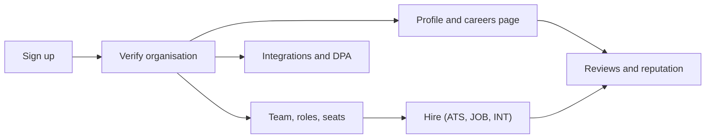

# EMP — Employer Organisation, Teams & Brand

> Status: intended product specification. Nothing in this file claims anything is built. See [CONVENTIONS](../00_START_HERE/CONVENTIONS.md).

## 1. Purpose, outcomes and boundaries

### 1.1 Purpose

EMP is the tenant model for everyone who hires on TalentSphere. It creates and verifies the employer organisation, holds the company profile and careers page that candidates see, manages teams, seats, roles and approvals, supports agencies hiring on behalf of clients, hosts moderated employer reviews and reputation, and exposes the commercial, legal and integration hooks (billing entitlements, data-processing agreements, webhooks, ATS connectors, SSO). It is where trust in an employer is established before any job is published. [SRC: SSOT F-56 Organization and Institution Pages, F-75 Employer Insights, BR-036, BR-062, BR-080, BR-136..138] [DER]

### 1.2 Outcomes

| Outcome | How the system knows |
|---|---|
| Only real employers publish jobs | Share of live jobs from verified organisations; scam listings per 1,000 |
| An employer is productive within one session | Time from sign-up to first published job |
| Access is least-privilege and auditable | Zero cross-tenant access; every permission change logged |
| Candidates see an honest employer picture | Verified profile, moderated reviews, reputation shown only with enough data |
| Employers can integrate with their stack | Webhook delivery success rate; connector health |

### 1.3 Boundaries

| In scope (owned by EMP) | Out of scope | Consumed |
|---|---|---|
| Org accounts, verification, profile, public page, careers page, brand media, widgets, claims | Job content and pipeline (ATS), listings (JOB) | Postings and jobs from ATS and JOB |
| Members, invitations, seats, roles, departments, locations, sub-orgs, approval policy, hiring policy | Identity, passwords, MFA mechanics (IDN planned) | Authentication and sessions |
| Agencies and client relationships | Plans, prices, invoices, payment (BIL planned) | Entitlements and subscription state from BIL |
| Employer reviews, responses, candidate-experience ratings, reputation | Moderation decisions and trust enforcement (TSF planned) | Moderation and sanctions from TSF |
| DPA, compliance documents, webhooks, connectors, API keys, SSO and SCIM, security settings, audit | Platform public API gateway (PLT planned) | Gateway and delivery infrastructure |
| Notification preferences, brand analytics, export and closure | Notification delivery (NTF planned), analytics warehouse (ANL planned) | Delivery, warehouse |

EMP is the owner of the `organization_id` tenant boundary used by ATS, INT and JOB. [SRC: BR-080] [DER]

## 2. Roles and permission matrix

Legend: Y allowed, O own records, A audited, N not allowed. Org role names map to the canonical roles: `EAD` Employer Admin, `REC` Recruiter, `HMG` Hiring Manager. Other employer-side roles (Coordinator, Interviewer, Approver, Billing contact, Brand editor, Agency recruiter) are custom or built-in org roles in FR-EMP-012.

| Capability | EAD | REC | HMG | Brand editor | Billing contact | CAN | MOD | PAD | SUP |
|---|---|---|---|---|---|---|---|---|---|
| Create org, submit verification | Y | N | N | N | N | N | N | Review A | Assist |
| Edit company profile and careers page | Y | N | N | Y | N | N | N | Edit with audit | N |
| Invite and remove members, assign roles | Y | N | N | N | N | N | N | A | N |
| Manage seats and billing | Y | N | N | N | Y | N | N | A | Assist |
| Configure approval and hiring policies | Y | N | N | N | N | N | N | N | N |
| Create sub-orgs, agency relationships | Y | N | N | N | N | N | N | A | N |
| Post employer reviews | N | N | N | N | N | Verified relationship only | N | N | N |
| Respond to reviews | Y | Y (if granted) | N | Y | N | N | N | N | N |
| Moderate reviews | N | N | N | N | N | N | Y, A | Y, A | N |
| Manage webhooks, API keys, SSO | Y | N | N | N | N | N | N | N | N |
| View audit log | Y | Own | Own | N | N | N | N | A | A |
| Sign DPA | Y | N | N | N | N | N | N | N | N |
| Suspend, restore org | N | N | N | N | N | N | Recommend | Y, A | N |

## 3. Sub-module map

| Code | Sub-module | Features |
|---|---|---|
| A | Onboarding and verification | FR-EMP-001 to 003 |
| B | Profile, brand and careers | FR-EMP-004 to 009 |
| C | Teams and access | FR-EMP-010 to 015 |
| D | Structure and agencies | FR-EMP-016 to 018 |
| E | Reviews and reputation | FR-EMP-019 to 022 |
| F | Commercial and legal | FR-EMP-023, 024 |
| G | Integrations | FR-EMP-025 to 027 |
| H | Security and trust | FR-EMP-028 to 030 |
| I | Operations | FR-EMP-031 to 033 |

## 4. Feature specifications

### Sub-module A: Onboarding and verification

### FR-EMP-001 — Employer sign-up and onboarding wizard

- **Sub-module:** A Onboarding
- **Priority / tier:** Must · R2
- **Source:** [SRC: SSOT F-05 recruiter journeys; BR-036] [DER]
- **Purpose and outcome:** A recruiter creates an employer organisation and reaches first value quickly; success is a created org with an owner and a started verification.
- **Roles and permissions:** `GUE: start` · `New owner (becomes EAD)` · `PAD: monitor funnel`
- **Preconditions and entry points:** `/employers/start` from marketing pages and "Post a job"; the person has or creates a verified account (IDN planned) with a work email.
- **User interactions and actions:** 1) Choose account type: Employer, Agency, Institution (redirects to INS planned). 2) Enter company name, website, country, company size band, industry, work email. 3) Verify the work email by link. 4) Accept terms and data-processing notice. 5) Complete checklist: add logo and description, invite teammates, start verification (FR-EMP-002), create first requisition. 6) Skip steps; resume later from a persistent checklist.
- **System behaviour:** Creates organisation in `onboarding` (SM-EMP-01) with the user as owner EAD. Free-mail addresses (public email domains) are not accepted as the work email for employer accounts; users get an explanation and may continue with a domain-verified alternative or contact support. Suggests existing unclaimed company profiles that match name or domain to claim (FR-EMP-009) instead of duplicating. Unverified orgs are limited: draft postings only until verification or accelerated review result (BR-EMP-002). Wizard state persists.
- **UI elements and controls:** Multi-step form, progress checklist, company name typeahead showing existing profiles, "This is my company" claim link, Terms checkbox (required).
- **Configuration options:** Platform: blocked email domain list, org size bands, unverified limits.
- **Business rules:** BR-EMP-001, BR-EMP-002, BR-EMP-010
- **Validation:** Company name 2 to 120 chars; website https URL; country ISO 3166; work email on a non-free domain matching the website domain unless verification overrides.
- **Inputs and outputs:** In: company details, email. Out: organisation record, owner membership, checklist.
- **Filters, sorting, search:** n/a — wizard.
- **Notifications and communication:** Email verification `emp.onboarding.verify_email`; welcome `emp.onboarding.welcome`; nudges at 2 and 7 days if checklist incomplete, class product_updates.
- **Error handling and edge cases:** Email already used by a member of another org: ask to join that org (request access) instead. Duplicate company name: shows candidates for claim. Verification email not received: resend with 60-second cooldown, max 5 per hour.
- **Dependencies:** IDN (planned), FR-EMP-002, FR-EMP-009, ENT-EMP-01.
- **Security and privacy:** Bot protection on sign-up; rate limits; no password handling here.
- **Acceptance criteria:**
  - Given a valid work email, When the wizard completes step 3, Then an organisation in `onboarding` exists with the user as owner.
  - Given a free-mail address, When submitting, Then the form explains and does not create the org.
  - Given an existing unclaimed profile with the same domain, When entering the company, Then the claim option is offered.
  - Negative: Given the verification link is expired, When clicked, Then no org is activated and a resend option is shown.

### FR-EMP-002 — Organisation verification

- **Sub-module:** A Verification
- **Priority / tier:** Must · R2
- **Source:** [SRC: BR-036 jobs require approved org + verified owner; BR-062 accelerated approval] [DER]
- **Purpose and outcome:** Prove the organisation is real and the applicant is authorized; success is the `verified` badge and unrestricted publishing.
- **Roles and permissions:** `EAD: submit` · `PAD: review, approve, reject (A)` · `MOD: advise`
- **Preconditions and entry points:** Checklist step; `/employers/verification`.
- **User interactions and actions:** 1) Prove domain control: add a DNS TXT record or confirm via an email to an address at the domain (admin@, hr@, or the owner's verified work email). 2) Provide legal name, registration number and country, registered address, and optionally upload a registry extract or incorporation certificate (PDF, up to 10 MB). 3) Optionally connect a business registry check (where available). 4) Submit. 5) Track status; respond to "More information needed".
- **System behaviour:** SM-EMP-01. Automatic checks: domain control, registry lookup where an open registry exists, sanction and risk screening via provider (BGV planned), age of domain, duplicates with other orgs. Low-risk orgs with domain proof plus registry match are auto-verified; others go to a PAD queue with a 2 business day target [PROP]. Rejection returns reasons and allows resubmission with new evidence (max 3 per 30 days). Verified status is revalidated annually and on triggers (domain change, spike in reports). Verification documents are encrypted and visible only to PAD and the owner.
- **UI elements and controls:** Verification stepper, DNS instructions with copy buttons, document upload, status chip with text, "Add information" thread.
- **Configuration options:** Platform: auto-verification rules, review SLA, revalidation interval (12 months).
- **Business rules:** BR-EMP-002, BR-EMP-003, BR-EMP-004
- **Validation:** Registration number format per country; document type and size; domain must be the org website domain or a listed alternate.
- **Inputs and outputs:** In: evidence. Out: verification decision with reasons.
- **Filters, sorting, search:** PAD queue sorted by risk then age.
- **Notifications and communication:** `emp.verification.submitted`, `.approved`, `.rejected`, `.info_requested`; class transactional.
- **Error handling and edge cases:** DNS propagation delay: re-check button and automatic retries for 72 hours. Registry unavailable: manual review path. Domain ownership changes: automatic downgrade to `pending_verification` with notice and 14-day grace.
- **Dependencies:** BGV (planned), TSF (planned), ADM (planned) queue, ENT-EMP-02.
- **Security and privacy:** Documents encrypted and retained 12 months after decision; registry data minimized.
- **Acceptance criteria:**
  - Given DNS proof and a registry match, When submitted, Then the org becomes `verified` automatically.
  - Given a failed check, When reviewed, Then the owner sees reasons and can resubmit.
  - Given a domain transfer detected, When revalidation runs, Then the org moves to `pending_verification` with a 14-day grace.
  - Negative: Given a fourth resubmission within 30 days, When submitting, Then refused with the wait time.

### FR-EMP-003 — Recruiter identity and domain verification

- **Sub-module:** A Verification
- **Priority / tier:** Must · R2
- **Source:** [SRC: BR-036 verified owner] [PROP]
- **Purpose and outcome:** Ensure each recruiter belongs to the company; success is every member tied to a verified identity and domain.
- **Roles and permissions:** `EAD: manage` · `Members: verify own`
- **Preconditions and entry points:** Invitation acceptance; member profile.
- **User interactions and actions:** 1) New members verify their work email at an allowed org domain. 2) EAD can allow additional domains (subsidiaries) after proof. 3) EAD can approve exceptions for contractors with non-org emails (limited role, expiry date). 4) Members see their verification state; display name and job title shown on recruiter-contact points with their consent.
- **System behaviour:** Members from non-allowed domains are blocked unless exception; exception members are labelled "External" in the audit and on candidate-visible recruiter cards. Verified recruiter cards (name, title, company) appear on listings only if the org enables it. Domain list changes are audited. When a member leaves (email domain bounce or HR signal via SCIM), access is revoked.
- **UI elements and controls:** Domain list with verified chips, exception form (reason, expiry), member verification status column.
- **Configuration options:** Org: allowed domains; exceptions allowed (default off).
- **Business rules:** BR-EMP-004, BR-EMP-005
- **Validation:** Domain syntax; exception expiry within 12 months.
- **Inputs and outputs:** In: domains, exceptions. Out: member verification state.
- **Filters, sorting, search:** Members by verification state.
- **Notifications and communication:** Verification email to members; EAD alert on exception expiry.
- **Error handling and edge cases:** Shared mailboxes disallowed for member identity. Domain removed with active members: members flagged and given 14 days.
- **Dependencies:** FR-EMP-010, IDN (planned).
- **Security and privacy:** Domain evidence stored with org.
- **Acceptance criteria:**
  - Given an allowed domain, When a member verifies, Then they are marked verified.
  - Given an exception with expiry, When it passes, Then access is revoked automatically.
  - Negative: Given a free-mail invite without exception, When accepted, Then access is refused.

### Sub-module B: Profile, brand and careers

### FR-EMP-004 — Company profile editor

- **Sub-module:** B Profile
- **Priority / tier:** Must · R2
- **Source:** [SRC: SSOT F-56] [DER]
- **Purpose and outcome:** Maintain the factual company profile used on listings and public pages.
- **Roles and permissions:** `EAD, Brand editor: edit` · `All members: view`
- **Preconditions and entry points:** `/employers/profile`.
- **User interactions and actions:** 1) Edit: display name, legal name (read-only after verification), tagline (up to 120 chars), about (up to 3,000 chars rich text), industry (taxonomy), size band, founded year, headquarters and locations (FR-EMP-013), website, social links, languages, benefits list (taxonomy plus custom), diversity and inclusion statement, mission and values (up to 6), tech stack or tools (skills taxonomy), logo and cover image. 2) Preview public page. 3) Publish changes. 4) View change history.
- **System behaviour:** Changes to sensitive fields (display name, logo, website) re-enter lightweight moderation and may trigger lookalike checks (FR-EMP-029). Content is sanitized. Claims such as "Best employer" are not verified but prohibited content is scanned (BR-EMP-005). Profile completeness meter drives onboarding. History retained 12 versions.
- **UI elements and controls:** Sectioned form, rich-text, image croppers with alt text input, completeness meter, Preview, Publish.
- **Configuration options:** Org: profile visibility (public default), hide company size.
- **Business rules:** BR-EMP-005, BR-EMP-006
- **Validation:** Name 2 to 120; about up to 3,000; images PNG or JPG up to 5 MB, logo at least 200 px square; alt text required for images.
- **Inputs and outputs:** In: fields. Out: profile version.
- **Filters, sorting, search:** n/a.
- **Notifications and communication:** Moderation outcome notice if flagged.
- **Error handling and edge cases:** Moderation hold: previous version stays live. Logo contains offensive content: rejected with reason.
- **Dependencies:** FR-EMP-013, TSF (planned), ENT-EMP-03.
- **Security and privacy:** Public data; employee names not included without consent.
- **Acceptance criteria:**
  - Given a name change, When published, Then lookalike check runs and the old version stays live until clear.
  - Given an image without alt text, When saving, Then refused.
  - Negative: Given a user without edit rights, When saving, Then 403.

### FR-EMP-005 — Public company page

- **Sub-module:** B Profile
- **Priority / tier:** Must · R2
- **Source:** [SRC: SSOT F-56, F-75]
- **Purpose and outcome:** A public, search-indexed page where candidates learn about the employer and see jobs; success is candidate follows and applications from the page.
- **Roles and permissions:** `GUE, CAN: view` · `CAN: follow` · `EAD, Brand editor: manage`
- **Preconditions and entry points:** `/companies/:slug`; links from listings; search.
- **User interactions and actions:** 1) View header (logo, name, verified badge, tagline, location, size). 2) Tabs: About, Jobs, Life at the company (brand content), Reviews (FR-EMP-019), Interview experiences. 3) Follow (FR-JOB-039). 4) Share. 5) Report.
- **System behaviour:** Server-rendered with structured data (Organization). Unverified orgs show an "Unverified" label and no reviews; the page may be hidden from search until verified [PROP]. Shows reputation summary only when sample size allows (BR-EMP-024). Jobs tab lists live jobs from JOB. Slug unique and permanent with redirects on change.
- **UI elements and controls:** Header, tab bar, job list with filters, Follow button, rating summary with sample size, "Report this page".
- **Configuration options:** Org: show jobs tab, show reviews tab (reviews cannot be fully disabled for verified orgs [DEC-REQ OD-EMP-04]).
- **Business rules:** BR-EMP-006, BR-EMP-024
- **Validation:** Slug 3 to 60 chars, lowercase letters, digits, hyphens, not reserved.
- **Inputs and outputs:** In: slug. Out: rendered page.
- **Filters, sorting, search:** Jobs tab filters mirror JOB filters.
- **Notifications and communication:** n/a.
- **Error handling and edge cases:** Suspended org: page shows neutral notice, jobs hidden. Slug change: 301 from old slug for 12 months. Unknown slug: 404 with search.
- **Dependencies:** FR-JOB-039, FR-EMP-019, FR-EMP-022.
- **Security and privacy:** Public; no PII; follower count only with 10 or more.
- **Acceptance criteria:**
  - Given a verified org, When a guest opens the page, Then profile, jobs and reputation (if sample sufficient) show.
  - Given a slug change, When the old URL is opened, Then 301 to the new slug.
  - Negative: Given a suspended org, When the page is opened, Then jobs are not shown.

### FR-EMP-006 — Careers page

- **Sub-module:** B Careers page
- **Priority / tier:** Should · R5
- **Source:** [PROP] [SRC: Greenhouse and Lever hosted careers pages]
- **Purpose and outcome:** A branded careers site fed by live jobs, so employers can link to it from their own website; success is applications arriving from the careers page source.
- **Roles and permissions:** `EAD, Brand editor: design` · `All: view`
- **Preconditions and entry points:** `/employers/careers`; public at `careers.talentsphere.example/<slug>` or custom domain (FR-EMP-006 domain setup).
- **User interactions and actions:** 1) Choose theme (colors from palette tokens, fonts from allowed list), hero image or video, headline. 2) Arrange sections: About, Values, Teams, Benefits, Jobs, Locations, Testimonials, FAQ. 3) Add custom sections (rich text, image). 4) Choose job filters shown (department, location, type). 5) Set a custom domain: add CNAME record, verify, TLS is issued automatically. 6) Preview on desktop and mobile; publish.
- **System behaviour:** Page renders live jobs from JOB and apply flows through the platform. Custom domain verification via DNS, HTTPS enforced; removal restores default URL. SEO: sitemap, structured JobPosting data. Accessibility checker warns on contrast and alt text before publishing (BR-EMP-008). Source attribution `careers_page` applied to applications.
- **UI elements and controls:** Section list with reorder buttons and drag, theme editor with contrast ratio indicator, domain wizard, Preview, Publish, Unpublish.
- **Configuration options:** Org: custom domain, hide jobs by department.
- **Business rules:** BR-EMP-007, BR-EMP-008, BR-EMP-006
- **Validation:** Contrast ratio at least 4.5:1 for text; video URL from allowed providers or uploaded file; custom domain syntax.
- **Inputs and outputs:** In: layout, domain. Out: published careers page.
- **Filters, sorting, search:** Visitor filters per configuration.
- **Notifications and communication:** Domain verification status notices.
- **Error handling and edge cases:** DNS invalid: instructions and retry. TLS issuance failure: stays on default domain. No live jobs: friendly "No openings" with talent-network sign-up if enabled.
- **Dependencies:** FR-EMP-007, FR-JOB-003, PLT (planned) hosting.
- **Security and privacy:** Custom content sanitized; no third-party scripts allowed.
- **Acceptance criteria:**
  - Given a verified custom domain, When visited, Then the careers page serves over HTTPS.
  - Given text with contrast 3:1, When publishing, Then blocked with the failing element.
  - Given no live jobs, When viewed, Then the empty state renders.
  - Negative: Given a custom script block, When saving, Then rejected.

### FR-EMP-007 — Employer brand content

- **Sub-module:** B Brand
- **Priority / tier:** Should · R5
- **Source:** [PROP] [SRC: SSOT F-56]
- **Purpose and outcome:** Show what working there is like; success is richer pages and better-informed applicants.
- **Roles and permissions:** `EAD, Brand editor: create` · `Moderation by MOD`
- **Preconditions and entry points:** `/employers/brand`.
- **User interactions and actions:** 1) Add photo galleries, short videos (up to 2 minutes), team spotlights (employee name, role, quote, photo — requires the employee's consent), day-in-the-life posts, benefits detail, office tours, awards, events. 2) Provide alt text and captions. 3) Schedule publishing. 4) Archive.
- **System behaviour:** Media is scanned and moderated; employee spotlights require recorded consent from the featured person (revocable, removal within 24 hours) (BR-EMP-008). Videos are transcoded with captions required (auto-generated captions allowed, flagged for review). Claims of awards require a source link. Content appears on the company page and careers page.
- **UI elements and controls:** Content cards, upload dialog, consent request button for featured employees, schedule picker.
- **Configuration options:** Org: moderation queue before publish (default on for new orgs).
- **Business rules:** BR-EMP-008, BR-EMP-005
- **Validation:** Images up to 5 MB; video up to 100 MB; captions required; quote up to 300 chars.
- **Inputs and outputs:** In: media and text. Out: published content.
- **Filters, sorting, search:** Filter by type, status.
- **Notifications and communication:** Consent request to employee `emp.brand.consent_request`; moderation results.
- **Error handling and edge cases:** Consent withdrawn: content removed within 24 hours. Transcode failure: retry and notice.
- **Dependencies:** PLT (planned) media, TSF (planned).
- **Security and privacy:** Employee personal data only with consent.
- **Acceptance criteria:**
  - Given a spotlight, When the employee has not consented, Then it cannot publish.
  - Given consent withdrawn, When processed, Then the content is removed within 24 hours.
  - Negative: Given a video without captions, When publishing, Then refused.

### FR-EMP-008 — Embeddable job widget and jobs feed

- **Sub-module:** B Careers
- **Priority / tier:** Could · R5
- **Source:** [PROP]
- **Purpose and outcome:** Show live jobs on the employer's own website; success is traffic and applications from embeds.
- **Roles and permissions:** `EAD, Brand editor: configure`
- **Preconditions and entry points:** `/employers/embed`.
- **User interactions and actions:** 1) Choose widget type: list, single department, count badge. 2) Set filters, theme, number of items. 3) Add allowed origins. 4) Copy the snippet (script tag or iframe). 5) Optionally enable a JSON/XML jobs feed for site generators.
- **System behaviour:** Widget serves only published jobs, checks origin against the allowlist, caches 5 minutes, and links to platform apply pages with source attribution `embed`. Feed is read-only with a token. No tracking cookies set on third-party sites; analytics only aggregate counts.
- **UI elements and controls:** Widget configurator with live preview, origin list, snippet with Copy, token regenerate.
- **Configuration options:** Org: origins, cache TTL.
- **Business rules:** BR-EMP-009
- **Validation:** Origins https; max 20 origins.
- **Inputs and outputs:** In: configuration. Out: snippet and feed URL.
- **Filters, sorting, search:** Widget filters.
- **Notifications and communication:** n/a.
- **Error handling and edge cases:** Origin mismatch: widget renders nothing and logs. Token leak: regenerate invalidates old.
- **Dependencies:** FR-JOB-001, FR-EMP-026.
- **Security and privacy:** No personal data in feed.
- **Acceptance criteria:**
  - Given an allowed origin, When the widget loads, Then jobs show.
  - Given a different origin, When loaded, Then nothing renders.
  - Negative: Given a regenerated token, When the old token is used, Then 401.

### FR-EMP-009 — Company claim and dispute

- **Sub-module:** B Claim
- **Priority / tier:** Should · R4
- **Source:** [PROP] [SRC: BR-244 verified alumni postings analog]
- **Purpose and outcome:** Let real employers take control of company pages created from imports or reviews; success is correct ownership without hijacking.
- **Roles and permissions:** `EAD (new or existing org): claim` · `PAD: resolve disputes (A)`
- **Preconditions and entry points:** "Is this your company? Claim" on unclaimed pages; import claim invitations (FR-JOB-037).
- **User interactions and actions:** 1) Start claim. 2) Prove domain control (FR-EMP-002). 3) If the page is already claimed, "Dispute ownership" with evidence. 4) PAD reviews both sides (7 days). 5) Outcome: claim granted, rejected, or both merged.
- **System behaviour:** Claim converts the unclaimed profile into the org's profile, keeping imported listings and reviews intact. Disputes lock changes to sensitive fields during review. Merge of duplicate company profiles moves jobs, followers, reviews to the surviving profile and redirects slugs.
- **UI elements and controls:** Claim banner, dispute form with evidence upload, status tracker.
- **Configuration options:** Platform: dispute SLA.
- **Business rules:** BR-EMP-010, BR-EMP-003
- **Validation:** Domain proof required; evidence type and size.
- **Inputs and outputs:** In: claim, evidence. Out: ownership decision.
- **Filters, sorting, search:** PAD queue.
- **Notifications and communication:** Parties notified of outcomes.
- **Error handling and edge cases:** Both parties prove control (parent and subsidiary): resolved via sub-org structure (FR-EMP-016). Competing claims: first verified within window gets provisional rights.
- **Dependencies:** FR-EMP-002, FR-EMP-016, ENT-EMP-04.
- **Security and privacy:** Evidence confidential.
- **Acceptance criteria:**
  - Given a claim with domain proof, When approved, Then the profile becomes the org's with imported listings retained.
  - Given an existing owner, When a second org disputes, Then sensitive edits are locked.
  - Negative: Given a claim without domain proof, When submitted, Then refused.

### Sub-module C: Teams and access

### FR-EMP-010 — Team invitations and member lifecycle

- **Sub-module:** C Teams
- **Priority / tier:** Must · R2
- **Source:** [SRC: BR-040, BR-078 role boundaries] [DER]
- **Purpose and outcome:** Add and remove people safely; success is access that matches employment and responsibility.
- **Roles and permissions:** `EAD: invite, change, suspend, remove` · `Members: leave` · `PAD: assist (A)`
- **Preconditions and entry points:** `/employers/team`.
- **User interactions and actions:** 1) Click Invite; enter one or many emails (up to 50), choose role and (optionally) job-level access, custom message. 2) Invitee receives a link, signs in or creates an account, verifies email, accepts. 3) EAD edits role, suspends (temporary), reactivates, or removes a member with reassignment of their jobs, candidates and scorecards. 4) Member requests access via company domain ("Ask to join"); EAD approves.
- **System behaviour:** Invitations are single-use, expire in 7 days, are tied to the invited email, and can be revoked (SM-EMP-02). Domain rules per FR-EMP-003. Seat availability checked at acceptance (FR-EMP-011). Removal triggers a reassignment wizard: owned requisitions and jobs go to a chosen member, open scorecards are waived or reassigned, calendar connection tokens revoked, webhooks and API keys created by the member are reviewed. The last EAD cannot be removed or demoted (BR-EMP-013). All actions audited (FR-EMP-028).
- **UI elements and controls:** Team table with role chips and status, Invite dialog, bulk invite textarea, Resend, Revoke, Suspend, Remove with reassignment wizard.
- **Configuration options:** Org: invitation expiry (7 days), self-join requests allowed (default off).
- **Business rules:** BR-EMP-011, BR-EMP-012, BR-EMP-013, BR-EMP-014
- **Validation:** Valid emails; not already a member; role exists; max 50 per batch; max 200 pending invites.
- **Inputs and outputs:** In: invites and changes. Out: membership records.
- **Filters, sorting, search:** Filter by role, status, department; search by name or email.
- **Notifications and communication:** `emp.member.invited`, `.accepted`, `.removed`; class transactional.
- **Error handling and edge cases:** Expired link: resend. Invitee already in another org: allowed as multi-org member with org switcher. Removal of a member with pending approvals: approvals reassigned to EAD. Seat exhausted: invite allowed but acceptance waits for a seat with message.
- **Dependencies:** FR-EMP-003, FR-EMP-011, FR-EMP-012, IDN (planned), ENT-EMP-05.
- **Security and privacy:** Invitation tokens hashed; removal revokes sessions for that org within 1 minute.
- **Acceptance criteria:**
  - Given a valid invite, When the invitee accepts, Then membership is `active` with the chosen role.
  - Given a member removed, When the wizard completes, Then their jobs are reassigned and their sessions for the org end.
  - Given the last EAD, When removing them, Then refused.
  - Negative: Given an expired invitation, When clicked, Then no membership is created.

### FR-EMP-011 — Seat management

- **Sub-module:** C Teams
- **Priority / tier:** Must · R5
- **Source:** [SRC: BR-072..075 seat consumption analogs for institutions] [PROP]
- **Purpose and outcome:** Control paid seats used by members; success is no overselling and no surprise access.
- **Roles and permissions:** `EAD, Billing contact: manage` · `PAD: adjust (A)`
- **Preconditions and entry points:** `/employers/seats`; entitlement from BIL (planned).
- **User interactions and actions:** 1) See seats purchased, used, free, by role type (full recruiter seat, hiring manager seat (free or limited), interviewer (no seat)). 2) Assign or release a seat. 3) Request more seats (opens BIL purchase). 4) See a waitlist of members pending a seat.
- **System behaviour:** Seat entitlement is read from BIL; assignment is atomic so the last seat never oversells [SRC: BR-074 pattern]. Releasing returns it immediately to the pool; the member keeps read-only access to their past work for 7 days [PROP, analogous BR-073]. Downgrade below used seats: EAD must release seats within a grace period of 14 days or the system suspends the most recently added members. Hiring managers and interviewers participate without a paid seat but with limited permissions (OD-EMP-02).
- **UI elements and controls:** Seat meter, member table with Assign/Release, Waitlist, Buy more link.
- **Configuration options:** Plan-driven; org: auto-assign seat on invite acceptance (default on).
- **Business rules:** BR-EMP-012, BR-EMP-027
- **Validation:** Assignment requires a free seat and an eligible role.
- **Inputs and outputs:** In: assign or release. Out: seat state.
- **Filters, sorting, search:** Members by seat type.
- **Notifications and communication:** `emp.seats.low` at 90 percent used; `emp.seats.downgrade_grace`.
- **Error handling and edge cases:** Concurrent assignments on last seat: one succeeds, other gets waitlisted. BIL outage: cached entitlement for 24 hours then read-only for new assignments.
- **Dependencies:** BIL (planned), FR-EMP-023, ENT-EMP-06.
- **Security and privacy:** Billing role sees counts, not candidate data.
- **Acceptance criteria:**
  - Given one free seat and two simultaneous assignments, When both run, Then exactly one succeeds.
  - Given a downgrade, When used seats exceed the new total, Then a 14-day grace banner appears.
  - Negative: Given an interviewer role, When assigning a seat, Then refused as not required.

### FR-EMP-012 — Roles and permissions inside the organisation

- **Sub-module:** C Teams
- **Priority / tier:** Must · R2
- **Source:** [SRC: BR-08, BR-09, BR-078] [DER]
- **Purpose and outcome:** Give people exactly the access they need; success is least-privilege everywhere.
- **Roles and permissions:** `EAD: manage roles` · `All: view own permissions`
- **Preconditions and entry points:** `/employers/roles`.
- **User interactions and actions:** 1) See built-in roles: Employer Admin, Recruiter, Coordinator, Hiring Manager, Interviewer, Approver, Brand editor, Billing contact, Agency recruiter, Read-only analyst. 2) Clone a role to create a custom role: choose permissions from a catalog grouped by module (jobs, applications, scorecards, offers, sourcing, reports, brand, billing, integrations, team). 3) Set scope: all jobs, own jobs, department jobs, assigned jobs. 4) Assign to members. 5) View permission diff before saving.
- **System behaviour:** Authorization is evaluated as (role permissions) AND (scope) AND (job team membership for candidate data, ATS BR-ATS-040). Custom roles cannot grant a permission the creator lacks, cannot grant integrations or DPA signing unless the creator is EAD, and cannot remove the EAD capabilities from the owner. Permission changes take effect on the next request, sessions are not trusted with cached permissions beyond 60 seconds (BR-EMP-014). Billing contact has no candidate data access (BR-078 analogy: faculty and proctors hold no billing rights).
- **UI elements and controls:** Role list, permission matrix with search, scope selects, diff view, Assign.
- **Configuration options:** Org: max custom roles 20.
- **Business rules:** BR-EMP-013, BR-EMP-014
- **Validation:** Role name 3 to 50 chars; at least one permission; no privilege escalation.
- **Inputs and outputs:** In: role definition. Out: role and assignments.
- **Filters, sorting, search:** Permission search.
- **Notifications and communication:** Members notified of role change.
- **Error handling and edge cases:** Deleting a role in use: must reassign first. Conflicting role assignments: union of permissions with a visible "effective permissions" view.
- **Dependencies:** FR-ATS-028, ENT-EMP-07.
- **Security and privacy:** Change log; periodic access review reminder every 6 months [PROP].
- **Acceptance criteria:**
  - Given a custom role without offers permission, When the member opens an offer, Then 403.
  - Given an attempt to grant a permission the creator lacks, When saving, Then refused.
  - Given a role change, When the member next acts, Then new permissions apply within 60 seconds.
  - Negative: Given deletion of a role still assigned, When confirming, Then blocked.

### FR-EMP-013 — Departments, locations and cost centres

- **Sub-module:** C Teams
- **Priority / tier:** Should · R2
- **Source:** [PROP]
- **Purpose and outcome:** Structure the org for routing, permissions and reporting; success is requisitions and jobs tagged consistently.
- **Roles and permissions:** `EAD: manage` · `Others: view`
- **Preconditions and entry points:** `/employers/structure`.
- **User interactions and actions:** 1) Add departments (hierarchy up to 4 levels), offices (address, time zone, country, accessibility info), remote regions, cost centres (code, name). 2) Assign department heads and default approvers. 3) Import via CSV with dry-run preview. 4) Archive items.
- **System behaviour:** Departments and locations are pickers across ATS and INT. Archiving keeps history. Imports require a preview and show errors per row; no silent partial import [SRC: BR-077 principle]. Office time zones feed INT defaults and location data feeds JOB filters.
- **UI elements and controls:** Tree editor, location form with map preview, CSV import with preview table.
- **Configuration options:** Org: required fields per object.
- **Business rules:** BR-EMP-016, BR-EMP-017
- **Validation:** Names unique among siblings; codes unique; address valid; time zone valid IANA.
- **Inputs and outputs:** In: structure data. Out: org structure records.
- **Filters, sorting, search:** Search by name or code.
- **Notifications and communication:** n/a.
- **Error handling and edge cases:** Archiving a department with open requisitions: requires reassignment. Import with invalid rows: none imported until fixed or user excludes rows explicitly.
- **Dependencies:** ENT-EMP-08.
- **Security and privacy:** Office addresses are company data; public only when chosen.
- **Acceptance criteria:**
  - Given a CSV with 3 invalid rows, When previewing, Then errors list them and nothing is imported until resolved or excluded.
  - Given an archived department, When creating a requisition, Then it is not offered.
  - Negative: Given a duplicate sibling name, When saving, Then refused.

### FR-EMP-014 — Approval policy configuration

- **Sub-module:** C Teams
- **Priority / tier:** Must · R2
- **Source:** [PROP] (consumed by FR-ATS-002, FR-ATS-037, FR-ATS-008)
- **Purpose and outcome:** Define who must approve requisitions, offers and postings; success is the right chain applied automatically.
- **Roles and permissions:** `EAD: configure`
- **Preconditions and entry points:** `/employers/approvals`.
- **User interactions and actions:** 1) Create a policy per object type (requisition, offer, job posting). 2) Define rules: conditions (department, level, location, budget or comp threshold, out-of-band flag) mapped to ordered steps; each step lists approvers (by person or role) and minimum count; timeouts; delegation allowed. 3) Test policy against sample objects. 4) Publish new version.
- **System behaviour:** Policies are versioned; changes apply to new requests only; in-flight approvals keep their snapshot (BR-EMP-015). Ambiguous matching resolves by priority order. Policy simulation shows which chain a sample would trigger. A policy must always resolve to at least one approver who is not the requester; otherwise saving is blocked.
- **UI elements and controls:** Rule builder, step editor, simulator, version history.
- **Configuration options:** Defaults: requisition requires department head; offer requires hiring manager and EAD above threshold; posting requires none for verified orgs.
- **Business rules:** BR-EMP-015, BR-ATS-003 (consumed)
- **Validation:** Each step at least one eligible approver; timeout 1 to 14 business days.
- **Inputs and outputs:** In: policy. Out: versioned policy.
- **Filters, sorting, search:** n/a.
- **Notifications and communication:** Policy change notice to approvers affected.
- **Error handling and edge cases:** Approver removed: policy flags "needs approver" and fallback to EAD. Circular delegation: blocked.
- **Dependencies:** FR-ATS-002, FR-ATS-037, ENT-EMP-09.
- **Security and privacy:** Audit.
- **Acceptance criteria:**
  - Given a threshold rule at 150000, When an offer is 160000, Then the extra step appears.
  - Given a published new version, When an old request is in flight, Then it keeps its original chain.
  - Negative: Given a step with no eligible approver, When saving, Then refused.

### FR-EMP-015 — Organisation hiring policies

- **Sub-module:** C Teams
- **Priority / tier:** Should · R2
- **Source:** [SRC: BR-045, BR-224] [PROP]
- **Purpose and outcome:** Set org-wide defaults and guardrails used by ATS, INT and JOB; success is consistent practice without per-job reconfiguration.
- **Roles and permissions:** `EAD: configure`
- **Preconditions and entry points:** `/employers/policies`.
- **User interactions and actions:** 1) Set defaults: rejection message delay, requirement to send rejection messages, blind screening default, scorecard blind review, retention periods, recording policy and retention, AI-assist features enabled, outreach caps, offer expiry, response-time targets shown to candidates, "Viewed" signal. 2) See platform minimum and maximum next to each. 3) Save with a change reason.
- **System behaviour:** Values must lie within platform bounds (for example retention 6 to 36 months). Per-job overrides allowed only where the policy permits. Policies versioned and audited; changes apply to new objects unless "apply to existing open items" is chosen with preview.
- **UI elements and controls:** Policy form with bound hints, Reason field, Apply to existing checkbox with impact preview.
- **Configuration options:** As listed.
- **Business rules:** BR-EMP-017, BR-EMP-033
- **Validation:** Within platform bounds.
- **Inputs and outputs:** In: policy values. Out: policy version.
- **Filters, sorting, search:** n/a.
- **Notifications and communication:** Notice to team leads on material changes.
- **Error handling and edge cases:** Value outside bounds: refused with allowed range. Conflicting with a legal requirement of a location: location rule wins and the UI explains.
- **Dependencies:** FR-ATS-044, FR-INT-021, FR-ATS-047.
- **Security and privacy:** Audited.
- **Acceptance criteria:**
  - Given retention 60 months, When saving, Then refused with allowed range 6 to 36.
  - Given a policy change with Apply to existing, When confirmed, Then the preview count matches affected jobs.
  - Negative: Given a change without a reason, When saving, Then refused.

### Sub-module D: Structure and agencies

### FR-EMP-016 — Sub-organisations and brands

- **Sub-module:** D Structure
- **Priority / tier:** Should · R5
- **Source:** [PROP] [SRC: BR-080 org scoping]
- **Purpose and outcome:** Run subsidiaries or brands under a parent while controlling data sharing; success is clean separation and shared governance.
- **Roles and permissions:** `Parent EAD: create and manage children` · `Child EAD: manage within child`
- **Preconditions and entry points:** `/employers/organisations`; parent verified.
- **User interactions and actions:** 1) Create a child organisation (name, brand, domain list, locations). 2) Choose inheritance: policies, templates, roles, integrations, billing. 3) Choose data sharing: isolated (default), shared candidate pool (with candidate notice), parent read-only reporting. 4) Switch between orgs with the org switcher. 5) Detach a child into an independent org.
- **System behaviour:** Each child has its own `organization_id`; data is isolated unless sharing is explicitly on (BR-EMP-016). Billing and seats can be pooled via the parent. Child profiles and careers pages are independent. Cross-org candidate sharing requires lawful basis and candidate notice. Parent reporting shows aggregates only unless granted.
- **UI elements and controls:** Org tree, inheritance toggles, data-sharing select, switcher, Detach with warnings.
- **Configuration options:** Per child: inheritance and sharing.
- **Business rules:** BR-EMP-016, BR-EMP-017
- **Validation:** Child names unique under parent; max depth 3; verification per child or inherited from parent per rule.
- **Inputs and outputs:** In: child definition. Out: organisation tree.
- **Filters, sorting, search:** Tree search.
- **Notifications and communication:** Members of child orgs notified of structure changes.
- **Error handling and edge cases:** Detach with shared pool: sharing ends and data stays with originating org. Parent suspended: children not automatically suspended unless flagged.
- **Dependencies:** FR-EMP-002, FR-EMP-023, ENT-EMP-10.
- **Security and privacy:** Isolation tests per tenant boundary.
- **Acceptance criteria:**
  - Given isolated mode, When a parent recruiter queries child candidates, Then none are returned.
  - Given shared pool enabled, When a candidate is added to the pool, Then the candidate receives a notice.
  - Negative: Given depth 4, When creating, Then refused.

### FR-EMP-017 — Agency accounts and client relationships

- **Sub-module:** D Agencies
- **Priority / tier:** Could · R5
- **Source:** [PROP] [SRC: FR-ATS-035]
- **Purpose and outcome:** Allow recruitment agencies to hire on behalf of clients with clear permission and attribution.
- **Roles and permissions:** `Agency EAD: create relationships` · `Client EAD: approve, scope, terminate` · `PAD: arbitrate (A)`
- **Preconditions and entry points:** Agency org type verified (FR-EMP-002 with agency evidence); `/employers/clients`.
- **User interactions and actions:** 1) Agency invites a client (or client invites agency) by email. 2) Client EAD reviews terms: scope (all jobs, selected jobs), permissions (post jobs, view candidates, move stages, send offers), data-sharing rules, attribution window, expiry. 3) Both accept; relationship becomes active. 4) Client can pause or terminate at any time. 5) Renewals reminders.
- **System behaviour:** SM-EMP-03: requested, active, paused, terminated, expired. Agency access is limited to scope and defined permissions via agency roles (BR-EMP-018). Jobs posted by an agency show "Posted by <agency> on behalf of <client>" and the client verification state is displayed [DEC-REQ OD-EMP-05 on whether the client may remain anonymous]. Termination ends access immediately, returns client data per the DPA, and agency keeps only its own submitted candidates' records (BR-EMP-020).
- **UI elements and controls:** Client list, relationship form, scope picker, permission checklist, Pause/Terminate buttons.
- **Configuration options:** Per relationship as above; platform: allow client anonymity (off).
- **Business rules:** BR-EMP-018, BR-EMP-019, BR-EMP-020
- **Validation:** Both orgs verified; permissions from allowed set; expiry up to 24 months.
- **Inputs and outputs:** In: relationship terms. Out: relationship record.
- **Filters, sorting, search:** Filter by state.
- **Notifications and communication:** `emp.agency.requested`, `.activated`, `.terminated`; class transactional.
- **Error handling and edge cases:** Client suspended: relationship paused. Agency suspended: all client jobs from agency paused with notice to client. Overlapping agencies on one job: allowed with attribution rules in ATS.
- **Dependencies:** FR-EMP-002, FR-ATS-035, ENT-EMP-11.
- **Security and privacy:** Least privilege; DPA required between parties for personal data (FR-EMP-024).
- **Acceptance criteria:**
  - Given an active relationship with scope selected jobs, When the agency opens a job outside scope, Then 404.
  - Given termination, When confirmed, Then agency access ends within 1 minute.
  - Negative: Given an unverified client, When requesting activation, Then refused.

### FR-EMP-018 — Agency workspace

- **Sub-module:** D Agencies
- **Priority / tier:** Could · R5
- **Source:** [PROP]
- **Purpose and outcome:** Let agency recruiters work across clients without data leakage; success is fast switching and clean attribution.
- **Roles and permissions:** `Agency recruiter: use` · `Client members: see agency attribution only`
- **Preconditions and entry points:** Agency org with active relationships; `/agency`.
- **User interactions and actions:** 1) Switch client context with a header selector (data never mixes in lists). 2) See jobs per client, submissions, placements, and pipeline of submitted candidates. 3) Submit candidates to client jobs (FR-ATS-035). 4) Track attribution windows and expected placements. 5) Report per client.
- **System behaviour:** Context-bound sessions: every request carries the client org context and is authorized against the relationship. Cross-client views show only agency-owned data (its own candidates and submissions), never client data of another client. Agency candidates pool (agency CRM) is the agency's own tenant data.
- **UI elements and controls:** Client switcher, client dashboard, submissions table, attribution timer chips.
- **Configuration options:** Agency: default permissions for new relationships.
- **Business rules:** BR-EMP-018, BR-EMP-019
- **Validation:** Context must be an active relationship.
- **Inputs and outputs:** In: client context. Out: scoped views.
- **Filters, sorting, search:** Per client.
- **Notifications and communication:** Placement milestones.
- **Error handling and edge cases:** Relationship paused mid-session: UI downgrades to read-only and informs. Switching clients with unsaved forms: prompts.
- **Dependencies:** FR-EMP-017, FR-ATS-035.
- **Security and privacy:** No cross-client joins; audited.
- **Acceptance criteria:**
  - Given client A context, When listing candidates, Then client B data is absent.
  - Given a paused relationship, When the agency views the client, Then actions are disabled.
  - Negative: Given a request with a forged client id, When made, Then 404.

