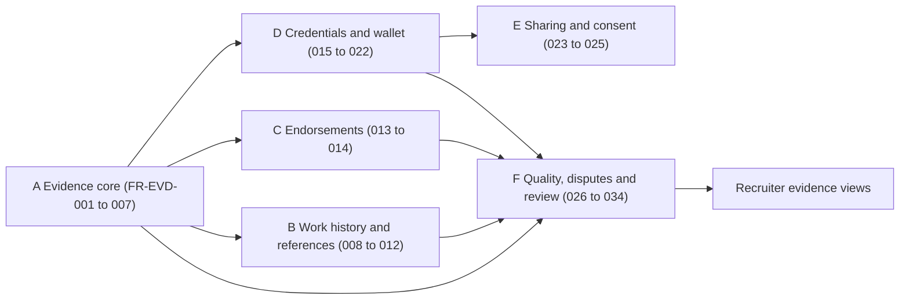
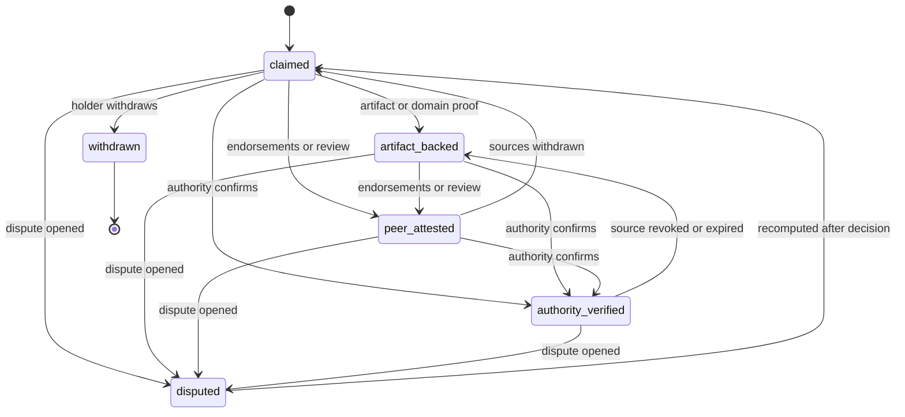
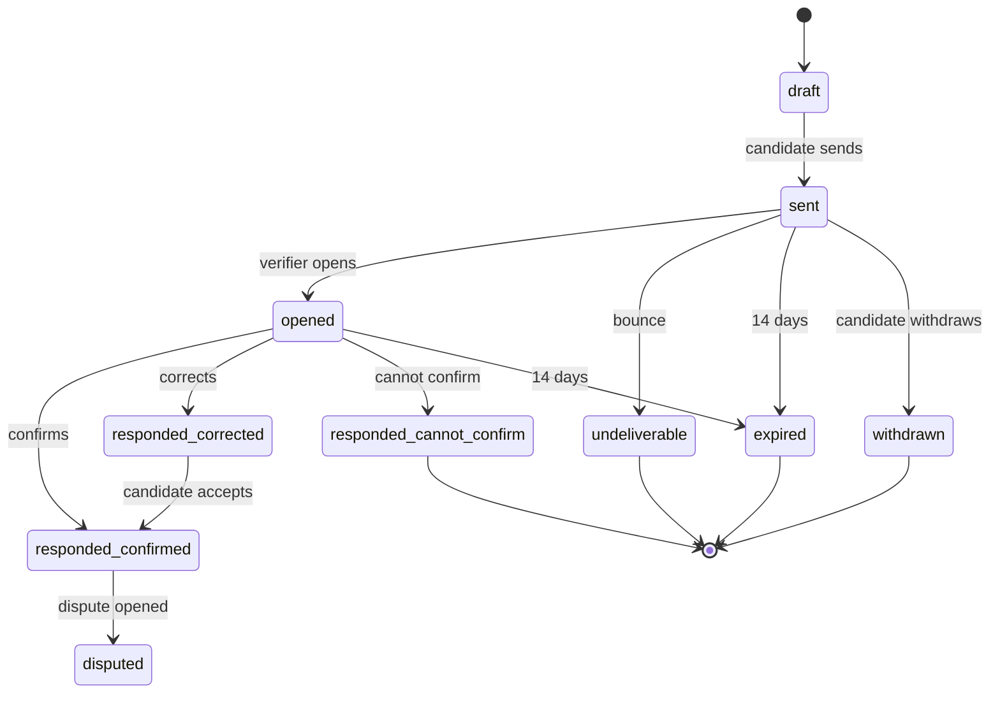
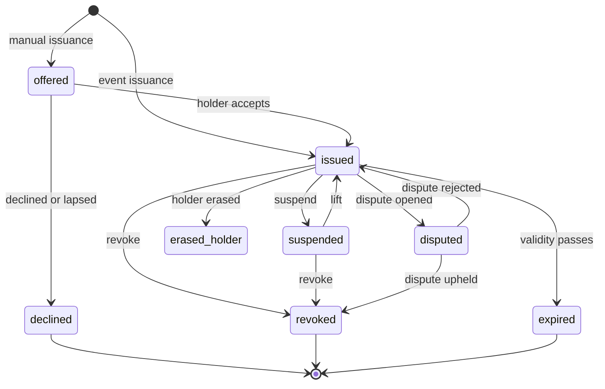
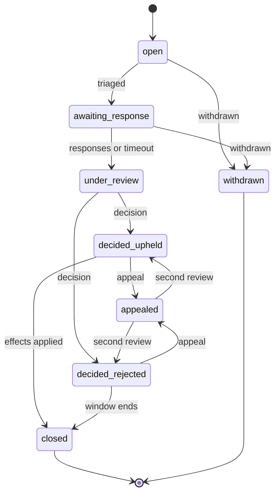
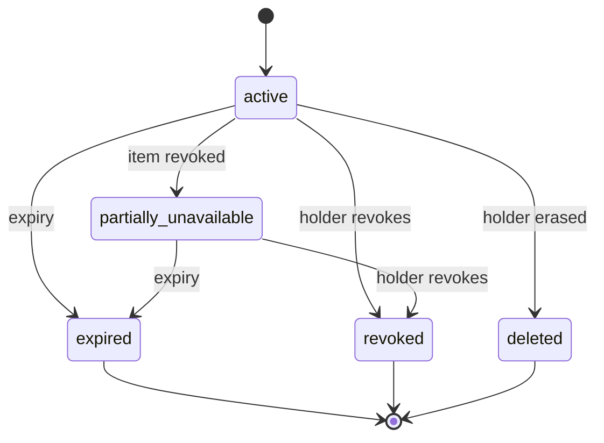
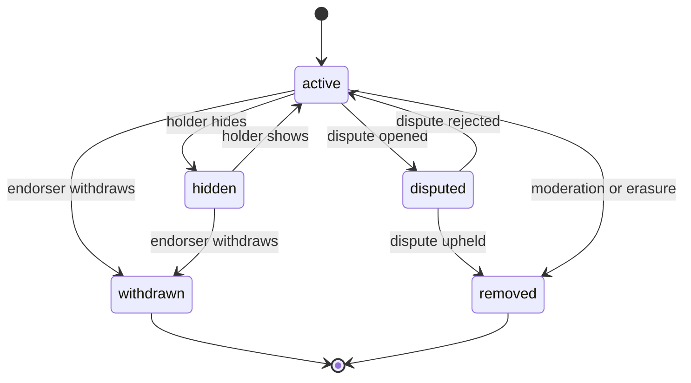
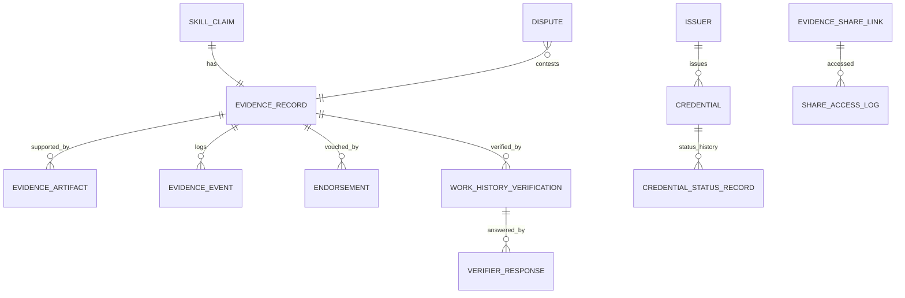

# EVD — Evidence, Work History & Credentials

> Status: intended product specification. Nothing here is a claim that anything is built. Legacy inputs: `SSOT.md` §6.1, §6.3, §14.3, F-94, F-96, F-110, F-123, F-162, F-163, F-164, BR-149..BR-156, Appendix E V61-07, V61-16, V61-17, V61-19.

## 1. Purpose, outcomes and boundaries

### 1.1 Purpose

EVD turns **claims** into **checkable evidence**. A claim is something a person says (PRF). Evidence is an artifact or observation with provenance that supports a claim. A credential is a formal attestation by an issuer with scope and lifecycle `[SRC: SSOT §6]`. EVD owns the evidence model, the verification ladder, work history verification by employers, skill claims and endorsements, platform-issued and imported credentials, the credential wallet and public verification, scoped sharing with consent, evidence quality, disputes, and the views recruiters use to review evidence.

### 1.2 Outcomes

1. A candidate can back each claim with evidence and see, at a glance, how strong it is and why.
2. An employer or recruiter can tell the difference between "claimed", "supported", "vouched for" and "verified by an authority" and see who the authority is.
3. A candidate can have an employer confirm a job without creating an account or sharing a login.
4. A holder owns a wallet of credentials they can present, export and revoke access to.
5. Nothing becomes "verified" because a client said so; every verified state is a server-side transition with an audit trail.
6. Disputes, revocations and expiry change what everyone sees, and the downstream effects are explicit.

### 1.3 In scope, out of scope, owned vs consumed

| Area | Owned by EVD | Not owned (owner) |
| --- | --- | --- |
| Evidence model, ladder, quality, freshness | Yes | Skill taxonomy and synonyms: SRC |
| Skill claims, endorsements and weights | Yes | The skill list display on the profile: PRF |
| Work history verification (candidate-initiated), employer attestation portal and API | Yes | Formal employment verification ordered by an employer during hiring: BGV |
| Candidate-initiated references | Yes | Employer-initiated reference checks: BGV |
| Credential issuance, import, wallet, public verification, revocation, portability | Yes | Course and assessment logic that triggers issuance: LRN, ASM (planned) |
| Share links with scoped consent | Yes | The global consent ledger and privacy center: SET (planned) |
| Disputes of evidence, revocations and endorsements | Yes | Disputes of background check results: BGV |
| Recruiter evidence review views | Yes (the evidence panels and packs) | Recruiter pipeline and talent pool UI: ATS (planned) |
| Reputation score derived from signals | Consumed (REP, planned) | Gamification: REP |

**Consumed:** accounts (IDN), profile claims (PRF), assessment results (ASM, planned), course completion (LRN, planned), connections (NET, planned), organizations and verified domains (EMP, planned), notifications (NTF), moderation (TSF), erasure orchestration (SET/IDN).

### 1.4 Boundaries that are easy to confuse

- **Work history verification (EVD) vs employment verification check (BGV):** EVD is requested by the candidate and reusable across employers. BGV is ordered by an employer for a specific application under hiring-check consent. BGV may reuse a valid EVD verification (FR-BGV-006).
- **Candidate reference (EVD) vs reference check (BGV):** EVD references are solicited by the candidate and may be shown. BGV reference checks are confidential to the hiring employer.
- **Endorsement (EVD) vs recommendation (PRF):** endorsements vouch for one skill with weight; recommendations are free text.
- **Credential (EVD) vs badge/XP (REP, planned):** REP awards recognition and points; EVD issues attestations of achievement with verification URLs.

## 2. Roles and permission matrix

`Y` allowed, `-` not allowed, `V` allowed within visibility or share scope, `A` allowed with audit, `T` via token (no account).

| Capability | GUE | CAN/STD/FRL (holder) | CAN (peer) | INS | MNT | REC/HMG | EAD | IAD/PLO | MOD | SUP | PAD | SAD | API |
| --- | --- | --- | --- | --- | --- | --- | --- | --- | --- | --- | --- | --- | --- |
| Create skill claims, attach evidence | - | Y | - | - | - | - | - | - | - | - | - | - | - |
| Request work history verification | - | Y | - | - | - | - | - | - | - | - | - | - | - |
| Respond to a verification request | T | - | - | - | - | T or Y | Y (org verifier) | Y (institution verifier) | - | - | - | - | Y |
| Verify an organization's own staff history (bulk) | - | - | - | - | - | - | Y | Y (alumni records) | - | - | - | - | Y |
| Endorse a connected person's skill | - | - | Y | Y | Y | Y | - | - | - | - | - | - | - |
| Attest a learner's project (instructor attestation) | - | - | - | Y (not own learner conflict) | Y | - | - | Y | - | - | - | - | - |
| View own wallet and evidence | - | Y | - | - | - | - | - | - | - | - | - | - | - |
| View another person's evidence | V (public verify only) | - | V | V | V | V (visibility + share) | V | V | A | A | A | A | V |
| Issue credentials | - | - | - | Y (via LRN/ASM) | - | - | Y (employer_org class) | Y (institution class) | - | - | Y (platform class) | Y | Y |
| Revoke or suspend a credential | - | - | - | Y (own issued) | - | - | Y (own issued) | Y (own issued) | - | - | Y | Y | Y |
| Open a dispute | - | Y | Y | Y | Y | Y | Y | Y | - | - | - | - | - |
| Decide disputes | - | - | - | - | - | - | - | - | - | Y (triage) | Y | Y | - |
| Manage issuer registry and signing keys | - | - | - | - | - | - | - | - | - | - | Y | Y | - |
| Create evidence share links | - | Y | - | - | - | - | - | - | - | - | - | - | - |
| Configure quality score components | - | - | - | - | - | - | - | - | - | - | Y (versioned) | Y | - |
| Review manual evidence queue | - | - | - | - | - | - | - | - | - | - | Y (verification staff) | Y | - |

Staff verification staff are a PAD sub-role (named "verification staff") `[PROP]`; the role set in CONVENTIONS has no separate code (OD-EVD-08).

## 3. Sub-module map

| Sub-module | Name | Features |
| --- | --- | --- |
| A | Evidence core | FR-EVD-001 to 007 |
| B | Work history and references | FR-EVD-008 to 012 |
| C | Endorsements | FR-EVD-013 to 014 |
| D | Credentials and wallet | FR-EVD-015 to 022 |
| E | Sharing and consent | FR-EVD-023 to 025 |
| F | Quality, disputes and review | FR-EVD-026 to 034 |

## 4. Feature specifications

### Sub-module A: Evidence core

### FR-EVD-001 — Evidence model and verification ladder

- **Sub-module:** A Evidence core
- **Priority / tier:** Must · R1
- **Source:** [SRC: SSOT §6.1 "A claim is not verified evidence"; Appendix E V61-17 (Proposed four-rung ladder)]
- **Purpose and outcome:** Every claim and evidence item has a defined verification rung and provenance so every screen and API tells the same truth. The system knows it worked when no item can reach a verified state except through a server-side transition.
- **Roles and permissions:** `all authenticated roles: read rung and issuer class per visibility` · `system: transition rungs` · `PAD: configure issuer classes`
- **Preconditions and entry points:** A claim exists (PRF experience, education, certification, skill, project). Entry: evidence chips everywhere; "Evidence" drawer on a claim.
- **User interactions and actions:**
  1. Holder opens the evidence drawer on a claim and sees the current rung and the steps to raise it.
  2. Any viewer clicks a chip to see rung, issuer class, method, date and status.
  3. Holder follows a suggested action ("Ask your employer to confirm", "Add an artifact").
- **System behaviour:** Rungs: `claimed` (self-asserted); `artifact_backed` (supporting artifact or domain-bound employer proof); `peer_attested` (independent peer endorsements meeting FR-EVD-014 thresholds or an instructor attestation per BR-EVD-003); `authority_verified` (issuer or authority confirmed; carries mandatory `issuerClass`: platform, institution, employer_org, instructor). Rungs are not strictly cumulative; an item shows its highest rung and all supporting evidence. Transitions happen only in the evidence service in response to qualifying events (BR-EVD-001). Each transition writes an immutable `EvidenceEvent`. Rung downgrade occurs on revocation, dispute or expiry (BR-EVD-017).
- **UI elements and controls:** Chip (icon + text: Claimed, Artifact-backed, Peer-attested, Verified by {issuerClass}), popover with method and date, "How to strengthen" list.
- **Configuration options:** Platform: ladder labels, issuer classes, thresholds for peer attestation. User: none.
- **Business rules:** BR-EVD-001, BR-EVD-002, BR-EVD-003, BR-EVD-004, BR-EVD-005.
- **Validation:** rung changes rejected unless a qualifying source event id is supplied; `issuerClass` mandatory for `authority_verified`.
- **Inputs and outputs:** In: claim id. Out: evidence summary (rung, issuerClass, items, status, freshness).
- **Filters, sorting, search:** Evidence lists filter by rung, type, status; SRC uses rung as a facet.
- **Notifications and communication:** Rung change notice to holder (in-app and email, template `evd.evidence.rung_changed`, class `account_activity`).
- **Error handling and edge cases:** Client tries to set verified → 403. Qualifying source disappears (e.g., course revoked) → downgrade with reason. Multiple authorities disagree → FR-EVD-029.
- **Dependencies:** ENT-EVD-01, ENT-EVD-02, ENT-EVD-03, PRF claims.
- **Security and privacy:** Evidence summaries obey visibility (BR-EVD-025). Only server code can write rung fields; database constraints block direct updates.
- **Acceptance criteria:**
  1. Given a claim with an employer-confirmed record, when read, then rung is `authority_verified` with `issuerClass = employer_org`.
  2. Given an instructor attestation, when read, then the chip says "Peer-attested (instructor)" and never "Verified by platform".
  3. Given a client request that sets `authority_verified` directly, when sent, then it is rejected with 403. (negative)

### FR-EVD-002 — Skill claims

- **Sub-module:** A Evidence core
- **Priority / tier:** Must · R1
- **Source:** [SRC: SSOT F-12 step 3 `self_reported`; F-96] and [DER]
- **Purpose and outcome:** Each skill on a profile maps to a skill claim that accumulates evidence. Success is one claim per person per canonical skill with all its evidence in one place.
- **Roles and permissions:** `CAN/STD/FRL: create, view, withdraw own` · `REC/HMG: view per visibility`
- **Preconditions and entry points:** Canonical skill exists (SRC taxonomy). Entry: PRF skills section; "Add evidence" on a skill; automatic creation when evidence from assessments or courses arrives.
- **User interactions and actions:**
  1. Holder adds a skill in PRF; a claim is created (or found).
  2. Holder opens the skill's evidence panel: sees every evidence item, rung, freshness.
  3. Holder presses "Add evidence" (FR-EVD-003) or "Request endorsement" (FR-EVD-013).
  4. Holder withdraws a claim (removes skill from profile); evidence stays in the wallet but is detached from the public view.
- **System behaviour:** Claim key is (holderId, canonicalSkillId). Evidence from ASM, LRN and contributions auto-creates the claim if absent and flags it for the holder to accept onto the profile (never auto-published). Skill merges/deprecations in taxonomy remap claims; evidence follows. Claim carries `proficiencyClaimed` (from PRF) and `proficiencySupported` (from evidence, optional level when evidence states one).
- **UI elements and controls:** Skill row with chips, evidence panel, "Add evidence", "Request endorsement", "Withdraw".
- **Configuration options:** Platform: taxonomy mapping rules.
- **Business rules:** BR-EVD-001, BR-EVD-036.
- **Validation:** skill id active; one claim per skill; claimed proficiency must be one of the four PRF levels.
- **Inputs and outputs:** In: skill id. Out: claim with evidence summary.
- **Filters, sorting, search:** Filter by rung and freshness.
- **Notifications and communication:** "New evidence for {skill}: add it to your profile?" in-app (class `account_activity`).
- **Error handling and edge cases:** Duplicate create → returns existing. Skill deprecated and merged → remap with note. Withdraw with endorsements → endorsements retained but hidden; endorsers are not notified.
- **Dependencies:** ENT-EVD-02, SRC taxonomy (FR-SRC-030), PRF (FR-PRF-007).
- **Security and privacy:** Claim list is private to the holder; visible to others per PRF section visibility.
- **Acceptance criteria:**
  1. Given a skill added in PRF, when read in EVD, then exactly one claim exists.
  2. Given course evidence arrives for a skill not on the profile, when processed, then a claim is created and flagged "Add to profile?" but not shown publicly.
  3. Given a duplicate skill add via API, when sent, then no second claim is created. (negative)

### FR-EVD-003 — Evidence attachments (artifacts and links)

- **Sub-module:** A Evidence core
- **Priority / tier:** Must · R1
- **Source:** [SRC: SSOT F-96 evidence types `project_submission`, `contribution`] and [DER]
- **Purpose and outcome:** The holder attaches supporting artifacts (files, links, writing samples, certificates) to a claim; success is an artifact-backed claim.
- **Roles and permissions:** `CAN/STD/FRL: add, remove own` · `REC: view only through share link or visibility`
- **Preconditions and entry points:** Claim exists. Entry: "Add evidence" on a claim.
- **User interactions and actions:**
  1. Choose type: file (PDF, image, doc, archive ≤ 50 MB), link (https), repository, publication, text note.
  2. Add title, description (what this shows, ≤ 500 chars), date, role, and which claims it supports (multi-select).
  3. Set artifact visibility: Only me, Share links only, Profile visibility level.
  4. Press "Save".
- **System behaviour:** Files go through PLT scanning. Links are checked with the SSRF-safe fetcher (reachability, title capture; the artifact content is not stored). An artifact alone raises a claim to `artifact_backed` only if it passes automatic sanity checks (non-empty, scannable, not a duplicate of another user's artifact hash) (BR-EVD-005). Duplicate-hash artifacts submitted by different holders are flagged for review (possible reuse). Artifacts are immutable; edit means new artifact with `supersedes` link.
- **UI elements and controls:** Type selector, dropzone, URL input, description counter, claims multi-select, visibility select.
- **Configuration options:** Platform: file types, size limit (50 MB), per-claim count limit (20).
- **Business rules:** BR-EVD-005, BR-EVD-030.
- **Validation:** description 1–500; URL https ≤ 500 chars; file types allowlisted; ≤ 20 artifacts per claim.
- **Inputs and outputs:** In: artifact and metadata. Out: artifact record and updated rung.
- **Filters, sorting, search:** Filter by type, claim, date.
- **Notifications and communication:** None.
- **Error handling and edge cases:** Scan failure → rejected. Link unreachable → saved as `unreachable` with a warning and not counted toward rung. Same artifact hash used by another holder → saved but marked `review_needed`, not counted until cleared.
- **Dependencies:** ENT-EVD-03, PLT scanning, FR-EVD-001.
- **Security and privacy:** Artifacts are private by default; no public URL; downloads through short-lived signed links; contents never indexed by SRC.
- **Acceptance criteria:**
  1. Given a PDF certificate, when attached to a claim, then the claim becomes `artifact_backed`.
  2. Given an artifact link that returns 404, when saved, then it is marked unreachable and does not raise the rung.
  3. Given a 60 MB file, when uploading, then rejected with the size limit. (negative)

### FR-EVD-004 — Evidence from assessment results

- **Sub-module:** A Evidence core
- **Priority / tier:** Must · R2
- **Source:** [SRC: SSOT F-96 evidence `challenge_pass`, `certification`; BR-156]
- **Purpose and outcome:** Passed assessments and challenges become platform-verified evidence automatically. Success is an `authority_verified` (issuerClass platform) evidence item referencing the attempt.
- **Roles and permissions:** `system: create` · `CAN: view, hide from profile` · `ASM (planned): emit events`
- **Preconditions and entry points:** ASM emits `asm.attempt.passed` (planned) with integrity status clear.
- **User interactions and actions:**
  1. Candidate completes an assessment; sees "Evidence added to {skill}".
  2. Candidate chooses "Add to profile" or leaves it private.
- **System behaviour:** On the event, EVD verifies the event signature and integrity flag, creates the evidence item with attributes (assessment id, version, score band, date, integrity level, proctoring yes/no) and links it to the skill claim(s) the assessment maps to. A candidate's raw score is not shown to recruiters by default; a band (e.g., "Advanced") is shown unless the candidate shares the score. Idempotent per attempt id. If ASM later invalidates the attempt (integrity violation), the evidence is revoked (FR-EVD-020). Evidence below the pass threshold is not created.
- **UI elements and controls:** Evidence card (assessment name, band, date, integrity badge), "Show on profile" toggle, "Share score" toggle.
- **Configuration options:** Platform: band mapping, evidence validity (default 24 months for skill assessments `[PROP]`).
- **Business rules:** BR-EVD-008, BR-EVD-002, BR-EVD-017.
- **Validation:** event must be from the ASM service principal with valid signature; attempt must be `passed` and integrity `clear`.
- **Inputs and outputs:** In: assessment event. Out: evidence item, claim updates.
- **Filters, sorting, search:** Filter by assessment, band.
- **Notifications and communication:** In-app and email "You earned evidence for {skill}" (class `account_activity`).
- **Error handling and edge cases:** Duplicate event → no-op. Unknown skill mapping → queued for taxonomy review and the candidate is told evidence is pending. Integrity flag `under_review` → evidence created `suspended` until cleared.
- **Dependencies:** ASM (planned), ENT-EVD-03, FR-EVD-001.
- **Security and privacy:** Raw scores private; only bands shared by default; integrity details never shown to recruiters beyond "integrity checked".
- **Acceptance criteria:**
  1. Given a passed attempt with clear integrity, when the event arrives, then evidence is created once with rung `authority_verified` (platform).
  2. Given the same event is replayed, when processed, then no duplicate evidence is created.
  3. Given an event with `integrity=flagged`, when processed, then no active evidence is created. (negative)

### FR-EVD-005 — Evidence from course completion

- **Sub-module:** A Evidence core
- **Priority / tier:** Must · R2
- **Source:** [SRC: SSOT F-96 `course_completion` (≥70% final grade); BR-048]
- **Purpose and outcome:** Completing a course creates evidence and, when the course offers it, a credential. Success is evidence linked to the course skills with the completion criteria stored.
- **Roles and permissions:** `system: create` · `CAN: view, hide` · `INS: see issuance stats for own courses`
- **Preconditions and entry points:** LRN emits `lrn.course.completed` (planned) with grade and criteria.
- **User interactions and actions:**
  1. Learner completes a course.
  2. Sees a completion screen with "Evidence added" and, if configured, "Credential issued" (FR-EVD-015).
  3. Chooses to add to profile.
- **System behaviour:** Creates a course-completion evidence item (course id, version, grade band, hours, completion date, learning outcomes) with `authority_verified` and issuerClass `platform` for platform-run assessment criteria; for courses of institutional partners the issuerClass follows the course owner class. Instructor sign-off alone does not produce `authority_verified` (BR-EVD-003). Skills mapped by the course; an update to a course's skill mapping applies only to future completions.
- **UI elements and controls:** Evidence card, "Show on profile", "View credential".
- **Configuration options:** Platform: minimum grade (default 70 per course policy in LRN).
- **Business rules:** BR-EVD-008, BR-EVD-003, BR-EVD-017.
- **Validation:** event signature; completion criteria satisfied as stated in the event.
- **Inputs and outputs:** In: completion event. Out: evidence item, optional credential issuance request.
- **Filters, sorting, search:** Filter by course, institution, date.
- **Notifications and communication:** As FR-EVD-004.
- **Error handling and edge cases:** Course later withdrawn for integrity → evidence revoked with reason. Learner deletes enrollment history → evidence retained under wallet unless learner removes it.
- **Dependencies:** LRN (planned), FR-EVD-015.
- **Security and privacy:** Grades are shown as bands by default; learner chooses to share exact grade.
- **Acceptance criteria:**
  1. Given a completion with grade 82, when processed, then evidence shows band "Pass" and the course's skills are linked.
  2. Given a completion with grade 64, when the event is received, then no evidence is created.
  3. Given an instructor attempts to mark a learner as verified without completion criteria, when sent, then no `authority_verified` evidence exists. (negative)

### FR-EVD-006 — Evidence from portfolio project review

- **Sub-module:** A Evidence core
- **Priority / tier:** Should · R2
- **Source:** [SRC: SSOT F-96 `project_submission` "from portfolio with peer/instructor review"; V61-17 instructor ≠ learner]
- **Purpose and outcome:** A portfolio project can be reviewed by qualified reviewers; the review becomes evidence on the skills the project claims.
- **Roles and permissions:** `CAN: request review` · `INS/MNT/CAN (peer with endorsement rights): review` · `PAD: assign for platform reviews`
- **Preconditions and entry points:** Published PRF project with claimed skills. Entry: "Request review" on a project.
- **User interactions and actions:**
  1. Owner presses "Request review", picks reviewer types (peer, instructor, mentor) and optionally names a reviewer.
  2. Reviewer sees a rubric: per skill rating (Not demonstrated, Partial, Demonstrated, Strong), written justification (≥ 100 chars), conflict-of-interest declaration.
  3. Reviewer submits; owner sees the review and decides to show on profile.
- **System behaviour:** Conflict checks: reviewer ≠ owner; no shared employer in the last 24 months for peer reviews unless declared and accepted by the owner; instructor reviews need no instructor-learner enrollment conflict (BR-EVD-003). A review rated "Demonstrated" or higher by a peer yields `peer_attested` support; instructor reviews yield `peer_attested` with label "Instructor-reviewed"; platform-staff reviews (verification staff) under a documented rubric may yield `authority_verified` with class `platform`. Reviews are signed records (immutable). Reviewers are rate limited (10 per week).
- **UI elements and controls:** Review request dialog, rubric form, conflict declaration checkbox, submit button, review card.
- **Configuration options:** Platform: rubric, reviewer eligibility (e.g., verified account, account age ≥ 30 days `[PROP]`).
- **Business rules:** BR-EVD-003, BR-EVD-012, BR-EVD-015.
- **Validation:** justification ≥ 100 chars; each claimed skill rated or "Not reviewed"; reviewer eligibility.
- **Inputs and outputs:** In: project id, reviewer, rubric. Out: review evidence, rung update.
- **Filters, sorting, search:** Reviewer queue filter by skill and age.
- **Notifications and communication:** Review request (email and in-app, class `social`), completed review notice to owner.
- **Error handling and edge cases:** Reviewer declines or doesn't respond in 14 days → request expires. Conflict detected → request blocked with message. Reviewer later flagged as fraudulent → their reviews are suspended and rungs recalculated.
- **Dependencies:** PRF projects (FR-PRF-029), ENT-EVD-03, ENT-EVD-05.
- **Security and privacy:** Reviewer identity is shown (no anonymous reviews, BR-EVD-015); project content is visible to the reviewer only for the review period.
- **Acceptance criteria:**
  1. Given a peer review "Demonstrated" for a skill, when published, then the claim has peer-attested support from a named reviewer.
  2. Given a reviewer who shares an employer with the owner, when accepting, then a conflict declaration is required.
  3. Given the owner reviewing their own project via another account detected by device and email links, when submitting, then it is rejected. (negative)

### FR-EVD-007 — Evidence from external contributions

- **Sub-module:** A Evidence core
- **Priority / tier:** Should · R3
- **Source:** [SRC: SSOT F-89 Contribution Verification, F-143 OSS Contribution Discovery; F-96 `contribution`]
- **Purpose and outcome:** The holder proves ownership of an external account (GitHub, GitLab, similar) and gets verified contribution evidence. Success is an artifact-backed claim with authorship proof.
- **Roles and permissions:** `CAN/STD/FRL: connect, sync, disconnect own`
- **Preconditions and entry points:** Entry: PRF links "Connect to prove ownership"; evidence drawer "Add contribution".
- **User interactions and actions:**
  1. Choose provider and press "Connect"; complete OAuth with read-only, minimal scopes.
  2. Select repositories or organizations to analyze (default: public only).
  3. Review the derived summary (languages, merged PR count, review activity, period) and press "Add as evidence".
  4. Press "Disconnect" to revoke tokens and optionally delete derived evidence.
- **System behaviour:** Ownership is proven by the OAuth identity. Derived metrics count merged PRs authored by the user, excluding forks without upstream merges, bot accounts, generated commits and trivial changes under a threshold. Skills inferred from languages and topics are suggestions only (BR-EVD-036). Private repositories are excluded unless the user explicitly selects them and chooses to show only aggregates. Tokens are stored encrypted and used only for scheduled sync (default weekly); sync stops on disconnect. Evidence is `artifact_backed` with class none; it does not reach `authority_verified`.
- **UI elements and controls:** Provider list, OAuth consent button, repo selector with public/private badges, summary view, "Add as evidence", "Sync now", "Disconnect".
- **Configuration options:** Platform: providers, sync frequency, thresholds. User: scope of repos.
- **Business rules:** BR-EVD-031, BR-EVD-036, BR-EVD-005.
- **Validation:** provider token valid; user must select at least one repo; rate limits of provider respected.
- **Inputs and outputs:** In: provider authorization, selected repos. Out: contribution evidence summary.
- **Filters, sorting, search:** Filter by provider, period.
- **Notifications and communication:** Sync failure notice (in-app).
- **Error handling and edge cases:** Token revoked at provider → sync marked `needs_reconnect`. Provider outage → retried with backoff. Disconnect → tokens deleted immediately; derived evidence remains unless user deletes it.
- **Dependencies:** PLT integrations (planned), PRF links (FR-PRF-010).
- **Security and privacy:** Least-privilege scopes; no source code is stored; only metadata and counts; private repo names never public.
- **Acceptance criteria:**
  1. Given a connected GitHub account with 12 merged PRs, when synced, then the evidence summary shows 12 merged PRs.
  2. Given the user disconnects, when checked, then tokens are deleted and no further sync occurs.
  3. Given a repo that is a fork with no upstream merges, when computing, then it contributes nothing. (negative)

### Sub-module B: Work history and references

### FR-EVD-008 — Work history verification record

- **Sub-module:** B Work history and references
- **Priority / tier:** Must · R2
- **Source:** [SRC: SSOT F-94 "company email verification; dates, title, achievements verified"; F-162 Verified Work History Network]
- **Purpose and outcome:** The holder asks an employer to confirm a role; the confirmed record is reusable evidence. Success is an `authority_verified` work history record (issuerClass employer_org) linked to the PRF entry.
- **Roles and permissions:** `CAN/STD/FRL: request, withdraw, view own` · `employer verifier: respond`
- **Preconditions and entry points:** A PRF experience entry. Entry: "Verify this role" on the entry.
- **User interactions and actions:**
  1. Press "Verify this role"; the form pre-fills company, title, dates.
  2. Choose how: "Ask my employer's HR/verification contact" (enter email of a verifier), "Ask my manager or colleague" (peer path), or "Use my work email" (domain proof).
  3. Confirm which facts to be verified (title, dates, employment type); optionally add achievements for the verifier to confirm.
  4. Press "Send request"; track status (Sent, Opened, Responded, Expired).
- **System behaviour:** Creates a `WorkHistoryVerification` (SM-EVD-02). Delivery per FR-EVD-009. Paths: (a) **Employer verifier** confirms facts → `authority_verified` (employer_org) only if the verifier meets BR-EVD-011; (b) **Work email domain proof**: candidate verifies a work email address at the employer domain via one-time code; reaches `artifact_backed` only (the domain proves employment at some time, not title or dates) and `authority_verified` only if the domain is bound to a verified employer organization AND an authorized verifier confirms (BR-EVD-004); (c) **Peer path**: a colleague confirms, giving `peer_attested`. A candidate can have multiple verifications on one entry; the highest rung wins. Verified records lock the entry's key fields (PRF BR-PRF-011).
- **UI elements and controls:** Request wizard (3 steps), verifier email input with explanation, facts checklist, status timeline, Withdraw and Resend buttons.
- **Configuration options:** Platform: request expiry (14 days), reminder schedule, max active requests per entry (3).
- **Business rules:** BR-EVD-004, BR-EVD-011, BR-EVD-012, BR-EVD-013, BR-EVD-014.
- **Validation:** verifier email valid, not equal to candidate email or any candidate-owned email; ≤ 3 active requests per entry; dates plausible.
- **Inputs and outputs:** In: entry id, method, verifier, facts. Out: verification record and status.
- **Filters, sorting, search:** Own list filter by status.
- **Notifications and communication:** To verifier: request email (template `evd.workhistory.request`, transactional); reminders day 3 and 7; to candidate: status changes (in-app and email, class `account_activity`).
- **Error handling and edge cases:** Email bounces → status `undeliverable`, candidate asked to supply another contact. Employer says dates differ → `corrected` state with employer's values shown; candidate chooses to accept (updates PRF with confirmation) or dispute. Candidate edits entry while request pending → request cancelled with warning. Company has no contact → candidate directed to the peer path.
- **Dependencies:** ENT-EVD-06, SM-EVD-02, PRF entries, EMP verified domains (planned), FR-EVD-009.
- **Security and privacy:** Request emails contain only role facts, not other profile data; the verifier does not see the candidate's profile; verification responses are stored with verifier identity and consent notice.
- **Acceptance criteria:**
  1. Given a verifier at the verified employer domain confirms, when processed, then the entry shows "Verified by employer".
  2. Given the verifier email equals the candidate's own email, when sending, then rejected.
  3. Given only a work-email domain proof on an unverified employer domain, when completed, then the rung is `artifact_backed` and not `authority_verified`. (negative)

### FR-EVD-009 — Verification delivery and responder portal

- **Sub-module:** B Work history and references
- **Priority / tier:** Must · R2
- **Source:** [SRC: SSOT F-94 "Employment verification < 7d"] and [PROP] tokenized responder portal
- **Purpose and outcome:** An employer verifier can respond in two minutes without creating an account. Success is a recorded response tied to a verified identity.
- **Roles and permissions:** `verifier (token): view request, respond` · `EAD/REC at a verified org: respond signed-in` · `SUP: resend on request`
- **Preconditions and entry points:** Active verification request. Entry: email link `/v/:token`.
- **User interactions and actions:**
  1. Verifier opens the link and sees a clear explanation: who is asking, what facts to confirm, and how data is used.
  2. Verifier proves identity: signs in with employer org account, or enters a code sent to their work email at the employer domain.
  3. For each fact choose Confirm, Correct (enter the right value), or Cannot confirm; add optional comment (≤ 500 chars).
  4. Declare authority: "I am authorized to verify employment for {organization}" (checkbox) with role (HR, manager, other).
  5. Submit; see confirmation; optionally create an organization account to respond in bulk.
- **System behaviour:** Token is single-use per verifier session, expires in 14 days, bound to the request. Domain check: verifier email domain must match the employer's verified domain(s) when known; otherwise treated as unbound (artifact-level only). Responses are signed with timestamp and stored immutably. Rate limiting and bot protection (CAPTCHA fallback) prevent abuse. "Report this request" lets the verifier flag fraud or spam; flagged requests go to TSF. A verifier may decline all future requests from the platform ("Do not contact me") stored hashed.
- **UI elements and controls:** Request summary card, identity step, per-fact radio group (Confirm/Correct/Cannot confirm), comment field, authority checkbox, Submit, "Report this request", "Do not contact me".
- **Configuration options:** Platform: token expiry, reminder cadence, supported verification methods.
- **Business rules:** BR-EVD-011, BR-EVD-013, BR-EVD-014, BR-EVD-004.
- **Validation:** corrected dates valid; comment ≤ 500; authority checkbox required to confirm.
- **Inputs and outputs:** In: token, identity proof, per-fact answers. Out: response record, status change.
- **Filters, sorting, search:** n/a — single-request portal.
- **Notifications and communication:** Confirmation email to verifier; result to candidate.
- **Error handling and edge cases:** Expired token → page offers "Ask the candidate to resend". Wrong code 5 times → locked 30 min. Verifier is not authorized → can choose "Forward" which sends the request to a named colleague. Candidate withdrew → "This request is no longer active". Two verifiers respond differently → FR-EVD-029.
- **Dependencies:** ENT-EVD-06, ENT-EVD-07, NTF (planned), TSF (planned).
- **Security and privacy:** No candidate data beyond requested facts; token not guessable (128-bit); page has `noindex`, no third-party scripts; verifier PII minimized (name, work email, role stored; email hashed in the do-not-contact list).
- **Acceptance criteria:**
  1. Given a valid token and domain code, when the verifier confirms all facts, then the request becomes `verified` and the candidate is notified.
  2. Given an expired token, when opened, then no facts are shown and a resend path is offered.
  3. Given 5 wrong codes, when attempting a sixth, then the verifier is locked out for 30 minutes. (negative)

### FR-EVD-010 — Employer organization attestation and bulk verification

- **Sub-module:** B Work history and references
- **Priority / tier:** Should · R3
- **Source:** [SRC: SSOT F-162 Verified Work History Network & Graph] and [PROP] HRIS-based bulk attestation
- **Purpose and outcome:** An employer organization verifies its staff's history at scale (CSV or HRIS) so employees' roles show as verified. Success is a set of `authority_verified` records with employer_org class.
- **Roles and permissions:** `EAD: connect, upload, approve` · `REC/HMG: respond to individual requests` · `API: submit via service principal`
- **Preconditions and entry points:** Employer organization with verified domain (EMP planned). Entry: Employer settings "Verification program".
- **User interactions and actions:**
  1. EAD designates verification contacts (individuals) and a response policy.
  2. EAD uploads a CSV (employee email or id, title, start, end, employment type) or connects an HRIS adapter.
  3. System matches rows to platform accounts by verified work email; unmatched rows stay pending until the person joins.
  4. EAD reviews match counts and approves publication; employees get "Your employer verified this role".
- **System behaviour:** Matching uses verified work emails only (no name guessing). A match requires the employee to accept the record ("Is this you?") unless they previously requested verification. Records issued by the employer carry employer_org class. EAD can correct or end-date records (new record; history preserved). Employer must show an authorized signatory and agree to the verifier terms. Employer can set an auto-response policy for incoming requests (e.g., auto-confirm if record matches).
- **UI elements and controls:** Contact designation, CSV uploader with template, mapping step, match report, approve button, policy settings.
- **Configuration options:** Org: auto-response policy, contacts. Platform: CSV size (≤ 50,000 rows `[PROP]`).
- **Business rules:** BR-EVD-004, BR-EVD-011, BR-EVD-014, BR-EVD-005.
- **Validation:** required columns; email format; dates; duplicates by (email, title, start).
- **Inputs and outputs:** In: CSV or API payload. Out: match report, issued records.
- **Filters, sorting, search:** Match report filter by status.
- **Notifications and communication:** To employees: "Your employer verified a role" (class `account_activity`).
- **Error handling and edge cases:** Wrong person matched → employee rejects; employer notified. Employer deletes a record → shows as `retracted` to the holder with reason code (dispute path available). CSV with another company's staff → rejected by domain mismatch.
- **Dependencies:** EMP (planned), FR-EVD-008, FR-EVD-033.
- **Security and privacy:** Employee data minimized; employer sees only its own records; consent: employees can decline attestation display (it stays private).
- **Acceptance criteria:**
  1. Given a CSV row matching a verified work email, when approved, then the employee sees a pending acceptance and, after accepting, a verified role.
  2. Given a row with an email at another domain, when processing, then it is rejected as domain mismatch.
  3. Given an employee declines, when published, then the record is never shown on their profile. (negative)

### FR-EVD-011 — Candidate-initiated references

- **Sub-module:** B Work history and references
- **Priority / tier:** Should · R2
- **Source:** [SRC: SSOT F-94 "Referee system: structured recommendations"]
- **Purpose and outcome:** The holder collects structured references from named referees to share with employers. Success is a referee response linked to a role or skill.
- **Roles and permissions:** `CAN/STD/FRL: request, share own` · `referee (token or account): respond`
- **Preconditions and entry points:** Entry: "References" tab; "Request a reference" on an experience entry.
- **User interactions and actions:**
  1. Press "Request a reference"; enter referee name, email, relationship, linked role.
  2. Choose a question template (colleague, manager, client, instructor) or a custom question set of up to 5 questions.
  3. Send; track status; decide per reference whether it is shared (on profile, share links only, or private).
- **System behaviour:** Referee gets a tokenized form (FR-EVD-012). Eligibility: distinct person from the candidate; email not owned by the candidate; at most 2 referees from the same organization on one role `[PROP]`; at least one relationship verification question to confirm they worked together. References are stored as evidence `peer_attested` (labelled "Reference"), not authority-verified. Referee identity and relationship are displayed to authorized viewers. Candidate cannot edit a reference, only hide or request a new one.
- **UI elements and controls:** Request form, templates, status list, sharing select.
- **Configuration options:** Platform: templates, limits (10 requests per month).
- **Business rules:** BR-EVD-012, BR-EVD-015.
- **Validation:** referee email format and not candidate's; custom questions ≤ 5, each ≤ 200 chars.
- **Inputs and outputs:** In: referee, template. Out: reference record.
- **Filters, sorting, search:** Filter by status, role.
- **Notifications and communication:** Referee request email, reminders day 4 and 8, expiry day 14; candidate notices.
- **Error handling and edge cases:** Referee declines → status `declined`, no reason shown unless provided. Referee is detected as same person as candidate (email/device) → blocked. Referee asks to be removed → reference deleted.
- **Dependencies:** ENT-EVD-08, FR-EVD-012.
- **Security and privacy:** Referee data limited to name, email, relationship; used only for the request; not added to marketing.
- **Acceptance criteria:**
  1. Given a completed reference, when the candidate chooses "Share links only", then it is not visible on the profile.
  2. Given three referees from the same organization on one role, when sending the third, then it is rejected by the limit.
  3. Given a referee email equal to the candidate's, when sending, then rejected. (negative)

### FR-EVD-012 — Reference response form

- **Sub-module:** B Work history and references
- **Priority / tier:** Should · R2
- **Source:** [DER] from F-94
- **Purpose and outcome:** A referee answers structured questions quickly and accurately. Success is a submitted reference with relationship confirmed.
- **Roles and permissions:** `referee (token or signed-in): respond` · `holder: none`
- **Preconditions and entry points:** Active reference request. Entry: `/ref/:token`.
- **User interactions and actions:**
  1. Referee opens link, reads who asks and how the answers will be shared.
  2. Confirms relationship, period worked together, and capacity.
  3. Rates attributes (e.g., reliability, communication, skill depth) on a 5-point scale with required example text for ratings of 5 or 1; answers custom questions.
  4. Optionally adds skills they can vouch for (list from the candidate's claims).
  5. Submits; may choose "Allow the candidate to share this with employers" (required for sharing).
- **System behaviour:** Responses are immutable once submitted; referee may submit a correction within 7 days that supersedes. Identity proof: email code or account sign-in. The form discloses sharing and retention. Responses with abusive or discriminatory content are held for review (TSF). Vouched skills create peer-attested support (weights as endorsements, FR-EVD-014).
- **UI elements and controls:** Relationship fields, rating scales (radio groups with labels), text fields with counters, skill checkboxes, consent checkbox, Submit.
- **Configuration options:** Platform: question templates; org-specific templates are in BGV.
- **Business rules:** BR-EVD-012, BR-EVD-015, BR-EVD-032.
- **Validation:** rating example text 20–500 chars when required; all required questions answered.
- **Inputs and outputs:** In: answers. Out: reference record.
- **Filters, sorting, search:** n/a — form.
- **Notifications and communication:** Confirmation to referee; "Reference received" to candidate.
- **Error handling and edge cases:** Token expired → resend path. Submit twice → second treated as correction if within 7 days else rejected. Referee withdraws consent to share → reference becomes private.
- **Dependencies:** FR-EVD-011, TSF.
- **Security and privacy:** `noindex`, no third-party scripts; only the data entered is stored; bias-prone fields (age, health, family) are not asked.
- **Acceptance criteria:**
  1. Given a completed form with consent to share, when submitted, then the holder can share it.
  2. Given a rating of 5 without an example, when submitting, then it is rejected.
  3. Given a second submission after 10 days, when submitted, then it is refused. (negative)

### Sub-module C: Endorsements

### FR-EVD-013 — Skill endorsements

- **Sub-module:** C Endorsements
- **Priority / tier:** Should · R3
- **Source:** [SRC: SSOT F-110 Verified Skill Endorsements; BR-131, BR-152, BR-153]
- **Purpose and outcome:** A connected person vouches for a specific skill of another person. Success is a named endorsement counted per FR-EVD-014.
- **Roles and permissions:** `CAN/INS/MNT/REC/HMG (connected): endorse` · `holder: request, hide, report` · `endorser: withdraw`
- **Preconditions and entry points:** Endorser and holder are connected (NET planned), endorser account ≥ 7 days. Entry: "Endorse" on a skill; "Request endorsements" in the holder's skills.
- **User interactions and actions:**
  1. Endorser opens a skill, presses "Endorse", chooses relationship context (worked together, managed, taught, collaborated, observed work), strength (Familiar, Strong, Expert) and optionally a one-line comment (≤ 200).
  2. Holder sees the endorsement under the skill; can hide it from the profile.
  3. Endorser can withdraw anytime from "Endorsements given".
- **System behaviour:** Endorsements are never anonymous (BR-EVD-015), never self-endorsements, one active per (endorser, holder, skill). Rate limit 20 given per day. Reciprocal-endorsement and same-organization clusters are detected and down-weighted in FR-EVD-014. Withdrawn endorsements remain as history; weight becomes 0. Endorsers declared conflicted (e.g., family) is a self-declaration.
- **UI elements and controls:** Endorse button, context select, strength segmented control, comment field, "Endorsements given" list with Withdraw.
- **Configuration options:** Platform: daily cap, minimum account age, allowed relationship contexts.
- **Business rules:** BR-EVD-015, BR-EVD-016, BR-EVD-017.
- **Validation:** connection exists; not self; skill exists on holder's claim; comment ≤ 200.
- **Inputs and outputs:** In: skill claim, context, strength. Out: endorsement record.
- **Filters, sorting, search:** Holder filters by skill and endorser.
- **Notifications and communication:** "{name} endorsed you for {skill}" (in-app, optional email, class `social`).
- **Error handling and edge cases:** Not connected → button hidden; API 403. Daily cap reached → message with reset time. Endorser account erased → endorsement removed (not anonymized, BR-EVD-015).
- **Dependencies:** NET (planned), ENT-EVD-09, FR-EVD-014.
- **Security and privacy:** Endorser identity shown to holder and viewers per visibility; spam and collusion reports via TSF.
- **Acceptance criteria:**
  1. Given two connected users, when A endorses B's skill, then B sees A's name and the endorsement counts once.
  2. Given A endorses the same skill again, when saving, then the existing endorsement updates (no duplicate).
  3. Given non-connected users, when A tries to endorse via API, then 403. (negative)

### FR-EVD-014 — Endorsement weighting and peer attestation

- **Sub-module:** C Endorsements
- **Priority / tier:** Should · R3
- **Source:** [SRC: SSOT F-96 step 5; BR-152; open item: 2nd degree boost unreachable]
- **Purpose and outcome:** Endorsements are weighted deterministically so that gaming is harder, and enough credible weight lifts a claim to `peer_attested`. Success is a reproducible weight with explanations.
- **Roles and permissions:** `system: compute` · `PAD: configure weights (versioned)` · `holder, viewers: see explanation`
- **Preconditions and entry points:** Endorsements exist. Entry: "Why this weight?" on an endorsement summary.
- **User interactions and actions:**
  1. Viewer opens "Why this weight?" and sees: number of distinct endorsers, weight components, independence adjustments.
  2. PAD edits weights in the admin console with a diff and effective-from date.
- **System behaviour:** Weight per endorsement = `min(endorserReputation, 1.0)` + proximity boost (+0.2 direct connection) `[SRC: SSOT F-96 step 5]`; endorsers with no reputation count 0.1. The second-degree boost (+0.1) is unreachable while endorsements require a direct connection (BR-EVD-016) and is disabled; recorded as a conflict (OD-EVD-03). Adjustments: reciprocal pair ×0.5; endorsers from the same employer cluster counted once at the highest weight; endorsements older than the evidence window decay. Peer attestation threshold: at least 3 distinct endorsers and total weight ≥ 1.5 `[PROP]` (OD-EVD-04). Computation is a pure function of stored inputs and weight set version; stored with the version for replay.
- **UI elements and controls:** Popover with breakdown table; admin diff view.
- **Configuration options:** Platform: weights, thresholds, decay.
- **Business rules:** BR-EVD-016, BR-EVD-017, BR-EVD-018.
- **Validation:** admin weights within ranges and effective date in future.
- **Inputs and outputs:** In: endorsements, reputation signals (REP planned), connections. Out: total weight, peer-attested flag.
- **Filters, sorting, search:** n/a — computed.
- **Notifications and communication:** None.
- **Error handling and edge cases:** Reputation service unavailable → use last stored reputation, flag `stale`. Weight-set change → recompute nightly with versioned results; no silent history rewrite.
- **Dependencies:** REP (planned), NET (planned), ENT-EVD-09.
- **Security and privacy:** The breakdown doesn't reveal private reputation scores of endorsers, only bands.
- **Acceptance criteria:**
  1. Given the same inputs and weight set, when computed twice, then results are identical.
  2. Given 3 distinct endorsers with weight ≥ 1.5, when computed, then the claim shows peer-attested support.
  3. Given two endorsers who endorse each other only, when computed, then each weight is halved. (negative case for gaming)

### Sub-module D: Credentials and wallet

### FR-EVD-015 — Credential issuance (platform and institutions)

- **Sub-module:** D Credentials and wallet
- **Priority / tier:** Must · R2
- **Source:** [SRC: SSOT F-96 step 2; BR-149..BR-151, BR-156; F-52 Certificate Verification]
- **Purpose and outcome:** When a qualifying achievement occurs, the system issues a credential with a public verification page. Success is an append-only credential record.
- **Roles and permissions:** `system (platform class): issue` · `INS (via LRN/ASM): trigger for courses` · `EAD: issue employer_org class` · `IAD: issue institution class` · `API: issue via service principal`
- **Preconditions and entry points:** A qualifying event (course completion, assessment pass, program completion, employer award) with achievement id and criteria. Registered, active issuer with a signing key.
- **User interactions and actions:**
  1. Holder receives "Credential issued" and opens it from the wallet.
  2. Issuer admins define a credential template (name, description, criteria, skills, validity, artwork) and publish it.
  3. Issuer admin may issue manually (employer_org or institution) by uploading a recipient list; each recipient must accept to claim.
- **System behaviour:** On an event the service checks criteria, idempotency (achievement id + template id), issuer status, and then creates a credential with payload (holder subject ref, issuer, template, skills, criteria, evidence refs, issuedAt, validUntil?), SHA-256 hash of the canonical payload (BR-EVD-010), a signature by the issuer key, and a public verification URL `/verify/{id}`. Manual issuance creates `offered` credentials that become `issued` when the holder accepts. A credential with `validUntil` has an expiry. Evidence links are immutable (BR-EVD-006). Issuance does not require the holder's consent for course/assessment credentials but the holder controls display and sharing (BR-EVD-007).
- **UI elements and controls:** Wallet card, template editor (issuer), issuance dialog with CSV upload, accept button, preview of public page.
- **Configuration options:** Platform: allowed issuer classes, default validity per type. Issuer: templates, validity, auto-issue rules.
- **Business rules:** BR-EVD-006, BR-EVD-007, BR-EVD-008, BR-EVD-010, BR-EVD-033.
- **Validation:** template published; criteria evidence present; issuer active; recipient account exists (or invite); validity ≥ today.
- **Inputs and outputs:** In: event or manual issuance. Out: credential record, verification URL, signed payload.
- **Filters, sorting, search:** Issuer lists filter by template, status, date.
- **Notifications and communication:** To holder: "You earned {credential}" (immediate; `account_activity`); invitation to recipients without accounts.
- **Error handling and edge cases:** Duplicate event → returns existing credential. Issuer suspended → no issuance. Criteria later found unmet → revocation flow. Hash collision → issuance rejected and alert raised.
- **Dependencies:** LRN, ASM (planned), FR-EVD-022 issuer registry, ENT-EVD-10.
- **Security and privacy:** Signing keys held in KMS/HSM; issuance audited; holder identity in payload is the opaque subject ref, not the name (BR-EVD-007).
- **Acceptance criteria:**
  1. Given a completed qualifying course, when processed, then exactly one credential exists with a hash, signature and verification URL.
  2. Given the same achievement event replayed, when processed, then no second credential is created.
  3. Given a suspended issuer, when an event arrives, then no credential is issued and an alert is raised. (negative)

### FR-EVD-016 — External credential import and verification

- **Sub-module:** D Credentials and wallet
- **Priority / tier:** Should · R3
- **Source:** [SRC: SSOT F-52 Certificate Verification; F-12 certifications] and [PROP] open-standard import
- **Purpose and outcome:** The holder adds certificates issued elsewhere and the system verifies what it can. Success is an imported credential with a method-specific verification result.
- **Roles and permissions:** `CAN/STD/FRL: import own`
- **Preconditions and entry points:** Entry: wallet "Add a credential"; PRF "Verify this" on a certification entry.
- **User interactions and actions:**
  1. Choose a method: paste a verification URL, upload an Open Badges 3.0 or W3C VC JSON file, upload a PDF with QR code, enter issuer + credential id for supported issuers, or connect a wallet provider.
  2. See the verification result: Verified by issuer (signature valid), Verified by issuer lookup, Link reachable only, Could not verify.
  3. Press "Add to wallet".
- **System behaviour:** Method priority: cryptographic verification (VC/OB signature checked against the issuer's published keys or DID document) → issuer registry API lookup → URL fetch via SSRF-safe fetcher with allowlisted issuer domains → manual review queue (FR-EVD-032). Only cryptographic or issuer-API results reach `authority_verified` (class from the registry: institution or employer_org or platform); URL reachable alone is `artifact_backed`. Revocation lists and status endpoints are checked at import and rechecked periodically (FR-EVD-019). The imported credential records the verification method and the evidence it was based on.
- **UI elements and controls:** Method tabs, upload, URL input, result panel with method and timestamp, Add button.
- **Configuration options:** Platform: supported issuers and methods, recheck frequency (default weekly `[PROP]`).
- **Business rules:** BR-EVD-005, BR-EVD-010, BR-EVD-019, BR-EVD-033.
- **Validation:** URL https; JSON size ≤ 2 MB; credential schema valid; signature algorithm allowlisted.
- **Inputs and outputs:** In: URL/file/identifiers. Out: credential record with method and result.
- **Filters, sorting, search:** Wallet filter by issuer and result.
- **Notifications and communication:** Result of manual review (in-app and email).
- **Error handling and edge cases:** Signature invalid → "Could not verify" with reason; not added as verified. Issuer unknown → manual review or artifact-only. SSRF attempt (internal host) → blocked and logged. Expired credential → imported with `expired` state.
- **Dependencies:** FR-EVD-022, PLT SSRF-safe fetcher (planned), ENT-EVD-10.
- **Security and privacy:** Fetcher blocks private IP ranges and redirects to them; fetched content size limited; no execution of embedded scripts in PDFs.
- **Acceptance criteria:**
  1. Given an Open Badges 3.0 file with a valid issuer signature, when imported, then the credential is `authority_verified` with method "signature".
  2. Given a URL pointing to a private IP, when submitted, then it is blocked and logged.
  3. Given a PDF with an unreachable QR link, when imported, then it is `artifact_backed` at most. (negative: not verified)

### FR-EVD-017 — Credential wallet

- **Sub-module:** D Credentials and wallet
- **Priority / tier:** Must · R2
- **Source:** [SRC: SSOT F-163 Credential Wallet & Portability]
- **Purpose and outcome:** The holder sees, organizes and controls all credentials in one place. Success is a wallet with accurate status and sharing controls.
- **Roles and permissions:** `CAN/STD/FRL: view, hide, organize, export own`
- **Preconditions and entry points:** Entry: `/wallet`; profile credential section links.
- **User interactions and actions:**
  1. View cards grouped by type (certificates, badges, degrees, licenses, assessments, employer awards).
  2. Filter by status (active, expiring soon, expired, revoked, suspended, disputed) and issuer class.
  3. Open a credential: details, criteria, evidence, verification URL, QR, history.
  4. Toggle "Show on profile"; "Share" (FR-EVD-023); "Export" (FR-EVD-021); "Dispute" (FR-EVD-028); "Remove from wallet" (hides; issuer record remains).
- **System behaviour:** Wallet is a view over credentials where holder = subject. Removing hides it from the holder's lists and profile; the issuer's record and public verification remain (the URL still works if the holder shared it, unless the holder also requests deletion under SET). Status computed on read (expiry, revoked). "Expiring soon" is 90 days.
- **UI elements and controls:** Card grid with status chips (text + icon), filters, detail drawer, action menu.
- **Configuration options:** User: default profile display. Platform: groupings.
- **Business rules:** BR-EVD-006, BR-EVD-007, BR-EVD-020.
- **Validation:** n/a — read model; actions validated individually.
- **Inputs and outputs:** In: filters, actions. Out: credential lists and details.
- **Filters, sorting, search:** Filters above; sort by issue date, expiry, issuer; text search by title.
- **Notifications and communication:** None.
- **Error handling and edge cases:** Wallet empty → empty state explaining how to earn or import. Status service lag → shows last known status with timestamp. Large wallet (> 200) → pagination.
- **Dependencies:** ENT-EVD-10.
- **Security and privacy:** Private to holder; PII-free export options.
- **Acceptance criteria:**
  1. Given a revoked credential, when the wallet loads, then it shows "Revoked" and is not selectable for sharing.
  2. Given "Show on profile" off, when a recruiter views the profile, then the credential is not shown.
  3. Given a user removes a credential from the wallet, when the verification URL is opened by someone who has it, then it still resolves per its public rules. (negative: removal is not revocation)

### FR-EVD-018 — Public verification page

- **Sub-module:** D Credentials and wallet
- **Priority / tier:** Must · R2
- **Source:** [SRC: SSOT F-96 step 3, BR-150; open conflict on holder name]
- **Purpose and outcome:** Anyone with a credential's URL can confirm it is genuine and current without seeing personal data. Success is a status page and a machine-readable response.
- **Roles and permissions:** `GUE and all: view` · `API: machine read`
- **Preconditions and entry points:** Credential issued and not erased. Entry: `/verify/:id` from QR, resume or share link.
- **User interactions and actions:**
  1. Visitor opens the URL and sees: credential name, issuer (and issuer class), issue date, expiry, current status (Valid, Expired, Suspended, Revoked), skills and criteria summary.
  2. Visitor presses "Verify signature" to see key and hash details; or "Download machine-readable record" (JSON).
  3. If the holder opted in, the page shows the holder's display name; otherwise "Holder name not shown".
- **System behaviour:** No PII by default (BR-EVD-007): the holder name appears only if the holder enabled "Show my name on verification pages" for that credential. Revoked credentials show "Revoked" without reason. Page is cached ≤ 60 s but revocation purges the cache immediately; verification must reflect revocation within 5 minutes at most (BR-EVD-009). Rate limit 60/min/IP; excess returns 429 with retry-after. Responses include `noindex`. The hash and signature are recomputed from stored payload on request (tamper detection). Erased holder → page shows "Holder record erased; credential was issued by {issuer}" (BR-EVD-029).
- **UI elements and controls:** Status banner (icon + text), details list, "Verify signature" disclosure, "Download JSON" link, language selector.
- **Configuration options:** Platform: cache TTL, rate limit. Holder: show name (default off).
- **Business rules:** BR-EVD-007, BR-EVD-009, BR-EVD-010, BR-EVD-029.
- **Validation:** id format check; unknown id → 404.
- **Inputs and outputs:** In: credential id. Out: HTML page or JSON with status and non-PII fields.
- **Filters, sorting, search:** n/a — single record.
- **Notifications and communication:** Optional "Your credential was verified" to holder (class `social`, off by default, daily digest).
- **Error handling and edge cases:** Hash mismatch → page shows "Integrity check failed" and an alert is raised. Rate limited → 429. Credential not yet public (offered) → 404.
- **Dependencies:** ENT-EVD-10, ENT-EVD-11 (status records).
- **Security and privacy:** PII scan in tests; no email, no name unless opted-in; URL ids are random, non-sequential.
- **Acceptance criteria:**
  1. Given a valid credential, when opened, then the status shows Valid and no holder name.
  2. Given the credential is revoked, when opened within 5 minutes, then it shows Revoked.
  3. Given 61 requests in a minute from one IP, when the 61st is sent, then 429 is returned. (negative)

### FR-EVD-019 — Expiry, renewal and status monitoring

- **Sub-module:** D Credentials and wallet
- **Priority / tier:** Should · R3
- **Source:** [SRC: SSOT §14.3 "issuance, active use, expiration, renewal, suspension, revocation"] and [PROP] status rechecks
- **Purpose and outcome:** Credentials with an end date are tracked; the holder is reminded and can renew; imported credentials are rechecked. Success is no silent expiry.
- **Roles and permissions:** `system: monitor` · `CAN: renew, snooze reminders` · `issuer: renew`
- **Preconditions and entry points:** Credential with `validUntil` or imported credential with a status endpoint.
- **User interactions and actions:**
  1. Holder receives reminders at 90, 30 and 7 days before expiry.
  2. Holder presses "Renew" (starts issuer-defined renewal: re-assessment, continuing education upload, or external renewal link).
  3. Holder may snooze reminders per credential.
- **System behaviour:** Scheduler marks `expired` at the end of the validity date (in the holder's time zone, inclusive). Renewal produces a new credential record linked via `renews` (the old remains). Status rechecks for imported credentials run weekly; a change to revoked/suspended at the issuer updates status and notifies the holder. Evidence rung falls from `authority_verified` on expiry (BR-EVD-017) but the item remains viewable as history.
- **UI elements and controls:** Expiry banner, Renew button, snooze menu, timeline.
- **Configuration options:** Platform: reminder offsets, recheck interval. User: snooze.
- **Business rules:** BR-EVD-017, BR-EVD-020.
- **Validation:** renewal requires issuer rules satisfied.
- **Inputs and outputs:** In: credential. Out: status changes, reminders.
- **Filters, sorting, search:** Wallet filter "Expiring soon".
- **Notifications and communication:** Reminders (email, push, in-app; template `evd.credential.expiring`, class `account_activity`).
- **Error handling and edge cases:** Issuer status endpoint down → keep last status, mark `stale` after 30 days. Renewal via an external link → user must re-import. Time zone edge → expiry evaluated at 23:59:59 holder-local.
- **Dependencies:** FR-EVD-016, NTF (planned).
- **Security and privacy:** Reminders contain credential title only, no PII beyond that.
- **Acceptance criteria:**
  1. Given a credential expiring in 30 days, when the scheduler runs, then the 30-day reminder is sent once.
  2. Given expiry passes, when the page is opened, then status is Expired and the rung is reduced.
  3. Given the user snoozes, when the next offset is reached, then no reminder is sent. (negative)

### FR-EVD-020 — Credential suspension and revocation

- **Sub-module:** D Credentials and wallet
- **Priority / tier:** Must · R2
- **Source:** [SRC: SSOT F-96 step 4; BR-149; §6.3 revocation impact]
- **Purpose and outcome:** Issuers and the platform can suspend or revoke credentials with reasons, and the effects ripple correctly. Success is an append-only status history and immediate public effect.
- **Roles and permissions:** `issuer admins: suspend, revoke own issued` · `PAD/verification staff: suspend, revoke any, with audit` · `holder: voluntary revoke of own (hide + request revoke)`
- **Preconditions and entry points:** Existing credential. Entry: issuer console; admin console; dispute outcome; ASM or LRN integrity event.
- **User interactions and actions:**
  1. Admin selects a credential, chooses Suspend or Revoke, picks a reason code (integrity violation, error in issuance, employer retraction, issuer request, holder request, legal) and writes a note.
  2. Admin confirms in a dialog that shows the impact summary (applications, shares, evidence rungs affected).
  3. Admin may lift a suspension.
- **System behaviour:** A status record is appended (BR-EVD-006); the credential's status updates and the public page shows Suspended or Revoked immediately (cache purge). Downstream impact job (FR-EVD-029) recomputes rungs, notifies the holder (with appeal link), revokes active share links that include the credential, and informs consumers (SRC, JOB, ATS) via `evd.credential.status_changed`. Reason text is visible to holder, issuer, staff; public sees only status (BR-EVD-021). Revocation requires dual approval for platform-class credentials issued more than 365 days ago `[PROP]`. Holder voluntary revoke is a request that the issuer approves automatically for holder-owned imports.
- **UI elements and controls:** Action menu, reason select, note field, impact summary panel, confirm checkbox, lift suspension button.
- **Configuration options:** Platform: reason codes, dual approval rules.
- **Business rules:** BR-EVD-006, BR-EVD-017, BR-EVD-021, BR-EVD-022.
- **Validation:** reason code and note (≥ 20 chars) required; actor authorized for the issuer.
- **Inputs and outputs:** In: credential, reason. Out: status record, impact report.
- **Filters, sorting, search:** Admin lists filter by issuer, reason, status.
- **Notifications and communication:** To holder: "Your credential was revoked/suspended" with appeal link (immediate, transactional, cannot be disabled).
- **Error handling and edge cases:** Concurrent revoke by two admins → second is a no-op. Revoke of an already revoked credential → 409. Impact job fails → retried; status change stands.
- **Dependencies:** FR-EVD-028, FR-EVD-029, ENT-EVD-11.
- **Security and privacy:** All actions audit logged with actor and reason; revocation reasons are sensitive and restricted.
- **Acceptance criteria:**
  1. Given a revoked credential, when its URL is opened, then it shows Revoked within 5 minutes.
  2. Given a credential in an active share link, when revoked, then the link no longer includes it.
  3. Given an admin without issuer authority, when trying to revoke, then 403. (negative)

### FR-EVD-021 — Credential portability: export and open-standard formats

- **Sub-module:** D Credentials and wallet
- **Priority / tier:** Should · R3
- **Source:** [SRC: SSOT F-96 steps 7–8 (JSON export, W3C VC 2.0 target), F-163]
- **Purpose and outcome:** Holders take credentials with them in open formats and present them elsewhere. Success is a valid VC 2.0 or Open Badges 3.0 file with the verification URL.
- **Roles and permissions:** `CAN/STD/FRL: export own`
- **Preconditions and entry points:** Credential in wallet. Entry: wallet "Export".
- **User interactions and actions:**
  1. Choose format: W3C Verifiable Credential 2.0 (JSON-LD), Open Badges 3.0, PDF with QR, or "All credentials (JSON bundle)".
  2. Press "Export"; file downloads.
  3. Optionally "Add to an external wallet" via a standards-based offer URL (OID4VCI) `[PROP]`.
- **System behaviour:** Export contains the payload, proof (issuer signature), status endpoint reference and verification URL. Credentials issued before signing was available are re-signed under a documented "platform attestation" type, not presented as holder-bound proofs. Exports are logged (`evd.credential.exported`). Target stable W3C VC Data Model 2.0; later revisions evaluated separately `[SRC: SSOT F-96 step 8]`. Holder DID binding is optional (OD-EVD-05).
- **UI elements and controls:** Format radio, "Export" button, download link, "Add to wallet" QR/URL.
- **Configuration options:** Platform: formats on; user: bundle include revoked? (default no).
- **Business rules:** BR-EVD-010, BR-EVD-023.
- **Validation:** format enumerated; credential not revoked (revoked can be exported only in the bundle with status).
- **Inputs and outputs:** In: credential ids, format. Out: file.
- **Filters, sorting, search:** n/a.
- **Notifications and communication:** None.
- **Error handling and edge cases:** Signing key unavailable → export queued with notice. Large bundle → async job and notification.
- **Dependencies:** FR-EVD-022 keys, SET data export (planned) includes this.
- **Security and privacy:** Export includes only holder's data; signed payload excludes name unless the holder opted in.
- **Acceptance criteria:**
  1. Given an issued credential, when exported as VC 2.0, then the file validates against the VC 2.0 JSON schema and verifies against the issuer key.
  2. Given a bundle export, when completed, then it includes verification URLs for each item.
  3. Given a revoked credential selected for single export, when exporting, then the export is refused with the reason "revoked". (negative)

### FR-EVD-022 — Issuer registry and signing keys

- **Sub-module:** D Credentials and wallet
- **Priority / tier:** Must · R2
- **Source:** [DER] from V61-17 issuer_class; [PROP] key management
- **Purpose and outcome:** Only registered issuers with verified identity can issue; their keys are published for verification. Success is a trustworthy issuer directory.
- **Roles and permissions:** `PAD/verification staff: onboard, approve, suspend issuers` · `EAD/IAD: apply and manage own issuer profile` · `public: read issuer directory`
- **Preconditions and entry points:** Organization or institution account. Entry: "Become an issuer" in organization settings.
- **User interactions and actions:**
  1. Org admin submits an issuer application: legal name, domain, contact, issuer class requested, sample credential templates.
  2. Staff verifies domain control (DNS TXT or `.well-known` file) and legal identity.
  3. On approval the issuer gets a profile page, templates, and key management (rotate, revoke).
  4. Public directory page `/issuers/:id` lists the issuer, class and status.
- **System behaviour:** Issuer classes: platform, institution, employer_org, instructor (BR-EVD-002). Keys: Ed25519 key pairs generated in KMS; public keys published at `/.well-known/` of the platform and in the issuer's DID document `[PROP]`; key rotation keeps old public keys for verification; a compromised key is revoked and all credentials signed after the compromise date are flagged for re-verification. Issuer suspension stops issuance and marks existing credentials `issuer_suspended` (they stay verifiable until policy says otherwise, OD-EVD-06).
- **UI elements and controls:** Application form, domain verification instructions, key list, rotate button, directory page.
- **Configuration options:** Platform: classes, domain verification methods, key algorithms.
- **Business rules:** BR-EVD-002, BR-EVD-033.
- **Validation:** domain proof; unique legal name+domain; at least one template.
- **Inputs and outputs:** In: application. Out: issuer record, keys.
- **Filters, sorting, search:** Directory filter by class and country; search by name.
- **Notifications and communication:** Application decisions (email), key rotation reminders at 11 months `[PROP]`.
- **Error handling and edge cases:** Domain proof fails → application on hold. Lookalike names (impersonation) → staff check against known-bad list. Key compromise → emergency rotation runbook.
- **Dependencies:** EMP/INS (planned), KMS (PLT planned), ENT-EVD-12.
- **Security and privacy:** Keys never leave KMS; every signing event audited.
- **Acceptance criteria:**
  1. Given a verified domain and approved application, when approved, then the issuer can publish a template.
  2. Given a key is rotated, when verifying an old credential, then the old public key still verifies it.
  3. Given an unverified applicant tries to issue, when sending an issuance request, then 403. (negative)

### Sub-module E: Sharing and consent

### FR-EVD-023 — Evidence share links with scoped consent

- **Sub-module:** E Sharing and consent
- **Priority / tier:** Must · R2
- **Source:** [SRC: SSOT Appendix E V61-16 consent scopes `evidence.share_artefact` (Proposed); F-96] and [PROP]
- **Purpose and outcome:** The holder shares a chosen set of evidence with a named recipient for a purpose and period. Success is a link whose access is limited to exactly what was consented.
- **Roles and permissions:** `CAN/STD/FRL: create, revoke own` · `recipient (REC/HMG/anyone with link): view within scope`
- **Preconditions and entry points:** Evidence or credentials exist. Entry: "Share evidence" in wallet, skill panel, profile, or recruiter request.
- **User interactions and actions:**
  1. Select items (credentials, skill evidence, work history verifications, references, artifacts).
  2. Choose recipient type: specific email, an organization, or "anyone with the link".
  3. Choose purpose (job application, recruiter review, personal use), expiry (default 14 days, max 90), whether artifact downloads are allowed, whether the recipient's views notify the holder.
  4. Press "Create link"; copy or email the link.
  5. Press "Revoke" any time.
- **System behaviour:** Creates a consent record (scope, items, recipient, purpose, expiry) in the consent ledger (SET planned) and a share link with a 128-bit token (hash stored). Viewing resolves the current status of each item at read time (revoked items disappear immediately). Access to artifacts requires signed short-lived URLs. For email-restricted links the recipient verifies their email by code. Org-restricted links require a verified member of that org. Revocation takes effect on the next read (no consent cache; BR-EVD-024). Candidate-requested evidence packs from recruiters (FR-EVD-030) generate a consent prompt rather than a link.
- **UI elements and controls:** Item picker with search, recipient type radios, purpose select, expiry select, switches, link field with Copy, list of links with status and Revoke.
- **Configuration options:** Platform: max expiry (90 days), default expiry (14). User: defaults per purpose.
- **Business rules:** BR-EVD-024, BR-EVD-025, BR-EVD-026.
- **Validation:** at least 1 item; expiry in range; recipient email valid; items belong to the holder and are not revoked.
- **Inputs and outputs:** In: items, recipient, purpose, expiry. Out: share link and consent record.
- **Filters, sorting, search:** Links list filter by status, recipient.
- **Notifications and communication:** Optional email to recipient with the link; holder notice on first view (opt-in).
- **Error handling and edge cases:** Item revoked after creation → disappears and viewer sees "Some items are no longer available". Link forwarded to a different email on an email-restricted link → code check fails. Expired → 410.
- **Dependencies:** ENT-EVD-13, SET consent ledger (planned), FR-EVD-024.
- **Security and privacy:** No public indexing; token hash at rest; view scoped to the listed items; recipient cannot enumerate others.
- **Acceptance criteria:**
  1. Given a link with two credentials, when opened by the recipient, then only those two appear.
  2. Given the holder revokes the link, when the recipient reloads, then access is denied immediately.
  3. Given a link restricted to `a@x.com`, when `b@y.com` attempts to verify with their own code, then access is denied. (negative)

### FR-EVD-024 — Share access log and revocation controls

- **Sub-module:** E Sharing and consent
- **Priority / tier:** Should · R2
- **Source:** [PROP]
- **Purpose and outcome:** The holder sees who accessed shared evidence, when and what, and can revoke. Success is an accurate access log.
- **Roles and permissions:** `CAN/STD/FRL: view own log` · `SUP/PAD: view in a case with audit`
- **Preconditions and entry points:** Share link exists. Entry: link detail view.
- **User interactions and actions:**
  1. Open a link's detail; see each access (time, viewer identity if signed in or email-verified, organization, items opened, downloads).
  2. Filter by date or viewer.
  3. Press "Revoke link" or "Revoke all links".
- **System behaviour:** Each access writes an append-only log entry. Anonymous "anyone with link" viewers appear as "Unidentified viewer" with coarse region. Logs retained 24 months then aggregated. Revoke all is a single action processed within one minute. The recruiter-side access is also recorded in the recruiter organization audit (ATS planned).
- **UI elements and controls:** Log table, filters, Revoke buttons, export log (CSV).
- **Configuration options:** Platform: retention.
- **Business rules:** BR-EVD-026.
- **Validation:** none beyond ownership.
- **Inputs and outputs:** In: link id. Out: log entries.
- **Filters, sorting, search:** Filter by viewer type, date, item; sort by time.
- **Notifications and communication:** Optional per-link first-view notice.
- **Error handling and edge cases:** No accesses yet → empty state "No one has opened this link". Log write failure → access is denied (fail closed).
- **Dependencies:** FR-EVD-023.
- **Security and privacy:** Viewer data minimal; viewer's own privacy mode doesn't apply to evidence access (consent-based, identification is a condition of access when email-restricted).
- **Acceptance criteria:**
  1. Given a recruiter opens a link, when the holder views the log, then the entry shows time and organization.
  2. Given "Revoke all", when pressed, then all active links become revoked.
  3. Given a log write failure, when a viewer opens the link, then access is denied. (negative: fail closed)

### FR-EVD-025 — Selective disclosure and privacy-preserving proofs

- **Sub-module:** E Sharing and consent
- **Priority / tier:** Could · R4
- **Source:** [SRC: SSOT F-96 step 8, BR-155 "Privacy-preserving proofs allow skill verification without revealing full profile"] and [PROP] SD-JWT VC
- **Purpose and outcome:** The holder proves a fact (e.g., "holds a valid certificate in X issued by Y") without revealing other credential fields. Success is a presentation containing only chosen claims.
- **Roles and permissions:** `CAN/STD/FRL: create presentations` · `verifier: verify`
- **Preconditions and entry points:** Credential issued in a selective-disclosure-capable format. Entry: "Share proof" in wallet.
- **User interactions and actions:**
  1. Select a credential; choose which fields to reveal (title, issuer, date, skills, validity) with the others hidden.
  2. Press "Create proof"; get a link or QR with a nonce and a short validity (default 1 hour).
  3. Verifier opens and sees the verification result and only the revealed fields.
- **System behaviour:** Uses SD-JWT VC style presentations: the issuer signs hashed claims; the holder discloses selected salted claims; the verifier checks signature, status and nonce. A plain hash commitment is never labeled "zero-knowledge" `[SRC: SSOT F-96 step 8]`. Status (revocation) is checked at verification time. The proof is bound to the nonce to prevent replay.
- **UI elements and controls:** Field checklist, validity select, QR, verification page.
- **Configuration options:** Platform: supported formats; default validity.
- **Business rules:** BR-EVD-027.
- **Validation:** at least one field revealed; validity 5 min to 24 h.
- **Inputs and outputs:** In: credential, fields, nonce. Out: presentation.
- **Filters, sorting, search:** n/a.
- **Notifications and communication:** None.
- **Error handling and edge cases:** Replay of a used nonce → rejected. Credential revoked after proof created → verification fails. Unsupported credential format → option disabled with explanation.
- **Dependencies:** FR-EVD-015, FR-EVD-021, FR-EVD-022.
- **Security and privacy:** Salts are random per claim; undisclosed fields are not recoverable.
- **Acceptance criteria:**
  1. Given a proof revealing only issuer and title, when verified, then no other field is shown.
  2. Given the same proof is replayed after use, when verified, then it fails.
  3. Given the credential is revoked, when the proof is verified, then verification fails. (negative)

### Sub-module F: Quality, disputes and review

### FR-EVD-026 — Evidence quality score

- **Sub-module:** F Quality, disputes and review
- **Priority / tier:** Should · R3
- **Source:** [SRC: SSOT §6.1 "Confidence is multidimensional rather than an unexplained universal score"] and [PROP]
- **Purpose and outcome:** A claim's evidence strength is shown as explainable components. Success is a deterministic score that recruiters can drill into.
- **Roles and permissions:** `system: compute` · `holder, REC/HMG: view` · `PAD: configure`
- **Preconditions and entry points:** Claim with evidence. Entry: skill chip hover; recruiter evidence panel.
- **User interactions and actions:**
  1. Viewer sees a strength label (Low, Moderate, Strong, Very strong) and presses "Details".
  2. Details lists components: Provenance (who vouches), Directness (does the evidence test the skill itself), Recency, Independence (distinct sources), Rigor (assessment integrity, review depth).
  3. Holder sees tips ("Add an independent source").
- **System behaviour:** Each component 0–1, computed by documented rules, multiplied by the weight set; the label is derived from the composite and the minimum of required components (a claim cannot be "Very strong" without an authority_verified source). The composite is disclosed with formula, used for sorting only, and never used alone for automated rejection (BR-EVD-018). Institution prestige, nationality, name, photo are not inputs (BR-EVD-034). Weight set is versioned; scores store the version.
- **UI elements and controls:** Label chip, component bars with numeric values and text, tooltip, "How to improve" list.
- **Configuration options:** Platform: weights, label thresholds.
- **Business rules:** BR-EVD-018, BR-EVD-034, BR-EVD-017.
- **Validation:** weights sum to 1.0 within tolerance.
- **Inputs and outputs:** In: claim and evidence. Out: components, label, version.
- **Filters, sorting, search:** SRC facet by strength label; sort option "Evidence strength".
- **Notifications and communication:** None.
- **Error handling and edge cases:** No evidence → "No evidence yet" (not "Low"). Component data missing → component marked "n/a" and excluded from the composite with note.
- **Dependencies:** FR-EVD-001, FR-EVD-014, FR-EVD-027.
- **Security and privacy:** No protected attributes used; audits of score distribution by cohort under SRC fairness (FR-SRC-022).
- **Acceptance criteria:**
  1. Given the same evidence, when computed twice, then identical output.
  2. Given only a self-declared claim, when computed, then the label is "No evidence yet".
  3. Given claim evidence with no authority-verified source, when computed, then the label cannot be "Very strong". (negative)

### FR-EVD-027 — Evidence freshness and skill decay

- **Sub-module:** F Quality, disputes and review
- **Priority / tier:** Should · R3
- **Source:** [SRC: SSOT F-123 Skill Decay Tracking (Freshness Engine)]
- **Purpose and outcome:** Evidence shows how recent it is; stale skills are flagged without erasing proof. Success is a freshness label per evidence item and per claim.
- **Roles and permissions:** `system: compute` · `holder: view, refresh actions` · `PAD: configure half-lives`
- **Preconditions and entry points:** Evidence with dates. Entry: skill panel.
- **User interactions and actions:**
  1. Holder sees freshness (Current, Aging, Stale) with the date driver.
  2. Holder presses "Refresh this skill" to get suggestions (short assessment, new project, course).
- **System behaviour:** Each skill has a decay class (fast-moving tech, stable craft, regulatory) with a half-life in months (defaults `[PROP]`: 18, 48, 60). Freshness = function of age of the most recent evidence and half-life; evidence never disappears. A recent use (new evidence, renewal) resets. Decay effects are advisory and visible (BR-EVD-020 analog) and not applied to credentials with explicit validity (those use expiry).
- **UI elements and controls:** Freshness chip with text, driver tooltip, "Refresh" action.
- **Configuration options:** Platform: decay classes and half-lives (PAD, versioned).
- **Business rules:** BR-EVD-020, BR-EVD-018.
- **Validation:** half-life > 0.
- **Inputs and outputs:** In: evidence dates, skill class. Out: freshness.
- **Filters, sorting, search:** Filter evidence by freshness.
- **Notifications and communication:** Optional digest "Skills that may need refreshing" (class `career_signals`).
- **Error handling and edge cases:** Skill with no class → default class. Taxonomy changes class → recompute with note.
- **Dependencies:** SRC taxonomy decay class (FR-SRC-030).
- **Security and privacy:** None beyond standard.
- **Acceptance criteria:**
  1. Given evidence 30 months old on a fast-moving skill, when computed, then freshness is Stale.
  2. Given new evidence is added, when recomputed, then freshness becomes Current.
  3. Given a credential with valid expiry in the future, when computed, then decay does not mark it stale. (negative)

### FR-EVD-028 — Dispute workflow

- **Sub-module:** F Quality, disputes and review
- **Priority / tier:** Must · R2
- **Source:** [SRC: SSOT BR-154 "Appeal path ≤7 days"; F-96 state machine disputed/upheld/revoked; "Dispute: I didn't endorse this skill"]
- **Purpose and outcome:** Any affected party can contest an evidence item and get a decision with reasons within the SLA. Success is a resolved dispute with an auditable outcome.
- **Roles and permissions:** `holder, endorser, referee, issuer, verifier, any viewer: open` · `SUP: triage` · `PAD/verification staff: decide` · `parties: respond`
- **Preconditions and entry points:** Target evidence exists. Entry: "Dispute" on an evidence item, credential, endorsement, reference, verification, or from the revocation notice.
- **User interactions and actions:**
  1. Disputer chooses a reason (not me, incorrect facts, issued in error, fraudulent, retaliatory, other), describes (50–2000 chars), attaches evidence.
  2. System confirms with reference id and shows the SLA.
  3. Other parties are asked to respond within 3 days.
  4. A decision is posted: Upheld (dispute accepted: item revoked or corrected) or Rejected (item stands) with reasons.
  5. Parties can appeal once to a second reviewer.
- **System behaviour:** SM-EVD-04. On opening, the item shows "Disputed" to viewers (not hidden) except endorsements, which are hidden from public display while disputed by the endorser. First decision target ≤ 7 days from open `[SRC: SSOT BR-154]`; if missed, the case escalates and the disputer is notified. Decisions are made by staff using a checklist; conflicts of interest are excluded. A decision upheld creates a new status record (revoked/corrected) and runs downstream impact (FR-EVD-029). Abusive disputing is limited (5 open per user).
- **UI elements and controls:** Dispute form, status tracker, response form for parties, decision view, Appeal button.
- **Configuration options:** Platform: SLA (7 days), response window (3 days), limits.
- **Business rules:** BR-EVD-022, BR-EVD-028, BR-EVD-021.
- **Validation:** description 50–2000; reason enumerated; target not already under dispute by the same party.
- **Inputs and outputs:** In: target, reason, evidence. Out: case and decision.
- **Filters, sorting, search:** Staff queue filter by age, type, issuer.
- **Notifications and communication:** To all parties at open, response request, decision (email and in-app, transactional); SLA breach alert to staff lead.
- **Error handling and edge cases:** Disputer withdraws → case closed `withdrawn`. Both parties silent → decide on available evidence. Dispute opened on an erased subject → handled with the opaque ref (BR-EVD-029).
- **Dependencies:** SM-EVD-04, ENT-EVD-14, TSF (planned) for abuse.
- **Security and privacy:** Dispute evidence is confidential to parties and staff; public sees only "Disputed".
- **Acceptance criteria:**
  1. Given a dispute opened, when viewed publicly, then the item shows "Disputed".
  2. Given no decision after 7 days, when the SLA timer fires, then the case escalates and the disputer is notified.
  3. Given a user with 5 open disputes, when opening another, then rejected. (negative)

### FR-EVD-029 — Conflict handling and downstream impact analysis

- **Sub-module:** F Quality, disputes and review
- **Priority / tier:** Must · R3
- **Source:** [SRC: SSOT §6.3 "Conflicting authoritative evidence becomes explicitly disputed. Revocation triggers downstream impact analysis"]
- **Purpose and outcome:** When evidence conflicts or is revoked, everything depending on it updates transparently. Success is an impact report and consistent downstream state.
- **Roles and permissions:** `system: run` · `holder: view impact` · `staff: view and re-run`
- **Preconditions and entry points:** Revocation, expiry, dispute decision, or conflicting responses.
- **User interactions and actions:**
  1. Holder sees a notice: "This change affects 3 items" with a list (skill rungs, share links, applications in progress).
  2. Staff can re-run impact and view dependency graph.
- **System behaviour:** Conflict detection: two authoritative sources disagree on the same fact (e.g., employer says end date 2023, another says 2024) → item state `disputed` with both values shown to authorized viewers. Impact job computes dependents: claim rungs, quality scores, share links, matching and search indexes, in-flight applications (informs JOB: ATS planned shows "evidence changed"), recommendations. History is append-only; nothing is silently rewritten (BR-EVD-005). Emits `evd.impact.completed`.
- **UI elements and controls:** Impact list, "Conflict" badge with the two values, staff dependency view.
- **Configuration options:** Platform: conflict rules per fact type.
- **Business rules:** BR-EVD-017, BR-EVD-022, BR-EVD-005.
- **Validation:** n/a — system process.
- **Inputs and outputs:** In: status change. Out: impact report and events.
- **Filters, sorting, search:** Staff filter by impact type.
- **Notifications and communication:** Holder notice (in-app and email).
- **Error handling and edge cases:** Consumer unavailable → event retried with outbox; impact report marks `pending` consumers.
- **Dependencies:** SRC, JOB (planned), ATS (planned), ENT-EVD-15.
- **Security and privacy:** Impact lists exclude other users' data.
- **Acceptance criteria:**
  1. Given a revoked credential used in two share links, when impact runs, then both links drop the item and the holder sees both.
  2. Given two employers report different end dates, when processed, then the item is `disputed` and both values are visible to authorized viewers.
  3. Given the impact job fails midway, when retried, then no duplicate notifications are sent. (negative: idempotency)

### FR-EVD-030 — Recruiter evidence review views

- **Sub-module:** F Quality, disputes and review
- **Priority / tier:** Must · R2
- **Source:** [SRC: SSOT BR-064 "Recruiters see verified signals"; F-92 "verification filter"] and [PROP] evidence pack
- **Purpose and outcome:** A recruiter or hiring manager reviews a candidate's evidence quickly and accurately within the candidate's consent. Success is an evidence panel with rung, issuer class, freshness and strength, and a request path for more.
- **Roles and permissions:** `REC/HMG: view visible or shared evidence; request evidence pack` · `EAD: view org-wide audit` · `holder: grant/deny requests`
- **Preconditions and entry points:** Recruiter at a verified org; candidate profile visible or application submitted. Entry: candidate profile "Evidence" tab; application detail (ATS planned); talent search card.
- **User interactions and actions:**
  1. Recruiter opens the Evidence tab: summary line ("4 of 7 claims verified"), then skills table with rung, issuer class, freshness, strength.
  2. Expands a skill to see items (credential, assessment band, endorsements count, reference excerpts if shared).
  3. Filters by rung and freshness; sorts by strength.
  4. Presses "Request evidence pack" to ask the candidate for specific items; the candidate gets a consent prompt.
  5. Presses "Verify" on a credential to re-check live status; the result is logged.
- **System behaviour:** Shows only items allowed by visibility or a share link; private items show as "Not shared" count only. Every view and verification by a recruiter is logged to the org audit and (opt-in) notifies the candidate. Self-declared claims are shown separately from evidence and are labeled "Claimed". The panel never displays numeric reputation or hidden scores; it never ranks candidates by evidence strength automatically without disclosure. Compare mode lets a recruiter place two candidates' evidence summaries side by side where both are visible (no extra data).
- **UI elements and controls:** Summary bar, skills table with chips, expanders, filters, "Request evidence pack", "Verify now", compare toggle.
- **Configuration options:** Org: show/hide self-declared claims in lists (default shown with label). Platform: panel layout.
- **Business rules:** BR-EVD-025, BR-EVD-026, BR-EVD-018.
- **Validation:** viewer role and org verification; consent scope.
- **Inputs and outputs:** In: candidate id (and share token). Out: evidence summary.
- **Filters, sorting, search:** Filters and sort above.
- **Notifications and communication:** Evidence pack request to candidate (email and in-app, class `social`, rate-limited per recruiter: 3 per candidate per 30 days).
- **Error handling and edge cases:** Candidate denies → recruiter sees "Candidate declined"; no reason. Item revoked while open → live update on refresh with "Changed" tag. Org suspended → access removed.
- **Dependencies:** ATS (planned), SRC, FR-EVD-023, FR-EVD-026.
- **Security and privacy:** Org audit; rate limits; no bulk export of evidence by recruiters; watermarked views `[PROP]` (viewer id in footer for screenshots).
- **Acceptance criteria:**
  1. Given a visible credential, when a recruiter opens the tab, then rung and issuer class are shown.
  2. Given a private credential, when opened, then only a count "1 not shared" appears.
  3. Given a recruiter who sends a fourth pack request in 30 days, when sending, then rejected by the rate limit. (negative)

### FR-EVD-031 — Evidence narrative

- **Sub-module:** F Quality, disputes and review
- **Priority / tier:** Could · R4
- **Source:** [SRC: SSOT F-164 Skills Evidence Narrative & Storytelling]
- **Purpose and outcome:** The holder writes a short story that connects evidence to a skill ("how I used it, with what result"). Success is a labeled, self-authored narrative linked to evidence.
- **Roles and permissions:** `CAN/STD/FRL: write own` · `viewers: read per visibility`
- **Preconditions and entry points:** Skill claim with at least one evidence item. Entry: skill panel "Tell the story".
- **User interactions and actions:**
  1. Open the guided template (Situation, Task, Action, Result) or free text (≤ 1500 chars).
  2. Link 1–5 evidence items; press "Suggest wording" (optional AI) to get drafts.
  3. Save; choose visibility.
- **System behaviour:** Narrative is stored as self-authored and labeled "Written by {holder}" and never raises the rung. AI drafts are suggestions only (AIC planned; nothing auto-commits). Metrics quoted in narratives (e.g., "reduced cost 20%") are flagged as unverified unless tied to evidence. Sanitization as PRF.
- **UI elements and controls:** Template fields, evidence picker, AI suggest button, visibility select.
- **Configuration options:** Platform: AI on/off.
- **Business rules:** BR-EVD-035, BR-EVD-005.
- **Validation:** ≤ 1500 chars; linked items belong to holder.
- **Inputs and outputs:** In: text, links. Out: narrative record.
- **Filters, sorting, search:** n/a.
- **Notifications and communication:** None.
- **Error handling and edge cases:** Linked evidence revoked → narrative shows "linked evidence changed" tag. AI unavailable → hidden.
- **Dependencies:** AIC (planned), PRF sanitization.
- **Security and privacy:** Narratives may include employer information; holder warned not to share confidential data.
- **Acceptance criteria:**
  1. Given a narrative linked to evidence, when viewed, then it is labeled self-authored.
  2. Given the AI suggestion is not saved, when reloading, then the narrative is unchanged.
  3. Given a narrative with no linked evidence, when saving, then rejected. (negative)

### FR-EVD-032 — Manual evidence review queue (staff)

- **Sub-module:** F Quality, disputes and review
- **Priority / tier:** Should · R3
- **Source:** [PROP]
- **Purpose and outcome:** Items that cannot be verified automatically (unknown issuer, scanned certificate, duplicate artifact) are reviewed by trained staff with a checklist. Success is a decision with a reason and consistent standards.
- **Roles and permissions:** `PAD (verification staff): review, decide` · `SAD: audit` · `holder: respond to info requests`
- **Preconditions and entry points:** Item routed by automation (FR-EVD-003, FR-EVD-016) or holder request "Ask for manual review".
- **User interactions and actions:**
  1. Staff opens queue sorted by age; selects an item.
  2. Views the artifact and checks: issuer exists, contact verification result, anomaly flags (metadata, duplicates), holder history.
  3. Chooses: Approve (rung and class), Request more information, Reject (reason code).
  4. For high-impact types (degrees, professional licenses), a second staff member must approve.
- **System behaviour:** SLA target 5 business days `[PROP]`. Staff cannot approve items of their own account or related accounts. Decisions append status records and notify the holder. Second approval is required for `authority_verified` grants via manual route (BR-EVD-037). Queue metrics are tracked. Staff view artifacts in a restricted viewer with no download.
- **UI elements and controls:** Queue table, review panel, checklist, decision buttons, note field.
- **Configuration options:** Platform: checklist, SLA, high-impact types.
- **Business rules:** BR-EVD-037, BR-EVD-005.
- **Validation:** decision requires reason (≥ 20 chars) and checklist completion.
- **Inputs and outputs:** In: item. Out: decision, status record.
- **Filters, sorting, search:** Filter by type, age, assignee; sort by age.
- **Notifications and communication:** Holder notices on decision/info request (transactional).
- **Error handling and edge cases:** Two staff open the same item → locked to the first. SLA breach → lead alerted. Wrong decision → reversible via dispute workflow only.
- **Dependencies:** ADM (planned), ENT-EVD-14.
- **Security and privacy:** Least privilege, all views audited, no artifact downloads, watermark with staff id.
- **Acceptance criteria:**
  1. Given a high-impact item with one approval, when the second reviewer approves, then the rung is granted.
  2. Given a single approval on a degree, when checked, then the rung is not granted yet.
  3. Given staff reviewing a claim from their own account, when opening, then access is denied. (negative)

### FR-EVD-033 — Employer verification API and bulk verification

- **Sub-module:** F Quality, disputes and review
- **Priority / tier:** Could · R5
- **Source:** [SRC: SSOT F-96 edge case "Recruiter needs bulk verification → API with rate limit + audit"; F-120 API platform]
- **Purpose and outcome:** Verified employer organizations check credentials and verified work history programmatically within consent. Success is an API with strict limits and auditing.
- **Roles and permissions:** `API (org service principal): verify credential by id or share token` · `EAD: manage keys, view usage`
- **Preconditions and entry points:** Verified organization; API plan (BIL planned). Entry: developer settings.
- **User interactions and actions:**
  1. EAD creates an API key with scopes (`credential.verify`, `share.read`).
  2. System calls `POST /api/v1/evidence/verify` with credential ids or share tokens.
  3. Response returns status per item (valid, expired, revoked, not found) and non-PII fields.
- **System behaviour:** Only items with a public verification URL or covered by a valid share token are readable; no enumeration (random ids, uniform responses for unknown). Rate limits per key (default 600/hour `[PROP]`), batch ≤ 100. Every call audited with org id. Webhook `evd.credential.status_changed` can be subscribed for credentials the org has verified (only those shared with it).
- **UI elements and controls:** Key management, usage dashboard, webhook config.
- **Configuration options:** Org: scopes, webhooks. Platform: limits.
- **Business rules:** BR-EVD-026, BR-EVD-009.
- **Validation:** batch size; key scope; signature on webhooks.
- **Inputs and outputs:** In: ids/tokens. Out: statuses.
- **Filters, sorting, search:** Usage filter by date.
- **Notifications and communication:** Quota alerts to EAD.
- **Error handling and edge cases:** Unknown ids → `not_found` (same as unauthorized to prevent enumeration). Over limit → 429. Key compromised → revoke key.
- **Dependencies:** PLT API platform (planned), FR-EVD-018, FR-EVD-023.
- **Security and privacy:** Org audit; no PII fields; keys hashed at rest.
- **Acceptance criteria:**
  1. Given a valid credential id, when verified via API, then status valid is returned without PII.
  2. Given an unknown id, when verified, then `not_found` is returned identically to an unauthorized item.
  3. Given 101 ids in a batch, when sent, then rejected. (negative)

### FR-EVD-034 — Retention, erasure and anonymization of evidence

- **Sub-module:** F Quality, disputes and review
- **Priority / tier:** Must · R2
- **Source:** [SRC: SSOT F-96 edge case "User deletes account → credentials anonymized"; Appendix E V61-07, V61-19 (Proposed opaque `subject_ref`)]
- **Purpose and outcome:** When a person is erased, evidence tied to them is removed or detached so no personal data remains, while issuers' records stay verifiable. Success is a post-erasure sweep with zero residual identifiers.
- **Roles and permissions:** `system: execute` · `SET/IDN: orchestrate` · `SAD: audit`
- **Preconditions and entry points:** `idn.account.erased` (planned) after the cooling-off period per SET.
- **User interactions and actions:**
  1. User requests erasure in SET (outside EVD).
  2. During the cooling-off, evidence remains but is hidden.
  3. After completion, public verification pages show "Holder record erased".
- **System behaviour:** Append-only history references people only by an opaque 128-bit `subjectRef`; erasure deletes the identity map row so records can no longer be linked to a person (target design, Proposed). Mutable records (claims, artifacts, narratives, wallet entries, share links, endorsements given and received, references) are hard-deleted or tombstoned. Credentials stay verifiable as "Holder record erased" (issuer facts only). Endorsements given by the erased person are deleted, not anonymized (BR-EVD-015). Legally retained records (e.g., dispute logs when litigation hold applies) are kept under a documented list (OD-EVD-07). A post-erasure sweep searches for residual identifiers across stores and files and reports.
- **UI elements and controls:** n/a — system flow (status shown in SET).
- **Configuration options:** Platform: retention list, sweep schedule.
- **Business rules:** BR-EVD-029, BR-EVD-015.
- **Validation:** erasure event authenticity; holds respected.
- **Inputs and outputs:** In: erasure event. Out: sweep report.
- **Filters, sorting, search:** n/a.
- **Notifications and communication:** Notify issuers and verifiers with open requests that the holder was removed (no identity).
- **Error handling and edge cases:** Legal hold → partial erasure and report. Sweep finds residue → incident ticket and retry. Share link of erased holder → 410.
- **Dependencies:** IDN, SET (planned), ENT-EVD-16.
- **Security and privacy:** Backups age out within the documented window; evidence of erasure kept as non-identifying log.
- **Acceptance criteria:**
  1. Given a completed erasure, when the verification URL is opened, then no name or contact data appear.
  2. Given endorsements the person gave, when erased, then they are deleted rather than shown as anonymous.
  3. Given a legal hold, when erasure runs, then held records remain and the report lists them. (negative: not everything is deleted)

## 5. Business rule table

| ID | Rule | Rationale | Enforced where | Source |
| --- | --- | --- | --- | --- |
| BR-EVD-001 | A claim is not evidence. A verified rung can be set only by the evidence service in response to a qualifying source event; client input and direct database updates cannot set it. | Honest verification (SSOT principle "Verified over claimed"). | Evidence service; database constraint on rung columns | [SRC: SSOT §6.1; V61-17 INV-T04 (Proposed)] |
| BR-EVD-002 | The ladder has four rungs: `claimed`, `artifact_backed`, `peer_attested`, `authority_verified`. `authority_verified` always carries an `issuerClass` (platform, institution, employer_org, instructor) that the UI shows. | One vocabulary everywhere; class matters to matching. | Evidence service; UI chip component | [SRC: SSOT Appendix E V61-17 (Proposed)] |
| BR-EVD-003 | Instructor attestations require instructor ≠ learner plus independence checks (no enrollment conflict, no shared ownership), are revocable, and never count as platform-verified. | An instructor cannot mint the top rung for their own learner. | Review service | [SRC: V61-17 (Proposed)] |
| BR-EVD-004 | Employer-domain email proof reaches only `artifact_backed`, unless the domain is bound to a verified employer organization and an authorized verifier of that organization confirms the facts, which yields `authority_verified` (employer_org). | A domain proves association, not title or dates. | Work history service | [SRC: V61-17 (Proposed)] |
| BR-EVD-005 | Evidence records, status records and events are append-only. Corrections are new records that supersede; nothing is silently rewritten. Artifacts must pass sanity checks (scannable, non-empty, not an unflagged duplicate hash) before counting. | Auditability and tamper evidence. | Database grants; services | [SRC: SSOT BR-149, BR-151, §6.3] |
| BR-EVD-006 | Credentials are append-only; suspension, revocation, renewal and expiry create new status records and keep the original. Evidence links on an issued credential are immutable. | Preserve history. | Database grants; credential service | [SRC: SSOT BR-149, BR-151] |
| BR-EVD-007 | A credential's public verification page exposes no personal data by default. The holder's display name appears only if the holder opted in for that credential. Signed payloads identify the holder by opaque subject reference. | Resolves the SSOT conflict between "no PII" (BR-150) and "first name + last initial" (F-96 step 3) in favor of privacy; see OD-EVD-01. | Verification page; payload builder | [SRC: SSOT BR-150, F-96 step 3 (open)]; resolution [DEC-REQ] OD-EVD-01 |
| BR-EVD-008 | A credential or evidence item is created only from a platform-verified achievement event (course completion meeting criteria, passed assessment with clear integrity, employer or institution issuance by a registered issuer). Issuance is idempotent per (achievement id, template id). | No credentials without real achievement. | Issuance service | [SRC: SSOT BR-156, BR-048] |
| BR-EVD-009 | The public verification endpoint is rate limited (default 60 per minute per IP). A revocation or suspension is visible on the verification page within 5 minutes; caches are purged on status change. | Abuse protection and freshness. | Edge and verification service | [SRC: SSOT F-96 security]; 5 minutes [PROP] |
| BR-EVD-010 | Each credential has a SHA-256 hash of its canonical payload and a signature by the issuer's registered key. Verification recomputes both; a mismatch shows an integrity failure and raises an alert. | Tamper detection. | Credential service | [SRC: SSOT F-96 step 2]; signature [PROP] |
| BR-EVD-011 | A verifier must be authenticated by (a) an account at a verified employer organization with verification authority, or (b) a one-time code to a work email on a domain bound to the employer. The candidate's own addresses can never verify the candidate. | Independence of the authority. | Responder portal | [SRC: SSOT F-94 "company email verification"]; [DER] |
| BR-EVD-012 | Verifiers and referees must be distinct persons from the candidate and use distinct addresses. No more than 2 referees from the same organization per role. | Anti-fraud (SSOT leaves referee rules open). | Reference and verification services | [SRC: SSOT F-94 (open)]; limit [PROP] |
| BR-EVD-013 | An employer verification asks only for employment facts (organization, title, dates, employment type) and optionally candidate-listed achievements. It never asks for salary, performance rating, reason for leaving, medical, or protected-attribute data. | Data minimization; discrimination avoidance. | Request builder | [DER] |
| BR-EVD-014 | A work history request expires after 14 days with reminders on day 3 and day 7; the target verifier response time is under 7 days. | Timely verification. | Scheduler | [SRC: SSOT F-94 "Employment verification < 7d"]; schedule [PROP] |
| BR-EVD-015 | Endorsements, reviews and references are never anonymous. When an author is erased, their contributions are deleted, not anonymized. | Accountability; avoids creating anonymous endorsements. | All attestation services; erasure handler | [SRC: SSOT BR-153] |
| BR-EVD-016 | An endorser must be an authenticated, directly connected user with an account at least 7 days old, cannot endorse themselves, and has one active endorsement per (holder, skill); at most 20 are given per day. Weight = min(endorser reputation, 1.0) + 0.2 direct-connection boost; endorsers without reputation weigh 0.1. | Reproducible weighting, anti-gaming. | Endorsement service | [SRC: SSOT BR-131, BR-152, F-96 step 5]; caps [PROP] |
| BR-EVD-017 | A rung reflects only currently valid sources. Revocation, expiry, suspension, withdrawal or an open dispute removes that source's contribution and the rung is recomputed; the history is kept. | Truth at read time. | Evidence service; impact job | [SRC: SSOT §6.3, §14.3] |
| BR-EVD-018 | Evidence strength is shown as components (provenance, directness, recency, independence, rigor) and a disclosed composite used for sorting only. It is never the sole basis for automated rejection or ranking out of a candidate. | Explainability and fairness. | Quality service; recruiter views | [SRC: SSOT §6.1]; [DER] |
| BR-EVD-019 | Imported credentials are verified by method priority: cryptographic signature, issuer API lookup, fetch from allowlisted issuer domain, manual review. Only the first two (or an approved manual review) reach `authority_verified`; a reachable URL alone is `artifact_backed`. | Do not overclaim verification. | Import service | [PROP] |
| BR-EVD-020 | Credential expiry is evaluated at the end of the validity date in the holder's time zone. Freshness decay is advisory, never deletes evidence, and does not apply to credentials with explicit validity. | Clear semantics. | Scheduler; quality service | [SRC: SSOT F-123, §14.3] |
| BR-EVD-021 | Revocation, suspension and dispute reasons are visible only to the holder, the issuer and staff; the public sees status only. | Privacy and defamation risk. | Verification page; APIs | [SRC: SSOT F-96 permissions (open)]; resolution [PROP] |
| BR-EVD-022 | Revocation requires a reason code and a note and triggers downstream impact analysis (rungs, share links, matching, search, in-flight applications, notifications). Revoking platform-class credentials older than 365 days needs dual approval. | Controlled, traceable consequences. | Credential service; admin console | [SRC: SSOT §6.3]; dual approval [PROP] |
| BR-EVD-023 | Portable credentials target W3C Verifiable Credentials Data Model 2.0 and Open Badges 3.0. A hash commitment is never labeled zero-knowledge. | Open standards, honest claims. | Export service | [SRC: SSOT F-96 step 8] |
| BR-EVD-024 | Sharing is purpose-bound: each share link has a recipient scope, purpose, item list and expiry (default 14 days, max 90), is recorded as consent, and revocation takes effect at the next read with no consent cache. | Consent revocation must be immediate. | Share service | [SRC: SSOT V61-16 (Proposed)] |
| BR-EVD-025 | Others see only evidence the holder made visible to them or shared with them; private items appear only as a "not shared" count. | Holder control. | Serializer | [DER] |
| BR-EVD-026 | All recruiter and employer access to evidence is logged (viewer, org, items, time). API reads cannot enumerate; unknown and unauthorized ids return the same response. Access-log write failure denies access. | Accountability and enumeration defense. | Share and API services | [PROP] |
| BR-EVD-027 | Selective-disclosure presentations are nonce-bound, short-lived (5 minutes to 24 hours) and check live status at verification. | Replay protection. | Presentation service | [PROP]; [SRC: SSOT BR-155] |
| BR-EVD-028 | A dispute receives a first decision within 7 days of opening; parties respond within 3 days; one appeal is allowed; a user may have at most 5 open disputes. | Timely, fair resolution. | Dispute service | [SRC: SSOT BR-154]; other numbers [PROP] |
| BR-EVD-029 | Append-only history refers to people only by an opaque subject reference. On erasure the identity map is deleted, mutable records are deleted or tombstoned, and credentials remain verifiable as "holder record erased". Legal retention exceptions are listed. | Erasure with auditability. | Erasure handler | [SRC: SSOT V61-07, V61-19 (Proposed)] |
| BR-EVD-030 | Evidence files are malware scanned, limited to 50 MB and allowlisted types, private by default, never publicly addressable, and served only via short-lived signed URLs. | Safe handling. | Upload pipeline | [DER] |
| BR-EVD-031 | External contribution connections use read-only minimal OAuth scopes; tokens are encrypted and deleted on disconnect; only metadata and counts are stored; forks without upstream merges, bots and trivial changes are excluded. | Minimal data, fair metrics. | Integration service | [SRC: SSOT F-89]; [PROP] |
| BR-EVD-032 | Reference forms exclude questions about protected attributes, health, family or age; submissions are immutable except one correction within 7 days. | Fair, clean references. | Form templates | [DER] |
| BR-EVD-033 | Only registered, verified issuers (domain control and identity proven) may issue; every signing key is held in a managed key store, rotation preserves old public keys for verification, and a compromised key triggers re-verification of credentials signed after the compromise date. | Trust anchor. | Issuer registry; KMS | [PROP] |
| BR-EVD-034 | Evidence quality never uses protected attributes, photo, name, nationality or institution prestige as inputs. | Fairness. | Quality service; audits | [DER] |
| BR-EVD-035 | Narratives are labeled self-authored, never raise a rung, and AI drafts never auto-commit. | Claims are not evidence. | Narrative service | [SRC: SSOT BR-33]; [DER] |
| BR-EVD-036 | Skill claims reference canonical skills only; skills inferred from artifacts or contributions are suggestions the holder must accept. | Taxonomy integrity. | Claim service | [SRC: SSOT BR-141, BR-144] |
| BR-EVD-037 | Manual grants of `authority_verified` for high-impact items (degrees, professional licenses, employer records without an issuer) require two different staff approvals; staff cannot review their own or related accounts. | Prevent insider fraud. | Review queue | [PROP] |

## 6. State machines

### SM-EVD-01 — Evidence rung (per claim)

States: `claimed`, `artifact_backed`, `peer_attested`, `authority_verified`, `disputed`, `withdrawn`. The rung shows the highest currently valid state; `disputed` overlays while a dispute is open.

| From | To | Trigger | Guard |
| --- | --- | --- | --- |
| `[*]` | `claimed` | Claim created | canonical skill or valid entry |
| `claimed` | `artifact_backed` | Artifact accepted or domain proof | sanity checks pass |
| `claimed`/`artifact_backed` | `peer_attested` | Endorsement threshold, peer or instructor review, reference | thresholds and independence |
| any lower | `authority_verified` | Issuer, employer or platform source | registered issuer; class set |
| any | `disputed` | Dispute opened | target exists |
| `disputed` | previous rung (recomputed) | Dispute rejected or withdrawn | none |
| any higher | lower rung | Source revoked, expired, suspended, withdrawn | recompute (BR-EVD-017) |
| any | `withdrawn` | Holder withdraws claim | none |

### SM-EVD-02 — Work history verification request

States: `draft`, `sent`, `opened`, `responded_confirmed`, `responded_corrected`, `responded_cannot_confirm`, `undeliverable`, `expired`, `withdrawn`, `disputed`. Terminal: `expired`, `withdrawn`, `responded_cannot_confirm`, `responded_confirmed` (can move to `disputed`).

| From | To | Trigger | Guard |
| --- | --- | --- | --- |
| `draft` | `sent` | Candidate sends | verifier valid, active requests ≤ 3 |
| `sent` | `opened` | Verifier opens | token valid |
| `sent` | `undeliverable` | Bounce | none |
| `sent`/`opened` | `responded_confirmed` | Verifier confirms all facts | BR-EVD-011 met |
| `sent`/`opened` | `responded_corrected` | Verifier corrects a fact | BR-EVD-011 met |
| `sent`/`opened` | `responded_cannot_confirm` | Verifier cannot confirm | none |
| `sent`/`opened` | `expired` | 14 days pass | none |
| `draft`/`sent`/`opened` | `withdrawn` | Candidate withdraws or edits entry | none |
| `responded_corrected` | `responded_confirmed` | Candidate accepts correction | updates PRF |
| `responded_*` | `disputed` | Dispute opened | none |

### SM-EVD-03 — Credential lifecycle

States: `offered`, `issued`, `suspended`, `expired`, `revoked`, `disputed`, `declined`, `erased_holder`. Terminal: `revoked`, `declined`, `expired` (renewal creates a new credential).

| From | To | Trigger | Guard |
| --- | --- | --- | --- |
| `[*]` | `issued` | Event-based issuance | BR-EVD-008 |
| `[*]` | `offered` | Manual issuance by issuer | recipient list |
| `offered` | `issued` | Holder accepts | within 30 days |
| `offered` | `declined` | Holder declines or 30 days pass | none |
| `issued` | `suspended` | Issuer or staff suspends | reason and note |
| `suspended` | `issued` | Suspension lifted | authorized actor |
| `issued`/`suspended` | `revoked` | Revocation | reason, note, dual approval if rule applies |
| `issued` | `expired` | Validity date passes | `validUntil` present |
| `issued` | `disputed` | Dispute opened | none |
| `disputed` | `issued` or `revoked` | Dispute decision | decision recorded |
| any non-terminal | `erased_holder` | Holder erasure | display only issuer facts |

### SM-EVD-04 — Dispute

States: `open`, `awaiting_response`, `under_review`, `decided_upheld`, `decided_rejected`, `appealed`, `closed`, `withdrawn`. Terminal: `closed`, `withdrawn`.

| From | To | Trigger | Guard |
| --- | --- | --- | --- |
| `[*]` | `open` | Disputer submits | ≤ 5 open disputes |
| `open` | `awaiting_response` | Triage complete | parties identified |
| `awaiting_response` | `under_review` | Responses received or 3 days pass | none |
| `under_review` | `decided_upheld` | Staff decides | no conflict of interest |
| `under_review` | `decided_rejected` | Staff decides | no conflict of interest |
| `decided_*` | `appealed` | Disputer appeals once | within 7 days |
| `appealed` | `decided_upheld` or `decided_rejected` | Second reviewer | different reviewer |
| `decided_*` | `closed` | Appeal window ends and effects applied | none |
| `open`/`awaiting_response` | `withdrawn` | Disputer withdraws | none |

### SM-EVD-05 — Evidence share link

States: `active`, `expired`, `revoked`, `partially_unavailable` (an item was revoked), `deleted` (holder erased). Terminal: `expired`, `revoked`, `deleted`.

| From | To | Trigger | Guard |
| --- | --- | --- | --- |
| `[*]` | `active` | Holder creates | ≥ 1 item |
| `active` | `partially_unavailable` | An included item revoked | none |
| `active`/`partially_unavailable` | `expired` | Expiry passes | none |
| `active`/`partially_unavailable` | `revoked` | Holder revokes | none |
| any | `deleted` | Holder erased | none |

### SM-EVD-06 — Endorsement

States: `active`, `hidden` (holder hides), `withdrawn` (endorser), `disputed`, `removed` (moderation or erasure). Terminal: `withdrawn`, `removed`. Transitions: `[*]` to `active` (endorser submits, BR-EVD-016); `active` to `hidden` and back (holder); `active`/`hidden` to `withdrawn` (endorser, any time); `active` to `disputed` (endorser or holder disputes) and back to `active` or to `removed` after decision; any to `removed` (moderation, erasure).

## 7. Screen inventory

| ID | Name | Route proposal | Roles | Purpose | Key states |
| --- | --- | --- | --- | --- | --- |
| SCR-EVD-001 | Evidence drawer | overlay on claim | CAN | Rung, evidence list, how to strengthen (FR-EVD-001, 003) | empty, partial, disputed |
| SCR-EVD-002 | Skill evidence panel | `/skills/:id/evidence` | CAN | Claim evidence, freshness, strength (FR-EVD-002, 026, 027) | no evidence, stale |
| SCR-EVD-003 | Add evidence | `/evidence/new` | CAN | Upload or link artifact (FR-EVD-003) | uploading, scan failed, unreachable link |
| SCR-EVD-004 | Contribution connect | `/evidence/connect` | CAN | OAuth and repo selection (FR-EVD-007) | connected, needs reconnect |
| SCR-EVD-005 | Project review request and review form | `/reviews/:id` | CAN, INS, MNT | Request and perform review (FR-EVD-006) | pending, conflict, submitted |
| SCR-EVD-006 | Verify a role wizard | `/verify-role/:entryId` | CAN | Start work history verification (FR-EVD-008) | step n, bounced, expired |
| SCR-EVD-007 | Verification status | `/verifications` | CAN | Track requests (FR-EVD-008) | sent, corrected, confirmed |
| SCR-EVD-008 | Responder portal | `/v/:token` | verifier (token) | Confirm facts (FR-EVD-009) | identity step, form, expired, locked |
| SCR-EVD-009 | Employer verification program | `/employer/verification` | EAD | Contacts, CSV, matches (FR-EVD-010) | upload, match report, approved |
| SCR-EVD-010 | References manager | `/references` | CAN | Request and share references (FR-EVD-011) | none, pending, completed |
| SCR-EVD-011 | Reference response form | `/ref/:token` | referee | Answer questions (FR-EVD-012) | form, submitted, expired |
| SCR-EVD-012 | Endorsements | `/endorsements` | CAN | Given and received (FR-EVD-013, 014) | none, limit reached |
| SCR-EVD-013 | Weight explanation | popover | all | Why this weight (FR-EVD-014) | components shown |
| SCR-EVD-014 | Credential wallet | `/wallet` | CAN | Cards, filters (FR-EVD-017) | empty, expiring, revoked |
| SCR-EVD-015 | Credential detail | `/wallet/:id` | CAN | Details, history, actions | issued, disputed |
| SCR-EVD-016 | Import credential | `/wallet/import` | CAN | Methods and result (FR-EVD-016) | verified, unverified, blocked |
| SCR-EVD-017 | Public verification page | `/verify/:id` | public | Status and signature (FR-EVD-018) | valid, expired, revoked, erased, 429 |
| SCR-EVD-018 | Export credentials | `/wallet/export` | CAN | Formats (FR-EVD-021) | processing, ready |
| SCR-EVD-019 | Selective proof builder | `/wallet/:id/proof` | CAN | Field checklist (FR-EVD-025) | created, expired |
| SCR-EVD-020 | Share evidence | `/share/new` | CAN | Scope, recipient, expiry (FR-EVD-023) | created, limits |
| SCR-EVD-021 | Share manager and access log | `/share` | CAN | Links, log, revoke (FR-EVD-024) | no access, revoked |
| SCR-EVD-022 | Shared evidence viewer | `/s/:token` | recipient | Read scoped evidence | email code, expired, partially unavailable |
| SCR-EVD-023 | Recruiter evidence panel | tab on candidate | REC, HMG | Review evidence (FR-EVD-030) | not shared, changed, declined |
| SCR-EVD-024 | Evidence pack request | modal | REC, CAN | Request and consent | pending, granted |
| SCR-EVD-025 | Dispute form and tracker | `/disputes/:id` | all parties | Open, respond, appeal (FR-EVD-028) | open, decided |
| SCR-EVD-026 | Impact notice | banner and `/impact/:id` | CAN, staff | Downstream effects (FR-EVD-029) | pending consumers |
| SCR-EVD-027 | Narrative editor | `/skills/:id/story` | CAN | Write story (FR-EVD-031) | draft, AI suggestion |
| SCR-EVD-028 | Staff review queue | `/admin/evidence-review` | PAD | Manual decisions (FR-EVD-032) | locked, second approval |
| SCR-EVD-029 | Issuer application and console | `/issuer` | EAD, IAD | Issuer onboarding, templates, keys (FR-EVD-015, 022) | pending, approved, suspended |
| SCR-EVD-030 | Issuer directory | `/issuers` | public | Issuer list | filtered |
| SCR-EVD-031 | Revocation console | `/admin/credentials/:id` | issuer admins, PAD | Suspend, revoke (FR-EVD-020) | impact preview |
| SCR-EVD-032 | API keys and usage | `/employer/api` | EAD | Verification API (FR-EVD-033) | quota, revoked key |

## 8. Data entities owned

| ID | Name | Key attributes | Relationships | Retention class |
| --- | --- | --- | --- | --- |
| ENT-EVD-01 | EvidenceRecord | id, subjectRef, targetType (skill, experience, education, certification, project), targetId, rung, issuerClass, strengthLabel, freshness, weightSetVersion | 1:n artifacts, reviews, endorsements, verifications | Until erasure |
| ENT-EVD-02 | SkillClaim | id, subjectRef, canonicalSkillId, proficiencyClaimed, proficiencySupported, status | 1:1 EvidenceRecord | Until erasure |
| ENT-EVD-03 | EvidenceArtifact | id, evidenceId, type, assetId or url, description, hash, visibility, supersedes | n:1 EvidenceRecord | Until erasure; files per policy |
| ENT-EVD-04 | EvidenceEvent | id, evidenceId, type, sourceEventId, actorRef, at, details | n:1 EvidenceRecord (append-only) | Permanent, subject by opaque ref |
| ENT-EVD-05 | EvidenceReview | id, projectRef, reviewerRef, rubric, ratings, justification, conflictDeclaration | n:1 EvidenceRecord | Until erasure of either party |
| ENT-EVD-06 | WorkHistoryVerification | id, entryId, method, facts, state, verifierRef, expiresAt | n:1 EvidenceRecord; 1:n VerifierResponse | 7 years after resolution `[PROP]` or erasure |
| ENT-EVD-07 | VerifierResponse | id, verificationId, verifierName, verifierEmailHash, organizationId, role, answers, signedAt | n:1 WorkHistoryVerification | With verification |
| ENT-EVD-08 | Reference | id, subjectRef, refereeName, refereeEmailHash, relationship, answers, sharedScope, state | n:1 EvidenceRecord | Until erasure |
| ENT-EVD-09 | Endorsement | id, holderRef, endorserRef, skillClaimId, context, strength, weight, weightVersion, state | n:1 SkillClaim | Until erasure of either party |
| ENT-EVD-10 | Credential | id, subjectRef, issuerId, templateId, payload, hash, signature, validFrom, validUntil, status, renews | n:1 Issuer; 1:n StatusRecord | Permanent (verification); holder identity until erasure |
| ENT-EVD-11 | CredentialStatusRecord | id, credentialId, status, reasonCode, note, actorRef, at | n:1 Credential (append-only) | Permanent |
| ENT-EVD-12 | Issuer | id, legalName, domain, class, status, keys (id, publicKey, status), verifiedAt | 1:n Credential, CredentialTemplate | Permanent while credentials exist |
| ENT-EVD-13 | EvidenceShareLink | id, subjectRef, tokenHash, recipientScope, purpose, items, expiresAt, options, state | 1:n ShareAccessLog | 90 days after terminal state |
| ENT-EVD-14 | Dispute | id, targetType, targetId, openerRef, reason, description, state, decision, deadlines | n:1 target; 1:n parties | 7 years `[PROP]` or legal hold |
| ENT-EVD-15 | ImpactReport | id, trigger, dependents, status, createdAt | n:1 status change | 24 months |
| ENT-EVD-16 | ErasureSweepReport | id, subjectRefHash, stores, residuals, completedAt | none | Permanent, non-identifying |
| ENT-EVD-17 | CredentialTemplate | id, issuerId, name, criteria, skills, validity, status | n:1 Issuer | Permanent while credentials exist |
| ENT-EVD-18 | ShareAccessLog | id, linkId, viewerClass, viewerRef?, orgId?, items, at | n:1 ShareLink | 24 months then aggregate |
| ENT-EVD-19 | ExternalConnection | id, subjectRef, provider, scopes, tokenRef (encrypted), repos, lastSyncAt | n:1 holder | Until disconnect |
| ENT-EVD-20 | QualityScore | evidenceId, components, composite, label, weightSetVersion, at | 1:1 EvidenceRecord | Latest plus 12 months history |
| ENT-EVD-21 | VerifierDoNotContact | emailHash, createdAt | none | Until verifier removes |

## 9. Events emitted and consumed

### 9.1 Emitted

| ID | Event | Trigger | Key payload | Consumers |
| --- | --- | --- | --- | --- |
| EVT-EVD-001 | `evd.claim.created` | Skill claim created | claimId, skillId | SRC, ANL |
| EVT-EVD-002 | `evd.evidence.rung_changed` | Rung recomputed | evidenceId, from, to, issuerClass | SRC, JOB, ATS, NTF |
| EVT-EVD-003 | `evd.artifact.added` | Artifact accepted | evidenceId, type | ANL |
| EVT-EVD-004 | `evd.evidence.created_from_assessment` | ASM event processed | evidenceId, attemptId | SRC, NTF |
| EVT-EVD-005 | `evd.evidence.created_from_course` | LRN event processed | evidenceId, courseId | SRC, NTF |
| EVT-EVD-006 | `evd.review.submitted` | Project review submitted | reviewId, projectId | NTF |
| EVT-EVD-007 | `evd.workhistory.requested` | Request sent | verificationId | NTF |
| EVT-EVD-008 | `evd.workhistory.verified` | Confirmed (or accepted correction) | verificationId, entryId, class | PRF, SRC, BGV |
| EVT-EVD-009 | `evd.workhistory.corrected` | Employer correction | verificationId, fields | PRF |
| EVT-EVD-010 | `evd.workhistory.expired` | Expiry | verificationId | NTF |
| EVT-EVD-011 | `evd.reference.submitted` | Reference completed | referenceId | NTF |
| EVT-EVD-012 | `evd.endorsement.added` | Endorsement saved | endorsementId, skillId | NTF, REP |
| EVT-EVD-013 | `evd.endorsement.withdrawn` | Withdrawn | endorsementId | SRC |
| EVT-EVD-014 | `evd.credential.issued` | Issuance | credentialId, issuerId | PRF, NTF, SRC, REP |
| EVT-EVD-015 | `evd.credential.imported` | Import verified | credentialId, method | SRC |
| EVT-EVD-016 | `evd.credential.status_changed` | Suspend, revoke, expire, lift | credentialId, status | PRF, SRC, JOB, ATS, API webhooks |
| EVT-EVD-017 | `evd.credential.expiring` | Reminder offsets | credentialId, days | NTF |
| EVT-EVD-018 | `evd.credential.exported` | Export | credentialIds, format | ANL |
| EVT-EVD-019 | `evd.credential.verified` | Public or API verification | credentialId, channel | NTF (opt-in), ANL |
| EVT-EVD-020 | `evd.share.created` | Link created | linkId, purpose | SET consent ledger |
| EVT-EVD-021 | `evd.share.accessed` | Access logged | linkId, orgId | NTF (opt-in), ATS |
| EVT-EVD-022 | `evd.share.revoked` | Revoked | linkId | SET consent ledger |
| EVT-EVD-023 | `evd.dispute.opened` | Dispute opened | disputeId, target | NTF, ADM |
| EVT-EVD-024 | `evd.dispute.decided` | Decision | disputeId, outcome | NTF, SRC |
| EVT-EVD-025 | `evd.impact.completed` | Impact job done | reportId | NTF, ATS |
| EVT-EVD-026 | `evd.issuer.status_changed` | Approved, suspended | issuerId | ADM |
| EVT-EVD-027 | `evd.erasure.completed` | Sweep finished | reportId | SET |

### 9.2 Consumed (planned names)

`prf.profile.updated`, `prf.workentry.locked_field_changed`, `prf.project.published`, `prf.project.removed`, `asm.attempt.passed`, `asm.attempt.invalidated`, `lrn.course.completed`, `lrn.course.withdrawn`, `net.connection.removed`, `rep.reputation.updated`, `emp.domain.verified`, `idn.account.erased`, `tsf.content.removed`, `set.consent.revoked`.

## 10. Integrations and external dependencies

| Dependency | Purpose | Notes |
| --- | --- | --- |
| Key management service (PLT, planned) | Issuer signing keys | Ed25519 `[PROP]`; no key export |
| Email delivery (NTF, planned) | Verifier and referee requests | Domain authentication required; bounce handling |
| OAuth providers (GitHub, GitLab) | Contribution evidence | Read-only minimal scopes |
| Open Badges 3.0 / W3C VC 2.0 libraries | Import, export, verify | Standards-based; algorithm allowlist |
| DNS and well-known file checks | Issuer and employer domain proof | Timeouts and caching |
| SSRF-safe fetcher (PLT, planned) | Fetching credential URLs | Blocks private ranges |
| Optional external credential registries (e.g., degree and certification registries) | Issuer API lookup | Adapter per registry |
| HRIS adapters (optional) | Employer bulk attestation | Adapter interface; CSV first |
| Malware scanning (PLT, planned) | Artifacts | Required before use |

## 11. Cross-module dependencies

| Depends on | Why |
| --- | --- |
| PRF | Claims to verify; profile visibility; display of marks |
| SRC | Skill taxonomy, decay classes, indexing of evidence facets |
| ASM, LRN (planned) | Achievement events |
| NET (planned) | Connections for endorsements |
| REP (planned) | Endorser reputation inputs |
| EMP (planned) | Verified employer organizations and domains |
| INS (planned) | Institution issuers and affiliation |
| SET, IDN (planned) | Consent ledger, erasure, account identity |
| NTF, TSF, ADM, PLT (planned) | Delivery, moderation, staff tools, KMS and fetcher |

| Depended on by | Uses |
| --- | --- |
| PRF | Verification marks and summaries |
| BGV | Reuse of verified work history and education |
| SRC | Evidence facets and "verified" filters |
| JOB, ATS (planned) | Evidence panels, application snapshots |
| AIC (planned) | Evidence-aware matching (disclosed) |
| REP (planned) | Credential and endorsement signals |

## 12. Module-level metrics

| Metric | Definition | Formula | Owner role |
| --- | --- | --- | --- |
| Evidence coverage | Share of listed skills with at least `artifact_backed` evidence | skills with rung ≥ artifact_backed / listed skills | PAD |
| Work history verification rate | Verified roles among requested | confirmed / requests sent | PAD |
| Median verifier response time | Time from sent to response | median(respondedAt − sentAt) | PAD |
| Verification request expiry rate | Requests that expire | expired / sent | PAD |
| Credential verification checks | Public and API verifications per credential | checks / credentials | PAD |
| Dispute SLA compliance | Disputes decided within 7 days | on-time / decided | PAD, SUP lead |
| Revocation propagation time | Time from status change to public page | p95(visibleAt − changedAt), target ≤ 5 min | SAD |
| Share revocation latency | Time from revoke to denied read | p95 (target = next read) | SAD |
| Endorsement integrity | Endorsements down-weighted by anti-gaming rules | down-weighted / total | PAD |
| Manual review backlog age | Oldest item in queue | max(now − queuedAt) | PAD |
| Evidence strength by cohort | Distribution of labels across cohorts (fairness audit) | counts per label per cohort | SAD |

## 13. Open decisions

| ID | Question | Options | Default proposal | Who decides | Blocking |
| --- | --- | --- | --- | --- | --- |
| OD-EVD-01 | Does the public verification page show the holder's name? (SSOT BR-150 vs F-96 step 3 conflict) | Never; first name + last initial; holder opt-in | Holder opt-in, default off | Product owner + privacy officer | FR-EVD-018, BR-EVD-007 |
| OD-EVD-02 | How long can an endorser withdraw? (SSOT: 30 days) | 30 days; any time | Any time, as the endorsement is the endorser's statement | Product owner | FR-EVD-013 |
| OD-EVD-03 | Is the 2nd-degree endorsement boost kept? (unreachable if endorsements need direct connection) | Remove boost; allow 2nd-degree endorsements | Remove the boost | Product owner | FR-EVD-014 |
| OD-EVD-04 | Peer attestation threshold | 3 endorsers and weight 1.5; 5 and 3.0; configurable | 3 endorsers, weight ≥ 1.5, configurable | Product owner | FR-EVD-014, FR-EVD-001 |
| OD-EVD-05 | Holder-bound credentials (DID or key binding) at launch? | Platform-attested only; holder DID optional; mandatory | Platform-attested first, optional holder binding later | Architecture + product owner | FR-EVD-021, FR-EVD-025 |
| OD-EVD-06 | Status of credentials when an issuer is suspended | Stay valid; show warning; invalidate | Show "issuer suspended" warning, still verifiable | Trust and safety lead | FR-EVD-022 |
| OD-EVD-07 | Retention list for legal holds and dispute records | 7 years; 3 years; per jurisdiction | Per-jurisdiction schedule decided by counsel | Legal | FR-EVD-034, ENT-EVD-14 |
| OD-EVD-08 | Do verification staff need their own role code? | Sub-role of PAD; new role | Sub-role of PAD | Product owner | Permission matrix |
| OD-EVD-09 | Who may verify when an employer no longer exists or has no verified domain? | Peer path only; documents reviewed manually; both | Peer path plus manual document review with dual approval | Product owner | FR-EVD-008, FR-EVD-032 |
| OD-EVD-10 | Conflict with SSOT §4.2 non-goals: does an issuer registry and credential network amount to a generic credential marketplace? | Keep narrowly for career credentials; restrict issuer classes | Keep narrowly; no non-career credential issuers | Product owner | FR-EVD-022 |
| OD-EVD-11 | Which instructor attestations count and how are independence checks defined? (SSOT leaves open) | Instructor never beyond peer_attested; allow authority for institution-owned courses | peer_attested only unless the institution issuer class applies | Product owner | BR-EVD-003 |

## 14. Risks

| ID | Risk | Impact | Mitigation |
| --- | --- | --- | --- |
| RSK-EVD-01 | Fake employers or colluding verifiers inflate verified work history | Loss of trust | Domain binding, verifier authentication, independence rules, anomaly detection, manual review with dual approval |
| RSK-EVD-02 | Endorsement rings and reciprocal gaming | Meaningless signal | Weighting adjustments, cluster detection, caps, reports |
| RSK-EVD-03 | Public verification pages leak personal data | Privacy breach | No PII by default, PII scans in tests, random ids |
| RSK-EVD-04 | Revocation not propagating to caches, shares and downstream systems | Stale trust | Cache purge, impact analysis, 5 minute target, monitoring |
| RSK-EVD-05 | Issuer key compromise | Forged credentials | KMS, rotation, re-verification runbook |
| RSK-EVD-06 | Evidence scoring perpetuates bias (institution prestige, employer brand) | Unfair outcomes | Excluded inputs, cohort audits, disclosure |
| RSK-EVD-07 | Employers drown in verification requests or ignore them | Low verification rates | Bulk program, reminders, auto-response, peer path |
| RSK-EVD-08 | Erasure conflicts with append-only evidence and legal holds | Compliance failure | Opaque subject refs, documented exceptions, sweep reports |
| RSK-EVD-09 | Recruiters over-rely on a composite strength label | Unfair rejections | Components shown, no automatic rejection, training text |
| RSK-EVD-10 | Third-party credential URLs are abused for SSRF or malware | Security incident | SSRF-safe fetcher, scanning, allowlists |

## 15. Legacy source trace

| Legacy source | Used for | Dropped or changed |
| --- | --- | --- |
| `SSOT.md` §6.1, §6.3, §14.3 | Claim vs evidence, conflicts, lifecycle | Confidence kept multidimensional |
| `SSOT.md` F-96 (Skill Evidence & Digital Credentials) | Evidence types, issuance, verification URL, revocation, endorsement weighting, export, privacy-preserving proof | Name on verification page resolved to holder opt-in (OD-EVD-01); 2nd-degree boost removed (OD-EVD-03); "admin-only revocation" widened to issuers with controls; `xp_balance` side effects moved to REP |
| `SSOT.md` F-94, F-162 | Work history verification, referees | Referee rules (open in SSOT) defined as BR-EVD-011..012; employer-initiated checks moved to BGV |
| `SSOT.md` F-110, BR-131, BR-152, BR-153 | Endorsements | Withdrawal window changed (OD-EVD-02) |
| `SSOT.md` F-123, F-163, F-164, F-52, F-89, F-143 | Freshness, wallet, narrative, certificate verification, contributions | Reused as FR-EVD-027, 017, 031, 016, 007 |
| `SSOT.md` Appendix E V61-07, V61-16, V61-17, V61-19 | Erasure design, consent scopes, ladder, issuer class | Marked Proposed in source; adopted here as intended product design with ODs |
| `SSOT.md` BR-149..BR-156 | Verification rules | Restated as BR-EVD-006..010, 015, 016, 028 |
| `docs/registries/FEATURE_REGISTRY.md` | Feature ids | Not copied as status |
| `ARCHITECTURE.md`, `FEATURE_STATUS_2026-10-21.md` | Not used | n/a |
