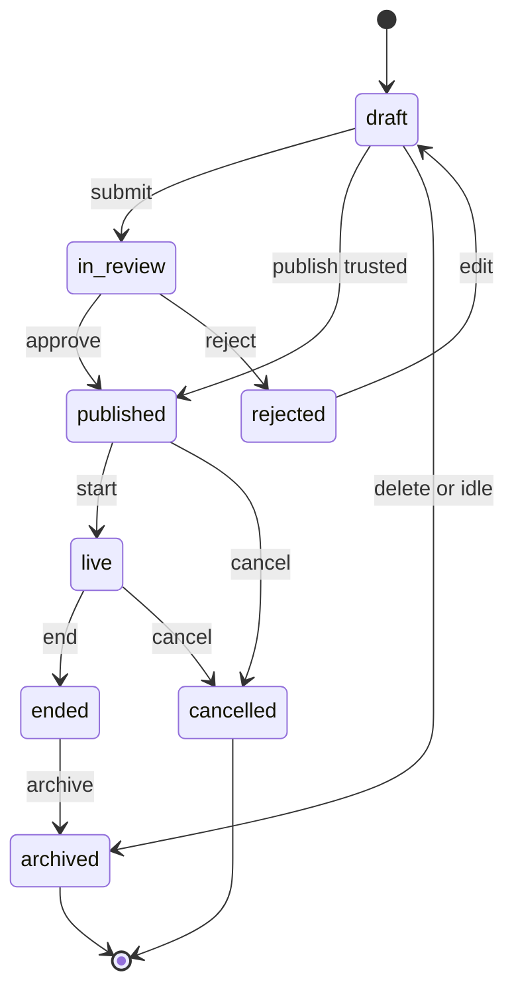
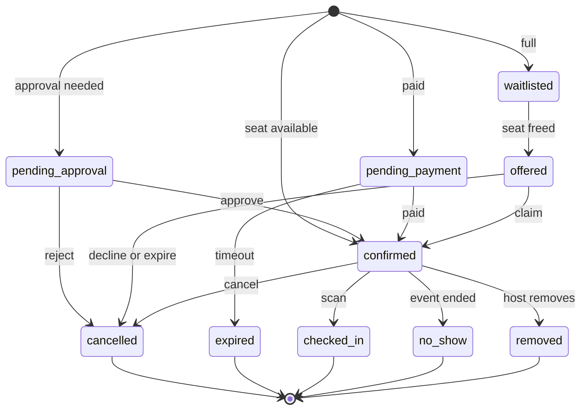
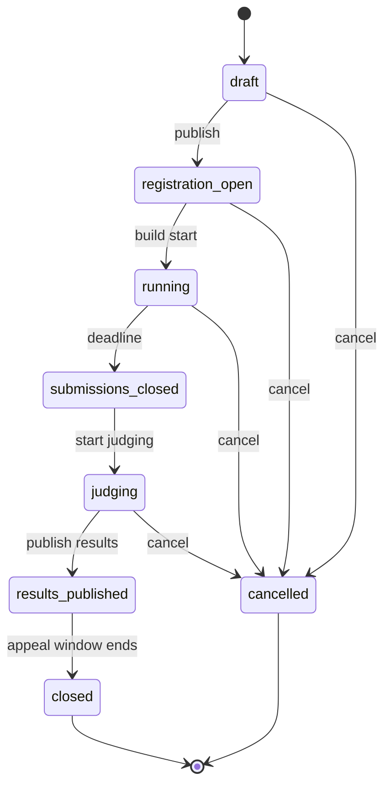
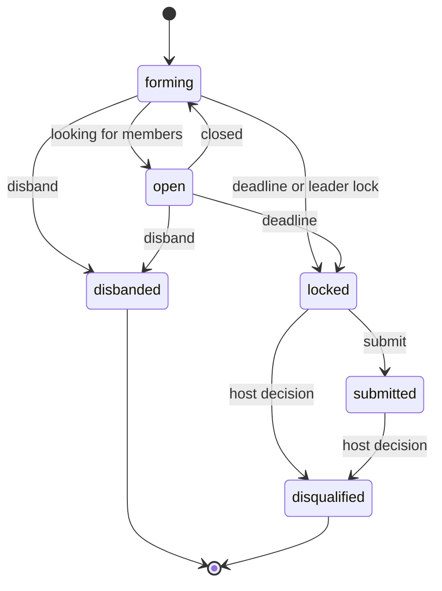
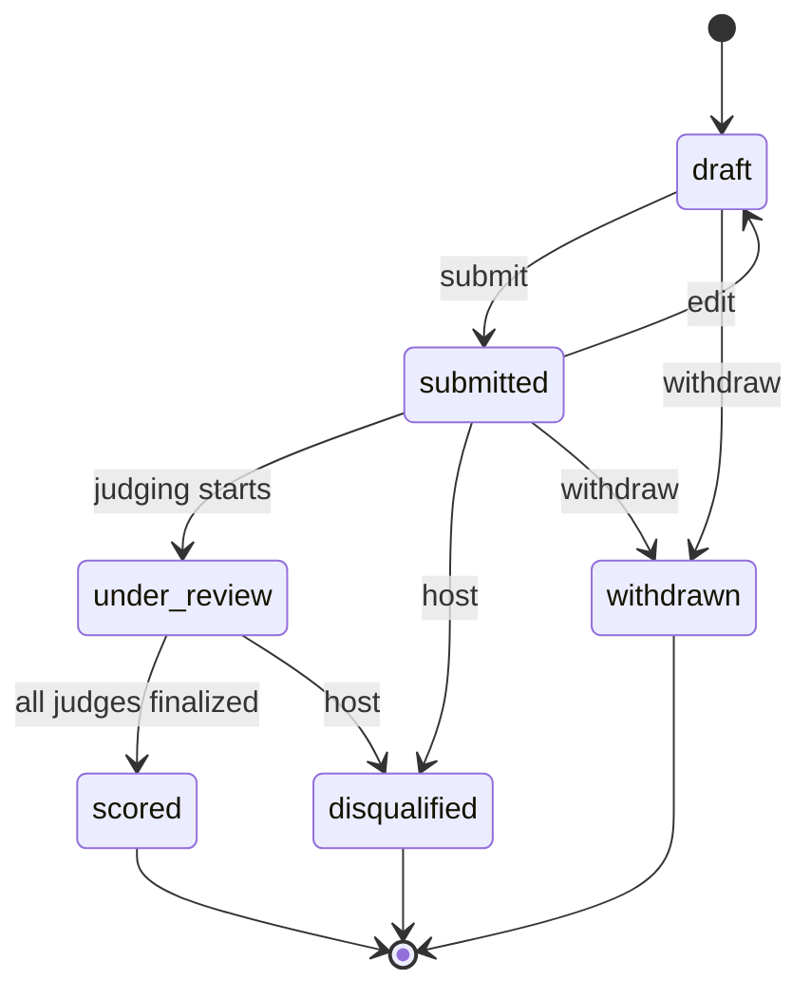
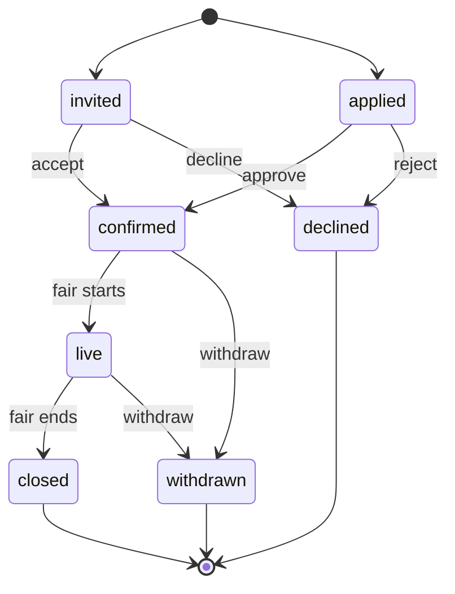

# EVT — Events, Hackathons & Community Programmes

> Status: intended product specification. Nothing in this file is built. Module group: OS expansion (`R6`), gated by `OD-EVT-01`. Evidence tags follow [CONVENTIONS](../00_START_HERE/CONVENTIONS.md).

## 1. Purpose, outcomes and boundaries

### 1.1 Purpose

EVT lets institutions, employers, instructors, mentors and the platform run career events on TalentSphere: webinars, workshops, career fairs (virtual and in person), hackathons, meetups and multi-session community programmes. Every event turns attendance into career evidence (certificates, badges, hackathon results) and into hiring signal (consented candidate-employer contact). [PROP] The legacy sources mention events only as one low-priority line (F-57 "Events & Webinars", priority 5, Ph8) and a dependent feature (F-139 Local Communities and Meetups) [SRC: SSOT §7.1 F-57, F-139; docs/registries/FEATURE_REGISTRY.md]. This module expands that line into a complete capability.

### 1.2 Outcomes

1. A host can go from idea to a published, discoverable event with capacity, tickets, agenda and reminders without leaving the platform. [PROP]
2. An attendee can find, register, add to calendar, attend, and receive proof of attendance. [PROP]
3. A hackathon can run end to end: rules, teams, submissions, judging, results, prizes. [PROP]
4. A career fair connects verified employers to candidates only through consented contact exchange. [PROP]
5. Outcomes feed `EVD` (certificates), `REP` (badges), `ATS` (sourced candidates) and `ANL` (event analytics) without duplicating their logic. [DER]

### 1.3 Scope

| In scope                                                                                | Out of scope                                                                                                                                                         | Owned by EVT                                                   | Consumed from other modules                                                                     |
| --------------------------------------------------------------------------------------- | -------------------------------------------------------------------------------------------------------------------------------------------------------------------- | -------------------------------------------------------------- | ----------------------------------------------------------------------------------------------- |
| Event creation, templates, publishing, review                                           | Building a live-streaming or video-conferencing engine [SRC: SSOT §4.2 "unnecessary realtime/live-streaming infrastructure"]; EVT embeds or links external providers | Events, sessions, tickets, registrations, waitlists, check-ins | Identity and roles (`IDN` planned), organizations (`EMP` planned), institutions (`INS` planned) |
| Registration, ticketing, capacity, waitlists                                            | Payment processing internals                                                                                                                                         | Hackathons, teams, submissions, judging, results               | Payments and refunds (`BIL` planned)                                                            |
| Calendar (ICS), reminders, check-in                                                     | General social network feed or groups (`NET` planned owns groups)                                                                                                    | Career-fair booths and booth interactions                      | Notifications delivery (`NTF` planned)                                                          |
| Virtual-room link management, Q&A and polls (lightweight), recordings (as stored media) | Interview scheduling engine (`INT` planned owns it; EVT links career-fair slots to it)                                                                               | Event certificates (issuance request) and attendance records   | Credential issuing (`EVD` planned), badges (`REP` planned), media storage (`PLT` planned)       |
| Sponsor and employer participation as labelled sponsorship                              | Advertising or paid ranking [SRC: SSOT §4.2 non-goal: self-serve ad network]                                                                                         | Event moderation reports (filing and host actions)             | Moderation decisions (`TSF` planned)                                                            |
| Series and cohort-based community programmes                                            | Learning content delivery (`LRN` planned)                                                                                                                            | Event analytics for organizers (own events)                    | Cross-module analytics (`ANL`)                                                                  |

### 1.4 Boundary note on SSOT non-goals

SSOT §4.2 forbids a "social-media clone", "self-serve advertising network" and "unnecessary realtime/live-streaming infrastructure". EVT stays inside that by (a) treating sponsorship as labelled participation with no ranking effect (`BR-EVT-022`), (b) never hosting live video itself, and (c) restricting who may host (`BR-EVT-001`). The conflict with the owner's "operating system" goal is recorded in `OD-EVT-01`.

## 2. Roles and permission matrix

Legend: C create, R read, U update, D delete/cancel, A approve, X execute action, — none. "Own" = events the user hosts or is registered for. "Org" = events of the user's organization.

| Capability                         | GUE | CAN/STD       | INS          | MNT               | REC/HMG             | EAD                 | IAD/PLO                  | MOD        | PAD            |
| ---------------------------------- | --- | ------------- | ------------ | ----------------- | ------------------- | ------------------- | ------------------------ | ---------- | -------------- |
| Browse public events               | R   | R             | R            | R                 | R                   | R                   | R                        | R          | R              |
| Register / cancel own registration | —   | C/D own       | C/D own      | C/D own           | C/D own             | C/D own             | C/D own                  | —          | —              |
| Create event (draft)               | —   | — (OD-EVT-02) | C (own)      | C (own, approved) | C (org, if granted) | C (org)             | C (org)                  | —          | C              |
| Publish without review             | —   | —             | —            | —                 | —                   | X if org trusted    | X if institution trusted | —          | X              |
| Review and approve event           | —   | —             | —            | —                 | —                   | —                   | —                        | A          | A              |
| Manage attendees, check-in         | —   | —             | X own        | X own             | X org events        | X org               | X org                    | —          | X              |
| Create hackathon                   | —   | —             | C (own)      | —                 | C (org)             | C                   | C                        | —          | C              |
| Join team / submit                 | —   | X             | X            | X                 | —                   | —                   | X                        | —          | —              |
| Judge                              | —   | —             | X if invited | X if invited      | X if invited        | X if invited        | X if invited             | —          | —              |
| Run career-fair booth              | —   | —             | —            | —                 | X (booth staff)     | X (organizes booth) | X (organizes fair)       | —          | X              |
| Visit booth, share contact         | —   | X             | —            | —                 | —                   | —                   | —                        | —          | —              |
| File report on event               | —   | X             | X            | X                 | X                   | X                   | X                        | —          | —              |
| Takedown, feature, override        | —   | —             | —            | —                 | —                   | —                   | —                        | X takedown | X all, audited |
| View organizer analytics           | —   | —             | R own        | R own             | R org               | R org               | R org                    | —          | R all          |

Service principal `API`: may read public event data and write registrations through the Public API (`PLT` planned) with scoped keys.

## 3. Sub-module map

| Code | Sub-module                                                  | Features          |
| ---- | ----------------------------------------------------------- | ----------------- |
| A    | Event authoring and publishing                              | FR-EVT-001 to 005 |
| B    | Discovery, registration and tickets                         | FR-EVT-006 to 012 |
| C    | Delivery: calendar, reminders, rooms, check-in, interaction | FR-EVT-013 to 019 |
| D    | Sponsors and career fairs                                   | FR-EVT-020 to 023 |
| E    | Hackathons                                                  | FR-EVT-024 to 030 |
| F    | After the event                                             | FR-EVT-031 to 033 |
| G    | Programmes, governance and operations                       | FR-EVT-034 to 038 |

## 4. Feature specifications

### Sub-module A — Event authoring and publishing

### FR-EVT-001 — Create event draft

- **Sub-module:** A Event authoring and publishing
- **Priority / tier:** Must · R6
- **Source:** [PROP] expands [SRC: SSOT §7.1 F-57]
- **Purpose and outcome:** A permitted host creates an event as a private draft and saves progress at any time. The system knows it worked when a draft exists with a stable id and an autosave timestamp.
- **Roles and permissions:** `INS: create own` · `MNT: create own (approved hosts)` · `REC: create org event if org grants` · `EAD: create org` · `IAD/PLO: create org` · `PAD: create`
- **Preconditions and entry points:** Signed in; role passes `BR-EVT-001`; entry from "Host an event" button in the events hub (`SCR-EVT-001`) and from an organization dashboard.
- **User interactions and actions:** 1. Click "Host an event". 2. Choose event type (webinar, workshop, career fair, hackathon, meetup, programme). 3. Enter title, short summary, description, mode, date and time with timezone, capacity. 4. Click "Save draft" or let autosave (every 10 seconds after a change). 5. Leave and return from "My hosted events".
- **System behaviour:** Creates `ENT-EVT-01` Event in state `draft` owned by the host organization or the individual host; stores times in UTC plus IANA timezone (`BR-EVT-003`); autosave is last-write-wins with a version counter and warns on concurrent edit; emits `events.event.created`.
- **UI elements and controls:** Type picker (radio cards, required), title text input, summary textarea with counter, rich-text description (sanitized), mode selector (online, in person, hybrid), date-time pickers with timezone select defaulting to the host profile timezone, capacity numeric input or "Unlimited" toggle, "Save draft" button, autosave status label (Saved / Saving / Failed).
- **Configuration options:** Platform: max draft age before auto-archive (default 180 days [PROP]); default capacity cap per host tier (default 500 [PROP]); org: default timezone, default code of conduct.
- **Business rules:** `BR-EVT-001`, `BR-EVT-002` (applies at publish, not draft), `BR-EVT-003`.
- **Validation:** Title 5–120 chars, summary 20–280 chars, description 50–10,000 chars after sanitization; end after start; duration ≤ 14 days for non-hackathon, ≤ 90 days for hackathon and programme; capacity integer 1–100,000 or unlimited; draft save accepts incomplete fields, only title is required to save.
- **Inputs and outputs:** In: the fields above. Out: draft record with id, version, `updatedAt`; autosave acknowledgement.
- **Filters, sorting, search:** My hosted events list filters by state, type, date range; sort by updated or start date; search by title.
- **Notifications and communication:** none on draft; reminder to host after 7 days of inactivity (template `evt.draft.stale`, class `host-tips`, opt-out allowed).
- **Error handling and edge cases:** Save conflict (another tab saved newer): show "Newer version exists" with load-latest option, no overwrite. Offline: queue save locally and retry (PWA, planned). Role loses permission mid-edit: save returns 403 and draft becomes read-only. Sanitizer strips scripts; stripped content is reported in the UI.
- **Dependencies:** `ENT-EVT-01`; `IDN` roles (planned); `EMP`/`INS` organizations (planned).
- **Security and privacy:** Draft visible only to host and org editors; description sanitized server-side; audit log of creation. No personal data beyond host id.
- **Acceptance criteria:**
  - Given a verified `EAD`, when they save a title only, then a draft is created and listed under "My hosted events".
  - Given a `CAN` without host rights, when they call the create endpoint, then the system returns 403 and creates nothing.
  - Given two tabs editing one draft, when the second saves a stale version, then the system rejects with a conflict and no data is lost.

### FR-EVT-002 — Event templates and cloning

- **Sub-module:** A Event authoring and publishing
- **Priority / tier:** Should · R6
- **Source:** [PROP]
- **Purpose and outcome:** Hosts reuse structure from earlier events or platform templates. Success is a new draft prefilled with the source structure and no dates.
- **Roles and permissions:** `host roles per BR-EVT-001: create` · `PAD: manage platform templates`
- **Preconditions and entry points:** Host has at least one past event or selects a platform template at "Host an event".
- **User interactions and actions:** 1. Choose "Start from template" or "Duplicate" on a past event. 2. Pick template. 3. Confirm which parts to copy (details, agenda, ticket types, questions, speakers). 4. Edit the new draft.
- **System behaviour:** Copies selected parts into a new draft; never copies registrations, attendees, scores, recordings or sponsor payments; resets dates; links `sourceEventId` for analytics; emits `events.event.created` with `cloned=true`.
- **UI elements and controls:** Template gallery (cards), "Duplicate" action in event menu, checkbox list of parts to copy (all checked by default).
- **Configuration options:** Platform templates: webinar, workshop, virtual career fair, in-person career fair, 48-hour hackathon, meetup, 6-week programme [PROP]. Host can save own events as private templates.
- **Business rules:** `BR-EVT-001`, `BR-EVT-003`.
- **Validation:** Template name 3–60 chars, unique per host; copied speakers must still be active users, otherwise copied as unlinked names.
- **Inputs and outputs:** In: source id and parts selection. Out: new draft id.
- **Filters, sorting, search:** Templates filter by event type.
- **Notifications and communication:** n/a — no recipient is affected.
- **Error handling and edge cases:** Source deleted: clone request returns 404. Speaker deactivated: flagged "unlinked" in the draft. Source belongs to another org: 403.
- **Dependencies:** `FR-EVT-001`.
- **Security and privacy:** Cloning never copies attendee data (`BR-EVT-024`).
- **Acceptance criteria:**
  - Given a past event with 3 ticket types, when the host duplicates it with "ticket types" checked, then the draft has 3 ticket types and no registrations.
  - Given a past event, when duplicated, then dates are empty and publishing is blocked until set.
  - Given a host of org A, when they clone an event of org B, then the system returns 403.

### FR-EVT-003 — Agenda, sessions and tracks

- **Sub-module:** A Event authoring and publishing
- **Priority / tier:** Must · R6
- **Source:** [PROP]
- **Purpose and outcome:** Hosts structure an event into timed sessions across one or more tracks so attendees can plan. Success is a conflict-free agenda shown on the event page and in the calendar export.
- **Roles and permissions:** `host/org editors: create, update, delete` · `CAN: view, bookmark sessions`
- **Preconditions and entry points:** Draft or published event; "Agenda" tab in the event editor.
- **User interactions and actions:** 1. Click "Add session". 2. Enter title, description, start, end, room or link, track, speakers. 3. Drag sessions on the timeline to move; drag edges to resize. 4. Mark sessions as "Registration required" or "Open to all registrants". 5. Save.
- **System behaviour:** Validates sessions fall inside event bounds; warns on speaker overlap; assigns `ENT-EVT-02` Session rows; changes after publish are material if time shifts by more than 15 minutes (`BR-EVT-007`).
- **UI elements and controls:** Timeline grid (keyboard-operable alternative: list with Move up/Move down and time inputs), track color chips (with text labels), session drawer, speaker multiselect, "Bookmark" star for attendees.
- **Configuration options:** Max tracks per event (default 8 [PROP]); max sessions (default 200 [PROP]); session buffer warning (default 5 minutes).
- **Business rules:** `BR-EVT-003`, `BR-EVT-007`.
- **Validation:** Session title 3–120 chars; start/end within event; end after start; room required for in-person sessions; at most one session per speaker at the same time unless host confirms the override.
- **Inputs and outputs:** In: session fields. Out: ordered agenda with computed track grouping.
- **Filters, sorting, search:** Attendee view filters by track, speaker, bookmarked; sort by time.
- **Notifications and communication:** Material time change notifies registrants who bookmarked the session (template `evt.session.changed`, class `event-updates`, non-optional for cancellations).
- **Error handling and edge cases:** Overlap with the same room: blocked with message naming the clashing session. Deleting a session with bookmarks: confirm and notify bookmarkers. Timezone change on the event shifts sessions consistently.
- **Dependencies:** `FR-EVT-001`, `FR-EVT-016`.
- **Security and privacy:** Speaker contact details never shown; only display name and public profile link.
- **Acceptance criteria:**
  - Given a 2-track event, when the host adds two sessions in different tracks at the same time, then both save.
  - Given a session scheduled outside the event bounds, when the host saves, then the system rejects with the allowed range.
  - Given a published session moved by 30 minutes, when saved, then bookmarked registrants are notified.

### FR-EVT-004 — Publishing and review gate

- **Sub-module:** A Event authoring and publishing
- **Priority / tier:** Must · R6
- **Source:** [PROP]
- **Purpose and outcome:** A draft becomes a public or private scheduled event after validation and, where required, moderator review. Success is an event in state `published` or `in_review`.
- **Roles and permissions:** `host: submit` · `trusted-org host: publish directly` · `MOD/PAD: approve, reject`
- **Preconditions and entry points:** Draft passes `BR-EVT-002`; "Publish" button in the editor.
- **User interactions and actions:** 1. Click "Publish". 2. Review the pre-flight checklist. 3. Choose visibility (public, unlisted link, invite-only). 4. Acknowledge code of conduct and refund policy. 5. Confirm. 6. If review is needed, wait; host sees status.
- **System behaviour:** Runs validation; if host or org is not trusted or event has paid tickets, hackathon prizes, or sponsors, routes to `in_review` (`SM-EVT-01`); on approval sets `published`, creates search index entry (`SRC` planned) and emits `events.event.published`; rejection returns to `draft` with reason.
- **UI elements and controls:** Pre-flight checklist with pass/fail per item, visibility radio group, two required checkboxes (code of conduct, refund policy), "Publish" and "Submit for review" buttons, status banner.
- **Configuration options:** Platform: trusted-host criteria (default: org verified and at least 3 prior events without upheld reports [PROP]); review SLA target `OD-EVT-05`.
- **Business rules:** `BR-EVT-002`, `BR-EVT-006`, `BR-EVT-018`.
- **Validation:** All `BR-EVT-002` fields present; paid tickets require refund policy; hackathon requires rules, IP clause and judging criteria; start must be at least 1 hour in the future.
- **Inputs and outputs:** In: visibility, acknowledgements. Out: event state, public URL slug.
- **Filters, sorting, search:** Moderator review queue filters by type, org, age; sort oldest first.
- **Notifications and communication:** Host notified of approval or rejection (template `evt.review.decision`, class `host-tips`); moderators notified of queue items above SLA.
- **Error handling and edge cases:** Slug collision: append numeric suffix. Pre-flight fails: publish disabled with failing items listed. Reviewer rejects: reason mandatory (min 20 chars). Event start passes while in review: auto-moves to `rejected` with reason "expired".
- **Dependencies:** `FR-EVT-001`, `FR-EVT-035`; `TSF` content policy (planned).
- **Security and privacy:** Reviewer sees host contact for follow-up; decisions audited.
- **Acceptance criteria:**
  - Given a trusted org and a complete free webinar, when the host publishes, then the event is `published` immediately.
  - Given a paid-ticket event from an untrusted host, when submitted, then it enters `in_review` and is not publicly visible.
  - Given a draft missing a refund policy for paid tickets, when the host clicks Publish, then the button is blocked and the missing item is named.

### FR-EVT-005 — Event edit, postpone, and cancel after publish

- **Sub-module:** A Event authoring and publishing
- **Priority / tier:** Must · R6
- **Source:** [PROP]
- **Purpose and outcome:** Hosts change or cancel a live-listed event with safe notification and refund handling. Success is every registrant informed and money returned where owed.
- **Roles and permissions:** `host/org editors: update, cancel` · `PAD: cancel with audit`
- **Preconditions and entry points:** Event is `published` or `live`; "Edit" or "Cancel event" in the event menu.
- **User interactions and actions:** 1. Edit a field. 2. System shows whether the change is material and the number of registrants affected. 3. Host confirms and optionally writes a message. 4. For cancellation, host picks a reason and confirms by typing the event title.
- **System behaviour:** Material changes (`BR-EVT-007`) bump `materialVersion`, send notices, reopen free cancel for all registrants, and update calendar feeds (ICS sequence number incremented). Cancellation sets state `cancelled`, auto-refunds paid registrations (`BR-EVT-019`), cancels waitlist, closes team formation for hackathons; emits `events.event.updated` or `events.event.cancelled`.
- **UI elements and controls:** Diff preview panel, affected-count banner, optional message textarea (max 1,000 chars), reason dropdown (host unavailable, low registration, venue, safety, other), title-confirmation text input for cancel.
- **Configuration options:** Platform: minimum notice for non-emergency cancellation warning (default 48 hours [PROP]).
- **Business rules:** `BR-EVT-007`, `BR-EVT-019`, `BR-EVT-003`.
- **Validation:** Cancellation reason required; message max 1,000 chars; cannot change event type after any registration; cannot reduce capacity below confirmed count.
- **Inputs and outputs:** In: edits or cancel request. Out: updated event, count of notified registrants, refund job id.
- **Filters, sorting, search:** n/a — single event action.
- **Notifications and communication:** Registrants: `evt.event.changed` or `evt.event.cancelled` via email and push, class `event-updates` (cannot be opted out for cancellation); sponsors and speakers notified.
- **Error handling and edge cases:** Refund failure for some registrants: job retries, host sees "n refunds pending", `FIN` alerted after 3 failures. Cancel while live: allowed, attendance recorded up to that point. Double-click cancel: idempotent by event version.
- **Dependencies:** `FR-EVT-011`, `FR-EVT-013`, `BIL` refunds (planned), `NTF` (planned).
- **Security and privacy:** Cancellation message sanitized; audit entry with actor and reason.
- **Acceptance criteria:**
  - Given 120 registrants, when the host moves the start by 2 hours, then all 120 receive the change notice and an updated calendar entry.
  - Given a paid event, when cancelled, then every paid registration is refunded in full.
  - Given confirmed=80, when the host sets capacity 50, then the system rejects with "80 confirmed".

### Sub-module B — Discovery, registration and tickets

### FR-EVT-006 — Event discovery and detail page

- **Sub-module:** B Discovery, registration and tickets
- **Priority / tier:** Must · R6
- **Source:** [PROP]
- **Purpose and outcome:** Visitors find events by topic, time and place and decide to register from a complete detail page. Success is the register action.
- **Roles and permissions:** `GUE: view public` · `CAN/STD/others: view public and invited` · `host: view own drafts`
- **Preconditions and entry points:** `/events` hub, global search (`SRC` planned), org page, recommendation widgets (`AIC` planned).
- **User interactions and actions:** 1. Open events hub. 2. Filter by type, date range, mode, city, skill tag, price, "has seats". 3. Open a card. 4. Read agenda, speakers, sponsors, code of conduct. 5. Click Register or Add to calendar.
- **System behaviour:** Lists only `published` and `live` public events; computes seats left; localizes time; shows state badges; no paid placement (`BR-EVT-022`); server-side pagination (20 per page); detail page is server-rendered with schema.org Event markup for search engines.
- **UI elements and controls:** Filter bar, sort dropdown, event cards (title, time in viewer timezone, mode, seats chip, host), map toggle for in-person (planned), detail tabs (Overview, Agenda, Speakers, Sponsors, Q&A, Rules for hackathons), sticky Register button.
- **Configuration options:** User: default location and timezone; platform: default radius 50 km [PROP].
- **Business rules:** `BR-EVT-003`, `BR-EVT-022`.
- **Validation:** Date range max 12 months; city filter from known geo list; text query max 100 chars.
- **Inputs and outputs:** In: filters. Out: paged event cards with total count.
- **Filters, sorting, search:** Filters: type, date, mode, location, skill, price (free/paid), host type, language, accessibility features. Sort: soonest (default), newest, most registered. Free-text query across title, summary, speakers, host.
- **Notifications and communication:** n/a — read-only.
- **Error handling and edge cases:** No results: empty state suggests widening filters and shows "Create alert". Event cancelled or ended: banner and register disabled. Unlisted event: reachable by link, absent from lists, `noindex`.
- **Dependencies:** `FR-EVT-004`; `SRC` index (planned).
- **Security and privacy:** Attendee list never public; only count shown; invite-only event returns 404 to non-invitees.
- **Acceptance criteria:**
  - Given 3 published events, when a guest filters type=hackathon, then only hackathons appear.
  - Given an invite-only event, when a non-invited user opens its URL, then the system returns 404.
  - Given an ended event, when opened, then the Register button is not shown.

### FR-EVT-007 — Register for an event

- **Sub-module:** B Discovery, registration and tickets
- **Priority / tier:** Must · R6
- **Source:** [PROP]
- **Purpose and outcome:** A signed-in user obtains a seat. Success is a `confirmed` registration with a confirmation notice and calendar entry.
- **Roles and permissions:** `CAN/STD/INS/MNT/REC/HMG/EAD/IAD/PLO: create own registration` · `GUE: must sign in or create an account first`
- **Preconditions and entry points:** Event `published` with registration window open; user not banned from the event or host (`BR-EVT-018`); entry: Register button.
- **User interactions and actions:** 1. Click Register. 2. If a guest, sign in and return to the same step. 3. Choose ticket type. 4. Answer custom questions (`FR-EVT-008`). 5. Toggle optional sharing consents (`FR-EVT-034`). 6. Submit. 7. Land on confirmation with "Add to calendar".
- **System behaviour:** In one transaction checks capacity, creates `ENT-EVT-03` Registration (`confirmed`, `pending_approval`, `pending_payment`, or `waitlisted`) per `SM-EVT-02`; idempotent per (event, user, ticket) (`BR-EVT-005`); emits `events.registration.created` and `.confirmed`; sends confirmation with ICS attachment.
- **UI elements and controls:** Ticket selector (radio with price and seats left), question form, consent checkboxes (unchecked by default), Submit button with busy state, confirmation page with QR for check-in (in-person).
- **Configuration options:** Event: registration open/close times, ticket types, approval required, per-user ticket limit (default 1 [PROP]).
- **Business rules:** `BR-EVT-004`, `BR-EVT-005`, `BR-EVT-009`, `BR-EVT-018`, `BR-EVT-023`.
- **Validation:** Required questions answered; ticket limit; age or country eligibility when set; email verified account required for public events.
- **Inputs and outputs:** In: ticket, answers, consents. Out: registration with state, confirmation code, seat position if waitlisted.
- **Filters, sorting, search:** n/a — single action.
- **Notifications and communication:** `evt.registration.confirmed` (email, in-app; class `event-transactional`, not optional); `evt.registration.waitlisted`; `evt.registration.pending_approval`.
- **Error handling and edge cases:** Last seat race: the second request is waitlisted, never over-sold. Double submit: returns the same registration. Registration window closed: 409 with window dates. Banned user: generic "not eligible" (does not reveal ban). Payment abandoned: `pending_payment` expires after 15 minutes [PROP] and seat is released.
- **Dependencies:** `FR-EVT-008`, `FR-EVT-009`, `FR-EVT-010`, `FR-EVT-011`, `BIL` (planned).
- **Security and privacy:** Answers visible to host only; rate limit 20 registrations/hour/user; bots mitigated by account requirement.
- **Acceptance criteria:**
  - Given 1 seat left and two simultaneous requests, when both submit, then one is confirmed and one waitlisted.
  - Given a confirmed registration, when the user submits again, then the same registration is returned and no duplicate exists.
  - Given a user under the event's minimum age, when they register, then the system rejects with the eligibility reason.

### FR-EVT-008 — Custom registration questions

- **Sub-module:** B Discovery, registration and tickets
- **Priority / tier:** Should · R6
- **Source:** [PROP]
- **Purpose and outcome:** Hosts collect the minimum extra information they need. Success is answers stored per registration and exportable by the host.
- **Roles and permissions:** `host/org editors: configure, read answers` · `attendee: answer own`
- **Preconditions and entry points:** Event editor "Registration" tab.
- **User interactions and actions:** 1. Add question (short text, long text, single choice, multi choice, yes/no, file upload excluded). 2. Mark required. 3. Reorder. 4. Optionally add eligibility rule (answer to question X must be Y).
- **System behaviour:** Stores `ENT-EVT-04` Question with version; changes after first registration apply only to new registrants and cannot delete a question with answers (it is hidden instead); eligibility rule evaluated at submit.
- **UI elements and controls:** Question list with drag handle and Up/Down buttons, type dropdown, "Required" switch, option editor, eligibility rule builder.
- **Configuration options:** Max 15 questions (platform default [PROP]); sensitive-question blocklist (health, religion, ethnicity, political, sexual orientation) enforced.
- **Business rules:** `BR-EVT-008`, `BR-EVT-024`.
- **Validation:** Question text 3–200 chars; choices 2–12, each ≤ 80 chars; blocklist match triggers rejection with explanation.
- **Inputs and outputs:** In: question definitions; attendee answers. Out: answer table per registration.
- **Filters, sorting, search:** Host answer view filters by question and answer value.
- **Notifications and communication:** n/a — part of registration.
- **Error handling and edge cases:** Sensitive question attempted: blocked with policy text. Required question added after registrations: existing registrants are asked via notice but not blocked. Attendee deleted: answers erased with registration (`BR-EVT-024`).
- **Dependencies:** `FR-EVT-007`.
- **Security and privacy:** Answers classified personal data, visible only to host org roles with attendee-management permission; not shared with sponsors unless the attendee consented (`BR-EVT-008`).
- **Acceptance criteria:**
  - Given a required question, when an attendee omits it, then registration is rejected naming the field.
  - Given a question text containing "religion", when saved, then the system rejects with the sensitive-data policy.
  - Given a question with answers, when the host deletes it, then it is hidden from new registrants and old answers remain.

### FR-EVT-009 — Ticket types and pricing

- **Sub-module:** B Discovery, registration and tickets
- **Priority / tier:** Should · R6
- **Source:** [PROP]
- **Purpose and outcome:** Hosts offer free, paid, invite-only, sponsor-comped and student tickets. Success is correct seat accounting per ticket type and correct charges.
- **Roles and permissions:** `host/org editors: configure` · `FIN: view settlements` · `attendee: purchase`
- **Preconditions and entry points:** Event editor "Tickets" tab; paid tickets require the host org to have a payout account (`BIL` planned).
- **User interactions and actions:** 1. Add ticket type with name, price, currency, quantity, sale window, visibility, who may buy (anyone, institution members, invited emails). 2. Add promo codes (percentage or fixed, usage limit). 3. Set refund policy.
- **System behaviour:** Ticket quantities draw from the event capacity (sum of ticket quantities ≤ capacity); price stored in minor units + ISO-4217 currency; payments handled by `BIL` checkout; platform fee is a `BIL` concern; emits ticket events with registration.
- **UI elements and controls:** Ticket table (name, price, qty, sold, window), promo-code dialog, refund policy selector (full until X hours before, partial, none), currency dropdown.
- **Configuration options:** Platform: allowed currencies, max price per ticket (default parameter `maxTicketPrice` [PROP], value `OD-EVT-04`); platform fee policy lives in `BIL` (`OD-EVT-04`).
- **Business rules:** `BR-EVT-004`, `BR-EVT-006`, `BR-EVT-019`.
- **Validation:** Price ≥ 0, up to 2 decimals per currency exponent; quantity ≥ 1; sale window inside registration window; promo code 4–20 alphanumeric, unique per event; free tickets cannot take promo codes.
- **Inputs and outputs:** In: ticket and promo definitions. Out: ticket catalogue visible on detail page.
- **Filters, sorting, search:** Host sales report filters by ticket type, date, promo code.
- **Notifications and communication:** Host notified at 80% and 100% sold (template `evt.capacity.alert`, class `host-tips`).
- **Error handling and edge cases:** Price edit after sales: applies to new buyers only, cannot go to a less favorable refund policy (`BR-EVT-006`). Promo exhausted: shown "code no longer valid". Currency mismatch with payout account: blocked at publish.
- **Dependencies:** `BIL` checkout and refunds (planned), `FR-EVT-007`.
- **Security and privacy:** No card data handled by EVT; fraud checks via `BIL`; promo code brute force limited to 10 attempts per hour per user.
- **Acceptance criteria:**
  - Given ticket quantities summing to 150 and capacity 100, when saved, then the system rejects.
  - Given a promo of 20% with limit 5, when the sixth buyer applies it, then it is rejected.
  - Given a published event with sales, when the host loosens the refund policy, then it saves; when tightening, then it is rejected.

### FR-EVT-010 — Capacity and waitlist with auto-promotion

- **Sub-module:** B Discovery, registration and tickets
- **Priority / tier:** Must · R6
- **Source:** [PROP]
- **Purpose and outcome:** When an event is full, interested users queue fairly and take seats freed by cancellations. Success is promotion in order with no double allocation.
- **Roles and permissions:** `attendee: join/leave waitlist` · `host: view, reorder with reason, promote manually`
- **Preconditions and entry points:** Event full for the chosen ticket type; "Join waitlist" button replaces "Register".
- **User interactions and actions:** 1. Click "Join waitlist". 2. See position. 3. When offered, receive notice and click "Claim seat" within the offer window. 4. Or click "Leave waitlist".
- **System behaviour:** FIFO by `joinedAt`; when a seat frees, issue an offer to the next entry (`SM-EVT-02` state `offered`) valid `waitlist_offer_hours` (default 24 [PROP]); on expiry or decline offer passes to next; if event starts within the offer window, offer window shrinks to min(24h, half of time left); emits `events.registration.offer_issued`.
- **UI elements and controls:** Position badge (updates live without color-only meaning), "Claim seat" button, countdown text, host waitlist table with Promote button.
- **Configuration options:** Event: waitlist enabled (default on), max waitlist size (default 500 [PROP]), auto-promote on/off.
- **Business rules:** `BR-EVT-004`, `BR-EVT-005`.
- **Validation:** Offer claim valid only before expiry; one active offer per seat.
- **Inputs and outputs:** In: join, claim, leave. Out: position, offer, final registration state.
- **Filters, sorting, search:** Host table sort by position or join time; filter by ticket type.
- **Notifications and communication:** `evt.waitlist.offer` (email and push, class `event-transactional`), `evt.waitlist.expired`; reminder at half of offer window.
- **Error handling and edge cases:** Two seats free at once: two offers issued sequentially to positions 1 and 2. Claim after expiry: 409 "offer expired", user keeps waitlist position only if host enabled "keep position" (default off). Manual promote bypassing order requires reason, audited.
- **Dependencies:** `FR-EVT-007`, `FR-EVT-011`.
- **Security and privacy:** Position visible only to the owner; host sees names only with attendee-management permission.
- **Acceptance criteria:**
  - Given a full event and a waitlist of 3, when a confirmed attendee cancels, then position 1 receives an offer and others do not.
  - Given an offer expired after 24 hours, when the user claims, then the system rejects and the seat goes to position 2.
  - Given a host manual promotion out of order, when saved without a reason, then the system rejects.

### FR-EVT-011 — Cancel, transfer and refund a registration

- **Sub-module:** B Discovery, registration and tickets
- **Priority / tier:** Must · R6
- **Source:** [PROP]
- **Purpose and outcome:** Attendees release or hand over a seat; refunds follow the published policy. Success is a freed seat, correct refund, updated waitlist.
- **Roles and permissions:** `attendee: cancel, transfer own` · `host: remove, refund with reason` · `FIN: refund override`
- **Preconditions and entry points:** "My events" list, registration page, email link.
- **User interactions and actions:** 1. Click "Cancel registration" and confirm. 2. Or "Transfer" and enter recipient email or select a connection. 3. Recipient accepts within 72 hours [PROP].
- **System behaviour:** Cancel sets `cancelled`, evaluates refund per snapshot of refund policy at purchase (`BR-EVT-006`), triggers waitlist offer, emits `events.registration.cancelled`. Transfer keeps the paid ticket, moves registration to the recipient on acceptance, regenerates QR; recipient answers required questions.
- **UI elements and controls:** Cancel dialog showing refund amount, Transfer dialog, pending-transfer banner with Withdraw button.
- **Configuration options:** Event: transfers allowed (default on for free, off for paid unless host enables), transfer cutoff (default 2 hours before start).
- **Business rules:** `BR-EVT-005`, `BR-EVT-006`, `BR-EVT-007`, `BR-EVT-019`.
- **Validation:** Transfer recipient must have an account with verified email; cannot transfer to a banned user; cannot cancel after check-in.
- **Inputs and outputs:** In: cancel or transfer request. Out: state change, refund amount.
- **Filters, sorting, search:** n/a — per registration.
- **Notifications and communication:** `evt.registration.cancelled`, `evt.transfer.invite`, `evt.transfer.accepted` (class `event-transactional`).
- **Error handling and edge cases:** Cancel inside no-refund window: allowed, refund 0, shown before confirm. Transfer expired: reverts to sender. Refund API failure: registration cancelled, refund queued and retried, user sees "refund pending".
- **Dependencies:** `FR-EVT-010`, `BIL` (planned).
- **Security and privacy:** Transfer shares only name with recipient before acceptance; email lookup does not reveal whether an account exists (generic message).
- **Acceptance criteria:**
  - Given a refundable ticket cancelled before cutoff, when confirmed, then full refund is initiated and the seat is offered to the waitlist.
  - Given a checked-in registration, when the user tries to cancel, then the system rejects.
  - Given a transfer not accepted in 72 hours, when expiry passes, then the registration remains with the sender.

### FR-EVT-012 — Approval-required registration and invitations

- **Sub-module:** B Discovery, registration and tickets
- **Priority / tier:** Should · R6
- **Source:** [PROP]
- **Purpose and outcome:** Hosts screen attendees for selective events and invite specific people. Success is only approved or invited users hold confirmed seats.
- **Roles and permissions:** `host/org editors: approve, reject, invite` · `attendee: respond to invite`
- **Preconditions and entry points:** Event setting "Approval required" or "Invite only"; Attendees tab.
- **User interactions and actions:** 1. Review pending list. 2. Select rows, click Approve or Reject (reason optional, template available). 3. For invites, paste emails or pick a talent pool (`ATS` planned) or cohort (`INS` planned) and send.
- **System behaviour:** Approve moves `pending_approval` → `confirmed` (or `pending_payment`) respecting capacity; reject notifies; invites create signed single-use links bound to email; bulk actions are processed as a job with progress.
- **UI elements and controls:** Table with bulk select, Approve/Reject buttons, rejection reason dropdown, invite composer with count, import CSV (max 1,000 rows).
- **Configuration options:** Event: auto-approve rules (for example institution members); invite expiry (default 14 days [PROP]).
- **Business rules:** `BR-EVT-004`, `BR-EVT-008`, `BR-EVT-018`.
- **Validation:** Emails valid and deduped; CSV ≤ 1,000 rows and 1 column; rejection reason ≤ 500 chars.
- **Inputs and outputs:** In: decisions, invite list. Out: updated states, invite delivery report.
- **Filters, sorting, search:** Filter by state, answer value, ticket type; sort by registration time; search by name.
- **Notifications and communication:** `evt.registration.approved`, `evt.registration.rejected`, `evt.invite` (class `event-transactional`).
- **Error handling and edge cases:** Approve when full: moved to waitlist with notice to host. Invite for existing registrant: skipped and reported. Bounced email: reported in delivery report.
- **Dependencies:** `FR-EVT-007`, `FR-EVT-010`, `NTF` (planned).
- **Security and privacy:** Invite links single-use and email-bound; invite list not retained beyond event + 24 months (`BR-EVT-024`); rejection reasons not auto-visible to the attendee beyond template text.
- **Acceptance criteria:**
  - Given 10 pending registrations and 4 seats, when the host approves 6, then 4 are confirmed and 2 waitlisted.
  - Given an invite link used by a different email account, when opened, then access is refused.
  - Given a CSV of 1,200 rows, when imported, then the system rejects the file with the row limit.

### Sub-module C — Delivery: calendar, reminders, rooms, check-in, interaction

### FR-EVT-013 — Calendar export and timezone handling

- **Sub-module:** C Delivery
- **Priority / tier:** Must · R6
- **Source:** [PROP]
- **Purpose and outcome:** Registrants put the event in their own calendar with correct local time. Success is an ICS entry that updates when the event changes.
- **Roles and permissions:** `registrant: download, subscribe` · `GUE: download public event ICS`
- **Preconditions and entry points:** Confirmation page, email, event detail "Add to calendar", "My events" page.
- **User interactions and actions:** 1. Click "Add to calendar". 2. Choose Google, Outlook, Apple (ICS) or "Subscribe to my events feed". 3. Optionally copy feed URL.
- **System behaviour:** Generates RFC 5545 ICS with stable `UID` (`eventId@domain`), `DTSTART/DTEND` in UTC, `SEQUENCE` incremented on each material change (`BR-EVT-007`), `LOCATION`/`URL` (join link only included for confirmed registrants), `VALARM` reminders matching user preferences; per-user feed URL contains a revocable random token; cancelled events emitted with `STATUS:CANCELLED`.
- **UI elements and controls:** Split button "Add to calendar" with provider menu, "Copy feed link" button, "Regenerate feed link" button with confirm.
- **Configuration options:** User: include sessions bookmarked only vs whole event (default whole event); platform: feed cache TTL 15 minutes [PROP].
- **Business rules:** `BR-EVT-003`, `BR-EVT-007`.
- **Validation:** Feed token 32+ random bytes, one active per user, regenerated on request.
- **Inputs and outputs:** Out: `.ics` file or feed.
- **Filters, sorting, search:** Feed supports `?state=confirmed|waitlisted` filter.
- **Notifications and communication:** n/a — pull-based.
- **Error handling and edge cases:** Unknown or revoked token: 404. Registration cancelled: event removed from feed at next fetch with `CANCELLED` entry. Daylight-saving boundaries: UTC storage avoids drift; display uses IANA rules.
- **Dependencies:** `FR-EVT-005`, `FR-EVT-007`.
- **Security and privacy:** Join link not exposed in public ICS; feed token treated as a secret, shown once per regeneration.
- **Acceptance criteria:**
  - Given an event at 10:00 America/New_York, when a Tokyo user downloads the ICS, then it opens at the equivalent Tokyo local time.
  - Given a material time change, when the feed refreshes, then the entry has a higher SEQUENCE and the new time.
  - Given a revoked feed token, when fetched, then the system returns 404.

### FR-EVT-014 — Reminders

- **Sub-module:** C Delivery
- **Priority / tier:** Must · R6
- **Source:** [PROP]
- **Purpose and outcome:** Registrants are reminded so they attend. Success is reminders sent once per schedule slot and attendance rate measurable.
- **Roles and permissions:** `registrant: configure own` · `host: configure schedule`
- **Preconditions and entry points:** Confirmed registration; settings in "Notification preferences" (`NTF` planned) and event editor.
- **User interactions and actions:** 1. Host sets reminder offsets (default 24 h, 1 h, 10 min). 2. Attendee may mute event reminders from the reminder message or settings.
- **System behaviour:** Scheduler enqueues one job per (registration, offset) when registration is confirmed; reschedules on material change; skips cancelled, checked-in (for 10 min) and muted; job idempotent by key `(registrationId, offset, materialVersion)`.
- **UI elements and controls:** Host: offset chips with add/remove; attendee: "Mute reminders for this event" link.
- **Configuration options:** Host offsets (max 5); channel defaults (email, push, in-app); platform: quiet hours respected by `NTF` except within 1 hour of start.
- **Business rules:** `BR-EVT-020`.
- **Validation:** Offsets between 5 minutes and 14 days, unique.
- **Inputs and outputs:** Out: reminder messages with join link and calendar link.
- **Filters, sorting, search:** n/a — system scheduled.
- **Notifications and communication:** Template `evt.reminder`, channels email, push, in-app; class `event-reminders` (opt-out per event and globally); cancellation and change notices are never muted.
- **Error handling and edge cases:** Registration made 30 minutes before start: only offsets still in the future are scheduled. Delivery failure: `NTF` retries per its policy. Event postponed: old jobs cancelled, new ones created.
- **Dependencies:** `FR-EVT-005`, `NTF` (planned), worker queue (`background_jobs` pattern).
- **Security and privacy:** Reminders for in-person events include address only to confirmed registrants.
- **Acceptance criteria:**
  - Given default offsets, when a user registers 2 days before, then three reminders are scheduled.
  - Given a muted event, when the 1-hour slot arrives, then no reminder is sent but a cancellation notice would still be.
  - Given registration 20 minutes before start, when scheduling, then only the 10-minute reminder is created.

### FR-EVT-015 — Virtual room and provider link management

- **Sub-module:** C Delivery
- **Priority / tier:** Must · R6
- **Source:** [PROP]; respects [SRC: SSOT §4.2 no unnecessary live-streaming infrastructure]
- **Purpose and outcome:** Online and hybrid events are held in an external conferencing or streaming provider; the platform controls who sees the join link and when. Success is a confirmed attendee reaching the room from one click.
- **Roles and permissions:** `host/org editors: set link, rotate` · `registrant: view link in join window` · `PAD: configure providers`
- **Preconditions and entry points:** Event mode online or hybrid; "Online room" panel in editor.
- **User interactions and actions:** 1. Select provider (Zoom, Google Meet, Microsoft Teams, YouTube Live, Vimeo, custom URL) [PROP list]. 2. Paste URL and optional passcode. 3. Click "Test link". 4. Choose link release time (default 30 minutes before start). 5. Attendee clicks "Join" in the join window.
- **System behaviour:** Validates URL host against provider allow-list (SSRF and phishing control); stores link encrypted; reveals link only to `confirmed`/`checked_in` registrants within window; records join click as `events.registration.checked_in` for virtual attendance (`FR-EVT-017`); a "Join" redirect goes through a tracked, signed route.
- **UI elements and controls:** Provider dropdown, URL input, passcode input (masked), "Test link" button with result, release-time selector, attendee "Join" button (disabled with countdown before window).
- **Configuration options:** Platform: provider allow-list; embed vs open in new tab (embed only where provider permits, default new tab).
- **Business rules:** `BR-EVT-011`, `BR-EVT-010`.
- **Validation:** HTTPS only; host in allow-list or custom URL passing safe-browsing check; passcode ≤ 64 chars.
- **Inputs and outputs:** Out: join redirect.
- **Filters, sorting, search:** n/a — single setting.
- **Notifications and communication:** Link release message `evt.join.open` (class `event-reminders`).
- **Error handling and edge cases:** Link fails test: warning, publish allowed only for custom links with host acknowledgement. Link leaked and rotated: new link propagated to confirmed registrants and old one removed from ICS feeds. Join before window: blocked with countdown.
- **Dependencies:** `FR-EVT-017`, `PLT` link safety service (planned).
- **Security and privacy:** Link stored encrypted; never logged in plain text; access requires authenticated registration.
- **Acceptance criteria:**
  - Given release at T-30 minutes, when a confirmed user opens the page at T-45, then the Join button is disabled.
  - Given a link on a non-allow-listed host, when saved, then the system rejects unless it is a custom URL passing the safety check.
  - Given a cancelled registration, when the user requests the join route, then the system returns 403.

### FR-EVT-016 — Hosts, co-hosts and speakers

- **Sub-module:** C Delivery
- **Priority / tier:** Must · R6
- **Source:** [PROP]
- **Purpose and outcome:** Events name responsible organizers and presenters with scoped permissions. Success is each person doing only what their role allows.
- **Roles and permissions:** `host owner: invite/remove co-hosts` · `co-host: edit, manage attendees` · `speaker: edit own bio and session` · `moderator-role (event): moderate Q&A`
- **Preconditions and entry points:** Event editor "Team" tab.
- **User interactions and actions:** 1. Search by name or email. 2. Choose role (co-host, speaker, event moderator, judge for hackathons). 3. Send invite. 4. Invitee accepts. 5. Speaker fills bio, photo, talk abstract.
- **System behaviour:** Creates `ENT-EVT-05` EventRole; invitee not on platform receives an email invite to join and accept; speakers show on page only after accept; removing a person revokes access immediately.
- **UI elements and controls:** People search, role dropdown, status chips (Invited, Accepted, Declined), speaker profile form.
- **Configuration options:** Max co-hosts 10, speakers 100 [PROP].
- **Business rules:** `BR-EVT-001`, `BR-EVT-013`.
- **Validation:** Bio ≤ 600 chars; photo ≤ 2 MB JPEG/PNG; one owner only; owner cannot be removed without transfer.
- **Inputs and outputs:** In: invitations; out: team roster.
- **Filters, sorting, search:** Roster filter by role and status.
- **Notifications and communication:** `evt.role.invite`, `evt.role.accepted` (class `event-transactional`).
- **Error handling and edge cases:** Invitee declines: speaker slot shows "unassigned". Owner leaves the org: ownership moves to org admin. Duplicate invite: updates existing.
- **Dependencies:** `FR-EVT-003`, `IDN` (planned).
- **Security and privacy:** Speaker email never shown publicly; invite links single-use.
- **Acceptance criteria:**
  - Given a co-host, when they try to delete the event, then the system rejects (owner only).
  - Given an unaccepted speaker invite, when the page renders, then the speaker is not shown.
  - Given removal of a co-host, when they open the editor, then access is denied.

### FR-EVT-017 — Attendance and check-in (QR, manual, virtual)

- **Sub-module:** C Delivery
- **Priority / tier:** Must · R6
- **Source:** [PROP]
- **Purpose and outcome:** The platform records who attended, for in-person (door scan), virtual (join click and time) and hybrid events. Success is a reliable attendance record used for certificates.
- **Roles and permissions:** `host/co-host/check-in staff: scan, mark` · `attendee: show QR`
- **Preconditions and entry points:** Event day; "Check-in" PWA screen (`SCR-EVT-010`) opens camera.
- **User interactions and actions:** 1. Attendee shows QR (in app or email). 2. Staff scans; screen shows green (valid), amber (already checked in), red (invalid). 3. Staff can search by name and tick "Mark present". 4. For virtual events, system records join click and, if the provider supports it, imports attendance report CSV.
- **System behaviour:** QR encodes a signed token bound to registration; verifying is idempotent and records `checkedInAt` once (`BR-EVT-010`); offline mode caches the signed roster and syncs later; sessions with sub-attendance record per-session scans.
- **UI elements and controls:** Camera viewfinder, result banner with text and sound/haptic cues, manual search, offline indicator, "Import attendance CSV".
- **Configuration options:** Event: check-in opens (default 60 minutes before), walk-in allowed (default off), per-session check-in.
- **Business rules:** `BR-EVT-010`, `BR-EVT-016`.
- **Validation:** Token signature and event match; CSV columns email and minutes attended; max 10,000 rows.
- **Inputs and outputs:** In: scan or mark; out: check-in record and counts.
- **Filters, sorting, search:** Roster search by name/email; filter checked-in/not.
- **Notifications and communication:** Optional "Thanks for coming" at end (class `event-updates`).
- **Error handling and edge cases:** Duplicate scan: amber with first time shown. Offline sync conflict: earliest timestamp wins. Walk-in not registered: if enabled, quick-register form; otherwise red. Screenshot of QR shared: token is user-bound and shows photo/name for visual check.
- **Dependencies:** `FR-EVT-007`, `PWA` offline support (planned).
- **Security and privacy:** Staff see name and ticket type only; roster cache encrypted on device and wiped after the event.
- **Acceptance criteria:**
  - Given a valid QR, when scanned twice, then the first returns valid and the second returns "already checked in" with no second record.
  - Given an offline device, when scans are made and connectivity returns, then records sync without duplicates.
  - Given a QR for another event, when scanned, then the system shows red "wrong event".

### FR-EVT-018 — Live Q&A, polls and chat (lightweight)

- **Sub-module:** C Delivery
- **Priority / tier:** Should · R6
- **Source:** [PROP]
- **Purpose and outcome:** Attendees ask questions and answer polls during a session without leaving the event page, using request/response and short polling rather than a streaming stack. Success is moderated, ranked questions and poll tallies.
- **Roles and permissions:** `registrant (checked_in or in window): ask, upvote, vote` · `speaker/event moderator: answer, hide, pin` · `host: export`
- **Preconditions and entry points:** Event `live`; "Q&A" tab.
- **User interactions and actions:** 1. Type a question and submit (optionally anonymous to attendees). 2. Upvote others. 3. Moderator marks answered or hides. 4. Host launches a poll (single or multi choice); attendees vote once.
- **System behaviour:** Questions stored as `ENT-EVT-07`; UI polls every 5 seconds [PROP]; hidden items disappear for all; hosts see author identity even for anonymous questions (`BR-EVT-025`); votes unique per user per poll.
- **UI elements and controls:** Question box (500 chars), Upvote button with count, "Anonymous" checkbox, moderator action menu (Answer, Hide, Pin, Block user), poll card with options, live region announcements for new pinned items.
- **Configuration options:** Event: Q&A on/off, require approval before showing (default on for events > 100 attendees), poll count limit.
- **Business rules:** `BR-EVT-025`, `BR-EVT-018`.
- **Validation:** Question 5–500 chars; profanity filter flags to the moderation queue; rate limit 3 questions/minute/user; poll options 2–8.
- **Inputs and outputs:** In: questions, votes; out: ranked list, poll results.
- **Filters, sorting, search:** Sort by top, newest, answered; filter unanswered.
- **Notifications and communication:** n/a — in-session.
- **Error handling and edge cases:** Blocked user: submit returns 403 silently styled as "pending". Event ended: board becomes read-only. Flood: rate limit message with retry time.
- **Dependencies:** `FR-EVT-015`, `TSF` classifier (planned).
- **Security and privacy:** Anonymity is attendee-to-attendee only; identity kept for moderation; Q&A transcript retention 12 months [PROP].
- **Acceptance criteria:**
  - Given an anonymous question, when displayed, then other attendees see no name but the moderator can see the author.
  - Given a blocked user, when they post, then it is not shown to anyone.
  - Given a poll closed by the host, when a user votes, then the system rejects.

### FR-EVT-019 — Recordings and replays

- **Sub-module:** C Delivery
- **Priority / tier:** Should · R6
- **Source:** [PROP]
- **Purpose and outcome:** Hosts attach a recording so registrants and optionally the public can watch later. Success is a replay page with access matching the host's setting.
- **Roles and permissions:** `host: upload/link, set access, delete` · `registrant: view` · `public: view if public`
- **Preconditions and entry points:** Event `ended`; "Recording" panel.
- **User interactions and actions:** 1. Upload a file or paste a provider URL. 2. Add captions file (WebVTT) or request auto-captions (`PLT` planned). 3. Choose access (registrants, public, hidden). 4. Publish.
- **System behaviour:** Stores media via `PLT` media pipeline with virus scan and transcoding; verifies recording consent notice was shown (`BR-EVT-011`); replay counts as "watched" for certificates only where host enables.
- **UI elements and controls:** Upload dropzone, URL input, captions upload, access radio, player with speed control and captions toggle, transcript panel.
- **Configuration options:** Event: recording retention (default 12 months [PROP]), downloadable on/off (default off).
- **Business rules:** `BR-EVT-011`, `BR-EVT-024`.
- **Validation:** File ≤ 4 GB [PROP], MP4/WebM; captions VTT ≤ 2 MB; provider URL allow-list.
- **Inputs and outputs:** In: media; out: replay URL.
- **Filters, sorting, search:** Replay library filters by event type, date, skill.
- **Notifications and communication:** `evt.recording.available` to registrants (class `event-updates`).
- **Error handling and edge cases:** Transcode failure: host sees error and retry. Attendee asks removal of their appearance: request routes to host and `SET` data-rights flow (planned); host must act within 14 days [PROP]. Missing captions: replay labelled "no captions" and host warned.
- **Dependencies:** `PLT` media (planned), `FR-EVT-015`.
- **Security and privacy:** Signed time-limited playback URLs; private replays inaccessible without registration; recording of Q&A names removed.
- **Acceptance criteria:**
  - Given access = registrants, when a non-registered user opens the replay URL, then the system returns 403.
  - Given a recording without consent notice flag, when publishing, then the system blocks it.
  - Given a retention of 12 months, when it elapses, then the media is deleted and the page shows "recording expired".

### Sub-module D — Sponsors and career fairs

### FR-EVT-020 — Sponsor and employer participation

- **Sub-module:** D Sponsors and career fairs
- **Priority / tier:** Should · R6
- **Source:** [PROP]; boundary [SRC: SSOT §4.2 no ad network, no pay-to-rank]
- **Purpose and outcome:** Employers and institutions sponsor or participate in events with visible, labelled recognition. Success is a sponsor listing that gives recognition but no ranking or candidate-data advantage beyond consent.
- **Roles and permissions:** `host: invite, configure tiers, remove` · `EAD: accept, manage sponsor content` · `PAD: audit`
- **Preconditions and entry points:** Event editor "Sponsors" tab; sponsor must be a verified employer or institution org (`EMP`/`INS` planned).
- **User interactions and actions:** 1. Host creates tiers (name, benefits list, display order). 2. Host invites an organization. 3. Sponsor accepts, uploads logo and description. 4. Host approves content. 5. Optional: sponsor posts open jobs for attendees (links to `JOB` planned).
- **System behaviour:** Creates `ENT-EVT-08` Sponsorship; shows labelled "Sponsor" blocks; sponsorship payment between organizations happens outside the platform in v1 and is only recorded as an offline note [PROP]; sponsor tier never affects discovery ranking, judging or the visibility of candidate data (`BR-EVT-022`).
- **UI elements and controls:** Tier editor, org search, logo upload (SVG sanitized, PNG), approval queue, "Sponsor" label on public page.
- **Configuration options:** Event: max sponsors (default 30 [PROP]); platform: sponsor label text.
- **Business rules:** `BR-EVT-008`, `BR-EVT-017`, `BR-EVT-022`.
- **Validation:** Logo ≤ 1 MB; description ≤ 500 chars; sponsor org verified; no sponsor links to external ad networks.
- **Inputs and outputs:** In: tiers, sponsor content; out: sponsor section on page.
- **Filters, sorting, search:** Sponsors list sorted by tier order then name.
- **Notifications and communication:** `evt.sponsor.invite`, `evt.sponsor.approved` (class `host-tips`).
- **Error handling and edge cases:** Sponsor removed after publication: block disappears, no refund handled by EVT. Unverified org: invite blocked. Content violates policy: host rejects with reason.
- **Dependencies:** `EMP` verification (planned), `FR-EVT-004`.
- **Security and privacy:** Sponsors see only aggregate attendance and opted-in attendee data (`FR-EVT-034`).
- **Acceptance criteria:**
  - Given two sponsors of different tiers, when search ranks events, then sponsorship has no effect on order.
  - Given an unverified organization, when invited as sponsor, then the system rejects.
  - Given a sponsor, when viewing attendees without consent flags, then the sponsor sees only counts.

### FR-EVT-021 — Virtual career fair: booths and halls

- **Sub-module:** D Sponsors and career fairs
- **Priority / tier:** Should · R6
- **Source:** [PROP]; links [SRC: SSOT §7.1 F-04 job marketplace]
- **Purpose and outcome:** A fair organizer (institution or platform) sets up a fair with halls (by industry or role family) and employer booths. Success is a navigable fair where candidates meet employers.
- **Roles and permissions:** `IAD/PLO/PAD (fair organizer): create fair, assign booths` · `EAD/REC (booth staff): configure booth` · `CAN/STD: browse`
- **Preconditions and entry points:** Event type "career fair"; "Booths" tab; booth invitations to verified employer orgs.
- **User interactions and actions:** 1. Organizer defines halls and booth slots. 2. Invites employers or opens an application form. 3. Employer accepts and configures booth: description, open roles, staff list, video link, chat hours, interview slots. 4. Organizer confirms. 5. Candidates browse halls and booths.
- **System behaviour:** `ENT-EVT-09` Booth follows `SM-EVT-06`; booths link open jobs from `JOB` (planned); booth staff capped per plan; booth page counts visits only for consenting visitors for identifiable lists, aggregate counts otherwise (`BR-EVT-017`).
- **UI elements and controls:** Hall map (list alternative), booth cards, booth editor (banner, about, roles, staff), "Open jobs" list, "Book 1:1" button, "Share my profile" button.
- **Configuration options:** Fair: max booths (default 100 [PROP]), booth fee off in v1, staff per booth (default 5), candidate visibility rules.
- **Business rules:** `BR-EVT-017`, `BR-EVT-022`, `BR-EVT-003`.
- **Validation:** Booth description ≤ 1,000 chars; roles linked must be published jobs of that employer; staff must be members of the employer org.
- **Inputs and outputs:** Out: fair page with booths and halls.
- **Filters, sorting, search:** Candidate filters by hall, industry, role family, hiring-now, location; sort alphabetical or random per session (to avoid positional bias) [PROP].
- **Notifications and communication:** `evt.booth.invite`, `evt.booth.confirmed` (class `host-tips`).
- **Error handling and edge cases:** Employer withdraws: booth `withdrawn`, booked slots cancelled with notice. Job closed: removed from booth. Fair full: waitlist of employers.
- **Dependencies:** `EMP`, `JOB` (planned), `FR-EVT-022`.
- **Security and privacy:** Candidate visit identity hidden from booth staff unless candidate taps "Share my profile".
- **Acceptance criteria:**
  - Given a booth with a closed job, when the candidate opens the booth, then the job is not listed.
  - Given a candidate who has not shared, when staff open "visitors", then only anonymous counts appear.
  - Given booth staff not in the employer org, when added, then the system rejects.

### FR-EVT-022 — Career fair candidate interactions and interview slots

- **Sub-module:** D Sponsors and career fairs
- **Priority / tier:** Should · R6
- **Source:** [PROP]
- **Purpose and outcome:** Candidates contact booth staff and book short interviews; success is a booked slot and a consented hand-off to the hiring pipeline.
- **Roles and permissions:** `CAN/STD: share profile, book slot` · `REC/EAD booth staff: view shared profiles, set slots, send follow-up`
- **Preconditions and entry points:** Fair `live` or in the booking window; candidate profile complete enough to share (`PRF` planned).
- **User interactions and actions:** 1. On a booth, candidate clicks "Share my profile" and picks what to share (headline, resume version, selected evidence, contact email). 2. Chooses a slot (10–20 minutes). 3. Staff accept or auto-accept. 4. At the slot, both join a link. 5. Staff add private notes and a "Move to pipeline" action.
- **System behaviour:** Share creates `ENT-EVT-10` BoothShare with scoped fields and expiry (default 90 days after fair [PROP]); slot booking uses `INT` scheduling (planned) availability and prevents double-booking; "Move to pipeline" creates a sourced candidate in `ATS` (planned) only with the candidate's share consent; emits `events.booth_visit.consented`, `events.interview_slot.booked`.
- **UI elements and controls:** Share dialog with per-field checkboxes (nothing preselected beyond name), slot picker, "Withdraw share" button, staff notes field.
- **Configuration options:** Fair: slot length, max slots per candidate per booth (default 1), max booths per candidate per hour (default 3 [PROP]).
- **Business rules:** `BR-EVT-008`, `BR-EVT-017`, `BR-EVT-005`.
- **Validation:** Slot within fair hours; candidate cannot hold overlapping slots; shared evidence must be candidate-visible items.
- **Inputs and outputs:** In: share scope, slot choice; out: booking with join link.
- **Filters, sorting, search:** Staff view filter by slot day, status, role interest.
- **Notifications and communication:** `evt.slot.booked`, `evt.slot.reminder` (class `event-transactional`); staff follow-up message via `MSG` (planned).
- **Error handling and edge cases:** Double-booking: second request rejected with next free slot. Candidate withdraws share: staff access removed, data copied to ATS stays only if candidate had consented to pipeline entry and then withdraw triggers the ATS withdrawal flow. No-show: marked, no penalty beyond staff view.
- **Dependencies:** `FR-EVT-021`, `INT`, `ATS`, `PRF` (all planned).
- **Security and privacy:** Shared data scoped and revocable; staff notes not visible to candidate unless staff mark "share feedback"; audit of every profile view.
- **Acceptance criteria:**
  - Given a candidate sharing only headline, when staff view the share, then no resume or email is visible.
  - Given a booked 10:00 slot, when another candidate selects it, then the system rejects.
  - Given a candidate withdrawing a share, when staff reopen it, then access is denied.

### FR-EVT-023 — In-person career fair logistics

- **Sub-module:** D Sponsors and career fairs
- **Priority / tier:** Could · R6
- **Source:** [PROP]
- **Purpose and outcome:** Organizers run on-site fairs: floor plan, table assignment, badge printing, resume QR sharing. Success is smooth entry and consented lead capture at tables.
- **Roles and permissions:** `fair organizer: manage floor and badges` · `booth staff: scan candidate badge QR` · `CAN/STD: show badge`
- **Preconditions and entry points:** Fair mode in person or hybrid; PWA camera permission for staff.
- **User interactions and actions:** 1. Organizer uploads floor plan image and assigns tables. 2. Exports badge sheet (PDF) with name, QR. 3. Candidate arrives, is checked in (`FR-EVT-017`). 4. At a table, staff scan the candidate's "Share" QR (a separate, opt-in QR) which creates a `BoothShare` with the default minimal scope.
- **System behaviour:** Share QR is distinct from check-in QR; scanning creates a share record the candidate can edit/withdraw later in the app; lead list exportable by staff only for shared leads.
- **UI elements and controls:** Floor plan uploader, table assignment grid, badge PDF export, staff scanner, candidate "My shares" list.
- **Configuration options:** Fair: default share scope (name + headline + email) and whether the candidate must confirm in app (default yes).
- **Business rules:** `BR-EVT-008`, `BR-EVT-017`, `BR-EVT-010`.
- **Validation:** Floor plan PNG/JPEG ≤ 5 MB; table labels unique per fair.
- **Inputs and outputs:** Out: badge PDF, lead list CSV (shared leads only).
- **Filters, sorting, search:** Lead list by booth, time, tag.
- **Notifications and communication:** Candidate receives `evt.share.created` (class `event-transactional`) listing who now has their data.
- **Error handling and edge cases:** Offline scan: queued and confirmed to candidate on sync. Wrong table staff scanning: allowed, share belongs to scanning employer. Candidate not confirming in app within 48 hours: share auto-expires [PROP].
- **Dependencies:** `FR-EVT-017`, `FR-EVT-022`.
- **Security and privacy:** Printed badges carry no data beyond name and QR; QR tokens rotate.
- **Acceptance criteria:**
  - Given a scanned share QR, when the candidate has not confirmed in app within 48 hours, then the share expires and staff cannot export it.
  - Given an employer, when exporting leads, then only shared leads of that employer are included.
  - Given an oversized floor plan, when uploaded, then the system rejects with the size limit.

### Sub-module E — Hackathons

### FR-EVT-024 — Hackathon setup: tracks, rules, timeline and prizes

- **Sub-module:** E Hackathons
- **Priority / tier:** Should · R6
- **Source:** [PROP]; relates [SRC: SSOT §7.1 F-124 Project Marketplace, F-08 Challenges Arena]
- **Purpose and outcome:** Organizers define a hackathon completely before opening it. Success is a published hackathon page with rules, timeline, tracks, criteria and prizes that participants can rely on.
- **Roles and permissions:** `host/org (EAD, IAD, INS, PAD): create, update before start` · `sponsor: propose track/prize` · `participants: view`
- **Preconditions and entry points:** Event type hackathon; "Hackathon" tab in editor.
- **User interactions and actions:** 1. Set timeline phases (registration, team formation, build, submission deadline, judging, results). 2. Add tracks (name, brief, sponsor). 3. Write rules, eligibility, IP and license clause, code of conduct. 4. Define judging criteria with weights summing to 100. 5. Add prizes (rank, description, value, in-kind or cash, sponsor). 6. Set team size min and max (default 1–5 [PROP]). 7. Publish.
- **System behaviour:** Creates `ENT-EVT-11` Hackathon (`SM-EVT-03`), tracks, criteria, prizes; locks rules, criteria and team size when the build phase starts (`BR-EVT-014`); phase transitions run on a scheduler with host override.
- **UI elements and controls:** Timeline editor with phase dates, track list, rules editor with required sections checklist (IP, eligibility, prizes, disqualification, data use), criteria table with weight total indicator, prize table.
- **Configuration options:** Hackathon: public/private, open to teams or solo-only, allow late registration (default until build ends), judging mode (panel, peer, hybrid), required judge count (default 3 [PROP]).
- **Business rules:** `BR-EVT-012`, `BR-EVT-013`, `BR-EVT-014`, `BR-EVT-015`.
- **Validation:** Weights sum to 100; phases chronological; min team ≤ max team ≤ 10; rules include IP clause; prize list non-empty or explicit "no prizes".
- **Inputs and outputs:** Out: hackathon page, machine-readable timeline.
- **Filters, sorting, search:** Hackathon listing filters by track, skill, prize presence, phase.
- **Notifications and communication:** Phase-change notice to participants (`evt.hackathon.phase`, class `event-updates`).
- **Error handling and edge cases:** Rule change after build start: only PAD with notice to all participants and 48 hours to withdraw penalty-free (`BR-EVT-014`). Prize sponsor withdraws: host edits prizes with notice. Overlapping phases rejected.
- **Dependencies:** `FR-EVT-004`, `FR-EVT-020`.
- **Security and privacy:** Private hackathon visible by invite only; judge identities hidden from participants until results unless host chooses otherwise.
- **Acceptance criteria:**
  - Given criteria weights summing to 90, when saved, then the system rejects.
  - Given build started, when the host edits team size, then the system rejects.
  - Given rules lacking an IP clause, when publishing, then publish is blocked.

### FR-EVT-025 — Hackathon registration and eligibility

- **Sub-module:** E Hackathons
- **Priority / tier:** Should · R6
- **Source:** [PROP]
- **Purpose and outcome:** Participants register and accept rules; the system enforces eligibility. Success is a registered participant with recorded rules acceptance.
- **Roles and permissions:** `CAN/STD/INS: register` · `host: view, disqualify`
- **Preconditions and entry points:** Hackathon in `registration_open` or later per late-registration setting.
- **User interactions and actions:** 1. Click Register. 2. Read and accept rules (checkbox plus scroll-to-end). 3. Answer eligibility questions (age, country, employee-of-sponsor). 4. Choose solo, "looking for team", or "have team".
- **System behaviour:** Standard registration flow (`FR-EVT-007`) plus `RulesAcceptance` record with rules version hash; eligibility evaluated (`BR-EVT-023`); sponsor employees flagged where rules exclude them.
- **UI elements and controls:** Rules viewer, acceptance checkbox (disabled until scrolled), eligibility form, status selector.
- **Configuration options:** Hackathon: minimum age (default 18 [PROP]), excluded countries (legal list set by platform), sponsor-employee rule.
- **Business rules:** `BR-EVT-009`, `BR-EVT-012`, `BR-EVT-023`.
- **Validation:** Rules acceptance mandatory; age computed from profile date of birth if present else declared.
- **Inputs and outputs:** Out: participant record with `rulesVersion`.
- **Filters, sorting, search:** Host table filters by team status, eligibility result.
- **Notifications and communication:** `evt.hackathon.welcome` with timeline and Slack/Discord link if host provided (class `event-transactional`).
- **Error handling and edge cases:** Rules changed after acceptance (allowed pre-build): participant must re-accept, else flagged. Ineligible: blocked with reason. Under minimum age: blocked unless guardian consent path set by host (`BR-EVT-009`).
- **Dependencies:** `FR-EVT-007`, `FR-EVT-024`.
- **Security and privacy:** Date of birth not shown to hosts, only pass/fail eligibility.
- **Acceptance criteria:**
  - Given a user not accepting the rules, when submitting, then registration fails.
  - Given a sponsor employee and an exclusion rule, when registering, then the system rejects with the rule reference.
  - Given rules updated, when a participant logs in, then they are asked to re-accept.

### FR-EVT-026 — Team formation and team finder

- **Sub-module:** E Hackathons
- **Priority / tier:** Should · R6
- **Source:** [PROP]
- **Purpose and outcome:** Participants form teams of allowed size. Success is every submitting project having a locked, valid team.
- **Roles and permissions:** `participant: create, join, leave, invite` · `host: edit team, resolve disputes, disband`
- **Preconditions and entry points:** Registered participant; "Teams" tab; team-finder board.
- **User interactions and actions:** 1. Create team (name, track, description, skills needed, open/closed). 2. Invite by name or accept join requests. 3. Browse "Looking for team" list filtered by skill; send request with a short note. 4. Leader accepts or declines. 5. Leave team or transfer leadership.
- **System behaviour:** Team follows `SM-EVT-04`; user in at most one team per hackathon (`BR-EVT-012`); invite acceptance atomic with size check; teams lock at submission deadline; matching suggestions by skills use only profile-declared skills and show reasons (`AIC` planned, optional).
- **UI elements and controls:** Team card, skill chips, "Request to join" button, invite dialog, leader menu, finder filters.
- **Configuration options:** Hackathon: team finder on/off, allow track change after creation (default on until build).
- **Business rules:** `BR-EVT-012`, `BR-EVT-014`.
- **Validation:** Team name 3–40 chars unique per hackathon; size within min/max; join note ≤ 280 chars.
- **Inputs and outputs:** In: team actions; out: roster.
- **Filters, sorting, search:** Finder filters by skills, track, timezone, looking-for roles; sort by recent.
- **Notifications and communication:** `evt.team.invite`, `evt.team.request`, `evt.team.accepted` (class `event-transactional`).
- **Error handling and edge cases:** Team full: join returns 409. Two invites accepted at once: first wins, second rejected. Leader leaves: leadership auto-transfers to the earliest member. Member leaves after lock: not allowed except via host.
- **Dependencies:** `FR-EVT-025`.
- **Security and privacy:** Finder shows only profile fields the participant opted to show; blocked users hidden both ways.
- **Acceptance criteria:**
  - Given a user already in a team, when invited by another, then accepting is rejected.
  - Given max size 4 and 4 members, when a fifth request is accepted, then the system rejects.
  - Given the deadline passed, when a member leaves, then the system rejects.

### FR-EVT-027 — Project submission

- **Sub-module:** E Hackathons
- **Priority / tier:** Should · R6
- **Source:** [PROP]
- **Purpose and outcome:** A team submits its project with demo and code before the deadline. Success is a complete, time-stamped submission locked at the deadline.
- **Roles and permissions:** `team member: draft, submit` · `host: view, request fixes, disqualify`
- **Preconditions and entry points:** Hackathon in `running`; team locked or lockable.
- **User interactions and actions:** 1. Open "My submission". 2. Enter title, tagline, description, tech used, track. 3. Add links: repository, demo video (≤ 5 minutes), live demo, slides. 4. Upload screenshots. 5. Declare third-party code and AI-tool use. 6. Click "Submit"; may edit until the deadline.
- **System behaviour:** `ENT-EVT-12` Submission per `SM-EVT-05`; link checkers verify URLs respond and repos are accessible; a snapshot of links and description taken at the deadline; late submissions rejected; optional repository commit timestamps compared to build window (warning only).
- **UI elements and controls:** Form with required markers, link validators with status icons, screenshot uploader (alt text field required), "Submit" with deadline countdown.
- **Configuration options:** Hackathon: required artifacts (repo, video, demo), allowed hosts for links, allowed edits after submit until deadline (default on).
- **Business rules:** `BR-EVT-012`, `BR-EVT-014`, `BR-EVT-015`.
- **Validation:** Title 3–80; description 100–5,000; video URL on allowed hosts; screenshots ≤ 5 MB each, max 6; all required artifacts present.
- **Inputs and outputs:** Out: submission page, deadline snapshot.
- **Filters, sorting, search:** Host/judge lists by track, status.
- **Notifications and communication:** `evt.submission.received`, deadline reminders at T-24h and T-1h (class `event-reminders`).
- **Error handling and edge cases:** Link unreachable at check time: warning, not blocker, re-checked at deadline. Deadline exactly passed during submit: server timestamp decides; request in flight completed before deadline is accepted. Plagiarism flag: routes to host review.
- **Dependencies:** `FR-EVT-026`.
- **Security and privacy:** Submission private to team, host and judges until results unless team opts into a public gallery.
- **Acceptance criteria:**
  - Given a missing required demo video, when submitting, then the system rejects naming the field.
  - Given the deadline passed, when a team submits, then the system rejects with 409.
  - Given a private gallery setting, when a non-judge opens the submission URL, then it returns 404.

### FR-EVT-028 — Judges and scoring

- **Sub-module:** E Hackathons
- **Priority / tier:** Should · R6
- **Source:** [PROP]
- **Purpose and outcome:** Judges score submissions by published criteria with conflict controls. Success is a defensible, auditable score table.
- **Roles and permissions:** `judge: view assigned, score, comment` · `host: assign, view all scores, resolve disputes` · `PAD: audit`
- **Preconditions and entry points:** Hackathon in `judging`; judge invitation accepted (`FR-EVT-016`).
- **User interactions and actions:** 1. Judge declares conflicts of interest. 2. Opens an assigned submission. 3. Scores each criterion (1–10 or the host scale) with a comment. 4. Saves draft or finalizes. 5. Host monitors completion.
- **System behaviour:** Assignment: each submission to at least `judges_min` (default 3 [PROP]) judges via balanced round-robin excluding conflicts (`BR-EVT-013`); score normalization per judge (z-score) optional; final = weighted sum; finalized scores immutable except by host with reason; emits `events.score.recorded`.
- **UI elements and controls:** Score sliders with number input, comment box, conflict declaration dialog, progress bar per judge, host score matrix.
- **Configuration options:** Judging mode (panel/peer/hybrid), normalization on/off, anonymity of teams to judges (default on [PROP]), tie-break rule (selected at setup).
- **Business rules:** `BR-EVT-013`, `BR-EVT-014`, `BR-EVT-015`.
- **Validation:** All criteria scored to finalize; scores in range; comment ≥ 20 chars when score in top or bottom 10%.
- **Inputs and outputs:** In: scores; out: ranked results (host only until publish).
- **Filters, sorting, search:** Host matrix filters by judge, track, completion.
- **Notifications and communication:** `evt.judge.assigned`, `evt.judge.reminder` (class `event-transactional`).
- **Error handling and edge cases:** Judge declares conflict after scoring: scores excluded and a replacement assigned. Judge unresponsive: host reassigns after the deadline. Sponsor-judge scoring own sponsored track: allowed only for track prize, excluded from main prize pool unless host overrides with reason.
- **Dependencies:** `FR-EVT-027`, `FR-EVT-016`.
- **Security and privacy:** Judges cannot see other judges' scores until all finalized; team identities hidden when anonymity on.
- **Acceptance criteria:**
  - Given a judge on team X, when assignments run, then they are not assigned team X.
  - Given an unfinished criterion, when finalizing, then the system rejects.
  - Given a finalized score, when a judge edits it, then the system rejects unless the host reopens with a reason.

### FR-EVT-029 — Results, leaderboard and prizes

- **Sub-module:** E Hackathons
- **Priority / tier:** Should · R6
- **Source:** [PROP]
- **Purpose and outcome:** Results are published transparently and prizes are tracked to delivery. Success is a public results page and recorded prize fulfillment.
- **Roles and permissions:** `host: review, publish, record fulfillment` · `participants: view` · `PAD: override with audit`
- **Preconditions and entry points:** All required judging finalized; "Results" tab.
- **User interactions and actions:** 1. Host reviews computed ranking and tie-breaks. 2. Resolves disputes. 3. Clicks "Publish results". 4. For each prize, records winner, delivery status and notes.
- **System behaviour:** Computes ranks by weighted score then published tie-break; publishes results page with team names and optional per-criterion averages (not individual judge scores); moves hackathon to `results_published`; triggers certificates and badges (`FR-EVT-032`); emits `events.results.published`.
- **UI elements and controls:** Ranking table, tie-break explanation, "Publish results" with confirm, prize fulfillment tracker (Pending, Sent, Claimed, Forfeited).
- **Configuration options:** Show scores publicly (default average per criterion off), appeal window (default 7 days [PROP]).
- **Business rules:** `BR-EVT-013`, `BR-EVT-015`, `BR-EVT-016`.
- **Validation:** Cannot publish with unresolved disqualification disputes or unfinished scoring; prize winner must be eligible member.
- **Inputs and outputs:** Out: results page; winner notifications.
- **Filters, sorting, search:** Results by track.
- **Notifications and communication:** `evt.results.published`, `evt.prize.won` (class `event-updates`).
- **Error handling and edge cases:** Disqualification after publish: results republished with a visible correction note. Unclaimed prize after 60 days: forfeited per rules text. Tie unresolved by rule: host decision recorded with reason.
- **Dependencies:** `FR-EVT-028`, `FR-EVT-032`.
- **Security and privacy:** Individual judge scores never published; prize recipient addresses collected only after winning and deleted 90 days after fulfillment [PROP].
- **Acceptance criteria:**
  - Given a tie on score, when ranking, then the published tie-break decides.
  - Given a disqualified team, when published, then it is excluded from ranks and a correction note appears if it happened after publication.
  - Given unfinished judging, when the host clicks Publish, then the system rejects.

### FR-EVT-030 — Hackathon mentors and office hours

- **Sub-module:** E Hackathons
- **Priority / tier:** Could · R6
- **Source:** [PROP]; relates `MEN` (planned)
- **Purpose and outcome:** Mentors offer short sessions to teams during the build phase. Success is booked slots and mentor ratings.
- **Roles and permissions:** `MNT: offer slots` · `team member: book` · `host: oversee`
- **Preconditions and entry points:** Hackathon in `running`; "Mentors" tab.
- **User interactions and actions:** 1. Mentor lists expertise and slots. 2. Team member books a slot (20 minutes). 3. Joins link at time. 4. Rates after.
- **System behaviour:** Slot booking with conflict check; max bookings per team per mentor (default 2); ratings private to host.
- **UI elements and controls:** Mentor cards, slot picker, rating stars with text label.
- **Configuration options:** Slot length, bookings per team.
- **Business rules:** `BR-EVT-001`, `BR-EVT-012`.
- **Validation:** Slot inside build phase; booking by team member only.
- **Inputs and outputs:** Out: booking, join link.
- **Filters, sorting, search:** Mentors filter by skill and availability.
- **Notifications and communication:** `evt.mentor.booked` (class `event-transactional`).
- **Error handling and edge cases:** Mentor cancels: team notified and slot reopened. No-show: flagged to host.
- **Dependencies:** `FR-EVT-016`, `MEN` (planned).
- **Security and privacy:** Mentor email hidden; link single-use.
- **Acceptance criteria:**
  - Given 2 bookings with a mentor, when the team books a third, then the system rejects.
  - Given a non-member, when booking, then the system returns 403.
  - Given a mentor cancellation, when processed, then the team is notified.

### Sub-module F — After the event

### FR-EVT-031 — Post-event follow-up and feedback survey

- **Sub-module:** F After the event
- **Priority / tier:** Should · R6
- **Source:** [PROP]
- **Purpose and outcome:** Hosts thank attendees, share materials and collect feedback. Success is survey responses linked to attendance without exposing identities.
- **Roles and permissions:** `host: configure, view aggregated and (if non-anonymous) responses` · `attendee: respond`
- **Preconditions and entry points:** Event `ended`; automatic send at end + 1 hour (default).
- **User interactions and actions:** 1. Host edits thank-you message, adds resources (slides, links, recording). 2. Host selects survey template (rating, NPS-style, open text). 3. Attendees open message and respond. 4. Host reads results.
- **System behaviour:** Sends to checked-in (and optionally no-show with different template); survey anonymous by default; results aggregated; min 5 responses before showing per-question breakdown to the host (`BR-EVT-021`).
- **UI elements and controls:** Message editor, resource list, survey builder (max 10 questions), result charts with text equivalents.
- **Configuration options:** Send delay, templates, anonymity (anonymous default).
- **Business rules:** `BR-EVT-021`, `BR-EVT-020`.
- **Validation:** Message ≤ 2,000 chars; each survey question ≤ 200 chars.
- **Inputs and outputs:** Out: aggregated results.
- **Filters, sorting, search:** Results filter by ticket type, session.
- **Notifications and communication:** `evt.followup` (class `event-updates`).
- **Error handling and edge cases:** Fewer than 5 responses: counts hidden with message. Response edits: allowed 7 days. Survey link forwarded: requires login and checked-in status.
- **Dependencies:** `FR-EVT-017`, `NTF`.
- **Security and privacy:** Anonymous responses carry no user id; non-anonymous surveys state so before answering.
- **Acceptance criteria:**
  - Given 3 responses, when the host opens results, then breakdowns are suppressed.
  - Given a non-attendee, when they open the survey link, then the system rejects.
  - Given anonymous mode, when exporting, then no identity fields exist.

### FR-EVT-032 — Attendance certificates and event badges

- **Sub-module:** F After the event
- **Priority / tier:** Should · R6
- **Source:** [PROP]; relates `EVD`, `REP` (planned)
- **Purpose and outcome:** Qualified attendees receive a verifiable certificate and optional badge that land in their career evidence. Success is a credential with a public verification URL.
- **Roles and permissions:** `host: configure, trigger issue` · `attendee: claim, share` · `PAD: revoke`
- **Preconditions and entry points:** Event ended; attendance ≥ threshold; certificate enabled.
- **User interactions and actions:** 1. Host picks certificate template and attendance threshold. 2. System lists eligible attendees. 3. Host clicks "Issue" or enables auto-issue. 4. Attendee claims in "My credentials", adds to profile.
- **System behaviour:** Eligibility per `BR-EVT-016`; calls `EVD` credential issuance (planned) with event metadata, host identity and a non-PII verification id; hackathon winners and participants receive typed credentials; revocation on later disqualification; emits `events.certificate.issued`.
- **UI elements and controls:** Template picker with preview, threshold slider, eligible list, Issue button with count, attendee "Add to profile" button.
- **Configuration options:** Threshold (default 80% [PROP]), auto-issue, certificate text variables (name, hours).
- **Business rules:** `BR-EVT-016`, `BR-EVT-011`.
- **Validation:** Template placeholders valid; host org verified to issue.
- **Inputs and outputs:** Out: credential id and verification URL.
- **Filters, sorting, search:** Eligible list filter by attendance percent.
- **Notifications and communication:** `evt.certificate.ready` (class `event-updates`).
- **Error handling and edge cases:** Issue job failure: retried, host sees count pending. Attendee below threshold appeals: host manual issue with reason. Name change: credential reissue per `EVD` policy.
- **Dependencies:** `FR-EVT-017`, `EVD` (planned), `REP` (planned).
- **Security and privacy:** Verification page shows holder name only if holder permits; no email.
- **Acceptance criteria:**
  - Given threshold 80% and attendance 60%, when issuing, then no certificate is issued for that attendee.
  - Given a disqualified hackathon team after issue, when the host disqualifies, then credentials are revoked.
  - Given an issued credential, when its URL is opened, then it shows event and host but no email.

### FR-EVT-033 — Post-event talent sourcing hand-off

- **Sub-module:** F After the event
- **Priority / tier:** Could · R6
- **Source:** [PROP]
- **Purpose and outcome:** Employers sponsoring or attending events may follow up with consenting attendees and hackathon participants. Success is a consented contact list entering `ATS` as sourced candidates with provenance.
- **Roles and permissions:** `EAD/REC (sponsor): view consented list, request intro` · `attendee: grant/withdraw consent` · `PAD: audit`
- **Preconditions and entry points:** Attendee opted in at registration or after the event; sponsor tier includes talent access.
- **User interactions and actions:** 1. Attendee sees "Employers who asked to connect" and consents per employer. 2. Employer sees only consenting profiles. 3. Employer selects "Add to pipeline" or sends a message.
- **System behaviour:** Consent record per (attendee, employer, event); `ATS` import tagged `source=event:<id>`; withdrawing consent removes access and triggers `ATS` withdrawal flow; hackathon results (rank, track) shared only with consent.
- **UI elements and controls:** Consent toggle list, employer card with purpose text, "Withdraw" button.
- **Configuration options:** User: default share on registration (off). Event: talent access benefit on tiers.
- **Business rules:** `BR-EVT-008`, `BR-EVT-017`, `BR-EVT-022`.
- **Validation:** Consent must be explicit per employer; consent expires after 12 months [PROP].
- **Inputs and outputs:** Out: consented candidate list with provenance.
- **Filters, sorting, search:** Employer view filters by skill, track, event.
- **Notifications and communication:** `evt.connect.request` to attendee (class `event-updates`).
- **Error handling and edge cases:** Consent withdrawn mid-conversation: access closes, existing messages stay but employer cannot send new ones. Employer org suspended: all access revoked.
- **Dependencies:** `FR-EVT-034`, `ATS` (planned), `MSG` (planned).
- **Security and privacy:** No bulk export of unconsented profiles; every view audited and visible to the attendee.
- **Acceptance criteria:**
  - Given an attendee who did not consent, when a sponsor searches, then they are absent.
  - Given consent withdrawn, when the employer opens the profile, then access is denied.
  - Given consent older than 12 months, when the employer lists, then it is excluded.

### Sub-module G — Programmes, governance and operations

### FR-EVT-034 — Attendee data-sharing consents

- **Sub-module:** G Programmes, governance and operations
- **Priority / tier:** Must · R6
- **Source:** [DER] from [SRC: SSOT privacy and consent principles]; [PROP] specifics
- **Purpose and outcome:** Attendees control which organizations (host, sponsors, employers) see their data. Success is each disclosure matching a recorded, revocable consent.
- **Roles and permissions:** `attendee: grant, withdraw` · `host/sponsor: read consented data` · `PAD: audit`
- **Preconditions and entry points:** Registration form step; "My event privacy" page; settings (`SET` planned).
- **User interactions and actions:** 1. At registration see unchecked toggles: share with host (required for service, always on), share name and email with sponsors, share profile with sponsors for hiring. 2. Later change in "My event privacy". 3. See who accessed what.
- **System behaviour:** Consent ledger (`ENT-EVT-13`) append-only; access checks read the current consent; withdrawal effective immediately for new access and triggers deletion requests to recipients' stored copies where within the platform; export to the user on data-rights request.
- **UI elements and controls:** Toggles (default off), explanation text, access-log table, "Withdraw all" button.
- **Configuration options:** Platform: consent text versions; legal basis per purpose `OD-EVT-06`.
- **Business rules:** `BR-EVT-008`, `BR-EVT-017`, `BR-EVT-024`.
- **Validation:** Consent versions recorded; cannot pre-check.
- **Inputs and outputs:** Out: consent state and access log.
- **Filters, sorting, search:** Access log filter by organization, date.
- **Notifications and communication:** Monthly digest of accesses optional (class `privacy-activity`).
- **Error handling and edge cases:** Withdrawal while a sponsor export is running: export finishes with already-read data, subsequent reads denied; a notice lists the limitation. Account deletion: ledger anonymized.
- **Dependencies:** `SET` (planned), `FR-EVT-007`.
- **Security and privacy:** Ledger tamper-evident; reads audited.
- **Acceptance criteria:**
  - Given default settings, when a sponsor lists attendees, then no personal data appears.
  - Given consent granted then withdrawn, when the sponsor opens the profile, then access is denied.
  - Given a registration form, when rendered, then all optional sharing toggles are unchecked.

### FR-EVT-035 — Event moderation, reports and admin oversight

- **Sub-module:** G Programmes, governance and operations
- **Priority / tier:** Must · R6
- **Source:** [PROP]; relates `TSF` (planned)
- **Purpose and outcome:** Unsafe, deceptive or abusive events and behaviour are reported and actioned. Success is reports triaged within the SLA and enforced consistently.
- **Roles and permissions:** `any signed-in user: report` · `host: remove attendee, block user from own events` · `MOD: review, takedown, warn` · `PAD: ban, feature, override`
- **Preconditions and entry points:** "Report event" and "Report attendee" links; moderator queue.
- **User interactions and actions:** 1. Choose reason (scam, harassment, discriminatory, unsafe, spam, IP, other) and add detail. 2. Moderator reviews evidence, event page, history. 3. Action: dismiss, warn host, hide event, takedown with refund, suspend hosting rights.
- **System behaviour:** Creates report in the `TSF` queue (planned) linked to event; takedown triggers cancellation flow (`FR-EVT-005`) with refunds; repeat offenders lose trusted status; reporter anonymity preserved from the host; appeals via host support.
- **UI elements and controls:** Report dialog, moderator queue with filters, action menu with reason template.
- **Configuration options:** Platform: auto-hide threshold (default 3 independent reports from distinct users on a pending event [PROP]); review SLA `OD-EVT-05`.
- **Business rules:** `BR-EVT-018`, `BR-EVT-019`, `BR-EVT-001`.
- **Validation:** Detail ≤ 2,000 chars; one open report per (reporter, target).
- **Inputs and outputs:** Out: decision and notification.
- **Filters, sorting, search:** Queue by reason, severity, age, host.
- **Notifications and communication:** `evt.report.received` (reporter), `evt.report.decision` (host and reporter, class `safety`, cannot be opted out).
- **Error handling and edge cases:** Mass-report brigading: distinct-user and account-age weighting; moderator review always required before takedown. Host removes an attendee: reason required, refund per policy unless violation.
- **Dependencies:** `TSF` (planned), `FR-EVT-005`.
- **Security and privacy:** Reporter identity never shown to host; evidence retained per `TSF` policy.
- **Acceptance criteria:**
  - Given 3 reports, when the threshold is reached, then the event is hidden pending review and the host is notified.
  - Given a takedown, when executed, then registrants are refunded and notified.
  - Given a host viewing a report, when opened, then the reporter's identity is not visible.

### FR-EVT-036 — Organizer analytics

- **Sub-module:** G Programmes, governance and operations
- **Priority / tier:** Should · R6
- **Source:** [PROP]; feeds `ANL`
- **Purpose and outcome:** Hosts see registration funnel, attendance, engagement and outcomes for their events. Success is a dashboard matching source records.
- **Roles and permissions:** `host/org: R own and org` · `PAD: R all`
- **Preconditions and entry points:** Event with data; "Analytics" tab.
- **User interactions and actions:** 1. Pick event or compare events. 2. View funnel (views, registrations, confirmed, attended, completed survey, certificates). 3. Drill into source of registrations, geography (region level), ticket mix, no-show rate. 4. Export CSV.
- **System behaviour:** Reads aggregates from the `ANL` metric registry (planned) with definitions `MET-EVT-*`; attendee-level rows only for the host's own events; cross-event benchmarks use `min_cohort_k` (`BR-EVT-021`); data refreshes at most every 15 minutes [PROP].
- **UI elements and controls:** Funnel chart with table alternative, source table, comparison picker, export button, definition tooltips.
- **Configuration options:** Date range; saved views.
- **Business rules:** `BR-EVT-021`, `BR-EVT-024`.
- **Validation:** Date range ≤ 24 months.
- **Inputs and outputs:** Out: metrics and CSV.
- **Filters, sorting, search:** Filters by event, type, ticket, source.
- **Notifications and communication:** Optional weekly summary to host (class `host-tips`).
- **Error handling and edge cases:** No data: empty state with instructions. Benchmark cohort under `min_cohort_k`: shown as "not enough events to compare".
- **Dependencies:** `ANL` (planned), `FR-EVT-007`, `FR-EVT-017`.
- **Security and privacy:** Region-level geography only; CSV excludes sensitive answers unless host explicitly selects them and has consent.
- **Acceptance criteria:**
  - Given 100 registrations and 70 check-ins, when the dashboard opens, then attendance rate shows 70%.
  - Given a benchmark with fewer than `min_cohort_k` comparable events, when displayed, then it is suppressed.
  - Given another host's event, when requested, then the system returns 403.

### FR-EVT-037 — Event series and community programmes

- **Sub-module:** G Programmes, governance and operations
- **Priority / tier:** Should · R6
- **Source:** [PROP]; relates [SRC: SSOT §7.1 F-139]
- **Purpose and outcome:** Hosts run recurring meetups and multi-session cohort programmes (for example a 6-week career accelerator). Success is one enrollment, many sessions, one completion certificate.
- **Roles and permissions:** `host: create series, manage instances` · `attendee: follow series, enroll in programme`
- **Preconditions and entry points:** "Create series" in the events hub.
- **User interactions and actions:** 1. Define recurrence (weekly, biweekly, monthly, custom dates). 2. For programmes, define required sessions and completion threshold. 3. Attendees "Follow" a series (get notices) or "Enroll" in a programme (registered for all sessions). 4. Host edits one instance or all following.
- **System behaviour:** Series creates instances in `ENT-EVT-14`; "edit this and following" applies changes to future instances only (`BR-EVT-027`); programme completion computed from instance attendance (`BR-EVT-026`); cancellation of one instance does not cancel enrollment.
- **UI elements and controls:** Recurrence builder, programme completion setting, follow toggle, enrollment progress bar with text.
- **Configuration options:** Max instances per series (default 52 [PROP]); programme capacity.
- **Business rules:** `BR-EVT-026`, `BR-EVT-027`, `BR-EVT-003`.
- **Validation:** Recurrence yields ≤ max instances; completion threshold between 1 and total sessions.
- **Inputs and outputs:** Out: series page, instance list.
- **Filters, sorting, search:** Series by host, topic, cadence.
- **Notifications and communication:** `evt.series.new_instance` to followers (class `event-updates`).
- **Error handling and edge cases:** Skipped holiday date: host cancels that instance only. Programme capacity reached: waitlist at programme level. Timezone daylight change: instances keep local wall time.
- **Dependencies:** `FR-EVT-001`, `FR-EVT-032`.
- **Security and privacy:** Followers list visible to host as count only.
- **Acceptance criteria:**
  - Given weekly recurrence for 6 weeks, when created, then 6 instances exist.
  - Given an edit "this and following" on instance 3, when saved, then instances 1–2 are unchanged.
  - Given 4 of 6 sessions attended and threshold 5, when evaluated, then no programme certificate is issued.

### FR-EVT-038 — Attendee announcements and messaging

- **Sub-module:** G Programmes, governance and operations
- **Priority / tier:** Should · R6
- **Source:** [PROP]
- **Purpose and outcome:** Hosts send updates to registrants without exposing contact details. Success is delivery to targeted groups with preference respect.
- **Roles and permissions:** `host/co-host: send` · `attendee: receive, mute`
- **Preconditions and entry points:** "Announcements" tab.
- **User interactions and actions:** 1. Compose message (subject, body). 2. Choose audience (all confirmed, waitlist, checked-in, no-show, by ticket or track). 3. Preview. 4. Send now or schedule.
- **System behaviour:** Sends through `NTF` using class `event-updates`; rate limit 5 announcements per event per day [PROP]; message threads read-only for attendees; hosts never see recipients' emails.
- **UI elements and controls:** Composer (max 5,000 chars), audience selector with count, schedule picker, preview.
- **Configuration options:** Host: reply-to (platform relay only).
- **Business rules:** `BR-EVT-020`, `BR-EVT-018`.
- **Validation:** Subject 3–120; links scanned; no attachments in v1.
- **Inputs and outputs:** Out: delivery report (counts).
- **Filters, sorting, search:** History by date and audience.
- **Notifications and communication:** `evt.announcement` (class `event-updates`, can be muted per event; operational notices cannot).
- **Error handling and edge cases:** Audience empty: send disabled. Scheduled message for cancelled event: auto-cancelled. Spam score high: held for moderation.
- **Dependencies:** `NTF` (planned), `FR-EVT-035`.
- **Security and privacy:** No attendee emails disclosed; sending audited.
- **Acceptance criteria:**
  - Given an audience of 0, when composing, then Send is disabled.
  - Given a sixth announcement in a day, when sent, then the system rejects with the limit.
  - Given a muted event, when an announcement is sent, then the attendee gets no push but sees it in-app.

## 5. Business rule table

| ID         | Rule                                                                                                                                                                                                                                                                            | Rationale                                                               | Enforced where                          | Source                                            |
| ---------- | ------------------------------------------------------------------------------------------------------------------------------------------------------------------------------------------------------------------------------------------------------------------------------- | ----------------------------------------------------------------------- | --------------------------------------- | ------------------------------------------------- |
| BR-EVT-001 | Only these roles may host: `INS` (own events), approved `MNT`, `REC`/`EAD` for their organization, `IAD`/`PLO` for their institution, `PAD`. A `CAN`/`STD` may not host public events (`OD-EVT-02`). Hosting rights can be suspended by `MOD`/`PAD`.                            | Limits spam and scam events; keeps the module inside the career domain. | Create and publish services; role check | [PROP]                                            |
| BR-EVT-002 | To publish, an event needs title, summary, description ≥ 50 chars, start and end with IANA timezone, mode, venue or join method, capacity or unlimited, host identity, code-of-conduct acknowledgement; paid events also need a refund policy.                                  | Prevents incomplete public pages.                                       | Publish validation                      | [PROP]                                            |
| BR-EVT-003 | Times are stored in UTC with the event's IANA timezone; shown in the viewer timezone with the event timezone in parentheses; ICS uses UTC and stable `UID`.                                                                                                                     | Avoids DST and cross-region errors.                                     | Domain layer, ICS generator             | [DER]                                             |
| BR-EVT-004 | Confirmed registrations never exceed capacity (overall and per ticket type). Waitlist is FIFO by `joinedAt`; a freed seat is offered to the next entry for `waitlist_offer_hours` (default 24, `[PROP]`, shrinks near start).                                                   | Fairness and no oversell.                                               | Registration transaction                | [PROP]                                            |
| BR-EVT-005 | One active registration per (event, user, ticket type); repeated requests are idempotent and return the existing record. A user cannot hold two overlapping career-fair slots.                                                                                                  | Prevents duplicates and double-booking.                                 | Unique constraint plus service          | [DER]                                             |
| BR-EVT-006 | The refund policy is snapshotted at purchase. After the first sale a host may only change it to a more favorable policy for attendees.                                                                                                                                          | Consumer protection.                                                    | Ticket service                          | [PROP]                                            |
| BR-EVT-007 | A change is material if it alters start/end by more than 15 minutes, venue, mode, join provider, or price. Material changes notify registrants, increment the ICS sequence, and let registrants cancel free of charge regardless of policy. Cancellation is always material.    | Registrants are not bound to terms they did not accept.                 | Event update service                    | [PROP]                                            |
| BR-EVT-008 | Attendee personal data is shared with sponsors or employers only after the attendee's explicit, per-organization, revocable opt-in. Defaults are off. Hosts receive only what the service needs (name, email, answers).                                                         | Privacy by default.                                                     | Consent ledger and read APIs            | [DER] from [SRC: SSOT privacy principles]; [PROP] |
| BR-EVT-009 | Events open to minors require a minimum age and guardian-consent flow set by the host; default minimum age is 18 for employer-hosted events and hackathons (`OD-EVT-07`).                                                                                                       | Child safety and law.                                                   | Registration eligibility                | [PROP]                                            |
| BR-EVT-010 | Check-in tokens are signed, bound to one registration and event, and single-use for the same check-in type; rescanning returns "already checked in" and records nothing. QR codes rotate at least once per 24 hours before the event.                                           | Prevents sharing and duplicate counting.                                | Check-in service                        | [PROP]                                            |
| BR-EVT-011 | Recording requires a consent notice shown at registration and at join; recordings expire per host setting (default 12 months) and attendees may request removal of their appearance.                                                                                            | Consent and data rights.                                                | Recording service                       | [PROP]                                            |
| BR-EVT-012 | In a hackathon a participant belongs to at most one team; team size stays within the published min and max; teams lock at the submission deadline; a submission belongs to exactly one team.                                                                                    | Fairness and clear ownership.                                           | Team and submission services            | [PROP]                                            |
| BR-EVT-013 | Every submission is scored by at least `judges_min` judges (default 3, `[PROP]`); judges declare conflicts; a judge cannot score a submission from their own team or organization; final score is the weighted sum of criteria; tie-break rule is fixed before the build phase. | Defensible judging.                                                     | Judging service                         | [PROP]                                            |
| BR-EVT-014 | Rules, criteria, team size and prizes are frozen when the build phase starts. Only `PAD` may change them, with notice to all participants and a 48-hour penalty-free withdrawal window.                                                                                         | Participants rely on published terms.                                   | Hackathon service                       | [PROP]                                            |
| BR-EVT-015 | Participants keep ownership of their work unless the published rules state a license; rules must contain an IP clause. Sponsors and hosts cannot influence scores; sponsor prize tracks are judged under the same criteria process.                                             | Avoids IP disputes and pay-to-win.                                      | Publish validation, judging             | [PROP]                                            |
| BR-EVT-016 | A certificate is issued only to an attendee with checked-in attendance of at least the configured threshold (default 80%) or, for hackathons, a submitted project; revoked on disqualification.                                                                                 | Credential integrity.                                                   | Certificate service                     | [PROP]                                            |
| BR-EVT-017 | Career-fair employer booths require a verified employer organization. Booth staff see a candidate's profile data only through a candidate's explicit "share", scoped to chosen fields; anonymous aggregate visit counts are allowed.                                            | Candidate control.                                                      | Booth and share services                | [PROP]                                            |
| BR-EVT-018 | Events must follow the content policy; banned users and hosts under suspension cannot register or publish; the host may remove an attendee with a reason; reports go to `MOD`.                                                                                                  | Safety.                                                                 | Moderation hooks                        | [PROP]                                            |
| BR-EVT-019 | When an event is cancelled or taken down, every paid registration is refunded in full automatically and unpaid pending payments are voided.                                                                                                                                     | Consumer protection.                                                    | Cancel flow with `BIL`                  | [PROP]                                            |
| BR-EVT-020 | Default reminders are 24 hours, 1 hour and 10 minutes before start; reminders are opt-out per event; cancellation and material-change notices cannot be opted out.                                                                                                              | Reliability vs consent.                                                 | Reminder scheduler                      | [PROP]                                            |
| BR-EVT-021 | Organizer analytics show attendee-level data only for the host's own events; any cross-event or platform benchmark uses at least `min_cohort_k` (default 10) events or attendees; survey breakdowns appear only with at least 5 responses.                                      | Re-identification control.                                              | Analytics read layer                    | [DER] from [SRC: SSOT Amendment G, BR-178]        |
| BR-EVT-022 | Sponsorship, fees or tier never influence event discovery ranking, judging, or access to candidate data; sponsor recognition is labelled "Sponsor". Paid placement is not offered.                                                                                              | Non-goal compliance (no ad network, no pay-to-rank).                    | Ranking service, UI                     | [SRC: SSOT §4.2]                                  |
| BR-EVT-023 | Hackathon eligibility (age, country restrictions required by law, sponsor-employee exclusion) is evaluated at registration; only pass/fail is stored visible to hosts.                                                                                                          | Legal eligibility without exposing data.                                | Registration service                    | [PROP]                                            |
| BR-EVT-024 | Attendee personal data for an event is retained 24 months after the event end and then anonymized; registration answers are erased with account deletion; consent ledger rows are anonymized not deleted.                                                                       | Data minimization.                                                      | Retention job                           | [PROP] (`OD-EVT-06`)                              |
| BR-EVT-025 | Anonymous Q&A hides the author from other attendees only; moderators and hosts can see the author. Blocked users' posts are hidden from everyone but the author.                                                                                                                | Safe participation with accountability.                                 | Q&A service                             | [PROP]                                            |
| BR-EVT-026 | A programme is complete when the attendee attended at least the required number of sessions; completion triggers a programme certificate.                                                                                                                                       | Clear completion rule.                                                  | Series service                          | [PROP]                                            |
| BR-EVT-027 | Editing a recurring series with "this and following" changes future instances only; past instances and their registrations are immutable.                                                                                                                                       | Preserves history.                                                      | Series service                          | [PROP]                                            |

## 6. State machines

### SM-EVT-01 — Event lifecycle

| State     | Meaning                                                     | Terminal              |
| --------- | ----------------------------------------------------------- | --------------------- |
| draft     | Private, editable                                           | No                    |
| in_review | Awaiting moderator approval                                 | No                    |
| published | Public/unlisted/invite-only, registration open per settings | No                    |
| live      | Between start and end                                       | No                    |
| ended     | After end; follow-up allowed                                | No                    |
| archived  | Read-only history                                           | Yes                   |
| rejected  | Review rejected                                             | No (returns to draft) |
| cancelled | Cancelled by host or admin                                  | Yes                   |

Transitions: draft → in_review (submit, guard: pre-flight passes, review required); draft → published (publish, guard: pre-flight passes, trusted host); in_review → published (approve); in_review → rejected (reject with reason); rejected → draft (edit); published → live (scheduler at start); live → ended (scheduler at end); ended → archived (host action or 90 days); published/live → cancelled (host or PAD, with refunds); draft → archived (host delete or 180 days idle).

### SM-EVT-02 — Registration

States: pending_approval, pending_payment, confirmed, waitlisted, offered, cancelled, expired, checked_in, no_show, removed.

Transitions: [new] → confirmed (seat and no approval/payment); [new] → pending_approval (approval required); [new] → pending_payment (paid ticket); [new] → waitlisted (full); pending_approval → confirmed or pending_payment (approve) / cancelled (reject or withdraw); pending_payment → confirmed (payment succeeded) / expired (15 minutes); waitlisted → offered (seat freed, guard: first in order) ; offered → confirmed (claim before expiry) / waitlisted-or-cancelled (expire or decline, per setting); confirmed → cancelled (attendee cancel, event cancel); confirmed → checked_in (scan or join); confirmed → no_show (after event end, no check-in); confirmed → removed (host with reason). Terminal: cancelled, expired, checked_in, no_show, removed.

### SM-EVT-03 — Hackathon

States: draft, registration_open, running, submissions_closed, judging, results_published, closed, cancelled.

Transitions: draft → registration_open (publish); registration_open → running (build start, scheduler); running → submissions_closed (deadline); submissions_closed → judging (host or scheduler); judging → results_published (host publish, guard: all scoring finalized, no open disputes); results_published → closed (appeal window ends); any pre-results state → cancelled (host or PAD). Terminal: closed, cancelled.

### SM-EVT-04 — Hackathon team

States: forming, open, locked, submitted, disqualified, disbanded.

Transitions: [new] → forming (created by leader); forming → open (marked looking for members); open → forming (marked closed); forming/open → locked (deadline, or leader locks when size is valid); locked → submitted (submission submitted); forming/open → disbanded (last member leaves or leader disbands); locked/submitted → disqualified (host, with reason). Terminal: disbanded, disqualified.

### SM-EVT-05 — Hackathon submission

States: draft, submitted, under_review, scored, disqualified, withdrawn.

Transitions: draft → submitted (team submits, guard: required artifacts); submitted → draft (team edits before deadline, optional setting); submitted → under_review (judging starts); under_review → scored (all required judges finalized); submitted/under_review → disqualified (host); draft/submitted → withdrawn (team before deadline). Terminal: scored, disqualified, withdrawn.

### SM-EVT-06 — Career-fair booth

States: invited, applied, confirmed, live, closed, withdrawn, declined.

Transitions: [new] → invited (organizer invites); [new] → applied (employer applies); invited → confirmed (employer accepts) / declined (employer declines); applied → confirmed (organizer approves) / declined; confirmed → live (fair start); live → closed (fair end); invited/applied/confirmed/live → withdrawn (employer or organizer, with slot cancellation). Terminal: closed, withdrawn, declined.

## 7. Screen inventory

| ID          | Name                          | Route proposal                    | Roles              | Purpose                                                    | Key states                                               |
| ----------- | ----------------------------- | --------------------------------- | ------------------ | ---------------------------------------------------------- | -------------------------------------------------------- |
| SCR-EVT-001 | Events hub                    | `/events`                         | GUE, all           | Discover and filter events                                 | Loading, results, empty with alert CTA, error with retry |
| SCR-EVT-002 | Event detail                  | `/events/:slug`                   | GUE, all           | Overview, agenda, speakers, sponsors, register             | Open, full (waitlist), ended, cancelled, invite-only 404 |
| SCR-EVT-003 | Registration flow             | `/events/:slug/register`          | Signed-in users    | Ticket, questions, consents                                | Validation errors, payment pending, success              |
| SCR-EVT-004 | My events                     | `/me/events`                      | Signed-in users    | Registrations, waitlist, certificates, transfers           | Upcoming, past, empty                                    |
| SCR-EVT-005 | Host dashboard                | `/host/events`                    | Hosts              | Draft, published, ended events and tasks                   | Empty first-run, list                                    |
| SCR-EVT-006 | Event editor                  | `/host/events/:id/edit`           | Hosts              | Details, agenda, tickets, questions, team, rooms, sponsors | Autosave states, conflict, read-only                     |
| SCR-EVT-007 | Publish checklist             | `/host/events/:id/publish`        | Hosts              | Pre-flight and review status                               | Failing items, in review, rejected                       |
| SCR-EVT-008 | Attendee manager              | `/host/events/:id/attendees`      | Hosts              | Approvals, waitlist, invites, export                       | Bulk selection, progress, empty                          |
| SCR-EVT-009 | Announcements                 | `/host/events/:id/announce`       | Hosts              | Compose and schedule updates                               | Draft, scheduled, sent report                            |
| SCR-EVT-010 | Check-in scanner              | `/host/events/:id/checkin`        | Hosts, staff       | Scan, search, mark present                                 | Valid, duplicate, invalid, offline                       |
| SCR-EVT-011 | Live event room page          | `/events/:slug/live`              | Registrants        | Join link, Q&A, polls                                      | Before window, live, ended                               |
| SCR-EVT-012 | Replay                        | `/events/:slug/replay`            | Per access setting | Recording with captions                                    | Processing, available, expired                           |
| SCR-EVT-013 | Career fair floor             | `/events/:slug/fair`              | Candidates, hosts  | Halls and booths                                           | Hall list, booth view, closed                            |
| SCR-EVT-014 | Booth editor and lead manager | `/host/events/:id/booth/:boothId` | Booth staff        | Booth content, slots, shared profiles                      | Slots, shares, notes                                     |
| SCR-EVT-015 | My shares                     | `/me/events/shares`               | CAN, STD           | Review/withdraw shared data                                | List, withdrawn                                          |
| SCR-EVT-016 | Hackathon home                | `/events/:slug/hackathon`         | Participants       | Timeline, rules, tracks, prizes                            | Phase banners                                            |
| SCR-EVT-017 | Team finder and team page     | `/events/:slug/teams`             | Participants       | Create, join, manage team                                  | Open, full, locked                                       |
| SCR-EVT-018 | Submission editor             | `/events/:slug/submission`        | Team members       | Submit project                                             | Draft, submitted, locked                                 |
| SCR-EVT-019 | Judging console               | `/judge/events/:id`               | Judges             | Assigned submissions and scoring                           | Conflicts, progress                                      |
| SCR-EVT-020 | Results and prizes            | `/events/:slug/results`           | All, hosts         | Leaderboard and fulfillment                                | Pending, published, corrected                            |
| SCR-EVT-021 | Event privacy                 | `/me/events/privacy`              | CAN, STD           | Consents and access log                                    | Toggles, log                                             |
| SCR-EVT-022 | Organizer analytics           | `/host/events/:id/analytics`      | Hosts              | Funnel and outcomes                                        | No data, suppressed cells                                |
| SCR-EVT-023 | Moderation queue              | `/admin/events/reports`           | MOD, PAD           | Triage event reports and review queue                      | Empty, backlog                                           |
| SCR-EVT-024 | Series and programme page     | `/series/:slug`                   | All                | Follow, enroll, progress                                   | Instances, completed                                     |

## 8. Data entities owned

| ID         | Entity               | Key attributes                                                                                                                                                                    | Relationships                           | Retention class                                 |
| ---------- | -------------------- | --------------------------------------------------------------------------------------------------------------------------------------------------------------------------------- | --------------------------------------- | ----------------------------------------------- |
| ENT-EVT-01 | Event                | id, type, title, summary, description, state, visibility, mode, startUtc, endUtc, timezone, venue, capacity, hostOrgId/hostUserId, materialVersion, seriesId?, refundPolicy, slug | 1:N sessions, registrations, tickets    | Business record, 24 months then archived        |
| ENT-EVT-02 | Session              | id, eventId, track, title, startUtc, endUtc, room, speakerIds                                                                                                                     | N:1 Event; N:M speakers                 | With event                                      |
| ENT-EVT-03 | Registration         | id, eventId, userId, ticketTypeId, state, position?, offerExpiresAt?, refundSnapshot, createdAt                                                                                   | N:1 Event, User; 1:N answers, check-ins | Personal: 24 months after event then anonymized |
| ENT-EVT-04 | RegistrationQuestion | id, eventId, type, text, required, options, version, hidden                                                                                                                       | N:1 Event                               | With event                                      |
| ENT-EVT-05 | EventRole            | eventId, userId, role (owner, co-host, speaker, moderator, judge, staff), status                                                                                                  | N:1 Event                               | With event                                      |
| ENT-EVT-06 | TicketType           | id, eventId, name, priceMinor, currency, quantity, saleStart, saleEnd, audience; PromoCode child                                                                                  | N:1 Event                               | Financial record, per `BIL` policy              |
| ENT-EVT-07 | QnaItem and Poll     | id, eventId, authorId, text, anonymous, state, votes                                                                                                                              | N:1 Event                               | 12 months                                       |
| ENT-EVT-08 | Sponsorship          | id, eventId, orgId, tierName, status, content                                                                                                                                     | N:1 Event, Org                          | With event                                      |
| ENT-EVT-09 | Booth                | id, eventId, employerOrgId, hall, state, staffIds, jobIds                                                                                                                         | N:1 Event                               | With event                                      |
| ENT-EVT-10 | BoothShare           | id, boothId, candidateId, scopeFields, expiresAt, withdrawnAt                                                                                                                     | N:1 Booth                               | Personal; expires 90 days after fair by default |
| ENT-EVT-11 | Hackathon            | id, eventId, phases, tracks, criteria(weights), prizes, rulesVersion, teamMin, teamMax                                                                                            | 1:1 Event                               | With event                                      |
| ENT-EVT-12 | Submission           | id, teamId, title, links, state, snapshotAtDeadline                                                                                                                               | N:1 Team                                | With event                                      |
| ENT-EVT-13 | ConsentLedger        | id, userId, eventId, orgId, purpose, state, version, at                                                                                                                           | N:1 Event                               | Anonymized after retention                      |
| ENT-EVT-14 | Series               | id, hostId, recurrence, programmeRules, instanceEventIds                                                                                                                          | 1:N Event                               | Business record                                 |
| ENT-EVT-15 | RegistrationAnswer   | registrationId, questionId, value                                                                                                                                                 | N:1 Registration                        | Personal; erased with registration              |
| ENT-EVT-16 | Team                 | id, hackathonId, name, leaderId, memberIds, state, trackId                                                                                                                        | N:1 Hackathon                           | With event                                      |
| ENT-EVT-17 | Score                | id, submissionId, judgeId, criterionScores, finalized, normalized                                                                                                                 | N:1 Submission                          | With event; judge identity internal             |
| ENT-EVT-18 | CheckIn              | registrationId, sessionId?, method, at                                                                                                                                            | N:1 Registration                        | Same as registration                            |
| ENT-EVT-19 | EventReport          | id, targetType, targetId, reporterId, reason, status                                                                                                                              | N:1 Event; links `TSF` case             | Per `TSF`                                       |
| ENT-EVT-20 | CertificateRequest   | id, registrationId or teamId, credentialId?, state                                                                                                                                | Links `EVD` credential                  | Per `EVD`                                       |

## 9. Events emitted and consumed

### 9.1 Emitted

| ID          | Name                               | Trigger                 | Key payload                         |
| ----------- | ---------------------------------- | ----------------------- | ----------------------------------- |
| EVT-EVT-001 | events.event.created               | Draft created or cloned | eventId, type, hostId, cloned       |
| EVT-EVT-002 | events.event.submitted_for_review  | Submit                  | eventId                             |
| EVT-EVT-003 | events.event.published             | Publish or approve      | eventId, visibility                 |
| EVT-EVT-004 | events.event.updated               | Edit after publish      | eventId, material, changedFields    |
| EVT-EVT-005 | events.event.cancelled             | Cancel or takedown      | eventId, reasonClass                |
| EVT-EVT-006 | events.event.started               | Scheduler               | eventId                             |
| EVT-EVT-007 | events.event.ended                 | Scheduler               | eventId                             |
| EVT-EVT-008 | events.registration.created        | Registration            | registrationId, eventId, ticketType |
| EVT-EVT-009 | events.registration.confirmed      | Seat confirmed          | registrationId                      |
| EVT-EVT-010 | events.registration.waitlisted     | Waitlist join           | registrationId, position            |
| EVT-EVT-011 | events.registration.offer_issued   | Seat offer              | registrationId, expiresAt           |
| EVT-EVT-012 | events.registration.cancelled      | Cancel                  | registrationId, refundMinor         |
| EVT-EVT-013 | events.registration.checked_in     | Scan or join            | registrationId, method              |
| EVT-EVT-014 | events.registration.no_show_marked | After end               | registrationId                      |
| EVT-EVT-015 | events.recording.published         | Recording available     | eventId, access                     |
| EVT-EVT-016 | events.certificate.issued          | Certificate issued      | registrationId, credentialId        |
| EVT-EVT-017 | events.booth.confirmed             | Booth confirmed         | boothId, employerOrgId              |
| EVT-EVT-018 | events.booth_visit.consented       | Candidate shares        | boothId, scopeClass                 |
| EVT-EVT-019 | events.hackathon.opened            | Registration opens      | hackathonId                         |
| EVT-EVT-020 | events.team.created                | Team created            | teamId, hackathonId                 |
| EVT-EVT-021 | events.team.locked                 | Lock                    | teamId                              |
| EVT-EVT-022 | events.submission.submitted        | Submit                  | submissionId                        |
| EVT-EVT-023 | events.score.recorded              | Judge finalizes         | submissionId, judgeId (internal)    |
| EVT-EVT-024 | events.results.published           | Publish                 | hackathonId                         |
| EVT-EVT-025 | events.report.filed                | Report                  | targetType, reasonClass             |
| EVT-EVT-026 | events.attendee.removed            | Host removes            | registrationId, reasonClass         |
| EVT-EVT-027 | events.series.created              | Series created          | seriesId                            |
| EVT-EVT-028 | events.feedback.submitted          | Survey response         | eventId (no identity)               |
| EVT-EVT-029 | events.interview_slot.booked       | Fair slot booked        | boothId, slotId                     |
| EVT-EVT-030 | events.sponsor.linked              | Sponsor approved        | eventId, orgId                      |

### 9.2 Consumed

| Source (module) | Event                             | Use                                                 |
| --------------- | --------------------------------- | --------------------------------------------------- |
| `BIL` (planned) | payment succeeded/failed/refunded | Move registration state, record refund              |
| `TSF` (planned) | moderation decision               | Apply takedown, suspension                          |
| `IDN` (planned) | account deleted/suspended         | Erase or anonymize registrations, remove roles      |
| `EMP` (planned) | organization verified/suspended   | Allow or revoke sponsor, booth, trusted-host status |
| `EVD` (planned) | credential issued/revoked         | Update certificate status                           |
| `SET` (planned) | consent changed                   | Update consent ledger                               |

## 10. Integrations and external dependencies

| Dependency                                                                                           | Purpose                   | Notes                                                     |
| ---------------------------------------------------------------------------------------------------- | ------------------------- | --------------------------------------------------------- |
| Video conferencing and streaming providers (Zoom, Google Meet, Microsoft Teams, YouTube Live, Vimeo) | Online delivery           | Link-based; no in-house streaming; provider list `[PROP]` |
| Calendar clients (ICS RFC 5545)                                                                      | Add to calendar and feeds | Standards-based                                           |
| Maps and geocoding provider                                                                          | City and venue search     | `[PROP]`; provider choice open                            |
| `NTF` delivery channels                                                                              | Email, push, in-app       | Consumed                                                  |
| `PLT` media pipeline                                                                                 | Recordings, images        | Consumed                                                  |
| Repository hosts for hackathon links (GitHub, GitLab)                                                | Link verification only    | Read-only reachability checks, no OAuth in v1             |
| Printing/PDF generator                                                                               | Badges and certificates   | Internal                                                  |

## 11. Cross-module dependencies

| Depends on              | Why                                            | Depended on by | Why                          |
| ----------------------- | ---------------------------------------------- | -------------- | ---------------------------- |
| IDN (planned)           | Roles, sessions                                | ANL            | Event funnel metrics         |
| EMP, INS (planned)      | Organization verification, institution cohorts | ATS (planned)  | Event-sourced candidates     |
| BIL (planned)           | Paid tickets, refunds                          | REP (planned)  | Participation badges         |
| NTF (planned)           | Delivery                                       | EVD (planned)  | Certificates as evidence     |
| TSF (planned)           | Moderation                                     | MEN (planned)  | Mentor office hours          |
| EVD, REP (planned)      | Credentials and badges                         | NET (planned)  | Event discussion and meetups |
| INT (planned)           | Fair interview slots                           | SRC (planned)  | Event search index           |
| JOB, ATS, MSG (planned) | Booth jobs, pipeline, follow-up                | PWA (planned)  | Offline check-in             |

## 12. Module-level metrics

| Metric                                           | Definition                             | Formula                               | Owner role      |
| ------------------------------------------------ | -------------------------------------- | ------------------------------------- | --------------- |
| MET-EVT-01 Registration conversion               | Detail views that become registrations | registrations / unique detail viewers | Product (`PAD`) |
| MET-EVT-02 Show rate                             | Confirmed registrations that attended  | checked_in / confirmed at end         | Host, Product   |
| MET-EVT-03 Waitlist fill                         | Seats refilled from the waitlist       | offered-and-claimed / freed seats     | Product         |
| MET-EVT-04 Hackathon completion                  | Teams that submitted vs teams formed   | submitted / locked teams              | Product         |
| MET-EVT-05 Consent-to-contact rate               | Attendees granting sponsor contact     | granted / registrations               | Privacy lead    |
| MET-EVT-06 Events with upheld reports            | Share of events with upheld reports    | upheld / events ended                 | `MOD` lead      |
| MET-EVT-07 Event-sourced candidates entering ATS | Consented attendees added to pipelines | count per event                       | Product         |
| MET-EVT-08 Certificate claim rate                | Claimed credentials vs issued          | claimed / issued                      | Product         |

All are P2 (aggregate with `min_cohort_k` for cross-event) [DER: SSOT Amendment G].

## 13. Open decisions

| ID        | Question                                                                       | Options                                                         | Default proposal                                                                                                                                           | Who decides                     | Blocking                 |
| --------- | ------------------------------------------------------------------------------ | --------------------------------------------------------------- | ---------------------------------------------------------------------------------------------------------------------------------------------------------- | ------------------------------- | ------------------------ |
| OD-EVT-01 | Is EVT in scope given SSOT §4.2 and the "operating system" goal?               | A: full module; B: webinars and career fairs only; C: defer all | A, phased: R6 Minimal viable slice = FR-EVT-001, 004, 006, 007, 010, 013, 014, 015, 017, 031, 035 (free webinars, no paid tickets, no hackathons, no fair) | Product owner                   | All EVT build            |
| OD-EVT-02 | May candidates/students host public events (meetups, study groups)?            | A: no; B: yes with trust tier; C: only in groups (`NET`)        | A                                                                                                                                                          | Product owner, Trust and Safety | FR-EVT-001               |
| OD-EVT-03 | Build a native live room later or stay on external providers?                  | External only; native later                                     | External only                                                                                                                                              | Product owner, Engineering      | FR-EVT-015, 018          |
| OD-EVT-04 | Paid tickets: are they in scope, platform fee, payout model?                   | None; free only in v1; paid via `BIL`                           | Free only in v1                                                                                                                                            | Finance, Product                | FR-EVT-009 paid features |
| OD-EVT-05 | Moderation review SLA and trusted-host criteria                                | Parameter values                                                | Review within 1 business day; trust after 3 clean events                                                                                                   | Trust and Safety                | FR-EVT-004, 035          |
| OD-EVT-06 | Legal basis and retention for attendee data; recordings in other jurisdictions | Counsel input                                                   | 24 months, then anonymize                                                                                                                                  | Counsel, Privacy                | BR-EVT-024, FR-EVT-019   |
| OD-EVT-07 | Minors at events and hackathons                                                | Min age 13, 16 or 18; guardian consent                          | 18 for employer and hackathon events                                                                                                                       | Counsel, Product                | FR-EVT-025               |
| OD-EVT-08 | Cash prizes and sweepstakes law                                                | Cash allowed; in-kind only                                      | In-kind and recognition only until counsel advises                                                                                                         | Counsel                         | FR-EVT-024, 029          |

## 14. Risks

| ID         | Risk                                                  | Impact                  | Mitigation                                                                 |
| ---------- | ----------------------------------------------------- | ----------------------- | -------------------------------------------------------------------------- |
| RSK-EVT-01 | Scam events and phishing links via join URLs          | User harm, brand damage | Host verification, allow-list, review gate, reports (FR-EVT-004, 015, 035) |
| RSK-EVT-02 | Sponsor pressure turns events into lead farms         | Consent violations      | Opt-in per organization, audit logs (FR-EVT-034)                           |
| RSK-EVT-03 | Judging disputes and IP claims in hackathons          | Legal, reputation       | Locked rules, conflict controls, audit, IP clause (BR-EVT-013..015)        |
| RSK-EVT-04 | Oversell or double allocation under race conditions   | Trust loss              | Transactional capacity, idempotency (BR-EVT-004, 005)                      |
| RSK-EVT-05 | Scope creep toward a social network or live streaming | Violates SSOT §4.2      | Keep external providers, labelled limits (OD-EVT-01, 03)                   |
| RSK-EVT-06 | Cross-border event data and recording laws            | Compliance              | Consent notice, retention, OD-EVT-06                                       |

## 15. Legacy source trace

| Source                                                                        | Used for                                                     | Dropped or changed                                                                               |
| ----------------------------------------------------------------------------- | ------------------------------------------------------------ | ------------------------------------------------------------------------------------------------ |
| SSOT §7.1 F-57 Events & Webinars (priority 5, Ph8, depends on F-53)           | Existence of an events capability; community positioning     | No detailed spec existed; the entire behavior here is [PROP]                                     |
| SSOT §7.1 F-139 Local Communities & Meetups (Ph7)                             | Meetups and series                                           | Groups themselves belong to `NET`                                                                |
| SSOT §4.2 non-goals                                                           | Sponsor and ranking limits, no live-streaming infrastructure | Native live rooms excluded                                                                       |
| SSOT Amendment G and BR-178 `min_cohort_k`                                    | Aggregation threshold                                        | Applied to cross-event benchmarks                                                                |
| SSOT F-08 Challenges Arena, F-124 Project Marketplace                         | Hackathon conceptual neighbors                               | Hackathons are an event, not a challenge-arena feature; relationship recorded as dependency only |
| Yash_Final_Project_Document `20_ANALYTICS_AND_MEASUREMENT/METRICS_CATALOG.md` | Event-envelope and consent principles reused for analytics   | None                                                                                             |
