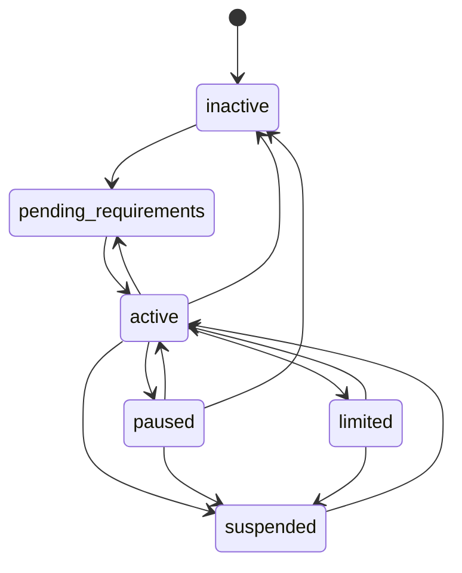
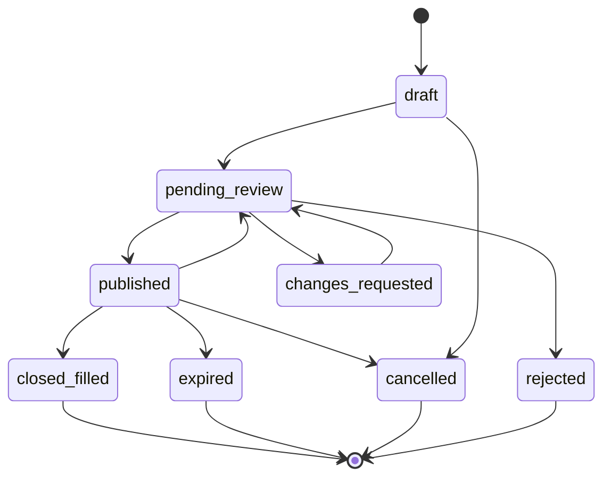
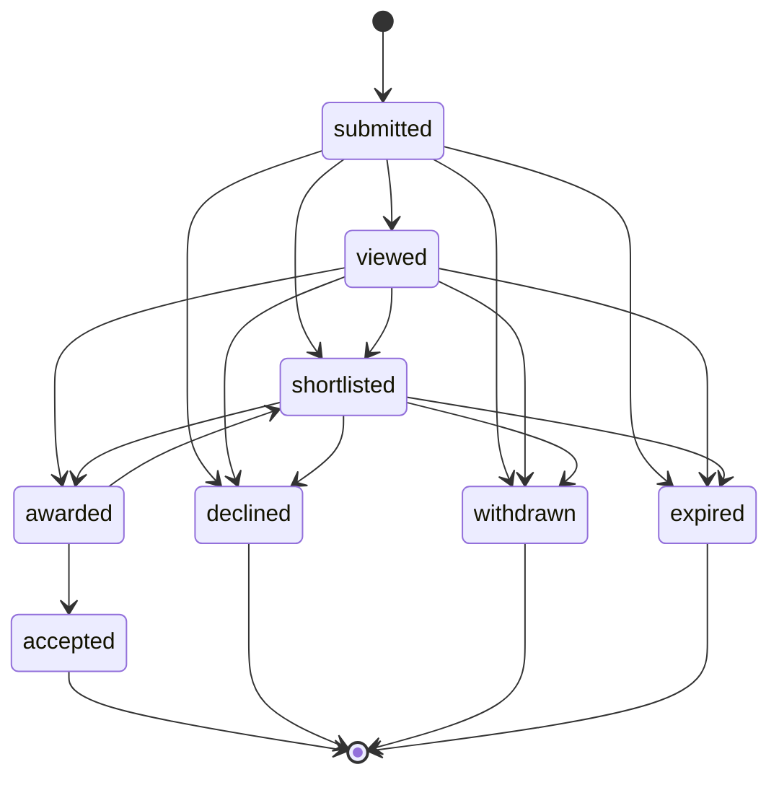
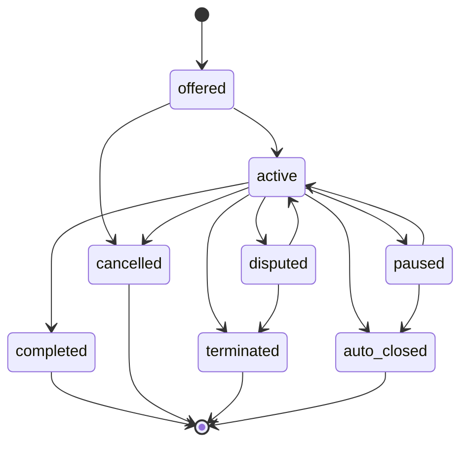
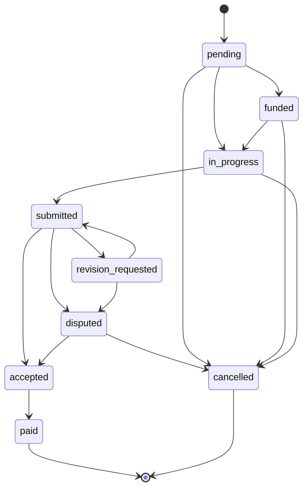
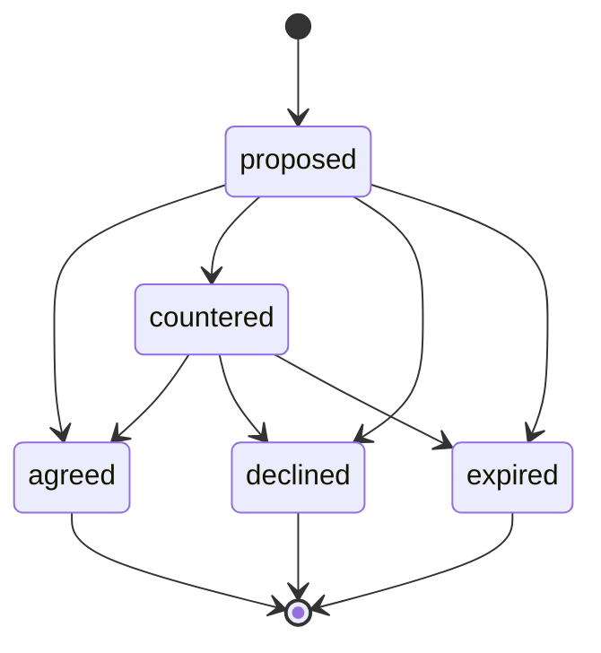
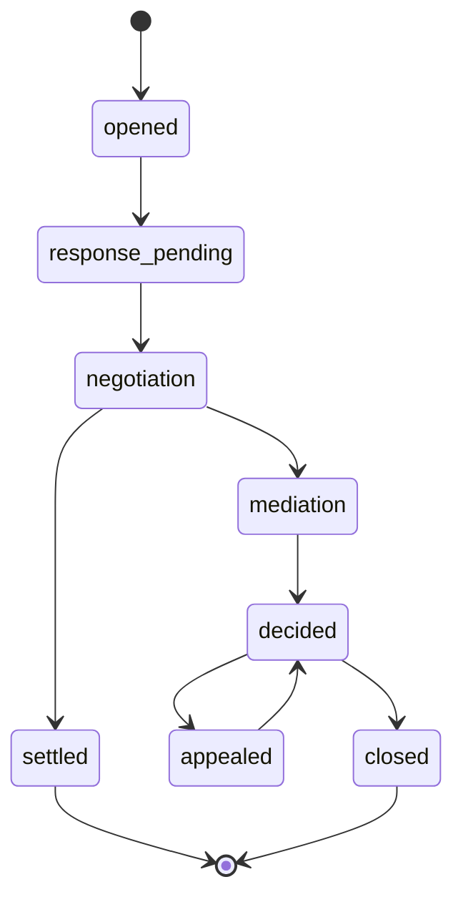
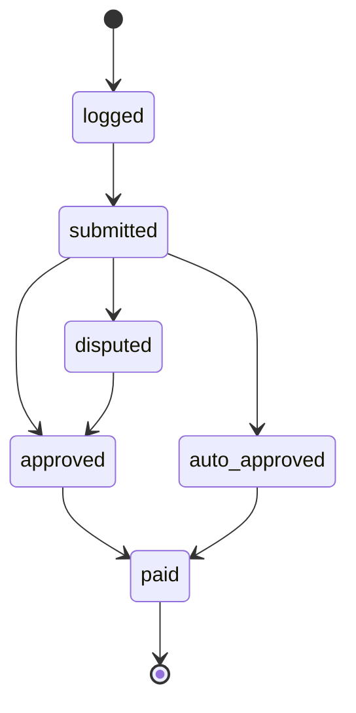
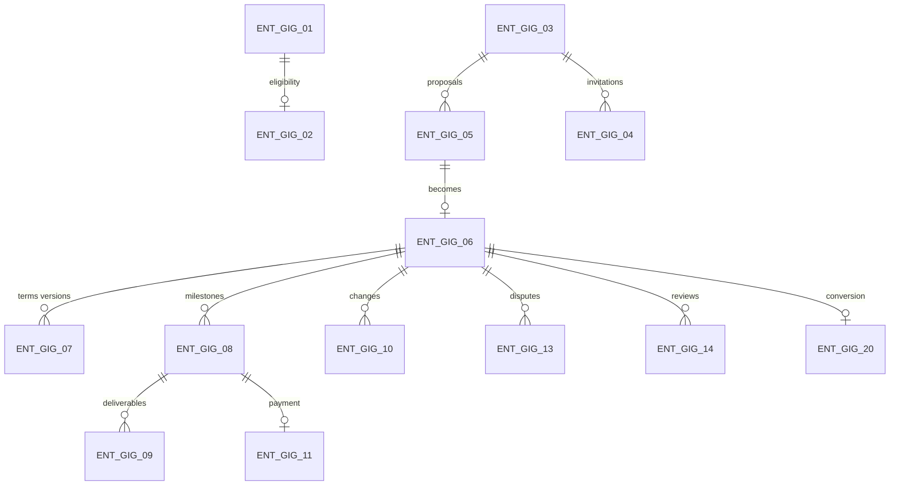

# GIG — Freelance, Contract & Project Work

Module code: `GIG` · Group: OS expansion · Release tier: R6 (OS expansion); the learning-project slice could ship earlier with LRN.

**Scope status: PROPOSED expansion module, narrow by design.** The stakeholder goal is an "operating system" for the whole career domain. SSOT carries a Freelance Marketplace (F-130, Ph7, priority 3), a Project Marketplace infrastructure (F-124 / S-14, "escrow via Stripe"), apprenticeship matching (F-131) and volunteer matching (F-133). SSOT §4.2 also lists "general-purpose marketplace" and "generic HR/payroll system" as non-goals. This module is therefore specified as **evidence-based project work**: scoped projects whose accepted deliverables become verified work evidence on the freelancer's profile. It is not a general gig marketplace, staffing agency, payroll or EOR service. Everything is gated behind `OD-GIG-01` (is the module in scope, and which minimal slice) per `DEC-002`, with separate decision gates for escrow (`OD-GIG-02`) and time tracking (`OD-GIG-03`). Nothing here claims that anything is built.

## 1. Purpose, outcomes and boundaries

### 1.1 Purpose

GIG lets a person turn on freelancer mode on their TalentSphere profile, find or be invited to bounded projects, agree contracts with milestones, deliver work, get paid, and keep the result as verifiable evidence of what they did. Clients are employers (and, if `OD-GIG-07` allows, individuals) who need a defined piece of work done. [SRC: SSOT F-130, F-124, S-14, F-131] · [PROP]

### 1.2 Outcomes

| Outcome | How the system knows |
|---|---|
| A freelancer is eligible, discoverable and can get paid | Freelancer state `active` (SM-GIG-01) with payout onboarding complete |
| Clients publish well-scoped projects inside the allowed categories | Listing `published` (SM-GIG-02) after the scope guard |
| Work is agreed in writing with acceptance criteria | Contract `active` (SM-GIG-04) with at least one milestone |
| Delivered work is reviewed and paid under clear rules | Milestones `accepted` then `paid` (SM-GIG-05) |
| Disputes are resolved without trapping either side | Dispute reaches a terminal state (SM-GIG-07) |
| Completed projects strengthen the freelancer's verified record | Client-confirmed evidence records created (FR-GIG-023) |
| Tax, classification and cross-border rules are respected | Tax documents on file before payout; classification flags reviewed |

### 1.3 Boundaries

**In scope (owned):** freelancer mode and profile extension; freelancer eligibility; project listings and the scope guard; discovery and invitations; proposals and limits; shortlisting and award; contracts, terms, milestones, deliverables, reviews, change requests, completion and termination; escrow decision-gate mechanics; time tracking decision-gate mechanics; tax document collection and classification guard; cross-border constraints; disputes; reputation metrics; circumvention controls; IP and confidentiality terms; hire conversion; learning and apprenticeship projects; dashboards.

**Out of scope (owned elsewhere):**

| Capability | Owner | Relationship |
|---|---|---|
| Money movement: charges, fees, refunds, payouts, tax computation, 1099-style reporting by the provider | BIL (this batch) | GIG creates orders and earning events (FR-BIL-028, FR-BIL-029) |
| Profile, portfolio, resume | PRF (planned) | GIG adds freelancer fields and writes accepted projects to the portfolio with consent |
| Evidence records and verification ladder | EVD, BGV (planned) | GIG submits client-confirmed work evidence |
| Messaging and attachments | MSG (planned) | Per-project threads |
| Job postings for employees | JOB (planned) | Hire conversion links to JOB |
| Moderation and enforcement | TSF (planned) | GIG raises reports |
| Notifications | NTF (planned) | GIG emits events |
| Employer organization and verification | EMP (planned) | Client identity |
| Payroll, benefits, employer-of-record, staffing, workforce management | Out of product (SSOT §4.2) | Never offered |
| Learning content | LRN, STU (planned) | Learning projects reuse assignments |

**Non-goal brushes (SSOT §4.2):** (1) *General marketplace*: categories are an allowlist of skill-based professional project work (BR-GIG-002). (2) *HR/payroll*: no hours-based employment features, no benefits, no payroll; classification guard (BR-GIG-014). (3) *Pay-to-rank*: no proposal boosting or paid freelancer placement (BR-GIG-011). (4) *Ad network*: no sponsored listings. Recorded as `OD-GIG-01`, `OD-GIG-09`, `OD-GIG-04`.

### 1.4 Owned versus consumed

Owned entities: `ENT-GIG-01` to `ENT-GIG-21` (section 8). Consumed: user, organization, profile, evidence, order, payout, message thread, tax document references.

## 2. Roles and permission matrix

`FRL` is a `CAN` with freelancer mode on. A "client" is a user acting for an organization as `EAD` or `REC`/`HMG` with the project-posting permission (granted by `EAD`), or an individual client if `OD-GIG-07` allows.

Legend: C create, R read, U update, A approve or act, `own` own record, `—` none.

| Capability | CAN | FRL | Client (EAD, REC, HMG) | IAD / PLO | FIN | MOD | PAD | SUP |
|---|---|---|---|---|---|---|---|---|
| Turn on freelancer mode | U own | U own | — | — | — | — | — | — |
| Edit freelancer profile | — | U own | — | — | — | — | override (audit) | — |
| Browse listings | R | R | R | R | — | R | R | R |
| Create, edit, close listing | — | — | C, U own org | C, U (learning projects) | — | — | override | — |
| Approve listing (review queue) | — | — | — | — | — | A | A | R |
| Invite freelancer | — | — | C | — | — | — | — | — |
| Submit, edit, withdraw proposal | — | C, U own | R own org | — | — | — | — | — |
| Shortlist, award | — | — | A | — | — | — | — | — |
| Accept contract | — | A own | A own org | — | — | — | — | — |
| Fund milestone (if escrow) | — | — | C | — | R | — | — | — |
| Submit deliverable | — | C own | R | — | — | — | — | — |
| Accept, request revision on milestone | — | — | A | — | — | — | — | — |
| Request change, terminate contract | — | C, U | C, U | — | — | — | override | assist |
| Open dispute | — | C | C | — | — | — | — | assist |
| Decide dispute | — | — | — | — | A (money) | A (conduct) | A (appeal) | — |
| Review counterparty | — | C own | C own | — | — | R, remove | R | R |
| Tax documents, payout | — | C own | — | — | R, A | — | R | — |
| View earnings and spend | — | R own | R org | R (own institution learning projects: none) | R | — | R | — |

Notes: `REC` and `HMG` can post projects only if the organization's `EAD` enabled project posting. `IAD` and `PLO` handle only learning and apprenticeship projects (FR-GIG-031). Freelancer contract data is never visible to employers who evaluate the same person as a job candidate unless the freelancer shares it (BR-GIG-027).

## 3. Sub-module map

| Code | Sub-module | Features |
|---|---|---|
| A | Freelancer mode and profile | FR-GIG-001 to 003 |
| B | Project listings and discovery | FR-GIG-004 to 007 |
| C | Proposals and award | FR-GIG-008 to 011 |
| D | Contracts, milestones and deliverables | FR-GIG-012 to 017 |
| E | Money: escrow gate, time tracking gate, payment | FR-GIG-018 to 020 |
| F | Compliance: tax, classification, cross-border | FR-GIG-021 to 023 |
| G | Trust: reviews, disputes, reputation, circumvention, IP | FR-GIG-024 to 029 |
| H | Conversion, learning projects, dashboards | FR-GIG-030 to 032 |

## 4. Feature specifications

### A. Freelancer mode and profile

### FR-GIG-001 — Freelancer mode activation

- **Sub-module:** A. Freelancer mode and profile
- **Priority / tier:** Must · R6
- **Source:** [SRC: SSOT F-130; canonical role `FRL` in CONVENTIONS] · [PROP] activation mechanics
- **Purpose and outcome:** A candidate opts in to take project work without changing how they appear as a job seeker. Known by freelancer state moving from `inactive` to `pending_requirements` or `active`.
- **Roles and permissions:** `CAN: turn on, pause, turn off` · `PAD: suspend` · `SUP: read`
- **Preconditions and entry points:** Signed-in adult user (18 or the age of majority, BR-GIG-021) with a verified email and a profile with headline. `/freelance/start`, profile menu "Offer freelance services".
- **User interactions and actions:** 1. Read what freelancer mode is and what changes (new profile section, new inbox type, tax and payout steps). 2. Choose service categories from the allowlist. 3. Accept freelancer terms (versioned) and the code of conduct. 4. Click "Turn on freelancer mode". 5. See the requirements checklist (FR-GIG-003). 6. Pause or turn off at any time.
- **System behaviour:** Creates `ENT-GIG-01` in `pending_requirements`; becomes `active` when eligibility is satisfied. Freelancer mode is off by default and independent of job-seeker visibility settings (BR-GIG-001, BR-GIG-027). Turning it off hides the freelancer section and stops new proposals; active contracts continue until completed or terminated. Pausing hides the listing and declines new invitations with an auto-message.
- **UI elements and controls:** Explainer cards, category chips, terms checkbox (unchecked), "Turn on freelancer mode" button, requirements checklist, pause toggle.
- **Configuration options:** User: pause until a date, auto-decline message text. Platform: category allowlist.
- **Business rules:** BR-GIG-001, BR-GIG-002, BR-GIG-021, BR-GIG-027
- **Validation:** At least one and at most 5 categories; terms version current; age rule met.
- **Inputs and outputs:** In: categories, acceptance. Out: freelancer record and checklist.
- **Filters, sorting, search:** n/a — single-user settings.
- **Notifications and communication:** `gig.freelancer.requirements` reminder at 3 and 14 days (opt-out class: onboarding).
- **Error handling and edge cases:** Underage: blocked with explanation. Turning off with an active contract: confirm dialog listing contracts; contracts remain. Account suspended: mode forced `suspended`.
- **Dependencies:** PRF, IDN (planned), FR-GIG-003; `ENT-GIG-01`.
- **Security and privacy:** Mode flag is private until the listing is published.
- **Acceptance criteria:**
  - Given an eligible adult, when they turn on the mode, then state is `pending_requirements` and the checklist appears.
  - Given freelancer mode on, when an employer views the person as a job candidate, then no freelancer data appears unless shared.
  - Given an underage account, when starting, then activation is refused.

### FR-GIG-002 — Freelancer profile, services and portfolio evidence

- **Sub-module:** A. Freelancer mode and profile
- **Priority / tier:** Must · R6
- **Source:** [PROP]; [SRC: SSOT F-84 skills graph, PRF portfolio, EVD evidence]
- **Purpose and outcome:** A freelancer presents services backed by evidence. Known by a published freelancer page with linked evidence.
- **Roles and permissions:** `FRL: edit own` · `GUE, CAN, client: view published fields` · `MOD: remove content`
- **Preconditions and entry points:** Freelancer mode on. `/freelance/profile`.
- **User interactions and actions:** 1. Write a service headline and description (up to 1500 chars). 2. Add services as packages or capabilities (title, what is included, typical timeline, starting price as a stated range or "quote on request"). 3. Link skills from the taxonomy. 4. Attach portfolio items and verified evidence from the profile (EVD planned) and past completed projects. 5. Set availability (open, limited, unavailable until date) and preferred project size. 6. Set rate display preference (hide, show range). 7. Publish.
- **System behaviour:** Verified evidence is shown with its verification level; self-claimed items are labeled. Past completed GIG projects appear automatically as client-confirmed items if the client confirmed (FR-GIG-024). NDA-limited items appear only as "Confidential project, verified" without client name unless the client consented (BR-GIG-017). The page has no search ranking boost for any plan (BR-GIG-011). Content is scanned for contact details and off-platform handles (BR-GIG-012).
- **UI elements and controls:** Editor sections, evidence picker, availability radio, price range inputs, "Preview" and "Publish".
- **Configuration options:** Per user: show rate range, show earnings summary (default off).
- **Business rules:** BR-GIG-011, BR-GIG-012, BR-GIG-017, BR-GIG-019
- **Validation:** Headline 10-120 chars; services up to 10; price ranges numeric and min at most max; no contact data in text.
- **Inputs and outputs:** In: profile fields. Out: published freelancer page.
- **Filters, sorting, search:** n/a — editor.
- **Notifications and communication:** None.
- **Error handling and edge cases:** Evidence revoked later: item shows "Verification withdrawn" and the page updates. Contact info in text: field error. Mode paused: page hidden.
- **Dependencies:** PRF, EVD (planned), FR-GIG-024; `ENT-GIG-01`.
- **Security and privacy:** Public fields only on publish; earnings never shown unless chosen.
- **Acceptance criteria:**
  - Given a verified evidence item, when linked, then the page shows its level.
  - Given a phone number in the description, when saving, then it is rejected.
  - Given an NDA project, when displayed, then the client name is hidden.

### FR-GIG-003 — Freelancer eligibility: identity, payout and tax readiness

- **Sub-module:** A. Freelancer mode and profile
- **Priority / tier:** Must · R6
- **Source:** [PROP]; [SRC: BR-BIL-024, BR-BIL-028 payout onboarding]
- **Purpose and outcome:** A freelancer can only take paid work once identity, payout account and tax information are complete. Known by state `active`.
- **Roles and permissions:** `FRL: complete` · `FIN: review exceptions` · `PAD: override with audit`
- **Preconditions and entry points:** Mode pending. Checklist at `/freelance/requirements`.
- **User interactions and actions:** 1. Verify identity (IDN or BGV). 2. Complete payout onboarding (BIL provider-hosted). 3. Submit tax residency and tax form where required (FR-GIG-021). 4. Confirm country of work. 5. Accept the independent-contractor acknowledgement.
- **System behaviour:** Each item has a status; when all pass the state becomes `active`. A freelancer in a country not supported for payouts or on a sanctions restriction cannot become active (BR-GIG-015); the page explains. Expiring documents (tax forms, identity) move the account to `pending_requirements` with 30 days' notice and no new contracts until renewed; running contracts continue with payouts held when tax data is invalid.
- **UI elements and controls:** Checklist with status icons, action buttons per item, help text.
- **Configuration options:** Platform: supported countries, required documents per country.
- **Business rules:** BR-GIG-013, BR-GIG-015, BR-GIG-021
- **Validation:** Per document type.
- **Inputs and outputs:** In: documents. Out: eligibility status.
- **Filters, sorting, search:** n/a — checklist.
- **Notifications and communication:** `gig.eligibility.expiring`, `gig.eligibility.active`.
- **Error handling and edge cases:** Identity fails: retry path and support link. Country changes: re-evaluate. Tax form rejected by provider: message with fix instructions.
- **Dependencies:** BIL FR-BIL-029, BGV, IDN, FR-GIG-021; `ENT-GIG-02`.
- **Security and privacy:** Documents held by the provider or encrypted; minimal references stored.
- **Acceptance criteria:**
  - Given all items complete, when evaluated, then state becomes `active`.
  - Given an unsupported country, when evaluated, then activation is refused with the reason.
  - Given an expired tax form, when the date passes, then new contracts are blocked.

### B. Project listings and discovery

### FR-GIG-004 — Project brief creation

- **Sub-module:** B. Project listings and discovery
- **Priority / tier:** Must · R6
- **Source:** [SRC: SSOT F-130, F-124] · [PROP] brief structure
- **Purpose and outcome:** A client describes a bounded piece of work clearly enough that freelancers can scope and price it. Known by a brief with outcomes, deliverables and acceptance criteria.
- **Roles and permissions:** `Client (EAD, REC, HMG with permission): create, edit` · `IAD, PLO: learning projects` · `MOD: review`
- **Preconditions and entry points:** Verified employer organization (EMP planned) with a verified payment method (BR-GIG-023). `/projects/new`.
- **User interactions and actions:** 1. Choose category and skills. 2. Write title, background, desired outcomes, deliverables, acceptance criteria, and out-of-scope notes. 3. Set budget type fixed-price with a budget range (hourly only if `OD-GIG-03` allows). 4. Set timeline, preferred start, expected milestones, required skills and experience evidence, location or time-zone preference, language. 5. Mark confidentiality needs (NDA) (FR-GIG-029). 6. Choose visibility (public, invite-only). 7. Save draft or submit for review.
- **System behaviour:** Structure is guided: the editor requires measurable acceptance criteria per deliverable. Scope guard checks (BR-GIG-002, BR-GIG-003, BR-GIG-024): prohibited categories, academic dishonesty, unpaid spec work, requests that look like employment (exclusive, fixed hours, supervision, provided equipment), discriminatory requirements. Findings are blockers or warnings with text. Budget minimum parameter exists (`min_project_budget`, OD-GIG-10).
- **UI elements and controls:** Stepwise form, acceptance-criteria repeater, category and skill pickers, budget inputs with currency, NDA toggle, "Save draft", "Submit".
- **Configuration options:** Platform: allowlist, minimum budget, maximum project duration (default 6 months, `[PROP]`).
- **Business rules:** BR-GIG-002, BR-GIG-003, BR-GIG-005, BR-GIG-014, BR-GIG-023, BR-GIG-024
- **Validation:** Title 10-120 chars; description 100-5000 chars; at least one deliverable with acceptance criteria; budget at least minimum; timeline within maximum.
- **Inputs and outputs:** In: brief. Out: listing draft and scope-guard result.
- **Filters, sorting, search:** n/a — editor.
- **Notifications and communication:** `gig.listing.submitted` (to client; internal to `MOD`).
- **Error handling and edge cases:** Blocker found: submit disabled with explanation. Warnings (for example "requires fixed working hours") need the client to edit or acknowledge, and are logged. Client without verified payment: step blocks at submit.
- **Dependencies:** EMP, BIL, FR-GIG-005; `ENT-GIG-03`.
- **Security and privacy:** Brief visibility per setting; confidential fields hidden until contract when flagged.
- **Acceptance criteria:**
  - Given a brief asking to complete a student's graded assignment, when submitted, then it is blocked under BR-GIG-003.
  - Given a deliverable without acceptance criteria, when submitting, then it fails validation.
  - Given a client without a verified payment method, when submitting, then it is refused.

### FR-GIG-005 — Listing review, publication and scope moderation

- **Sub-module:** B. Project listings and discovery
- **Priority / tier:** Must · R6
- **Source:** [PROP]; [SRC: SSOT TSF planned moderation]
- **Purpose and outcome:** Listings are checked automatically and, where needed, by a human before they go live. Known by SM-GIG-02 state `published`.
- **Roles and permissions:** `MOD: review, approve, reject, request changes` · `Client: respond` · `PAD: appeals`
- **Preconditions and entry points:** Submitted listing. `/admin/projects/review`.
- **User interactions and actions:** Reviewer: 1. See the brief with scope-guard findings. 2. Approve, reject with reason code, or request changes with a message. Client: 3. Receive the decision, edit and resubmit.
- **System behaviour:** New clients' first 3 listings always go to human review; established clients with clean history publish after automated checks only, with random sampling of 10 percent (`[PROP]`). Published listings run for a period (default 30 days, extendable) then expire. Reports from freelancers reopen review. Content edits after publish that change scope materially re-trigger review.
- **UI elements and controls:** Review queue, brief view with finding highlights, decision buttons, message field.
- **Configuration options:** Platform: auto-publish rules, sampling rate, listing duration.
- **Business rules:** BR-GIG-002, BR-GIG-003, BR-GIG-024
- **Validation:** Reject and request-changes need messages.
- **Inputs and outputs:** In: listing. Out: decision.
- **Filters, sorting, search:** Queue by age, client trust level, finding type.
- **Notifications and communication:** `gig.listing.approved`, `gig.listing.rejected`, `gig.listing.changes_requested` (transactional).
- **Error handling and edge cases:** Reviewer backlog: listing stays pending with visible status. Decision reversed on appeal: re-publish. Material edit with active proposals: proposers notified.
- **Dependencies:** TSF, ADM (planned); `ENT-GIG-03`.
- **Security and privacy:** Reviewer access audited.
- **Acceptance criteria:**
  - Given a first listing from a new client, when submitted, then it requires human approval.
  - Given a published listing materially edited, when saved, then it returns to review and proposers are notified.
  - Given an expired listing, when the date passes, then it closes and proposals are declined with notice.

### FR-GIG-006 — Project discovery and search

- **Sub-module:** B. Project listings and discovery
- **Priority / tier:** Must · R6
- **Source:** [PROP]; relates to SRC (planned) search
- **Purpose and outcome:** Freelancers find relevant projects and can see why. Known by relevant results with transparent ordering.
- **Roles and permissions:** `FRL: full` · `CAN: limited` · `GUE: titles only`
- **Preconditions and entry points:** `/projects`.
- **User interactions and actions:** 1. Search by keyword. 2. Filter by category, skills, budget range, timeline, client verification, time zone, language, posted date. 3. Sort by best match, newest, budget. 4. Save a search with alerts. 5. Save a project; hide a project; report a project.
- **System behaviour:** Best match uses skill overlap and evidence, availability and category; never uses plan or payment (BR-GIG-011). Budgets display as stated; client identity shown with verification and spend history summary (hire rate, average review). Saved-search alerts are daily or instant per preference.
- **UI elements and controls:** Search box, filters (collapsible on mobile), result cards, save and hide icons, alert toggle.
- **Configuration options:** Per user: alert frequency.
- **Business rules:** BR-GIG-011
- **Validation:** Budget range min at most max.
- **Inputs and outputs:** In: queries. Out: ranked projects with match reasons.
- **Filters, sorting, search:** As above.
- **Notifications and communication:** `gig.alert.new_projects` (opt-out class: opportunities).
- **Error handling and edge cases:** No results: suggest widening. Listing closes while viewing: banner "Closed".
- **Dependencies:** SRC, FR-GIG-005; `ENT-GIG-03`.
- **Security and privacy:** Confidential fields hidden pre-contract.
- **Acceptance criteria:**
  - Given a freelancer on a paid plan and one on free, when ranked, then plan has no effect.
  - Given a hidden project, when searching, then it does not appear for that user.
  - Given a saved search, when a matching listing publishes, then one alert is sent.

### FR-GIG-007 — Client invitations to freelancers

- **Sub-module:** B. Project listings and discovery
- **Priority / tier:** Should · R6
- **Source:** [PROP]; [SRC: SSOT F-59 outreach credits limits pattern]
- **Purpose and outcome:** A client invites specific freelancers to a listing. Known by invitations responded to.
- **Roles and permissions:** `Client: invite` · `FRL: accept, decline`
- **Preconditions and entry points:** Published or invite-only listing. Freelancer page "Invite to project".
- **User interactions and actions:** 1. Pick a listing. 2. Write a short message. 3. Send (limit per day). 4. Freelancer reviews the brief and accepts (opens the proposal form) or declines with a reason template.
- **System behaviour:** Invitation limit per client per week from entitlements (`gig.invites_per_week`, BIL). Invitations to paused or unavailable freelancers are blocked. Declined freelancers cannot be re-invited to the same listing. Invitation messages are scanned for contact details (BR-GIG-012).
- **UI elements and controls:** Invite dialog with listing select, message area, send button; freelancer inbox with accept and decline.
- **Configuration options:** Platform: weekly limit by plan (parameter).
- **Business rules:** BR-GIG-011, BR-GIG-012
- **Validation:** Message up to 600 chars.
- **Inputs and outputs:** In: invitation. Out: invitation record.
- **Filters, sorting, search:** Inbox by status.
- **Notifications and communication:** `gig.invitation.received`.
- **Error handling and edge cases:** Limit reached: dialog (BIL). Listing closed: invitation voided. Freelancer already proposed: invitation not needed message.
- **Dependencies:** BIL FR-BIL-022; `ENT-GIG-04`.
- **Security and privacy:** Freelancer sees client verification summary.
- **Acceptance criteria:**
  - Given the weekly limit reached, when sending, then it is refused with the limit dialog.
  - Given a declined invitation, when the client invites again, then it is blocked.
  - Given contact details in the message, when sent, then it is masked.

### C. Proposals and award

### FR-GIG-008 — Submit and manage a proposal

- **Sub-module:** C. Proposals and award
- **Priority / tier:** Must · R6
- **Source:** [SRC: SSOT F-130] · [PROP]
- **Purpose and outcome:** A freelancer offers to do the work with a plan, price and timeline. Known by a proposal `submitted`.
- **Roles and permissions:** `FRL: create, edit, withdraw` · `Client: read` · `MOD: read on report`
- **Preconditions and entry points:** Active freelancer; listing published; within proposal quota (FR-GIG-009). `/projects/:id/propose`.
- **User interactions and actions:** 1. Write a cover note tailored to the brief (200-3000 chars). 2. Propose milestones (title, deliverable, amount, due date) summing to the total, or accept the client's milestones. 3. Attach relevant evidence and work samples. 4. Answer the client's screening questions. 5. Submit. 6. Edit until viewed, withdraw any time.
- **System behaviour:** Shows the fee preview (what the client pays, what the freelancer receives). Duplicate proposals per listing are blocked. Cover-note scan for contact details and plagiarism similarity warning against the freelancer's own prior proposals (mass copy). Editing after the client viewed requires a visible "edited" marker and notifies the client. Total may not be below the client's stated minimum if one is set.
- **UI elements and controls:** Cover note editor, milestone repeater with running total, evidence picker, question fields, fee preview panel, "Submit".
- **Configuration options:** Platform: milestone count limits (1-20).
- **Business rules:** BR-GIG-005, BR-GIG-010, BR-GIG-012, BR-GIG-025
- **Validation:** Milestone amounts positive integers in the listing currency; sum equals total; due dates after expected start; total within platform limits.
- **Inputs and outputs:** In: proposal. Out: proposal record.
- **Filters, sorting, search:** My proposals by status.
- **Notifications and communication:** `gig.proposal.received` to client; `gig.proposal.viewed` to freelancer (in-app).
- **Error handling and edge cases:** Listing closed mid-edit: save blocked with explanation. Quota exhausted: limit dialog. Currency mismatch: forced to the listing currency.
- **Dependencies:** FR-GIG-004, FR-GIG-009; `ENT-GIG-05`.
- **Security and privacy:** Proposal visible to the client and moderators only.
- **Acceptance criteria:**
  - Given milestone amounts not summing to the total, when submitting, then it fails.
  - Given a second proposal to the same listing, when submitting, then it is refused.
  - Given an edit after viewing, when saved, then the client is notified.

### FR-GIG-009 — Proposal quotas and anti-spam

- **Sub-module:** C. Proposals and award
- **Priority / tier:** Must · R6
- **Source:** [SRC: SSOT F-59 outreach credits, BR-130 caps pattern] · [PROP]
- **Purpose and outcome:** Freelancers have a fair number of proposals and clients are not flooded. Known by quota enforcement and spam signals.
- **Roles and permissions:** `FRL: consume` · `FIN: configure plans` · `MOD: act on spam`
- **Preconditions and entry points:** Any proposal submission.
- **User interactions and actions:** 1. Freelancer sees remaining proposals. 2. At limit, sees upgrade or wait options (FR-BIL-023). 3. Clients can mark proposals as spam.
- **System behaviour:** Entitlement key `gig.proposals_per_month` from the freelancer's plan (BIL; default free allowance is a parameter, OD-GIG-11). Quota is spent on submission and refunded if the listing is cancelled by the client within 48 hours or rejected by moderation. Paid plans raise capacity only; they never place a proposal higher (BR-GIG-011). Repeated spam flags reduce the quota or suspend proposing pending review.
- **UI elements and controls:** Quota meter, limit dialog, "Mark as spam" client action.
- **Configuration options:** Platform: quota values per plan, refund window.
- **Business rules:** BR-GIG-011, BR-GIG-025
- **Validation:** Atomic quota consumption.
- **Inputs and outputs:** In: submission intent. Out: allow or limit.
- **Filters, sorting, search:** Usage view.
- **Notifications and communication:** `bil.usage.threshold`.
- **Error handling and edge cases:** Concurrent submissions at 1 left: one wins. Refund path failing: retried.
- **Dependencies:** BIL FR-BIL-003, FR-BIL-022; `ENT-GIG-05`.
- **Security and privacy:** Counters hold no content.
- **Acceptance criteria:**
  - Given a quota of 1 left, when two proposals submit simultaneously, then one succeeds.
  - Given a listing cancelled within 48 hours, when processed, then the quota is refunded.
  - Given a paid and free freelancer with equal match, when the client sees the list, then order is unaffected by plan.

### FR-GIG-010 — Shortlisting, comparison and pre-award conversation

- **Sub-module:** C. Proposals and award
- **Priority / tier:** Must · R6
- **Source:** [PROP]; relates to ATS shortlist patterns
- **Purpose and outcome:** A client compares proposals fairly and asks questions before choosing. Known by a shortlist and decision.
- **Roles and permissions:** `Client: view, shortlist, decline, message` · `FRL: reply`
- **Preconditions and entry points:** Proposals received. `/projects/:id/proposals`.
- **User interactions and actions:** 1. View proposals as a comparison table (price, timeline, milestones, evidence, ratings). 2. Sort and filter. 3. Shortlist, decline with a template reason (optional note), or message. 4. Schedule an optional intro call (INT planned). 5. Award (FR-GIG-011).
- **System behaviour:** Default order is relevance (match and evidence), not price or plan. Messages are in-platform threads; contact details masked until a contract exists (BR-GIG-012). Declines are sent with reasons from a list. Freelancer evidence is shown with verification level. The client can share the shortlist with a colleague in the same organization.
- **UI elements and controls:** Comparison table, shortlist star, decline dialog, message panel, "Award" button.
- **Configuration options:** Per listing: screening questions.
- **Business rules:** BR-GIG-011, BR-GIG-012
- **Validation:** Decline reason required from list.
- **Inputs and outputs:** In: decisions. Out: proposal states.
- **Filters, sorting, search:** By price, timeline, rating, evidence level.
- **Notifications and communication:** `gig.proposal.shortlisted`, `gig.proposal.declined`.
- **Error handling and edge cases:** Client inactive 30 days after proposals: freelancers can withdraw with quota refund. Duplicate decline: idempotent.
- **Dependencies:** MSG, INT (planned); `ENT-GIG-05`.
- **Security and privacy:** Proposals not shared outside the client organization.
- **Acceptance criteria:**
  - Given a shortlist, when the client declines another proposal, then it receives a templated reason.
  - Given a phone number in a message before award, when sent, then it is masked.
  - Given an inactive client for 30 days, when a freelancer withdraws, then quota refunds.

### FR-GIG-011 — Award and contract offer

- **Sub-module:** C. Proposals and award
- **Priority / tier:** Must · R6
- **Source:** [PROP]
- **Purpose and outcome:** The client turns a proposal into a contract offer and the freelancer accepts. Known by contract `active` (SM-GIG-04).
- **Roles and permissions:** `Client: award` · `FRL: accept, decline`
- **Preconditions and entry points:** Shortlisted proposal. "Award" button.
- **User interactions and actions:** 1. Client reviews final terms (FR-GIG-012), adjusts milestones, selects payment mode (per gates), and sends the offer. 2. Freelancer reviews and accepts or counters once. 3. On acceptance, both receive the signed terms and the first milestone starts.
- **System behaviour:** Offer expires in 7 days. Contract record and terms snapshot are immutable once accepted (changes through FR-GIG-015). Other proposals on a single-hire listing are declined with a "position filled" notice at acceptance; multi-hire listings stay open. Accepting requires eligibility to be current. Contact details are unmasked between the parties only after acceptance, if the contract allows (BR-GIG-012).
- **UI elements and controls:** Offer summary, terms viewer, "Send offer", "Accept offer", "Counter once".
- **Configuration options:** Per listing: single or multi-hire.
- **Business rules:** BR-GIG-004, BR-GIG-005, BR-GIG-012, BR-GIG-023
- **Validation:** Offer terms complete; freelancer eligible; client payment method valid.
- **Inputs and outputs:** In: offer. Out: contract.
- **Filters, sorting, search:** n/a — single flow.
- **Notifications and communication:** `gig.offer.sent`, `gig.offer.accepted`, `gig.offer.expired`.
- **Error handling and edge cases:** Offer expires: proposal returns to shortlist. Freelancer eligibility lapsed: acceptance blocked with fix steps. Client payment method fails at start: contract stays `offered`.
- **Dependencies:** FR-GIG-012, FR-GIG-018; `ENT-GIG-06`.
- **Security and privacy:** Signed terms stored with hash and timestamps.
- **Acceptance criteria:**
  - Given an accepted offer, when processed, then the contract is `active` and terms are immutable.
  - Given an expired offer, when the freelancer tries to accept, then it fails.
  - Given a single-hire listing, when the offer is accepted, then other proposers are notified.

### D. Contracts, milestones and deliverables

### FR-GIG-012 — Contract terms and templates

- **Sub-module:** D. Contracts, milestones and deliverables
- **Priority / tier:** Must · R6
- **Source:** [PROP]; [SRC: SSOT S-14 project marketplace infrastructure]
- **Purpose and outcome:** Every engagement has written terms both sides accept. Known by an accepted, hashed terms snapshot.
- **Roles and permissions:** `Client: propose terms` · `FRL: review, accept` · `PAD: manage templates` · `SUP: read (audited)`
- **Preconditions and entry points:** Award step (FR-GIG-011).
- **User interactions and actions:** 1. Start from a platform template (fixed-price project, retainer-free; hourly only if gated on). 2. Review sections: parties, scope and deliverables, milestones and amounts, acceptance criteria, review window, revision limits, payment mode, IP ownership, confidentiality, termination, governing law and dispute path, tax responsibilities, independent-contractor acknowledgement. 3. Edit permitted fields; locked sections show why. 4. Both accept with typed name and timestamp.
- **System behaviour:** Template clauses are versioned and reviewed by counsel. Editable fields are limited; free-text custom clauses are allowed in one "additional terms" block that is screened for prohibited content (off-platform payment, exclusivity, fixed hours) (BR-GIG-014). IP default: assigned to the client on payment in full of the relevant milestone, with the freelancer keeping pre-existing tools and a portfolio display right (BR-GIG-016). The platform is not a party (BR-GIG-004). Governing law defaults from the client's country and can be set by contract within platform rules (OD-GIG-04).
- **UI elements and controls:** Terms viewer with section navigation, editable fields, additional terms box, acceptance form, version indicator.
- **Configuration options:** Platform: template set, locked clauses, review window default (7 days), revision limit default (2).
- **Business rules:** BR-GIG-004, BR-GIG-005, BR-GIG-008, BR-GIG-009, BR-GIG-014, BR-GIG-016
- **Validation:** All required sections present; milestone sum equals contract total; review window 3-30 days; revision count 0-5.
- **Inputs and outputs:** In: terms. Out: immutable terms snapshot (`ENT-GIG-07`).
- **Filters, sorting, search:** n/a — document.
- **Notifications and communication:** `gig.terms.updated`.
- **Error handling and edge cases:** Custom clause flagged: blocked or warned with reasons. One side edits after the other accepted: acceptance resets. Template updated: running contracts keep their version.
- **Dependencies:** FR-GIG-011; `ENT-GIG-07`.
- **Security and privacy:** Terms visible to parties and authorized staff; hashed for integrity.
- **Acceptance criteria:**
  - Given an edit after one acceptance, when saved, then acceptance resets.
  - Given a custom clause requiring payment outside the platform, when saved, then it is blocked.
  - Given a template update, when a contract is running, then the contract keeps its version.

### FR-GIG-013 — Milestones and deliverable submission

- **Sub-module:** D. Contracts, milestones and deliverables
- **Priority / tier:** Must · R6
- **Source:** [PROP]
- **Purpose and outcome:** The freelancer submits work against a milestone with evidence of completion. Known by milestone state `submitted` and attached deliverables.
- **Roles and permissions:** `FRL: submit` · `Client: view` · `PAD: read on dispute`
- **Preconditions and entry points:** Contract `active`; milestone `in_progress`. `/contracts/:id/milestones/:mid`.
- **User interactions and actions:** 1. Upload files (up to size limits) or add links (repository, design file, document) with access notes. 2. Write a delivery note mapping to each acceptance criterion. 3. Click "Submit for review".
- **System behaviour:** Files are virus scanned and stored for the contract term plus retention (PLT planned). Links are recorded with a snapshot hash where possible (for example a commit id). Submission starts the client's review window (default 7 days, BR-GIG-008). A milestone can be submitted only once per review cycle. Partial delivery is allowed only if the milestone is split by amendment (FR-GIG-015).
- **UI elements and controls:** File dropzone with progress, link entries with type select, criteria checklist with notes per criterion, "Submit for review".
- **Configuration options:** Platform: maximum file size (default 500 MB per file, 5 GB per contract), allowed link hosts.
- **Business rules:** BR-GIG-005, BR-GIG-008
- **Validation:** At least one file or link; each criterion has a note; allowed file types (executables flagged for review).
- **Inputs and outputs:** In: deliverables. Out: submission record and client prompt.
- **Filters, sorting, search:** Milestone list by state.
- **Notifications and communication:** `gig.milestone.submitted` to client with review deadline (transactional).
- **Error handling and edge cases:** Upload fails: resumable. Malware detected: file quarantined and freelancer told. Submit after due date: allowed, with a "late" marker, no penalty unless terms say so.
- **Dependencies:** PLT (planned), FR-GIG-014; `ENT-GIG-08`, `ENT-GIG-09`.
- **Security and privacy:** Deliverables visible to the parties only; NDA clauses apply.
- **Acceptance criteria:**
  - Given a submission, when sent, then the review window starts and the client is notified.
  - Given a malware file, when uploaded, then it is quarantined and cannot be submitted.
  - Given a second submission during the same cycle, when attempted, then it is blocked.

### FR-GIG-014 — Milestone review: accept, request revision, reject

- **Sub-module:** D. Contracts, milestones and deliverables
- **Priority / tier:** Must · R6
- **Source:** [PROP]
- **Purpose and outcome:** The client decides on each milestone within a fixed window, with fair handling of silence. Known by SM-GIG-05 terminal outcomes.
- **Roles and permissions:** `Client: accept, request revision, reject` · `FRL: respond, escalate` · `SUP: assist`
- **Preconditions and entry points:** Milestone `submitted`.
- **User interactions and actions:** 1. Client opens the deliverables and criteria checklist. 2. Marks each criterion met or not met with comments. 3. Chooses Accept, Request revision (must cite unmet criteria), or Reject (opens a dispute path). 4. Freelancer receives the decision and resubmits if revision.
- **System behaviour:** Revisions are limited per milestone (default 2); further revisions need a change request (FR-GIG-015). If the client does not respond within the review window plus a 3-day reminder period, the milestone is auto-accepted with notices (BR-GIG-008); the client can still dispute within 7 days with evidence. Rejection without unmet criteria is not allowed. Acceptance triggers payment release (FR-GIG-020) and a work-evidence candidate (FR-GIG-024).
- **UI elements and controls:** Criteria checklist with comments, decision buttons, countdown showing the review deadline, "Escalate to support" link.
- **Configuration options:** Per contract: review window, revision limit.
- **Business rules:** BR-GIG-008, BR-GIG-009, BR-GIG-020, BR-GIG-030
- **Validation:** Revision and reject require at least one unmet criterion and a comment (20-2000 chars).
- **Inputs and outputs:** In: decision. Out: state change, payment event.
- **Filters, sorting, search:** Client review queue by deadline.
- **Notifications and communication:** `gig.review.reminder` at 3 days and 1 day before the deadline, `gig.milestone.auto_accepted`, `gig.milestone.revision_requested`.
- **Error handling and edge cases:** Client account suspended during window: clock pauses and `SUP` assigned. Freelancer misses revision deadline: milestone `late` rather than auto-failing. Auto-accept on a contested deliverable: dispute allowed.
- **Dependencies:** FR-GIG-013, FR-GIG-020, FR-GIG-025; `ENT-GIG-08`.
- **Security and privacy:** Decisions audited.
- **Acceptance criteria:**
  - Given no client response at the end of the window plus reminder period, when the job runs, then the milestone auto-accepts and both are notified.
  - Given a revision request citing no criterion, when submitted, then it is rejected.
  - Given a third revision on a limit of 2, when requested, then a change request is required.

### FR-GIG-015 — Change requests and scope amendments

- **Sub-module:** D. Contracts, milestones and deliverables
- **Priority / tier:** Should · R6
- **Source:** [PROP]
- **Purpose and outcome:** Scope, price, schedule or milestones change by mutual written agreement. Known by SM-GIG-06 `agreed` and a new terms version.
- **Roles and permissions:** `Client, FRL: propose, accept, decline`
- **Preconditions and entry points:** Active contract. "Request change".
- **User interactions and actions:** 1. Either side proposes: add or edit a milestone, change due dates, change amount, extend scope, add revisions. 2. The other reviews and accepts, declines, or counters. 3. On agreement a new terms version is created.
- **System behaviour:** Amount increases require the client's funding or authorization before work (per payment mode). Amount decreases on funded milestones follow refund rules. Changes cannot lower an already accepted milestone. Unanswered requests expire in 7 days. All versions are kept.
- **UI elements and controls:** Change form with before and after diff, accept and decline buttons.
- **Configuration options:** Platform: expiry days.
- **Business rules:** BR-GIG-005, BR-GIG-006
- **Validation:** Totals consistent; effective dates in future.
- **Inputs and outputs:** In: change. Out: amended terms.
- **Filters, sorting, search:** By state.
- **Notifications and communication:** `gig.change.requested`, `gig.change.agreed`, `gig.change.expired`.
- **Error handling and edge cases:** Concurrent proposals: only one open at a time. Funding fails: change stays pending.
- **Dependencies:** FR-GIG-012, FR-GIG-018; `ENT-GIG-10`.
- **Security and privacy:** Parties only.
- **Acceptance criteria:**
  - Given an agreed change, when applied, then a new version exists and the old one is retained.
  - Given an attempt to reduce an accepted milestone, when proposed, then it is rejected.
  - Given an unanswered request, when 7 days pass, then it expires.

### FR-GIG-016 — Contract completion, cancellation and termination

- **Sub-module:** D. Contracts, milestones and deliverables
- **Priority / tier:** Must · R6
- **Source:** [PROP]
- **Purpose and outcome:** A contract ends cleanly for any reason. Known by SM-GIG-04 terminal state with all money settled.
- **Roles and permissions:** `Client, FRL: complete, cancel, terminate` · `PAD: force-end with audit`
- **Preconditions and entry points:** Contract page.
- **User interactions and actions:** 1. Complete: all milestones paid or cancelled, either party confirms completion. 2. Mutual cancellation: both agree with settlement terms. 3. Unilateral termination: choose a reason, see consequences (unpaid accepted milestones remain due; in-progress milestone handling per terms), confirm.
- **System behaviour:** Completion triggers reviews (FR-GIG-024) and evidence creation. For in-progress work on termination, the system proposes a settlement calculator (percentage complete per freelancer, per client) and moves to negotiation; no resolution within 7 days opens a dispute (FR-GIG-025). Held funds (if escrow) are not released or refunded until the settlement or decision. Contracts unaffected by a party's account suspension continue per protocol: client suspended means freelancer can submit and funds stay held; freelancer suspended means client may reassign or cancel with refund of unreleased funds.
- **UI elements and controls:** Completion button, termination dialog with consequences list, settlement calculator.
- **Configuration options:** Platform: negotiation window (7 days).
- **Business rules:** BR-GIG-005, BR-GIG-020, BR-GIG-022
- **Validation:** Reason required; settlement amounts within contract remaining value.
- **Inputs and outputs:** In: action. Out: end state, settlement.
- **Filters, sorting, search:** Contracts by state.
- **Notifications and communication:** `gig.contract.completed`, `gig.contract.terminated`.
- **Error handling and edge cases:** Both sides unresponsive: contract auto-closes after 60 days of inactivity with reviews disabled and funds handled per FR-GIG-018. Unpaid accepted milestone at termination: payment still released.
- **Dependencies:** FR-GIG-018, FR-GIG-020, FR-GIG-024, FR-GIG-025; `ENT-GIG-06`.
- **Security and privacy:** Audit.
- **Acceptance criteria:**
  - Given all milestones paid, when both confirm, then the contract is `completed` and review prompts go out.
  - Given termination mid-milestone, when confirmed, then a settlement negotiation opens and funds are not released.
  - Given a suspended freelancer, when the contract is processed, then the client is offered cancellation with refund of unreleased funds.

### FR-GIG-017 — Project workroom: messages, files and status

- **Sub-module:** D. Contracts, milestones and deliverables
- **Priority / tier:** Should · R6
- **Source:** [PROP]; [SRC: SSOT MSG planned]
- **Purpose and outcome:** Parties collaborate in one place with a record that can serve in disputes. Known by a single timeline per contract.
- **Roles and permissions:** `Client, FRL: participate` · `SUP, PAD: read on dispute or report (audited)`
- **Preconditions and entry points:** Contract `offered` or `active`. `/contracts/:id`.
- **User interactions and actions:** 1. Send messages and attachments. 2. Post status updates (percent done, blockers). 3. Share files. 4. Mention team members of the client organization. 5. Pin decisions.
- **System behaviour:** Timeline includes system events (milestone states, changes, payments). Contact details are unmasked between the parties after contract acceptance unless the contract forbids (BR-GIG-012). Messages are retained for the retention period and are the evidence base for disputes. The workroom is not a general chat product: no public channels, no feeds.
- **UI elements and controls:** Timeline, composer with attachments, status update form, pin icon, member list.
- **Configuration options:** Per contract: client team members added.
- **Business rules:** BR-GIG-012, BR-GIG-029
- **Validation:** Attachment limits per PLT.
- **Inputs and outputs:** In: messages. Out: timeline.
- **Filters, sorting, search:** Search within contract; filter by type.
- **Notifications and communication:** `gig.message.new` (opt-out class: messages).
- **Error handling and edge cases:** Harassment: report path. Party offline: digest. Client team member leaves the organization: access removed.
- **Dependencies:** MSG, PLT (planned), EMP; `ENT-GIG-06`.
- **Security and privacy:** Contract-scoped access; encryption in transit and at rest.
- **Acceptance criteria:**
  - Given a client team member removed from the organization, when they open the workroom, then access is denied.
  - Given a dispute, when `SUP` reads messages, then the access is audited.
  - Given a pre-contract message with a phone number, when sent, then it is masked.

### E. Money: escrow gate, time tracking gate, payment

### FR-GIG-018 — Payment modes and the escrow decision gate

- **Sub-module:** E. Money: escrow gate, time tracking gate, payment
- **Priority / tier:** Must (mode A) · R6; escrow modes Won't-now until `OD-GIG-02`
- **Source:** [SRC: SSOT S-14 "escrow via Stripe"] · [PROP]; conflicts with §4.2 non-goal risk and money-handling regulation, hence the gate
- **Purpose and outcome:** Milestone payment protection is offered in the form that is legally and operationally approved. Known by every contract naming exactly one payment mode.
- **Roles and permissions:** `Client: choose mode` · `FRL: accept mode` · `FIN: operate` · `PAD, SAD: enable modes` · `Legal: sign-off (off-system)`
- **Preconditions and entry points:** Contract offer step.
- **User interactions and actions:** 1. Client picks the payment mode (only enabled modes are shown). 2. Freelancer sees what protection exists before accepting. 3. For funding modes, the client funds a milestone and the freelancer sees "Funded".
- **System behaviour:** Modes: **A. Pay on acceptance (default, enabled with the module):** the client has an authorized payment method and a spend limit; when a milestone is accepted, the platform charges the client and credits the freelancer's earnings through BIL (FR-BIL-028, FR-BIL-029). The platform does not hold third-party funds before acceptance; the risk of a failed charge is mitigated by a pre-authorization check at milestone start, client trust limits for new clients (BR-GIG-023) and a client failure policy (suspension plus collection through the provider). **B. Provider-managed funding (gated, `OD-GIG-02`):** the client pays when the milestone starts into a held balance managed by a licensed payment provider or escrow partner; release on acceptance, refund on cancellation, split by decision. **C. Platform escrow (not offered):** the platform never directly holds funds unless an explicit decision and legal structure exist (BR-GIG-006). Mode flags are platform settings; a mode that is not enabled cannot be selected or inferred.
- **UI elements and controls:** Mode selector with plain-language protection summary, funding status chip on milestones, "Fund milestone" button (mode B).
- **Configuration options:** Platform: enabled modes (default A only), new-client spend limit, pre-authorization amount rule.
- **Business rules:** BR-GIG-006, BR-GIG-023, BR-GIG-010
- **Validation:** Mode enabled; client limit not exceeded; funding amount equals milestone total plus fees.
- **Inputs and outputs:** In: mode, funding. Out: payment state per milestone.
- **Filters, sorting, search:** Finance view by mode, state.
- **Notifications and communication:** `gig.milestone.funded` (mode B), `gig.payment.failed`.
- **Error handling and edge cases:** Mode A charge fails at acceptance: payment retried per BIL dunning, freelancer shown "Payment pending" with protection options (client suspension, collections); repeated failures block the client from new contracts. Mode B funding expires: milestone not started. Mode change after offer: new acceptance required.
- **Dependencies:** BIL FR-BIL-028, FR-BIL-029, FR-BIL-016; `ENT-GIG-11`.
- **Security and privacy:** No card data; fund holds recorded only through the provider.
- **Acceptance criteria:**
  - Given mode B not enabled, when a client tries to select it, then it is unavailable and an API request is refused.
  - Given mode A and a failing charge at acceptance, when processed, then the freelancer sees "Payment pending" and the client cannot start new contracts.
  - Given a new client over the new-client limit, when awarding, then the offer is blocked until verification improves.

### FR-GIG-019 — Hourly contracts and time tracking (decision-gated)

- **Sub-module:** E. Money: escrow gate, time tracking gate, payment
- **Priority / tier:** Won't-now until `OD-GIG-03` · R6
- **Source:** [PROP]; tension with SSOT §4.2 (generic HR system) and worker-classification risk
- **Purpose and outcome:** If approved, hourly engagements record time with explicit consent. Known by approved time entries invoiced weekly.
- **Roles and permissions:** `FRL: log time, dispute` · `Client: approve time` · `FIN: operate`
- **Preconditions and entry points:** Feature flag on; contract type hourly. `/contracts/:id/time`.
- **User interactions and actions:** 1. Freelancer logs time manually (date, duration, description) or starts a timer. 2. Optional screenshot capture only if both agreed, freelancer sees and can delete entries before submission (default off). 3. Weekly timesheet is submitted. 4. Client approves or disputes entries within 5 days. 5. Approved time is paid.
- **System behaviour:** Weekly cap and total cap per contract set by the client. No keystroke or mouse logging, no webcam, no covert monitoring ever (BR-GIG-007). Manual time needs a note; entries beyond caps are rejected. Silence leads to auto-approval after the window like milestones. Hourly work raises misclassification risk, so the classification guard (FR-GIG-022) applies with stricter warnings (fixed schedule, exclusivity).
- **UI elements and controls:** Timesheet grid, timer, consent toggles, approve and dispute buttons.
- **Configuration options:** Platform: flag off by default; weekly cap defaults.
- **Business rules:** BR-GIG-007, BR-GIG-008, BR-GIG-014
- **Validation:** Entries at most 12 hours per day; no overlapping entries; description required.
- **Inputs and outputs:** In: time entries. Out: invoices and earning events.
- **Filters, sorting, search:** By week, state.
- **Notifications and communication:** `gig.timesheet.submitted`, `gig.timesheet.auto_approved`.
- **Error handling and edge cases:** Timer left running: auto-stops after 4 hours idle prompts. Dispute: affected entries go to FR-GIG-025. Feature flag off: routes return 404 and UI shows no entry points.
- **Dependencies:** BIL, FR-GIG-022; `ENT-GIG-12`.
- **Security and privacy:** No covert capture; screenshots (if enabled) private to the parties and deleted 30 days after payment.
- **Acceptance criteria:**
  - Given the flag off, when a client creates an hourly contract, then it is not possible.
  - Given a screenshot setting without both consents, when a timer runs, then no capture occurs.
  - Given entries overlapping, when logged, then the second is rejected.

### FR-GIG-020 — Payment release, fees and payouts

- **Sub-module:** E. Money: escrow gate, time tracking gate, payment
- **Priority / tier:** Must · R6
- **Source:** [SRC: BR-101 revenue share default; OD-28] · [PROP]
- **Purpose and outcome:** Accepted work is paid and fees are clear. Known by earning events in BIL and a statement per milestone.
- **Roles and permissions:** `FRL: view earnings` · `Client: view spend, invoices` · `FIN: operate`
- **Preconditions and entry points:** Milestone accepted (FR-GIG-014).
- **User interactions and actions:** 1. Both see a payment breakdown (milestone amount, platform fee, taxes, payout). 2. Client receives an invoice. 3. Freelancer sees the earning with its hold period and payout status.
- **System behaviour:** On acceptance, GIG creates a BIL order (client charge) and an earning event (freelancer share) with idempotency on (milestone id). Fee model is a parameter shown before award: for example a freelancer-side fee percent and a client-side fee percent (OD-GIG-08, no number set here). The same fee table applies to every freelancer; no negotiated per-user hidden fee (BR-GIG-010). Earnings follow BIL's hold and payout rules including clawbacks on refund (FR-BIL-029). Client invoices carry tax per BIL.
- **UI elements and controls:** Payment breakdown panel, invoice link, earnings list with status.
- **Configuration options:** Platform: fee parameters, hold days, minimum milestone amount.
- **Business rules:** BR-GIG-010, BR-GIG-013, BR-GIG-030
- **Validation:** Idempotency per milestone; amounts match accepted terms.
- **Inputs and outputs:** In: acceptance events. Out: orders and earnings.
- **Filters, sorting, search:** Earnings by contract, period.
- **Notifications and communication:** `gig.payment.released`, `gig.payment.paid_out` (transactional).
- **Error handling and edge cases:** Duplicate acceptance event: no double payment. Currency conversion: shown with the rate and fixed at acceptance. Refund after payout: clawback.
- **Dependencies:** BIL (all), FR-GIG-014; `ENT-GIG-11`.
- **Security and privacy:** Earnings private to the freelancer and finance.
- **Acceptance criteria:**
  - Given an accepted milestone, when processed twice, then only one earning event exists.
  - Given the fee table changes mid-contract, when a milestone is accepted, then the fee in the terms snapshot applies.
  - Given a refund after payout, when processed, then a clawback is recorded.

### F. Compliance: tax, classification, cross-border

### FR-GIG-021 — Tax documents and reporting constraints

- **Sub-module:** F. Compliance: tax, classification, cross-border
- **Priority / tier:** Must · R6
- **Source:** [PROP] (US W-9, W-8BEN and 1099 reporting thresholds, EU DAC7 marketplace reporting, other regional regimes); approach `OD-GIG-05`
- **Purpose and outcome:** The platform collects the tax information it is legally required to collect and reports where it must, without giving tax advice. Known by payout permitted only with valid tax data.
- **Roles and permissions:** `FRL: submit` · `FIN: review, file via provider` · `SAD: policy`
- **Preconditions and entry points:** Eligibility checklist (FR-GIG-003), before first payout.
- **User interactions and actions:** 1. Choose tax residency and entity type (individual, company). 2. Submit the appropriate form (collected by the payment provider or a tax-form service). 3. View status and renewal dates. 4. Download annual statements of earnings.
- **System behaviour:** Required documents depend on country pair (freelancer residence and client country). Invalid or missing data pauses payouts, not work. Annual summaries and regulatory filings are produced through the provider or tax-reporting vendor where the platform is the reporting entity; thresholds are configuration. The system shows tax responsibilities as information with a "talk to a tax professional" notice and does not compute the freelancer's own taxes. Withholding (for example backup withholding or treaty rates) is applied only if the provider supports and legal approves.
- **UI elements and controls:** Tax form wizard (provider-hosted), status chips, annual statements list.
- **Configuration options:** Platform: country rules and thresholds.
- **Business rules:** BR-GIG-013, BR-GIG-015
- **Validation:** Form validity from the provider; tax id formats.
- **Inputs and outputs:** In: forms. Out: status, statements.
- **Filters, sorting, search:** Statements by year.
- **Notifications and communication:** `gig.tax.required`, `gig.tax.expiring`, `gig.tax.statement_ready`.
- **Error handling and edge cases:** Treaty claim rejected: freelancer informed of the effect. Mid-year residency change: new form. Vendor outage: payouts held with notice.
- **Dependencies:** BIL FR-BIL-014, FR-BIL-029; `ENT-GIG-15`.
- **Security and privacy:** Tax data Restricted; held by the provider.
- **Acceptance criteria:**
  - Given no valid tax form, when a payout is due, then it is held and the freelancer prompted.
  - Given a US client and non-US freelancer, when onboarding, then the correct form type is requested.
  - Given year end, when statements generate, then each freelancer sees their earnings summary.

### FR-GIG-022 — Worker classification guard

- **Sub-module:** F. Compliance: tax, classification, cross-border
- **Priority / tier:** Must · R6
- **Source:** [PROP]; tied to SSOT §4.2 (not an HR or payroll system), `OD-GIG-04`
- **Purpose and outcome:** The platform avoids facilitating disguised employment and warns both sides, without deciding legal status. Known by flags and blocked patterns.
- **Roles and permissions:** `MOD, PAD: review flags` · `Client, FRL: see warnings` · `Legal: policy`
- **Preconditions and entry points:** Brief creation, contract terms, activity patterns.
- **User interactions and actions:** 1. Client sees warnings when terms indicate control: fixed daily hours, required presence, exclusivity, required equipment, training obligations, supervision by named manager. 2. Both can acknowledge or change terms. 3. Flagged patterns (single freelancer working with one client for more than a threshold of months at near full-time hours) prompt a review notice.
- **System behaviour:** Rules are configuration by jurisdiction. Blocked: terms requiring exclusivity and hours-based availability. Warned: others. The system never labels anyone an employee or contractor; messages say the terms resemble employment under some laws and suggest professional advice or using a job listing (JOB) for employees. Long-running pairs get a one-time prompt to consider hire conversion (FR-GIG-030). No payroll, benefits or withholding features exist.
- **UI elements and controls:** Warning banners with explanation, acknowledgment checkbox, link to hire flow.
- **Configuration options:** Platform: rule set per country, long-engagement thresholds.
- **Business rules:** BR-GIG-004, BR-GIG-014
- **Validation:** Warnings logged with acknowledgments.
- **Inputs and outputs:** In: terms and activity. Out: flags.
- **Filters, sorting, search:** Review queue by rule.
- **Notifications and communication:** `gig.classification.notice`.
- **Error handling and edge cases:** False positive: parties acknowledge and proceed unless blocked. Rule updates apply to new terms only.
- **Dependencies:** FR-GIG-012, FR-GIG-030; `ENT-GIG-16`.
- **Security and privacy:** Flags visible to parties and staff.
- **Acceptance criteria:**
  - Given terms requiring exclusivity, when saved, then blocked.
  - Given fixed daily hours, when saved, then a warning requires acknowledgment.
  - Given a long full-time-like engagement, when detected, then a hire conversion prompt appears once.

### FR-GIG-023 — Cross-border, sanctions and currency constraints

- **Sub-module:** F. Compliance: tax, classification, cross-border
- **Priority / tier:** Must · R6
- **Source:** [PROP]; [SRC: CON-010 money minor units; BR-BIL-006, BR-BIL-028]
- **Purpose and outcome:** The platform blocks prohibited cross-border work and handles currencies predictably. Known by contracts that pass compliance checks.
- **Roles and permissions:** `FIN, PAD: manage lists` · `SAD: sanctions list sign-off` · `all users: informed`
- **Preconditions and entry points:** Eligibility, listing and award steps.
- **User interactions and actions:** 1. Users see which countries are supported. 2. At award, the system checks both parties against supported lists and sanctions screening. 3. Users see the contract currency and, if different from payout currency, the conversion rate and fee.
- **System behaviour:** One currency per contract fixed at award. Screening runs on onboarding, award and payout against sanctions lists via a vendor; hits hold the action for manual review without telling the user the screening basis beyond "compliance review". Export-control and prohibited-service rules for categories are configuration. Payments to unsupported countries are never attempted. Any restriction affecting a running contract triggers FR-GIG-016 flows with held funds treated per provider rules.
- **UI elements and controls:** Country support list, currency display with rate and fee, compliance review notice.
- **Configuration options:** Platform: supported countries, blocked categories by country.
- **Business rules:** BR-GIG-015, BR-GIG-013
- **Validation:** Currency in the supported list; screening status clear.
- **Inputs and outputs:** In: parties, currency. Out: pass or hold.
- **Filters, sorting, search:** Review queue by status.
- **Notifications and communication:** `gig.compliance.review` (neutral wording).
- **Error handling and edge cases:** False positive: manual clearance with audit. List update during a contract: re-screen and hold if hit.
- **Dependencies:** BIL, BGV (planned); `ENT-GIG-16`.
- **Security and privacy:** Screening data Restricted; minimal disclosure to users.
- **Acceptance criteria:**
  - Given a party in a blocked country, when awarding, then the offer is refused with the neutral message.
  - Given currency conversion, when shown, then the rate and fee appear before acceptance.
  - Given a screening hit at payout, when processed, then payout is held for review.

### G. Trust: reviews, disputes, reputation, circumvention, conduct, IP

### FR-GIG-024 — Mutual reviews and client-confirmed work evidence

- **Sub-module:** G. Trust: reviews, disputes, reputation, circumvention, conduct, IP
- **Priority / tier:** Must · R6
- **Source:** [SRC: SSOT evidence verification ladder `unverified < peer_reviewed < institution_verified < authority_verified`; EVD planned] · [PROP] design
- **Purpose and outcome:** Completed projects produce honest reviews and, where the client confirms, verified work evidence on the freelancer's record. Known by a published review pair and an evidence record at the right level.
- **Roles and permissions:** `FRL, Client: review each other` · `FRL: accept evidence for profile` · `Client: confirm work done` · `MOD: remove abusive reviews` · `PAD: read`
- **Preconditions and entry points:** Contract `completed` with at least one accepted and paid milestone. Prompt after completion.
- **User interactions and actions:** 1. Freelancer rates the client (clarity, responsiveness, fairness of review, payment promptness) and writes feedback. 2. Client rates the freelancer (quality, communication, timeliness, would hire again) and writes feedback. 3. Client confirms a short statement of work performed (role, skills used, scope, outcome, dates), editable by the freelancer before acceptance. 4. Freelancer chooses whether to add it to the profile and with what visibility (NDA limits apply).
- **System behaviour:** Reviews are hidden until both submit or 14 days pass, and only on contracts with at least one paid milestone (BR-GIG-018). A client cannot condition payment on a review. Confirmed statements create an EVD work-evidence record with the level "client confirmed" (a verification source: counterparty confirmation tied to a platform contract); the freelancer cannot confirm their own work (BR-GIG-019). Amounts are never shown on public evidence unless chosen. Review edits are allowed 14 days then locked. Reviews of cancelled contracts require at least a paid milestone.
- **UI elements and controls:** Rating inputs, text areas, evidence statement form with side-by-side edit, visibility toggles, "Add to profile" button.
- **Configuration options:** Platform: reveal days (14), edit window (14).
- **Business rules:** BR-GIG-017, BR-GIG-018, BR-GIG-019
- **Validation:** Ratings 1-5; text up to 1500 chars; evidence statement 50-1500 chars.
- **Inputs and outputs:** In: reviews, statement. Out: published reviews, evidence record.
- **Filters, sorting, search:** Reviews on profile by recent.
- **Notifications and communication:** `gig.review.requested` at completion, 3 and 10 days (opt-out class: reminders), `gig.evidence.ready`.
- **Error handling and edge cases:** One side silent: after 14 days the single review publishes. Client disputes later a confirmed statement: evidence is flagged and reviewed through EVD rules. Retaliatory review: report path to `MOD`.
- **Dependencies:** EVD, PRF, TSF (planned); `ENT-GIG-14`.
- **Security and privacy:** NDA contracts show "Confidential project" with category and skills only.
- **Acceptance criteria:**
  - Given both reviews submitted, when the second arrives, then both publish.
  - Given a client confirmation, when the freelancer accepts, then an evidence record is created at the counterparty-confirmed level.
  - Given a contract with no paid milestone, when completed, then no review is enabled.

### FR-GIG-025 — Disputes and mediation

- **Sub-module:** G. Trust: reviews, disputes, reputation, circumvention, conduct, IP
- **Priority / tier:** Must · R6
- **Source:** [PROP]; [SRC: SSOT F-16 dispute concept via BIL; WF refund]
- **Purpose and outcome:** Disagreements are resolved by a defined ladder. Known by SM-GIG-07 terminal state.
- **Roles and permissions:** `Client, FRL: open, respond, accept settlement` · `MOD: mediate on conduct` · `FIN: decide on money` · `PAD: appeals`
- **Preconditions and entry points:** Contract in `active`, `terminated` or a milestone `submitted`/`rejected`; window 14 days from the disputed event.
- **User interactions and actions:** 1. Open a dispute: choose milestone and issue (quality not matching criteria, non-delivery, non-payment, scope disagreement, conduct, IP). 2. State desired outcome with evidence (workroom is attached automatically). 3. Counterparty responds in 5 days. 4. Negotiation stage: parties propose settlements for 5 days. 5. If unresolved, mediation: a reviewer reads the evidence and decides within a target time. 6. Appeal once within 7 days (different reviewer).
- **System behaviour:** Follows SM-GIG-07. Decisions are based on the contract terms and acceptance criteria; reviewers write reasons. Outcomes: full payment, partial payment, refund (if funds held or charged), contract termination, no action, conduct action. In mode A (no held funds) the platform can charge the client for accepted or decided amounts and pay the freelancer, bounded by the client's payment ability; shortfalls are collected via provider processes, and the decision still stands for reputation (BR-GIG-020). Decision outcomes feed reputation metrics. Reviewers have no stake in either party and cannot decide matters involving users they have contracts with.
- **UI elements and controls:** Dispute form, timeline, evidence list, settlement offer widgets, decision view, appeal button.
- **Configuration options:** Platform: window lengths, reviewer pool, mediation fee (default none).
- **Business rules:** BR-GIG-008, BR-GIG-020
- **Validation:** Issue and desired outcome required; evidence file limits.
- **Inputs and outputs:** In: dispute. Out: decision and money events.
- **Filters, sorting, search:** Queue by age, amount, type.
- **Notifications and communication:** `gig.dispute.opened`, `gig.dispute.response_due`, `gig.dispute.decided`.
- **Error handling and edge cases:** Counterparty silent: decided on evidence. Fraud suspected: moves to `MOD` safeguarding path. Dispute opened after the window: refused unless a reviewer extends for cause.
- **Dependencies:** FR-GIG-017, FR-GIG-020, BIL FR-BIL-016, TSF; `ENT-GIG-13`.
- **Security and privacy:** Evidence limited to parties and reviewers; decisions audited.
- **Acceptance criteria:**
  - Given a dispute with no response in 5 days, when the window ends, then it advances to mediation.
  - Given a decision, when issued, then one appeal is available for 7 days.
  - Given a reviewer with a contract with either party, when assigned, then the system refuses the assignment.

### FR-GIG-026 — Freelancer and client reputation metrics

- **Sub-module:** G. Trust: reviews, disputes, reputation, circumvention, conduct, IP
- **Priority / tier:** Should · R6
- **Source:** [PROP]; [SRC: SSOT REP planned; BR-BIL-004 no pay-to-rank]
- **Purpose and outcome:** Both sides carry fair, explainable quality signals. Known by metric panels with definitions.
- **Roles and permissions:** `FRL, Client: view own and counterparties' public metrics` · `PAD: tune definitions`
- **Preconditions and entry points:** Completed contracts. Profile and client pages.
- **User interactions and actions:** 1. Freelancer sees: completion rate, on-time rate, average rating, repeat clients, dispute rate, response time. 2. Client sees: payment promptness, review fairness (acceptance rate), dispute rate, average rating by freelancers, hire rate. 3. Hover for definitions.
- **System behaviour:** Metrics show only after a minimum number of contracts (5 for aggregates). Disputes count only when decided against the party, not when opened. Badges (for example "Reliable payer") derive from metrics and cannot be bought. Metrics never include income. Ranking uses documented relevance features; reputation is one input among them (BR-GIG-011). Disputed or removed reviews are excluded.
- **UI elements and controls:** Metric cards with tooltips, badge chips.
- **Configuration options:** Platform: minimum counts, badge thresholds.
- **Business rules:** BR-GIG-011, BR-GIG-018
- **Validation:** n/a — computed.
- **Inputs and outputs:** In: contract events. Out: metrics.
- **Filters, sorting, search:** n/a.
- **Notifications and communication:** `gig.badge.earned` (in-app).
- **Error handling and edge cases:** Small sample: "Not enough data". Metric dispute: appeal to support.
- **Dependencies:** FR-GIG-024, FR-GIG-025, REP (planned); `ENT-GIG-17`.
- **Security and privacy:** Public metrics only on opt-in profile.
- **Acceptance criteria:**
  - Given 4 contracts, when the profile renders, then aggregates show "Not enough data".
  - Given a dispute opened but resolved for the party, when metrics compute, then it does not count against them.
  - Given a badge, when displayed, then it derives from metrics.

### FR-GIG-027 — Circumvention, fraud and abuse controls

- **Sub-module:** G. Trust: reviews, disputes, reputation, circumvention, conduct, IP
- **Priority / tier:** Must · R6
- **Source:** [PROP]; relates to BR-MEN-004 pattern
- **Purpose and outcome:** Fake clients, fake freelancers, payment fraud and off-platform dealing are detected and handled. Known by flags, holds and enforcement actions.
- **Roles and permissions:** `MOD, FIN, PAD: review` · `users: report`
- **Preconditions and entry points:** Automatic checks; "Report" menus.
- **User interactions and actions:** 1. Users report listings, proposals, messages, profiles, contracts. 2. Staff view flags: duplicate accounts, stolen payment methods, listings requesting free work, offers that route money off-platform, review rings, fake evidence. 3. Choose actions: warn, limit, hold payouts, suspend, ban.
- **System behaviour:** Signals: payment fingerprint reuse across accounts, device and IP clusters, message patterns with contact or payment handles before award, abnormal acceptance and rating patterns, new clients with large first contracts (spend limits), freelancer profile claims that fail evidence checks. Holds pause payouts and new contracts while reviews run; running contracts are handled per FR-GIG-016. Enforcement actions are logged with reasons and appealed through support. Contact masking applies before contract acceptance (BR-GIG-012). Off-platform payment is prohibited during a contract; after a contract completes the parties may deal directly, with a hire conversion fee only if `OD-GIG-08` decides one.
- **UI elements and controls:** Staff queue with signals, action menu, user-facing warning pages.
- **Configuration options:** Platform: thresholds, spend limits.
- **Business rules:** BR-GIG-012, BR-GIG-023, BR-GIG-026
- **Validation:** Action requires reason.
- **Inputs and outputs:** In: signals and reports. Out: flags and actions.
- **Filters, sorting, search:** By signal type, severity.
- **Notifications and communication:** `gig.account.limited`, `gig.account.suspended`.
- **Error handling and edge cases:** False positive: appeal restores and removes flags. Ban evasion: identifiers linked.
- **Dependencies:** TSF, BIL, IDN (planned); `ENT-GIG-16`.
- **Security and privacy:** Signals are Restricted; users get summaries only.
- **Acceptance criteria:**
  - Given a payment fingerprint tied to multiple accounts, when a client posts a large project, then it is held for review.
  - Given an appeal granted, when processed, then limits are lifted and the flag cleared.
  - Given a message with a payment handle before award, when sent, then it is masked and a signal recorded.

### FR-GIG-028 — Conduct, reporting and account actions

- **Sub-module:** G. Trust: reviews, disputes, reputation, circumvention, conduct, IP
- **Priority / tier:** Must · R6
- **Source:** [PROP]; [SRC: SSOT TSF planned]
- **Purpose and outcome:** Harassment, discrimination, unsafe requests and other violations are reported and handled consistently. Known by report cases with decisions.
- **Roles and permissions:** `all participants: report` · `MOD: decide` · `PAD, SAD: escalate` · `SUP: assist`
- **Preconditions and entry points:** "Report" on any GIG object.
- **User interactions and actions:** 1. Choose category (harassment, discrimination in listing or selection, request for illegal work, requests for personal data or private evidence, threat, impersonation, other). 2. Describe and attach evidence. 3. Track status. 4. Moderator: warn, remove content, restrict, suspend, ban, escalate.
- **System behaviour:** Reports route to TSF queues with GIG context. Listings with discriminatory requirements (protected attributes) are removed. Requests for private evidence of the freelancer beyond what the contract needs are blocked (BR-GIG-027). Actions on one account trigger handling of that user's active contracts (BR-GIG-022). Reporters get status updates; the reported user gets reasons for actions.
- **UI elements and controls:** Report modal, status page, staff action menu.
- **Configuration options:** Platform: categories, SLA.
- **Business rules:** BR-GIG-002, BR-GIG-022, BR-GIG-027
- **Validation:** Category and description required.
- **Inputs and outputs:** In: report. Out: case and actions.
- **Filters, sorting, search:** Queue by category, age.
- **Notifications and communication:** `gig.report.received`, `gig.report.decided`.
- **Error handling and edge cases:** Retaliation after report: escalated automatically. Mass-report abuse: reporter limits.
- **Dependencies:** TSF; `ENT-GIG-16`.
- **Security and privacy:** Restricted; audited.
- **Acceptance criteria:**
  - Given a listing excluding people by a protected attribute, when reported, then it is removed and the client warned.
  - Given a suspended freelancer with a running contract, when processed, then the client is offered cancellation with refund of unreleased funds.
  - Given a decision, when recorded, then the reporter receives a status.

### FR-GIG-029 — Intellectual property, confidentiality and NDA handling

- **Sub-module:** G. Trust: reviews, disputes, reputation, circumvention, conduct, IP
- **Priority / tier:** Must · R6
- **Source:** [PROP]
- **Purpose and outcome:** Ownership and confidentiality are explicit and respected in portfolio and evidence display. Known by contract flags that control visibility.
- **Roles and permissions:** `Client: set NDA and IP terms (within template)` · `FRL: accept, request portfolio permission` · `PAD: template owner`
- **Preconditions and entry points:** Brief creation, terms step, portfolio and evidence flow.
- **User interactions and actions:** 1. Client marks the project confidential and chooses NDA (platform template) or custom NDA upload. 2. Freelancer accepts NDA before seeing confidential details (listing shows a teaser, full brief after NDA acceptance). 3. After completion, the freelancer requests permission to show the work in a portfolio; the client approves with scope (name allowed, description allowed, visuals allowed) or declines.
- **System behaviour:** NDA acceptance is recorded with version and timestamp. Confidential fields are withheld until acceptance. IP default is assignment on payment (BR-GIG-016); the system records exceptions (license only, freelancer retains). If a contract says client owns all work, the freelancer's portfolio use still requires client permission when NDA applies (BR-GIG-017). Evidence derived from NDA work shows category, skills, dates and "client confirmed" without the client name unless permitted. Infringement claims route to support with takedown steps; platform takes no position on ownership beyond the contract.
- **UI elements and controls:** NDA toggle and template viewer, teaser and full brief states, portfolio permission request dialog.
- **Configuration options:** Platform: NDA templates by country.
- **Business rules:** BR-GIG-016, BR-GIG-017, BR-GIG-029
- **Validation:** NDA version current; custom NDA PDF up to 10 MB.
- **Inputs and outputs:** In: NDA acceptance, permissions. Out: visibility flags.
- **Filters, sorting, search:** n/a.
- **Notifications and communication:** `gig.nda.required`, `gig.portfolio.permission_requested`.
- **Error handling and edge cases:** Freelancer declines NDA: proposal not possible. NDA breach claim: dispute path with evidence. Permission revoked later: portfolio entry hides within 24 hours.
- **Dependencies:** PRF, EVD (planned), FR-GIG-004, FR-GIG-024; `ENT-GIG-19`.
- **Security and privacy:** Confidential content access logged.
- **Acceptance criteria:**
  - Given a confidential listing, when a freelancer views it before NDA acceptance, then only the teaser appears.
  - Given NDA work, when added to the portfolio without permission, then it is blocked.
  - Given revoked permission, when processed, then the portfolio entry hides within 24 hours.

### H. Conversion, learning projects, dashboards

### FR-GIG-030 — Hire conversion: project to job

- **Sub-module:** H. Conversion, learning projects, dashboards
- **Priority / tier:** Could · R6
- **Source:** [PROP]; relates to JOB, ATS planned
- **Purpose and outcome:** A client who wants to employ a freelancer moves from project work to a hiring flow. Known by a hire conversion record linking contract and application.
- **Roles and permissions:** `Client: propose` · `FRL: accept, decline` · `PAD: policy`
- **Preconditions and entry points:** Completed or active contract; classification prompt (FR-GIG-022) or client action "Hire this freelancer".
- **User interactions and actions:** 1. Client chooses "Convert to hire" and picks or creates a job. 2. Freelancer receives an invitation to apply (no obligation, no fee for them). 3. If they accept, an application is created in ATS with the project evidence attached. 4. Hiring follows the normal pipeline.
- **System behaviour:** Conversion is recorded with `ENT-GIG-20`; evidence from the contract is attached with consent. Whether a conversion fee applies is `OD-GIG-08`; the default is no fee and no restriction on hiring. Non-solicitation is not enforced by the platform. A running contract ends or continues by agreement; the system flags overlap for classification review.
- **UI elements and controls:** "Hire this freelancer" button, job picker, invitation card.
- **Configuration options:** Platform: conversion fee (default none).
- **Business rules:** BR-GIG-014, BR-GIG-026
- **Validation:** Client has an active job or creates one; freelancer consent for evidence sharing.
- **Inputs and outputs:** In: conversion request. Out: application link.
- **Filters, sorting, search:** n/a.
- **Notifications and communication:** `gig.hire.invited`, `gig.hire.accepted`.
- **Error handling and edge cases:** Freelancer declines: no consequence. Client has no job posting entitlement: BIL limit dialog.
- **Dependencies:** JOB, ATS, FR-GIG-022; `ENT-GIG-20`.
- **Security and privacy:** Evidence shared with explicit consent.
- **Acceptance criteria:**
  - Given a freelancer who declines, when the client continues the contract, then nothing changes.
  - Given acceptance, when applied, then an application exists with the chosen evidence only.
  - Given a client without job posting entitlement, when converting, then the limit dialog appears.

### FR-GIG-031 — Learning projects and apprenticeship pathways

- **Sub-module:** H. Conversion, learning projects, dashboards
- **Priority / tier:** Should · R6 (could ship with LRN earlier)
- **Source:** [SRC: SSOT F-124 Project Marketplace (project-based learning, freelance and apprenticeship), F-100 peer projects, F-131 apprenticeship matching, F-133 volunteer matching] · [PROP]
- **Purpose and outcome:** Learners and apprentices complete real-world projects for partners, supervised, to build evidence. Known by completed learning projects with mentor or faculty sign-off.
- **Roles and permissions:** `IAD, PLO, INS (supervisors): create, supervise` · `EAD (partner): sponsor` · `STD, CAN: apply, deliver` · `PAD: read`
- **Preconditions and entry points:** Verified institution or organization; project flagged "learning". `/projects/learning`.
- **User interactions and actions:** 1. Supervisor or partner posts a learning project: scope, learning outcomes, deliverables, supervision plan, unpaid or stipend. 2. Learners apply; supervisor selects. 3. Work proceeds with milestones and supervisor feedback. 4. Completion produces evidence verified by the supervisor and the partner.
- **System behaviour:** Learning projects are labeled and are not paid work unless a stipend is set through the normal contract path; unpaid projects must not displace paid labor (the partner attests the work is educational and optional and not a job substitute; flagged patterns are reviewed, BR-GIG-028). Minors only inside institution programs with guardian consent (BR-INS-014). Supervisor sign-off creates evidence at the institution-verified level where the supervisor is an institution actor (EVD planned). Not available to open-market clients without a learning partner agreement.
- **UI elements and controls:** Learning project form with outcomes and supervision plan, "unpaid or stipend" selector, learner dashboard, supervisor sign-off.
- **Configuration options:** Per institution: allow partner projects.
- **Business rules:** BR-GIG-028, BR-GIG-004
- **Validation:** Learning outcomes at least one; supervision plan required; partner attestation checked.
- **Inputs and outputs:** In: project. Out: learner evidence.
- **Filters, sorting, search:** By institution, skills, duration.
- **Notifications and communication:** `gig.learning.assigned`, `gig.learning.signoff`.
- **Error handling and edge cases:** Partner uses learners as free labor: flagged by patterns (repeated projects with no learning outcome progress), reviewed. Learner withdraws: no penalty. Supervisor leaves: reassigned by `IAD`.
- **Dependencies:** INS, LRN, EVD, EMP (planned/this batch); `ENT-GIG-21`.
- **Security and privacy:** Learner data per INS rules.
- **Acceptance criteria:**
  - Given a learning project without supervision plan, when submitted, then it fails validation.
  - Given a minor learner without guardian consent, when applying, then blocked.
  - Given supervisor sign-off, when completed, then evidence is created at the right verification level.

### FR-GIG-032 — Freelancer and client dashboards

- **Sub-module:** H. Conversion, learning projects, dashboards
- **Priority / tier:** Must · R6
- **Source:** [PROP]
- **Purpose and outcome:** Each side sees its work, deadlines, money and actions needed. Known by accurate counts and next actions.
- **Roles and permissions:** `FRL: own` · `Client: own organization` · `FIN: none here`
- **Preconditions and entry points:** `/freelance/dashboard`, `/projects/manage`.
- **User interactions and actions:** 1. Freelancer: active contracts, milestones due, proposals and invitations, earnings summary, requirements checklist, quota. 2. Client: listings with proposal counts, active contracts, milestones awaiting review with deadlines, spend, invoices. 3. Quick actions: submit milestone, review, message.
- **System behaviour:** Real-time updates through events; empty states with next steps; client team members see the organization's contracts per their permission.
- **UI elements and controls:** Cards, lists, deadline chips, quick-action buttons.
- **Configuration options:** Per user: widget order.
- **Business rules:** BR-GIG-027
- **Validation:** n/a — read-mostly.
- **Inputs and outputs:** In: none. Out: dashboard data.
- **Filters, sorting, search:** By contract, status.
- **Notifications and communication:** n/a.
- **Error handling and edge cases:** Eligibility expiring banner; payment failure banner; no contracts: empty state.
- **Dependencies:** all GIG features; `ENT-GIG-06`, `ENT-GIG-08`.
- **Security and privacy:** Own scope only.
- **Acceptance criteria:**
  - Given a milestone awaiting review, when the client opens the dashboard, then it appears with its deadline.
  - Given a team member without contract permission, when they open it, then those contracts are hidden.
  - Given no contracts, when a freelancer opens it, then an empty state with next steps shows.

## 5. Business rule table

| ID | Rule | Rationale | Enforced where | Source |
|---|---|---|---|---|
| BR-GIG-001 | Freelancer mode is opt-in, off by default, and does not change job-seeker visibility or ranking. | Candidate control. | Mode service | [PROP] |
| BR-GIG-002 | Listings are limited to skill-based professional project categories on an allowlist; prohibited: illegal work, adult content, regulated professions without licence, weapons, gambling, multi-level schemes, discriminatory requirements, misleading identity use. | Stay inside SSOT §4.2 (no general marketplace). | Scope guard | [PROP] [SRC: §4.2] [DEC-REQ] OD-GIG-09 |
| BR-GIG-003 | Listings that ask someone to complete another person's graded work, exams or assessments, or to fake credentials, are prohibited. | Academic and credential integrity. | Scope guard | [SRC: ASM integrity principles] [PROP] |
| BR-GIG-004 | The contract is between client and freelancer; the platform is not the employer, agent or a party to the work and offers no payroll, benefits or employer-of-record. | Non-goal and liability. | Terms template, product scope | [SRC: §4.2] |
| BR-GIG-005 | Every contract is fixed-price with at least one milestone, each with written acceptance criteria. | Clarity and dispute basis. | Contract builder | [PROP] |
| BR-GIG-006 | The platform does not hold third-party funds except in a mode approved by the escrow decision gate through a licensed structure; the default mode is pay on acceptance. | Regulatory and non-goal risk. | Mode flag | [DEC-REQ] OD-GIG-02 |
| BR-GIG-007 | Time tracking exists only if approved; it is consent-based, with no covert monitoring (no keystroke, mouse, webcam capture). | Privacy and classification risk. | Feature flag, time service | [DEC-REQ] OD-GIG-03 |
| BR-GIG-008 | Review windows are fixed (default 7 days); after the window plus a 3-day reminder period an unanswered submission auto-accepts, with a 7-day dispute right. | Prevents holding freelancers hostage. | Scheduler | [PROP] |
| BR-GIG-009 | Revisions per milestone are limited (default 2) and must cite unmet criteria; more need a change request. | Scope control. | Review service | [PROP] |
| BR-GIG-010 | Fees are disclosed before award, identical per fee table for everyone, and fixed in the terms snapshot. | Transparency. | Fee preview, BIL | [SRC: BR-101 pattern] [DEC-REQ] OD-GIG-08 |
| BR-GIG-011 | No payment, plan or promotion influences listing order, proposal order, freelancer ranking, badges or reputation; plans change capacity only. | No pay-to-rank. | Ranking services | [SRC: §4.2; BR-BIL-004] |
| BR-GIG-012 | Contact details and off-platform payment solicitation are masked before contract acceptance; off-platform payment during a contract is prohibited. | Marketplace integrity. | Message filter | [PROP] |
| BR-GIG-013 | Payouts require valid identity, payout account and tax information; the platform reports where legally required and gives no tax advice. | Compliance. | Eligibility and payout guards | [PROP] [DEC-REQ] OD-GIG-05 |
| BR-GIG-014 | The platform blocks terms that require exclusivity and warns on employment-like control (fixed hours, supervision, equipment); it never decides legal classification. | Misclassification risk. | Classification guard | [PROP] [DEC-REQ] OD-GIG-04 |
| BR-GIG-015 | Parties and payouts must be in supported countries and clear sanctions screening; one currency per contract. | Legal compliance. | Award and payout checks | [PROP] [DEC-REQ] OD-GIG-06 |
| BR-GIG-016 | IP is assigned to the client on payment in full for the relevant milestone unless the contract says otherwise; the freelancer keeps pre-existing materials. | Clear ownership. | Terms template | [PROP] |
| BR-GIG-017 | NDA work shows only category, skills and dates publicly unless the client permits more; portfolio use needs client permission under NDA. | Confidentiality. | Evidence and portfolio visibility | [PROP] |
| BR-GIG-018 | Reviews need a contract with a paid milestone, are mutual, hidden until both submit or 14 days pass, and cannot be a condition of payment. | Honest reviews. | Review service | [PROP] |
| BR-GIG-019 | Work evidence from a contract reaches "client confirmed" only by the client's confirmation; freelancers cannot self-verify. | Verification ladder integrity. | Evidence service | [SRC: verification ladder; subject cannot verify own evidence] |
| BR-GIG-020 | Disputes follow a ladder (respond, negotiate, mediate, appeal once); decisions are reasoned, based on terms and criteria, and reviewers must be independent. | Fair resolution. | Dispute service | [PROP] |
| BR-GIG-021 | Freelancers and clients acting for themselves must be adults under local law (minimum 18); learning projects for minors are only through institution programs. | Legal capacity. | Eligibility | [PROP] |
| BR-GIG-022 | When a party is suspended, running contracts follow a defined path: the other party may continue or cancel, unreleased funds are returned or held per mode, accepted work stays payable. | Fairness. | Contract and enforcement services | [PROP] |
| BR-GIG-023 | Clients need a verified payment method and organization verification; new clients have a spend limit that rises with clean history. | Payment risk. | Posting and award guards | [PROP] |
| BR-GIG-024 | Unpaid spec work is prohibited; any trial task must be paid or be a time-boxed (maximum 1 hour) assessment with no reuse rights. | Fair labor. | Scope guard | [PROP] |
| BR-GIG-025 | Proposals are limited by a plan quota, duplicates are blocked, edits after viewing are marked and notified, quota is refunded when a listing is cancelled or removed. | Fair access and anti-spam. | Proposal service, BIL | [PROP] |
| BR-GIG-026 | Hiring a freelancer through JOB is always allowed; any conversion fee is a decision parameter (default none); non-solicitation is not enforced. | Candidate freedom. | Conversion service | [DEC-REQ] OD-GIG-08 |
| BR-GIG-027 | Freelancer contract data, rates and earnings are invisible to employers evaluating the person as a job candidate unless shared; clients cannot request private evidence beyond the contract's needs. | Separation of roles. | Visibility rules | [PROP] |
| BR-GIG-028 | Learning projects are labeled, optional and educational; partners attest that they do not substitute for paid roles; patterns of free-labor use are reviewed. | Prevents exploitation. | Learning project guard | [PROP] |
| BR-GIG-029 | Contract workroom records, terms and deliverable metadata are retained for the statutory period (default 7 years for money-related records) and are the evidence base for disputes. | Legal and dispute support. | Retention job | [PROP] |
| BR-GIG-030 | Payments are idempotent per milestone acceptance; refunds and clawbacks follow BIL rules; accepted work stays payable after termination. | No double payment. | Payment service | [SRC: BR-BIL-003, BR-BIL-024] |

## 6. State machines

### SM-GIG-01 — Freelancer mode

States: `inactive`, `pending_requirements`, `active`, `paused`, `limited`, `suspended`. Terminal: none (reversible).

| From | To | Trigger | Guard |
|---|---|---|---|
| inactive | pending_requirements | User turns on | Age, terms |
| pending_requirements | active | Checklist complete | Payout, tax, identity |
| active | pending_requirements | Document expires | 30-day notice |
| active | paused | User pauses | n/a |
| paused | active | User resumes | Eligible |
| active | limited | Risk flag | Reason |
| limited | active | Cleared | n/a |
| active, paused, limited | suspended | `MOD` or `PAD` | Reason |
| suspended | active | Reinstated | Review done |
| active, paused, pending_requirements | inactive | User turns off | Active contracts continue |

### SM-GIG-02 — Project listing

States: `draft`, `pending_review`, `changes_requested`, `published`, `closed_filled`, `expired`, `cancelled`, `rejected`. Terminal: `closed_filled`, `expired`, `cancelled`, `rejected`.

| From | To | Trigger | Guard |
|---|---|---|---|
| draft | pending_review | Client submits | Scope guard passed |
| pending_review | published | Approved or auto-publish | Client verified |
| pending_review | changes_requested | Reviewer requests | Message |
| changes_requested | pending_review | Client resubmits | n/a |
| pending_review | rejected | Reviewer rejects | Reason |
| published | pending_review | Material edit | n/a |
| published | closed_filled | Last position awarded and accepted | n/a |
| published | expired | Duration ends | n/a |
| published, draft | cancelled | Client cancels | Proposals declined with notice |

### SM-GIG-03 — Proposal

States: `submitted`, `viewed`, `shortlisted`, `declined`, `withdrawn`, `awarded`, `accepted`, `expired`. Terminal: `declined`, `withdrawn`, `accepted`, `expired`.

| From | To | Trigger | Guard |
|---|---|---|---|
| submitted | viewed | Client opens | n/a |
| submitted, viewed | shortlisted | Client shortlists | n/a |
| submitted, viewed, shortlisted | declined | Client declines | Template reason |
| submitted, viewed, shortlisted | withdrawn | Freelancer withdraws | n/a |
| shortlisted, viewed | awarded | Client sends offer | Eligible |
| awarded | accepted | Freelancer accepts | Within 7 days |
| awarded | shortlisted | Offer expires or declined | n/a |
| submitted, viewed, shortlisted | expired | Listing closes | n/a |

### SM-GIG-04 — Contract

States: `offered`, `active`, `paused`, `completed`, `cancelled`, `terminated`, `disputed`, `auto_closed`. Terminal: `completed`, `cancelled`, `terminated`, `auto_closed`.

| From | To | Trigger | Guard |
|---|---|---|---|
| offered | active | Both accepted terms | Eligible, payment mode ready |
| offered | cancelled | Offer expires or withdrawn | n/a |
| active | paused | Mutual pause | n/a |
| paused | active | Resume | n/a |
| active | completed | All milestones paid or cancelled and both confirm | n/a |
| active | cancelled | Mutual cancellation | Settlement agreed |
| active | terminated | Unilateral termination | Reason, settlement negotiation |
| active | disputed | Dispute opened | n/a |
| disputed | active, terminated | Decision | n/a |
| active, paused | auto_closed | 60 days inactivity | Notices sent |

### SM-GIG-05 — Milestone

States: `pending`, `funded`, `in_progress`, `submitted`, `revision_requested`, `accepted`, `paid`, `disputed`, `cancelled`. `funded` exists only in the gated funding mode. Terminal: `paid`, `cancelled`.

| From | To | Trigger | Guard |
|---|---|---|---|
| pending | funded | Client funds | Mode B enabled |
| pending, funded | in_progress | Start | Contract active; pre-authorization ok (mode A) |
| in_progress | submitted | Freelancer submits | Criteria notes present |
| submitted | revision_requested | Client requests | Unmet criterion, within limit |
| revision_requested | submitted | Resubmission | n/a |
| submitted | accepted | Client accepts or auto-accept | n/a |
| accepted | paid | Payment released | Idempotent |
| submitted, revision_requested | disputed | Dispute | n/a |
| disputed | accepted, cancelled | Decision | n/a |
| pending, funded, in_progress | cancelled | Change or termination | Refund rules |

### SM-GIG-06 — Change request

States: `proposed`, `countered`, `agreed`, `declined`, `expired`. Terminal: `agreed`, `declined`, `expired`.

| From | To | Trigger | Guard |
|---|---|---|---|
| proposed | agreed | Other side accepts | Funding if needed |
| proposed | countered | Other side counters | n/a |
| countered | agreed | Original side accepts | n/a |
| proposed, countered | declined | Decline | n/a |
| proposed, countered | expired | 7 days | n/a |

### SM-GIG-07 — Dispute

States: `opened`, `response_pending`, `negotiation`, `mediation`, `decided`, `appealed`, `settled`, `closed`. Terminal: `settled`, `closed`.

| From | To | Trigger | Guard |
|---|---|---|---|
| opened | response_pending | Counterparty notified | n/a |
| response_pending | negotiation | Response or 5 days | n/a |
| negotiation | settled | Both accept settlement | n/a |
| negotiation | mediation | 5 days without settlement | n/a |
| mediation | decided | Reviewer decision | Independent reviewer |
| decided | appealed | Appeal | Within 7 days |
| appealed | decided | Second reviewer | Different person |
| decided | closed | 7 days or appeal done | n/a |

### SM-GIG-08 — Time entry (gated)

States: `logged`, `submitted`, `approved`, `disputed`, `auto_approved`, `paid`. Terminal: `paid`.

| From | To | Trigger | Guard |
|---|---|---|---|
| logged | submitted | Weekly timesheet submit | Within caps |
| submitted | approved | Client approves | n/a |
| submitted | auto_approved | Window passes | 5 days plus reminder |
| submitted | disputed | Client disputes entries | Reason |
| disputed | approved | Resolved | n/a |
| approved, auto_approved | paid | Payment released | Idempotent |

## 7. Screen inventory

| ID | Name | Route proposal | Roles | Purpose | Key states |
|---|---|---|---|---|---|
| SCR-GIG-001 | Start freelancing | `/freelance/start` | CAN | Explain, activate | underage blocked |
| SCR-GIG-002 | Requirements checklist | `/freelance/requirements` | FRL | Identity, payout, tax | partial, expired |
| SCR-GIG-003 | Freelancer profile editor | `/freelance/profile` | FRL | Services and evidence | preview |
| SCR-GIG-004 | Freelancer public page | `/freelancers/:slug` | all | View services | paused, NDA items |
| SCR-GIG-005 | Project brief editor | `/projects/new` | Client | Create brief | blockers, warnings |
| SCR-GIG-006 | Listing review queue | `/admin/projects/review` | MOD | Review listings | empty, decision |
| SCR-GIG-007 | Project search | `/projects` | FRL, CAN | Discover | empty, filtered |
| SCR-GIG-008 | Project detail | `/projects/:id` | all | Read brief, propose | NDA teaser, closed |
| SCR-GIG-009 | Invite freelancer dialog | modal | Client | Invite | limit reached |
| SCR-GIG-010 | Proposal form | `/projects/:id/propose` | FRL | Submit proposal | quota, closed |
| SCR-GIG-011 | My proposals | `/freelance/proposals` | FRL | Track | by status |
| SCR-GIG-012 | Proposals comparison | `/projects/:id/proposals` | Client | Compare, shortlist | none, many |
| SCR-GIG-013 | Offer and terms | `/contracts/:id/offer` | Client, FRL | Review and accept | edited resets |
| SCR-GIG-014 | Contract workroom | `/contracts/:id` | parties | Timeline, files | access denied |
| SCR-GIG-015 | Milestone page | `/contracts/:id/milestones/:mid` | parties | Submit, review | submitted, auto-accept countdown |
| SCR-GIG-016 | Change requests | `/contracts/:id/changes` | parties | Propose and agree | pending |
| SCR-GIG-017 | End contract | `/contracts/:id/end` | parties | Complete, cancel, terminate | settlement |
| SCR-GIG-018 | Payment mode and funding | `/contracts/:id/payments` | Client | Mode, funding status | mode unavailable |
| SCR-GIG-019 | Timesheet (gated) | `/contracts/:id/time` | FRL, Client | Time entries | flag off |
| SCR-GIG-020 | Earnings and tax | `/freelance/earnings` | FRL | Payments, forms | held |
| SCR-GIG-021 | Spend and invoices | `/projects/manage/spend` | Client | Costs | failed charge |
| SCR-GIG-022 | Reviews and evidence | `/contracts/:id/reviews` | parties | Rate, confirm | hidden until both |
| SCR-GIG-023 | Dispute center | `/contracts/:id/disputes` | parties | Open, respond | each ladder state |
| SCR-GIG-024 | Dispute review queue | `/admin/projects/disputes` | FIN, MOD | Decide | conflict |
| SCR-GIG-025 | Reputation panel | `/freelance/reputation` | FRL, Client | Metrics | insufficient data |
| SCR-GIG-026 | Fraud and risk queue | `/admin/projects/risk` | MOD, FIN | Flags | held |
| SCR-GIG-027 | NDA and permissions | `/contracts/:id/confidentiality` | parties | NDA, portfolio | pending |
| SCR-GIG-028 | Hire conversion | `/contracts/:id/hire` | Client, FRL | Convert | declined |
| SCR-GIG-029 | Learning projects | `/projects/learning` | STD, IAD, EAD | Learning flow | sign-off |
| SCR-GIG-030 | Freelancer dashboard | `/freelance/dashboard` | FRL | Overview | empty |
| SCR-GIG-031 | Client dashboard | `/projects/manage` | Client | Overview | empty |
| SCR-GIG-032 | Compliance review | `/admin/projects/compliance` | FIN, PAD | Sanctions, classification | hit, cleared |

Accessibility notes: money amounts always show currency and sign; countdowns have text equivalents; file upload has keyboard-operable controls; comparison tables are real tables with headers; notices of auto-accept are delivered by email and in-app, not by color alone.

## 8. Data entities owned

Retention classes: `R-contract` contract plus statutory period (default 7 years for money-related records), `R-profile` while account, `R-risk` as required for fraud and compliance, `R-short` 90 days.

| ID | Name | Key attributes | Relationships | Retention |
|---|---|---|---|---|
| ENT-GIG-01 | FreelancerProfile | user_id, state (SM-GIG-01), categories[], services[], availability, rate display | user | R-profile |
| ENT-GIG-02 | FreelancerEligibility | user_id, identity, payout, tax, country status, expiries | FreelancerProfile | R-contract |
| ENT-GIG-03 | ProjectListing | id, client_org_id, category, brief, deliverables[], budget, visibility, state (SM-GIG-02), nda flag | client | R-contract |
| ENT-GIG-04 | Invitation | id, listing_id, freelancer_id, message, state | Listing | R-short |
| ENT-GIG-05 | Proposal | id, listing_id, freelancer_id, cover, milestones[], total, state (SM-GIG-03) | Listing | R-contract |
| ENT-GIG-06 | Contract | id, listing_id, client_org_id, freelancer_id, currency, payment_mode, state (SM-GIG-04) | Proposal | R-contract |
| ENT-GIG-07 | ContractTerms | contract_id, version, sections, hash, accepted_by[] | Contract | R-contract |
| ENT-GIG-08 | Milestone | id, contract_id, title, amount_minor, due, criteria[], state (SM-GIG-05), revisions_used | Contract | R-contract |
| ENT-GIG-09 | Deliverable | milestone_id, files[], links[], notes, submitted_at, hash | Milestone | R-contract |
| ENT-GIG-10 | ChangeRequest | id, contract_id, diff, state (SM-GIG-06) | Contract | R-contract |
| ENT-GIG-11 | PaymentRecord | milestone_id, mode, order_ref, earning_ref, state | Milestone, BIL | R-contract |
| ENT-GIG-12 | TimeEntry (gated) | contract_id, date, minutes, description, state (SM-GIG-08) | Contract | R-contract |
| ENT-GIG-13 | Dispute | id, contract_id, milestone_id, issue, state (SM-GIG-07), decision, reviewers | Contract | R-contract |
| ENT-GIG-14 | GigReview | contract_id, rater, ratee, scores, text, published | Contract | R-profile |
| ENT-GIG-15 | TaxDocumentRef | user_id, form type, status, provider_ref, expires | FreelancerProfile | R-contract |
| ENT-GIG-16 | ComplianceFlag | subject, type (classification, sanctions, fraud, conduct), detail ref, state | user, contract | R-risk |
| ENT-GIG-17 | ReputationMetric | subject, window, metrics, badges | user | R-profile |
| ENT-GIG-18 | SavedSearch | user_id, query, frequency | user | R-profile |
| ENT-GIG-19 | NdaAcceptance and PortfolioPermission | contract_id, party, nda version, permission scope | Contract | R-contract |
| ENT-GIG-20 | HireConversion | contract_id, job_ref, application_ref, state | Contract | R-contract |
| ENT-GIG-21 | LearningProject | id, supervisor, partner, outcomes[], learners[], stipend, sign-off | INS, EMP | R-contract |

## 9. Events emitted and consumed

### 9.1 Emitted

| ID | Event | Emitted when | Key payload | Consumers (planned) |
|---|---|---|---|---|
| EVT-GIG-001 | `gig.freelancer.activated` | State `active` | user_id | SRC, NTF |
| EVT-GIG-002 | `gig.freelancer.suspended` | Suspension | user_id | BIL, NTF |
| EVT-GIG-003 | `gig.listing.submitted` | Listing submitted | listing_id | TSF |
| EVT-GIG-004 | `gig.listing.published` | Published | listing_id | SRC, NTF |
| EVT-GIG-005 | `gig.listing.closed` | Closed or expired | listing_id, reason | NTF |
| EVT-GIG-006 | `gig.invitation.sent` | Invitation | invitation_id | NTF |
| EVT-GIG-007 | `gig.proposal.submitted` | Proposal | proposal_id | NTF, BIL |
| EVT-GIG-008 | `gig.proposal.declined` | Declined | proposal_id | NTF |
| EVT-GIG-009 | `gig.offer.sent` | Offer sent | contract_id | NTF |
| EVT-GIG-010 | `gig.contract.activated` | Both accepted | contract_id | BIL, ANL |
| EVT-GIG-011 | `gig.contract.completed` | Completed | contract_id | EVD, PRF |
| EVT-GIG-012 | `gig.contract.terminated` | Terminated or cancelled | contract_id | BIL |
| EVT-GIG-013 | `gig.milestone.submitted` | Submission | milestone_id | NTF |
| EVT-GIG-014 | `gig.milestone.accepted` | Accepted (manual or auto) | milestone_id, mode | BIL |
| EVT-GIG-015 | `gig.milestone.revision_requested` | Revision | milestone_id | NTF |
| EVT-GIG-016 | `gig.change.agreed` | Change agreed | change_id | BIL |
| EVT-GIG-017 | `gig.payment.released` | Earning event posted | milestone_id | BIL, NTF |
| EVT-GIG-018 | `gig.payment.failed` | Client charge failed | milestone_id | BIL, TSF |
| EVT-GIG-019 | `gig.dispute.opened` | Dispute opened | dispute_id | FIN, TSF |
| EVT-GIG-020 | `gig.dispute.decided` | Decision | dispute_id, outcome | BIL, REP |
| EVT-GIG-021 | `gig.review.published` | Reviews revealed | contract_id | REP, PRF |
| EVT-GIG-022 | `gig.evidence.confirmed` | Client-confirmed evidence | contract_id | EVD |
| EVT-GIG-023 | `gig.flag.raised` | Compliance flag | flag_id, type | TSF, ADM |
| EVT-GIG-024 | `gig.hire.accepted` | Conversion accepted | conversion_id | JOB, ATS |
| EVT-GIG-025 | `gig.learning.completed` | Learning project sign-off | project_id | EVD, INS |
| EVT-GIG-026 | `gig.timesheet.approved` | Time approved (gated) | timesheet_id | BIL |
| EVT-GIG-027 | `gig.nda.accepted` | NDA accepted | contract_id | audit |
| EVT-GIG-028 | `gig.tax.status_changed` | Tax form state change | user_id | NTF |

### 9.2 Consumed

`bil.order.paid`, `bil.payout.paid`, `bil.payout.failed`, `bil.refund.completed`, `bil.subscription.ended`, `emp.organization.verified`, `emp.member.removed`, `idn.user.deleted`, `evd.evidence.revoked`, `tsf.enforcement.applied`, `ins.guardian.consent_changed`, `set.consent.changed`.

## 10. Integrations and external dependencies

| System | Direction | Purpose | Notes |
|---|---|---|---|
| Payment provider (via BIL) | Both | Charges, held funds (gated), payouts, tax forms | Connected accounts; OD-GIG-02 |
| Tax form and reporting vendor | Both | W-9, W-8, 1099-style, DAC7-style reporting | OD-GIG-05 |
| Sanctions screening vendor | Outbound | Party and payout screening | Neutral user wording |
| Identity verification | Outbound | Freelancer and client verification | Via IDN, BGV |
| Object storage and malware scan | Internal | Deliverables | Via PLT |
| Source and design platforms (links only) | Outbound | Deliverable links | Allowlisted hosts; no deep integration at launch |
| NDA and contract templates | Internal | Terms | Counsel-reviewed |

## 11. Cross-module dependencies

| Depends on | For | Depended on by |
|---|---|---|
| BIL (this batch) | Orders FR-BIL-028, payouts FR-BIL-029, refunds FR-BIL-016, limits FR-BIL-003 and FR-BIL-022 | — |
| INS (this batch) | Learning projects, guardian consent | INS (placement context) |
| MEN (this batch) | Mentors can also be freelancers; shared payout rail | — |
| PRF, EVD, BGV (planned) | Profile, evidence, verification | REP |
| EMP, JOB, ATS (planned) | Client organizations, hire conversion | — |
| MSG, NTF (planned) | Workroom and delivery | — |
| TSF (planned) | Reports, enforcement | — |
| SRC (planned) | Search | — |
| IDN, SET (planned) | Identity, consent | — |
| PLT (planned) | Files, secrets | — |
| ANL (planned) | Metrics | — |

## 12. Module-level metrics

| Metric | Definition | Formula | Owner role |
|---|---|---|---|
| Listing publish rate | Submitted listings that publish | published / submitted | MOD |
| Proposal-to-award rate | Listings with at least one award | awarded listings / published listings | PAD |
| Time to first proposal | Publish to first proposal | median | PAD |
| Milestone on-time rate | Milestones submitted by due date | on time / submitted | PAD |
| Auto-accept share | Milestones auto-accepted | auto / accepted | PAD |
| Dispute rate | Contracts with a dispute | disputed contracts / completed and terminated | FIN |
| Payment failure rate | Mode A charges failing at acceptance | failed / accepted milestones | FIN |
| Circumvention flag precision | Confirmed over flagged | confirmed / flagged | MOD |
| Evidence yield | Completed contracts producing confirmed evidence | evidence / completed | PAD |
| Hire conversion rate | Conversions accepted | accepted / offered | PAD |

## 13. Open decisions

| ID | Question | Options | Default proposal | Who decides | Blocking what |
|---|---|---|---|---|---|
| OD-GIG-01 | **Is GIG in scope at all, and what is the minimal slice?** SSOT has F-130 (priority 3, Ph7) and F-124 but also lists "general-purpose marketplace" and "generic HR/payroll" as non-goals. | A: out of scope. B: learning and apprenticeship projects only (FR-GIG-031 with INS and EVD). C: B plus evidence-based fixed-price projects, mode A payment (pay on acceptance), no escrow, no time tracking (FR-GIG-001 to 017, 020 to 029, 032). D: C plus gated escrow and hourly. E: general marketplace (rejected by SSOT §4.2). | B first (lowest regulatory risk and best fit to evidence), then C after OD-GIG-04, 05, 06 are decided | Founder (DEC-002) | Entire module |
| OD-GIG-02 | **Escrow decision gate.** SSOT S-14 says "escrow via Stripe". Holding third-party funds raises money-transmission and licensing questions. | A: no holding (mode A only); B: provider-managed funding (mode B) through a licensed provider; C: platform escrow (rejected by default) | A until Legal confirms B with a named provider and countries | Founder, Legal, Finance | FR-GIG-018 mode B, FR-GIG-016 fund handling |
| OD-GIG-03 | **Time tracking decision gate.** Hourly work and monitoring raise classification and privacy risk and touch the HR non-goal. | A: not offered; B: manual time entry only; C: timer with optional screenshots | A | Founder, Legal | FR-GIG-019 |
| OD-GIG-04 | Worker-classification stance and governing law defaults by jurisdiction. | Block only exclusivity; also block fixed hours; per-country rules | Rules in BR-GIG-014 with country configuration | Legal | FR-GIG-012, 022 |
| OD-GIG-05 | Tax reporting responsibility (W-9, W-8, 1099, DAC7, other) and vendor. | Provider-hosted collection and filing; own filings | Provider or vendor-hosted | Finance, Legal | FR-GIG-021 |
| OD-GIG-06 | Supported countries and sanctions policy for freelancers and clients. | Start with a short list; expand | Start with countries where BIL payouts and tax are supported | Founder, Legal | FR-GIG-003, 023 |
| OD-GIG-07 | Client types: organizations only, or also individuals. | Organizations only; add individuals later | Organizations only | Product | FR-GIG-004 |
| OD-GIG-08 | Fee model (client-side, freelancer-side) and any hire-conversion fee. | Parameters; none | No numbers here; no conversion fee | Founder, Finance | FR-GIG-020, 030 |
| OD-GIG-09 | Category allowlist and prohibited list. | Software, data, design, writing, marketing, research, translation, training content; others later | The listed categories | Product, Legal | FR-GIG-004 |
| OD-GIG-10 | Minimum project budget and maximum duration. | Parameters | Set with Finance; maximum 6 months proposed | Product, Finance | FR-GIG-004 |
| OD-GIG-11 | Free proposal allowance and plan quotas (BIL entitlement values). | Parameters | Set with OD-BIL-01 | Product, Finance | FR-GIG-009 |
| OD-GIG-12 | Review window and revision limit defaults (7 days, 2 revisions) and auto-accept. | Shorter, longer, or none | As in BR-GIG-008, BR-GIG-009 | Product | FR-GIG-014 |
| OD-GIG-13 | Volunteer matching (SSOT F-133) in scope under GIG or elsewhere. | Out; under learning projects; separate | Out of GIG; revisit with INS and NET | Product | None |

## 14. Risks

| ID | Risk | Likelihood and impact | Mitigation |
|---|---|---|---|
| RSK-GIG-01 | Regulatory exposure from holding funds (money transmission). | Medium, severe | Mode A default, OD-GIG-02, licensed provider only |
| RSK-GIG-02 | Worker misclassification claims against clients or the platform. | Medium, high | Classification guard, no payroll features, counsel-reviewed terms |
| RSK-GIG-03 | Scope creep into a general marketplace against SSOT §4.2. | High, medium | Category allowlist, OD-GIG-01, no pay-to-rank |
| RSK-GIG-04 | Client non-payment under pay-on-acceptance. | Medium, high | Pre-authorization, spend limits, suspensions, collections, auto-accept protection |
| RSK-GIG-05 | Fraud: fake clients, stolen cards, fake freelancers. | Medium, high | Verification, limits, fraud queue |
| RSK-GIG-06 | Off-platform circumvention eroding revenue and safety. | High, medium | Masking, value-add features, post-contract freedom |
| RSK-GIG-07 | Tax and cross-border compliance errors. | Medium, high | Provider-hosted forms, supported-country list, sanctions screening |
| RSK-GIG-08 | Academic dishonesty and credential fraud brokered through projects. | Medium, high | BR-GIG-003, scope guard, reports |
| RSK-GIG-09 | Exploitation through unpaid spec work or learning projects as free labor. | Medium, medium | BR-GIG-024, BR-GIG-028, pattern review |
| RSK-GIG-10 | Low liquidity at launch (few clients or freelancers). | High, medium | Start with learning and institution partner projects, OD-GIG-01 slice B |

## 15. Legacy source trace

| Source | Used for | Dropped or changed and why |
|---|---|---|
| SSOT.md F-130 Freelance Marketplace, F-124 Project Marketplace, S-14 (escrow via Stripe), F-100 Peer Projects, F-131 Apprenticeship Matching, F-133 Volunteer Matching, §4.2 non-goals | Scope, learning projects, apprenticeship pathways, escrow idea, non-goal limits | Escrow not adopted as default (conflict recorded, OD-GIG-02); volunteer matching left open (OD-GIG-13); general marketplace rejected |
| docs/registries/FEATURE_REGISTRY.md F-124, F-130, F-131, F-133 | Inventory and priorities | Priority 3 for F-130 noted only |
| Yash_Final_Project_Document 30_PRIOR_IMPLEMENTATION_REFERENCE (long-tail rows marked planned, no code) | Confirms nothing existing | No status copied |
| ARCHITECTURE.md, docs/reports/FEATURE_STATUS_2026-10-21.md | Awareness only | Not copied |
| Own domain knowledge (Upwork, Fiverr, Toptal, Contra, Braintrust, Stripe Connect, Deel and Gusto contractor flows, IR35 and AB5 style classification issues, W-9/W-8/1099 and DAC7 reporting) | Proposals, milestones, auto-accept, dispute ladder, reviews, tax and classification guards | Tagged [PROP] |

**Conflicts recorded:** (1) Stakeholder "OS" goal versus SSOT §4.2 (general marketplace, HR/payroll): OD-GIG-01. (2) SSOT S-14 "escrow via Stripe" versus regulatory risk and the BIL decision on holding funds: OD-GIG-02 and OD-BIL-10. (3) Hourly time tracking versus the HR non-goal and classification risk: OD-GIG-03. (4) F-130 at Ph7 priority 3 versus the owner's wish for a complete platform: slice approach in OD-GIG-01.
