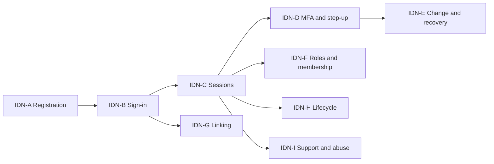
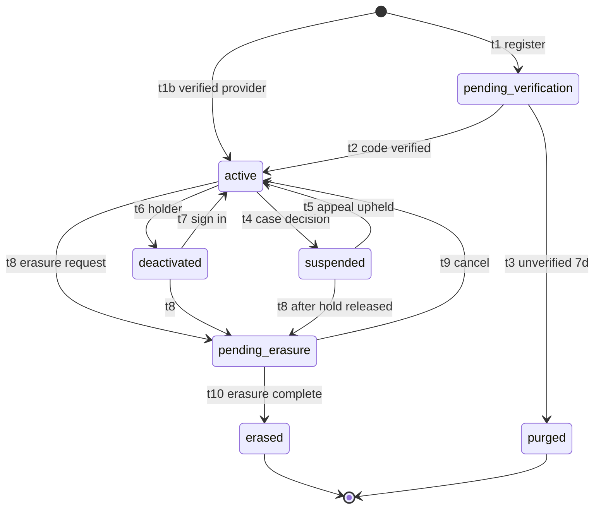
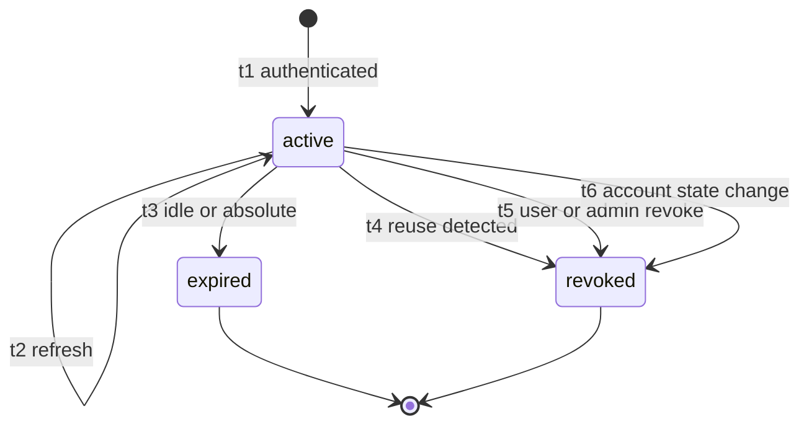
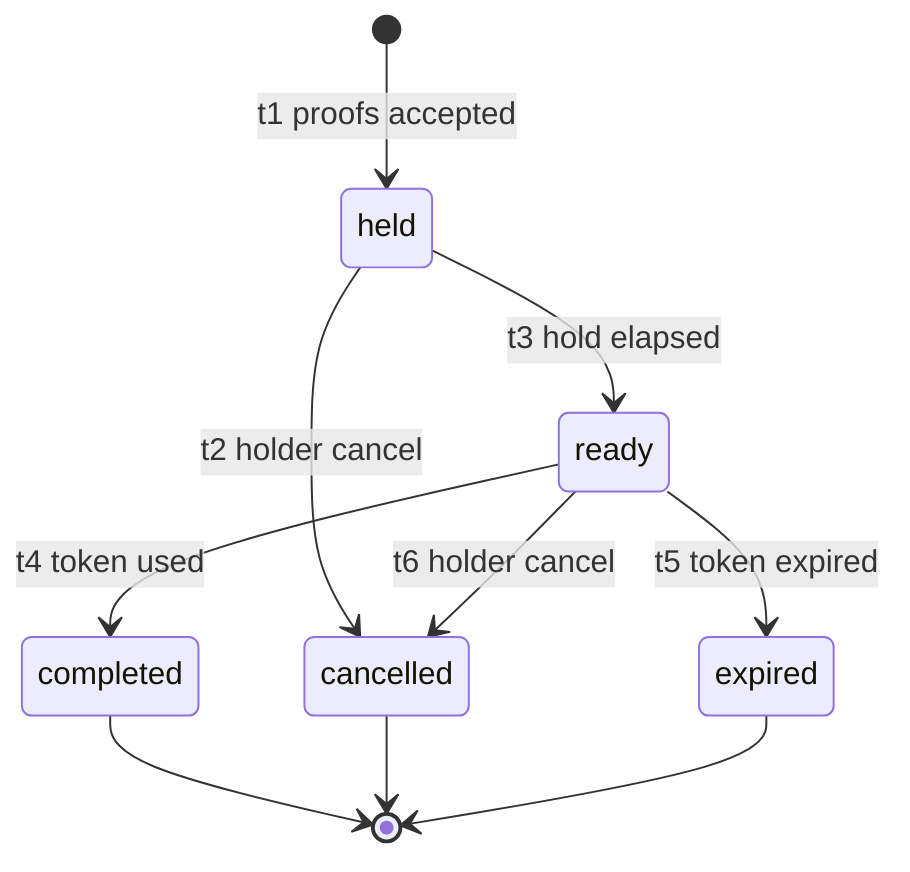
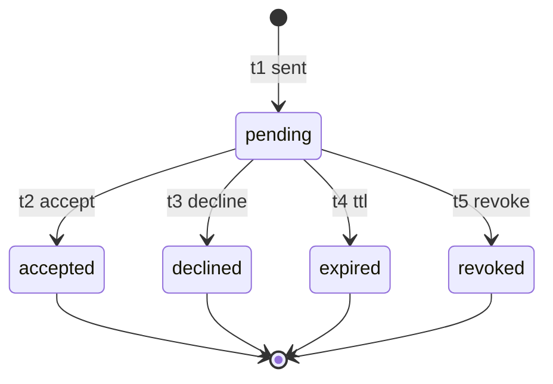
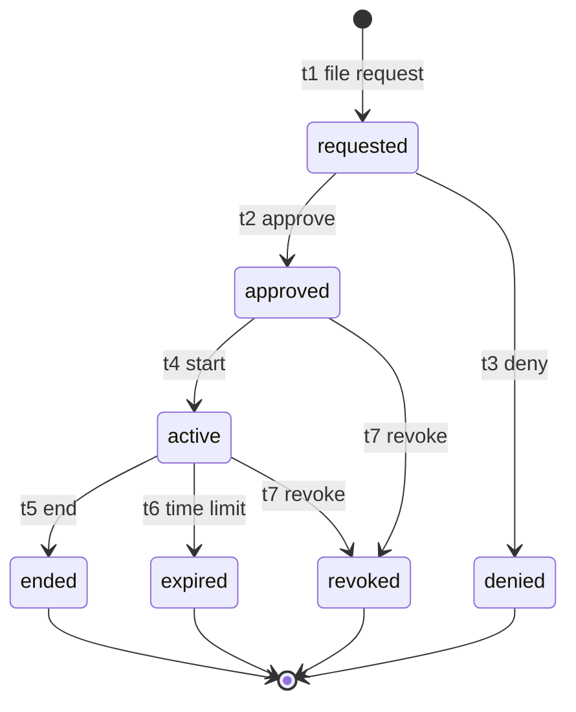
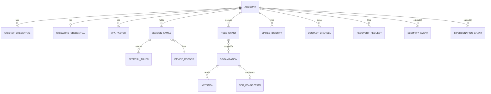

# IDN — Identity, Authentication & Account

Module code: `IDN` · Group: Foundation · Release tier of the module: `R0` (core), with `R2`–`R4` extensions noted per feature.

Status: intended design. Nothing in this file is a claim that anything is built (see [CONVENTIONS](../00_START_HERE/CONVENTIONS.md) §1).

## 1. Purpose, outcomes and boundaries

### 1.1 Purpose

IDN answers three questions for every request the platform ever serves: who is this principal, how sure are we, and in what role context are they acting. It owns the full lifecycle of a person's account (create, verify, sign in, hold a session, recover, switch role context, pause, leave) and the lifecycle of machine and support access to that account (service principals, support impersonation). Every other module consumes IDN's output (a verified principal with a resolved role context and an assurance level) and never re-implements authentication. [DER]

### 1.2 Outcomes

| Outcome                                                            | How the system knows                                                                                                                      |
| ------------------------------------------------------------------ | ----------------------------------------------------------------------------------------------------------------------------------------- |
| A new person reaches a verified, usable account in one sitting     | Registration-to-verified conversion measured by `IDN-M01`; time to verified by `IDN-M02`                                                  |
| Credentials and sessions cannot be stolen by script in the browser | No access or refresh token is ever readable by page script, URL, body or log (BR-IDN-008); security test suite in the acceptance criteria |
| A stolen or lost credential is contained fast                      | Refresh reuse revokes the whole session family (BR-IDN-009); revocation effective on every request ≤ 60 s p95 (BR-IDN-035)                |
| Account recovery never becomes an attack path                      | Recovery has a mandatory hold and multi-channel notice (BR-IDN-019); support cannot bypass it                                             |
| Privileged access is rare, time-boxed and audited                  | Privileged roles have mandatory MFA and short sessions (BR-IDN-011); impersonation is grant-bound (BR-IDN-028)                            |
| People can always leave                                            | Deactivation and deletion are always reachable, with honest consequences (FR-IDN-026, FR-IDN-027)                                         |

### 1.3 Scope

**In scope**

- Registration with email and password, social sign-in, enterprise SSO, passkeys, email-code and magic-link sign-in.
- Email and phone verification; email change; password change and reset; account recovery.
- Session and token model, refresh rotation, device and session listing, new-device alerts.
- MFA (TOTP, recovery codes, passkey as second factor), step-up re-authentication, mandatory MFA for privileged roles.
- Role model resolution, role onboarding, role-context switching, scoped membership grants, organization invitations.
- Account linking and unlinking, account state machine, deactivation, deletion request (identity side), suspended-account appeal access.
- Support impersonation with audit, age gating, bot protection, policy re-acceptance gate.
- The authentication step of service principals (token validation contract only).

**Out of scope (owned elsewhere)**

- Profile content, résumé, portfolio: `PRF` (planned).
- Consent scopes, data export, erasure execution, DSAR queue, retention: `SET` (this blueprint). IDN owns only the account-state side of erasure.
- Notification delivery and templates for security emails: `NTF`. IDN raises the events; NTF delivers.
- Subscription and entitlement checks: `BIL` (planned).
- Moderation decisions that cause suspension: `TSF` (planned). IDN applies the state change.
- Admin console UI for user management: `ADM` (planned). IDN supplies the operations and policy.
- Public API application registration and OAuth client management for third parties: `PLT` (planned). IDN validates the tokens PLT issues.
- Employer organization record, team structure: `EMP` (planned). IDN owns membership grants and invitations as identity facts.

### 1.4 Owned versus consumed

| Owned by IDN                                                                                                                                                                                          | Consumed by IDN                                                                                                                                                                                                                                               |
| ----------------------------------------------------------------------------------------------------------------------------------------------------------------------------------------------------- | ------------------------------------------------------------------------------------------------------------------------------------------------------------------------------------------------------------------------------------------------------------- |
| Account, credential, session family, token, MFA factor, recovery code, one-time code, invitation, role grant, role context, impersonation grant, login attempt, device record, policy-acceptance link | Email, SMS and push delivery (`NTF`); consent ledger and policy text versions (`SET`); organization and institution records (`EMP`, `INS` planned); moderation and legal-hold decisions (`TSF`, `SET`); breach-password list and bot-risk services (external) |

### 1.5 Design stance

1. Mechanism-agnostic. The legacy SSOT assumes a managed auth vendor issuing a script-visible JWT; the target proposes first-party same-origin cookie sessions. This blueprint specifies behavior and invariants, not the vendor, and records the conflict as OD-IDN-01. [SRC: SSOT §12.8, V61-13]
2. Deny by default. A principal without an explicit grant has no access. [SRC: SSOT §5.4]
3. No account enumeration anywhere. [SRC: Yash SPEC-01 §3.2]
4. Online-only authentication. Offline mode never authenticates; it only reads cached data of an already authenticated session (see `PWA` planned). [SRC: Yash SPEC-01 §4]

## 2. Roles and permission matrix

Canonical role codes are defined in CONVENTIONS §5. IDN also distinguishes the **account** (one person, one login identity) from the **role context** (the hat worn in a session). One account can hold several role grants and switch among them (FR-IDN-022). [DER]

Legend: `S` self only · `O` own organization scope · `G` grant-bound (time-boxed, ticketed) · `Y` yes · `—` no.

| Capability                                                       | GUE | CAN/STD              | INS/MNT/FRL | REC/HMG | EAD         | IAD/PLO/EXA | MOD              | SUP | FIN | PAD                   | SAD              | API |
| ---------------------------------------------------------------- | --- | -------------------- | ----------- | ------- | ----------- | ----------- | ---------------- | --- | --- | --------------------- | ---------------- | --- |
| Register, verify, sign in                                        | Y   | —                    | —           | —       | —           | —           | —                | —   | —   | —                     | —                | —   |
| Manage own credentials (password, passkey, TOTP, email, phone)   | —   | S                    | S           | S       | S           | S           | S                | S   | S   | S                     | S                | —   |
| View and revoke own sessions                                     | —   | S                    | S           | S       | S           | S           | S                | S   | S   | S                     | S                | —   |
| Add a self-service role (INS, MNT, FRL)                          | —   | S (application)      | S           | —       | —           | —           | —                | —   | —   | —                     | —                | —   |
| Accept organization invitation                                   | —   | S                    | S           | S       | S           | S           | S                | S   | S   | S                     | S                | —   |
| Send organization invitation                                     | —   | —                    | —           | —       | O           | O           | —                | —   | —   | —                     | —                | —   |
| Grant or remove a membership role in own org                     | —   | —                    | —           | —       | O           | O           | —                | —   | —   | —                     | —                | —   |
| Grant privileged platform roles (MOD, SUP, FIN, PAD)             | —   | —                    | —           | —       | —           | —           | —                | —   | —   | —                     | Y (dual control) | —   |
| Revoke any user's sessions                                       | —   | —                    | —           | —       | O (members) | O (members) | —                | G   | —   | Y (audited)           | Y                | —   |
| Suspend / restore account                                        | —   | —                    | —           | —       | —           | —           | Y (via TSF case) | —   | —   | Y                     | Y                | —   |
| Impersonate a user (view-as)                                     | —   | —                    | —           | —       | —           | —           | —                | G   | —   | G                     | Y (break-glass)  | —   |
| Configure SSO for an org                                         | —   | —                    | —           | —       | O           | O           | —                | —   | —   | —                     | —                | —   |
| Configure platform auth policy (lifetimes, throttles, providers) | —   | —                    | —           | —       | —           | —           | —                | —   | —   | Y (change-controlled) | Y                | —   |
| Read auth audit log                                              | —   | S (own security log) | S           | S       | O           | O           | —                | G   | —   | Y                     | Y                | —   |
| Authenticate with machine credential                             | —   | —                    | —           | —       | —           | —           | —                | —   | —   | —                     | —                | Y   |

Permission rules: no role can read another person's password hash, TOTP secret, recovery codes, passkey private material or refresh token (they do not exist in readable form to any role). `SUP` and `PAD` never see credential or session secrets; they act only through the operations specified in this module. [DER]

## 3. Sub-module map

| Code  | Sub-module                       | Features                       |
| ----- | -------------------------------- | ------------------------------ |
| IDN-A | Registration and verification    | FR-IDN-001, 002, 003, 029, 032 |
| IDN-B | Sign-in methods                  | FR-IDN-004, 005, 006, 007, 008 |
| IDN-C | Session and token model          | FR-IDN-009, 010, 011, 012      |
| IDN-D | MFA and step-up                  | FR-IDN-013, 014, 015, 016      |
| IDN-E | Credential change and recovery   | FR-IDN-017, 018, 019, 020      |
| IDN-F | Roles, onboarding, membership    | FR-IDN-021, 022, 023, 025      |
| IDN-G | Account linking                  | FR-IDN-024                     |
| IDN-H | Account lifecycle                | FR-IDN-026, 027, 031           |
| IDN-I | Support access and abuse defense | FR-IDN-028, 030                |

## 4. Feature specifications

Parameter notation: values in `{braces}` are policy parameters with a `[PROP]` default. Where a value comes from a legacy document it is cited. Open policy values are collected in section 13.

### Sub-module IDN-A — Registration and verification

### FR-IDN-001 — Email and password registration

- **Sub-module:** IDN-A Registration and verification
- **Priority / tier:** Must · R0
- **Source:** [SRC: SSOT §9.1 F-01 step 1; Yash SPEC-01 §3.1] with [DER] enumeration-safe response
- **Purpose and outcome:** A visitor creates an account with an email and a password and ends on a "Check your email" state. The system knows it worked when exactly one `pending_verification` account exists for the normalized email.
- **Roles and permissions:** `GUE: create` · all other roles: not applicable (an authenticated principal is redirected to the app).
- **Preconditions and entry points:** Entry from `/register`, from "Create account" in the header, from a protected-route redirect (`?next=`), from an organization invitation link (FR-IDN-025), from a job application gate (JOB planned). Visitor has no session. Registration is not blocked by feature flag `idn.registration.enabled` (default on).
- **User interactions and actions:**
  1. Open the registration screen (SCR-IDN-002).
  2. Type email, type password (live strength hint, length first), optionally choose "Use a passkey instead" (FR-IDN-006) or a social button (FR-IDN-004).
  3. Tick the required policy acceptance box for the current Terms and Privacy versions (separate, unticked by default, links open in a new tab).
  4. Complete the age attestation (FR-IDN-029).
  5. Press "Create account".
  6. Land on "Check your email" (SCR-IDN-003) with the code field.
- **System behavior:** Normalize email (BR-IDN-001). Validate fields. Run bot-risk check (FR-IDN-030). Check the password against the breached list (BR-IDN-002). Inside one transaction: insert account in `pending_verification` (SM-IDN-01 t1), insert password credential (memory-hard hash), write policy-acceptance rows via `SET` (FR-SET-028), create a one-time code (FR-IDN-002) and enqueue `NTF` template `idn.verify_email`. Always answer `202` with the same body whether the email already existed (BR-IDN-003); if it existed, send that owner an "already registered" notice instead of a code. Idempotent by normalized email: a double submit yields one account and one active code. A pending invitation token or `next` is stored server-side with the pending account and honored after verification. No session is issued before verification unless the account was created through a verified social identity (FR-IDN-004).
- **UI elements and controls:** Email (text, `autocomplete="username"`), Password (password with show/hide toggle, `autocomplete="new-password"`, paste allowed), Strength hint (live region, text not colour only), Policy checkbox (required), Age attestation checkbox (required), "Create account" (primary; disabled while submitting; shows spinner and keeps label for screen readers), "Use a passkey", social buttons, "Sign in instead" link. States: idle, validating, submitting, error summary, success.
- **Configuration options:** Platform: `{password.minLength}` default 12, `{password.maxLength}` 128, `idn.registration.enabled`, allowed/blocked email-domain lists (disposable-domain blocklist on by default), `idn.registration.invitationOnly` per deployment (default off). Org: none. User: none.
- **Business rules:** BR-IDN-001, BR-IDN-002, BR-IDN-003, BR-IDN-005, BR-IDN-029, BR-IDN-030, BR-IDN-033.
- **Validation:** Email: trimmed, Unicode NFKC, domain lower-cased, ≤ 254 chars, exactly one `@`, no control characters, domain not on blocklist, deliverable-syntax only (no MX probing at submit). Password: 12–128 chars, any Unicode, not equal to email local part, not on breached list, no composition rules. Policy acceptance: array of `{policyId, version}` equal to the current published versions. Age attestation: required true.
- **Inputs and outputs:** In: email, password, policy acceptances, attestation, optional `next`, optional invitation token, bot-risk token. Out: `202` with a generic body and a `challengeId` for the code step; no cookie.
- **Filters, sorting, search:** n/a — single-record form.
- **Notifications and communication:** Verification code email (`idn.verify_email`, mandatory class); "already registered" email (`idn.register_existing`, mandatory class). Welcome email only after verification (`idn.welcome`, transactional-optional).
- **Error handling and edge cases:** Weak/breached password: `422 password_weak` or `password_breached`, no account. Invalid email: `422 email_invalid`. Policy not accepted: `422 policy_not_accepted`. Email provider down: still `202`; message queued and shown as "pending", resend available (FR-IDN-002). Two concurrent registrations differing only by case: unique constraint on normalized email leaves exactly one. Breach-list service down: accept only passwords ≥ 14 chars and schedule a re-check (fail safe, not fail open). Rate limit hit: `429` with `Retry-After`. Cookies blocked: not relevant before verification.
- **Dependencies:** FR-IDN-002, FR-IDN-029, FR-IDN-030, FR-SET-028, ENT-IDN-01, ENT-IDN-02, `NTF`, breach-list port.
- **Security and privacy:** Email is `Confidential PII`. Password hashed with a memory-hard function; never logged. Identical response and similar latency for existing and new emails (dummy hash on the existing path). Registration attempts per IP and per normalized email are rate limited (FR-IDN-030). Audit event `idn.account.registered` stores the account id, not the password.
- **Acceptance criteria:**
  - Given no account for `a@x.com`, when a visitor registers with a valid password and accepted policies, then `202` is returned, one `pending_verification` account exists, one code email is queued and no cookie is set.
  - Given an account for `a@x.com` exists, when someone registers `A@X.com`, then the response body and status are identical to the new-account case, no second account is created and the owner receives the "already registered" email.
  - Given a password of 11 or 129 characters, when registering, then `422` is returned; 12 and 128 characters are accepted.
  - Given a password found in the breached list, when registering, then `422 password_breached` is returned and no account exists.

### FR-IDN-002 — Email verification by one-time code

- **Sub-module:** IDN-A Registration and verification
- **Priority / tier:** Must · R0
- **Source:** [SRC: SSOT §9.1 F-01 step 2; Yash SPEC-01 §3.1, BR-T053] ; the 6-digit code instead of a click-through link is [DER] (email scanners prefetch links)
- **Purpose and outcome:** A registrant proves control of the email address and the account becomes `active`. The system knows from `email_verified_at` being set and a session being issued.
- **Roles and permissions:** `GUE: verify, resend` (holder of a pending account).
- **Preconditions and entry points:** Arrives from FR-IDN-001, from a sign-in attempt on an unverified account, or from the code link in the email (which opens SCR-IDN-003 pre-filled with nothing; the code is never in the URL).
- **User interactions and actions:**
  1. Read the 6-digit code from the email.
  2. Type or paste it into the code field.
  3. Submit (auto-submit on the sixth digit is on by default).
  4. Or press "Resend code" (disabled for 60 seconds after each send).
  5. Or press "Use a different email" to restart registration (only before first verification).
- **System behavior:** Look up the active code by account; compare hash in constant time; on success consume the code (single use), set `email_verified_at`, move account `pending_verification → active` (SM-IDN-01 t2), create a session family (FR-IDN-009) and redirect to onboarding (FR-IDN-021) or to the stored `next`. Enqueue `idn.welcome`. Emit `idn.account.verified`. A new code request invalidates earlier unused codes. A daily worker purges accounts unverified for {7 days} (SM-IDN-01 t3) and releases the email. An invitation bound to the same email is auto-accepted into the pending-acceptance list but still needs explicit accept (FR-IDN-025).
- **UI elements and controls:** Code field (6 boxes or one field, `autocomplete="one-time-code"`, numeric keypad on mobile), "Verify" (primary), "Resend code" (secondary with countdown text announced politely), "Change email", status region. States: waiting, verifying, wrong code with attempts remaining, locked (needs new code), expired, verified.
- **Configuration options:** Platform: `{code.length}` 6, `{code.ttlMinutes}` 15, `{code.maxAttempts}` 5, `{resend.cooldownSeconds}` 60, `{resend.maxPerHour}` 3, `{unverified.purgeDays}` 7.
- **Business rules:** BR-IDN-004, BR-IDN-005, BR-IDN-003.
- **Validation:** Code: exactly 6 digits after stripping spaces and hyphens; ASCII or full-width digits normalized. Resend: ≤ 3 per hour per account.
- **Inputs and outputs:** In: code, challengeId. Out: success (session cookies set, redirect target) or `422 code_invalid`, `429 too_many_attempts`.
- **Filters, sorting, search:** n/a — single-record form.
- **Notifications and communication:** `idn.verify_email` (mandatory), `idn.welcome` (transactional-optional, sent once).
- **Error handling and edge cases:** Wrong code: `422 code_invalid` with remaining attempts; after 5 wrong attempts the code is dead and `429` is returned even for the correct code, requiring a new one. Expired: same generic `code_invalid` wording plus "Send a new code". Code reuse: `422`. Email provider outage: resend button works; outbox retries; user sees "Delivery is delayed" if the delivery row is `failed_retry`. Verified in another tab: this tab detects via polling and continues. Account purged while page open: `410` with "Start again".
- **Dependencies:** FR-IDN-001, FR-IDN-009, FR-IDN-021, NTF delivery (FR-NTF-007), ENT-IDN-03.
- **Security and privacy:** Codes are hashed at rest, never logged, never in URLs. Attempt counters are per code and per account. The verification response never reveals whether the email belonged to another account.
- **Acceptance criteria:**
  - Given a valid code aged 14 minutes, when submitted, then the account becomes `active`, session cookies are set and the code is consumed.
  - Given the same code, when submitted again, then `422 code_invalid` is returned and no second session is created.
  - Given 5 wrong attempts, when the correct code is submitted on attempt 6, then `429` is returned and a new code is required.
  - Given an account unverified for 7 days, when the purge job runs, then the account is removed and the email can register again.

### FR-IDN-003 — Phone number verification (optional second contact)

- **Sub-module:** IDN-A Registration and verification
- **Priority / tier:** Could · R2
- **Source:** [PROP]
- **Purpose and outcome:** A user adds and verifies a mobile number so that SMS notifications (FR-NTF-013), phone-based step-up and an extra recovery signal are possible. Verification is proven by a code sent by SMS.
- **Roles and permissions:** `CAN, STD, INS, MNT, FRL, REC, HMG, EAD, IAD, PLO, EXA, MOD, SUP, FIN, PAD, SAD: add, verify, remove own number`.
- **Preconditions and entry points:** Signed in; entry from Settings → Security (SCR-IDN-014), from the SMS opt-in in the preference center (FR-NTF-013), or from an onboarding prompt. Recent re-authentication (FR-IDN-015) is required to add or remove.
- **User interactions and actions:**
  1. Choose country (default from locale) and type the number.
  2. Press "Send code".
  3. Enter the 6-digit code.
  4. Optionally tick "Use for sign-in alerts".
  5. To remove: press "Remove number" and confirm.
- **System behavior:** Parse to E.164 with a phone library; reject VoIP/premium ranges per policy; check risk with an SMS-fraud service (pumping defense); send code through the SMS provider via `NTF` template `idn.phone_code`; on success store the number encrypted, mark verified, and emit `idn.phone.verified`. A number can be verified on one account at a time {phone.uniqueAcrossAccounts} default true; adding a number held by another account fails with the generic "could not verify" message. Removal deletes the number and withdraws SMS opt-ins.
- **UI elements and controls:** Country select (searchable), Phone input (`type="tel"`, `autocomplete="tel"`), "Send code", code field, "Use for sign-in alerts" checkbox, "Remove number" (destructive confirm dialog). States: unset, code sent, verified, removed, rate limited.
- **Configuration options:** Platform: `{phone.enabled}` default off until SMS provider is decided (OD-IDN-07); `{phone.codeTtlMinutes}` 10; `{phone.sendsPerDayPerAccount}` 5; `{phone.sendsPerDayPerIp}` 20; allowed country list. User: alert opt-in.
- **Business rules:** BR-IDN-036, BR-IDN-010, BR-IDN-030.
- **Validation:** E.164 after parsing; length 8–15 digits; country must be on the allowed list; code 6 digits.
- **Inputs and outputs:** In: number, code. Out: verified flag, masked number (`+•• ••• •••12`).
- **Filters, sorting, search:** n/a — single-record form.
- **Notifications and communication:** `idn.phone_code` (mandatory, SMS); `idn.phone_added` email to the account email (mandatory).
- **Error handling and edge cases:** Invalid number: `422 phone_invalid`. Provider down: "We could not send a code, try again" and no counter consumed. Number already used elsewhere: generic failure, no disclosure. SIM-swap risk: phone alone never authorizes recovery (BR-IDN-019). Country not allowed: `422 phone_country_unsupported`.
- **Dependencies:** FR-IDN-015, FR-NTF-013, SMS provider, ENT-IDN-04.
- **Security and privacy:** Number is `Confidential PII` encrypted at rest (field-level; [SRC: SSOT §15.5]); masked in UI and logs; removal on erasure. Pumping defense by per-IP, per-prefix and per-account caps.
- **Acceptance criteria:**
  - Given a signed-in user with fresh re-auth, when they verify a valid number, then it is stored encrypted and shown masked.
  - Given a number verified on another account, when a second user tries to verify it, then a generic failure is shown and nothing is disclosed.
  - Given the 6th send in a day, when requested, then `429` is returned.
  - Given stale re-authentication, when adding a number, then `403 reauth_required` is returned.

### Sub-module IDN-B — Sign-in methods

### FR-IDN-004 — Social sign-in (Google, GitHub and proposed providers)

- **Sub-module:** IDN-B Sign-in methods
- **Priority / tier:** Must (Google, GitHub) · R0; Should (Microsoft, Apple, LinkedIn) · R2
- **Source:** [SRC: SSOT §9.1 F-01 step 8] ; Microsoft, Apple and LinkedIn [PROP]
- **Purpose and outcome:** A visitor registers or signs in using an external identity provider with no password. The system knows from a session issued for an account whose email is verified.
- **Roles and permissions:** `GUE: sign in or register with provider` · authenticated: link (FR-IDN-024).
- **Preconditions and entry points:** Provider buttons on SCR-IDN-001/002; provider enabled in `{social.providers}`; provider configured.
- **User interactions and actions:**
  1. Press "Continue with <Provider>".
  2. Complete the provider's consent screen.
  3. Return to the platform; if the provider's email matches an existing account, see the collision prompt (FR-IDN-024); otherwise accept the policy checkbox and age attestation if new.
  4. Land in onboarding or the stored `next`.
- **System behavior:** Authorization code flow with PKCE, `state` and `nonce` bound to the browser; exchange on the server; read subject id, email and `email_verified`. Only a provider email flagged verified is trusted. If provider subject is already linked, sign in. If not linked and email unknown, create account directly in `active` with the verified email (SM-IDN-01 t1b), record the link, require policy acceptance before the first session if not yet given. If not linked and the email matches an existing account, never merge silently: go to FR-IDN-024. Store only subject id, email, display name and avatar URL; scopes requested are the minimum (`openid email profile`). Provider outage shows a message and keeps email sign-in available.
- **UI elements and controls:** Provider buttons (icon + text, equal prominence), "or" separator, collision dialog, provider error banner. States: idle, redirecting, returning, error (cancelled at provider, access denied, email not verified).
- **Configuration options:** Platform: enabled providers; per-provider client ids; `idn.social.allowNewAccounts` default true. Org: domain-enforced SSO overrides social for that domain (FR-IDN-005).
- **Business rules:** BR-IDN-024, BR-IDN-025, BR-IDN-029, BR-IDN-033, BR-IDN-003.
- **Validation:** `state` and `nonce` must match; provider email must be verified; id token signature, issuer, audience and expiry validated; clock skew ≤ 60 s.
- **Inputs and outputs:** In: provider authorization response. Out: session cookies and redirect, or a typed error screen.
- **Filters, sorting, search:** n/a — single-record flow.
- **Notifications and communication:** `idn.welcome` for new accounts; `idn.provider_linked` security notice to the account email (mandatory) when a link is added.
- **Error handling and edge cases:** Provider denies or user cancels: return to sign-in with "Sign-in was cancelled". Provider email unverified: refuse with "Your provider email is not verified; use email sign-in". Provider returns no email: refuse. State mismatch or replay: `400`, audited as `idn.social.state_mismatch`. Provider unavailable: fallback message, email path usable. Same provider account arriving for an account in `deactivated`: reactivation flow (FR-IDN-026). `suspended`: appeal-only (FR-IDN-031).
- **Dependencies:** FR-IDN-009, FR-IDN-024, FR-IDN-029, FR-SET-028, external IdPs.
- **Security and privacy:** PKCE mandatory; exact redirect-URI match; no provider tokens retained beyond the exchange unless an integration feature needs them (then they live in SET connected accounts, FR-SET-025). Provider avatar is not copied without user action.
- **Acceptance criteria:**
  - Given a verified Google email unknown to the platform, when the user completes sign-in, then an `active` account and a linked identity exist and a session is issued.
  - Given a Google email equal to an existing password account, when the user returns from Google, then the collision prompt appears and no link is created until they prove control of the existing account.
  - Given a replayed callback with a used `state`, when it arrives, then `400` is returned and an audit event is written.
  - Given Google is unreachable, when a user presses the button, then a visible message is shown and email sign-in still works.

### FR-IDN-005 — Enterprise SSO (SAML 2.0 and OIDC) for organizations

- **Sub-module:** IDN-B Sign-in methods
- **Priority / tier:** Should · R4
- **Source:** [PROP]
- **Purpose and outcome:** An employer or institution admin lets members sign in with the organization's identity provider and optionally enforces it. The system knows from sign-ins carrying the org's IdP assertion.
- **Roles and permissions:** `EAD, IAD, EXA: configure, test, enforce, disable for own org` · `REC, HMG, PLO (members): sign in via SSO` · `PAD: view status, disable on abuse with audit`.
- **Preconditions and entry points:** Org is verified (`EMP` planned); org has at least one verified domain (DNS TXT proof); plan entitlement `sso` (`BIL` planned); entry from Org settings → Security (SCR-IDN-020).
- **User interactions and actions:**
  1. Admin opens "Single sign-on" and chooses SAML or OIDC.
  2. Copies the platform metadata (ACS URL, entity id) or enters OIDC issuer and client credentials.
  3. Uploads IdP metadata or enters endpoints; maps attributes (email required; name, group optional).
  4. Presses "Test connection" and signs in as themselves in a popup.
  5. Chooses mode: "Optional" or "Required for verified domains".
  6. Saves; the system shows a recovery notice (break-glass admin, see below).
  7. Members at the domain see "Sign in with <Org>" or are routed by email domain on SCR-IDN-001.
- **System behavior:** Domain-routing: on email entry, if the domain belongs to an org with SSO, offer the SSO path. SP-initiated and IdP-initiated flows validated for signature, audience, destination, `InResponseTo`, replay (assertion id cache) and clock skew. JIT provisioning creates an account in `active` with the IdP email only if the domain is verified for that org, then grants the membership role from mapping (`REC` by default, never `EAD`) (BR-IDN-034). In "Required" mode, password and social sign-in are blocked for members on that domain, existing sessions are revoked at the next refresh after enforcement time, and at least two break-glass admins keep password+MFA sign-in. Optional SCIM deprovisioning endpoint `{scim.enabled}` (`R5`) deactivates memberships. Config changes are audited and need step-up.
- **UI elements and controls:** Protocol radio, metadata fields, attribute mapping table, domain list with verification status, mode radio, "Test connection", "Enforce" toggle with confirmation listing impacted member count, break-glass admin picker. States: unconfigured, testing, configured, enforced, error (assertion invalid).
- **Configuration options:** Org: protocol, mode, domains, default role for JIT, group-to-role mapping, session lifetime override (≤ platform maximum). Platform: allowed protocols, SCIM toggle.
- **Business rules:** BR-IDN-034, BR-IDN-011, BR-IDN-007, BR-IDN-020.
- **Validation:** Domain must pass DNS TXT proof; metadata XML schema valid and signed; certificate not expired; issuer unique across orgs; mapping cannot grant `EAD` or any platform-level role.
- **Inputs and outputs:** In: IdP metadata or OIDC settings. Out: SSO configuration record, test result, member sign-ins.
- **Filters, sorting, search:** SSO sign-in log filterable by member, result, date.
- **Notifications and communication:** `idn.sso_enforced` to all org admins (mandatory); `idn.sso_cert_expiring` 30 and 7 days before (mandatory to admins).
- **Error handling and edge cases:** IdP assertion fails validation: generic failure for the user, detailed reason in the admin log. IdP outage while enforced: members cannot sign in; break-glass admins can; banner explains. Email in assertion differs from the platform email: link by stable `NameID`, never by email alone after first link. Member removed at IdP: deprovisioned on next SCIM call or on next failed refresh. Domain verification lapses: enforcement suspends and admins are alerted.
- **Dependencies:** `EMP` org record (planned), `BIL` entitlements (planned), FR-IDN-009, FR-IDN-023, ENT-IDN-12.
- **Security and privacy:** Assertions signature-verified; XML signature wrapping defenses; replay cache; secrets stored encrypted; no raw assertion stored beyond a short audit retention.
- **Acceptance criteria:**
  - Given a verified domain and valid IdP metadata, when the admin runs "Test connection", then the admin's own sign-in succeeds and the config is marked tested.
  - Given SSO is required for `corp.com`, when a member signs in with a password, then it is refused with a message pointing to SSO.
  - Given an assertion with a reused assertion id, when received, then it is rejected and logged.
  - Given an attribute mapping that tries to grant `EAD`, when saved, then `422` is returned.

### FR-IDN-006 — Passkey registration and sign-in (WebAuthn)

- **Sub-module:** IDN-B Sign-in methods
- **Priority / tier:** Must · R1
- **Source:** [SRC: Yash SPEC-01 §3.2 rule 6, BR-T055] ; [DER]
- **Purpose and outcome:** A user signs in with a phishing-resistant device-bound or synced credential. The system knows from a verified WebAuthn assertion.
- **Roles and permissions:** all authenticated roles `S: add, rename, remove own passkeys`; `GUE: sign in with passkey`.
- **Preconditions and entry points:** Browser supports WebAuthn (feature-detected, UI hidden otherwise). Add: Settings → Security (SCR-IDN-014) or the post-login offer (SCR-IDN-006). Sign in: conditional UI autofill on the email field, or the "Use a passkey" button.
- **User interactions and actions:**
  1. Add: press "Add a passkey", complete the platform prompt, name it ("Work laptop").
  2. Sign in: focus the email field and choose the passkey from autofill, or press "Use a passkey".
  3. Remove or rename: from the passkey list (step-up needed to add or remove).
- **System behavior:** Server generates options with a single-use challenge (≥ 16 bytes, TTL 5 min), `rpId` fixed to the registrable domain, user verification `preferred` (required for privileged roles). Verify origin, `rpId`, challenge, flags and signature. If the stored `signCount` > 0 and the presented count is ≤ stored, reject, mark the credential `suspect` and notify the holder (counters reporting 0 are exempt). On success create a session (or satisfy a second-factor challenge). Up to {10} passkeys per account. The last remaining sign-in method cannot be removed (BR-IDN-012). After first password sign-in, offer a passkey (skippable; re-offered after 30 days, at most 3 times).
- **UI elements and controls:** "Add a passkey" button, passkey list table (name, created, last used, transports, status), rename inline, "Remove" with confirmation, post-login prompt card with "Not now" and "Don't ask again". States: unsupported, ready, in progress, success, cancelled, error.
- **Configuration options:** Platform: `{passkey.maxPerAccount}` 10; `{passkey.offerRepeatDays}` 30; `{passkey.uvPrivileged}` required. User: names.
- **Business rules:** BR-IDN-012, BR-IDN-010, BR-IDN-032.
- **Validation:** Challenge unused and unexpired; origin and `rpId` exact; name 1–40 chars; credential id unique platform-wide.
- **Inputs and outputs:** In: WebAuthn creation or assertion response. Out: stored credential or session.
- **Filters, sorting, search:** Passkey list sorted by last used desc.
- **Notifications and communication:** `idn.passkey_added`, `idn.passkey_removed`, `idn.passkey_suspect` (mandatory, email).
- **Error handling and edge cases:** User cancels the prompt: no error banner, quiet return. Challenge expired or reused: `400 challenge_expired`. Wrong origin: reject and audit. Device lost: sign in with password or recovery then remove the passkey; passkey-only account follows FR-IDN-020. Passkey-only signup in Phase 1 is an open decision (OD-IDN-03).
- **Dependencies:** FR-IDN-009, FR-IDN-015, WebAuthn library, ENT-IDN-05.
- **Security and privacy:** Public keys only are stored. Credential ids are not secrets but are not exposed to other users. Suspect flag blocks use until the holder confirms via email link.
- **Acceptance criteria:**
  - Given a signed-in user with fresh re-auth, when they add a passkey, then it is listed and a confirmation email is queued.
  - Given a passkey-only account with one passkey and no recovery email method, when the user removes it, then `409 last_method` is returned.
  - Given a stored `signCount` of 5, when an assertion with 3 arrives, then it is rejected, the credential is marked `suspect` and the holder is notified.
  - Given a browser without WebAuthn, when the login page loads, then passkey controls are hidden and the password path works.

### FR-IDN-007 — Email code and magic-link sign-in

- **Sub-module:** IDN-B Sign-in methods
- **Priority / tier:** Should · R1
- **Source:** [PROP]
- **Purpose and outcome:** A user who forgot or never set a password signs in with a code sent to their verified email. The system knows from a consumed single-use code and a session.
- **Roles and permissions:** `GUE: request and use` for accounts with a verified email.
- **Preconditions and entry points:** SCR-IDN-001 link "Email me a sign-in code"; account exists with verified email (the response never reveals this).
- **User interactions and actions:**
  1. Type email, press "Email me a code".
  2. Open the email; either copy the 6-digit code or press the button.
  3. Type the code on the same browser (preferred) or press the button which opens a confirmation page asking "Sign in on this device?" with a "Confirm" button (this click defeats link scanners).
  4. Land in the app.
- **System behavior:** Always return the same `202`. If the account is eligible, create a sign-in challenge bound to the requesting browser (cookie-bound nonce) and email a code and a link carrying a separate single-use token. The link opens a confirmation page (no session on GET); the POST from the confirm button, from the same browser or after a code check on another device, creates the session. Code: 6 digits, TTL {15 min}, ≤ 5 attempts. Does not satisfy MFA when an MFA factor exists (FR-IDN-014 still applies) except for accounts with no second factor. Not allowed for privileged roles (BR-IDN-011) and for orgs with SSO enforced.
- **UI elements and controls:** Email field, "Email me a code" button, code field, "Confirm sign-in" button on the landing page, resend with countdown. States: request, waiting, verifying, expired, device mismatch.
- **Configuration options:** Platform: `{magic.enabled}` default on; `{magic.ttlMinutes}` 15; disable per org by SSO enforcement.
- **Business rules:** BR-IDN-039, BR-IDN-003, BR-IDN-006, BR-IDN-011.
- **Validation:** Email normalized as FR-IDN-001; code 6 digits; link token ≥ 128 bits, single use.
- **Inputs and outputs:** In: email, then code or token plus confirm. Out: session or generic failure.
- **Filters, sorting, search:** n/a — single-record flow.
- **Notifications and communication:** `idn.signin_code` (mandatory); subsequent `idn.new_device` if device unrecognized.
- **Error handling and edge cases:** Unknown email: same response, no email. Link opened by an email scanner: GET only renders the confirm page, nothing consumed. Link used twice: `410 token_invalid`. Link opened on another device than requested: shows device and location and requires the code. Throttled like password sign-in (BR-IDN-006).
- **Dependencies:** FR-IDN-009, FR-IDN-014, FR-NTF-007.
- **Security and privacy:** Tokens hashed at rest; request and consume bound by nonce; rate limits per email and per IP.
- **Acceptance criteria:**
  - Given a verified email, when the user requests a code, then the same `202` is returned for known and unknown emails.
  - Given a link opened by a scanner (GET), when later the user presses confirm, then the link still works exactly once.
  - Given a used link, when opened again and confirmed, then `410` is returned.
  - Given a privileged-role account, when requesting a code, then no sign-in is possible by this path.

### FR-IDN-008 — Password sign-in with progressive throttling

- **Sub-module:** IDN-B Sign-in methods
- **Priority / tier:** Must · R0
- **Source:** [SRC: SSOT §9.1 F-01 step 3, HDN-008; Yash SPEC-01 §3.2 rule 2, BR-T052]
- **Purpose and outcome:** A returning user signs in with email and password. The system knows from a session family created after a successful verify.
- **Roles and permissions:** `GUE: sign in`; accounts in `active` only.
- **Preconditions and entry points:** `/login`; protected-route redirects with `?next=`; session-expiry redirect (FR-IDN-009).
- **User interactions and actions:**
  1. Type email (autofill and passkey autofill available) and password.
  2. Optionally tick "Keep me signed in on this device".
  3. Press "Sign in".
  4. If the account has MFA, complete FR-IDN-014; if unrecognized device, proceed (alert follows, FR-IDN-012).
  5. Land on `next` or the role home.
- **System behavior:** Order: rate-limit check, normalize, lookup (dummy hash for unknown email), verify, account-state check (only `active`; `pending_verification` routes to FR-IDN-002; `suspended` to FR-IDN-031; `deactivated` to FR-IDN-026 reactivation; `pending_erasure` to the cancel page of FR-IDN-027), create session family (FR-IDN-009), audit and outbox, set cookies. Progressive delay after the 5th consecutive failure per (normalized email, IP bucket) and per IP; during a delay even the correct password returns `429` (BR-IDN-006). Failed and successful attempts recorded (FR-IDN-030). Password hash is upgraded transparently when parameters change.
- **UI elements and controls:** Email, Password (show/hide), "Keep me signed in" checkbox, "Sign in" primary, "Forgot password", "Email me a code", "Use a passkey", social buttons, error summary region. States: idle, submitting, invalid (generic), throttled (with seconds countdown), MFA required, redirecting.
- **Configuration options:** Platform: `{throttle.freeFailures}` 5; `{throttle.baseSeconds}` 15; `{throttle.maxMinutes}` 15; `{session.rememberMeDays}` 90.
- **Business rules:** BR-IDN-003, BR-IDN-006, BR-IDN-007, BR-IDN-008, BR-IDN-018.
- **Validation:** Email format only (no existence hints); password non-empty ≤ 128.
- **Inputs and outputs:** In: email, password, remember flag, bot-risk token, `next`. Out: cookies and redirect, or `401 invalid_credentials` (identical for wrong password and unknown email), `429 Retry-After`.
- **Filters, sorting, search:** n/a — single-record form.
- **Notifications and communication:** `idn.new_device` on unrecognized device (mandatory); `idn.lockout_notice` after throttling begins (mandatory, once per hour).
- **Error handling and edge cases:** Unknown email vs wrong password: identical status, body and indistinguishable latency. Throttle from another IP bucket for the same account: unaffected. Cookies blocked: login succeeds server-side but the app detects the missing cookie and shows the explanatory screen. Clock skew is irrelevant (server clock). Session store down: fail closed `503`. Double click: one session family.
- **Dependencies:** FR-IDN-009, FR-IDN-012, FR-IDN-014, FR-IDN-030, ENT-IDN-01, ENT-IDN-07.
- **Security and privacy:** Constant-time compares; no credentials in logs; login attempt rows keep only a hashed account key and an IP bucket (30-day retention).
- **Acceptance criteria:**
  - Given valid credentials, when signing in, then cookies are `HttpOnly; Secure` and the response body contains no token.
  - Given 5 failures for an (account, IP bucket), when the 6th attempt uses the correct password immediately, then `429 Retry-After` is returned, and the same account from another IP bucket is unaffected.
  - Given an unknown email and a wrong password for a known email, when signing in, then status and body are identical.
  - Given a `suspended` account, when signing in, then only the read-only appeal screen is reachable and no profile data is returned.

### Sub-module IDN-C — Session and token model

### FR-IDN-009 — Session family and token model

- **Sub-module:** IDN-C Session and token model
- **Priority / tier:** Must · R0
- **Source:** [SRC: Yash SPEC-01 §3.2 rules 3 and 5, CONST-S01..S05; SSOT V61-13] ; the scripted-token ban is [SRC: SSOT §12.8]
- **Purpose and outcome:** After any successful authentication the user holds a short-lived access credential and a renewable refresh credential, both unreadable by page script, grouped in a revocable family. The system knows a request is authenticated by validating the access credential and the family state.
- **Roles and permissions:** all authenticated roles hold sessions; `API` uses machine credentials (see FR-IDN-009 note below) not session families.
- **Preconditions and entry points:** Created by FR-IDN-002, 004, 005, 006, 007, 008, 014 and 020 on success.
- **User interactions and actions:**
  1. User signs in; the browser receives cookies (no visible step).
  2. User sees "Keep me signed in" choice at sign-in (FR-IDN-008).
  3. When idle or absolute expiry passes, the user is sent to sign-in with `?next=` and a notice "You were signed out for security".
  4. Unsaved long-form input is kept as a local draft and offered back after sign-in (see PWA planned).
- **System behavior:** On success create a **session family** (SM-IDN-02) with `idle_expires_at` and `abs_expires_at`, device label (derived from the user agent), IP prefix and approximate region, and `assurance` (password, passkey, mfa, sso). Issue an access credential (15 minutes) in a `Secure; HttpOnly; SameSite=Lax` cookie named with the `__Host-` prefix, and a refresh credential (generation 1) in a `Secure; HttpOnly; SameSite=Strict` cookie scoped to the refresh path. Access credential carries: subject id, session id, family id, active role context, assurance, `reauthAt`, issued-at, expiry; it carries no PII beyond ids. Every unsafe request must carry a per-session CSRF token header equal to the value issued by the session endpoint and a matching `Origin` (BR-IDN-008). Every request checks the session id against a revocation cache (BR-IDN-035). Account state is checked on each request: a non-`active` account gets `403 account_state` and the family is revoked. Lifetimes: idle `{14 d}`, absolute `{30 d}`, "remember me" absolute `{90 d}`, privileged roles idle 30 min and absolute 8 h (BR-IDN-007, BR-IDN-011). Session restore on page load asks the server for the session (script cannot read the cookie). Multi-tab: a session change in one tab is broadcast to the others, which re-check the session. Machine principals (`API`) authenticate with scoped bearer credentials issued by `PLT` (planned) and validated here: they have no cookies, no refresh and no role switching.
- **UI elements and controls:** "Keep me signed in on this device" checkbox; "Session expired" interstitial with "Sign in again" button; multi-tab notice toast. States: signed out, signed in, expiring (no countdown shown to avoid nagging; only a 60-second warning for privileged roles), expired, revoked.
- **Configuration options:** Platform: `{access.ttlMinutes}` 15; `{idle.days}` 14; `{absolute.days}` 30; `{remember.days}` 90; `{privileged.idleMinutes}` 30; `{privileged.absoluteHours}` 8. Org: shorter lifetimes for members (never longer than platform values). User: remember me.
- **Business rules:** BR-IDN-007, BR-IDN-008, BR-IDN-035, BR-IDN-009.
- **Validation:** Cookie attributes enforced at the edge; `Origin` allow-list; CSRF header equals session value; access credential signature and expiry.
- **Inputs and outputs:** In: successful authentication result. Out: cookies; `GET /session` returns user summary, active role context, CSRF token, assurance, `reauthAt`, expiries (no tokens).
- **Filters, sorting, search:** n/a — infrastructure feature.
- **Notifications and communication:** none directly; revocation reasons trigger FR-IDN-012 notices.
- **Error handling and edge cases:** Session store unavailable: fail closed `503`, never allow. Access credential expired: client refreshes silently (FR-IDN-010). Clock skew on the client is irrelevant (server clock). Cookies blocked: explanatory screen. Safari or installed-PWA cookie partitioning: the platform matrix test covers it (`PWA` planned). Account suspended while a session is live: next request `403 account_state`, family revoked.
- **Dependencies:** FR-IDN-010, FR-IDN-011, ENT-IDN-08, ENT-IDN-09, SM-IDN-02, session store.
- **Security and privacy:** No token in `localStorage`, `sessionStorage`, URL, response body or log (verified by a browser inspection test). IP stored as a prefix (/24 or /64); raw user agent not retained beyond hash and label. Session family rows retained 90 days after end for security audit.
- **Acceptance criteria:**
  - Given a successful sign-in, when inspecting `localStorage`, `sessionStorage` and script-visible cookies, then no access or refresh credential is present.
  - Given an unsafe request with a missing CSRF header or foreign `Origin`, when sent, then `403` is returned.
  - Given a session idle for 14 days plus one second, when any call is made, then `401 session_expired` is returned; the absolute 30-day limit behaves the same.
  - Given the session store is down, when a request arrives, then `503` is returned and no access is granted.

### FR-IDN-010 — Silent refresh, rotation and reuse detection

- **Sub-module:** IDN-C Session and token model
- **Priority / tier:** Must · R0
- **Source:** [SRC: Yash SPEC-01 DT-09, BR-T050, CONST-S07]
- **Purpose and outcome:** The user stays signed in without seeing refreshes, while a stolen refresh credential is detected the first time it is replayed. The system knows by the generation counter on the refresh credential.
- **Roles and permissions:** all authenticated roles (automatic).
- **Preconditions and entry points:** Any API call returning `401 access_expired`; background timer shortly before access expiry.
- **User interactions and actions:**
  1. None visible. The client refreshes once, retries the failed request once.
  2. If refresh fails with `session_expired` or `reuse_detected`, the user sees the sign-in screen with the matching notice.
- **System behavior:** Refresh endpoint accepts only the refresh cookie. Each refresh issues a new access credential and rotates the refresh credential to the next generation. If the presented generation equals the current one: normal. If it equals the previous generation and the successor was issued less than `{reuse.leewaySeconds}` (5 s) ago and is still unused: return the same successor (concurrency leeway, two tabs). Otherwise (older generation, or previous generation after leeway): revoke the whole family (SM-IDN-02 t4), emit `idn.session.reuse_detected`, notify the holder (FR-IDN-012). Refresh for a non-`active` account is refused. The web client uses a cross-tab lock so only one tab refreshes at a time.
- **UI elements and controls:** none except the expiry notice screens "Signed out: possible security issue" (reuse) and "Signed out: session expired".
- **Configuration options:** Platform: `{reuse.leewaySeconds}` 5; refresh rate limit per family.
- **Business rules:** BR-IDN-009, BR-IDN-035.
- **Validation:** Refresh credential signature, generation, family state, account state.
- **Inputs and outputs:** In: refresh cookie. Out: new cookies (no body tokens) or `401 session_expired|reuse_detected`.
- **Filters, sorting, search:** n/a — infrastructure feature.
- **Notifications and communication:** `idn.reuse_detected` email (mandatory) with a "Review sessions" link.
- **Error handling and edge cases:** Two tabs refreshing within 1 s: both succeed with one successor. Replay after rotation 10 s later: `401 reuse_detected`, family revoked. Network drop mid-refresh: client retries with the same cookie; leeway returns the same successor. Refresh for a deleted account: `401`.
- **Dependencies:** FR-IDN-009, ENT-IDN-09, SM-IDN-02.
- **Security and privacy:** Refresh credentials hashed at rest; reuse events are high-severity security events and go to the security audit log.
- **Acceptance criteria:**
  - Given an expired access credential, when the next API call is made, then the client refreshes silently, retries once and the user sees nothing.
  - Given generation 1 presented after rotation to 2 ten seconds later, when refresh is called, then `401 reuse_detected` is returned, the family is revoked and a notice is queued.
  - Given two tabs refreshing within 1 second, when both call refresh, then both succeed and exactly one successor exists.
  - Given an account that is now `suspended`, when refresh is called, then it is refused.

### FR-IDN-011 — Sessions and devices list with revoke

- **Sub-module:** IDN-C Session and token model
- **Priority / tier:** Must · R1
- **Source:** [SRC: Yash SPEC-01 FEAT-01-05]; admin revoke [SRC: SSOT §9.1 Permissions]
- **Purpose and outcome:** A user sees where they are signed in and ends any session. The system knows by revocation effective within 60 seconds.
- **Roles and permissions:** all authenticated roles `S`; `EAD, IAD: revoke members' sessions in own org`; `SUP: G`; `PAD, SAD: audited`.
- **Preconditions and entry points:** Settings → Security → "Where you're signed in" (SCR-IDN-015); link in new-device and reuse emails.
- **User interactions and actions:**
  1. Open the list: one row per session family with device label, browser, approximate location (country/region), last used, signed-in method, "This device" badge.
  2. Press "Sign out" on a row, confirm.
  3. Or press "Sign out of all other sessions", confirm.
  4. Optionally rename a device ("Home PC") or mark "I don't recognize this" which revokes and starts a password-change prompt.
- **System behavior:** Revoke sets the family to `revoked` (SM-IDN-02 t5), adds the session id to the revocation cache, and the next request from that device returns `401` (≤ 60 s p95). Revoking the current session signs the user out. Step-up is not required for revoke but is required for "revoke all others" if the account has MFA enabled. Admin revoke records actor and reason.
- **UI elements and controls:** Table or card list, "Sign out" per row, "Sign out all others", rename inline, "I don't recognize this" link, empty-state text "Only this device". States: loading skeleton, list, none besides current, error with retry.
- **Configuration options:** Platform: retention of ended families (90 days). Org: none.
- **Business rules:** BR-IDN-035, BR-IDN-010, BR-IDN-038.
- **Validation:** The session id must belong to the caller (IDOR-safe); device label 1–40 chars.
- **Inputs and outputs:** In: session id or "others". Out: updated list; `204`.
- **Filters, sorting, search:** Sorted by last used desc; no search needed (≤ 20 families shown, older ended families on a "History" tab, 90 days).
- **Notifications and communication:** `idn.session_revoked_by_admin` (mandatory) when an admin ends a session.
- **Error handling and edge cases:** Revoking a session that already ended: idempotent `204`. Session belongs to another user: `404`. Location unknown: shown as "Unknown location". VPN produces odd location: only approximate, labeled as such.
- **Dependencies:** FR-IDN-009, FR-IDN-015, ENT-IDN-08, ENT-IDN-11.
- **Security and privacy:** Only prefix-level IP and derived labels are shown; no raw IP. Admin views show the same minimized data.
- **Acceptance criteria:**
  - Given three active sessions, when the user opens the list, then three rows appear and the current one is flagged.
  - Given the user revokes another device, when that device makes its next request, then it receives `401` within 60 seconds.
  - Given a session id belonging to another user, when revoke is called, then `404` is returned and nothing changes.
  - Given a password change completed, when the list is reopened, then all other sessions are revoked and the current one remains.

### FR-IDN-012 — New-device sign-in alerts and personal security log

- **Sub-module:** IDN-C Session and token model
- **Priority / tier:** Must · R1
- **Source:** [SRC: Yash BR-T059; SSOT §9.1 Notifications "Suspicious login alert"]; security log [PROP]
- **Purpose and outcome:** The holder learns promptly when their account is accessed from an unrecognized device or when a credential changes, and can review the history. The system knows by the alert and the log entries.
- **Roles and permissions:** all authenticated roles `S: view own security log, set alert preferences`.
- **Preconditions and entry points:** Triggered on sign-in from an unrecognized device; log at Settings → Security → "Security activity" (SCR-IDN-016).
- **User interactions and actions:**
  1. Receive an email "New sign-in to your account" with device, approximate place, time.
  2. Press "This was me" (no action needed) or "Secure my account" (opens a page that revokes that session and prompts a password change).
  3. Open Security activity to see sign-ins, failed attempts summary, credential changes, MFA changes, session revocations, recovery requests, role changes, impersonation views.
- **System behavior:** A device is "recognized" when a long-lived device cookie (random id, hashed server-side) was previously issued on a successful sign-in on that browser, or the (country, user-agent family) pair was seen in the last {30 days}. The first sign-in after registration is exempt (BR-IDN-018). Alerts are rate limited to one per device per 24 hours. "Secure my account" link carries a single-use token tied to the session and requires sign-in. The security log reads the audit stream filtered to the subject, showing the last {90 days}, minimal fields (event, time, device label, approximate place, outcome). Admin and support accesses to the account appear here (impersonation, FR-IDN-028).
- **UI elements and controls:** Timeline list with event icons plus text, filter chips (Sign-ins, Changes, Admin access), alert preference toggle "Email me about new sign-ins" (cannot be disabled for privileged roles). States: loading, empty ("Nothing to review"), list, error.
- **Configuration options:** User: alert toggle (default on). Platform: `{device.recognitionDays}` 30; log window 90 days.
- **Business rules:** BR-IDN-018, BR-IDN-038, BR-IDN-010.
- **Validation:** Token single use and bound to session; filter values from a closed list.
- **Inputs and outputs:** In: sign-in context. Out: email and log rows.
- **Filters, sorting, search:** Filter by type and date range; sorted newest first; paginated 50.
- **Notifications and communication:** `idn.new_device` (mandatory class; user toggle affects only non-privileged accounts and still sends if the sign-in used a password after 5 failures).
- **Error handling and edge cases:** Email provider outage: alert queued and retried; in-app log entry exists regardless. Shared computer: device cookie absent, alert every time (rate limited). Travel: country change alone triggers an alert but not a block.
- **Dependencies:** FR-IDN-009, FR-NTF-029, ENT-IDN-11, ENT-IDN-17.
- **Security and privacy:** Log shows no raw IP or full user agent. Links in the email never log the user in.
- **Acceptance criteria:**
  - Given a first sign-in from a new browser on an account created a week ago, when sign-in completes, then a new-device email is queued within 5 minutes.
  - Given the first sign-in right after registration, when it completes, then no new-device alert is sent.
  - Given the holder presses "Secure my account", when they sign in through the link, then that session is revoked and a password-change prompt appears.
  - Given the user opens Security activity, when an admin impersonated them, then the view-as event is listed with the support ticket reference.

### Sub-module IDN-D — MFA and step-up

### FR-IDN-013 — Authenticator-app (TOTP) enrollment and management

- **Sub-module:** IDN-D MFA and step-up
- **Priority / tier:** Must · R1
- **Source:** [SRC: SSOT §9.1 "MFA readiness (AUTH-008)"; Yash BR-T044]
- **Purpose and outcome:** A user adds a time-based one-time-password factor so that sign-in and sensitive actions need something more than a password. The system knows by an enabled factor with a verified first code.
- **Roles and permissions:** all authenticated roles `S`; privileged roles must enroll (FR-IDN-016).
- **Preconditions and entry points:** Settings → Security → "Two-step verification" (SCR-IDN-017); prompts after privileged-role grant; optional nudge for recruiters and employer admins at onboarding.
- **User interactions and actions:**
  1. Press "Set up authenticator app"; complete step-up (FR-IDN-015).
  2. Scan the QR code, or copy the setup key.
  3. Enter the current 6-digit code to confirm.
  4. Receive 10 recovery codes (FR-IDN-014) and confirm "I saved them" (checkbox required, download and print options).
  5. To disable: press "Turn off", step-up, confirm.
- **System behavior:** Generate a secret (160 bits), store encrypted; the factor is `pending` until the first valid code (SM not needed beyond status). TOTP uses SHA-1, 6 digits, 30-second step, ±1 step window; a used time-step is remembered so a code cannot be replayed. After enabling: all other sessions stay, but the account is flagged `mfa_enabled`; recovery codes generated. Disabling is refused if a platform or org policy requires MFA for the account's roles (BR-IDN-014). Additional factors: registered passkeys can serve as a second factor where user verification is performed (shown in the same screen).
- **UI elements and controls:** QR image with text alternative (setup key in grouped text), code input, "Verify and turn on", recovery-codes panel with "Download .txt", "Print", "Copy", checkbox, "Turn off two-step verification" (destructive). States: off, pending, on, policy-required (disable button replaced by an explanation).
- **Configuration options:** Platform: `{totp.window}` ±1; org policy `mfaRequired` (EAD toggle, FR-IDN-016); user: none.
- **Business rules:** BR-IDN-013, BR-IDN-014, BR-IDN-010.
- **Validation:** Code 6 digits; setup key displayed in base32; confirmation checkbox required before the factor activates.
- **Inputs and outputs:** In: TOTP code. Out: factor enabled; recovery codes shown once.
- **Filters, sorting, search:** n/a — single-record screen.
- **Notifications and communication:** `idn.mfa_enabled`, `idn.mfa_disabled` (mandatory email).
- **Error handling and edge cases:** Wrong code: `422 code_invalid`, up to 5 tries then wait 30 s. Device clock drift: tolerance ±1 step; message "Check that your device time is automatic". User leaves before confirming: pending factor expires after 15 minutes. Disable under policy: `409 mfa_required`.
- **Dependencies:** FR-IDN-014, FR-IDN-015, FR-IDN-016, ENT-IDN-06, ENT-IDN-10.
- **Security and privacy:** Secrets encrypted with a managed key; never shown again after setup; QR is rendered client-side from a one-time response not cached.
- **Acceptance criteria:**
  - Given step-up is fresh, when the user scans the QR and enters a valid code, then the factor is enabled and recovery codes are displayed once.
  - Given a code already used in the current time-step, when entered again, then it is rejected.
  - Given the account requires MFA by org policy, when the user tries to turn it off, then `409 mfa_required` is returned.
  - Given stale step-up, when starting setup, then `403 reauth_required` is returned.

### FR-IDN-014 — MFA challenge at sign-in and recovery codes

- **Sub-module:** IDN-D MFA and step-up
- **Priority / tier:** Must · R1
- **Source:** [DER] from SSOT MFA readiness; recovery codes [PROP]
- **Purpose and outcome:** An account with MFA completes a second check after the first factor. The system knows by session `assurance = mfa`.
- **Roles and permissions:** all authenticated roles with a factor.
- **Preconditions and entry points:** Immediately after a successful password, magic-link or social first factor when the account has `mfa_enabled` (not after passkey with user verification, which counts as multi-factor).
- **User interactions and actions:**
  1. See the second-step screen (SCR-IDN-007) with the available methods.
  2. Enter the 6-digit TOTP code, or use a passkey, or press "Use a recovery code" and enter one.
  3. Optionally tick "Trust this device for {30 days}" (not offered to privileged roles).
- **System behavior:** The first factor creates a _pending_ session context valid for 5 minutes; no cookies granting access are issued until the second factor passes. TOTP verification as in FR-IDN-013. A recovery code is single use, compared by hash; using one marks it consumed, notifies the holder and prompts to regenerate if ≤ 3 remain. Regenerating produces 10 new codes and invalidates all earlier ones (step-up required). Trusted-device cookie bypasses the TOTP prompt only for the same account on the same browser for `{trust.days}`; revoked by password change, MFA changes, or "sign out all".
- **UI elements and controls:** Method tabs (Authenticator, Passkey, Recovery code), code input, "Verify", trust checkbox, "Having trouble?" link to FR-IDN-020. States: input, verifying, wrong code with attempts, locked (30 s), expired (returns to first step).
- **Configuration options:** Platform: `{trust.days}` 30 (0 disables); `{recovery.count}` 10; `{mfa.pendingMinutes}` 5.
- **Business rules:** BR-IDN-013, BR-IDN-006, BR-IDN-011.
- **Validation:** TOTP 6 digits; recovery code 10 chars from an unambiguous alphabet, case-insensitive, hyphens ignored.
- **Inputs and outputs:** In: second-factor proof. Out: session cookies with `assurance=mfa`.
- **Filters, sorting, search:** n/a — single-record screen.
- **Notifications and communication:** `idn.recovery_code_used` (mandatory email); `idn.recovery_codes_low` (in-app).
- **Error handling and edge cases:** 5 wrong codes: 30 s then growing delay (shares BR-IDN-006 curve). Pending context expired: back to first step with message. All recovery codes spent and device lost: FR-IDN-020. Code entered for the wrong account: generic failure.
- **Dependencies:** FR-IDN-013, FR-IDN-009, FR-IDN-020, ENT-IDN-06, ENT-IDN-10.
- **Security and privacy:** Recovery codes hashed; shown once; never emailed. Trusted-device cookie hashed server side.
- **Acceptance criteria:**
  - Given an MFA account, when the password is correct but no second factor is provided, then no session cookies are issued.
  - Given a valid recovery code, when used, then access is granted, the code is consumed and an email notice is queued.
  - Given the same recovery code, when used again, then it is rejected.
  - Given the user regenerates codes, when an old code is used, then it is rejected.

### FR-IDN-015 — Step-up re-authentication for sensitive actions

- **Sub-module:** IDN-D MFA and step-up
- **Priority / tier:** Must · R1
- **Source:** [SRC: Yash BR-T057, CONST-S06; SSOT-AMD-01 for erasure]
- **Purpose and outcome:** Before a high-risk action the user re-proves who they are, within a short window. The system knows by a `reauthAt` claim newer than `{stepup.seconds}` (300).
- **Roles and permissions:** all authenticated roles `S`.
- **Preconditions and entry points:** Any action in the protected list: change or add email, phone, password, passkey, MFA; deactivate or delete account; download a data export (FR-SET-014); create personal API token (FR-SET-024); billing change (`BIL`); org SSO config (FR-IDN-005); role grant to privileged roles; revoke-all-others when MFA is on.
- **User interactions and actions:**
  1. Trigger the sensitive action.
  2. A modal "Confirm it's you" appears with the strongest available method: passkey, or password plus MFA, or email code for passwordless accounts.
  3. Complete it; the original action continues automatically.
- **System behavior:** Endpoints declare a required assurance and freshness. If `reauthAt` is older than the window, they return `403 reauth_required`; the client opens the modal, performs `POST /session/reauth`, receives an updated access credential with a new `reauthAt`, and replays the original request once. Social-only accounts re-authenticate by repeating the provider flow or by an email code. Step-up never creates a new session family. A failed step-up counts toward the throttle (BR-IDN-006).
- **UI elements and controls:** Modal with method buttons, password field if applicable, TOTP field, "Cancel". States: prompt, verifying, failed, success (modal closes, focus returns to the trigger control).
- **Configuration options:** Platform: `{stepup.seconds}` 300 (source docs disagree: 300, 600, 900; OD-IDN-06); protected-action list.
- **Business rules:** BR-IDN-010, BR-IDN-006.
- **Validation:** Required method available per account; freshness compared on the server clock.
- **Inputs and outputs:** In: proof of credential. Out: new `reauthAt`; original action result.
- **Filters, sorting, search:** n/a — infrastructure feature.
- **Notifications and communication:** none (the protected action sends its own notice).
- **Error handling and edge cases:** User dismisses the modal: action cancelled, no error. Passkey prompt unsupported: fall back to password. Session expires during the modal: redirect to sign-in with `next`. Offline: the modal explains that verification needs a connection.
- **Dependencies:** FR-IDN-008, FR-IDN-014, FR-IDN-006.
- **Security and privacy:** Step-up proof is never stored; the modal cannot be skipped by calling the API directly (server enforces).
- **Acceptance criteria:**
  - Given `reauthAt` 6 minutes old, when the user changes their password, then `403 reauth_required` is returned and the modal appears.
  - Given a successful step-up, when the action is replayed within 5 minutes, then it succeeds without another prompt.
  - Given step-up fails 5 times, when retried, then the throttle applies.
  - Given a direct API call to a protected endpoint with a stale claim, when sent, then `403` is returned regardless of the UI.

### FR-IDN-016 — Mandatory MFA and hardened sessions for privileged roles

- **Sub-module:** IDN-D MFA and step-up
- **Priority / tier:** Must · R2 (needed before any staff role exists)
- **Source:** [SRC: Yash BR-T044, CONST-S05]
- **Purpose and outcome:** Staff and org-admin accounts cannot operate without strong authentication. The system knows because privileged contexts are unreachable without `assurance=mfa|passkey_uv`.
- **Roles and permissions:** `MOD, SUP, FIN, PAD, SAD, EAD, IAD, EXA: subject`; `SAD: configure policy`; `EAD, IAD: require MFA for their org members` (optional).
- **Preconditions and entry points:** Granting a privileged role (FR-IDN-023) triggers enforcement on next sign-in; org policy toggle in Org settings → Security.
- **User interactions and actions:**
  1. User is granted a privileged role.
  2. On next sign-in, is forced into MFA enrollment (cannot skip).
  3. Works within a shorter session; sees a 60-second "Session will end" warning with "Stay signed in" (step-up).
  4. Org admin can enable "Require two-step verification for all members" and sees adoption status.
- **System behavior:** The role context resolver refuses privileged contexts to sessions below the required assurance. Magic-link and social-only sign-in do not satisfy it unless the IdP asserts MFA (SSO) or the user presents a passkey with user verification. Sessions for privileged contexts use idle 30 min, absolute 8 h; no "remember me"; no trusted-device bypass. A privileged grant unused for 60 days auto-expires (BR-IDN-020). Org-level requirement is enforced at the next sign-in; non-compliant members get a 14-day grace banner ({mfa.graceDays}) then are blocked from org contexts until enrolled.
- **UI elements and controls:** Forced enrollment screen (no close button), policy toggle, adoption table (member, MFA status), grace banner. States: compliant, grace, blocked.
- **Configuration options:** Platform: privileged role list; `{privileged.idleMinutes}` 30; `{privileged.absoluteHours}` 8. Org: `mfaRequired`, `{mfa.graceDays}` 14.
- **Business rules:** BR-IDN-011, BR-IDN-007, BR-IDN-020.
- **Validation:** Enrollment must complete before any privileged context call succeeds.
- **Inputs and outputs:** In: role grant event, org policy. Out: enforced MFA state.
- **Filters, sorting, search:** Adoption table filter by status; sorted by name.
- **Notifications and communication:** `idn.mfa_required_notice` to the member (mandatory); `idn.mfa_grace_ending` at 7 and 1 days.
- **Error handling and edge cases:** Privileged user loses factor: FR-IDN-020 with extra approval by a second admin. Grace expires during a task: block applies on next request with a clear message. SSO org: IdP MFA claim accepted when the IdP asserts `amr` multi-factor.
- **Dependencies:** FR-IDN-013, FR-IDN-015, FR-IDN-023, ENT-IDN-14.
- **Security and privacy:** Enforcement is server side; the UI cannot bypass it. All privileged actions record the assurance used.
- **Acceptance criteria:**
  - Given a user newly granted `SUP`, when they sign in without MFA, then they cannot reach the support console and are forced into enrollment.
  - Given a privileged session idle for 31 minutes, when any call is made, then `401 session_expired` is returned.
  - Given org policy requires MFA and the grace period has ended, when a non-enrolled member opens an org context, then access is blocked with an enroll prompt.
  - Given a magic-link sign-in for a `PAD` account, when attempted, then it is refused.

### Sub-module IDN-E — Credential change and recovery

### FR-IDN-017 — Password change and password set

- **Sub-module:** IDN-E Credential change and recovery
- **Priority / tier:** Must · R0
- **Source:** [SRC: Yash SPEC-01 §3.2 rule 8]; set-password for passwordless accounts [PROP]
- **Purpose and outcome:** A signed-in user changes their password, or adds one to a passkey/social account. The system knows by a new credential hash and other sessions revoked.
- **Roles and permissions:** all authenticated roles `S`.
- **Preconditions and entry points:** Settings → Security → "Password" (SCR-IDN-014); "Secure my account" link (FR-IDN-012); forced change after a breach-list hit.
- **User interactions and actions:**
  1. Open Password; complete step-up (FR-IDN-015).
  2. Type current password (not asked for passwordless accounts), new password, confirm.
  3. Press "Change password".
  4. See "Password changed; other devices were signed out".
- **System behavior:** Validate new password (BR-IDN-002); reject reuse of the current password; hash and replace the credential; revoke every other session family (SM-IDN-02 t5) and trusted-device cookies; keep the current session and rotate its refresh credential; write audit; queue notice. If a breach-list re-check flags the current password, sign-in succeeds but the user must change it before any other action (forced-change state).
- **UI elements and controls:** Current password, New password with strength hint and show/hide, Confirm, "Change password" primary. States: idle, validating, success, error summary.
- **Configuration options:** Platform: password policy parameters; `{password.reuseBlock}` last 5 hashes (default off, composition rules are not used, see OD-IDN-08).
- **Business rules:** BR-IDN-002, BR-IDN-015, BR-IDN-010.
- **Validation:** New password 12–128 characters, not breached, not equal to email local part, not equal to current; confirm equals new.
- **Inputs and outputs:** In: current, new. Out: success; session list refreshed.
- **Filters, sorting, search:** n/a — single-record form.
- **Notifications and communication:** `idn.password_changed` (mandatory email to account email, with "Wasn't you?" link to FR-IDN-020).
- **Error handling and edge cases:** Wrong current password: `422 current_invalid`, counts toward throttle. Breach-list service down: accept ≥ 14 characters and schedule re-check. Concurrent change on two devices: last commit wins; the other session is revoked anyway.
- **Dependencies:** FR-IDN-015, FR-IDN-011, ENT-IDN-02.
- **Security and privacy:** Hash parameters upgraded on change; old hash destroyed; no password in logs or analytics.
- **Acceptance criteria:**
  - Given fresh step-up and a valid new password, when changed, then all other sessions are revoked and the current one stays.
  - Given a new password equal to the current one, when submitted, then `422` is returned.
  - Given a wrong current password, when submitted, then `422 current_invalid` is returned and the throttle counter increments.
  - Given a passkey-only account, when setting a first password, then no current password is requested and a notice is sent.

### FR-IDN-018 — Password reset by emailed link

- **Sub-module:** IDN-E Credential change and recovery
- **Priority / tier:** Must · R0
- **Source:** [SRC: SSOT §9.1 step 7; Yash BR-T054]
- **Purpose and outcome:** A user who cannot sign in sets a new password using proof of email control. The system knows by a consumed single-use token and global session revocation.
- **Roles and permissions:** `GUE: request and complete`.
- **Preconditions and entry points:** "Forgot password" on SCR-IDN-001; link in lockout notice.
- **User interactions and actions:**
  1. Enter email; press "Send reset link".
  2. See the generic message "If an account exists, we sent instructions".
  3. Open the email, press the link (opens SCR-IDN-009 with the token in the URL fragment so it is not sent to third parties).
  4. Type new password twice; press "Set password".
  5. Sign in (the system signs the user in only if no MFA is required; otherwise goes to sign-in).
- **System behavior:** Always `202` (BR-IDN-003); rate limits {5 per minute per IP} and per recipient {3 per hour} (BR-IDN-016). When an eligible account exists, issue a ≥ 128-bit random token hashed at rest, TTL {30 min}, single use; an earlier unused token is invalidated. For accounts with no password (social only) send a message explaining which sign-in method to use. Completion validates the password, replaces the credential, revokes all sessions including the current (BR-IDN-015), consumes the token, and notifies. MFA is not bypassed by a reset: the next sign-in still requires the second factor.
- **UI elements and controls:** Email, "Send reset link", New password, Confirm, "Set password", status region. States: request, sent, token invalid/expired, success.
- **Configuration options:** Platform: `{reset.ttlMinutes}` 30; `{reset.perRecipientPerHour}` 3; `{reset.perIpPerMinute}` 5.
- **Business rules:** BR-IDN-003, BR-IDN-015, BR-IDN-016, BR-IDN-006.
- **Validation:** As FR-IDN-001 for email and password; token ≥ 128-bit, URL-safe.
- **Inputs and outputs:** In: email; then token and new password. Out: generic `202`; later success or `410 token_invalid` (one message for expired, used, unknown).
- **Filters, sorting, search:** n/a — single-record form.
- **Notifications and communication:** `idn.password_reset` email (mandatory); `idn.password_changed` after completion; `idn.reset_requested_unregistered` is **not** sent to non-accounts (no mail to unknown addresses beyond a generic notice to the owner of an existing account only).
- **Error handling and edge cases:** Token used or expired (including at 30 min + 1 s): `410`. Mailbox scanner prefetch: GET renders the form only, nothing consumed. Reset for an `MFA` account: password changes, MFA stays. Reset requested for a `suspended` or `pending_erasure` account: generic response; no email except a notice that the account status prevents sign-in.
- **Dependencies:** FR-IDN-008, FR-NTF-029, ENT-IDN-03, ENT-IDN-02.
- **Security and privacy:** Referrer-Policy `no-referrer` on the reset page; token never logged; fragment-based token.
- **Acceptance criteria:**
  - Given a known and an unknown email, when requesting reset, then the responses are identical.
  - Given a reset token used once, when reused, then `410` is returned; the same at 30 minutes plus one second.
  - Given a successful reset, when completed, then all sessions are revoked and a notice is sent.
  - Given an account with MFA, when the password is reset, then the next sign-in still requires the second factor.

### FR-IDN-019 — Email address change

- **Sub-module:** IDN-E Credential change and recovery
- **Priority / tier:** Must · R1
- **Source:** [SRC: Yash BR-T058]
- **Purpose and outcome:** A user moves their account to a new email safely. The system knows by the new address confirmed and the old address notified.
- **Roles and permissions:** all authenticated roles `S`.
- **Preconditions and entry points:** Settings → Account → Email (SCR-IDN-014); step-up required.
- **User interactions and actions:**
  1. Press "Change email"; complete step-up.
  2. Enter the new email; press "Send code".
  3. Enter the code received at the new address.
  4. See confirmation; the old address receives a notice with "Undo this change" (valid 7 days).
- **System behavior:** New address normalized and checked for existing use (response is generic if taken: "We sent a code if the address can be used"). On code success: swap primary email, mark verified, keep the old address in `pending_revert` for {7 days}, revoke other sessions only if the user ticks "Sign out other devices" (default on for accounts with MFA off). Undo restores the old address, revokes sessions and flags the account for password change. Sign-in by the old address stops immediately; recovery by the old address is allowed only through undo. Affects SSO-linked accounts: linked by `NameID` so no break; domain-based org membership is re-evaluated (FR-IDN-025).
- **UI elements and controls:** Current email (read-only), New email, "Send code", code input, "Sign out other devices" checkbox, success panel. States: idle, code sent, verifying, success, error.
- **Configuration options:** Platform: `{emailchange.revertDays}` 7.
- **Business rules:** BR-IDN-017, BR-IDN-001, BR-IDN-010.
- **Validation:** As FR-IDN-001; new ≠ current.
- **Inputs and outputs:** In: new email, code. Out: updated email; revert token to the old address.
- **Filters, sorting, search:** n/a — single-record form.
- **Notifications and communication:** `idn.email_change_code` to new address; `idn.email_changed_old` to old (mandatory, with undo); `idn.email_changed_new` confirmation.
- **Error handling and edge cases:** Address taken: generic message, no enumeration. Code attempts as FR-IDN-002. Undo after the old address was reused by another registration: undo refused with support path. Concurrent changes: one pending change per account.
- **Dependencies:** FR-IDN-015, FR-IDN-002, FR-NTF-029, FR-SET-002.
- **Security and privacy:** Address is PII; audit stores hashes of both addresses.
- **Acceptance criteria:**
  - Given fresh step-up and a valid code at the new address, when confirmed, then the primary email changes and the old address is notified with an undo link.
  - Given the undo link used on day 6, when pressed, then the old address is restored.
  - Given the undo link on day 8, when pressed, then it is refused.
  - Given the new email belongs to another account, when submitting, then the response is identical to the success response and no data is revealed.

### FR-IDN-020 — Account recovery when all factors are lost

- **Sub-module:** IDN-E Credential change and recovery
- **Priority / tier:** Must · R1
- **Source:** [SRC: Yash SPEC-01 §9 passkey device lost, FEAT-01-06.3 24 h hold]; [SRC: SSOT §5.3 recovery contract: a recovery path for every denial]
- **Purpose and outcome:** A person who lost their password, passkeys and authenticator regains access without opening an attack path. The system knows by a completed recovery request that passed its hold.
- **Roles and permissions:** `GUE: start recovery for an account they claim`; `SUP: assist the holder to start it, cannot shorten the hold`; `SAD: second approval for privileged accounts`.
- **Preconditions and entry points:** "Can't sign in?" on SCR-IDN-001 and SCR-IDN-007; link in lockout notice; "Wasn't you?" links.
- **User interactions and actions:**
  1. Enter the account email; choose "I lost access to my sign-in methods".
  2. Confirm control of the primary email by a code.
  3. If a verified phone exists, also confirm a phone code (both required when both exist).
  4. See "Recovery requested. You can finish on <date/time>" and a cancel instruction.
  5. During the hold, every channel (primary email, old/secondary emails, phone, in-app on other sessions) receives notices with a "Cancel recovery" link.
  6. After the hold, open the email link, set a new password and re-enroll MFA (existing factors are removed on completion).
- **System behavior:** Create a recovery request (SM-IDN-03) in `held` with `releaseAt = now + {recovery.holdHours}` (24 h). Any sign-in by an existing valid session of the account (even on another device) can cancel it. Cancel link from any notice cancels it. At release: a final email link with a single-use token valid {24 h}; completion revokes all sessions, removes MFA factors, passkeys and recovery codes, sets a new password, signs out everywhere, and starts a 72-hour `elevated_watch` state in which sensitive actions need step-up by email code. Privileged accounts require second approval by `SAD` and ID verification through support (human, audited). No support agent can issue a bypass or skip the hold; support can only start, cancel or document the request. Accounts without a verified email cannot use this path (they contact support for a manual identity check outside self-service, documented in OD-IDN-05).
- **UI elements and controls:** Recovery start form, status page with countdown (static text with date, not a live timer), "Cancel recovery" button, completion form. States: requested, held, ready, completed, cancelled, expired.
- **Configuration options:** Platform: `{recovery.holdHours}` 24; `{recovery.tokenHours}` 24; `{recovery.watchHours}` 72; `{recovery.maxActivePerAccount}` 1.
- **Business rules:** BR-IDN-019, BR-IDN-003, BR-IDN-006, BR-IDN-011.
- **Validation:** Email code and (if present) phone code valid; password policy for the new password.
- **Inputs and outputs:** In: email proof, phone proof, later token and new password. Out: recovery request id (opaque), completion result.
- **Filters, sorting, search:** n/a — single-record flow.
- **Notifications and communication:** `idn.recovery_requested` (all channels, mandatory), `idn.recovery_ready`, `idn.recovery_completed`, `idn.recovery_cancelled`.
- **Error handling and edge cases:** Attacker starts recovery: the real holder receives notices on all channels and cancels; the attacker cannot see status (no enumeration). Recovery started twice: second attempt returns the same generic response and does not reset the hold. Email account also compromised: out of scope for self-service; hold and notices on phone/in-app are the mitigation; support path with identity proof is documented. Hold expires with no completion: request `expired` after token TTL.
- **Dependencies:** FR-IDN-002, FR-IDN-003, FR-IDN-013, FR-NTF-029, ENT-IDN-19, SM-IDN-03.
- **Security and privacy:** Notices never include the token; the request page requires the token; audit includes support involvement.
- **Acceptance criteria:**
  - Given a recovery request, when the holder signs in from an existing session during the hold, then they can cancel it and the attacker's link stops working.
  - Given a recovery in `held`, when support tries to release early, then the operation is refused.
  - Given a completed recovery, when it finishes, then all sessions, passkeys, TOTP factors and recovery codes are removed and the account is in `elevated_watch` for 72 hours.
  - Given an unknown email, when starting recovery, then the response is identical to a known email.

### Sub-module IDN-F — Roles, onboarding, membership

### FR-IDN-021 — Role onboarding wizard

- **Sub-module:** IDN-F Roles, onboarding, membership
- **Priority / tier:** Must · R1
- **Source:** [SRC: SSOT §9.1 "lands on onboarding wizard", §5 personas]; branches [DER]
- **Purpose and outcome:** A newly verified user states what they came to do and is routed into the right setup, ending on a role-appropriate home. The system knows by a `primaryContext` set and onboarding steps completed or skipped.
- **Roles and permissions:** `CAN, STD, INS, MNT, FRL, REC, HMG, EAD, IAD: complete own onboarding`; platform staff do not onboard through this flow.
- **Preconditions and entry points:** First sign-in after verification; invitation accept (FR-IDN-025) jumps to the org branch; "Resume setup" card on the home screen.
- **User interactions and actions:**
  1. Choose a goal card: "Find a job or prove my skills" (candidate), "I'm a student at an institution" (needs institution code or invitation), "Teach or mentor", "Hire for my company", "Manage my institution".
  2. Depending on the choice: candidate sees basics (headline, location, target role, visibility preset choice via SET) and an optional résumé import (PRF planned); employer branch asks company name and work email and routes to org verification (EMP planned); institution branch asks for invite code; instructor/mentor branch starts an application (FR-IDN-022 note, BR-IDN-021).
  3. Every step has "Skip for now"; progress shows as a checklist on the home screen.
  4. Finish and land on the role home.
- **System behavior:** Self-service roles are granted immediately only for `CAN`. `STD` is granted when an institution invitation or valid enrollment code is redeemed. `FRL` is a mode toggle on a `CAN`. `INS` and `MNT` create an application reviewed by humans (in `STU` and `MEN`, planned) and the role is granted only on approval. `REC`, `HMG`, `EAD`, `IAD` require joining or creating an organization: creating one yields `EAD` pending organization verification with limited capability (`EMP` planned). A work email on a verified org domain can auto-offer joining that org (FR-IDN-025). Wizard state is stored server-side so it resumes on another device. Choices are not final: roles can be added later from Settings. Nothing in the wizard changes consent defaults (all off, [SRC: Yash CSC]).
- **UI elements and controls:** Goal cards (radio group), step pages, progress indicator with text "Step 2 of 4", "Skip for now", "Back", "Finish". Keyboard operable; each card has a descriptive label. States per step: pristine, valid, invalid, saved.
- **Configuration options:** Platform: which branches are enabled per deployment (`idn.onboarding.branches`); copy per locale.
- **Business rules:** BR-IDN-021, BR-IDN-020, BR-IDN-005.
- **Validation:** Goal selection required to continue; institution code format per institution; company name 2–120 chars; work email must not be a free-mail domain for the employer branch (soft rule: allowed but the org stays unverified).
- **Inputs and outputs:** In: goal, step data. Out: role grant(s), primary context, onboarding checklist.
- **Filters, sorting, search:** n/a — wizard.
- **Notifications and communication:** `idn.welcome`; reminders for unfinished onboarding (nudge class, max 2, FR-NTF-017).
- **Error handling and edge cases:** Invalid institution code: generic "That code isn't valid" and no institution leak. Wizard interrupted: resumes at last completed step. User chooses employer but later wants candidate: both contexts coexist (FR-IDN-022). Duplicate org name: create flow warns and offers to request to join.
- **Dependencies:** FR-IDN-002, FR-IDN-022, FR-IDN-023, FR-IDN-025, `PRF`, `EMP`, `INS`, `STU`, `MEN` (planned).
- **Security and privacy:** The wizard never grants privileged roles. Role claims are server decisions, not client form values.
- **Acceptance criteria:**
  - Given a newly verified user, when they pick "Find a job", then they hold `CAN` and land on the candidate home.
  - Given the user picks "Teach or mentor", when finishing, then they hold no `INS` role yet and see "Application submitted".
  - Given the wizard is closed at step 2, when the user returns on another device, then it resumes at step 2.
  - Given a client posts `role=PAD` in the request body, when onboarding completes, then the value is ignored and `422` is returned.

### FR-IDN-022 — Role context switching

- **Sub-module:** IDN-F Roles, onboarding, membership
- **Priority / tier:** Must · R2
- **Source:** [SRC: SSOT §5.4 Two-Tier Authorization "highest wins" resolution]; the explicit active-context model is [DER] and replaces "highest wins" (OD-IDN-02)
- **Purpose and outcome:** A person who holds several roles (for example candidate and recruiter at an employer, or instructor and candidate) switches between them without a second account. The system knows by the `activeContext` in the session and an audit event.
- **Roles and permissions:** any account with ≥ 2 grants `S`.
- **Preconditions and entry points:** Context switcher in the top bar (shows only when ≥ 2 contexts exist); deep links that require a specific context prompt a switch.
- **User interactions and actions:**
  1. Open the switcher; see contexts: "Personal (Candidate)", "Acme Corp — Recruiter", "Acme Corp — Employer admin", "Instructor".
  2. Select one.
  3. If the target is privileged or org-admin, complete step-up when `reauthAt` is stale.
  4. The app reloads the shell for the new context and shows a persistent context label.
- **System behavior:** A session has exactly one active context: `(roleCode, scopeType, scopeId)`; permissions are only those granted for that context; there is no union of roles (BR-IDN-022). Switching mints a new access credential with the new context claim in the same session family; writes `idn.role.switched`. Cross-context data never mixes in the same view: for example a person who is both a candidate and a recruiter at the same org sees the candidate view with an application-conflict guard: they cannot apply to that org's jobs and cannot review their own application (recruiter context hides applications from the same person). Switching clears in-memory caches of the previous context in the client. Deep link to a context not held returns `403` with "You don't have access".
- **UI elements and controls:** Switcher (menu button with current context label, list of contexts with icons and text), "Add a role" link to Settings, confirmation toast announced via live region. States: single context (hidden), multiple, switching, step-up needed, error.
- **Configuration options:** Platform: default context policy (last used). User: "Start in last used context" (default on).
- **Business rules:** BR-IDN-022, BR-IDN-020, BR-IDN-010.
- **Validation:** Target context must be an active grant of the principal; scope must exist and be `active`.
- **Inputs and outputs:** In: target context id. Out: new access credential, new shell config.
- **Filters, sorting, search:** Contexts sorted: personal first, then orgs alphabetically; search appears when > 8 contexts.
- **Notifications and communication:** none; org admins see context switches of members for privileged contexts in the org audit view (FR-IDN-023).
- **Error handling and edge cases:** Grant revoked while active: next request `403 context_revoked`, the client falls back to the personal context with a notice. Org suspended: context shown disabled with the reason. Unsaved changes: the shell warns before switching ("Leave without saving?").
- **Dependencies:** FR-IDN-009, FR-IDN-015, FR-IDN-023, ENT-IDN-14.
- **Security and privacy:** Role claims come from the server only. Context label persistent for phishing awareness. Switching events are audited.
- **Acceptance criteria:**
  - Given a user with candidate and recruiter grants, when they switch to recruiter, then only recruiter permissions apply and the candidate-only actions return `403`.
  - Given the recruiter grant is revoked while active, when the next request is made, then `403 context_revoked` is returned and the UI returns to the personal context.
  - Given a recruiter who also applied to their own org's job, when in the recruiter context, then that application is hidden and cannot be reviewed.
  - Given a request with a forged context claim, when received, then it is rejected because the claim is signed and checked against grants.

### FR-IDN-023 — Membership and scoped role grants

- **Sub-module:** IDN-F Roles, onboarding, membership
- **Priority / tier:** Must · R2
- **Source:** [SRC: SSOT §5.4, V61-05 scoped-grant model proposed]; [DER]
- **Purpose and outcome:** Org admins decide who belongs to their organization and with what role; platform security officers grant privileged platform roles. The system knows by a `RoleGrant` row with scope and lifecycle.
- **Roles and permissions:** `EAD, IAD: grant and revoke REC, HMG, PLO, EXA (own org)`; `SAD: grant MOD, SUP, FIN, PAD (dual control)`; `PAD: view`; any member `S: leave an org`.
- **Preconditions and entry points:** Org settings → Members (SCR-IDN-021); platform admin console (`ADM` planned) for staff roles.
- **User interactions and actions:**
  1. Admin opens Members; sees a table of members with role, status, MFA, last active.
  2. Changes a role via a dropdown, or removes a member, with a confirmation naming consequences.
  3. A member can press "Leave organization".
  4. For staff roles, `SAD` creates a grant request with justification; a second `SAD` approves.
- **System behavior:** A grant is `(accountId, roleCode, scopeType, scopeId, grantedBy, grantedAt, expiresAt?, status)`. Org grants can never exceed the grantor's own authority and `EAD` cannot create another `EAD` without the existing `EAD` confirming by step-up; the last `EAD` cannot be removed or leave (BR-IDN-023). Revocation takes effect for active sessions within 60 s (BR-IDN-035). Staff grants have required reasons, optional expiry, auto-expire when unused for 60 days, and review monthly by security (BR-IDN-020). Removal does not delete the member's personal account or personal data; org-owned records stay with the org (rules in `EMP` planned). Every grant change is audited and visible to the org's admins.
- **UI elements and controls:** Members table (name, email, role select, status, MFA, last active), "Remove", "Leave organization", pending-invitations tab (FR-IDN-025), grant-request form for staff (role, reason, expiry). States: loading, empty (only you), list, saving, last-admin blocked.
- **Configuration options:** Org: allowed roles list; default role for invitations. Platform: staff role catalog; `{staffGrant.unusedExpiryDays}` 60.
- **Business rules:** BR-IDN-020, BR-IDN-023, BR-IDN-035, BR-IDN-021.
- **Validation:** Role from the closed catalog for the scope type; reason 10–500 chars for staff grants; expiry ≤ 365 days.
- **Inputs and outputs:** In: grant change. Out: updated grants; events.
- **Filters, sorting, search:** Members filter by role and status; search by name or email; sort by name, last active.
- **Notifications and communication:** `idn.member_role_changed` to the member (mandatory); `idn.staff_grant_requested` to approver.
- **Error handling and edge cases:** Removing the last `EAD`: `409 last_admin`. Member removal during an active session: context revoked per FR-IDN-022. Self-escalation attempt: `403`. Two admins change the same member: optimistic concurrency `412` with refreshed row.
- **Dependencies:** FR-IDN-015, FR-IDN-016, FR-IDN-022, `EMP` (planned), ENT-IDN-14.
- **Security and privacy:** Grant tables are append-only history plus current projection; staff grants require dual control and are in the tamper-evident audit.
- **Acceptance criteria:**
  - Given an org with one `EAD`, when that admin tries to leave, then `409 last_admin` is returned.
  - Given an `EAD` grants `REC` to a member, when the member next refreshes, then the recruiter context appears within 60 seconds.
  - Given a `SAD` requests `SUP` for a user, when no second `SAD` approves, then no grant exists.
  - Given an `EAD` posts a grant for role `PAD`, when sent, then `403` is returned.

### FR-IDN-024 — Account linking, collision handling and unlinking

- **Sub-module:** IDN-G Account linking
- **Priority / tier:** Must · R1
- **Source:** [SRC: SSOT §9.1 step 8 "no silent account takeover; consent prompt if email collision"; open point about proof of control]; resolution [DER]
- **Purpose and outcome:** A user connects or disconnects external identities (Google, GitHub, SSO, others) to one account without anyone being able to hijack an account by registering first. The system knows by `LinkedIdentity` rows created only after proof of control.
- **Roles and permissions:** all authenticated roles `S`; `GUE` in the collision flow.
- **Preconditions and entry points:** Settings → Security → "Connected sign-in methods" (SCR-IDN-014); collision dialog during social sign-in (FR-IDN-004).
- **User interactions and actions:**
  1. Link: press "Connect Google"; complete provider flow; if signed in, the link is added after step-up.
  2. Collision: a visitor returns from the provider with an email equal to an existing account; the screen says "An account with this email exists. Sign in to connect Google", offering the existing methods; after signing in with an existing method the link is added.
  3. Unlink: press "Disconnect" on a provider row; confirm.
- **System behavior:** A link requires either an authenticated session on the target account with step-up, or a fresh sign-in to that account within the flow. Provider emails are trusted only when the provider asserts `email_verified`. **Pre-registration takeover defense:** if an unverified local account holds the same email and a verified provider identity arrives, the local account's password credential and sessions are destroyed and the account is taken over by the provider-verified owner (the person who controls the mailbox), with the old unverified state discarded. Linking never overrides an existing link on another account: a provider subject can be linked to one account only. Unlinking is refused if it would remove the last sign-in method (BR-IDN-025); the user must first set a password, passkey or another provider. Linked-identity changes revoke other sessions only on unlink.
- **UI elements and controls:** Connected methods table (provider, linked date, last used), "Connect" and "Disconnect" buttons, collision screen with method buttons. States: not connected, connected, only method (disconnect disabled with explanation), error.
- **Configuration options:** Platform: enabled providers; `{link.requireStepUp}` default true.
- **Business rules:** BR-IDN-024, BR-IDN-025, BR-IDN-010.
- **Validation:** Provider subject not already linked elsewhere; email verified by provider; step-up fresh.
- **Inputs and outputs:** In: provider response, session. Out: linked identity record.
- **Filters, sorting, search:** n/a — short list.
- **Notifications and communication:** `idn.provider_linked`, `idn.provider_unlinked` (mandatory email).
- **Error handling and edge cases:** Provider subject linked to a different account: generic refusal "That sign-in is already connected to another account" (no account details). Provider changes the email later: link follows the stable subject id; email on the account is unchanged. Provider account deleted: sign-in by it fails, other methods work. Two accounts for one person (duplicate): merge is a support-assisted workflow with explicit consent of both identities, deferred and recorded as OD-IDN-09.
- **Dependencies:** FR-IDN-004, FR-IDN-015, ENT-IDN-13.
- **Security and privacy:** Linking events audited; no silent merges at any point.
- **Acceptance criteria:**
  - Given an existing password account and a Google identity with the same verified email, when the visitor returns from Google, then no session is issued until the visitor signs in with an existing method.
  - Given an unverified local account for `a@x.com`, when a verified Google identity for `a@x.com` arrives, then the local password is destroyed and the Google owner holds the account.
  - Given a Google link that is the only method, when the user presses Disconnect, then it is refused with an explanation.
  - Given a Google subject already linked to another account, when a second account tries to link it, then a generic refusal is shown.

### FR-IDN-025 — Organization invitations and domain-based joining

- **Sub-module:** IDN-F Roles, onboarding, membership
- **Priority / tier:** Must · R2
- **Source:** [DER] from SSOT roles; domain join [PROP]
- **Purpose and outcome:** An org admin invites people (by email) into the org with a role, and people with verified org-domain emails can request to join. The system knows by an accepted invitation creating a membership grant.
- **Roles and permissions:** `EAD, IAD: invite, resend, revoke (own org)`; `CAN, STD and any account: accept or decline`; `GUE: accept after registering`.
- **Preconditions and entry points:** Org settings → Members → "Invite" (SCR-IDN-021); invitation email; joining prompt after onboarding when a work-email domain matches an org.
- **User interactions and actions:**
  1. Admin presses "Invite people", pastes up to 50 emails (comma or line separated), chooses role and optional message, presses "Send invitations".
  2. Invitee opens the email link; if signed out, signs in or registers (the invitation email address is pre-filled and the verified email must equal it).
  3. Invitee sees "Acme invited you as Recruiter" with "Accept" and "Decline".
  4. Admin sees pending, accepted, declined, expired and revoked invitations; can resend (max 3) or revoke.
  5. Domain join: a user with a verified email on a claimed domain sees "Request to join Acme"; an admin approves from a queue (or domain auto-approve if configured).
- **System behavior:** Invitation (SM-IDN-04): `pending → accepted | declined | expired | revoked`. Token ≥ 128 bits, hashed, bound to the invited email, TTL {7 days}, single use (BR-IDN-023). Acceptance requires the accepting account's verified email to equal the invited email (or the user adds and verifies that address first); an account not matching sees a generic "This invitation isn't for this account". Accepting creates the grant (FR-IDN-023) with the invitation role (never privileged platform roles). Limits: ≤ 50 invitations per send and ≤ {200} per org per day (BR-IDN-037); duplicate pending invitation to the same email is collapsed; re-invite after decline is allowed after {7 days}. SSO-enforced domains: invited members must use SSO. Bounced invitation emails mark the invitation `delivery_failed` visibly to the admin.
- **UI elements and controls:** Invite dialog (multi-line email field with chips, role select, message textarea ≤ 500 chars), invitations table with status chips, "Resend", "Revoke", accept page with "Accept"/"Decline". States: sending, partial failure list, accepted, expired.
- **Configuration options:** Org: default role, auto-approve domain joins, invitation message template. Platform: TTL 7 d, daily cap 200.
- **Business rules:** BR-IDN-023, BR-IDN-037, BR-IDN-020, BR-IDN-003.
- **Validation:** Each email per FR-IDN-001; role from the org's allowed list; message ≤ 500 chars without links to non-https; ≤ 50 addresses per send.
- **Inputs and outputs:** In: emails, role, message. Out: invitation rows; per-address result list.
- **Filters, sorting, search:** Invitations filter by status; search by email; sorted newest first.
- **Notifications and communication:** `idn.org_invitation` (transactional, mandatory because it is requested by another person and required to act); `idn.org_invitation_reminder` at day 3 (max 1); `idn.org_invitation_accepted` to inviter.
- **Error handling and edge cases:** Expired token: "This invitation expired; ask for a new one". Invitee is already a member: invitation marked `accepted` idempotently. Email typo: admin revokes and re-sends. Inviter loses admin role: pending invitations stay valid unless the org setting "Revoke pending invites when inviter loses role" is on (default on). Abuse (invitation spam to strangers): daily cap, complaint feedback suspends invitation sending for the org (`TSF` planned).
- **Dependencies:** FR-IDN-023, FR-IDN-002, FR-NTF-007, `EMP` (planned), ENT-IDN-15, SM-IDN-04.
- **Security and privacy:** The invitation page never shows other members or org private data before acceptance beyond org name, inviter name, role. Tokens never logged.
- **Acceptance criteria:**
  - Given an invitation for `a@x.com`, when `b@x.com` opens the link, then the response says it isn't for this account and no membership is created.
  - Given an invitation aged 7 days plus one second, when accepted, then it is refused as expired.
  - Given a pending invitation, when the admin revokes it, then the link stops working immediately.
  - Given a send of 51 addresses, when submitted, then `422` is returned and nothing is sent.

### Sub-module IDN-H — Account lifecycle

### FR-IDN-026 — Account deactivation and reactivation

- **Sub-module:** IDN-H Account lifecycle
- **Priority / tier:** Must · R1
- **Source:** [SRC: SSOT §9.1 state machine; Yash FEAT-01-10]
- **Purpose and outcome:** A user pauses their presence reversibly. The system knows by account state `deactivated`.
- **Roles and permissions:** all authenticated non-staff roles `S`; staff deactivation is by `SAD` only.
- **Preconditions and entry points:** Settings → Account → "Deactivate account" (SCR-IDN-014); the page explains difference from deletion with a side-by-side table.
- **User interactions and actions:**
  1. Press "Deactivate account"; read what happens (profile hidden, search removed, alerts paused, applications stay visible to employers who already hold them, sessions end, data kept {12 months}).
  2. Complete step-up; pick an optional reason; confirm.
  3. To return: sign in within the retention window; see "Welcome back, reactivate your account?" and press "Reactivate".
- **System behavior:** `active → deactivated` (SM-IDN-01 t6): revoke all sessions; set profile visibility to hidden via `PRF` and search-index removal via `SRC` (events); pause notifications of non-mandatory classes; pause billing renewals per `BIL` policy (they continue unless cancelled, stated in the warning). Active applications continue (employers keep the snapshot they already hold); candidate-facing messaging notices say "candidate account paused". Reactivate (t7): restores visibility only to its prior level if it was public, and recomputes derived data. After `{deactivation.retentionMonths}` (12) with no sign-in, the account moves into deletion handling: the user is emailed 30 and 7 days before, then the erasure flow runs (FR-IDN-027 side, executed by `SET`).
- **UI elements and controls:** Consequence list, reason select, "Deactivate" (destructive style), "Cancel"; reactivation screen with "Reactivate" and "Delete instead".
- **Configuration options:** Platform: `{deactivation.retentionMonths}` 12 (OD-IDN-04).
- **Business rules:** BR-IDN-026, BR-IDN-010.
- **Validation:** Step-up fresh; blocked while the account is sole `EAD` of an org (transfer first) with `409 sole_owner`.
- **Inputs and outputs:** In: reason. Out: state change; emails.
- **Filters, sorting, search:** n/a — single-record action.
- **Notifications and communication:** `idn.deactivated`, `idn.deactivation_expiring` (30 and 7 days), `idn.reactivated` (mandatory).
- **Error handling and edge cases:** Sign-in during `deactivated`: reactivation offer only; no data shown before reactivation. Deactivated account receives a recruiter message: not delivered, sender sees "unavailable". Open data requests: export still available during deactivation.
- **Dependencies:** FR-IDN-015, `PRF`, `SRC`, `NTF`, `BIL` (planned), SM-IDN-01.
- **Security and privacy:** Deactivation is not a security control; compromised accounts use FR-IDN-020 and support.
- **Acceptance criteria:**
  - Given an active account, when deactivated with fresh step-up, then all sessions end and the profile is not retrievable by others.
  - Given a deactivated account, when its owner signs in within retention, then they can reactivate and the profile returns to its prior visibility.
  - Given the sole `EAD` of an org, when deactivating, then `409 sole_owner` is returned.
  - Given stale step-up, when deactivating, then `403 reauth_required` is returned.

### FR-IDN-027 — Account deletion request (identity side)

- **Sub-module:** IDN-H Account lifecycle
- **Priority / tier:** Must · R1
- **Source:** [SRC: Yash FEAT-22-03, SM-ACCOUNT t7..t9; SSOT §15.9.1 Article 17]; erasure execution is owned by `SET` (FR-SET-015)
- **Purpose and outcome:** The user starts irreversible leaving; IDN performs the account-state side (blocking sign-in, cooling-off, cancel), while `SET` orchestrates data removal. The system knows by account state `pending_erasure` then `erased`.
- **Roles and permissions:** all authenticated non-staff roles `S`; `SUP: assist a locked-out holder after identity verification (cannot read archives)`.
- **Preconditions and entry points:** Settings → Privacy → "Delete my account" (SET page) calls IDN; link in deactivation reactivation screen.
- **User interactions and actions:** (UI is specified in FR-SET-015) the user confirms consequences, types the account email, completes step-up; during cooling-off sign-in leads only to "Cancel deletion".
- **System behavior:** On a verified request IDN moves the account `active|deactivated|suspended → pending_erasure` (SM-IDN-01 t8): revokes all sessions, removes credentials from sign-in eligibility, hides the profile, pauses jobs. A `suspended` account or one under an open moderation case is parked `on_hold` in `SET` and the account state does not change until released (BR-IDN-027). Cancel inside cooling-off restores the prior state (t9). When `SET` signals completion, IDN performs `pending_erasure → erased` (t10): deletes credentials, factors, passkeys, linked identities, device records, sessions and contact channels; keeps only an opaque subject reference needed by append-only audit; releases the email for new registration; destroys the identity mapping so audit rows no longer resolve to a person.
- **UI elements and controls:** none owned here beyond the blocked-sign-in "Cancel deletion" page (SCR-IDN-018) with a prominent "Cancel deletion" button and the date deletion becomes final.
- **Configuration options:** Platform: cooling-off `{erasure.coolingOffDays}` default 7 (conflicts with SSOT 30-day cancel window, OD-IDN-04 / OD-SET-01).
- **Business rules:** BR-IDN-027, BR-IDN-010, BR-IDN-038.
- **Validation:** Typed email must match; step-up fresh; no open legal hold; not sole `EAD` (409).
- **Inputs and outputs:** In: erasure request reference from `SET`. Out: state transitions and events.
- **Filters, sorting, search:** n/a — state machine side-effect feature.
- **Notifications and communication:** reminders at day 1 and day 6 of cooling-off (`idn.erasure_reminder`, mandatory); completion receipt via `SET`.
- **Error handling and edge cases:** Sign-in during cooling-off: only the cancel page. Cancel after execution started: `409`. Same email registers again after erasure: allowed, no data linked. Partial failure: account remains `pending_erasure` and the job resumes from checkpoints (never reverts automatically).
- **Dependencies:** FR-SET-015, FR-SET-018, FR-IDN-015, SM-IDN-01, ENT-IDN-01.
- **Security and privacy:** Credential destruction is verifiable by the post-erasure sweep (`SET`). Audit retains opaque reference only.
- **Acceptance criteria:**
  - Given a verified request, when confirmed, then the account is `pending_erasure`, all sessions are revoked and sign-in reaches only the cancel page.
  - Given day 3 of cooling-off, when the user cancels, then the account returns to its prior state.
  - Given execution started, when the user tries to cancel, then `409` is returned.
  - Given completion, when the same email registers, then a fresh account is created with no linked data.

### FR-IDN-031 — Suspended-account appeal access

- **Sub-module:** IDN-H Account lifecycle
- **Priority / tier:** Must · R2
- **Source:** [SRC: Yash SM-ACCOUNT t3,t4, AC-01-02-05; SSOT §5.3 recovery contract; SSOT gap: no appeal from suspended]
- **Purpose and outcome:** A suspended person can still see why and appeal without accessing the product. The system knows by a restricted appeal-only session.
- **Roles and permissions:** suspended account holder `S: view notice, submit appeal, export own data (read-only)`; `MOD: decide appeals via TSF`.
- **Preconditions and entry points:** Sign-in of an account in `suspended`; link in the suspension email.
- **User interactions and actions:**
  1. Sign in; see the appeal screen (SCR-IDN-019) with the notice: category, effect, effective date, end date if any.
  2. Press "Appeal this decision"; write up to 2,000 characters and optionally attach evidence.
  3. Track status: submitted, under review, decided.
  4. Download own data export if desired (FR-SET-013).
- **System behavior:** Sign-in yields a session in `restricted` context allowing only the appeal API, notice view and data rights. The notice content comes from `TSF` (planned); IDN only gates access. When `TSF` restores the account (t5) the state returns to `active` and sessions are re-created at next sign-in. Suspension never deletes data; a suspended account cannot be deactivated or erased directly without the case being resolved (BR-IDN-027).
- **UI elements and controls:** Notice panel, appeal textarea with character counter, file attach, "Submit appeal", status timeline. States: no appeal, drafting, submitted, decided-restored, decided-upheld.
- **Configuration options:** Platform: appeal text limit 2,000; max 3 appeals per case.
- **Business rules:** BR-IDN-031, BR-IDN-027.
- **Validation:** Appeal 20–2,000 chars; attachments per `PLT` upload rules.
- **Inputs and outputs:** In: appeal text and files. Out: appeal record in `TSF`.
- **Filters, sorting, search:** n/a — single case view.
- **Notifications and communication:** `idn.suspended_notice` (mandatory) on suspension; `idn.appeal_received`; `idn.appeal_decided`.
- **Error handling and edge cases:** Suspension notice withheld where law forbids: appeal page shows a generic "restricted account" text. Restricted session attempts any other API: `403 account_state`. Appeal limit reached: message with the final decision.
- **Dependencies:** `TSF` (planned), FR-SET-013, SM-IDN-01.
- **Security and privacy:** Restricted session cannot read profile or messages of others. Appeal content classified as `Confidential`.
- **Acceptance criteria:**
  - Given a suspended account, when its holder signs in, then only the appeal screen and data-rights pages are reachable.
  - Given an appeal submitted, when `TSF` restores the account, then the next sign-in reaches the normal app.
  - Given a restricted session, when calling a profile endpoint, then `403 account_state` is returned.
  - Given 3 appeals already decided, when a fourth is submitted, then it is refused with an explanation.

### Sub-module IDN-I — Support access and abuse defense

### FR-IDN-028 — Support impersonation (view-as) with audit

- **Sub-module:** IDN-I Support access and abuse defense
- **Priority / tier:** Should · R3
- **Source:** [SRC: Yash BR-T041, BR-T042, BR-T043, INV-T18] ; impersonation UX [PROP]
- **Purpose and outcome:** A support agent sees what a specific user sees, to resolve a ticket, without learning credentials and with the user able to see it happened. The system knows by an active `ImpersonationGrant` and `view_as` flag on every read.
- **Roles and permissions:** `SUP: request and use (G)`; `PAD: use (G)`; `SAD: approve broad scope, break-glass`; `CAN…EAD: view the log of accesses to their account`; no other role.
- **Preconditions and entry points:** Support console (`ADM` planned) from a ticket; a grant request form with ticket id; user not on legal hold unless `SAD` approves; target not `PAD` or `SAD`.
- **User interactions and actions:**
  1. Agent opens a ticket and presses "View as user"; selects a scope (profile only, applications, learning, billing summary) and a reason code; enters the ticket id.
  2. Approver (second agent or team lead) approves when scope is beyond "basic" (basic scope does not need second approval).
  3. Agent enters the view-as session, which shows a permanent red banner "Viewing as <name>, read-only, expires 14:32" and a "End session" button.
  4. The user later sees the access in Security activity (FR-IDN-012) with agent role, reason code and time (agent name only if the policy allows).
- **System behavior:** Grant (SM-IDN-05): `requested → approved → active → ended | expired | revoked`. Max duration {4 h}; scoped to one subject; extension is a new grant (BR-IDN-028). A view-as session is a separate session family for the agent with `viewAs=subjectId` and `readOnly=true`: it renders subject data under the subject's permissions but cannot perform writes, cannot open credential pages (password, MFA, passkeys, API tokens, payment methods, data exports, messages content unless scope includes messages and the grant says so), and cannot trigger step-up or sign-in as the subject. Writes happen only through designed support workflows (for example "resend verification email", "revoke sessions", "start DSAR assist") that are separate actions with their own audit. Every read in view-as writes an audit row (resource type, id, timestamp), batching permitted at page level. The subject is notified unless notice is prohibited (decision recorded, [DEC-REQ] OD-IDN-10). Anomalies (many subjects in a short time, off-hours use, same agent repeatedly on the same subject) raise insider-abuse alerts to `SAD`. Grants unused for 60 days expire.
- **UI elements and controls:** Grant request form (subject lookup by id or email within a ticket, scope checklist, reason select, ticket id), approval inbox, banner with "End session", read-only visual treatment (inputs disabled, watermark). States: requested, awaiting approval, active, expiring (5-minute warning), ended.
- **Configuration options:** Platform: `{impersonation.maxHours}` 4; scope catalog; whether subject notice is sent (OD-IDN-10); second-approval threshold.
- **Business rules:** BR-IDN-028, BR-IDN-011, BR-IDN-038.
- **Validation:** Ticket id exists and is open and assigned to the agent; reason code from the list; scope non-empty; subject ≠ agent; subject role not privileged.
- **Inputs and outputs:** In: grant request. Out: grant record; view-as session; audit stream.
- **Filters, sorting, search:** Support audit view filters by agent, subject, date, scope.
- **Notifications and communication:** `idn.support_access_notice` to the subject (class mandatory-privacy) unless prohibited; `idn.support_access_anomaly` to `SAD`.
- **Error handling and edge cases:** Grant expires during a page view: the next request `403 grant_expired`. Agent attempts a write: `403 view_as_readonly`. Subject in `pending_erasure`: allowed only for DSR assist scope. Ticket closed: grant ends. Network drop: the session is not resumable after expiry.
- **Dependencies:** FR-IDN-016, FR-IDN-012, `ADM` (planned), SM-IDN-05, ENT-IDN-16, ENT-IDN-17.
- **Security and privacy:** Agent never sees credentials; view-as session is limited to scope; all reads audited in a tamper-evident log; subjects can request their own access log (FR-SET-012).
- **Acceptance criteria:**
  - Given an approved 4-hour grant, when the agent opens view-as, then a read-only banner with the expiry is shown on every page.
  - Given a view-as session, when the agent opens the password settings, then `403 view_as_readonly_scope` is returned.
  - Given the grant reaches 4 hours, when the agent navigates, then `403 grant_expired` is returned.
  - Given the target is a `PAD`, when a grant is requested, then it is refused.

### FR-IDN-030 — Bot protection and abuse throttling

- **Sub-module:** IDN-I Support access and abuse defense
- **Priority / tier:** Must · R0
- **Source:** [SRC: SSOT §15.4 rate limiting, HDN-008]; risk-based challenge [PROP]
- **Purpose and outcome:** Automated sign-up, credential stuffing, SMS pumping and enumeration are blocked without punishing legitimate users. The system knows by rate decisions logged per endpoint and the false-positive rate.
- **Roles and permissions:** `PAD: configure thresholds (change-controlled)`; `SAD: override`; all callers subject.
- **Preconditions and entry points:** Every unauthenticated auth endpoint; protected authenticated endpoints with abuse potential (invitation send, phone code send).
- **User interactions and actions:**
  1. Most users see nothing.
  2. A suspicious request sees an accessible challenge ("Quick check") that can be completed by a pointer-free method; passkey sign-in never sees it.
  3. Rate-limited users see a message with when to retry.
- **System behavior:** Layered controls: per-IP and per-IP-range limits, per-account and per-email limits, device cookie reputation, a bot-risk score from a provider, disposable-email blocklist, velocity checks on registrations from one range, honeypot field, proof-of-work challenge as fallback. Low risk: allow. Medium: allow with challenge. High: reject with `429` or `403 challenge_required`. Credential-stuffing signals (many failures across many accounts from one range) raise the range's score and notify `SAD` when sustained. All decisions logged with reason codes (not personal content). Accessibility: challenge has audio/alternative or non-visual method; authentication never requires a cognitive test (WCAG 3.3.8) so password managers, paste and passkeys always work (BR-IDN-030). Fail mode: when the risk provider is down, requests proceed with stricter static limits (fail safe, not open).
- **UI elements and controls:** Challenge widget with accessible alternative, "Try again in N seconds" message region, honeypot hidden from assistive tech with `aria-hidden` and not focusable. States: none, challenge, passed, blocked.
- **Configuration options:** Platform: thresholds per endpoint; provider; blocklists; allow-list for corporate NAT ranges (org-requested, `SAD` approves).
- **Business rules:** BR-IDN-030, BR-IDN-006, BR-IDN-003.
- **Validation:** Challenge token validated server side; single use; bound to IP bucket and action.
- **Inputs and outputs:** In: request metadata. Out: decision (allow, challenge, block) with `Retry-After`.
- **Filters, sorting, search:** Abuse dashboard (in `ADM`) filters by endpoint, range, decision, date.
- **Notifications and communication:** `idn.abuse_alert` to `SAD` on sustained attacks (ops channel, not user-facing).
- **Error handling and edge cases:** Legitimate user behind shared NAT: per-account limits protect them and the allow-list can be extended. Provider outage: stricter static limits. Assistive technology user fails a visual challenge: alternative path available. False positive: the user can use passkey or magic-link request, which have separate budgets.
- **Dependencies:** FR-IDN-001, FR-IDN-008, FR-IDN-018, FR-IDN-003, FR-IDN-025, bot-risk provider.
- **Security and privacy:** IPs stored as prefixes for 30 days; risk scores not shown to users; decisions explainable to support by reason code.
- **Acceptance criteria:**
  - Given 6 failed sign-ins for one account from one IP bucket, when a 7th attempt arrives, then `429` is returned (also for the correct password).
  - Given a passkey sign-in, when the request is scored, then no challenge is shown.
  - Given the risk provider is down, when a registration arrives, then stricter static limits apply and the request is not auto-allowed.
  - Given a screen-reader user, when a challenge is required, then a non-visual alternative completes it.

### Sub-module IDN-A (continued)

### FR-IDN-029 — Age gate and guardian handling

- **Sub-module:** IDN-A Registration and verification
- **Priority / tier:** Must · R0
- **Source:** [SRC: SSOT §9.1 "age gate DOB ≥ 16", AUTH-017; V61-24 (value open, prefer attestation); Yash OPEN-09, BR-T120]
- **Purpose and outcome:** The platform does not onboard people below the minimum age. The system knows by a stored attestation and, if required by law, a date-of-birth check.
- **Roles and permissions:** `GUE: attest`; `SUP: assist guardian requests`; `PAD: configure minimum age per region`.
- **Preconditions and entry points:** Registration (FR-IDN-001), social first sign-in (FR-IDN-004), institution roster claim (`INS` planned).
- **User interactions and actions:**
  1. Tick "I confirm I am at least {minimumAge} years old" (or enter month and year of birth where counsel requires it).
  2. If the answer is below the minimum, see "You can't create an account yet" with no further data collection.
  3. For regions allowing guardian-consented minors (decision pending), a guardian flow is offered (FR-SET-032).
- **System behavior:** Policy `minimumAge` is a per-region table with a default of `{16}` [PROP, conflicts with the open owner decision, OD-IDN-11]. Default mode: attestation (checkbox, timestamp, policy version). Optional mode: month/year of birth; the full date of birth is never stored: only a computed `isOfAge` boolean, the minimum-age value in force, and the check date (data minimization). A visitor who fails is not stored; a short-lived hashed marker (device-bound, {24 hours}) prevents immediate retry with a changed answer. Accounts later found to be under age (report, institution roster, moderation) go to suspension with an explanation and the right to export, then erasure after a short window (BR-IDN-029).
- **UI elements and controls:** Attestation checkbox with accessible label, optional month/year selects, blocked-state page. States: pass, fail, region-specific text.
- **Configuration options:** Platform: minimum age by region; mode (attestation or month/year); guardian flow on/off per region.
- **Business rules:** BR-IDN-029, BR-IDN-033.
- **Validation:** Month/year within last 120 years and not in the future; attestation required.
- **Inputs and outputs:** In: attestation or month/year. Out: pass flag; account eligibility.
- **Filters, sorting, search:** n/a — single-record control.
- **Notifications and communication:** `idn.underage_suspension` (mandatory) for later-found cases.
- **Error handling and edge cases:** Retry with different answer within 24 h on same device: blocked with the same message. Region unknown: use the strictest configured age. Institution cohort with minors: institution flow must declare and route to guardian handling or exclude minors (OD-IDN-11).
- **Dependencies:** FR-IDN-001, FR-SET-032, `TSF` (planned).
- **Security and privacy:** Date of birth is not retained; attestation row has no more than the boolean, region rule and time. No profiling of children.
- **Acceptance criteria:**
  - Given minimum age 16 and month/year mode, when a user entering an age of 15 registers, then no account is created and no date of birth is stored.
  - Given the same device retries with a different answer within 24 hours, when submitted, then the block message repeats.
  - Given attestation mode, when the checkbox is unticked, then `422` is returned.
  - Given an account later found under age, when moderated, then the state becomes `suspended` with an export option.

### FR-IDN-032 — Policy re-acceptance gate

- **Sub-module:** IDN-A Registration and verification
- **Priority / tier:** Must · R1
- **Source:** [SRC: Yash FEAT-01-13, FEAT-22-06]; gate [DER]
- **Purpose and outcome:** When Terms or Privacy change materially, active users must accept the new version before continuing, without being trapped. The system knows by acceptance rows for the current version.
- **Roles and permissions:** all authenticated roles `S`.
- **Preconditions and entry points:** After sign-in or on next navigation when a policy marked `requiresAcceptance` has a newer version than the user's accepted one (`SET` FR-SET-028 publishes versions).
- **User interactions and actions:**
  1. See an interstitial summarizing what changed, with links to the full text and a diff.
  2. Press "Accept and continue" or "Not now" (allowed during a {14 days} grace period for non-material changes) or "Delete my account" or "Export my data".
- **System behavior:** The gate blocks product use (not data rights, support, sign out, export, deletion) until accepted. Acceptance writes a ledger row `(policyId, version, acceptedAt, method)` via `SET`. Users who do not accept within the grace period stay in the gate until they accept, export or delete; nothing is deleted automatically for non-acceptance. Material versus non-material is set by the policy owner in `SET`.
- **UI elements and controls:** Interstitial with summary, "Accept and continue", "Remind me later" (when grace), links to export and delete. States: grace, blocking, accepted.
- **Configuration options:** Platform: grace days 14; per-policy flags.
- **Business rules:** BR-IDN-033.
- **Validation:** Version equals current published version.
- **Inputs and outputs:** In: acceptance. Out: ledger row.
- **Filters, sorting, search:** n/a — single-record gate.
- **Notifications and communication:** `idn.policy_update_notice` email at publish and 7 days before gate (mandatory legal class).
- **Error handling and edge cases:** Policy changes while the page is open: acceptance of the stale version is rejected with refreshed text. API clients (`API`) are exempt; their owners accept in the developer portal (`PLT`).
- **Dependencies:** FR-SET-028, FR-IDN-009.
- **Security and privacy:** Ledger append-only; no dark patterns (Accept and Decline-by-leaving equally visible).
- **Acceptance criteria:**
  - Given a new material Terms version, when a user signs in after the grace period, then product pages are gated until they accept, export or delete.
  - Given a non-material change, when the user presses "Remind me later", then access continues until the grace period ends.
  - Given the gate is shown, when the user opens Export, then the page is reachable.
  - Given a stale version number is submitted, when accepted, then it is rejected.

## 5. Business rule table

Rule text is authoritative here; features cite ids. Parameters in `{braces}` are `[PROP]` defaults unless a source is cited. Legacy `BR-001..248` are a separate namespace.

| ID         | Rule                                                                                                                                                                                                                                                                                                                                                                               | Rationale                                              | Enforced where                                  | Source                                                  |
| ---------- | ---------------------------------------------------------------------------------------------------------------------------------------------------------------------------------------------------------------------------------------------------------------------------------------------------------------------------------------------------------------------------------- | ------------------------------------------------------ | ----------------------------------------------- | ------------------------------------------------------- |
| BR-IDN-001 | Email is normalized (trim, NFKC, lower-cased domain; local part compared case-insensitively) and unique among non-erased accounts; concurrent registrations differing by case yield one account.                                                                                                                                                                                   | Prevents duplicate identities and enumeration by case. | Domain layer + unique index on normalized email | [SRC: Yash SPEC-01 §3.1]                                |
| BR-IDN-002 | A password is 12–128 characters, any Unicode, not on a breached list, not equal to the email local part; no composition rules; hashed with a memory-hard function. If the breach service is unavailable, accept only ≥ 14 characters and schedule a re-check.                                                                                                                      | Length beats composition; fail safe.                   | Domain layer + breach port                      | [SRC: Yash BR-T051]                                     |
| BR-IDN-003 | Registration, sign-in, reset, magic-link and recovery responses (status, body, and latency within tolerance) never depend on whether an email has an account.                                                                                                                                                                                                                      | Blocks account enumeration.                            | API layer + dummy hash path                     | [SRC: Yash SPEC-01 §3.2]                                |
| BR-IDN-004 | Verification and sign-in codes are 6 digits, TTL {15 min}, ≤ 5 attempts, single use, hashed at rest; a new code invalidates earlier ones.                                                                                                                                                                                                                                          | Bounded guessing.                                      | Domain layer                                    | [SRC: Yash BR-T053, CONST-S08]                          |
| BR-IDN-005 | A `pending_verification` account has no profile visibility, cannot apply, message, or hold roles beyond onboarding progress, and is purged after {7 days}.                                                                                                                                                                                                                         | Limits abuse by unverified accounts.                   | Account state guard + worker                    | [SRC: Yash SM-ACCOUNT t2]                               |
| BR-IDN-006 | After {5} consecutive failures per (normalized email, IP bucket) a progressive delay applies, doubling from {15 s} up to {15 min}; during a delay even correct credentials return `429`; per-IP limits apply across accounts; the same curve covers MFA, step-up and magic-link code failures.                                                                                     | Stops stuffing without an oracle.                      | Rate-limit layer                                | [SRC: Yash BR-T052; SSOT HDN-008]                       |
| BR-IDN-007 | Session lifetimes: access {15 min}; idle {14 d}; absolute {30 d}; remember-me absolute {90 d}; privileged roles idle 30 min and absolute 8 h; org policy may shorten but never lengthen.                                                                                                                                                                                           | Bounded exposure.                                      | Session service                                 | [SRC: Yash CONST-S01..S05]                              |
| BR-IDN-008 | Access and refresh credentials live only in `Secure; HttpOnly` cookies; never in script-readable storage, URLs, bodies or logs; unsafe requests need a per-session CSRF header and an allowed `Origin`.                                                                                                                                                                            | Removes script-theft and CSRF.                         | Edge + API                                      | [SRC: SSOT §12.8 V61-13]                                |
| BR-IDN-009 | Refresh credentials rotate each use; reuse of a superseded generation beyond a {5 s} leeway revokes the whole session family and notifies the holder; refresh for a non-`active` account is refused.                                                                                                                                                                               | Detects theft.                                         | Session service                                 | [SRC: Yash BR-T050, CONST-S07]                          |
| BR-IDN-010 | Sensitive actions require re-authentication no older than {300 s}: change email, phone, password, passkey, MFA; deactivate; delete; download export; create API token; billing change; SSO config; privileged role grant; revoke-all-others when MFA is on.                                                                                                                        | Contains session hijack.                               | Policy layer                                    | [SRC: Yash BR-T057, CONST-S06]                          |
| BR-IDN-011 | Privileged roles (MOD, SUP, FIN, PAD, SAD) require MFA or passkey with user verification; no remember-me, no trusted-device bypass, no magic-link sign-in; org admins may require MFA for members with a grace period.                                                                                                                                                             | Staff accounts are the highest-value target.           | Role-context resolver                           | [SRC: Yash BR-T044]                                     |
| BR-IDN-012 | An account has ≤ {10} passkeys; the last remaining sign-in method cannot be removed; a counter regression marks the credential `suspect` and notifies the holder.                                                                                                                                                                                                                  | Prevent lockout and cloning.                           | Domain layer                                    | [SRC: Yash BR-T055]                                     |
| BR-IDN-013 | TOTP uses a 30 s step with ±1 window, and a used step cannot repeat; 10 single-use recovery codes are hashed, shown once, and regeneration invalidates the old set.                                                                                                                                                                                                                | Standard TOTP safety.                                  | Domain layer                                    | [PROP]                                                  |
| BR-IDN-014 | MFA cannot be turned off while a platform or org policy requires it for any of the account's roles.                                                                                                                                                                                                                                                                                | Policy cannot be undone by the user.                   | Domain layer                                    | [DER]                                                   |
| BR-IDN-015 | A password change revokes all other session families and trusted-device cookies; a password reset revokes all sessions including the current one.                                                                                                                                                                                                                                  | Eliminates attacker persistence.                       | Session service                                 | [SRC: Yash BR-T054]                                     |
| BR-IDN-016 | Reset tokens are ≥ 128-bit random, hashed, TTL {30 min}, single use; at most {3} per recipient per hour and {5} per minute per IP; expired, used and unknown share one error.                                                                                                                                                                                                      | Bounded abuse of email as a channel.                   | Domain + rate limit                             | [SRC: SSOT §9.1 step 7; Yash BR-T054]                   |
| BR-IDN-017 | An email change needs step-up, confirmation at the new address, a notice to the old address, and an undo window of {7 days}.                                                                                                                                                                                                                                                       | Recoverability from takeover.                          | Domain layer                                    | [SRC: Yash BR-T058]                                     |
| BR-IDN-018 | Sign-in from an unrecognized device emails the holder with a revoke link, at most once per device per 24 h; suppressed for the first sign-in after registration.                                                                                                                                                                                                                   | Early warning.                                         | Worker                                          | [SRC: Yash BR-T059]                                     |
| BR-IDN-019 | Self-service recovery (all factors lost) requires proof of control of every verified contact channel, a {24 h} hold, notices on all channels with cancel links, removal of all factors on completion, and a {72 h} elevated watch; support cannot shorten the hold; privileged accounts need second approval by SAD.                                                               | Recovery must not be the weakest link.                 | Recovery service                                | [DER from Yash FEAT-01-06.3]                            |
| BR-IDN-020 | Roles are resolved on the server from active grants; the client never supplies a role; authorization is deny by default; privileged platform grants need dual control, a reason and review monthly, and expire after {60 days} unused.                                                                                                                                             | No role forgery.                                       | Role-context resolver                           | [SRC: SSOT §5.4; Yash BR-T049]                          |
| BR-IDN-021 | Self-service grants are limited to `CAN`, `FRL` (toggle) and `STD` (with institution code or invitation); `INS`, `MNT`, `REC`, `HMG`, `EAD`, `IAD`, `PLO`, `EXA` come from review, organization creation or membership grants; staff roles come only from BR-IDN-020.                                                                                                              | Limits privilege creep.                                | Onboarding service                              | [DER]                                                   |
| BR-IDN-022 | A session has exactly one active role context `(role, scopeType, scopeId)`; permissions are those of that context only; there is no union of roles; a person cannot review their own application in any context.                                                                                                                                                                   | Prevents conflict of interest and confused-deputy.     | Role-context resolver + policy                  | [DER] (conflicts with SSOT "highest wins", OD-IDN-02)   |
| BR-IDN-023 | Invitation tokens are ≥ 128-bit, hashed, bound to the invited email, TTL {7 d}, single use; acceptance needs a verified email equal to the invited one; the last `EAD` cannot be removed or leave; invitations never grant platform staff roles.                                                                                                                                   | Prevents hijacking invitations and orphaned orgs.      | Domain layer                                    | [DER]                                                   |
| BR-IDN-024 | An external identity is linked only after proof of control of the target account (existing session with step-up or fresh sign-in); a provider email is trusted only if the provider asserts it verified; a provider subject links to one account; matching emails never merge silently; a verified provider identity overrides an unverified local registration of the same email. | Prevents takeover and pre-registration hijack.         | Linking service                                 | [SRC: SSOT §9.1 step 8] + [DER]                         |
| BR-IDN-025 | A sign-in method cannot be removed if it is the last one; a user must add another first.                                                                                                                                                                                                                                                                                           | Prevents lockout.                                      | Domain layer                                    | [SRC: Yash BR-T055]                                     |
| BR-IDN-026 | Deactivation is reversible, requires step-up, ends all sessions, hides the profile, keeps data for {12 months} (open), and notifies 30 and 7 days before the retention end; a sole org owner must transfer first.                                                                                                                                                                  | Honest pause.                                          | Account service                                 | [SRC: Yash FEAT-01-10]; value [DEC-REQ] OD-IDN-04       |
| BR-IDN-027 | An erasure request needs step-up and typed email, moves the account to `pending_erasure` (sessions ended), allows cancel in cooling-off ({7 d}), and is parked `on_hold` if the account is suspended, under a moderation case, or under legal hold.                                                                                                                                | Reversibility and evidence preservation.               | Account service + SET                           | [SRC: Yash BR-T066, BR-T124]                            |
| BR-IDN-028 | Impersonation requires a ticket, a reason code, a scoped time-boxed grant (≤ {4 h}), is read-only, never exposes credentials or secrets, is fully audited, and the subject is notified unless notice is prohibited; targets cannot be PAD or SAD.                                                                                                                                  | Support access without risk.                           | Support-access service + policy                 | [SRC: Yash BR-T041..T043]                               |
| BR-IDN-029 | Registration requires an age attestation at or above the regional minimum age ({16} default); the date of birth is not stored, only an `isOfAge` result; a failed attempt blocks retry on that device for {24 h}.                                                                                                                                                                  | Compliance with data minimization.                     | Registration service                            | [SRC: SSOT AUTH-017, V61-24]; value [DEC-REQ] OD-IDN-11 |
| BR-IDN-030 | Bot defenses are risk-based and layered; authentication never requires a cognitive test; passkey sign-in is never challenged; the risk provider failing means stricter static limits, not open access.                                                                                                                                                                             | Security with accessibility.                           | Edge + API                                      | [PROP]                                                  |
| BR-IDN-031 | A `suspended` account may sign in only to a restricted appeal session (notice, appeal, data rights).                                                                                                                                                                                                                                                                               | Due process.                                           | Session service                                 | [SRC: Yash AC-01-02-05]                                 |
| BR-IDN-032 | Authentication failures use generic wording; secrets, tokens, codes and credentials never appear in logs, analytics or error messages.                                                                                                                                                                                                                                             | No leakage.                                            | All layers                                      | [SRC: SSOT HDN-010]                                     |
| BR-IDN-033 | Registration and sign-in after a material policy change require acceptance of the current policy versions, recorded in an append-only ledger; acceptance is separate from other consents and never pre-ticked.                                                                                                                                                                     | Auditable lawful basis.                                | Registration + gate                             | [SRC: Yash FEAT-01-13]                                  |
| BR-IDN-034 | SSO domains need DNS proof; JIT provisioning only for verified domains; SSO mappings can never grant `EAD` or platform roles; enforced SSO blocks password and social sign-in for that domain except two break-glass admins.                                                                                                                                                       | Safe federation.                                       | SSO service                                     | [PROP]                                                  |
| BR-IDN-035 | Session revocation, role revocation and account-state changes take effect on every request within {60 s} p95; if the revocation store is unavailable, requests are denied (fail closed).                                                                                                                                                                                           | Timely containment.                                    | Session service                                 | [SRC: Yash SPEC-01 §3.4]                                |
| BR-IDN-036 | A verified phone number belongs to one account at a time, is encrypted at rest, masked in UI, and is never the sole recovery factor; SMS sends are capped per account, IP and prefix.                                                                                                                                                                                              | SIM-swap and pumping defense.                          | Domain + rate limit                             | [PROP]                                                  |
| BR-IDN-037 | An org may send ≤ {50} invitations per request and ≤ {200} per day; complaints suspend sending for that org.                                                                                                                                                                                                                                                                       | Prevents spam via invitations.                         | Invitation service                              | [PROP]                                                  |
| BR-IDN-038 | Credential, session, role, MFA, recovery, support-access and state-change events are written to the tamper-evident audit log with actor, subject, time and outcome, and subjects can read their own.                                                                                                                                                                               | Accountability and subject transparency.               | Audit service                                   | [SRC: SSOT HDN-009; Yash INV-T18]                       |
| BR-IDN-039 | Magic-link and email-code sign-in bind the request to the requesting browser, require a confirm step on the landing page (GET consumes nothing), are single use, TTL {15 min}, and are unavailable for privileged roles and SSO-enforced domains.                                                                                                                                  | Defeats link scanners and phishing relays.             | Sign-in service                                 | [PROP]                                                  |
| BR-IDN-040 | A machine principal authenticates only with a scoped, revocable credential issued by `PLT`; it has no cookie session, no refresh, no role switching, and is rate limited per credential.                                                                                                                                                                                           | Least privilege automation.                            | API gateway                                     | [SRC: SSOT HDN-015] + [DER]                             |

## 6. State machines

### SM-IDN-01 — Account

States: `pending_verification`, `active`, `suspended`, `deactivated`, `pending_erasure`, `erased`, `purged`. Terminal: `erased`, `purged`. Source: [SRC: Yash SM-ACCOUNT]; names reconcile SSOT's differing vocabulary (V61-11, V61-18); the SSOT state `registered` is the same as `pending_verification` and `terminated` is represented as `suspended` followed by erasure, an open point recorded in OD-IDN-12.

| t   | From → To                                        | Trigger                                      | Guard                                        |
| --- | ------------------------------------------------ | -------------------------------------------- | -------------------------------------------- |
| t1  | [*] → pending_verification                       | registration (email)                         | BR-IDN-001, age pass                         |
| t1b | [*] → active                                     | registration through provider-verified email | provider verified, age pass, policy accepted |
| t2  | pending_verification → active                    | code verified                                | BR-IDN-004                                   |
| t3  | pending_verification → purged                    | {7 d} elapsed                                | still unverified                             |
| t4  | active → suspended                               | moderation or admin decision (TSF case)      | case id and reason                           |
| t5  | suspended → active                               | appeal upheld or sanction end                | decision recorded                            |
| t6  | active → deactivated                             | holder request                               | step-up                                      |
| t7  | deactivated → active                             | holder signs in                              | within retention                             |
| t8  | active, deactivated, suspended → pending_erasure | verified erasure request                     | no legal hold (else parked)                  |
| t9  | pending_erasure → previous state                 | holder cancels                               | within cooling-off                           |
| t10 | pending_erasure → erased                         | SET completion signal                        | all contributors complete                    |

Forbidden: any state from `erased` or `purged`; `pending_verification → suspended | deactivated`; `suspended → deactivated`; any state back to `pending_verification`.

### SM-IDN-02 — Session family

States: `active`, `expired`, `revoked`. Terminal: `expired`, `revoked`. Source: [SRC: Yash SM-SESSION].

| t   | From → To        | Trigger                                | Guard                               |
| --- | ---------------- | -------------------------------------- | ----------------------------------- |
| t1  | [*] → active     | successful authentication              | account `active`                    |
| t2  | active → active  | refresh (generation +1)                | generation current or within leeway |
| t3  | active → expired | idle or absolute limit                 | server clock                        |
| t4  | active → revoked | refresh reuse detected                 | superseded generation beyond leeway |
| t5  | active → revoked | user, admin or password change revokes | actor authorized                    |
| t6  | active → revoked | account leaves `active`                | state guard                         |

Forbidden: `revoked → active`, `expired → active`.

### SM-IDN-03 — Recovery request

States: `held`, `ready`, `completed`, `cancelled`, `expired`. Terminal: `completed`, `cancelled`, `expired`.

| t   | From → To         | Trigger                                     | Guard                                                   |
| --- | ----------------- | ------------------------------------------- | ------------------------------------------------------- |
| t1  | [*] → held        | proofs of control accepted                  | one active per account                                  |
| t2  | held → cancelled  | holder cancel link or authenticated session | any time before ready                                   |
| t3  | held → ready      | `releaseAt` reached                         | not cancelled; privileged accounts need second approval |
| t4  | ready → completed | token used with valid new password          | within {24 h}                                           |
| t5  | ready → expired   | token TTL passed                            | unused                                                  |
| t6  | ready → cancelled | holder cancel                               | before completion                                       |

### SM-IDN-04 — Organization invitation

States: `pending`, `accepted`, `declined`, `expired`, `revoked`. Terminal: all but `pending`.

| t   | From → To          | Trigger                                       | Guard                         |
| --- | ------------------ | --------------------------------------------- | ----------------------------- |
| t1  | [*] → pending      | admin sends                                   | caps BR-IDN-037               |
| t2  | pending → accepted | invitee accepts                               | verified email equals invited |
| t3  | pending → declined | invitee declines                              | —                             |
| t4  | pending → expired  | {7 d} elapsed                                 | —                             |
| t5  | pending → revoked  | admin revokes or inviter loses role (setting) | —                             |

### SM-IDN-05 — Impersonation grant

States: `requested`, `approved`, `active`, `ended`, `expired`, `revoked`, `denied`. Terminal: `ended`, `expired`, `revoked`, `denied`.

| t   | From → To                  | Trigger                                  | Guard                    |
| --- | -------------------------- | ---------------------------------------- | ------------------------ |
| t1  | [*] → requested            | agent files request                      | ticket open, reason code |
| t2  | requested → approved       | approver approves (auto for basic scope) | approver ≠ requester     |
| t3  | requested → denied         | approver denies                          | —                        |
| t4  | approved → active          | agent starts view-as                     | within {1 h} of approval |
| t5  | active → ended             | agent ends or ticket closes              | —                        |
| t6  | active → expired           | max duration reached                     | server clock             |
| t7  | approved, active → revoked | SAD or subject-protection rule           | audited                  |

## 7. Screen inventory

| ID          | Name                          | Route proposal                        | Roles                  | Purpose                                                     | Key states                                               |
| ----------- | ----------------------------- | ------------------------------------- | ---------------------- | ----------------------------------------------------------- | -------------------------------------------------------- |
| SCR-IDN-001 | Sign in                       | `/login`                              | GUE                    | Email/password, passkey autofill, social, SSO routing       | idle, submitting, throttled, MFA required, provider down |
| SCR-IDN-002 | Create account                | `/register`                           | GUE                    | Registration form                                           | idle, validating, success, error                         |
| SCR-IDN-003 | Check your email              | `/verify-email`                       | GUE                    | Code entry and resend                                       | waiting, wrong code, locked, expired, verified           |
| SCR-IDN-004 | Provider return and collision | `/auth/callback`, `/auth/link`        | GUE                    | Handle provider return; collision prompt                    | redirecting, collision, cancelled, error                 |
| SCR-IDN-005 | SSO routing                   | `/login/sso`                          | GUE                    | Org domain detection and IdP redirect                       | detecting, redirecting, failed                           |
| SCR-IDN-006 | Passkey prompt                | `/welcome/passkey`                    | CAN+                   | Offer passkey after first password login                    | offer, in progress, done, dismissed                      |
| SCR-IDN-007 | Second step                   | `/login/mfa`                          | GUE                    | TOTP, passkey, recovery code                                | input, wrong, locked, expired                            |
| SCR-IDN-008 | Email sign-in code            | `/login/code`                         | GUE                    | Request and enter code; landing confirm                     | request, waiting, confirm, expired                       |
| SCR-IDN-009 | Reset password                | `/forgot-password`, `/reset-password` | GUE                    | Request and set                                             | request, sent, invalid token, success                    |
| SCR-IDN-010 | Can't sign in                 | `/recover`                            | GUE                    | Start account recovery                                      | start, held status, ready, complete, cancelled           |
| SCR-IDN-011 | Onboarding wizard             | `/welcome`                            | CAN+                   | Goal selection and steps                                    | per step states, resume                                  |
| SCR-IDN-012 | Context switcher              | top-bar component                     | CAN+                   | Switch active role context                                  | single (hidden), multiple, step-up                       |
| SCR-IDN-013 | Invitation landing            | `/invite/:token`                      | GUE, any               | Accept or decline org invitation                            | valid, wrong account, expired, accepted                  |
| SCR-IDN-014 | Security settings             | `/settings/security`                  | all authed             | Password, passkeys, TOTP, phone, linked methods, deactivate | per card states                                          |
| SCR-IDN-015 | Where you're signed in        | `/settings/security/sessions`         | all authed             | Sessions and devices                                        | loading, list, empty, error                              |
| SCR-IDN-016 | Security activity             | `/settings/security/activity`         | all authed             | Personal security log                                       | loading, empty, list                                     |
| SCR-IDN-017 | Two-step verification         | `/settings/security/mfa`              | all authed             | Enroll, manage, recovery codes                              | off, pending, on, policy-required                        |
| SCR-IDN-018 | Cancel deletion               | `/account/pending-deletion`           | pending_erasure holder | Cancel erasure in cooling-off                               | countdown date, cancelled, final                         |
| SCR-IDN-019 | Appeal                        | `/account/appeal`                     | suspended holder       | Notice and appeal                                           | no appeal, drafting, submitted, decided                  |
| SCR-IDN-020 | Org security and SSO          | `/org/:id/settings/security`          | EAD, IAD               | SSO, MFA requirement, domains                               | unconfigured, tested, enforced                           |
| SCR-IDN-021 | Members and invitations       | `/org/:id/members`                    | EAD, IAD               | Members, roles, invitations, join requests                  | empty, list, last-admin blocked                          |
| SCR-IDN-022 | Re-authentication modal       | overlay                               | all authed             | Step-up                                                     | prompt, verifying, failed                                |
| SCR-IDN-023 | Policy update gate            | `/policy-update`                      | all authed             | Re-accept policies                                          | grace, blocking                                          |
| SCR-IDN-024 | Reactivate account            | `/account/reactivate`                 | deactivated holder     | Reactivation offer                                          | offer, done                                              |
| SCR-IDN-025 | Age block                     | `/register/age`                       | GUE                    | Under-age message                                           | blocked                                                  |
| SCR-IDN-026 | Support grant request         | `/support/access`                     | SUP, PAD               | Request and approve impersonation                           | requested, awaiting approval, active                     |
| SCR-IDN-027 | View-as banner                | overlay                               | SUP, PAD               | Persistent read-only banner                                 | active, expiring                                         |
| SCR-IDN-028 | Staff grants                  | `/admin/roles`                        | SAD                    | Dual-control staff grants and review                        | requested, approved, expired                             |
| SCR-IDN-029 | Session expired interstitial  | `/signed-out`                         | GUE                    | Explain sign-out reason                                     | expired, revoked, reuse                                  |
| SCR-IDN-030 | Abuse dashboard               | `/admin/auth-abuse`                   | PAD, SAD               | Thresholds and attack view                                  | normal, attack, provider down                            |

Accessibility notes for all screens: WCAG 2.2 AA; labels and error summary with focus to first error; 3.3.8 accessible authentication (paste and password managers always allowed); touch targets ≥ 24 px; no reliance on color; status changes announced in live regions; `autocomplete` tokens set (`username`, `current-password`, `new-password`, `one-time-code`, `webauthn`). [SRC: Yash SPEC-01 §4]

## 8. Data entities owned

| ID         | Entity             | Key attributes                                                                                                                                      | Relationships                               | Retention class                                               |
| ---------- | ------------------ | --------------------------------------------------------------------------------------------------------------------------------------------------- | ------------------------------------------- | ------------------------------------------------------------- |
| ENT-IDN-01 | Account            | id, normalized email, email_verified_at, state, display name, locale, timezone, created_at, version                                                 | has many credentials, sessions, role grants | Until erasure; opaque subject ref survives in audit           |
| ENT-IDN-02 | PasswordCredential | account_id, hash and parameters, changed_at, breach_recheck_at                                                                                      | belongs to Account                          | Until erasure or replacement                                  |
| ENT-IDN-03 | OneTimeCode        | id, account_id or email_hash, purpose, code_hash, expires_at, attempts, consumed_at                                                                 | Account                                     | 30 days after expiry                                          |
| ENT-IDN-04 | ContactChannel     | account_id, type (email_secondary, phone), value (encrypted), verified_at, status                                                                   | Account                                     | Until removal or erasure                                      |
| ENT-IDN-05 | PasskeyCredential  | credential_id, account_id, public_key, sign_count, transports, name, status, created_at, last_used_at                                               | Account                                     | Until removal                                                 |
| ENT-IDN-06 | MfaFactor          | id, account_id, type (totp), secret (encrypted), status, last_used_step                                                                             | Account                                     | Until removal                                                 |
| ENT-IDN-07 | LoginAttempt       | account_key_hash, ip_bucket, outcome, method, at                                                                                                    | none                                        | 30 days                                                       |
| ENT-IDN-08 | SessionFamily      | id, account_id, state, reason, idle_expires_at, abs_expires_at, assurance, active_context, device_id, ua_label, ip_prefix, created_at, last_seen_at | Account, DeviceRecord                       | 90 days after end                                             |
| ENT-IDN-09 | RefreshToken       | id, family_id, generation, token_hash, issued_at, used_at                                                                                           | SessionFamily                               | With the family                                               |
| ENT-IDN-10 | RecoveryCode       | account_id, code_hash, consumed_at, set_id                                                                                                          | Account                                     | Until regeneration or erasure                                 |
| ENT-IDN-11 | DeviceRecord       | id, account_id, cookie_hash, ua_label, first_seen, last_seen, trusted_until                                                                         | Account                                     | 13 months since last seen                                     |
| ENT-IDN-12 | SsoConnection      | id, org_id, protocol, issuer, config (encrypted), domains, mode, status                                                                             | Organization (EMP planned)                  | While org exists                                              |
| ENT-IDN-13 | LinkedIdentity     | id, account_id, provider, subject_id, email_at_link, linked_at, last_used_at                                                                        | Account                                     | Until unlink or erasure                                       |
| ENT-IDN-14 | RoleGrant          | id, account_id, role_code, scope_type, scope_id, granted_by, granted_at, expires_at, last_used_at, status                                           | Account, Organization                       | Grant history permanent (opaque ref after erasure)            |
| ENT-IDN-15 | Invitation         | id, org_id, email_hash, role, token_hash, state, invited_by, expires_at                                                                             | Organization                                | 90 days after terminal                                        |
| ENT-IDN-16 | ImpersonationGrant | id, agent_id, subject_ref, scope, reason_code, ticket_id, approver_id, state, starts_at, ends_at                                                    | Account                                     | Permanent audit                                               |
| ENT-IDN-17 | SecurityEvent      | id, subject_ref, actor_ref, event_type, outcome, device_label, region, at, hash_chain_ref                                                           | Account                                     | Permanent, tamper-evident; subject mapping deleted on erasure |
| ENT-IDN-18 | AgeAttestation     | account_id, region_rule, minimum_age, is_of_age, checked_at, policy_version                                                                         | Account                                     | Until erasure                                                 |
| ENT-IDN-19 | RecoveryRequest    | id, account_id, state, release_at, token_hash, approved_by, completed_at                                                                            | Account                                     | 90 days after terminal                                        |

## 9. Events emitted and consumed

Events are written through a transactional outbox. Names follow `module.entity.action`.

### 9.1 Emitted

| ID          | Event                           | Trigger             | Key payload (no secrets)              |
| ----------- | ------------------------------- | ------------------- | ------------------------------------- |
| EVT-IDN-001 | idn.account.registered          | t1 / t1b            | account id, method, region            |
| EVT-IDN-002 | idn.account.verified            | t2                  | account id                            |
| EVT-IDN-003 | idn.account.purged              | t3                  | event-only, no row remains            |
| EVT-IDN-004 | idn.account.suspended           | t4                  | account id, case ref                  |
| EVT-IDN-005 | idn.account.restored            | t5                  | account id                            |
| EVT-IDN-006 | idn.account.deactivated         | t6                  | account id                            |
| EVT-IDN-007 | idn.account.reactivated         | t7                  | account id                            |
| EVT-IDN-008 | idn.account.erasure_pending     | t8                  | account id, request ref               |
| EVT-IDN-009 | idn.account.erased              | t10                 | opaque subject ref                    |
| EVT-IDN-010 | idn.session.created             | t1 session          | session id, assurance, method         |
| EVT-IDN-011 | idn.session.revoked             | revoke              | session id, reason, actor             |
| EVT-IDN-012 | idn.session.reuse_detected      | BR-IDN-009          | family id                             |
| EVT-IDN-013 | idn.login.failed                | failed attempt      | account key hash, bucket              |
| EVT-IDN-014 | idn.credential.password_changed | change or reset     | account id                            |
| EVT-IDN-015 | idn.credential.passkey_added    | add                 | account id, credential name           |
| EVT-IDN-016 | idn.credential.passkey_removed  | remove              | account id                            |
| EVT-IDN-017 | idn.credential.passkey_suspect  | counter regression  | account id                            |
| EVT-IDN-018 | idn.mfa.enabled                 | enroll              | account id, type                      |
| EVT-IDN-019 | idn.mfa.disabled                | disable             | account id                            |
| EVT-IDN-020 | idn.mfa.recovery_code_used      | use                 | account id                            |
| EVT-IDN-021 | idn.email.changed               | change              | account id                            |
| EVT-IDN-022 | idn.phone.verified              | verify              | account id                            |
| EVT-IDN-023 | idn.device.new_sign_in          | unrecognized device | account id, device label              |
| EVT-IDN-024 | idn.recovery.requested          | recovery t1         | request ref                           |
| EVT-IDN-025 | idn.recovery.completed          | recovery t4         | request ref                           |
| EVT-IDN-026 | idn.role.granted                | grant               | account, role, scope                  |
| EVT-IDN-027 | idn.role.revoked                | revoke              | account, role, scope                  |
| EVT-IDN-028 | idn.role.switched               | switch              | account, from, to                     |
| EVT-IDN-029 | idn.invitation.sent             | send                | org, role                             |
| EVT-IDN-030 | idn.invitation.accepted         | accept              | org, account                          |
| EVT-IDN-031 | idn.identity.linked             | link                | account, provider                     |
| EVT-IDN-032 | idn.identity.unlinked           | unlink              | account, provider                     |
| EVT-IDN-033 | idn.sso.enforced                | enforce             | org                                   |
| EVT-IDN-034 | idn.support.access_started      | impersonation t4    | agent ref, subject ref, scope, ticket |
| EVT-IDN-035 | idn.support.access_ended        | impersonation end   | grant id                              |
| EVT-IDN-036 | idn.abuse.attack_detected       | BR-IDN-030          | endpoint, range                       |
| EVT-IDN-037 | idn.policy.accepted             | acceptance          | account, policy, version              |
| EVT-IDN-038 | idn.age.attestation_failed      | failed age gate     | no personal data                      |

### 9.2 Consumed

| Event                             | From               | Used for                                        |
| --------------------------------- | ------------------ | ----------------------------------------------- |
| set.dsr.erasure_released          | SET (planned name) | Move account `pending_erasure → erased` (t10)   |
| set.policy.published              | SET                | Mark policy gate required                       |
| tsf.case.suspension_decided       | TSF (planned)      | Apply t4 / t5                                   |
| tsf.appeal.decided                | TSF (planned)      | Restore or uphold                               |
| emp.org.verified / emp.org.closed | EMP (planned)      | Enable SSO, close memberships                   |
| ntf.delivery.bounced              | NTF                | Mark invitation or verification delivery failed |
| bil.entitlement.changed           | BIL (planned)      | Enable or disable SSO feature                   |

## 10. Integrations and external dependencies

| Dependency                                                               | Purpose                                      | Failure behavior                               |
| ------------------------------------------------------------------------ | -------------------------------------------- | ---------------------------------------------- |
| Identity providers (Google, GitHub; proposed Microsoft, Apple, LinkedIn) | Social sign-in                               | Provider banner; email path works              |
| Enterprise IdPs (SAML, OIDC)                                             | Org SSO                                      | Break-glass admins; banner                     |
| Email provider via `NTF`                                                 | Codes, notices                               | Outbox retry; resend; in-app log still written |
| SMS provider via `NTF`                                                   | Phone codes                                  | Disabled when unavailable; no counter consumed |
| Breached-password range service                                          | Password check                               | Fail safe: longer password required, re-check  |
| Bot-risk provider                                                        | Abuse scoring                                | Stricter static limits                         |
| WebAuthn library                                                         | Passkeys                                     | Feature-detect; password path remains          |
| Key management service                                                   | Encrypting secrets (phone, TOTP, SSO config) | Writes fail closed; reads cached by key id     |
| Session and revocation store                                             | Fast revocation                              | Fail closed                                    |

## 11. Cross-module dependencies

| Depends on              | For                                                     | Depended on by | For                                                             |
| ----------------------- | ------------------------------------------------------- | -------------- | --------------------------------------------------------------- |
| NTF                     | Delivering all security notices                         | All modules    | Authenticated principal, role context, assurance                |
| SET                     | Consent, policy versions, DSR orchestration, access log | SET            | Account state, re-authentication, credential removal on erasure |
| EMP (planned)           | Organization record, domain verification                | EMP            | Membership grants, invitations, SSO                             |
| TSF (planned)           | Suspension and appeal decisions                         | TSF            | Account suspension operation                                    |
| BIL (planned)           | SSO entitlement                                         | ADM (planned)  | Support impersonation, staff grants, session revoke             |
| PRF, SRC (planned)      | Hide profile on deactivation                            | PLT (planned)  | Token validation for machine principals                         |
| INS, STU, MEN (planned) | Review of role applications                             | PWA (planned)  | Session behavior in installed PWA                               |

## 12. Module-level metrics

| ID      | Metric                                | Definition / formula                                             | Owner                |
| ------- | ------------------------------------- | ---------------------------------------------------------------- | -------------------- |
| IDN-M01 | Registration-to-verified rate         | verified accounts within 24 h ÷ registrations                    | Product (identity)   |
| IDN-M02 | Time to verified                      | median minutes from t1 to t2                                     | Product (identity)   |
| IDN-M03 | Sign-in success rate                  | successful sign-ins ÷ sign-in attempts excluding throttled       | Product (identity)   |
| IDN-M04 | Passkey adoption                      | active accounts with ≥ 1 passkey ÷ active accounts               | Product (identity)   |
| IDN-M05 | MFA coverage (privileged)             | privileged accounts with MFA ÷ privileged accounts (target 100%) | SAD                  |
| IDN-M06 | Account takeover reports              | confirmed takeovers per 10,000 active accounts per month         | SAD                  |
| IDN-M07 | Refresh reuse detections              | count per day, split confirmed theft vs false positive           | SAD                  |
| IDN-M08 | Recovery requests cancelled by holder | cancelled ÷ held (high ratio signals attack attempts)            | SAD                  |
| IDN-M09 | Revocation latency                    | p95 seconds from revoke to first denied request (target ≤ 60)    | Platform engineering |
| IDN-M10 | Challenge rate and false positive     | challenged sign-ins ÷ sign-ins; support complaints ÷ challenges  | PAD                  |
| IDN-M11 | Impersonation grants                  | grants per month, average duration, percent with subject notice  | SAD                  |
| IDN-M12 | Invitation acceptance rate            | accepted ÷ sent within 7 days                                    | Product (identity)   |

## 13. Open decisions

| ID        | Question                                                                                                              | Options                                     | Default proposal                                                     | Who decides             | Blocking        |
| --------- | --------------------------------------------------------------------------------------------------------------------- | ------------------------------------------- | -------------------------------------------------------------------- | ----------------------- | --------------- |
| OD-IDN-01 | Which mechanism issues sessions: managed auth vendor (script-visible JWT) or first-party same-origin cookie sessions? | (a) vendor JWT, (b) first-party cookies     | (b) per SSOT V61-13 and this blueprint (no script-readable token)    | Owner and security lead | FR-IDN-009, 010 |
| OD-IDN-02 | Role resolution: legacy "highest wins" or explicit active role context?                                               | (a) highest wins, (b) single active context | (b) because union of roles causes conflicts of interest              | Product director        | FR-IDN-022      |
| OD-IDN-03 | Allow passkey-only signup in the first release?                                                                       | yes, no                                     | no (email-code verification first)                                   | Product director        | FR-IDN-006      |
| OD-IDN-04 | Erasure cooling-off length and deactivation retention.                                                                | 7 or 30 days; 12 months or 24 months        | 7 days cooling-off with completion ≤ 30 days; 12 months deactivation | Owner and counsel       | FR-IDN-026, 027 |
| OD-IDN-05 | Recovery for accounts with no verified email or phone.                                                                | support identity check, none                | human identity check with SAD approval, never shortened              | Security lead           | FR-IDN-020      |
| OD-IDN-06 | Step-up freshness window.                                                                                             | 300, 600, 900 seconds                       | 300 s                                                                | Security lead           | FR-IDN-015      |
| OD-IDN-07 | SMS provider and enabling phone verification.                                                                         | none, vendor A, vendor B                    | disabled until chosen                                                | Owner                   | FR-IDN-003      |
| OD-IDN-08 | Block password reuse of last N?                                                                                       | off, N=5                                    | off (no composition rules; breach check suffices)                    | Security lead           | FR-IDN-017      |
| OD-IDN-09 | Merge two accounts of one person.                                                                                     | not supported, support-assisted             | support-assisted with both identities' proof, deferred               | Product director        | FR-IDN-024      |
| OD-IDN-10 | Notify the subject when support views their account?                                                                  | always, unless legally prohibited, never    | always unless legally prohibited                                     | Owner and counsel       | FR-IDN-028      |
| OD-IDN-11 | Minimum age and guardian-consented minors.                                                                            | 13, 16, 18; guardian flow yes/no            | 16, attestation only, no guardian flow                               | Owner and counsel       | FR-IDN-029      |
| OD-IDN-12 | Is there a terminal `terminated` account state distinct from suspended-then-erased?                                   | add state, no                               | no, use suspended then erasure by TSF                                | Product director        | SM-IDN-01       |
| OD-IDN-13 | SSO and SCIM plan tier.                                                                                               | all paid, enterprise only                   | enterprise only (R4)                                                 | Owner                   | FR-IDN-005      |
| OD-IDN-14 | Session idle and absolute lifetimes (source docs disagree: 14/30 days, 30/90 days).                                   | 14/30, 30/90                                | 14/30 with remember-me 90                                            | Security lead           | FR-IDN-009      |

## 14. Risks

| ID         | Risk                                                                             | Likelihood / impact | Mitigation                                                                                       |
| ---------- | -------------------------------------------------------------------------------- | ------------------- | ------------------------------------------------------------------------------------------------ |
| RSK-IDN-01 | Account takeover through recovery or support channels                            | M / H               | Hold, multi-channel notice, no support bypass (BR-IDN-019, 028)                                  |
| RSK-IDN-02 | Credential stuffing at scale degrades login or locks real users                  | H / M               | Layered throttle by account and IP, passkeys, risk challenge (FR-IDN-030)                        |
| RSK-IDN-03 | Cookie-based sessions break in installed PWAs or third-party-cookie restrictions | M / M               | Same-origin design, platform test matrix (`PWA` planned)                                         |
| RSK-IDN-04 | Auth outage takes down the whole product (tier-0)                                | L / H               | Fail-closed design with honest maintenance page, no vendor lock-in decision recorded (OD-IDN-01) |
| RSK-IDN-05 | SMS pumping fraud and SIM-swap                                                   | M / M               | Caps, risk service, phone never the sole recovery factor (BR-IDN-036)                            |
| RSK-IDN-06 | Pre-registration or linking account takeover                                     | M / H               | BR-IDN-024 override rule                                                                         |
| RSK-IDN-07 | Support impersonation abused as insider threat                                   | L / H               | Grants, read-only, anomaly alerts, subject-visible log                                           |
| RSK-IDN-08 | Age rules unresolved create legal exposure                                       | M / H               | Attestation-only default with OD-IDN-11 before launch                                            |
| RSK-IDN-09 | Mandatory MFA for org members drives churn                                       | M / L               | Grace period and adoption reporting                                                              |

## 15. Legacy source trace

| Legacy source                                                                                   | What was used                                                                                                       | What was dropped or changed and why                                                                                                                                                                                                                                       |
| ----------------------------------------------------------------------------------------------- | ------------------------------------------------------------------------------------------------------------------- | ------------------------------------------------------------------------------------------------------------------------------------------------------------------------------------------------------------------------------------------------------------------------- |
| `SSOT.md` §9.1 F-01, §12.8, §15.4–§15.9, §5.3–§5.4, V61-05/07/11/13/18/24                       | Registration, verification, login, reset, OAuth, rate limits, state machine, erasure clocks, age gate, scoped roles | Managed auth vendor JWT replaced by mechanism-agnostic behavior (OD-IDN-01); 30-day sliding refresh and 1 h access replaced by 15 min access (Yash CONST); "highest wins" replaced (OD-IDN-02); `ROLE_USER/RECRUITER/ADMIN` tier-1 roles replaced by canonical role codes |
| `docs/registries/FEATURE_REGISTRY.md` F-01                                                      | Feature identity                                                                                                    | F-01 split into 32 features; MFA, passkeys, SSO, recovery are additions                                                                                                                                                                                                   |
| `Yash_Final_Project_Document/05_FEATURE_SPECIFICATIONS/SPEC_G1_IDENTITY_AND_PROFILE.md` SPEC-01 | Cookie names and flags, throttle curve, rotation, passkey rules, acceptance criteria                                | Provisional endpoint paths not copied (API groups are defined by `PLT` and the architecture files)                                                                                                                                                                        |
| `…/06_BUSINESS_PROCESSES/BUSINESS_RULES_REGISTRY.md` BR-T041..T059 and constants CONST-S01..S09 | Lifetimes, step-up, privileged MFA, support grants, email change, new-device notice                                 | Values kept as `[PROP]` parameters because the source marks them open                                                                                                                                                                                                     |
| `…/06_BUSINESS_PROCESSES/STATE_MACHINES.md` SM-ACCOUNT, SM-SESSION                              | Account and session state machines                                                                                  | Renamed to `SM-IDN-01`, `SM-IDN-02`; `SM-IDN-01` t1b added for provider-verified sign-up                                                                                                                                                                                  |
| `…/14_SECURITY_PRIVACY_COMPLIANCE/SECURITY_ARCHITECTURE.md`                                     | Privileged access grants, audit scope                                                                               | —                                                                                                                                                                                                                                                                         |
| Industry products (LinkedIn, Workday, Greenhouse, Okta-style SSO)                               | Context switching, SSO, invitations, recovery hold                                                                  | Tagged `[PROP]` where no legacy source exists: FR-IDN-003, 005, 007, 013, 014 (recovery codes), 025 (domain join), 028 UX                                                                                                                                                 |
