# INS — Institutions & Managed Learning

Module code: `INS` · Group: Institutions · Release tier: R3 (institutions and instructors), with R5 items for procurement and SSO scale.

Everything in this file describes the intended product. Nothing here claims that anything is built. Status of the code lives only in `ARCHITECTURE.md` and `docs/reports/`.

## 1. Purpose, outcomes and boundaries

### 1.1 Purpose

INS lets a school, college, university, bootcamp, training provider or workforce agency run its learners and its placement office on TalentSphere, and then hands each learner over to an independent career identity when the relationship ends. It is the B2B2C layer: the institution pays for or sponsors access, the student owns the resulting evidence. [SRC: SSOT §2 B2B2C; SSOT §10.20; docs/registries/FEATURE_REGISTRY.md F-40, F-41, F-43, F-46, F-47, F-50]

### 1.2 Outcomes

| Outcome | How the system knows |
|---|---|
| An institution is verified and operating in its own tenant | Tenant reaches `verified` (SM-INS-01) and at least one `IAD` is active |
| A roster of students is provisioned without cross-tenant leakage or silent partial imports | Import batch reaches `completed` with a row-level report (SM-INS-02) |
| Students learn managed courses under seats that are never oversold | Seat counters reconcile to assignments in `ENT-INS-12` at all times (BR-INS-009) |
| Faculty see who is falling behind and act on it | Intervention cases are opened, actioned and resolved (SM-INS-07) |
| Placement officers run drives and record outcomes that students confirm | Drive applications and outcome records reach terminal states (SM-INS-05, SM-INS-06, SM-INS-10) |
| Leaders get reproducible accreditation-style figures | Report runs store parameters and as-of time (BR-INS-024) |
| A graduating student keeps all verified signals and loses nothing they earned | Graduation transition `completed` (SM-INS-09) and the independent profile is active |

### 1.3 Boundaries

**In scope (owned by INS):** institution onboarding and verification; institution staff scoping; departments, programs, terms, batches; student invitation, bulk import, roster lifecycle; affiliation verification; institution-managed course assignment and seat allocation (the consumption side); institutional certificates (issuance policy and branding; the certificate record itself is shared with LRN); faculty and instructor scoping to batches; progress dashboards and interventions; placement office workspace, drives, employer relations, student showcase consent, placement outcomes; institutional dashboards and accreditation-style reports; graduation and alumni transition; SSO, LTI and roster-sync configuration for institutions; guardian consent for minors; FERPA-style record handling, disclosure log, retention and offboarding.

**Out of scope (owned elsewhere):**

| Capability | Owner | How INS uses it |
|---|---|---|
| Course content, lessons, enrollment mechanics, progress events, certificate rendering | LRN (planned) | INS assigns courses and reads progress events |
| Course authoring tools | STU (planned) | INS creates institution-private courses through STU |
| Grading, assessments, integrity | ASM (planned) | INS reads results for dashboards |
| Payment, invoices, tax, seat purchase checkout, price books | BIL (this batch) | INS consumes seat pools created by BIL and shows balance |
| Authentication, sessions, SSO protocol handling, MFA | IDN (planned) | INS configures an institution's IdP; IDN executes the sign-in |
| Consent ledger and data-rights requests | SET (planned) | INS registers purposes and shows student consent state |
| Job postings, applications, pipelines | JOB, ATS (planned) | A placement drive can link to a job; applications live in ATS |
| Interview scheduling | INT (planned) | Drive rounds hand off to INT |
| Notifications delivery | NTF (planned) | INS emits events; NTF sends |
| Alumni networks, groups, referrals | NET (planned) | INS provides affiliation and graduation signals |
| Verification of evidence by institutions | EVD, BGV (planned) | INS supplies the `institution_verified` actors |
| Moderation of institution content | TSF (planned) | INS reports content |

**Non-goal brushes (SSOT §4.2):** a student information system, a payroll or HR system and a general LMS replacement are out of scope. INS holds only the academic data TalentSphere needs to run managed learning and placement (roster, program, batch, term, progress, outcomes). Employer relations is a placement-contact list with consented sharing, not a sales-prospecting tool. Recorded as `OD-INS-02` and `OD-INS-03`. [SRC: SSOT §4.2]

### 1.4 Owned versus consumed

Owned entities: `ENT-INS-01` to `ENT-INS-22` (section 8). Consumed: user, organization, enrollment, certificate, course, job, application, consent, subscription (from IDN, LRN, STU, JOB, ATS, SET, BIL, all planned).

## 2. Roles and permission matrix

Scoped grants: a role is held at one scope level (institution, department, program, batch). "Department admin" is an `IAD` grant scoped to a department. [DER]

Legend: C create, R read, U update, D delete or deactivate, A approve or act, `own` own record only, `scope` only within assigned scope, `—` none.

| Capability | IAD | PLO | INS (faculty) | STD | CAN | REC/HMG | EAD | PAD | SUP | FIN |
|---|---|---|---|---|---|---|---|---|---|---|
| Submit institution application | C | — | — | — | — | — | — | — | — | — |
| Approve institution verification | — | — | — | — | — | — | — | A | — | — |
| Edit institution profile and branding | U | — | — | — | — | — | — | U (audit) | — | — |
| Invite staff, change staff scope | C, U, D | — | — | — | — | — | — | override (audit) | — | — |
| Departments, programs, terms | C, U, D | R | R scope | R own | — | — | — | R | R | — |
| Batches | C, U, D | R, U placement tags | R scope | R own | — | — | — | R | R | — |
| Invite or import students | C | — | C scope (invite only, if granted) | — | — | — | — | — | — | — |
| Roster read | R | R (placement fields) | R scope | R own | — | — | — | R (audit) | R (audit) | — |
| Roster edit, suspend, withdraw | U, D | — | — | — | — | — | — | override (audit) | — | — |
| Assign courses to batches | A | — | A scope (if granted) | — | — | — | — | — | — | — |
| Buy seats, change seat pool | A (billing role) | — | — | — | — | — | — | — | — | R, A |
| Assign, revoke, reassign seats | A | — | — | — | — | — | — | override (audit) | — | — |
| Progress dashboard | R | R | R scope | R own | — | — | — | R | R | — |
| Interventions | R, A | R | C, U scope | R shared | — | — | — | R | — | — |
| Placement drives | R | C, U, A | R scope | R eligible, respond | R | R shared by consent | — | R | — | — |
| Employer relations contacts | R | C, U, D | — | — | — | — | R own org | R | — | — |
| Consent for showcase | — | R (state only) | — | C, U, D own | — | R granted | — | R | R | — |
| Placement outcomes | R | C, U | R scope (aggregate) | confirm own | — | — | — | R | — | — |
| Dashboards and reports | R, export | R placement | R scope | — | — | — | — | R | — | — |
| SSO, LTI, roster sync config | C, U, D | — | — | — | — | — | — | R, override (audit) | R | — |
| Guardian consent | R state | — | — | R own | — | — | — | R | R | — |
| Disclosure log, record access | R | — | — | R own | — | — | — | R | R | — |
| Offboard institution, export data | A | — | — | — | — | — | — | A (audit) | — | — |

Notes: `PLO` and `INS` hold no billing, seat-purchase or user-management privileges. [SRC: BR-078] `REC`, `HMG`, `EAD` never read a roster; they see only consented showcase or drive-application data. [SRC: BR-079]

## 3. Sub-module map

| Code | Sub-module | Features |
|---|---|---|
| A | Institution onboarding and verification | FR-INS-001 to 005 |
| B | Cohorts, roster and bulk import | FR-INS-006 to 009 |
| C | Managed courses and seats | FR-INS-010 to 014 |
| D | Progress and interventions | FR-INS-015 to 017 |
| E | Placement office and employer relations | FR-INS-018 to 022 |
| F | Dashboards and accreditation reports | FR-INS-023 to 024 |
| G | Graduation and alumni transition | FR-INS-025 to 026 |
| H | Integrations, consent and data governance | FR-INS-027 to 032 |

## 4. Feature specifications

### A. Institution onboarding and verification

### FR-INS-001 — Institution application and tenant creation

- **Sub-module:** A. Institution onboarding and verification
- **Priority / tier:** Must · R3
- **Source:** [SRC: SSOT F-40, WF-16 precondition] · [DER] for the application form
- **Purpose and outcome:** A prospective institution administrator creates an institution tenant in `draft` and submits it for verification. The system knows it worked when SM-INS-01 reaches `submitted` and a verification case exists.
- **Roles and permissions:** `CAN: create application (becomes first IAD)` · `GUE: start, must sign in or register first` · `PAD: read all applications`
- **Preconditions and entry points:** Entry from `/institutions/apply` (public marketing page) or from account menu "Create an institution". The applicant has a verified email (IDN planned). The applicant is not already the sole `IAD` of an application in `draft` or `submitted` (one open application per user).
- **User interactions and actions:** 1. Choose institution type (school, college, university, bootcamp, training provider, workforce agency, other). 2. Enter legal name, display name, country, region, official website, official email domain(s), size band, expected student count band. 3. Select the age range of learners (all 18+, or includes minors). 4. Accept the institution terms (versioned) and data-processing addendum. 5. Click "Save draft" at any time or "Submit for verification".
- **System behaviour:** Creates `ENT-INS-01` in `draft` with a generated tenant id and slug. Autosaves every field blur. On submit: validates, freezes legal name and domains for review, opens `ENT-INS-02` verification case, sends receipt. The applicant is granted `IAD` at institution scope immediately, but the tenant is in sandbox mode (BR-INS-002). Submission is idempotent on (applicant, tenant id).
- **UI elements and controls:** Form with text inputs, country select, multi-value domain input (chips), radio group for learner ages, checkbox for terms (unchecked by default, required), buttons "Save draft" (secondary) and "Submit" (primary, disabled until valid), progress indicator with 3 steps. Error summary at top, inline errors per field.
- **Configuration options:** Platform: allowed institution types, supported countries, minimum domain count (default 0 for institutions that only verify by accreditation record). `[PROP]`
- **Business rules:** BR-INS-001, BR-INS-002, BR-INS-003, BR-INS-028
- **Validation:** Legal name 2-200 chars; display name 2-80 chars; slug auto from display name, lowercase `a-z0-9-`, 3-40 chars, unique globally; website must be https URL; each domain valid FQDN, not a public mail provider (blocklist: gmail, outlook, yahoo, etc.), max 10 domains; size bands from list; terms accepted required.
- **Inputs and outputs:** In: form fields. Out: tenant draft id, then submitted confirmation with case reference and expected next step text (no SLA number promised, see OD-INS-06).
- **Filters, sorting, search:** n/a — single-record form.
- **Notifications and communication:** Receipt email on submit (`ins.application.received`, transactional, no opt-out). `PAD` queue notification (internal).
- **Error handling and edge cases:** Domain already claimed by another verified tenant: block submit, message "This domain belongs to another institution. Contact support to dispute", opens a support hint, no tenant created. Slug collision: suggest `slug-2`. Duplicate application by the same user: redirect to the existing draft. Network failure on save: keep local copy, show "Not saved" banner with retry. Applicant under 18 per IDN: blocked with explanation.
- **Dependencies:** IDN (planned) email verification; `ENT-INS-01`, `ENT-INS-02`; FR-INS-002; NTF (planned).
- **Security and privacy:** Applicant PII classed Confidential. Rate limit: 5 applications per user per day, 20 per IP per day. Terms acceptance stored with version and timestamp. Audit `ins.institution.created`.
- **Acceptance criteria:**
  - Given a signed-in verified user, when they fill all required fields and click Submit, then the tenant becomes `submitted`, a verification case opens and a receipt email is sent once.
  - Given an institution domain already held by a verified tenant, when the applicant submits, then submit is rejected with the domain-conflict message and no case is created.
  - Given a user with an open application, when they open `/institutions/apply`, then they land on the existing draft and cannot create a second.

### FR-INS-002 — Institution verification review

- **Sub-module:** A. Institution onboarding and verification
- **Priority / tier:** Must · R3
- **Source:** [DER] from SSOT affiliation verification (BR-241) and trust principles; [PROP] for the document checklist
- **Purpose and outcome:** A platform reviewer confirms the institution is real and controls its domain, so it can issue certificates and showcase students. Known by tenant reaching `verified`.
- **Roles and permissions:** `IAD: upload evidence, respond to requests` · `PAD: review, approve, reject, request changes` · `SUP: read` · `SAD: read audit`
- **Preconditions and entry points:** A case in `submitted`. Reviewer opens `/admin/institutions/verification`. Applicant sees status at `/institution/verification`.
- **User interactions and actions:** Applicant: 1. Prove domain control by either adding a DNS TXT record the system shows or clicking an email link sent to an address at the domain (`admin@`, `registrar@`, `postmaster@` or any address chosen from the site contact page). 2. Upload at least one proof of legal existence or accreditation (registration certificate, accreditation listing URL, government registry ID). 3. Optionally add authorized signatory name and role. Reviewer: 4. Open the case, view checklist, view evidence in a sandboxed viewer, run a registry lookup link. 5. Choose Approve, Request changes (with required message) or Reject (with required reason code).
- **System behaviour:** DNS check runs asynchronously every 10 minutes for 7 days then marks the proof `expired`. Evidence stored in private storage (PLT planned), virus scanned. Approve moves tenant to `verified`, lifts sandbox limits, writes audit, emits `ins.institution.verified`. Reject moves to `rejected` with reason; applicant may resubmit once after 30 days or on new evidence (`[PROP]`). Reviewer must differ from the applicant and from any user listed as staff.
- **UI elements and controls:** Applicant page: checklist with statuses (pending, passed, failed), DNS record copy button, "Resend verification email", file uploader (PDF, JPG, PNG, max 10 MB each, max 10 files), notes textarea. Reviewer page: evidence viewer, checklist toggles, decision radio, message field, "Submit decision" button with confirm dialog.
- **Configuration options:** Platform: required proof set per country (default: domain proof plus one legal proof). `[PROP]` Verification re-check interval default 12 months.
- **Business rules:** BR-INS-002, BR-INS-003
- **Validation:** File type by content sniffing, not extension; message required for Request changes and Reject (10-2000 chars); reason code from list (fraudulent, unverifiable, domain-mismatch, out-of-scope, duplicate).
- **Inputs and outputs:** In: evidence files, DNS or email proof, reviewer decision. Out: verification status, audit entry, tenant state change.
- **Filters, sorting, search:** Reviewer queue filters: status, country, institution type, age in queue; sort by oldest first; search by name or domain.
- **Notifications and communication:** `ins.verification.changes_requested`, `ins.verification.approved`, `ins.verification.rejected` to all `IAD` (transactional). Reminder to reviewer queue owner if case older than the configured SLA (OD-INS-06).
- **Error handling and edge cases:** Malware detected: file quarantined, applicant told to re-upload. DNS record found but domain on another tenant: case flagged `domain-conflict`, routed to `SUP`. Reviewer conflict of interest: decision blocked with message. Applicant withdraws: case `closed`.
- **Dependencies:** FR-INS-001; PLT (planned) file storage and malware scan; ADM (planned) reviewer queue; ENT-INS-02.
- **Security and privacy:** Evidence is Confidential, readable by assigned reviewer and `SAD`. All views audited. Reviewer decisions are immutable once taken (changes via a new case).
- **Acceptance criteria:**
  - Given a case with domain proof passed and a legal proof uploaded, when a reviewer approves, then the tenant is `verified`, sandbox limits are lifted and `ins.institution.verified` is emitted once.
  - Given a reviewer who is listed as staff of the applicant tenant, when they try to decide, then the system refuses with a conflict message.
  - Given a rejected case, when the applicant resubmits within 30 days without new evidence, then resubmission is refused with the waiting-period message.

### FR-INS-003 — Institution profile and co-branding

- **Sub-module:** A. Institution onboarding and verification
- **Priority / tier:** Should · R3
- **Source:** [SRC: SSOT OD-20 co-branded first; F-56 institution pages] · [DER]
- **Purpose and outcome:** An `IAD` sets how the institution appears on student screens, certificates and public pages. Known by saved profile and visible co-branding.
- **Roles and permissions:** `IAD: view, update` · `PLO: view` · `PAD: view, edit with audit` · `STD, CAN, GUE: view public fields`
- **Preconditions and entry points:** Tenant at least `submitted`. `/institution/settings/profile`.
- **User interactions and actions:** 1. Upload logo (square and wide variants). 2. Pick an accent color from a constrained palette or enter hex. 3. Enter tagline, about text, accreditation statements, public contact email, social links. 4. Toggle "Public institution page" on or off. 5. Preview student view and certificate header. 6. Save.
- **System behaviour:** Validates contrast of accent color against white and dark backgrounds, auto-adjusts text color. Logo processed to WebP at set sizes (PLT planned). Public page `/i/<slug>` is created only when verified and toggled on. Changes to legal name are not allowed here; they require a new verification case. Branding applies to certificates only for certificates issued after the change (older ones keep the issued rendering).
- **UI elements and controls:** Image uploaders with crop, color picker with contrast badge (pass, fail), text areas with counters, toggle "Public page" (default off), "Preview" tab, "Save" and "Discard".
- **Configuration options:** Platform: maximum logo size; full white-label is Enterprise-only and out of this feature (OD-INS-08). Institution: public page toggle default off.
- **Business rules:** BR-INS-001, BR-INS-025
- **Validation:** Logo PNG, SVG, WebP up to 2 MB, min 256 px short side, SVG sanitized; tagline up to 120 chars; about up to 2000 chars sanitized rich text; hex color 6 digits; contrast ratio at least 4.5:1 with the computed text color or the save is blocked with suggestion.
- **Inputs and outputs:** In: images, strings. Out: profile saved, preview, public page.
- **Filters, sorting, search:** n/a — single record.
- **Notifications and communication:** None to students. Audit entry only.
- **Error handling and edge cases:** Unsafe SVG: rejected with message. Concurrent edits by two `IAD`: second save gets a conflict dialog showing changed fields. Unverified tenant toggling public page: control disabled with tooltip.
- **Dependencies:** FR-INS-002, FR-INS-014, PLT (planned) media pipeline; ENT-INS-01.
- **Security and privacy:** Public fields are Public class; nothing else on the page leaks. Content moderated through TSF (planned) on report.
- **Acceptance criteria:**
  - Given a verified tenant, when `IAD` turns on the public page, then `/i/<slug>` renders only public fields.
  - Given an accent color failing contrast, when `IAD` saves, then the save is blocked and an accessible alternative is suggested.
  - Given an unverified tenant, when `IAD` attempts to enable the public page, then the toggle is disabled and the API rejects the request.

### FR-INS-004 — Institution staff, roles and scoped invitations

- **Sub-module:** A. Institution onboarding and verification
- **Priority / tier:** Must · R3
- **Source:** [SRC: BR-078; SSOT §5.4 Institution Admin, Department Admin, Faculty/Proctor] · [DER]
- **Purpose and outcome:** An `IAD` brings staff into the tenant with exactly the access they need. Known by each staff member holding a scoped grant that the permission matrix enforces.
- **Roles and permissions:** `IAD: invite, change scope, deactivate` · `PLO, INS: view own grants` · `PAD: override with audit`
- **Preconditions and entry points:** Verified or sandbox tenant. `/institution/staff`.
- **User interactions and actions:** 1. Click "Invite staff". 2. Enter email, choose role (Institution admin, Department admin, Placement officer, Faculty), choose scope (whole institution, a department, programs, or batches), optional expiry date. 3. Send. 4. Invitee clicks link, signs in or registers, accepts. 5. `IAD` can edit scope, set expiry, or deactivate at any time.
- **System behaviour:** Creates `ENT-INS-03` grant in `invited`. Token single-use, expires in 7 days. On accept: binds grant to the account; the person must have verified email. If the invitee's email domain is not among the institution's verified domains, an `IAD` confirmation step is required (allows external adjuncts). Deactivation takes effect on the next request (session claims re-evaluated, IDN planned). The last active `IAD` cannot be deactivated or downgraded. Every grant change writes audit.
- **UI elements and controls:** Table of staff (name, email, role, scope, status, last active), "Invite staff" modal with role select and scope multiselect tree, row menu (Edit scope, Resend invite, Deactivate), banner "You are the only admin" when applicable.
- **Configuration options:** Institution: default invite expiry 7 days, max staff count by plan (BIL planned); require MFA for `IAD` (default on, `[PROP]`).
- **Business rules:** BR-INS-001, BR-INS-004
- **Validation:** Email format and not already an active grant of the same role and scope; scope must exist in this tenant; expiry date must be in the future and at most 5 years out; max 500 staff per tenant default.
- **Inputs and outputs:** In: invite form. Out: invited grant, email, acceptance event.
- **Filters, sorting, search:** Filter by role, status, department; sort by name or last active; search by name or email.
- **Notifications and communication:** `ins.staff.invited` to invitee, `ins.staff.joined` to inviting `IAD`, `ins.staff.deactivated` to the staff member (all transactional).
- **Error handling and edge cases:** Invite to an address that is a current student of the same institution: allowed, but warns that the same account will hold both a student and a staff role. Expired token: page offers "Request new invite". Attempt to remove last `IAD`: blocked with message. Invitee already has an account at another institution: allowed, one account can hold grants at multiple tenants; context switcher required.
- **Dependencies:** IDN (planned) sessions and MFA; NTF; `ENT-INS-03`.
- **Security and privacy:** Role escalation requires `IAD`; self-escalation blocked; audit of all grants. Invite links are bearer tokens: stored hashed, rate-limited at 10 invites per hour per tenant.
- **Acceptance criteria:**
  - Given an `IAD`, when they invite a faculty member scoped to two batches, then after acceptance that user sees only those two batches' data.
  - Given the only active `IAD`, when they try to deactivate themselves, then the action is refused.
  - Given an expired invitation token, when the invitee opens it, then access is not granted and a re-request option is shown.

### FR-INS-005 — Departments, programs and academic terms

- **Sub-module:** A. Institution onboarding and verification
- **Priority / tier:** Must · R3
- **Source:** [SRC: SSOT §10 institutional tables departments, batches] · [DER]
- **Purpose and outcome:** An `IAD` models the institution's academic structure so batches, reports and permissions have meaningful scopes. Known by saved structure being selectable in batches and reports.
- **Roles and permissions:** `IAD: create, update, archive` · `PLO, INS: read` · `STD: read own program name` · `PAD: read`
- **Preconditions and entry points:** Tenant exists. `/institution/structure`.
- **User interactions and actions:** 1. Add a department (name, code, head of department email optional). 2. Add a program under a department (name, code, level, duration in terms, intended outcome roles). 3. Add academic terms (name, start, end). 4. Archive a department or program no longer used. 5. Import structure from CSV (same dry-run flow as FR-INS-008).
- **System behaviour:** Creates `ENT-INS-04` (department), `ENT-INS-05` (program), `ENT-INS-06` (term). Archive hides from pickers but keeps history. Cannot archive a program with active batches. Term dates must not overlap within the same program track unless flagged parallel.
- **UI elements and controls:** Tree view of departments and programs, "Add" buttons, inline edit, term timeline, archive menu with confirm, CSV import link.
- **Configuration options:** Institution: term naming template (default "Fall 2026" style, free text), grading scale reference (optional, informational).
- **Business rules:** BR-INS-001, BR-INS-030
- **Validation:** Names 2-120 chars, code 2-20 chars alphanumeric unique within institution; level from list (certificate, diploma, bachelor, master, doctoral, short course); term start before end; duration 1-20 terms.
- **Inputs and outputs:** In: structure records or CSV. Out: structure tree, ids usable as scopes.
- **Filters, sorting, search:** Search by name or code; filter active or archived.
- **Notifications and communication:** None.
- **Error handling and edge cases:** Duplicate code: inline error. Archive blocked by active batches: message lists them with links. Deleting is not offered; archive only.
- **Dependencies:** FR-INS-004 (scope), FR-INS-006; ENT-INS-04..06.
- **Security and privacy:** Tenant-scoped; no PII.
- **Acceptance criteria:**
  - Given a program with two active batches, when `IAD` clicks Archive, then the action is refused listing the batches.
  - Given a new department, when `IAD` creates a program under it, then the program appears as a scope option in FR-INS-004.
  - Given two programs with the same code, when `IAD` saves the second, then a uniqueness error is shown and nothing is saved.

### B. Cohorts, roster and bulk import

### FR-INS-006 — Batches, cohorts and classes

- **Sub-module:** B. Cohorts, roster and bulk import
- **Priority / tier:** Must · R3
- **Source:** [SRC: SSOT §10 batches, WF-18, J-09] · [DER]
- **Purpose and outcome:** An `IAD` groups students into batches (a cohort, class or section) that receive courses, dashboards and drives together. Known by a batch with members and an assigned owner.
- **Roles and permissions:** `IAD: create, update, archive` · `PLO: view, edit placement tags` · `INS: view scope` · `STD: view own batch name`
- **Preconditions and entry points:** A program and term exist (FR-INS-005). `/institution/batches`.
- **User interactions and actions:** 1. Click "New batch". 2. Choose program, term, name, code, start and end dates, capacity (optional). 3. Assign a batch owner (a faculty or `IAD`). 4. Save. 5. Open batch to add members (FR-INS-007, FR-INS-008), assign courses (FR-INS-010) and faculty (FR-INS-013). 6. Clone a batch from the previous term (copies settings and course assignments, not members). 7. Archive at end.
- **System behaviour:** Creates `ENT-INS-07`. Membership via `ENT-INS-09`. A batch ends automatically at end date plus a configurable grace (default 30 days) into `completed`, then graduation prompts appear (FR-INS-025). Capacity is advisory unless "hard cap" is on, in which case adding past capacity is refused.
- **UI elements and controls:** Batch list with cards (name, program, term, members/capacity, status), create dialog, tabs (Members, Courses, Faculty, Progress, Placement, Settings), "Clone" and "Archive" actions.
- **Configuration options:** Per batch: hard cap (default off), visibility of leaderboard to students (default off), allow student self-join via code (default off, `[PROP]`).
- **Business rules:** BR-INS-001, BR-INS-005, BR-INS-030
- **Validation:** Name 2-120; code unique within program and term; end date after start; capacity integer 1-100000; owner must hold a grant covering this batch.
- **Inputs and outputs:** In: batch fields. Out: batch record and a join code if self-join is on.
- **Filters, sorting, search:** Filter by program, term, status, owner; sort by start date, name, member count; search by name or code.
- **Notifications and communication:** `ins.batch.owner_assigned` to the owner (transactional).
- **Error handling and edge cases:** Hard cap reached: add refused with "Batch is full". Archive with active seats: refused until seats are released or batch is completed. Join code leaked: `IAD` can rotate the code; old code stops working immediately.
- **Dependencies:** FR-INS-005, FR-INS-007; `ENT-INS-07`, `ENT-INS-09`.
- **Security and privacy:** Tenant-scoped; join code is a bearer secret, rate-limited 10 tries per minute per user.
- **Acceptance criteria:**
  - Given a batch with a hard cap of 30 and 30 members, when `IAD` adds a student, then the add is refused with the full message.
  - Given a cloned batch, when it is created, then course assignments are copied and member list is empty.
  - Given a rotated join code, when a student uses the old code, then enrollment fails with an invalid-code message.

### FR-INS-007 — Student invitation, claim and affiliation verification

- **Sub-module:** B. Cohorts, roster and bulk import
- **Priority / tier:** Must · R3
- **Source:** [SRC: BR-241 affiliation verified by email domain or seat; SSOT F-125] · [DER]
- **Purpose and outcome:** An institution adds one student by invitation, and the student claims the membership into a personal account that they own. Known by membership `active` and affiliation `verified`.
- **Roles and permissions:** `IAD: invite individually` · `INS: invite if granted, scoped` · `CAN: accept, decline` · `STD: view membership`
- **Preconditions and entry points:** Batch exists. `/institution/batches/:id/members` "Invite student". Student arrives from email link or enters a join code.
- **User interactions and actions:** 1. Staff enters name, institutional email, student identifier (roll or ID number), batch(es). 2. Student receives link. 3. Student signs in or registers, sees the institution name and what the institution will see (roster fields, progress), and clicks Accept. 4. For guardian-required students, the flow pauses at FR-INS-030. 5. Student may Decline, which ends the invitation.
- **System behaviour:** Creates `ENT-INS-08` invitation (token hashed, 14 days by default) and membership `ENT-INS-09` in `invited`. On accept: if the account email equals the invited email, or the account holds a verified email at an institution domain, affiliation is `verified`; if the student accepts with a different email, they must prove control of the invited address (code) first. Student keeps one personal account; nothing is created in a way that traps the account inside the tenant. Membership becomes `active`; seats are not consumed until courses are assigned (FR-INS-011).
- **UI elements and controls:** Invite form; student acceptance page showing institution logo, plain-language data-sharing list, "Accept" and "Decline" buttons, link to privacy notice; membership status chip in roster.
- **Configuration options:** Institution: invitation expiry (default 14 days, range 1-60), allow join-by-code (default off), require institutional-domain email (default on).
- **Business rules:** BR-INS-005, BR-INS-008, BR-INS-014, BR-INS-029
- **Validation:** Email format and, when the institution requires it, must be at a verified domain; student identifier up to 40 chars unique within institution; one active invitation per (email, institution).
- **Inputs and outputs:** In: invite fields. Out: invitation email, membership state, affiliation badge on student profile (if student allows display).
- **Filters, sorting, search:** Roster filters by status (invited, active, expired), batch; search by name, email, identifier.
- **Notifications and communication:** `ins.student.invited` (transactional, to student), reminder at day 7 and 12 (`ins.student.invite_reminder`, transactional), `ins.student.accepted` to inviting staff (in-app).
- **Error handling and edge cases:** Token expired: show "This invitation has expired" with "Ask your institution to resend". Email already active member: refuse duplicate, show existing membership. Student already linked to another institution: allowed (multiple affiliations), with a banner. Typo in email: staff can edit the pending invitation and resend; the old token is invalidated. Mail bounce: roster row shows "Email bounced" and offers edit.
- **Dependencies:** IDN (planned), NTF, FR-INS-006, FR-INS-030; `ENT-INS-08`, `ENT-INS-09`.
- **Security and privacy:** Tokens hashed, single use. The institution sees only roster fields it entered plus institution-scope activity. Acceptance records the notice version shown (SET planned).
- **Acceptance criteria:**
  - Given a valid invitation and an account whose verified email matches, when the student clicks Accept, then membership is `active` and affiliation is `verified`.
  - Given an invitation older than its expiry, when the link is opened, then access is refused and no membership is activated.
  - Given the same email invited twice, when staff submits the second, then the system refuses and links to the existing invitation.

### FR-INS-008 — Bulk student import with dry-run

- **Sub-module:** B. Cohorts, roster and bulk import
- **Priority / tier:** Must · R3
- **Source:** [SRC: BR-077, SCI-10, WF-17, OD-21 5k rows per batch chunked; SSOT §23.4 exit 1 (500 students)]
- **Purpose and outcome:** An `IAD` imports hundreds or thousands of students from a CSV or spreadsheet with a validation preview, so nothing partial happens silently. Known by import batch `completed` and a row-level report.
- **Roles and permissions:** `IAD: upload, preview, confirm, cancel` · `PAD: read with audit` · `PLO, INS: none`
- **Preconditions and entry points:** Tenant verified, or in sandbox with at most 25 rows (BR-INS-002). `/institution/import`.
- **User interactions and actions:** 1. Download the CSV template. 2. Upload CSV or XLSX. 3. Map columns (auto-suggested) to fields: name, email, student identifier, batch code, program code, date of birth (optional, for minors), guardian email (optional). 4. Click "Validate". 5. Read the preview: counts of valid, warning and error rows with downloadable error CSV. 6. Choose per-error handling: fix and re-upload, or "Exclude error rows" (explicit). 7. Click "Confirm import" (shows exact numbers, e.g. "Create 482 invitations, skip 18 rows"). 8. Watch progress and download the final report.
- **System behaviour:** Creates `ENT-INS-10` in `uploaded`, parses asynchronously (worker), validates each row (format, duplicates in file, duplicates in tenant, unknown batch code, domain rule, age rule), stores row results `ENT-INS-11`, moves to `preview_ready`. Confirm locks the file hash and processes in chunks of at most 500 rows; each row creates or links an invitation idempotently on (import batch id, row hash). Excluded rows are listed in the report; no row is dropped silently. A preview expires after 24 hours. Cancel before confirm deletes the file immediately. Row cap defaults to 5,000 per batch.
- **UI elements and controls:** Stepper (Upload, Map, Validate, Review, Confirm), drag-drop zone, mapping table with dropdowns, results tabs (Valid, Warnings, Errors), "Download error report", checkbox "Exclude rows with errors" (unchecked default), confirm dialog requiring typing the number of rows to create when more than 50, progress bar with live counts.
- **Configuration options:** Institution: send invitations immediately or hold as drafts (default: hold until `IAD` clicks "Send invitations", `[PROP]`); row cap platform default 5,000 (OD-INS-07).
- **Business rules:** BR-INS-006, BR-INS-007, BR-INS-014, BR-INS-029, BR-INS-038
- **Validation:** File up to 10 MB, UTF-8 or UTF-16 BOM, CSV delimiter auto-detected (comma, semicolon, tab), XLSX first sheet only; required: name, email; email unique in file; formula injection guard (cells beginning `=`, `+`, `-`, `@` are stored escaped); date of birth ISO format; max 5,000 data rows.
- **Inputs and outputs:** In: file and mapping. Out: validation preview, confirmed import, report (created, linked, excluded, failed with reasons).
- **Filters, sorting, search:** Result tabs filter by severity and error code; search by row number or email.
- **Notifications and communication:** `ins.import.preview_ready` and `ins.import.completed` to the uploader (in-app and email, transactional).
- **Error handling and edge cases:** Mid-processing failure: batch moves to `failed` with the confirmed rows already processed marked and the rest `not_processed`; "Resume" continues idempotently. Wrong file encoding: message with detected encoding. Same file uploaded twice: second run reports 0 created, N already linked. Worker crash: chunk retried; no duplicate invitations because of the idempotency key. Rows over the cap: whole file refused with the cap and a suggestion to split.
- **Dependencies:** FR-INS-007, FR-INS-006; PLT (planned) file storage; worker queue; `ENT-INS-10`, `ENT-INS-11`.
- **Security and privacy:** Files hold PII (Confidential); encrypted at rest, deleted 30 days after completion (report kept); access restricted to `IAD`; spreadsheet formula escape; audit of every upload and confirm.
- **Acceptance criteria:**
  - Given a file with 500 valid rows and 8 invalid emails, when `IAD` validates, then the preview shows 500 valid and 8 errors and no invitations exist yet.
  - Given a confirmed import interrupted at row 300, when `IAD` clicks Resume, then rows 301 onward are processed and no student has two invitations.
  - Given a file with 5,001 rows, when uploaded, then the system refuses the whole file and creates no import batch.

### FR-INS-009 — Roster management and student lifecycle

- **Sub-module:** B. Cohorts, roster and bulk import
- **Priority / tier:** Must · R3
- **Source:** [DER] from SM membership; [SRC: BR-075, BR-247]
- **Purpose and outcome:** An `IAD` keeps the roster accurate: edit institution-scope fields, transfer between batches, suspend, withdraw, restore. Known by the roster matching the institution's reality and by seats and access following status.
- **Roles and permissions:** `IAD: view, edit, transfer, suspend, withdraw, restore` · `PLO: view placement fields, edit placement tags` · `INS: view scope` · `STD: view own record` · `PAD: override with audit`
- **Preconditions and entry points:** `/institution/roster` and student detail drawer.
- **User interactions and actions:** 1. Search and select one or many rows. 2. Edit institution-scope fields (student identifier, program, batch, status, tags). 3. Transfer to another batch (choose date; progress carries over for shared courses). 4. Suspend (reason required, optional end date). 5. Withdraw (reason from list; asks whether to release seats now or after the 7-day grace). 6. Restore a suspended or withdrawn student within the retention period. 7. Export visible roster (FR-INS-031 logs disclosure).
- **System behaviour:** State follows SM-INS-03. Suspend blocks access to managed courses (not to the student's personal account or their own evidence). Withdraw ends institutional access, starts seat release flow (FR-INS-012), keeps progress and certificates (BR-INS-011), and offers the student the same treatment as graduation for retained signals (FR-INS-025 option "leave"). Bulk actions over 50 students need typed confirmation and are undoable for 24 hours (BR-INS-038). Institution cannot edit student-owned profile fields.
- **UI elements and controls:** Data table with checkboxes, column chooser, status chips, bulk action bar, detail drawer with tabs (Overview, Courses, Progress, Notes, History), edit dialog, undo toast.
- **Configuration options:** Institution: custom tag list; default withdrawal grace (7 days, BR-INS-011).
- **Business rules:** BR-INS-005, BR-INS-008, BR-INS-011, BR-INS-036, BR-INS-038
- **Validation:** Reason required for suspend and withdraw (list plus optional note up to 500 chars); transfer target batch must be in the same institution and not archived; student identifier unique per institution.
- **Inputs and outputs:** In: edits and actions. Out: updated membership, history entries, events.
- **Filters, sorting, search:** Filter by batch, program, status, tags, at-risk flag, seat state; sort by name, identifier, last active; search by name, email, identifier. Saved filter views per user.
- **Notifications and communication:** `ins.student.suspended`, `ins.student.withdrawn`, `ins.student.restored` to the student (transactional, mandatory academic notice, BR-INS-035). `ins.roster.bulk_action` to `IAD` (in-app).
- **Error handling and edge cases:** Suspending a student mid-assessment: access blocks after the assessment ends; in-progress assessments are never interrupted (BR-INS-011). Transfer to a batch without the student's current courses: dialog lists which courses will be unassigned and requires confirm. Concurrent edit: last-write conflict dialog. Student deleted their TalentSphere account: row shows "Account closed", institution-scope data retained per retention rules (BR-INS-017).
- **Dependencies:** FR-INS-006, FR-INS-012, FR-INS-025; IDN; `ENT-INS-09`.
- **Security and privacy:** All edits audited with before and after. Roster export is a disclosure (BR-INS-015). Cannot read student's private fields (BR-INS-008).
- **Acceptance criteria:**
  - Given an active student with an in-progress assessment, when `IAD` suspends them, then the assessment can be finished and access to other managed content stops afterward.
  - Given a bulk withdrawal of 120 students, when `IAD` confirms, then an undo option is available for 24 hours and seat release timing follows the chosen setting.
  - Given a staff user without `IAD` role, when they call the suspend API, then the request is rejected with 403 and audited.

### C. Managed courses and seats

### FR-INS-010 — Assigning courses and learning paths to batches

- **Sub-module:** C. Managed courses and seats
- **Priority / tier:** Must · R3
- **Source:** [SRC: WF-18 batch course assignment, SCI-11, F-50] · [DER]
- **Purpose and outcome:** An `IAD` (or faculty with permission) assigns a course or path to a batch with dates, so every member gets access. Known by enrollments created and seats consumed exactly.
- **Roles and permissions:** `IAD: assign, unassign` · `INS: assign for own batches if granted` · `STD: see assigned courses` · `FIN: none`
- **Preconditions and entry points:** Batch has active members; seat pool with free seats or the course is free of seats (institution-authored). `/institution/batches/:id/courses`.
- **User interactions and actions:** 1. Click "Assign course". 2. Search catalogue (marketplace courses licensed to the institution, institution-private courses, paths). 3. Choose seat pool (if the course requires seats). 4. Set start, due and access-end dates, mandatory or optional. 5. Review the seat requirement ("Needs 48 seats, 52 available") and confirm. 6. Unassign later (FR-INS-012 handles seats).
- **System behaviour:** Creates `ENT-INS-13` assignment. In one transaction, locks the pool row, checks free seats at least equal to members to be enrolled, creates `ENT-INS-12` seat assignments and LRN enrollments (planned). Insufficient seats: nothing is created, system offers "Assign to first N" is not offered; the admin must choose a smaller set or add seats (BR-INS-009). New members joining later consume a seat on join, or are queued `waiting_for_seat`. Idempotent on (pool, batch, course).
- **UI elements and controls:** Course picker with price-free display (price is in BIL), seat summary banner (needed, free, after), date pickers, mandatory toggle (default on), "Assign" button disabled while insufficient, "Waitlist" chips in members tab.
- **Configuration options:** Per assignment: auto-assign to future batch members (default on), completion due date. Institution: allowed course sources (default marketplace plus private).
- **Business rules:** BR-INS-009, BR-INS-010, BR-INS-012, BR-INS-031
- **Validation:** Start before due before access-end; access-end at most 24 months after start (`[PROP]`); course must be published and licensable in the student's region; faculty can assign only to batches in their scope.
- **Inputs and outputs:** In: course, pool, dates. Out: assignment, enrollments, seat counts.
- **Filters, sorting, search:** Catalogue filters by category, level, source, language; sort by relevance, title.
- **Notifications and communication:** `ins.course.assigned` to each student (transactional academic notice), `ins.course.due_soon` at 7 and 1 days before due (academic notice).
- **Error handling and edge cases:** Two admins assign simultaneously with one seat left: row lock; the second sees an insufficient-seats error. Course unpublished later: assignment stays, banner shows "Course withdrawn by provider", new access blocked per LRN rules. Region restriction: students in restricted regions are listed as skipped with reason, not silently dropped.
- **Dependencies:** BIL FR-BIL-024 (seat pools), LRN (planned) enrollment, STU; `ENT-INS-12`, `ENT-INS-13`.
- **Security and privacy:** Access verified server-side on every course request (BR-INS-010). Audit of assign and unassign.
- **Acceptance criteria:**
  - Given a pool with 48 free seats and a batch of 48 active students, when `IAD` assigns a course, then 48 seats are consumed and 48 enrollments exist.
  - Given a pool with 47 free seats and 48 students, when `IAD` assigns, then no seat is consumed and the error names the shortfall of 1.
  - Given two concurrent assignments for the last seat, when both submit, then exactly one succeeds.

### FR-INS-011 — Seat pools and seat assignment to students

- **Sub-module:** C. Managed courses and seats
- **Priority / tier:** Must · R3 (purchase at R5, see BIL)
- **Source:** [SRC: BR-072, BR-074, BR-082, F-41]
- **Purpose and outcome:** An `IAD` sees pools of seats the institution holds and controls who occupies them. Known by pool counters reconciling to assignments.
- **Roles and permissions:** `IAD: view, assign, reassign` · `FIN: view` · `PLO, INS: view balance only` · `STD: view own seat status`
- **Preconditions and entry points:** A pool exists (created by BIL checkout or an enterprise contract). `/institution/seats`.
- **User interactions and actions:** 1. Open pool: see total, assigned, free, expiring, validity dates, linked courses. 2. Assign a seat to a student manually. 3. Assign seats by batch (FR-INS-010). 4. Set auto-assign rules (assign on batch join). 5. Export seat report. 6. Request more seats (opens a BIL purchase flow or a quote request).
- **System behaviour:** Counters are derived, not stored: free = total - active assignments, checked under a row lock and a database constraint that assigned never exceeds total. Seat has a validity window from the pool. Access to a managed course is granted only while: tenant `verified`, membership `active`, seat `active` and unexpired, enrollment present (BR-INS-010). Expiring pools trigger warnings at 60, 30, 7 days (`[PROP]`).
- **UI elements and controls:** Pool cards with usage bar, table of assignments, "Assign seat" modal (student picker), warning banners (low seats under 10 percent, expiring), "Request more seats" button, export.
- **Configuration options:** Institution: low-seat threshold (default 10 percent), expiry warning days (60, 30, 7), auto-assign default off.
- **Business rules:** BR-INS-009, BR-INS-010, BR-INS-012
- **Validation:** Student must be an `active` member; one seat per (pool, student); pool validity must cover the assignment period.
- **Inputs and outputs:** In: student, pool. Out: seat assignment record and enrollment.
- **Filters, sorting, search:** Filter assignments by pool, batch, status, expiring; search by student.
- **Notifications and communication:** `ins.seats.low` and `ins.seats.expiring` to `IAD` (transactional); `ins.seat.assigned` to student (academic notice).
- **Error handling and edge cases:** Pool exhausted: assign button disabled with explanation. Pool expired: all seats move to `expired` and access ends after the grace in FR-INS-012; progress retained. Counter mismatch detected by nightly reconcile: alert to `PAD`, writes are paused for that pool until resolved (never silently fixed).
- **Dependencies:** BIL FR-BIL-024; FR-INS-010, FR-INS-012; `ENT-INS-12`, `ENT-INS-14`.
- **Security and privacy:** Seat data tenant-scoped; assignment changes audited.
- **Acceptance criteria:**
  - Given a pool at capacity, when `IAD` assigns another seat, then the request fails and the counter is unchanged.
  - Given 20 simultaneous assign requests on a pool with 5 free seats, when they run, then exactly 5 succeed.
  - Given a student whose seat expired, when they open the course, then access is denied with a seat-expired message and their progress is still visible.

### FR-INS-012 — Seat revocation, grace period and reassignment

- **Sub-module:** C. Managed courses and seats
- **Priority / tier:** Must · R3
- **Source:** [SRC: BR-073, BR-075, WF-20, exit criterion 4]
- **Purpose and outcome:** An `IAD` takes a seat back and gives it to someone else without destroying anyone's progress. Known by seat returned and reassigned exactly once.
- **Roles and permissions:** `IAD: revoke, reassign` · `PAD: override with audit` · `STD: view status`
- **Preconditions and entry points:** An `active` seat. Row menu on roster or seat page.
- **User interactions and actions:** 1. Choose Revoke (reason required) and select "immediate" or "after grace". 2. Optionally pick a replacement student. 3. Confirm.
- **System behaviour:** Seat moves to `revoked_grace` for 7 days by default, during which the student keeps access to what they started; in-progress assessments are never interrupted. After grace the seat is `released` back to the pool and access ends. If a replacement is chosen, the new assignment is created at release time (or immediately if "immediate" and the pool allows an overbooking-free swap inside one transaction). Student progress, grades and certificates stay (BR-INS-011); if the same student is re-seated later, progress resumes.
- **UI elements and controls:** Revoke dialog with radio (Immediate, After grace), reason select, replacement picker, summary text "Access ends on 2026-12-05", undo link during grace.
- **Configuration options:** Institution: grace days (default 7, range 0-30).
- **Business rules:** BR-INS-009, BR-INS-011
- **Validation:** Reason from list; replacement must be active member without a seat in this pool.
- **Inputs and outputs:** In: seat id, options. Out: updated seat state, events.
- **Filters, sorting, search:** Filter by revoked, grace ending.
- **Notifications and communication:** `ins.seat.revoked` to student with end date (academic notice); `ins.seat.released` to `IAD`.
- **Error handling and edge cases:** Revoke during assessment: grace is extended until the attempt ends. Undo during grace: seat returns to `active`. Reassign race: transactional, one success. Student already completed: revoke still allowed, certificate unchanged.
- **Dependencies:** FR-INS-011, LRN (planned), ASM (planned); `ENT-INS-12`.
- **Security and privacy:** Audited; students see the reason category only, not the internal note.
- **Acceptance criteria:**
  - Given an active seat with in-progress progress at 60 percent, when `IAD` revokes after grace, then the student keeps access for 7 days and progress is retained afterwards.
  - Given a replacement chosen, when the seat releases, then the replacement gets exactly one seat.
  - Given a non-admin staff user, when they call revoke, then the call is rejected.

### FR-INS-013 — Faculty assignment and institution-private courses

- **Sub-module:** C. Managed courses and seats
- **Priority / tier:** Should · R3
- **Source:** [SRC: F-47 faculty dashboard; F-50; BR-078, OD-23] · [DER]
- **Purpose and outcome:** An `IAD` assigns faculty to batches and courses, and the institution authors private courses visible only to its members. Known by faculty seeing only their scope and private courses not appearing in public search.
- **Roles and permissions:** `IAD: assign faculty, create private course shell` · `INS: author and teach within scope` · `STD: see assigned private courses` · `PAD: review on public request`
- **Preconditions and entry points:** Faculty grant exists (FR-INS-004). `/institution/faculty`, `/studio` (STU planned).
- **User interactions and actions:** 1. `IAD` picks a faculty user and assigns batches and courses with a role (teacher, teaching assistant, grader, proctor). 2. Faculty opens the Studio and creates a private course for the institution. 3. `IAD` toggles "Visible to all batches" or limits to batches. 4. Request public listing, which sends it through the STU review process.
- **System behaviour:** Creates `ENT-INS-15` teaching assignment. Private course gets `institution_id`, hidden from search, SEO and marketplace (BR-INS-030 and STU rules). Graders see only submissions of batches assigned. Whether faculty can issue certificates is configured per faculty (OD-23 default configurable).
- **UI elements and controls:** Assignment matrix (faculty by batch), role select, "Certificate issuance allowed" toggle default off, "Request public listing" button.
- **Configuration options:** Per faculty: can issue certificates (default off), can assign courses (default off).
- **Business rules:** BR-INS-004, BR-INS-030, BR-INS-031
- **Validation:** Faculty grant must cover the batch scope; role from list; one role per (faculty, batch, course) pair.
- **Inputs and outputs:** In: assignments. Out: scoped access.
- **Filters, sorting, search:** Filter by faculty, batch, course.
- **Notifications and communication:** `ins.faculty.assigned` to faculty (transactional).
- **Error handling and edge cases:** Faculty deactivated: assignments suspended, students keep access, `IAD` is prompted to reassign grading. Private course accidentally public: cannot happen without STU review.
- **Dependencies:** STU, LRN, ASM (planned); FR-INS-004; `ENT-INS-15`.
- **Security and privacy:** Faculty reads only students in assigned batches; reading grades is audited.
- **Acceptance criteria:**
  - Given faculty assigned to batch A, when they query batch B progress, then access is denied.
  - Given a private course, when a guest searches the marketplace, then it does not appear.
  - Given a faculty without certificate permission, when they try to issue, then the request is rejected.

### FR-INS-014 — Institutional certificates and verification

- **Sub-module:** C. Managed courses and seats
- **Priority / tier:** Must · R3
- **Source:** [SRC: SSOT §23.4 exit 3; SCI-17; OD-18 perpetual default; CF-41 certificate to evidence cascade]
- **Purpose and outcome:** Completing an institution-managed course issues a branded certificate with a public verification URL that the student can add to their profile. Known by a verifiable URL and evidence record.
- **Roles and permissions:** `IAD: configure template, revoke` · `INS: issue if allowed` · `STD: view, share, download` · `GUE: verify by URL`
- **Preconditions and entry points:** Course completion event from LRN (planned); tenant verified. `/institution/settings/certificates`.
- **User interactions and actions:** 1. `IAD` picks a template (logo, signatory name and title, signature image, wording from a safe list). 2. Sets validity (perpetual default or N months). 3. Students receive certificates on completion. 4. `IAD` can revoke with reason. 5. Anyone opens `/verify/<code>`.
- **System behaviour:** Issuance is idempotent per enrollment. Certificate renders as PDF and web page with code, issuer, date, course, learner name as on profile. Branding is snapshotted at issuance (BR-INS-025). Revocation sets the certificate `revoked`, updates the verification page and cascades to linked evidence (flagging it revoked in EVD planned) so the gap seen earlier cannot recur. Expired certificates show "Expired" on the verification page.
- **UI elements and controls:** Template editor with live preview, signatory fields, validity select, revocation dialog, public verification page showing status chip (Valid, Revoked, Expired).
- **Configuration options:** Institution: validity (default perpetual), include student identifier on certificate (default off).
- **Business rules:** BR-INS-016, BR-INS-025
- **Validation:** Signatory name 2-80 chars; signature image PNG up to 500 KB; revocation reason 10-500 chars.
- **Inputs and outputs:** In: template and events. Out: certificate PDF, URL, status.
- **Filters, sorting, search:** Issued list filter by course, batch, status; search by code or student.
- **Notifications and communication:** `ins.certificate.issued` to student (transactional), `ins.certificate.revoked` to student.
- **Error handling and edge cases:** Wrong code: verification page shows "Not found" with no hints. Student name changed after issuance: certificate keeps issued name; reissue option for `IAD`. Template missing: fallback platform template.
- **Dependencies:** LRN (planned) certificate record, EVD (planned), FR-INS-003; `ENT-INS-16`.
- **Security and privacy:** Verification page exposes only name, course, date, issuer, status. Student can hide name publicly (shows "Verified holder"). Codes are unguessable (at least 128 bits).
- **Acceptance criteria:**
  - Given a completed enrollment, when the completion event arrives twice, then exactly one certificate is issued.
  - Given a revoked certificate, when someone opens its URL, then status shows Revoked and linked evidence is flagged.
  - Given a guessed code, when a guest requests it, then a generic not-found is returned and the attempt is rate-limited.

### D. Progress and interventions

### FR-INS-015 — Student progress dashboard for faculty and advisors

- **Sub-module:** D. Progress and interventions
- **Priority / tier:** Must · R3
- **Source:** [SRC: F-47 Faculty Dashboard, F-46] · [DER]
- **Purpose and outcome:** Faculty see progress, engagement and results for their scope. Known by accurate figures with as-of times.
- **Roles and permissions:** `IAD: all` · `INS: scope` · `PLO: placement-relevant summary` · `STD: own only`
- **Preconditions and entry points:** Batches with assigned courses. `/institution/progress`.
- **User interactions and actions:** 1. Pick batch and course. 2. View table: student, completion percent, last active, current module, assessment results, due-date status. 3. Sort and filter. 4. Open a student for detail timeline. 5. Select students and start a nudge or an intervention case (FR-INS-017). 6. Export CSV (logged as disclosure).
- **System behaviour:** Reads LRN and ASM events into `ENT-INS-17` (progress snapshot) updated within 15 minutes (`[PROP]`), shows as-of time. Dashboard never shows content of student answers beyond what the assignment makes visible to faculty. Students who opted out of nothing here: institution-scope progress is part of the managed-learning terms the student accepted (FR-INS-007).
- **UI elements and controls:** Table with sparklines, heat strip for module completion, filter chips, "As of" label, empty state "No students yet", loading skeleton.
- **Configuration options:** Institution: inactivity threshold days (default 7), due-soon window (default 3 days).
- **Business rules:** BR-INS-008, BR-INS-023, BR-INS-031
- **Validation:** Filters restricted to granted scope.
- **Inputs and outputs:** In: scope filters. Out: table and detail.
- **Filters, sorting, search:** Filter by batch, course, status, at-risk flag, inactivity; sort by completion, last active; search by name or identifier.
- **Notifications and communication:** Weekly digest to faculty (`ins.faculty.weekly_digest`, opt-out class: digest).
- **Error handling and edge cases:** Stale data: banner "Data older than 1 hour". Student with no activity yet: shows "Not started". Aggregates under `min_cohort_k` are not shown on shared or exported views (BR-INS-023) but visible in-tenant per-student.
- **Dependencies:** LRN, ASM (planned); FR-INS-010; `ENT-INS-17`.
- **Security and privacy:** Scope enforced server-side; access logged.
- **Acceptance criteria:**
  - Given a faculty in batch A, when they open progress, then only batch A students appear.
  - Given an event delayed over an hour, when the page loads, then the stale banner appears.
  - Given a student not in scope requested by id, when faculty calls the API, then it returns 403.

### FR-INS-016 — At-risk detection with explainable rules

- **Sub-module:** D. Progress and interventions
- **Priority / tier:** Should · R3
- **Source:** [PROP] standard practice in learning analytics; [DER] BR-INS-019
- **Purpose and outcome:** The system flags students who may need help, and says why. Known by a flag listing the exact triggering signals.
- **Roles and permissions:** `IAD: configure rules` · `INS: view scope` · `STD: view own flags only if shared` · `PAD: read`
- **Preconditions and entry points:** Progress snapshots exist. `/institution/settings/at-risk`.
- **User interactions and actions:** 1. `IAD` turns rules on or off and sets thresholds: inactive N days, behind schedule by N percent, failed N assessments, missed N deadlines, sharp activity drop. 2. Faculty sees flagged students with reason chips. 3. Faculty can dismiss a flag with a reason (it stays dismissed for 14 days unless the signal worsens).
- **System behaviour:** A nightly job evaluates each rule per student, stores `ENT-INS-18` flags with the signals and values. No machine-learned opaque score drives any flag; if a model is ever used, it supplies only a ranked suggestion beside the rule reasons (OD-INS-10). A flag never triggers an automatic penalty, suspension or message to employers. Flags are not exposed outside the tenant.
- **UI elements and controls:** Rules form with number inputs and toggles, flagged list with reason chips and "Dismiss" and "Open case" buttons, per-student flag history.
- **Configuration options:** All thresholds per institution; defaults: inactive 7 days, behind 25 percent, 2 failed assessments, 2 missed deadlines (`[PROP]`).
- **Business rules:** BR-INS-018, BR-INS-019
- **Validation:** Thresholds integers in sensible ranges (1-90 days, 5-100 percent, 1-10 counts).
- **Inputs and outputs:** In: rule settings. Out: flags with reasons.
- **Filters, sorting, search:** Filter by rule, batch, severity, dismissed.
- **Notifications and communication:** `ins.atrisk.new` digest to the assigned advisor (daily digest, opt-out class: digest).
- **Error handling and edge cases:** Student on approved leave: suspended status excludes them from rules. Rule changed: flags recomputed next run, with a banner. Missing data: no flag raised, "Insufficient data" label.
- **Dependencies:** FR-INS-015; `ENT-INS-18`.
- **Security and privacy:** Flags are student education records (BR-INS-015); the student may view flags marked shared and may request access.
- **Acceptance criteria:**
  - Given a student inactive for 8 days with threshold 7, when the nightly job runs, then a flag lists "Inactive 8 days (limit 7)".
  - Given a dismissed flag, when the student remains in the same state for 14 days, then no new flag is raised until the window ends.
  - Given the API, when a client requests a flag with no listed signals, then none exist (unreasoned flags cannot be stored).

### FR-INS-017 — Intervention cases and student support actions

- **Sub-module:** D. Progress and interventions
- **Priority / tier:** Should · R3
- **Source:** [PROP]; [SRC: J-09 cohort to track]
- **Purpose and outcome:** Faculty and advisors record and track help given to a struggling student. Known by cases reaching a resolved state with notes.
- **Roles and permissions:** `INS: create, update scope` · `IAD: assign, view all` · `PLO: view placement-related` · `STD: view shared notes and actions`
- **Preconditions and entry points:** From a flag or manually from student detail. `/institution/interventions`.
- **User interactions and actions:** 1. Open a case (student, reason, source flag). 2. Assign an owner. 3. Choose actions: send nudge message, schedule meeting (opens INT/calendar link), assign extra resource or extension, refer to counseling or support service (tags only, no clinical notes). 4. Add a note and choose "visible to student" or internal. 5. Close with outcome (resolved, no response, escalated, dismissed).
- **System behaviour:** Creates `ENT-INS-19` following SM-INS-07. Extensions modify the assignment due date for that student only. Notes on health, disability or personal circumstances are discouraged: a warning appears when sensitive keywords are detected and the author must confirm; sensitive free text is Restricted class. Escalation notifies the batch owner and `IAD`.
- **UI elements and controls:** Case board (Opened, In progress, Resolved), case detail with timeline, action buttons, note editor with visibility toggle (default internal), keyword warning.
- **Configuration options:** Institution: SLA for first action (default 3 business days, `[PROP]`), reminder cadence.
- **Business rules:** BR-INS-015, BR-INS-018, BR-INS-019
- **Validation:** Note up to 4000 chars; outcome required to close; due-date extension at most the course access-end.
- **Inputs and outputs:** In: case data. Out: case timeline, effects on assignment.
- **Filters, sorting, search:** Filter by owner, status, age, batch; search by student.
- **Notifications and communication:** `ins.case.assigned` to owner; `ins.case.nudge` to student (in-app and email, academic notice); `ins.case.overdue` to owner.
- **Error handling and edge cases:** Owner deactivated: cases reassigned to batch owner. Student withdrawn: open cases auto-close "no longer enrolled". Student requests to see notes: only shared notes are returned, internal ones follow FERPA-style access (FR-INS-031).
- **Dependencies:** FR-INS-015, FR-INS-016, NTF; `ENT-INS-19`.
- **Security and privacy:** Notes Restricted; never visible to employers or in showcase; every read audited.
- **Acceptance criteria:**
  - Given an open case, when faculty adds an internal note, then the student cannot see it in their view.
  - Given a student withdrawn, when the sweep runs, then their open cases close with reason "no longer enrolled".
  - Given a note containing health keywords, when saved without confirmation, then the save is blocked.

### E. Placement office and employer relations

### FR-INS-018 — Placement office workspace

- **Sub-module:** E. Placement office and employer relations
- **Priority / tier:** Must · R3
- **Source:** [SRC: SSOT J-09 Cohort to Place to Track; P-I Ivy] · [DER]
- **Purpose and outcome:** A `PLO` sees each eligible student's placement readiness and pipeline in one workspace and acts on it. Known by every student having a placement status and next action.
- **Roles and permissions:** `PLO: view, update placement tags and status` · `IAD: view` · `INS: aggregate only` · `STD: view own placement status` · `PAD: read`
- **Preconditions and entry points:** Placement module enabled for the tenant; students in graduating or placement-eligible batches. `/institution/placement`.
- **User interactions and actions:** 1. Choose cohort (batch, program, term). 2. See readiness per student: profile completeness, verified evidence count, skills gaps vs target roles, resume present, applications in progress, offers. 3. Filter students needing attention. 4. Add placement tags (e.g. "Seeking internship", "Higher studies", "Not seeking"). 5. Send a readiness nudge to selected students. 6. Open a student's consented showcase (if granted) or only the institution-scope fields.
- **System behaviour:** Reads only institution-scope data and data the student shared with the institution by consent (SET planned). A student's applications to employers are visible to the `PLO` only if the student turned on "Share my application activity with my placement office" (default off). Readiness score is a transparent checklist with weights shown, never a hidden model.
- **UI elements and controls:** Cohort picker, readiness table with checklist icons, tag editor, nudge dialog with message template, "Not seeking" toggle, empty state "No students in this cohort".
- **Configuration options:** Institution: readiness checklist items and weights (defaults: resume, 3 evidence items, target role set, profile public toggle, mock interview done), placement season dates.
- **Business rules:** BR-INS-008, BR-INS-013, BR-INS-021, BR-INS-033
- **Validation:** Tags from the institution list (max 30 tags, 40 chars each); nudges limited to 1 per student per 3 days.
- **Inputs and outputs:** In: filters, tags, messages. Out: readiness view, nudges.
- **Filters, sorting, search:** Filter by readiness band, tag, program, share state; sort by readiness, name; search by name or identifier.
- **Notifications and communication:** `ins.placement.nudge` to student (in-app and email, opt-out class: career coaching, not an academic notice).
- **Error handling and edge cases:** Student not sharing activity: row shows "Not shared" and the `PLO` cannot infer details. Student seeking nothing: excluded from nudges. Minor student: placement columns hidden unless guardian consent for placement exists (BR-INS-014).
- **Dependencies:** PRF, EVD, JOB (planned); SET consent; FR-INS-021; `ENT-INS-20`.
- **Security and privacy:** Placement officer reads are audited; no raw messages or applications content exposed.
- **Acceptance criteria:**
  - Given a student who did not share application activity, when `PLO` opens the row, then application counts are not shown.
  - Given a nudge sent 1 day ago, when `PLO` sends another to the same student, then it is blocked with the cooldown message.
  - Given a minor without placement guardian consent, when `PLO` views the cohort, then the minor's placement fields are hidden.

### FR-INS-019 — Placement drives

- **Sub-module:** E. Placement office and employer relations
- **Priority / tier:** Must · R3
- **Source:** [DER] from campus recruiting practice; [SRC: J-09, F-131 apprenticeship matching context]
- **Purpose and outcome:** A `PLO` runs a recruiting drive for one or more partner employers: eligibility, student registration, consented profile sharing, rounds and results. Known by drive `completed` with recorded results.
- **Roles and permissions:** `PLO: create, publish, manage` · `STD: view eligible drives, register, withdraw` · `REC/HMG, EAD: view their own drive's shared candidates and set round results` · `IAD: view` · `PAD: read`
- **Preconditions and entry points:** An employer contact exists (FR-INS-020). `/institution/placement/drives`.
- **User interactions and actions:** 1. Create a drive: employer, roles, locations, compensation range if the employer shares, eligibility (programs, batches, minimum completion percent, required evidence, graduation window), dates for registration, rounds (aptitude, technical, interview, HR), venue or online link. 2. Preview eligible student count. 3. Publish. 4. Students see it, click Register, and in the same step choose to share their profile with the employer (FR-INS-021). 5. Employer reviews shared candidates, shortlists per round. 6. `PLO` records results and offers. 7. Close the drive.
- **System behaviour:** Follows SM-INS-05 and SM-INS-06. Eligibility criteria are limited to a whitelist (program, batch, completion, evidence, graduation date, location preference, language); free-text or protected attributes (gender, religion, caste, nationality, disability, age except legal minimum) are refused (BR-INS-020). The employer sees only students who registered and consented for this drive (BR-INS-034). A student may withdraw before the shortlisting cut-off, which removes their profile from the employer's view. A one-offer policy (if the institution set it) blocks registering for further drives after acceptance (BR-INS-021). Round communication creates INT (planned) tasks when scheduling is needed.
- **UI elements and controls:** Drive wizard (Employer, Roles, Eligibility, Rounds, Review), eligible-count badge, status stepper, student-facing card with "Register and share profile" button and consent summary, employer view with candidate table, round result dropdowns, bulk shortlist action.
- **Configuration options:** Institution: one-offer policy on or off (default off), dream-offer exception (allow one more after a lower-tier offer, default off), registration cut-off hours before round (default 24).
- **Business rules:** BR-INS-013, BR-INS-014, BR-INS-020, BR-INS-021, BR-INS-033, BR-INS-034
- **Validation:** Drive name 3-120; at least one role; registration close before first round; eligibility only from the whitelist; at least one eligible student at publish; employer must be an active partner.
- **Inputs and outputs:** In: drive definition, registrations, results. Out: candidate lists, round statuses, offers.
- **Filters, sorting, search:** Drive list by status, employer, date; candidate table by round, status.
- **Notifications and communication:** `ins.drive.published` to eligible students (in-app plus email, opt-out class: opportunities); `ins.drive.registration_closing` 24 hours before; `ins.drive.round_result` to student; `ins.drive.cancelled` to registrants.
- **Error handling and edge cases:** Drive cancelled after registration: shared profiles revoked, students notified. Student already holds a one-offer acceptance: register button disabled with reason. Employer changes eligibility after publish: only widening is allowed without re-notifying; narrowing requires unpublish and republish. Employer contact leaves: drive owner reassigns the contact.
- **Dependencies:** FR-INS-020, FR-INS-021, INT, ATS, JOB (planned); `ENT-INS-21`, `ENT-INS-22`, `ENT-INS-27`.
- **Security and privacy:** Employer gets a time-boxed, drive-scoped view; access ends when drive closes plus 30 days. All employer views audited. No roster export to employers.
- **Acceptance criteria:**
  - Given a student who registered and consented, when the employer opens the drive, then only that student's consented fields are visible.
  - Given an eligibility rule on gender, when `PLO` saves, then the save is refused with the allowed criteria list.
  - Given a student who withdrew before cut-off, when the employer reloads, then the student no longer appears.

### FR-INS-020 — Employer relations contacts and partnership records

- **Sub-module:** E. Placement office and employer relations
- **Priority / tier:** Should · R3
- **Source:** [DER]; narrow by SSOT §4.2 non-goal (no sales prospecting) — see OD-INS-03
- **Purpose and outcome:** A `PLO` keeps the list of employers the institution works with and invites them to drives. Known by employer partner records linked to drives.
- **Roles and permissions:** `PLO: create, update, deactivate` · `IAD: view` · `EAD: accept partnership invite, view own partnership` · `PAD: read`
- **Preconditions and entry points:** `/institution/placement/employers`.
- **User interactions and actions:** 1. Add an employer: search TalentSphere employer organizations (EMP planned) or enter a new company name and a contact (name, email, role). 2. Send partnership invite. 3. Record notes about the relationship (visits, MoU signed date, preferred roles) as internal notes. 4. Mark partner status active, paused, ended. 5. View history of drives and hires with that employer.
- **System behaviour:** Creates `ENT-INS-21` (employer partnership). The system sends one invite email to the contact, with an unsubscribe link and the institution's name; employer contacts who decline are suppressed institution-wide. The tool offers no bulk cold-email, scraping, sequences or lead scoring; invites are limited to 20 per `PLO` per day. Accepted partnerships give the employer organization a drive-scoped view only (FR-INS-019).
- **UI elements and controls:** Employer table, "Add employer" dialog with directory search, invite status chips, notes editor, activity timeline, "Pause partnership".
- **Configuration options:** Institution: invite daily limit (default 20, hard platform ceiling 50, `[PROP]`).
- **Business rules:** BR-INS-033
- **Validation:** Contact email at the employer's domain (warning if mismatch); company name 2-120; notes up to 2000 chars.
- **Inputs and outputs:** In: employer and contact. Out: partnership record and invite.
- **Filters, sorting, search:** Filter by status, industry, last drive date; search by name.
- **Notifications and communication:** `ins.employer.invited` to contact (transactional with unsubscribe), `ins.employer.accepted` to `PLO`.
- **Error handling and edge cases:** Contact opted out: invite blocked, reason shown. Duplicate employer: suggests merge. Invalid email bounce: marks contact `unreachable`.
- **Dependencies:** EMP (planned), FR-INS-019, NTF; `ENT-INS-21`.
- **Security and privacy:** Contact data is business PII; notes are internal and never visible to the employer or students.
- **Acceptance criteria:**
  - Given an employer contact who opted out, when `PLO` invites them, then the invite is blocked.
  - Given 20 invites sent today, when `PLO` sends another, then it is refused with the daily limit.
  - Given a paused partnership, when `PLO` creates a drive for it, then the drive creation is blocked.

### FR-INS-021 — Student showcase and revocable employer-sharing consent

- **Sub-module:** E. Placement office and employer relations
- **Priority / tier:** Must · R3
- **Source:** [SRC: BR-079 employer-facing student showcases require recorded revocable consent; BR-128 minors]
- **Purpose and outcome:** A student decides exactly which profile parts an institution's partner employers may see, and can change their mind. Known by an active, revocable consent record.
- **Roles and permissions:** `STD: grant, edit, revoke` · `PLO: view consent state, not content beyond granted` · `REC/HMG, EAD: view granted showcase` · `PAD: read audit`
- **Preconditions and entry points:** Student has an active membership. `/me/institution/sharing`, and inside the drive registration dialog.
- **User interactions and actions:** 1. Student opens "Share with employers via {institution}". 2. Chooses scope: all partner employers, only specific drives, or specific employers. 3. Picks fields: headline, skills, verified evidence items, resume version, projects, contact email. 4. Toggles on. 5. Views a preview of what employers see. 6. Can revoke any time.
- **System behaviour:** Writes `ENT-INS-20` consent (scope, fields, version, timestamp, notice text version). Showcase view for employers is built per consent at read time, so revocation is immediate. Revocation also removes the student from active drive shortlists that are not yet decided and notifies the `PLO` of the state only. Minors are excluded unless guardian consent covers placement (FR-INS-030). Employers who already downloaded data keep what they received under their own terms; the UI says so before consent is granted.
- **UI elements and controls:** Scope radio, field checklist (default all off), preview pane, "Share" and "Stop sharing" buttons, consent history list, plain-language disclaimer.
- **Configuration options:** Student: scope and fields. Platform: default is no sharing.
- **Business rules:** BR-INS-013, BR-INS-014, BR-INS-034
- **Validation:** At least one field selected to enable; contact email only if explicitly checked.
- **Inputs and outputs:** In: consent choices. Out: consent record, showcase view for allowed employers.
- **Filters, sorting, search:** n/a — settings page; employer side search is within drive candidates.
- **Notifications and communication:** `ins.consent.granted` and `ins.consent.revoked` confirmation to student (transactional); state-only note to `PLO` (in-app).
- **Error handling and edge cases:** Revocation while employer is viewing: next request returns 404-style "no longer available". Student leaves institution: consents tied to the institution end (BR-INS-016), consents the student made to employers directly remain governed by SET. Consent record write fails: toggle reverts and shows error, nothing is shared.
- **Dependencies:** SET (planned) consent ledger, PRF, EVD, FR-INS-019; `ENT-INS-20`.
- **Security and privacy:** Consent is purpose-bound, versioned, auditable. Employers see a watermark with their organization name. Rate limits on showcase reads.
- **Acceptance criteria:**
  - Given no consent, when an employer requests a student's showcase, then access is denied.
  - Given an active consent, when the student revokes, then the employer's next read returns not available.
  - Given a minor without placement guardian consent, when the student tries to enable sharing, then the toggle is disabled with an explanation.

### FR-INS-022 — Placement outcomes recording and confirmation

- **Sub-module:** E. Placement office and employer relations
- **Priority / tier:** Must · R3
- **Source:** [SRC: SSOT J-09 placement reported; F-43 verified signals] · [DER]
- **Purpose and outcome:** Offers and joins are recorded, confirmed by the student and optionally verified, so placement statistics are trustworthy. Known by outcome records in `student_confirmed` or `verified`.
- **Roles and permissions:** `PLO: create, update` · `STD: confirm, dispute` · `IAD: view` · `PAD: read`
- **Preconditions and entry points:** A drive result, a job application outcome (ATS planned) or a manual entry. `/institution/placement/outcomes`.
- **User interactions and actions:** 1. `PLO` records an outcome: student, employer, role, outcome type (offer, accepted, declined, joined, internship, higher studies, self-employed), date, compensation (optional, stored in minor units with ISO currency). 2. Student gets a confirmation request and clicks Confirm or Dispute with reason. 3. `PLO` may attach an offer letter, or the employer confirms via the platform (EMP). 4. Outcomes feed dashboards.
- **System behaviour:** Follows SM-INS-10. Statistics show "confirmed" and "institution-reported" separately; public or accreditation outputs use only confirmed or verified (BR-INS-022). Compensation is optional and aggregated only with `min_cohort_k` suppression. A disputed outcome is excluded until resolved. Outcomes also write to the student's career history as a pending item for the student to accept (PRF planned).
- **UI elements and controls:** Outcome form, type select, currency and amount fields, attachment uploader, status chips, student confirm card with "Confirm" and "That is not right".
- **Configuration options:** Institution: whether compensation is collected (default off), reporting windows (e.g. 6 months after graduation).
- **Business rules:** BR-INS-022, BR-INS-023, BR-INS-021
- **Validation:** Date not in the future beyond 90 days; compensation 0-1,000,000,000 minor units with currency from ISO 4217; attachment PDF up to 5 MB.
- **Inputs and outputs:** In: outcome data. Out: outcome record, student prompt, statistics.
- **Filters, sorting, search:** Filter by type, status, employer, batch; search by student.
- **Notifications and communication:** `ins.outcome.confirm_request` to student (in-app and email, transactional); reminder after 7 days; `ins.outcome.disputed` to `PLO`.
- **Error handling and edge cases:** Student does not respond in 30 days: stays institution-reported, never auto-confirmed. Student disputes: case with `PLO` note; either side can correct and re-request. Duplicate outcome for same employer and role within 30 days: warning and merge suggestion.
- **Dependencies:** FR-INS-019, ATS, PRF (planned); `ENT-INS-23`.
- **Security and privacy:** Compensation is Confidential. Student can remove their own outcome from public aggregates by disputing.
- **Acceptance criteria:**
  - Given an institution-reported outcome, when the student has not confirmed, then it is excluded from accreditation exports.
  - Given a student dispute, when the dashboard recalculates, then the outcome is excluded.
  - Given compensation entered for a cohort of 4, when aggregated, then the cell is suppressed below `min_cohort_k`.

### F. Dashboards and accreditation reports

### FR-INS-023 — Institutional dashboard

- **Sub-module:** F. Dashboards and accreditation reports
- **Priority / tier:** Must · R3
- **Source:** [SRC: F-46 Institutional Analytics; SSOT §23.4]
- **Purpose and outcome:** An `IAD` sees adoption, learning and placement KPIs for the institution. Known by figures with definitions and as-of times.
- **Roles and permissions:** `IAD: all` · `PLO: placement tiles` · `INS: scope` · `PAD: read`
- **Preconditions and entry points:** `/institution` home.
- **User interactions and actions:** 1. Choose period and program/batch filter. 2. View tiles: active students, seat utilization, course completion rate, average time to complete, at-risk count, drive participation, offers confirmed. 3. Click a tile to drill down to a table. 4. Compare two batches (FR-INS-024 option). 5. Click the info icon to read the metric definition.
- **System behaviour:** Metrics computed from ANL (planned) pipelines and INS tables; each tile shows definition, formula and as-of. Cells with fewer than `min_cohort_k` students are suppressed in cross-batch or exported views (BR-INS-023). Time zone is the institution's.
- **UI elements and controls:** Tile grid, period select, filter chips, drill tables, info popovers, "Export" disabled for tiles under suppression.
- **Configuration options:** Institution: default period (term), time zone, which tiles visible to `PLO`.
- **Business rules:** BR-INS-001, BR-INS-023, BR-INS-024
- **Validation:** Period start before end, max 5 years.
- **Inputs and outputs:** In: period, filters. Out: metrics and drill-down tables.
- **Filters, sorting, search:** Period, program, batch, course; table sorting.
- **Notifications and communication:** Monthly summary email to `IAD` (`ins.dashboard.monthly`, opt-out class: digest).
- **Error handling and edge cases:** No data yet: empty state with setup checklist. Pipeline lag: "Updated 3 hours ago". Suppressed cell: shows "Fewer than 10 students" (value of `min_cohort_k`).
- **Dependencies:** ANL (planned), FR-INS-015, FR-INS-022; `ENT-INS-17`.
- **Security and privacy:** Tenant scoped; no individual-level data on the home view.
- **Acceptance criteria:**
  - Given a batch of 6 students and `min_cohort_k` of 10, when `IAD` compares batches, then the batch's cell is suppressed.
  - Given period change, when applied, then all tiles refresh with the new as-of label.
  - Given a `PLO`, when they request an academic tile endpoint not granted, then 403.

### FR-INS-024 — Accreditation-style reports and exports

- **Sub-module:** F. Dashboards and accreditation reports
- **Priority / tier:** Should · R3
- **Source:** [PROP] standard practice (accreditation and ranking bodies ask for enrollment, completion, outcome and skills-attainment figures); [DER] BR-INS-024
- **Purpose and outcome:** An `IAD` generates reproducible reports from templates for accreditors, boards and funders. Known by a stored report run that can be regenerated with identical figures.
- **Roles and permissions:** `IAD: create, run, export` · `PLO: run placement templates` · `PAD: manage global templates` · `INS: none`
- **Preconditions and entry points:** `/institution/reports`.
- **User interactions and actions:** 1. Pick a template (enrollment and completion, learning outcomes by skill, placement outcomes, seat utilization, equity-neutral participation summary). 2. Set parameters (period, program, batch, definitions such as "placed within N months"). 3. Run. 4. Review the report with notes about suppressed cells and unconfirmed outcomes. 5. Export PDF or CSV. 6. Schedule recurring run (quarterly) with email to listed staff.
- **System behaviour:** A run freezes parameters, query version and data as-of time in `ENT-INS-24` (report run), so rerun at any time reproduces the same figures when "as of" is selected. Exports include a methods page. Individual-level data is never in these templates. Custom template builder is limited to the metric catalogue (no free SQL). Exports are logged as disclosures (BR-INS-015).
- **UI elements and controls:** Template gallery, parameter form with definitions tooltips, run history table, report viewer, "Export" menu, schedule dialog.
- **Configuration options:** Institution: scheduled runs, recipients (staff only), default definitions.
- **Business rules:** BR-INS-015, BR-INS-022, BR-INS-023, BR-INS-024
- **Validation:** Recipients must be active staff of the tenant; period max 10 years; parameters from template-defined ranges.
- **Inputs and outputs:** In: template and parameters. Out: report run, PDF and CSV, methods page.
- **Filters, sorting, search:** Run history by template, date, creator.
- **Notifications and communication:** `ins.report.ready` to requester (in-app and email, transactional).
- **Error handling and edge cases:** Data restated after a run: rerun with "as of original" reproduces; a banner shows the difference to current data. Template removed by platform: existing runs stay readable. Huge report: generated in the worker; user gets notification when ready.
- **Dependencies:** ANL (planned), FR-INS-022, FR-INS-023; `ENT-INS-24`.
- **Security and privacy:** Reports are Confidential; downloads time-limited signed links; no PII.
- **Acceptance criteria:**
  - Given a stored run, when `IAD` clicks "Re-run as of original", then figures equal the stored ones.
  - Given a cell under `min_cohort_k`, when exported, then the cell value is replaced by a suppression mark.
  - Given a recipient who is no longer staff, when a scheduled run emails, then that recipient is skipped and `IAD` is warned.

### G. Graduation and alumni transition

### FR-INS-025 — Graduation transition to an independent profile

- **Sub-module:** G. Graduation and alumni transition
- **Priority / tier:** Must · R3
- **Source:** [SRC: BR-076, BR-247, SCI-18, WF-21 Graduation Transition (B2B2C)]
- **Purpose and outcome:** When a student graduates, completes or leaves, they keep a full independent career identity with all verified signals, and institution-restricted records are severed. Known by `completed` transition with a retained-signals report.
- **Roles and permissions:** `IAD: schedule, run for batch` · `STD: choose, confirm` · `PAD: override with audit` · `PLO: view state`
- **Preconditions and entry points:** Batch end date reached or an `IAD` marks students graduated; student leaving (FR-INS-009 withdraw with "leave"). `/institution/graduation`, student prompt `/me/institution/graduation`.
- **User interactions and actions:** 1. `IAD` selects batch and graduation date, previews the list. 2. Students receive a prompt: see what stays (certificates, verified evidence, skills, badges, public showcase of their own), what ends (managed course access after the grace, institution notes and flags, institution-only analytics), choose whether to keep the affiliation shown as "Alumni of {institution}", whether to join the alumni network, and whether to convert email to a personal address. 3. Confirm. 4. System completes the transition.
- **System behaviour:** Follows SM-INS-09. Verified signals (evidence, certificates, badges, reputation) stay on the student's account (BR-INS-016). FERPA-style education records and intervention notes are not exported to the student's profile; they remain in the tenant under retention (BR-INS-017) and the student retains the right to request access (FR-INS-031). Seat access ends at the end of the grace. If the student does not choose within 30 days, defaults apply: affiliation retained as alumni, institution email unchanged, no network opt-in. Alumni network opt-in is never defaulted on (BR-INS-016, NET planned).
- **UI elements and controls:** Graduation wizard for `IAD` (select, preview, schedule), student page with "What stays" and "What ends" lists, toggles (Show alumni affiliation default on; Join alumni network default off), "Convert to personal email" step with verification code, "Confirm" button.
- **Configuration options:** Institution: grace days after graduation (default 90, `[PROP]`), alumni network public or private (BR from SSOT BR-248 handled in NET), default affiliation display on.
- **Business rules:** BR-INS-016, BR-INS-017, BR-INS-036
- **Validation:** Personal email must differ from the institution domain, verified by code; graduation date not more than 12 months in the future.
- **Inputs and outputs:** In: batch and choices. Out: transition record, retained-signals summary, alumni status.
- **Filters, sorting, search:** Transition list by batch, state.
- **Notifications and communication:** `ins.graduation.prompt` (email and in-app, transactional), reminders at 7, 21 and 28 days; `ins.graduation.completed`.
- **Error handling and edge cases:** Student with a closed account: transition marked `not_applicable`. Email conversion fails: student keeps current email until verified. Student disputes graduation: `IAD` can revert state within 30 days, which restores access. Idempotent on (student, transition id).
- **Dependencies:** FR-INS-009, FR-INS-026, NET, EVD, IDN (planned); `ENT-INS-25`.
- **Security and privacy:** The tenant loses read access to the student's non-institution data at transition. Transition log is audit.
- **Acceptance criteria:**
  - Given a graduating student who confirms, when the transition completes, then certificates and verified evidence remain on their account and intervention notes are not copied.
  - Given a student who does not respond for 30 days, when the timer ends, then defaults apply and no alumni network membership is created.
  - Given the same transition run twice, when the second runs, then no duplicate records or events are produced.

### FR-INS-026 — Alumni outcome tracking and follow-up surveys

- **Sub-module:** G. Graduation and alumni transition
- **Priority / tier:** Could · R3
- **Source:** [PROP]; [SRC: F-125 alumni networks, BR-242, BR-247]
- **Purpose and outcome:** The institution learns what alumni do after leaving, with consent, so reports can show longitudinal outcomes. Known by survey responses linked to outcome records.
- **Roles and permissions:** `PLO: create survey, view responses` · `IAD: view aggregate` · `CAN (alumnus): respond, opt out` · `PAD: read`
- **Preconditions and entry points:** Alumni with retained affiliation and who allowed institution contact. `/institution/alumni/outcomes`.
- **User interactions and actions:** 1. `PLO` creates a follow-up survey (6, 12, 24 months) from a template: employment status, role, employer, further study, relevance of learning, optional compensation band. 2. Alumni receive it; they answer, skip or opt out of all future surveys. 3. Responses feed outcome records as `student_confirmed` outcomes (FR-INS-022).
- **System behaviour:** Surveys go only to alumni who ticked "Institution may contact me" at graduation (default on for survey, off for marketing). Opt-out is global per institution and honored immediately. Answers are linked to the alumnus only when they agree; otherwise stored anonymously for aggregates. Aggregates obey suppression (BR-INS-023).
- **UI elements and controls:** Survey builder (question types: single choice, multi choice, short text, number), schedule control, response dashboard, alumni-side form with "Skip" and "Stop these surveys".
- **Configuration options:** Institution: survey intervals, reminder count (max 2).
- **Business rules:** BR-INS-016, BR-INS-022, BR-INS-023
- **Validation:** Survey max 20 questions; free text up to 1000 chars; reminders max 2.
- **Inputs and outputs:** In: survey and answers. Out: response data and aggregates.
- **Filters, sorting, search:** Filter by cohort, wave, response status.
- **Notifications and communication:** `ins.alumni.survey` (email, opt-out class: alumni surveys), reminder up to 2.
- **Error handling and edge cases:** Bounced email: marks reachability, no more sends. Alumnus deleted account: responses anonymized or deleted per request. Low response: report shows response rate and caveat.
- **Dependencies:** FR-INS-025, FR-INS-022, NTF, SET; `ENT-INS-26`.
- **Security and privacy:** Compensation band optional; anonymous mode strips identifiers.
- **Acceptance criteria:**
  - Given an alumnus who opted out, when a survey wave is sent, then they receive nothing.
  - Given anonymous answers, when the `PLO` views responses, then no identity is shown.
  - Given 3 responses for a cohort, when aggregates are shown, then compensation cells are suppressed.

### H. Integrations, consent and data governance

### FR-INS-027 — Institutional single sign-on (SAML and OIDC)

- **Sub-module:** H. Integrations, consent and data governance
- **Priority / tier:** Should · R5 (SSOT places institutional SSO late: OD-15/OD-16 "SSOT Ph6")
- **Source:** [SRC: SSOT §13 MS Entra / Google Workspace / Okta SSO, OD-16] · [DER]
- **Purpose and outcome:** Students and staff sign in with the institution's identity provider. Known by successful SSO logins mapped to the right membership.
- **Roles and permissions:** `IAD: configure, test, enable, disable` · `PAD: read, override with audit` · `STD, INS, PLO: sign in` · `SUP: read`
- **Preconditions and entry points:** Verified tenant with at least one verified domain. `/institution/settings/sso`.
- **User interactions and actions:** 1. Choose protocol (OIDC or SAML 2.0) and provider preset (Microsoft Entra, Google Workspace, Okta, generic). 2. Copy the platform's callback URL, entity id and metadata, or paste the provider's metadata URL, client id and secret. 3. Map attributes (email, name, student identifier, group to batch optional). 4. Click "Test sign-in" with the admin's own account. 5. Enable for: staff only, students only, or both; choose "enforce" or "optional". 6. Disable at any time.
- **System behaviour:** IDN (planned) executes the sign-in; INS holds the configuration `ENT-INS-30` (secrets in the secret store, never shown again after save). On a first login: if the asserted email domain is verified for the tenant and the email matches a roster invitation or the "domain claim" option is on, a membership is provisioned (BR-INS-026); otherwise login is refused with a clear message. Enforce mode requires staff and students of verified-domain emails to use SSO for institutional access, while personal accounts remain accessible by other methods. Signature, audience, issuer, expiry and replay checks are mandatory. Certificate rotation warning 30 days before expiry.
- **UI elements and controls:** Provider preset cards, form fields, copy buttons, attribute mapper, "Test sign-in" button with result log, enforcement radio, enable toggle (default off), secret field (masked, replace-only).
- **Configuration options:** Institution: JIT provisioning (default roster-only), enforce mode (default optional), session length cap (default platform).
- **Business rules:** BR-INS-001, BR-INS-026
- **Validation:** Metadata URL https only; client secret non-empty; attribute mapping must include email; domain of asserted email must be verified.
- **Inputs and outputs:** In: IdP settings. Out: working login path, test log.
- **Filters, sorting, search:** n/a — configuration page.
- **Notifications and communication:** `ins.sso.cert_expiring` to `IAD` at 30, 7 days (transactional).
- **Error handling and edge cases:** IdP outage: users can still sign in with their personal credentials (unless enforce on, where a break-glass `IAD` local login path stays available). Email asserted differs from roster: refused, logged with reason. Clock skew: allows 2 minutes. User deprovisioned at IdP: next login fails; the roster status is unchanged until sync or `IAD` action.
- **Dependencies:** IDN (planned) federation; FR-INS-029; `ENT-INS-30`.
- **Security and privacy:** Secrets encrypted, write-only; every config change audited; SSO login events logged. Enforcement cannot lock out all `IAD` (BR-INS-004).
- **Acceptance criteria:**
  - Given a correct configuration and a rostered student, when they sign in via SSO, then they land in their membership.
  - Given an assertion whose email domain is not verified, when processed, then login is refused.
  - Given a replayed assertion, when received, then it is rejected.

### FR-INS-028 — LMS integration through LTI 1.3

- **Sub-module:** H. Integrations, consent and data governance
- **Priority / tier:** Could · R5
- **Source:** [PROP] standard LMS interoperability (IMS LTI 1.3 with Advantage services); [SRC: SSOT §13 integrations]
- **Purpose and outcome:** An institution that runs Canvas, Moodle, Blackboard or Brightspace embeds TalentSphere courses and evidence in its LMS and receives grades back. Known by successful launches and grade passback.
- **Roles and permissions:** `IAD: register platform, map courses` · `INS: place links in LMS` · `STD: launch` · `PAD: read`
- **Preconditions and entry points:** Verified tenant. `/institution/settings/lti`.
- **User interactions and actions:** 1. `IAD` registers the LMS as an LTI platform: issuer, client id, deployment id, JWKS URL, auth and token endpoints (or dynamic registration). 2. Copies TalentSphere's tool URLs and JWKS into the LMS. 3. Maps an LMS course to a batch and a TalentSphere course. 4. Instructor adds a deep link in the LMS. 5. Student clicks; TalentSphere opens inside the LMS frame or a new tab and signs in through the LTI identity. 6. Scores pass back via Assignment and Grade Services. 7. Roster can be read via Names and Role Provisioning (FR-INS-029).
- **System behaviour:** Validates every launch: signed JWT, nonce, state, issuer, deployment id, audience, expiry (BR-INS-027). Each registration belongs to one tenant; a launch whose deployment id maps to a different tenant is refused. An LTI user maps to a membership by LMS user id plus verified email. Grade passback sends the scaled score only when the course assignment has "send grades" on, retried with backoff, idempotent on (line item, user). Cookies in iframes use partitioned storage; fallback opens a new tab.
- **UI elements and controls:** Registration form, key rotation button, course mapping table, launch log with status, "Send grades" toggle, "Test launch" button.
- **Configuration options:** Per mapping: send grades (default off), grade source (course completion percent or final assessment score), sync direction.
- **Business rules:** BR-INS-001, BR-INS-027
- **Validation:** URLs https; deployment id unique per tenant; mapping unique per (platform, LMS course).
- **Inputs and outputs:** In: LTI launches and registration. Out: sessions, grade messages, launch log.
- **Filters, sorting, search:** Launch log filter by status, date, user.
- **Notifications and communication:** `ins.lti.grade_failed` to `IAD` after 3 failed retries (in-app).
- **Error handling and edge cases:** Launch with unknown user and no roster entry: shows "Ask your institution to add you" page. Grade passback failure: retried at 1, 5, 30 minutes, then flagged with manual resend. Expired keys: launches fail with clear admin log entry.
- **Dependencies:** IDN, LRN (planned), FR-INS-029; `ENT-INS-30`.
- **Security and privacy:** JWKS rotation supported; tokens never logged; grades are education records (BR-INS-015).
- **Acceptance criteria:**
  - Given a valid launch from a registered platform, when a mapped student launches, then they reach the course and a launch log entry is written.
  - Given a launch with a reused nonce, when received, then it is rejected.
  - Given a grade passback failing 3 times, when retries end, then the `IAD` is notified and the grade is not silently dropped.

### FR-INS-029 — Roster synchronization from SIS or directory

- **Sub-module:** H. Integrations, consent and data governance
- **Priority / tier:** Could · R5
- **Source:** [PROP] standard (SCIM 2.0, OneRoster 1.2, scheduled SFTP or API sync); [SRC: SCI-10 idempotent import]
- **Purpose and outcome:** The institution's student information system keeps the roster current without manual imports. Known by sync runs that create, update and deactivate memberships.
- **Roles and permissions:** `IAD: configure, run, review` · `API: push via credentials` · `PAD: read`
- **Preconditions and entry points:** Verified tenant. `/institution/settings/roster-sync`.
- **User interactions and actions:** 1. `IAD` chooses a method: SCIM endpoint with a bearer token, OneRoster API pull, or scheduled file drop (CSV in the FR-INS-008 format). 2. Maps fields. 3. Runs a dry run that shows what would change. 4. Enables a schedule (hourly, daily). 5. Reviews each run's change log and conflicts.
- **System behaviour:** A sync run follows the same validation as bulk import, with dry-run on first run and after any mapping change. Institution roster is authoritative only for institution-scope fields (identifier, program, batch, status); it never overwrites student-owned profile data (BR-INS-037). A removal from the source marks the membership `withdrawn` only after two consecutive runs agree (guards against partial feeds) and never when more than 10 percent of the roster would be withdrawn in one run without `IAD` confirmation. Idempotent on (source id, external id).
- **UI elements and controls:** Method selector, token generator (shown once), mapping table, dry-run result viewer, schedule select, run history, "Pause sync" toggle.
- **Configuration options:** Schedule, mass-removal guard percentage (default 10), auto-send invitations (default off).
- **Business rules:** BR-INS-006, BR-INS-007, BR-INS-037, BR-INS-038
- **Validation:** Token rotation every 365 days max; mapping must include external id and email.
- **Inputs and outputs:** In: SCIM or API payloads or files. Out: change log and memberships.
- **Filters, sorting, search:** Run history by status; change log by student.
- **Notifications and communication:** `ins.sync.guard_tripped` and `ins.sync.failed` to `IAD` (transactional).
- **Error handling and edge cases:** Feed returns empty by mistake: guard trips, nothing withdrawn. Conflicting external ids: both rows held in a conflict queue. Token leaked: rotate invalidates immediately.
- **Dependencies:** FR-INS-008, FR-INS-009; PLT (planned) API; `ENT-INS-30`.
- **Security and privacy:** SCIM token scoped to one tenant and to roster endpoints only; audited.
- **Acceptance criteria:**
  - Given a feed that drops 40 percent of students, when it runs, then no memberships are withdrawn and `IAD` is notified.
  - Given a changed program in the feed, when it syncs, then the student's membership program updates and their profile name does not change.
  - Given a rotated token, when the old token is used, then the call fails with 401.

### FR-INS-030 — Parent or guardian consent for minors

- **Sub-module:** H. Integrations, consent and data governance
- **Priority / tier:** Must (when minors are enabled) · R3
- **Source:** [SRC: BR-128 minors 16+ private by default and restricted outreach] · [PROP] guardian flow; see OD-INS-05
- **Purpose and outcome:** An institution that teaches under-18 students can obtain and record verifiable guardian consent for the processing that the law of the student's region requires. Known by an active guardian consent record gating the relevant features.
- **Roles and permissions:** `IAD: enable minors, request consent, view state` · `STD (minor): view consent state` · `Guardian (non-account actor, via signed link): grant, decline, revoke` · `PAD: read`
- **Preconditions and entry points:** Tenant declared "includes minors" in FR-INS-001; student's date of birth known or the age band flag set on import. Guardian receives a link; no account required.
- **User interactions and actions:** 1. `IAD` enters guardian email at invitation or import. 2. Guardian receives a link and sees institution, purpose list (learning access, progress sharing with the school, optional: showcase to employers, optional: AI features), data retained, rights. 3. Guardian verifies identity per the configured method (email code plus a micro-step such as confirming the child's date of birth; stronger methods per region, OD-INS-05) and chooses per purpose. 4. Guardian may later revoke or change using the same link.
- **System behaviour:** Creates `ENT-INS-28` following SM-INS-08. Until consent for the core purpose is `granted`, the membership stays `invited` and no profile, evidence or progress is created. Optional purposes default off. Minimum age: the platform sets a floor (default 16 per BR-128, no account for younger students without a regional decision, OD-INS-05). Minors have private-by-default profiles, no employer showcase and no placement drives unless the guardian granted that purpose; outreach from recruiters is blocked (BR-INS-014). When a student reaches the age of majority, the consent lapses into the student's own consent prompts. Revocation by the guardian suspends dependent processing within 24 hours and queues a deletion/anonymization review per retention.
- **UI elements and controls:** Guardian page (no login): purposes list with toggles, identity step, "Grant", "Decline", "Revoke" buttons, language switch; `IAD` view of states (pending, granted, declined, expired, revoked) with resend.
- **Configuration options:** Institution: purposes offered; link expiry (default 14 days); verification method per region. Platform: age floor and age of majority by region table (OD-INS-05).
- **Business rules:** BR-INS-014, BR-INS-015, BR-INS-029
- **Validation:** Guardian email differs from the student's; code 6 digits, 3 attempts then 15-minute lockout; one active consent per (student, purpose).
- **Inputs and outputs:** In: guardian choices. Out: consent records and gating effects.
- **Filters, sorting, search:** `IAD` filter by state, batch, expiry.
- **Notifications and communication:** `ins.guardian.request` to guardian (transactional), reminders at 5 and 10 days, `ins.guardian.revoked` to `IAD` and student.
- **Error handling and edge cases:** Link expires: student stays `invited`, `IAD` can resend. Guardian declines: membership `declined_guardian`, no data kept beyond the invitation. Guardian email bounce: `IAD` prompted to correct. Two guardians disagree: the most restrictive choice applies.
- **Dependencies:** SET (planned) consent ledger, IDN, FR-INS-007; `ENT-INS-28`.
- **Security and privacy:** Guardian data minimal (email, name, relation, timestamp, IP hash); signed links with short TTL; audit; data of minors is Restricted class.
- **Acceptance criteria:**
  - Given a minor with no guardian consent, when the invitation is accepted, then no profile or progress data is created until consent is granted.
  - Given a guardian who revokes, when processed, then dependent processing stops within 24 hours.
  - Given a minor, when a recruiter searches, then the minor is not discoverable.

### FR-INS-031 — FERPA-style education record handling and disclosure log

- **Sub-module:** H. Integrations, consent and data governance
- **Priority / tier:** Must · R3
- **Source:** [SRC: BR-076 FERPA-restricted records; BR-080; HDN-018 institutional tenant boundary] · [DER] design of disclosure log
- **Purpose and outcome:** Education records are classed, accessed only by staff with a legitimate need, logged when disclosed, and available to the student on request. Known by a complete disclosure log and a working record-access request. "FERPA-style" means a policy modeled on that regime; the legal basis per country is counsel's decision (OD-INS-05).
- **Roles and permissions:** `IAD: view disclosure log, answer requests` · `STD: request access, request correction, view own log` · `INS, PLO: read within scope (logged)` · `PAD, SAD: audit`
- **Preconditions and entry points:** `/institution/privacy`, `/me/institution/records`.
- **User interactions and actions:** 1. Student opens "My records at {institution}" and sees categories held (roster, grades, progress, flags, case notes shared with student). 2. Requests a copy or correction; the request enters a queue. 3. `IAD` reviews and responds within the response window. 4. Student can see a log of external disclosures (exports, reports with identity, employer shares, LTI grade sends). 5. `IAD` can record a manual disclosure (e.g. to an auditor) with legal basis.
- **System behaviour:** Record categories are labeled in `ENT-INS-29` disclosure entries (who, what, to whom, basis, time). Exports and any identity-bearing share auto-create entries. Internal staff reads are in the audit log, available to the student on request in summary. Directory information (name, program, batch, dates, awards) can be disclosed only if the institution's directory policy allows and the student has not opted out. Corrections: student-owned data corrected by the student; institution-owned records corrected by `IAD`, with a dispute annotation allowed when the institution declines. Response deadline default 30 days, reminder at 20 (`[PROP]`, OD-INS-05).
- **UI elements and controls:** Student records page with categories, "Request copy", "Request correction" forms, disclosure log table, `IAD` request queue with deadline badge, directory-policy settings with opt-out toggle for students.
- **Configuration options:** Institution: directory fields and whether disclosure is on (default off); response window; legal basis list.
- **Business rules:** BR-INS-008, BR-INS-015, BR-INS-016, BR-INS-017
- **Validation:** Correction request must identify the field and the proposed value; basis required for manual disclosures.
- **Inputs and outputs:** In: requests, disclosures. Out: copies as downloadable archive (JSON and PDF), log.
- **Filters, sorting, search:** Log filter by recipient, category, date; queue by deadline.
- **Notifications and communication:** `ins.records.request_received` to `IAD`, `ins.records.deadline_near`, `ins.records.fulfilled` to student (transactional).
- **Error handling and edge cases:** Request from a graduated student: still honored under retention. Request by someone else claiming to be the student: identity re-check through the account session; no email-only requests. Legal hold: `PAD` can mark records on hold, and the response explains the hold category.
- **Dependencies:** SET (planned) data-rights, FR-INS-032; `ENT-INS-29`.
- **Security and privacy:** Disclosure log is append-only; exports watermarked with request id; role-based access with reason capture on sensitive reads.
- **Acceptance criteria:**
  - Given a CSV roster export, when it finishes, then a disclosure entry exists with the exporter, fields and time.
  - Given a student request, when 20 days pass without response, then the reminder is sent to `IAD`.
  - Given a request via an email link without a signed-in session, when received, then it is rejected.

### FR-INS-032 — Retention, data export and institution offboarding

- **Sub-module:** H. Integrations, consent and data governance
- **Priority / tier:** Must · R3
- **Source:** [SRC: OD-19 institutional data retention 7y default; BR-080] · [DER] offboarding flow
- **Purpose and outcome:** An institution can leave without trapping data, and the platform can enforce retention. Known by offboarding reaching `closed` with an export delivered and data purged on schedule.
- **Roles and permissions:** `IAD: request export, request offboarding` · `PAD: approve, suspend, run purge with audit` · `SAD: legal hold` · `STD: keep personal accounts`
- **Preconditions and entry points:** `/institution/settings/data`. Platform admin console.
- **User interactions and actions:** 1. `IAD` requests an export (roster, batches, assignments, progress summary, interventions, placement records, reports) as an archive with a manifest. 2. Requests offboarding with typed confirmation of the institution name. 3. Chooses what happens to active students: keep as independent accounts (default) with the graduation-like transition. 4. Receives a 30-day window to download exports. 5. After the window and unpaid items cleared (BIL), data is purged or anonymized per retention.
- **System behaviour:** Follows SM-INS-01 (`offboarding` to `closed`). Retention classes: student education records default 7 years after last activity, configurable by institution within platform limits (OD-INS-04); financial records follow BIL. At offboarding, students are transitioned as in FR-INS-025 with no alumni opt-ins, seats are ended after the grace, verified signals stay with each student. Records under legal hold are excluded from purge. A purge job is idempotent and writes a purge certificate (counts by entity, no PII). Exports are encrypted archives with a download link bound to the requester.
- **UI elements and controls:** Export request button with scope checklist, offboarding wizard with warnings, typed-name confirmation input, countdown banner, download list.
- **Configuration options:** Institution: retention period within platform bounds (default 7 years); platform: export link TTL (default 7 days).
- **Business rules:** BR-INS-015, BR-INS-016, BR-INS-017, BR-INS-032
- **Validation:** Typed name must match the legal name exactly; one open offboarding per tenant.
- **Inputs and outputs:** In: requests. Out: export archives, transition events, purge certificate.
- **Filters, sorting, search:** n/a — single process, history list by date.
- **Notifications and communication:** `ins.offboarding.started` to all `IAD` and to students (transactional, mandatory); `ins.offboarding.export_ready`; `ins.offboarding.completed`.
- **Error handling and edge cases:** `IAD` cancels within the window: tenant returns to `verified`. Outstanding invoices: purge blocked until resolved or waived by `FIN` with audit. Export too large: split into parts. Legal hold arrives mid-process: purge pauses.
- **Dependencies:** FR-INS-025, FR-INS-031, BIL (planned) invoices, PLT storage; `ENT-INS-31`.
- **Security and privacy:** Exports contain PII: encrypted, time-limited, audited; purge verified by sampling.
- **Acceptance criteria:**
  - Given an offboarding request, when the 30 days pass and no hold exists, then institution-scoped data is purged and a purge certificate is stored.
  - Given a student with verified evidence, when the institution offboards, then the student's account and evidence remain.
  - Given a legal hold on a record, when the purge runs, then that record remains and the hold is logged.

## 5. Business rule table

| ID | Rule | Rationale | Enforced where | Source |
|---|---|---|---|---|
| BR-INS-001 | Every institution-owned record carries `institution_id`; cross-tenant reads and writes are denied server-side and by row-level security. | Tenant isolation is the core safety property of B2B2C. | Data layer policies, API middleware, tests for every table | [SRC: BR-080; HDN-018; §23.4 exit 5] |
| BR-INS-002 | A tenant not yet `verified` runs in sandbox: at most 25 students, no certificates, no public page, no drives, no employer sharing. | Prevents abuse by fake institutions. | Tenant guard on create/issue actions | [DER] |
| BR-INS-003 | Verification needs proof of domain control and one proof of legal existence; the reviewer must be independent of the applicant and decisions are immutable. | Trust in institution-issued credentials. | Verification workflow, ADM queue | [DER] |
| BR-INS-004 | Staff roles are scoped grants; faculty and placement officers have no billing, seat purchase or user-management rights; the last active `IAD` cannot be removed or downgraded. | Least privilege, no orphan tenant. | Authorization layer | [SRC: BR-078] [DER] |
| BR-INS-005 | A user has at most one active membership per institution; a user may hold memberships at several institutions; one primary program per membership. | Avoids duplicate seats and records. | Unique constraint | [DER] |
| BR-INS-006 | Bulk imports and sync runs require a dry-run preview and explicit confirmation; no silent partial import; excluded rows are listed. | Data integrity. | Import service state machine | [SRC: BR-077] |
| BR-INS-007 | Imports are idempotent on (import batch id, row hash) and sync on (source id, external id). | Retries never duplicate. | Unique keys | [SRC: SCI-10] |
| BR-INS-008 | The institution sees only institution-scope data and data the student shared by consent; it cannot read applications, messages, private evidence or personal profile fields. | Student sovereignty. | Query layer field allowlists | [DER] |
| BR-INS-009 | Seat consumption is atomic; assigned seats never exceed total; no overselling under concurrency. | Revenue and fairness. | Row lock plus check constraint | [SRC: BR-074] |
| BR-INS-010 | Course access is decided server-side from institution status, membership, seat validity, enrollment and validity window on every request. | Prevents UI-only gating. | Course access service | [SRC: BR-072, BR-082] |
| BR-INS-011 | Seat revocation gives a 7-day grace (configurable 0-30); in-progress assessments are never interrupted; progress and certificates are retained; seats return to the pool. | Student fairness. | Seat service, ASM hook | [SRC: BR-073, BR-075] |
| BR-INS-012 | Institutional pricing is configured per course or package in BIL, never hard-coded in INS. | Pricing is OD-gated. | Reads from BIL price book | [SRC: BR-081] |
| BR-INS-013 | Employer-facing student showcases need recorded, revocable, purpose-bound consent; default is no sharing. | Privacy and trust. | Showcase service | [SRC: BR-079] |
| BR-INS-014 | Students below the age of majority need guardian consent before profile creation; minors have private-by-default profiles, restricted outreach, no employer showcase or drives without a guardian-granted purpose; the age floor is a platform parameter. | Child safety and legal compliance. | Membership activation guard, discovery filters | [SRC: BR-128] [DEC-REQ] OD-INS-05 |
| BR-INS-015 | Education records are classed Restricted; every identity-bearing disclosure creates a log entry; students can request access and correction. | FERPA-style accountability. | Disclosure service, export layer | [DER] OD-INS-05 |
| BR-INS-016 | Graduation or leaving retains all verified signals on the student's account, severs institution-restricted records from the student's profile and ends tenant access to non-institution data; alumni network joining is opt-in. | Flywheel without capturing the student. | Transition service | [SRC: BR-076, BR-247] |
| BR-INS-017 | Institutional student records are retained 7 years after last activity by default, configurable within platform bounds, and purged afterwards unless on legal hold. | Compliance and storage limitation. | Retention job | [SRC: OD-19] |
| BR-INS-018 | Intervention notes and at-risk flags are internal; the student sees only items marked shared; employers and external parties never see them. | Student dignity and legal exposure. | Case visibility field and query filters | [DER] |
| BR-INS-019 | At-risk flags are produced by declared rules with listed signals; no unexplained score may raise a flag; flags never trigger automatic adverse action. | Explainability and fairness. | Flag generator schema | [DER] |
| BR-INS-020 | Drive eligibility uses an allowlist of job-relevant criteria; protected attributes are refused. | Non-discrimination. | Drive validation | [DER] |
| BR-INS-021 | Drive participation is voluntary; the institution's one-offer policy (if on) blocks further registration after acceptance; dream-offer exception is configurable. | Fairness and student autonomy. | Registration guard | [PROP] |
| BR-INS-022 | Placement outcomes are student-confirmed or verified before they enter public or accreditation outputs; unconfirmed are labeled institution-reported. | Honest statistics. | Reporting filters | [DER] |
| BR-INS-023 | Any aggregate shown outside direct in-tenant per-student views suppresses cells with fewer than `min_cohort_k` students (default 10). | Re-identification risk. | Report engine | [SRC: V61-04, OD-38] |
| BR-INS-024 | Every report run stores its parameters, query version and as-of time and can be reproduced. | Auditability. | Report run record | [DER] |
| BR-INS-025 | Certificate branding is snapshotted at issuance; certificates are verifiable by a public unguessable code; revocation propagates to linked evidence. | Credential trust. | Certificate service | [SRC: SCI-17; CF-41] |
| BR-INS-026 | SSO may only provision or sign in users whose asserted email domain is verified for the tenant and who match a roster entry (or domain claim is enabled). | Prevents takeover of tenant membership. | SSO callback | [DER] |
| BR-INS-027 | LTI launches validate signature, nonce, state, issuer, audience, deployment id and expiry; each registration belongs to one tenant. | Standard LTI 1.3 security. | LTI endpoint | [PROP] |
| BR-INS-028 | A user may hold one open institution application; a verified domain belongs to exactly one tenant. | Impersonation protection. | Unique constraints | [DER] |
| BR-INS-029 | Invitations and guardian links are single-use bearer tokens, stored hashed, expiring (default 14 days); claiming requires control of the invited email. | Account takeover prevention. | Token service | [DER] |
| BR-INS-030 | Structure nodes (departments, programs, batches) cannot be archived while active children exist; history is retained; institution-private courses never appear in public search without STU review. | Referential integrity and privacy. | Service guards | [DER] |
| BR-INS-031 | Faculty read and grade only batches and courses they are assigned to. | Least privilege. | Scope filter | [SRC: BR-078] |
| BR-INS-032 | Offboarding gives a 30-day export window, transitions students as independents, purges institution-scoped data after the window unless on hold or unpaid items block it. | Fair exit. | Offboarding workflow | [DER] |
| BR-INS-033 | Employer relations is a partnership list with consented sharing only: no scraping, sequences, lead scoring or bulk cold outreach; invite volume is capped. | Stays inside SSOT non-goal. | Invite service | [SRC: §4.2] [DEC-REQ] OD-INS-03 |
| BR-INS-034 | Employers see only students who registered for that drive and consented; access ends when the drive closes plus 30 days. | Purpose limitation. | Drive view builder | [SRC: BR-079] |
| BR-INS-035 | Mandatory academic notices cannot be opted out; opportunity and coaching messages follow opt-out classes. | Clarity of obligations. | NTF template classes | [DER] |
| BR-INS-036 | A student may leave an institution at any time; their independent account continues and institution access ends per FR-INS-025 rules. | Student ownership. | Membership service | [DER] |
| BR-INS-037 | Roster sources are authoritative only for institution-scope fields and never overwrite student-owned profile fields. | Data ownership. | Sync mapper | [DER] |
| BR-INS-038 | Destructive bulk actions on more than 50 students need typed confirmation and are undoable for 24 hours; sync guard stops withdrawals above 10 percent of the roster per run. | Prevent mass accidents. | Bulk action service | [PROP] |

## 6. State machines

### SM-INS-01 — Institution tenant lifecycle

States: `draft`, `submitted`, `under_review`, `changes_requested`, `verified`, `rejected`, `suspended`, `offboarding`, `closed`. Terminal: `closed`, `rejected` (resubmission creates a new case, not a reopen).

| From | To | Trigger | Guard |
|---|---|---|---|
| draft | submitted | Applicant submits | Form valid, terms accepted |
| submitted | under_review | Reviewer claims | Reviewer independent |
| under_review | changes_requested | Reviewer requests | Message present |
| changes_requested | under_review | Applicant responds | Evidence added |
| under_review | verified | Reviewer approves | Domain proof and legal proof passed |
| under_review | rejected | Reviewer rejects | Reason code |
| verified | suspended | `PAD` suspends | Reason, audit |
| suspended | verified | `PAD` lifts | Audit |
| verified | offboarding | `IAD` requests, `PAD` approves | Typed confirmation |
| offboarding | verified | `IAD` cancels | Within export window |
| offboarding | closed | Purge completes | No hold, no unpaid items |

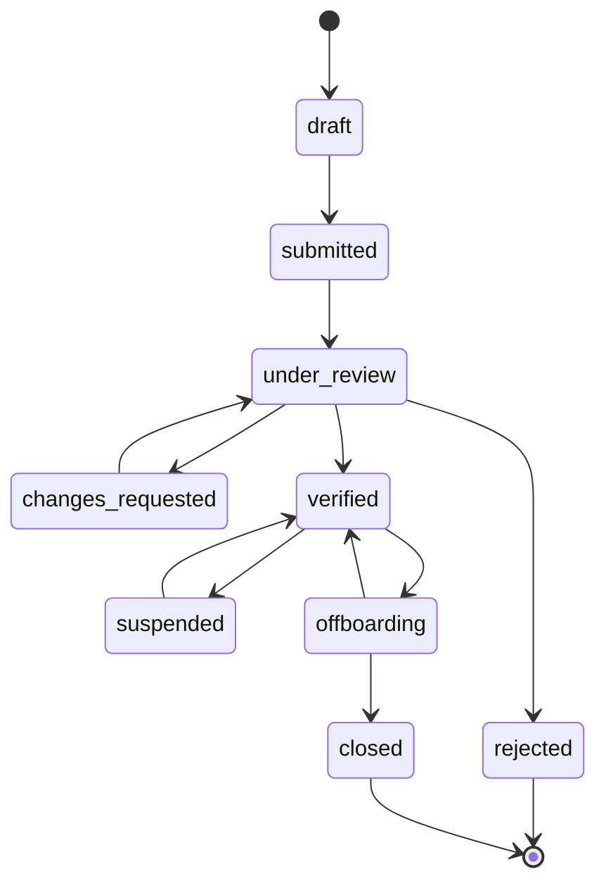

### SM-INS-02 — Import batch

States: `uploaded`, `validating`, `preview_ready`, `confirmed`, `processing`, `completed`, `failed`, `cancelled`, `expired`. Terminal: `completed`, `cancelled`, `expired`; `failed` can resume.

| From | To | Trigger | Guard |
|---|---|---|---|
| uploaded | validating | Worker picks up | File passes type and size checks |
| validating | preview_ready | Validation done | Row results stored |
| preview_ready | confirmed | `IAD` confirms | Rows within cap, not expired |
| preview_ready | expired | 24 hours elapse | No confirm |
| preview_ready, uploaded | cancelled | `IAD` cancels | n/a |
| confirmed | processing | Worker starts | n/a |
| processing | completed | All confirmed rows handled | Report generated |
| processing | failed | Unrecoverable error | Partial progress recorded |
| failed | processing | `IAD` resumes | Idempotent |

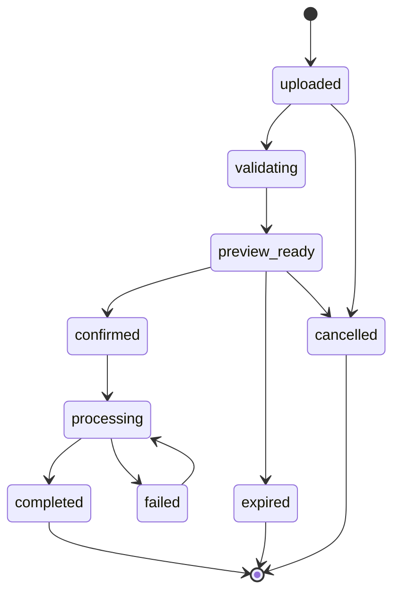

### SM-INS-03 — Student membership

States: `invited`, `active`, `suspended`, `withdrawn`, `graduated`, `invitation_expired`, `declined`. Terminal: `graduated`, `declined`, `invitation_expired` (re-invite creates a new invitation, same membership may be reused).

| From | To | Trigger | Guard |
|---|---|---|---|
| invited | active | Student accepts | Email control proven; guardian consent if minor |
| invited | invitation_expired | Token expires | n/a |
| invited | declined | Student declines | n/a |
| active | suspended | `IAD` suspends | Reason |
| suspended | active | `IAD` restores | n/a |
| active, suspended | withdrawn | `IAD` withdraws or student leaves | Reason |
| withdrawn | active | `IAD` restores | Within retention |
| active | graduated | Graduation transition completes | SM-INS-09 completed |

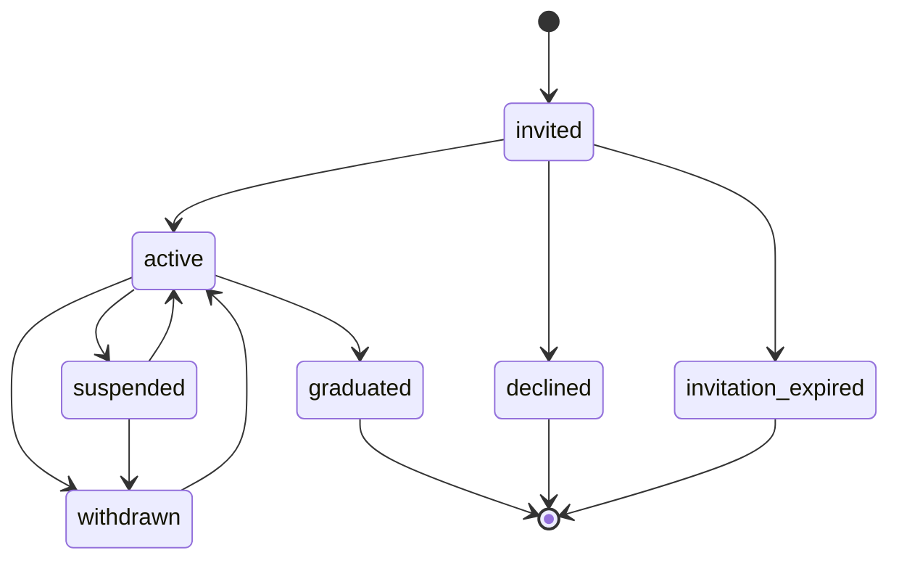

### SM-INS-04 — Seat assignment

States: `active`, `revoked_grace`, `released`, `expired`. Terminal: `released`, `expired`. (Unassigned seats are free capacity in the pool, not rows.)

| From | To | Trigger | Guard |
|---|---|---|---|
| (new) | active | Assign | Pool has free seat, atomic |
| active | revoked_grace | `IAD` revokes | Reason |
| revoked_grace | active | `IAD` undoes | Within grace |
| revoked_grace | released | Grace ends | No in-progress assessment |
| active | expired | Pool validity ends | n/a |
| revoked_grace | expired | Pool validity ends first | n/a |

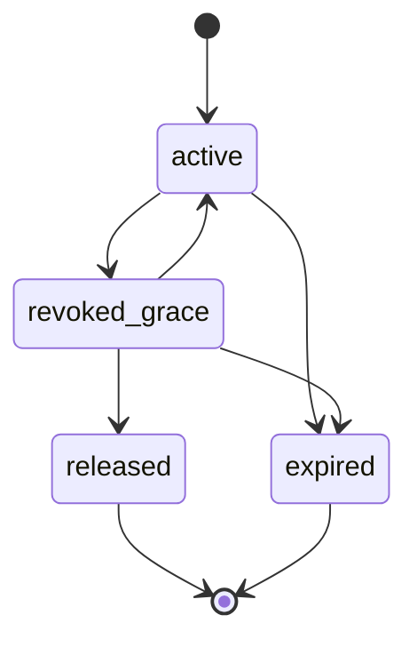

### SM-INS-05 — Placement drive

States: `draft`, `published`, `registration_open`, `registration_closed`, `in_rounds`, `completed`, `archived`, `cancelled`. Terminal: `archived`, `cancelled`.

| From | To | Trigger | Guard |
|---|---|---|---|
| draft | published | `PLO` publishes | Eligibility valid, partner active, eligible count at least 1 |
| published | registration_open | Open date reached | n/a |
| registration_open | registration_closed | Close date or manual | n/a |
| registration_closed | in_rounds | First round starts | At least 1 shared candidate |
| in_rounds | completed | Last round result recorded | n/a |
| completed | archived | 90 days or manual | n/a |
| draft, published, registration_open, registration_closed, in_rounds | cancelled | `PLO` cancels | Reason; shares revoked |

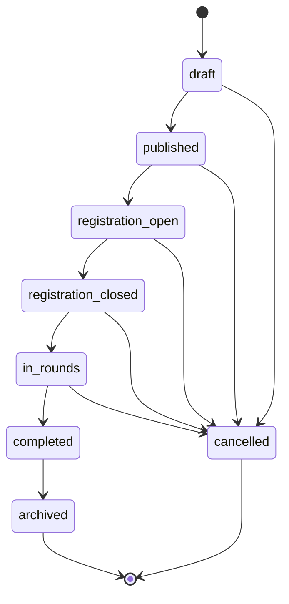

### SM-INS-06 — Drive application

States: `registered`, `shared`, `shortlisted`, `in_round`, `offered`, `accepted`, `declined`, `rejected`, `withdrawn`. Terminal: `accepted`, `declined`, `rejected`, `withdrawn`.

| From | To | Trigger | Guard |
|---|---|---|---|
| (new) | registered | Student registers | Eligible, before cut-off, not blocked by one-offer policy |
| registered | shared | Student consent recorded | Consent active |
| shared | shortlisted | Employer shortlists | n/a |
| shortlisted | in_round | Round starts | n/a |
| in_round | offered | Employer offers | n/a |
| offered | accepted | Student accepts | n/a |
| offered | declined | Student declines | n/a |
| registered, shared, shortlisted, in_round | rejected | Employer or `PLO` rejects | n/a |
| registered, shared, shortlisted | withdrawn | Student withdraws | Before cut-off; consent revoked |

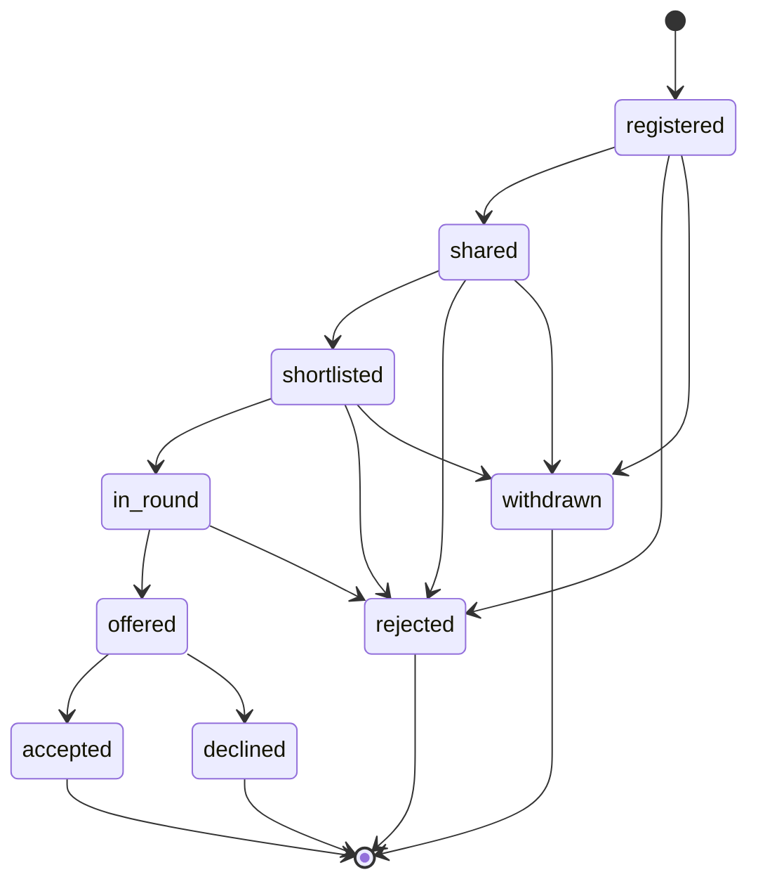

### SM-INS-07 — Intervention case

States: `opened`, `assigned`, `in_progress`, `resolved`, `escalated`, `dismissed`, `auto_closed`. Terminal: `resolved`, `dismissed`, `auto_closed`.

| From | To | Trigger | Guard |
|---|---|---|---|
| opened | assigned | Owner set | Owner holds scope |
| assigned | in_progress | First action logged | n/a |
| in_progress | resolved | Owner closes | Outcome given |
| in_progress, assigned | escalated | Owner or SLA breach | n/a |
| escalated | in_progress | `IAD` reassigns | n/a |
| opened, assigned, in_progress, escalated | dismissed | Owner dismisses | Reason |
| any open | auto_closed | Student withdrawn | n/a |

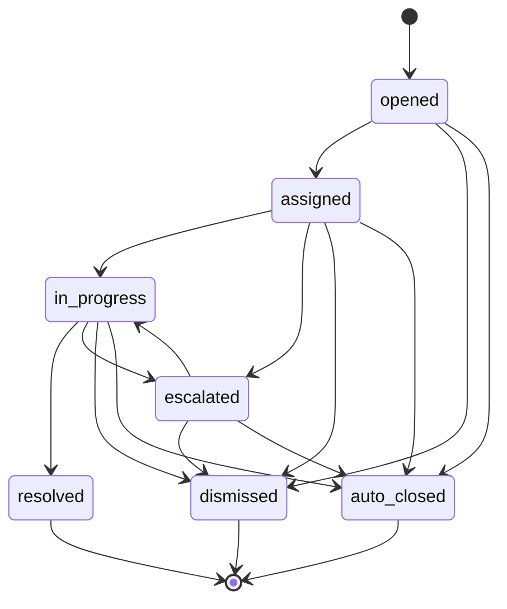

### SM-INS-08 — Guardian consent

States: `requested`, `granted`, `declined`, `expired`, `revoked`. Terminal: `declined`, `expired`, `revoked` (a new request starts a new record).

| From | To | Trigger | Guard |
|---|---|---|---|
| requested | granted | Guardian grants | Identity step passed |
| requested | declined | Guardian declines | n/a |
| requested | expired | Link TTL ends | n/a |
| granted | revoked | Guardian or `PAD` revokes | n/a |

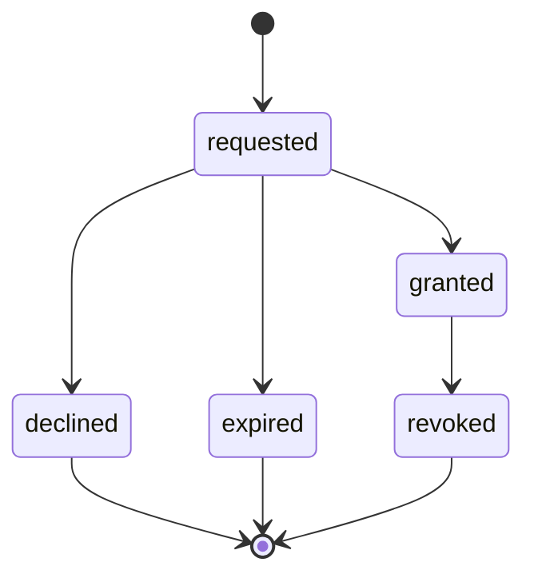

### SM-INS-09 — Graduation transition

States: `scheduled`, `prompted`, `completed`, `reverted`, `not_applicable`. Terminal: `completed`, `reverted`, `not_applicable`.

| From | To | Trigger | Guard |
|---|---|---|---|
| scheduled | prompted | Graduation date reached | Student account active |
| prompted | completed | Student confirms or 30 days elapse (defaults) | Retained-signals report generated |
| completed | reverted | `IAD` reverts | Within 30 days |
| scheduled | not_applicable | Student account closed | n/a |

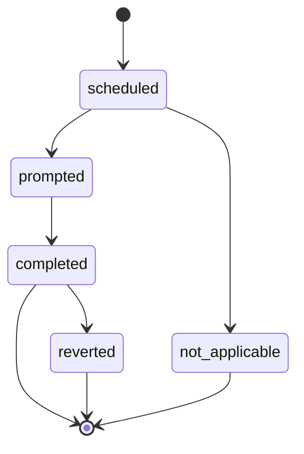

### SM-INS-10 — Placement outcome

States: `reported`, `student_confirmed`, `disputed`, `verified`, `withdrawn`. Terminal: `verified`, `withdrawn`.

| From | To | Trigger | Guard |
|---|---|---|---|
| (new) | reported | `PLO` records | Required fields |
| reported | student_confirmed | Student confirms | n/a |
| reported | disputed | Student disputes | Reason |
| disputed | reported | `PLO` corrects | Re-request sent |
| student_confirmed | verified | Employer or document verification | n/a |
| reported, disputed | withdrawn | `PLO` withdraws | Reason |

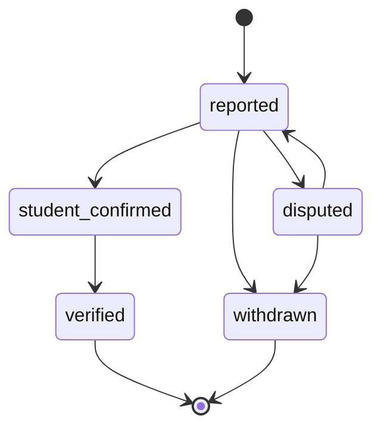

## 7. Screen inventory

| ID | Name | Route proposal | Roles | Purpose | Key states |
|---|---|---|---|---|---|
| SCR-INS-001 | Institution application | `/institutions/apply` | CAN | Create and submit tenant | draft, validation errors, submitted |
| SCR-INS-002 | Verification status | `/institution/verification` | IAD | Provide proofs, see status | pending, passed, failed, changes requested |
| SCR-INS-003 | Verification review queue | `/admin/institutions/verification` | PAD | Review cases | empty, list, case detail, conflict |
| SCR-INS-004 | Institution profile and branding | `/institution/settings/profile` | IAD | Edit profile, preview | saved, contrast error, conflict |
| SCR-INS-005 | Public institution page | `/i/:slug` | GUE, CAN | Public face | off, on, unverified |
| SCR-INS-006 | Staff and roles | `/institution/staff` | IAD | Manage grants | empty, list, invite modal |
| SCR-INS-007 | Structure | `/institution/structure` | IAD, PLO | Departments, programs, terms | tree, archive blocked |
| SCR-INS-008 | Batches list and detail | `/institution/batches`, `/institution/batches/:id` | IAD, PLO, INS | Batch management | list, tabs, full |
| SCR-INS-009 | Roster | `/institution/roster` | IAD, PLO, INS | Search and act on students | empty, filtered, bulk selected, undo |
| SCR-INS-010 | Student detail drawer | `/institution/roster/:id` | IAD, PLO, INS | Per-student view | tabs, restricted |
| SCR-INS-011 | Invitation acceptance | `/join/:token` | CAN | Accept membership | valid, expired, wrong email |
| SCR-INS-012 | Bulk import wizard | `/institution/import` | IAD | Import students | each step, errors, processing, done |
| SCR-INS-013 | Seats and pools | `/institution/seats` | IAD, FIN | Pools, assignments | low, expiring, mismatch |
| SCR-INS-014 | Course assignments | `/institution/batches/:id/courses` | IAD, INS | Assign courses | insufficient seats, ok |
| SCR-INS-015 | Faculty assignments | `/institution/faculty` | IAD | Teaching matrix | empty, populated |
| SCR-INS-016 | Certificate settings and issued list | `/institution/settings/certificates` | IAD | Template and revoke | preview, revoked |
| SCR-INS-017 | Certificate verification | `/verify/:code` | GUE | Public check | valid, revoked, expired, not found |
| SCR-INS-018 | Progress dashboard | `/institution/progress` | IAD, INS, PLO | Monitor progress | stale, empty |
| SCR-INS-019 | At-risk rules and flags | `/institution/settings/at-risk` | IAD, INS | Configure, review | list, dismissed |
| SCR-INS-020 | Intervention board | `/institution/interventions` | IAD, INS | Cases | board columns, case detail |
| SCR-INS-021 | Placement workspace | `/institution/placement` | PLO, IAD | Readiness and tags | not shared, nudge cooldown |
| SCR-INS-022 | Drives list and wizard | `/institution/placement/drives` | PLO | Create and run drives | draft, published, in rounds |
| SCR-INS-023 | Employer partners | `/institution/placement/employers` | PLO | Partnership list | invited, active, paused |
| SCR-INS-024 | Drive student view | `/me/institution/drives` | STD | See and register | eligible, blocked, registered |
| SCR-INS-025 | Showcase sharing settings | `/me/institution/sharing` | STD | Consent management | off, on, revoked, minor blocked |
| SCR-INS-026 | Employer drive view | `/employer/drives/:id` | REC, EAD | Candidate review | loading, no candidates, closed |
| SCR-INS-027 | Placement outcomes | `/institution/placement/outcomes` | PLO | Record and track | reported, disputed |
| SCR-INS-028 | Institution dashboard | `/institution` | IAD | KPIs | suppressed, stale, empty |
| SCR-INS-029 | Reports | `/institution/reports` | IAD, PLO | Templates and runs | running, ready, restated |
| SCR-INS-030 | Graduation (admin) | `/institution/graduation` | IAD | Schedule and monitor | preview, running |
| SCR-INS-031 | Graduation (student) | `/me/institution/graduation` | STD | Choose what stays | prompted, completed |
| SCR-INS-032 | Alumni outcomes and surveys | `/institution/alumni/outcomes` | PLO | Surveys | draft, sent, responses |
| SCR-INS-033 | SSO settings | `/institution/settings/sso` | IAD | Configure SSO | test passed, failed |
| SCR-INS-034 | LTI settings | `/institution/settings/lti` | IAD | Platforms and mappings | launch log |
| SCR-INS-035 | Roster sync | `/institution/settings/roster-sync` | IAD | Sync runs | guard tripped |
| SCR-INS-036 | Guardian consent page | `/guardian/:token` | Guardian | Grant per purpose | pending, granted, expired |
| SCR-INS-037 | Privacy and disclosures | `/institution/privacy` | IAD | Requests and log | deadline near |
| SCR-INS-038 | My records | `/me/institution/records` | STD | See, request copy | request open |
| SCR-INS-039 | Data and offboarding | `/institution/settings/data` | IAD | Export, offboard | countdown |

Accessibility notes for all screens: WCAG 2.2 AA; tables have captions and sortable headers with `aria-sort`; bulk actions announce selection counts through a live region; wizards keep focus on the step heading; guardian and join pages work without JavaScript for the primary action where feasible and are translated.

## 8. Data entities owned

Retention classes: `R-tenant` retained for the institution's retention policy (default 7 years after last activity), `R-audit` 7 years, `R-short` 90 days, `R-session` 30 days.

| ID | Name | Key attributes | Relationships | Retention |
|---|---|---|---|---|
| ENT-INS-01 | Institution | id, slug, legal name, display name, type, country, domains[], status (SM-INS-01), includes_minors, settings | has many staff, programs, batches | R-tenant |
| ENT-INS-02 | VerificationCase | id, institution_id, status, domain_proof, legal_proofs[], reviewer_id, decision, reason_code | belongs to Institution | R-audit |
| ENT-INS-03 | StaffGrant | id, institution_id, user_id, role, scope_type, scope_id, expires_at, status | Institution, user | R-audit |
| ENT-INS-04 | Department | id, institution_id, name, code, status | has many Program | R-tenant |
| ENT-INS-05 | Program | id, department_id, name, code, level, duration_terms, status | has many Batch | R-tenant |
| ENT-INS-06 | AcademicTerm | id, institution_id, name, start, end | referenced by Batch | R-tenant |
| ENT-INS-07 | Batch | id, program_id, term_id, name, code, owner_id, capacity, hard_cap, join_code_hash, status | has many Membership | R-tenant |
| ENT-INS-08 | StudentInvitation | id, institution_id, email, token_hash, expires_at, status, source (manual, import, sync) | Membership | R-short after resolution |
| ENT-INS-09 | StudentMembership | id, institution_id, user_id, identifier, program_id, batch_ids[], status (SM-INS-03), affiliation_verified, placement_tags[] | Institution, user | R-tenant |
| ENT-INS-10 | ImportBatch | id, institution_id, file_hash, state (SM-INS-02), counts, uploader_id | has many ImportRow | R-short (file), R-audit (report) |
| ENT-INS-11 | ImportRow | id, import_batch_id, row_number, row_hash, result, error_code, membership_id | ImportBatch | R-short |
| ENT-INS-12 | SeatAssignment | id, pool_ref, membership_id, state (SM-INS-04), assigned_at, grace_ends_at, valid_until | BIL seat pool (planned), Membership | R-tenant |
| ENT-INS-13 | CourseAssignment | id, batch_id, course_ref, path_ref, pool_ref, start, due, access_end, mandatory, auto_assign | Batch, LRN course | R-tenant |
| ENT-INS-14 | SeatPolicy | institution_id, low_threshold, expiry_warnings[], auto_assign_default, grace_days | Institution | R-tenant |
| ENT-INS-15 | TeachingAssignment | id, staff_grant_id, batch_id, course_ref, role, can_issue_certificates | StaffGrant, Batch | R-tenant |
| ENT-INS-16 | CertificateTemplate | id, institution_id, branding snapshot, signatory, validity_months, version | Institution; LRN certificate (planned) | R-tenant |
| ENT-INS-17 | ProgressSnapshot | membership_id, course_ref, completion_pct, last_active, assessment_summary, as_of | Membership | R-tenant |
| ENT-INS-18 | AtRiskFlag | id, membership_id, rule, signals (json), state, dismissed_until, raised_at | Membership | R-tenant |
| ENT-INS-19 | InterventionCase | id, membership_id, owner_id, state (SM-INS-07), reason, actions[], notes[] (visibility) | Membership | R-tenant (Restricted) |
| ENT-INS-20 | ShowcaseConsent | id, user_id, institution_id, scope, fields[], notice_version, granted_at, revoked_at | Membership | R-audit |
| ENT-INS-21 | EmployerPartnership | id, institution_id, employer_org_ref, contact, status, notes | Institution, EMP org | R-tenant |
| ENT-INS-22 | PlacementDrive | id, institution_id, partnership_id, roles[], eligibility (allowlist json), rounds[], dates, state (SM-INS-05) | Institution, EmployerPartnership | R-tenant |
| ENT-INS-23 | PlacementOutcome | id, membership_id, drive_id?, employer, role, type, date, comp_minor, currency, state (SM-INS-10) | Membership, Drive | R-tenant |
| ENT-INS-24 | ReportRun | id, institution_id, template, params, query_version, as_of, artifact_ref, schedule | Institution | R-audit |
| ENT-INS-25 | GraduationTransition | id, membership_id, batch_id, state (SM-INS-09), choices, retained_summary | Membership | R-audit |
| ENT-INS-26 | AlumniSurvey | id, institution_id, wave, questions[], responses[] (anonymous flag) | Institution | R-tenant |
| ENT-INS-27 | DriveApplication | id, drive_id, membership_id, state (SM-INS-06), consent_id, round_results[] | Drive, Membership, ShowcaseConsent | R-tenant |
| ENT-INS-28 | GuardianConsent | id, membership_id, guardian_email_hash, purposes[], state (SM-INS-08), method, granted_at | Membership | R-audit |
| ENT-INS-29 | DisclosureLogEntry | id, institution_id, subject_user_id, category, recipient, basis, actor, at | Institution | R-audit (append-only) |
| ENT-INS-30 | IntegrationConnection | id, institution_id, kind (sso, lti, sync), config (secrets by reference), status, last_run | Institution | R-tenant |
| ENT-INS-31 | OffboardingRequest | id, institution_id, state, export_refs[], purge_certificate_ref, hold_flags | Institution | R-audit |

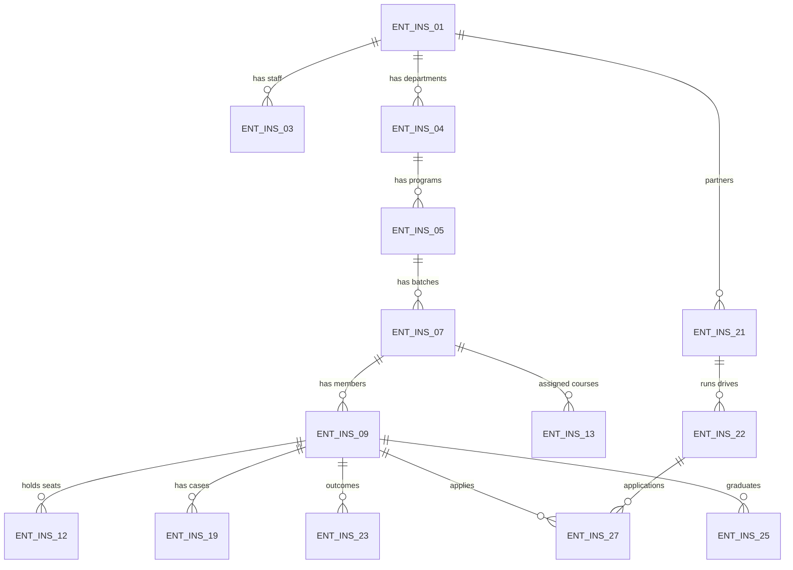

## 9. Events emitted and consumed

### 9.1 Emitted

| ID | Event | Emitted when | Key payload | Consumers (planned) |
|---|---|---|---|---|
| EVT-INS-001 | `ins.institution.created` | Application tenant created | institution_id, applicant | ADM, ANL |
| EVT-INS-002 | `ins.institution.submitted` | Application submitted | institution_id, case_id | ADM, NTF |
| EVT-INS-003 | `ins.institution.verified` | Verification approved | institution_id | NTF, BIL, ANL |
| EVT-INS-004 | `ins.institution.rejected` | Verification rejected | institution_id, reason_code | NTF |
| EVT-INS-005 | `ins.institution.suspended` | Suspended by platform | institution_id, reason | NTF, LRN |
| EVT-INS-006 | `ins.staff.invited` | Staff invited | grant_id, role, scope | NTF |
| EVT-INS-007 | `ins.staff.joined` | Staff accepted | grant_id | NTF |
| EVT-INS-008 | `ins.staff.deactivated` | Grant deactivated | grant_id | IDN, NTF |
| EVT-INS-009 | `ins.batch.created` | Batch created | batch_id, program_id | ANL |
| EVT-INS-010 | `ins.student.invited` | Invitation created | invitation_id, source | NTF |
| EVT-INS-011 | `ins.student.activated` | Membership active | membership_id, affiliation_verified | NTF, NET, PRF |
| EVT-INS-012 | `ins.student.suspended` | Suspended | membership_id, reason | LRN, NTF |
| EVT-INS-013 | `ins.student.withdrawn` | Withdrawn | membership_id, reason | LRN, NTF |
| EVT-INS-014 | `ins.import.confirmed` | Import confirmed | import_id, counts | ANL |
| EVT-INS-015 | `ins.import.completed` | Import finished | import_id, report_ref | NTF |
| EVT-INS-016 | `ins.course.assigned` | Course assigned to batch | assignment_id, batch_id, course_ref | LRN, NTF |
| EVT-INS-017 | `ins.seat.assigned` | Seat assigned | seat_id, membership_id | LRN, BIL |
| EVT-INS-018 | `ins.seat.revoked` | Seat revoked | seat_id, grace_ends_at | LRN, NTF |
| EVT-INS-019 | `ins.seat.released` | Seat released to pool | seat_id | BIL, LRN |
| EVT-INS-020 | `ins.seats.low` | Free seats under threshold | pool_ref, free | NTF |
| EVT-INS-021 | `ins.certificate.issued` | Certificate issued | certificate_id, membership_id | EVD, NTF, PRF |
| EVT-INS-022 | `ins.certificate.revoked` | Certificate revoked | certificate_id, reason | EVD, NTF |
| EVT-INS-023 | `ins.atrisk.flagged` | Flag raised | flag_id, rule | NTF |
| EVT-INS-024 | `ins.case.opened` | Intervention opened | case_id | NTF |
| EVT-INS-025 | `ins.case.resolved` | Case resolved | case_id, outcome | ANL |
| EVT-INS-026 | `ins.drive.published` | Drive published | drive_id, eligible_count | NTF, JOB |
| EVT-INS-027 | `ins.drive.cancelled` | Drive cancelled | drive_id | NTF |
| EVT-INS-028 | `ins.drive.application_status_changed` | Application state change | application_id, from, to | NTF, ATS |
| EVT-INS-029 | `ins.consent.granted` | Showcase consent granted | consent_id, scope | SET, NTF |
| EVT-INS-030 | `ins.consent.revoked` | Showcase consent revoked | consent_id | SET, NTF |
| EVT-INS-031 | `ins.outcome.reported` | Outcome recorded | outcome_id | NTF |
| EVT-INS-032 | `ins.outcome.confirmed` | Student confirmed | outcome_id | ANL, PRF |
| EVT-INS-033 | `ins.report.generated` | Report run ready | run_id | NTF |
| EVT-INS-034 | `ins.graduation.completed` | Transition done | transition_id, retained_summary | NET, PRF, EVD, ANL |
| EVT-INS-035 | `ins.guardian.consent_changed` | Guardian choice changes | consent_id, state | SET, LRN |
| EVT-INS-036 | `ins.records.disclosed` | Disclosure logged | entry_id | audit |
| EVT-INS-037 | `ins.offboarding.started` | Offboarding began | request_id | BIL, NTF |
| EVT-INS-038 | `ins.offboarding.completed` | Purge finished | request_id | ADM |
| EVT-INS-039 | `ins.sync.run_completed` | Sync run done | run counts | ANL |
| EVT-INS-040 | `ins.employer.partnered` | Partnership accepted | partnership_id | NTF |

### 9.2 Consumed (events from other modules, planned)

`lrn.enrollment.completed`, `lrn.progress.updated`, `asm.attempt.submitted`, `bil.seat_pool.created`, `bil.seat_pool.expired`, `bil.subscription.changed`, `idn.sso.login_succeeded`, `set.consent.changed`, `set.account.closed`, `ats.application.status_changed`, `emp.organization.verified`.

## 10. Integrations and external dependencies

| System | Direction | Purpose | Notes |
|---|---|---|---|
| DNS (TXT lookup) | Outbound | Domain proof | Resolver timeouts 5 seconds, retries |
| Identity providers (Entra, Google Workspace, Okta, generic SAML/OIDC) | Inbound | SSO | Via IDN |
| LMS (Canvas, Moodle, Blackboard, Brightspace) | Both | LTI 1.3 launches and grade services | Per-tenant keys |
| SIS (OneRoster, SCIM, SFTP) | Inbound | Roster sync | Tenant-scoped tokens |
| Email and in-app delivery | Outbound | Invitations, notices | Via NTF |
| Object storage and malware scan | Outbound | Evidence and import files | Via PLT |
| Payment and invoicing | Both | Seat pools | Via BIL |
| Proctoring vendor | Outbound | Exams, vendor-gated (SSOT OD-35, Ph10) | Out of this module's first release |

## 11. Cross-module dependencies

| Depends on | For | Depended on by |
|---|---|---|
| IDN (planned) | Accounts, SSO execution, MFA, sessions | ADM (institution queue), ANL |
| SET (planned) | Consent ledger, data rights | LRN (managed access), NET (alumni) |
| LRN (planned) | Enrollment, progress, certificates | ANL (institution KPIs) |
| STU (planned) | Private course authoring | BIL (institutional packages) |
| ASM (planned) | Assessment results, integrity | ANL |
| BIL (this batch) | Seat pools, invoices, price books (FR-BIL-024 to FR-BIL-027) | — |
| JOB, ATS, INT (planned) | Drives link to jobs, applications, interviews | ANL |
| EMP (planned) | Employer organization directory and verification | — |
| NET (planned) | Alumni network | — |
| EVD (planned) | Evidence revocation cascade, institution verification actors | BGV |
| NTF (planned) | Delivery | all |
| ANL (planned) | Metric pipelines | — |
| ADM (planned) | Verification queue, support access | — |
| PLT (planned) | Files, public API, webhooks | — |

## 12. Module-level metrics

| Metric | Definition | Formula | Owner role |
|---|---|---|---|
| Time to verification | Submission to `verified` | median(verified_at - submitted_at) | PAD |
| Roster activation rate | Invited students who activate | active / invited per import batch | IAD |
| Import clean rate | Rows valid at first validation | valid rows / total rows | IAD |
| Seat utilization | Seats assigned over seats purchased | active assignments / total seats | IAD |
| Course completion rate (managed) | Students completing assigned courses by due date | completed / assigned | INS |
| At-risk resolution rate | Flags resolved within SLA | resolved within SLA / opened | IAD |
| Drive participation | Registered / eligible | registered / eligible | PLO |
| Confirmed placement rate | Confirmed or verified outcomes over graduates | confirmed positive outcomes / graduating students | PLO |
| Graduation retention | Graduates keeping an active independent account 90 days later | active at +90d / completed transitions | PAD |
| Consent revocation rate | Showcase consents revoked | revoked / granted | PAD |

## 13. Open decisions

| ID | Question | Options | Default proposal | Who decides | Blocks |
|---|---|---|---|---|---|
| OD-INS-01 | Which institution types launch first: higher education, bootcamps and training providers only (18+), or also schools with minors? | A: 18+ only; B: add minors with guardian flow | A for first release, B after OD-INS-05 | Founder, Legal | FR-INS-030, tenant minors flag |
| OD-INS-02 | How far may INS go toward a student information system (grades, attendance, fees)? SSOT §4.2 forbids generic HR/payroll, not SIS, but breadth is undecided. | A: managed-learning data only; B: add attendance and grades import | A | Founder | Scope of ENT-INS-09, FR-INS-015 |
| OD-INS-03 | Employer relations breadth: partner list and drives only, or a CRM with pipelines. | A: list and drives; B: lightweight CRM | A (BR-INS-033) | Founder | FR-INS-020 |
| OD-INS-04 | Retention period and purge policy for student records by region. | 7 years default (SSOT OD-19) vs shorter or per-country | 7 years, configurable within bounds | Legal | FR-INS-032 |
| OD-INS-05 | Legal regime for minors and education records per country (age floor, guardian verification strength, FERPA-style response window, directory information). | Country table with counsel input | Age floor 16, response window 30 days, email-plus-DOB guardian check | Legal | FR-INS-030, FR-INS-031 |
| OD-INS-06 | Verification review SLA and who staffs it. | No SLA vs stated SLA | No promise in UI until staffing is decided | Ops | FR-INS-002 |
| OD-INS-07 | Import row cap and file size. | 5,000 rows (SSOT OD-21) vs larger | 5,000 rows, 10 MB | Eng | FR-INS-008 |
| OD-INS-08 | White-label scope. | Co-branded only; full white-label enterprise-only (SSOT OD-20) | Co-branded in this module | Founder | FR-INS-003 |
| OD-INS-09 | Timing of institutional SSO and LTI relative to R3. SSOT OD-16 says SSOT Ph6; large institutions often need SSO at purchase. | R3 vs R5 | R5 (tier already set), revisit with first institutional customer | Founder | FR-INS-027, FR-INS-028 |
| OD-INS-10 | At-risk detection: rules only, or ML-assisted ranking beside rules. | Rules only; rules plus ranked suggestion | Rules only | Product, AI governance | FR-INS-016 |
| OD-INS-11 | Can institutions buy seats before BIL commercial scale (SSOT §23.4 exit 2 says Ph3, F-41 says Ph6)? | Manual invoicing by `FIN` first; self-serve checkout later | Manual pools created by `FIN` until BIL R5 | Founder | FR-INS-011 timing |
| OD-INS-12 | One-offer placement policy defaults and any regional restrictions on student participation requirements. | Default off; allow institution to enable | Default off | Product, Legal | FR-INS-019 |

## 14. Risks

| ID | Risk | Likelihood and impact | Mitigation |
|---|---|---|---|
| RSK-INS-01 | Cross-tenant data leak through a missed policy or admin tooling. | Low likelihood, severe | Isolation tests per table, mandatory tenant filter in repository layer, support access audited |
| RSK-INS-02 | Fake institutions use verified status to issue credible-looking certificates. | Medium, high | Two-proof verification, independent reviewer, re-verification interval, revocation propagation |
| RSK-INS-03 | Seat overselling or counter drift under concurrency. | Medium, high | Row locks, constraints, nightly reconcile with write pause |
| RSK-INS-04 | Minors' data processed without valid guardian consent. | Low, severe | Activation guard, age floor, OD-INS-05 before enabling minors |
| RSK-INS-05 | Placement drives become a channel for discrimination or pressure on students. | Medium, high | Eligibility allowlist, voluntary participation, student consent per drive |
| RSK-INS-06 | Institutions treat the dashboard as a ranking or punishment tool for students. | Medium, medium | Explainable flags, no adverse automation, student visibility of shared items |
| RSK-INS-07 | Bulk import mistakes disrupt thousands of students. | Medium, medium | Dry-run, typed confirmation, 24-hour undo, sync guard |
| RSK-INS-08 | Employer data retained after a student revokes consent. | Medium, medium | Warning at consent time, watermarking, drive-scoped time-boxed access |
| RSK-INS-09 | SSO or LTI misconfiguration locks out an entire institution. | Medium, high | Break-glass `IAD` path, test sign-in before enforce, cert expiry warnings |
| RSK-INS-10 | Scope creep toward SIS and CRM against SSOT non-goals. | Medium, medium | OD-INS-02, OD-INS-03, BR-INS-033, quarterly scope review |

## 15. Legacy source trace

| Source | Used for | Dropped or changed and why |
|---|---|---|
| SSOT.md §4.2, §10.20 (BR-072 to BR-082), §23.4, §9 F-40/F-41/F-43/F-46/F-47/F-50, SCI-09 to SCI-12, SCI-17, SCI-18, WF-16 to WF-23, OD-15 to OD-21, OD-23 | Seat rules, import rules, graduation, exit criteria, open decisions | Pricing figures not carried (SSOT fixes none); F-41 phase conflict recorded as OD-INS-11 |
| SSOT.md §10.24 BR-128, §10.39 BR-241 to BR-248, F-125 | Minors, affiliation, alumni | Alumni network features owned by NET; only the graduation hand-off lives here |
| docs/registries/FEATURE_REGISTRY.md F-40 to F-50, F-56, F-90, F-125, F-131 | Feature inventory | F-45 proctoring excluded (vendor-gated, SSOT Ph10); F-131 apprenticeship matching belongs to JOB |
| docs/registries/BUSINESS_RULE_REGISTRY.md BR-072 to BR-082, BR-241 to BR-248 | Rule text | Merged into BR-INS table with new ids |
| ARCHITECTURE.md, docs/reports/FEATURE_STATUS_2026-10-21.md | Awareness that the institution flow is not built | No status copied |
| Yash_Final_Project_Document 30_PRIOR_IMPLEMENTATION_REFERENCE/04-FEATURES-AND-WORKFLOWS.md | Existing institution-level verification actor rules (`institution_verified` evidence level) | Prior alumni API is in memory and not carried |
| Own domain knowledge (Canvas, Handshake, Symplicity, Credly, Workday Student) | Placement drives, roster sync, LTI, accreditation reports, guardian consent, record disclosure log | Tagged [PROP] |

**Conflicts recorded:** (1) SSOT F-41 Ph6 versus §23.4 exit 2 Ph3 on seat purchase: OD-INS-11. (2) SSOT §5 lists "Department Admin" and "Faculty/Proctor" with no canonical short code: modeled as scoped `IAD` and `INS` grants (FR-INS-004). (3) OS ambition versus §4.2: employer relations kept narrow (OD-INS-03). (4) OD-16 SSO Ph6 versus common institutional expectation: OD-INS-09.
