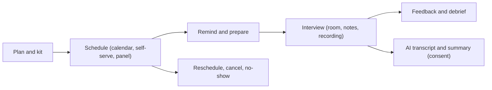

# INT — Interviews & Scheduling

> Status: intended product specification. Nothing in this file claims anything is built. See [CONVENTIONS](../00_START_HERE/CONVENTIONS.md).

## 1. Purpose, outcomes and boundaries

### 1.1 Purpose

INT runs the interview stage of hiring from plan to feedback: it designs structured interviews, finds times across calendars and time zones, lets candidates self-schedule, hosts video interviews with consent-based recording, transcripts and collaborative tools, supports asynchronous video interviews, and collects feedback on time. It removes the scheduling back-and-forth that slows hiring and makes interviews comparable by tying every question to a competency. [SRC: SSOT §9.7 F-06 step 5, F-33, F-88, F-93; §10.31 BR-169..176] [DER]

### 1.2 Outcomes

| Outcome | How the system knows |
|---|---|
| Interviews are booked fast without email ping-pong | Median time from invite to confirmed slot |
| No double bookings, missed time zones or silent no-shows | Conflict count zero; no-show rate and reasons recorded |
| Interviews are structured and comparable | Share of interviews using a plan with competency-linked questions |
| Recording and AI use are consented and bounded | Zero recordings without a consent record |
| Feedback is timely | Share of feedback submitted within the due window |

### 1.3 Boundaries

| In scope (owned by INT) | Out of scope | Consumed |
|---|---|---|
| Interview plans, rounds, kits, question bank, interviewer qualification | Pipeline stages and scorecards (ATS: FR-ATS-011, 026, 027) | Stage entry events, scorecard templates |
| Calendar connections, availability, free/busy, conflicts | Identity and OAuth account linking (IDN planned) | Authenticated user identity |
| Scheduling (recruiter, self-service, panel, negotiation), reschedule, cancel, reminders, candidate hub | Notification delivery (NTF planned) | Delivery services |
| Video rooms, controls, recording, whiteboard and code editor, live notes | Coding challenge content and sandbox (ASM planned) | Sandbox runtime |
| AI transcript and summary | AI models (AIC planned) | Model services |
| Async video interviews | Media storage (PLT planned) | File and media services |
| Feedback collection tasks and debrief, no-show handling, accommodations | Candidate application and status (JOB) | Candidate responses, application context |

Ownership: INT owns interview instances and artifacts; ATS owns the application stage and scorecards (INT creates scorecard requests on ATS through `API-ATS-03` (planned)). Candidate-side responses are rendered by JOB (FR-JOB-030) and execute INT commands. [DER]

## 2. Roles and permission matrix

Legend: Y allowed, O own, A audited, T scoped to the hiring team, N not allowed.

| Capability | REC | Coordinator | HMG | Interviewer | EAD | CAN/STD/FRL | PAD | SUP |
|---|---|---|---|---|---|---|---|---|
| Create plans and kits | Y | Y | Y (own jobs) | N | Y | N | N | N |
| Manage own calendar and availability | O | O | O | O | O | N | N | N |
| Schedule, reschedule, cancel (employer side) | T | T | T | N | Y | N | N | N |
| Book, propose, reschedule, cancel own interview | N | N | N | N | N | O (within limits) | N | N |
| Host and join room | Y | Y | Y | Y (assigned) | Y | O (own) | N | N |
| Start recording | Host after consent | Host | Host | N | Host | N | N | N |
| View recording and transcript | T | N | T | Assigned only | Y, A | N | N | N |
| Submit feedback | Y | N | Y | Y | Y | N | N | N |
| Manage accommodations | Y | Y | N | Needed adjustments only | Y | O (request) | N | N |
| Interview ops dashboard | Y | Y | T | N | Y | N | N | N |
| Delete recording early | N | N | N | N | Y, A | Request | A | N |

## 3. Sub-module map

| Code | Sub-module | Features |
|---|---|---|
| A | Plans and kits | FR-INT-001 to 003 |
| B | Calendar and availability | FR-INT-004 to 006 |
| C | Scheduling | FR-INT-007 to 016 |
| D | Communications | FR-INT-017, 018 |
| E | Video rooms | FR-INT-019 to 023 |
| F | AI notes | FR-INT-024, 025 |
| G | Async video interviews | FR-INT-026 to 028 |
| H | Feedback and debrief | FR-INT-029, 030 |
| I | Exceptions and operations | FR-INT-031 to 034 |

## 4. Feature specifications

### Sub-module A: Plans and kits

### FR-INT-001 — Interview plan builder

- **Sub-module:** A Plans and kits
- **Priority / tier:** Must · R2
- **Source:** [SRC: SSOT F-06 step 5, F-88] [PROP]
- **Purpose and outcome:** Define the interview rounds for a job; success is every stage that needs interviews has a plan the scheduler can execute.
- **Roles and permissions:** `REC, HMG (own jobs), Coordinator, EAD: create, edit`
- **Preconditions and entry points:** Pipeline stage settings (FR-ATS-011) or job setup; `/interviews/plans`.
- **User interactions and actions:** 1) Create plan: name, job or job family. 2) Add rounds: name (Recruiter screen, Technical, Panel, Final), type (video, phone, onsite, async video, live coding), duration (15 to 240 min), required interviewers count and roles, optional interviewers, qualification required, kit, scorecard template, buffer before and after, candidate-facing description, who may self-schedule. 3) Order rounds, mark parallel or sequential. 4) Attach plan to stage. 5) Save as template.
- **System behaviour:** Plan versions are immutable once used; edits create new versions. Plans drive scheduling requests, panel requirements and scorecard creation. Round candidate-facing descriptions are shown in the candidate hub (FR-INT-018) without question content (BR-INT-015). Sequential rounds unlock the next after the previous is completed or waived.
- **UI elements and controls:** Round list with drag and Move buttons, round form, interviewer requirement editor, kit picker, scorecard picker, Preview, Save, Attach.
- **Configuration options:** Org: default buffers (10 min), default plan per job family.
- **Business rules:** BR-INT-001, BR-INT-002, BR-INT-016
- **Validation:** Round name 2 to 60 chars; duration 15 to 240 in 5-minute steps; at least 1 required interviewer; kit and scorecard compatible.
- **Inputs and outputs:** In: plan definition. Out: versioned plan.
- **Filters, sorting, search:** Plans by job, type.
- **Notifications and communication:** n/a.
- **Error handling and edge cases:** Plan changed while interviews are scheduled: existing interviews keep old version, banner offers "Update upcoming". Deleting a round with scheduled interviews: refused.
- **Dependencies:** FR-ATS-011, FR-ATS-026, ENT-INT-01, ENT-INT-02.
- **Security and privacy:** Org scoped.
- **Acceptance criteria:**
  - Given a plan with two sequential rounds, When round 1 completes, Then round 2 becomes schedulable.
  - Given a round without a required interviewer, When saving, Then refused.
  - Given scheduled interviews on a round, When deleting the round, Then refused.
  - Negative: Given a duration of 10 minutes, When saving, Then validation error.

### FR-INT-002 — Interview kits and question bank

- **Sub-module:** A Plans and kits
- **Priority / tier:** Must · R2
- **Source:** [SRC: BR-173 company-scoped questions; BR-176 structured rubrics]
- **Purpose and outcome:** Give interviewers vetted, competency-linked questions and guidance; success is structured interviews.
- **Roles and permissions:** `REC, HMG, EAD, Coordinator: create` · `Interviewer: view assigned kit`
- **Preconditions and entry points:** `/interviews/kits`; plan round.
- **User interactions and actions:** 1) Create a question: text, competency, type (behavioral, situational, technical, case), expected signals (good and weak answer descriptors), follow-ups, time allocation, difficulty, tags. 2) Compose a kit from questions with order and total time check. 3) Import from platform starter bank. 4) Archive questions.
- **System behaviour:** Questions are org-scoped and not visible to candidates before the interview (BR-INT-015). Lint warns on unlawful topics (family plans, age, religion, health, nationality, marital status) and blocks them (BR-INT-017). Kit time must fit round duration; warning if exceeding 90 percent. Usage and score distribution per question are tracked to find non-discriminating or confusing questions. Technical questions can reference platform challenges (ASM planned).
- **UI elements and controls:** Question editor, competency select (from scorecard competencies), kit composer with time bar, Lint results panel.
- **Configuration options:** Org: required kit for rounds (default on).
- **Business rules:** BR-INT-015, BR-INT-016, BR-INT-017
- **Validation:** Question 10 to 1,000 chars; at least one expected signal; kit 3 to 20 questions.
- **Inputs and outputs:** In: question and kit data. Out: versioned kit.
- **Filters, sorting, search:** By competency, type, tag, usage.
- **Notifications and communication:** n/a.
- **Error handling and edge cases:** Blocked topic: save refused with explanation. Question deleted while in a kit: archived and kit keeps it.
- **Dependencies:** FR-ATS-026, ASM (planned), ENT-INT-03, ENT-INT-04.
- **Security and privacy:** Confidential intellectual property; access limited to hiring teams.
- **Acceptance criteria:**
  - Given a question about marital status, When saving, Then blocked.
  - Given a kit whose time exceeds the round duration, When attached, Then a blocking error shows.
  - Given a candidate calling the kit API, When requested, Then 403.
  - Negative: Given a question lacking expected signals, When saving, Then refused.

### FR-INT-003 — Interviewer pool and qualification

- **Sub-module:** A Plans and kits
- **Priority / tier:** Should · R4
- **Source:** [PROP]
- **Purpose and outcome:** Ensure only trained interviewers conduct certain rounds; success is consistent interview quality.
- **Roles and permissions:** `EAD, REC: manage qualifications` · `Interviewer: view own status`
- **Preconditions and entry points:** `/interviews/interviewers`.
- **User interactions and actions:** 1) Define qualifications (for example "Structured interviewing training", "Technical panel certified"). 2) Assign statuses: Shadow, Reverse-shadow, Qualified, Paused. 3) Set interviewer load limits per week. 4) Declare conflicts of interest or exclusions (for example former colleague). 5) Interviewers set their own max interviews per week within limits.
- **System behaviour:** Scheduling only proposes qualified interviewers for rounds that require it; shadow participants join as observers with no scorecard. Load limits default 5 interviews per week [PROP] (BR-INT-026) and drive panel balance. Conflict declarations exclude the interviewer for that candidate (BR-INT-028).
- **UI elements and controls:** Interviewer table, status select, load input, conflict dialog.
- **Configuration options:** Org: required qualifications per round type.
- **Business rules:** BR-INT-002, BR-INT-026, BR-INT-028
- **Validation:** Load 0 to 40 per week.
- **Inputs and outputs:** In: qualifications, status. Out: pool.
- **Filters, sorting, search:** Filter by status, team.
- **Notifications and communication:** Interviewer notified of status change.
- **Error handling and edge cases:** Interviewer disqualified with scheduled interviews: warning and reassign task. Training expired: auto-pause.
- **Dependencies:** FR-INT-010, ENT-INT-05.
- **Security and privacy:** Qualification data internal to employer.
- **Acceptance criteria:**
  - Given a round requiring qualification, When auto-matching, Then only qualified interviewers are proposed.
  - Given a declared conflict, When scheduling that candidate, Then the interviewer is excluded.
  - Negative: Given a shadow interviewer, When submitting a scorecard, Then refused.

### Sub-module B: Calendar and availability

### FR-INT-004 — Calendar connection (Google and Microsoft)

- **Sub-module:** B Calendar
- **Priority / tier:** Must · R2
- **Source:** [SRC: SSOT F-06 step 5 calendar integration, OD-09] [DER]
- **Purpose and outcome:** Read free/busy and write events to employer members' calendars; success is accurate availability and invites on the right calendar.
- **Roles and permissions:** `Employer members: connect own` · `EAD: require connection by policy` · `Candidates: no calendar connection (ICS only)`
- **Preconditions and entry points:** Settings, Calendar; first scheduling use.
- **User interactions and actions:** 1) Choose Connect Google or Connect Microsoft. 2) Grant consent on the provider's screen with minimal scopes (free/busy and event create for the chosen calendar). 3) Choose the calendar for new events and calendars to check for conflicts. 4) Disconnect at any time. 5) See sync status.
- **System behaviour:** Stores encrypted refresh tokens; polls or subscribes to change notifications; reads only busy blocks (no titles) for conflict checks (BR-INT-009). Writes events with the interview details. Handles token expiry (SM-INT-08: connected, needs_reauth, revoked, error). On disconnect, tokens are revoked and future events are not updated; existing events remain on the calendar. Candidates' calendars are never accessed (BR-INT-010).
- **UI elements and controls:** Provider buttons, calendar checklists, sync status chip with last sync, Disconnect button, Re-authorize prompt.
- **Configuration options:** User: conflict calendars, write calendar. Org: allowed providers, require connection.
- **Business rules:** BR-INT-009, BR-INT-010
- **Validation:** Valid OAuth state; scope set matches policy.
- **Inputs and outputs:** In: OAuth grant. Out: connection record.
- **Filters, sorting, search:** n/a.
- **Notifications and communication:** `int.calendar.needs_reauth` to user, class workflow.
- **Error handling and edge cases:** Provider revokes: state `revoked`, scheduling marks the interviewer "calendar unavailable" and fails closed for auto-offer. Rate limits: backoff. Shared mailboxes: supported via delegated calendar selection.
- **Dependencies:** Google Calendar API, Microsoft Graph, IDN (planned), ENT-INT-06.
- **Security and privacy:** Least-privilege scopes; tokens encrypted; access logged.
- **Acceptance criteria:**
  - Given a successful connection, When free/busy syncs, Then busy blocks appear in availability.
  - Given the user disconnects, When saved, Then tokens are revoked and no further reads occur.
  - Given token expiry, When detected, Then the user is prompted and scheduling excludes them from auto-offers.
  - Negative: Given a request for event titles of other calendars, When made, Then it is not performed.

### FR-INT-005 — Availability rules

- **Sub-module:** B Calendar
- **Priority / tier:** Must · R2
- **Source:** [PROP] [SRC: Calendly-style rules]
- **Purpose and outcome:** Let interviewers define when they can be booked; success is bookings only in acceptable times.
- **Roles and permissions:** `Interviewer, REC, HMG: own` · `Coordinator: view`
- **Preconditions and entry points:** Settings, Availability.
- **User interactions and actions:** 1) Set weekly hours per day with time zone. 2) Add date overrides (vacation, extra hours). 3) Set buffers before and after, minimum notice (default 24 h), maximum per day and week, earliest and latest booking horizon (default 21 days). 4) Mark public holidays by region. 5) Pause availability.
- **System behaviour:** Availability is computed as: working hours minus busy blocks minus buffers minus holidays, subject to daily caps. Overrides take precedence. Org-wide holiday calendars apply. Changes affect future offers only, not confirmed interviews.
- **UI elements and controls:** Weekly grid with time inputs, overrides calendar, number inputs, time zone select, Pause switch.
- **Configuration options:** Defaults: Mon to Fri 09:00 to 17:00, buffer 10 min, notice 24 h, max 3 per day.
- **Business rules:** BR-INT-003, BR-INT-005, BR-INT-026
- **Validation:** End after start; no overlapping ranges; caps 1 to 20.
- **Inputs and outputs:** In: rules. Out: availability windows.
- **Filters, sorting, search:** n/a.
- **Notifications and communication:** n/a.
- **Error handling and edge cases:** DST change: windows recomputed in zone; transition-day warnings. Time zone mismatch with browser: prompt to confirm zone.
- **Dependencies:** FR-INT-004, FR-INT-006, ENT-INT-07.
- **Security and privacy:** Only derived availability shared with others, not reasons.
- **Acceptance criteria:**
  - Given hours 09:00 to 17:00 and a 10-minute buffer, When computing slots for a 45-minute interview, Then the first slot starts at 09:00 and none ends after 17:00.
  - Given a daily cap of 3, When 3 are booked, Then no more slots are offered that day.
  - Negative: Given overlapping ranges, When saving, Then refused.

### FR-INT-006 — Free/busy aggregation and conflict detection

- **Sub-module:** B Calendar
- **Priority / tier:** Must · R2
- **Source:** [DER]
- **Purpose and outcome:** Compute times when all required people are free; success is zero double bookings.
- **Roles and permissions:** `System; REC, Coordinator: view results`
- **Preconditions and entry points:** Any scheduling action; background refresh.
- **User interactions and actions:** 1) In the scheduler, see a heatmap of common availability for required and optional interviewers over a date range. 2) Hover to see who blocks a time (name only, no details). 3) Choose slots to offer.
- **System behaviour:** Intersects availability windows of required interviewers, subtracts conflicts including already offered but unconfirmed slots (soft holds for 24 h), applies candidate constraints if known. A slot booking runs inside a transaction that rechecks live calendar free/busy and platform holds (BR-INT-004). Stale cache (older than 5 minutes) is refreshed before booking.
- **UI elements and controls:** Availability heatmap with legend and text list alternative, optional interviewer toggle, slot selection checkboxes.
- **Configuration options:** Platform: hold duration (24 h), cache age.
- **Business rules:** BR-INT-003, BR-INT-004
- **Validation:** Date range max 60 days.
- **Inputs and outputs:** In: interviewers, duration, range. Out: candidate slots.
- **Filters, sorting, search:** Filter by day part.
- **Notifications and communication:** n/a.
- **Error handling and edge cases:** No common slot: suggest relaxing optional interviewers, extending range, or swapping interviewers. Provider timeout: mark that interviewer unknown and exclude with a warning.
- **Dependencies:** FR-INT-004, FR-INT-005.
- **Security and privacy:** Only busy blocks, no details.
- **Acceptance criteria:**
  - Given two interviewers with overlapping free windows, When computing, Then only the intersection is returned.
  - Given a live conflict appearing just before booking, When confirming, Then the booking fails and fresh slots are offered.
  - Negative: Given a provider timeout for one interviewer, When computing, Then the slots are not offered silently without that person.

### Sub-module C: Scheduling

### FR-INT-007 — Recruiter-initiated scheduling

- **Sub-module:** C Scheduling
- **Priority / tier:** Must · R2
- **Source:** [SRC: SSOT F-06 step 5 (manual scheduling at MVP per OD-09)]
- **Purpose and outcome:** A recruiter or coordinator books an interview for a candidate; success is a confirmed interview with invites sent.
- **Roles and permissions:** `REC (T), Coordinator (T), HMG (T), EAD`
- **Preconditions and entry points:** Application in a stage with a plan round; "Schedule interview" in application detail or bulk.
- **User interactions and actions:** 1) Pick the round. 2) Pick interviewers (suggested by plan, load and availability). 3) Choose mode: Offer slots to candidate (3 to 10 slots), Send self-schedule link (FR-INT-008), or Book directly with a time the candidate already agreed offline. 4) Set location or video, add notes visible to the candidate, accommodations prompt. 5) Send.
- **System behaviour:** Creates the interview in SM-INT-01 (`requested`, then `awaiting_candidate` or `scheduled`). Offered slots hold interviewer time for 24 hours (soft hold). Direct booking requires a candidate-confirmed flag and still sends a calendar invite and records who confirmed. Candidate invite is delivered through JOB (FR-JOB-030) and email with a signed link. Every interview requires an active application not terminal (BR-INT-001).
- **UI elements and controls:** Scheduler panel with round select, interviewer picker with load badges, slot heatmap, mode radio, notes textarea (candidate-visible, 500 chars), Send.
- **Configuration options:** Org: default slot count (5), invite expiry (3 business days).
- **Business rules:** BR-INT-001, BR-INT-002, BR-INT-003, BR-INT-004, BR-INT-028
- **Validation:** At least required interviewers selected; slots in the future beyond minimum notice; 3 to 10 slots.
- **Inputs and outputs:** In: round, interviewers, mode, slots. Out: interview id, invite.
- **Filters, sorting, search:** Interview list by status, date, job.
- **Notifications and communication:** Candidate invite `int.invite.issued` (email, in-app, optional SMS if opted in), class transactional; interviewers `int.interview.assigned`.
- **Error handling and edge cases:** Application withdrawn mid-send: refused. Interviewer unavailable after hold lapses: slots refreshed. Candidate email bounced: recruiter warned.
- **Dependencies:** FR-INT-001, 005, 006, FR-JOB-030, ENT-INT-08.
- **Security and privacy:** Invite link is signed, single purpose.
- **Acceptance criteria:**
  - Given a plan round and three common slots, When Offer slots is sent, Then the candidate receives an invite and interviewer time is held.
  - Given the candidate withdrew, When scheduling, Then refused.
  - Given direct booking, When saved without the candidate-confirmed flag, Then refused.
  - Negative: Given an interviewer in conflict declared for this candidate, When selecting, Then excluded.

### FR-INT-008 — Self-scheduling link

- **Sub-module:** C Scheduling
- **Priority / tier:** Must · R2
- **Source:** [PROP] [SRC: Calendly, Cal.com patterns]
- **Purpose and outcome:** Let the candidate pick any available time within recruiter-defined bounds; success is confirmation without recruiter involvement.
- **Roles and permissions:** `Candidate: use own link` · `REC, Coordinator: issue, revoke`
- **Preconditions and entry points:** Link in email or JOB invite; may open without sign-in via signed link with limited scope.
- **User interactions and actions:** 1) Open link. 2) See interview details (type, length, company, interviewers' roles per org setting). 3) Choose date from calendar; see slots in own time zone (detected, changeable). 4) Select a slot, confirm contact details, optional accommodation request. 5) See confirmation with add-to-calendar options.
- **System behaviour:** Link is single-use per interview request, signed, expires with the invite (SM-INT-02). Slots computed live from interviewers' availability and booked atomically (BR-INT-004, BR-INT-024); losing a race shows fresh slots. Panel rounds use FR-INT-010 matching. Confirmed booking creates the interview `scheduled`, calendar events, and reminders. Guests without an account confirm through the signed link; the system then offers account linking.
- **UI elements and controls:** Date picker, slot list with explicit time zone label, time zone select, Confirm, accommodation link, Add to calendar (Google, Outlook, ICS).
- **Configuration options:** Org: minimum notice, horizon (21 days), slot granularity (15 min), show interviewer names.
- **Business rules:** BR-INT-003, BR-INT-004, BR-INT-005, BR-INT-024
- **Validation:** Link valid; slot still free; phone format E.164 if collected.
- **Inputs and outputs:** In: slot choice. Out: booking.
- **Filters, sorting, search:** n/a.
- **Notifications and communication:** Confirmation to candidate and interviewers; `int.interview.scheduled`.
- **Error handling and edge cases:** Expired link: "Request new link". Revoked link: neutral message. No slots in horizon: "Ask recruiter for more times" creates FR-INT-009 request. Two tabs book simultaneously: second fails with fresh slots.
- **Dependencies:** FR-INT-006, FR-INT-014, FR-JOB-030.
- **Security and privacy:** Link cannot access other data; rate-limited to prevent slot enumeration.
- **Acceptance criteria:**
  - Given a valid link, When the candidate picks a slot, Then exactly one interview is `scheduled` and invites are sent.
  - Given another candidate takes the slot first, When confirming, Then fresh slots are shown and no booking is made.
  - Given an expired link, When opened, Then no slots are shown.
  - Negative: Given a reused link after booking, When opened, Then it shows the existing booking only.

### FR-INT-009 — Slot negotiation

- **Sub-module:** C Scheduling
- **Priority / tier:** Should · R2
- **Source:** [DER]
- **Purpose and outcome:** Resolve "none of these times work" without email threads.
- **Roles and permissions:** `Candidate: propose` · `REC, Coordinator: respond`
- **Preconditions and entry points:** "None of these work" on invite; link with no slots.
- **User interactions and actions:** 1) Candidate selects up to 5 windows they are available (date and time ranges) and optionally a note. 2) Recruiter sees proposals and the system's matches against interviewer availability. 3) Recruiter accepts a match (books) or offers new slots.
- **System behaviour:** Proposal windows are compared automatically; if a match exists for required interviewers a one-click Book is suggested. Limit 3 rounds of negotiation before the recruiter is prompted to call the candidate. Invite expiry extends by 2 business days per round.
- **UI elements and controls:** Window picker, note field, recruiter match list with Book, Offer new slots.
- **Configuration options:** Org: max negotiation rounds (3).
- **Business rules:** BR-INT-003, BR-INT-004
- **Validation:** Windows in the future, at least 30 minutes long, within horizon.
- **Inputs and outputs:** In: windows. Out: proposal record, match list.
- **Filters, sorting, search:** Open proposals queue.
- **Notifications and communication:** Recruiter `int.negotiation.received`; candidate result.
- **Error handling and edge cases:** No match: recruiter prompted to widen interviewer set. Candidate withdraws: negotiation closes.
- **Dependencies:** FR-INT-006, FR-JOB-030.
- **Security and privacy:** Windows disclose availability only.
- **Acceptance criteria:**
  - Given candidate windows overlapping interviewer availability, When opened, Then a Book suggestion appears.
  - Given 3 rounds, When a fourth is attempted, Then the recruiter is prompted to contact the candidate directly.
  - Negative: Given windows in the past, When submitting, Then refused.

### FR-INT-010 — Panel scheduling and interviewer matching

- **Sub-module:** C Scheduling
- **Priority / tier:** Should · R2
- **Source:** [PROP]
- **Purpose and outcome:** Schedule multi-person panels and pick interviewers fairly.
- **Roles and permissions:** `REC, Coordinator: configure and run`
- **Preconditions and entry points:** Plan round with several required roles.
- **User interactions and actions:** 1) Plan defines roles and counts (for example 1 engineer, 1 manager, 1 cross-functional). 2) Scheduler proposes interviewers per role by round-robin weighted by load and qualification, with override. 3) Slot search requires all required roles free. 4) Replace an interviewer later.
- **System behaviour:** Matching picks least recently used qualified interviewer with capacity; diversity-of-panel goals are optional org settings and use only role and team, not protected attributes. Optional interviewers do not block slots. Replacement notifies all and updates calendar events.
- **UI elements and controls:** Role slots with chosen interviewer and Swap button, load indicators.
- **Configuration options:** Org: matching strategy (round-robin default, least load).
- **Business rules:** BR-INT-002, BR-INT-025, BR-INT-026, BR-INT-028
- **Validation:** Each required role filled.
- **Inputs and outputs:** In: round requirements. Out: assigned interviewers.
- **Filters, sorting, search:** n/a.
- **Notifications and communication:** Assignment, replacement notices.
- **Error handling and edge cases:** No qualified interviewer free: show reasons per role. Replacement within 24 hours of interview: flag high risk.
- **Dependencies:** FR-INT-003, FR-INT-006.
- **Security and privacy:** Matching logs retained for audit.
- **Acceptance criteria:**
  - Given a panel needing three roles, When scheduling, Then slots appear only when all three roles have a free qualified person.
  - Given an interviewer over their weekly cap, When matching, Then they are skipped.
  - Negative: Given an unqualified interviewer chosen manually for a qualified-only round, When saving, Then refused unless EAD overrides with reason.

### FR-INT-011 — Time zone handling

- **Sub-module:** C Scheduling
- **Priority / tier:** Must · R2
- **Source:** [DER]
- **Purpose and outcome:** No one shows up at the wrong hour; success is zero time-zone-caused no-shows.
- **Roles and permissions:** `All participants`
- **Preconditions and entry points:** Everywhere a time is displayed.
- **User interactions and actions:** 1) See times in own zone with the zone abbreviation and city (for example "Tue 14:00 CET, Berlin"). 2) Hover or tap to see the other party's local time. 3) Change displayed zone in settings or in the scheduling page.
- **System behaviour:** Store instants in UTC with the IANA zone of creation; render with DST rules at the event date. ICS files include VTIMEZONE. Reminders compute in recipient zone and are sent at local-appropriate hours. Cross-DST bookings show a note when offsets change near the date. Candidate zone defaults to browser zone and profile zone, asked to confirm in the self-schedule page.
- **UI elements and controls:** Zone label on every time, dual-time tooltip, zone selector.
- **Configuration options:** User zone; org default zone.
- **Business rules:** BR-INT-005
- **Validation:** Zone must be valid IANA id.
- **Inputs and outputs:** In: zone. Out: rendered times.
- **Filters, sorting, search:** n/a.
- **Notifications and communication:** Messages state time in recipient zone plus UTC offset.
- **Error handling and edge cases:** Unknown zone: fallback to UTC with notice. Invalid local time during DST gap: prevented by slot generator.
- **Dependencies:** FR-INT-005, FR-INT-014.
- **Security and privacy:** Zone is coarse location data; used only for display.
- **Acceptance criteria:**
  - Given an interview on a DST change date, When displayed to two zones, Then both show correct local times.
  - Given a candidate in a different zone, When viewing the invite, Then the dual-time tooltip shows the host's time.
  - Negative: Given an invalid zone value, When saved, Then refused.

### FR-INT-012 — Reschedule

- **Sub-module:** C Scheduling
- **Priority / tier:** Must · R2
- **Source:** [PROP]
- **Purpose and outcome:** Move a confirmed interview safely; success is a new time with all parties informed and no orphaned events.
- **Roles and permissions:** `Candidate: request within limits` · `REC, Coordinator: reschedule` · `Interviewer: request`
- **Preconditions and entry points:** Interview `scheduled`; links in invite and tracker.
- **User interactions and actions:** 1) Candidate selects "Reschedule", chooses a reason, picks a new slot from available times. 2) Interviewer requests a change; recruiter handles. 3) Recruiter moves directly and informs the candidate.
- **System behaviour:** SM-INT-01 `scheduled` to `reschedule_pending` to `scheduled`; the old slot is released only after the new slot is booked, to avoid losing both. Candidate limit 2 reschedules at 24 hours minimum notice (BR-INT-006); beyond that, recruiter approval is required. Calendar events updated; reminders recomputed; version number increments; room link persists.
- **UI elements and controls:** Reschedule button, reason select, slot picker, confirmation.
- **Configuration options:** Org: candidate reschedule limit, notice hours.
- **Business rules:** BR-INT-004, BR-INT-006
- **Validation:** Reason from list; new slot valid.
- **Inputs and outputs:** In: new slot. Out: updated interview, event updates.
- **Filters, sorting, search:** n/a.
- **Notifications and communication:** `int.interview.rescheduled` to all.
- **Error handling and edge cases:** New slot taken: fresh slots. Within notice window: request goes to recruiter. Calendar update fails: retry; flag "calendar out of sync".
- **Dependencies:** FR-INT-006, FR-INT-014.
- **Security and privacy:** Audit.
- **Acceptance criteria:**
  - Given 2 prior reschedules, When the candidate requests a third, Then it routes to the recruiter.
  - Given a successful move, When complete, Then old events are updated and not duplicated.
  - Negative: Given less than 24 hours notice, When the candidate tries self-reschedule, Then recruiter approval is required.

### FR-INT-013 — Cancel

- **Sub-module:** C Scheduling
- **Priority / tier:** Must · R2
- **Source:** [DER] [SRC: FR-JOB-027 withdrawal]
- **Purpose and outcome:** Cancel with clear reasons and cleanup.
- **Roles and permissions:** `Candidate: cancel own` · `REC, Coordinator, EAD: cancel`
- **Preconditions and entry points:** Interview `scheduled` or awaiting.
- **User interactions and actions:** 1) Choose Cancel, reason (candidate: no longer interested, conflict, accepted other offer, other; employer: role closed, candidate rejected, interviewer unavailable, other). 2) Confirm. 3) Employer may choose to rebook.
- **System behaviour:** Moves to `cancelled`; releases holds; cancels calendar events; closes the room; pending feedback requests become waived. Late cancellation (under notice window) is recorded but never penalizes automatically (BR-INT-007). Candidate cancel does not withdraw the application unless chosen.
- **UI elements and controls:** Cancel button, reason select, optional note, confirm dialog.
- **Configuration options:** Org: late window (24 h).
- **Business rules:** BR-INT-007, BR-INT-019
- **Validation:** Reason required.
- **Inputs and outputs:** In: reason. Out: cancellation record.
- **Filters, sorting, search:** n/a.
- **Notifications and communication:** `int.interview.cancelled` to all.
- **Error handling and edge cases:** Cancel during live session: ends the session with notice. Already completed: refused.
- **Dependencies:** FR-INT-014, FR-JOB-027.
- **Security and privacy:** Reason notes are hiring-team only.
- **Acceptance criteria:**
  - Given a scheduled interview, When cancelled, Then calendar events are removed and feedback tasks waived.
  - Given a candidate cancel, When confirmed, Then the application remains active.
  - Negative: Given a completed interview, When cancelling, Then refused.

### FR-INT-014 — Calendar events and invites

- **Sub-module:** C Scheduling
- **Priority / tier:** Must · R2
- **Source:** [DER]
- **Purpose and outcome:** Every confirmed interview appears on all calendars with the right details and join link.
- **Roles and permissions:** `System`
- **Preconditions and entry points:** Interview scheduled, changed or cancelled.
- **User interactions and actions:** 1) Interviewers see an event on their calendar with candidate name (or anonymized if blind mode), role, kit link, join link. 2) Candidates receive an email with ICS and in-app card. 3) Users accept or decline in their calendar; the response syncs.
- **System behaviour:** Employer events are created via the calendar connection; candidates receive ICS (METHOD:REQUEST) by email. Updates and cancels send ICS updates with the same UID and sequence. Candidate event description contains no question content and no interviewer private details. Interviewer declines notify the recruiter and flag the interview "needs interviewer".
- **UI elements and controls:** n/a (system) plus Add-to-calendar buttons.
- **Configuration options:** Org: show candidate name in event title (default on unless blind mode).
- **Business rules:** BR-INT-009, BR-INT-010, BR-INT-015
- **Validation:** ICS compliant.
- **Inputs and outputs:** In: interview. Out: events and ICS.
- **Filters, sorting, search:** n/a.
- **Notifications and communication:** Email with ICS `int.interview.invite`, class transactional.
- **Error handling and edge cases:** Provider failure: queued retry; flag out-of-sync. Interviewer calendar disconnected: ICS emailed instead.
- **Dependencies:** FR-INT-004.
- **Security and privacy:** Event details minimized.
- **Acceptance criteria:**
  - Given a booking, When complete, Then each interviewer has an event with join link.
  - Given a cancel, When processed, Then the candidate receives a CANCEL ICS with the same UID.
  - Negative: Given blind mode, When the event is created, Then the candidate name is not in the title.

### FR-INT-015 — Scheduling automation

- **Sub-module:** C Scheduling
- **Priority / tier:** Should · R4
- **Source:** [PROP]
- **Purpose and outcome:** Trigger scheduling when a human moves a candidate into an interview stage.
- **Roles and permissions:** `EAD, REC: configure`
- **Preconditions and entry points:** Stage settings.
- **User interactions and actions:** 1) Enable "On entering stage, send self-schedule link for round X". 2) Choose default interviewer set. 3) Choose delay (immediate, 1 hour). 4) Review automation log.
- **System behaviour:** Fires only after a human stage move (BR-INT-029), never on automated flags. Idempotent per (application, stage entry). If no slots exist, creates a recruiter task. Candidate message uses an approved template (FR-ATS-023).
- **UI elements and controls:** Stage automation toggle with round and interviewer pickers.
- **Configuration options:** Org default off.
- **Business rules:** BR-INT-029, BR-INT-001
- **Validation:** Round must belong to the stage plan.
- **Inputs and outputs:** In: stage entry event. Out: invite.
- **Filters, sorting, search:** Log by status.
- **Notifications and communication:** Candidate invite; recruiter task.
- **Error handling and edge cases:** Candidate moved back before send: cancelled. Duplicate events: idempotent.
- **Dependencies:** FR-ATS-012, FR-INT-008.
- **Security and privacy:** Logged.
- **Acceptance criteria:**
  - Given automation on, When a recruiter moves a candidate to Interview, Then one invite is sent.
  - Given the same stage-entry event replayed, When processed, Then no second invite.
  - Negative: Given an automation flag change without human move, When evaluating, Then nothing sends.

### FR-INT-016 — In-person and phone interview logistics

- **Sub-module:** C Scheduling
- **Priority / tier:** Should · R2
- **Source:** [PROP]
- **Purpose and outcome:** Give candidates everything needed for non-video interviews.
- **Roles and permissions:** `REC, Coordinator: configure` · `Candidate: view`
- **Preconditions and entry points:** Round type onsite or phone.
- **User interactions and actions:** 1) For onsite: choose office location, room, check-in instructions, parking and transit notes, ID requirements, accessibility info, contact person and phone. 2) For phone: who calls whom, number, backup number. 3) Candidate sees all in hub with map link.
- **System behaviour:** Phone numbers are masked via a platform bridge where available [PROP] so personal numbers are not exposed; otherwise displayed only to confirmed participants. Location details released 24 hours before to avoid exposure to non-confirmed parties. Travel reimbursement info optional text.
- **UI elements and controls:** Location picker (from EMP-013), instructions field, phone fields, map link.
- **Configuration options:** Org: number masking on.
- **Business rules:** BR-INT-031
- **Validation:** Phone E.164; instruction length up to 1,000.
- **Inputs and outputs:** In: logistics. Out: candidate-safe details.
- **Filters, sorting, search:** n/a.
- **Notifications and communication:** Included in reminders.
- **Error handling and edge cases:** Location changed within 24 hours: urgent notice to all. Missing phone: reminder to recruiter.
- **Dependencies:** FR-EMP-013.
- **Security and privacy:** Personal phone numbers not exposed.
- **Acceptance criteria:**
  - Given an onsite round, When 24 hours before, Then the candidate sees address and instructions.
  - Given number masking, When a phone interview runs, Then neither party sees the other's personal number.
  - Negative: Given a candidate not confirmed, When requesting location, Then not shown.

### Sub-module D: Communications

### FR-INT-017 — Reminders

- **Sub-module:** D Communications
- **Priority / tier:** Must · R2
- **Source:** [PROP]
- **Purpose and outcome:** Reduce no-shows with timely reminders to all participants.
- **Roles and permissions:** `System` · `Users: configure own`
- **Preconditions and entry points:** Interview `scheduled`.
- **User interactions and actions:** 1) Candidate receives reminders 24 hours and 1 hour before (and 15 minutes with join link). 2) Interviewers 24 hours and 15 minutes. 3) Recipients tap "Confirm attending" or "Need to reschedule".
- **System behaviour:** Reminders computed in recipient zone; skip quiet hours except the 1-hour reminder; deduplicated; cancelled if the interview changes. Unconfirmed candidate 24 hours before triggers a recruiter task. Candidate can mute email but in-app stays (BR-INT-008).
- **UI elements and controls:** Reminder messages with Confirm and Reschedule buttons.
- **Configuration options:** Org: reminder offsets; user: channels.
- **Business rules:** BR-INT-008, BR-INT-005
- **Validation:** Offsets 5 min to 7 days.
- **Inputs and outputs:** In: schedule. Out: reminders.
- **Filters, sorting, search:** n/a.
- **Notifications and communication:** Templates `int.reminder.24h`, `.1h`, `.15m`; class transactional.
- **Error handling and edge cases:** Interview moved: reminders recreated. Delivery failure: retry then in-app.
- **Dependencies:** NTF (planned), FR-INT-011.
- **Security and privacy:** No sensitive content in SMS.
- **Acceptance criteria:**
  - Given an interview tomorrow, When 24 hours before, Then the candidate and interviewers are reminded once.
  - Given a reschedule, When saved, Then old reminders are cancelled.
  - Negative: Given the candidate muted email, When due, Then the in-app reminder still appears.

### FR-INT-018 — Candidate interview hub

- **Sub-module:** D Communications
- **Priority / tier:** Should · R2
- **Source:** [PROP]
- **Purpose and outcome:** One page where a candidate prepares and joins; success is confident, on-time candidates.
- **Roles and permissions:** `Candidate: own`
- **Preconditions and entry points:** Link in invite, tracker card.
- **User interactions and actions:** 1) See date and time with zone, format, duration, interviewers (names, titles if org allows), what to expect, preparation tips, device and network test, accessibility accommodations status, join button (active 15 minutes before), reschedule and cancel.
- **System behaviour:** Shows only candidate-safe content, never questions or scorecards (BR-INT-031). Device test checks camera, microphone, bandwidth in-browser. Shows consent choices for recording and AI notes in advance with explanation (FR-INT-021, FR-INT-024); choices can be changed until the room opens.
- **UI elements and controls:** Details card, Test my setup button, consent toggles, Join button, Reschedule, Cancel, "Contact recruiter".
- **Configuration options:** Org: show interviewer names (default on), preparation content.
- **Business rules:** BR-INT-031, BR-INT-012, BR-INT-014
- **Validation:** n/a.
- **Inputs and outputs:** In: interview id. Out: hub view.
- **Filters, sorting, search:** n/a.
- **Notifications and communication:** Linked from reminders.
- **Error handling and edge cases:** Unsupported browser: guidance and phone fallback. Interview cancelled: banner.
- **Dependencies:** FR-INT-019, 021, 024, JOB (planned links).
- **Security and privacy:** Signed access.
- **Acceptance criteria:**
  - Given 20 minutes before the interview, When the hub opens, Then Join is enabled.
  - Given the hub, When inspected, Then no question text is present.
  - Negative: Given a different user, When opening the link, Then access denied.

### Sub-module E: Video rooms

### FR-INT-019 — Room provisioning, lobby and join

- **Sub-module:** E Video rooms
- **Priority / tier:** Must · R3
- **Source:** [SRC: SSOT F-33 Video Interview Rooms; F-06 step 5 room auto-provisioned]
- **Purpose and outcome:** A secure browser room per interview with a waiting lobby; success is on-time starts without installs.
- **Roles and permissions:** `Interviewers, host, candidate: join (assigned)` · `Observers (shadow): join muted`
- **Preconditions and entry points:** Interview `scheduled`; join link from hub, event, reminder.
- **User interactions and actions:** 1) Click Join. 2) Preview camera and mic, choose devices, set background blur. 3) Candidate enters the lobby; host and interviewers see "Candidate waiting" and Admit. 4) Everyone joined, room becomes `live`.
- **System behaviour:** Room is created at scheduling (SM-INT-03) and opens 15 minutes before start. Join tokens are one-time, bound to interview and participant (BR-INT-011). The lobby holds candidates until the host admits. Participants beyond the roster need host approval. Room closes 30 minutes after scheduled end or when the host ends it. WebRTC with TURN fallback; adaptive quality. Fallback if the room cannot start: phone dial-in or alternative link (BR-INT-033). No sign-up needed for candidates.
- **UI elements and controls:** Pre-join screen with device selectors, test meter, Join; lobby screen with message; host Admit and Remove buttons; connection quality indicator.
- **Configuration options:** Org: auto-admit candidate when host present, lobby default on, max duration.
- **Business rules:** BR-INT-011, BR-INT-033
- **Validation:** Token valid and unexpired; max 12 participants [PROP].
- **Inputs and outputs:** In: token. Out: room session.
- **Filters, sorting, search:** n/a.
- **Notifications and communication:** Host alert when candidate in lobby.
- **Error handling and edge cases:** Token reuse from another device: blocked and asks the host. Candidate early: lobby message with countdown. Browser permission denied: instructions. Host late 10 minutes: system offers candidate to wait or reschedule; recorded (FR-INT-031).
- **Dependencies:** WebRTC media service (PLT planned), ENT-INT-12.
- **Security and privacy:** Encrypted transport; room ids unguessable; audit of joins.
- **Acceptance criteria:**
  - Given a valid link 10 minutes early, When the candidate joins, Then they wait in the lobby until admitted.
  - Given a token used once on device A, When used on device B, Then refused.
  - Given the host never joins within 10 minutes, When the timer passes, Then the candidate sees options.
  - Negative: Given a random room URL, When opened, Then access denied.

### FR-INT-020 — In-room controls

- **Sub-module:** E Video rooms
- **Priority / tier:** Must · R3
- **Source:** [SRC: SSOT F-33] [DER]
- **Purpose and outcome:** Standard conferencing controls that work with keyboard and assistive tech.
- **Roles and permissions:** `Host: mute others, remove, end` · `All: own controls`
- **Preconditions and entry points:** Live room.
- **User interactions and actions:** 1) Toggle mic, camera. 2) Share screen or a window; stop sharing. 3) Open chat panel. 4) Raise hand. 5) Pin or spotlight a participant. 6) Switch layouts. 7) View captions (live captions optional, FR-INT-024). 8) Host: mute all, remove participant, end for all. 9) Leave.
- **System behaviour:** Screen share is limited to one presenter at a time, with a persistent banner. Chat is stored with the interview record only if recording or notes are active and disclosed. Host removal ends that participant's token. Network adaptation shows warnings and can disable video to protect audio. Keyboard shortcuts (M, V, S, H) with help.
- **UI elements and controls:** Control bar with labelled buttons and tooltips, participant list, chat, layout menu, captions toggle, "Leave" and "End for all" (host).
- **Configuration options:** Org: allow chat (default on), allow candidate screen share (default on).
- **Business rules:** BR-INT-011, BR-INT-012
- **Validation:** n/a.
- **Inputs and outputs:** In: actions. Out: media and room state.
- **Filters, sorting, search:** n/a.
- **Notifications and communication:** In-room toasts.
- **Error handling and edge cases:** Screen share permission denied: guidance. Participant disconnect: auto-reconnect 60 seconds, then marked "dropped". All interviewers drop: candidate sees "reconnecting" and a fallback after 5 minutes.
- **Dependencies:** FR-INT-019.
- **Security and privacy:** Recording indicator shown whenever recording.
- **Acceptance criteria:**
  - Given a live room, When the host presses Mute all, Then all other mics are muted.
  - Given a screen share, When another starts, Then the first stops or the second is blocked per setting.
  - Given a keyboard-only user, When tabbing, Then all controls are reachable with visible focus.
  - Negative: Given a non-host, When attempting End for all, Then refused.

### FR-INT-021 — Recording consent and recording

- **Sub-module:** E Video rooms
- **Priority / tier:** Should · R3
- **Source:** [SRC: SSOT F-93; BR-169 dual consent; BR-170 retention]
- **Purpose and outcome:** Record only when everyone concerned has agreed and the employer policy allows; success is zero unconsented recordings.
- **Roles and permissions:** `Candidate: consent or decline` · `Host: start` · `EAD: policy`
- **Preconditions and entry points:** Org recording policy on; consent captured in hub and at room entry.
- **User interactions and actions:** 1) Before the interview, the candidate sees what will be recorded (audio, video, screen, chat), why, who can view, retention and can Allow or Decline. 2) At room entry, the choice is shown again. 3) Interviewers acknowledge notice. 4) Host presses Start recording only if consent is allowed by the candidate. 5) A visible recording banner is shown to all. 6) Stop recording any time.
- **System behaviour:** Dual consent: candidate consent plus employer policy and interviewers' acknowledgement (BR-INT-012). Consent is stored with timestamp and text version (ENT-INT-13). Declining never affects evaluation, and the system tells the candidate that. Where law requires all-party consent, any participant's objection blocks recording. Recording is stored encrypted, retention maximum 90 days unless extended with documented reason [SRC] (BR-INT-013). Consent can be withdrawn before start; after start, withdrawing stops recording and triggers deletion request handling.
- **UI elements and controls:** Consent card with Allow and Decline, banner "Recording" with red dot and text, Start/Stop buttons, retention label.
- **Configuration options:** Org: recording allowed per round type (default off), retention days (30 default, max 90).
- **Business rules:** BR-INT-012, BR-INT-013
- **Validation:** Consent present for candidate and org policy true before Start enabled.
- **Inputs and outputs:** In: consent choices. Out: recording artifact (SM-INT-04).
- **Filters, sorting, search:** n/a.
- **Notifications and communication:** Consent request in invite; recording availability notice to host.
- **Error handling and edge cases:** Candidate declines: Start disabled with explanation to host (no reason shown). Candidate joins late with no prior consent: asked in room. Recording fails mid-way: partial artifact labelled and host notified.
- **Dependencies:** PLT (planned) media, SET (planned) consent records, ENT-INT-13, ENT-INT-14.
- **Security and privacy:** Encrypted at rest; access logged; special category data possible (biometrics): not processed.
- **Acceptance criteria:**
  - Given the candidate declined, When the host opens controls, Then Start recording is disabled.
  - Given consent and policy, When recording starts, Then a banner shows to all participants.
  - Given retention 30 days, When day 31 passes, Then the file is deleted.
  - Negative: Given an API call to start recording without consent, When made, Then refused.

### FR-INT-022 — Whiteboard and collaborative code editor

- **Sub-module:** E Video rooms
- **Priority / tier:** Should · R3
- **Source:** [SRC: SSOT F-88 technical interview platform; BR-175 sandbox reuse]
- **Purpose and outcome:** Run technical and design interviews with shared tools; success is interviews where candidate work is visible and reviewable.
- **Roles and permissions:** `Host, interviewers, candidate: use`
- **Preconditions and entry points:** Round type live coding or design; tool tabs in room.
- **User interactions and actions:** 1) Open Code tab: choose language, write code in shared editor with presence cursors; Run executes in the sandbox with output panel. 2) Open Whiteboard: draw shapes, text, arrows, sticky notes. 3) Load a prepared problem from the kit. 4) Interviewer toggles "Hide solution notes". 5) Export or save a snapshot.
- **System behaviour:** Code runs in the challenge sandbox with the same language allowlist and limits as assessments [SRC: BR-175, BR-049, BR-050] (ASM planned). No network access in the sandbox. Content is saved to the interview record only with the candidate's consent to artifact capture (shown at entry); otherwise discarded at session end. Autosave and conflict-free collaborative editing. Candidate sees only prepared problem statement; interviewer-only hints are hidden.
- **UI elements and controls:** Tabs Code and Whiteboard, language select, Run button, output console, problem panel, snapshot button.
- **Configuration options:** Org: languages, run limits, artifact capture default.
- **Business rules:** BR-INT-027, BR-INT-015
- **Validation:** Language in allowlist; code size up to 200 KB; run time limits per sandbox.
- **Inputs and outputs:** In: code and drawings. Out: snapshots.
- **Filters, sorting, search:** n/a.
- **Notifications and communication:** n/a.
- **Error handling and edge cases:** Sandbox unavailable: Run disabled with message; editing continues. Connection loss: local buffer syncs on reconnect. Malicious code: sandbox isolation and kill.
- **Dependencies:** ASM (planned), FR-INT-019, ENT-INT-22.
- **Security and privacy:** Artifacts classed as candidate personal data, retention follows FR-INT-033.
- **Acceptance criteria:**
  - Given a Python problem, When the candidate runs code, Then output appears from the sandbox within limits.
  - Given artifact capture declined, When the session ends, Then no code is stored.
  - Given a hidden hint, When the candidate views the problem, Then the hint is absent.
  - Negative: Given an outbound network call in code, When run, Then blocked.

### FR-INT-023 — Live notes and markers

- **Sub-module:** E Video rooms
- **Priority / tier:** Should · R3
- **Source:** [PROP]
- **Purpose and outcome:** Interviewers capture evidence against competencies during the interview; success is scorecards backed by notes.
- **Roles and permissions:** `Interviewers, host`
- **Preconditions and entry points:** Side panel in room; also usable for phone and onsite on the same page.
- **User interactions and actions:** 1) See kit questions in order with time allocation. 2) Tick questions asked. 3) Type notes per question with competency tag. 4) Drop a timestamped marker (Strong signal, Concern, Follow up). 5) Notes sync to the scorecard draft.
- **System behaviour:** Notes are private to each interviewer until scorecard submission (BR-INT-018); markers align with recording timeline if recording. Prohibited-topic nudge: if a note includes protected terms ("pregnant") a warning prompts to remove. Notes autosave.
- **UI elements and controls:** Question list with check boxes, notes textarea, marker buttons, timer per question.
- **Configuration options:** Org: nudge on.
- **Business rules:** BR-INT-016, BR-INT-018
- **Validation:** Note up to 5,000 chars per question.
- **Inputs and outputs:** In: notes. Out: draft scorecard evidence.
- **Filters, sorting, search:** n/a.
- **Notifications and communication:** n/a.
- **Error handling and edge cases:** Disconnect: local buffer. Ad hoc question: added and flagged "not from kit".
- **Dependencies:** FR-INT-002, FR-ATS-027.
- **Security and privacy:** Private until submit; included in candidate access requests per ATS policy.
- **Acceptance criteria:**
  - Given a marker at 12:30, When viewing the recording, Then the marker appears at that time.
  - Given notes, When the interviewer opens the scorecard, Then notes are prefilled in the evidence fields.
  - Negative: Given another interviewer, When reading my notes before submit, Then not visible.

