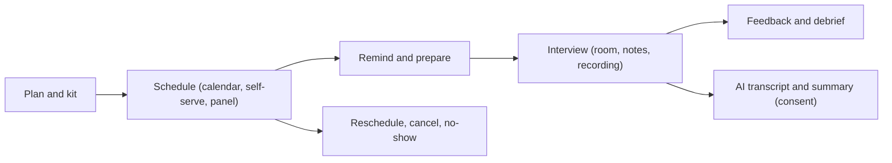
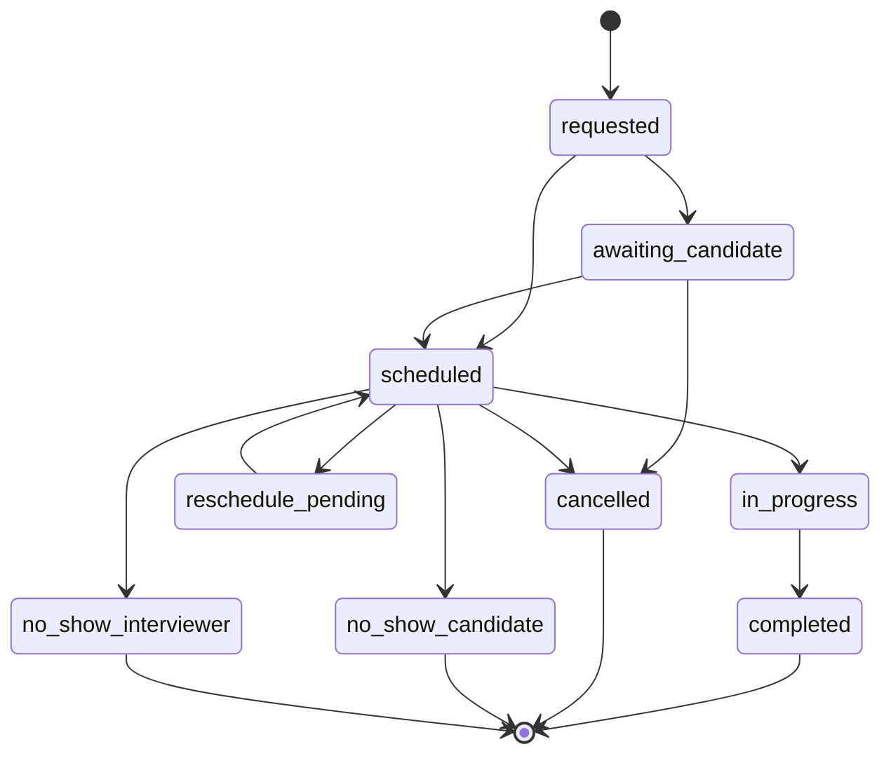
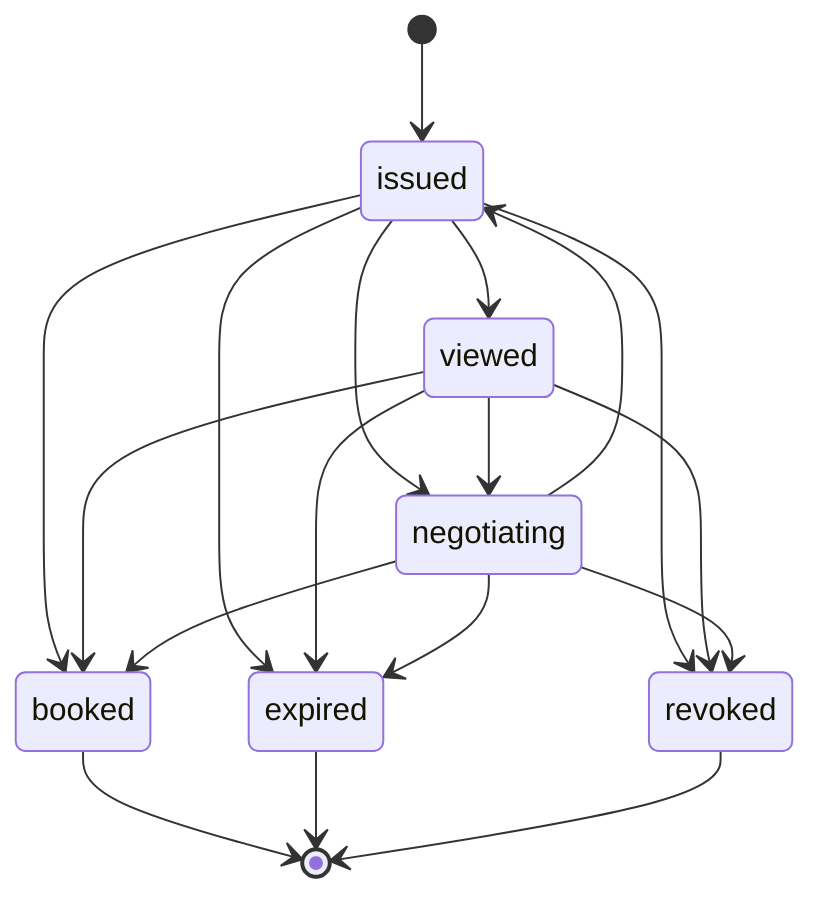
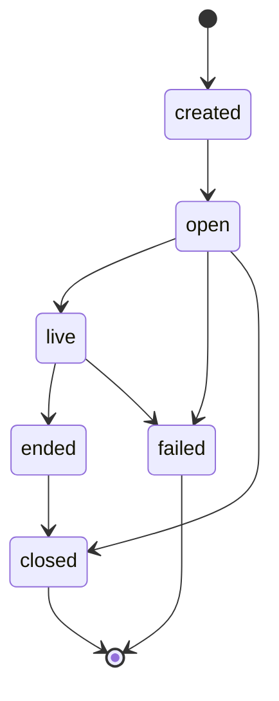
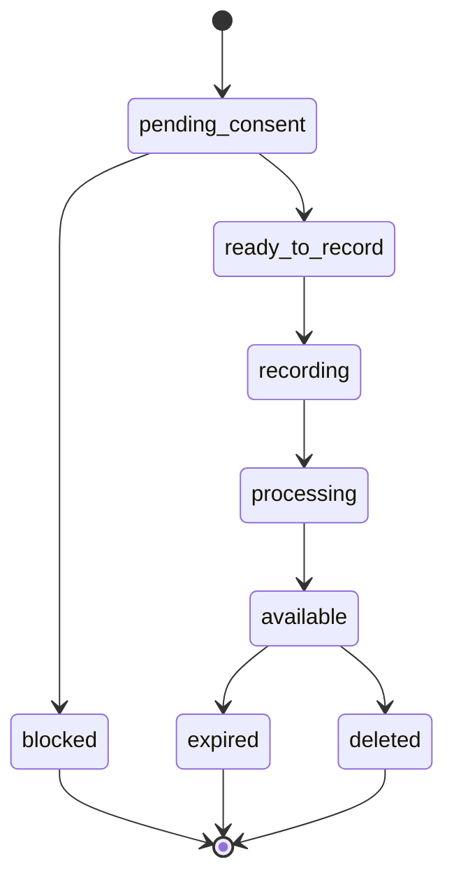
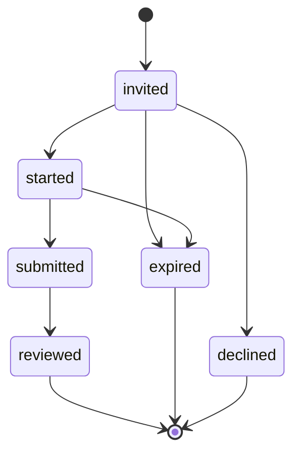
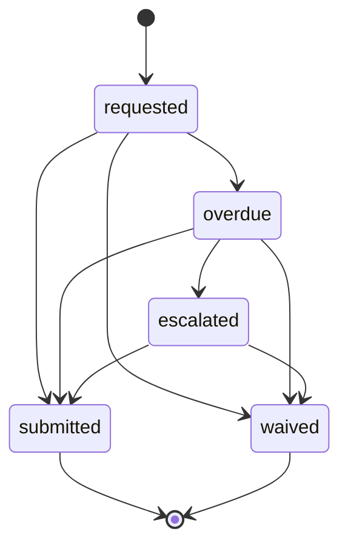
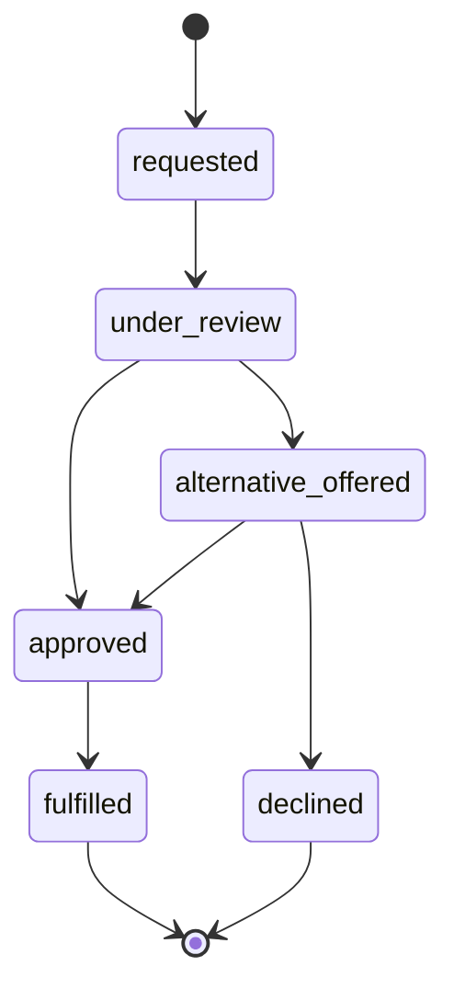
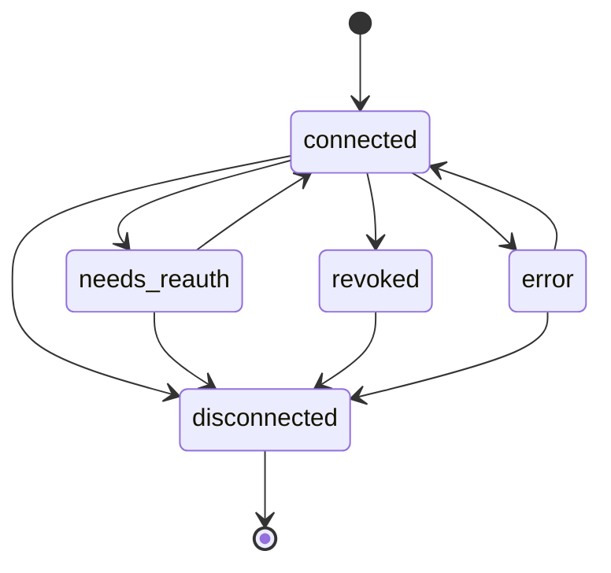
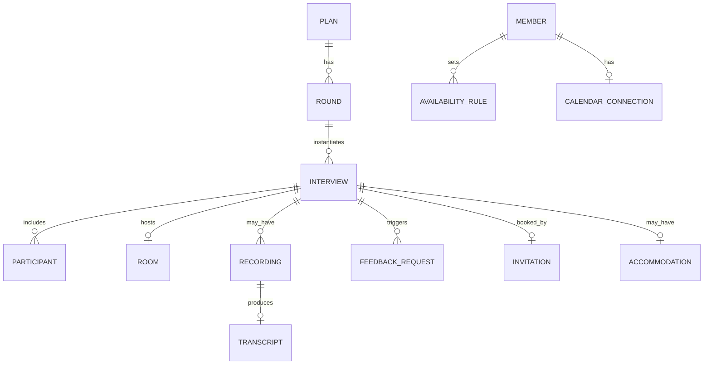

# INT — Interviews & Scheduling

> Status: intended product specification. Nothing in this file claims anything is built. See [CONVENTIONS](../00_START_HERE/CONVENTIONS.md).

## 1. Purpose, outcomes and boundaries

### 1.1 Purpose

INT runs the interview stage of hiring from plan to feedback: it designs structured interviews, finds times across calendars and time zones, lets candidates self-schedule, hosts video interviews with consent-based recording, transcripts and collaborative tools, supports asynchronous video interviews, and collects feedback on time. It removes the scheduling back-and-forth that slows hiring and makes interviews comparable by tying every question to a competency. [SRC: SSOT §9.7 F-06 step 5, F-33, F-88, F-93; §10.31 BR-169..176] [DER]

### 1.2 Outcomes

| Outcome                                                  | How the system knows                                              |
| -------------------------------------------------------- | ----------------------------------------------------------------- |
| Interviews are booked fast without email ping-pong       | Median time from invite to confirmed slot                         |
| No double bookings, missed time zones or silent no-shows | Conflict count zero; no-show rate and reasons recorded            |
| Interviews are structured and comparable                 | Share of interviews using a plan with competency-linked questions |
| Recording and AI use are consented and bounded           | Zero recordings without a consent record                          |
| Feedback is timely                                       | Share of feedback submitted within the due window                 |

### 1.3 Boundaries

| In scope (owned by INT)                                                                                | Out of scope                                               | Consumed                                 |
| ------------------------------------------------------------------------------------------------------ | ---------------------------------------------------------- | ---------------------------------------- |
| Interview plans, rounds, kits, question bank, interviewer qualification                                | Pipeline stages and scorecards (ATS: FR-ATS-011, 026, 027) | Stage entry events, scorecard templates  |
| Calendar connections, availability, free/busy, conflicts                                               | Identity and OAuth account linking (IDN planned)           | Authenticated user identity              |
| Scheduling (recruiter, self-service, panel, negotiation), reschedule, cancel, reminders, candidate hub | Notification delivery (NTF planned)                        | Delivery services                        |
| Video rooms, controls, recording, whiteboard and code editor, live notes                               | Coding challenge content and sandbox (ASM planned)         | Sandbox runtime                          |
| AI transcript and summary                                                                              | AI models (AIC planned)                                    | Model services                           |
| Async video interviews                                                                                 | Media storage (PLT planned)                                | File and media services                  |
| Feedback collection tasks and debrief, no-show handling, accommodations                                | Candidate application and status (JOB)                     | Candidate responses, application context |

Ownership: INT owns interview instances and artifacts; ATS owns the application stage and scorecards (INT creates scorecard requests on ATS through `API-ATS-03` (planned)). Candidate-side responses are rendered by JOB (FR-JOB-030) and execute INT commands. [DER]

## 2. Roles and permission matrix

Legend: Y allowed, O own, A audited, T scoped to the hiring team, N not allowed.

| Capability                                      | REC                | Coordinator | HMG          | Interviewer             | EAD  | CAN/STD/FRL       | PAD | SUP |
| ----------------------------------------------- | ------------------ | ----------- | ------------ | ----------------------- | ---- | ----------------- | --- | --- |
| Create plans and kits                           | Y                  | Y           | Y (own jobs) | N                       | Y    | N                 | N   | N   |
| Manage own calendar and availability            | O                  | O           | O            | O                       | O    | N                 | N   | N   |
| Schedule, reschedule, cancel (employer side)    | T                  | T           | T            | N                       | Y    | N                 | N   | N   |
| Book, propose, reschedule, cancel own interview | N                  | N           | N            | N                       | N    | O (within limits) | N   | N   |
| Host and join room                              | Y                  | Y           | Y            | Y (assigned)            | Y    | O (own)           | N   | N   |
| Start recording                                 | Host after consent | Host        | Host         | N                       | Host | N                 | N   | N   |
| View recording and transcript                   | T                  | N           | T            | Assigned only           | Y, A | N                 | N   | N   |
| Submit feedback                                 | Y                  | N           | Y            | Y                       | Y    | N                 | N   | N   |
| Manage accommodations                           | Y                  | Y           | N            | Needed adjustments only | Y    | O (request)       | N   | N   |
| Interview ops dashboard                         | Y                  | Y           | T            | N                       | Y    | N                 | N   | N   |
| Delete recording early                          | N                  | N           | N            | N                       | Y, A | Request           | A   | N   |

## 3. Sub-module map

| Code | Sub-module                | Features          |
| ---- | ------------------------- | ----------------- |
| A    | Plans and kits            | FR-INT-001 to 003 |
| B    | Calendar and availability | FR-INT-004 to 006 |
| C    | Scheduling                | FR-INT-007 to 016 |
| D    | Communications            | FR-INT-017, 018   |
| E    | Video rooms               | FR-INT-019 to 023 |
| F    | AI notes                  | FR-INT-024, 025   |
| G    | Async video interviews    | FR-INT-026 to 028 |
| H    | Feedback and debrief      | FR-INT-029, 030   |
| I    | Exceptions and operations | FR-INT-031 to 034 |

## 4. Feature specifications

### Sub-module A: Plans and kits

### FR-INT-001 — Interview plan builder

- **Sub-module:** A Plans and kits
- **Priority / tier:** Must · R2
- **Source:** [SRC: SSOT F-06 step 5, F-88] [PROP]
- **Purpose and outcome:** Define the interview rounds for a job; success is every stage that needs interviews has a plan the scheduler can execute.
- **Roles and permissions:** `REC, HMG (own jobs), Coordinator, EAD: create, edit`
- **Preconditions and entry points:** Pipeline stage settings (FR-ATS-011) or job setup; `/interviews/plans`.
- **User interactions and actions:** 1) Create plan: name, job or job family. 2) Add rounds: name (Recruiter screen, Technical, Panel, Final), type (video, phone, onsite, async video, live coding), duration (15 to 240 min), required interviewers count and roles, optional interviewers, qualification required, kit, scorecard template, buffer before and after, candidate-facing description, who may self-schedule. 3) Order rounds, mark parallel or sequential. 4) Attach plan to stage. 5) Save as template.
- **System behaviour:** Plan versions are immutable once used; edits create new versions. Plans drive scheduling requests, panel requirements and scorecard creation. Round candidate-facing descriptions are shown in the candidate hub (FR-INT-018) without question content (BR-INT-015). Sequential rounds unlock the next after the previous is completed or waived.
- **UI elements and controls:** Round list with drag and Move buttons, round form, interviewer requirement editor, kit picker, scorecard picker, Preview, Save, Attach.
- **Configuration options:** Org: default buffers (10 min), default plan per job family.
- **Business rules:** BR-INT-001, BR-INT-002, BR-INT-016
- **Validation:** Round name 2 to 60 chars; duration 15 to 240 in 5-minute steps; at least 1 required interviewer; kit and scorecard compatible.
- **Inputs and outputs:** In: plan definition. Out: versioned plan.
- **Filters, sorting, search:** Plans by job, type.
- **Notifications and communication:** n/a.
- **Error handling and edge cases:** Plan changed while interviews are scheduled: existing interviews keep old version, banner offers "Update upcoming". Deleting a round with scheduled interviews: refused.
- **Dependencies:** FR-ATS-011, FR-ATS-026, ENT-INT-01, ENT-INT-02.
- **Security and privacy:** Org scoped.
- **Acceptance criteria:**
  - Given a plan with two sequential rounds, When round 1 completes, Then round 2 becomes schedulable.
  - Given a round without a required interviewer, When saving, Then refused.
  - Given scheduled interviews on a round, When deleting the round, Then refused.
  - Negative: Given a duration of 10 minutes, When saving, Then validation error.

### FR-INT-002 — Interview kits and question bank

- **Sub-module:** A Plans and kits
- **Priority / tier:** Must · R2
- **Source:** [SRC: BR-173 company-scoped questions; BR-176 structured rubrics]
- **Purpose and outcome:** Give interviewers vetted, competency-linked questions and guidance; success is structured interviews.
- **Roles and permissions:** `REC, HMG, EAD, Coordinator: create` · `Interviewer: view assigned kit`
- **Preconditions and entry points:** `/interviews/kits`; plan round.
- **User interactions and actions:** 1) Create a question: text, competency, type (behavioral, situational, technical, case), expected signals (good and weak answer descriptors), follow-ups, time allocation, difficulty, tags. 2) Compose a kit from questions with order and total time check. 3) Import from platform starter bank. 4) Archive questions.
- **System behaviour:** Questions are org-scoped and not visible to candidates before the interview (BR-INT-015). Lint warns on unlawful topics (family plans, age, religion, health, nationality, marital status) and blocks them (BR-INT-017). Kit time must fit round duration; warning if exceeding 90 percent. Usage and score distribution per question are tracked to find non-discriminating or confusing questions. Technical questions can reference platform challenges (ASM planned).
- **UI elements and controls:** Question editor, competency select (from scorecard competencies), kit composer with time bar, Lint results panel.
- **Configuration options:** Org: required kit for rounds (default on).
- **Business rules:** BR-INT-015, BR-INT-016, BR-INT-017
- **Validation:** Question 10 to 1,000 chars; at least one expected signal; kit 3 to 20 questions.
- **Inputs and outputs:** In: question and kit data. Out: versioned kit.
- **Filters, sorting, search:** By competency, type, tag, usage.
- **Notifications and communication:** n/a.
- **Error handling and edge cases:** Blocked topic: save refused with explanation. Question deleted while in a kit: archived and kit keeps it.
- **Dependencies:** FR-ATS-026, ASM (planned), ENT-INT-03, ENT-INT-04.
- **Security and privacy:** Confidential intellectual property; access limited to hiring teams.
- **Acceptance criteria:**
  - Given a question about marital status, When saving, Then blocked.
  - Given a kit whose time exceeds the round duration, When attached, Then a blocking error shows.
  - Given a candidate calling the kit API, When requested, Then 403.
  - Negative: Given a question lacking expected signals, When saving, Then refused.

### FR-INT-003 — Interviewer pool and qualification

- **Sub-module:** A Plans and kits
- **Priority / tier:** Should · R4
- **Source:** [PROP]
- **Purpose and outcome:** Ensure only trained interviewers conduct certain rounds; success is consistent interview quality.
- **Roles and permissions:** `EAD, REC: manage qualifications` · `Interviewer: view own status`
- **Preconditions and entry points:** `/interviews/interviewers`.
- **User interactions and actions:** 1) Define qualifications (for example "Structured interviewing training", "Technical panel certified"). 2) Assign statuses: Shadow, Reverse-shadow, Qualified, Paused. 3) Set interviewer load limits per week. 4) Declare conflicts of interest or exclusions (for example former colleague). 5) Interviewers set their own max interviews per week within limits.
- **System behaviour:** Scheduling only proposes qualified interviewers for rounds that require it; shadow participants join as observers with no scorecard. Load limits default 5 interviews per week [PROP] (BR-INT-026) and drive panel balance. Conflict declarations exclude the interviewer for that candidate (BR-INT-028).
- **UI elements and controls:** Interviewer table, status select, load input, conflict dialog.
- **Configuration options:** Org: required qualifications per round type.
- **Business rules:** BR-INT-002, BR-INT-026, BR-INT-028
- **Validation:** Load 0 to 40 per week.
- **Inputs and outputs:** In: qualifications, status. Out: pool.
- **Filters, sorting, search:** Filter by status, team.
- **Notifications and communication:** Interviewer notified of status change.
- **Error handling and edge cases:** Interviewer disqualified with scheduled interviews: warning and reassign task. Training expired: auto-pause.
- **Dependencies:** FR-INT-010, ENT-INT-05.
- **Security and privacy:** Qualification data internal to employer.
- **Acceptance criteria:**
  - Given a round requiring qualification, When auto-matching, Then only qualified interviewers are proposed.
  - Given a declared conflict, When scheduling that candidate, Then the interviewer is excluded.
  - Negative: Given a shadow interviewer, When submitting a scorecard, Then refused.

### Sub-module B: Calendar and availability

### FR-INT-004 — Calendar connection (Google and Microsoft)

- **Sub-module:** B Calendar
- **Priority / tier:** Must · R2
- **Source:** [SRC: SSOT F-06 step 5 calendar integration, OD-09] [DER]
- **Purpose and outcome:** Read free/busy and write events to employer members' calendars; success is accurate availability and invites on the right calendar.
- **Roles and permissions:** `Employer members: connect own` · `EAD: require connection by policy` · `Candidates: no calendar connection (ICS only)`
- **Preconditions and entry points:** Settings, Calendar; first scheduling use.
- **User interactions and actions:** 1) Choose Connect Google or Connect Microsoft. 2) Grant consent on the provider's screen with minimal scopes (free/busy and event create for the chosen calendar). 3) Choose the calendar for new events and calendars to check for conflicts. 4) Disconnect at any time. 5) See sync status.
- **System behaviour:** Stores encrypted refresh tokens; polls or subscribes to change notifications; reads only busy blocks (no titles) for conflict checks (BR-INT-009). Writes events with the interview details. Handles token expiry (SM-INT-08: connected, needs_reauth, revoked, error). On disconnect, tokens are revoked and future events are not updated; existing events remain on the calendar. Candidates' calendars are never accessed (BR-INT-010).
- **UI elements and controls:** Provider buttons, calendar checklists, sync status chip with last sync, Disconnect button, Re-authorize prompt.
- **Configuration options:** User: conflict calendars, write calendar. Org: allowed providers, require connection.
- **Business rules:** BR-INT-009, BR-INT-010
- **Validation:** Valid OAuth state; scope set matches policy.
- **Inputs and outputs:** In: OAuth grant. Out: connection record.
- **Filters, sorting, search:** n/a.
- **Notifications and communication:** `int.calendar.needs_reauth` to user, class workflow.
- **Error handling and edge cases:** Provider revokes: state `revoked`, scheduling marks the interviewer "calendar unavailable" and fails closed for auto-offer. Rate limits: backoff. Shared mailboxes: supported via delegated calendar selection.
- **Dependencies:** Google Calendar API, Microsoft Graph, IDN (planned), ENT-INT-06.
- **Security and privacy:** Least-privilege scopes; tokens encrypted; access logged.
- **Acceptance criteria:**
  - Given a successful connection, When free/busy syncs, Then busy blocks appear in availability.
  - Given the user disconnects, When saved, Then tokens are revoked and no further reads occur.
  - Given token expiry, When detected, Then the user is prompted and scheduling excludes them from auto-offers.
  - Negative: Given a request for event titles of other calendars, When made, Then it is not performed.

### FR-INT-005 — Availability rules

- **Sub-module:** B Calendar
- **Priority / tier:** Must · R2
- **Source:** [PROP] [SRC: Calendly-style rules]
- **Purpose and outcome:** Let interviewers define when they can be booked; success is bookings only in acceptable times.
- **Roles and permissions:** `Interviewer, REC, HMG: own` · `Coordinator: view`
- **Preconditions and entry points:** Settings, Availability.
- **User interactions and actions:** 1) Set weekly hours per day with time zone. 2) Add date overrides (vacation, extra hours). 3) Set buffers before and after, minimum notice (default 24 h), maximum per day and week, earliest and latest booking horizon (default 21 days). 4) Mark public holidays by region. 5) Pause availability.
- **System behaviour:** Availability is computed as: working hours minus busy blocks minus buffers minus holidays, subject to daily caps. Overrides take precedence. Org-wide holiday calendars apply. Changes affect future offers only, not confirmed interviews.
- **UI elements and controls:** Weekly grid with time inputs, overrides calendar, number inputs, time zone select, Pause switch.
- **Configuration options:** Defaults: Mon to Fri 09:00 to 17:00, buffer 10 min, notice 24 h, max 3 per day.
- **Business rules:** BR-INT-003, BR-INT-005, BR-INT-026
- **Validation:** End after start; no overlapping ranges; caps 1 to 20.
- **Inputs and outputs:** In: rules. Out: availability windows.
- **Filters, sorting, search:** n/a.
- **Notifications and communication:** n/a.
- **Error handling and edge cases:** DST change: windows recomputed in zone; transition-day warnings. Time zone mismatch with browser: prompt to confirm zone.
- **Dependencies:** FR-INT-004, FR-INT-006, ENT-INT-07.
- **Security and privacy:** Only derived availability shared with others, not reasons.
- **Acceptance criteria:**
  - Given hours 09:00 to 17:00 and a 10-minute buffer, When computing slots for a 45-minute interview, Then the first slot starts at 09:00 and none ends after 17:00.
  - Given a daily cap of 3, When 3 are booked, Then no more slots are offered that day.
  - Negative: Given overlapping ranges, When saving, Then refused.

### FR-INT-006 — Free/busy aggregation and conflict detection

- **Sub-module:** B Calendar
- **Priority / tier:** Must · R2
- **Source:** [DER]
- **Purpose and outcome:** Compute times when all required people are free; success is zero double bookings.
- **Roles and permissions:** `System; REC, Coordinator: view results`
- **Preconditions and entry points:** Any scheduling action; background refresh.
- **User interactions and actions:** 1) In the scheduler, see a heatmap of common availability for required and optional interviewers over a date range. 2) Hover to see who blocks a time (name only, no details). 3) Choose slots to offer.
- **System behaviour:** Intersects availability windows of required interviewers, subtracts conflicts including already offered but unconfirmed slots (soft holds for 24 h), applies candidate constraints if known. A slot booking runs inside a transaction that rechecks live calendar free/busy and platform holds (BR-INT-004). Stale cache (older than 5 minutes) is refreshed before booking.
- **UI elements and controls:** Availability heatmap with legend and text list alternative, optional interviewer toggle, slot selection checkboxes.
- **Configuration options:** Platform: hold duration (24 h), cache age.
- **Business rules:** BR-INT-003, BR-INT-004
- **Validation:** Date range max 60 days.
- **Inputs and outputs:** In: interviewers, duration, range. Out: candidate slots.
- **Filters, sorting, search:** Filter by day part.
- **Notifications and communication:** n/a.
- **Error handling and edge cases:** No common slot: suggest relaxing optional interviewers, extending range, or swapping interviewers. Provider timeout: mark that interviewer unknown and exclude with a warning.
- **Dependencies:** FR-INT-004, FR-INT-005.
- **Security and privacy:** Only busy blocks, no details.
- **Acceptance criteria:**
  - Given two interviewers with overlapping free windows, When computing, Then only the intersection is returned.
  - Given a live conflict appearing just before booking, When confirming, Then the booking fails and fresh slots are offered.
  - Negative: Given a provider timeout for one interviewer, When computing, Then the slots are not offered silently without that person.

### Sub-module C: Scheduling

### FR-INT-007 — Recruiter-initiated scheduling

- **Sub-module:** C Scheduling
- **Priority / tier:** Must · R2
- **Source:** [SRC: SSOT F-06 step 5 (manual scheduling at MVP per OD-09)]
- **Purpose and outcome:** A recruiter or coordinator books an interview for a candidate; success is a confirmed interview with invites sent.
- **Roles and permissions:** `REC (T), Coordinator (T), HMG (T), EAD`
- **Preconditions and entry points:** Application in a stage with a plan round; "Schedule interview" in application detail or bulk.
- **User interactions and actions:** 1) Pick the round. 2) Pick interviewers (suggested by plan, load and availability). 3) Choose mode: Offer slots to candidate (3 to 10 slots), Send self-schedule link (FR-INT-008), or Book directly with a time the candidate already agreed offline. 4) Set location or video, add notes visible to the candidate, accommodations prompt. 5) Send.
- **System behaviour:** Creates the interview in SM-INT-01 (`requested`, then `awaiting_candidate` or `scheduled`). Offered slots hold interviewer time for 24 hours (soft hold). Direct booking requires a candidate-confirmed flag and still sends a calendar invite and records who confirmed. Candidate invite is delivered through JOB (FR-JOB-030) and email with a signed link. Every interview requires an active application not terminal (BR-INT-001).
- **UI elements and controls:** Scheduler panel with round select, interviewer picker with load badges, slot heatmap, mode radio, notes textarea (candidate-visible, 500 chars), Send.
- **Configuration options:** Org: default slot count (5), invite expiry (3 business days).
- **Business rules:** BR-INT-001, BR-INT-002, BR-INT-003, BR-INT-004, BR-INT-028
- **Validation:** At least required interviewers selected; slots in the future beyond minimum notice; 3 to 10 slots.
- **Inputs and outputs:** In: round, interviewers, mode, slots. Out: interview id, invite.
- **Filters, sorting, search:** Interview list by status, date, job.
- **Notifications and communication:** Candidate invite `int.invite.issued` (email, in-app, optional SMS if opted in), class transactional; interviewers `int.interview.assigned`.
- **Error handling and edge cases:** Application withdrawn mid-send: refused. Interviewer unavailable after hold lapses: slots refreshed. Candidate email bounced: recruiter warned.
- **Dependencies:** FR-INT-001, 005, 006, FR-JOB-030, ENT-INT-08.
- **Security and privacy:** Invite link is signed, single purpose.
- **Acceptance criteria:**
  - Given a plan round and three common slots, When Offer slots is sent, Then the candidate receives an invite and interviewer time is held.
  - Given the candidate withdrew, When scheduling, Then refused.
  - Given direct booking, When saved without the candidate-confirmed flag, Then refused.
  - Negative: Given an interviewer in conflict declared for this candidate, When selecting, Then excluded.

### FR-INT-008 — Self-scheduling link

- **Sub-module:** C Scheduling
- **Priority / tier:** Must · R2
- **Source:** [PROP] [SRC: Calendly, Cal.com patterns]
- **Purpose and outcome:** Let the candidate pick any available time within recruiter-defined bounds; success is confirmation without recruiter involvement.
- **Roles and permissions:** `Candidate: use own link` · `REC, Coordinator: issue, revoke`
- **Preconditions and entry points:** Link in email or JOB invite; may open without sign-in via signed link with limited scope.
- **User interactions and actions:** 1) Open link. 2) See interview details (type, length, company, interviewers' roles per org setting). 3) Choose date from calendar; see slots in own time zone (detected, changeable). 4) Select a slot, confirm contact details, optional accommodation request. 5) See confirmation with add-to-calendar options.
- **System behaviour:** Link is single-use per interview request, signed, expires with the invite (SM-INT-02). Slots computed live from interviewers' availability and booked atomically (BR-INT-004, BR-INT-024); losing a race shows fresh slots. Panel rounds use FR-INT-010 matching. Confirmed booking creates the interview `scheduled`, calendar events, and reminders. Guests without an account confirm through the signed link; the system then offers account linking.
- **UI elements and controls:** Date picker, slot list with explicit time zone label, time zone select, Confirm, accommodation link, Add to calendar (Google, Outlook, ICS).
- **Configuration options:** Org: minimum notice, horizon (21 days), slot granularity (15 min), show interviewer names.
- **Business rules:** BR-INT-003, BR-INT-004, BR-INT-005, BR-INT-024
- **Validation:** Link valid; slot still free; phone format E.164 if collected.
- **Inputs and outputs:** In: slot choice. Out: booking.
- **Filters, sorting, search:** n/a.
- **Notifications and communication:** Confirmation to candidate and interviewers; `int.interview.scheduled`.
- **Error handling and edge cases:** Expired link: "Request new link". Revoked link: neutral message. No slots in horizon: "Ask recruiter for more times" creates FR-INT-009 request. Two tabs book simultaneously: second fails with fresh slots.
- **Dependencies:** FR-INT-006, FR-INT-014, FR-JOB-030.
- **Security and privacy:** Link cannot access other data; rate-limited to prevent slot enumeration.
- **Acceptance criteria:**
  - Given a valid link, When the candidate picks a slot, Then exactly one interview is `scheduled` and invites are sent.
  - Given another candidate takes the slot first, When confirming, Then fresh slots are shown and no booking is made.
  - Given an expired link, When opened, Then no slots are shown.
  - Negative: Given a reused link after booking, When opened, Then it shows the existing booking only.

### FR-INT-009 — Slot negotiation

- **Sub-module:** C Scheduling
- **Priority / tier:** Should · R2
- **Source:** [DER]
- **Purpose and outcome:** Resolve "none of these times work" without email threads.
- **Roles and permissions:** `Candidate: propose` · `REC, Coordinator: respond`
- **Preconditions and entry points:** "None of these work" on invite; link with no slots.
- **User interactions and actions:** 1) Candidate selects up to 5 windows they are available (date and time ranges) and optionally a note. 2) Recruiter sees proposals and the system's matches against interviewer availability. 3) Recruiter accepts a match (books) or offers new slots.
- **System behaviour:** Proposal windows are compared automatically; if a match exists for required interviewers a one-click Book is suggested. Limit 3 rounds of negotiation before the recruiter is prompted to call the candidate. Invite expiry extends by 2 business days per round.
- **UI elements and controls:** Window picker, note field, recruiter match list with Book, Offer new slots.
- **Configuration options:** Org: max negotiation rounds (3).
- **Business rules:** BR-INT-003, BR-INT-004
- **Validation:** Windows in the future, at least 30 minutes long, within horizon.
- **Inputs and outputs:** In: windows. Out: proposal record, match list.
- **Filters, sorting, search:** Open proposals queue.
- **Notifications and communication:** Recruiter `int.negotiation.received`; candidate result.
- **Error handling and edge cases:** No match: recruiter prompted to widen interviewer set. Candidate withdraws: negotiation closes.
- **Dependencies:** FR-INT-006, FR-JOB-030.
- **Security and privacy:** Windows disclose availability only.
- **Acceptance criteria:**
  - Given candidate windows overlapping interviewer availability, When opened, Then a Book suggestion appears.
  - Given 3 rounds, When a fourth is attempted, Then the recruiter is prompted to contact the candidate directly.
  - Negative: Given windows in the past, When submitting, Then refused.

### FR-INT-010 — Panel scheduling and interviewer matching

- **Sub-module:** C Scheduling
- **Priority / tier:** Should · R2
- **Source:** [PROP]
- **Purpose and outcome:** Schedule multi-person panels and pick interviewers fairly.
- **Roles and permissions:** `REC, Coordinator: configure and run`
- **Preconditions and entry points:** Plan round with several required roles.
- **User interactions and actions:** 1) Plan defines roles and counts (for example 1 engineer, 1 manager, 1 cross-functional). 2) Scheduler proposes interviewers per role by round-robin weighted by load and qualification, with override. 3) Slot search requires all required roles free. 4) Replace an interviewer later.
- **System behaviour:** Matching picks least recently used qualified interviewer with capacity; diversity-of-panel goals are optional org settings and use only role and team, not protected attributes. Optional interviewers do not block slots. Replacement notifies all and updates calendar events.
- **UI elements and controls:** Role slots with chosen interviewer and Swap button, load indicators.
- **Configuration options:** Org: matching strategy (round-robin default, least load).
- **Business rules:** BR-INT-002, BR-INT-025, BR-INT-026, BR-INT-028
- **Validation:** Each required role filled.
- **Inputs and outputs:** In: round requirements. Out: assigned interviewers.
- **Filters, sorting, search:** n/a.
- **Notifications and communication:** Assignment, replacement notices.
- **Error handling and edge cases:** No qualified interviewer free: show reasons per role. Replacement within 24 hours of interview: flag high risk.
- **Dependencies:** FR-INT-003, FR-INT-006.
- **Security and privacy:** Matching logs retained for audit.
- **Acceptance criteria:**
  - Given a panel needing three roles, When scheduling, Then slots appear only when all three roles have a free qualified person.
  - Given an interviewer over their weekly cap, When matching, Then they are skipped.
  - Negative: Given an unqualified interviewer chosen manually for a qualified-only round, When saving, Then refused unless EAD overrides with reason.

### FR-INT-011 — Time zone handling

- **Sub-module:** C Scheduling
- **Priority / tier:** Must · R2
- **Source:** [DER]
- **Purpose and outcome:** No one shows up at the wrong hour; success is zero time-zone-caused no-shows.
- **Roles and permissions:** `All participants`
- **Preconditions and entry points:** Everywhere a time is displayed.
- **User interactions and actions:** 1) See times in own zone with the zone abbreviation and city (for example "Tue 14:00 CET, Berlin"). 2) Hover or tap to see the other party's local time. 3) Change displayed zone in settings or in the scheduling page.
- **System behaviour:** Store instants in UTC with the IANA zone of creation; render with DST rules at the event date. ICS files include VTIMEZONE. Reminders compute in recipient zone and are sent at local-appropriate hours. Cross-DST bookings show a note when offsets change near the date. Candidate zone defaults to browser zone and profile zone, asked to confirm in the self-schedule page.
- **UI elements and controls:** Zone label on every time, dual-time tooltip, zone selector.
- **Configuration options:** User zone; org default zone.
- **Business rules:** BR-INT-005
- **Validation:** Zone must be valid IANA id.
- **Inputs and outputs:** In: zone. Out: rendered times.
- **Filters, sorting, search:** n/a.
- **Notifications and communication:** Messages state time in recipient zone plus UTC offset.
- **Error handling and edge cases:** Unknown zone: fallback to UTC with notice. Invalid local time during DST gap: prevented by slot generator.
- **Dependencies:** FR-INT-005, FR-INT-014.
- **Security and privacy:** Zone is coarse location data; used only for display.
- **Acceptance criteria:**
  - Given an interview on a DST change date, When displayed to two zones, Then both show correct local times.
  - Given a candidate in a different zone, When viewing the invite, Then the dual-time tooltip shows the host's time.
  - Negative: Given an invalid zone value, When saved, Then refused.

### FR-INT-012 — Reschedule

- **Sub-module:** C Scheduling
- **Priority / tier:** Must · R2
- **Source:** [PROP]
- **Purpose and outcome:** Move a confirmed interview safely; success is a new time with all parties informed and no orphaned events.
- **Roles and permissions:** `Candidate: request within limits` · `REC, Coordinator: reschedule` · `Interviewer: request`
- **Preconditions and entry points:** Interview `scheduled`; links in invite and tracker.
- **User interactions and actions:** 1) Candidate selects "Reschedule", chooses a reason, picks a new slot from available times. 2) Interviewer requests a change; recruiter handles. 3) Recruiter moves directly and informs the candidate.
- **System behaviour:** SM-INT-01 `scheduled` to `reschedule_pending` to `scheduled`; the old slot is released only after the new slot is booked, to avoid losing both. Candidate limit 2 reschedules at 24 hours minimum notice (BR-INT-006); beyond that, recruiter approval is required. Calendar events updated; reminders recomputed; version number increments; room link persists.
- **UI elements and controls:** Reschedule button, reason select, slot picker, confirmation.
- **Configuration options:** Org: candidate reschedule limit, notice hours.
- **Business rules:** BR-INT-004, BR-INT-006
- **Validation:** Reason from list; new slot valid.
- **Inputs and outputs:** In: new slot. Out: updated interview, event updates.
- **Filters, sorting, search:** n/a.
- **Notifications and communication:** `int.interview.rescheduled` to all.
- **Error handling and edge cases:** New slot taken: fresh slots. Within notice window: request goes to recruiter. Calendar update fails: retry; flag "calendar out of sync".
- **Dependencies:** FR-INT-006, FR-INT-014.
- **Security and privacy:** Audit.
- **Acceptance criteria:**
  - Given 2 prior reschedules, When the candidate requests a third, Then it routes to the recruiter.
  - Given a successful move, When complete, Then old events are updated and not duplicated.
  - Negative: Given less than 24 hours notice, When the candidate tries self-reschedule, Then recruiter approval is required.

### FR-INT-013 — Cancel

- **Sub-module:** C Scheduling
- **Priority / tier:** Must · R2
- **Source:** [DER] [SRC: FR-JOB-027 withdrawal]
- **Purpose and outcome:** Cancel with clear reasons and cleanup.
- **Roles and permissions:** `Candidate: cancel own` · `REC, Coordinator, EAD: cancel`
- **Preconditions and entry points:** Interview `scheduled` or awaiting.
- **User interactions and actions:** 1) Choose Cancel, reason (candidate: no longer interested, conflict, accepted other offer, other; employer: role closed, candidate rejected, interviewer unavailable, other). 2) Confirm. 3) Employer may choose to rebook.
- **System behaviour:** Moves to `cancelled`; releases holds; cancels calendar events; closes the room; pending feedback requests become waived. Late cancellation (under notice window) is recorded but never penalizes automatically (BR-INT-007). Candidate cancel does not withdraw the application unless chosen.
- **UI elements and controls:** Cancel button, reason select, optional note, confirm dialog.
- **Configuration options:** Org: late window (24 h).
- **Business rules:** BR-INT-007, BR-INT-019
- **Validation:** Reason required.
- **Inputs and outputs:** In: reason. Out: cancellation record.
- **Filters, sorting, search:** n/a.
- **Notifications and communication:** `int.interview.cancelled` to all.
- **Error handling and edge cases:** Cancel during live session: ends the session with notice. Already completed: refused.
- **Dependencies:** FR-INT-014, FR-JOB-027.
- **Security and privacy:** Reason notes are hiring-team only.
- **Acceptance criteria:**
  - Given a scheduled interview, When cancelled, Then calendar events are removed and feedback tasks waived.
  - Given a candidate cancel, When confirmed, Then the application remains active.
  - Negative: Given a completed interview, When cancelling, Then refused.

### FR-INT-014 — Calendar events and invites

- **Sub-module:** C Scheduling
- **Priority / tier:** Must · R2
- **Source:** [DER]
- **Purpose and outcome:** Every confirmed interview appears on all calendars with the right details and join link.
- **Roles and permissions:** `System`
- **Preconditions and entry points:** Interview scheduled, changed or cancelled.
- **User interactions and actions:** 1) Interviewers see an event on their calendar with candidate name (or anonymized if blind mode), role, kit link, join link. 2) Candidates receive an email with ICS and in-app card. 3) Users accept or decline in their calendar; the response syncs.
- **System behaviour:** Employer events are created via the calendar connection; candidates receive ICS (METHOD:REQUEST) by email. Updates and cancels send ICS updates with the same UID and sequence. Candidate event description contains no question content and no interviewer private details. Interviewer declines notify the recruiter and flag the interview "needs interviewer".
- **UI elements and controls:** n/a (system) plus Add-to-calendar buttons.
- **Configuration options:** Org: show candidate name in event title (default on unless blind mode).
- **Business rules:** BR-INT-009, BR-INT-010, BR-INT-015
- **Validation:** ICS compliant.
- **Inputs and outputs:** In: interview. Out: events and ICS.
- **Filters, sorting, search:** n/a.
- **Notifications and communication:** Email with ICS `int.interview.invite`, class transactional.
- **Error handling and edge cases:** Provider failure: queued retry; flag out-of-sync. Interviewer calendar disconnected: ICS emailed instead.
- **Dependencies:** FR-INT-004.
- **Security and privacy:** Event details minimized.
- **Acceptance criteria:**
  - Given a booking, When complete, Then each interviewer has an event with join link.
  - Given a cancel, When processed, Then the candidate receives a CANCEL ICS with the same UID.
  - Negative: Given blind mode, When the event is created, Then the candidate name is not in the title.

### FR-INT-015 — Scheduling automation

- **Sub-module:** C Scheduling
- **Priority / tier:** Should · R4
- **Source:** [PROP]
- **Purpose and outcome:** Trigger scheduling when a human moves a candidate into an interview stage.
- **Roles and permissions:** `EAD, REC: configure`
- **Preconditions and entry points:** Stage settings.
- **User interactions and actions:** 1) Enable "On entering stage, send self-schedule link for round X". 2) Choose default interviewer set. 3) Choose delay (immediate, 1 hour). 4) Review automation log.
- **System behaviour:** Fires only after a human stage move (BR-INT-029), never on automated flags. Idempotent per (application, stage entry). If no slots exist, creates a recruiter task. Candidate message uses an approved template (FR-ATS-023).
- **UI elements and controls:** Stage automation toggle with round and interviewer pickers.
- **Configuration options:** Org default off.
- **Business rules:** BR-INT-029, BR-INT-001
- **Validation:** Round must belong to the stage plan.
- **Inputs and outputs:** In: stage entry event. Out: invite.
- **Filters, sorting, search:** Log by status.
- **Notifications and communication:** Candidate invite; recruiter task.
- **Error handling and edge cases:** Candidate moved back before send: cancelled. Duplicate events: idempotent.
- **Dependencies:** FR-ATS-012, FR-INT-008.
- **Security and privacy:** Logged.
- **Acceptance criteria:**
  - Given automation on, When a recruiter moves a candidate to Interview, Then one invite is sent.
  - Given the same stage-entry event replayed, When processed, Then no second invite.
  - Negative: Given an automation flag change without human move, When evaluating, Then nothing sends.

### FR-INT-016 — In-person and phone interview logistics

- **Sub-module:** C Scheduling
- **Priority / tier:** Should · R2
- **Source:** [PROP]
- **Purpose and outcome:** Give candidates everything needed for non-video interviews.
- **Roles and permissions:** `REC, Coordinator: configure` · `Candidate: view`
- **Preconditions and entry points:** Round type onsite or phone.
- **User interactions and actions:** 1) For onsite: choose office location, room, check-in instructions, parking and transit notes, ID requirements, accessibility info, contact person and phone. 2) For phone: who calls whom, number, backup number. 3) Candidate sees all in hub with map link.
- **System behaviour:** Phone numbers are masked via a platform bridge where available [PROP] so personal numbers are not exposed; otherwise displayed only to confirmed participants. Location details released 24 hours before to avoid exposure to non-confirmed parties. Travel reimbursement info optional text.
- **UI elements and controls:** Location picker (from EMP-013), instructions field, phone fields, map link.
- **Configuration options:** Org: number masking on.
- **Business rules:** BR-INT-031
- **Validation:** Phone E.164; instruction length up to 1,000.
- **Inputs and outputs:** In: logistics. Out: candidate-safe details.
- **Filters, sorting, search:** n/a.
- **Notifications and communication:** Included in reminders.
- **Error handling and edge cases:** Location changed within 24 hours: urgent notice to all. Missing phone: reminder to recruiter.
- **Dependencies:** FR-EMP-013.
- **Security and privacy:** Personal phone numbers not exposed.
- **Acceptance criteria:**
  - Given an onsite round, When 24 hours before, Then the candidate sees address and instructions.
  - Given number masking, When a phone interview runs, Then neither party sees the other's personal number.
  - Negative: Given a candidate not confirmed, When requesting location, Then not shown.

### Sub-module D: Communications

### FR-INT-017 — Reminders

- **Sub-module:** D Communications
- **Priority / tier:** Must · R2
- **Source:** [PROP]
- **Purpose and outcome:** Reduce no-shows with timely reminders to all participants.
- **Roles and permissions:** `System` · `Users: configure own`
- **Preconditions and entry points:** Interview `scheduled`.
- **User interactions and actions:** 1) Candidate receives reminders 24 hours and 1 hour before (and 15 minutes with join link). 2) Interviewers 24 hours and 15 minutes. 3) Recipients tap "Confirm attending" or "Need to reschedule".
- **System behaviour:** Reminders computed in recipient zone; skip quiet hours except the 1-hour reminder; deduplicated; cancelled if the interview changes. Unconfirmed candidate 24 hours before triggers a recruiter task. Candidate can mute email but in-app stays (BR-INT-008).
- **UI elements and controls:** Reminder messages with Confirm and Reschedule buttons.
- **Configuration options:** Org: reminder offsets; user: channels.
- **Business rules:** BR-INT-008, BR-INT-005
- **Validation:** Offsets 5 min to 7 days.
- **Inputs and outputs:** In: schedule. Out: reminders.
- **Filters, sorting, search:** n/a.
- **Notifications and communication:** Templates `int.reminder.24h`, `.1h`, `.15m`; class transactional.
- **Error handling and edge cases:** Interview moved: reminders recreated. Delivery failure: retry then in-app.
- **Dependencies:** NTF (planned), FR-INT-011.
- **Security and privacy:** No sensitive content in SMS.
- **Acceptance criteria:**
  - Given an interview tomorrow, When 24 hours before, Then the candidate and interviewers are reminded once.
  - Given a reschedule, When saved, Then old reminders are cancelled.
  - Negative: Given the candidate muted email, When due, Then the in-app reminder still appears.

### FR-INT-018 — Candidate interview hub

- **Sub-module:** D Communications
- **Priority / tier:** Should · R2
- **Source:** [PROP]
- **Purpose and outcome:** One page where a candidate prepares and joins; success is confident, on-time candidates.
- **Roles and permissions:** `Candidate: own`
- **Preconditions and entry points:** Link in invite, tracker card.
- **User interactions and actions:** 1) See date and time with zone, format, duration, interviewers (names, titles if org allows), what to expect, preparation tips, device and network test, accessibility accommodations status, join button (active 15 minutes before), reschedule and cancel.
- **System behaviour:** Shows only candidate-safe content, never questions or scorecards (BR-INT-031). Device test checks camera, microphone, bandwidth in-browser. Shows consent choices for recording and AI notes in advance with explanation (FR-INT-021, FR-INT-024); choices can be changed until the room opens.
- **UI elements and controls:** Details card, Test my setup button, consent toggles, Join button, Reschedule, Cancel, "Contact recruiter".
- **Configuration options:** Org: show interviewer names (default on), preparation content.
- **Business rules:** BR-INT-031, BR-INT-012, BR-INT-014
- **Validation:** n/a.
- **Inputs and outputs:** In: interview id. Out: hub view.
- **Filters, sorting, search:** n/a.
- **Notifications and communication:** Linked from reminders.
- **Error handling and edge cases:** Unsupported browser: guidance and phone fallback. Interview cancelled: banner.
- **Dependencies:** FR-INT-019, 021, 024, JOB (planned links).
- **Security and privacy:** Signed access.
- **Acceptance criteria:**
  - Given 20 minutes before the interview, When the hub opens, Then Join is enabled.
  - Given the hub, When inspected, Then no question text is present.
  - Negative: Given a different user, When opening the link, Then access denied.

### Sub-module E: Video rooms

### FR-INT-019 — Room provisioning, lobby and join

- **Sub-module:** E Video rooms
- **Priority / tier:** Must · R3
- **Source:** [SRC: SSOT F-33 Video Interview Rooms; F-06 step 5 room auto-provisioned]
- **Purpose and outcome:** A secure browser room per interview with a waiting lobby; success is on-time starts without installs.
- **Roles and permissions:** `Interviewers, host, candidate: join (assigned)` · `Observers (shadow): join muted`
- **Preconditions and entry points:** Interview `scheduled`; join link from hub, event, reminder.
- **User interactions and actions:** 1) Click Join. 2) Preview camera and mic, choose devices, set background blur. 3) Candidate enters the lobby; host and interviewers see "Candidate waiting" and Admit. 4) Everyone joined, room becomes `live`.
- **System behaviour:** Room is created at scheduling (SM-INT-03) and opens 15 minutes before start. Join tokens are one-time, bound to interview and participant (BR-INT-011). The lobby holds candidates until the host admits. Participants beyond the roster need host approval. Room closes 30 minutes after scheduled end or when the host ends it. WebRTC with TURN fallback; adaptive quality. Fallback if the room cannot start: phone dial-in or alternative link (BR-INT-033). No sign-up needed for candidates.
- **UI elements and controls:** Pre-join screen with device selectors, test meter, Join; lobby screen with message; host Admit and Remove buttons; connection quality indicator.
- **Configuration options:** Org: auto-admit candidate when host present, lobby default on, max duration.
- **Business rules:** BR-INT-011, BR-INT-033
- **Validation:** Token valid and unexpired; max 12 participants [PROP].
- **Inputs and outputs:** In: token. Out: room session.
- **Filters, sorting, search:** n/a.
- **Notifications and communication:** Host alert when candidate in lobby.
- **Error handling and edge cases:** Token reuse from another device: blocked and asks the host. Candidate early: lobby message with countdown. Browser permission denied: instructions. Host late 10 minutes: system offers candidate to wait or reschedule; recorded (FR-INT-031).
- **Dependencies:** WebRTC media service (PLT planned), ENT-INT-12.
- **Security and privacy:** Encrypted transport; room ids unguessable; audit of joins.
- **Acceptance criteria:**
  - Given a valid link 10 minutes early, When the candidate joins, Then they wait in the lobby until admitted.
  - Given a token used once on device A, When used on device B, Then refused.
  - Given the host never joins within 10 minutes, When the timer passes, Then the candidate sees options.
  - Negative: Given a random room URL, When opened, Then access denied.

### FR-INT-020 — In-room controls

- **Sub-module:** E Video rooms
- **Priority / tier:** Must · R3
- **Source:** [SRC: SSOT F-33] [DER]
- **Purpose and outcome:** Standard conferencing controls that work with keyboard and assistive tech.
- **Roles and permissions:** `Host: mute others, remove, end` · `All: own controls`
- **Preconditions and entry points:** Live room.
- **User interactions and actions:** 1) Toggle mic, camera. 2) Share screen or a window; stop sharing. 3) Open chat panel. 4) Raise hand. 5) Pin or spotlight a participant. 6) Switch layouts. 7) View captions (live captions optional, FR-INT-024). 8) Host: mute all, remove participant, end for all. 9) Leave.
- **System behaviour:** Screen share is limited to one presenter at a time, with a persistent banner. Chat is stored with the interview record only if recording or notes are active and disclosed. Host removal ends that participant's token. Network adaptation shows warnings and can disable video to protect audio. Keyboard shortcuts (M, V, S, H) with help.
- **UI elements and controls:** Control bar with labelled buttons and tooltips, participant list, chat, layout menu, captions toggle, "Leave" and "End for all" (host).
- **Configuration options:** Org: allow chat (default on), allow candidate screen share (default on).
- **Business rules:** BR-INT-011, BR-INT-012
- **Validation:** n/a.
- **Inputs and outputs:** In: actions. Out: media and room state.
- **Filters, sorting, search:** n/a.
- **Notifications and communication:** In-room toasts.
- **Error handling and edge cases:** Screen share permission denied: guidance. Participant disconnect: auto-reconnect 60 seconds, then marked "dropped". All interviewers drop: candidate sees "reconnecting" and a fallback after 5 minutes.
- **Dependencies:** FR-INT-019.
- **Security and privacy:** Recording indicator shown whenever recording.
- **Acceptance criteria:**
  - Given a live room, When the host presses Mute all, Then all other mics are muted.
  - Given a screen share, When another starts, Then the first stops or the second is blocked per setting.
  - Given a keyboard-only user, When tabbing, Then all controls are reachable with visible focus.
  - Negative: Given a non-host, When attempting End for all, Then refused.

### FR-INT-021 — Recording consent and recording

- **Sub-module:** E Video rooms
- **Priority / tier:** Should · R3
- **Source:** [SRC: SSOT F-93; BR-169 dual consent; BR-170 retention]
- **Purpose and outcome:** Record only when everyone concerned has agreed and the employer policy allows; success is zero unconsented recordings.
- **Roles and permissions:** `Candidate: consent or decline` · `Host: start` · `EAD: policy`
- **Preconditions and entry points:** Org recording policy on; consent captured in hub and at room entry.
- **User interactions and actions:** 1) Before the interview, the candidate sees what will be recorded (audio, video, screen, chat), why, who can view, retention and can Allow or Decline. 2) At room entry, the choice is shown again. 3) Interviewers acknowledge notice. 4) Host presses Start recording only if consent is allowed by the candidate. 5) A visible recording banner is shown to all. 6) Stop recording any time.
- **System behaviour:** Dual consent: candidate consent plus employer policy and interviewers' acknowledgement (BR-INT-012). Consent is stored with timestamp and text version (ENT-INT-13). Declining never affects evaluation, and the system tells the candidate that. Where law requires all-party consent, any participant's objection blocks recording. Recording is stored encrypted, retention maximum 90 days unless extended with documented reason [SRC] (BR-INT-013). Consent can be withdrawn before start; after start, withdrawing stops recording and triggers deletion request handling.
- **UI elements and controls:** Consent card with Allow and Decline, banner "Recording" with red dot and text, Start/Stop buttons, retention label.
- **Configuration options:** Org: recording allowed per round type (default off), retention days (30 default, max 90).
- **Business rules:** BR-INT-012, BR-INT-013
- **Validation:** Consent present for candidate and org policy true before Start enabled.
- **Inputs and outputs:** In: consent choices. Out: recording artifact (SM-INT-04).
- **Filters, sorting, search:** n/a.
- **Notifications and communication:** Consent request in invite; recording availability notice to host.
- **Error handling and edge cases:** Candidate declines: Start disabled with explanation to host (no reason shown). Candidate joins late with no prior consent: asked in room. Recording fails mid-way: partial artifact labelled and host notified.
- **Dependencies:** PLT (planned) media, SET (planned) consent records, ENT-INT-13, ENT-INT-14.
- **Security and privacy:** Encrypted at rest; access logged; special category data possible (biometrics): not processed.
- **Acceptance criteria:**
  - Given the candidate declined, When the host opens controls, Then Start recording is disabled.
  - Given consent and policy, When recording starts, Then a banner shows to all participants.
  - Given retention 30 days, When day 31 passes, Then the file is deleted.
  - Negative: Given an API call to start recording without consent, When made, Then refused.

### FR-INT-022 — Whiteboard and collaborative code editor

- **Sub-module:** E Video rooms
- **Priority / tier:** Should · R3
- **Source:** [SRC: SSOT F-88 technical interview platform; BR-175 sandbox reuse]
- **Purpose and outcome:** Run technical and design interviews with shared tools; success is interviews where candidate work is visible and reviewable.
- **Roles and permissions:** `Host, interviewers, candidate: use`
- **Preconditions and entry points:** Round type live coding or design; tool tabs in room.
- **User interactions and actions:** 1) Open Code tab: choose language, write code in shared editor with presence cursors; Run executes in the sandbox with output panel. 2) Open Whiteboard: draw shapes, text, arrows, sticky notes. 3) Load a prepared problem from the kit. 4) Interviewer toggles "Hide solution notes". 5) Export or save a snapshot.
- **System behaviour:** Code runs in the challenge sandbox with the same language allowlist and limits as assessments [SRC: BR-175, BR-049, BR-050] (ASM planned). No network access in the sandbox. Content is saved to the interview record only with the candidate's consent to artifact capture (shown at entry); otherwise discarded at session end. Autosave and conflict-free collaborative editing. Candidate sees only prepared problem statement; interviewer-only hints are hidden.
- **UI elements and controls:** Tabs Code and Whiteboard, language select, Run button, output console, problem panel, snapshot button.
- **Configuration options:** Org: languages, run limits, artifact capture default.
- **Business rules:** BR-INT-027, BR-INT-015
- **Validation:** Language in allowlist; code size up to 200 KB; run time limits per sandbox.
- **Inputs and outputs:** In: code and drawings. Out: snapshots.
- **Filters, sorting, search:** n/a.
- **Notifications and communication:** n/a.
- **Error handling and edge cases:** Sandbox unavailable: Run disabled with message; editing continues. Connection loss: local buffer syncs on reconnect. Malicious code: sandbox isolation and kill.
- **Dependencies:** ASM (planned), FR-INT-019, ENT-INT-22.
- **Security and privacy:** Artifacts classed as candidate personal data, retention follows FR-INT-033.
- **Acceptance criteria:**
  - Given a Python problem, When the candidate runs code, Then output appears from the sandbox within limits.
  - Given artifact capture declined, When the session ends, Then no code is stored.
  - Given a hidden hint, When the candidate views the problem, Then the hint is absent.
  - Negative: Given an outbound network call in code, When run, Then blocked.

### FR-INT-023 — Live notes and markers

- **Sub-module:** E Video rooms
- **Priority / tier:** Should · R3
- **Source:** [PROP]
- **Purpose and outcome:** Interviewers capture evidence against competencies during the interview; success is scorecards backed by notes.
- **Roles and permissions:** `Interviewers, host`
- **Preconditions and entry points:** Side panel in room; also usable for phone and onsite on the same page.
- **User interactions and actions:** 1) See kit questions in order with time allocation. 2) Tick questions asked. 3) Type notes per question with competency tag. 4) Drop a timestamped marker (Strong signal, Concern, Follow up). 5) Notes sync to the scorecard draft.
- **System behaviour:** Notes are private to each interviewer until scorecard submission (BR-INT-018); markers align with recording timeline if recording. Prohibited-topic nudge: if a note includes protected terms ("pregnant") a warning prompts to remove. Notes autosave.
- **UI elements and controls:** Question list with check boxes, notes textarea, marker buttons, timer per question.
- **Configuration options:** Org: nudge on.
- **Business rules:** BR-INT-016, BR-INT-018
- **Validation:** Note up to 5,000 chars per question.
- **Inputs and outputs:** In: notes. Out: draft scorecard evidence.
- **Filters, sorting, search:** n/a.
- **Notifications and communication:** n/a.
- **Error handling and edge cases:** Disconnect: local buffer. Ad hoc question: added and flagged "not from kit".
- **Dependencies:** FR-INT-002, FR-ATS-027.
- **Security and privacy:** Private until submit; included in candidate access requests per ATS policy.
- **Acceptance criteria:**
  - Given a marker at 12:30, When viewing the recording, Then the marker appears at that time.
  - Given notes, When the interviewer opens the scorecard, Then notes are prefilled in the evidence fields.
  - Negative: Given another interviewer, When reading my notes before submit, Then not visible.

### Sub-module F: AI notes

### FR-INT-024 — AI transcript with consent

- **Sub-module:** F AI notes
- **Priority / tier:** Should · R4
- **Source:** [SRC: SSOT F-93 AI feedback; BR-169, BR-171, BR-172] [PROP]
- **Purpose and outcome:** Produce a searchable transcript of the interview when the candidate consents; success is accurate transcripts that help note-taking without becoming a hidden evaluation.
- **Roles and permissions:** `Candidate: consent or decline` · `Interviewers (assigned), REC, HMG: view` · `EAD: policy`
- **Preconditions and entry points:** Org AI notes enabled; consent given separately from recording (hub and room entry).
- **User interactions and actions:** 1) Candidate sees a distinct consent card: "Allow automatic transcription of this interview" with what is processed, by whom, retention and that it is not used to decide alone. 2) Host sees a status chip "Transcription on". 3) After the interview the transcript is available with speaker labels and timestamps. 4) Interviewers search it, copy quotes into scorecard evidence, and flag inaccuracies. 5) Candidate may request correction or deletion.
- **System behaviour:** Live captions and transcript only start when consent is recorded (BR-INT-014). Audio can be transcribed without video recording being retained. Transcripts are labelled machine-generated with a confidence score and are not the record of fact (BR-INT-020). Language detection with a supported-language list; unsupported languages disable transcription with a notice. Speaker diarization is by participant track, not voice biometrics. Retention follows FR-INT-033.
- **UI elements and controls:** Consent card, live captions toggle, transcript viewer with search and timestamps, "Flag inaccuracy" button, quote-to-scorecard button.
- **Configuration options:** Org: AI notes allowed per round type (default off); languages; caption display default.
- **Business rules:** BR-INT-014, BR-INT-020, BR-INT-021
- **Validation:** Consent record present before processing starts.
- **Inputs and outputs:** In: audio stream, consent. Out: transcript segments with timestamps and confidence.
- **Filters, sorting, search:** In-transcript search; filter by speaker.
- **Notifications and communication:** `int.transcript.ready` to host; candidate correction request confirmation.
- **Error handling and edge cases:** Consent withdrawn mid-session: transcription stops immediately and prior segments are deleted on request. Poor audio: low-confidence segments marked. Service outage: interview continues without transcript, host informed.
- **Dependencies:** AIC (planned) speech service, SET (planned) consent, ENT-INT-13, ENT-INT-15.
- **Security and privacy:** Encrypted at rest; used only for this interview; not used to train models without separate consent (SET planned); access logged.
- **Acceptance criteria:**
  - Given the candidate declined transcription, When the interview runs, Then no transcript is produced and the host sees the status "Off by candidate choice" only if org policy requires showing it.
  - Given consent, When the interview ends, Then a transcript with timestamps is available within the processing target.
  - Given a flagged inaccuracy, When submitted, Then it is attached to the transcript.
  - Negative: Given transcription is requested through the API without a consent record, When called, Then refused.

### FR-INT-025 — AI summary and question coverage

- **Sub-module:** F AI notes
- **Priority / tier:** Could · R4
- **Source:** [SRC: SSOT F-93; BR-171, BR-172, BR-065, BR-066] [PROP]
- **Purpose and outcome:** Help interviewers recall what was covered; success is complete notes with evidence quotes, never an automated judgment.
- **Roles and permissions:** `Interviewers (assigned), REC, HMG: view` · `EAD: enable`
- **Preconditions and entry points:** Transcript available (FR-INT-024).
- **User interactions and actions:** 1) Open "AI summary" tab. 2) See a summary organized by kit question with quotes and timestamps, a coverage list (asked, partially asked, not asked), and talk-time split. 3) Accept the summary as a draft into their notes, edit, or dismiss.
- **System behaviour:** Summary is advisory (BR-INT-021): no scores, no hire recommendations, no assessment of voice, appearance, accent or emotion. Outputs below confidence 0.5 are suppressed and between 0.5 and 0.7 show a disclaimer [SRC]. Every statement links to transcript evidence; unsupported statements are not shown. Interviewers must write their own scorecard; the summary cannot be submitted as a scorecard. Stored with model version for audit.
- **UI elements and controls:** Summary tab with citations, coverage table, Accept as draft, Dismiss, "Report a problem".
- **Configuration options:** Org: enable summary; show talk-time (default off).
- **Business rules:** BR-INT-021, BR-INT-014
- **Validation:** n/a.
- **Inputs and outputs:** In: transcript, kit. Out: summary with citations.
- **Filters, sorting, search:** n/a.
- **Notifications and communication:** n/a.
- **Error handling and edge cases:** Model refusal or failure: tab hidden. Transcript incomplete: summary labelled partial.
- **Dependencies:** AIC (planned), FR-ATS-047, ENT-INT-15.
- **Security and privacy:** No protected-attribute inference; candidate may object (FR-ATS-045) which disables the summary.
- **Acceptance criteria:**
  - Given a transcript with all kit questions, When the summary is generated, Then each question has quotes with timestamps.
  - Given confidence 0.4, When generated, Then the summary is not shown.
  - Given the summary, When the interviewer opens the scorecard, Then no field is auto-submitted.
  - Negative: Given a request for a hire recommendation from the summary endpoint, When called, Then not available.

### Sub-module G: Async video interviews

### FR-INT-026 — Async video interview setup

- **Sub-module:** G Async video
- **Priority / tier:** Should · R4
- **Source:** [PROP] [SRC: SSOT F-93 interview recording]
- **Purpose and outcome:** Let recruiters screen candidates with recorded answers on their own time; success is consistent screening without scheduling.
- **Roles and permissions:** `REC, HMG, EAD: create` · `Candidate: respond`
- **Preconditions and entry points:** Plan round type "async video"; `/interviews/async/new`.
- **User interactions and actions:** 1) Create the async interview: title, intro text or video, questions (up to 8), per question prep time (0 to 120 s), answer time limit (30 to 300 s), allowed retakes (0 to 3), response modes (video, audio only, text for accessibility), deadline (3 to 14 days after invite). 2) Preview as candidate. 3) Attach to a stage and send invitations manually or by automation.
- **System behaviour:** Settings are disclosed to the candidate before starting (BR-INT-022). Questions belong to the kit and are linked to competencies. Text and audio-only alternatives are always available and are treated equally in review (BR-INT-032). Invitations use signed single-use links (SM-INT-05).
- **UI elements and controls:** Question list with timing inputs, retake select, deadline picker, intro media upload, Preview, Send invites.
- **Configuration options:** Org: default limits, mandatory text alternative (default on).
- **Business rules:** BR-INT-022, BR-INT-016, BR-INT-032
- **Validation:** 1 to 8 questions; answer time within range; deadline within range; intro video up to 2 minutes.
- **Inputs and outputs:** In: definition. Out: versioned async template.
- **Filters, sorting, search:** Templates by job.
- **Notifications and communication:** Invite `int.async.invited`, class transactional; reminders at 48 and 12 hours before deadline.
- **Error handling and edge cases:** Editing a template with invitations out: new version for new invites only. Candidate email bounce: recruiter warned.
- **Dependencies:** FR-INT-002, PLT (planned) media, ENT-INT-17.
- **Security and privacy:** Media access limited to assigned hiring team.
- **Acceptance criteria:**
  - Given 9 questions, When saving, Then refused.
  - Given a template without a text alternative while the org requires it, When saving, Then refused.
  - Given a send, When invites are issued, Then each candidate gets a unique single-use link.
  - Negative: Given a deadline of 30 days, When saving, Then validation error.

### FR-INT-027 — Async candidate experience

- **Sub-module:** G Async video
- **Priority / tier:** Should · R4
- **Source:** [PROP]
- **Purpose and outcome:** A calm, fair recording experience; success is high completion without technical failures.
- **Roles and permissions:** `Candidate: respond (own invitation)`
- **Preconditions and entry points:** Invite link; deadline not passed.
- **User interactions and actions:** 1) Read intro, consent notice (recording, who views, retention) and choose Allow or Decline (decline offers an alternative live interview request). 2) Run a device test. 3) For each question: read, use prep timer, record answer (or audio or text), review it, retake if allowed. 4) Review all answers and Submit. 5) See confirmation.
- **System behaviour:** Answers upload as chunks; interrupted sessions resume from the last saved question. The timer starts only when recording starts (BR-INT-023). Candidates may pause between questions but not mid-answer. Retakes keep only the latest take (earlier takes deleted at submit). Submission is final; late submission after deadline is blocked unless the recruiter extends. Candidate can see the deadline countdown and request an extension once (recruiter decides).
- **UI elements and controls:** Question screen with timer ring and text countdown, Record/Stop, Retake (shows remaining), Next, Submit, device test, accessibility alternatives toggle.
- **Configuration options:** Org: extension allowed (default on, 2 days).
- **Business rules:** BR-INT-022, BR-INT-023, BR-INT-012, BR-INT-032
- **Validation:** Each question answered unless optional; media length within limit; browser capability check.
- **Inputs and outputs:** In: media. Out: submitted response.
- **Filters, sorting, search:** n/a.
- **Notifications and communication:** Confirmation on submit; reminders as above.
- **Error handling and edge cases:** Upload failure: retry and resume. Camera blocked: choose audio or text. Browser closes mid-answer: that answer must be redone; earlier answers kept. Declined consent: recruiter notified and may schedule live interview; no negative inference.
- **Dependencies:** FR-INT-026, PLT (planned) media, ENT-INT-18.
- **Security and privacy:** Encrypted upload; access logged.
- **Acceptance criteria:**
  - Given a connection loss after question 3, When the candidate returns, Then they resume at question 4.
  - Given retakes 1, When a candidate retakes, Then only the latest take is kept at submit.
  - Given consent declined, When the invitation is updated, Then the recruiter gets an alternative-interview task.
  - Negative: Given the deadline passed, When submitting, Then refused with the extension request option.

### FR-INT-028 — Async review

- **Sub-module:** G Async video
- **Priority / tier:** Should · R4
- **Source:** [PROP] [SRC: BR-176 structured rubrics, BR-171]
- **Purpose and outcome:** Reviewers rate answers against a rubric; success is consistent, evidence-based screening.
- **Roles and permissions:** `Assigned reviewers, REC, HMG`
- **Preconditions and entry points:** Responses submitted; review queue.
- **User interactions and actions:** 1) Open a response set. 2) Play each answer (speed control, captions, transcript if consented). 3) Rate each answer on its competency rubric (1 to 5 with anchors) and add notes. 4) Submit review; see others after submitting (blind). 5) Move candidate based on result via ATS.
- **System behaviour:** Reviews feed the scorecard (FR-ATS-027) as evidence for the competencies. No automated scoring of faces, voice or emotion is used or offered (BR-INT-021). Reviewers can reorder queue by submission time only (no automated ranking). Blind mode hides names where enabled (FR-ATS-048). Reviewer cannot download media unless org allows.
- **UI elements and controls:** Player with captions, rubric panel, notes, Submit review, queue list.
- **Configuration options:** Org: reviewer count (default 2), download allowed (off).
- **Business rules:** BR-INT-016, BR-INT-018, BR-INT-021, BR-INT-022
- **Validation:** All questions rated to submit.
- **Inputs and outputs:** In: ratings. Out: review records, scorecard evidence.
- **Filters, sorting, search:** Queue filter by job, status; sort by submitted date.
- **Notifications and communication:** `int.async.response_received` to owner.
- **Error handling and edge cases:** Media failed to process: flagged and candidate asked to resubmit once. Reviewer left: reassign.
- **Dependencies:** FR-ATS-027, FR-ATS-048, ENT-INT-18.
- **Security and privacy:** Retention per FR-INT-033.
- **Acceptance criteria:**
  - Given two reviewers, When the first has not submitted, Then they cannot see the second's ratings.
  - Given the queue, When sorting, Then no option sorts by algorithmic score.
  - Negative: Given an API call for automated face analysis, When made, Then not available.

### Sub-module H: Feedback and debrief

### FR-INT-029 — Interview feedback forms and deadlines

- **Sub-module:** H Feedback
- **Priority / tier:** Must · R2
- **Source:** [SRC: SSOT F-06 step 4; BR-069 interviewer inactivity]
- **Purpose and outcome:** Ensure every interviewer submits structured feedback soon after the interview; success is a high on-time submission rate.
- **Roles and permissions:** `Interviewers, REC, HMG: submit` · `Coordinator: chase`
- **Preconditions and entry points:** Interview `completed`; feedback task created.
- **User interactions and actions:** 1) After the interview, the interviewer receives a task with the scorecard form prefilled with live notes. 2) Complete ratings and recommendation (FR-ATS-027). 3) Submit. 4) If unable, "Cannot assess" with reason (no signal gathered).
- **System behaviour:** INT creates the feedback request (SM-INT-06) for each non-observer participant using the round's scorecard template; due 24 hours after the end by default (BR-INT-018). Reminders at 12 and 24 hours, escalation to hiring manager at 3 business days and to EAD at 7 (FR-ATS-041). Submission occurs in ATS; INT tracks completion and updates the interview record. Feedback is blind until each person submits (BR-ATS-017).
- **UI elements and controls:** Task card with due date, Open scorecard button, Cannot assess option, overdue chip with text.
- **Configuration options:** Org: due hours (24), escalation offsets.
- **Business rules:** BR-INT-018, BR-INT-016
- **Validation:** Reason required for Cannot assess.
- **Inputs and outputs:** In: submissions from ATS. Out: request state.
- **Filters, sorting, search:** My tasks by due.
- **Notifications and communication:** `int.feedback.requested`, `.reminder`, `.overdue`; class workflow.
- **Error handling and edge cases:** Interview no-show: feedback waived automatically. Interviewer left org: reassigned to recruiter to waive. Multiple interviews in a day: batched reminder.
- **Dependencies:** FR-ATS-027, FR-ATS-041, ENT-INT-19.
- **Security and privacy:** Private to hiring team.
- **Acceptance criteria:**
  - Given an interview ended, When 12 hours pass without feedback, Then a reminder is sent.
  - Given a no-show, When recorded, Then feedback requests are waived.
  - Given Cannot assess without a reason, When submitting, Then refused.
  - Negative: Given an observer (shadow), When a request is generated, Then none is created.

### FR-INT-030 — Debrief sessions

- **Sub-module:** H Feedback
- **Priority / tier:** Should · R2
- **Source:** [PROP]
- **Purpose and outcome:** Hold a structured group decision meeting after independent feedback; success is decisions recorded with rationale.
- **Roles and permissions:** `REC, HMG, Coordinator: schedule` · `Interviewers: attend`
- **Preconditions and entry points:** All required feedback submitted or due; "Schedule debrief" in candidate detail.
- **User interactions and actions:** 1) Schedule a debrief with interviewers and the hiring manager using the same availability engine. 2) During the meeting open the debrief view (scorecard summary, disagreements, evidence). 3) Record decision: Advance, Hold, Reject, Offer, with rationale tied to rubric rows. 4) Close the session; the decision becomes an ATS recommendation.
- **System behaviour:** Debrief access to others' feedback requires own submission (BR-INT-030). The decision log is saved on the application; actual stage moves are performed by authorized users in ATS. Debrief may run in a room (FR-INT-019) without the candidate. Not recorded unless all participants are employer members and policy allows.
- **UI elements and controls:** Debrief scheduler, debrief board with competency rows, decision form, "Missing feedback" banner.
- **Configuration options:** Org: require debrief before offer (default off).
- **Business rules:** BR-INT-030, BR-INT-018
- **Validation:** Rationale 20 to 2,000 chars; decision required.
- **Inputs and outputs:** In: decision. Out: debrief record.
- **Filters, sorting, search:** Debriefs by job.
- **Notifications and communication:** Invites through FR-INT-014.
- **Error handling and edge cases:** Missing feedback: list who is missing with reminder button. Attendee cannot see because not submitted: prompted to submit first.
- **Dependencies:** FR-ATS-019, FR-ATS-027, FR-INT-006.
- **Security and privacy:** Hiring-team only; audit.
- **Acceptance criteria:**
  - Given 1 of 4 feedbacks missing past due, When opening the debrief, Then the banner lists the missing person.
  - Given a decision, When saved, Then it is on the application with rubric references.
  - Negative: Given an attendee who has not submitted feedback, When opening the debrief, Then others' ratings are hidden.

### Sub-module I: Exceptions and operations

### FR-INT-031 — No-show handling

- **Sub-module:** I Exceptions
- **Priority / tier:** Must · R2
- **Source:** [PROP]
- **Purpose and outcome:** Handle missed interviews fairly and keep the pipeline moving.
- **Roles and permissions:** `Host, REC, Coordinator: record` · `Candidate: explain`
- **Preconditions and entry points:** Interview start time passed.
- **User interactions and actions:** 1) System waits 10 minutes (15 for in-person) with a lobby timer. 2) Host presses "Candidate did not join" or the system flags automatically after 15 minutes. 3) Recruiter chooses: Offer one reschedule, Close application step, or Waive (excused). 4) Candidate sees a message with a one-click "I had a problem" link. 5) Interviewer no-show is recorded in the same way against the interviewer and rebooked with priority.
- **System behaviour:** Moves to `no_show_candidate` or `no_show_interviewer` (SM-INT-01). Candidate no-show never rejects automatically (BR-INT-019); the recruiter decides; first no-show with a stated reason within 48 hours gets a free reschedule by default. Platform fault (service outage, bug) is detected by room telemetry and never counted against candidates (BR-INT-033). Interviewer no-shows are reported to the hiring manager and feed interviewer reliability (internal). Feedback requests are waived.
- **UI elements and controls:** "Mark no-show" button with confirmation, candidate message with "I had a problem" link, recruiter decision dialog.
- **Configuration options:** Org: wait minutes, free reschedule count (1).
- **Business rules:** BR-INT-019, BR-INT-033
- **Validation:** Cannot mark before wait time passed.
- **Inputs and outputs:** In: mark. Out: no-show record, follow-up options.
- **Filters, sorting, search:** No-show report by reason.
- **Notifications and communication:** `int.noshow.candidate`, `.interviewer`; recruiter task.
- **Error handling and edge cases:** Candidate joins after being marked: record reversed to `in_progress` if host agrees. Telemetry shows candidate tried and failed: auto-excused.
- **Dependencies:** FR-INT-019, FR-INT-012.
- **Security and privacy:** Records kept per application retention.
- **Acceptance criteria:**
  - Given the candidate not joined after 15 minutes, When the timer elapses, Then the system flags the interview and creates a recruiter decision task.
  - Given telemetry shows join failures from the candidate's device, When flagged, Then it is auto-excused.
  - Given a first no-show with a reason, When the recruiter chooses reschedule, Then a new invite is sent.
  - Negative: Given a candidate no-show, When recorded, Then the application is not rejected automatically.

### FR-INT-032 — Accessibility accommodations

- **Sub-module:** I Exceptions
- **Priority / tier:** Must · R3
- **Source:** [PROP] [DER: disability and accessibility law]
- **Purpose and outcome:** Candidates can request adjustments and receive them without disadvantage; success is accommodations fulfilled before the interview.
- **Roles and permissions:** `Candidate: request` · `REC, Coordinator: review, fulfil` · `Interviewers: see only the adjustments needed`
- **Preconditions and entry points:** Link in invite, hub and self-schedule page; recruiter-initiated prompt.
- **User interactions and actions:** 1) Candidate picks needs from a list (extra time, captions or live captioning, sign language interpreter, screen-reader compatible materials, breaks, written questions, audio only, quiet environment, step-free access, other with free text) and optionally adds details. 2) Recruiter reviews and confirms or proposes alternatives. 3) Fulfilment tasks created (extend duration, book interpreter, enable captions, send questions in advance). 4) Candidate sees status.
- **System behaviour:** SM-INT-07. Request details (including any health information) are visible only to REC and Coordinator; interviewers receive only operational adjustments ("Extend by 50 percent", "Provide questions in writing") (BR-INT-032). Extra time automatically extends the slot and re-checks availability. Nothing about the request enters the scorecard or evaluation, and the scorecard UI never shows it. Target response within 1 business day [PROP]; requests close to the interview are flagged urgent.
- **UI elements and controls:** Needs checklist, details textarea, status tracker, recruiter fulfilment checklist.
- **Configuration options:** Org: accommodation contact, interpreter vendor details.
- **Business rules:** BR-INT-032
- **Validation:** Details up to 2,000 chars; at least one need.
- **Inputs and outputs:** In: request. Out: request record and tasks.
- **Filters, sorting, search:** Queue sorted by interview date.
- **Notifications and communication:** `int.accommodation.requested`, `.decided`; class transactional; messages avoid disclosing condition.
- **Error handling and edge cases:** Cannot fulfil in time: offer reschedule without penalty. Extension makes interviewers unavailable: re-matching or reschedule.
- **Dependencies:** FR-INT-005, FR-INT-012, ENT-INT-21.
- **Security and privacy:** Special-category data possible; encrypted; restricted access; retention shortest practical (deleted 30 days after interview unless needed for dispute).
- **Acceptance criteria:**
  - Given a request for extra time, When approved, Then the interview duration is extended and availability rechecked.
  - Given an interviewer, When viewing the interview, Then only the operational adjustment is visible.
  - Given a request 12 hours before the interview, When submitted, Then it is flagged urgent.
  - Negative: Given a scorecard form, When opened, Then no accommodation detail is shown.

### FR-INT-033 — Recording and transcript retention, access and deletion

- **Sub-module:** I Exceptions
- **Priority / tier:** Must · R3
- **Source:** [SRC: BR-170 encrypted, 90-day maximum] [DER]
- **Purpose and outcome:** Control who can see interview media and when it is deleted.
- **Roles and permissions:** `Assigned interviewers, REC, HMG: view` · `EAD: extend, delete early (A)` · `Candidate: request deletion` · `PAD: legal access (A)`
- **Preconditions and entry points:** Recording or transcript exists (SM-INT-04).
- **User interactions and actions:** 1) View recording with watermark and access log. 2) EAD extends retention beyond default only with documented reason (up to the 90 days maximum unless legal hold). 3) Candidate requests deletion in the hub or via rights process. 4) Download is disabled unless allowed.
- **System behaviour:** Default retention 30 days after the interview, maximum 90 [SRC], deleted by a daily job; legal hold suspends deletion. Candidate deletion requests are executed within 7 days unless a legal exception applies, with confirmation. Access is logged (who, when). Derived data (transcripts, summaries, markers) follows the same retention. Evaluation records (scorecards) are retained per ATS rules and do not embed media.
- **UI elements and controls:** Player with watermark and "Accessed by" log, Extend retention dialog, Request deletion button, retention countdown.
- **Configuration options:** Org: retention days (30), download (off), watermark (on).
- **Business rules:** BR-INT-013, BR-INT-012, BR-INT-034
- **Validation:** Extension reason 20 to 500 chars; max 90 days unless hold.
- **Inputs and outputs:** In: actions. Out: artifact state changes.
- **Filters, sorting, search:** Access log by user.
- **Notifications and communication:** Pre-deletion notice to host 7 days earlier.
- **Error handling and edge cases:** Deletion job fails: retried and alerted. Hold released: deletion proceeds next run.
- **Dependencies:** FR-ATS-044, FR-INT-021, FR-INT-024.
- **Security and privacy:** Encrypted; watermarking deters leaks; signed URLs.
- **Acceptance criteria:**
  - Given retention 30 days, When day 31 passes, Then the recording and transcript are deleted.
  - Given a candidate deletion request, When processed, Then media is deleted within 7 days and confirmation is sent.
  - Given a legal hold, When the job runs, Then deletion is skipped and logged.
  - Negative: Given retention extension to 120 days without hold, When saving, Then refused.

### FR-INT-034 — Interview operations dashboard

- **Sub-module:** I Exceptions
- **Priority / tier:** Should · R2
- **Source:** [PROP]
- **Purpose and outcome:** Coordinators see everything upcoming and at risk; success is fewer conflicts and unconfirmed interviews.
- **Roles and permissions:** `Coordinator, REC, EAD: org view` · `HMG: own jobs`
- **Preconditions and entry points:** `/interviews`.
- **User interactions and actions:** 1) See calendar view of interviews by day and week. 2) Lists: awaiting candidate response, unconfirmed within 24 hours, needs interviewer, calendar out of sync, overdue feedback, accommodation pending, no-shows. 3) Filter by job, interviewer, recruiter. 4) Bulk reminders and reassign. 5) Export a schedule for a day (CSV, audit).
- **System behaviour:** Aggregates from SM-INT-01, 02, 06, 07 and calendar health. Interviewer load heat chart against caps. Alerts fire for risky conditions (replacement within 24 hours). Real-time updates through live channel.
- **UI elements and controls:** Calendar, tabbed risk lists with counts, filter bar, bulk action toolbar, load chart with table alternative.
- **Configuration options:** User: default view.
- **Business rules:** BR-INT-026, BR-INT-034
- **Validation:** Date range up to 90 days.
- **Inputs and outputs:** In: filters. Out: lists and metrics.
- **Filters, sorting, search:** As above.
- **Notifications and communication:** Daily risk digest to coordinator `int.ops.digest`.
- **Error handling and edge cases:** Large orgs: server-side paging. Time zone display per viewer.
- **Dependencies:** FR-INT-006, FR-INT-029, FR-INT-032.
- **Security and privacy:** Org-scoped; names visible only to hiring team members.
- **Acceptance criteria:**
  - Given an interview unconfirmed within 24 hours, When viewing the dashboard, Then it appears in the at-risk list.
  - Given an interviewer over their cap, When viewing load, Then they are highlighted with text.
  - Negative: Given a user outside the org, When opening the dashboard, Then 403.

## 5. Business rule table

| ID         | Rule                                                                                                                                                                                                     | Rationale                     | Enforced where          | Source                                |
| ---------- | -------------------------------------------------------------------------------------------------------------------------------------------------------------------------------------------------------- | ----------------------------- | ----------------------- | ------------------------------------- |
| BR-INT-001 | An interview may be created only for an active, non-terminal application in a stage that has a plan round.                                                                                               | No orphan interviews.         | Scheduling command      | [DER]                                 |
| BR-INT-002 | Interviewers must be active employer members on the job's hiring team, hold required qualifications, and have no declared conflict with the candidate.                                                   | Quality and fairness.         | Matching, scheduling    | [PROP]                                |
| BR-INT-003 | Offered slots must be free for all required interviewers considering buffers, notice, caps and holidays; soft holds last 24 hours.                                                                       | No impossible offers.         | Availability engine     | [DER]                                 |
| BR-INT-004 | Booking is atomic and rechecks live availability; double booking of a person is impossible; the loser of a race gets fresh slots.                                                                        | Reliability.                  | Booking transaction     | [DER]                                 |
| BR-INT-005 | Times are stored as UTC with IANA zone and always displayed with zone label in the viewer's zone.                                                                                                        | Avoid wrong-hour no-shows.    | UI, notifications       | [DER]                                 |
| BR-INT-006 | Candidates may self-reschedule up to 2 times with at least 24 hours notice; otherwise recruiter approval is needed.                                                                                      | Balance flexibility and cost. | Reschedule command      | [PROP]                                |
| BR-INT-007 | Late cancellations are recorded but never penalize the candidate automatically.                                                                                                                          | Fairness.                     | Cancel command          | [PROP]                                |
| BR-INT-008 | Reminders default to 24 h and 1 h for candidates and 24 h and 15 min for interviewers; email may be muted, the in-app reminder cannot.                                                                   | Reduce no-shows.              | Reminder service        | [PROP]                                |
| BR-INT-009 | Calendar access uses minimal scopes, reads busy blocks only, stores tokens encrypted and revokes on disconnect.                                                                                          | Privacy.                      | Calendar service        | [DER]                                 |
| BR-INT-010 | Candidate calendars are never accessed; candidates receive ICS only.                                                                                                                                     | Privacy.                      | Calendar service        | [DER]                                 |
| BR-INT-011 | Room join tokens are one-time, bound to interview and participant; candidates wait in a lobby; the room opens 15 minutes before start.                                                                   | Security.                     | Room service            | [DER]                                 |
| BR-INT-012 | Recording needs dual consent (candidate consent and employer policy, with interviewer notice); all-party consent rules are honored; a visible indicator is shown; declining has no effect on evaluation. | Consent and law.              | Room, recording service | [SRC: BR-169]                         |
| BR-INT-013 | Recordings and derived data are encrypted at rest and retained 30 days by default, at most 90 days unless legal hold.                                                                                    | Data minimization.            | Retention job           | [SRC: BR-170]                         |
| BR-INT-014 | Transcription and AI notes require a separate explicit candidate consent recorded before processing.                                                                                                     | Consent.                      | AI gateway              | [PROP] [SRC: BR-169]                  |
| BR-INT-015 | Interview questions are org-scoped and never visible to candidates before or after the interview through the platform.                                                                                   | Question integrity.           | API authorization       | [SRC: BR-173]                         |
| BR-INT-016 | Interviews follow structured plans: kit questions are linked to competencies; ad hoc questions are allowed but flagged.                                                                                  | Comparability.                | Live notes, scorecard   | [SRC: BR-176]                         |
| BR-INT-017 | Kit questions and live notes are linted for unlawful topics; blocked topics cannot be saved in kits.                                                                                                     | Non-discrimination.           | Kit editor              | [PROP]                                |
| BR-INT-018 | Interviewer notes are private until their scorecard is submitted; feedback is due 24 hours after the interview.                                                                                          | Independent judgment.         | Feedback service        | [PROP] aligns BR-ATS-017              |
| BR-INT-019 | A candidate no-show never rejects automatically; the recruiter decides; a first excused no-show gets a free reschedule.                                                                                  | Fairness.                     | No-show workflow        | [PROP]                                |
| BR-INT-020 | Transcripts are labelled machine-generated with confidence; candidates may request correction or deletion.                                                                                               | Honesty.                      | Transcript UI           | [PROP]                                |
| BR-INT-021 | AI summaries are advisory, cite evidence, exclude protected attributes and affect nothing automatically; no voice, face or emotion analysis; confidence below 0.5 suppressed.                            | Safe AI.                      | AI gateway              | [SRC: BR-171, BR-172, BR-065, BR-066] |
| BR-INT-022 | Async interview limits (questions, time, retakes, deadline) are disclosed before the candidate starts, and text and audio alternatives are available.                                                    | Fairness and accessibility.   | Async service           | [PROP]                                |
| BR-INT-023 | Async timers start only on recording start; interrupted sessions resume; submission is final.                                                                                                            | Fairness.                     | Async service           | [PROP]                                |
| BR-INT-024 | Self-scheduling links are signed, single-use per request and expire with the invitation.                                                                                                                 | Security.                     | Scheduling API          | [DER]                                 |
| BR-INT-025 | Panel interviewers are selected by round-robin or least load among qualified people; matching never uses protected attributes.                                                                           | Fairness.                     | Matching                | [PROP]                                |
| BR-INT-026 | Interviewer load caps apply (default 5 per week, 3 per day); exceeding requires an audited override.                                                                                                     | Burnout and quality.          | Availability engine     | [PROP]                                |
| BR-INT-027 | Code execution uses the assessment sandbox limits; artifacts are stored only with candidate consent.                                                                                                     | Security and consent.         | Editor service          | [SRC: BR-175, BR-049, BR-050]         |
| BR-INT-028 | Interviewers who declare a relationship or conflict with a candidate are excluded from that candidate's interviews.                                                                                      | Integrity.                    | Matching                | [PROP]                                |
| BR-INT-029 | Scheduling automation fires only after a human stage move and is idempotent per stage entry.                                                                                                             | Human oversight.              | Automation service      | [PROP]                                |
| BR-INT-030 | A debrief shows others' feedback only to people who submitted their own, and records decisions with rubric rationale.                                                                                    | Independent judgment.         | Debrief service         | [PROP]                                |
| BR-INT-031 | Candidate-facing interview pages show only candidate-safe information (no questions, no scorecards); location and phone details release 24 hours before; personal phone numbers are not exposed.         | Safety and integrity.         | Hub, logistics          | [PROP]                                |
| BR-INT-032 | Accommodation requests are confidential to REC and Coordinator, interviewers see only operational adjustments, and nothing is used in evaluation.                                                        | Anti-discrimination.          | Accommodation service   | [PROP]                                |
| BR-INT-033 | When the platform room fails, a fallback (dial-in or alternate link) is offered; platform faults never count against a candidate.                                                                        | Fairness.                     | Room telemetry, no-show | [PROP]                                |
| BR-INT-034 | Interview status events and access logs are append-only.                                                                                                                                                 | Auditability.                 | Data layer              | [SRC: BR-067]                         |

## 6. State machines

### SM-INT-01 — Interview

States: `requested`, `awaiting_candidate`, `scheduled`, `reschedule_pending`, `in_progress`, `completed`, `cancelled`, `no_show_candidate`, `no_show_interviewer`. Terminal: `completed`, `cancelled`, `no_show_candidate`, `no_show_interviewer`.

| From               | To                                      | Trigger                                                          | Guard                         |
| ------------------ | --------------------------------------- | ---------------------------------------------------------------- | ----------------------------- |
| (none)             | requested                               | Created                                                          | BR-INT-001                    |
| requested          | awaiting_candidate                      | Invite or slots sent                                             | Slots held                    |
| requested          | scheduled                               | Direct booking with candidate confirmation                       | Flag set                      |
| awaiting_candidate | scheduled                               | Candidate books                                                  | BR-INT-004                    |
| awaiting_candidate | cancelled                               | Invite expired without action and recruiter closes, or cancelled | none                          |
| scheduled          | reschedule_pending                      | Reschedule requested                                             | BR-INT-006                    |
| reschedule_pending | scheduled                               | New slot booked                                                  | BR-INT-004                    |
| scheduled          | in_progress                             | Room live or session start                                       | Participants present          |
| in_progress        | completed                               | Host ends or session closes                                      | Duration met or host confirms |
| scheduled          | cancelled                               | Cancel                                                           | Reason                        |
| scheduled          | no_show_candidate                       | Candidate absent past wait time                                  | BR-INT-019                    |
| scheduled          | no_show_interviewer                     | Required interviewers absent past wait time                      | none                          |
| no_show_candidate  | scheduled (new interview record linked) | Free reschedule                                                  | Policy                        |

### SM-INT-02 — Scheduling invitation

States: `issued`, `viewed`, `booked`, `negotiating`, `expired`, `revoked`. Terminal: `booked`, `expired`, `revoked`.

| From                        | To          | Trigger                                  | Guard         |
| --------------------------- | ----------- | ---------------------------------------- | ------------- |
| (none)                      | issued      | Invite created                           | Slots or link |
| issued                      | viewed      | Candidate opens                          | none          |
| issued, viewed              | booked      | Slot confirmed                           | BR-INT-004    |
| issued, viewed              | negotiating | None of these work                       | Round limit   |
| negotiating                 | issued      | New slots offered                        | none          |
| negotiating                 | booked      | Matching window booked                   | none          |
| issued, viewed, negotiating | expired     | Expiry reached                           | BR-INT-024    |
| issued, viewed, negotiating | revoked     | Recruiter revokes or interview cancelled | none          |

### SM-INT-03 — Room session

States: `created`, `open`, `live`, `ended`, `closed`, `failed`. Terminal: `closed`, `failed`.

| From       | To      | Trigger                                | Guard               |
| ---------- | ------- | -------------------------------------- | ------------------- |
| (none)     | created | Interview scheduled                    | none                |
| created    | open    | 15 minutes before start                | BR-INT-011          |
| open       | live    | Host and candidate present             | none                |
| live       | ended   | Host ends or all leave                 | none                |
| open, live | failed  | Media service failure beyond recovery  | Fallback offered    |
| ended      | closed  | Cleanup 30 minutes after scheduled end | Artifacts finalized |
| open       | closed  | Never started and window passed        | none                |

### SM-INT-04 — Recording artifact

States: `pending_consent`, `ready_to_record`, `recording`, `processing`, `available`, `expired`, `deleted`, `blocked`. Terminal: `expired`, `deleted`, `blocked`.

| From            | To              | Trigger                                       | Guard        |
| --------------- | --------------- | --------------------------------------------- | ------------ |
| (none)          | pending_consent | Interview with recording policy               | none         |
| pending_consent | ready_to_record | Consent and policy satisfied                  | BR-INT-012   |
| pending_consent | blocked         | Candidate declines or all-party consent fails | none         |
| ready_to_record | recording       | Host starts                                   | Banner shown |
| recording       | processing      | Stop or room end                              | none         |
| processing      | available       | Encoded and encrypted                         | none         |
| available       | expired         | Retention reached                             | BR-INT-013   |
| available       | deleted         | Early deletion or candidate request           | Authorized   |

### SM-INT-05 — Async interview invitation

States: `invited`, `started`, `submitted`, `reviewed`, `expired`, `declined`. Terminal: `reviewed`, `expired`, `declined`.

| From             | To        | Trigger                    | Guard                 |
| ---------------- | --------- | -------------------------- | --------------------- |
| (none)           | invited   | Invite sent                | none                  |
| invited          | started   | First answer recorded      | Consent allowed       |
| invited          | declined  | Candidate declines consent | none                  |
| started          | submitted | Candidate submits          | All answered          |
| submitted        | reviewed  | Required reviews complete  | BR-INT-022            |
| invited, started | expired   | Deadline passed            | Extension not granted |

### SM-INT-06 — Feedback request

States: `requested`, `submitted`, `overdue`, `escalated`, `waived`. Terminal: `submitted`, `waived`.

| From                          | To        | Trigger                              | Guard        |
| ----------------------------- | --------- | ------------------------------------ | ------------ |
| (none)                        | requested | Interview completed                  | Non-observer |
| requested                     | overdue   | 24 h passed                          | BR-INT-018   |
| overdue                       | escalated | 3 business days                      | none         |
| requested, overdue, escalated | submitted | Scorecard submitted                  | none         |
| requested, overdue, escalated | waived    | No-show, cancelled, or waived by REC | Reason       |

### SM-INT-07 — Accommodation request

States: `requested`, `under_review`, `approved`, `alternative_offered`, `declined`, `fulfilled`. Terminal: `fulfilled`, `declined`.

| From                | To                  | Trigger                                          | Guard              |
| ------------------- | ------------------- | ------------------------------------------------ | ------------------ |
| (none)              | requested           | Candidate submits                                | none               |
| requested           | under_review        | REC opens                                        | none               |
| under_review        | approved            | Confirmed                                        | none               |
| under_review        | alternative_offered | Alternative proposed                             | none               |
| alternative_offered | approved            | Candidate accepts                                | none               |
| alternative_offered | declined            | Candidate declines alternative and cannot be met | Reschedule offered |
| approved            | fulfilled           | Adjustment in place before interview             | Checklist complete |

### SM-INT-08 — Calendar connection

States: `connected`, `needs_reauth`, `revoked`, `error`, `disconnected`. Terminal: `disconnected`.

| From             | To           | Trigger                         | Guard          |
| ---------------- | ------------ | ------------------------------- | -------------- |
| (none)           | connected    | OAuth granted                   | Scopes minimal |
| connected        | needs_reauth | Token expired or refresh failed | none           |
| needs_reauth     | connected    | User re-authorizes              | none           |
| connected        | revoked      | Provider reports revocation     | none           |
| connected        | error        | Repeated sync failures          | none           |
| error            | connected    | Sync recovers                   | none           |
| any non-terminal | disconnected | User disconnects                | Tokens revoked |

## 7. Screen inventory

| ID          | Name                     | Route proposal               | Roles                   | Purpose                        | Key states                |
| ----------- | ------------------------ | ---------------------------- | ----------------------- | ------------------------------ | ------------------------- |
| SCR-INT-001 | Interview plans          | `/interviews/plans`          | REC, HMG, EAD           | Plans and rounds               | versions, in use          |
| SCR-INT-002 | Kits and question bank   | `/interviews/kits`           | REC, HMG, EAD           | Questions                      | lint blocked              |
| SCR-INT-003 | Interviewer pool         | `/interviews/interviewers`   | EAD, REC                | Qualifications and load        | paused                    |
| SCR-INT-004 | Calendar settings        | `/settings/calendar`         | Employer members        | Connect and availability       | connected, needs reauth   |
| SCR-INT-005 | Scheduler panel          | modal on application         | REC, Coordinator        | Offer, book                    | no common slots           |
| SCR-INT-006 | Self-schedule page       | `/schedule/:token`           | Candidate (signed link) | Pick slot                      | expired, taken, booked    |
| SCR-INT-007 | Negotiation inbox        | `/interviews/negotiations`   | REC, Coordinator        | Proposals                      | open                      |
| SCR-INT-008 | Candidate interview hub  | `/interviews/:id/hub`        | Candidate               | Prepare and join               | pre-open, open, cancelled |
| SCR-INT-009 | Pre-join and lobby       | `/room/:id/join`             | Participants            | Devices, lobby                 | permission denied         |
| SCR-INT-010 | Live room                | `/room/:id`                  | Participants            | Video, chat, tools             | live, reconnecting        |
| SCR-INT-011 | Room live notes panel    | in room                      | Interviewers            | Notes, markers                 | offline buffer            |
| SCR-INT-012 | Code and whiteboard      | in room                      | Participants            | Collaboration                  | sandbox down              |
| SCR-INT-013 | Interview record         | `/interviews/:id`            | Hiring team             | Details, recording, transcript | each SM-INT-01 state      |
| SCR-INT-014 | Async setup              | `/interviews/async/:id`      | REC, HMG                | Define                         | preview                   |
| SCR-INT-015 | Async candidate flow     | `/async/:token`              | Candidate               | Answer                         | resume, expired           |
| SCR-INT-016 | Async review queue       | `/interviews/async/review`   | Reviewers               | Rate                           | empty                     |
| SCR-INT-017 | Feedback tasks           | `/interviews/feedback`       | Interviewers            | Submit feedback                | overdue                   |
| SCR-INT-018 | Debrief                  | `/interviews/:id/debrief`    | Hiring team             | Decide                         | missing feedback          |
| SCR-INT-019 | Accommodation queue      | `/interviews/accommodations` | REC, Coordinator        | Fulfil                         | urgent                    |
| SCR-INT-020 | Operations dashboard     | `/interviews`                | Coordinator, REC, EAD   | Overview                       | risks                     |
| SCR-INT-021 | Retention and access log | `/interviews/:id/media`      | Hiring team, EAD        | Media controls                 | hold, expiring            |

Accessibility notes: the live room provides captions, keyboard control of every function, screen-reader labelled controls, high contrast mode, and no time-limited prompts that cannot be extended; slot pickers are accessible lists; timer rings carry text; all consent screens are plain language. [DER]

## 8. Data entities owned

| ID         | Entity                    | Key attributes                                                                | Relationships     | Retention class               |
| ---------- | ------------------------- | ----------------------------------------------------------------------------- | ----------------- | ----------------------------- |
| ENT-INT-01 | Interview plan            | plan id, job or family, version                                               | Rounds            | Life of job + 24 months       |
| ENT-INT-02 | Plan round                | order, type, duration, roles, kit, scorecard template, buffers                | Plan              | With plan                     |
| ENT-INT-03 | Interview kit             | kit id, questions order, version                                              | Questions         | With org                      |
| ENT-INT-04 | Question                  | text, competency, signals, tags, status                                       | Kit               | With org                      |
| ENT-INT-05 | Interviewer profile       | member id, qualifications, load caps, conflicts                               | EMP member        | While member                  |
| ENT-INT-06 | Calendar connection       | provider, calendars, encrypted token ref, state                               | Member            | Until disconnected            |
| ENT-INT-07 | Availability rule         | hours, overrides, buffers, caps, zone                                         | Member            | While member                  |
| ENT-INT-08 | Interview                 | id, application id, round, state, start, end, version, mode                   | Application, plan | Per ATS retention             |
| ENT-INT-09 | Interview participant     | interview, member or candidate, role, attendance                              | Interview         | With interview                |
| ENT-INT-10 | Scheduling invitation     | token hash, slots, expiry, state, negotiation rounds                          | Interview         | 90 days after expiry          |
| ENT-INT-11 | Reminder                  | interview, recipient, offset, status                                          | Interview         | 90 days                       |
| ENT-INT-12 | Room session              | room id, window, join log                                                     | Interview         | 12 months metadata            |
| ENT-INT-13 | Consent record            | subject, type (recording, transcript, artifact), text version, decision, time | Interview         | Life of artifacts + 24 months |
| ENT-INT-14 | Recording                 | storage ref (encrypted), duration, state, retention date                      | Interview         | 30 to 90 days                 |
| ENT-INT-15 | Transcript and AI summary | segments, confidence, model version, summary                                  | Recording         | Same as recording             |
| ENT-INT-16 | Live note and marker      | author, question id, text, timestamp                                          | Interview         | Per ATS retention             |
| ENT-INT-17 | Async template            | questions, limits, version                                                    | Plan round        | With plan                     |
| ENT-INT-18 | Async response and review | media refs, state, reviewer ratings                                           | Async invitation  | Same as recording             |
| ENT-INT-19 | Feedback request          | interview, assignee, due, state                                               | Scorecard (ATS)   | 12 months                     |
| ENT-INT-20 | No-show record            | interview, party, reason, decision                                            | Interview         | Per ATS retention             |
| ENT-INT-21 | Accommodation request     | needs, operational adjustments, state                                         | Interview         | Interview + 30 days           |
| ENT-INT-22 | Collaboration artifact    | code and whiteboard snapshots, consent ref                                    | Interview         | With recording                |

## 9. Events emitted and consumed

| ID          | Event                         | Emitted by      | Consumed by                      |
| ----------- | ----------------------------- | --------------- | -------------------------------- |
| EVT-INT-001 | `int.invite.issued`           | FR-INT-007      | JOB (invite card), NTF (planned) |
| EVT-INT-002 | `int.interview.scheduled`     | FR-INT-008      | ATS, JOB, NTF, calendar sync     |
| EVT-INT-003 | `int.interview.rescheduled`   | FR-INT-012      | ATS, JOB, NTF                    |
| EVT-INT-004 | `int.interview.cancelled`     | FR-INT-013      | ATS, JOB, NTF                    |
| EVT-INT-005 | `int.interview.started`       | FR-INT-019      | ANL (planned)                    |
| EVT-INT-006 | `int.interview.completed`     | FR-INT-019      | ATS (scorecard requests), ANL    |
| EVT-INT-007 | `int.interview.no_show`       | FR-INT-031      | ATS, NTF, ANL                    |
| EVT-INT-008 | `int.negotiation.received`    | FR-INT-009      | NTF                              |
| EVT-INT-009 | `int.reminder.sent`           | FR-INT-017      | ANL                              |
| EVT-INT-010 | `int.consent.recorded`        | FR-INT-021, 024 | SET (planned), audit             |
| EVT-INT-011 | `int.recording.available`     | FR-INT-021      | NTF                              |
| EVT-INT-012 | `int.recording.deleted`       | FR-INT-033      | audit, SET                       |
| EVT-INT-013 | `int.transcript.ready`        | FR-INT-024      | NTF                              |
| EVT-INT-014 | `int.async.invited`           | FR-INT-026      | NTF                              |
| EVT-INT-015 | `int.async.submitted`         | FR-INT-027      | ATS, NTF                         |
| EVT-INT-016 | `int.feedback.requested`      | FR-INT-029      | ATS, NTF                         |
| EVT-INT-017 | `int.feedback.overdue`        | FR-INT-029      | ATS (SLA), NTF                   |
| EVT-INT-018 | `int.debrief.decided`         | FR-INT-030      | ATS                              |
| EVT-INT-019 | `int.accommodation.requested` | FR-INT-032      | NTF                              |
| EVT-INT-020 | `int.accommodation.decided`   | FR-INT-032      | NTF                              |
| EVT-INT-021 | `int.calendar.needs_reauth`   | FR-INT-004      | NTF                              |
| EVT-INT-022 | `int.room.failed`             | FR-INT-019      | ops alerting, ADM (planned)      |

Consumed: `ats.application.stage_changed`, `job.application.withdrawn`, `job.interview_invite.responded`, `ats.scorecard.submitted`, `emp.member.removed`, `ats.data.purged`.

## 10. Integrations and external dependencies

| Dependency                              | Use                   | Failure behaviour                                         |
| --------------------------------------- | --------------------- | --------------------------------------------------------- |
| Google Calendar API, Microsoft Graph    | Free/busy, events     | Mark interviewer calendar unavailable; ICS email fallback |
| WebRTC media service with TURN          | Video rooms           | Fallback dial-in or alternate link                        |
| Speech-to-text service (AIC planned)    | Transcripts           | Interview continues without                               |
| Code sandbox (ASM planned)              | Live coding           | Run disabled, edit continues                              |
| Media storage and encoder (PLT planned) | Recordings, async     | Retry; partial artifact label                             |
| Email and SMS (NTF planned)             | Invites and reminders | Retry with backoff; in-app fallback                       |
| Phone bridge provider (optional)        | Number masking        | Show numbers to confirmed participants only               |

## 11. Cross-module dependencies

| Depends on                                          | For                                 | Depended on by                         |
| --------------------------------------------------- | ----------------------------------- | -------------------------------------- |
| ATS (FR-ATS-011, 012, 026, 027, 041, 044, 045, 048) | Stages, scorecards, retention, SLAs | ATS: interview events, feedback status |
| JOB (FR-JOB-012 candidate side, 027, 030)           | Candidate invites, withdrawal       | JOB: interview cards                   |
| EMP (FR-EMP-010, 012, 013, 025)                     | Members, roles, locations, webhooks | EMP: none                              |
| IDN (planned)                                       | Identity, OAuth                     | none                                   |
| SET (planned)                                       | Consent records                     | SET: consent and deletion              |
| NTF (planned)                                       | Delivery                            | none                                   |
| ASM (planned)                                       | Sandbox, challenges                 | ASM: none                              |
| AIC (planned)                                       | Transcription, summaries            | AIC: none                              |
| PLT (planned)                                       | Media, files, webhooks              | none                                   |

## 12. Module-level metrics

| Metric                     | Definition and formula                                                                   | Owner role  |
| -------------------------- | ---------------------------------------------------------------------------------------- | ----------- |
| Time to schedule           | Median hours from invite issued to interview scheduled                                   | Coordinator |
| Self-schedule rate         | Interviews booked via link / interviews                                                  | Coordinator |
| Reschedule rate            | Interviews rescheduled at least once / scheduled                                         | Coordinator |
| No-show rate               | Candidate no-shows / scheduled interviews (and interviewer no-shows reported separately) | REC         |
| On-time feedback rate      | Feedback submitted within due / requested                                                | HMG         |
| Structured interview share | Interviews with kit-linked questions / interviews                                        | EAD         |
| Consent capture integrity  | Recordings with consent record / recordings (target 100 percent)                         | EAD         |
| Room reliability           | Interviews completed without room failure / interviews started                           | PAD         |
| Async completion rate      | Submitted / invited                                                                      | REC         |
| Accommodation fulfilment   | Fulfilled before interview / requests                                                    | REC         |

## 13. Open decisions

| ID        | Question                                                                     | Options                           | Default proposal                                                | Decides                       | Blocks            |
| --------- | ---------------------------------------------------------------------------- | --------------------------------- | --------------------------------------------------------------- | ----------------------------- | ----------------- |
| OD-INT-01 | Build or buy the video stack                                                 | Build on WebRTC; third-party SDK  | Third-party SDK behind an abstraction [PROP]                    | Engineering and product owner | FR-INT-019 to 023 |
| OD-INT-02 | Calendar integration phase (legacy OD-09 recommends manual scheduling first) | Manual first; calendars at launch | Manual and ICS at R2, calendar sync at R2 end                   | Product owner                 | FR-INT-004        |
| OD-INT-03 | Default recording retention and whether recording is on by default           | Off by default; on                | Off by default, 30 days when on                                 | Product owner and counsel     | FR-INT-021, 033   |
| OD-INT-04 | Jurisdictions requiring all-party consent and AI notice                      | Per-jurisdiction rule library     | Rule library with strictest default                             | Counsel                       | FR-INT-021, 024   |
| OD-INT-05 | Whether async video interviews are offered at all given fairness concerns    | Offer with alternatives; exclude  | Offer with text and audio alternatives and no automated scoring | Product owner                 | FR-INT-026 to 028 |
| OD-INT-06 | Number masking provider for phone interviews                                 | Provider; none                    | None at first                                                   | Product owner                 | FR-INT-016        |
| OD-INT-07 | Candidate reschedule limit and notice                                        | 2 and 24 h proposed               | As proposed                                                     | Product owner                 | FR-INT-012        |

## 14. Risks

| ID         | Risk                                             | Mitigation                                                      |
| ---------- | ------------------------------------------------ | --------------------------------------------------------------- |
| RSK-INT-01 | Consent gaps lead to unlawful recording          | Consent as a hard gate (BR-INT-012), audit metric, rule library |
| RSK-INT-02 | AI notes become hidden evaluation                | BR-INT-021 limits, no scoring, human scorecards                 |
| RSK-INT-03 | Calendar provider outages or permission problems | Fallback ICS, health states, alerts                             |
| RSK-INT-04 | Time zone errors cause no-shows                  | BR-INT-005, dual-time display, tests across DST                 |
| RSK-INT-05 | Media costs and storage growth                   | Retention defaults, audio-only option                           |
| RSK-INT-06 | Accommodation data misuse                        | BR-INT-032 separation, restricted access                        |
| RSK-INT-07 | Video quality varies across networks             | Adaptive bitrate, device test, fallback                         |

## 15. Legacy source trace

| Legacy file                                                                 | Informed                                                                                          | Dropped or changed                                  |
| --------------------------------------------------------------------------- | ------------------------------------------------------------------------------------------------- | --------------------------------------------------- |
| SSOT §9.7 F-06 step 5; F-33, F-88, F-93 in FEATURE_REGISTRY                 | Rooms, recording, scheduling                                                                      | Calendar phase decision left open (OD-INT-02)       |
| SSOT §10.31 BR-169..176                                                     | Dual consent, retention, AI advisory, company-scoped questions, sandbox reuse, structured rubrics | Re-issued as BR-INT                                 |
| BUSINESS_RULE_REGISTRY BR-069                                               | Interviewer inactivity escalation                                                                 | Auto stale_withdrawn not adopted; see ATS OD-ATS-03 |
| Own knowledge (Calendly, Cal.com, Greenhouse Scheduling, HireVue, CoderPad) | Self-scheduling, panels, load balancing, async video, collaborative editor, accommodations        | Tagged [PROP]                                       |
