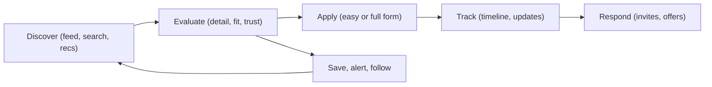
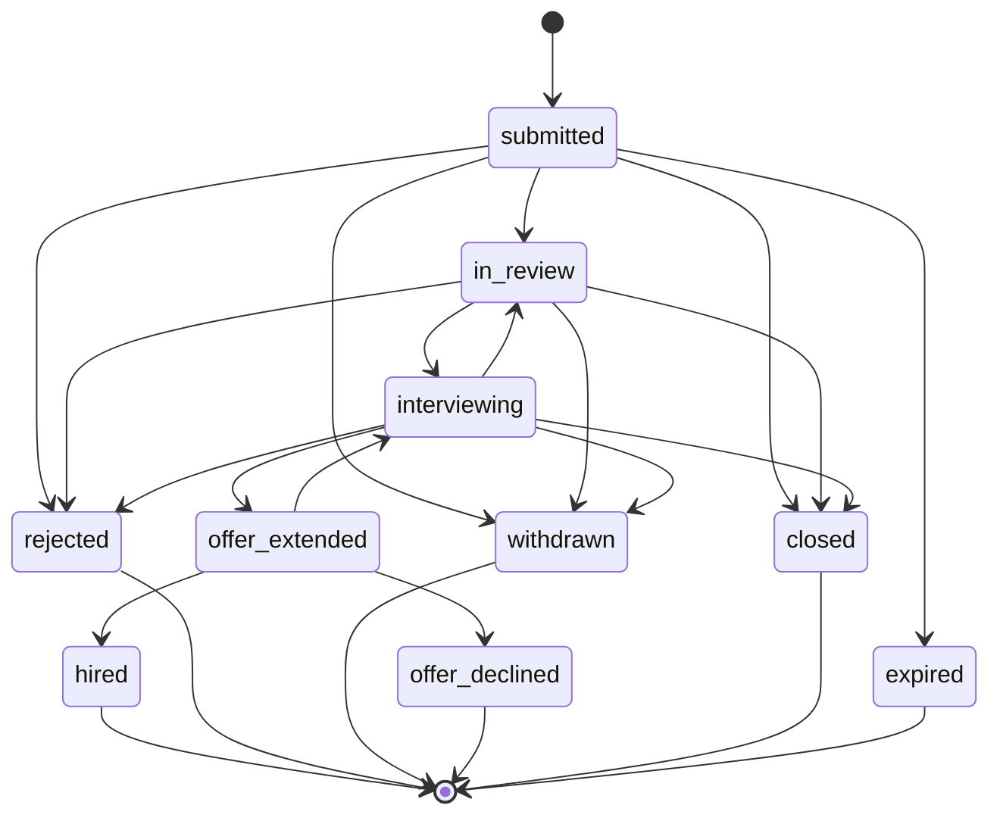
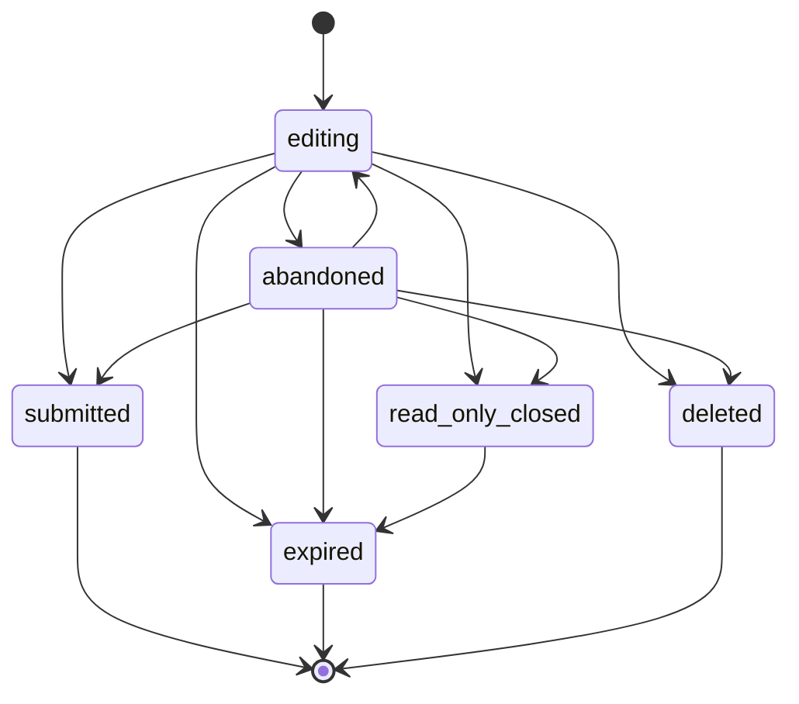
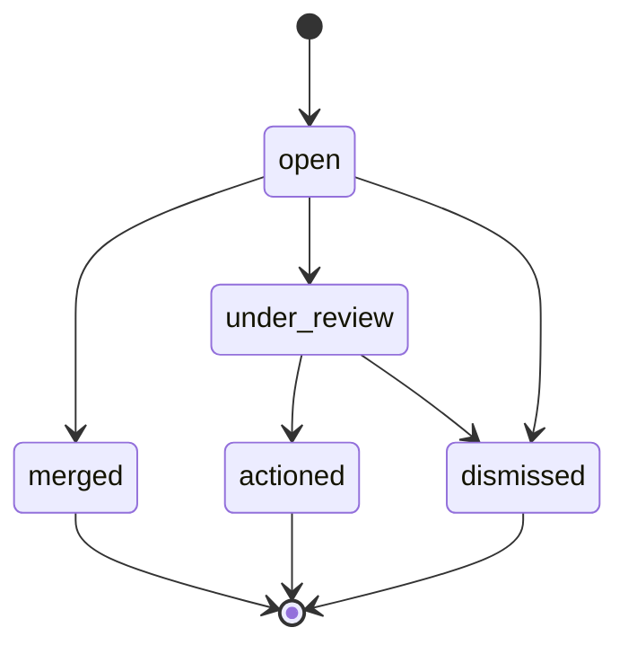
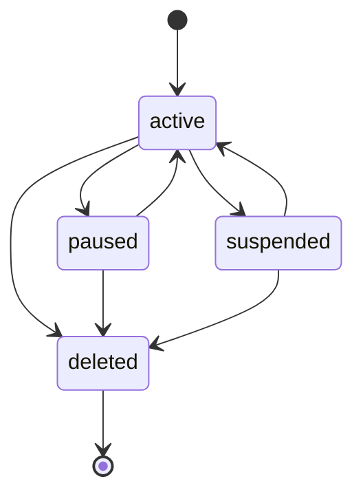
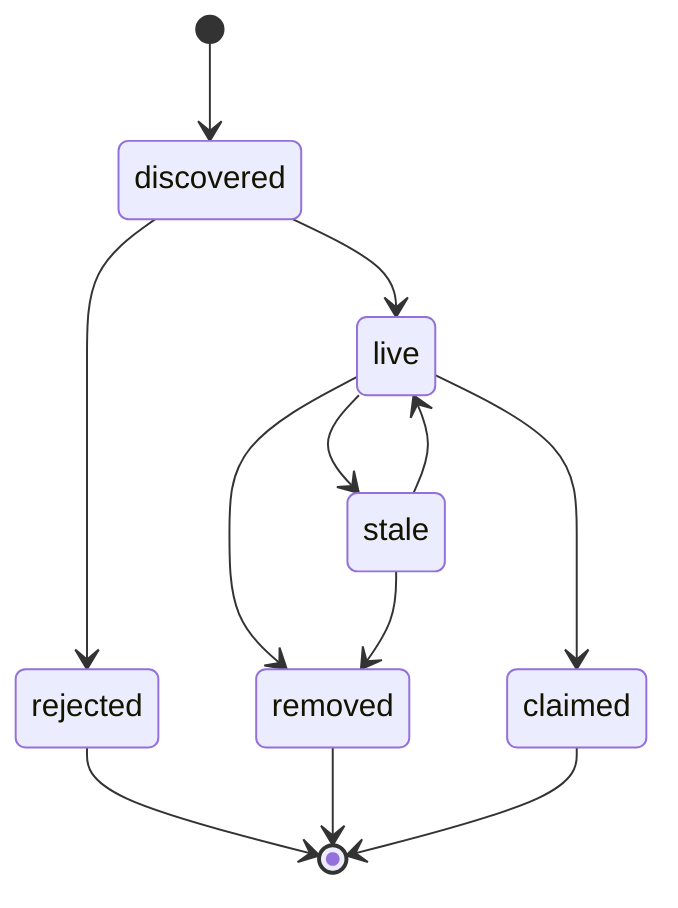
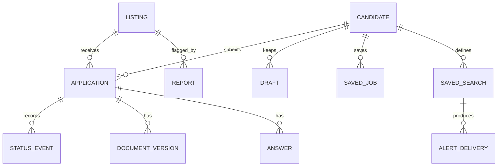

# JOB — Job Marketplace & Candidate Applications

> Status: intended product specification. Nothing in this file claims anything is built. See [CONVENTIONS](../00_START_HERE/CONVENTIONS.md).

## 1. Purpose, outcomes and boundaries

### 1.1 Purpose

JOB is the candidate-facing half of hiring. It lets a candidate find jobs that fit, judge whether a listing is real and fair, apply with evidence instead of a bare resume, and always know where each application stands, up to and including answering interview invites and accepting or declining an offer. It also protects candidates from ghost jobs, scams and silent rejection. [SRC: SSOT §9.7 F-04, F-36, F-32, F-122] [DER]

### 1.2 Outcomes

| Outcome                                               | How the system knows                                                                                                     |
| ----------------------------------------------------- | ------------------------------------------------------------------------------------------------------------------------ |
| A candidate finds a relevant listing quickly          | Search-to-view and view-to-apply rates; time from first search to first application (see §12)                            |
| A candidate never loses application work              | Draft recovery success rate; zero draft loss after crash, offline or session expiry                                      |
| A candidate always knows the status of an application | Every application has a candidate-visible status and a timeline; no application stays without a visible next expectation |
| Listings are trustworthy                              | Share of live listings that are verified, fresh and responded to; scam reports per 1,000 views                           |
| The employer receives a complete, honest application  | Applications carry a frozen snapshot of profile, documents and answers                                                   |

### 1.3 Boundaries

| In scope (owned by JOB)                                                                                             | Out of scope (owned elsewhere)                                                         | Consumed from other modules                                 |
| ------------------------------------------------------------------------------------------------------------------- | -------------------------------------------------------------------------------------- | ----------------------------------------------------------- |
| Public job feed, search, filters, sorting, job detail                                                               | Authoring, approval and publishing of jobs (ATS: FR-ATS-004..010)                      | Published posting data from ATS; company data from EMP      |
| Saved jobs, hidden jobs and companies, reports, sharing                                                             | Moderation decisions on reports (TSF, planned)                                         | Moderation queue and takedown from TSF (planned)            |
| Saved searches and alerts, alert preferences                                                                        | Notification delivery engine, channels and quiet hours (NTF, planned)                  | Delivery of alert and status messages through NTF (planned) |
| Easy apply, application forms, screening answers, attachments, drafts, review and submit                            | Rendering of the screening question definitions (ATS: FR-ATS-007 owns the definitions) | Profile, resume and evidence data (PRF, EVD planned)        |
| Candidate application tracker, status timeline, withdraw, update                                                    | Pipeline stages, scorecards, rejection decisions (ATS)                                 | Status changes emitted by ATS                               |
| Interview invite response (candidate side)                                                                          | Interview scheduling engine (INT)                                                      | Slots and invites from INT                                  |
| Offer view and accept/decline (candidate side)                                                                      | Offer authoring, approval, letter, e-sign (ATS: FR-ATS-036..039)                       | Offer record from ATS                                       |
| Recommendations display, fit explanation                                                                            | Matching models (AIC, planned)                                                         | Scores from AIC (planned)                                   |
| Ghost-job and scam controls on the candidate side, imported listings, external application tracking, company follow | Account-level trust decisions (TSF, planned)                                           | Risk verdicts from TSF (planned)                            |

Owned entities: listing projection, saved/hidden items, reports, saved searches and alerts, applications, drafts, answers, document snapshots, status events, feedback, imported listings, external applications, follows, preferences, blocked employers (see §8).

Boundary note: the Application entity is created and owned by JOB. ATS owns the pipeline stage assignment on it and moves it through stages; JOB projects the candidate-safe status from it. Both modules write only through the Application commands defined in `API-JOB-04` and `API-ATS-02` (planned). [DER]

## 2. Roles and permission matrix

Legend: Y = allowed, O = own records only, R = read-only, N = not allowed, A = allowed with audit.

| Capability                            | GUE                | CAN | STD | FRL | REC                 | HMG | EAD                 | MOD  | SUP                                 | PAD  |
| ------------------------------------- | ------------------ | --- | --- | --- | ------------------- | --- | ------------------- | ---- | ----------------------------------- | ---- |
| Browse and search listings            | Y                  | Y   | Y   | Y   | Y                   | Y   | Y                   | Y    | Y                                   | Y    |
| View job detail                       | Y                  | Y   | Y   | Y   | Y                   | Y   | Y                   | Y    | Y                                   | Y    |
| Save, hide, report a job              | Report only        | Y   | Y   | Y   | N                   | N   | N                   | N    | N                                   | N    |
| Saved searches and alerts             | N                  | O   | O   | O   | N                   | N   | N                   | N    | N                                   | N    |
| Apply (easy or full)                  | N (sign in prompt) | Y   | Y   | Y   | N                   | N   | N                   | N    | N                                   | N    |
| View own applications                 | N                  | O   | O   | O   | N                   | N   | N                   | N    | R via impersonation-free tooling, A | R, A |
| Withdraw / update own application     | N                  | O   | O   | O   | N                   | N   | N                   | N    | N                                   | N    |
| Respond to interview invite and offer | N                  | O   | O   | O   | N                   | N   | N                   | N    | N                                   | N    |
| Follow a company                      | N                  | Y   | Y   | Y   | N                   | N   | N                   | N    | N                                   | N    |
| Import external jobs                  | N                  | N   | N   | N   | N                   | N   | EAD: claim only     | N    | N                                   | Y, A |
| Remove or suppress a listing          | N                  | N   | N   | N   | Employer-owned only | N   | Employer-owned only | Y, A | N                                   | Y, A |
| View listing fraud signals            | N                  | N   | N   | N   | N                   | N   | N                   | Y    | N                                   | Y    |

Recruiters, hiring managers and employer admins cannot apply to jobs using those roles; to apply, a person uses a separate candidate persona or the candidate mode of the same account where IDN (planned) allows it. [SRC: BR-02 legacy] See OD-JOB-05.

## 3. Sub-module map

| Code | Sub-module                                | Features                                           |
| ---- | ----------------------------------------- | -------------------------------------------------- |
| A    | Discovery                                 | FR-JOB-001 to FR-JOB-007                           |
| B    | Listing detail, save, hide, report, share | FR-JOB-008 to FR-JOB-013                           |
| C    | Saved searches and alerts                 | FR-JOB-014 to FR-JOB-016                           |
| D    | Applying                                  | FR-JOB-017 to FR-JOB-024                           |
| E    | Tracking, responses, offers               | FR-JOB-025 to FR-JOB-032, FR-JOB-043 to FR-JOB-045 |
| F    | Recommendations and fit                   | FR-JOB-033, FR-JOB-034                             |
| G    | Listing integrity                         | FR-JOB-035, FR-JOB-036, FR-JOB-040                 |
| H    | External jobs                             | FR-JOB-037, FR-JOB-038                             |
| I    | Company follow, preferences, data         | FR-JOB-039, FR-JOB-041, FR-JOB-042                 |

## 4. Feature specifications

### Sub-module A: Discovery

### FR-JOB-001 — Job feed

- **Sub-module:** A Discovery
- **Priority / tier:** Must · R2
- **Source:** [SRC: SSOT §9.7 F-04 step 1; BR-124 chronological option] [DER]
- **Purpose and outcome:** A signed-in or guest user lands on a feed of live jobs without typing a query. The system knows it works when users reach a listing detail from the feed.
- **Roles and permissions:** `GUE: view (generic feed)` · `CAN/STD/FRL: view (personalized tabs)` · `PAD: configure feed parameters`
- **Preconditions and entry points:** Route `/jobs`; the "Jobs" item in main navigation; dashboard "Jobs for you" tile. At least one live listing exists.
- **User interactions and actions:** 1) Open `/jobs`. 2) Pick a tab: For you, Latest, Saved, Following. 3) Scroll; the list loads the next page at 80 percent scroll. 4) Open a card, or use card actions: save, hide, share. 5) Pull to refresh on mobile.
- **System behaviour:** Tab "For you" uses recommendations (FR-JOB-033) and falls back to Latest when the user has no profile signals. "Latest" is strictly chronological by original publish time (BR-JOB-016). "Following" lists live jobs of followed companies (FR-JOB-039). Cursor pagination, 20 per page, max 100. Cards render from the listing projection, never from the authoring record. A "degraded" badge appears when the search index is down and the database fallback is serving.
- **UI elements and controls:** Tab bar (default For you if signed in, else Latest); job card (title, company, logo, location and work mode chip, pay range if disclosed, posted-ago, verified-employer badge, "Reposted" tag, "Why am I seeing this" link, save icon button, overflow menu: hide job, hide company, report, share); skeleton cards while loading; "Back to top" button.
- **Configuration options:** User: default tab, density (comfortable/compact). Org: none. Platform: page size (default 20), feed mix caps per company (default max 3 consecutive cards from one company) [PROP].
- **Business rules:** BR-JOB-015, BR-JOB-016, BR-JOB-017, BR-JOB-012
- **Validation:** Cursor must be an opaque token issued by the service; invalid cursor returns 400 and restarts at page one. Page size 1 to 100.
- **Inputs and outputs:** In: tab, cursor, page size. Out: ordered list of card objects, next cursor, total-estimate (not exact), degraded flag.
- **Filters, sorting, search:** Tab-level only; full filters in FR-JOB-003; search in FR-JOB-002.
- **Notifications and communication:** n/a — read surface.
- **Error handling and edge cases:** Empty (no live jobs): "No jobs match yet" with links to saved searches and profile completion. Network error: inline retry, keeps already loaded cards. Hidden jobs and hidden companies never appear (BR-JOB-012). A listing closed while on screen: card turns to "Closed" on next refresh, never errors on open (see FR-JOB-040).
- **Dependencies:** FR-JOB-033, FR-JOB-039, ENT-JOB-01, SRC (planned) index, AIC (planned) recommendations.
- **Security and privacy:** Public data only for guests; no personal signal stored for guests beyond a session-scoped anonymous id; impression logging excludes identifiers for guests.
- **Acceptance criteria:**
  - Given a signed-in candidate with a profile, When they open `/jobs`, Then the For you tab shows at most 3 consecutive cards from one company and every card links to a live listing.
  - Given the Latest tab, When two listings have different original publish times, Then the earlier-published listing never appears above the later one regardless of reposts.
  - Given a candidate hid company X, When they open any tab, Then no card from company X appears.
  - Negative: Given a guest, When they select the For you tab, Then the system shows the sign-in prompt and does not render personalized cards.

### FR-JOB-002 — Keyword search

- **Sub-module:** A Discovery
- **Priority / tier:** Must · R2
- **Source:** [SRC: SSOT §9.7 F-04 step 1; SRC (planned) module] [DER]
- **Purpose and outcome:** Find jobs by words in title, skills, company and description. Success is a result list ordered by relevance with typo tolerance.
- **Roles and permissions:** `GUE, CAN, STD, FRL: search` · `MOD/PAD: search incl. non-public statuses via admin tools only`
- **Preconditions and entry points:** Search box in header and on `/jobs`; URL `/jobs?q=`.
- **User interactions and actions:** 1) Type in the search box. 2) See suggestions after 2 characters (titles, companies, skills, recent searches). 3) Press Enter or choose a suggestion. 4) Use quotes for exact phrase, minus for exclusion, OR between terms. 5) Clear with the X button.
- **System behaviour:** Query is normalized (case, diacritics, stemming per language), expanded with canonical skill synonyms, and matched against title (weight highest), skills, company, description. Results come only from the listing projection of live listings (BR-JOB-015). The query and filters are stored in the URL. Recent searches (last 10) are stored per signed-in user and deletable. If the search index is unavailable the system uses a degraded database query with fewer ranking signals and shows a badge. Searching records an event `job.search.performed` with query hash, not raw text, for guests.
- **UI elements and controls:** Search input (placeholder "Job title, skill or company"), suggestion dropdown (keyboard navigable with arrow keys, Enter, Esc), recent searches list with delete icon, "Did you mean" link, result count text.
- **Configuration options:** User: save recent searches on/off (default on). Platform: minimum query length 2, max 200, synonym set, typo tolerance (edit distance 2 [PROP]).
- **Business rules:** BR-JOB-015, BR-JOB-016, BR-JOB-017
- **Validation:** Query 0 to 200 characters; control characters stripped; operators limited to quotes, minus, OR; unbalanced quotes are treated as literal.
- **Inputs and outputs:** In: query, filters, sort, cursor. Out: result cards, facet counts, did-you-mean, next cursor.
- **Filters, sorting, search:** This feature is the search; filters FR-JOB-003, sorting FR-JOB-004.
- **Notifications and communication:** n/a — read surface.
- **Error handling and edge cases:** No results: show "No jobs for X", suggest broader terms, offer "Save this search" (FR-JOB-014). Very long query: truncated at 200 with notice. Query consisting only of operators: treated as empty and shows feed. Rate limit exceeded (120 searches/min/user [PROP]): 429 with retry-after message. Search index down: degraded mode.
- **Dependencies:** SRC (planned) index, ENT-JOB-01, FR-JOB-003, FR-JOB-004.
- **Security and privacy:** Queries are personal data when tied to a user; retention of query history 90 days [PROP] and visible/deletable by the user in FR-JOB-041; no query text is sent to third-party analytics.
- **Acceptance criteria:**
  - Given a live listing titled "Data Engineer", When a user searches "data enginer", Then the listing appears and a "Did you mean data engineer" hint is shown.
  - Given the query `"machine learning" -intern`, When the user searches, Then no result with "intern" in the title appears.
  - Given the index is down, When a user searches, Then results still return from the fallback and the degraded badge is visible.
  - Negative: Given a listing in status `closed`, When any query matches it, Then it is not returned.

### FR-JOB-003 — Filter panel

- **Sub-module:** A Discovery
- **Priority / tier:** Must · R2
- **Source:** [SRC: SSOT §9.7 F-04 step 1] [DER]
- **Purpose and outcome:** Narrow results by structured attributes; the filter state is shareable by URL.
- **Roles and permissions:** `GUE, CAN, STD, FRL: use`
- **Preconditions and entry points:** "Filters" button on `/jobs` and search results; sidebar on desktop, bottom sheet on mobile.
- **User interactions and actions:** 1) Open the panel. 2) Toggle facets: work mode (Remote, Hybrid, On-site), employment type (Full-time, Part-time, Contract, Internship, Apprenticeship, Temporary), seniority (Entry, Mid, Senior, Lead, Principal, Executive), salary minimum with currency and period, skills (multi-select from canonical skills), company, posted within (24h, 7d, 30d, any), industry, "Easy apply only", "Verified employers only", "Pay disclosed only", "Visa sponsorship". 3) See live counts per facet. 4) Apply; results refresh. 5) Reset all.
- **System behaviour:** Each filter maps to a query parameter; counts are computed on the current query except for the facet being edited (standard faceting). Applied filters show as removable chips above the list. Unsupported combinations never produce errors; they produce zero counts. Filter state persists across navigation in the session and can be saved as a search (FR-JOB-014).
- **UI elements and controls:** Checkbox groups, range slider plus numeric input for salary, typeahead multi-select for skills and companies, radio group for posted-within, toggle switches, "Apply" (mobile only), "Reset" link, chips with remove X.
- **Configuration options:** User: remember last filters (default off). Platform: facet list and ordering, max skills per filter (default 10).
- **Business rules:** BR-JOB-015, BR-JOB-008
- **Validation:** Salary min is a non-negative integer in minor units, max 99,999,999; currency must be an ISO 4217 code; skills must reference canonical skill ids; unknown parameters ignored.
- **Inputs and outputs:** In: filter parameters. Out: filtered results, facet counts, chip list.
- **Filters, sorting, search:** n/a — this is the filter feature.
- **Notifications and communication:** n/a — read surface.
- **Error handling and edge cases:** Salary filter excludes listings without disclosed pay unless "Include jobs without pay" is checked (default checked, with copy explaining). Mixed currencies: converted for filtering using the platform rate table with "approx." label. Contradictory filter such as remote plus a city: both applied; zero results shows which filter removal would help ("Remove city to see 214 jobs").
- **Dependencies:** FR-JOB-002, SRC (planned) skills taxonomy, ENT-JOB-01.
- **Security and privacy:** Filters carry no protected attributes; the platform does not offer age, gender or ethnicity filters. Visa filter uses employer-declared sponsorship, not candidate data.
- **Acceptance criteria:**
  - Given filters Remote and Full-time and posted within 7 days, When applied, Then every result has all three attributes and the URL contains them.
  - Given a shared URL with filters, When another user opens it, Then the same chips are shown.
  - Given salary minimum 100000 USD/year, When "Include jobs without pay" is unchecked, Then listings without disclosed pay are absent.
  - Negative: Given a URL with `skills=bogus`, When opened, Then the unknown value is dropped and a notice states one filter was ignored.

### FR-JOB-004 — Sorting and ranking transparency

- **Sub-module:** A Discovery
- **Priority / tier:** Must · R2
- **Source:** [SRC: SSOT §9.7 F-04 step 2; BR-124] [DER]
- **Purpose and outcome:** Users choose the ordering and can see why a job ranks where it does.
- **Roles and permissions:** `GUE, CAN, STD, FRL: use` · `PAD: configure weights with audit`
- **Preconditions and entry points:** Sort dropdown on results; "Why am I seeing this" link on each card.
- **User interactions and actions:** 1) Open sort dropdown: Relevance (default when a query or profile exists), Newest, Salary high to low, Closing soon. 2) Select; list reorders. 3) Select "Why am I seeing this" on a card to open a popover.
- **System behaviour:** Relevance blends skill match 0.45, experience 0.20, location 0.10, title 0.10, employer rating 0.10, recency 0.05 as the starting weights [SRC: SSOT §9.7 F-04 step 2], tunable by PAD. The popover lists the top three factors in plain words ("You have 5 of 6 required skills", "Within 10 km", "Posted 2 days ago"). Newest sorts by original publish time. Salary sort places undisclosed pay last. Sponsored or promoted placement, if ever offered, is labelled and never the default; see OD-JOB-06. Protected attributes are never ranking inputs (BR-JOB-017).
- **UI elements and controls:** Sort dropdown (default per context), popover with factor list, link "How ranking works" to a static explanation page.
- **Configuration options:** Platform: weights, tie-breaker (job id). User: default sort (default Relevance).
- **Business rules:** BR-JOB-016, BR-JOB-017
- **Validation:** Sort value must be one of the allowed set; otherwise default.
- **Inputs and outputs:** In: sort key. Out: reordered list; factor explanation object per card.
- **Filters, sorting, search:** This is the sort feature; stable under cursor pagination using (score, id) tie-breaking.
- **Notifications and communication:** n/a — read surface.
- **Error handling and edge cases:** Relevance without profile data: factors limited to query and recency, popover says so. Scores equal: id order. Weight change mid-session: cursor remains valid for 10 minutes then restarts with notice.
- **Dependencies:** FR-JOB-033, FR-JOB-034, AIC (planned).
- **Security and privacy:** Explanations never reveal other candidates' data or employer-internal signals. Ranking factor changes are audit-logged.
- **Acceptance criteria:**
  - Given a candidate with matching skills, When they sort by Relevance and open "Why am I seeing this", Then at least one factor derived from their profile is named.
  - Given Newest sort, When a job was reposted today but first published 30 days ago, Then it sorts by the 30-day-old date.
  - Given Salary sort, When a listing has no disclosed pay, Then it appears after all listings with pay.
  - Negative: Given a request with `sort=gender`, When processed, Then the default sort is used.

### FR-JOB-005 — Location search, radius and commute

- **Sub-module:** A Discovery / I Location
- **Priority / tier:** Must · R2
- **Source:** [SRC: SSOT §9.7 F-04 step 1] [PROP: radius and commute]
- **Purpose and outcome:** Find jobs near a place or reachable within a commute limit; the system knows it works when location results match geocoded distance.
- **Roles and permissions:** `GUE, CAN, STD, FRL: use`
- **Preconditions and entry points:** Location input beside the search box; "Near me" button; profile location default.
- **User interactions and actions:** 1) Type a city, region or postal code; choose a suggestion. 2) Choose radius 5, 10, 25, 50, 100 km (or miles by locale). 3) Optionally choose commute time limit (15, 30, 45, 60 min) and mode (drive, transit, bike, walk). 4) Optionally allow browser geolocation for "Near me".
- **System behaviour:** Locations are geocoded to a structured place (country, region, locality, coordinates of locality centroid). Radius filter uses great-circle distance from the centroid. Commute filter calls a routing provider with the candidate's coarse origin and the listing's site; results cached per cell. Remote jobs match a location filter only if the listing's allowed hiring countries include the filter country. Exact home address is never stored from this feature; only the chosen place is.
- **UI elements and controls:** Location typeahead, radius select (default 25 km), commute slider and mode select (hidden if routing provider not configured), "Near me" button, geolocation permission prompt text.
- **Configuration options:** User: default location from profile (default on), unit system. Platform: routing provider enable, radius options.
- **Business rules:** BR-JOB-034, BR-JOB-015
- **Validation:** Location text 0 to 120 chars; radius from allowed list; coordinates in valid ranges.
- **Inputs and outputs:** In: place id or text, radius, commute limit, mode. Out: filtered results with per-card distance (rounded) or commute estimate.
- **Filters, sorting, search:** Adds "Distance" sort when a place is set.
- **Notifications and communication:** n/a — read surface.
- **Error handling and edge cases:** Ambiguous place: disambiguation list. Geolocation denied: message and fall back to manual entry. Routing provider timeout: radius only with notice "Commute times unavailable". Place with no listings: nearest populated alternative suggested. Multi-location listing: matches if any site is within radius and the card shows the matching site.
- **Dependencies:** Geocoding provider, routing provider, ENT-JOB-01.
- **Security and privacy:** Browser geolocation is used once and not stored unless the user saves it as a preference; commute origin is rounded to about 1 km before leaving the system; the provider receives no user id.
- **Acceptance criteria:**
  - Given a place "Austin" and radius 25 km, When searched, Then each on-site result lies within 25 km of the Austin centroid.
  - Given a remote listing allowing only Canada, When a user filters Germany, Then it does not appear.
  - Given commute 30 minutes by transit and the routing provider is down, When searched, Then results return by radius and a notice is shown.
  - Negative: Given the user denies geolocation, When they press "Near me", Then no location is stored and a manual entry prompt appears.

### FR-JOB-006 — Remote, hybrid and work-authorization handling

- **Sub-module:** I Location, visa and eligibility
- **Priority / tier:** Must · R2
- **Source:** [DER] [PROP: visa and hiring-country eligibility]
- **Purpose and outcome:** Make clear where a candidate can legally work for a listing so they do not waste applications; the employer declares eligibility and the platform surfaces it.
- **Roles and permissions:** `GUE, CAN, STD, FRL: view and filter` · `CAN: set own work authorizations in preferences` · `REC: declare on listing (ATS)`
- **Preconditions and entry points:** Listing detail "Where you can work" block; filter "Work authorization"; preferences screen.
- **User interactions and actions:** 1) On a listing, read: work mode, allowed countries or regions, hybrid days required, relocation support, visa sponsorship (Yes, No, Case by case), remote timezone window. 2) In preferences, add countries where they hold work rights and whether they need sponsorship. 3) Filter "I can work here" to show only listings consistent with preferences.
- **System behaviour:** The listing carries structured eligibility fields supplied via ATS authoring. The candidate's preference record is compared with the listing and the card shows a neutral status chip: "Open to your location", "Requires sponsorship you indicated needing", or "Eligibility unclear". The platform never auto-rejects based on this comparison; it only informs. Answers on an application form for work authorization are separate (FR-JOB-019).
- **UI elements and controls:** Eligibility block, chip with tooltip, preferences form (country multi-select with right type: citizen, permanent resident, work visa, needs sponsorship), filter toggle.
- **Configuration options:** User: use my authorization to personalize results (default off). Platform: list of supported countries.
- **Business rules:** BR-JOB-035, BR-JOB-017
- **Validation:** Country codes ISO 3166; hybrid days 0 to 5; timezone window from IANA zones.
- **Inputs and outputs:** In: listing eligibility fields; candidate authorizations. Out: eligibility chip, filtered results.
- **Filters, sorting, search:** Filter "I can work here", "Visa sponsorship offered".
- **Notifications and communication:** n/a.
- **Error handling and edge cases:** Missing eligibility data: chip "Eligibility not stated" with link to ask via employer question where messaging allows (MSG planned). Conflicting data (remote worldwide but listing city US only): the stricter value wins and the listing is queued for correction. Candidate with no preferences: chip hidden.
- **Dependencies:** FR-ATS-004, FR-JOB-041.
- **Security and privacy:** Work authorization and sponsorship need are sensitive; stored only in the candidate's preferences, shown to an employer only as an application answer after submission, never in search visible profile unless the candidate opts in (SET planned).
- **Acceptance criteria:**
  - Given a listing marked "No sponsorship" and a candidate who needs sponsorship, When the candidate views the listing, Then the chip states the mismatch and the apply button remains enabled.
  - Given no stored authorizations, When the candidate views a listing, Then no eligibility chip is rendered.
  - Given the filter "I can work here", When the candidate has authorization for Canada only, Then only Canada-eligible and worldwide-remote listings appear.
  - Negative: Given a candidate sets "needs sponsorship", When an employer searches candidates, Then that fact is not exposed in search results.

### FR-JOB-007 — Salary transparency and pay display

- **Sub-module:** I Pay
- **Priority / tier:** Must · R2
- **Source:** [SRC: SSOT §9.7 F-04 security "Salary transparency enforced", step 3 "hide pay" toggle; BR-179] [DER: pay transparency laws]
- **Purpose and outcome:** Candidates see pay when it is disclosed, understand its basis, and are protected from misleading ranges.
- **Roles and permissions:** `All viewers: view` · `REC: declare pay in ATS`
- **Preconditions and entry points:** Card pay line; detail "Compensation" block; salary filter and sort.
- **User interactions and actions:** 1) Read pay on card and detail. 2) Open "How is this pay set" tooltip. 3) Toggle display currency to preferred currency (approximate). 4) Read equity, bonus, commission and benefits lines if given.
- **System behaviour:** Pay is stored as minimum and maximum in minor units with ISO 4217 currency and period (hour, day, month, year) [SRC: BR-179]. Display normalizes grouping and rounds only for display. The field "pay disclosed" is true when the employer discloses; where the job location falls under a jurisdiction rule that requires disclosure, ATS blocks publishing without it (BR-ATS-006) and JOB displays it; JOB also shows a "Pay not disclosed" label otherwise. Converted currency is labeled approximate with the rate date. Data from imported listings carries an "as stated by source" note.
- **UI elements and controls:** Pay text (for example "USD 90,000 to 120,000 per year"), tooltip (basis: base, ote, estimated), currency toggle, "Estimated by TalentSphere" chip only when the pay is a market estimate (FR-JOB-034 style estimates come from MKT planned) and always marked as an estimate.
- **Configuration options:** User: preferred display currency and period (default listing's own). Platform: rate table refresh frequency.
- **Business rules:** BR-JOB-008, BR-JOB-015
- **Validation:** min <= max; both non-negative; currency code valid; period valid; max/min ratio above platform cap (default 2.0 [PROP]) shows "wide range" flag on the authoring side, not here.
- **Inputs and outputs:** In: pay fields. Out: formatted pay strings, normalized annual equivalent for filtering and sorting.
- **Filters, sorting, search:** Filters FR-JOB-003 salary; sort by salary.
- **Notifications and communication:** n/a.
- **Error handling and edge cases:** Hourly vs annual comparison uses 2,080 hours per year for normalization [PROP] and states so in the tooltip. Missing rate: converted value omitted. Pay range changed after publish: new value shows immediately; applicants are not notified unless the change is above 10 percent (ATS rule, notification via NTF planned).
- **Dependencies:** FR-ATS-004, FR-ATS-006, ENT-JOB-01, MKT (planned) for estimates.
- **Security and privacy:** Public data. Estimates never imply an employer offered it.
- **Acceptance criteria:**
  - Given a listing with pay 4,000,000 minor units USD per year, When displayed, Then the card shows "USD 40,000 per year".
  - Given a preferred currency EUR, When the toggle is on, Then converted amounts carry "approx." and the rate date.
  - Given a listing without pay, When displayed, Then "Pay not disclosed" appears and the listing is excluded when "Pay disclosed only" is on.
  - Negative: Given a listing whose location requires disclosure but pay is missing (data fault), When served, Then it is hidden from search and flagged to ATS rather than shown without pay.

### Sub-module B: Listing detail, save, hide, report, share

### FR-JOB-008 — Job detail page

- **Sub-module:** B Listing detail
- **Priority / tier:** Must · R2
- **Source:** [SRC: SSOT §9.7 F-04 step 3, F-25]
- **Purpose and outcome:** One page gives everything needed to decide to apply; success is an apply start or a save from this page.
- **Roles and permissions:** `GUE, CAN, STD, FRL: view` · `REC/HMG/EAD: view own org's listings in preview` · `MOD/PAD: view any with status banner`
- **Preconditions and entry points:** `/jobs/:jobId` from cards, alerts, shared links, search engines. Listing is live, or closed (see FR-JOB-040).
- **User interactions and actions:** 1) Read header (title, company, location, mode, pay, type, posted date). 2) Read description, responsibilities, requirements split into must-have and nice-to-have, skills, benefits, process overview (stages and expected timeline), hiring team (names only if employer opts in). 3) Use sticky actions: Apply, Save, Share, Report. 4) Expand "Fit breakdown" (FR-JOB-034). 5) Open company mini-profile (FR-JOB-039). 6) Browse similar jobs (FR-JOB-009).
- **System behaviour:** Page is rendered server-side for crawlers with structured data for job postings (title, hiringOrganization, jobLocation, baseSalary, datePosted, validThrough); description is sanitized rich text; views are counted once per session per listing. If the candidate has applied, the Apply button becomes "View application". If the candidate is blocked by the employer, apply is disabled with a neutral message (BR-JOB-036). Freshness data (FR-JOB-035) shows "Active recruiting: last employer activity 2 days ago" when available.
- **UI elements and controls:** Header block, sticky action bar (Apply primary, Save, Share, overflow: hide, report), section anchors, fit panel, verified-employer badge, "Apply by" deadline chip, "Imported from <source>" banner for imported listings, breadcrumbs.
- **Configuration options:** Platform: whether hiring team is shown (employer choice per posting), view-count display (off by default).
- **Business rules:** BR-JOB-002, BR-JOB-008, BR-JOB-015, BR-JOB-026, BR-JOB-030
- **Validation:** Path id must be a valid listing id; unknown id returns 404 page with search box.
- **Inputs and outputs:** In: listing id, optional referrer code. Out: rendered listing, candidate-specific overlay (applied, saved, hidden, eligibility chip, fit).
- **Filters, sorting, search:** n/a — single record.
- **Notifications and communication:** n/a.
- **Error handling and edge cases:** Closed or expired listing returns HTTP 410 with the closed banner and similar jobs [SRC: SSOT §9.7 F-04 step 3]. Taken-down listing returns 404 for the public and a banner for the employer. Description with unsupported markup is stripped, never executed. Very long description collapses to 600 words with "Show more".
- **Dependencies:** FR-JOB-009, FR-JOB-034, FR-JOB-035, FR-JOB-039, ENT-JOB-01, EMP (planned) company data.
- **Security and privacy:** XSS-safe sanitizer; no candidate data in cached public HTML; the overlay loads in a separate authenticated call.
- **Acceptance criteria:**
  - Given a live listing, When a guest opens it, Then all sections render and structured data validates.
  - Given the candidate already applied, When they open the listing, Then the primary button reads "View application".
  - Given a closed listing, When opened, Then status is 410 and similar jobs are listed.
  - Negative: Given a description containing a script tag, When rendered, Then the script is removed and nothing executes.

### FR-JOB-009 — Similar jobs

- **Sub-module:** B Listing detail
- **Priority / tier:** Should · R2
- **Source:** [SRC: SSOT §9.7 F-04 step 9 "5 similar roles"]
- **Purpose and outcome:** Keep a candidate in discovery after a closed or unsuitable listing; success is a click from the similar block.
- **Roles and permissions:** `GUE, CAN, STD, FRL: view`
- **Preconditions and entry points:** Bottom of job detail and the closed-listing page.
- **User interactions and actions:** 1) Scroll to "Similar jobs". 2) Open a card or save it. 3) Choose "Not relevant" on a card to improve results.
- **System behaviour:** Returns 5 live listings nearest in skill and title embedding space (AIC planned), excluding hidden items, hidden companies, already-applied listings and the same company when more than 2 would repeat. "Not relevant" records a negative signal (BR-JOB-037).
- **UI elements and controls:** Five compact cards, "Not relevant" icon button, "See more" link opening search prefilled with the title.
- **Configuration options:** Platform: count (default 5), same-company cap (default 2).
- **Business rules:** BR-JOB-012, BR-JOB-037
- **Validation:** Listing id valid.
- **Inputs and outputs:** In: listing id, viewer context. Out: up to 5 cards.
- **Filters, sorting, search:** n/a — fixed algorithmic list.
- **Notifications and communication:** n/a.
- **Error handling and edge cases:** Fewer than 5 matches: show what exists; zero: hide the block. AIC unavailable: fall back to same title family and location.
- **Dependencies:** AIC (planned), FR-JOB-012.
- **Security and privacy:** Guest results use no personal signals.
- **Acceptance criteria:**
  - Given a Backend Engineer listing, When opened, Then up to 5 live engineering listings appear, none of them hidden by the viewer.
  - Given the viewer clicks "Not relevant" on one, When the page reloads, Then that listing no longer appears.
  - Negative: Given all candidates for similarity are closed, When the page renders, Then the block is hidden and no error is shown.

### FR-JOB-010 — Save job and saved list

- **Sub-module:** B Save
- **Priority / tier:** Must · R2
- **Source:** [SRC: SSOT §9.7 F-04 step 6 `/jobs/saved`]
- **Purpose and outcome:** Bookmark listings to return to; success is a later apply from the saved list.
- **Roles and permissions:** `CAN, STD, FRL: own` · `GUE: prompted to sign in, optional local save carried over after sign-in [PROP]`
- **Preconditions and entry points:** Save icon on cards and detail; `/jobs/saved`.
- **User interactions and actions:** 1) Click the bookmark icon (toggle). 2) Open `/jobs/saved`. 3) Add a private note (up to 500 chars) and a folder label (up to 20 folders). 4) Filter by status: open, closed, applied. 5) Remove with undo toast. 6) Bulk select and remove.
- **System behaviour:** Save is idempotent per (candidate, listing). Saving a listing that later closes keeps the record and marks it Closed with date. A deadline within 3 days triggers an optional reminder (FR-JOB-040). Saved jobs feed the recommendation model as a positive signal.
- **UI elements and controls:** Bookmark toggle (aria-pressed), saved list table/cards, note field, folder select, status filter chips, Undo toast (6 seconds).
- **Configuration options:** User: deadline reminders on/off (default on). Platform: max saved 500 [PROP].
- **Business rules:** BR-JOB-012
- **Validation:** Note 0 to 500 characters; folder name 1 to 30 chars; max saves per user enforced with message "Remove one to save another".
- **Inputs and outputs:** In: listing id, note, folder. Out: saved record, updated counts.
- **Filters, sorting, search:** Filter by status, folder; sort by saved date (default), posted date, deadline; text search within saved titles.
- **Notifications and communication:** Deadline reminder, channel in-app and email, template `job.saved.deadline`, opt-out class job_alerts.
- **Error handling and edge cases:** Duplicate click: no duplicate record. Listing removed by takedown: item shows "No longer available" and can be deleted. Offline: queued and synced (PWA planned).
- **Dependencies:** ENT-JOB-02, FR-JOB-040.
- **Security and privacy:** Saves are private; employers never see who saved a listing; aggregate save counts shown to employers only when 10 or more (FR-EMP-032).
- **Acceptance criteria:**
  - Given a listing, When the candidate saves it twice rapidly, Then exactly one saved record exists.
  - Given a saved listing closes, When the candidate opens Saved, Then it shows Closed and remains listed.
  - Given 500 saved listings, When saving another, Then a limit message appears and nothing is saved.
  - Negative: Given an employer user, When they call the save endpoint, Then the response is 403.

### FR-JOB-011 — Hide job and hide company

- **Sub-module:** B Hide
- **Priority / tier:** Must · R2
- **Source:** [SRC: SSOT §9.7 F-04 step 8; BR-013]
- **Purpose and outcome:** Remove unwanted listings or companies from the candidate's own results; reversible.
- **Roles and permissions:** `CAN, STD, FRL: own`
- **Preconditions and entry points:** Card overflow menu; detail overflow; Settings, Hidden items.
- **User interactions and actions:** 1) Choose "Hide this job" or "Hide jobs from <company>". 2) Optionally pick a reason (Not interested, Wrong level, Wrong location, Bad experience, Looks fake). 3) Undo via toast. 4) Manage list at Settings, Hidden items; "Unhide".
- **System behaviour:** Hidden jobs and companies are removed from feed, search, alerts, similar jobs and recommendations for that candidate only, effective immediately. Reason "Looks fake" also offers to open a report (FR-JOB-012) but does not submit one on its own. Hiding is stored server-side so it applies across devices. Employers are never told. Hiding a company does not block applying if the candidate opens the listing by direct link; a banner reminds them it is hidden.
- **UI elements and controls:** Menu items, reason radio sheet, toast with Undo, hidden items list with Unhide buttons, search within hidden items.
- **Configuration options:** User: ask for reason (default on). Platform: max hidden companies 1,000.
- **Business rules:** BR-JOB-012, BR-JOB-037
- **Validation:** Reason from list or empty.
- **Inputs and outputs:** In: listing id or company id, reason. Out: hidden record; refreshed lists.
- **Filters, sorting, search:** Hidden items list: type (job/company), date.
- **Notifications and communication:** n/a.
- **Error handling and edge cases:** Hiding a company with a live application: allowed; tracker unaffected. Hide then save: save un-hides the listing with confirmation. Race with alert send: alert generation re-checks hidden items at send time.
- **Dependencies:** ENT-JOB-03.
- **Security and privacy:** Private preference; exported in data export; deleted on account erasure.
- **Acceptance criteria:**
  - Given the candidate hides company X, When an alert is generated that includes X jobs, Then none are included.
  - Given a hidden job, When the candidate unhides it, Then it appears in feed again.
  - Negative: Given an employer queries the candidate's hidden items, When requested, Then the response is 403 and nothing is disclosed.

### FR-JOB-012 — Report a job

- **Sub-module:** B Report
- **Priority / tier:** Must · R2
- **Source:** [SRC: SSOT §5.8 T&S report lifecycle; BR-034] [PROP: reasons list]
- **Purpose and outcome:** Let anyone flag scams, discrimination, misleading pay, duplicates, expired listings; success is a triaged report with an outcome.
- **Roles and permissions:** `GUE, CAN, STD, FRL: create` · `MOD: triage, decide, A` · `PAD: override, A`
- **Preconditions and entry points:** Overflow menu "Report" on card and detail; the hide flow "Looks fake".
- **User interactions and actions:** 1) Choose reason: Scam or fee request, Fake or ghost job, Discriminatory content, Misleading pay or role, Duplicate, Expired but open, Inappropriate content, Other. 2) Add details (up to 1,000 characters) and optional screenshot (PNG/JPG up to 5 MB). 3) Submit. 4) See the confirmation and reference id; later see outcome in notifications.
- **System behaviour:** Creates a report (SM-JOB-03) routed to the TSF queue (planned) with priority by reason: scam/fee gets high priority. If 3 independent reporters flag Scam within 24 hours, the listing is auto-suppressed from search pending review (BR-JOB-028). The reporter's identity is hidden from the employer (BR-JOB-029). The same user cannot report the same listing twice within 30 days (the second attempt adds to the first). Outcome notifies the reporter with a neutral result: Action taken or No action needed.
- **UI elements and controls:** Reason radio list, details textarea with counter, file upload, Submit, Cancel; confirmation panel with reference id.
- **Configuration options:** Platform: auto-suppression threshold (default 3 reporters in 24h [PROP]), report rate limit (10/day/user).
- **Business rules:** BR-JOB-028, BR-JOB-029
- **Validation:** Reason required; details max 1,000 chars; screenshot type and size; guests must pass a bot challenge.
- **Inputs and outputs:** In: listing id, reason, details, file. Out: report id; later outcome.
- **Filters, sorting, search:** n/a — creation form.
- **Notifications and communication:** Reporter: confirmation (in-app), outcome (in-app and email), template `job.report.outcome`, class trust_safety (cannot be fully opted out). Employer: notified only after a takedown or suspension, never of reporter identity.
- **Error handling and edge cases:** Abuse by one user reporting many competitor listings: rate limit and repeated-dismissal score lowers weight (TSF planned). Listing already removed: report closes as Already actioned. Screenshot with malware: rejected by scan.
- **Dependencies:** TSF (planned), ENT-JOB-04, SM-JOB-03.
- **Security and privacy:** Reporter identity stored for audit, visible only to MOD/PAD. Screenshots treated as user content, retention 12 months after resolution [PROP].
- **Acceptance criteria:**
  - Given a live listing, When a signed-in user reports Scam with details, Then a report with a reference id exists in status `open`.
  - Given 3 distinct users report Scam within 24 hours, When the third report is saved, Then the listing is suppressed from search and a moderator task is created.
  - Given the employer views its listing report summary, When reports exist, Then reporter identities are absent.
  - Negative: Given the same user reports the same listing twice within 30 days, When the second is submitted, Then no second suppression-counting report is created.

### FR-JOB-013 — Share job

- **Sub-module:** B Share
- **Priority / tier:** Could · R2
- **Source:** [PROP]
- **Purpose and outcome:** Send a listing to a friend or post externally; success is the shared link resolving to the listing with a good preview.
- **Roles and permissions:** `GUE, CAN, STD, FRL: share`
- **Preconditions and entry points:** Share button on card and detail.
- **User interactions and actions:** 1) Choose Copy link, Email, or system share sheet on mobile. 2) Optionally "Share with a connection" (NET planned) when signed in.
- **System behaviour:** Generates a canonical URL; adds an optional referral code only if the sharer chooses "Share with my referral" and the employer has a referral program (FR-JOB-024); provides Open Graph metadata (title, company, location, logo) without pay or personal data. Shared links to closed listings still resolve to the closed page.
- **UI elements and controls:** Share menu with Copy link (copied toast), Email, Share sheet, "Include my referral" checkbox (hidden if unavailable).
- **Configuration options:** Platform: enable referral parameter.
- **Business rules:** BR-JOB-043
- **Validation:** Email share limited to 5 recipients, 20 emails per day per user.
- **Inputs and outputs:** In: listing id, optional recipients. Out: link or email.
- **Filters, sorting, search:** n/a.
- **Notifications and communication:** Email to recipient from the platform with the sharer's first name only, template `job.share.email`, class social; includes unsubscribe link and never subscribes the recipient.
- **Error handling and edge cases:** Invalid email: field error. Rate limit: 429 message. Blocked recipient domain: silently not sent, user sees generic sent message to avoid enumeration.
- **Dependencies:** FR-JOB-024, NTF (planned).
- **Security and privacy:** Recipient addresses are not stored beyond the send record (30 days).
- **Acceptance criteria:**
  - Given a listing, When the user copies the link, Then the link opens the same listing for a guest.
  - Given an Open Graph crawler, When it fetches the link, Then title and company are present and pay is absent.
  - Negative: Given a sixth recipient, When the user submits, Then the form rejects it.

### Sub-module C: Saved searches and alerts

### FR-JOB-014 — Saved searches

- **Sub-module:** C Saved searches
- **Priority / tier:** Must · R2
- **Source:** [SRC: SSOT §9.7 F-04 step 7, F-32]
- **Purpose and outcome:** Store a query plus filters and be told about new matches.
- **Roles and permissions:** `CAN, STD, FRL: own`
- **Preconditions and entry points:** "Save this search" on results; `/jobs/searches`.
- **User interactions and actions:** 1) Click Save this search. 2) Name it (default generated from query). 3) Choose alert frequency (Instant, Daily, Weekly, Off). 4) Choose channels (in-app, email, push). 5) Open, rename, edit filters, pause, delete from `/jobs/searches`.
- **System behaviour:** Stores the normalized query object. A scheduler evaluates each active search for listings published after the search's `last_evaluated_at` (new-only, no backfill) [SRC]. Matching excludes hidden items and applied listings. Limit 25 saved searches [PROP]. Editing filters resets nothing historical. A search with no matches for 90 days sends one "Still looking?" check then pauses.
- **UI elements and controls:** Save dialog (name, frequency select, channel toggles), searches list with last-match date and count, Pause toggle, Edit, Delete (confirm).
- **Configuration options:** User: default frequency (Daily). Platform: max searches 25, evaluation cadence.
- **Business rules:** BR-JOB-013, BR-JOB-014
- **Validation:** Name 1 to 80 chars; frequency in set; at least one channel when frequency not Off.
- **Inputs and outputs:** In: query object, name, frequency, channels. Out: saved search record.
- **Filters, sorting, search:** List sorted by last match; filter active/paused.
- **Notifications and communication:** Confirmation in-app; alerts FR-JOB-015.
- **Error handling and edge cases:** Limit reached: message with link to manage. Saved filter refers to a retired skill id: the filter is dropped and the user informed on next edit. Duplicate of an existing search: offered to open the existing one.
- **Dependencies:** FR-JOB-002, FR-JOB-003, FR-JOB-015, ENT-JOB-05.
- **Security and privacy:** Private; included in data export.
- **Acceptance criteria:**
  - Given 24 searches, When the user saves one more, Then it is created; for the 26th the system refuses with the limit message.
  - Given a saved search created today, When 3 older matching listings exist, Then no alert is sent for them.
  - Negative: Given frequency Daily and no channel selected, When saving, Then validation fails.

### FR-JOB-015 — Job alert delivery

- **Sub-module:** C Alerts
- **Priority / tier:** Must · R2
- **Source:** [SRC: SSOT §9.7 F-04 notifications "New matching jobs (candidate, digest)"; BR-14 service-owned scheduler]
- **Purpose and outcome:** Deliver timely, deduplicated new-match messages; success is clicks to listings and low unsubscribe rate.
- **Roles and permissions:** `CAN, STD, FRL: receive` · `Service principal: run scheduler`
- **Preconditions and entry points:** Active saved search; verified email or push token; NTF consent (planned).
- **User interactions and actions:** 1) Receive an email, push or in-app digest. 2) Click a job. 3) Click "Mute this search" or "Unsubscribe" inside the message.
- **System behaviour:** The scheduler runs as an audited service job with idempotent delivery keys (search id plus window) [SRC: BR-14, BR-31]. Daily digests send at the candidate's preferred local time; Instant alerts are capped at 1 per search per hour and 10 per day; excess folds into the next digest. A digest lists up to 10 jobs, ranks by relevance and shows a "more" link. Dry-run mode records what would be sent without sending. Bounce or complaint auto-pauses email alerts and flags the address (NTF planned).
- **UI elements and controls:** Email with job cards, footer links Manage alerts and one-click Unsubscribe; push with title and count; in-app inbox item.
- **Configuration options:** User: send time, time zone, caps (FR-JOB-016). Platform: caps, digest size, dry-run flag.
- **Business rules:** BR-JOB-013, BR-JOB-014, BR-JOB-044
- **Validation:** n/a — system job; idempotency key (search id, window start) unique.
- **Inputs and outputs:** In: saved searches, new listings. Out: delivery records and messages.
- **Filters, sorting, search:** Alert delivery log visible to the user for 30 days.
- **Notifications and communication:** This feature is the notification; template `job.alert.digest` and `job.alert.instant`, class job_alerts.
- **Error handling and edge cases:** Job closed between match and send: dropped at send time. Zero matches: nothing sent. Scheduler crash mid-run: restarted run reuses idempotency keys so no duplicates. Provider error: retries with backoff up to 24 hours then marks failed.
- **Dependencies:** FR-JOB-014, NTF (planned), ENT-JOB-06.
- **Security and privacy:** Unsubscribe links are signed, single purpose and expire never; email contains no sensitive data beyond job titles.
- **Acceptance criteria:**
  - Given a Daily search with 4 new matches, When the digest runs, Then one message with 4 jobs is delivered once.
  - Given the scheduler is rerun for the same window, When it executes, Then no duplicate message is sent.
  - Given a job matched but was hidden by the user before send, When the digest builds, Then it is excluded.
  - Negative: Given the user unsubscribed from job alerts, When the scheduler runs, Then nothing is sent for any search.

### FR-JOB-016 — Alert preferences and unsubscribe

- **Sub-module:** C Alerts
- **Priority / tier:** Must · R2
- **Source:** [DER: consent and email law] [SRC: BR-31]
- **Purpose and outcome:** The candidate fully controls how often and where alerts arrive; opt-out takes effect immediately.
- **Roles and permissions:** `CAN, STD, FRL: own`
- **Preconditions and entry points:** Settings, Notifications, Job alerts; email footer link.
- **User interactions and actions:** 1) Toggle channels. 2) Choose digest time and quiet hours. 3) Set global cap. 4) "Pause all alerts for 7 or 30 days". 5) One-click unsubscribe from an email without signing in.
- **System behaviour:** Preferences are stored in NTF (planned) and read here; changes apply to the next evaluation window. One-click unsubscribe disables the job_alerts class for that address and shows a confirmation with "Undo" valid for 7 days. Pause auto-resumes with a notice.
- **UI elements and controls:** Channel switches, time pickers, cap number input, Pause menu, Unsubscribe page with Undo.
- **Configuration options:** Defaults: email on, push off, digest 08:00 local, cap 10/day.
- **Business rules:** BR-JOB-014
- **Validation:** Cap 0 to 50; time in 15-minute steps.
- **Inputs and outputs:** In: preference fields. Out: stored preferences, confirmation.
- **Filters, sorting, search:** n/a.
- **Notifications and communication:** Confirmation of unsubscribe (on screen only, no email).
- **Error handling and edge cases:** Invalid or tampered unsubscribe token: generic page offering sign-in. User unsubscribes then saves a new search: new search starts disabled with explanation.
- **Dependencies:** NTF (planned), SET (planned).
- **Security and privacy:** Tokens HMAC-signed; no sign-in leakage.
- **Acceptance criteria:**
  - Given an alert email, When the user clicks Unsubscribe, Then no further job alert is sent to that address.
  - Given Pause for 7 days, When day 8 begins, Then alerts resume and the user sees a notice.
  - Negative: Given a tampered token, When opened, Then no state changes.

### Sub-module D: Applying

### FR-JOB-017 — Easy apply

- **Sub-module:** D Applying
- **Priority / tier:** Must · R2
- **Source:** [SRC: SSOT §9.7 F-04 step 4; F-117] [DER]
- **Purpose and outcome:** Apply in one or two steps using stored profile and default resume when the job asks no custom questions; success is a submitted application.
- **Roles and permissions:** `CAN, STD, FRL: apply`
- **Preconditions and entry points:** Apply button on a live listing that is "easy apply eligible" (no required custom questions, no required cover letter, no required document beyond resume); signed in; passes FR-JOB-022 gates.
- **User interactions and actions:** 1) Click Apply. 2) A sheet shows: contact details, default resume (change), optional cover letter, consent line. 3) Click Submit application. 4) See confirmation (FR-JOB-023).
- **System behaviour:** Runs the gates (FR-JOB-022), creates a draft implicitly, snapshots profile and resume (BR-JOB-011), submits with an idempotency key (BR-JOB-010), and appends a `submitted` status event. If the employer requires more than easy apply allows, the button leads to the full form (FR-JOB-018) instead. Submission completes under 500 ms server side [SRC: SSOT §9.7 F-04 acceptance].
- **UI elements and controls:** Apply sheet with fields: Email (prefilled, editable), Phone (prefilled), Resume select, Cover letter textarea (0 to 5,000 chars) [SRC], "Share my verified credentials" toggle (default on), Submit button (disabled until valid), Cancel.
- **Configuration options:** User: default resume, default share-verified toggle. Platform: easy apply on/off per employer type.
- **Business rules:** BR-JOB-001, BR-JOB-002, BR-JOB-003, BR-JOB-004, BR-JOB-005, BR-JOB-010, BR-JOB-011, BR-JOB-039
- **Validation:** Email format; phone E.164; resume must exist and pass scan; cover letter 0 to 5,000 chars.
- **Inputs and outputs:** In: listing id, resume id, cover letter, toggles, idempotency key. Out: application id, status `submitted`, receipt.
- **Filters, sorting, search:** n/a.
- **Notifications and communication:** Candidate confirmation `job.application.confirmed` (in-app and email, class transactional). Recruiter new-application notice via ATS.
- **Error handling and edge cases:** Listing closed during submit: 410 with actionable message and draft retained. Duplicate: 409 "You've already applied" with link to the application. Profile below threshold: gate screen with checklist. Double click: second request returns the first result (same idempotency key). Rate limit hit: message with time to retry.
- **Dependencies:** FR-JOB-022, FR-JOB-023, PRF (planned), ENT-JOB-07, ENT-JOB-10.
- **Security and privacy:** Only the stated fields leave the candidate's profile; sensitive attributes excluded; consent line records what is shared.
- **Acceptance criteria:**
  - Given an easy-apply listing and an eligible candidate, When they press Submit, Then one application with status `submitted` exists and a confirmation email is queued.
  - Given a double click, When both requests arrive, Then one application exists.
  - Given the listing closes before submit, When Submit is pressed, Then the response is 410 and no application is created.
  - Negative: Given a recruiter account, When it calls apply, Then the response is 403.

### FR-JOB-018 — Application form and custom questions

- **Sub-module:** D Applying
- **Priority / tier:** Must · R2
- **Source:** [SRC: SSOT §9.7 F-04 step 4 multi-step modal] [DER]
- **Purpose and outcome:** Collect the information an employer needs through a step-by-step form; success is a complete, valid submission.
- **Roles and permissions:** `CAN, STD, FRL: complete`
- **Preconditions and entry points:** Apply on a listing that defines questions or documents; `/jobs/:jobId/apply`.
- **User interactions and actions:** 1) Step 1 Contact and resume. 2) Step 2 Questions (rendered from the employer's definition, FR-ATS-007). 3) Step 3 Documents and links. 4) Step 4 Optional voluntary self-identification (kept separate, FR-ATS-042). 5) Step 5 Review and submit. 6) Navigate with Back and Next; progress bar shows steps.
- **System behaviour:** Renders question types: short text, long text, single choice, multi choice, yes/no, number, date, file, URL, dropdown, work authorization, salary expectation, availability date. Conditional questions show or hide by prior answers. Required fields are enforced client and server. Answers are saved to the draft on blur and every 30 seconds (FR-JOB-021). The form definition version is pinned when the draft starts, so later employer edits do not break the draft; the candidate is told if a newer version changes required fields.
- **UI elements and controls:** Step header, labelled inputs with helper text, character counters, file dropzone, error summary at top (focus moved on submit error), Back, Next, Save and exit.
- **Configuration options:** Employer (ATS): question set, required flags. Platform: max questions 30, max long-text 5,000 chars.
- **Business rules:** BR-JOB-009, BR-JOB-018, BR-JOB-035, BR-JOB-011
- **Validation:** Per question type: text lengths; number min/max; date range; choice must match options; files FR-JOB-020; required unanswered blocks Next; server revalidates everything.
- **Inputs and outputs:** In: answers keyed by question id. Out: validated answer set stored on the draft/application.
- **Filters, sorting, search:** n/a.
- **Notifications and communication:** n/a until submit.
- **Error handling and edge cases:** Definition changed to add a required question after the draft started: next load shows "The employer added a question" banner and requires answers. Question removed: answer discarded from submission but kept in draft history. Network loss: answers kept locally, banner "Offline, saved on this device".
- **Dependencies:** FR-ATS-007, FR-JOB-021, ENT-JOB-08, ENT-JOB-09.
- **Security and privacy:** Answers are personal data visible only to the hiring team; sensitive questions (disability, ethnicity) are not allowed in this form and must use FR-ATS-042 routes; the form blocks asking for national id numbers, bank details or passwords (BR-JOB-028).
- **Acceptance criteria:**
  - Given a form with a required question, When the candidate presses Next without answering, Then focus moves to the error summary and no step advance happens.
  - Given a conditional follow-up shown for answer "Yes", When the candidate changes to "No", Then the follow-up disappears and its stored answer is cleared.
  - Given a draft started on definition v3, When v4 adds a required question, Then the candidate must answer it before submit.
  - Negative: Given a crafted request that omits a required answer, When posted, Then the server returns 422 with the question id.

### FR-JOB-019 — Screening questions and knockout rules

- **Sub-module:** D Applying
- **Priority / tier:** Must · R2
- **Source:** [DER] [PROP]
- **Purpose and outcome:** Let employers ask must-have eligibility questions while keeping the candidate informed and protected from unfair automatic rejection.
- **Roles and permissions:** `CAN, STD, FRL: answer` · `REC: define (ATS)`
- **Preconditions and entry points:** Questions flagged "knockout" or "must-have" in the form step.
- **User interactions and actions:** 1) See the label "Required to be considered" on a must-have question before answering. 2) Answer. 3) If an answer fails a knockout criterion, see a message before submit: "This role requires X. You can still submit; the employer may review." or (if employer chose strict mode) "You can't apply because of this requirement".
- **System behaviour:** Knockout criteria are objective and job-related: legal work authorization, mandatory licence or certification, minimum age for legal reasons, location requirement. The platform shows the result before submission so no effort is wasted. In advisory mode the application is accepted and flagged "knockout mismatch" for the recruiter. In strict mode the system declines the application automatically only if the employer enabled it and the rule type is on the allowed list; the application is still recorded with status `rejected` and category "Did not meet a stated requirement" (BR-JOB-018), a notice is sent, and the candidate can request review (a human recheck within 5 business days [PROP]).
- **UI elements and controls:** "Required to be considered" tag, inline pre-submit message, "Request review" button on the decline notice.
- **Configuration options:** Employer: mode (advisory default, strict), allowed rule types. Platform: list of allowed knockout types.
- **Business rules:** BR-JOB-018, BR-JOB-017, BR-JOB-035
- **Validation:** Strict mode only with rule types from the allowed list; free-text criteria cannot be used for auto-decline.
- **Inputs and outputs:** In: answers. Out: knockout evaluation result, application status.
- **Filters, sorting, search:** n/a.
- **Notifications and communication:** Auto-decline notice `job.application.auto_declined`, class transactional; review request confirmation.
- **Error handling and edge cases:** Candidate corrects an answer after seeing a mismatch: allowed until submit. Review request after auto-decline: creates an ATS task; if reviewer reverses, application becomes `submitted` and a note is added. Ambiguous legal question wording: employer must use platform-provided wording.
- **Dependencies:** FR-ATS-007, FR-ATS-047, ENT-JOB-09.
- **Security and privacy:** Auto-decline decisions are logged with the rule id; the candidate can view which criterion triggered it; no protected attributes.
- **Acceptance criteria:**
  - Given strict mode and a failed work-authorization knockout, When the candidate submits, Then the application is recorded as declined with reason category and a notice is sent.
  - Given advisory mode and a failed knockout, When submitted, Then the application is `submitted` and flagged for the recruiter.
  - Given a decline, When the candidate requests review, Then an ATS review task is created and acknowledged within the notice.
  - Negative: Given a knockout defined as free text "culture fit", When the employer tries to enable strict mode, Then ATS rejects the configuration.

### FR-JOB-020 — Documents and attachments

- **Sub-module:** D Applying
- **Priority / tier:** Must · R2
- **Source:** [SRC: BR-043, BR-044 resume virus scan and encrypted extracted text] [DER]
- **Purpose and outcome:** Attach resume, cover letter, portfolio and certificates safely.
- **Roles and permissions:** `CAN, STD, FRL: upload, choose`
- **Preconditions and entry points:** Documents step; resume picker; Profile resumes (PRF planned).
- **User interactions and actions:** 1) Choose an existing resume or upload a new one. 2) Attach up to 5 additional files. 3) Remove a file. 4) Add portfolio or work-sample links. 5) Attach a verified credential from EVD (planned) with one click.
- **System behaviour:** Upload is chunked and resumable; file type and magic bytes are checked; virus scan runs before text extraction; extracted text is encrypted at rest [SRC]; the application stores a frozen copy reference so later profile edits do not change it (BR-JOB-011). Allowed types PDF, DOCX, TXT for resumes; PDF, PNG, JPG, MP4 (up to 100 MB, optional) for work samples [PROP]. Max 10 MB per document.
- **UI elements and controls:** Resume radio list with "Upload new", dropzone, per-file progress and cancel, scan status chip (Scanning, Clean, Blocked), credential picker, link inputs.
- **Configuration options:** Employer: required documents (ATS). Platform: size limits, allowed types.
- **Business rules:** BR-JOB-019, BR-JOB-011
- **Validation:** Size, type, name 1 to 150 chars, scan clean, at most 5 extras, link must be https.
- **Inputs and outputs:** In: files, links, credential ids. Out: stored document references with scan status.
- **Filters, sorting, search:** Resume list sorted by last used.
- **Notifications and communication:** n/a.
- **Error handling and edge cases:** Scan flags a file: blocked with message, nothing stored for the application. Scanner unavailable: upload held as "Scanning" and Submit disabled for that file up to 2 minutes, then error. Password-protected PDF: rejected with explanation. Upload interrupted: resumes from last chunk.
- **Dependencies:** PLT (planned) file service, PRF (planned), EVD (planned), ENT-JOB-10.
- **Security and privacy:** Encrypted at rest; signed short-lived URLs for recruiters; access logged.
- **Acceptance criteria:**
  - Given a clean PDF, When uploaded, Then it shows Clean and is selectable.
  - Given an EICAR test file, When uploaded, Then it is blocked and not attachable.
  - Given a profile resume edit after submission, When the recruiter opens the application, Then they see the resume as submitted.
  - Negative: Given a 12 MB file, When uploaded, Then it is rejected with the size limit.

### FR-JOB-021 — Application draft autosave and recovery

- **Sub-module:** D Applying
- **Priority / tier:** Must · R1
- **Source:** [SRC: SSOT §9.7 F-04 step 4; BR-18; F-36]
- **Purpose and outcome:** Never lose partial work; success is a recovered draft after any interruption.
- **Roles and permissions:** `CAN, STD, FRL: own`
- **Preconditions and entry points:** Any in-progress application; "Continue application" in the tracker and dashboard.
- **User interactions and actions:** 1) Type; the field saves on blur. 2) See "Saved just now". 3) Close the tab. 4) Return via link or tracker and choose Continue. 5) Delete draft.
- **System behaviour:** Local save every 5 seconds to device storage; server save every 30 seconds and on step change [SRC]. Last 10 versions retained. Draft carries the pinned form definition version. Cross-device conflicts: last write wins per field with a message when another device changed it. Drafts expire 90 days after last edit [PROP] with a warning 7 days before. Submitted application removes the draft.
- **UI elements and controls:** Save status text (Saving, Saved, Offline), Continue card, Delete draft button with confirm, Version history link ("Restore earlier version").
- **Configuration options:** Platform: intervals, retention 90 days, versions 10.
- **Business rules:** BR-JOB-009
- **Validation:** Drafts accept incomplete or invalid values (validation only at submit); size cap 1 MB of answers.
- **Inputs and outputs:** In: partial answers. Out: draft record, version list.
- **Filters, sorting, search:** Drafts listed by last edited.
- **Notifications and communication:** Optional reminder 24 hours after last edit when listing has a deadline within 3 days, `job.draft.reminder`, class job_alerts.
- **Error handling and edge cases:** Session expired mid-edit: local copy kept; after sign-in the draft merges. Listing closed: draft kept read-only with notice. Server save fails: banner and retry; local copy remains. Storage unavailable (private mode): warn that autosave is limited to server saves.
- **Dependencies:** FR-JOB-018, ENT-JOB-08, SM-JOB-02.
- **Security and privacy:** Drafts encrypted at rest; local copy cleared on sign-out.
- **Acceptance criteria:**
  - Given a candidate typed an answer, When the browser crashes and they reopen, Then the answer is restored.
  - Given edits on two devices, When both save, Then the later field value wins and the other device shows a notice.
  - Given a draft untouched for 90 days, When the retention job runs, Then it is deleted and the candidate was warned 7 days earlier.
  - Negative: Given a draft for a closed listing, When opened, Then Submit is disabled.

### FR-JOB-022 — Eligibility gates

- **Sub-module:** D Applying
- **Priority / tier:** Must · R2
- **Source:** [SRC: BR-15, BR-16, BR-037, BR-061, rate limit 5/hour in F-04]
- **Purpose and outcome:** Stop invalid applications early and explain what to fix.
- **Roles and permissions:** `CAN, STD, FRL: subject` · `System: enforce`
- **Preconditions and entry points:** Any Apply action.
- **User interactions and actions:** 1) Press Apply. 2) If a gate fails, see a panel listing each failure with the fix (for example "Complete your profile: add work history"). 3) Fix and retry.
- **System behaviour:** Gates, in order: signed in; role is candidate-capable; listing live and not past deadline; not blocked by employer; no active application for the listing; cooldown after a terminal application respected (default 90 days) [SRC; OD-JOB-01]; profile completeness at or above the threshold (default 70 percent) [SRC; OD-JOB-02]; email verified; rate limit (5 applications per hour, 50 per day [PROP]). Failures return all gate failures together, not one by one.
- **UI elements and controls:** Gate panel with checklist, links to fix actions, countdown for rate or cooldown.
- **Configuration options:** Platform: completeness threshold (70), cooldown (90 days), rate limits.
- **Business rules:** BR-JOB-001, BR-JOB-002, BR-JOB-003, BR-JOB-004, BR-JOB-005, BR-JOB-036
- **Validation:** As listed.
- **Inputs and outputs:** In: candidate, listing. Out: pass, or list of failures with codes.
- **Filters, sorting, search:** n/a.
- **Notifications and communication:** n/a.
- **Error handling and edge cases:** Completeness changes between check and submit: re-evaluated at submit. Cooldown for an application withdrawn within 24 hours of submit: waived once per 90 days [PROP]. Race on duplicates: database uniqueness is the authority and returns 409 [SRC].
- **Dependencies:** PRF (planned) completeness, ENT-JOB-07, ENT-JOB-17.
- **Security and privacy:** Gate messages never reveal that an employer blocked the candidate; they say "You can't apply to this job right now".
- **Acceptance criteria:**
  - Given completeness 60 and threshold 70, When the candidate presses Apply, Then the panel lists missing sections and Apply does not proceed.
  - Given an active application, When pressing Apply again, Then the response is 409 with link to the application.
  - Given 5 applications in an hour, When a sixth is attempted, Then 429 with the reset time.
  - Negative: Given an employer blocked the candidate, When Apply is pressed, Then the neutral message is shown and the block reason is not disclosed.

### FR-JOB-023 — Review, submit and confirmation

- **Sub-module:** D Applying
- **Priority / tier:** Must · R2
- **Source:** [SRC: SSOT §9.7 F-04 step 4; BR-17] [DER]
- **Purpose and outcome:** Show the candidate exactly what will be sent, submit once, and give a receipt.
- **Roles and permissions:** `CAN, STD, FRL: submit`
- **Preconditions and entry points:** Final form step or easy apply sheet.
- **User interactions and actions:** 1) Read the summary (contact, resume, answers, documents, shared credentials). 2) Edit any section via Change links. 3) Tick consent line (data shared with the employer and its hiring team). 4) Press Submit. 5) See confirmation page with reference id, expected timeline, and next steps; links to tracker and similar jobs.
- **System behaviour:** Creates the application in one transaction with the snapshot, answers, documents, status event `submitted`, and outbox events `job.application.submitted` for ATS and NTF (planned). The submit call carries a client idempotency key (BR-JOB-010). The confirmation shows the employer's stated response timeline if provided, else "Employers on average respond within N days" only when sample is 10 or more [PROP].
- **UI elements and controls:** Summary cards with Change links, consent checkbox (required), Submit button with spinner and disabled-after-click, confirmation page with reference id and "Download receipt (PDF)".
- **Configuration options:** Platform: confirmation content blocks.
- **Business rules:** BR-JOB-006, BR-JOB-010, BR-JOB-011
- **Validation:** All prior step validation; consent required.
- **Inputs and outputs:** In: draft id, consent, idempotency key. Out: application id, reference, receipt.
- **Filters, sorting, search:** n/a.
- **Notifications and communication:** `job.application.confirmed` to candidate (email, in-app), class transactional; recruiters notified by ATS.
- **Error handling and edge cases:** Transaction failure: nothing stored, draft retained, error with retry. Timeout with unknown result: retry with same key returns the stored result. Email send failure: in-app confirmation still present; email retried.
- **Dependencies:** FR-JOB-018..022, ENT-JOB-07, ENT-JOB-11, FR-ATS-013.
- **Security and privacy:** Receipt contains no pay or internal notes; consent record stored with timestamp and data categories.
- **Acceptance criteria:**
  - Given a valid draft, When Submit is pressed, Then an application, a snapshot and a `submitted` event exist atomically.
  - Given a retry with the same key after a timeout, When the first succeeded, Then the second returns the same application id.
  - Given the consent box unchecked, When Submit is pressed, Then submission is blocked.
  - Negative: Given an outbox publish failure, When submit transaction commits, Then the event is retried and the application is not duplicated.

### FR-JOB-024 — Apply with referral

- **Sub-module:** D Applying
- **Priority / tier:** Should · R4
- **Source:** [SRC: F-142, BR-235 referral tag visible to recruiter] [DER]
- **Purpose and outcome:** Attach a referrer to an application so the employer can prioritize and reward it.
- **Roles and permissions:** `CAN, STD, FRL: apply with referral` · `REC: view referral tag`
- **Preconditions and entry points:** Link with referral code; field "Who referred you" in the form; NET (planned) referral requests.
- **User interactions and actions:** 1) Open a referral link, or choose a referrer from connections. 2) The form shows "Referred by <name>". 3) Remove referral if wrong. 4) Submit.
- **System behaviour:** The code is validated (live listing, referrer active, not the applicant, referrer not an employee of a different company than the listing unless the employer enables external referrals). Referral is stored on the application as an attribute visible to the hiring team as a priority signal [SRC: BR-235]. Referral rewards are NET and EMP policies, not decided here. The referrer is notified of the application status milestone only with the candidate's consent.
- **UI elements and controls:** Referral chip with remove X, referrer search, consent toggle "Let my referrer see progress".
- **Configuration options:** Employer: referral program on/off. User: share progress with referrer (default off).
- **Business rules:** BR-JOB-043, BR-JOB-003
- **Validation:** Code format and expiry (90 days from creation [PROP]); self-referral blocked.
- **Inputs and outputs:** In: referral code or referrer id. Out: referral attribute on application.
- **Filters, sorting, search:** n/a.
- **Notifications and communication:** Referrer notified "Your referral applied" (class social) with no candidate details beyond name.
- **Error handling and edge cases:** Invalid or expired code: ignored with notice, application proceeds. Two codes: first valid kept. Referrer deletes account: referral kept anonymized.
- **Dependencies:** NET (planned), FR-ATS-035.
- **Security and privacy:** Referral graph is personal data; progress sharing requires explicit consent.
- **Acceptance criteria:**
  - Given a valid code, When the candidate applies, Then the application carries the referral and the recruiter sees the tag.
  - Given a code from the candidate's own account, When applying, Then the referral is not attached.
  - Negative: Given the candidate declines progress sharing, When status changes, Then the referrer receives nothing.

### Sub-module E: Tracking, responses and offers

### FR-JOB-025 — Application tracker

- **Sub-module:** E Tracking
- **Priority / tier:** Must · R1
- **Source:** [SRC: SSOT §9.7 F-04, J-02; F-122] [DER]
- **Purpose and outcome:** One place to see all applications and what needs action; success is zero missed invites and offers.
- **Roles and permissions:** `CAN, STD, FRL: own`
- **Preconditions and entry points:** `/applications`; dashboard tile; notification links.
- **User interactions and actions:** 1) Open tracker; default view Active. 2) Switch tabs: Active, Needs action, Offers, Closed, Drafts, External (FR-JOB-038). 3) Switch list or board view (columns by candidate-visible status). 4) Open an application. 5) Archive closed items. 6) Search by company or title.
- **System behaviour:** Lists applications with candidate-safe status (BR-JOB-007), last update time and "next expected" text. "Needs action" collects interview invites awaiting response, offers awaiting decision, requests for documents, expiring drafts. Counts show on navigation badge. Archive hides from default views, never deletes.
- **UI elements and controls:** Tabs with counts, list rows (logo, title, company, status chip, updated date, action chip), board columns, search field, status filter, "Archive" button, empty states with CTAs.
- **Configuration options:** User: default view (list), auto-archive closed after 30 days (default off).
- **Business rules:** BR-JOB-006, BR-JOB-007, BR-JOB-040
- **Validation:** n/a — read surface; search 0 to 100 chars.
- **Inputs and outputs:** In: filters. Out: application summaries with status and next action.
- **Filters, sorting, search:** Filter by status, company, date range, source (platform, referral, external); sort by last updated (default), applied date, company; text search.
- **Notifications and communication:** n/a — see FR-JOB-026 for status messages.
- **Error handling and edge cases:** Application whose listing was removed: row shows "Listing no longer available" with all history intact [SRC: employer deletes job applications preserved]. Large lists: pagination 25. Status updated while the page is open: row updates via live channel or on focus.
- **Dependencies:** ENT-JOB-07, ENT-JOB-11, FR-JOB-026.
- **Security and privacy:** Own data only; list never includes recruiter notes.
- **Acceptance criteria:**
  - Given an interview invite awaiting response, When the candidate opens the tracker, Then it appears under Needs action and in the badge count.
  - Given 40 applications, When the list loads, Then 25 appear with a working next page.
  - Given a closed listing, When viewing its application row, Then history remains accessible.
  - Negative: Given another candidate's application id, When requested, Then 404.

### FR-JOB-026 — Application detail and status timeline

- **Sub-module:** E Tracking / status transparency
- **Priority / tier:** Must · R1
- **Source:** [SRC: SSOT §9.7 F-04 status events; BR-17, BR-20; F-122] [DER]
- **Purpose and outcome:** Full transparency about what happened to an application; success is a candidate who can state their current status and next step.
- **Roles and permissions:** `CAN, STD, FRL: own`
- **Preconditions and entry points:** `/applications/:id`; tracker row; notifications.
- **User interactions and actions:** 1) View header (job, company, applied date, reference). 2) Read the timeline of events. 3) Read "What this means" and "What happens next" for the current status. 4) View submitted content (answers, documents). 5) Take actions: withdraw, update, respond to invite or offer, request feedback, view job.
- **System behaviour:** The timeline projects status events with candidate-safe wording. Candidate statuses: Draft, Submitted, In review, Interviewing, Offer, Hired, Not selected, Withdrawn, Closed (listing filled or closed). Internal stage names (for example "Phone screen") are shown only if the employer enables stage name sharing per job; otherwise the status is shown. "Viewed by employer" is shown only if the employer enables it and only as "Viewed" without naming viewers [PROP]. Every event is append-only (BR-JOB-006). If no event occurred for the employer's stated response window plus 5 days, the page shows "No update yet. Here are your options" with Nudge (once) and Withdraw.
- **UI elements and controls:** Status chip, vertical timeline with timestamps in the viewer's time zone, "What happens next" card, submitted-content accordion, action buttons, "Nudge employer" button (once per 14 days).
- **Configuration options:** Employer: stage name sharing, viewed signal, response window (ATS). Platform: default response window text.
- **Business rules:** BR-JOB-006, BR-JOB-007, BR-JOB-040
- **Validation:** n/a — read; action forms validated in their features.
- **Inputs and outputs:** In: application id. Out: projected timeline, actions allowed per state.
- **Filters, sorting, search:** n/a.
- **Notifications and communication:** On each candidate-visible status change: in-app and email `job.application.status_changed`, class transactional, deduplicated per change and batched if more than 3 within 10 minutes (BR-JOB-044). Rejection delivery respects the employer delay (default 24 hours) [SRC: BR-045].
- **Error handling and edge cases:** Out-of-order events: sorted by occurrence time with server sequence tie-breaker. Status regressions (employer moves back): candidate sees "Back in review" not a silent change. Deleted employer user: events remain attributed to the company.
- **Dependencies:** FR-ATS-020, FR-ATS-022, ENT-JOB-11.
- **Security and privacy:** Internal notes, scorecards, ratings, tags and the identities of internal reviewers are never in the projection [SRC: BR-19]; projection is tested with a deny-list contract test.
- **Acceptance criteria:**
  - Given the employer moves the application to an internal stage "Phone screen", When the candidate views it and stage sharing is off, Then the status shows "Interviewing" without the stage name.
  - Given a rejection with 24-hour delay, When the recruiter rejects, Then the candidate sees the status only after the delay.
  - Given an application with no update past the window, When opened, Then the "No update yet" card appears with a single Nudge.
  - Negative: Given the API response, When inspected, Then no field from notes, scorecards or ratings exists.

### FR-JOB-027 — Withdraw application

- **Sub-module:** E Tracking
- **Priority / tier:** Must · R1
- **Source:** [SRC: SSOT §9.7 F-04 edge case withdraw, BR-15 cooldown] [DER]
- **Purpose and outcome:** Candidate can stop an application at any point before hire and the employer is told.
- **Roles and permissions:** `CAN, STD, FRL: own` · `REC: view withdrawn`
- **Preconditions and entry points:** Application detail "Withdraw"; tracker overflow.
- **User interactions and actions:** 1) Choose Withdraw. 2) Pick optional reason (Accepted another offer, No longer interested, Role changed, Pay, Location, Other) and optional comment (up to 500 chars). 3) Confirm in a dialog stating the cooldown. 4) See status Withdrawn.
- **System behaviour:** Allowed in any non-terminal state except where an offer is accepted (use ATS to unwind; BR-JOB-021). Transition is irreversible by the candidate; reapplication follows the cooldown (default 90 days) [SRC] with the 24-hour waiver (FR-JOB-022). Scheduled interviews are cancelled and invitees notified through INT. Pending offer is declined with reason "Application withdrawn". The employer sees the withdrawal and reason category; free text is shown to the hiring team only.
- **UI elements and controls:** Withdraw button (destructive style), confirm dialog with reason select and comment, cooldown text, Cancel.
- **Configuration options:** Platform: cooldown, waiver window.
- **Business rules:** BR-JOB-020, BR-JOB-021, BR-JOB-003
- **Validation:** Comment 0 to 500; reason from list or empty.
- **Inputs and outputs:** In: application id, reason, comment. Out: new status event, cancelled interviews.
- **Filters, sorting, search:** n/a.
- **Notifications and communication:** Candidate confirmation; recruiter notified `ats.application.withdrawn` (class workflow); interviewers notified of cancelled slots by INT.
- **Error handling and edge cases:** Already terminal: 409 message "This application is already closed". Concurrent employer rejection: first committed transition wins; the other returns a message. Interview in progress now: withdrawal allowed, room remains until it ends.
- **Dependencies:** FR-INT-013, FR-ATS-020, SM-JOB-01.
- **Security and privacy:** Comment is personal data scoped to hiring team; retention follows application retention.
- **Acceptance criteria:**
  - Given an application in `in_review`, When the candidate confirms withdrawal, Then the status is `withdrawn`, a status event exists and the recruiter is notified.
  - Given a scheduled interview, When withdrawn, Then the interview is cancelled and calendar invites are cancelled.
  - Given an accepted offer, When the candidate tries to withdraw, Then the action is refused with instructions to contact the employer.
  - Negative: Given a withdrawn application, When the candidate reapplies inside the cooldown, Then the gate blocks with the date it ends.

### FR-JOB-028 — Update a submitted application

- **Sub-module:** E Tracking
- **Priority / tier:** Should · R2
- **Source:** [PROP]
- **Purpose and outcome:** Correct or add information after submitting, such as a missing certificate or new phone number.
- **Roles and permissions:** `CAN, STD, FRL: own`
- **Preconditions and entry points:** Application detail "Update application"; employer request for documents.
- **User interactions and actions:** 1) Choose Update. 2) Edit contact details, replace or add documents, add an answer that was optional. 3) Write a note to the hiring team (up to 500 chars). 4) Save update.
- **System behaviour:** Allowed in `submitted`, `in_review` and `interviewing` states; creates a new immutable snapshot version and keeps all earlier versions (BR-JOB-022). Required answers and knockout answers cannot be changed after submission to prevent gaming; a candidate may add a clarification note instead. Recruiter sees "Updated" marker with a diff.
- **UI elements and controls:** Update form with allowed fields enabled and locked fields marked with lock icon and tooltip, note textarea, Save.
- **Configuration options:** Employer: allow updates (default on); lock after stage (default Interviewing).
- **Business rules:** BR-JOB-022, BR-JOB-019, BR-JOB-011
- **Validation:** As FR-JOB-018/020 for changed fields; note 0 to 500.
- **Inputs and outputs:** In: changed fields. Out: new version id, status event "Application updated".
- **Filters, sorting, search:** n/a.
- **Notifications and communication:** Recruiter "Candidate updated application" in-app, class workflow.
- **Error handling and edge cases:** Update during an employer decision race: version recorded, decision stands. Offer stage: updates disabled. Frequent updates: limit 5 per application per day.
- **Dependencies:** ENT-JOB-10, FR-ATS-015.
- **Security and privacy:** All versions auditable.
- **Acceptance criteria:**
  - Given a submitted application, When the candidate adds a certificate, Then a new version exists and the recruiter sees the marker.
  - Given the locked knockout answer, When the candidate tries to change it, Then the control is disabled and the API returns 422.
  - Negative: Given status `offer_extended`, When updating, Then refused.

### FR-JOB-029 — Rejection feedback and feedback requests

- **Sub-module:** E Tracking / feedback loop
- **Priority / tier:** Should · R2
- **Source:** [SRC: SSOT §10.37 BR-217..224; F-122]
- **Purpose and outcome:** Candidates receive a reason category and, when the employer provides it, actionable feedback; they can ask for it if absent.
- **Roles and permissions:** `CAN, STD, FRL: view own, request` · `REC: provide (ATS)`
- **Preconditions and entry points:** Application with status Not selected; notification; application detail.
- **User interactions and actions:** 1) Read the reason category. 2) Read employer feedback if provided. 3) If none, press "Request feedback" within 30 days of the decision [SRC: BR-222]. 4) Rate the feedback "Helpful" or "Not helpful".
- **System behaviour:** Reason category is always shown [SRC: BR-217]; feedback text is visible only to the candidate [SRC: BR-219]. A request creates an ATS task for the recruiter with a due date 7 days out; if unanswered the request shows "No feedback was provided" and counts against employer responsiveness (EMP planned). Negative feedback must contain an actionable element (enforced at the ATS side, BR-223). AI-drafted feedback requires human review before sending [SRC: BR-221].
- **UI elements and controls:** Reason card, feedback card, "Request feedback" button (disabled after window), helpful buttons.
- **Configuration options:** Employer: feedback templates (BR-224).
- **Business rules:** BR-JOB-025
- **Validation:** Request allowed once per application.
- **Inputs and outputs:** In: application id. Out: request record; feedback record.
- **Filters, sorting, search:** n/a.
- **Notifications and communication:** Candidate notified when feedback arrives `job.feedback.received`; recruiter task notification.
- **Error handling and edge cases:** Window expired: button replaced with text. Application withdrawn: no feedback to request. Duplicate request: returns existing.
- **Dependencies:** FR-ATS-022, FR-ATS-023, ENT-JOB-12.
- **Security and privacy:** Feedback is personal data; never shared with other employers; aggregated insights require k of 10 [SRC: BR-220].
- **Acceptance criteria:**
  - Given a rejection with reason "Skills gap", When the candidate opens it, Then the category is shown.
  - Given 31 days after rejection, When the candidate looks for the request button, Then it is disabled with the window explanation.
  - Given a request, When the recruiter answers, Then the candidate is notified.
  - Negative: Given a second request for the same application, When submitted, Then no second task is created.

### FR-JOB-030 — Respond to interview invites

- **Sub-module:** E Responses
- **Priority / tier:** Must · R2
- **Source:** [SRC: SSOT §9.7 F-06 step 5; J-02] [DER]
- **Purpose and outcome:** Accept a slot, request other times, or decline, in a few taps.
- **Roles and permissions:** `CAN, STD, FRL: own`
- **Preconditions and entry points:** Invite notification; tracker Needs action; invite page.
- **User interactions and actions:** 1) Open the invite: role, interview type, duration, panel roles, format. 2) Choose a slot (time zone shown) or "None of these work". 3) Confirm. 4) Optionally request an accommodation (FR-INT-032). 5) Or decline with reason.
- **System behaviour:** Slot acceptance is atomic: if the slot was taken, the candidate is shown fresh slots (BR-JOB-024). Acceptance triggers INT scheduling and calendar invites. "None of these work" opens FR-INT-009 negotiation. Declining ends that interview request and notifies the recruiter; it does not withdraw the application unless the candidate also chooses that. The invite expires per employer setting (default 3 business days [PROP]) and shows a countdown.
- **UI elements and controls:** Slot list with local and host time zone, Confirm, "None of these work", Decline, accommodation link, calendar add buttons after confirmation.
- **Configuration options:** Employer (INT): invite expiry, slot count.
- **Business rules:** BR-JOB-024
- **Validation:** Exactly one slot selected; invite not expired or revoked.
- **Inputs and outputs:** In: invite id, slot id or decline. Out: scheduled interview or negotiation request.
- **Filters, sorting, search:** n/a.
- **Notifications and communication:** Confirmation to candidate and interviewers by INT (`int.interview.scheduled`); reminders by INT.
- **Error handling and edge cases:** Expired invite: page offers "Request new times". Two tabs accept at once: the second gets "Already confirmed". Candidate time zone differs from browser: explicit selector on the page.
- **Dependencies:** FR-INT-008, FR-INT-009, FR-INT-032.
- **Security and privacy:** Invite link is signed and tied to the candidate session; guest links allowed only through FR-INT-008 magic links with limited scope.
- **Acceptance criteria:**
  - Given three offered slots, When the candidate confirms slot 2, Then the interview is scheduled and invites sent.
  - Given another candidate took the slot, When confirming, Then fresh slots are shown and no booking is created.
  - Given invite expiry, When opening after expiry, Then "Request new times" is offered.
  - Negative: Given a decline, When processed, Then the application remains active.

### FR-JOB-031 — Offers received

- **Sub-module:** E Offers
- **Priority / tier:** Must · R2
- **Source:** [SRC: SSOT §10.10 notes "J-02 ends at Offer accepted with no candidate-side offer action" (a gap this feature fills); F-128 offer comparison] [DER]
- **Purpose and outcome:** View the offer clearly and safely; success is an informed decision.
- **Roles and permissions:** `CAN, STD, FRL: own`
- **Preconditions and entry points:** Offer notification; tracker Offers tab; application detail.
- **User interactions and actions:** 1) Open the offer: role, start date, pay (base, bonus, equity, benefits summary), location, expiry date, letter (PDF), approver-free summary. 2) Download the letter. 3) Compare with other offers (F-128, MKT planned) side by side. 4) Ask a question to the recruiter via messaging (MSG planned).
- **System behaviour:** Shows the current offer version; if negotiation produced new versions, the history is visible. Opening the offer records a "viewed" event for the employer. A banner shows the expiry and an extension request link. Offers include a disclaimer that platform acceptance records intent and that legal employment terms are governed by the letter (OD-JOB-04).
- **UI elements and controls:** Offer summary card, letter viewer, expiry countdown, Version history, "Ask a question", Accept, Decline, "Request more time".
- **Configuration options:** Employer (ATS): expiry, extension allowed.
- **Business rules:** BR-JOB-023, BR-JOB-007
- **Validation:** n/a — read; only the offered candidate may view.
- **Inputs and outputs:** In: offer id. Out: offer view model.
- **Filters, sorting, search:** n/a.
- **Notifications and communication:** `job.offer.received` immediately (in-app, email, push), class transactional; reminder 48 hours and 24 hours before expiry.
- **Error handling and edge cases:** Offer rescinded while viewing: banner "This offer was withdrawn" and actions disabled. Offer expired: read-only, "Request more time" disabled unless employer allows. Letter not yet generated: status "Letter pending".
- **Dependencies:** FR-ATS-036, FR-ATS-038, FR-ATS-039, MSG (planned).
- **Security and privacy:** Offer details are highly confidential; no indexing, no analytics payload with compensation values; access logged.
- **Acceptance criteria:**
  - Given an extended offer, When the candidate opens it, Then pay components and expiry are shown and a viewed event is recorded.
  - Given a rescinded offer, When opening, Then actions are disabled.
  - Negative: Given another user, When requesting the offer id, Then 404.

### FR-JOB-032 — Offer decision: accept, decline, request more time

- **Sub-module:** E Offers
- **Priority / tier:** Must · R2
- **Source:** [SRC: SSOT §9.7 F-06 step 6 "accept/decline"; V61-18 offer_declined] [DER]
- **Purpose and outcome:** Record the candidate's explicit decision once.
- **Roles and permissions:** `CAN, STD, FRL: own`
- **Preconditions and entry points:** Offer in `extended` or `negotiating` state and not expired.
- **User interactions and actions:** 1) Press Accept. 2) A confirmation dialog repeats key terms, asks them to type "ACCEPT" and tick "I have read the offer letter". 3) Confirm. Or press Decline, choose a reason (Accepted another offer, Pay, Role, Location, Timing, Other), confirm. Or "Request more time" with a date and note.
- **System behaviour:** Calls the ATS offer command (BR-JOB-023). Acceptance is final from the platform's side; reversing needs the employer to rescind. On accept: application becomes `hired` only after the employer completes hire (FR-ATS-040) or per org policy; the candidate sees "Offer accepted, awaiting employer confirmation" until then. On decline: offer closes, application moves to `offer_declined` closed state. Other active applications of the candidate are not affected but a prompt offers to withdraw them. Time request creates an ATS task and does not change expiry until approved.
- **UI elements and controls:** Accept, Decline, Request more time buttons; confirmation dialog with typed confirmation; reason select; date picker for extension.
- **Configuration options:** Employer: allow extension, e-sign required before accept (FR-ATS-038).
- **Business rules:** BR-JOB-023
- **Validation:** Typed confirmation exact match; reason from list; requested date within 14 days of expiry [PROP].
- **Inputs and outputs:** In: offer id, decision, reason, idempotency key. Out: decision record, updated statuses.
- **Filters, sorting, search:** n/a.
- **Notifications and communication:** Recruiter and hiring manager `ats.offer.decided` (in-app, email), class workflow; candidate confirmation.
- **Error handling and edge cases:** Offer expires while the dialog is open: 409 "Offer expired" and read-only. Double click: idempotent. Employer rescinds simultaneously: first transition wins and the candidate sees the result. E-sign required: Accept routes to signing and decision is recorded only after signature completes.
- **Dependencies:** FR-ATS-036..040, SM-ATS-03.
- **Security and privacy:** Decisions are audit logged with IP and device summary; confirmation cannot be done by impersonating support (BR-JOB-023).
- **Acceptance criteria:**
  - Given an extended offer, When the candidate types ACCEPT and confirms, Then the offer state is `accepted` once and the employer is notified.
  - Given the offer expired, When the candidate presses Accept, Then 409 and no state change.
  - Given decline with reason, When confirmed, Then the offer is `declined` and the reason is stored.
  - Negative: Given a support agent session, When attempting to accept on behalf of a candidate, Then refused with 403.

### Sub-module F: Recommendations and fit

### FR-JOB-033 — Job recommendations

- **Sub-module:** F Recommendations
- **Priority / tier:** Should · R4
- **Source:** [SRC: SSOT §9.7 F-04 step 2, F-145; BR-065, BR-066]
- **Purpose and outcome:** Surface jobs a candidate is likely to want and be qualified for; success is applications that start from recommendations.
- **Roles and permissions:** `CAN, STD, FRL: view and give feedback`
- **Preconditions and entry points:** For you tab; dashboard; email digest; profile has at least skills or work history.
- **User interactions and actions:** 1) View recommended cards with a reason line. 2) Give feedback: Like, Not interested (hide), Not relevant. 3) Open "Tune recommendations" to set preferred roles, locations, pay floor.
- **System behaviour:** AIC (planned) returns scored listings; JOB filters out hidden, applied, blocked and ineligible items and attaches the reason. Items below confidence 0.5 are suppressed and between 0.5 and 0.7 carry a "low confidence" label [SRC: BR-065, BR-066]. Diversity rule: no more than 3 consecutive from one company. Feedback affects the next refresh immediately (BR-JOB-037). Protected attributes are not features (BR-JOB-017).
- **UI elements and controls:** Cards with reason chip ("Matches your Python and SQL skills"), Like and Not interested buttons, "Tune" link, "Why this" popover.
- **Configuration options:** User: use my profile for recommendations (default on), preferred roles.
- **Business rules:** BR-JOB-017, BR-JOB-037
- **Validation:** Preference inputs per FR-JOB-041.
- **Inputs and outputs:** In: candidate signals. Out: ranked list with reasons and confidence.
- **Filters, sorting, search:** Same filters as the feed.
- **Notifications and communication:** Weekly recommendation digest (opt-in), `job.recommendations.digest`, class job_alerts.
- **Error handling and edge cases:** Cold start (no signals): Latest feed plus prompt to add skills. AIC outage: fallback to rules-based skill overlap and notice. Stale recommendations (listing closed): dropped at render time.
- **Dependencies:** AIC (planned), FR-JOB-011, FR-JOB-041.
- **Security and privacy:** Candidate may turn personalization off; data used is listed in "How we use your data".
- **Acceptance criteria:**
  - Given a candidate with Python skills, When opening For you, Then each card shows at least one reason and none of the hidden companies.
  - Given a click on Not interested, When refreshed, Then the item and similar companies' items are demoted.
  - Given personalization off, When opening For you, Then the Latest feed is shown with an explanation.
  - Negative: Given a recommendation with confidence 0.4, When assembling the list, Then it is not shown.

### FR-JOB-034 — Fit explanation and skills gap

- **Sub-module:** F Fit
- **Priority / tier:** Should · R4
- **Source:** [SRC: SSOT §9.7 `job_fit` entity; F-04 step 2 transparency] [DER]
- **Purpose and outcome:** Tell a candidate how well they fit a listing and what is missing, linking to learning; success is a candidate who acts on the gap or applies informed.
- **Roles and permissions:** `CAN, STD, FRL: own view`
- **Preconditions and entry points:** "Fit breakdown" panel on job detail.
- **User interactions and actions:** 1) Expand panel. 2) See overall match band (Strong, Good, Partial, Weak) and per requirement status: Met (with the evidence item), Partially met, Missing. 3) Click Missing skill to see recommended courses or challenges (LRN, ASM planned). 4) Hide the panel.
- **System behaviour:** Compares job's required skills (canonical ids) with the candidate's verified and self-declared skills, weighting verified higher and showing freshness (decay) where known. Displays bands, not numeric scores, to avoid false precision. The fit is advisory and private to the candidate; the employer's view of the candidate is computed separately in ATS. Missing profile data produces "Add your skills to see fit".
- **UI elements and controls:** Band badge, requirement list with icons and text labels (not color only), evidence link, learn CTA, "Hide" control.
- **Configuration options:** User: show fit panel (default on).
- **Business rules:** BR-JOB-017, BR-JOB-037
- **Validation:** n/a.
- **Inputs and outputs:** In: listing skills; candidate skills. Out: band and per-requirement status.
- **Filters, sorting, search:** n/a.
- **Notifications and communication:** n/a.
- **Error handling and edge cases:** Listing has no structured skills: panel states "The employer did not list skills" and offers text-derived suggestions labeled as inferred. Skills taxonomy mismatch: unmapped terms listed as "Not matched".
- **Dependencies:** AIC (planned), EVD (planned), PRF (planned), LRN (planned).
- **Security and privacy:** Not shared with employers; no use of the band as a gate for applying.
- **Acceptance criteria:**
  - Given a listing requiring SQL and a candidate with a verified SQL credential, When expanded, Then SQL shows Met with the credential as evidence.
  - Given a missing skill, When clicked, Then at least one learning suggestion is offered when available.
  - Negative: Given a Weak band, When the candidate presses Apply, Then application is allowed.

### Sub-module G: Listing integrity

### FR-JOB-035 — Ghost-job and freshness controls

- **Sub-module:** G Integrity
- **Priority / tier:** Must · R2
- **Source:** [PROP] [SRC: BR-057 expiry; BR-071 abandoned requisition]
- **Purpose and outcome:** Reduce listings that are not really hiring; success is a falling share of reported ghost listings and rising employer response rate.
- **Roles and permissions:** `All: view labels` · `REC: reconfirm listing (ATS)` · `PAD: configure thresholds`
- **Preconditions and entry points:** Detail and card labels; ATS reconfirm prompts.
- **User interactions and actions:** 1) See "Active recruiting" or "Posted 40 days ago, no recent employer activity" label. 2) Filter "Actively recruiting only". 3) See employer response rate on company page. 4) Report "Fake or ghost job".
- **System behaviour:** Each listing records last employer activity (a stage move, message, view of an application, or reconfirmation). Thresholds [PROP]: 21 days with no activity and applications waiting: listing labelled "Inactive" and ranked down; 30 days: ATS prompts reconfirmation; 45 to 60 days: closed per expiry (default 60 days; the SSOT diagrams show 45; OD-JOB-03). Reposts keep the original publish date visible as "Originally posted" (BR-JOB-027). A listing with zero applicant responses after 60 days and 10 or more applications is flagged for review. Response rate and median response time are shown on the company page when 10 or more applications support them.
- **UI elements and controls:** Freshness chip, filter toggle, response-time line, "Originally posted" text.
- **Configuration options:** Platform: thresholds.
- **Business rules:** BR-JOB-026, BR-JOB-027
- **Validation:** n/a — system computed.
- **Inputs and outputs:** In: activity events from ATS. Out: freshness state and labels.
- **Filters, sorting, search:** Filter "Actively recruiting only"; sort demotion applies to Relevance.
- **Notifications and communication:** To employer (ATS) "Reconfirm your listing" at 30 days via NTF (planned), class workflow.
- **Error handling and edge cases:** Employer using external ATS integration with delayed events: grace window of 3 days. Evergreen listings (talent pool postings) must be flagged by employer to be exempt and are labelled "Ongoing recruitment".
- **Dependencies:** FR-ATS-010, FR-ATS-041, ENT-JOB-01.
- **Security and privacy:** Employer activity metadata is aggregated; individual recruiter activity is never shown to candidates.
- **Acceptance criteria:**
  - Given 21 days with no stage move and waiting applicants, When the job runs, Then the listing carries the Inactive label.
  - Given a repost, When displayed, Then "Originally posted" shows the first publish date.
  - Given an evergreen flag, When 40 days pass, Then no Inactive label is applied.
  - Negative: Given fewer than 10 applications, When computing response rate, Then no rate is shown.

### FR-JOB-036 — Scam and fraud protection

- **Sub-module:** G Integrity
- **Priority / tier:** Must · R2
- **Source:** [SRC: SSOT §22 trust and safety; F-28 scanner] [PROP: scoring signals]
- **Purpose and outcome:** Block and warn about fraudulent listings; success is near-zero listings that request fees or sensitive data.
- **Roles and permissions:** `All: see warnings` · `MOD, PAD: review, suppress, ban`
- **Preconditions and entry points:** Automatic on publish and on import; warnings on listing and apply flow.
- **User interactions and actions:** 1) See a warning banner on suspicious listings: "Be careful: this listing asks for personal or financial information". 2) See "Safety tips" link. 3) Report. 4) Moderators review a queue.
- **System behaviour:** A risk score is computed from signals: employer unverified or newly created, free-mail contact address, payment or gift card keywords, requests for national id or bank details, messaging off-platform (Telegram, WhatsApp) only, pay far above market, copied description fingerprint matching a known scam, domain look-alike (EMP-029), many listings by new accounts. High score: suppress from search and hold for review before it appears. Medium: show warning banner. The apply form blocks fields requesting sensitive identifiers (BR-JOB-028) and the platform never exposes candidate contact details to unverified employers until the candidate replies. Takedown notifies applicants with advice.
- **UI elements and controls:** Warning banner with link, "Safety tips" page, moderation queue (admin side).
- **Configuration options:** Platform: score thresholds, keyword lists, allowed channels.
- **Business rules:** BR-JOB-028, BR-JOB-029
- **Validation:** Employer-submitted text scanned at publish.
- **Inputs and outputs:** In: listing, employer, reports. Out: risk score, suppression decision, banner flag.
- **Filters, sorting, search:** Moderation queue sorted by risk score then age.
- **Notifications and communication:** Applicants of a taken-down listing: `job.listing.taken_down` with safety guidance, class trust_safety. Employer: suspension notice with appeal path (EMP-030).
- **Error handling and edge cases:** False positive: employer appeals; moderator restores and the signal weights are reviewed. Scanner outage: listings default to the medium-risk path (published with no banner but queued for review within 4 hours [PROP]).
- **Dependencies:** TSF (planned), FR-EMP-029, FR-EMP-002, ENT-JOB-18.
- **Security and privacy:** Risk scores are internal; not exposed to employers in numeric form.
- **Acceptance criteria:**
  - Given a listing that mentions an upfront fee, When published, Then it is held for moderator review and not searchable.
  - Given a medium-risk listing, When viewed, Then a warning banner appears.
  - Given an apply form question requesting a bank account number, When the employer saves the form, Then ATS rejects it.
  - Negative: Given a moderator restores a listing after appeal, When saved, Then the suppression flag clears and the audit log has the reason.

### Sub-module H: External jobs

### FR-JOB-037 — External job import

- **Sub-module:** H External jobs
- **Priority / tier:** Could · R4
- **Source:** [PROP] [SRC: F-28 external scanner is a separate candidate-side feature, FR-JOB-038]
- **Purpose and outcome:** Widen inventory with licensed or partner-supplied listings while labelling them honestly; success is imported listings that resolve to a valid apply target.
- **Roles and permissions:** `PAD: configure sources, A` · `EAD: claim imported company listings` · `All: view labelled listings`
- **Preconditions and entry points:** Admin console source configuration (ADM planned); partner feeds (XML, JSON, ATS career-page APIs where permitted).
- **User interactions and actions:** 1) PAD registers a source with license terms, feed URL, refresh cadence. 2) A candidate sees an imported listing with "Imported from <source>" and an "Apply on <site>" button. 3) An employer receives a claim prompt and can claim the listing to convert it into a native listing.
- **System behaviour:** Import runs on schedule, validates schema, normalizes title, location, pay and skills, deduplicates against native listings (same employer, title, location, 14-day window) preferring the native one, runs fraud scoring (FR-JOB-036), and creates listing projections flagged `source=imported` (SM-JOB-05). Imported listings are not "easy apply" and apply redirects out (BR-JOB-031). Takedown requests from the owner are honored within 24 hours [PROP] (BR-JOB-030). Listings not seen in two consecutive feeds are closed. Only sources the platform is licensed to use are allowed; unlicensed scraping is out of scope.
- **UI elements and controls:** Source badge, outbound apply button with interstitial "You are leaving TalentSphere", admin source table (name, license reference, last run, error count).
- **Configuration options:** Platform per source: refresh cadence, field mapping, enable/disable, trust level.
- **Business rules:** BR-JOB-030, BR-JOB-031, BR-JOB-028
- **Validation:** Feed schema validation; required fields title, employer name, location, apply URL (https), posted date; description size cap 50 KB.
- **Inputs and outputs:** In: feed documents. Out: imported listing records, import run report (counts, rejects).
- **Filters, sorting, search:** Filter "Hide imported jobs" in the filter panel (default off).
- **Notifications and communication:** PAD alert when a source fails 3 consecutive runs; employer claim invitation email `emp.claim.invite`.
- **Error handling and edge cases:** Malformed item: rejected with reason in run report, run continues. Source outage: existing listings remain until two missed runs. Apply URL dead (HTTP 4xx on check): listing closed. Duplicate across two sources: first by trust level kept.
- **Dependencies:** FR-JOB-036, FR-EMP-009, ADM (planned), ENT-JOB-13.
- **Security and privacy:** Outbound link carries no candidate identifiers; apply redirects use rel=noopener.
- **Acceptance criteria:**
  - Given a valid feed item, When imported, Then a listing with the source badge and external apply exists.
  - Given a native listing with the same employer, title and location, When the same item is imported, Then it is not shown as a second listing.
  - Given a takedown request, When processed, Then the listing is removed within the configured time.
  - Negative: Given an item without an https apply URL, When imported, Then it is rejected and counted in the run report.

### FR-JOB-038 — External application tracking

- **Sub-module:** H External jobs
- **Priority / tier:** Should · R2
- **Source:** [SRC: SSOT F-28 External Job Page Scanner] [DER]
- **Purpose and outcome:** Track applications made outside the platform in the same tracker.
- **Roles and permissions:** `CAN, STD, FRL: own`
- **Preconditions and entry points:** "Track a job" button in the tracker; browser extension (PWA planned); share target on mobile; imported listing "I applied" prompt.
- **User interactions and actions:** 1) Paste a job URL or use the extension on a careers page. 2) The system prefills title, company, location when it can. 3) Edit fields, set applied date, status (Applied, Interviewing, Offer, Rejected, Withdrawn), add notes and contacts. 4) Save. 5) Update status manually later.
- **System behaviour:** Parsing is best-effort from structured data on the page, with no login-gated scraping. Records are labelled "Self-reported" and never visible to employers or used in employer-facing signals (BR-JOB-032). After an outbound click from an imported listing, the next visit asks "Did you apply?" once. The record can reference a platform listing when the URL matches. Reminders: follow-up date.
- **UI elements and controls:** URL input, Fetch details button, form (Title, Company, Location, Applied date, Status, Notes up to 2,000 chars, Contact name and email), follow-up date picker, Save.
- **Configuration options:** User: follow-up reminders on/off.
- **Business rules:** BR-JOB-032
- **Validation:** URL https; Title and Company required, 1 to 150 chars; applied date not in future.
- **Inputs and outputs:** In: URL and fields. Out: external application record.
- **Filters, sorting, search:** In the External tab: filter by status; sort by applied date.
- **Notifications and communication:** Follow-up reminder `job.external.followup`, class job_alerts.
- **Error handling and edge cases:** Page unfetchable: manual entry. Duplicate URL: warns and offers to open existing. Page behind login: manual entry with note.
- **Dependencies:** PWA (planned) extension, ENT-JOB-14.
- **Security and privacy:** Fetch is server-side with SSRF protection (no private IP ranges); only the URL host is stored for analytics.
- **Acceptance criteria:**
  - Given a careers URL with structured job data, When fetched, Then title and company are prefilled.
  - Given an internal URL such as http://10.0.0.1, When submitted, Then the fetch is refused.
  - Negative: Given an external record, When any employer queries candidate application history, Then it is absent.

### Sub-module I: Company follow, preferences, data

### FR-JOB-039 — Company follow

- **Sub-module:** I Company follow
- **Priority / tier:** Should · R2
- **Source:** [SRC: SSOT F-56 organization pages] [PROP]
- **Purpose and outcome:** Get updates about employers a candidate cares about.
- **Roles and permissions:** `CAN, STD, FRL: follow, unfollow` · `EAD, REC: view aggregate follower count`
- **Preconditions and entry points:** Follow button on company page, job detail, card.
- **User interactions and actions:** 1) Click Follow. 2) Choose what to receive: new jobs, company news, hiring events. 3) View "Following" tab in the feed. 4) Unfollow.
- **System behaviour:** Follow is private. New listings from followed companies appear in the Following tab and, if enabled, in alerts. Employers see only an aggregate count when 10 or more and trend (FR-EMP-032) (BR-JOB-033). Max 200 follows [PROP]. Unfollowing removes alerts immediately.
- **UI elements and controls:** Follow toggle with state text, preferences popover, Following list.
- **Configuration options:** User: per-company notification types; default new jobs only.
- **Business rules:** BR-JOB-033
- **Validation:** Company must be active and public.
- **Inputs and outputs:** In: company id, preferences. Out: follow record.
- **Filters, sorting, search:** Following list: sort by newest job; search by name.
- **Notifications and communication:** `job.company.new_listing` (digest/instant per preference), class job_alerts.
- **Error handling and edge cases:** Company deactivated: removed from list with notice. Limit: message.
- **Dependencies:** FR-EMP-005, ENT-JOB-15.
- **Security and privacy:** Follower identities never exposed to employers.
- **Acceptance criteria:**
  - Given a follow, When the company publishes a job, Then it appears in Following and a notification follows per preference.
  - Given 9 followers, When an employer views follower stats, Then no count is shown.
  - Negative: Given an employer calls an endpoint listing followers, When requested, Then 403.

### FR-JOB-040 — Closed listing experience and deadline reminders

- **Sub-module:** G Integrity / D Applying
- **Priority / tier:** Must · R2
- **Source:** [SRC: SSOT §9.7 F-04 edge cases; BR-16, BR-057] [DER]
- **Purpose and outcome:** Handle expired and closed listings gracefully and warn before deadlines.
- **Roles and permissions:** `All: view` · `CAN: set reminders`
- **Preconditions and entry points:** Listing detail of a closed listing; saved and draft items with deadlines.
- **User interactions and actions:** 1) Open a closed listing: see "This job is closed" with date and reason (Filled, Expired, Paused by employer where permitted). 2) See similar jobs and the option to follow the company. 3) For listings with deadline, press "Remind me" (3 days before, 1 day before).
- **System behaviour:** Closed pages return 410 and stay accessible via direct link (soft archive) [SRC]. Applying is blocked (BR-JOB-002). When a job with open applications closes, applicants receive a single notice and applications continue to progress or close per ATS (BR-JOB-041). Drafts of closed listings become read-only. Deadline reminders fire only for saved or drafted listings.
- **UI elements and controls:** Closed banner, similar jobs, "Follow company" button, Remind me toggle, countdown chip "Closes in 2 days".
- **Configuration options:** User: reminders on/off.
- **Business rules:** BR-JOB-002, BR-JOB-041
- **Validation:** Deadline must be in the future to set a reminder.
- **Inputs and outputs:** In: listing id. Out: status page, reminder records.
- **Filters, sorting, search:** Sort "Closing soon" in FR-JOB-004.
- **Notifications and communication:** `job.deadline.reminder`, in-app and email, class job_alerts; `job.listing.closed_for_applicants` for applicants.
- **Error handling and edge cases:** Employer extends deadline: reminders re-computed. Deadline time zone: employer time zone shown with local equivalent.
- **Dependencies:** FR-ATS-010, FR-JOB-010, FR-JOB-021.
- **Security and privacy:** n/a — public listing data.
- **Acceptance criteria:**
  - Given a closed listing, When opened, Then status 410 and similar jobs appear.
  - Given a saved listing with deadline in 3 days, When reminders are on, Then one reminder is sent at 3 days and one at 1 day.
  - Negative: Given a closed listing, When Apply is called by API, Then 410 and no application is created.

### FR-JOB-041 — Job search preferences and employer-visibility controls

- **Sub-module:** I Preferences
- **Priority / tier:** Must · R2
- **Source:** [SRC: BR-167 reputation private by default] [PROP: blocked employers, open-to-work]
- **Purpose and outcome:** Candidates define what they want and control who can see their job-search activity; success is fewer irrelevant results and no unwanted exposure.
- **Roles and permissions:** `CAN, STD, FRL: own`
- **Preconditions and entry points:** Settings, Job search; onboarding step; "Tune recommendations".
- **User interactions and actions:** 1) Set desired titles, seniority, employment types, work modes, locations or remote regions, minimum pay with currency and period, industries, company size, start date. 2) Set work authorizations (FR-JOB-006). 3) Set "Open to opportunities": Off, Visible to recruiters, Visible to recruiters except blocked employers. 4) Add blocked employers (by company name or domain), for example the current employer. 5) Clear search history; download or delete.
- **System behaviour:** Preferences feed filters and recommendations. "Open to opportunities" only controls discoverability in ATS sourcing (FR-ATS-032); an application is always visible to its recipient regardless. Blocked employers cannot see the profile in sourcing, cannot receive outreach to the candidate, and the candidate cannot apply to them without first unblocking (BR-JOB-036). The block list is never shown to employers; domain matches are applied on work email domains of the employer org and also on current employer in profile.
- **UI elements and controls:** Multi-selects, pay input with currency select, radio group for visibility, blocked employers typeahead with remove, "Clear search history" button with confirm.
- **Configuration options:** Defaults: Open to opportunities Off; personalization on.
- **Business rules:** BR-JOB-036, BR-JOB-034, BR-JOB-035, BR-JOB-012
- **Validation:** Pay min non-negative; up to 10 titles, 10 locations, 100 blocked employers.
- **Inputs and outputs:** In: preference fields. Out: stored preferences; effects on filters and sourcing.
- **Filters, sorting, search:** n/a — form.
- **Notifications and communication:** Confirmation toast; no email.
- **Error handling and edge cases:** Blocked employer already holds an active application: application continues; block affects sourcing and new applications only, shown in the confirmation text. Unknown employer name: saved as free-text domain/company match with note about matching limits.
- **Dependencies:** SET (planned), FR-ATS-032, ENT-JOB-16, ENT-JOB-17.
- **Security and privacy:** Open-to-work is sensitive: not shown to the current employer when blocked; changes audit-logged for the candidate.
- **Acceptance criteria:**
  - Given a blocked employer, When its recruiter searches the talent index, Then the candidate never appears.
  - Given Open to opportunities Off, When a recruiter sources, Then the candidate is not returned.
  - Given the candidate applies to a listing, When the recruiter opens the application, Then the candidate is visible even if sourcing visibility is Off.
  - Negative: Given a blocked employer's listing, When the candidate presses Apply, Then a prompt to unblock is shown first.

### FR-JOB-042 — Application history export and deletion

- **Sub-module:** I Data
- **Priority / tier:** Must · R2
- **Source:** [SRC: BR-063 data export within 30 days] [DER: data protection rights]
- **Purpose and outcome:** Candidates can export or delete their job-search data; the system fulfils within the legal window.
- **Roles and permissions:** `CAN, STD, FRL: own` · `SUP: assist (no data access beyond status)`
- **Preconditions and entry points:** Settings, Privacy, Download my job data; per-application "Delete my copy".
- **User interactions and actions:** 1) Choose "Download my job data" (applications, answers, documents, saved items, searches, preferences). 2) Receive a download link when ready. 3) Delete a single application record on closed applications, or all job-search data.
- **System behaviour:** Export is a background job producing a ZIP (JSON plus documents) available for 7 days; completes within 30 days at most and normally within minutes [SRC]. Deletion of an application removes the candidate's view and requests erasure of the candidate's data from the employer side subject to the employer's retention obligations (FR-ATS-044, FR-ATS-045); the candidate is told what is retained and why. Saved items, searches and preferences are deleted immediately.
- **UI elements and controls:** Export button, status row (Queued, Preparing, Ready with Download and expiry), Delete dialog with consequences list and typed confirmation.
- **Configuration options:** Platform: export link expiry (7 days).
- **Business rules:** BR-JOB-038
- **Validation:** One export in progress at a time; re-authentication required before download.
- **Inputs and outputs:** In: request. Out: ZIP; deletion receipt.
- **Filters, sorting, search:** n/a.
- **Notifications and communication:** `job.export.ready`, email and in-app, class transactional.
- **Error handling and edge cases:** Export too large: split into parts. Employer legal hold: deletion deferred with explanation. Failed job: automatic retry, candidate notified of delay.
- **Dependencies:** SET (planned), FR-ATS-045, PLT (planned) files.
- **Security and privacy:** Download link single-use and bound to session; contents exclude other people's data.
- **Acceptance criteria:**
  - Given a request, When the job completes, Then the candidate can download a ZIP containing all own applications and answers.
  - Given an employer legal hold, When the candidate deletes an application, Then the employer copy remains and the candidate is told.
  - Negative: Given an expired link, When used, Then 410.

### FR-JOB-043 — Offer comparison

- **Sub-module:** E Tracking, responses, offers
- **Priority / tier:** Should · R4
- **Source:** [SRC: SSOT §7.2 F-128 Offer Comparison Tool (priority 7, Ph4; dependencies F-86, F-98, F-109)] [DER]; referenced by FR-JOB-031 step 3 and FR-MKT-027
- **Purpose and outcome:** A candidate holding two or more offers compares pay and non-pay terms side by side with market context and decides with full information. The system knows it works when candidates with several offers open the comparison before deciding and no offer data reaches an employer.
- **Roles and permissions:** `CAN, STD, FRL: create, read, update, delete own comparisons and self-entered offers` · no other role has access
- **Preconditions and entry points:** At least two offers: platform offers visible to the candidate (state `extended` or `negotiating` in SM-ATS-03, FR-JOB-031) and offers the candidate enters manually. Entry: Applications > Offers tab > "Compare offers", and the "Compare with other offers" control of FR-JOB-031.
- **User interactions and actions:**
  1. Select 2 to 4 offers. Press "Add an offer from another employer" to enter one manually: employer name, role title, location, work mode, base pay with currency and period, annual bonus target, sign-on amount, equity (instrument, declared grant value, vesting years), benefits checklist (health, retirement match percent, paid leave days, learning budget, parental leave), start date, expiry date (optional).
  2. Read the comparison grid: annualized base pay, bonus, sign-on (one time), equity per year at the declared value (a separate row, never silently added to cash), location and work mode, benefits rows, start date, expiry, verified-employer mark, and "pay position" against the market band (FR-MKT-019) as "below", "within" or "above" the range.
  3. Choose "My priorities": order up to 5 factors (pay, growth, flexibility, stability, learning) to reorder rows; toggle "Include equity at declared value" (default off); toggle "Show only differences".
  4. Save the comparison with a name (up to 10 saved), export a private PDF, or delete it.
- **System behaviour:** Platform offers prefill from the current offer version and update when the employer issues a new version, with an "Offer updated" badge. Self-entered offers are private, labelled "self-entered" and never visible to employers (BR-JOB-045). Annualization uses {12} months, {52} weeks and {2,080} hours as default conventions and shows the basis; currency conversion uses dated rates (BR-MKT-034) with the rate date displayed. Equity is excluded from cash totals unless the user opts in, and the valuation-uncertainty note of FR-MKT-021 appears (BR-JOB-046). Pay position is computed only when the market cell meets `min_cohort_k` (BR-MKT-007); otherwise the row reads "Not enough market data". The system computes no overall score and names no winner (BR-JOB-045). Offers that expire, are rescinded or are declined stay in the grid greyed with their state.
- **UI elements and controls:** Offer picker with checkboxes, "Add offer" form, comparison grid with sticky row labels and a column per offer, priority list (keyboard reorderable), toggles, "Save", "Export PDF", "Delete". States: empty (fewer than two offers: "Add another offer to compare"), loading, error with Retry, rate-unavailable per cell.
- **Configuration options:** User: default currency for display, include-equity default (off). Platform: maximum offers per comparison ({4}), saved comparisons per user ({10}).
- **Business rules:** BR-JOB-045, BR-JOB-046
- **Validation:** 2 to 4 offers; pay greater than 0 with ISO currency and period; bonus, sign-on and equity value at least 0; vesting years 1 to 10 and schedule sums to 100 percent; dates plausible (start not earlier than 1 year ago); text fields up to 500 characters; benefits percentages 0 to 100.
- **Inputs and outputs:** In: offer selection, self-entered offers, priorities, toggles. Out: comparison view model with annualized values, conversion basis, pay position labels and a saved comparison id.
- **Filters, sorting, search:** Rows reorder by priority; "Show only differences" filter; no search.
- **Notifications and communication:** The in-app "Offer updated" badge is driven by the existing `job.offer.received` flow (FR-JOB-031); n/a otherwise.
- **Error handling and edge cases:** Only one offer: empty state. Mixed currencies without a rate: original currencies are shown with "Rate unavailable" and no total. A platform offer withdrawn while open: the column is greyed and marked "Withdrawn". Duplicate manual entry of the same employer and role: warning, still allowed. Equity with unknown valuation: reported as "valuation unknown" and excluded from totals. Double submit of a save: idempotent by name.
- **Dependencies:** FR-JOB-031, FR-JOB-032, FR-MKT-019, FR-MKT-021, FR-MKT-034, ENT-JOB-19.
- **Security and privacy:** Compensation is highly confidential: no indexing, no analytics payload with amounts, access logged; self-entered offers are never shared with employers, recruiters or support (view-as sessions cannot read sealed content, BR-ADM-030); export and erasure through FR-JOB-042.
- **Acceptance criteria:**
  - Given a platform offer and a self-entered offer in different currencies, when the candidate opens the comparison, then both annualized base pays are shown with the conversion rate date.
  - Given equity at a declared value, when "Include equity" is off, then totals exclude equity and the equity row is shown separately.
  - Given the market cell has fewer than `min_cohort_k` contributors, when the grid renders, then pay position reads "Not enough market data" and no band is shown.
  - Given an employer or recruiter requests a candidate's comparison id, when the request is made, then the system returns 404 (negative).

### FR-JOB-044 — Offer negotiation guidance

- **Sub-module:** E Tracking, responses, offers
- **Priority / tier:** Could · R4
- **Source:** [SRC: SSOT §7.1 F-109 Salary Negotiation Guidance (priority 5, Ph8; dependencies F-86, F-98)] [PROP] for behavior; range policy in `OD-JOB-12`
- **Purpose and outcome:** Before deciding on an offer, the candidate sees how it sits against market data, works through a checklist of negotiable terms, and drafts and practices the conversation, so they negotiate with evidence. Everything sent to the employer is written and sent by the candidate.
- **Roles and permissions:** `CAN, STD, FRL: use for own offers` · `PAD: manage playbook content via the knowledge base (FR-ADM-025)` · no employer-side access
- **Preconditions and entry points:** An offer visible to the candidate (FR-JOB-031) or a self-entered offer (FR-JOB-043). Entry: "Negotiation guidance" on the offer view.
- **User interactions and actions:**
  1. Open the guidance panel from an offer.
  2. Read "Where this offer sits": pay against the market reference range for role, level and region (for example the 25th to 75th percentile band) with sample size and data date (FR-MKT-019), and the total-compensation notes of FR-MKT-021.
  3. Work through the "Negotiable terms" checklist (base pay, sign-on, equity, start date, remote days, title or level, learning budget, review timing, relocation): mark which matter, record "my ask" and a one-line reason for each.
  4. Read the playbook articles (timing, tone, how to ask for time, what not to say, questions that may be restricted in the candidate's jurisdiction).
  5. Press "Draft my reply": the drafting assistant (FR-AIC-007) prepares a message from the candidate's own asks and evidence; edit it, copy it, or open it in the recruiter thread (FR-MSG-013) and press Send there.
  6. Press "Practice": rehearse the conversation in the private practice mode of FR-AIC-004.
  7. Use "Request more time" (FR-JOB-032) and optionally "Log the outcome" (counter received, final terms, declined).
- **System behaviour:** Market figures appear only when the cell meets `min_cohort_k` (BR-MKT-007); otherwise the panel states "Not enough market data" and shows the checklist and playbook without numbers. The system never recommends a counter figure and never predicts the chance of acceptance (BR-JOB-047). Nothing is sent to the employer without the candidate pressing Send in the messaging thread; the employer is not told that guidance was opened. Drafts follow the AI rules of FR-AIC-007 (labelled, user reviewed). Playbook text is general information, not legal or financial advice (BR-AIC-031). The worksheet is saved per offer and deleted when the offer record is deleted.
- **UI elements and controls:** Guidance panel with market card (value, range, sample size, date), checklist rows (priority toggle, "my ask" field, reason field), playbook list, "Draft my reply", "Practice", "Log outcome". States: no market data, AI unavailable ("Drafting is unavailable; here is a template" with a static template), offer expired (read-only).
- **Configuration options:** User: AI assistance on or off (FR-SET-029). Platform: playbook content, checklist items, jurisdiction notes.
- **Business rules:** BR-JOB-047
- **Validation:** "My ask" up to 200 characters; reason up to 300; outcome fields enumerated; at most one worksheet per offer.
- **Inputs and outputs:** In: priorities, asks, reasons, outcome. Out: worksheet, market card, drafted text (not sent).
- **Filters, sorting, search:** n/a — a per-offer worksheet; playbook articles are searched through help search (FR-ADM-025).
- **Notifications and communication:** n/a — no message is sent by this feature; reminders for offer expiry already come from FR-JOB-031.
- **Error handling and edge cases:** Offer rescinded or expired: the worksheet stays readable, drafting is disabled with a reason. Market service unavailable: the market card shows "Unavailable right now" and the rest works. AI quota exhausted: the static template is offered (FR-AIC-027). Candidate edits an ask after drafting: the draft is marked "Out of date".
- **Dependencies:** FR-JOB-031, FR-JOB-032, FR-JOB-043, FR-MKT-019, FR-MKT-021, FR-AIC-004, FR-AIC-007, FR-ADM-025, FR-MSG-013, ENT-JOB-20.
- **Security and privacy:** Worksheet and drafts are private to the candidate; compensation values are excluded from analytics payloads; outcome logs feed MKT aggregates only with the candidate's market-data consent (FR-MKT-034).
- **Acceptance criteria:**
  - Given an offer with a market cell above `min_cohort_k`, when the candidate opens guidance, then the market range, sample size and date are shown.
  - Given the candidate presses "Draft my reply", when the draft appears, then nothing is sent until they press Send in the thread.
  - Given the market cell is below `min_cohort_k`, when the panel loads, then no numbers are shown and the checklist is still usable.
  - Given an employer user requests the worksheet id, when the request is made, then the system returns 404 (negative).

### FR-JOB-045 — Pre-start preparation

- **Sub-module:** E Tracking, responses, offers
- **Priority / tier:** Could · R4
- **Source:** [SRC: SSOT §7.2 F-141 Onboarding Preparation (priority 1, Ph8; dependencies F-06, F-33)] [PROP] for behavior; boundary against the SSOT §4.2 generic HR non-goal in `OD-JOB-11`
- **Purpose and outcome:** After a candidate accepts an offer, the employer shares a pre-start pack (welcome note, first-week agenda, team introductions, logistics checklist, optional preparation course) and the candidate completes preparatory steps and asks questions before day one. The system knows it works when packs are opened and checklists completed before the start date. No HR, payroll or identity-document data is collected here.
- **Roles and permissions:** `CAN, STD, FRL: view and complete own pack` · `REC, HMG: create, edit, publish for an accepted hire (hiring team of the job)` · `EAD: manage pack templates and the org setting` · no other role
- **Preconditions and entry points:** The offer is `accepted` (SM-ATS-03) or the application is `hired` (SM-JOB-01) and the start date is in the future; the organization has pre-start packs enabled (default off). Entry for the employer: hire handoff (FR-ATS-040) and application detail "Prepare day one". Entry for the candidate: the pre-start notification, the offer view and the application detail.
- **User interactions and actions:**
  1. Employer: open "Prepare day one", choose a template or a blank pack.
  2. Add sections: welcome note (up to 2,000 characters), first-week agenda (up to 10 entries with date, time, place or link), team introductions (up to 8 people; each person must be an active org member who agrees to be shown), logistics checklist (up to 20 items), optional learning link to a course or path (FR-LRN-022).
  3. For each checklist item choose the type: read, confirm, short answer (up to 300 characters), or file upload (non-sensitive images or PDFs up to 10 MB).
  4. Publish. Edits after publish notify the candidate.
  5. Candidate: open the pack, mark items done, answer questions, upload files, add agenda entries to their calendar (ICS), and ask a question in the application's message thread (FR-MSG-013).
- **System behaviour:** A pack is a structured object tied to the application and offer. Item types are limited to those listed; validators reject items or answers that ask for or contain national identifiers, tax forms, bank details, right-to-work documents, medical information or passwords, and uploads show a warning not to include them (BR-JOB-048). The hiring team sees completion counts per item, not the candidate's private activity. The pack closes at the start date plus {14} days (BR-JOB-049); if the offer is rescinded or the candidate is recorded as "Did not start" (FR-ATS-040) the pack becomes inaccessible at once and uploaded files are deleted within 30 days. Employer edits create versions; the candidate sees "Updated" badges on changed sections.
- **UI elements and controls:** Pack editor (section cards, item type select, reorder), preview as candidate, publish button; candidate view with progress bar and text count ("3 of 8 done"), item checkboxes, upload control, "Add to calendar", "Ask a question". States: not published ("Your employer hasn't shared a pack yet"), draft preview, published, closed, withdrawn.
- **Configuration options:** Org: pre-start packs on or off (default off), templates. User: reminders on or off.
- **Business rules:** BR-JOB-048, BR-JOB-049, BR-JOB-028
- **Validation:** Welcome note up to 2,000 characters; item title 1 to 120; description up to 500; at most 20 items and 10 agenda entries; uploads image or PDF up to 10 MB with virus scan (FR-PLT-031); blocked-pattern check on titles and answers; a featured person must have an active membership and agree.
- **Inputs and outputs:** In: pack content, item responses, files. Out: published pack, candidate progress, calendar files.
- **Filters, sorting, search:** n/a — one pack per application; the employer's hires list shows pack status as a column.
- **Notifications and communication:** `job.prestart.published` to the candidate (in-app, email; class transactional workflow); reminders 3 days and 1 day before start if items remain (class engagement, opt-out); employer digest when all items are complete.
- **Error handling and edge cases:** Offer rescinded while the candidate is viewing: banner "This pack is no longer available" and actions disabled. Start date changed by the employer: agenda dates flagged "Check dates". Upload fails scan: rejected with a reason. A featured team member leaves the org: their card is removed. Candidate declines after accepting (no-show): pack withdrawn. Org disables the setting after publishing: existing packs stay until close.
- **Dependencies:** FR-ATS-040, FR-JOB-031, FR-JOB-032, FR-EMP-015, FR-MSG-013, FR-LRN-022, FR-NTF-028, FR-PLT-031, ENT-JOB-21.
- **Security and privacy:** Visible only to the candidate and the hiring team; files are scanned, access controlled by signed URLs (FR-PLT-034) and deleted per retention; prohibited categories are blocked to keep the platform outside HR and payroll scope; access is logged.
- **Acceptance criteria:**
  - Given an accepted offer and pre-start packs enabled, when the recruiter publishes a pack, then the candidate is notified and sees the pack from the offer view.
  - Given the recruiter adds a checklist item titled "Upload your passport", when saving, then validation fails with `sensitive_item_not_allowed` (negative).
  - Given the offer is rescinded after publish, when the candidate opens the pack, then access is denied and uploaded files are scheduled for deletion.
  - Given the start date plus 14 days has passed, when the candidate opens the pack, then it shows as closed and read-only.

## 5. Business rule table

| ID         | Rule                                                                                                                                                                                                                                                      | Rationale                                                                           | Enforced where                               | Source                                                         |
| ---------- | --------------------------------------------------------------------------------------------------------------------------------------------------------------------------------------------------------------------------------------------------------- | ----------------------------------------------------------------------------------- | -------------------------------------------- | -------------------------------------------------------------- |
| BR-JOB-001 | Only accounts in a candidate-capable role (CAN, STD, FRL) may submit applications. Recruiter, hiring manager and employer admin roles cannot apply.                                                                                                       | Separation of hiring and applying roles; prevents self-dealing.                     | API authorization on apply command           | [SRC: BR-02]                                                   |
| BR-JOB-002 | An application can be created only for a listing that is live, not past its deadline, and not suppressed. Closed or unavailable listings return 410.                                                                                                      | Prevents wasted work and phantom applications.                                      | Apply gate, DB check at insert               | [SRC: BR-16, BR-038]                                           |
| BR-JOB-003 | At most one active application per candidate per listing. After a terminal outcome the candidate may reapply only after a cooldown (default 90 days; waived once if withdrawn within 24 hours of submit).                                                 | Stops spam and duplicates.                                                          | Partial unique index (authority), apply gate | [SRC: BR-15, BR-039; OD-JOB-01]                                |
| BR-JOB-004 | Profile completeness must be at or above the threshold (default 70 percent) to apply.                                                                                                                                                                     | Ensures employers get usable applications.                                          | Apply gate (server)                          | [SRC: BR-037, BR-061; OD-JOB-02]                               |
| BR-JOB-005 | Apply rate limit: 5 submissions per hour and 50 per day per candidate.                                                                                                                                                                                    | Abuse control.                                                                      | API rate limiter                             | [SRC: SSOT F-04 security] / daily [PROP]                       |
| BR-JOB-006 | Application status is owned by the server, changes only through defined commands, and each change appends a status event; events are never edited or deleted.                                                                                             | Auditable lifecycle.                                                                | Domain command, DB append-only               | [SRC: BR-17, BR-20]                                            |
| BR-JOB-007 | The candidate view is a projection that contains only candidate-safe fields. Internal notes, scorecards, ratings, tags, reviewer identities and sourcing data never appear.                                                                               | Protect hiring team candour and fairness.                                           | Projection serializer plus contract test     | [SRC: BR-19]                                                   |
| BR-JOB-008 | Pay is stored as minimum and maximum minor units with ISO 4217 currency and period; displayed ranges must be truthful; where disclosure is required the listing cannot be served without pay.                                                             | Pay transparency law and trust.                                                     | Listing projection builder                   | [SRC: BR-179, F-04] [DER]                                      |
| BR-JOB-009 | Drafts autosave locally every 5 seconds and to the server every 30 seconds, keep the last 10 versions, and expire 90 days after last edit.                                                                                                                | Recover work.                                                                       | Client and draft service                     | [SRC: BR-18] / expiry [PROP]                                   |
| BR-JOB-010 | Submit is idempotent on a client-supplied idempotency key.                                                                                                                                                                                                | Network retries must not duplicate.                                                 | Apply command                                | [DER]                                                          |
| BR-JOB-011 | On submit, profile fields, resume and answers are frozen into an immutable snapshot version. Later changes create new versions only through FR-JOB-028.                                                                                                   | Evidence integrity.                                                                 | Application service                          | [DER]                                                          |
| BR-JOB-012 | Hidden jobs and companies are private to the candidate, reversible, and removed from every candidate surface immediately. Employers are never told.                                                                                                       | Candidate control.                                                                  | Query layer filter                           | [SRC: BR-13]                                                   |
| BR-JOB-013 | Saved searches: max 25 per candidate; alerts include only listings published after last evaluation (no backfill).                                                                                                                                         | Predictable alert volume.                                                           | Saved search service                         | [SRC: F-04 step 7] / limit [PROP]                              |
| BR-JOB-014 | Alert delivery is a service-owned audited scheduler with idempotent delivery keys, honors consent and quiet hours, and unsubscribe takes effect before the next send.                                                                                     | Legal and trust.                                                                    | Scheduler, NTF (planned)                     | [SRC: BR-14, BR-31]                                            |
| BR-JOB-015 | Feed and search return only live, non-suppressed listings from the projection; unpublished, moderated, or hidden-by-user items never appear.                                                                                                              | Data safety.                                                                        | Search index filter                          | [DER]                                                          |
| BR-JOB-016 | A chronological view is always available; Newest sorts by original publish time; ranking factors are disclosed on demand.                                                                                                                                 | Transparency.                                                                       | Query and UI                                 | [SRC: BR-124]                                                  |
| BR-JOB-017 | Ranking, filtering, recommendations and fit never use protected attributes or proxies (age, gender, ethnicity, religion, disability, marital status, nationality except stated work eligibility).                                                         | Fairness and law.                                                                   | Feature allowlist, model review              | [DER]                                                          |
| BR-JOB-018 | Knockout questions are limited to objective, job-related, platform-approved rule types, disclosed to the candidate before answering, auto-decline only if the employer enabled strict mode, with a reason category and a right to human review.           | No hidden automated rejection.                                                      | ATS config validation and apply flow         | [SRC: BR-171] [PROP]                                           |
| BR-JOB-019 | Uploaded files are type-checked, size limited (10 MB), virus scanned before text extraction; extracted text is encrypted at rest.                                                                                                                         | Security.                                                                           | File service                                 | [SRC: BR-043, BR-044]                                          |
| BR-JOB-020 | A candidate may withdraw any non-terminal application; the action is irreversible by the candidate; scheduled interviews are cancelled and pending offers are declined.                                                                                   | Candidate autonomy.                                                                 | Application command                          | [DER]                                                          |
| BR-JOB-021 | Withdrawal is refused once an offer is accepted; the candidate must contact the employer or ATS unwind applies.                                                                                                                                           | Prevent invalid hire state.                                                         | Application command                          | [DER]                                                          |
| BR-JOB-022 | Post-submit edits are limited to contact details, additional documents and clarification notes; required and knockout answers are locked; each edit creates a version; disabled at offer stage.                                                           | Fairness and integrity.                                                             | Application command                          | [PROP]                                                         |
| BR-JOB-023 | Offer decisions are made only by the candidate account, with typed confirmation, once per offer, honoring expiry; support and other roles cannot decide for the candidate.                                                                                | Consent integrity.                                                                  | ATS offer command with actor check           | [DER]                                                          |
| BR-JOB-024 | Interview slot acceptance is atomic and one accepted slot per invite; an expired or revoked invite cannot be accepted.                                                                                                                                    | No double booking.                                                                  | INT scheduling command                       | [DER]                                                          |
| BR-JOB-025 | Rejection always carries a reason category; feedback text is visible only to the candidate; candidates may request feedback within 30 days; the employer is due to reply in 7 days.                                                                       | Candidate feedback loop.                                                            | Projection, task engine                      | [SRC: BR-217, BR-219, BR-222, BR-218]                          |
| BR-JOB-026 | A listing with no employer activity for 21 days and waiting applicants is labelled Inactive and demoted; reconfirmation requested at 30 days; default expiry 60 days.                                                                                     | Ghost-job control.                                                                  | Freshness job                                | [PROP] / expiry [SRC: BR-057; OD-JOB-03]                       |
| BR-JOB-027 | Reposted listings display the original publish date and a Reposted tag; reposting does not reset freshness sorting.                                                                                                                                       | Honest freshness.                                                                   | Projection builder                           | [PROP]                                                         |
| BR-JOB-028 | Listings that request fees, gift cards, bank details or identity numbers are blocked or held; application forms may not request national id numbers, bank details or passwords.                                                                           | Fraud and privacy.                                                                  | Publish scan, form validator                 | [PROP]                                                         |
| BR-JOB-029 | Reporter identity is hidden from the reported employer and public; known only to MOD and PAD. Reports of the same listing by the same user within 30 days merge.                                                                                          | Safe reporting.                                                                     | Report service                               | [SRC: BR-136 analogy] [PROP]                                   |
| BR-JOB-030 | Imported listings are labelled with source, never presented as native, and removed within 24 hours of a valid takedown request.                                                                                                                           | Honesty and legal.                                                                  | Import pipeline                              | [PROP]                                                         |
| BR-JOB-031 | Applying to an imported listing redirects to the source; no candidate data is sent without the candidate submitting on the source.                                                                                                                        | Privacy.                                                                            | UI, outbound link policy                     | [PROP]                                                         |
| BR-JOB-032 | External (self-reported) applications are private to the candidate, labelled self-reported, and never used in employer-facing signals.                                                                                                                    | Trust of signals.                                                                   | Tracker, API scope                           | [PROP]                                                         |
| BR-JOB-033 | Company follows are private; employers see only aggregate follower counts when at least 10.                                                                                                                                                               | Privacy.                                                                            | Employer analytics API                       | [PROP] aligns [SRC: BR-207 k>=10]                              |
| BR-JOB-034 | Only the chosen place is stored; commute origin is coarsened to about 1 km; exact addresses never reach employers.                                                                                                                                        | Location privacy.                                                                   | Search service                               | [DER]                                                          |
| BR-JOB-035 | Work-authorization answers are sensitive, used only for eligibility and shown only to the hiring team after submission; never used in ranking.                                                                                                            | Sensitive data and non-discrimination.                                              | Form and projection                          | [DER]                                                          |
| BR-JOB-036 | A blocked employer cannot see the candidate in sourcing or receive outreach, and the candidate must unblock before applying to it. Employers are not told of blocks.                                                                                      | Candidate protection (for example current employer).                                | Sourcing API, apply gate                     | [PROP]                                                         |
| BR-JOB-037 | Recommendations respect negative signals immediately; items under confidence 0.5 are suppressed and 0.5 to 0.7 labelled; recommendations carry a reason.                                                                                                  | Quality and honesty.                                                                | Recommendation assembler                     | [SRC: BR-065, BR-066]                                          |
| BR-JOB-038 | Candidate data export is delivered within 30 days (target minutes); deletion honors employer legal holds with disclosure.                                                                                                                                 | Data rights.                                                                        | Export job                                   | [SRC: BR-063]                                                  |
| BR-JOB-039 | Easy apply is available only when the listing requires no custom questions, cover letter or extra documents; otherwise the full form is used.                                                                                                             | Predictable UX.                                                                     | Listing flag from ATS                        | [DER]                                                          |
| BR-JOB-040 | Applications with no status event for 90 days after submission become `expired` and show "No response"; the candidate is notified once.                                                                                                                   | Avoid stale limbo.                                                                  | Scheduler                                    | [SRC: BR-058]                                                  |
| BR-JOB-041 | When a listing closes, applicants are notified once; existing applications continue under ATS control.                                                                                                                                                    | Clarity.                                                                            | Listing close handler                        | [DER]                                                          |
| BR-JOB-042 | Machine-translated listing text is labelled as translated, with a toggle to the original.                                                                                                                                                                 | Honesty.                                                                            | UI                                           | [PROP]                                                         |
| BR-JOB-043 | Referral codes are valid for 90 days, cannot be self-referrals, and progress sharing with the referrer needs the candidate's consent.                                                                                                                     | Fraud and privacy.                                                                  | Referral validator                           | [SRC: BR-235] [PROP]                                           |
| BR-JOB-044 | Status notifications are deduplicated per change and batched when more than 3 arrive within 10 minutes.                                                                                                                                                   | Avoid notification spam.                                                            | Notification dispatcher                      | [PROP]                                                         |
| BR-JOB-045 | Self-entered offers and saved comparisons are private to the candidate, never shared with employers, recruiters or support, and never used in matching, ranking or employer-facing signals; the comparison computes no overall score and names no winner. | Candidate autonomy and honest decision support.                                     | Offer comparison service; API scopes         | [DER] [SRC: SSOT BR-199 spirit; BR-AIC-006]                    |
| BR-JOB-046 | Offer comparison arithmetic is disclosed: annualization uses {12} months, {52} weeks and {2,080} hours unless the offer states otherwise; conversions show the rate and date; equity is shown separately and added to totals only when the user opts in.  | No hidden assumptions in a high-stakes comparison.                                  | Comparison service; UI                       | [PROP]                                                         |
| BR-JOB-047 | Negotiation guidance never states a recommended counter figure or a probability of acceptance, never contacts the employer on the candidate's behalf, and is invisible to the employer; market numbers appear only above `min_cohort_k`.                  | Avoids false precision and protects the candidate's position.                       | Guidance service; UI copy review             | [DER] [SRC: SSOT BR-183, BR-193 spirit; BR-AIC-004]            |
| BR-JOB-048 | Pre-start packs may not request, accept or store national identifiers, tax forms, bank details, right-to-work or immigration documents, medical information or passwords; item types are limited to read, confirm, short answer and non-sensitive upload. | Keeps pre-start preparation outside HR and payroll scope and avoids sensitive data. | Pack validators; upload checks               | [DER] [SRC: SSOT §4.2 generic HR/payroll non-goal; BR-JOB-028] |
| BR-JOB-049 | A pre-start pack exists only after an offer is accepted, is visible only to the candidate and the hiring team, closes at the start date plus {14} days, and is withdrawn when the offer is rescinded or the hire does not start.                          | Limits exposure and ties the pack to a real hire.                                   | Pack lifecycle job                           | [PROP]                                                         |

## 6. State machines

### SM-JOB-01 — Application (candidate-visible lifecycle)

States: `submitted`, `in_review`, `interviewing`, `offer_extended`, `offer_declined`, `hired`, `rejected`, `withdrawn`, `closed`, `expired`. Terminal: `offer_declined`, `hired`, `rejected`, `withdrawn`, `closed`, `expired`. Draft is a separate machine (SM-JOB-02). ATS stage assignment (configurable stages) maps onto these categories; the mapping is owned by ATS (FR-ATS-011). Names follow V61-18 vocabulary renames as proposed. [SRC: SSOT §10.10, V61-18] [DER] See OD-JOB-10 for the terminal-set disagreement in the legacy files.

| From                               | To             | Trigger                                                                 | Guard                                            |
| ---------------------------------- | -------------- | ----------------------------------------------------------------------- | ------------------------------------------------ |
| (none)                             | submitted      | Candidate submits                                                       | Gates pass (FR-JOB-022)                          |
| submitted                          | in_review      | Recruiter opens or moves to screening                                   | Actor has ATS permission                         |
| submitted                          | rejected       | Recruiter rejects, or strict knockout                                   | Reason category present                          |
| in_review                          | interviewing   | Stage mapped to interviewing                                            | none                                             |
| in_review                          | rejected       | Recruiter rejects                                                       | Reason category present                          |
| interviewing                       | in_review      | Move back                                                               | Reason text required                             |
| interviewing                       | offer_extended | Offer extended                                                          | Offer approved, scorecards complete (BR-ATS-025) |
| interviewing                       | rejected       | Recruiter rejects                                                       | Reason category present                          |
| offer_extended                     | hired          | Hire completed                                                          | Offer accepted (BR-ATS-030)                      |
| offer_extended                     | offer_declined | Candidate declines, or offer expires, or rescinded                      | BR-JOB-023                                       |
| offer_extended                     | interviewing   | Offer rescinded for renegotiation                                       | Employer action                                  |
| submitted, in_review, interviewing | withdrawn      | Candidate withdraws                                                     | BR-JOB-020                                       |
| any non-terminal                   | closed         | Requisition filled or listing closed and org policy closes applications | Policy                                           |
| submitted                          | expired        | 90 days without event                                                   | BR-JOB-040                                       |

### SM-JOB-02 — Application draft

States: `editing`, `abandoned`, `submitted`, `expired`, `deleted`, `read_only_closed`. Terminal: `submitted`, `expired`, `deleted`.

| From                                 | To               | Trigger                      | Guard        |
| ------------------------------------ | ---------------- | ---------------------------- | ------------ |
| (none)                               | editing          | Candidate starts application | Gates pass   |
| editing                              | abandoned        | No edit for 24 hours         | none         |
| abandoned                            | editing          | Candidate returns            | Listing live |
| editing, abandoned                   | submitted        | Submit                       | BR-JOB-010   |
| editing, abandoned                   | read_only_closed | Listing closes               | none         |
| editing, abandoned, read_only_closed | expired          | 90 days idle                 | BR-JOB-009   |
| any non-terminal                     | deleted          | Candidate deletes            | Confirmed    |

### SM-JOB-03 — Job report

States: `open`, `under_review`, `actioned`, `dismissed`, `merged`. Terminal: `actioned`, `dismissed`, `merged`. Mirrors the T&S lifecycle [SRC: BR-34].

| From         | To           | Trigger                                               | Guard         |
| ------------ | ------------ | ----------------------------------------------------- | ------------- |
| (none)       | open         | Report submitted                                      | Rate limit ok |
| open         | merged       | Duplicate by same user within 30 days                 | none          |
| open         | under_review | Moderator picks up                                    | MOD role      |
| open         | under_review | Auto-suppression threshold met                        | BR-JOB-028    |
| under_review | actioned     | Listing suppressed or removed, or employer sanctioned | Reason logged |
| under_review | dismissed    | No violation                                          | Reason logged |
| open         | dismissed    | Flag expires after 7 days with no action              | [SRC: BR-059] |

### SM-JOB-04 — Saved search alert subscription

States: `active`, `paused`, `suspended`, `deleted`. Terminal: `deleted`.

| From      | To        | Trigger                                         | Guard          |
| --------- | --------- | ----------------------------------------------- | -------------- |
| (none)    | active    | Saved with frequency not Off                    | Channel chosen |
| active    | paused    | User pauses; or no matches 90 days after check  | none           |
| paused    | active    | User resumes; pause period ends                 | none           |
| active    | suspended | Email bounce or complaint, or class unsubscribe | none           |
| suspended | active    | Address re-verified and re-consented            | none           |
| any       | deleted   | User deletes                                    | none           |

### SM-JOB-05 — Imported listing

States: `discovered`, `rejected`, `live`, `claimed`, `stale`, `removed`. Terminal: `rejected`, `removed`.

| From        | To         | Trigger                                               | Guard                   |
| ----------- | ---------- | ----------------------------------------------------- | ----------------------- |
| (none)      | discovered | Feed item parsed                                      | Schema valid            |
| discovered  | rejected   | Validation or fraud failure                           | Reason logged           |
| discovered  | live       | Passed checks and dedup                               | Not duplicate of native |
| live        | claimed    | Employer claims and converts to native                | Verified employer       |
| live        | stale      | Missing from two consecutive feeds, or apply URL dead | none                    |
| stale       | live       | Reappears in feed                                     | none                    |
| live, stale | removed    | Takedown, or stale 14 days                            | BR-JOB-030              |

## 7. Screen inventory

| ID          | Name                   | Route proposal                                      | Roles              | Purpose                 | Key states                                               |
| ----------- | ---------------------- | --------------------------------------------------- | ------------------ | ----------------------- | -------------------------------------------------------- |
| SCR-JOB-001 | Job feed               | `/jobs`                                             | GUE, CAN, STD, FRL | Browse tabs             | loading, empty, degraded, error                          |
| SCR-JOB-002 | Search results         | `/jobs/search`                                      | GUE, CAN, STD, FRL | Query and filter        | no results, filtered, degraded                           |
| SCR-JOB-003 | Job detail             | `/jobs/:jobId`                                      | All                | Evaluate and apply      | live, closed (410), taken down, imported, warning banner |
| SCR-JOB-004 | Saved jobs             | `/jobs/saved`                                       | CAN, STD, FRL      | Manage saved            | empty, closed items, limit reached                       |
| SCR-JOB-005 | Saved searches         | `/jobs/searches`                                    | CAN, STD, FRL      | Manage searches         | empty, paused, suspended                                 |
| SCR-JOB-006 | Easy apply sheet       | modal on `/jobs/:jobId`                             | CAN, STD, FRL      | One-step apply          | gates failed, submitting, success                        |
| SCR-JOB-007 | Application form       | `/jobs/:jobId/apply`                                | CAN, STD, FRL      | Multi-step apply        | per step, offline, definition changed, closed            |
| SCR-JOB-008 | Application tracker    | `/applications`                                     | CAN, STD, FRL      | All applications        | tabs, empty, needs action                                |
| SCR-JOB-009 | Application detail     | `/applications/:applicationId`                      | CAN, STD, FRL      | Timeline and actions    | each SM-JOB-01 state, listing removed                    |
| SCR-JOB-010 | Interview invite       | `/applications/:applicationId/interviews/:inviteId` | CAN, STD, FRL      | Respond to invite       | pending, expired, confirmed                              |
| SCR-JOB-011 | Offer view             | `/applications/:applicationId/offer`                | CAN, STD, FRL      | Review and decide       | extended, expired, rescinded, accepted                   |
| SCR-JOB-012 | Report dialog          | modal                                               | GUE, CAN, STD, FRL | Report listing          | submitting, success, rate limited                        |
| SCR-JOB-013 | Hidden items           | `/settings/jobs/hidden`                             | CAN, STD, FRL      | Unhide                  | empty, populated                                         |
| SCR-JOB-014 | Job search preferences | `/settings/jobs`                                    | CAN, STD, FRL      | Preferences, blocks     | saved, validation errors                                 |
| SCR-JOB-015 | Alert preferences      | `/settings/notifications/jobs`                      | CAN, STD, FRL      | Alert controls          | paused, all off                                          |
| SCR-JOB-016 | Track external job     | `/applications/external/new`                        | CAN, STD, FRL      | Self-report             | fetched, manual, duplicate                               |
| SCR-JOB-017 | Following              | `/jobs/following`                                   | CAN, STD, FRL      | Followed companies      | empty, populated                                         |
| SCR-JOB-018 | Job data export        | `/settings/privacy/jobs-data`                       | CAN, STD, FRL      | Export and delete       | queued, ready, expired                                   |
| SCR-JOB-019 | Listing risk queue     | `/admin/jobs/risk`                                  | MOD, PAD           | Review suspect listings | empty, high risk first                                   |
| SCR-JOB-020 | Import sources         | `/admin/jobs/imports`                               | PAD                | Configure imports       | failing, healthy                                         |

Accessibility notes: every status conveys meaning in text as well as color; the filter panel and application form are fully keyboard operable with visible focus; error summaries move focus; live regions announce autosave status and result counts; touch targets at least 44 px; timeline is an ordered list with time elements. [DER]

## 8. Data entities owned

| ID         | Entity                       | Key attributes                                                                                                                                                                                                                                  | Relationships                           | Retention class                                              |
| ---------- | ---------------------------- | ----------------------------------------------------------------------------------------------------------------------------------------------------------------------------------------------------------------------------------------------- | --------------------------------------- | ------------------------------------------------------------ |
| ENT-JOB-01 | Listing projection           | listing id, posting id (ATS), org id, title, location structured, work mode, pay min/max/currency/period, skills, publish date, original publish date, deadline, status, freshness state, source (native/imported)                              | From ATS posting; has many applications | Life of posting + 24 months                                  |
| ENT-JOB-02 | Saved job                    | candidate id, listing id, note, folder, saved at                                                                                                                                                                                                | Candidate, listing                      | Until deleted                                                |
| ENT-JOB-03 | Hidden item                  | candidate id, target type (job/company), target id, reason                                                                                                                                                                                      | Candidate                               | Until deleted                                                |
| ENT-JOB-04 | Job report                   | report id, listing id, reporter id, reason, details, status, outcome                                                                                                                                                                            | Listing, TSF case (planned)             | 12 months after resolution                                   |
| ENT-JOB-05 | Saved search                 | candidate id, query object, name, frequency, channels, state, last evaluated at                                                                                                                                                                 | Candidate; has many alert deliveries    | Until deleted                                                |
| ENT-JOB-06 | Alert delivery               | search id, window, listing ids, channel, status, idempotency key                                                                                                                                                                                | Saved search                            | 90 days                                                      |
| ENT-JOB-07 | Application                  | application id, candidate id, listing id, ATS stage id, status, submitted at, referral id, current snapshot version, idempotency key                                                                                                            | Candidate, listing, versions, events    | Per org retention (FR-ATS-044), candidate copy until deleted |
| ENT-JOB-08 | Application draft            | draft id, candidate id, listing id, form definition version, answers, versions (10), state                                                                                                                                                      | Candidate, listing                      | 90 days idle                                                 |
| ENT-JOB-09 | Application answer           | application id, version, question id, value, sensitive flag                                                                                                                                                                                     | Application                             | With application                                             |
| ENT-JOB-10 | Application document version | application id, version, file id, type, scan status, extracted text ref (encrypted)                                                                                                                                                             | Application                             | With application                                             |
| ENT-JOB-11 | Application status event     | application id, from, to, actor type, reason category, occurred at, sequence                                                                                                                                                                    | Application                             | With application, append-only                                |
| ENT-JOB-12 | Application feedback         | application id, category, text, requested at, due at, rating                                                                                                                                                                                    | Application                             | With application                                             |
| ENT-JOB-13 | Imported listing             | source id, external id, raw payload hash, state, listing id                                                                                                                                                                                     | Listing                                 | 12 months after removal                                      |
| ENT-JOB-14 | External application         | candidate id, url, company, title, status, notes, applied date, follow-up date                                                                                                                                                                  | Candidate                               | Until deleted                                                |
| ENT-JOB-15 | Company follow               | candidate id, org id, preferences                                                                                                                                                                                                               | Candidate, EMP org                      | Until deleted                                                |
| ENT-JOB-16 | Job preference               | candidate id, titles, pay floor, modes, locations, authorizations, open-to-work level                                                                                                                                                           | Candidate                               | Until deleted                                                |
| ENT-JOB-17 | Blocked employer             | candidate id, org id or domain                                                                                                                                                                                                                  | Candidate                               | Until deleted                                                |
| ENT-JOB-18 | Listing fraud signal         | listing id, signal type, weight, score, decision, decided by                                                                                                                                                                                    | Listing                                 | 24 months                                                    |
| ENT-JOB-19 | Offer comparison             | id, candidate id, platform offer refs[], self-entered offers[{employer, role, location, work mode, pay components, equity, benefits, start date, expiry}], priorities[], settings, updated at                                                   | Candidate; references ATS offers        | Until deleted                                                |
| ENT-JOB-20 | Negotiation worksheet        | id, candidate id, offer ref, priorities[], asks[{term, ask, reason}], notes, outcome, updated at                                                                                                                                                | Candidate; offer                        | Deleted with the offer record or on request                  |
| ENT-JOB-21 | Pre-start pack               | id, application id, offer id, template ref, sections[] (welcome, agenda, team, checklist, learning link), state (draft, published, closed, withdrawn), published at, closes at; item responses[{item id, state, answer, file id, completed at}] | Application, offer                      | Closed pack: 12 months; files 30 days after withdrawal       |

## 9. Events emitted and consumed

| ID          | Event                               | Emitted by                      | Consumed by                                     |
| ----------- | ----------------------------------- | ------------------------------- | ----------------------------------------------- |
| EVT-JOB-001 | `job.listing.viewed`                | SCR-JOB-003                     | ANL (planned), AIC (planned)                    |
| EVT-JOB-002 | `job.search.performed`              | FR-JOB-002                      | ANL, AIC                                        |
| EVT-JOB-003 | `job.listing.saved`                 | FR-JOB-010                      | AIC, ANL                                        |
| EVT-JOB-004 | `job.listing.hidden`                | FR-JOB-011                      | AIC                                             |
| EVT-JOB-005 | `job.listing.reported`              | FR-JOB-012                      | TSF (planned)                                   |
| EVT-JOB-006 | `job.saved_search.created`          | FR-JOB-014                      | ANL                                             |
| EVT-JOB-007 | `job.alert.sent`                    | FR-JOB-015                      | NTF (planned), ANL                              |
| EVT-JOB-008 | `job.application.draft_saved`       | FR-JOB-021                      | none (internal)                                 |
| EVT-JOB-009 | `job.application.submitted`         | FR-JOB-023                      | ATS inbox (FR-ATS-013), NTF, ANL, EVD (planned) |
| EVT-JOB-010 | `job.application.status_changed`    | JOB projection after ATS change | NTF, ANL                                        |
| EVT-JOB-011 | `job.application.withdrawn`         | FR-JOB-027                      | ATS, INT, NTF                                   |
| EVT-JOB-012 | `job.application.updated`           | FR-JOB-028                      | ATS                                             |
| EVT-JOB-013 | `job.application.auto_declined`     | FR-JOB-019                      | ATS, NTF                                        |
| EVT-JOB-014 | `job.interview_invite.responded`    | FR-JOB-030                      | INT, ATS                                        |
| EVT-JOB-015 | `job.offer.viewed`                  | FR-JOB-031                      | ATS                                             |
| EVT-JOB-016 | `job.offer.decided`                 | FR-JOB-032                      | ATS, NTF                                        |
| EVT-JOB-017 | `job.company.followed`              | FR-JOB-039                      | EMP (planned), AIC                              |
| EVT-JOB-018 | `job.listing.imported`              | FR-JOB-037                      | ANL, TSF                                        |
| EVT-JOB-019 | `job.listing.flagged_stale`         | FR-JOB-035                      | ATS, NTF                                        |
| EVT-JOB-020 | `job.external_application.recorded` | FR-JOB-038                      | AIC                                             |
| EVT-JOB-021 | `job.feedback.requested`            | FR-JOB-029                      | ATS                                             |
| EVT-JOB-022 | `job.recommendation.feedback_given` | FR-JOB-033                      | AIC                                             |
| EVT-JOB-023 | `job.export.requested`              | FR-JOB-042                      | SET (planned)                                   |
| EVT-JOB-024 | `job.listing.suppressed`            | FR-JOB-036                      | ATS, EMP                                        |
| EVT-JOB-025 | `job.prestart.published`            | FR-JOB-045                      | NTF, ANL (planned)                              |
| EVT-JOB-026 | `job.prestart.completed`            | FR-JOB-045                      | NTF, ATS                                        |

Consumed: `ats.posting.published`, `ats.posting.closed`, `ats.application.stage_changed`, `ats.offer.extended`, `ats.offer.rescinded`, `ats.rejection.recorded`, `int.interview.scheduled`, `int.invite.issued`, `emp.org.verified`, `tsf.listing.taken_down` (all planned or defined in sibling modules).

## 10. Integrations and external dependencies

| Dependency                              | Use                    | Failure behaviour                                      |
| --------------------------------------- | ---------------------- | ------------------------------------------------------ |
| Search index service                    | Feed, search, facets   | Degraded database query with badge                     |
| Geocoding and routing providers         | Location and commute   | Radius only with notice                                |
| Virus scanner                           | Documents              | Submit held for that file, then error                  |
| Email, push providers (via NTF planned) | Alerts, status         | Retry with backoff                                     |
| Partner and licensed job feeds          | Import                 | Source marked failing; existing items persist two runs |
| Currency rate provider                  | Approximate conversion | Converted value omitted                                |
| Careers page fetcher (SSRF-protected)   | External tracking      | Manual entry                                           |

## 11. Cross-module dependencies

| Depends on                                     | For                                                               | Depended on by                                                 |
| ---------------------------------------------- | ----------------------------------------------------------------- | -------------------------------------------------------------- |
| ATS (FR-ATS-004..010, 013, 020, 022, 036..040) | Posting data, status, offers                                      | ATS: submitted applications (EVT-JOB-009), candidate responses |
| INT (FR-INT-008, 009, 013, 032)                | Invites, slots, cancellations                                     | INT: withdrawals and responses                                 |
| EMP (FR-EMP-005, 009, 029, 032)                | Company data, claim, lookalike protection, aggregate follow stats | EMP: follow and save aggregates                                |
| PRF, EVD (planned)                             | Resume, skills, credentials, completeness                         | PRF: application history count                                 |
| NTF (planned)                                  | Delivery and preferences                                          | none                                                           |
| AIC (planned)                                  | Recommendations, similarity                                       | AIC: feedback signals                                          |
| TSF (planned)                                  | Report triage, takedowns                                          | TSF: report intake                                             |
| SET (planned)                                  | Consent, export, erasure                                          | SET: export orchestration                                      |
| SRC (planned)                                  | Index, taxonomy                                                   | none                                                           |
| MSG (planned)                                  | Employer questions                                                | none                                                           |
| LRN, ASM (planned)                             | Gap-closing suggestions                                           | none                                                           |

## 12. Module-level metrics

| Metric                      | Definition and formula                                                                                       | Owner role              |
| --------------------------- | ------------------------------------------------------------------------------------------------------------ | ----------------------- |
| Search to view rate         | Sessions with a listing view / sessions with a search                                                        | PAD (product analytics) |
| Apply conversion            | Applications submitted / listing detail views                                                                | PAD                     |
| Draft recovery rate         | Drafts reopened after interruption and submitted / drafts interrupted                                        | PAD                     |
| Application completion rate | Submitted / started applications                                                                             | PAD                     |
| Status freshness            | Share of active applications with an event in the last 14 days                                               | PAD                     |
| Employer response rate      | Applications with a recruiter action within 7 days / applications (shown to candidates only with 10 or more) | PAD                     |
| Ghost listing rate          | Listings flagged Inactive or ghost-reported / live listings                                                  | MOD                     |
| Scam rate                   | Confirmed scam listings per 1,000 live listings                                                              | MOD                     |
| Alert quality               | Clicks per alert / alerts sent; unsubscribe rate                                                             | PAD                     |
| Offer decision latency      | Median hours from offer view to decision                                                                     | PAD                     |

## 13. Open decisions

| ID        | Question                                                                                                                                                                                                                    | Options                                                                                                                          | Default proposal                                                                                               | Decides                   | Blocks                 |
| --------- | --------------------------------------------------------------------------------------------------------------------------------------------------------------------------------------------------------------------------- | -------------------------------------------------------------------------------------------------------------------------------- | -------------------------------------------------------------------------------------------------------------- | ------------------------- | ---------------------- |
| OD-JOB-01 | Re-application cooldown after a terminal application                                                                                                                                                                        | 90 days (legacy), shorter after withdrawal, none                                                                                 | 90 days, waived once if withdrawn within 24 hours [PROP] (legacy V61-23 proposes a different rule; unresolved) | Product owner             | FR-JOB-022, FR-JOB-027 |
| OD-JOB-02 | Profile completeness threshold to apply                                                                                                                                                                                     | 70 percent (legacy), lower for easy apply, none                                                                                  | 70 percent, configurable                                                                                       | Product owner             | FR-JOB-017, FR-JOB-022 |
| OD-JOB-03 | Default listing expiry                                                                                                                                                                                                      | 60 days (BR-057) vs 45 days (SM-JOB t8 in legacy)                                                                                | 60 days, employer adjustable 14 to 90                                                                          | Product owner             | FR-JOB-035, FR-JOB-040 |
| OD-JOB-04 | Legal effect of accepting an offer on platform                                                                                                                                                                              | Intent record only; legally binding acceptance via e-sign; both                                                                  | Intent record plus e-sign hook where employer requires it                                                      | Counsel and product owner | FR-JOB-031, FR-JOB-032 |
| OD-JOB-05 | May a recruiter or hiring manager also apply to jobs from the same account                                                                                                                                                  | Separate candidate persona; same account in candidate mode; never                                                                | Separate persona, same login with mode switch                                                                  | Product owner             | Section 2              |
| OD-JOB-06 | Whether sponsored or promoted listings exist (conflicts with SSOT §4.2 non-goal of an ad network)                                                                                                                           | None; employer boost labelled; none now                                                                                          | None now (Won't-now); if opened, labelled and never default sort                                               | Product owner             | FR-JOB-004             |
| OD-JOB-07 | SSOT allows a recruiter "hide pay" toggle; transparency rules say pay must show where required                                                                                                                              | Allow hide only where not legally required; never allow                                                                          | Allow only outside required jurisdictions                                                                      | Product owner and counsel | FR-JOB-007             |
| OD-JOB-08 | Scope of imported listings (brushes the non-goal of a general marketplace)                                                                                                                                                  | Out of scope; licensed partner feeds only; broad aggregation                                                                     | Licensed partner feeds only                                                                                    | Product owner             | FR-JOB-037             |
| OD-JOB-09 | May employers show a "Viewed" signal to candidates                                                                                                                                                                          | Never; employer opt-in; always                                                                                                   | Employer opt-in per job                                                                                        | Product owner             | FR-JOB-026             |
| OD-JOB-10 | Application terminal state set (legacy differs: stale_withdrawn, candidate_unresponsive, archived, offer_declined)                                                                                                          | Adopt SM-JOB-01 as written; adopt legacy set                                                                                     | SM-JOB-01 with `expired` and `offer_declined`; `candidate_unresponsive` as a flag (see ATS)                    | Product owner             | SM-JOB-01              |
| OD-JOB-11 | Should employers be able to collect any documents or forms through TalentSphere before day one (for example right-to-work or tax forms), given the SSOT §4.2 non-goal of generic HR or payroll?                             | A: no, preparation content only (FR-JOB-045); B: limited non-sensitive uploads; C: hand off to the employer's HR system only     | A `[PROP]`                                                                                                     | Product owner and counsel | FR-JOB-045             |
| OD-JOB-12 | Legacy F-109 "suggested range and talking points": may guidance show a personal target range, or only the market reference band (for example the 25th to 75th percentile) with no single recommended figure (`BR-JOB-047`)? | A: market reference band only; B: add a personalized target range derived from the candidate's evidence and level; C: no numbers | A `[PROP]`                                                                                                     | Product owner and counsel | FR-JOB-044             |

## 14. Risks

| ID         | Risk                                                    | Mitigation                                                               |
| ---------- | ------------------------------------------------------- | ------------------------------------------------------------------------ |
| RSK-JOB-01 | Ghost jobs and stale listings erode trust               | FR-JOB-035 freshness, reconfirmation, response-rate transparency         |
| RSK-JOB-02 | Scam listings harm candidates                           | FR-JOB-036 scoring, holds, reports, verified-employer weighting          |
| RSK-JOB-03 | Ranking or fit introduces bias                          | BR-JOB-017 feature allowlist, periodic bias review, ranking explanations |
| RSK-JOB-04 | Status projection leaks internal notes                  | BR-JOB-007 deny-list contract tests                                      |
| RSK-JOB-05 | Imported listings create legal or quality exposure      | Licensed sources only, takedown SLA, labelling                           |
| RSK-JOB-06 | Search latency and degraded mode harm discovery         | Fallback query, performance budgets in NFR (planned)                     |
| RSK-JOB-07 | Alert volume causes spam complaints                     | Caps, digest default, one-click unsubscribe                              |
| RSK-JOB-08 | Draft or submit duplicated or lost under network faults | Idempotency keys, local plus server autosave                             |

## 15. Legacy source trace

| Legacy file                                                                                  | Informed                                                                                                  | Dropped or changed                                                                 |
| -------------------------------------------------------------------------------------------- | --------------------------------------------------------------------------------------------------------- | ---------------------------------------------------------------------------------- |
| SSOT §9.7 F-04, F-05, F-06; §10.15 to §10.16 rules                                           | Search, filters, ranking weights, apply flow, duplicates, cooldown, drafts, saved searches, state machine | Phase labels dropped; job lifecycle moved to ATS; offer acceptance gap closed here |
| SSOT §10.37 BR-217..224, F-122                                                               | Feedback loop                                                                                             | None                                                                               |
| SSOT §10.31 BR-169..176                                                                      | Referenced indirectly for human review principle                                                          | Interview rules live in INT                                                        |
| docs/registries/FEATURE_REGISTRY.md F-04, F-25, F-28, F-32, F-36, F-117, F-122, F-128, F-142 | Feature seeds                                                                                             | Registry statuses ignored                                                          |
| docs/registries/BUSINESS_RULE_REGISTRY.md BR-036..045, 057, 058, 061, 062                    | Gates, scanning, expiry, auto-expire                                                                      | Numeric ids re-issued as BR-JOB                                                    |
| Yash_Final_Project_Document (not mined in depth)                                             | Not used                                                                                                  | n/a                                                                                |
| Own knowledge (LinkedIn, Indeed, Greenhouse candidate portals)                               | Ghost-job labels, scam controls, blocked employers, external tracking, import, referral, fit panel        | Tagged [PROP]                                                                      |
