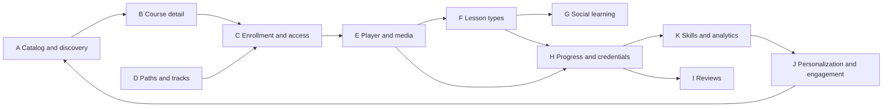

# LRN: Learning and Course Experience

> Status: intended product specification. Nothing in this file is a claim that anything is built. Existing code and legacy documents are inputs, not limits (see [CONVENTIONS](../00_START_HERE/CONVENTIONS.md) §1).

Source aliases used in evidence tags: `SSOT` = `SSOT.md`; `YASH-G3` = `Yash_Final_Project_Document/05_FEATURE_SPECIFICATIONS/SPEC_G3_ASSESSMENT_AND_LEARNING.md`; `YASH-MICRO` = `Yash_Final_Project_Document/05_FEATURE_SPECIFICATIONS/MICRO_FEATURE_SPECS.md`; `FREG` = `docs/registries/FEATURE_REGISTRY.md`.

## 1. Purpose, outcomes and boundaries

### 1.1 Purpose

LRN is the learner-facing half of the learning product. It lets a person find a course or path, get access to it, learn from it (video, reading, practice, quizzes, assignments, projects, live sessions), talk to peers and instructors, see honest progress, and finish with a verifiable credential and skill evidence that flows into the career evidence graph. It is the "Learn" step of the TalentSphere loop (Goal, Gap, Learn, Practice, Prove, Verify, Discover, Match, Apply) [SRC: SSOT §1.1, §2.3].

### 1.2 Outcomes

| Outcome | How the system knows |
|---|---|
| A learner reaches a relevant course within three interactions of arriving | Catalog funnel events `learning.catalog.course_opened` per `learning.catalog.viewed` |
| A learner who starts a course can finish it on any device, including poor networks | Completion rate by cohort; progress-sync failure rate |
| Completion produces trusted evidence, not a PDF the learner must describe | Share of completed enrollments with exactly one evidence item (target 100%) |
| Learning is honest: no completion, grade, certificate or evidence the rules did not earn | Reconciliation job `completed enrollments = rule satisfied at pinned version` reports zero drift |
| Learning is accessible and usable offline where policy allows | Accessibility audit results; offline replay success rate |

No numeric targets are set here; thresholds are `[PROP]` defaults listed in the metrics section and need owner decisions.

### 1.3 In scope

Course catalog, taxonomy, discovery (search, filter, sort, skill and goal browse, compare, save); course detail and curriculum presentation; prerequisites and readiness; enrollment and access for free, paid, institution-managed, invite and plan-entitled routes; access windows, expiry, pause, drop, refund requests; learning paths, tracks, programs and personal plans; the learning player and every lesson type; cohorts, pacing and live sessions; Q&A, discussion, notes, bookmarks, announcements, study groups; progress, completion, gradebook, certificates and achievements; ratings and reviews; recommendations, dashboard, goals, streaks, reminders; learner analytics; skill mapping and evidence hand-off; learner data export.

### 1.4 Out of scope (owned elsewhere)

| Capability | Owner | Boundary |
|---|---|---|
| Authoring, versioning, media processing, pricing, coupons, instructor payouts | STU | LRN consumes a published, immutable course version and its rendition manifest |
| Assessment engine (questions, attempts, timers, grading, integrity, proctoring) | ASM | LRN embeds quizzes and exams and consumes `assessment.attempt.passed/failed` results |
| Payment capture, invoices, tax, refunds execution, plan catalog | BIL (planned) | LRN requests checkout and consumes verified payment and entitlement events |
| Evidence ledger, credential rungs, issuer classes | EVD (planned) | LRN calls the issuer API; it never writes evidence rows itself |
| XP, levels, badges engine | REP (planned) | LRN emits learning events; REP decides awards |
| Global search index and ranking infrastructure | SRC (planned) | LRN defines catalog documents and facets; SRC runs the index |
| Notification delivery, channels, preferences | NTF (planned) | LRN names templates and triggers |
| Institution cohorts, seat licences, faculty roles | INS (planned) | LRN honors institution assignments and visibility scopes |
| Review and discussion abuse handling, takedown policy | TSF (planned) | LRN raises reports and applies decisions |
| Video chat or live-stream infrastructure | PLT (planned) | LRN schedules and presents sessions; the room provider is an adapter (see OD-LRN-06) |

### 1.5 Owned versus consumed

Owned by LRN: catalog read model, taxonomy, enrollments, progress, playback positions, offline licenses, submissions as seen by learners, peer reviews, notes, bookmarks, Q&A and discussion posts, reviews, certificates, paths and path enrollments, goals, streaks, plans, wishlists, recommendations impressions. Consumed: published course versions (STU), assessment results (ASM), entitlements and payment events (BIL), skills ontology (EVD or AIC, planned), consent flags (SET, planned).

## 2. Roles and permission matrix

Cell legend: **R** read, **C** create, **U** update own, **D** delete own, **M** moderate, **A** administer, **-** none, **S** scoped (see note).

| Capability | GUE | CAN | STD | INS | IAD/PLO | MOD | SUP | FIN | PAD |
|---|---|---|---|---|---|---|---|---|---|
| Browse catalog, search, compare | R | R | R | R | R | R | R | R | R |
| See institution-private courses | - | - | R (own institution) | R (own) | R (own institution) | R | R | - | R |
| View course detail and preview lessons | R | R | R | R | R | R | R | R | R |
| Save courses, build plans, goals | - | C U D | C U D | C U D | - | - | - | - | - |
| Enroll (free or invite) | - | C | C | C (as learner) | assign: C (S) | - | grant: C (S) | - | override: C (audit) |
| Pay and enroll | - | C | C | C | - | - | - | - | - |
| Access lessons and media | preview only | R (enrolled) | R (enrolled) | R (own courses, no progress) | - | R (case-scoped) | R (grant-scoped) | - | R (audit) |
| Submit assignments, projects, quizzes | - | C U | C U | - | - | - | - | - | - |
| Peer review | - | C | C | - | - | - | - | - | - |
| Post Q&A and discussion | - | C U D | C U D | C U D M (own course) | - | M | - | - | M |
| Private notes and bookmarks | - | C U D | C U D | C U D | - | - | - | - | - |
| Rate and review | - | C U D | C U D | - (own course barred) | - | M | - | - | M |
| Reply to reviews | - | - | - | C (once per review) | - | - | - | - | - |
| View learner-level progress | - | own | own | S (own course) | S (cohort, aggregate default) | S (case) | S (grant) | - | S (audit) |
| Override completion or grade | - | - | - | A (own course, reason) | A (institution course, reason) | - | - | - | A (audit) |
| Issue, revoke certificate | - | - | - | revoke S (own course, reason) | revoke S | - | - | - | A |
| Verify certificate (public) | R | R | R | R | R | R | R | R | R |
| Approve refund | - | request | request | - | - | - | approve S | approve | A |
| Manage taxonomy and rails | - | - | - | - | - | - | - | - | A |
| View aggregate learning analytics | - | own | own | S (own course, k-threshold) | S (cohort, k-threshold) | - | - | - | R |

`SAD` and `API` hold no direct learner capabilities; `API` principals read catalog and verify certificates through the public API (PLT, planned). Permissions are resolved server-side on every request; hiding a control is never the control.

## 3. Sub-module map

| Code | Sub-module | Features |
|---|---|---|
| A | Catalog and discovery | FR-LRN-001 to 007 |
| B | Course detail | FR-LRN-008 to 012 |
| C | Enrollment and access | FR-LRN-013 to 021 |
| D | Paths and tracks | FR-LRN-022 to 025 |
| E | Player and media | FR-LRN-026 to 040 |
| F | Lesson types | FR-LRN-041 to 049 |
| G | Social learning | FR-LRN-050 to 054 |
| H | Progress and credentials | FR-LRN-055 to 062 |
| I | Reviews | FR-LRN-063 to 065 |
| J | Personalization and engagement | FR-LRN-066 to 070 |
| K | Skills and analytics | FR-LRN-071 to 075 |

## 4. Feature specifications

Notification opt-out classes used below (owned by NTF, planned): `TRANSACTIONAL` (cannot be disabled: receipts, access, security), `LEARNING` (progress and study reminders, user can disable per type), `SOCIAL` (replies, mentions), `PROMO` (recommendations by message, off by default).

### A. Catalog and discovery

### FR-LRN-001 — Course catalog listing

- **Sub-module:** A. Catalog and discovery
- **Priority / tier:** Must · R1
- **Source:** [SRC: SSOT §9.2 F-07 step 1] [DER]
- **Purpose and outcome:** Anyone can browse every visible published course in a fast, paged list and open one. Success is measured by the share of catalog views that reach a course detail page.
- **Roles and permissions:** `GUE: view` · `CAN: view, save, compare` · `STD: view incl. own-institution private courses` · `PAD: view all states with a state badge`
- **Preconditions and entry points:** Routes `/learn` (curated rails) and `/learn/courses` (full list); top navigation "Learn", dashboard, search results, sitemap, deep links. No account required.
- **User interactions and actions:**
  1. Open `/learn/courses`; the first 24 cards render.
  2. Scroll; the next page loads 200 px before the end. A visible "Load more" button is the keyboard and no-script fallback.
  3. Focus or hover a card to open a quick peek (summary, top three skills, total duration, last updated); press Enter or click to open the course (FR-LRN-008).
  4. Use the heart control to save (FR-LRN-007) or the compare checkbox (FR-LRN-006).
  5. Switch between grid and list with the layout toggle.
- **System behavior:** Returns only courses passing BR-LRN-001 and BR-LRN-002 from the catalog read model (ENT-LRN-01), which updates within 60 seconds of a publish, unpublish or takedown event from STU. Uses cursor pagination (default 24, max 48). Viewer-specific decorations (saved, enrolled, progress percent) are added per request and are never stored in shared caches. Home rails (for example "Continue learning", "New this month", "Popular in your goal") are separate queries, each labeled with why it is shown.
- **UI elements and controls:** Course card (16:9 thumbnail, title, lead instructor, level chip, rating average and count or "New", total duration, price or "Free", primary language, badges "Updated" and "Popular", progress ring when enrolled); layout toggle (grid default, list); result count; "Load more" button; skeleton cards while loading; heart and compare controls with accessible names ("Save course X").
- **Configuration options:** Platform: page size, rail composition and ordering, badge thresholds (`popularBadgeEnrollmentsPercentile`, default top 10 percent in category [PROP]). User: remembered layout (browser storage, per viewer). Org: institution catalog scope (which institution-private courses show).
- **Business rules:** BR-LRN-001, BR-LRN-002, BR-LRN-052
- **Validation:** `pageSize` integer 1 to 48; `cursor` opaque string issued by the server; an unknown or malformed filter value returns `422 invalid_filter` naming the allowed values rather than being ignored.
- **Inputs and outputs:** In: optional cursor, page size, filters (FR-LRN-004). Out: ordered list of card objects, `nextCursor`, `totalApprox`, applied-filter echo, and per-viewer decorations when authenticated.
- **Filters, sorting, search:** See FR-LRN-003 and FR-LRN-004; default sort is "Recommended" for signed-in users with consent, otherwise "Newest published".
- **Notifications and communication:** n/a — browsing triggers no messages.
- **Error handling and edge cases:** Empty catalog or empty filter result shows an empty state with a "Clear filters" action and three suggested categories. Backend failure shows an inline error with Retry and keeps already-loaded cards. A stale cursor (index rebuilt) restarts at the first page with a toast "The list was refreshed". A thumbnail that fails to load shows a neutral placeholder with the title. A course unpublished between list and open opens a "No longer available" page with similar courses (FR-LRN-066).
- **Dependencies:** ENT-LRN-01, FR-LRN-002, FR-LRN-004, STU publish events (`studio.course.published`), SRC (planned) index.
- **Security and privacy:** Public data only in shared responses; anonymous requests rate limited ([PROP] 60 per minute per IP); no per-user data in CDN-cached payloads; institution-private courses never appear to anonymous viewers or in counts.
- **Acceptance criteria:**
  1. Given 100 published and 5 draft courses, when a guest opens `/learn/courses`, then only published courses are listed and the first page has 24 cards.
  2. Given a course is unpublished by STU, when 60 seconds have passed, then it no longer appears in the list for any new request.
  3. Negative: Given a guest and an institution-private course, when the guest lists courses or requests the course by id, then the course is absent from results and counts and the direct request returns `404`.

### FR-LRN-002 — Taxonomy: categories, tags, levels and languages

- **Sub-module:** A. Catalog and discovery
- **Priority / tier:** Must · R1
- **Source:** [SRC: SSOT §9.2 F-07 step 1; BR-096] [PROP] for the tag governance and level definitions
- **Purpose and outcome:** Every course is classified in one shared vocabulary so learners can navigate and filter reliably. The system knows it works when no published course lacks a primary category and level.
- **Roles and permissions:** `PAD: create, rename, merge, retire categories and tags, define levels` · `INS: choose from the vocabulary via STU (FR-STU-007)` · `GUE, CAN: view`
- **Preconditions and entry points:** Platform admin console taxonomy screen (ADM, planned); category pages `/learn/c/:slug`; authoring forms in STU.
- **User interactions and actions:**
  1. PAD opens the taxonomy screen and sees the category tree (max depth 3), the flat tag list with usage counts, the fixed level set and the language list.
  2. PAD adds a category with name, slug, parent, description, icon and display order.
  3. PAD renames a category (slug redirect is created) or merges it into another (all courses re-pointed, old slug redirects).
  4. PAD retires a category or tag; courses keep it as a hidden label until the author re-classifies; new assignment is blocked.
  5. Learner opens `/learn/c/:slug` and sees the category description, sub-categories and its courses.
- **System behavior:** Enforces BR-LRN-003. Level set is fixed: `beginner`, `intermediate`, `advanced`, `all_levels`, each with a published definition shown as a tooltip (for example "beginner: no prior knowledge of the topic"). Tags are lower-case, deduplicated, with alias lists (for example "js" aliases "javascript"). Merge is a transactional job that re-indexes affected courses and emits `learning.taxonomy.changed`. Slug changes keep a permanent 301 redirect table. Tags created by authors enter as `proposed` and become usable by others only after PAD or an auto-approval rule (usage by two or more distinct instructors and no profanity match).
- **UI elements and controls:** Tree editor with drag to reorder; inline rename; "Merge into…" dialog with impact count; "Retire" button with confirm; tag table with alias editor; read-only level definitions.
- **Configuration options:** Platform: max category depth (3), max tags per course (10), tag auto-approval rule.
- **Business rules:** BR-LRN-003
- **Validation:** Category name 2 to 60 characters, unique among siblings; slug `[a-z0-9-]{2,60}` unique globally; tag 2 to 30 characters, no leading or trailing spaces, no punctuation except hyphen and plus; description up to 500 characters; merge target must be active and not a descendant of the source.
- **Inputs and outputs:** In: taxonomy edits. Out: updated tree, affected-course count, redirect entries, audit record.
- **Filters, sorting, search:** Admin tag list: search by text, filter by state (`proposed`, `active`, `retired`), sort by usage count or name.
- **Notifications and communication:** Instructors whose course uses a merged or retired term receive an in-app notice `lrn.taxonomy.course_reclassified` (`TRANSACTIONAL`).
- **Error handling and edge cases:** Merge into own descendant returns `409 cycle_detected`. Retiring a category that still has active courses requires choosing a replacement. Two admins editing the same node: the second save returns `409 stale_version` with a refresh prompt. Slug collision returns `409 slug_taken` with a suggested alternative.
- **Dependencies:** ADM (planned) admin console, SRC (planned) re-index, FR-STU-007.
- **Security and privacy:** Taxonomy edits are audited (who, what, before and after); only `PAD` may write; public read is cacheable.
- **Acceptance criteria:**
  1. Given categories A and B, when PAD merges A into B, then all A courses show category B, `/learn/c/a` redirects to `/learn/c/b`, and one audit record exists.
  2. Given a course with 10 tags, when the author adds an eleventh, then the request is rejected with `422 too_many_tags`.
  3. Negative: Given a non-admin user, when they call the taxonomy write endpoint, then the response is `403` and no change is stored.

### FR-LRN-003 — Catalog search with typeahead

- **Sub-module:** A. Catalog and discovery
- **Priority / tier:** Must · R1
- **Source:** [SRC: SSOT §7 F-34; §9.2 F-07] [DER]
- **Purpose and outcome:** A learner types what they want to learn and gets ranked, relevant courses, paths and instructors, tolerant of typos. Success is a non-empty result rate and a click-through on the first page.
- **Roles and permissions:** `GUE: search` · `CAN: search, see history` · `STD: search incl. own-institution courses`
- **Preconditions and entry points:** Search box in the Learn header and on `/learn/courses`; keyboard shortcut `/` focuses the box.
- **User interactions and actions:**
  1. Focus the search box; recent searches (signed-in, if enabled) and trending skills appear.
  2. Type at least two characters; after 150 ms a suggestion panel shows up to 8 items grouped into Courses, Paths, Skills and Instructors.
  3. Use Arrow Down and Up to move through suggestions, Enter to open one, or Enter on the raw text to open full results.
  4. On the results page, edit the query, apply filters (FR-LRN-004), or use "Did you mean" and "Search instead for".
  5. Clear recent searches with the "Clear history" control.
- **System behavior:** Queries SRC (planned) with a catalog scope; matches title, subtitle, skills, tags, instructor name, curriculum lesson titles and description with field boosts (title and skills highest) [PROP]. Applies typo tolerance (edit distance up to 2 for words of 5 or more characters), prefix match, synonym lists (for example "k8s" and "kubernetes") and language-aware stemming. Respects BR-LRN-001 and BR-LRN-002 before ranking. Records the query for relevance tuning under BR-LRN-061. Zero-result queries are logged (without user id) to feed catalog gap reports to STU.
- **UI elements and controls:** Combobox (role `combobox`, `aria-expanded`, `aria-activedescendant`); grouped suggestion list; clear-text button; "Did you mean" link; recent search chips with remove icon; results header with count.
- **Configuration options:** Platform: synonym lists, boost weights, minimum characters (2), debounce (150 ms). User: save search history (default on for signed-in users, off if personalization consent is withdrawn).
- **Business rules:** BR-LRN-001, BR-LRN-002, BR-LRN-061
- **Validation:** Query trimmed, 2 to 100 characters; control characters stripped; queries over 100 characters are truncated with a notice; operators are not supported (plain text only) and quotes request an exact phrase.
- **Inputs and outputs:** In: query text, optional filters, cursor. Out: suggestions, ranked results with highlighted matched fields, total, facets (FR-LRN-004), spelling suggestion.
- **Filters, sorting, search:** Is the search; sorting per FR-LRN-004 with default "Relevance".
- **Notifications and communication:** n/a — search triggers none.
- **Error handling and edge cases:** No results shows suggestions (broader terms, related categories, "browse all"). Search backend unavailable falls back to category browse with a notice "Search is temporarily limited". Query with only stop words returns top popular courses with a notice. Very rapid typing cancels earlier in-flight requests. Right-to-left languages are supported in input and highlighting.
- **Dependencies:** SRC (planned), ENT-LRN-01, FR-LRN-004.
- **Security and privacy:** Query text is personal data when linked to an account (BR-LRN-061); HTML in queries is escaped in all echoes; rate limit 30 searches per minute per client [PROP].
- **Acceptance criteria:**
  1. Given a course titled "Kubernetes for Developers", when a user types "kubernets", then it appears in the first page of results with the match highlighted.
  2. Given an institution-private course, when a user outside that institution searches its exact title, then it is not returned.
  3. Negative: Given the query ``, when searching, then the page shows the text escaped and no script executes.

### FR-LRN-004 — Catalog filters, facets and sorting

- **Sub-module:** A. Catalog and discovery
- **Priority / tier:** Must · R1
- **Source:** [SRC: SSOT §9.2 F-07 step 1] [DER]
- **Purpose and outcome:** Learners narrow and order the catalog by what matters to them. Success is that filtered views return results quickly and filter state is shareable by URL.
- **Roles and permissions:** `GUE, CAN, STD: use`
- **Preconditions and entry points:** Filter panel on `/learn/courses` and search results; category and skill pages inherit their scope as a locked filter.
- **User interactions and actions:**
  1. Open the filter panel (a sheet on mobile) and choose any facet value: category, skill, level, duration band, rating minimum, price (free, paid, included in my plan), language, subtitle language, format (self-paced, cohort-based, live sessions), has certificate, has hands-on practice, updated within period, accessibility features (captions, transcripts, audio description, keyboard-only friendly).
  2. See result count update after each selection (debounced 300 ms) and facet counts recompute.
  3. Pick a sort order: Recommended, Relevance (only with a query), Highest rated, Newest, Most enrolled, Shortest, Price low to high, Price high to low.
  4. Remove a filter via its chip or "Clear all".
  5. Copy or share the URL; it reproduces the same filters and sort.
- **System behavior:** Facets are computed over the visible set (BR-LRN-002). Within a facet values OR together; across facets AND. Rating filter uses only courses meeting BR-LRN-021. "Most enrolled" uses enrollments in the last 90 days, not lifetime, to reduce staleness [PROP]. "Recommended" uses FR-LRN-066 only for signed-in users with personalization consent; otherwise it silently equals "Newest" and the label shows "Newest" (honest labeling). Filter state is encoded in query parameters; unknown parameters are rejected.
- **UI elements and controls:** Checkbox groups with counts, dual-handle duration slider with text equivalent, star-minimum radio group, price radio group, language select, sort select (native `select` on mobile), active-filter chips, "Clear all" button, "Show N results" sticky button on mobile.
- **Configuration options:** Platform: duration bands (default under 2 h, 2 to 6 h, 6 to 17 h, over 17 h [PROP]), facets shown per category, new-badge window. User: none persisted beyond URL.
- **Business rules:** BR-LRN-002, BR-LRN-021, BR-LRN-044
- **Validation:** Each facet value must exist in the facet vocabulary; duration band ids from the configured set; sort from the enumerated list; at most 10 values per facet.
- **Inputs and outputs:** In: facet selections and sort as query parameters. Out: filtered results, facet counts, applied echo, canonical URL.
- **Filters, sorting, search:** The feature itself. Facets with zero count are shown disabled, never hidden, so learners understand the vocabulary.
- **Notifications and communication:** n/a — no messages.
- **Error handling and edge cases:** Combination yields zero results: empty state suggests removing the most restrictive filter by name. Filter references a retired category: value is ignored with a visible notice. Facet counts lag the list by at most the index refresh (up to 60 seconds) and counts are labeled "about" when the index is behind. A very long URL is truncated by the browser: filters are re-derived from stored view state where available.
- **Dependencies:** FR-LRN-001, FR-LRN-002, FR-LRN-003, SRC (planned).
- **Security and privacy:** Filters never embed personal data; "included in my plan" is resolved server-side from the caller's entitlements and never leaked in shared URLs (the URL carries the token `plan`, not the plan name).
- **Acceptance criteria:**
  1. Given courses in English and Spanish, when the learner selects language Spanish and level beginner, then only Spanish beginner courses show and counts match the list.
  2. Given sort "Highest rated", when two courses have equal rating, then the one with more reviews ranks first, and courses below the review threshold (BR-LRN-021) are not ranked by rating.
  3. Negative: Given the URL contains `level=expert`, when the page loads, then the response is `422 invalid_filter` listing the four allowed levels and the page shows an inline notice instead of silently ignoring it.

### FR-LRN-005 — Skill-based and goal-based browse

- **Sub-module:** A. Catalog and discovery
- **Priority / tier:** Should · R1
- **Source:** [SRC: SSOT §1.1 loop Goal→Gap→Learn; §9.1 F-84] [DER]
- **Purpose and outcome:** A learner chooses a skill or a career goal and sees the courses, paths and tracks that build it, ordered by fit. Success is enrollments that originate from skill pages.
- **Roles and permissions:** `GUE: view skill pages` · `CAN, STD: view plus "match to my gap"`
- **Preconditions and entry points:** `/learn/skills/:skill`, skill chips on course cards, "Close my gap" action from profile or goal screens (PRF and AIC, planned), career goal pages `/learn/goals/:goalSlug`.
- **User interactions and actions:**
  1. Open a skill page; see the skill definition, parent and related skills, courses ranked by how directly they teach it, and relevant paths.
  2. Toggle "Show only courses that award evidence for this skill".
  3. Signed-in learners with a declared goal see "Your gap" (skills in the goal not yet evidenced) and a button "Add all to my plan" (FR-LRN-025).
  4. Pick a proficiency target (for example "working level") to filter courses whose declared outcome meets it.
- **System behavior:** Joins catalog entries with the skills ontology: each course lists skills with an author-declared `targetLevel` and a `coverage` weight (primary, secondary). Ranking uses coverage, level fit, rating and recency. "Awards evidence" means the course has an assessed completion rule (BR-LRN-025) and is derived, not author-asserted. Gap data is read from the evidence graph (EVD, planned) with the viewer's consent; without consent the page shows the generic view.
- **UI elements and controls:** Skill header with definition, "related skills" chips, toggle "Awards evidence", level selector, ranked course list with a "Why this course" line (for example "primary skill, intermediate level"), "Add all to my plan" button.
- **Configuration options:** Platform: coverage weights. User: share goal with learning recommendations (consent in SET, planned).
- **Business rules:** BR-LRN-044, BR-LRN-046
- **Validation:** Skill slug must exist in the ontology else `404`; target level from the ontology scale.
- **Inputs and outputs:** In: skill or goal slug, level, toggle. Out: ranked courses and paths with explanation strings; gap list when permitted.
- **Filters, sorting, search:** Same facets as FR-LRN-004 plus level fit; default sort "Best match for skill".
- **Notifications and communication:** n/a — none.
- **Error handling and edge cases:** Skill with no courses shows "No courses yet" and a "Tell us you want this" request (stored as anonymous demand signal for STU). Ontology outage: page shows catalog-only view without gap. Retired or renamed skill redirects to its successor.
- **Dependencies:** EVD or AIC (planned) skills ontology and gap API, FR-LRN-025, FR-LRN-071.
- **Security and privacy:** Gap data is sensitive career data; shown only to the owner; never in shared URLs.
- **Acceptance criteria:**
  1. Given a goal needing skills S1 and S2 and evidence for S1, when the learner opens the goal page, then S2 is listed as the gap with courses ranked for S2.
  2. Given the learner withdrew personalization consent, when opening a skill page, then no gap section is shown and a note explains why.
  3. Negative: Given an unknown skill slug, when opening the page, then `404` with search suggestions is shown.

### FR-LRN-006 — Course comparison

- **Sub-module:** A. Catalog and discovery
- **Priority / tier:** Could · R3
- **Source:** [SRC: FREG F-67 "Categories, Discovery & Comparison"] [DER]
- **Purpose and outcome:** A learner compares up to three courses side by side to choose. Success is a comparison view that ends in an enrollment or a save.
- **Roles and permissions:** `GUE, CAN, STD: use`
- **Preconditions and entry points:** Compare checkbox on cards and detail pages; `/learn/compare?ids=a,b,c`.
- **User interactions and actions:**
  1. Tick compare on two or three courses; a tray appears at the bottom with their thumbnails.
  2. Activate "Compare" to open the table.
  3. Scan rows: price, duration, level, language, subtitles, format, skills covered, evidence awarded, prerequisites, certificate, rating, last updated, instructor, accessibility features. Differences are highlighted; a toggle "Show only differences" hides identical rows.
  4. Remove a column with its close button, or enroll or save from the column header.
- **System behavior:** Limit enforced per BR-LRN-053 (3 courses). Selection lives in the URL and browser storage; signed-in selection does not persist on the server. Data read from the catalog read model at view time.
- **UI elements and controls:** Compare tray with count and clear button; comparison table with sticky first column and header; difference toggle; per-column actions.
- **Configuration options:** Platform: comparison rows list and order.
- **Business rules:** BR-LRN-053
- **Validation:** `ids` must be 2 to 3 distinct visible course ids; invisible ids are dropped with a notice.
- **Inputs and outputs:** In: up to three course ids. Out: normalized comparison matrix.
- **Filters, sorting, search:** n/a — fixed rows; no filtering across courses.
- **Notifications and communication:** n/a — none.
- **Error handling and edge cases:** A fourth selection is refused with "You can compare up to 3 courses". A course becomes unavailable: its column shows "No longer available". Single course in URL redirects to its detail page.
- **Dependencies:** ENT-LRN-01, FR-LRN-008.
- **Security and privacy:** Only public catalog data shown; no personal data.
- **Acceptance criteria:**
  1. Given two selected courses, when the learner opens compare, then every configured row is shown with differences highlighted.
  2. Given three selected, when selecting a fourth, then it is refused with the limit message and the three remain.
  3. Negative: Given an id of an institution-private course the viewer cannot see, when opening the URL, then that column is dropped and a notice states one course was unavailable.

### FR-LRN-007 — Saved courses

- **Sub-module:** A. Catalog and discovery
- **Priority / tier:** Should · R1
- **Source:** [DER]
- **Purpose and outcome:** A learner bookmarks courses and paths to return to later. Success is that saved items convert to enrollments at a measurable rate.
- **Roles and permissions:** `CAN, STD: save, unsave, view own` · `GUE: prompt to sign in`
- **Preconditions and entry points:** Heart control on cards, detail, comparison and path pages; list at `/learn/saved`.
- **User interactions and actions:**
  1. Activate the heart; it fills and a toast "Saved" offers Undo.
  2. Open `/learn/saved`; items show current price, availability and any price change since saving.
  3. Reorder by drag or "Move up/down" menu; sort by date saved or title.
  4. Remove an item with its menu; enroll directly from the list.
- **System behavior:** Idempotent save keyed on (account, target). Limit per BR-LRN-053 (200). Price drop on a saved paid course creates an optional in-app notice. Items that become unavailable stay with a "Unavailable" badge for 30 days then are removed with a one-time notice.
- **UI elements and controls:** Toggle button (`aria-pressed`), saved list with cards, drag handle with keyboard alternative, sort select, bulk remove with select checkboxes.
- **Configuration options:** User: price-drop alerts on or off (default on, class `LEARNING`).
- **Business rules:** BR-LRN-053
- **Validation:** Target must exist and be visible at save time; duplicate saves are no-ops.
- **Inputs and outputs:** In: target id and type (course or path). Out: saved state, list.
- **Filters, sorting, search:** Sort by date saved, title, price change; filter by type (course, path) and availability.
- **Notifications and communication:** `lrn.saved.price_dropped` in-app and optional email, class `LEARNING`, recipient the saver, sent at most once per price change.
- **Error handling and edge cases:** Save at limit returns `409 wishlist_full` with a prompt to remove items. Offline save is queued and replayed. Unsaving while the list view is open updates without reload. Account erasure deletes the list.
- **Dependencies:** ENT-LRN-18, FR-LRN-001.
- **Security and privacy:** Private to the owner; never visible to instructors or other users; included in data export.
- **Acceptance criteria:**
  1. Given a signed-in learner, when they save a course twice, then one saved item exists.
  2. Given a saved paid course whose price drops, when the change is published, then one notice is created if alerts are on.
  3. Negative: Given 200 saved items, when saving another, then the request fails with `409 wishlist_full` and the list is unchanged.

### B. Course detail

### FR-LRN-008 — Course detail page

- **Sub-module:** B. Course detail
- **Priority / tier:** Must · R1
- **Source:** [SRC: SSOT §9.2 F-07 step 2; YASH-G3 SPEC-06 §4] [DER]
- **Purpose and outcome:** A visitor learns exactly what a course teaches, what it needs, what it costs and what they earn, then enrolls or saves it. Success is detail-to-enroll conversion and low post-enrollment refund rate.
- **Roles and permissions:** `GUE, CAN, STD: view` · `INS: view own course with an "Edit in Studio" link` · `PAD: view any state`
- **Preconditions and entry points:** `/learn/courses/:slug` (slug stable, with id-based fallback). The course is `published`, `unlisted` (link only) or visible by invite.
- **User interactions and actions:**
  1. Open the page; the summary strip shows title, subtitle, rating, learner count, level, duration, language, last updated, price and the primary action (Enroll, Continue, Buy, Request access, or Join waitlist).
  2. Read tabs or anchored sections: What you will learn, Skills and evidence earned, Curriculum (FR-LRN-009), Prerequisites (FR-LRN-010), Instructors (FR-LRN-011), Reviews (FR-LRN-064), Q&A preview (public questions only if instructor opted in), FAQ, Related courses.
  3. Play the promo video (autoplay never; muted until activated).
  4. Share via copy link or system share sheet; report the course (FR-LRN-075).
- **System behavior:** Renders from the published version snapshot, not from the draft. Primary action is computed server-side from the viewer state (not enrolled, enrolled, expired, locked with reason (FR-LRN-013)). Emits JSON-LD `Course` structured data on public pages; no learner data in the HTML (BR-LRN-052). Canonical URL points at the slug; non-canonical slugs redirect with 301. Page cache keyed by version and language; the action area is hydrated per viewer.
- **UI elements and controls:** Summary strip; sticky purchase card (price, coupon field if a coupon is applicable (STU), Enroll or Buy button, Save, Share, guarantee line showing the refund window from BR-LRN-010); section anchors; promo video; skills chips linking to FR-LRN-005; "Includes" list (hours of video, readings, quizzes, assignments, live sessions, downloadable resources, certificate, lifetime or limited access).
- **Configuration options:** Platform: refund-guarantee line on or off; "learners also viewed" on or off. Author: sections shown (STU landing editor).
- **Business rules:** BR-LRN-001, BR-LRN-002, BR-LRN-008, BR-LRN-021, BR-LRN-052
- **Validation:** Slug resolves to exactly one visible course; query params `coupon` (alphanumeric up to 32) and `invite` (token) validated server-side.
- **Inputs and outputs:** In: slug, optional coupon, invite token. Out: page model with version id, curriculum summary, price quote for this viewer, action state.
- **Filters, sorting, search:** n/a — single entity; reviews and Q&A have their own controls.
- **Notifications and communication:** n/a — viewing triggers none.
- **Error handling and edge cases:** Unpublished or taken-down course: `410 Gone` page with similar courses, except for existing enrollees who are routed to their learning space (BR-LRN-047). Region-blocked: explains the restriction without naming internal rules. Price fetch failure: shows the action as "Price unavailable, try again" and disables purchase. Invalid coupon: inline message and normal price remains. Unlisted course without the link: `404`.
- **Dependencies:** ENT-LRN-01, FR-LRN-009 to 013, FR-STU-014, BIL (planned) price quote.
- **Security and privacy:** Public page exposes only published data; invite tokens are single-purpose and not logged in analytics URLs; bot traffic is rate limited.
- **Acceptance criteria:**
  1. Given a published course, when a guest opens it, then price, duration, curriculum, skills and instructor are shown and no draft content appears.
  2. Given an enrolled learner, when opening the page, then the primary action reads "Continue" and links to their next lesson.
  3. Negative: Given a taken-down course and a non-enrolled visitor, when opening its URL, then `410` is returned and no content is rendered.

### FR-LRN-009 — Curriculum presentation and free previews

- **Sub-module:** B. Course detail
- **Priority / tier:** Must · R1
- **Source:** [SRC: SSOT §9.2 F-07 step 2; BR-094] [DER]
- **Purpose and outcome:** Visitors see the real structure of the course and can sample marked lessons without enrolling. Success is that preview use correlates with enrollment and that previews never expose protected content.
- **Roles and permissions:** `GUE, CAN, STD: view outline and preview lessons` · `Enrolled learners: full access`
- **Preconditions and entry points:** Curriculum section of the detail page and the player's curriculum drawer.
- **User interactions and actions:**
  1. Expand or collapse a section; "Expand all" toggles every section.
  2. See for each lesson: type icon (video, reading, quiz, assignment, project, live, practice), title, duration, and a "Preview" label when free.
  3. Activate a preview lesson to open it in a modal or the player in preview mode.
  4. At the end of a preview, see a prompt to enroll; next previews are offered.
- **System behavior:** Outline comes from the published version. Only lessons flagged `preview` by the author (maximum share enforced at publish by STU: 20 percent of content duration) are playable without enrollment (BR-LRN-008). Preview playback uses a preview token that is not tied to an account, expires in 5 minutes and is rate limited. Preview views never create progress. Section and lesson counts and total duration are computed from the version, not stored by hand.
- **UI elements and controls:** Accordion (`aria-expanded`), lesson rows with icons and durations, "Preview" pill, "Expand all" button, lock icon on non-preview lessons with the label "Enroll to access".
- **Configuration options:** Author: which lessons are preview (STU). Platform: preview token TTL (5 min), preview rate limit.
- **Business rules:** BR-LRN-008, BR-LRN-037
- **Validation:** Preview token must match lesson and course version; reuse after expiry returns `401 token_expired`.
- **Inputs and outputs:** In: course slug, lesson key (preview). Out: outline model; preview manifest for allowed lessons.
- **Filters, sorting, search:** Optional in-page search across lesson titles (client side, no network).
- **Notifications and communication:** n/a — none.
- **Error handling and edge cases:** Course with a single section is shown expanded. A preview lesson whose media is still processing hides its Preview label. Preview fetch fails: message with Retry and the outline stays usable. Free-preview abuse (scripted bulk fetching) is throttled with `429`.
- **Dependencies:** FR-STU-008, FR-STU-041 (publish rules), FR-LRN-039 (tokens), ENT-LRN-01.
- **Security and privacy:** Non-preview lesson URLs and manifests are never exposed to anonymous callers; titles are public, bodies are not.
- **Acceptance criteria:**
  1. Given a course with two preview lessons, when a guest opens the curriculum, then exactly those two are playable.
  2. Given a preview token older than 5 minutes, when reused, then `401 token_expired` is returned.
  3. Negative: Given a guest calls the manifest endpoint of a non-preview lesson, then `403` is returned and no media URL is issued.

### FR-LRN-010 — Prerequisites and readiness check

- **Sub-module:** B. Course detail
- **Priority / tier:** Should · R2
- **Source:** [SRC: SSOT §7 F-106; §9.2 F-07 step 7; BR-022] [DER]
- **Purpose and outcome:** Learners see what they should know first and whether they meet it, with a path to close any gap. Success is fewer early drop-outs caused by missing background.
- **Roles and permissions:** `GUE: view declared prerequisites` · `CAN, STD: view met or unmet state`
- **Preconditions and entry points:** Prerequisites section of the detail page; enrollment gate (FR-LRN-013).
- **User interactions and actions:**
  1. Read prerequisites listed as courses, skills with a minimum level, or free text "recommended background".
  2. Signed-in learners see each item as Met, Not met or Unknown, with the source of the verdict (for example "Completed course X on 12 May", "Evidence for SQL at working level").
  3. Activate "Close this gap" on an unmet item to open the course, path or assessment that satisfies it.
  4. Take an optional readiness quiz (an ASM practice assessment) to test out of a skill prerequisite; passing records readiness only for this course unless the quiz is an evidence-minting assessment.
- **System behavior:** Evaluates each structured prerequisite against the learner's completed enrollments and evidence graph (EVD, planned) with consent. Enforced prerequisites (author marks "required") block enrollment per BR-LRN-004; advisory ones only warn. Evaluation happens at enroll time and is not re-evaluated later (BR-LRN-045). Free-text items are never evaluated.
- **UI elements and controls:** Prerequisite rows with status icon and text (never color alone), "Close this gap" link, "Take readiness quiz" button, legend explaining Met, Not met and Unknown.
- **Configuration options:** Author: per item `required` or `recommended`, minimum level. Platform: whether institution assignment overrides enforced prerequisites (see BR-LRN-054).
- **Business rules:** BR-LRN-004, BR-LRN-045, BR-LRN-054
- **Validation:** Structured prerequisite references must exist (course id or ontology skill) and not form a cycle; minimum level from the ontology scale.
- **Inputs and outputs:** In: course version, viewer account. Out: per-item verdict with explanation, overall `canEnroll` and lock reason `prerequisite` when blocked.
- **Filters, sorting, search:** n/a — short list.
- **Notifications and communication:** n/a — none.
- **Error handling and edge cases:** Evidence service unavailable: items show Unknown and enforced items fail open only if the author marked the course "allow when unknown" [PROP]; otherwise enrollment is held with message "We couldn't check prerequisites, try again". No consent to read evidence: items show Unknown with a prompt to share or to self-declare (self-declaration is allowed only for advisory items). Prerequisite course retired: item is marked "Equivalent: <successor>" if STU set one, else ignored with a note.
- **Dependencies:** EVD (planned), FR-LRN-013, FR-STU-013, FR-ASM-011.
- **Security and privacy:** Verdict text reveals only what the viewer already owns; evidence details are not shown to guests.
- **Acceptance criteria:**
  1. Given an enforced prerequisite course not completed, when the learner views the page, then the item shows Not met and the primary action is a soft block with a link to the prerequisite.
  2. Given the learner completes the prerequisite, when revisiting, then the item shows Met with the completion date.
  3. Negative: Given enforced prerequisites unmet, when calling the enroll API directly, then `409 prerequisites_unmet` lists the unmet items and no enrollment is created.

### FR-LRN-011 — Instructor and ownership display

- **Sub-module:** B. Course detail
- **Priority / tier:** Must · R3
- **Source:** [SRC: SSOT §9.2 F-07 step 2; FREG F-74] [DER]
- **Purpose and outcome:** Learners see who teaches and who stands behind a course (individual, institution, employer, platform) and can judge credibility. Success is trust-related metrics such as lower refund rate for courses with verified instructors.
- **Roles and permissions:** `GUE, CAN, STD: view` · `INS: edit own profile via STU (FR-STU-004)`
- **Preconditions and entry points:** Instructor section on the detail page; instructor profile page `/learn/instructors/:handle`; "Offered by" line on cards.
- **User interactions and actions:**
  1. See the lead instructor and co-instructors with photo, headline, verification badge, rating across courses, learner count and a short bio.
  2. See "Offered by" when the owner differs from the instructor (for example an institution or company), with the owner's name and verification state.
  3. Open an instructor profile to see all their published courses, bio, credentials they chose to show, and aggregate rating.
  4. Report a profile (FR-LRN-075).
- **System behavior:** Ownership types: `instructor`, `institution`, `employer`, `platform`. Badge states: `identity_verified`, `expertise_verified` (from FR-STU-002), none. Aggregate ratings follow BR-LRN-021 and exclude refunded and own-institution reviews where flagged. Only data the instructor marked public is shown; email and payout data are never exposed. Courses owned by an institution show the institution as owner even if the instructor leaves; a removed instructor shows as "Former instructor" with name only if they consent.
- **UI elements and controls:** Instructor cards, verification badges with tooltip text, "Offered by" row with link, instructor profile page with course grid.
- **Configuration options:** Instructor: visibility of each profile field. Platform: badge definitions.
- **Business rules:** BR-LRN-019, BR-LRN-021
- **Validation:** Handles are unique, lower-case, 3 to 30 characters; profile links are sanitized.
- **Inputs and outputs:** In: course id or instructor handle. Out: instructor list with public fields and badges; owner object.
- **Filters, sorting, search:** Instructor page: sort courses by newest or rating.
- **Notifications and communication:** n/a — none.
- **Error handling and edge cases:** Instructor account suspended: their courses show "Instructor unavailable" and enrollments continue per BR-LRN-047 unless safety takedown. Deleted instructor account: name replaced with "Former instructor". Co-instructor limit exceeded is blocked in STU, not here.
- **Dependencies:** FR-STU-002, FR-STU-004, FR-STU-016, EVD (planned) for verification display.
- **Security and privacy:** Public profile only; minors' data rules apply to learner content, not instructors; scraping throttled.
- **Acceptance criteria:**
  1. Given a course owned by an institution and taught by an instructor, when viewing, then both the instructor and "Offered by <institution>" appear.
  2. Given an expertise-verified instructor, when viewing, then the badge appears with an explanatory tooltip.
  3. Negative: Given an instructor hid their photo, when viewing, then no photo is rendered and no URL to it is present in the page data.

### FR-LRN-012 — Course versions and change log

- **Sub-module:** B. Course detail
- **Priority / tier:** Should · R3
- **Source:** [SRC: YASH-G3 SPEC-06 §3.4; SSOT BR-093, BR-105] [DER]
- **Purpose and outcome:** Learners know which version they are on, what changed in newer versions and can choose to move over without losing progress. Success is no forced progress loss and a high opt-in rate for relevant updates.
- **Roles and permissions:** `CAN, STD: view change log, migrate own enrollment` · `INS: author change notes (STU)`
- **Preconditions and entry points:** "What's new" banner in the player and on My learning when a newer version exists for an active enrollment; detail page "Version history".
- **User interactions and actions:**
  1. See a banner "A newer version is available" with the summary of changes (added, changed, removed lessons and whether completion rules changed).
  2. Open the change log: versions with date, author note and lesson-level diff list.
  3. Choose "Switch to latest" or "Stay on my version" (dismiss for 30 days).
  4. On switching, review a mapping preview: lessons matched by `lessonKey` keep their status; new required lessons appear as not started; removed lessons keep completion in history.
- **System behavior:** Enrollment stays pinned to its version (BR-LRN-006). Migration is atomic: progress is mapped by `lessonKey`, completion is re-evaluated on the new rules and could change from completed to active only if the learner had not yet completed; a completed enrollment is never reopened (it may "view new content" without effect on credentials). Certificates are never altered by migration. Emits `learning.enrollment.migrated`.
- **UI elements and controls:** Banner, change-log drawer, "Switch to latest" and "Stay" buttons, mapping preview table, confirmation dialog.
- **Configuration options:** Author: change summary text and whether the update is `recommended`. Platform: banner snooze (30 days).
- **Business rules:** BR-LRN-006
- **Validation:** Migration allowed only to a published, newer version of the same course; learner must confirm the mapping preview.
- **Inputs and outputs:** In: enrollment id, target version. Out: new pinned version, progress mapping result.
- **Filters, sorting, search:** n/a — short list.
- **Notifications and communication:** `lrn.course.new_version` in-app and email (class `LEARNING`) to learners with active enrollments when the author marks the update recommended; at most once per version.
- **Error handling and edge cases:** Mapping conflict (lesson key reused for a different lesson) is blocked by STU; if found, migration aborts with `409 mapping_conflict` and an alert. Migration during an active attempt is refused until the attempt ends. Double-click switch is idempotent.
- **Dependencies:** FR-STU-019, ENT-LRN-03, ENT-LRN-05.
- **Security and privacy:** No new data exposure; audit entry records the switch.
- **Acceptance criteria:**
  1. Given a learner with 6 of 10 lessons complete and a new version that adds one lesson, when they switch, then six lessons stay complete and the new one is not started.
  2. Given the learner dismisses the banner, when 30 days have not passed, then it does not reappear.
  3. Negative: Given a completed enrollment, when the learner switches versions, then the status stays `completed` and the certificate is unchanged.

### C. Enrollment and access

### FR-LRN-013 — Eligibility gate and lock reasons

- **Sub-module:** C. Enrollment and access
- **Priority / tier:** Must · R1
- **Source:** [SRC: YASH-G3 SPEC-06 §3.2 (lock reasons `prerequisite`, `plan`, `region`)] [DER]
- **Purpose and outcome:** Before any enrollment the system decides, in one place, whether this learner may enroll, and tells them plainly why not. Success is that every blocked attempt shows a specific reason and next step.
- **Roles and permissions:** `CAN, STD: evaluated` · `SUP: view the evaluation for a user under a support grant`
- **Preconditions and entry points:** Any enroll, buy, redeem or assign action; the detail page primary action; the player entry check.
- **User interactions and actions:**
  1. Learner activates the primary action; the gate runs.
  2. If allowed, flow continues to FR-LRN-014, 015, 016, 017 or 018.
  3. If blocked, a panel names the reason and offers the single best next step (for example "Complete SQL Basics first", "Upgrade to access", "Not available in your region", "Account restricted, contact support").
- **System behavior:** Evaluates in order: course visible (BR-LRN-002), course accepting enrollments (not closed, not full, cohort window open), account active and not sanctioned, age or consent requirements for the course's content rating, region and sanctions restrictions (legal list from PLT or ADM, planned), prerequisites (FR-LRN-010), duplicate active enrollment (BR-LRN-005), plan or payment requirement. Returns the first failing reason code plus all failing codes for support. Lock reasons are an enumerated set: `not_visible`, `closed`, `full`, `account_restricted`, `age_or_consent`, `region`, `prerequisite`, `plan`, `payment_required`, `duplicate`. Evaluation is deterministic and side-effect free; it is re-run, not cached, at the moment of enrollment.
- **UI elements and controls:** Lock panel with icon and text, primary next-step button, "Why am I seeing this?" disclosure, link to support for `account_restricted`.
- **Configuration options:** Platform: region restriction lists, content ratings requiring age confirmation. Author: enrollment cap and close date (cohorts).
- **Business rules:** BR-LRN-002, BR-LRN-004, BR-LRN-005, BR-LRN-054
- **Validation:** Course id and account must resolve; evaluation never trusts client-supplied flags.
- **Inputs and outputs:** In: account, course, route (self, invite, assigned, plan). Out: `allowed` boolean, first reason, reason list, next-step suggestion.
- **Filters, sorting, search:** n/a — decision function.
- **Notifications and communication:** n/a — the panel is the notification; support contact only for `account_restricted`.
- **Error handling and edge cases:** Dependency (evidence, entitlement) outage returns `503 eligibility_unavailable` rather than allowing or blocking silently; the UI shows "We couldn't check eligibility, try again". Race: seat taken between check and enroll returns `409 full` at enroll time. Region unknown (VPN, no geolocation) uses account country; never blocks on IP alone.
- **Dependencies:** FR-LRN-010, BIL (planned) entitlement API, IDN (planned) account state, ADM (planned) restriction lists.
- **Security and privacy:** Reason text for `account_restricted` never reveals internal flags; region decisions logged without precise location.
- **Acceptance criteria:**
  1. Given a closed cohort course, when a learner activates Enroll, then the reason `closed` is shown with the next cohort date if any.
  2. Given a free open course and an eligible learner, when evaluated, then `allowed` is true with no reasons.
  3. Negative: Given a sanctioned account, when calling enroll directly, then `403 account_restricted` is returned and no enrollment row is created.

### FR-LRN-014 — Free enrollment

- **Sub-module:** C. Enrollment and access
- **Priority / tier:** Must · R1
- **Source:** [SRC: SSOT §9.2 F-07 step 3; YASH-G3 SPEC-06 §3.2; BR-046] [DER]
- **Purpose and outcome:** A learner enrolls in a free course in one action and lands in the player. Success is enrollment-to-first-lesson rate.
- **Roles and permissions:** `CAN, STD: enroll` · `INS: enroll as learner (BR-LRN-019 limits)`
- **Preconditions and entry points:** Detail page Enroll button; "Start learning" on cards; deep link from email or path. Signed in; gate (FR-LRN-013) allows.
- **User interactions and actions:**
  1. Activate "Enroll for free".
  2. If not signed in, authenticate (IDN, planned) and return to the same course with the action resumed.
  3. See a confirmation screen with what is included, version, access window (FR-LRN-019) and "Start first lesson".
- **System behavior:** `POST` enroll with an idempotency key; natural key (account, course) returns the existing active enrollment on repeat (BR-LRN-005). Creates enrollment `active` pinned to the current published version (BR-LRN-006), seeds lesson progress rows lazily, emits `learning.enrollment.created` and `learning.enrollment.activated`, and sends the confirmation. Enrollment confirmation response is under 300 ms p95 [PROP].
- **UI elements and controls:** "Enroll for free" button (disabled with spinner while pending), confirmation panel, "Start first lesson" button, "View my learning" link.
- **Configuration options:** Platform: whether free enrollment needs a verified email (default yes). Author: access window.
- **Business rules:** BR-LRN-005, BR-LRN-006, BR-LRN-009, BR-LRN-011
- **Validation:** Idempotency key required (UUID); course id exists; account state `active`.
- **Inputs and outputs:** In: course id, idempotency key, optional source (catalog, path, email). Out: enrollment id, state, pinned version, first-lesson link.
- **Filters, sorting, search:** n/a — single action.
- **Notifications and communication:** `lrn.enrollment.confirmed` email and in-app, class `TRANSACTIONAL`, recipient the learner, includes course title, start link and access window.
- **Error handling and edge cases:** Double click or two tabs: one enrollment, both calls return it. Course unpublished during action: `409 course_unavailable`. Verified email missing: gate reason `account_restricted` variant `email_unverified` with resend link. Offline click: action is not queued (enrollment needs the server); the UI says "You are offline".
- **Dependencies:** FR-LRN-013, IDN (planned), NTF (planned), ENT-LRN-03.
- **Security and privacy:** Source parameter validated against an allowlist; enrollment is personal data owned by the learner.
- **Acceptance criteria:**
  1. Given an eligible learner, when they enroll twice with different idempotency keys, then one active enrollment exists and both responses return it.
  2. Given a free course, when enrolled, then the pinned version equals the published version at that instant.
  3. Negative: Given an unverified email and the platform rule requiring it, when enrolling, then no enrollment is created and the learner sees the resend-verification action.

### FR-LRN-015 — Paid enrollment and checkout hand-off

- **Sub-module:** C. Enrollment and access
- **Priority / tier:** Must · R5
- **Source:** [SRC: SSOT BR-115; YASH-G3 SPEC-06 §3.2 (paid ⇒ `pending_payment`); SSOT Appendix E V61-21] [DER]
- **Purpose and outcome:** A learner buys a course; access starts only after verified payment. Success is zero access without payment and a smooth confirmation experience.
- **Roles and permissions:** `CAN, STD: purchase` · `FIN: view orders (BIL, planned)` · `SUP: assist`
- **Preconditions and entry points:** Detail page Buy button; cart-less single-course flow [PROP]; gate (FR-LRN-013) allows; price quote valid.
- **User interactions and actions:**
  1. Activate "Buy for <price>"; optionally apply a coupon (STU defines coupons).
  2. Review the order summary (price, taxes shown by BIL, refund window).
  3. Complete payment on the BIL-hosted checkout and be redirected back.
  4. See "We're confirming your payment" until the webhook is processed (poll or push up to 2 minutes, then an email follows).
  5. See success and "Start learning".
- **System behavior:** Creates enrollment `pending_payment` with the quote id and coupon (SM-LRN-01), then calls BIL (planned) to start checkout. Returning from checkout grants nothing (BR-LRN-007). Activation occurs on the verified `billing.purchase.fulfilled` event, idempotent on the payment event id. Unpaid enrollments `expire` after 24 hours. Prices are re-quoted at checkout creation; the learner sees the price they agreed. Payment failure, cancellation and delayed settlement update the enrollment and notify.
- **UI elements and controls:** Buy button, coupon input with Apply, order summary, "Confirming payment" status page with progress indicator and "Refresh" button, success page, failure page with "Try again" and "Use a different method".
- **Configuration options:** Platform: pending-payment TTL (24 h), poll duration (2 min), coupon stacking (none). Author: price and coupons (STU).
- **Business rules:** BR-LRN-005, BR-LRN-006, BR-LRN-007, BR-LRN-010
- **Validation:** Quote id must be unexpired (15 minutes [PROP]) and match course and version; coupon format and applicability validated by STU or BIL.
- **Inputs and outputs:** In: course id, coupon code, idempotency key. Out: enrollment `pending_payment`, checkout redirect URL; later activation event.
- **Filters, sorting, search:** n/a — single flow.
- **Notifications and communication:** `lrn.payment.pending` (in-app), `lrn.enrollment.confirmed` (email, `TRANSACTIONAL`), `lrn.payment.failed` (email, `TRANSACTIONAL`).
- **Error handling and edge cases:** Webhook delayed: status page stays "processing", lesson endpoints return `403`; activation happens when the event arrives. Webhook arrives before redirect: page shows success immediately. Event order inverted (invoice before checkout): final state is still a single activation. Double purchase attempt: second checkout is refused with `409 duplicate` while one is pending. Price changed after quote: learner is shown the new price and must reconfirm. Payment provider outage: purchase disabled with banner.
- **Dependencies:** BIL (planned) checkout and webhooks, FR-STU-033, FR-STU-034, FR-LRN-013, ENT-LRN-03.
- **Security and privacy:** No card data in LRN; success redirect parameters are untrusted; webhook signature verified in BIL; purchase records have financial retention.
- **Acceptance criteria:**
  1. Given a paid course, when the learner completes checkout and the webhook arrives, then the enrollment becomes `active` exactly once even if the event is redelivered.
  2. Given the checkout success redirect without a webhook, when the learner opens a lesson, then `403` is returned and the status page says processing.
  3. Negative: Given a pending enrollment unpaid for 24 hours, when the sweep runs, then it becomes `expired` and no access was ever granted.

### FR-LRN-016 — Institution-managed enrollment

- **Sub-module:** C. Enrollment and access
- **Priority / tier:** Must · R3
- **Source:** [SRC: SSOT §7 F-40, F-50; §10.20 BR-072..BR-082; YASH-G3 SPEC-06 §2] [DER]
- **Purpose and outcome:** An institution or employer assigns courses to a batch of its learners; learners see them as assigned work with the institution's deadlines. Success is exact seat accounting and clear learner understanding of what is mandatory.
- **Roles and permissions:** `IAD, PLO: assign courses to members (INS planned)` · `STD: see assigned courses, accept, start` · `EXA: assign for employees (ENT, planned)` · `SUP: view`
- **Preconditions and entry points:** Assignment created in INS (planned); learner sees "Assigned to you" on the dashboard and in notifications.
- **User interactions and actions:**
  1. Learner opens the assignment from the dashboard; sees assigner, due date, whether mandatory and whether progress is visible to the institution.
  2. Learner activates "Start" (or "Accept" if consent to share progress is required).
  3. Learner works the course as usual; due-date reminders appear.
  4. On completion the institution sees completion per its visibility scope.
- **System behavior:** INS creates the assignment and consumes a seat or license; LRN creates an enrollment with `route=institution`, `assignmentId`, due date and a visibility scope recorded on the enrollment. Institution assignment may override advisory and, if the institution policy allows, enforced prerequisites; the override is recorded (BR-LRN-054). Seat return and reassignment on removal are INS rules; LRN sets the enrollment `suspended` or `dropped` per the INS decision event and keeps progress for 90 days (BR-LRN-012). Progress visible to the institution is limited to the scope stated to the learner before the first lesson.
- **UI elements and controls:** Assignment card with due date and mandatory label, visibility disclosure panel ("Your institution can see: completion, scores; not: notes, discussions"), Accept and Start buttons, due-date chip.
- **Configuration options:** Institution: due dates, mandatory flag, visibility scope (completion only, completion and scores, full progress), reminder schedule (INS, planned). Platform: visible-fields catalog.
- **Business rules:** BR-LRN-005, BR-LRN-028, BR-LRN-054
- **Validation:** Assignment must reference a course the institution may license (public with seat, institution-private, or institution-owned); learner must be an active member of the assigning institution.
- **Inputs and outputs:** In: `ins.assignment.created` event (assignment id, learner, course, due date, scope). Out: enrollment record; `learning.enrollment.created` event; completion events to INS.
- **Filters, sorting, search:** Dashboard filter "Assigned" and sort by due date.
- **Notifications and communication:** `lrn.assignment.received` (email and in-app, `TRANSACTIONAL`), `lrn.assignment.due_soon` (3 days and 1 day, class `LEARNING`), `lrn.assignment.overdue` (`LEARNING`), recipient the learner; institution recipients are INS rules.
- **Error handling and edge cases:** Learner already enrolled self-paced: the existing enrollment is linked to the assignment (no duplicate, BR-LRN-005) and progress is kept. Learner leaves the institution: the assignment ends; progress retained; the visibility scope stops applying immediately. Seat unavailable: INS refuses before LRN is called. Learner declines consent where required: enrollment stays `pending_assignment` and the institution sees "not accepted".
- **Dependencies:** INS (planned), FR-LRN-013, FR-LRN-049, ENT-LRN-03.
- **Security and privacy:** Institution visibility strictly scoped and shown to the learner; notes, bookmarks and discussion posts never visible to institutions (BR-LRN-029); FERPA-style handling per SET (planned).
- **Acceptance criteria:**
  1. Given an assignment with scope "completion only", when the learner finishes, then the institution receives completion and no scores.
  2. Given an existing self-paced enrollment, when an assignment arrives, then no second enrollment is created and the assignment link is attached.
  3. Negative: Given a learner who left the institution, when the institution requests progress, then no data is returned.

### FR-LRN-017 — Invite links and access codes

- **Sub-module:** C. Enrollment and access
- **Priority / tier:** Should · R3
- **Source:** [PROP] (Udemy/Teachable-style private access) [DER]
- **Purpose and outcome:** An instructor or institution gives specific people access using a link or a code, including for private or unlisted courses. Success is correct redemption with no leakage of unlisted courses.
- **Roles and permissions:** `INS: create and revoke codes for own courses (STU)` · `IAD: create for institution courses` · `CAN, STD: redeem`
- **Preconditions and entry points:** Link `/learn/redeem?code=…` or "Have a code?" field on the detail page and My learning.
- **User interactions and actions:**
  1. Learner opens the link or types a code and activates Redeem.
  2. If not signed in, authenticates and returns.
  3. Sees the course summary and what the code grants (free access, discount, seat in a cohort), then confirms.
  4. Lands in the player or in checkout with a discount applied.
- **System behavior:** Code types: `access` (free enrollment), `discount` (percentage or fixed, applied to checkout), `cohort_seat`. Each code has uses limit (single, N, unlimited), expiry, optional email-domain restriction, and creator. Redemption is atomic and idempotent per (code, account). Codes are 12 characters from an unambiguous alphabet, stored hashed; failed attempts are rate limited (BR-LRN-055). Redeeming grants `route=invite` enrollment which passes the gate (FR-LRN-013) except for safety reasons.
- **UI elements and controls:** Code input with paste support, Redeem button, result panel, "Copy link" and "Revoke" controls on the creator side (STU).
- **Configuration options:** Creator: uses, expiry (default 30 days), domain restriction. Platform: max active codes per course (1,000 [PROP]), failed-attempt limit.
- **Business rules:** BR-LRN-005, BR-LRN-055
- **Validation:** Code format and checksum validated before lookup; expired, revoked or exhausted codes return distinct reasons; email-domain restriction compares verified email domain.
- **Inputs and outputs:** In: code. Out: grant summary, enrollment or checkout with discount.
- **Filters, sorting, search:** Creator view lists codes by status, creator and course (STU).
- **Notifications and communication:** `lrn.invite.redeemed` in-app to the creator (class `SOCIAL`) for named-recipient invites; `lrn.invite.sent` email to the invitee when the creator sends by email (`TRANSACTIONAL`).
- **Error handling and edge cases:** Exhausted code: "This code has been used up". Code for a course the learner is already in: shows "You already have access" and does not consume a use. Brute force: after 5 failures per 10 minutes the client is delayed and after 20 the account is locked from redeeming for 1 hour. Link opened by a different person than the named invitee: access is granted only if the code is not email-bound.
- **Dependencies:** FR-STU-034, FR-LRN-013, FR-LRN-014, FR-LRN-015, IDN (planned).
- **Security and privacy:** Codes never logged in clear; unlisted course titles are revealed only to code holders; link previews (social cards) for unlisted courses show a generic card.
- **Acceptance criteria:**
  1. Given a single-use access code, when two learners redeem simultaneously, then exactly one succeeds and the other receives `409 code_exhausted`.
  2. Given a discount code, when the learner proceeds to checkout, then the quote reflects the discount and respects the platform minimum price.
  3. Negative: Given 6 wrong codes in 10 minutes, when a seventh is tried, then the attempt is delayed with `429` and no lookup is performed.

### FR-LRN-018 — Plan-entitled access

- **Sub-module:** C. Enrollment and access
- **Priority / tier:** Should · R5
- **Source:** [SRC: SSOT §9.2 F-07 step 3 (entitlement free/paid/Pro/Team/institutional); V61-09] [DER]
- **Purpose and outcome:** Learners on a subscription or team plan access included courses without per-course purchase, and lose new access cleanly when the plan ends. Success is correct entitlement mapping with no orphan access.
- **Roles and permissions:** `CAN, STD: use` · `EXA: manage team licences (BIL/ENT planned)`
- **Preconditions and entry points:** Course shows "Included in your plan"; plan filter (FR-LRN-004); enrollment action.
- **User interactions and actions:**
  1. Learner sees the "Included" badge and activates "Start with my plan".
  2. If not entitled, sees "Upgrade to access" with plan options (BIL, planned).
  3. When the plan lapses, sees a banner on affected enrollments with the end date and options to renew or keep access by purchasing the course.
- **System behavior:** The catalog marks `entitlementKinds` per course (free, paid, plan tiers). Enrollment created `route=plan` links to the entitlement id. On `billing.entitlement.ended`, linked enrollments become `expired` after the grace period (default 7 days [PROP]); progress and earned credentials are kept (BR-LRN-056). Re-subscribing within retention restores the enrollment and progress.
- **UI elements and controls:** "Included" badge, "Start with my plan" button, upgrade panel, expiry banner with date.
- **Configuration options:** Platform: grace period; which plans include which courses (BIL, STU).
- **Business rules:** BR-LRN-005, BR-LRN-007, BR-LRN-056
- **Validation:** Entitlement verified server-side at enrollment and on each content request (cached max 60 s).
- **Inputs and outputs:** In: entitlement id, course. Out: enrollment with route `plan`.
- **Filters, sorting, search:** FR-LRN-004 price facet "Included in my plan".
- **Notifications and communication:** `lrn.plan.access_ending` (7 days and 1 day before, `TRANSACTIONAL`), `lrn.plan.access_ended` (`TRANSACTIONAL`).
- **Error handling and edge cases:** Entitlement service unavailable: existing sessions keep working up to the cached TTL then show "We couldn't verify your plan" and allow read-only cached lessons. Downgrade mid-course: access to courses outside the new plan expires after grace. Refund of subscription: treated as entitlement end.
- **Dependencies:** BIL (planned), FR-LRN-019, ENT-LRN-03.
- **Security and privacy:** Entitlement checks server-side only; no plan details in public URLs.
- **Acceptance criteria:**
  1. Given an active plan including a course, when the learner enrolls, then the enrollment is `active` with route `plan` and no payment is requested.
  2. Given the plan ends, when the grace period passes, then the enrollment becomes `expired` and the certificate already earned remains verifiable.
  3. Negative: Given a learner without the entitlement, when calling the enroll API with route `plan`, then `403 plan_required` is returned.

### FR-LRN-019 — Access window, expiry and extension

- **Sub-module:** C. Enrollment and access
- **Priority / tier:** Should · R3
- **Source:** [SRC: SSOT §9.2 F-07 state machine (`expired`: window elapsed, cohort end)] [DER]
- **Purpose and outcome:** Courses can offer lifetime, fixed-duration or cohort-bound access, and learners always know when access ends and what happens then. Success is no surprise expiries.
- **Roles and permissions:** `CAN, STD: view window, request extension` · `INS: grant extension (own course)` · `SUP: grant extension with reason` · `IAD: extend institution assignments`
- **Preconditions and entry points:** Course page "Access" line; My learning countdown; expiry banners.
- **User interactions and actions:**
  1. See access type and end date on the detail page and in My learning ("Access until 30 Sep, 12 days left").
  2. Activate "Request extension", choose a reason from a list and optionally add a note.
  3. Receive the decision; if approved the end date moves.
  4. After expiry, open the course in read-only "Expired" mode: see progress, certificates and notes but no lessons.
- **System behavior:** Window types: `lifetime`, `fixed_days` (from activation), `fixed_date`, `cohort_bound`. A sweep job expires enrollments at the end instant (server time, user time zone shown). Expiry preserves progress for 90 days and credentials always (BR-LRN-011). Extension grants are recorded with grantor, reason and new end; automatic extension on a pause is defined in FR-LRN-020. Re-purchase or re-enroll after expiry restores progress if within 90 days.
- **UI elements and controls:** Access chip with date and countdown, "Request extension" dialog, expired-state banner with "Re-enroll" action.
- **Configuration options:** Author: window type and length (STU). Platform: default window, retention (90 days), reminder schedule (14, 7, 1 days).
- **Business rules:** BR-LRN-011, BR-LRN-012
- **Validation:** Extension length 1 to 365 days [PROP]; reason from the enumerated list; at most 3 extensions per enrollment without staff approval [PROP].
- **Inputs and outputs:** In: enrollment id, extension request or grant. Out: updated end date, event.
- **Filters, sorting, search:** My learning filter "Expiring soon" (within 14 days).
- **Notifications and communication:** `lrn.access.expiring` at 14, 7 and 1 days (`LEARNING`); `lrn.access.expired` (`TRANSACTIONAL`); `lrn.access.extended` (`TRANSACTIONAL`).
- **Error handling and edge cases:** Learner mid-lesson at expiry: the current lesson finishes loading but new content requests return `403 access_expired` and progress already queued still saves. Clock skew: server time is authoritative. Offline downloads expire with the enrollment (FR-LRN-037).
- **Dependencies:** FR-LRN-020, FR-LRN-037, FR-STU-033, ENT-LRN-03.
- **Security and privacy:** Extension audit trail with grantor identity; support grants limited to reason codes.
- **Acceptance criteria:**
  1. Given a 90-day window, when day 91 begins, then the enrollment is `expired` and content endpoints return `403 access_expired`.
  2. Given an approved extension of 30 days, when granted, then the end date moves by 30 days and an audit entry exists.
  3. Negative: Given a learner who expired 120 days ago, when re-enrolling, then progress is not restored (retention exceeded) and a fresh enrollment starts.

### FR-LRN-020 — Drop, pause and re-enroll

- **Sub-module:** C. Enrollment and access
- **Priority / tier:** Should · R1
- **Source:** [SRC: SSOT §9.2 F-07 state machine (`dropped`); YASH-G3 SPEC-06 §3.2 (t6/t7, 90 days)] [DER] [PROP] for pause
- **Purpose and outcome:** Learners can step away deliberately without losing progress, and can return. The system also learns why people leave.
- **Roles and permissions:** `CAN, STD: drop, pause, resume, re-enroll` · `IAD: drop on behalf for assigned (INS)`
- **Preconditions and entry points:** My learning course menu; course page.
- **User interactions and actions:**
  1. Open "Manage enrollment", choose Pause or Drop.
  2. For Drop, pick an optional reason (too hard, too easy, no time, content outdated, found another course, other) with free text up to 300 characters; Drop is confirmed in a dialog stating progress is kept for 90 days.
  3. For Pause, choose a resume date (default 30 days, max 90 days) or none.
  4. Later, activate "Resume" or "Re-enroll"; progress is restored.
- **System behavior:** Drop moves the enrollment to `dropped` (terminal, BR-LRN-012); re-enroll creates a new enrollment linked to the old (`restoredFrom`), restoring progress if within retention. Pause is only for self-paced courses with a time-bound window: it freezes the access clock (extending the end date by the paused duration up to a cap) and is not available for cohort-bound or institution-assigned courses (BR-LRN-058). Paid enrollments: drop does not itself refund (see FR-LRN-021). Exit reasons feed FR-STU-048 analytics in aggregate only.
- **UI elements and controls:** "Manage enrollment" menu, Pause dialog with date picker, Drop dialog with reason radio group and text area, Resume button.
- **Configuration options:** Platform: pause cap (90 days), retention (90 days), pause allowed per enrollment (1 time).
- **Business rules:** BR-LRN-012, BR-LRN-058
- **Validation:** Reason from enumerated list; note up to 300 characters, stripped of HTML; resume date between tomorrow and cap.
- **Inputs and outputs:** In: enrollment id, action, reason. Out: new state, dates.
- **Filters, sorting, search:** My learning filters: In progress, Paused, Completed, Dropped.
- **Notifications and communication:** `lrn.enrollment.pause_ending` 3 days before resume (`LEARNING`); `lrn.enrollment.dropped` confirmation in-app only.
- **Error handling and edge cases:** Drop while an assessment attempt is open: attempt must be submitted or abandoned first, with a warning. Paused enrollment hits expiry despite pause: clock frozen so it cannot. Double click drop is idempotent. Instructor sees only aggregate reasons.
- **Dependencies:** FR-LRN-019, FR-LRN-021, ENT-LRN-03, ENT-LRN-04.
- **Security and privacy:** Reason text is personal data visible to the instructor only in aggregate unless the learner opts to share.
- **Acceptance criteria:**
  1. Given an active enrollment, when the learner drops and re-enrolls on day 89, then progress is restored.
  2. Given a pause for 30 days on a 90-day window ending in 40 days, when resumed after 30 days, then the end date moves out by 30 days.
  3. Negative: Given a cohort-bound course, when the learner chooses Pause, then the option is absent and the API returns `409 pause_not_allowed`.

### FR-LRN-021 — Refund request and access revocation

- **Sub-module:** C. Enrollment and access
- **Priority / tier:** Should · R5
- **Source:** [SRC: SSOT BR-100; §24.5 OD-29; YASH-G3 SPEC-06 §3.5 (t8, t9)] [DER]
- **Purpose and outcome:** A learner who bought a course can request a refund inside the policy and see the decision; the system removes access and handles credentials consistently. Success is a refund decision for each request within the stated time and no orphan access.
- **Roles and permissions:** `CAN, STD: request` · `SUP: approve or reject within policy` · `FIN: execute, approve exceptions` · `PAD: policy override with audit`
- **Preconditions and entry points:** My learning orders list, course menu "Request refund"; visible while inside the window.
- **User interactions and actions:**
  1. Open the order; see eligibility: "Eligible for a full refund until <date>" or "Pro-rated" or "Not eligible", with the rule shown.
  2. Choose a reason and add a note.
  3. Confirm; see the consequence ("You will lose access immediately").
  4. Track status: Requested, Approved, Refunded or Rejected with reason.
- **System behavior:** Eligibility by BR-LRN-010: full within the window and progress below the threshold; pro-rated per BIL policy above it; after completion only by human exception, in which case a human issuer revokes the linked evidence and certificate (BR-LRN-024, BR-LRN-025). On approval BIL executes the refund; LRN receives `billing.refund.completed` and moves the enrollment to `refunded` (terminal), removes access, ends offline licenses, and marks the learner's review as excluded from aggregates (BR-LRN-020). Auto-approval inside the window is configurable.
- **UI elements and controls:** Eligibility panel, reason select, note area, confirm checkbox, status tracker.
- **Configuration options:** Platform: `refundWindowDays` (default 30, OD-LRN-03), `refundProgressThresholdPct` (default 20), auto-approve on or off.
- **Business rules:** BR-LRN-010, BR-LRN-020, BR-LRN-024, BR-LRN-025
- **Validation:** Request must reference a paid, non-refunded order; reason required; one open request per order.
- **Inputs and outputs:** In: order id, reason. Out: request id, eligibility result, state.
- **Filters, sorting, search:** Support queue: filter by state, age and amount (ADM, planned).
- **Notifications and communication:** `lrn.refund.requested`, `lrn.refund.decided`, `lrn.refund.completed`, all `TRANSACTIONAL`, recipient the learner; SUP receives queue items.
- **Error handling and edge cases:** Refund executes but the webhook is late: state shows "Refund processing"; access is removed at approval, not at settlement. Abuse pattern (repeated buy-complete-refund): flagged for FIN review; access revoked pending review only after a human decision. Refund requested during an active exam attempt: attempt is closed as `abandoned`.
- **Dependencies:** BIL (planned), FR-LRN-064, FR-LRN-059, FR-STU-037.
- **Security and privacy:** Reason and note are personal data; instructor sees only counts; refund records have financial retention.
- **Acceptance criteria:**
  1. Given 10 percent progress on day 10, when the learner requests a refund and it is approved, then the enrollment is `refunded`, access ends and a refund event is emitted once.
  2. Given 50 percent progress, when requesting, then the panel shows "Pro-rated" with the rule text and routes to review.
  3. Negative: Given a completed course with a certificate, when requesting a refund, then it is not auto-approved and requires a human exception that records a reason.

### D. Paths and tracks

### FR-LRN-022 — Learning path and track catalog

- **Sub-module:** D. Paths and tracks
- **Priority / tier:** Should · R3
- **Source:** [SRC: SSOT §7 F-70; WF-31] [PROP] for the track level above paths
- **Purpose and outcome:** Learners browse curated sequences of courses (paths) and role-based groupings of paths (tracks) and see total effort and outcome before starting. Success is path enrollments per catalog view.
- **Roles and permissions:** `GUE, CAN, STD: view` · `INS, IAD: author paths via STU` · `PAD: curate tracks`
- **Preconditions and entry points:** `/learn/paths`, `/learn/paths/:slug`, `/learn/tracks/:slug`; links from skill, goal and course pages.
- **User interactions and actions:**
  1. Browse paths and tracks with the same filters as courses (FR-LRN-004) plus "sequenced" and "capstone included".
  2. Open a path: see ordered courses with duration, skills, whether order is enforced, capstone, program certificate and total price or inclusion in plan.
  3. Open a track: see its paths grouped by stage (foundation, core, specialization).
  4. Enroll in the path (FR-LRN-023) or save it (FR-LRN-007).
- **System behavior:** A path is a published, versioned ordered list of course references with optional `sequenced` flag, optional capstone and optional program certificate rule. A path displays only courses the viewer may see; hidden members show as "Institution course". Totals are computed. A track is a platform-curated grouping with a target role label from the ontology.
- **UI elements and controls:** Path card, ordered course list with connectors, "Sequenced" badge, capstone and certificate chips, total effort, track stage columns.
- **Configuration options:** Platform: track curation. Author: sequencing and certificate rules.
- **Business rules:** BR-LRN-001, BR-LRN-002, BR-LRN-042
- **Validation:** Path has 2 to 30 courses; no course repeated; every course published at path publish time.
- **Inputs and outputs:** In: slug, filters. Out: path model with courses, totals, rules.
- **Filters, sorting, search:** Facets as FR-LRN-004; sort by duration, newest, enrolled.
- **Notifications and communication:** n/a — none.
- **Error handling and edge cases:** A member course unpublished: path shows it as "Unavailable" and path completion treats it as waived only if the author configured a replacement, else the path is flagged to its owner. Empty track: not listed.
- **Dependencies:** FR-STU-019, FR-LRN-001, ENT-LRN-10.
- **Security and privacy:** Public data only.
- **Acceptance criteria:**
  1. Given a sequenced path of 4 courses, when opened, then the courses appear in order with the sequenced badge and total duration.
  2. Given an institution-private member course, when a guest opens the path, then that member shows only as "Institution course".
  3. Negative: Given a path with a repeated course, when publishing, then it is rejected with `422 duplicate_course`.

### FR-LRN-023 — Path enrollment and progression

- **Sub-module:** D. Paths and tracks
- **Priority / tier:** Should · R3
- **Source:** [SRC: SSOT §7 F-70; BR-106; WF-31] [DER]
- **Purpose and outcome:** A learner enrolls once in a path and moves through its courses in the declared order with unified progress. Success is path completion rate.
- **Roles and permissions:** `CAN, STD: enroll, continue, leave`
- **Preconditions and entry points:** Path page "Enroll in path"; dashboard "Continue path".
- **User interactions and actions:**
  1. Activate "Enroll in path"; see which courses are free, included, or need purchase (price total and per course).
  2. Start the first available course; completed courses show a check; locked courses show the reason ("Finish Course 2 first").
  3. See the path progress bar and the next recommended lesson on the dashboard.
  4. Leave the path (courses already started remain enrolled).
- **System behavior:** Creates a path enrollment (SM-LRN-06) and individual course enrollments lazily when the learner starts each course (or all upfront for assigned paths). When `sequenced`, course N+1 is gated on course N completion (BR-LRN-042); otherwise any order. Path progress is derived from member enrollments, never stored as truth. Paid members route to FR-LRN-015 with an optional bundle price from BIL (planned).
- **UI elements and controls:** Path progress bar, course rows with state icons and text, "Start", "Continue", "Leave path" controls.
- **Configuration options:** Author: sequencing. Platform: bundle pricing (BIL).
- **Business rules:** BR-LRN-005, BR-LRN-042
- **Validation:** One active path enrollment per (account, path); all courses must be visible to the learner.
- **Inputs and outputs:** In: path id. Out: path enrollment, member states.
- **Filters, sorting, search:** My learning filter "Paths".
- **Notifications and communication:** `lrn.path.course_unlocked` in-app (`LEARNING`) when the next course unlocks.
- **Error handling and edge cases:** Member already completed earlier: counts immediately. Member course replaced by a newer course in the path: learner keeps the old one until completed, and credit maps via `equivalentTo`. Path updated mid-way: pinned to the path version with opt-in migration like FR-LRN-012.
- **Dependencies:** FR-LRN-022, FR-LRN-014, FR-LRN-015, ENT-LRN-11.
- **Security and privacy:** Personal progress only to the owner and scoped institution.
- **Acceptance criteria:**
  1. Given a sequenced path, when course 1 completes, then course 2 unlocks and a notice is created.
  2. Given a learner who completed course 3 earlier, when enrolling in the path, then course 3 shows complete.
  3. Negative: Given a sequenced path, when starting course 3 before course 2, then the API returns `403 path_order` naming course 2.

### FR-LRN-024 — Programs, capstone and program certificate

- **Sub-module:** D. Paths and tracks
- **Priority / tier:** Could · R3
- **Source:** [SRC: SSOT BR-110; FREG F-70 "Programs & Specializations"; J-20] [DER]
- **Purpose and outcome:** A path can end in a capstone project and award a program certificate that proves completion of the whole program. Success is verifiable program credentials with exact rules.
- **Roles and permissions:** `CAN, STD: submit capstone, view certificate` · `INS: review capstone` · `PAD: revoke`
- **Preconditions and entry points:** Path with `program=true`; capstone unlocks after required courses complete.
- **User interactions and actions:**
  1. Complete all required courses; see "Capstone unlocked".
  2. Submit the capstone (FR-LRN-046).
  3. Receive the review result; resubmit if returned.
  4. On pass receive the program certificate and see evidence added.
- **System behavior:** Program certificate rule: all required courses complete at their pinned versions and capstone passed (BR-LRN-042). Issued once per path enrollment (FR-LRN-059 mechanism, type `program`). Evidence hand-off follows FR-LRN-071 with `issuerRef=path:<id>@<version>`.
- **UI elements and controls:** Capstone card with requirements checklist, submission button, status chip, certificate button.
- **Configuration options:** Author: capstone required or optional, rubric, reviewer type (instructor, peer).
- **Business rules:** BR-LRN-025, BR-LRN-042
- **Validation:** Capstone cannot be submitted until required courses complete.
- **Inputs and outputs:** In: capstone submission. Out: review, certificate.
- **Filters, sorting, search:** n/a — single item.
- **Notifications and communication:** `lrn.capstone.reviewed` (`TRANSACTIONAL`), `lrn.program.completed` (`TRANSACTIONAL`).
- **Error handling and edge cases:** Required course later retired: waived only by an explicit author decision recorded on the path version. Reviewer unavailable beyond SLA: escalates to owner.
- **Dependencies:** FR-LRN-046, FR-LRN-059, FR-LRN-071, FR-STU-031.
- **Security and privacy:** Capstone content visible only to reviewers and the learner unless shared by the learner.
- **Acceptance criteria:**
  1. Given all courses complete and capstone passed, when evaluated, then one program certificate is issued.
  2. Given capstone returned for revision, when resubmitted and passed, then the certificate is issued once.
  3. Negative: Given one required course incomplete, when the capstone is submitted by API, then `409 program_incomplete` is returned.

### FR-LRN-025 — Personal learning plan

- **Sub-module:** D. Paths and tracks
- **Priority / tier:** Should · R4
- **Source:** [SRC: SSOT §7 F-156 "Professional Development Plan"; WF-42] [DER]
- **Purpose and outcome:** A learner arranges courses, paths and assessments into an ordered plan with target dates toward a goal. Success is plan items completed on schedule.
- **Roles and permissions:** `CAN, STD: create, edit, delete own plans`
- **Preconditions and entry points:** "Add to plan" on cards, skill pages and the goal-gap view; `/me/learning/plan`.
- **User interactions and actions:**
  1. Add items to a plan or create a plan from a goal's gap ("Add all").
  2. Reorder items by drag or menu; set target dates per item or an overall date.
  3. See a feasibility hint (total hours versus weekly commitment, FR-LRN-068).
  4. Mark items done or remove them.
- **System behavior:** A plan has up to 50 items (BR-LRN-043); plans never gate enrollment (BR-LRN-043). Items link to catalog entries; status mirrors enrollments. Plan changes emit events for AIC (planned) to adapt recommendations. Dates drive reminders (FR-LRN-070).
- **UI elements and controls:** Sortable list, date pickers, progress per item, feasibility message, "Share with mentor" toggle (MEN, planned).
- **Configuration options:** User: reminders on or off; share with mentor.
- **Business rules:** BR-LRN-043
- **Validation:** Target dates not in the past at creation; item must be visible.
- **Inputs and outputs:** In: items, dates. Out: plan with computed status.
- **Filters, sorting, search:** Filter by status; sort by order or date.
- **Notifications and communication:** `lrn.plan.item_due` (`LEARNING`).
- **Error handling and edge cases:** Item becomes unavailable: kept with badge and replacement suggestion. Over-capacity plan shows a non-blocking warning.
- **Dependencies:** FR-LRN-005, FR-LRN-068, FR-LRN-070, ENT-LRN-12.
- **Security and privacy:** Private; shared only on explicit toggle.
- **Acceptance criteria:**
  1. Given a goal gap of 3 skills, when the learner adds all, then a plan with matching items exists.
  2. Given a plan with 20 hours and a 2-hour weekly commitment, when dates fall in 4 weeks, then a warning appears.
  3. Negative: Given 50 items, when adding a 51st, then `409 plan_full` is returned.

### E. Player and media

### FR-LRN-026 — Learning player shell

- **Sub-module:** E. Player and media
- **Priority / tier:** Must · R1
- **Source:** [SRC: SSOT §9.2 F-07 step 4; YASH-G3 SPEC-06 §4] [DER]
- **Purpose and outcome:** One immersive workspace holds the lesson, the curriculum, notes, Q&A and progress so the learner never loses place. Success is time-to-first-content under 3 seconds and low navigation friction.
- **Roles and permissions:** `CAN, STD: use (enrolled)` · `GUE: preview lessons only` · `INS: preview mode via STU`
- **Preconditions and entry points:** `/learn/courses/:slug/lessons/:lessonKey`; "Continue" buttons deep-link to the next incomplete lesson.
- **User interactions and actions:**
  1. Open a lesson; the main area renders its type (video, reading, quiz, assignment, project, live, practice).
  2. Toggle the curriculum drawer to see sections, completion marks and locks; jump to any available lesson.
  3. Use Previous and Next (Next is enabled after the lesson's completion rule is met or the lesson is optional; "Skip" is offered where free navigation is on).
  4. Open side panels: Notes (FR-LRN-052), Q&A (FR-LRN-050), Resources (FR-LRN-041), Transcript (FR-LRN-031).
  5. Leave via "Back to course" or the course title link.
- **System behavior:** Every content request is authorized against the enrollment (BR-LRN-009) and, if sequential, against lesson locks (BR-LRN-018). The shell remembers the last lesson per enrollment and restores it on return. Progress events batch and flush every 15 seconds, on lesson change and on page hide; they replay after reconnect (BR-LRN-013). On a narrow screen panels become bottom sheets and the drawer a full-screen modal.
- **UI elements and controls:** Header (course title, progress bar, account menu), main pane, curriculum drawer (`nav` landmark, current lesson `aria-current`), Previous and Next buttons, panel tabs, "Saved" sync indicator, focus-mode toggle that hides panels.
- **Configuration options:** User: default panel, focus mode, remembered drawer state. Author: free versus sequential navigation (STU).
- **Business rules:** BR-LRN-009, BR-LRN-013, BR-LRN-018
- **Validation:** Lesson key must exist in the pinned version; locked lessons return `403 lesson_locked` with the blocking lesson.
- **Inputs and outputs:** In: enrollment, lesson key. Out: lesson payload (manifest or body), navigation model, saved position.
- **Filters, sorting, search:** Drawer search filters lesson titles client side.
- **Notifications and communication:** n/a — none from the shell; sync failure shows an inline banner.
- **Error handling and edge cases:** Lesson content fails to load: message with Retry and "Report a problem" (FR-LRN-075), drawer still usable. Enrollment expired mid-session: banner and read-only state. Two tabs open: the latest tab owns playback (BR-LRN-036). Progress queue over 500 events: oldest position events are dropped, completion events never.
- **Dependencies:** FR-LRN-027 to 040, FR-LRN-057, ENT-LRN-05.
- **Security and privacy:** No content URLs without a valid token (BR-LRN-037); analytics events carry ids only, no content text.
- **Acceptance criteria:**
  1. Given an enrolled learner, when opening "Continue", then the player shows the first incomplete lesson at the saved position.
  2. Given the connection drops, when the learner completes a lesson offline, then the event is queued and the server decides completion after replay.
  3. Negative: Given a locked lesson, when its URL is opened directly, then the player shows the lock reason and requests no media.

### FR-LRN-027 — Video core controls

- **Sub-module:** E. Player and media
- **Priority / tier:** Must · R1
- **Source:** [SRC: SSOT §9.2 F-07 step 4; §13.14] [DER]
- **Purpose and outcome:** The learner controls playback with familiar, reliable controls. Success is playback start under 3 seconds and zero stuck states.
- **Roles and permissions:** `CAN, STD, GUE (preview): use`
- **Preconditions and entry points:** A video lesson in the player; manifest and token available (FR-LRN-039).
- **User interactions and actions:**
  1. Click the video or the Play button to play; press again to pause.
  2. Drag the progress bar to seek; hover shows time and a thumbnail (FR-LRN-035). Use the 10-second back and forward buttons.
  3. Adjust volume with the slider; click the speaker to mute.
  4. At the end, see "Up next" with a 5-second countdown that can be canceled; autoplay of the next lesson is a user setting (default off).
  5. Double-click the video to toggle fullscreen on desktop.
- **System behavior:** Plays HLS or DASH renditions through the platform player (provider-agnostic engine, STU-022) with buffering indicator after 300 ms stall. Volume and mute persist per user. Autoplay respects browser policies: if blocked the player shows the Play control and never loops silently. Playback events (`play`, `pause`, `seek`, `ended`, `error`) are sent to the progress service in batches. On `ended` the lesson completion check runs (FR-LRN-036).
- **UI elements and controls:** Play or Pause (`button`, name changes), progress slider (`role=slider`, value text "3:12 of 10:40"), back 10 and forward 10 buttons, volume slider and mute, current time and duration text, settings menu (speed, quality, captions), fullscreen button, "Up next" overlay with Cancel.
- **Configuration options:** User: autoplay next (default off), remembered volume, skip interval (10 s default, options 5, 10, 15, 30). Platform: autoplay countdown seconds.
- **Business rules:** BR-LRN-013, BR-LRN-015, BR-LRN-036
- **Validation:** Seek target clamped to [0, duration]; volume 0 to 100.
- **Inputs and outputs:** In: user input events. Out: playback state, progress events.
- **Filters, sorting, search:** n/a — control surface.
- **Notifications and communication:** n/a — none.
- **Error handling and edge cases:** Media error code mapped to messages: network (Retry), expired token (silent refresh once then Retry), unsupported format (fallback rendition), unavailable (FR-LRN-040 fallback). Playback stalls over 10 seconds suggest lowering quality. Window loses focus: playback continues unless the user set "pause when I leave" (default off).
- **Dependencies:** FR-LRN-039, FR-LRN-036, FR-STU-022.
- **Security and privacy:** Playback events carry no IP in analytics; token binding per FR-LRN-039.
- **Acceptance criteria:**
  1. Given a loaded video, when the learner presses Play, then playback begins within 3 seconds on a reference connection [PROP].
  2. Given the video ends with autoplay off, when "Up next" shows, then the next lesson does not start until the learner chooses it.
  3. Negative: Given an expired token mid-play, when the player refreshes once and fails again, then it shows a Retry message and does not loop requests.

### FR-LRN-028 — Playback speed

- **Sub-module:** E. Player and media
- **Priority / tier:** Must · R1
- **Source:** [SRC: SSOT §9.2 F-07 step 4; YASH-G3 SPEC-06 §4 "speed 0.5–2×"] [DER]
- **Purpose and outcome:** Learners watch faster or slower to suit themselves. Success is accurate speed persistence and correct progress accounting.
- **Roles and permissions:** `CAN, STD: use`
- **Preconditions and entry points:** Settings menu in the player; keyboard shortcuts (FR-LRN-033).
- **User interactions and actions:**
  1. Open Settings, then Speed, and pick 0.5, 0.75, 1, 1.25, 1.5, 1.75, 2 (and 2.5 or 3 if enabled).
  2. Or press `Shift+>` or `Shift+<` to step up or down.
  3. Hold the Space bar for temporary 2x playback [PROP] (release returns to prior speed).
- **System behavior:** Speed applies instantly with audio pitch correction. Speed persists per user and optionally per course. Watched-time accounting uses media time, not wall time, so speed does not distort completion (BR-LRN-015). Providers lacking `supportsPlaybackSpeed` hide the control (BR-LRN-033).
- **UI elements and controls:** Speed submenu with radio items, on-video toast "1.5x", header label when not 1x.
- **Configuration options:** User: remember speed globally or per course (default global), allow speeds above 2x (default off). Platform: maximum speed (3x).
- **Business rules:** BR-LRN-015, BR-LRN-033
- **Validation:** Allowed speeds from the configured list only.
- **Inputs and outputs:** In: speed choice. Out: playback rate, stored preference.
- **Filters, sorting, search:** n/a — menu.
- **Notifications and communication:** n/a — none.
- **Error handling and edge cases:** Browser rejects a rate: player falls back to the nearest supported rate with a toast. Live sessions and live recordings in progress hide speed above 1x until recording is complete.
- **Dependencies:** FR-LRN-027, FR-LRN-036, FR-LRN-040.
- **Security and privacy:** Preference stored with the account; no sensitive data.
- **Acceptance criteria:**
  1. Given speed 1.5x, when the learner reloads the lesson, then the player starts at 1.5x.
  2. Given a 10-minute video watched at 2x for its full length, when it ends, then watched-time is 10 media minutes.
  3. Negative: Given a provider without speed support, when opening the menu, then no speed control is shown rather than a non-working one.

### FR-LRN-029 — Quality selection, adaptive streaming and data saver

- **Sub-module:** E. Player and media
- **Priority / tier:** Must · R1
- **Source:** [SRC: SSOT §13.13 to §13.15 (HLS renditions)] [PROP] for bandwidth rules and data saver
- **Purpose and outcome:** Video adapts to the learner's connection and the learner can override it. Success is low rebuffering and the ability to learn on weak networks, including audio-only.
- **Roles and permissions:** `CAN, STD, GUE (preview): use`
- **Preconditions and entry points:** Settings menu, Quality; global data-saver setting in Learning settings.
- **User interactions and actions:**
  1. Leave quality on Auto (default) or choose a fixed rendition (for example 1080p, 720p, 480p, 360p, 240p, Audio only).
  2. See the current effective quality in the menu ("Auto (720p)").
  3. Turn on Data saver in settings: caps at 480p on mobile data and disables preloading of the next lesson.
  4. Choose "Audio only" to hear the lesson with a still poster and transcript.
- **System behavior:** Adaptive bitrate algorithm picks the highest rendition the measured throughput sustains with a 15-second buffer target [PROP]; switches down fast and up slowly. Auto respects the data saver cap. Network type (where available) selects default caps: cellular defaults to 480p only if data saver is on. The player reports quality-switch and rebuffer metrics (anonymous) for operations. Audio-only uses the audio rendition and keeps progress accounting. Providers without `canTrackPlayback` show no quality control.
- **UI elements and controls:** Quality submenu (radio), "Auto" label with effective rendition, data-saver toggle in settings, audio-only poster state.
- **Configuration options:** User: data saver, default quality, audio-only default for mobile data. Platform: rendition ladder, buffer targets.
- **Business rules:** BR-LRN-015, BR-LRN-033
- **Validation:** Renditions must be in the lesson's manifest; fixed choice falls back to nearest if missing.
- **Inputs and outputs:** In: quality choice, network signals. Out: selected rendition; metrics.
- **Filters, sorting, search:** n/a — menu.
- **Notifications and communication:** n/a — none; a toast suggests data saver after 3 rebuffer events in 2 minutes.
- **Error handling and edge cases:** Selected rendition fails (404): fallback to the next lower with a toast. Throughput collapses: switches to audio-only suggestion. Offline playback uses the downloaded rendition only. Rendition missing for old lessons: manifest-driven list so no dead options.
- **Dependencies:** FR-STU-022, FR-LRN-027, FR-LRN-037.
- **Security and privacy:** Metrics contain no user identifier beyond an anonymous session id.
- **Acceptance criteria:**
  1. Given throughput drops from 5 to 1 Mbps, when playing in Auto, then the rendition steps down without stopping playback where buffer allows.
  2. Given data saver on and mobile data, when playing, then the cap is 480p and the next lesson is not preloaded.
  3. Negative: Given a fixed 1080p choice and a manifest lacking 1080p, when playing, then the nearest available rendition plays and a toast explains.

### FR-LRN-030 — Captions and subtitles

- **Sub-module:** E. Player and media
- **Priority / tier:** Must · R1
- **Source:** [SRC: YASH-MICRO FEAT-08-03.3; SSOT §13.14 `supportsCaptions`] [DER]
- **Purpose and outcome:** Learners read the spoken content in the language they choose, with readable styling. Success is caption availability on every published video and accurate labeling.
- **Roles and permissions:** `CAN, STD, GUE (preview): use`
- **Preconditions and entry points:** CC button and Settings, Subtitles.
- **User interactions and actions:**
  1. Press `c` or the CC button to turn captions on or off.
  2. Open Settings, Subtitles, and choose a language from those available (caption tracks and translated subtitles).
  3. Open Caption style: size, font, text color, background color and opacity, edge style, position (top or bottom).
  4. See the "Auto-generated" tag where captions were not reviewed by the author.
- **System behavior:** Captions on by default if the user chose "Captions always on" or the account accessibility preference says so; otherwise default off with a first-use prompt. Track selection order: user's last choice, then UI language, then course language. Tracks are WebVTT sidecars (not burned in) served with the same token authorization. Auto-generated tracks carry a label until the author marks them reviewed (BR-LRN-035). Style is applied by the player and persisted per account.
- **UI elements and controls:** CC toggle (`aria-pressed`), language list, style dialog with live preview, "Auto-generated" tag, "Report caption error" link (FR-LRN-075).
- **Configuration options:** User: captions always on, language preference, style. Platform: minimum contrast ratio for presets (4.5:1).
- **Business rules:** BR-LRN-035
- **Validation:** Style values from allowed sets; contrast presets cannot go below 4.5:1 unless the user explicitly picks a custom color.
- **Inputs and outputs:** In: track choice, style. Out: caption cues rendered; stored preference.
- **Filters, sorting, search:** n/a — short language list.
- **Notifications and communication:** n/a — none.
- **Error handling and edge cases:** Track fails to load: toast "Captions unavailable" and continue without. Cue out of sync reported by learners (3 reports) flags the lesson to the author. Provider video lacking caption support shows no CC control and the transcript (FR-LRN-031) if available. Right-to-left and CJK scripts render with correct direction and line breaking.
- **Dependencies:** FR-STU-023, FR-LRN-031, FR-LRN-038.
- **Security and privacy:** Preference storage only; reports contain lesson id and time.
- **Acceptance criteria:**
  1. Given captions in English and Spanish, when the learner selects Spanish, then cues in Spanish show and the choice persists on the next lesson.
  2. Given only an auto-generated track, when captions show, then the "Auto-generated" tag is visible.
  3. Negative: Given no caption track, when the lesson loads, then the CC control is disabled with the text "No captions for this lesson" rather than hidden.

### FR-LRN-031 — Interactive transcript

- **Sub-module:** E. Player and media
- **Priority / tier:** Must · R1
- **Source:** [SRC: SSOT §9.2 F-07 step 4 (transcript); YASH-MICRO FEAT-08-03.3] [DER]
- **Purpose and outcome:** Learners read, search and jump through the transcript synchronized with the video. Success is use by learners who cannot or prefer not to listen.
- **Roles and permissions:** `CAN, STD, GUE (preview): use`
- **Preconditions and entry points:** Transcript panel tab in the player; available on lessons with a transcript.
- **User interactions and actions:**
  1. Open the Transcript panel; the current sentence is highlighted and scrolls into view.
  2. Click a sentence to seek to its time.
  3. Search within the transcript; matches are highlighted and Enter moves to the next.
  4. Toggle "Follow playback" to stop auto-scroll.
  5. Download the transcript as text or copy a selection with its timestamp (copy as quote adds the course attribution).
- **System behavior:** Transcript cues come from the same data as captions plus speaker labels where provided. Search is client side. Download is limited to enrolled learners and respects the author's `allowTranscriptDownload` flag. Selecting text can create a note anchored to the time (FR-LRN-052).
- **UI elements and controls:** Panel with list of timed cues (`role=list`), search input, "Follow playback" switch, download menu, per-cue "Make note" button.
- **Configuration options:** Author: allow download. User: follow playback default on.
- **Business rules:** BR-LRN-035
- **Validation:** Search up to 100 characters; download limited to once per lesson per minute.
- **Inputs and outputs:** In: click, search text. Out: seek, highlights, file.
- **Filters, sorting, search:** In-transcript text search.
- **Notifications and communication:** n/a — none.
- **Error handling and edge cases:** No transcript: panel shows "A transcript isn't available" and the author-reported accessibility gap is logged. Very long transcript (over 2 hours) is virtualized. Out-of-order cues are sorted by start time. Screen readers do not announce every cue change (live region disabled by default).
- **Dependencies:** FR-STU-023, FR-LRN-030, FR-LRN-052.
- **Security and privacy:** Transcript content follows course access; scraping throttled.
- **Acceptance criteria:**
  1. Given a playing lesson, when the learner clicks a sentence, then the video seeks to that sentence's start within 300 ms.
  2. Given a search for "index", when pressing Enter twice, then the second match is focused and scrolled into view.
  3. Negative: Given an author who disabled downloads, when a learner requests the download, then `403 download_disabled` is returned and the control is absent.

### FR-LRN-032 — Fullscreen, theater mode and picture-in-picture

- **Sub-module:** E. Player and media
- **Priority / tier:** Must · R1
- **Source:** [SRC: SSOT §9.2 F-07 step 4; §13.14 `supportsFullscreen`, `supportsPictureInPicture`] [DER]
- **Purpose and outcome:** Learners watch in the layout they prefer, including while working in another window. Success is stable state across mode changes.
- **Roles and permissions:** `CAN, STD: use`
- **Preconditions and entry points:** Buttons in the control bar; shortcuts `f`, `t`, `i`.
- **User interactions and actions:**
  1. Press `f` or the button to enter fullscreen; Esc exits.
  2. Press `t` for theater mode (wide player, panels collapse below).
  3. Press `i` or the PiP button to float the video above other windows.
  4. In PiP, play, pause and seek use the browser PiP controls; closing PiP returns to the page.
- **System behavior:** Uses standard Fullscreen and PiP APIs; capability detection hides unsupported controls (never shows dead buttons). Captions and chapters remain visible in fullscreen. In fullscreen, controls hide after 3 seconds of inactivity and reappear on mouse move or key press. State (volume, speed, captions) survives mode changes. In PiP, completion tracking continues. On iOS Safari the native fullscreen player is used.
- **UI elements and controls:** Fullscreen button, theater button, PiP button, exit controls, auto-hiding control bar that never hides while keyboard focus is on it.
- **Configuration options:** User: start in theater mode, auto-PiP when switching tabs (default off).
- **Business rules:** BR-LRN-033, BR-LRN-036
- **Validation:** n/a — no free-text inputs; modes are toggles.
- **Inputs and outputs:** In: mode toggles. Out: layout state.
- **Filters, sorting, search:** n/a — control.
- **Notifications and communication:** n/a — none.
- **Error handling and edge cases:** Fullscreen denied by the browser: toast with reason. PiP unsupported: control hidden and a tooltip in settings explains. Switching lessons in PiP is not supported: PiP closes and the next lesson loads in the page. Orientation change on mobile keeps fullscreen.
- **Dependencies:** FR-LRN-027, FR-LRN-033.
- **Security and privacy:** n/a — no data; the protected-playback overlay stays in PiP where supported.
- **Acceptance criteria:**
  1. Given fullscreen with captions on, when exiting with Esc, then captions and position are unchanged.
  2. Given PiP active, when the learner switches tabs, then the video keeps playing and progress events continue.
  3. Negative: Given a browser without PiP support, when viewing the control bar, then no PiP button is rendered.

### FR-LRN-033 — Keyboard shortcuts

- **Sub-module:** E. Player and media
- **Priority / tier:** Must · R1
- **Source:** [SRC: SSOT §21.4 (WCAG 2.2 AA); YASH-G3 SPEC-06 §4 "keyboard shortcuts"] [DER]
- **Purpose and outcome:** Every player action is reachable from the keyboard with discoverable shortcuts. Success is a fully keyboard-operable lesson (accessibility gate).
- **Roles and permissions:** `CAN, STD, GUE (preview): use`
- **Preconditions and entry points:** Focus is inside the player region; `?` opens the shortcut list.
- **User interactions and actions:**
  1. Press: `Space` or `k` play and pause; `j` back 10 s and `l` forward 10 s; `Left` and `Right` back and forward 5 s; `Up` and `Down` volume; `m` mute; `f` fullscreen; `t` theater; `i` PiP; `c` captions; `Shift+>` and `Shift+<` speed; `0` to `9` jump to 0 to 90 percent; `,` and `.` frame step when paused; `Home` and `End` start and end; `n` and `p` next and previous lesson; `b` add bookmark; `Shift+n` add note at current time; `?` shortcut help; `Esc` close dialogs.
  2. Open "Keyboard shortcuts" from Settings to see and, where allowed, remap keys.
  3. Turn shortcuts off globally (for screen reader and voice-control users who need single-key conflicts avoided).
- **System behavior:** Shortcuts are active only when focus is in the player or the page body, never while typing in an input, textarea, or contenteditable. A visible focus ring is always shown. Remaps are validated for conflicts with browser and assistive technology reserved keys. Shortcut help is a modal dialog with focus trap and returns focus on close.
- **UI elements and controls:** Shortcut help dialog (table), remap fields, "Disable single-key shortcuts" switch, tooltips listing the key beside each control.
- **Configuration options:** User: remaps and disable switch. Platform: default map.
- **Business rules:** BR-LRN-036
- **Validation:** One action per key; reserved keys (Tab, Enter on focused controls, browser shortcuts) not remappable.
- **Inputs and outputs:** In: key events. Out: actions; saved map.
- **Filters, sorting, search:** n/a — static list.
- **Notifications and communication:** n/a — none.
- **Error handling and edge cases:** Conflicting remap rejected with the existing owner of the key named. Non-US keyboard layouts use key codes for `,` and `.` equivalents and display layout-appropriate labels. Shortcuts while a modal is open are suppressed.
- **Dependencies:** FR-LRN-027 to 035, FR-LRN-052.
- **Security and privacy:** Remaps stored with account preferences only.
- **Acceptance criteria:**
  1. Given focus on the player, when pressing `k` then `l`, then playback pauses and then jumps 10 seconds ahead.
  2. Given focus in the notes text area, when typing the letter `m`, then the video is not muted.
  3. Negative: Given the learner tries to remap `Tab`, when saving, then it is rejected with `reserved_key`.

