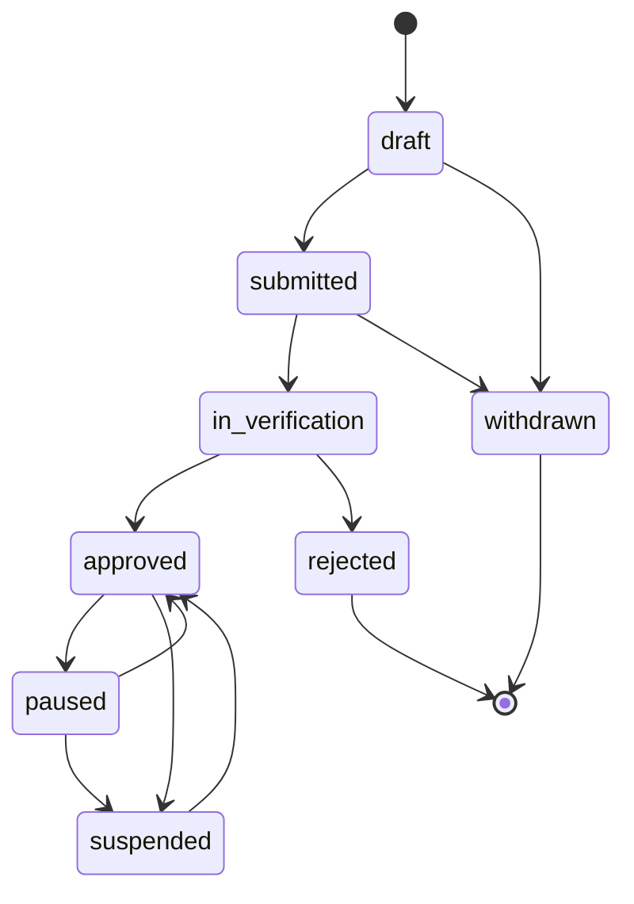
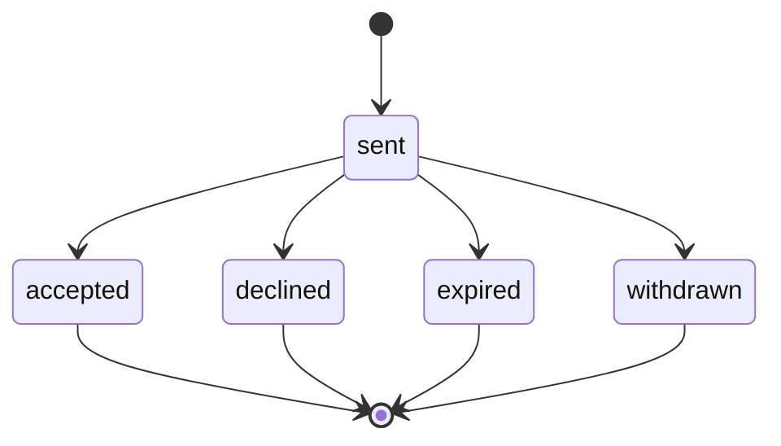
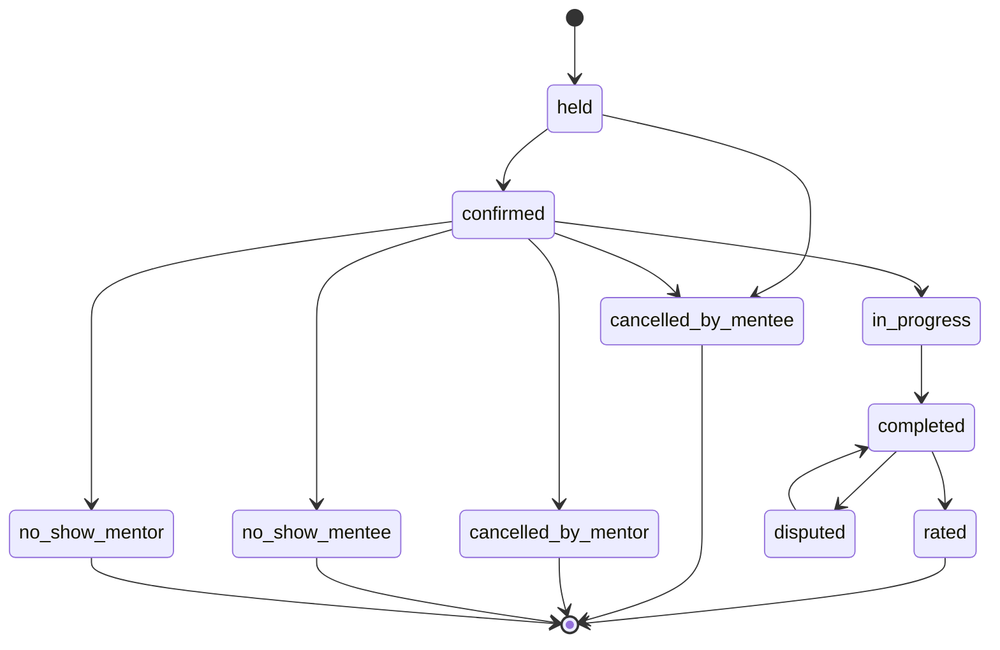
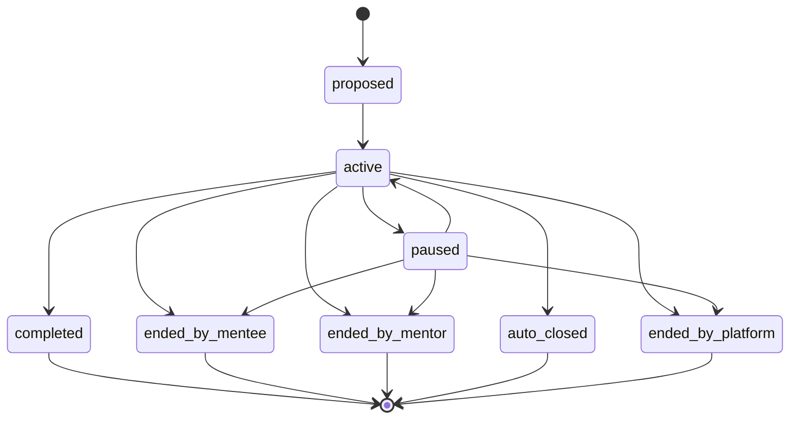
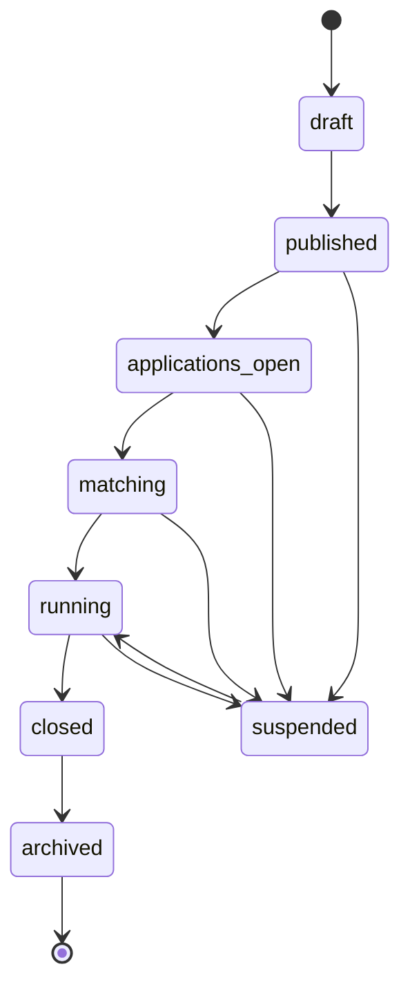
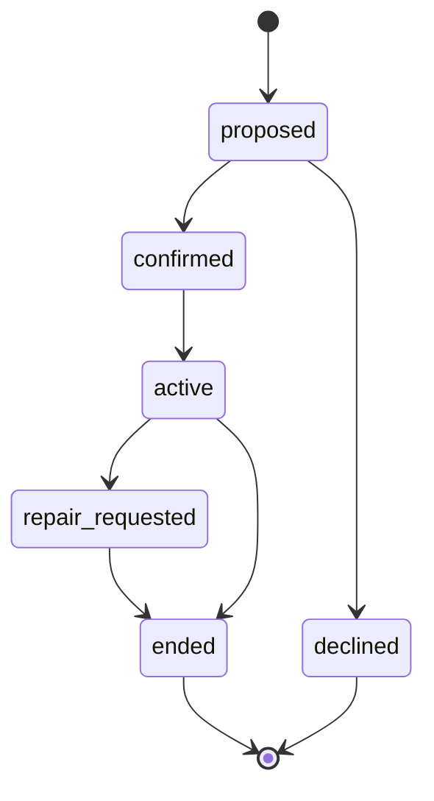
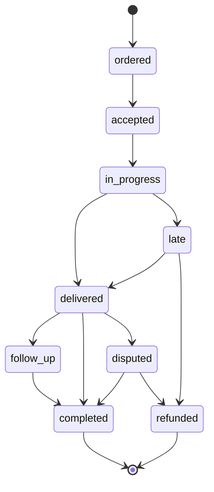
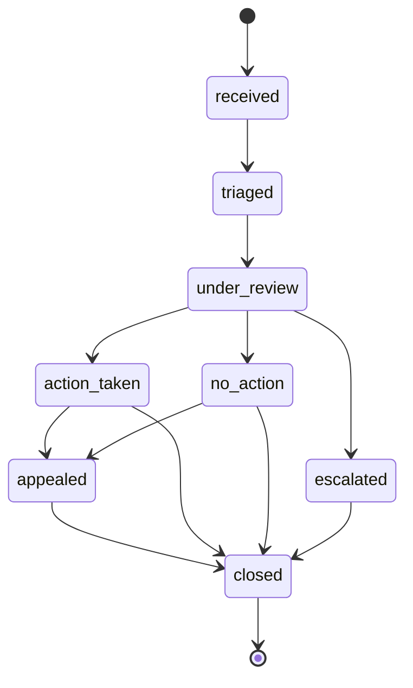
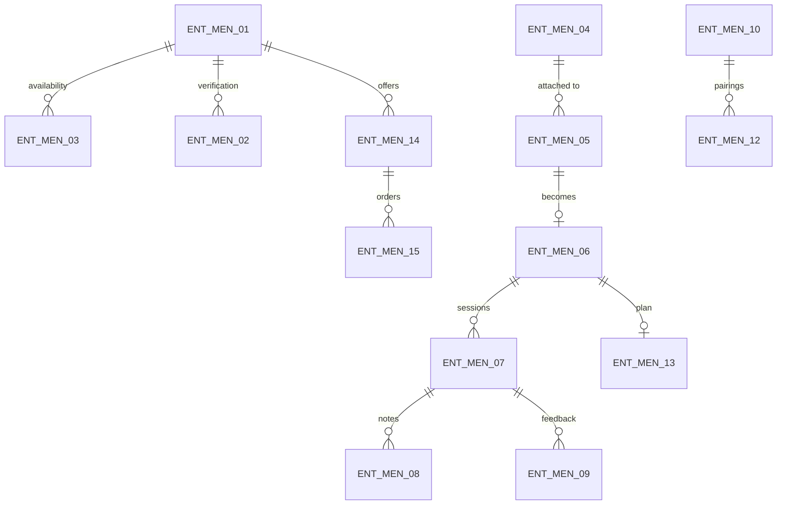

# MEN — Mentorship, Coaching & Career Services

Module code: `MEN` · Group: OS expansion · Release tier: R6 (OS expansion); free peer and program mentorship could ship at R4 if `OD-MEN-01` selects slice B.

**Scope status: PROPOSED expansion module.** The stakeholder goal is an "operating system" for the whole career domain, which exceeds the SSOT scope. SSOT does carry peer mentorship (F-90, Ph4), an expert network (F-108, F-170, Ph7), interview prep marketplace (F-126) and professional development plans (F-156). A paid coaching marketplace is not in SSOT and brushes the §4.2 non-goal "general-purpose marketplace". This file specifies the full module so a decision can be made, and gates everything behind `OD-MEN-01` (is the module in scope, and what is the minimal slice) per `DEC-002`. Nothing here claims that anything is built.

## 1. Purpose, outcomes and boundaries

### 1.1 Purpose

MEN connects people who want career guidance with people who can give it, and wraps the relationship with goals, sessions, notes, feedback, safeguards and, where allowed, payment. It also lets institutions and employers run structured mentorship programs for their own people. Services are limited to career guidance: mentoring, coaching, resume review, mock interviews and expert Q&A. [SRC: SSOT F-90, F-108, F-126, F-156, F-170; BR-194, BR-245] · [PROP]

### 1.2 Outcomes

| Outcome                                                                           | How the system knows                                                              |
| --------------------------------------------------------------------------------- | --------------------------------------------------------------------------------- |
| A candidate finds a suitable, verified mentor or coach                            | Mentorship request accepted (SM-MEN-02) and first session `completed` (SM-MEN-03) |
| Mentees leave sessions with agreed actions                                        | Action items created and tracked (FR-MEN-017)                                     |
| Program owners run cohort mentoring with visible participation but no snooping    | Program metrics without note content (BR-MEN-017)                                 |
| Trust and safety hold: vetted mentors, safe handling of minors, working reporting | Verification completion, report resolution times                                  |
| Paid sessions flow through the platform with fair cancellation and refunds        | Orders paid, payouts via BIL                                                      |

### 1.3 Boundaries

**In scope (owned):** mentor application, verification and listing; availability and pricing; discovery and matching; mentee intake; requests; session booking, logistics, notes, feedback; long-running mentorship relationships; programs run by institutions and employers; goals and action plans for mentorship; resume review and mock interview services; coaching packages; group sessions and office hours; expert call requests; safeguarding workflow; mentor quality management; session disputes; mentor dashboards.

**Out of scope (owned elsewhere):**

| Capability                                  | Owner                          | Relationship                                                   |
| ------------------------------------------- | ------------------------------ | -------------------------------------------------------------- |
| Payments, refunds, payouts, fees            | BIL (this batch)               | MEN creates orders and earning events (FR-BIL-028, FR-BIL-029) |
| Identity checks, background checks          | BGV (planned), IDN (planned)   | MEN requests and reads outcomes                                |
| Messaging threads and attachments           | MSG (planned)                  | MEN uses conversations                                         |
| Video meeting infrastructure                | PLT (planned) or external link | See OD-MEN-03 (SSOT OD-33 defers live video)                   |
| Calendar and scheduling primitives          | INT (planned)                  | MEN reuses availability and calendar sync                      |
| Moderation queue and enforcement            | TSF (planned)                  | MEN raises reports; TSF decides                                |
| Professional development plan, career goals | AIC, MKT (planned)             | MEN links to plans (FR-MEN-017)                                |
| Interview engine, AI feedback               | ASM, AIC (planned)             | MEN mock interviews can embed these                            |
| Alumni network and groups                   | NET (planned)                  | MEN provides mentoring on top of affiliation                   |
| Notifications                               | NTF (planned)                  | MEN emits events                                               |

**Non-goal brushes (SSOT §4.2):** (1) _General marketplace_: MEN lists only career-guidance services from an allowlist of categories (BR-MEN-027). (2) _Social network clone_: no feeds or public follows; discovery is a directory. (3) _Generic HR system_: employer-run programs use mentoring tools only, no performance reviews or HR records. Recorded as `OD-MEN-02`.

## 2. Roles and permission matrix

Legend: C create, R read, U update, D delete or withdraw, A approve or act, `own` own record, `—` none.

| Capability                               | CAN / STD | MNT               | IAD / EAD (program admin) | PLO                | REC / HMG   | FIN  | MOD                    | PAD              | SUP              |
| ---------------------------------------- | --------- | ----------------- | ------------------------- | ------------------ | ----------- | ---- | ---------------------- | ---------------- | ---------------- |
| Apply as mentor                          | C own     | —                 | —                         | —                  | —           | —    | —                      | —                | —                |
| Verify mentor                            | —         | respond           | —                         | —                  | —           | —    | A (safeguarding items) | A                | R                |
| Edit mentor profile and availability     | —         | U own             | —                         | —                  | —           | —    | —                      | override (audit) | —                |
| Search mentor directory                  | R         | R                 | R                         | R                  | R (limited) | —    | R                      | R                | R                |
| Create mentee intake, request mentorship | C own     | C own (as mentee) | —                         | —                  | —           | —    | —                      | —                | —                |
| Accept, decline, end mentorship          | respond   | A                 | —                         | —                  | —           | —    | —                      | override         | —                |
| Book, cancel, reschedule session         | C, U own  | U own             | —                         | —                  | —           | —    | —                      | override         | assist (audited) |
| Pay for session, request refund          | C own     | —                 | —                         | —                  | —           | A    | —                      | A                | —                |
| Session notes (private)                  | C own     | C own             | —                         | —                  | —           | —    | —                      | —                | —                |
| Shared notes, action items               | C, U      | C, U              | —                         | —                  | —           | —    | —                      | —                | —                |
| Rate and give feedback                   | C own     | C own             | —                         | —                  | —           | —    | —                      | R                | R                |
| Create and run program                   | —         | —                 | C, U, A (own org)         | R, U (institution) | —           | —    | —                      | R                | R                |
| Enroll in program                        | C own     | C own (as mentor) | A                         | A                  | —           | —    | —                      | —                | —                |
| Offer resume review, mock interview      | —         | C own             | —                         | —                  | —           | —    | —                      | —                | —                |
| Report safeguarding concern              | C         | C                 | C                         | C                  | C           | —    | A                      | A                | C                |
| Suspend mentor                           | —         | —                 | —                         | —                  | —           | —    | A                      | A                | —                |
| Mentor earnings                          | —         | R own             | —                         | —                  | —           | R, A | —                      | R                | —                |

Notes: `MNT` is a role granted when a mentor application is approved; every `MNT` is also a `CAN`. Mentors never see a mentee's applications, messages or private evidence; they see only fields the mentee puts in the request (BR-MEN-022). Program admins never read session notes (BR-MEN-017). `REC` and `HMG` may appear as mentors but follow conflict-of-interest rules (BR-MEN-003).

## 3. Sub-module map

| Code | Sub-module                            | Features          |
| ---- | ------------------------------------- | ----------------- |
| A    | Mentor onboarding and trust           | FR-MEN-001 to 003 |
| B    | Discovery, matching and requests      | FR-MEN-004 to 007 |
| C    | Sessions                              | FR-MEN-008 to 012 |
| D    | Programs and peer mentorship          | FR-MEN-013 to 016 |
| E    | Goals and relationships               | FR-MEN-017 to 018 |
| F    | Career services                       | FR-MEN-019 to 022 |
| G    | Marketplace rules, safety and quality | FR-MEN-023 to 028 |

## 4. Feature specifications

### A. Mentor onboarding and trust

### FR-MEN-001 — Mentor application and profile

- **Sub-module:** A. Mentor onboarding and trust
- **Priority / tier:** Must · R6 (R4 for free peer slice)
- **Source:** [SRC: SSOT F-90, F-108; data `mentor_profiles`] · [PROP] application detail
- **Purpose and outcome:** A professional applies to mentor and builds a listing. Known by application `submitted` and a draft profile.
- **Roles and permissions:** `CAN: apply` · `MNT: edit profile` · `PAD, MOD: review` · `GUE: view published listings`
- **Preconditions and entry points:** Signed-in user with a verified email and an existing profile (PRF planned) with at least a headline and one work-history entry. `/mentoring/become-a-mentor`.
- **User interactions and actions:** 1. Choose mentoring type: free peer mentor, paid mentor or coach, program-only mentor. 2. Enter expertise areas (from the skills taxonomy and the service category allowlist), industries, seniority, languages, who they help (students, career changers, returners, leaders), a bio (up to 1500 chars), a how-I-work statement, session formats offered, and optional intro video link. 3. For paid: set rate (FR-MEN-003). 4. Accept mentor code of conduct and safeguarding policy. 5. Disclose conflicts (current employer, recruiting role). 6. Submit.
- **System behaviour:** Creates `ENT-MEN-01` draft, then application `submitted` triggers verification (FR-MEN-002). Claims in the bio are scanned for prohibited claims (guaranteed jobs, guaranteed salary) (BR-MEN-024) and regulated-advice terms (BR-MEN-027); hits block submit with an explanation. Published listing shows verification badges earned and rating once available. Mentor can pause listing at any time without losing data.
- **UI elements and controls:** Multi-step form, tag inputs, text areas with counters, mentoring-type radio, conflict disclosure checkbox group, code-of-conduct checkbox (unchecked), "Preview listing", "Submit application".
- **Configuration options:** Platform: category allowlist, maximum expertise tags (default 10), bio limit.
- **Business rules:** BR-MEN-001, BR-MEN-003, BR-MEN-013, BR-MEN-024, BR-MEN-027
- **Validation:** Bio 100-1500 chars; 1-10 expertise tags; at least one language; rate within platform bounds if paid; intro video link https from allowed hosts.
- **Inputs and outputs:** In: profile data. Out: application record and listing preview.
- **Filters, sorting, search:** n/a — single-user form.
- **Notifications and communication:** `men.application.received` (transactional), `men.application.decided`.
- **Error handling and edge cases:** Existing active application: resume it. Profile lacks work history: prompt with link to add. Prohibited claim: field-level error with the phrase highlighted. Application withdrawn: record kept 90 days.
- **Dependencies:** PRF, EVD (planned), FR-MEN-002; `ENT-MEN-01`.
- **Security and privacy:** Listing is Public only after approval; draft is private; conflicts are visible to admins and shown to mentees as a disclosure line.
- **Acceptance criteria:**
  - Given a complete application, when submitted, then it enters verification and the user sees the status page.
  - Given a bio promising a guaranteed job, when submitted, then it is blocked with the rule explanation.
  - Given a user without work history, when they start, then they are asked to complete it first.

### FR-MEN-002 — Mentor verification and vetting

- **Sub-module:** A. Mentor onboarding and trust
- **Priority / tier:** Must · R6
- **Source:** [PROP]; [SRC: SSOT F-108 "verified advisors"; BGV planned]
- **Purpose and outcome:** Mentors are checked proportionately to what they will do. Known by a verification level on the listing.
- **Roles and permissions:** `MNT: submit evidence` · `PAD, MOD: review and decide` · `SUP: read`
- **Preconditions and entry points:** Submitted application. `/admin/mentoring/applications`.
- **User interactions and actions:** Applicant: 1. Complete identity verification (IDN or BGV). 2. Link or verify employment or credentials (EVD planned) or provide two peer vouchers who are existing verified users. 3. Where the mentor will work with minors or run paid sessions, consent to the enhanced check available in their country (BGV). Reviewer: 4. See checklist, evidence and conflict disclosures. 5. Approve at a level, request more, or reject with reason.
- **System behaviour:** Levels: `L1 identified` (identity), `L2 verified experience` (L1 plus employment or credential verified), `L3 vetted` (L2 plus enhanced check or interview). Free peer mentoring needs L1 and a code-of-conduct acceptance; paid sessions need L2; minors need L3 (BR-MEN-001, BR-MEN-002). Verification expires after 12 months and re-check is prompted at 60 days before (BR-MEN-019). Reviewers cannot approve their own connections. Reject reasons are visible to the applicant; internal notes are not.
- **UI elements and controls:** Applicant checklist with statuses; reviewer view with evidence panes, level selector, decision buttons, internal notes.
- **Configuration options:** Platform: level requirements per capability (above defaults), expiry months (default 12).
- **Business rules:** BR-MEN-001, BR-MEN-002, BR-MEN-019
- **Validation:** Level cannot exceed evidence; decisions require reason text for reject (10-1000 chars).
- **Inputs and outputs:** In: evidence, decisions. Out: verification level and badge.
- **Filters, sorting, search:** Queue by status, level requested, age.
- **Notifications and communication:** `men.verification.update`, `men.verification.expiring` at 60 and 14 days (transactional).
- **Error handling and edge cases:** Enhanced check unavailable in the country: L3 not obtainable; mentor limited to non-minor work. Verification lapses: listing auto-paused with existing sessions honored for 14 days, then reassigned or refunded.
- **Dependencies:** BGV, EVD, IDN (planned), FR-MEN-001; `ENT-MEN-02`.
- **Security and privacy:** Evidence Confidential; check results stored as pass or fail with reference, never raw reports.
- **Acceptance criteria:**
  - Given a mentor at L1, when they try to enable paid sessions, then it is refused until L2.
  - Given a verification that expires, when 60 days remain, then a reminder is sent once and again at 14 days.
  - Given a reviewer connected to the applicant, when they try to decide, then the system refuses.

### FR-MEN-003 — Availability, rates and calendar

- **Sub-module:** A. Mentor onboarding and trust
- **Priority / tier:** Must · R6
- **Source:** [PROP]; calendar mechanics shared with INT (planned)
- **Purpose and outcome:** A mentor defines when and for how much they can be booked. Known by bookable slots appearing to mentees in their time zone.
- **Roles and permissions:** `MNT: manage own` · `PAD: override with audit`
- **Preconditions and entry points:** Approved mentor. `/mentoring/availability`.
- **User interactions and actions:** 1. Connect a calendar (OAuth read free/busy and write events). 2. Set weekly recurring hours and date overrides. 3. Set session types (intro 15 min free or paid, standard 45 min, deep dive 90 min), buffer, notice period, booking horizon, daily maximum. 4. Set rate per session type or "free". 5. Set capacity limits: maximum active mentees. 6. Pause bookings.
- **System behaviour:** Slots are computed in the mentor's time zone and displayed in the viewer's. Free/busy from the calendar blocks slots; no event details are read. Slot holds last 10 minutes at checkout (BR-MEN-026). Rate changes affect new bookings only. Capacity: new relationship requests are refused when `max_active_mentees` is reached (BR-MEN-011).
- **UI elements and controls:** Weekly grid editor, override calendar, session type table, rate inputs with currency, capacity input, pause toggle.
- **Configuration options:** Platform: rate bounds per currency, default buffer 10 minutes, maximum horizon 90 days, default mentee capacity 10 (`[PROP]`).
- **Business rules:** BR-MEN-011, BR-MEN-013, BR-MEN-025, BR-MEN-026
- **Validation:** Duration 15-180 minutes in 15-minute steps; rate within bounds; notice at least 2 hours.
- **Inputs and outputs:** In: schedule and rates. Out: slot feed.
- **Filters, sorting, search:** n/a — settings.
- **Notifications and communication:** `men.calendar.disconnected` (in-app and email).
- **Error handling and edge cases:** Calendar token expires: slots narrowed to manual hours with warning. Daylight-saving shifts: rules stored with time zone, not offsets. Paid sessions in an unsupported payout country: rate field disabled with reason.
- **Dependencies:** INT (planned) calendar service, BIL FR-BIL-029; `ENT-MEN-03`.
- **Security and privacy:** Free/busy only; tokens in secret store.
- **Acceptance criteria:**
  - Given a calendar event, when slots compute, then that time is not offered.
  - Given a rate change, when a pending booking exists, then it keeps the old price.
  - Given capacity reached, when a new request arrives, then the mentee sees "not accepting new mentees".

### B. Discovery, matching and requests

### FR-MEN-004 — Mentor directory and search

- **Sub-module:** B. Discovery, matching and requests
- **Priority / tier:** Must · R6
- **Source:** [PROP]; relates to SRC (planned) search module
- **Purpose and outcome:** Mentees find mentors by need. Known by relevant results with transparent ranking.
- **Roles and permissions:** `GUE: limited view` · `CAN, STD: full view` · `REC, HMG: view`
- **Preconditions and entry points:** `/mentoring`.
- **User interactions and actions:** 1. Type a need or pick a category. 2. Filter by expertise, industry, seniority, language, price range, free or paid, session format, availability in the next 7 days, verification level, program-only excluded. 3. Sort by best match, rating, price, soonest availability. 4. Open a mentor profile.
- **System behaviour:** Ranking uses relevance, availability and rating with minimum-evidence smoothing; no payment or promotion influences rank (BR-MEN-012). Only approved, unpaused, non-suspended mentors appear. Guests see headline, expertise, rating and price but not full profile or booking. Mentors with L3 show a badge, not a rank boost.
- **UI elements and controls:** Search box, filter panel (collapsible on mobile), result cards (photo, headline, expertise, rating count, price, next slot), sort select, pagination.
- **Configuration options:** Platform: ranking weights (documented, not secret), result page size 20.
- **Business rules:** BR-MEN-012
- **Validation:** Price range min at most max; query up to 200 chars.
- **Inputs and outputs:** In: query and filters. Out: ranked mentor list with "why this result" text.
- **Filters, sorting, search:** As above.
- **Notifications and communication:** n/a — read-only.
- **Error handling and edge cases:** No results: suggest broadening filters and offer "post a request" (FR-MEN-005 broadcast, if enabled). Mentor pauses during browsing: profile shows "not accepting bookings".
- **Dependencies:** SRC (planned), FR-MEN-001, FR-MEN-003; `ENT-MEN-01`.
- **Security and privacy:** Listing shows only mentor-approved public fields; no email or contact links.
- **Acceptance criteria:**
  - Given two mentors where one pays nothing and one is higher rated, when sorted by best match, then no payment signal affects order.
  - Given a suspended mentor, when searching, then they never appear.
  - Given a guest, when opening a profile, then booking requires sign-in.

### FR-MEN-005 — Mentee intake and goals

- **Sub-module:** B. Discovery, matching and requests
- **Priority / tier:** Must · R6
- **Source:** [PROP]; [SRC: SSOT F-156 PDP, F-95 career transition]
- **Purpose and outcome:** A mentee states what help they want so matching and the first session are focused. Known by a saved intake used in matching and requests.
- **Roles and permissions:** `CAN, STD: create, edit own` · `MNT: view only what is attached to a request`
- **Preconditions and entry points:** First time requesting mentorship, or `/mentoring/intake`.
- **User interactions and actions:** 1. Choose goals (explore a field, switch careers, prepare for interviews, grow in role, return after a break, entrepreneurship guidance). 2. Describe the situation (up to 800 chars). 3. Select desired skills, industries and mentor traits. 4. Select availability windows and budget range or "free only". 5. Choose which profile fields a mentor may see (headline, skills, target role, resume, none). 6. Save.
- **System behaviour:** Saves `ENT-MEN-04`; pre-fills from the profile target role and skills gaps if the user opts in. The intake is not visible to anyone until the mentee attaches it to a request. Free-text is scanned for sensitive categories (health, immigration status details) and the user is warned that the mentor will see it (BR-MEN-022).
- **UI elements and controls:** Goal chips, text area with counter, tag inputs, budget slider, visibility checkboxes, "Save" and "Find mentors".
- **Configuration options:** Platform: goal list.
- **Business rules:** BR-MEN-022
- **Validation:** At least one goal; situation 20-800 chars; budget non-negative.
- **Inputs and outputs:** In: intake. Out: stored intake and match query.
- **Filters, sorting, search:** n/a — form.
- **Notifications and communication:** n/a.
- **Error handling and edge cases:** Sensitive keywords: warning with option to edit. User edits intake after a request is sent: the request keeps the snapshot sent.
- **Dependencies:** PRF, AIC (planned); `ENT-MEN-04`.
- **Security and privacy:** Intake is private by default; deleted with account.
- **Acceptance criteria:**
  - Given a saved intake, when no request is made, then no mentor can read it.
  - Given an intake edited after sending, when the mentor opens the request, then they see the snapshot as sent.
  - Given no goal selected, when saving, then an error shows.

### FR-MEN-006 — Explainable mentor matching

- **Sub-module:** B. Discovery, matching and requests
- **Priority / tier:** Should · R6
- **Source:** [PROP]; [SRC: SSOT AI principles: no ungoverned autonomous decisions, explainability]
- **Purpose and outcome:** The system suggests mentors who fit a mentee's intake and says why. Known by a top-5 list with reasons.
- **Roles and permissions:** `CAN, STD: view own suggestions` · `PAD: view model config` · `MNT: none`
- **Preconditions and entry points:** A saved intake. `/mentoring/suggestions`, program pairing (FR-MEN-014).
- **User interactions and actions:** 1. Open suggestions. 2. Read reasons per mentor ("Works in data engineering, speaks Hindi, available this week, helped 8 career changers"). 3. Dismiss ("not relevant", with optional reason), save, or request.
- **System behaviour:** Scores by skills overlap, goal fit, language, time-zone overlap, budget fit, mentor capacity, mentor experience with similar mentees. Excludes mentors with conflicts (same employer as the mentee's current employer when the mentee asked for confidentiality; mentors the mentee blocked). No paid placement (BR-MEN-012). Feedback on dismissals tunes weights per user only. Reasons are generated from the actual features used. A person, not the score, decides; nothing is auto-requested.
- **UI elements and controls:** Suggestion cards with reason bullets, "Request", "Dismiss" and "Save" buttons, "Why am I seeing this" link.
- **Configuration options:** Platform: weights (documented), maximum suggestions 5.
- **Business rules:** BR-MEN-012, BR-MEN-022
- **Validation:** n/a — read-only suggestions; dismissal reason up to 200 chars.
- **Inputs and outputs:** In: intake. Out: ranked suggestions with reasons.
- **Filters, sorting, search:** n/a — fixed list.
- **Notifications and communication:** `men.suggestions.ready` (in-app; opt-out class: recommendations).
- **Error handling and edge cases:** No matches: say so and suggest broadening or program options. Reasons unavailable: suggestion is not shown (no unexplained results).
- **Dependencies:** AIC (planned), FR-MEN-005; `ENT-MEN-04`.
- **Security and privacy:** Uses only intake and public listings; no private messages.
- **Acceptance criteria:**
  - Given a suggestion, when shown, then at least two real matching features are listed as reasons.
  - Given a blocked mentor, when suggestions compute, then the mentor is excluded.
  - Given a mentor who paid for nothing and one who bought a plan, when scored, then plan status has no effect.

### FR-MEN-007 — Mentorship request, intro call and acceptance

- **Sub-module:** B. Discovery, matching and requests
- **Priority / tier:** Must · R6
- **Source:** [SRC: SSOT Mentorship states requested, active, completed, declined (BR-194 area)] · [DER]
- **Purpose and outcome:** A mentee asks a mentor to work with them, and the mentor answers. Known by SM-MEN-02 reaching `accepted` or `declined`.
- **Roles and permissions:** `CAN, STD: send` · `MNT: accept, decline` · `PAD: read on report`
- **Preconditions and entry points:** Mentor profile "Request mentorship", suggestion cards.
- **User interactions and actions:** 1. Mentee writes a message (200-1000 chars) stating goals and what they want from the relationship, attaches the intake snapshot and picks shared fields, selects the preferred starting point (free intro call, paid first session, or just a chat). 2. Sends. 3. Mentor sees the request with mentee fields, accepts, declines (with a templated reason and optional note), or proposes an intro slot. 4. On acceptance, a mentorship record starts (FR-MEN-018).
- **System behaviour:** A mentee has at most 5 pending requests (BR-MEN-011 variant) and one per mentor within 30 days after a decline. Requests expire after 7 days unanswered (auto `expired`, mentee notified, can re-request elsewhere). Contact information in the first message is masked (BR-MEN-004). Messages use MSG threads. Decline reasons are limited to templates so rejection is not personal.
- **UI elements and controls:** Request form with character counters, field-sharing checkboxes, starting-point radio; mentor inbox with Accept, Decline, "Suggest a time" buttons.
- **Configuration options:** Platform: pending limit 5, expiry days 7, cooldown 30 days.
- **Business rules:** BR-MEN-004, BR-MEN-011, BR-MEN-022
- **Validation:** Message length; fields from the allowed list; no URLs to off-platform contact handles in first message.
- **Inputs and outputs:** In: request. Out: mentorship request record and thread.
- **Filters, sorting, search:** Mentor inbox filters by state, age.
- **Notifications and communication:** `men.request.received` to mentor, `men.request.accepted`, `men.request.declined`, `men.request.expired` (in-app and email, transactional).
- **Error handling and edge cases:** Mentor at capacity: request blocked at send. Mentor suspended after receipt: request auto-expired with notice. Mentee blocked the mentor: send blocked.
- **Dependencies:** MSG (planned), FR-MEN-003, FR-MEN-018; `ENT-MEN-05`.
- **Security and privacy:** Mentor sees only fields shared; contact details masked pre-booking.
- **Acceptance criteria:**
  - Given 5 pending requests, when the mentee sends a sixth, then it is refused with the limit message.
  - Given a request unanswered for 7 days, when the sweep runs, then it expires and the mentee is notified.
  - Given a phone number in the first message, when sent, then it is masked and the user told why.

### C. Sessions

### FR-MEN-008 — Session booking, rescheduling and cancellation

- **Sub-module:** C. Sessions
- **Priority / tier:** Must · R6
- **Source:** [PROP]; [SRC: SSOT Mentorship Session states rated, declined, cancelled]
- **Purpose and outcome:** Mentee and mentor agree a time and both can change it under clear rules. Known by SM-MEN-03 states.
- **Roles and permissions:** `CAN, STD, MNT: book, reschedule, cancel own` · `SUP: assist (audited)` · `PAD: override`
- **Preconditions and entry points:** Accepted mentorship, or direct booking of a public session type that allows direct booking (intro, resume review, group).
- **User interactions and actions:** 1. Choose session type and slot. 2. Add an agenda (up to 500 chars). 3. Pay if paid (FR-MEN-009). 4. Receive confirmation with calendar invite. 5. Reschedule (up to 2 times, at least 24 hours before). 6. Cancel with reason.
- **System behaviour:** Slot hold 10 minutes; booking is atomic so a slot cannot be double-booked (BR-MEN-026). Cancellation rules (BR-MEN-008): mentee cancels at least 24 hours before for full refund; later is non-refundable except for emergencies reviewed by `FIN`; mentor cancels at any time with full refund and a counter against their reliability score (three late cancels in 90 days trigger review). No-show: if one party is absent 15 minutes after start and the other waited, the absent party is marked no-show; mentee no-show forfeits payment, mentor no-show refunds fully. Times stored in UTC with each participant's time zone.
- **UI elements and controls:** Slot picker by day with time zone label, agenda field, booking summary, "Reschedule" and "Cancel session" actions with policy text shown before confirm.
- **Configuration options:** Platform: cancel window (default 24 h), reschedule limit (2), no-show wait (15 min), late-cancel threshold (3 in 90 days).
- **Business rules:** BR-MEN-008, BR-MEN-025, BR-MEN-026
- **Validation:** Slot within horizon and notice; agenda length; one booking per slot.
- **Inputs and outputs:** In: slot, type, agenda. Out: session record, invites.
- **Filters, sorting, search:** Session list by upcoming, past, status.
- **Notifications and communication:** `men.session.booked`, `men.session.reminder` at 24 h and 1 h, `men.session.rescheduled`, `men.session.cancelled`, `men.session.no_show` (transactional).
- **Error handling and edge cases:** Slot taken during checkout: user sees "That time was just booked" and options. Payment fails: hold released. Calendar write fails: session still confirmed, in-app calendar entry and retry.
- **Dependencies:** FR-MEN-003, FR-MEN-009, INT (planned), NTF; `ENT-MEN-07`.
- **Security and privacy:** Participant-only; audit of changes.
- **Acceptance criteria:**
  - Given two users booking the same slot, when both pay, then exactly one booking is confirmed and the other is released.
  - Given a mentee cancelling 30 hours before, when confirmed, then a full refund is initiated.
  - Given a mentor no-show, when marked, then the mentee is refunded and the mentor's reliability counter increments.

### FR-MEN-009 — Session payment and mentor fees

- **Sub-module:** C. Sessions
- **Priority / tier:** Should · R6
- **Source:** [PROP]; [SRC: BR-101 revenue share 70/30 default for courses; OD-28]
- **Purpose and outcome:** Paid sessions are paid through the platform and the mentor is paid after delivery. Known by an order paid and an earning event on completion.
- **Roles and permissions:** `CAN, STD: pay` · `MNT: view earnings` · `FIN: refunds, fees`
- **Preconditions and entry points:** Paid session type; mentor L2 or higher with completed payout onboarding (BIL).
- **User interactions and actions:** 1. See total (price, tax, platform fee shown to the mentor not the mentee unless required). 2. Pay through checkout (FR-BIL-028). 3. Session happens. 4. After completion, funds move to mentor balance with hold.
- **System behaviour:** Order created via BIL with the session as product; fulfillment confirms the booking on payment (webhook-owned). On `completed`, an earning event posts to the mentor net of the platform fee parameter (default commission `[PROP]` 20 percent; OD-MEN-04). Refunds route via FR-BIL-016 and claw back. Free sessions skip payment. Packages (FR-MEN-021) prepay several sessions. Tips are not offered at launch (OD-MEN-04).
- **UI elements and controls:** Price breakdown, pay button, receipt link, mentor earnings line per session.
- **Configuration options:** Platform: fee percent, minimum price, currency list.
- **Business rules:** BR-MEN-004, BR-MEN-008, BR-MEN-013, BR-MEN-028
- **Validation:** Price at least platform minimum; payout country supported.
- **Inputs and outputs:** In: booking. Out: order, earning event.
- **Filters, sorting, search:** Earnings by period.
- **Notifications and communication:** `men.payment.received` to mentor (in-app), receipts via BIL.
- **Error handling and edge cases:** Payment succeeds but fulfillment fails: BIL retry, mentee told "activating". Mentor payout onboarding incomplete: paid listing blocked at publish. Currency mismatch: charged in the mentee's currency with mentor payout in theirs per BIL.
- **Dependencies:** BIL FR-BIL-028, FR-BIL-029, FR-BIL-016; `ENT-MEN-07`.
- **Security and privacy:** No card data; earnings visible to mentor and `FIN` only.
- **Acceptance criteria:**
  - Given a paid booking, when the webhook confirms payment, then the session becomes `confirmed` once.
  - Given a completed session, when the hold period passes, then the mentor balance becomes available.
  - Given a refund after payout, when processed, then a clawback is recorded.

### FR-MEN-010 — Session room, logistics and recording policy

- **Sub-module:** C. Sessions
- **Priority / tier:** Should · R6
- **Source:** [PROP]; [SRC: SSOT OD-33 live video deferred, OD-48 recording default off]
- **Purpose and outcome:** Both sides join the session simply and safely. Known by a join link that works for the session window only.
- **Roles and permissions:** `participants: join` · `program admin: none (BR-MEN-017)` · `MOD: no access unless a report is open and participants consent or policy allows`
- **Preconditions and entry points:** Confirmed session. Join button on session page from 10 minutes before start.
- **User interactions and actions:** 1. Click "Join session". 2. Check camera and microphone in a pre-join screen. 3. Meet. 4. Use shared agenda panel and notes. 5. Optionally propose recording; the other side accepts or declines. 6. End; both are prompted for notes and feedback.
- **System behaviour:** Default (OD-MEN-03): the session page holds an external meeting link generated through an approved provider or the mentor's own link verified to be https from an allowlist; an in-platform room is a later option. Links are unique per session and valid from 15 minutes before to 30 minutes after. Recording is off; it starts only if both agree in-session, and the consent is stored (BR-MEN-010). Sessions with minors never record without guardian consent and a program policy, and must use platform links (BR-MEN-002). The system never records or transcribes for AI summaries without both consents.
- **UI elements and controls:** "Join session" button (enabled in window), pre-join device check, agenda panel, consent prompt for recording, "End session" button.
- **Configuration options:** Platform: meeting provider, link validity window, recording enabled by region.
- **Business rules:** BR-MEN-002, BR-MEN-010, BR-MEN-017
- **Validation:** Mentor-provided link must be https and on the allowlist; one link per session.
- **Inputs and outputs:** In: join actions. Out: attendance record (joined and left times).
- **Filters, sorting, search:** n/a — per session.
- **Notifications and communication:** `men.session.starting` to both at 10 minutes (in-app, push if enabled).
- **Error handling and edge cases:** Link fails: "Report problem" creates a ticket and offers a fallback link; session time extends by the lost minutes if both agree. One party joins late: the 15-minute rule of FR-MEN-008. Recording consent withdrawn mid-session: recording stops and the segment after withdrawal is not kept.
- **Dependencies:** PLT, INT (planned), FR-MEN-008; `ENT-MEN-07`.
- **Security and privacy:** Attendance logs kept 12 months; recordings (if any) encrypted, retained 30 days unless both download.
- **Acceptance criteria:**
  - Given a link used outside its validity window, when opened, then access is refused.
  - Given one party declining recording, when the session runs, then no recording occurs.
  - Given a minor participant without guardian recording consent, when a recording is proposed, then the option is unavailable.

### FR-MEN-011 — Session notes and shared action items

- **Sub-module:** C. Sessions
- **Priority / tier:** Must · R6
- **Source:** [PROP]
- **Purpose and outcome:** Each side keeps private notes and both share agreed outcomes. Known by notes stored and action items created.
- **Roles and permissions:** `CAN, MNT: private notes (own), shared notes and actions (both)` · `no one else`
- **Preconditions and entry points:** A session in `completed` or `in_progress` (notes may start during).
- **User interactions and actions:** 1. Write private notes (rich text up to 10,000 chars). 2. Write a shared summary and add action items (title, owner, due date, optional link to a goal). 3. The other side can edit action items they own or propose edits to others'. 4. Mark action items done.
- **System behaviour:** Private notes are encrypted and readable only by the author (BR-MEN-009); account deletion removes them; the mentor's private notes about a mentee are deleted at relationship close if the mentee requests so, otherwise after 12 months. Shared items sync to the goals plan (FR-MEN-017). No AI summarization unless both opt in per session and the processing is disclosed.
- **UI elements and controls:** Notes editor with private/shared tabs, action item list with checkboxes and due dates, "Share summary" button.
- **Configuration options:** Per user: AI summary opt-in (default off).
- **Business rules:** BR-MEN-009
- **Validation:** Due date not before today; action title 3-200 chars; max 20 action items per session.
- **Inputs and outputs:** In: notes, items. Out: stored notes and tasks.
- **Filters, sorting, search:** Search within own notes; action items by status.
- **Notifications and communication:** `men.action.assigned`, `men.action.due` (in-app, opt-out class: reminders).
- **Error handling and edge cases:** Conflict edit: later save asks to merge. Mentor removed from platform: mentee keeps shared notes, loses nothing else. Draft autosaves every 10 seconds locally.
- **Dependencies:** FR-MEN-017; `ENT-MEN-08`.
- **Security and privacy:** Private notes end-to-end scoped to author; excluded from moderation unless the author attaches them to a report.
- **Acceptance criteria:**
  - Given private notes, when the other participant requests them through the API, then 403.
  - Given an action item assigned to the mentee, when due tomorrow, then a reminder is sent once.
  - Given AI summary not opted in by both, when requested, then it is refused.

### FR-MEN-012 — Feedback and ratings

- **Sub-module:** C. Sessions
- **Priority / tier:** Must · R6
- **Source:** [SRC: SSOT Mentorship Session state "rated"; BR-095 pattern for course ratings requires verified enrolment] · [PROP] two-way design
- **Purpose and outcome:** Both sides rate and give feedback after sessions, improving trust and quality. Known by ratings tied to completed sessions.
- **Roles and permissions:** `CAN, MNT: rate each other` · `PAD, MOD: read, remove for policy breach` · `GUE: see aggregates`
- **Preconditions and entry points:** Completed session (not no-show, not cancelled). Prompt after session; `/mentoring/sessions/:id/feedback`.
- **User interactions and actions:** 1. Mentee gives 1-5 stars on preparedness, usefulness, communication; free text (up to 1000 chars); optional private feedback to the platform. 2. Mentor gives mentee feedback (attendance, preparation) visible only to the mentee plus a private note to the platform if needed. 3. Both choose to publish or keep feedback private.
- **System behaviour:** Ratings are hidden until both submit or 7 days pass (BR-MEN-007). One rating per session per rater. Published mentor aggregate uses minimum 3 ratings before showing a score. Abusive text is held for moderation. Mentors can reply once publicly. Retaliation or coercion to change a rating is a conduct breach. Rating cannot be edited after 14 days; the author can retract.
- **UI elements and controls:** Star inputs, text area, publish toggle, reply box for mentors, "Report this review".
- **Configuration options:** Platform: minimum ratings (3), reveal days (7), edit window (14).
- **Business rules:** BR-MEN-007, BR-MEN-025
- **Validation:** Stars 1-5 required; text up to 1000 chars; one per session.
- **Inputs and outputs:** In: feedback. Out: ratings, aggregates.
- **Filters, sorting, search:** Mentor profile reviews sorted by recent or helpful.
- **Notifications and communication:** `men.feedback.requested` at 1 hour and 3 days after session (opt-out class: reminders), `men.review.reply`.
- **Error handling and edge cases:** Only one side rates: after 7 days the single rating publishes. Review flagged: held until moderation decision. Mentor suspended: past reviews remain with a note.
- **Dependencies:** TSF (planned), FR-MEN-025; `ENT-MEN-09`.
- **Security and privacy:** Private platform feedback is Restricted and never shown to the other party.
- **Acceptance criteria:**
  - Given a mentee who rated, when the mentor has not, then the rating stays hidden until the mentor rates or 7 days pass.
  - Given a no-show session, when feedback is requested, then it is refused.
  - Given 2 ratings, when the profile renders, then no average score is shown.

### D. Programs and peer mentorship

### FR-MEN-013 — Mentorship program creation (institution or employer run)

- **Sub-module:** D. Programs and peer mentorship
- **Priority / tier:** Should · R6 (R4 under slice B)
- **Source:** [SRC: SSOT F-90, F-125, F-40 alumni mentorship; BR-245] · [PROP] program mechanics
- **Purpose and outcome:** An institution, employer or community organizer runs a cohort mentoring program with its own mentors and mentees. Known by a published program with enrollment windows.
- **Roles and permissions:** `IAD, PLO (institution programs): create, manage` · `EAD (employer programs): create, manage` · `PAD: read, suspend` · `CAN, STD, MNT: view and apply`
- **Preconditions and entry points:** Verified institution (INS) or employer organization (EMP planned). `/programs/new` from the institution or employer console.
- **User interactions and actions:** 1. Name the program, describe goals, set audience (institution batch, program, alumni, employees, open), dates (applications, matching, run, close), cadence expectations (sessions per month, duration), duration of pairing (for example 3 or 6 months), max mentees per mentor. 2. Choose pairing mode (admin assigns, preference-based matching, mentee picks from the program roster). 3. Define mentor requirements (verification level, prior experience) and mentee eligibility. 4. Set program rules (cadence check-ins, milestones, code of conduct additions). 5. Publish.
- **System behaviour:** Creates `ENT-MEN-10` following SM-MEN-05. Mentors from outside the organization pass at least L1 and program code-of-conduct acceptance; programs involving minors require L3 mentors, guardian consent (BR-INS-014) and platform-only sessions (BR-MEN-002). Employer programs forbid pairing a mentee with their own direct manager or anyone in their reporting line (BR-MEN-021). The program is free to participants; sessions are not paid through the platform unless the organizer chooses a paid-program model (OD-MEN-04). The platform treats an employer's compensation of internal mentors as the employer's matter (BR-MEN-030; payroll is a non-goal).
- **UI elements and controls:** Program wizard (Basics, Audience, Pairing, Rules, Review), date pickers, requirement selects, "Publish".
- **Configuration options:** Per program: all fields above; platform: maximum program duration (default 12 months), maximum participants by plan.
- **Business rules:** BR-MEN-002, BR-MEN-006, BR-MEN-017, BR-MEN-018, BR-MEN-021, BR-MEN-030
- **Validation:** Dates ordered; at least one mentor requirement set; max mentees per mentor 1-20; audience defined.
- **Inputs and outputs:** In: program definition. Out: published program page.
- **Filters, sorting, search:** Program list by status, audience, dates.
- **Notifications and communication:** `men.program.published` to eligible audience (opt-out class: opportunities), `men.program.closing`.
- **Error handling and edge cases:** Organizer's verification lapses: program paused, running pairings continue. Insufficient mentors at matching date: organizer warned and may extend. Program includes minors but no L3 mentors: publish blocked.
- **Dependencies:** INS, EMP (planned), FR-MEN-002, FR-MEN-014; `ENT-MEN-10`.
- **Security and privacy:** Organizer sees participation metrics, not content (BR-MEN-017).
- **Acceptance criteria:**
  - Given a program for minors, when published without L3 mentors, then publish is blocked.
  - Given an employer program, when pairing, then a mentee is never paired with their direct manager.
  - Given an organizer, when they open a session record, then notes are not accessible.

### FR-MEN-014 — Program enrollment and pairing

- **Sub-module:** D. Programs and peer mentorship
- **Priority / tier:** Should · R6
- **Source:** [PROP]
- **Purpose and outcome:** Participants join a program and are paired by the chosen mode. Known by pairings in `active`.
- **Roles and permissions:** `CAN, STD, MNT: apply` · `IAD, EAD, PLO: review and pair` · `participants: accept, request re-pair`
- **Preconditions and entry points:** Program with applications open. `/programs/:id/apply`.
- **User interactions and actions:** 1. Applicant completes a short form (goals or expertise, availability, preferences). 2. Organizer reviews and accepts. 3. At matching date the system proposes pairings with reasons (FR-MEN-006 logic) or assigns by organizer. 4. Both participants accept the pairing or request a change without giving a reason. 5. Kickoff message and first-session prompt appear.
- **System behaviour:** Follows SM-MEN-06. Preference-based mode runs a stable matching with mentor capacity and preferences, deterministic given inputs and stored with its parameters. Participants can request re-pair once at no cost, a second time with organizer approval (BR-MEN-018). Conflicts are removed before proposing (same reporting line, existing relationship, blocks). Unmatched applicants are told and offered waitlist or directory.
- **UI elements and controls:** Application form, organizer review table with bulk accept, pairing board with drag and drop, accept and "Request a different match" buttons.
- **Configuration options:** Per program: pairing mode, mentor capacity, rounds.
- **Business rules:** BR-MEN-018, BR-MEN-021, BR-MEN-022
- **Validation:** Application deadline respected; mentor not above capacity; participant not already paired in the same program.
- **Inputs and outputs:** In: applications. Out: pairings.
- **Filters, sorting, search:** Pairings by state, mentor, mentee; applicants by status.
- **Notifications and communication:** `men.program.accepted`, `men.pairing.proposed`, `men.pairing.confirmed` (transactional).
- **Error handling and edge cases:** Mentor withdraws mid-program: mentee re-paired with priority. Odd numbers: waitlist. Organizer overrides a pairing: both participants can still decline.
- **Dependencies:** FR-MEN-013, FR-MEN-006, FR-MEN-018; `ENT-MEN-11`, `ENT-MEN-12`.
- **Security and privacy:** Pairing reasons visible to the pair and organizer only.
- **Acceptance criteria:**
  - Given a mentor at capacity, when pairing runs, then they receive no further mentees.
  - Given a mentee requesting a first re-pair, when submitted, then the organizer cannot refuse it.
  - Given the same inputs, when pairing runs twice, then the result is identical.

### FR-MEN-015 — Program progress, milestones and organizer reporting

- **Sub-module:** D. Programs and peer mentorship
- **Priority / tier:** Should · R6
- **Source:** [PROP]
- **Purpose and outcome:** Organizers see whether pairs are active and what the program achieved, without reading private content. Known by dashboards with suppression rules.
- **Roles and permissions:** `IAD, EAD, PLO: view dashboard` · `participants: view own progress` · `PAD: read`
- **Preconditions and entry points:** Running program. `/programs/:id/dashboard`.
- **User interactions and actions:** 1. See counts: pairs active, sessions held per pair, overdue check-ins, milestone completion, participant satisfaction. 2. Open a pair's activity summary (dates and counts only). 3. Send a nudge to inactive pairs. 4. Close the program and view the final report.
- **System behaviour:** Metrics derive from session counts, attendance and milestone completion, never from notes. Cohorts under `min_cohort_k` are suppressed in exported reports (default 10, SRC V61-04). Inactive pairs (no session in 30 days, BR-MEN-005) are flagged and auto-closed after 30 days of inactivity for peer pairings with notice at 21 days. Final report includes outcomes surveys completed by participants (optional).
- **UI elements and controls:** Tiles, pair table with status chips, nudge dialog, export button.
- **Configuration options:** Per program: milestone definitions, inactivity thresholds (default 30 days).
- **Business rules:** BR-MEN-005, BR-MEN-017
- **Validation:** Nudge once per pair per 7 days.
- **Inputs and outputs:** In: filters. Out: metrics and reports.
- **Filters, sorting, search:** By pair state, mentor, cohort.
- **Notifications and communication:** `men.pair.inactive`, `men.pair.autoclose_warning`.
- **Error handling and edge cases:** Participants leave: pair closed with reason. Small cohort: export suppression note. Organizer wants notes for evaluation: refused; offers participant-submitted survey instead.
- **Dependencies:** FR-MEN-013, FR-MEN-018; ANL (planned).
- **Security and privacy:** Aggregates and activity metadata only.
- **Acceptance criteria:**
  - Given a pair without sessions for 21 days, when the sweep runs, then both receive the auto-close warning.
  - Given a cohort of 6, when exported, then metrics are suppressed.
  - Given an organizer requesting note content via the API, when called, then 403.

### FR-MEN-016 — Peer and alumni mentorship (free, opt-in)

- **Sub-module:** D. Programs and peer mentorship
- **Priority / tier:** Should · R4 under slice B, otherwise R6
- **Source:** [SRC: SSOT F-90, BR-194 30-day inactivity auto-close, BR-245 alumni mentorship opt-in, F-125, BR-241]
- **Purpose and outcome:** Peers and alumni offer free mentoring to each other inside trusted groups. Known by active free mentorships bounded by inactivity rules.
- **Roles and permissions:** `CAN, STD (alumni and peers): opt in, offer, request` · `IAD: enable per institution` · `PAD: read`
- **Preconditions and entry points:** Affiliation verified (INS, NET); user opted in to mentoring in settings. `/mentoring/peers`.
- **User interactions and actions:** 1. Opt in as peer or alumni mentor (L1 verification, code of conduct). 2. Set topics and capacity (default 3 mentees). 3. Mentees from the same affiliation find and request. 4. Sessions run by agreement; booking is optional (free, no payment). 5. Either side ends the relationship.
- **System behaviour:** Free peer mentorship uses the same request and session objects but no payment. A mentorship with no session or message for 30 days auto-closes with warning at 21 days (BR-MEN-005). Alumni mentorship is opt-in only and never defaults on at graduation (BR-MEN-006, BR-INS-016). Mentoring minors is not available in the peer mode. Affiliation is checked at request time and on relationship start; losing affiliation does not end existing relationships.
- **UI elements and controls:** Opt-in toggle, topic tags, capacity input, peers directory with affiliation badge.
- **Configuration options:** Per institution: peer mentoring enabled (default off), alumni visibility (public or private network per NET).
- **Business rules:** BR-MEN-005, BR-MEN-006, BR-MEN-002
- **Validation:** Capacity 1-10; topics 1-10.
- **Inputs and outputs:** In: opt-in. Out: peer listings.
- **Filters, sorting, search:** By topic, affiliation, graduation year.
- **Notifications and communication:** `men.peer.autoclose_warning`, `men.peer.closed`.
- **Error handling and edge cases:** Mentor opts out with active mentees: existing relationships continue to a natural end unless they end them; no new requests. Affiliation revoked by institution: listing hidden, relationships continue.
- **Dependencies:** NET, INS (planned/this batch), FR-MEN-007, FR-MEN-018; `ENT-MEN-06`.
- **Security and privacy:** Discovery respects privacy settings; no cross-institution leakage (SRC BR-246).
- **Acceptance criteria:**
  - Given 30 days of inactivity, when the sweep runs, then the relationship closes with a notice.
  - Given a graduating student, when the graduation completes, then alumni mentorship is not enabled.
  - Given a minor user, when they look for peer mentors, then the feature is unavailable.

### E. Goals and relationships

### FR-MEN-017 — Mentorship goals and action plans

- **Sub-module:** E. Goals and relationships
- **Priority / tier:** Should · R6
- **Source:** [SRC: SSOT F-156 Professional Development Plan, F-95 career transition] · [PROP] link design
- **Purpose and outcome:** A mentorship has agreed goals and a plan that persists across sessions. Known by goals with progress and linked actions.
- **Roles and permissions:** `CAN, STD, MNT (in the pair): create, edit` · `program admin: progress counts only`
- **Preconditions and entry points:** Active mentorship. `/mentoring/relationships/:id/plan`.
- **User interactions and actions:** 1. Add goals (title, why it matters, target date, success measure). 2. Break into milestones and actions with owners. 3. Link a goal to the mentee's PDP or career target in AIC/MKT (planned). 4. Review progress at each session, update status (not started, in progress, done, dropped). 5. Close the plan at relationship end with a summary.
- **System behaviour:** Goals are shared by the pair; either can propose, the owner confirms. Actions come from session notes (FR-MEN-011). Progress rolls up to goal percentage. Linked PDP updates flow only if the mentee enables the link. Completed goals can create profile-ready achievements for the mentee to accept (never auto-published).
- **UI elements and controls:** Goal board, milestone checklists, progress bars, "Link to my plan" toggle, closing summary form.
- **Configuration options:** Per relationship: link to PDP (default off).
- **Business rules:** BR-MEN-009, BR-MEN-022
- **Validation:** Title 3-200 chars; target date within 24 months; max 10 active goals.
- **Inputs and outputs:** In: goals and actions. Out: plan view and rollups.
- **Filters, sorting, search:** By status, date.
- **Notifications and communication:** `men.goal.due`, `men.goal.completed` (in-app).
- **Error handling and edge cases:** Disagreement on a goal: stays `proposed` until accepted. Relationship ends: plan frozen read-only for both for 12 months and kept for the mentee afterwards.
- **Dependencies:** AIC, MKT, PRF (planned), FR-MEN-011; `ENT-MEN-13`.
- **Security and privacy:** Visible only to the pair.
- **Acceptance criteria:**
  - Given a goal with 4 actions, 2 done, when viewed, then progress shows 50 percent.
  - Given link to PDP off, when actions change, then the PDP is untouched.
  - Given a program admin, when opening a plan via the API, then only aggregate counts are returned.

### FR-MEN-018 — Mentorship relationship lifecycle

- **Sub-module:** E. Goals and relationships
- **Priority / tier:** Must · R6
- **Source:** [SRC: SSOT Mentorship states requested, active, completed, declined; BR-194] · [DER]
- **Purpose and outcome:** A mentorship has an agreement, regular check-ins and an end. Known by SM-MEN-04 states.
- **Roles and permissions:** `CAN, STD, MNT (pair): act` · `PAD, MOD: end on safeguarding grounds`
- **Preconditions and entry points:** Accepted request or pairing. `/mentoring/relationships`.
- **User interactions and actions:** 1. On start both confirm the agreement: purpose, cadence, duration, confidentiality, communication channels (in-platform only first 30 days). 2. Monthly check-in prompt asks both to rate how it is going (private). 3. Either side can pause, end or request a mediator. 4. At end, both write a closing note and may give feedback.
- **System behaviour:** Follows SM-MEN-04. A pair keeps working within the platform threads and bookings; the system detects off-platform solicitation patterns in messages during the first 30 days (BR-MEN-004). A mentee can end at any time without reason; a mentor ending must give a template reason and offer referral suggestions. Pausing stops the inactivity clock for up to 60 days.
- **UI elements and controls:** Agreement form, check-in prompt with scale, "Pause", "End mentorship" and "Ask for help" buttons.
- **Configuration options:** Platform: pause cap, check-in cadence (default monthly).
- **Business rules:** BR-MEN-004, BR-MEN-005, BR-MEN-011
- **Validation:** Agreement requires both confirmations within 7 days or request expires.
- **Inputs and outputs:** In: agreement and actions. Out: relationship state.
- **Filters, sorting, search:** By state, role.
- **Notifications and communication:** `men.relationship.started`, `men.checkin.prompt`, `men.relationship.ended`.
- **Error handling and edge cases:** One side unresponsive: the other can end; the system closes after the inactivity rule. Check-in shows a serious problem (private flag): offers mediator and reporting.
- **Dependencies:** FR-MEN-007, FR-MEN-016, MSG; `ENT-MEN-06`.
- **Security and privacy:** Check-in ratings are private to the author and the platform; used only to detect harm patterns.
- **Acceptance criteria:**
  - Given both confirmations, when completed, then the relationship becomes `active`.
  - Given a pause of 60 days, when exceeded, then it resumes automatically or closes per policy.
  - Given a mentee ending a mentorship, when confirmed, then no reason is required.

### F. Career services

### FR-MEN-019 — Resume review service

- **Sub-module:** F. Career services
- **Priority / tier:** Should · R6
- **Source:** [PROP]; [SRC: SSOT F-126 interview prep marketplace pattern, PRF resume versions]
- **Purpose and outcome:** A candidate gets written, structured feedback on a resume from a qualified reviewer. Known by a delivered review.
- **Roles and permissions:** `CAN, STD: order` · `MNT (reviewer): offer, deliver` · `PAD, MOD: review disputes`
- **Preconditions and entry points:** Reviewer approved for the service (L2). Mentor profile "Resume review"; `/career-services/resume-review`.
- **User interactions and actions:** Mentee: 1. Choose a reviewer or the next available. 2. Attach a resume version (PRF) and a target job or role. 3. Pay (or use a package or institution credit). Reviewer: 4. Open the resume in a read-only annotated viewer, add comments by section, scores for structure, clarity, relevance, evidence, and a summary with top 3 changes. 5. Submit within the turnaround time. Mentee: 6. Read, ask one follow-up, accept or request a re-review once.
- **System behaviour:** Turnaround set by the reviewer (default 3 days). The reviewer sees only the shared resume version, never the profile; no editing access (BR-MEN-014). The review forbids advising fabrication of experience or credentials; flagged advice is reviewable. The system offers the mentee a "turn comments into tasks" button that creates action items. Late delivery auto-refunds partly (parameter) and notifies the reviewer. Reviews are private to the mentee.
- **UI elements and controls:** Order form, annotated viewer with comment pins, scoring form, summary editor, "Create tasks" button.
- **Configuration options:** Per service: price, turnaround, follow-up count.
- **Business rules:** BR-MEN-014, BR-MEN-013, BR-MEN-004
- **Validation:** Resume file or PRF version required; target role up to 120 chars; review summary 200-3000 chars.
- **Inputs and outputs:** In: resume version, target. Out: review with comments and scores.
- **Filters, sorting, search:** Orders by status.
- **Notifications and communication:** `men.service.ordered`, `men.service.delivered`, `men.service.late`.
- **Error handling and edge cases:** Resume contains another person's data: flagged and delivered only after the mentee confirms. Reviewer misses deadline twice in 30 days: service paused for review. Follow-up abuse: one follow-up included.
- **Dependencies:** PRF, BIL FR-BIL-028, FR-MEN-025; `ENT-MEN-14`, `ENT-MEN-15`.
- **Security and privacy:** Resume is PII; link to the version expires 30 days after delivery.
- **Acceptance criteria:**
  - Given a review order, when the reviewer opens it, then only the shared version is visible.
  - Given a late delivery, when the deadline passes, then the partial refund triggers.
  - Given advice to add a non-existent job, when flagged, then the reviewer is warned and the review held.

### FR-MEN-020 — Mock interview service

- **Sub-module:** F. Career services
- **Priority / tier:** Should · R6
- **Source:** [SRC: SSOT F-126, F-87 interview repository, F-93 video plus AI feedback, OD-48 recording off by default, OD-49 AI scope communication signals] · [PROP]
- **Purpose and outcome:** A candidate practices with a human interviewer and receives structured feedback. Known by a completed mock with a scorecard.
- **Roles and permissions:** `CAN, STD: book` · `MNT (interviewer): offer, run` · `PAD: read on dispute`
- **Preconditions and entry points:** Interviewer approved for the service (L2). `/career-services/mock-interview`.
- **User interactions and actions:** 1. Pick interview type (behavioral, technical discussion, case, panel), target role and level, duration. 2. Book via FR-MEN-008. 3. Optionally share the job description and resume. 4. Run the session. 5. Interviewer completes the scorecard (competencies, evidence quotes, strengths, improvements). 6. Mentee receives the scorecard and may add the session to their practice history.
- **System behaviour:** Scorecard templates are configurable per type; scores are advice only and never flow to employers or ranking (BR-MEN-015). Recording follows BR-MEN-010. Any AI-assisted analysis (speech pace, filler words) is limited to communication signals per OD-49 and requires both consents. Mock results can create evidence only if the mentee chooses and only as "practice", never as assessed skill (EVD planned rules).
- **UI elements and controls:** Type select, JD upload, scorecard form with rubric descriptors, "Share with my coach" toggle.
- **Configuration options:** Platform: scorecard templates, session lengths.
- **Business rules:** BR-MEN-010, BR-MEN-015, BR-MEN-013
- **Validation:** Rubric scores 1-5 with required evidence text for scores 1, 2 and 5.
- **Inputs and outputs:** In: booking and scorecard. Out: scorecard record.
- **Filters, sorting, search:** Practice history by type, date.
- **Notifications and communication:** `men.mock.scorecard_ready`.
- **Error handling and edge cases:** Interviewer submits no scorecard in 48 hours: reminder, then partial refund. Mentee disputes the scorecard: can attach a response; not removable by the interviewer.
- **Dependencies:** FR-MEN-008, ASM, AIC (planned); `ENT-MEN-14`, `ENT-MEN-15`.
- **Security and privacy:** Scorecards private to the mentee; employers never receive them.
- **Acceptance criteria:**
  - Given a completed mock, when the scorecard is submitted, then the mentee sees it and no employer-facing surface does.
  - Given a score of 5 without evidence text, when submitted, then it is rejected.
  - Given AI analysis without both consents, when requested, then it is refused.

### FR-MEN-021 — Coaching packages

- **Sub-module:** F. Career services
- **Priority / tier:** Could · R6
- **Source:** [PROP]
- **Purpose and outcome:** Mentors sell bundles (for example 4 sessions plus resume review) at a package price. Known by package orders consumed by sessions.
- **Roles and permissions:** `MNT: create packages` · `CAN, STD: buy` · `FIN: refunds`
- **Preconditions and entry points:** L2 mentor with payout onboarding. `/mentoring/packages`.
- **User interactions and actions:** 1. Mentor defines a package: name, contents (session count and types, services), price, validity days, refund terms. 2. Mentee buys. 3. Each booking draws one credit. 4. Unused credits expire at validity end.
- **System behaviour:** Package is an order with credit ledger entries. Refund of unused credits is pro-rata within 14 days if no credits used (parameters) via FR-BIL-016. Discount versus separate purchase cannot exceed the coupon bounds. A mentor suspension converts remaining credits into refunds. Expiry notice at 14 and 3 days.
- **UI elements and controls:** Package form, credit counter on bookings, expiry banner.
- **Configuration options:** Platform: max validity (default 180 days), max discount percent.
- **Business rules:** BR-MEN-008, BR-MEN-013, BR-MEN-023
- **Validation:** At least 2 items; validity 7-180 days; price at least platform minimum.
- **Inputs and outputs:** In: package definition and purchase. Out: credits.
- **Filters, sorting, search:** My packages by status.
- **Notifications and communication:** `men.package.expiring`.
- **Error handling and edge cases:** Credits expire with unused balance: no refund unless policy says so; clear before purchase. Mentor pauses: validity extends by the pause length.
- **Dependencies:** BIL, FR-MEN-008; `ENT-MEN-14`, `ENT-MEN-15`.
- **Security and privacy:** As sessions.
- **Acceptance criteria:**
  - Given a package of 4, when 3 are used, then one credit remains with the expiry date shown.
  - Given a suspended mentor, when the suspension is applied, then unused credits are refunded.
  - Given a refund request after use, when computed, then only the unused pro-rata share is refunded under policy.

### FR-MEN-022 — Group sessions, office hours and expert calls

- **Sub-module:** F. Career services
- **Priority / tier:** Could · R6
- **Source:** [SRC: SSOT F-108 expert network matching, F-170, WF-50 Expert Network Call Request; F-107 live Q&A] · [PROP]
- **Purpose and outcome:** Mentors host one-to-many sessions and experts take short consultation calls. Known by group sessions with attendance and expert call requests concluded.
- **Roles and permissions:** `MNT: host` · `CAN, STD: join, request expert call` · `IAD, EAD: host for their audience` · `PAD: read`
- **Preconditions and entry points:** Approved mentor (L2); expert flag set by admin for expert calls. `/mentoring/group`, `/experts`.
- **User interactions and actions:** 1. Host schedules an open session (topic, date, capacity up to 50, free or paid, audience). 2. Attendees register; waitlist if full. 3. Host runs it (link per FR-MEN-010). 4. Attendees can submit questions in advance and rate afterwards. 5. Expert calls: a candidate posts a request (question, 15-30 minutes), the matched expert accepts, a call is booked, concluded.
- **System behaviour:** Capacity and waitlist managed atomically. Minors only in institution or program groups with guardian consent and L3 host (BR-MEN-002, BR-MEN-020). No recording by default. Expert call requests follow SM-MEN-02 with the call as the session. Group chat is moderated by TSF reports; the host may remove attendees with a reason code.
- **UI elements and controls:** Event form, registration button, waitlist indicator, question box, expert request form.
- **Configuration options:** Platform: group capacity cap (default 50), expert call length options.
- **Business rules:** BR-MEN-002, BR-MEN-020, BR-MEN-004
- **Validation:** Capacity 2-50; date in future at least 24 hours; topic 3-120 chars.
- **Inputs and outputs:** In: session definition, registration. Out: attendance records.
- **Filters, sorting, search:** Upcoming sessions by topic, date, price.
- **Notifications and communication:** `men.group.reminder`, `men.group.waitlist_promoted`.
- **Error handling and edge cases:** Host cancels: attendees refunded or notified. Attendee removed for conduct: reported to TSF automatically if severe. Expert unavailable: request returns to the pool.
- **Dependencies:** FR-MEN-010, NET (planned), BIL; `ENT-MEN-19`, `ENT-MEN-20`.
- **Security and privacy:** Attendee lists visible to the host only; no scraping export.
- **Acceptance criteria:**
  - Given a full group, when a user registers, then they join the waitlist and are promoted on a cancellation.
  - Given a minor, when registering for an open public group, then registration is refused.
  - Given a host cancel, when processed, then paid attendees are refunded.

### G. Marketplace rules, safety and quality

### FR-MEN-023 — Coaching marketplace rules and fees

- **Sub-module:** G. Marketplace rules, safety and quality
- **Priority / tier:** Must (for paid slice) · R6
- **Source:** [PROP]; [SRC: SSOT §4.2 non-goal general marketplace; BR-101 revenue share]
- **Purpose and outcome:** The paid marketplace is bounded, fair and not circumvented. Known by enforced listing and conduct rules.
- **Roles and permissions:** `MNT: agree to terms` · `PAD, MOD: enforce` · `FIN: fees`
- **Preconditions and entry points:** Paid listing creation and each paid booking.
- **User interactions and actions:** 1. Mentor accepts marketplace terms (versioned). 2. Listing categories are chosen from the allowlist (career mentoring, interview coaching, resume and portfolio review, skills and learning guidance, career transitions, leadership coaching for professionals). 3. Mentees see the cancellation, refund and conduct policy before paying. 4. Reports of circumvention are handled by TSF.
- **System behaviour:** Allowlist excludes legal, medical, financial planning, immigration, therapy, and any job placement for a fee (BR-MEN-027; "paying for a job" is prohibited). Non-circumvention: the first 30 days of a pair, off-platform payment solicitation is prohibited; detection flags phone numbers, payment handles and external booking links in messages for review; confirmed circumvention leads to warning, then suspension. After a pair has completed 5 paid sessions on platform, they may continue off-platform without penalty (`[PROP]`, OD-MEN-07). Fees are applied by BIL (FR-BIL-029). Mentors cannot promise outcomes (BR-MEN-024).
- **UI elements and controls:** Terms acceptance dialog, category picker, policy panel on checkout, "Report" menu.
- **Configuration options:** Platform: category allowlist, non-circumvention window, fee percent.
- **Business rules:** BR-MEN-004, BR-MEN-013, BR-MEN-024, BR-MEN-027
- **Validation:** Category from the allowlist; terms version current.
- **Inputs and outputs:** In: listing and messages (flags). Out: enforcement actions.
- **Filters, sorting, search:** TSF queue by flag type.
- **Notifications and communication:** `men.policy.warning`, `men.policy.suspended` (transactional).
- **Error handling and edge cases:** False positive: mentor appeals through the dispute process (FR-MEN-026). Terms updated: acceptance re-required before next listing change.
- **Dependencies:** TSF, MSG, BIL; `ENT-MEN-01`, `ENT-MEN-16`.
- **Security and privacy:** Message scanning limited to pre-booking and first-30-day patterns; disclosed in terms and privacy notice.
- **Acceptance criteria:**
  - Given a listing in "tax advice", when saved, then it is rejected as outside the allowlist.
  - Given a phone number in a first-30-day message, when sent, then it is masked and flagged for review.
  - Given a mentor advertising paid job placement, when saved, then it is blocked.

### FR-MEN-024 — Safeguarding and conduct reporting

- **Sub-module:** G. Marketplace rules, safety and quality
- **Priority / tier:** Must · R6
- **Source:** [PROP]; [SRC: SSOT TSF planned; BR-128 minors]
- **Purpose and outcome:** Any participant can report a concern fast, and serious ones suspend the mentor while reviewed. Known by SM-MEN-08 reaching a decision.
- **Roles and permissions:** `all participants: report` · `MOD: triage, decide` · `PAD, SAD: escalate` · `SUP: assist`
- **Preconditions and entry points:** "Report a concern" on sessions, messages, profiles and programs.
- **User interactions and actions:** 1. Select category (inappropriate behaviour, harassment, discrimination, request for money or personal contact, content involving a minor, impersonation, other). 2. Describe, attach evidence (screenshots, message references). 3. Choose to remain anonymous to the reported person. 4. Submit. Reviewer: 5. triage within the SLA, view evidence, choose action (no action, warning, suspend, ban, escalate to authorities process).
- **System behaviour:** Follows SM-MEN-08. Reports with minors or serious categories auto-suspend the mentor's new bookings immediately pending review (BR-MEN-016). Existing sessions are reassigned or refunded. Response SLA is a parameter (OD-MEN-05 default `[PROP]` 24 hours for serious). Participants receive status updates without disclosing the other party's data. Evidence is preserved under hold. Repeated false reports are handled by TSF rules.
- **UI elements and controls:** Report form with category cards, evidence uploader, anonymity toggle, status tracker.
- **Configuration options:** Platform: SLA, auto-suspend categories.
- **Business rules:** BR-MEN-002, BR-MEN-016, BR-MEN-023
- **Validation:** Category and description (20-3000 chars) required.
- **Inputs and outputs:** In: report. Out: case and status.
- **Filters, sorting, search:** Queue by severity, age, category.
- **Notifications and communication:** `men.report.received`, `men.report.decided` (transactional).
- **Error handling and edge cases:** Reporter is a minor: report simplified and sent to the institution safeguarding lead as configured. Mentor deletes account during review: case continues; ban applied to identifiers. Evidence missing: reviewer requests more.
- **Dependencies:** TSF (planned), INS, FR-MEN-025; `ENT-MEN-16`.
- **Security and privacy:** Restricted; access audited; retention per legal requirements.
- **Acceptance criteria:**
  - Given a report involving a minor, when submitted, then the mentor's new bookings are suspended immediately.
  - Given an anonymous report, when the mentor is notified, then the reporter is not identifiable.
  - Given a decision, when recorded, then both parties receive a status without the other's private data.

### FR-MEN-025 — Mentor quality management and reputation

- **Sub-module:** G. Marketplace rules, safety and quality
- **Priority / tier:** Should · R6
- **Source:** [PROP]; relates to REP (planned) reputation module
- **Purpose and outcome:** Good mentors are recognized; poor ones are coached or removed. Known by metrics and actions with audit.
- **Roles and permissions:** `PAD, MOD: review` · `MNT: view own metrics` · `FIN: none`
- **Preconditions and entry points:** Ratings and operational data exist. `/mentoring/my-quality`, `/admin/mentoring/quality`.
- **User interactions and actions:** 1. Mentor sees rating, response time, completion rate, reliability (late cancels, no-shows), repeat-mentee rate. 2. Admin sees flags: rating below threshold over a window, three late cancels in 90 days, response time above limit, report count. 3. Admin sends a coaching message, limits bookings, or suspends.
- **System behaviour:** Thresholds are parameters; flags are advisory and a human decides. Badges (for example "Responsive", "Top rated") are earned from metrics, never bought (BR-MEN-012). Suspension: new bookings blocked; existing sessions reassigned or refunded; appeal path (FR-MEN-026). Reinstatement after training or time.
- **UI elements and controls:** Metrics cards, flag list, action menu with reason, appeal button.
- **Configuration options:** Platform: thresholds, badge definitions.
- **Business rules:** BR-MEN-007, BR-MEN-008, BR-MEN-012, BR-MEN-023
- **Validation:** Action requires reason (10-1000 chars).
- **Inputs and outputs:** In: metrics. Out: flags and actions.
- **Filters, sorting, search:** Flags by type, mentor.
- **Notifications and communication:** `men.quality.warning`, `men.quality.badge_earned`.
- **Error handling and edge cases:** Small sample: no flag under 5 sessions. Rating manipulation detected: ratings quarantined. Mentor on leave: metrics windows pause.
- **Dependencies:** FR-MEN-012, TSF, REP (planned); `ENT-MEN-17`.
- **Security and privacy:** Mentor sees own metrics; other mentors do not.
- **Acceptance criteria:**
  - Given three late cancels in 90 days, when evaluated, then a flag appears for review and no automatic suspension occurs.
  - Given a badge, when displayed, then it derives from metrics and cannot be purchased.
  - Given a suspension, when applied, then existing sessions are reassigned or refunded.

### FR-MEN-026 — Session disputes and refunds

- **Sub-module:** G. Marketplace rules, safety and quality
- **Priority / tier:** Should · R6
- **Source:** [PROP]; [SRC: BR-100 refund pattern; BIL FR-BIL-016]
- **Purpose and outcome:** Either side can contest a session outcome (quality, no-show, conduct) and get a fair resolution. Known by disputes reaching `resolved`.
- **Roles and permissions:** `CAN, MNT: open` · `FIN, MOD: decide` · `PAD: appeals`
- **Preconditions and entry points:** Session within 7 days after end. "Report a problem with this session".
- **User interactions and actions:** 1. Choose issue (mentor no-show, mentee no-show, session much shorter than booked, not as described, conduct). 2. Describe and attach evidence (attendance log is attached automatically). 3. Counterparty responds within 3 days. 4. Reviewer decides: full refund, partial refund, no refund, mentor penalty, or escalate to safeguarding.
- **System behaviour:** Attendance logs from FR-MEN-010 are primary evidence. Decisions are recorded with reasons; refunds go through FR-BIL-016; earnings are clawed back. Outcomes feed quality metrics (FR-MEN-025). One appeal within 7 days. Dispute abuse (frequent unfounded refunds) is a mentee conduct flag.
- **UI elements and controls:** Issue form, evidence panel, response form, decision view.
- **Configuration options:** Platform: windows (open 7 days, respond 3 days).
- **Business rules:** BR-MEN-008, BR-MEN-023
- **Validation:** Description 20-2000 chars; within window.
- **Inputs and outputs:** In: dispute. Out: decision.
- **Filters, sorting, search:** Queue by age, type.
- **Notifications and communication:** `men.dispute.opened`, `men.dispute.decided`.
- **Error handling and edge cases:** Counterparty silent: decided on evidence. Safeguarding element appears: moves to FR-MEN-024.
- **Dependencies:** FR-BIL-016, FR-MEN-010; `ENT-MEN-07`, `ENT-MEN-16`.
- **Security and privacy:** Evidence restricted to parties and reviewer.
- **Acceptance criteria:**
  - Given a mentor no-show with an attendance log, when disputed, then a full refund is recommended.
  - Given a decision, when issued, then an appeal is possible for 7 days.
  - Given a missed response window, when it closes, then the reviewer decides on available evidence.

### FR-MEN-027 — Mentor and mentee dashboards

- **Sub-module:** G. Marketplace rules, safety and quality
- **Priority / tier:** Must · R6
- **Source:** [PROP]
- **Purpose and outcome:** Both sides see upcoming sessions, requests, goals and (for mentors) earnings in one place. Known by accurate counts.
- **Roles and permissions:** `CAN, STD, MNT: own views`
- **Preconditions and entry points:** `/mentoring/dashboard`.
- **User interactions and actions:** 1. Mentor: see pending requests, upcoming sessions, mentee list with plan progress, earnings, reliability, availability toggles. 2. Mentee: see upcoming sessions, action items due, suggestions, active mentorships, packages and credits. 3. Quick actions: accept request, reschedule, write notes, update availability.
- **System behaviour:** Reads from the owned entities; counts update in real time through events; empty states give next steps.
- **UI elements and controls:** Cards, lists, quick-action buttons, empty state illustrations with text.
- **Configuration options:** Per user: widget order.
- **Business rules:** BR-MEN-009, BR-MEN-022
- **Validation:** n/a — read-mostly.
- **Inputs and outputs:** In: none. Out: dashboard data.
- **Filters, sorting, search:** Session list filter by upcoming, past.
- **Notifications and communication:** n/a.
- **Error handling and edge cases:** Calendar disconnected banner; verification expiring banner; no sessions: "Find a mentor" call to action.
- **Dependencies:** All MEN features; `ENT-MEN-07`, `ENT-MEN-13`.
- **Security and privacy:** Own data only.
- **Acceptance criteria:**
  - Given a pending request, when the mentor opens the dashboard, then it shows in the requests card.
  - Given no sessions, when a mentee opens it, then an empty state with next steps appears.
  - Given another user's id in the URL, when requested, then 403.

### FR-MEN-028 — Conflict of interest disclosure and employer-side rules

- **Sub-module:** G. Marketplace rules, safety and quality
- **Priority / tier:** Must · R6
- **Source:** [PROP]; [SRC: SSOT §4.2 avoid opaque pay-to-rank hiring]
- **Purpose and outcome:** Mentoring cannot become a hidden route to hiring advantage, and conflicts are visible. Known by disclosures on profiles and blocked pairings.
- **Roles and permissions:** `MNT: declare` · `CAN: view disclosures` · `PAD, MOD: enforce` · `REC, HMG: bound by rules`
- **Preconditions and entry points:** Mentor application; booking or request time checks.
- **User interactions and actions:** 1. Mentor declares current employer, recruiting or hiring roles, and any financial interest in referral outcomes. 2. Mentee sees a "Works at {employer}; involved in hiring" line. 3. When a mentor with hiring authority at employer X is booked by a candidate who applied to X, the system warns both and may block.
- **System behaviour:** A mentor who is a recruiter or hiring manager at an employer cannot take payment from a candidate who has an open application with that employer, and cannot be assigned to evaluate that candidate (cross-checked with ATS planned by employer id; the check is private and only a generic warning is shown) (BR-MEN-003). Referral rewards for mentors are not allowed from mentoring relationships. Mentors may refer; referral rules live in NET.
- **UI elements and controls:** Disclosure checklist, profile disclosure line, warning banner on booking, "I understand" acknowledgment.
- **Configuration options:** Platform: enforcement mode (block or warn, default block for paid).
- **Business rules:** BR-MEN-003, BR-MEN-021
- **Validation:** Disclosures must be complete before listing; updated on employer change.
- **Inputs and outputs:** In: disclosures. Out: warnings and blocks.
- **Filters, sorting, search:** n/a — rule enforcement.
- **Notifications and communication:** `men.conflict.warning` to the booking parties (in-app).
- **Error handling and edge cases:** Mentor changes employer: prompt to update within 7 days, listing paused if ignored. Hidden employer detected by verification: flagged for review.
- **Dependencies:** ATS, EMP, NET (planned); `ENT-MEN-18`.
- **Security and privacy:** The cross-check result is not disclosed beyond a generic warning.
- **Acceptance criteria:**
  - Given a recruiter-mentor and a candidate with an open application at the same employer, when booking a paid session, then it is blocked.
  - Given a mentor who changes employer, when 7 days pass without update, then the listing is paused.
  - Given a disclosure on a profile, when a mentee views it, then the line is visible.

## 5. Business rule table

| ID         | Rule                                                                                                                                                                                                    | Rationale                           | Enforced where                     | Source                            |
| ---------- | ------------------------------------------------------------------------------------------------------------------------------------------------------------------------------------------------------- | ----------------------------------- | ---------------------------------- | --------------------------------- |
| BR-MEN-001 | Verification levels gate capability: free peer mentoring needs L1; paid sessions and services need L2; work with minors and program lead roles for minors need L3.                                      | Proportionate trust.                | Capability guard                   | [PROP]                            |
| BR-MEN-002 | Mentoring of minors happens only inside institution or approved programs with guardian consent, L3 mentors, platform-only communication and sessions, and no recording without guardian consent.        | Child safety.                       | Program, session, messaging guards | [SRC: BR-128] [DEC-REQ] OD-MEN-06 |
| BR-MEN-003 | A mentor with hiring authority cannot be paid by, or evaluate, a candidate with an open application at the same employer; conflicts are disclosed.                                                      | Prevents hidden hiring advantage.   | Booking guard, ATS cross-check     | [PROP] [SRC: §4.2]                |
| BR-MEN-004 | Paid sessions are paid through the platform; contact details and off-platform payment solicitation are masked and flagged in pre-booking and first-30-day messages; circumvention leads to enforcement. | Marketplace integrity and safety.   | Message filter, TSF                | [PROP] [DEC-REQ] OD-MEN-07        |
| BR-MEN-005 | A peer mentorship with no session or message for 30 days auto-closes, warned at 21 days; pauses up to 60 days stop the clock.                                                                           | Keeps relationships alive.          | Sweep job                          | [SRC: BR-194]                     |
| BR-MEN-006 | Alumni mentorship is opt-in only and never enabled by default at graduation.                                                                                                                            | Consent.                            | Settings default                   | [SRC: BR-245]                     |
| BR-MEN-007 | A rating requires a completed session; one rating per rater per session; ratings reveal when both submit or after 7 days; a mentor score shows only after 3 ratings.                                    | Honest, unbiased reviews.           | Feedback service                   | [PROP] [SRC: BR-095 pattern]      |
| BR-MEN-008 | Cancellation and no-show rules: mentee cancels at least 24 hours before for a full refund; mentor cancels always refund fully and count against reliability; no-show after 15 minutes.                  | Predictability.                     | Booking and refund services        | [PROP]                            |
| BR-MEN-009 | Private notes are readable only by their author; shared notes and goals only by the pair; AI summaries need both parties' opt-in.                                                                       | Confidentiality.                    | Notes service                      | [PROP]                            |
| BR-MEN-010 | Sessions are not recorded unless every participant consents in-session; consent can be withdrawn; recordings retained 30 days by default.                                                               | Privacy.                            | Session room                       | [SRC: OD-48] [PROP]               |
| BR-MEN-011 | Mentors have a configured capacity (default 10 active mentees); mentees have at most 5 pending requests and one request per mentor per 30 days after a decline.                                         | Quality and anti-spam.              | Request service                    | [PROP]                            |
| BR-MEN-012 | Mentor search, suggestions and badges never use payment, plan or promotion; ranking inputs are documented.                                                                                              | No pay-to-rank.                     | Ranking service                    | [SRC: §4.2; BR-BIL-004]           |
| BR-MEN-013 | Mentors set their own prices within platform bounds or offer free; the platform fee comes from BIL parameters.                                                                                          | Fair marketplace.                   | Pricing validation                 | [PROP] [SRC: OD-28]               |
| BR-MEN-014 | Resume reviewers see only the shared resume version, cannot edit the profile and must not advise fabricating experience or credentials.                                                                 | Integrity.                          | Reviewer access scope              | [PROP]                            |
| BR-MEN-015 | Mock interview scorecards are private to the mentee, advice only and never sent to employers or used in ranking.                                                                                        | Candidate protection.               | Visibility rules                   | [PROP]                            |
| BR-MEN-016 | A safeguarding report in a serious category suspends the mentor's new bookings immediately pending review.                                                                                              | Child and participant safety.       | Report workflow                    | [PROP]                            |
| BR-MEN-017 | Program organizers see participation metrics and milestone status, never session notes, messages or goals content.                                                                                      | Confidentiality in programs.        | Program dashboards                 | [PROP]                            |
| BR-MEN-018 | Program participants may request one re-pair without giving a reason; further re-pairs need organizer approval.                                                                                         | Autonomy.                           | Pairing service                    | [PROP]                            |
| BR-MEN-019 | Mentor verification expires after 12 months and must be renewed; lapsed mentors are paused.                                                                                                             | Current trust.                      | Verification job                   | [PROP]                            |
| BR-MEN-020 | Group sessions have capacity limits, and minors may join only institution or program groups with guardian consent.                                                                                      | Safety and quality.                 | Registration guard                 | [PROP]                            |
| BR-MEN-021 | In employer programs no one is paired with a person in their own reporting line; mentors and mentees in the same program are paired with conflict checks.                                               | Power imbalance.                    | Pairing service                    | [PROP]                            |
| BR-MEN-022 | Mentors see only the mentee fields shared in the request or pairing; intake, profile and messages are otherwise private.                                                                                | Data minimization.                  | Field allowlist                    | [PROP]                            |
| BR-MEN-023 | Mentor suspension or removal refunds or reassigns booked sessions and unused package credits.                                                                                                           | Fairness to mentees.                | Suspension workflow                | [PROP]                            |
| BR-MEN-024 | Listings and sessions must not guarantee jobs, salary or outcomes; claims are scanned and reviewed.                                                                                                     | Honest marketing.                   | Listing validation                 | [PROP]                            |
| BR-MEN-025 | Session times are stored in UTC with each participant's time zone; all windows (cancel, reveal, edit, availability) are computed server-side.                                                           | Correctness across zones.           | Time service                       | [PROP]                            |
| BR-MEN-026 | A slot can be booked once; checkout holds a slot for 10 minutes.                                                                                                                                        | No double booking.                  | Atomic reservation                 | [PROP]                            |
| BR-MEN-027 | Listings are limited to career-guidance categories on an allowlist; legal, medical, therapy, financial planning, immigration advice and job placement for a fee are excluded.                           | Scope and regulatory safety.        | Category validation                | [PROP] [SRC: §4.2]                |
| BR-MEN-028 | Paid listings require completed payout onboarding in a supported country.                                                                                                                               | Payments feasibility.               | Publish guard                      | [PROP] [SRC: BR-BIL-024]          |
| BR-MEN-029 | Expert calls and group sessions follow the same verification, conduct and refund rules as one-to-one sessions.                                                                                          | Consistency.                        | Shared services                    | [PROP]                            |
| BR-MEN-030 | Employer-run programs use mentoring tools only; compensation, performance and HR records for internal mentors are outside the platform.                                                                 | SSOT non-goal (generic HR/payroll). | Program scope                      | [SRC: §4.2]                       |

## 6. State machines

### SM-MEN-01 — Mentor application and listing

States: `draft`, `submitted`, `in_verification`, `approved`, `rejected`, `paused`, `suspended`, `withdrawn`. Terminal: `rejected`, `withdrawn`.

| From             | To              | Trigger                              | Guard                        |
| ---------------- | --------------- | ------------------------------------ | ---------------------------- |
| draft            | submitted       | Applicant submits                    | Prohibited-claim scan passed |
| submitted        | in_verification | Reviewer starts                      | n/a                          |
| in_verification  | approved        | Reviewer approves                    | Level set                    |
| in_verification  | rejected        | Reviewer rejects                     | Reason                       |
| approved         | paused          | Mentor pauses or verification lapses | n/a                          |
| paused           | approved        | Mentor resumes                       | Verification current         |
| approved, paused | suspended       | `MOD` or `PAD` suspends              | Reason                       |
| suspended        | approved        | Reinstated                           | Review done                  |
| draft, submitted | withdrawn       | Applicant withdraws                  | n/a                          |

### SM-MEN-02 — Mentorship request

States: `sent`, `accepted`, `declined`, `expired`, `withdrawn`. Terminal: all except `sent`.

| From | To        | Trigger          | Guard              |
| ---- | --------- | ---------------- | ------------------ |
| sent | accepted  | Mentor accepts   | Capacity available |
| sent | declined  | Mentor declines  | Template reason    |
| sent | expired   | 7 days pass      | n/a                |
| sent | withdrawn | Mentee withdraws | n/a                |

### SM-MEN-03 — Session

States: `held`, `confirmed`, `in_progress`, `completed`, `cancelled_by_mentee`, `cancelled_by_mentor`, `no_show_mentee`, `no_show_mentor`, `disputed`, `rated`. Terminal: cancelled and no-show states, `rated`.

| From        | To                  | Trigger                               | Guard              |
| ----------- | ------------------- | ------------------------------------- | ------------------ |
| held        | confirmed           | Payment confirmed or free booking     | Slot hold valid    |
| held        | cancelled_by_mentee | Hold expires                          | 10 minutes         |
| confirmed   | in_progress         | Both joined                           | Within window      |
| in_progress | completed           | Session ends                          | Minimum attendance |
| confirmed   | cancelled_by_mentee | Mentee cancels                        | Per policy         |
| confirmed   | cancelled_by_mentor | Mentor cancels                        | Full refund        |
| confirmed   | no_show_mentee      | 15 minutes after start, mentor waited | Attendance log     |
| confirmed   | no_show_mentor      | 15 minutes after start, mentee waited | Attendance log     |
| completed   | rated               | At least one feedback submitted       | n/a                |
| completed   | disputed            | Dispute opened                        | Within 7 days      |
| disputed    | completed           | Resolved                              | n/a                |

### SM-MEN-04 — Mentorship relationship

States: `proposed`, `active`, `paused`, `completed`, `ended_by_mentee`, `ended_by_mentor`, `auto_closed`, `ended_by_platform`. Terminal: all ending states.

| From           | To                | Trigger                             | Guard             |
| -------------- | ----------------- | ----------------------------------- | ----------------- |
| proposed       | active            | Both confirm agreement              | Within 7 days     |
| active         | paused            | Either pauses                       | At most 60 days   |
| paused         | active            | Resume or timer                     | n/a               |
| active         | completed         | Planned duration ends or both close | n/a               |
| active, paused | ended_by_mentee   | Mentee ends                         | n/a               |
| active, paused | ended_by_mentor   | Mentor ends                         | Template reason   |
| active         | auto_closed       | 30 days inactive (peer mode)        | Warned at 21 days |
| active, paused | ended_by_platform | Safeguarding action                 | Case id           |

### SM-MEN-05 — Program

States: `draft`, `published`, `applications_open`, `matching`, `running`, `closed`, `archived`, `suspended`. Terminal: `archived`.

| From                                            | To                | Trigger             | Guard              |
| ----------------------------------------------- | ----------------- | ------------------- | ------------------ |
| draft                                           | published         | Organizer publishes | Requirements valid |
| published                                       | applications_open | Open date           | n/a                |
| applications_open                               | matching          | Close date          | n/a                |
| matching                                        | running           | Pairings confirmed  | At least 1 pair    |
| running                                         | closed            | End date            | n/a                |
| closed                                          | archived          | 12 months or manual | n/a                |
| published, applications_open, matching, running | suspended         | `PAD` suspends      | Reason             |
| suspended                                       | running           | Lifted              | n/a                |

### SM-MEN-06 — Program pairing

States: `proposed`, `confirmed`, `active`, `repair_requested`, `ended`, `declined`. Terminal: `ended`, `declined`.

| From             | To               | Trigger                                 | Guard                 |
| ---------------- | ---------------- | --------------------------------------- | --------------------- |
| proposed         | confirmed        | Both accept                             | n/a                   |
| proposed         | declined         | Either declines                         | n/a                   |
| confirmed        | active           | Kickoff session booked or program start | n/a                   |
| active           | repair_requested | Participant requests change             | Allowed by BR-MEN-018 |
| repair_requested | ended            | New pairing created                     | n/a                   |
| active           | ended            | Program end or conclusion               | n/a                   |

### SM-MEN-07 — Service order (resume review, mock interview, package)

States: `ordered`, `accepted`, `in_progress`, `delivered`, `follow_up`, `completed`, `late`, `refunded`, `disputed`. Terminal: `completed`, `refunded`.

| From                 | To                  | Trigger               | Guard                  |
| -------------------- | ------------------- | --------------------- | ---------------------- |
| ordered              | accepted            | Provider accepts      | Capacity               |
| accepted             | in_progress         | Work starts           | n/a                    |
| in_progress          | delivered           | Provider delivers     | Quality fields present |
| in_progress          | late                | Deadline passes       | n/a                    |
| late                 | delivered           | Late delivery         | Partial refund applied |
| late                 | refunded            | Provider fails        | Full refund            |
| delivered            | follow_up           | Mentee asks follow-up | One included           |
| delivered, follow_up | completed           | Accepted or 7 days    | n/a                    |
| delivered            | disputed            | Mentee disputes       | Within 7 days          |
| disputed             | completed, refunded | Decision              | n/a                    |

### SM-MEN-08 — Safeguarding report

States: `received`, `triaged`, `under_review`, `action_taken`, `no_action`, `escalated`, `closed`, `appealed`. Terminal: `closed`.

| From                               | To           | Trigger                    | Guard              |
| ---------------------------------- | ------------ | -------------------------- | ------------------ |
| received                           | triaged      | Reviewer opens             | Within SLA         |
| triaged                            | under_review | Evidence gathered          | n/a                |
| under_review                       | action_taken | Decision                   | Reason             |
| under_review                       | no_action    | Decision                   | Reason             |
| under_review                       | escalated    | Serious or legal           | `PAD` or `SAD`     |
| action_taken, no_action            | appealed     | Appeal                     | Within 7 days      |
| appealed                           | closed       | Appeal decided             | Different reviewer |
| action_taken, no_action, escalated | closed       | After 7 days or completion | n/a                |

## 7. Screen inventory

| ID          | Name                           | Route proposal                                     | Roles             | Purpose              | Key states                      |
| ----------- | ------------------------------ | -------------------------------------------------- | ----------------- | -------------------- | ------------------------------- |
| SCR-MEN-001 | Become a mentor                | `/mentoring/become-a-mentor`                       | CAN               | Application form     | draft, blocked claim, submitted |
| SCR-MEN-002 | Verification status            | `/mentoring/verification`                          | MNT               | Checklist            | pending, expired                |
| SCR-MEN-003 | Applications review            | `/admin/mentoring/applications`                    | PAD, MOD          | Review queue         | empty, conflict                 |
| SCR-MEN-004 | Availability and rates         | `/mentoring/availability`                          | MNT               | Slots, rates         | calendar disconnected           |
| SCR-MEN-005 | Mentor directory               | `/mentoring`                                       | all               | Search               | empty, filtered                 |
| SCR-MEN-006 | Mentor profile                 | `/mentors/:slug`                                   | all               | Public listing       | paused, not accepting           |
| SCR-MEN-007 | Intake                         | `/mentoring/intake`                                | CAN, STD          | Needs and sharing    | saved, warning                  |
| SCR-MEN-008 | Suggestions                    | `/mentoring/suggestions`                           | CAN, STD          | Matches with reasons | none                            |
| SCR-MEN-009 | Request form and inbox         | `/mentoring/requests`                              | CAN, MNT          | Send and answer      | limit reached                   |
| SCR-MEN-010 | Booking                        | `/mentoring/book/:mentor`                          | CAN, STD          | Pick slot, pay       | held, taken                     |
| SCR-MEN-011 | Session page                   | `/mentoring/sessions/:id`                          | participants      | Join, agenda, notes  | window closed                   |
| SCR-MEN-012 | Notes and actions              | `/mentoring/sessions/:id/notes`                    | participants      | Private and shared   | conflict                        |
| SCR-MEN-013 | Feedback                       | `/mentoring/sessions/:id/feedback`                 | participants      | Rate                 | hidden until both               |
| SCR-MEN-014 | Relationship and plan          | `/mentoring/relationships/:id`                     | pair              | Goals, check-ins     | paused                          |
| SCR-MEN-015 | Dashboard                      | `/mentoring/dashboard`                             | CAN, MNT          | Overview             | empty                           |
| SCR-MEN-016 | Program builder                | `/programs/new`                                    | IAD, EAD, PLO     | Create program       | invalid                         |
| SCR-MEN-017 | Program page and apply         | `/programs/:id`                                    | all               | Apply                | closed                          |
| SCR-MEN-018 | Program dashboard              | `/programs/:id/dashboard`                          | organizers        | Metrics              | suppressed                      |
| SCR-MEN-019 | Pairing board                  | `/programs/:id/pairing`                            | organizers        | Assign               | capacity                        |
| SCR-MEN-020 | Peer mentoring                 | `/mentoring/peers`                                 | CAN, STD          | Opt in, find         | not enabled                     |
| SCR-MEN-021 | Resume review order and viewer | `/career-services/resume-review`                   | CAN, MNT          | Order, annotate      | late                            |
| SCR-MEN-022 | Mock interview                 | `/career-services/mock-interview`                  | CAN, MNT          | Book, scorecard      | pending scorecard               |
| SCR-MEN-023 | Packages                       | `/mentoring/packages`                              | MNT, CAN          | Create, buy          | expiring                        |
| SCR-MEN-024 | Group sessions and experts     | `/mentoring/group`, `/experts`                     | all               | Join, request        | full, waitlist                  |
| SCR-MEN-025 | Report a concern               | modal                                              | all               | Safeguarding         | submitted                       |
| SCR-MEN-026 | Safeguarding queue             | `/admin/mentoring/reports`                         | MOD, PAD          | Decide               | urgent                          |
| SCR-MEN-027 | Quality management             | `/admin/mentoring/quality`                         | PAD, MOD          | Flags                | flagged                         |
| SCR-MEN-028 | Disputes                       | `/mentoring/disputes`, `/admin/mentoring/disputes` | participants, FIN | Resolve              | open, decided                   |
| SCR-MEN-029 | Earnings                       | `/earnings` (BIL SCR-BIL-014)                      | MNT               | Statements           | hold                            |
| SCR-MEN-030 | Conflict disclosures           | `/mentoring/disclosures`                           | MNT               | Declare              | incomplete                      |

Accessibility notes: session pages work with keyboard only and screen readers; time zone is always spelled out in text; rating inputs are radio groups with labels; video join control states announce availability; the report form is reachable from every session page within two actions.

## 8. Data entities owned

Retention classes: `R-rel` while the relationship plus 12 months, `R-fin` statutory financial (BIL), `R-safe` as legal requirement for safeguarding, `R-short` 90 days.

| ID         | Name                | Key attributes                                                                                    | Relationships         | Retention |
| ---------- | ------------------- | ------------------------------------------------------------------------------------------------- | --------------------- | --------- |
| ENT-MEN-01 | MentorProfile       | user_id, type, expertise[], bio, categories[], languages[], rate cards, status (SM-MEN-01), level | user                  | R-rel     |
| ENT-MEN-02 | MentorVerification  | mentor_id, level, evidence refs, reviewer, expires_at                                             | MentorProfile         | R-safe    |
| ENT-MEN-03 | AvailabilityRule    | mentor_id, rrule, timezone, overrides, buffers, capacity                                          | MentorProfile         | R-rel     |
| ENT-MEN-04 | MenteeIntake        | user_id, goals[], situation, preferences, sharing fields                                          | user                  | R-rel     |
| ENT-MEN-05 | MentorshipRequest   | id, mentee_id, mentor_id, snapshot, state (SM-MEN-02), expires_at                                 | Intake                | R-rel     |
| ENT-MEN-06 | Mentorship          | id, pair, mode (paid, free, program), agreement, state (SM-MEN-04)                                | Request or Pairing    | R-rel     |
| ENT-MEN-07 | Session             | id, mentorship_id?, type, start_utc, tz, state (SM-MEN-03), order_ref, attendance[]               | Mentorship, BIL order | R-rel     |
| ENT-MEN-08 | SessionNote         | session_id, author_id, visibility (private, shared), body                                         | Session               | R-rel     |
| ENT-MEN-09 | SessionFeedback     | session_id, rater_id, scores, text, published, reply                                              | Session               | R-rel     |
| ENT-MEN-10 | Program             | id, organizer (institution or employer), rules, dates, state (SM-MEN-05)                          | INS, EMP              | R-rel     |
| ENT-MEN-11 | ProgramEnrollment   | program_id, user_id, role, application                                                            | Program               | R-rel     |
| ENT-MEN-12 | ProgramPairing      | program_id, mentor_id, mentee_id, state (SM-MEN-06), reasons                                      | Program               | R-rel     |
| ENT-MEN-13 | GoalPlan            | mentorship_id, goals[], milestones[], actions[]                                                   | Mentorship            | R-rel     |
| ENT-MEN-14 | ServiceOffer        | mentor_id, kind (resume review, mock, package), price, turnaround, credits                        | MentorProfile         | R-rel     |
| ENT-MEN-15 | ServiceOrder        | offer_id, buyer_id, state (SM-MEN-07), artifacts, order_ref                                       | ServiceOffer          | R-rel     |
| ENT-MEN-16 | SafeguardingReport  | id, reporter, subject, category, state (SM-MEN-08), evidence_refs                                 | Session, Mentor       | R-safe    |
| ENT-MEN-17 | MentorQualityMetric | mentor_id, window, rating, response time, reliability, flags                                      | MentorProfile         | R-rel     |
| ENT-MEN-18 | ConflictDisclosure  | mentor_id, employer, hiring_role, interests                                                       | MentorProfile         | R-rel     |
| ENT-MEN-19 | GroupSession        | id, host_id, capacity, attendees[], waitlist[]                                                    | MentorProfile         | R-rel     |
| ENT-MEN-20 | ExpertCallRequest   | id, requester_id, expert_id, question, state                                                      | MentorProfile         | R-rel     |
| ENT-MEN-21 | PolicyAcceptance    | user_id, policy, version, at                                                                      | user                  | R-safe    |

## 9. Events emitted and consumed

### 9.1 Emitted

| ID          | Event                       | Emitted when                  | Key payload             | Consumers (planned)          |
| ----------- | --------------------------- | ----------------------------- | ----------------------- | ---------------------------- |
| EVT-MEN-001 | `men.application.submitted` | Mentor application submitted  | mentor_id               | ADM, TSF                     |
| EVT-MEN-002 | `men.mentor.approved`       | Approved with level           | mentor_id, level        | NTF, SRC                     |
| EVT-MEN-003 | `men.mentor.suspended`      | Suspension                    | mentor_id, reason class | BIL, NTF                     |
| EVT-MEN-004 | `men.verification.expiring` | 60 and 14 days                | mentor_id               | NTF                          |
| EVT-MEN-005 | `men.request.sent`          | Request sent                  | request_id              | NTF                          |
| EVT-MEN-006 | `men.request.accepted`      | Accepted                      | request_id              | NTF                          |
| EVT-MEN-007 | `men.request.declined`      | Declined                      | request_id              | NTF                          |
| EVT-MEN-008 | `men.mentorship.started`    | Agreement confirmed           | mentorship_id           | ANL                          |
| EVT-MEN-009 | `men.mentorship.ended`      | Ended                         | mentorship_id, by       | NTF, ANL                     |
| EVT-MEN-010 | `men.session.booked`        | Booking confirmed             | session_id              | NTF, INT                     |
| EVT-MEN-011 | `men.session.cancelled`     | Cancelled                     | session_id, by          | BIL, NTF                     |
| EVT-MEN-012 | `men.session.completed`     | Completed                     | session_id              | BIL (earning), REP           |
| EVT-MEN-013 | `men.session.no_show`       | No-show marked                | session_id, party       | BIL, quality                 |
| EVT-MEN-014 | `men.feedback.published`    | Feedback published            | session_id              | ANL                          |
| EVT-MEN-015 | `men.action.assigned`       | Action item created           | action_id               | NTF                          |
| EVT-MEN-016 | `men.goal.completed`        | Goal done                     | goal_id                 | PRF (achievement offer), REP |
| EVT-MEN-017 | `men.program.published`     | Program published             | program_id              | NTF                          |
| EVT-MEN-018 | `men.pairing.confirmed`     | Pairing confirmed             | pairing_id              | NTF                          |
| EVT-MEN-019 | `men.pair.inactive`         | Inactivity flagged            | pair_id                 | NTF                          |
| EVT-MEN-020 | `men.service.delivered`     | Review or scorecard delivered | order_id                | NTF, BIL                     |
| EVT-MEN-021 | `men.service.late`          | Deadline passed               | order_id                | BIL, quality                 |
| EVT-MEN-022 | `men.package.purchased`     | Package order paid            | order_id                | ANL                          |
| EVT-MEN-023 | `men.group.registered`      | Registration                  | group_id                | NTF                          |
| EVT-MEN-024 | `men.report.received`       | Safeguarding report           | report_id, severity     | TSF                          |
| EVT-MEN-025 | `men.report.decided`        | Decision                      | report_id               | NTF                          |
| EVT-MEN-026 | `men.dispute.opened`        | Dispute opened                | dispute_id              | BIL                          |
| EVT-MEN-027 | `men.dispute.decided`       | Dispute decided               | dispute_id, outcome     | BIL                          |
| EVT-MEN-028 | `men.quality.flagged`       | Quality flag                  | mentor_id               | ADM                          |
| EVT-MEN-029 | `men.conflict.blocked`      | Conflict block                | mentor_id               | TSF                          |

### 9.2 Consumed

`bil.order.paid`, `bil.order.fulfilled`, `bil.refund.completed`, `bil.payout.paid`, `ins.graduation.completed`, `ins.student.activated`, `ins.guardian.consent_changed`, `idn.user.deleted`, `set.consent.changed`, `tsf.enforcement.applied`, `emp.member.removed`, `ats.application.created` (conflict checks).

## 10. Integrations and external dependencies

| System                                         | Direction | Purpose                        | Notes                 |
| ---------------------------------------------- | --------- | ------------------------------ | --------------------- |
| Calendar providers (Google, Microsoft)         | Both      | Free/busy, event write         | OAuth, scopes minimal |
| Meeting provider or allowlisted external links | Outbound  | Session rooms                  | OD-MEN-03             |
| Background and identity check vendors          | Outbound  | Verification levels            | Via BGV               |
| Payment (via BIL)                              | Both      | Orders, refunds, payouts       | Connected accounts    |
| Email and push                                 | Outbound  | Reminders                      | Via NTF               |
| Message scanning service                       | Internal  | Circumvention and safety flags | Via TSF               |

## 11. Cross-module dependencies

| Depends on                   | For                                                       | Depended on by        |
| ---------------------------- | --------------------------------------------------------- | --------------------- |
| BIL (this batch)             | Orders FR-BIL-028, refunds FR-BIL-016, payouts FR-BIL-029 | —                     |
| INS (this batch)             | Affiliation, program audiences, guardian consent          | INS (program tie-ins) |
| IDN, PRF, EVD, BGV (planned) | Identity, profile, verification                           | REP                   |
| MSG (planned)                | Threads                                                   | —                     |
| INT (planned)                | Calendar services                                         | —                     |
| TSF (planned)                | Reports, enforcement                                      | —                     |
| NET (planned)                | Alumni affiliation and groups                             | —                     |
| ATS, EMP (planned)           | Conflict checks                                           | —                     |
| AIC, MKT (planned)           | Suggestions, plan links                                   | —                     |
| NTF, ANL (planned)           | Delivery, metrics                                         | —                     |

## 12. Module-level metrics

| Metric                       | Definition                                           | Formula                            | Owner role |
| ---------------------------- | ---------------------------------------------------- | ---------------------------------- | ---------- |
| Request acceptance rate      | Requests accepted                                    | accepted / sent                    | PAD        |
| Time to first session        | Request to first completed session                   | median(first_completed - accepted) | PAD        |
| Session completion rate      | Sessions completed over booked                       | completed / confirmed              | PAD        |
| Mentee repeat rate           | Mentees with 2 or more sessions with the same mentor | repeat pairs / pairs               | PAD        |
| Program activity rate        | Pairs with a session in the last 30 days             | active pairs / pairs               | IAD, EAD   |
| Safeguarding time to triage  | Report received to triaged                           | median                             | MOD        |
| Circumvention flag precision | Confirmed over flagged                               | confirmed / flagged                | MOD        |
| Mentor reliability           | Late cancels and no-shows per 100 sessions           | count / sessions x 100             | PAD        |
| Refund rate (sessions)       | Refunded sessions                                    | refunded / paid                    | FIN        |

## 13. Open decisions

| ID        | Question                                                                                                                                                              | Options                                                                                                                                                                                                                                                                                                                               | Default proposal                                                                    | Who decides          | Blocking what        |
| --------- | --------------------------------------------------------------------------------------------------------------------------------------------------------------------- | ------------------------------------------------------------------------------------------------------------------------------------------------------------------------------------------------------------------------------------------------------------------------------------------------------------------------------------- | ----------------------------------------------------------------------------------- | -------------------- | -------------------- |
| OD-MEN-01 | **Is MEN in scope at all, and what is the minimal slice?** SSOT carries peer mentorship (F-90) and expert network (F-108, F-170) but not a paid coaching marketplace. | A: out of scope. B: free peer and alumni mentorship plus institution and employer programs (FR-MEN-001 to 003 without pricing, 004 to 008, 010 to 018, 024, 027). C: B plus paid 1:1 sessions, resume review, mock interview (adds FR-MEN-009, 019, 020, 021, 023, 025, 026). D: C plus group sessions and expert calls (FR-MEN-022). | B as the minimal slice; C only after OD-MEN-02, OD-MEN-04 and OD-BIL-10 are decided | Founder (DEC-002)    | Entire module        |
| OD-MEN-02 | Does a paid coaching marketplace breach the SSOT §4.2 non-goal "general-purpose marketplace"?                                                                         | Allow only the allowlisted career categories (BR-MEN-027); disallow paid                                                                                                                                                                                                                                                              | Allow allowlisted categories if slice C is chosen                                   | Founder              | FR-MEN-023           |
| OD-MEN-03 | Video: external meeting links only, or an in-platform room (SSOT OD-33 defers live video).                                                                            | External links; vendor room later                                                                                                                                                                                                                                                                                                     | External allowlisted links                                                          | Founder, Eng         | FR-MEN-010           |
| OD-MEN-04 | Platform commission on mentor sessions, tips, and whether programs may be paid.                                                                                       | Percent fee; tips allowed or not                                                                                                                                                                                                                                                                                                      | Fee parameter `[PROP]` 20 percent; no tips; free programs                           | Founder, Finance     | FR-MEN-009, 013, 023 |
| OD-MEN-05 | Safeguarding SLAs and who staffs review (TSF capacity).                                                                                                               | Hours for serious reports                                                                                                                                                                                                                                                                                                             | 24 hours triage for serious reports                                                 | Ops, Legal           | FR-MEN-024           |
| OD-MEN-06 | Are minors allowed to be mentored at all, and under which legal conditions per country?                                                                               | No; institution programs only                                                                                                                                                                                                                                                                                                         | Institution programs only with L3 mentors and guardian consent (ties to OD-INS-05)  | Legal, Founder       | BR-MEN-002           |
| OD-MEN-07 | Non-circumvention rule: duration, detection method, penalties.                                                                                                        | 30 days with message filtering; none                                                                                                                                                                                                                                                                                                  | 30 days with filtering and review; escape after 5 paid sessions                     | Product, Legal       | BR-MEN-004           |
| OD-MEN-08 | Recording and AI summaries policy.                                                                                                                                    | Never; opt-in per session                                                                                                                                                                                                                                                                                                             | Opt-in per session by all participants; off by default                              | Legal, AI governance | FR-MEN-010, 011      |
| OD-MEN-09 | Employer-run programs: can employees mentor internally without the platform treating it as HR?                                                                        | Allowed with conflict rules                                                                                                                                                                                                                                                                                                           | Allowed (BR-MEN-021, BR-MEN-030)                                                    | Product              | FR-MEN-013           |
| OD-MEN-10 | Regulated advice exclusion list and country exceptions.                                                                                                               | Fixed list vs per-country                                                                                                                                                                                                                                                                                                             | Fixed list in BR-MEN-027                                                            | Legal                | FR-MEN-023           |
| OD-MEN-11 | Default mentor capacity and rate bounds.                                                                                                                              | Capacity 5, 10, 20; rate bounds per currency                                                                                                                                                                                                                                                                                          | Capacity 10; bounds set with Finance                                                | Product, Finance     | FR-MEN-003           |
| OD-MEN-12 | Recognition of external coaching credentials (for example professional coaching bodies) as verified.                                                                  | Display self-declared; verify with issuer                                                                                                                                                                                                                                                                                             | Display with verification via EVD where possible                                    | Product              | FR-MEN-002           |

## 14. Risks

| ID         | Risk                                                                                          | Likelihood and impact | Mitigation                                                                          |
| ---------- | --------------------------------------------------------------------------------------------- | --------------------- | ----------------------------------------------------------------------------------- |
| RSK-MEN-01 | Harm to participants, especially minors, from unsafe mentors.                                 | Low, severe           | Level gates, L3 for minors, platform-only sessions, auto-suspend on serious reports |
| RSK-MEN-02 | Marketplace leakage: pairs move off-platform, removing the platform's visibility and revenue. | High, medium          | Allowed after 5 sessions, value-add features (plans, scheduling)                    |
| RSK-MEN-03 | Mentoring turns into pay-to-get-hired (influence on hiring).                                  | Medium, high          | BR-MEN-003, BR-MEN-027, ATS conflict check                                          |
| RSK-MEN-04 | Scope creep into a general services marketplace.                                              | Medium, medium        | Category allowlist, OD-MEN-01 and 02                                                |
| RSK-MEN-05 | Low liquidity (too few mentors or mentees) making the module feel empty.                      | High, medium          | Start with programs and alumni inside institutions (slice B)                        |
| RSK-MEN-06 | Fake reviews and rating manipulation.                                                         | Medium, medium        | Ratings need completed sessions, hidden until both submit, quarantine               |
| RSK-MEN-07 | Privacy incident from notes or recordings.                                                    | Low, high             | Private notes author-only, recording consent, short retention                       |
| RSK-MEN-08 | Safeguarding staffing cannot keep the SLA.                                                    | Medium, high          | Gate paid and minor features on staffing (OD-MEN-05)                                |
| RSK-MEN-09 | Fabricated experience advice in resume reviews.                                               | Medium, medium        | BR-MEN-014, review flags                                                            |
| RSK-MEN-10 | Regulatory classification of coaching and payouts.                                            | Low, high             | Provider-managed payouts, allowlist, legal review                                   |

## 15. Legacy source trace

| Source                                                                                                                                                                                                                             | Used for                                                                                   | Dropped or changed and why                                   |
| ---------------------------------------------------------------------------------------------------------------------------------------------------------------------------------------------------------------------------------- | ------------------------------------------------------------------------------------------ | ------------------------------------------------------------ | ------------------------- | ---------------- | ------------------------------- |
| SSOT.md F-90 (Peer Mentorship and Advisor Network), F-108 and F-170 (Expert Network), F-125 alumni, F-126 (Interview Prep Marketplace), F-156 (PDP), BR-194, BR-245, WF-50, states "Mentorship Session rated, declined, cancelled" | Peer mentorship, inactivity close, alumni opt-in, expert calls, interview prep, plan links | Paid marketplace and packages are [PROP], gated by OD-MEN-01 |
| docs/registries/FEATURE_REGISTRY.md F-90, F-108, F-126, F-156, F-170                                                                                                                                                               | Inventory                                                                                  | Priorities not copied                                        |
| Yash_Final_Project_Document 30_PRIOR_IMPLEMENTATION_REFERENCE/04-FEATURES-AND-WORKFLOWS.md (Mentorship `requested                                                                                                                  | active                                                                                     | completed                                                    | declined`, in-memory API) | State vocabulary | Prior in-memory API not carried |
| ARCHITECTURE.md, docs/reports/FEATURE_STATUS_2026-10-21.md                                                                                                                                                                         | Awareness only                                                                             | No status copied                                             |
| Own knowledge (MentorCruise, ADPList, Coursera and edX mentor programs, Calendly and Cal.com scheduling, Upwork-style marketplace rules, safeguarding practice)                                                                    | Matching, booking, notes, packages, group sessions, safeguarding, marketplace rules        | Tagged [PROP]                                                |

**Conflicts recorded:** (1) Stakeholder "OS" goal versus SSOT §4.2 general-marketplace non-goal: OD-MEN-01 and OD-MEN-02. (2) SSOT OD-33 defers live video: OD-MEN-03. (3) Minors: SSOT BR-128 sets 16+ private profiles with no mentoring rules: OD-MEN-06.
