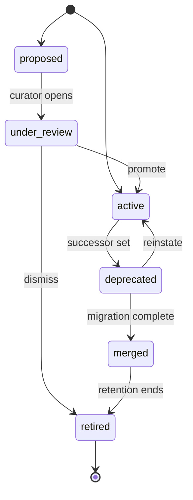
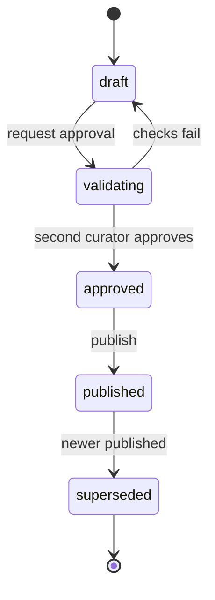
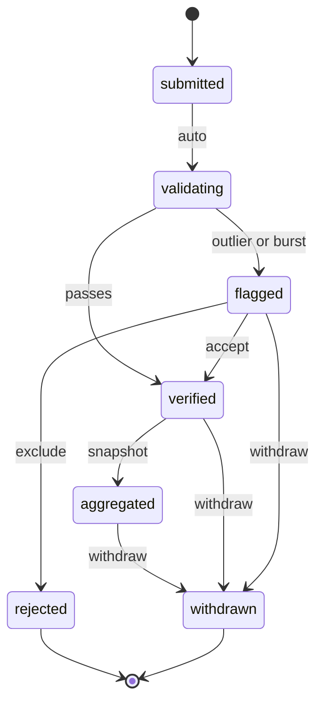
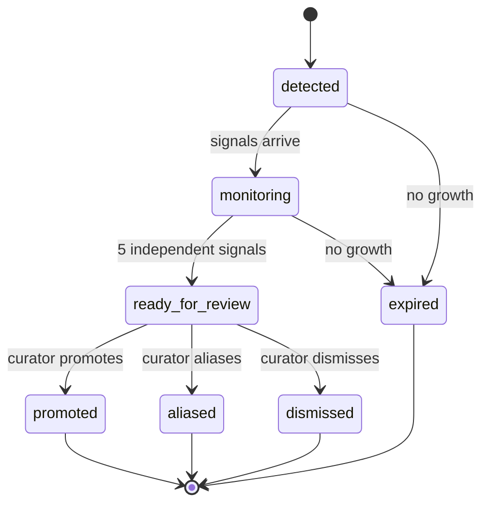
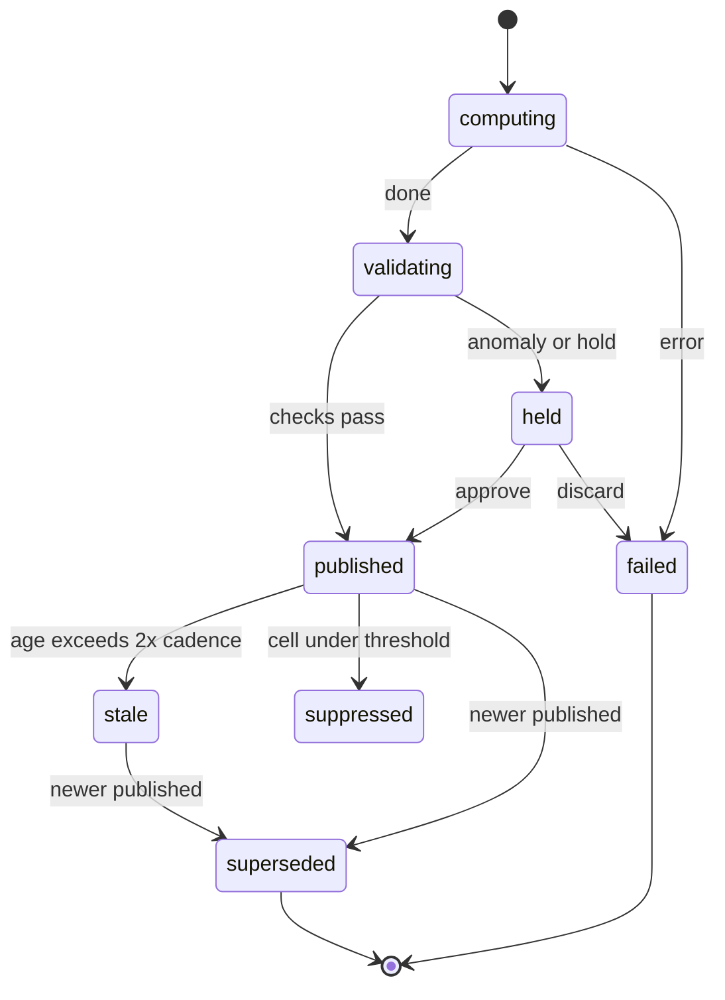
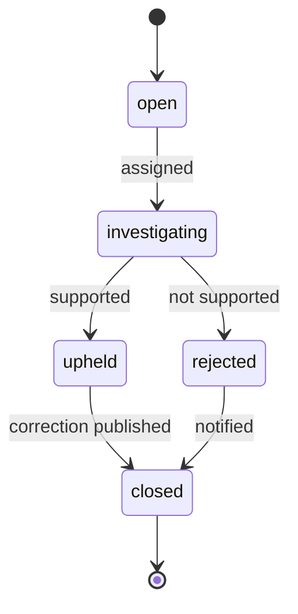
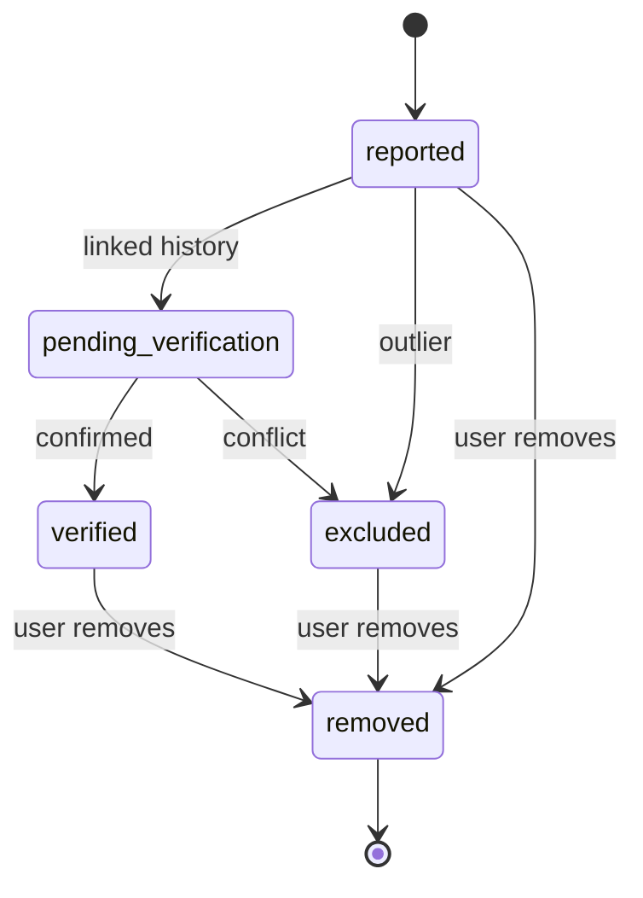

# MKT — Market Intelligence & Career Pathing

> Status: intended product specification. Nothing in this file is built. Module group: OS expansion (`R6`) with a foundation slice that other modules need earlier (skills taxonomy, `R1`); gated by `OD-MKT-01`. Evidence tags follow [CONVENTIONS](../00_START_HERE/CONVENTIONS.md).

## 1. Purpose, outcomes and boundaries

### 1.1 Purpose

MKT is the platform's labor-market brain. It owns the **skills taxonomy and ontology** that every other module tags against, turns platform activity and licensed external data into **privacy-safe demand, supply, salary and career-transition insights**, and gives individuals, institutions and employers a **career path explorer** with skill-gap analysis. It is where the question "what is my next role and what is missing?" gets a data-backed, explainable answer. [SRC: SSOT §6.2, §7.1 F-84, F-85, F-86, F-97, F-151, F-152] [PROP: delivery as one module, dashboards, partner API]

### 1.2 Outcomes

1. Every skill reference anywhere in the product resolves to one canonical, versioned skill id. [SRC: SSOT §10.27 BR-141, BR-144]
2. A candidate sees which roles are reachable from their current evidence, what is missing, how long it typically takes, and what it pays, each with sample size and confidence. [SRC: SSOT F-85, F-86]
3. An institution can compare its programmes to regional demand without seeing any individual. [PROP]
4. An employer can calibrate roles and offers against market bands without seeing individuals. [SRC: SSOT F-86 step 5]
5. Nothing published below the minimum sample; every number is traceable to source, window and method. [SRC: SSOT BR-178, Amendment G] [DER]

### 1.3 Scope

| In scope | Out of scope | Owned by MKT | Consumed from other modules |
|---|---|---|---|
| Skills taxonomy, aliases, relationships, versioning, external mappings | Skill evidence, verification and freshness of an individual's skill claim (`EVD`, `BGV` planned) | Skills, roles, relationships, taxonomy versions | Job postings (`JOB` planned), applications and hires (`ATS` planned), course catalogue (`LRN` planned), profiles and evidence (`PRF`, `EVD` planned) |
| Demand and supply indices, regional heat maps, trends, forecasts | Individual job matching and ranking (`AIC` planned) | Market signals, indices, forecasts, published dataset snapshots | Billing entitlements for premium insights (`BIL` planned) |
| Salary and equity benchmarks from user submissions and licensed data | Generic HR/payroll systems [SRC: SSOT §4.2] | Salary reports and aggregates, career transitions and benchmarks | Consent and privacy settings (`SET` planned) |
| Career path explorer, skill-gap analysis, readiness, action plans | Delivering courses (`LRN`) or coaching (`MEN` planned) | Path graph, gap analyses, readiness explanations | Analytics platform for metric registry (`ANL`) |
| Dashboards for institutions, employers, platform admins; exports; partner API | Candidate-level analytics for employers (`ATS`, `ANL`) | Dashboard definitions for market views, export jobs, partner API grants | Institution cohorts (`INS` planned) |

### 1.4 Boundary note on SSOT non-goals

SSOT §4.2 excludes a "generic HR/payroll system" and warns against opaque scoring. MKT stores no payroll data: salary reports are voluntary, aggregate-only, and employer pay-equity views (FR-MKT-020) are narrow, aggregate, and optional. Readiness and path scores are explainable and are never sent to employers as candidate rankings (`BR-MKT-024`). Conflicts with the owner's "operating system" goal are recorded in `OD-MKT-01`.

## 2. Roles and permission matrix

Legend: C create, R read, U update, D delete, A approve, X execute, — none. "Own" = the user's own data.

| Capability | GUE | CAN/STD | INS | MNT | REC/HMG | EAD | IAD/PLO | EXA | PAD |
|---|---|---|---|---|---|---|---|---|---|
| Browse public insights (above threshold) | R | R | R | R | R | R | R | R | R |
| Explore career paths | R (limited) | R | R | R | R | R | R | R | R |
| Run personal skill-gap and readiness | — | X own | — | X for mentee with consent | — | — | X cohort aggregate | X aggregate | — |
| Submit salary or transition data | — | C own, D own | C own | C own | C own | — | — | — | — |
| Propose a skill | — | C proposal | C proposal | C proposal | C proposal | C proposal | C proposal | C proposal | — |
| Curate taxonomy (create, merge, deprecate) | — | — | — | — | — | — | — | — | CRUDA (taxonomy curator permission) |
| Employer benchmarks and offer calibration | — | — | — | — | R | R | — | R | R |
| Institution market dashboard | — | — | — | — | — | — | R | — | R |
| Export (aggregate only) | — | — | — | — | R (own org scope) | R | R | R | X |
| Partner API grants | — | — | — | — | — | — | request | request | A |
| Data source and suppression policy | — | — | — | — | — | — | — | — | CRUDA |
| Disputes and corrections | file | file | file | file | file | file | file | file | A |

Service principal `API`: read aggregates under a scoped grant (`FR-MKT-032`).

## 3. Sub-module map

| Code | Sub-module | Features |
|---|---|---|
| A | Skills taxonomy and ontology | FR-MKT-001 to 007 |
| B | Data sources, provenance and quality | FR-MKT-008 to 011 |
| C | Demand, supply and trends | FR-MKT-012 to 016 |
| D | Compensation benchmarks | FR-MKT-017 to 021 |
| E | Career pathing | FR-MKT-022 to 027 |
| F | Dashboards, exports and API | FR-MKT-028 to 032 |
| G | Privacy and governance | FR-MKT-033 to 036 |

## 4. Feature specifications

### Sub-module A — Skills taxonomy and ontology

### FR-MKT-001 — Canonical skill catalogue

- **Sub-module:** A Skills taxonomy and ontology
- **Priority / tier:** Must · R1
- **Source:** [SRC: SSOT §6.2, §10.27 BR-141, BR-144; §7.1 F-84]
- **Purpose and outcome:** A single governed list of skills, each with a stable id, so every course, job, challenge and profile tag means the same thing. Success: no skill tag in the product lacks a canonical id.
- **Roles and permissions:** `PAD (taxonomy curator): create, update, deprecate` · `all roles: read` · `others: propose via FR-MKT-005`
- **Preconditions and entry points:** Admin console "Skills" (`SCR-MKT-018`); skill picker components in other modules read the catalogue through the skills API.
- **User interactions and actions:** 1. Curator clicks "New skill". 2. Enters canonical name, description, category (technical, tool, soft, domain, language, certification-linked), proficiency scale reference, optional icon. 3. Saves as `proposed` or `active`. 4. Edits metadata or deprecates with a successor.
- **System behaviour:** Creates `ENT-MKT-01` with stable `skillId` (prefix `SK-`, never reused), lifecycle per `SM-MKT-01`; duplicate detection against names and aliases (normalized) before save; emits `mkt.skill.created`; search indexes updated; changes land in the working taxonomy version (`FR-MKT-004`).
- **UI elements and controls:** Name input, description textarea, category select, scale select, status chip, "Possible duplicates" panel listing matches with similarity, Save/Deprecate buttons, audit history tab.
- **Configuration options:** Platform: categories list; default scale. No user-level settings.
- **Business rules:** `BR-MKT-001`, `BR-MKT-002`, `BR-MKT-006`.
- **Validation:** Name 2–80 chars, case-insensitive unique among active names and aliases; description ≤ 600 chars; category required; successor required to deprecate; ids immutable.
- **Inputs and outputs:** In: skill fields. Out: skill record with id and version.
- **Filters, sorting, search:** Filter by status, category, last updated, usage count; sort by name or usage; search over name and aliases.
- **Notifications and communication:** Curator digest of proposals pending (template `mkt.skill.proposals`, class `admin-ops`).
- **Error handling and edge cases:** Duplicate name: 409 with the existing skill link. Deprecating a skill still referenced: allowed; references migrate through `FR-MKT-004` and display the successor. Concurrent edit: optimistic version check.
- **Dependencies:** `ENT-MKT-01`; `FR-MKT-004`; `ADM` console (planned).
- **Security and privacy:** Curator permission is separate from general `PAD`; every change audited with before/after; catalogue is public data.
- **Acceptance criteria:**
  - Given a curator saving "Python", when "python" already exists, then the system rejects with a link to the existing skill.
  - Given a deprecated skill with 40 references, when viewed in a job, then the successor name is shown and no tag is lost.
  - Given a non-curator `PAD`, when creating a skill, then the system returns 403.

### FR-MKT-002 — Skill aliases and free-text normalization

- **Sub-module:** A Skills taxonomy and ontology
- **Priority / tier:** Must · R1
- **Source:** [SRC: SSOT §6.2 aliases] [DER]
- **Purpose and outcome:** Free text ("ReactJS", "react.js") resolves to the canonical skill so counts and matches are comparable. Success: ≥ the configured share of tags auto-resolve and the rest queue for review.
- **Roles and permissions:** `PAD (curator): manage aliases` · `system: resolve` · `users: pick from suggestions`
- **Preconditions and entry points:** Skill picker inputs, job-posting parser, resume parser, course import.
- **User interactions and actions:** 1. User types a skill; autocomplete suggests canonical matches. 2. If none matches, user may "Suggest a new skill" (`FR-MKT-005`). 3. Curator reviews an "unresolved terms" queue, maps terms to skills or marks "not a skill".
- **System behaviour:** Normalizes (case, punctuation, diacritics, version suffixes) and matches by alias table, then fuzzy match above a threshold with confidence; auto-accept only exact alias or confidence ≥ 0.95 [PROP]; otherwise stores `UnresolvedTerm` with count; mappings feed back into the alias table with curator approval.
- **UI elements and controls:** Autocomplete with keyboard navigation and screen-reader labels; curator queue table with "Map to…" and "Not a skill" actions.
- **Configuration options:** Platform: fuzzy threshold (default 0.95 [PROP]), stop-word list.
- **Business rules:** `BR-MKT-001`, `BR-MKT-002`.
- **Validation:** Alias 1–80 chars; an alias maps to exactly one active skill; ambiguous aliases (e.g., "Go") need a context rule (category or co-occurring skill) set by a curator.
- **Inputs and outputs:** In: raw text. Out: canonical id with confidence or unresolved marker.
- **Filters, sorting, search:** Queue filter by source module, count, age.
- **Notifications and communication:** n/a — internal queue.
- **Error handling and edge cases:** Ambiguous alias: both options offered, no auto-pick. Unresolved term count above 100 in a day: curator alert. Alias that points to a deprecated skill resolves to the successor.
- **Dependencies:** `FR-MKT-001`; consumers `JOB`, `LRN`, `PRF` (planned).
- **Security and privacy:** Unresolved terms stored without user identity; text sanitized.
- **Acceptance criteria:**
  - Given alias "ReactJS" for React, when a job lists "reactjs", then it resolves to React automatically.
  - Given "Go" with two candidate skills, when text is ambiguous, then no auto-resolution occurs and the term is queued.
  - Given a term marked "not a skill", when it appears again, then it is ignored silently.

### FR-MKT-003 — Skill relationship graph

- **Sub-module:** A Skills taxonomy and ontology
- **Priority / tier:** Must · R1
- **Source:** [SRC: SSOT §10.27 BR-142, BR-143, BR-146, BR-147]
- **Purpose and outcome:** Skills connect through typed relationships so the product can compute prerequisites, neighbors and gaps. Success: a valid, acyclic prerequisite graph with bounded traversal.
- **Roles and permissions:** `PAD (curator): create, update, delete` · `system: compute correlations` · `all: read`
- **Preconditions and entry points:** Skill detail page "Relationships" tab; graph viewer.
- **User interactions and actions:** 1. Curator selects two skills and a type (`prerequisite_of`, `subskill_of`, `supersedes`, `related_to`). 2. Optionally sets strength (0–1) and rationale. 3. Saves. 4. Views the graph neighborhood.
- **System behaviour:** Validates acyclicity of `prerequisite_of` at write time (`BR-MKT-003`); `correlates_with` edges are computed nightly from co-occurrence in jobs and profiles above sample thresholds and are never edited manually (`BR-MKT-004`); traversal API enforces max depth 5.
- **UI elements and controls:** Relationship editor (two pickers + type), neighbor graph with list view alternative, edge strength slider, rationale field.
- **Configuration options:** Platform: correlation minimum co-occurrence (default 50 and `min_cohort_k` distinct contributors [PROP]).
- **Business rules:** `BR-MKT-003`, `BR-MKT-004`, `BR-MKT-006`.
- **Validation:** No self-edges; a `prerequisite_of` cycle is rejected with the cycle path; `subskill_of` has one parent per taxonomy view; strength 0–1.
- **Inputs and outputs:** In: edge. Out: edge id, updated neighborhood.
- **Filters, sorting, search:** Graph filter by relationship type, category, strength.
- **Notifications and communication:** n/a — admin tool.
- **Error handling and edge cases:** Cycle: reject showing path. Deleting a skill with edges: edges re-point to successor on deprecation. Depth > 5 request: truncated with a flag.
- **Dependencies:** `FR-MKT-001`, `FR-MKT-004`.
- **Security and privacy:** Correlations computed on aggregates only.
- **Acceptance criteria:**
  - Given A prerequisite_of B and B prerequisite_of C, when curator adds C prerequisite_of A, then the system rejects naming the cycle.
  - Given a traversal request of depth 7, when executed, then results stop at depth 5 with a truncation flag.
  - Given a manual attempt to add `correlates_with`, when saved, then the system rejects.

### FR-MKT-004 — Taxonomy versioning and impact migration

- **Sub-module:** A Skills taxonomy and ontology
- **Priority / tier:** Must · R1
- **Source:** [SRC: SSOT §6.2 "Ontology changes require downstream migration/recalculation rules"]
- **Purpose and outcome:** Taxonomy changes are batched into published versions with automatic migration of references. Success: no dangling skill id and no silent change to historical insights.
- **Roles and permissions:** `PAD (curator): create version, publish` · `second curator: approve (four-eyes)` · `system: migrate`
- **Preconditions and entry points:** Admin "Taxonomy versions" page.
- **User interactions and actions:** 1. Curator opens the draft version, reviews the change list (adds, merges, deprecations, relationship changes). 2. Runs "Impact preview" showing affected jobs, courses, profiles and published insights. 3. Requests approval. 4. Second curator approves. 5. Publish.
- **System behaviour:** Draft → validating → published → superseded per `SM-MKT-02`; migration job rewrites references (merges and renames) idempotently by version; historical insight snapshots keep their original version id and are never recomputed in place (`BR-MKT-017`); consumers receive `mkt.taxonomy.version_published` and refresh caches.
- **UI elements and controls:** Change list with filters, impact table, "Preview", "Request approval", "Publish" (disabled until approved), progress bar for migration.
- **Configuration options:** Platform: publish cadence (default at most weekly [PROP]); minimum approvers 2.
- **Business rules:** `BR-MKT-006`, `BR-MKT-017`, `BR-MKT-002`.
- **Validation:** Draft must pass checks: no cycles, no orphan references, no duplicate aliases, successor exists for every deprecation.
- **Inputs and outputs:** Out: published version id and migration report.
- **Filters, sorting, search:** Versions by date and status; change list by type.
- **Notifications and communication:** Consumers' owners notified via event; admin digest.
- **Error handling and edge cases:** Migration partial failure: version stays `validating`, job resumes, no partial publish visible. Rollback: publish of a new version that reverses changes (versions are immutable). Approver equals author: rejected.
- **Dependencies:** `FR-MKT-001`, `FR-MKT-003`; worker queue.
- **Security and privacy:** Full audit; changes signed with curator ids.
- **Acceptance criteria:**
  - Given a merge of skill X into Y, when published, then all jobs tagged X now reference Y and the migration report counts them.
  - Given a draft with a cycle, when validating, then publish is blocked.
  - Given the author attempting to approve their own version, when submitted, then the system rejects.

### FR-MKT-005 — Emerging skill detection and promotion

- **Sub-module:** A Skills taxonomy and ontology
- **Priority / tier:** Should · R4
- **Source:** [SRC: SSOT §10.27 BR-148; §7.1 F-118]
- **Purpose and outcome:** New skills seen in the wild are detected and, once enough independent signals exist, promoted to the catalogue. Success: a candidate list with evidence and a decision log.
- **Roles and permissions:** `any signed-in user: propose` · `PAD (curator): review, promote, dismiss`
- **Preconditions and entry points:** "Suggest a new skill" in pickers; unresolved terms queue; detector job output.
- **User interactions and actions:** 1. User submits a proposal with name and short context. 2. System also nominates frequent unresolved terms. 3. Curator reviews candidate detail (count, sources, first seen, sample context, similar skills). 4. Promote (creates a skill), merge into an existing skill as alias, or dismiss.
- **System behaviour:** Candidate (`ENT-MKT-05`, `SM-MKT-04`) accumulates **independent signals**: distinct employers, distinct jobs, distinct users, distinct courses, counted by distinct source entities not by repetition (`BR-MKT-005`); at ≥ 5 independent signals the candidate becomes `ready_for_review`; promotion respects `BR-MKT-001`.
- **UI elements and controls:** Candidate table (signals, sources, trend), detail drawer, actions Promote/Alias/Dismiss with reason.
- **Configuration options:** Platform: signal threshold (default 5, `[SRC: BR-148]`), independence rule (default: ≥ 3 distinct employer or institution sources [PROP], `OD-MKT-06`), monitoring window 180 days.
- **Business rules:** `BR-MKT-001`, `BR-MKT-005`.
- **Validation:** Proposal name 2–80 chars; ≤ 5 proposals/day/user.
- **Inputs and outputs:** Out: candidate list; decisions.
- **Filters, sorting, search:** Filter by signal count, status, category.
- **Notifications and communication:** Proposer notified of decision (`mkt.skill.proposal_decision`, class `product-updates`).
- **Error handling and edge cases:** Spam duplicates by one user count once. Candidate unseen for the monitoring window: expires. Promoted skill later merged: signals transferred.
- **Dependencies:** `FR-MKT-001`, `FR-MKT-002`.
- **Security and privacy:** Proposer identity visible to curators only.
- **Acceptance criteria:**
  - Given 5 mentions from one employer, when evaluating, then independent signals count 1 and the candidate is not ready.
  - Given 5 independent signals, when evaluated, then status becomes `ready_for_review`.
  - Given a dismissed candidate, when the proposer asks, then the decision reason is shown.

### FR-MKT-006 — External taxonomy mappings

- **Sub-module:** A Skills taxonomy and ontology
- **Priority / tier:** Could · R4
- **Source:** [PROP]; SSOT §6.2 "industry mappings"
- **Purpose and outcome:** Canonical skills and roles map to public frameworks (for example ESCO, O*NET, SFIA, national occupation codes) so insights are comparable and interoperable. Success: each mapped skill/role has an external code with provenance.
- **Roles and permissions:** `PAD (curator): import, map, review` · `all: read mappings`
- **Preconditions and entry points:** Admin "Mappings"; frameworks enabled per `OD-MKT-03` (licensing).
- **User interactions and actions:** 1. Curator uploads or syncs a framework release. 2. System proposes matches with scores. 3. Curator accepts or edits. 4. Publishes mapping set with version.
- **System behaviour:** Stores `ENT-MKT-06` mapping (skillId or roleId, framework, code, relation: exact, broader, narrower, related); license metadata and attribution text attached; mapping set versioned with the taxonomy.
- **UI elements and controls:** Framework selector, match review table, bulk accept above score, attribution preview.
- **Configuration options:** Enabled frameworks; auto-accept threshold (default off).
- **Business rules:** `BR-MKT-006`, `BR-MKT-022`.
- **Validation:** Code exists in imported release; relation required; one exact mapping per framework per skill.
- **Inputs and outputs:** Out: mapping table and API field `externalCodes`.
- **Filters, sorting, search:** By framework, relation, coverage.
- **Notifications and communication:** n/a — admin tool.
- **Error handling and edge cases:** Framework release changes codes: diff report and remap queue. License expired: framework disabled and codes hidden from exports.
- **Dependencies:** `FR-MKT-001`, `FR-MKT-007`, `FR-MKT-009`.
- **Security and privacy:** Public data; license compliance enforced in exports (`FR-MKT-031`).
- **Acceptance criteria:**
  - Given a framework imported, when a curator bulk-accepts matches above 0.9, then mappings are created with `exact` relation and provenance.
  - Given a disabled framework, when exporting, then its codes are omitted.
  - Given a code not in the release, when saving, then the system rejects.

### FR-MKT-007 — Role catalogue and proficiency scales

- **Sub-module:** A Skills taxonomy and ontology
- **Priority / tier:** Must · R4
- **Source:** [SRC: SSOT §7.1 F-85 `from_role_id`, `to_role_id`] [DER] [PROP] for scales
- **Purpose and outcome:** A governed list of roles (occupations) with levels and the skills each typically requires at each proficiency. Success: every job and career-path node refers to a role id.
- **Roles and permissions:** `PAD (curator): create, update, deprecate` · `all: read` · `employers: propose role aliases`
- **Preconditions and entry points:** Admin "Roles"; role picker in `JOB` and profile (planned).
- **User interactions and actions:** 1. Curator creates a role (title, family, levels, description). 2. Adds required skills per level with required proficiency (1–5) and importance (core, common, optional). 3. Adds title aliases ("Software Engineer II" → Engineer L2). 4. Publishes with the taxonomy version.
- **System behaviour:** `ENT-MKT-07` Role and `ENT-MKT-08` RoleSkillRequirement; requirement data seeded from aggregated job postings and refined by curators; proficiency scale of 5 levels (awareness, working, proficient, advanced, expert) with descriptors [PROP]; title normalization uses alias table.
- **UI elements and controls:** Role form, level tabs, requirement table with proficiency dropdown and importance chips, alias list.
- **Configuration options:** Levels per role family; proficiency descriptors (platform-wide).
- **Business rules:** `BR-MKT-001`, `BR-MKT-002`, `BR-MKT-006`.
- **Validation:** Role title 2–100 chars unique within family; at least 1 core skill per level before publish; skills must be active.
- **Inputs and outputs:** Out: role with levels and requirements.
- **Filters, sorting, search:** By family, level, skill, status.
- **Notifications and communication:** n/a — admin tool.
- **Error handling and edge cases:** Role deprecated: path nodes redirect to successor. Conflicting requirement seeds: curator resolves in a review queue. Title alias ambiguity: queued.
- **Dependencies:** `FR-MKT-001`, `FR-MKT-004`.
- **Security and privacy:** Public data.
- **Acceptance criteria:**
  - Given a role level with no core skill, when publishing, then the system rejects.
  - Given alias "SDE II", when a job uses it, then it resolves to the mapped role and level.
  - Given a deprecated role, when a path references it, then the successor role is shown.

### Sub-module B — Data sources, provenance and quality

### FR-MKT-008 — Market signal ingestion

- **Sub-module:** B Data sources, provenance and quality
- **Priority / tier:** Must · R4
- **Source:** [SRC: SSOT F-97, §10.27 BR-145 daily skill signals] [PROP] pipeline details
- **Purpose and outcome:** Platform activity becomes normalized market signals (job postings, applications, hires, enrollments, assessment outcomes) without carrying personal identity. Success: daily signal tables that reconcile to source counts.
- **Roles and permissions:** `system: execute` · `PAD: monitor, backfill`
- **Preconditions and entry points:** Domain events from `JOB`, `ATS`, `LRN`, `ASM`, `PRF` (planned) via the outbox; nightly batch.
- **User interactions and actions:** 1. Admin opens the pipeline monitor. 2. Views last run, volumes, rejects. 3. Triggers backfill for a date range. 4. Pauses a source.
- **System behaviour:** Consumes events; strips identity (replaces with source-entity pseudonyms for dedupe); normalizes skill ids, role ids, geography (country/region/metro), employer size/industry bands; dedupes reposted jobs (same employer, title, location within 30 days) (`BR-MKT-030`); writes `ENT-MKT-10` MarketSignal; failures go to a dead-letter queue; idempotent by `eventId`.
- **UI elements and controls:** Pipeline monitor table (source, last run, rows in/out/rejected), backfill dialog, pause toggle.
- **Configuration options:** Platform: schedule (daily default [SRC: BR-145]); retention of raw signals (default 25 months [PROP]).
- **Business rules:** `BR-MKT-021`, `BR-MKT-023`, `BR-MKT-030`.
- **Validation:** Event schema validation; unknown skill ids rejected to the unresolved queue.
- **Inputs and outputs:** In: events. Out: signal rows, daily reconciliation report.
- **Filters, sorting, search:** Monitor filter by source and status.
- **Notifications and communication:** Alert to `PAD` if reconciliation deviates > 2% [PROP] (`mkt.pipeline.alert`, class `admin-ops`).
- **Error handling and edge cases:** Late events: accepted within 7 days and reprocessed. Source schema break: pause the source, keep others. Replay: idempotent.
- **Dependencies:** `JOB`, `ATS`, `LRN`, `ASM`, `PRF` (planned); outbox pattern.
- **Security and privacy:** No names, emails or free text stored in signals; pseudonyms rotate; access restricted to MKT services.
- **Acceptance criteria:**
  - Given the same job event delivered twice, when processed, then one signal row exists.
  - Given a repost of the same job within 30 days, when counted, then demand counts it once.
  - Given an event with an unknown skill id, when processed, then it is queued as unresolved and not counted.

### FR-MKT-009 — External data source registry and licensing

- **Sub-module:** B Data sources, provenance and quality
- **Priority / tier:** Should · R4
- **Source:** [PROP]; relates [SRC: SSOT §4.3 external ecosystem stance]
- **Purpose and outcome:** Licensed or public external datasets (labor statistics, salary surveys, job-posting aggregators) are registered with their terms so the product uses them only as allowed. Success: every external-derived number carries a source and license check.
- **Roles and permissions:** `PAD: register, enable, disable` · `counsel (as PAD with legal flag): approve license`
- **Preconditions and entry points:** Admin "Data sources".
- **User interactions and actions:** 1. Add source (name, owner, type, URL/API, refresh cadence). 2. Record license terms: allowed uses, attribution text, redistribution, expiry, cost owner. 3. Mark allowed outputs (display, export, API). 4. Enable.
- **System behaviour:** `ENT-MKT-09` DataSource; ingestion respects allowed outputs; expiry disables source and removes derived publication per terms; displays attribution automatically (`BR-MKT-022`).
- **UI elements and controls:** Source form, license checklist, allowed-output matrix, enable switch, expiry banner.
- **Configuration options:** Per source: cadence, geographic coverage, enabled outputs.
- **Business rules:** `BR-MKT-021`, `BR-MKT-022`.
- **Validation:** License expiry date required; attribution text required if license demands it; cannot enable without legal approval flag.
- **Inputs and outputs:** Out: source catalogue.
- **Filters, sorting, search:** By status, expiry, type.
- **Notifications and communication:** Expiry alert 60 days prior (`mkt.source.expiring`, class `admin-ops`).
- **Error handling and edge cases:** License lapses: source auto-disabled, derived exports flagged. API rate limit by provider: backoff, partial data labelled.
- **Dependencies:** `FR-MKT-008`, `FR-MKT-031`.
- **Security and privacy:** Credentials in the secrets vault; no candidate data sent to providers.
- **Acceptance criteria:**
  - Given a source whose license forbids export, when an export is requested, then its data is excluded and the user is told.
  - Given license expiry, when the date passes, then the source is disabled automatically.
  - Given a source without legal approval, when enabling, then the system rejects.

### FR-MKT-010 — Provenance, lineage and methodology disclosure

- **Sub-module:** B Data sources, provenance and quality
- **Priority / tier:** Must · R4
- **Source:** [DER] from [SRC: SSOT §6.1 provenance; F-85 "sample count and confidence interval"; F-86 "methodology disclosure"]
- **Purpose and outcome:** Every displayed insight says where it came from, how it was computed, when, and how many data points support it. Success: a "How is this calculated?" panel on every insight.
- **Roles and permissions:** `all: read` · `PAD: edit methodology text`
- **Preconditions and entry points:** Any insight card, chart, or export.
- **User interactions and actions:** 1. Click the info icon "About this data". 2. Read sources, window, method, sample size, last refresh, taxonomy version. 3. Open the full methodology page.
- **System behaviour:** Each `DatasetSnapshot` (`ENT-MKT-11`) records sources, window, method version, taxonomy version, sample size, computed-at; staleness flag when older than 2× cadence (`BR-MKT-021`); methodology pages versioned and linked.
- **UI elements and controls:** Info popover, "Methodology" link, staleness badge with text, "Data as of" label.
- **Configuration options:** Platform: staleness multiple (default 2).
- **Business rules:** `BR-MKT-021`, `BR-MKT-018`, `BR-MKT-019`.
- **Validation:** Snapshot cannot be published without provenance fields.
- **Inputs and outputs:** Out: provenance object attached to every API response.
- **Filters, sorting, search:** n/a — attached metadata.
- **Notifications and communication:** n/a — no recipient is affected.
- **Error handling and edge cases:** Missing provenance: snapshot blocked from publication. Source disabled: dependent insights flagged "source no longer available".
- **Dependencies:** `FR-MKT-008`, `FR-MKT-009`.
- **Security and privacy:** Provenance never contains contributor identities.
- **Acceptance criteria:**
  - Given a salary band, when the user opens "About this data", then source mix, window, sample size and date are shown.
  - Given a snapshot older than 2× cadence, when displayed, then a staleness badge shows.
  - Given a snapshot missing method version, when publishing, then it is blocked.

### FR-MKT-011 — Data quality, outlier and anomaly handling

- **Sub-module:** B Data sources, provenance and quality
- **Priority / tier:** Must · R4
- **Source:** [SRC: SSOT F-86 step 7 outlier ±3σ, rate limit 5/day] [DER]
- **Purpose and outcome:** Bad or manipulated data is flagged and excluded before it reaches an aggregate. Success: flagged items reviewable and excluded from computations.
- **Roles and permissions:** `system: flag` · `PAD: review` · `submitters: see own status`
- **Preconditions and entry points:** Aggregation jobs; review queue in admin.
- **User interactions and actions:** 1. Reviewer opens "Data quality queue". 2. Sees flagged items with reason (outlier, duplicate, burst, impossible value, suspected coordinated). 3. Accept, exclude, or request submitter clarification.
- **System behaviour:** Rules: ±3σ from the cell median (robust: median and MAD) flagged and excluded pending review; duplicates (same user, same role/company/period) flagged; bursts (many reports from one device/IP range or account cluster) flagged; unit sanity bounds per currency; excluded items never counted; decisions logged.
- **UI elements and controls:** Queue table with reason chips, bulk exclude, "Request info" action.
- **Configuration options:** Outlier threshold (default 3σ), burst thresholds (default 5/day/user [SRC], 20/day/IP range [PROP]).
- **Business rules:** `BR-MKT-014`, `BR-MKT-020`.
- **Validation:** Reviewer decision reason required.
- **Inputs and outputs:** Out: flag decisions, quality metrics.
- **Filters, sorting, search:** By reason, cell, age.
- **Notifications and communication:** Submitter message if clarification requested (`mkt.report.clarify`, class `service`).
- **Error handling and edge cases:** Legitimate outlier (executive roles): reviewer accepts and tags "verified outlier" — included in percentiles but excluded from mean. Mass flagging above 10% of a cell: aggregate withheld pending review.
- **Dependencies:** `FR-MKT-017`, `FR-MKT-018`.
- **Security and privacy:** Reviewer sees pseudonymous report ids, not names, unless escalating to abuse handling.
- **Acceptance criteria:**
  - Given a salary 10× the cell median, when aggregation runs, then it is flagged and not included.
  - Given 6 reports from one account in a day, when the sixth arrives, then it is rejected by rate limit.
  - Given a cell with 12% flagged items, when computed, then the aggregate is withheld pending review.

### Sub-module C — Demand, supply and trends

### FR-MKT-012 — Skill demand index

- **Sub-module:** C Demand, supply and trends
- **Priority / tier:** Must · R4
- **Source:** [SRC: SSOT F-97 Real-Time Job Market Analytics, BR-145, BR-207] [DER]
- **Purpose and outcome:** Shows how much employers are asking for a skill, by region and time. Success: a demand index per skill/role/region with trend and sample count.
- **Roles and permissions:** `all signed-in: read; GUE: top-level only` · `PAD: configure`
- **Preconditions and entry points:** Insights explorer (`SCR-MKT-001`), skill pages, dashboards.
- **User interactions and actions:** 1. Select skill or role. 2. Choose region and period (3, 6, 12 months). 3. View index, trend line, top co-occurring skills, top hiring industries. 4. Share a permalink.
- **System behaviour:** Demand index = share of active postings mentioning the skill in the cell, normalized to a 100-base at a reference period (`ENT-MKT-11` snapshot); computed daily from `MarketSignal`; cells with fewer than `min_cohort_k` distinct employers hidden (`BR-MKT-007`); reposts deduped.
- **UI elements and controls:** Skill/role picker, region picker, period chips, line chart with data table toggle, co-occurrence list, "About this data".
- **Configuration options:** Platform: reference period, minimum employers (default `min_cohort_k` = 10 [SRC: BR-207]).
- **Business rules:** `BR-MKT-007`, `BR-MKT-008`, `BR-MKT-021`, `BR-MKT-030`, `BR-MKT-031`.
- **Validation:** Period ≤ 36 months; region must exist in the geo hierarchy.
- **Inputs and outputs:** Out: series with value, sample, interval, provenance.
- **Filters, sorting, search:** Filter by region, industry, company size, seniority; sort by index or growth.
- **Notifications and communication:** Optional "skill alert": notify when a followed skill's index changes by threshold (class `insights`, opt-out).
- **Error handling and edge cases:** Cell below threshold: "Not enough postings to show this region" with a broader-region suggestion. Stale data: banner. Zero demand: shown as zero if sample ≥ threshold, otherwise suppressed.
- **Dependencies:** `FR-MKT-008`, `FR-MKT-033`.
- **Security and privacy:** Aggregates only; no employer is identifiable below the threshold.
- **Acceptance criteria:**
  - Given 8 distinct employers in a cell and `min_cohort_k` 10, when viewed, then the value is suppressed.
  - Given a repost of one job, when computing, then the index counts it once.
  - Given a guest, when viewing a skill, then only national-level index is shown.

### FR-MKT-013 — Skill supply index

- **Sub-module:** C Demand, supply and trends
- **Priority / tier:** Should · R4
- **Source:** [SRC: SSOT F-151 skill supply availability] [DER]
- **Purpose and outcome:** Shows how many people on the platform hold a skill at a given evidence level, aggregated, to compare with demand. Success: supply by skill and region with evidence-tier breakdown.
- **Roles and permissions:** `all signed-in: read (aggregate)` · `EAD/IAD/EXA: read with segmentation up to threshold`
- **Preconditions and entry points:** Insights explorer; employer and institution dashboards.
- **User interactions and actions:** 1. Select skill and region. 2. View counts by evidence tier (claimed, verified, assessed). 3. Compare to demand (`FR-MKT-014`).
- **System behaviour:** Counts distinct profiles with the skill at the tier, only among users who allow aggregate use (`SET` planned consent, default on for aggregates [OD-MKT-04]); rounded to 5; suppressed below `min_cohort_k`; counts a person once per skill.
- **UI elements and controls:** Stacked bar by evidence tier with table alternative; region picker; tooltip with rounding note.
- **Configuration options:** Rounding (default 5); platform-wide aggregate-use default (`OD-MKT-04`).
- **Business rules:** `BR-MKT-007`, `BR-MKT-008`, `BR-MKT-025`.
- **Validation:** Same as FR-MKT-012.
- **Inputs and outputs:** Out: rounded counts, provenance.
- **Filters, sorting, search:** By tier, region, seniority band.
- **Notifications and communication:** n/a — no recipient is affected.
- **Error handling and edge cases:** Platform coverage bias: panel labelled "Platform members, not the whole labor market". Opt-outs lowering a cell below threshold hide it within 24 hours.
- **Dependencies:** `PRF`, `EVD` (planned), `FR-MKT-034`.
- **Security and privacy:** Differencing protection (`BR-MKT-008`); employers never get lists.
- **Acceptance criteria:**
  - Given 7 holders in a cell, when viewed, then no count is displayed.
  - Given a user opting out, when 24 hours pass, then they are excluded from the supply counts.
  - Given counts of 23, when displayed, then they appear as 25 with a rounding note.

### FR-MKT-014 — Supply-demand gap and regional heat maps

- **Sub-module:** C Demand, supply and trends
- **Priority / tier:** Should · R4
- **Source:** [SRC: SSOT F-151 geographic heat maps; F-97] [DER]
- **Purpose and outcome:** Identifies scarce and oversupplied skills per region. Success: gap ratio and map shown with explanations.
- **Roles and permissions:** `all signed-in: read` · `EAD/IAD/EXA: read with extra segmentation`
- **Preconditions and entry points:** Insights explorer "Gap" tab; institution dashboard; employer workforce view.
- **User interactions and actions:** 1. Choose skill, role family, or "my skills". 2. View a map or ranked list of regions by gap ratio. 3. Click a region for details.
- **System behaviour:** Gap ratio = demand postings per qualified supply (both after suppression); regions failing thresholds are greyed with explanation; map uses region polygons (no addresses); ratios banded (scarce, balanced, oversupplied) with the bands defined and visible.
- **UI elements and controls:** Choropleth map with list alternative and patterns in addition to colors, band legend, detail drawer, sort selector.
- **Configuration options:** Band cut-offs (default scarce > 2.0, oversupplied < 0.5 [PROP]); granularity (country, region, metro).
- **Business rules:** `BR-MKT-007`, `BR-MKT-008`, `BR-MKT-019`, `BR-MKT-031`.
- **Validation:** Both numerator and denominator must pass thresholds.
- **Inputs and outputs:** Out: ratios, bands, provenance.
- **Filters, sorting, search:** Skill, role family, region level, period.
- **Notifications and communication:** n/a — no recipient is affected.
- **Error handling and edge cases:** Demand-only data (no supply): show demand only, ratio hidden. Coverage warning for regions with low platform penetration.
- **Dependencies:** `FR-MKT-012`, `FR-MKT-013`.
- **Security and privacy:** Same suppression as the components.
- **Acceptance criteria:**
  - Given a region with sufficient demand but supply below threshold, when viewed, then no ratio is shown and the reason is stated.
  - Given the map, when a keyboard user tabs, then each region is reachable and announced with band and values.
  - Given a ratio 2.4, when displayed, then it is labelled scarce with the cut-off visible.

### FR-MKT-015 — Trends and forecasts

- **Sub-module:** C Demand, supply and trends
- **Priority / tier:** Should · R4
- **Source:** [SRC: SSOT §7.3 F-151 "12-month horizon, confidence intervals disclosed", "forecast accuracy tracked"]
- **Purpose and outcome:** Shows direction of skills and roles over up to 12 months with honest uncertainty. Success: forecasts with interval and tracked accuracy.
- **Roles and permissions:** `all signed-in: read` · `PAD: configure models, view accuracy`
- **Preconditions and entry points:** Insights explorer; skill detail; dashboards.
- **User interactions and actions:** 1. Open skill trend. 2. Toggle "Show forecast". 3. Read direction, interval, accuracy note.
- **System behaviour:** Time-series models (seasonal decomposition or equivalent) run monthly on demand and supply indices; horizon max 12 months (`BR-MKT-027`); publishes point estimate and prediction interval; backtests stored; skills with fewer than 12 months of valid history get no forecast; model versions recorded; accuracy (MAPE or interval coverage) tracked and displayed on the methodology page.
- **UI elements and controls:** Chart with historical and forecast ranges, interval band, "Model v" label, accuracy link.
- **Configuration options:** Horizon (default 6, max 12), minimum history (default 12 months).
- **Business rules:** `BR-MKT-019`, `BR-MKT-021`, `BR-MKT-027`.
- **Validation:** Interval always displayed with the point estimate.
- **Inputs and outputs:** Out: forecast series.
- **Filters, sorting, search:** As FR-MKT-012.
- **Notifications and communication:** n/a — no recipient is affected.
- **Error handling and edge cases:** Structural break (new data regime): forecast withheld and note shown. Backtest coverage below target: forecast flagged "low confidence".
- **Dependencies:** `FR-MKT-012`, `FR-MKT-013`.
- **Security and privacy:** Aggregates only.
- **Acceptance criteria:**
  - Given 8 months of history, when a forecast is requested, then it is not shown.
  - Given a forecast, when displayed, then the interval and model version are visible.
  - Given a horizon request of 18 months, when submitted, then it is capped at 12 with a note.

### FR-MKT-016 — Personal market insights ("in demand for you")

- **Sub-module:** C Demand, supply and trends
- **Priority / tier:** Should · R4
- **Source:** [SRC: SSOT F-84, F-97] [PROP] personalization
- **Purpose and outcome:** A signed-in candidate sees market signals relevant to their own skills, goals and region. Success: a short, explainable panel on the dashboard.
- **Roles and permissions:** `CAN/STD: read own` · `MNT: read for mentee with consent`
- **Preconditions and entry points:** Candidate dashboard widget; "Market" tab on profile.
- **User interactions and actions:** 1. View "Your skills in demand", "Skills to consider", "Roles hiring near you". 2. Tap an item for detail (`FR-MKT-012`). 3. Dismiss or follow a skill.
- **System behaviour:** Joins the user's evidence-backed skills and declared target roles with suppressed aggregates; every item shows why it is suggested; no new data about the user leaves their account; follows create alerts; no employer sees these views.
- **UI elements and controls:** Cards with reason text, "Follow skill" button, "Dismiss", "Why am I seeing this?" link.
- **Configuration options:** User: hide the widget; choose region; platform: item count (default 5).
- **Business rules:** `BR-MKT-018`, `BR-MKT-019`, `BR-MKT-020`, `BR-MKT-024`.
- **Validation:** Region required (defaults to profile region).
- **Inputs and outputs:** Out: ranked insight cards with provenance.
- **Filters, sorting, search:** n/a — curated short list.
- **Notifications and communication:** Optional alerts for followed skills (class `insights`, opt-out).
- **Error handling and edge cases:** New user without skills: prompts to add skills or pick a goal. Insufficient data for the region: broaden to country with label.
- **Dependencies:** `FR-MKT-012`, `FR-MKT-024`, `PRF` (planned).
- **Security and privacy:** Personal view; derived from the user's own data; not stored beyond preference flags.
- **Acceptance criteria:**
  - Given a user with 3 verified skills, when the widget loads, then each suggestion shows its reason.
  - Given a region with insufficient data, when loaded, then the card shows country-level data with a label.
  - Given a hidden widget, when the user returns, then it remains hidden.

### Sub-module D — Compensation benchmarks

### FR-MKT-017 — Salary report submission, verification weight and withdrawal

- **Sub-module:** D Compensation benchmarks
- **Priority / tier:** Must · R4
- **Source:** [SRC: SSOT F-86 step 1, step 7, step 8; BR-177, BR-179, BR-181]
- **Purpose and outcome:** Users contribute their compensation anonymously and may withdraw it, giving benchmarks real data. Success: report accepted with a verification weight and included in the next aggregation.
- **Roles and permissions:** `CAN/STD/INS/MNT/REC/HMG: create, withdraw own` · `PAD: review flagged`
- **Preconditions and entry points:** "Add your salary" on `/salaries`; prompt after offer accepted or profile role update.
- **User interactions and actions:** 1. Choose role and level (from catalogue), location, industry, company size band, optional company, years of experience, employment type. 2. Enter base, optional bonus, optional equity (links to `FR-MKT-021`), currency, period (annual, monthly, hourly). 3. Review privacy note. 4. Submit. 5. Later view "My submissions" and withdraw.
- **System behaviour:** Creates `ENT-MKT-12` per `SM-MKT-03`; converts to annual minor units with ISO-4217 and dated FX (`BR-MKT-034`); weight 0.5 self-reported, 1.0 if employment verified through the verification service (`BR-MKT-009`); validating rules (`FR-MKT-011`); included in the next aggregation; withdrawal sets `withdrawn`, aggregate recomputed within 24 hours (`BR-MKT-012`); account deletion treated as withdrawal.
- **UI elements and controls:** Stepper form, role and location typeaheads, currency select, period toggle, "Add bonus/equity" disclosure, privacy explanation, "Withdraw" action, status chips.
- **Configuration options:** User: contribute without company name (default); platform: submission limit 5/day/user [SRC].
- **Business rules:** `BR-MKT-009`, `BR-MKT-010`, `BR-MKT-012`, `BR-MKT-014`, `BR-MKT-034`.
- **Validation:** Amount > 0 and within currency bounds; period valid; experience 0–60; role/level required; location from geo list; duplicate (same user, role, employer, year) flagged.
- **Inputs and outputs:** In: fields. Out: report id, status, weight, "will appear in benchmarks after processing".
- **Filters, sorting, search:** My submissions sorted by date.
- **Notifications and communication:** Confirmation and status changes (`mkt.salary.status`, class `service`); reminder to update yearly (class `insights`, opt-out).
- **Error handling and edge cases:** Currency conversion failure: report saved in original currency and excluded from cross-currency aggregates until rate exists. Rate-limit exceeded: 429 with reset time. Outlier flagged: user sees "under review", not accusation.
- **Dependencies:** `FR-MKT-011`, `FR-MKT-018`, `BGV` (planned) for employment verification.
- **Security and privacy:** Report is personal data until aggregated; stored separately from identity with a reversible link used only for withdrawal; no public exposure of individual reports; raw reports not accessible to employers.
- **Acceptance criteria:**
  - Given a verified employment record, when the report is submitted, then its weight is 1.0.
  - Given a sixth report in a day, when submitted, then the system rejects with a 429.
  - Given a withdrawn report, when 24 hours have passed, then it no longer counts in any published aggregate.

### FR-MKT-018 — Salary aggregation and benchmark computation

- **Sub-module:** D Compensation benchmarks
- **Priority / tier:** Must · R4
- **Source:** [SRC: SSOT F-86 step 2; BR-178, BR-182]
- **Purpose and outcome:** Reports and licensed data are combined into percentile bands per cell. Success: published snapshots with p25/p50/p75/p90, sample size and interval.
- **Roles and permissions:** `system: execute` · `PAD: configure, review`
- **Preconditions and entry points:** Nightly compute job; snapshot publication step.
- **User interactions and actions:** 1. Admin reviews computed snapshot diffs. 2. Approves publication or holds. 3. Views suppression report.
- **System behaviour:** Groups by (role, level, location, company_size, industry); computes weighted percentiles with report weights; applies `min_cohort_k` over distinct contributors, not reports (`BR-MKT-007`; the counting unit is `OD-MKT-05`); applies complementary suppression (`BR-MKT-008`); hierarchical fallback (metro → region → country) when a cell is too small, clearly labelled; writes `ENT-MKT-13` snapshots; compute cadence nightly with publication cadence per `OD-MKT-02` (SSOT conflict: nightly vs quarterly); historical snapshots versioned (`BR-MKT-015`).
- **UI elements and controls:** Admin diff view, suppression report, publish/hold buttons.
- **Configuration options:** `min_cohort_k` (default 10); weights; fallback hierarchy; publication cadence.
- **Business rules:** `BR-MKT-007`, `BR-MKT-008`, `BR-MKT-009`, `BR-MKT-014`, `BR-MKT-015`.
- **Validation:** Snapshot passes provenance checks; no cell below threshold in output.
- **Inputs and outputs:** Out: snapshots.
- **Filters, sorting, search:** Admin: by role, region, change size.
- **Notifications and communication:** Admin alert if a snapshot differs from the prior by more than 25% in median for more than 5% of cells [PROP].
- **Error handling and edge cases:** Job failure: last good snapshot served with staleness banner. Contributor withdrawal below threshold: cell suppressed on the next run (≤ 24 hours).
- **Dependencies:** `FR-MKT-017`, `FR-MKT-011`, `FR-MKT-033`.
- **Security and privacy:** Output contains no identifiers; inputs restricted to the compute service.
- **Acceptance criteria:**
  - Given 9 distinct contributors and `min_cohort_k` 10, when computed, then the cell is withheld or falls back to a broader cell.
  - Given a failed job, when users view benchmarks, then the previous snapshot shows with a staleness banner.
  - Given a published snapshot, when a newer one is computed, then the old one remains retrievable by version.

### FR-MKT-019 — Salary benchmark display and job-page integration

- **Sub-module:** D Compensation benchmarks
- **Priority / tier:** Must · R4
- **Source:** [SRC: SSOT F-86 steps 3-4; BR-179, BR-180]
- **Purpose and outcome:** Candidates see typical pay for roles, with transparent sample sizes, and on job pages. Success: a benchmark page and a job-page range sourced from published snapshots.
- **Roles and permissions:** `all signed-in: read; GUE: national level only`
- **Preconditions and entry points:** `/salaries`, job detail (`JOB` planned), path explorer.
- **User interactions and actions:** 1. Search role, choose location, level, experience. 2. View p25–p50–p75 band, sample count, YoY trend, comparison to national and regional median. 3. Open methodology. 4. On a job page, read "Typical pay for this role: X–Y (based on N reports)".
- **System behaviour:** Reads published snapshot; shows currency in user's preference with conversion disclosure; company-specific data shown only above threshold (`BR-MKT-011`); job page range is market data, never presented as the employer's offer; insufficient data → "Not enough reports yet" with a prompt to contribute.
- **UI elements and controls:** Band chart with accessible table, sample count chip, currency switcher, trend sparkline with text alternative, "Contribute salary" button.
- **Configuration options:** User: display currency and period; platform: show company-level data on/off.
- **Business rules:** `BR-MKT-010`, `BR-MKT-011`, `BR-MKT-018`, `BR-MKT-020`.
- **Validation:** Query params validated against catalogues.
- **Inputs and outputs:** Out: band and provenance.
- **Filters, sorting, search:** By role, level, location, industry, company size, experience band.
- **Notifications and communication:** n/a — no recipient is affected.
- **Error handling and edge cases:** Insufficient data: empty state, no fabricated range. Currency conversion failure: original currency displayed. Company with 2 reports: hidden.
- **Dependencies:** `FR-MKT-018`, `JOB` (planned).
- **Security and privacy:** Aggregates only; the displayed band never allows back-calculation (`BR-MKT-008`).
- **Acceptance criteria:**
  - Given a published snapshot, when a user views a job page, then the range and report count are displayed with a link to methodology.
  - Given a company with 2 reports, when its page is opened, then company-level figures are not shown.
  - Given no data for a cell, when searched, then the empty state shows without numbers.

### FR-MKT-020 — Offer calibration and pay-equity insight for employers

- **Sub-module:** D Compensation benchmarks
- **Priority / tier:** Should · R5
- **Source:** [SRC: SSOT F-86 step 5, F-98 Employer Equity & Compensation Intelligence, §7.1 F-119]; narrow because [SRC: SSOT §4.2 not generic HR/payroll]
- **Purpose and outcome:** Recruiters and employer admins see market bands when creating offers or setting ranges, and optionally see aggregate internal fairness indicators computed from data the employer chooses to provide. Success: a benchmark panel in offer and job creation; an optional aggregate equity report with no individual salary stored beyond the report.
- **Roles and permissions:** `REC/HMG/EAD/EXA: read benchmarks` · `EAD/EXA: run pay-equity analysis` · `PAD: configure`
- **Preconditions and entry points:** Offer drafting in `ATS` and Post Job (planned); "Pay equity" tab in the employer console.
- **User interactions and actions:** 1. In the offer form, open "Market benchmark" for role, level, location. 2. Compare proposed pay to p25/p50/p75. 3. For equity analysis: upload a roster CSV (role, level, location, pay, optional self-identified group provided by the employer) or enter ranges. 4. View aggregate disparity indicators per role-family cell with at least `min_cohort_k` employees. 5. Delete the upload.
- **System behaviour:** Benchmark panel reads published snapshots only; equity analysis runs in an isolated job, computes cell medians and adjusted gaps (control for level, location, tenure), discards raw rows after the report is generated (retained for 30 days at most for re-run unless deleted [PROP], `OD-MKT-08`); outputs aggregate indicators only and suppresses cells below threshold; the platform never uses employer-submitted data in public benchmarks.
- **UI elements and controls:** Benchmark side panel, CSV upload with column mapper, privacy banner, result table with suppression markers, "Delete my upload".
- **Configuration options:** Employer: retention of uploaded roster (default delete immediately after analysis); platform: enabled markets (legal review).
- **Business rules:** `BR-MKT-007`, `BR-MKT-008`, `BR-MKT-026`.
- **Validation:** CSV ≤ 50,000 rows; required columns; currency specified; group column optional and must be self-identified with employer attestation of lawful basis.
- **Inputs and outputs:** In: roster. Out: aggregate report, no per-person output.
- **Filters, sorting, search:** Results by role family and level.
- **Notifications and communication:** Report ready notice (`mkt.equity.report_ready`, class `service`).
- **Error handling and edge cases:** Cells below threshold: not shown and listed as "too small to analyze". Roster with a person's name column: rejected (unsupported identifier). Upload parsing error: row-level error list.
- **Dependencies:** `FR-MKT-018`, `EMP` (planned), `ATS` (planned).
- **Security and privacy:** Roster encrypted, access limited to the uploader org; not shared with other tenants; deletion verified; sensitive-attribute analysis is counsel-gated (`OD-MKT-08`).
- **Acceptance criteria:**
  - Given a roster with names, when uploaded, then the system rejects with an unsupported-identifier error.
  - Given a cell with 6 employees, when analyzed, then the result is suppressed.
  - Given "delete upload", when confirmed, then the roster is erased and the aggregate report remains.

### FR-MKT-021 — Equity and total compensation benchmarks

- **Sub-module:** D Compensation benchmarks
- **Priority / tier:** Could · R5
- **Source:** [SRC: SSOT F-98, BR-183]
- **Purpose and outcome:** Equity grants and vesting are aggregated separately from salary so total compensation can be understood without distorting base-pay bands. Success: equity bands and an education panel.
- **Roles and permissions:** `CAN/STD/…: submit, withdraw own` · `all signed-in: read aggregates`
- **Preconditions and entry points:** "Add equity" in the salary form; `/salaries/equity`.
- **User interactions and actions:** 1. Choose instrument (RSU, options, ESOP, phantom), grant value or units, strike, vesting schedule, valuation date. 2. Submit. 3. View equity bands by role, level, company stage.
- **System behaviour:** Separate aggregates `ENT-MKT-14` never merged into salary percentiles (`BR-MKT-013`); grant values normalized to annualized value at grant date with disclosure; applies the same threshold and suppression; shows educational notes about valuation uncertainty.
- **UI elements and controls:** Instrument select, schedule builder, band display with disclaimer, glossary links.
- **Configuration options:** Company stage bands.
- **Business rules:** `BR-MKT-013`, `BR-MKT-007`, `BR-MKT-008`, `BR-MKT-019`.
- **Validation:** Units > 0; strike ≥ 0; vesting schedule sums to 100%; dates plausible.
- **Inputs and outputs:** Out: equity bands and sample count.
- **Filters, sorting, search:** By role, level, stage, instrument.
- **Notifications and communication:** n/a — no recipient is affected.
- **Error handling and edge cases:** Unknown valuation: reported with "valuation unknown" and excluded from value bands. Withdrawal as in FR-MKT-017.
- **Dependencies:** `FR-MKT-017`, `FR-MKT-018`.
- **Security and privacy:** Same as salary; company names hidden below threshold.
- **Acceptance criteria:**
  - Given an equity report, when aggregated, then it never alters the base-pay percentiles.
  - Given a vesting schedule totaling 90%, when saved, then the system rejects.
  - Given fewer than `min_cohort_k` contributors, when viewing, then equity bands are not shown.

### Sub-module E — Career pathing

### FR-MKT-022 — Career transition data opt-in

- **Sub-module:** E Career pathing
- **Priority / tier:** Must · R4
- **Source:** [SRC: SSOT F-85 steps 1, 7; BR-157, BR-159]
- **Purpose and outcome:** Users choose to contribute role changes so transitions and time-in-role benchmarks exist. Success: only opted-in, verified or labelled transitions feed benchmarks.
- **Roles and permissions:** `CAN/STD/…: opt in/out, create, edit, delete own` · `employers: confirm via verification (planned)`
- **Preconditions and entry points:** Profile work-history editor "Share anonymously for career insights"; prompt after role change; settings.
- **User interactions and actions:** 1. Read what is shared and how. 2. Toggle opt-in. 3. For each work-history change choose whether to include. 4. Optionally add salary delta (feeds `FR-MKT-017` separately). 5. Withdraw any time.
- **System behaviour:** Creates `ENT-MKT-15` per `SM-MKT-07` only with an active consent record; transitions linked to verified work history get higher confidence (`BR-MKT-009` analog); opt-out removes the user's transitions from future aggregates within 24 hours and preserves historical benchmark snapshots (`BR-MKT-017`); individual transitions are visible only to the user (`BR-MKT-016`).
- **UI elements and controls:** Consent toggle with plain-language text, per-transition include checkbox, "My shared transitions" list with Remove.
- **Configuration options:** User: opt-in (default off, `[SRC: BR-157]`), include salary delta (default off).
- **Business rules:** `BR-MKT-016`, `BR-MKT-017`, `BR-MKT-023`.
- **Validation:** From and to roles from the catalogue; dates chronological; time-in-role ≥ 0.
- **Inputs and outputs:** Out: confirmation and list.
- **Filters, sorting, search:** My transitions by date.
- **Notifications and communication:** Annual reminder to review sharing (class `privacy-activity`).
- **Error handling and edge cases:** Opt-out when cell would fall under threshold: benchmark hidden until restored. Conflicting data (user vs verified): verified preferred, user notified.
- **Dependencies:** `PRF`, `EVD` (planned), `SET` (planned).
- **Security and privacy:** RLS-style scoping; consent ledger; deletion with account.
- **Acceptance criteria:**
  - Given no opt-in, when a role changes, then no transition is stored for benchmarks.
  - Given opt-out, when 24 hours pass, then the user's transitions are excluded from computations.
  - Given a user viewing another's transitions, when requested, then the system returns 403.

### FR-MKT-023 — Role transition graph and career path explorer

- **Sub-module:** E Career pathing
- **Priority / tier:** Must · R4
- **Source:** [SRC: SSOT F-85 steps 3, 5, 6; F-152]
- **Purpose and outcome:** Users explore which roles commonly follow theirs, with time, pay change and required skills. Success: a path graph with sample size and interval on every edge.
- **Roles and permissions:** `all signed-in: read; GUE: limited top paths`
- **Preconditions and entry points:** "Explore careers" (`SCR-MKT-006`); profile prompt; role pages.
- **User interactions and actions:** 1. Choose a starting role (defaults to profile role). 2. View next-role options ranked by frequency. 3. Click an edge to see median time-in-role, salary delta band, common skills gained, sample size. 4. Switch between "most common" and "fastest". 5. Open a role to see requirements.
- **System behaviour:** Builds progression benchmarks nightly from opted-in transitions and licensed data (`ENT-MKT-16`); publishes an edge only with at least 20 transitions (`BR-MKT-007` feature override [SRC: BR-160]); shows intervals (`BR-MKT-018`); new graph updates never rewrite historical snapshots (`BR-MKT-017`); outliers flagged; fallback to taxonomy-derived adjacency (role families and skill overlap) labelled "based on skill similarity, not observed moves".
- **UI elements and controls:** Path graph with list view, edge detail drawer, mode toggle, breadcrumb of explored roles, "Not enough data" state, "About this data".
- **Configuration options:** Platform: minimum transitions per edge (default 20 [SRC: BR-160]); user: region.
- **Business rules:** `BR-MKT-007`, `BR-MKT-017`, `BR-MKT-018`, `BR-MKT-019`, `BR-MKT-020`.
- **Validation:** Start role must exist.
- **Inputs and outputs:** Out: edges with frequency, time, salary delta, skills, sample, interval.
- **Filters, sorting, search:** Filter by region, industry, company size; sort by frequency, time, pay change.
- **Notifications and communication:** n/a — no recipient is affected.
- **Error handling and edge cases:** Sparse role: skill-similarity mode with label. Role deprecated: redirect to successor. Edge below threshold: hidden, not zeroed.
- **Dependencies:** `FR-MKT-022`, `FR-MKT-007`, `FR-MKT-033`.
- **Security and privacy:** No individual transition is retrievable; edges aggregate ≥ threshold.
- **Acceptance criteria:**
  - Given 18 transitions on an edge, when viewed, then the edge is not shown.
  - Given a sparse role, when opened, then skill-similarity suggestions appear and are labelled as such.
  - Given a published benchmark, when the graph updates, then the earlier snapshot is unchanged.

### FR-MKT-024 — Skill-gap analysis for a target role

- **Sub-module:** E Career pathing
- **Priority / tier:** Must · R4
- **Source:** [SRC: SSOT §3 loop "Gap", F-84 skills graph, F-85 step 4, F-91 readiness]
- **Purpose and outcome:** For a target role and level, the user sees skills they have, partly have, and lack, with evidence status. Success: a gap report with prioritized missing skills.
- **Roles and permissions:** `CAN/STD: run own` · `MNT: view mentee's with consent` · `IAD/PLO/EXA: aggregate cohort gaps only`
- **Preconditions and entry points:** Path explorer "Check my gap"; goal setting; profile.
- **User interactions and actions:** 1. Pick target role and level (or paste a job link, resolved to a role). 2. System compares the user's evidenced skills. 3. View lists: Strong match, Partial (below required proficiency), Missing, Optional. 4. Click a skill for how to close it. 5. Save the analysis to goals.
- **System behaviour:** Reads user skills with evidence level and proficiency (not claims alone: claimed skills are shown with a "claimed" tag and counted at reduced weight [PROP, default 0.5]); compares with `RoleSkillRequirement` importance and proficiency; prerequisites expanded via `prerequisite_of` (depth ≤ 5); saves `ENT-MKT-17` `GapAnalysis` owned by the user with the taxonomy version.
- **UI elements and controls:** Role picker, level select, results in four groups with progress bars and text percentages, "Why?" per skill, "Add to plan" button.
- **Configuration options:** User: treat claimed skills as counted/not counted; platform: claimed weight.
- **Business rules:** `BR-MKT-003`, `BR-MKT-018`, `BR-MKT-019`, `BR-MKT-024`.
- **Validation:** Target must be an active role-level; max 5 saved analyses per goal.
- **Inputs and outputs:** Out: gap report with factors.
- **Filters, sorting, search:** Sort by importance or effort; filter by evidence status.
- **Notifications and communication:** Notice when new evidence closes a gap (`mkt.gap.progress`, class `insights`).
- **Error handling and edge cases:** Profile without skills: prompts to add. Role requirements changed by a taxonomy version: analysis marked "outdated" with re-run button. Job link not resolvable: asks the user to pick a role.
- **Dependencies:** `FR-MKT-003`, `FR-MKT-007`, `PRF`, `EVD` (planned).
- **Security and privacy:** Private to the user; sharing is an explicit action; cohort views aggregate.
- **Acceptance criteria:**
  - Given a skill held at proficiency 2 where 4 is required, when analyzed, then it appears under Partial with the delta.
  - Given a claimed-only skill, when analyzed, then it is labelled "claimed" and counted at the configured weight.
  - Given an outdated analysis, when opened, then a banner offers re-run.

### FR-MKT-025 — Readiness estimate and time-to-transition

- **Sub-module:** E Career pathing
- **Priority / tier:** Should · R4
- **Source:** [SRC: SSOT F-85 steps 4-5; F-91 Career Readiness; BR-163, BR-185 transparent factors]
- **Purpose and outcome:** An explainable readiness indicator and typical time for a target role. Success: the user sees factors, weights and ranges, never a single unexplained number.
- **Roles and permissions:** `CAN/STD: read own` · `PAD: configure models`
- **Preconditions and entry points:** Gap analysis page; goals.
- **User interactions and actions:** 1. Open readiness for a saved gap. 2. View factor breakdown (skills coverage, evidence strength, experience years, education if relevant). 3. See "People like you typically take X–Y months" with sample size. 4. Open "How this is calculated".
- **System behaviour:** Readiness = weighted coverage of required skills (importance-weighted, proficiency-capped) plus experience factor; no protected attributes or proxies used (`BR-MKT-024`); time estimate from progression benchmarks cell; ranges shown; shows "insufficient data" instead of a guess; never exposed to employers, recruiters, or matching.
- **UI elements and controls:** Readiness band (labels: Early, Developing, Close, Ready) with percent and text, factor table, time range, methodology link.
- **Configuration options:** Factor weights (platform, versioned); user hides readiness.
- **Business rules:** `BR-MKT-018`, `BR-MKT-019`, `BR-MKT-020`, `BR-MKT-024`.
- **Validation:** Weights sum to 1.0 per model version.
- **Inputs and outputs:** Out: readiness, factors, range, sample size.
- **Filters, sorting, search:** n/a — per analysis.
- **Notifications and communication:** n/a — no recipient is affected.
- **Error handling and edge cases:** No benchmark for the transition: no time estimate; readiness still shown. Model update: previous results retained with their version.
- **Dependencies:** `FR-MKT-024`, `FR-MKT-023`.
- **Security and privacy:** Private; excluded from any employer-facing export or API (`BR-MKT-024`).
- **Acceptance criteria:**
  - Given a readiness of 72%, when displayed, then the contributing factors and weights are visible.
  - Given a transition with fewer than 20 observations, when viewed, then no time estimate is shown.
  - Given a recruiter requesting a candidate's readiness, when called, then the system returns 403.

### FR-MKT-026 — Action plan from gap

- **Sub-module:** E Career pathing
- **Priority / tier:** Should · R4
- **Source:** [SRC: SSOT §3 loop Goal→Gap→Learn→Practice→Prove; F-95 Career Transition planning] [PROP]
- **Purpose and outcome:** A gap becomes a concrete plan of courses, challenges, projects, mentors, and events. Success: plan items link to the owning modules and progress updates the gap.
- **Roles and permissions:** `CAN/STD: create, edit own` · `MNT: suggest items if connected`
- **Preconditions and entry points:** Gap report "Create plan".
- **User interactions and actions:** 1. Choose missing skills to target. 2. System proposes items from `LRN`, `ASM`, `GIG`, `MEN`, `EVT` (as available) ranked by fit, duration, cost. 3. User adds items, sets target date. 4. Tracks progress; items complete when linked evidence is earned.
- **System behaviour:** Suggestions explain why (skill covered, level gained); plan stored as goal items in the owning modules' integration (`ENT-MKT-18` link table); completion events from owning modules update progress; gaps re-run on new evidence.
- **UI elements and controls:** Plan builder with item cards (cost, duration), date picker, progress timeline, "Re-run gap" button.
- **Configuration options:** User: budget cap, weekly hours.
- **Business rules:** `BR-MKT-018`, `BR-MKT-019`, `BR-MKT-024`.
- **Validation:** Target date in future; max 20 items per plan.
- **Inputs and outputs:** Out: plan with milestones.
- **Filters, sorting, search:** Items by type, cost, duration.
- **Notifications and communication:** Milestone reminders (`mkt.plan.reminder`, class `insights`, opt-out).
- **Error handling and edge cases:** Item unavailable (course unpublished): flagged with alternatives. No suggestions: states so and shows how to propose a skill resource.
- **Dependencies:** `FR-MKT-024`, `LRN`, `ASM`, `MEN`, `GIG`, `EVT` modules (planned).
- **Security and privacy:** Private to the user.
- **Acceptance criteria:**
  - Given a missing skill, when planning, then at least one suggested item shows the reason it was chosen or the empty state appears.
  - Given a completed linked course with evidence, when the event arrives, then the plan item completes and the gap recalculates.
  - Given an unpublished course, when viewing the plan, then it is flagged.

### FR-MKT-027 — Compare career paths

- **Sub-module:** E Career pathing
- **Priority / tier:** Could · R4
- **Source:** [PROP]; relates [SRC: SSOT F-128 Offer Comparison, F-95]
- **Purpose and outcome:** Compare up to three target roles by demand, pay, gap and time. Success: a side-by-side table.
- **Roles and permissions:** `CAN/STD: use`
- **Preconditions and entry points:** Path explorer "Compare".
- **User interactions and actions:** 1. Pick up to 3 roles. 2. See rows: demand index, pay band, your gap, typical time, growth. 3. Export as PDF or share a link (aggregates only).
- **System behaviour:** Assembles values from existing snapshots; missing values stay blank with reason; share links contain only role ids, not personal gap data unless the user includes it.
- **UI elements and controls:** Role pickers, comparison table with sticky labels, include-my-gap toggle (default off for shared link).
- **Configuration options:** Region, level.
- **Business rules:** `BR-MKT-018`, `BR-MKT-019`, `BR-MKT-020`.
- **Validation:** Max 3 roles.
- **Inputs and outputs:** Out: table and optional PDF.
- **Filters, sorting, search:** n/a — no list or query in this feature.
- **Notifications and communication:** n/a — no recipient is affected.
- **Error handling and edge cases:** Missing cells show "Not enough data". Share link revoked by user: 404.
- **Dependencies:** `FR-MKT-012`, `FR-MKT-019`, `FR-MKT-024`, `FR-MKT-025`.
- **Security and privacy:** Shared links expire after 30 days by default [PROP].
- **Acceptance criteria:**
  - Given 4 roles selected, when comparing, then the fourth is rejected.
  - Given include-my-gap off, when a link is opened by others, then no personal data appears.
  - Given a role without pay data, when compared, then its pay cell says "Not enough data".

### Sub-module F — Dashboards, exports and API

### FR-MKT-028 — Institution labor-market dashboard

- **Sub-module:** F Dashboards, exports and API
- **Priority / tier:** Should · R5
- **Source:** [SRC: SSOT F-46 Institutional Analytics, F-47] [PROP] market alignment
- **Purpose and outcome:** Institutions compare their programmes' skills to regional demand and see aggregated alumni transition outcomes. Success: a cohort-level dashboard with alignment scores and no individual exposure.
- **Roles and permissions:** `IAD/PLO: read for own institution` · `PAD: read all`
- **Preconditions and entry points:** Institution console (`INS` planned); programme skills defined from courses.
- **User interactions and actions:** 1. Select programme and region. 2. View covered skills vs top demanded skills. 3. See alignment percentage and uncovered high-demand skills. 4. View aggregated alumni role outcomes (only where cohort ≥ k and consents exist). 5. Export PDF.
- **System behaviour:** Programme skills derived from linked courses and assessments; alignment = demand-weighted coverage; alumni outcomes from consenting graduates only (`BR-MKT-016`), suppressed under `min_cohort_k`; computed nightly.
- **UI elements and controls:** Programme selector, alignment gauge with text value, gap list, outcome chart with table alternative, export.
- **Configuration options:** Institution: regions of interest, comparison cohort.
- **Business rules:** `BR-MKT-007`, `BR-MKT-008`, `BR-MKT-016`, `BR-MKT-028`.
- **Validation:** Programme belongs to the institution.
- **Inputs and outputs:** Out: alignment metrics.
- **Filters, sorting, search:** By programme, year, region.
- **Notifications and communication:** Quarterly digest (`mkt.inst.digest`, class `insights`).
- **Error handling and edge cases:** Programme without skills mapping: empty state with link to map. Cohort too small: outcomes hidden.
- **Dependencies:** `INS`, `LRN` (planned), `FR-MKT-012`, `FR-MKT-022`.
- **Security and privacy:** No faculty access to non-consented individual data; cohort-level only.
- **Acceptance criteria:**
  - Given a programme with 6 consenting alumni, when viewing outcomes, then they are suppressed.
  - Given an IAD of institution A, when requesting institution B data, then the system returns 403.
  - Given an unmapped programme, when opened, then an empty state offers mapping.

### FR-MKT-029 — Employer workforce-planning view

- **Sub-module:** F Dashboards, exports and API
- **Priority / tier:** Should · R5
- **Source:** [SRC: SSOT F-158 Talent Pool Intelligence, F-98] [PROP]
- **Purpose and outcome:** Employers see talent availability, competing demand and market pay for roles they plan to hire. Success: aggregated view for role, region.
- **Roles and permissions:** `REC/HMG/EAD/EXA: read (own org plan)` · `PAD: read all`
- **Preconditions and entry points:** Employer console "Market".
- **User interactions and actions:** 1. Choose role and region. 2. See supply/demand ratio, skill scarcity, median time-to-fill proxy (from aggregated, optional), pay bands. 3. Save a plan view.
- **System behaviour:** Aggregates only; no candidate list; supply counts rounded and suppressed; employer's own hiring data is never combined with others' below threshold.
- **UI elements and controls:** Role/region pickers, metric cards, trend chart, save view.
- **Configuration options:** Saved views per org.
- **Business rules:** `BR-MKT-007`, `BR-MKT-008`, `BR-MKT-025`.
- **Validation:** Role/regions from catalogues.
- **Inputs and outputs:** Out: dashboard data.
- **Filters, sorting, search:** Role, region, skill, seniority.
- **Notifications and communication:** Optional alerts for scarcity changes (class `insights`).
- **Error handling and edge cases:** Thin data: empty state with broader suggestion. Entitlement missing (if premium per `OD-MKT-07`): upgrade prompt, no data leak.
- **Dependencies:** `FR-MKT-013`, `FR-MKT-014`, `FR-MKT-019`, `BIL` (planned).
- **Security and privacy:** No candidate-level inference; audited.
- **Acceptance criteria:**
  - Given a region with fewer than `min_cohort_k` qualified supply, when viewed, then supply is not displayed.
  - Given an employer without entitlement, when requesting, then the API returns 402/403 with no data.
  - Given any request, when responding, then no candidate identifier appears.

### FR-MKT-030 — Platform market-intelligence console

- **Sub-module:** F Dashboards, exports and API
- **Priority / tier:** Should · R4
- **Source:** [SRC: SSOT F-114 Platform Analytics (admin)] [PROP]
- **Purpose and outcome:** Platform admins monitor taxonomy health, data coverage and insight quality. Success: dashboards with alerts that drive taxonomy and data work.
- **Roles and permissions:** `PAD: read, act` · `SAD: audit`
- **Preconditions and entry points:** Admin console "Market intelligence".
- **User interactions and actions:** 1. View coverage (share of tags resolved, unresolved queue size). 2. View suppression rate (cells hidden). 3. View data freshness per source. 4. Drill into issues.
- **System behaviour:** Reads from pipeline and snapshot metadata; no personal data; threshold alerts.
- **UI elements and controls:** Metric tiles with text values, tables, links to queues.
- **Configuration options:** Alert thresholds.
- **Business rules:** `BR-MKT-021`.
- **Validation:** n/a — read-only.
- **Inputs and outputs:** Out: dashboards.
- **Filters, sorting, search:** By source, taxonomy version, region.
- **Notifications and communication:** Alerts (`mkt.pipeline.alert`).
- **Error handling and edge cases:** Missing metric: shows "No data" with last good time.
- **Dependencies:** `FR-MKT-008`, `FR-MKT-010`.
- **Security and privacy:** Admin only; actions audited.
- **Acceptance criteria:**
  - Given unresolved terms above threshold, when the console loads, then an alert appears.
  - Given a stale source, when viewed, then it is highlighted with age.
  - Given a non-admin, when opening the console, then the system returns 403.

### FR-MKT-031 — Exports and citations

- **Sub-module:** F Dashboards, exports and API
- **Priority / tier:** Should · R5
- **Source:** [PROP]
- **Purpose and outcome:** Authorized users export aggregate insights with citation and license text. Success: CSV/PDF with provenance, no individual rows.
- **Roles and permissions:** `REC/EAD/EXA/IAD/PLO: export within entitlement` · `PAD: export all` · `CAN: export own gap and comparison only`
- **Preconditions and entry points:** "Export" on dashboards and explorers.
- **User interactions and actions:** 1. Click Export. 2. Choose format and columns. 3. System generates (asynchronously if large). 4. Download from the notification or "My exports".
- **System behaviour:** Export job rebuilds from published snapshots (never raw), applies suppression and license filters (`BR-MKT-022`), appends methodology, version and attribution; links expire in 7 days; export row count capped; event logged.
- **UI elements and controls:** Format selector, column checklist, status list with Download.
- **Configuration options:** Platform: max rows (default 100,000 [PROP]), retention.
- **Business rules:** `BR-MKT-022`, `BR-MKT-023`, `BR-MKT-007`.
- **Validation:** Format CSV/PDF/JSON; user entitlement.
- **Inputs and outputs:** Out: file with provenance header.
- **Filters, sorting, search:** My exports by date.
- **Notifications and communication:** `mkt.export.ready` (class `service`).
- **Error handling and edge cases:** Source license forbids export: those columns omitted with explanation. Job failure: retry then error message.
- **Dependencies:** `FR-MKT-009`, `FR-MKT-010`.
- **Security and privacy:** Signed URLs; audited; no individual-level data.
- **Acceptance criteria:**
  - Given a license-restricted source, when exporting, then its data is excluded and the export notes it.
  - Given an export link older than 7 days, when opened, then the system returns 410.
  - Given any export, when opened, then it includes methodology and version.

### FR-MKT-032 — Partner market API

- **Sub-module:** F Dashboards, exports and API
- **Priority / tier:** Could · R5
- **Source:** [PROP]; relates `PLT` (planned)
- **Purpose and outcome:** Institutions and partners read aggregate insights through a keyed API. Success: documented endpoints under scoped grants with the same suppression as the UI.
- **Roles and permissions:** `IAD/EXA: request grant` · `PAD: approve, revoke` · `API: read within scope`
- **Preconditions and entry points:** Developer settings; grant request form.
- **User interactions and actions:** 1. Request access with purpose and scopes. 2. Admin approves with rate tier. 3. Client calls endpoints: skills, roles, demand, salary bands, paths. 4. Admin reviews usage.
- **System behaviour:** Issues scoped keys via `PLT` (planned); versioned endpoints; responses include provenance and the taxonomy version; same suppression as UI; rate-limited; no endpoint returns individual data (`BR-MKT-023`); usage metered.
- **UI elements and controls:** Request form, key list, usage chart, revoke button.
- **Configuration options:** Rate tiers, scopes.
- **Business rules:** `BR-MKT-022`, `BR-MKT-023`, `BR-MKT-029`.
- **Validation:** Scopes from the allow-list; purpose text 20–500 chars.
- **Inputs and outputs:** In: queries. Out: JSON with provenance.
- **Filters, sorting, search:** Query params for skill, role, region, period.
- **Notifications and communication:** Grant decisions (class `service`).
- **Error handling and edge cases:** Suppressed cell: 200 with `suppressed: true`, no value. Exceeded rate: 429 with `Retry-After`. Revoked key: 401.
- **Dependencies:** `PLT` (planned), `FR-MKT-033`.
- **Security and privacy:** Keys hashed at rest; per-key audit; abuse detection on enumeration patterns (differencing).
- **Acceptance criteria:**
  - Given a suppressed cell, when queried, then the response says suppressed with no value.
  - Given an expired key, when used, then the system returns 401.
  - Given repeated narrow queries probing a small cell, when detected, then the key is throttled and flagged.

### Sub-module G — Privacy and governance

### FR-MKT-033 — Minimum-sample privacy engine

- **Sub-module:** G Privacy and governance
- **Priority / tier:** Must · R4
- **Source:** [SRC: SSOT Amendment G, BR-178, BR-158, BR-160, BR-207, BR-220]
- **Purpose and outcome:** One central engine enforces small-cell suppression, rounding and differencing protection for every aggregate in MKT. Success: no consumer can publish a number that fails policy.
- **Roles and permissions:** `PAD (privacy policy): configure` · `system: enforce` · `SAD: audit`
- **Preconditions and entry points:** All snapshot publication, API, export and dashboard reads go through it.
- **User interactions and actions:** 1. Policy admin edits parameters (`min_cohort_k` default 10; feature overrides: transition edges 20 [SRC BR-160]; others per feature). 2. Runs "policy simulation" to see which published cells would be hidden. 3. Approves change with counsel sign-off recorded.
- **System behaviour:** Counts distinct contributors per cell (unit per `OD-MKT-05`); suppresses cells below k; applies complementary suppression so hidden cells cannot be derived from totals and siblings (`BR-MKT-008`); rounds counts; limits query combinations (dimension caps, query budget per client); lowering k below default requires owner and counsel decision recorded (`BR-MKT-007`).
- **UI elements and controls:** Policy parameters table with defaults and overrides, simulation report, approval flow.
- **Configuration options:** `min_cohort_k` and overrides, rounding granularity, max dimensions per query (default 3 [PROP]), query budget.
- **Business rules:** `BR-MKT-007`, `BR-MKT-008`, `BR-MKT-023`.
- **Validation:** k ≥ 10 default; values < default need a decision record id; overrides only stricter without a record.
- **Inputs and outputs:** In: candidate cells; out: publishable cells or suppression markers.
- **Filters, sorting, search:** Simulation filter by feature and region.
- **Notifications and communication:** Policy change notices to feature owners (class `admin-ops`).
- **Error handling and edge cases:** Engine unavailable: publications and reads fail closed (nothing published). Simulated change would hide > 20% of cells: warning before approval. Differencing attempt via two overlapping queries: second returns suppressed.
- **Dependencies:** all MKT insight features; `ANL` shared governance (planned).
- **Security and privacy:** Policy changes audited; fail-closed.
- **Acceptance criteria:**
  - Given k = 10 and a cell of 9 contributors, when published, then it is suppressed.
  - Given suppressed cell C with parent total P and siblings visible, when computing, then another sibling is also suppressed so C cannot be derived.
  - Given a policy lowering k to 5 without a decision record, when saved, then the system rejects.

### FR-MKT-034 — Market data consent centre

- **Sub-module:** G Privacy and governance
- **Priority / tier:** Must · R4
- **Source:** [SRC: SSOT F-85 step 7, BR-157; BR-181] [DER]
- **Purpose and outcome:** Users control each contribution to market data (aggregate skill supply, salary, transitions). Success: every contribution tied to a consent with a visible state.
- **Roles and permissions:** `all signed-in: manage own`
- **Preconditions and entry points:** Settings → Privacy → "Market data" (`SCR-MKT-016`).
- **User interactions and actions:** 1. See purposes: aggregate skill counts (default per `OD-MKT-04`), salary contributions (opt-in per report), career transitions (opt-in). 2. Toggle each. 3. See all contributions and withdraw one or all. 4. Download or delete.
- **System behaviour:** Writes `ENT-MKT-23` consent records with versioned text; withdrawals trigger removal from future aggregates within 24 hours and recompute; deleted account withdraws all; exports include the user's contributions on data-rights requests.
- **UI elements and controls:** Toggle list with plain language, contributions table, "Withdraw all" with confirm.
- **Configuration options:** User toggles; platform defaults.
- **Business rules:** `BR-MKT-012`, `BR-MKT-016`, `BR-MKT-023`.
- **Validation:** Consent text version recorded.
- **Inputs and outputs:** Out: consent state.
- **Filters, sorting, search:** Contributions by type and date.
- **Notifications and communication:** Confirmation of withdrawals (class `privacy-activity`).
- **Error handling and edge cases:** Withdrawal during compute: next compute excludes; published snapshot already containing it is superseded within 24 hours.
- **Dependencies:** `SET` (planned), `FR-MKT-017`, `FR-MKT-022`.
- **Security and privacy:** Consent ledger append-only.
- **Acceptance criteria:**
  - Given a withdrawal of all contributions, when 24 hours pass, then none counts in any aggregate.
  - Given a new consent text version, when the user is asked again, then a new record is written.
  - Given an unauthenticated request, when changing consent, then the system returns 401.

### FR-MKT-035 — Corrections, disputes and methodology feedback

- **Sub-module:** G Privacy and governance
- **Priority / tier:** Should · R4
- **Source:** [PROP]
- **Purpose and outcome:** Users and organizations can challenge a displayed number, a role requirement or a skill mapping. Success: disputes reviewed with an outcome and, if upheld, a corrected version.
- **Roles and permissions:** `all signed-in: file` · `PAD: review, resolve`
- **Preconditions and entry points:** "Report a problem with this data" on any insight.
- **User interactions and actions:** 1. Select issue type (wrong requirement, wrong mapping, suspected bad data, biased framing, other). 2. Describe and attach source. 3. Track status.
- **System behaviour:** Creates `ENT-MKT-24` per `SM-MKT-06`; routes to taxonomy, data quality or methodology owners; upheld disputes create a corrective change (new taxonomy version, exclusion, methodology edit) and notify filer; SLA target `OD-MKT-09`.
- **UI elements and controls:** Report form with context auto-attached, status page.
- **Configuration options:** SLA (default 10 business days [PROP]).
- **Business rules:** `BR-MKT-033`, `BR-MKT-021`.
- **Validation:** Description 20–2,000 chars; max 5 open disputes per user.
- **Inputs and outputs:** Out: ticket and outcome.
- **Filters, sorting, search:** Admin queue by type, age.
- **Notifications and communication:** `mkt.dispute.update` (class `service`).
- **Error handling and edge cases:** Duplicate disputes grouped. Abuse (spam): rate limited and closed.
- **Dependencies:** `FR-MKT-004`, `FR-MKT-011`, `FR-MKT-010`.
- **Security and privacy:** Filer identity visible to reviewers only.
- **Acceptance criteria:**
  - Given an upheld dispute on a role requirement, when resolved, then a new taxonomy version is queued and the filer notified.
  - Given 6 open disputes by one user, when filing the sixth, then the system rejects.
  - Given a spam dispute, when closed, then no corrective change occurs.

### FR-MKT-036 — Fairness review of market insights

- **Sub-module:** G Privacy and governance
- **Priority / tier:** Should · R4
- **Source:** [SRC: SSOT F-119 D&I Analytics, F-165; BR-185 transparent factors] [PROP]
- **Purpose and outcome:** Insights that could steer people (readiness, path ranking, scarcity labels) are checked for disparate effects and misleading framing. Success: a periodic review log with actions.
- **Roles and permissions:** `PAD (responsible-AI reviewer): review, approve` · `SAD: audit`
- **Preconditions and entry points:** Admin "Fairness review"; scheduled quarterly.
- **User interactions and actions:** 1. Reviewer opens the review pack (distribution of readiness by consenting self-identified groups where voluntary data exists, k-protected). 2. Records findings and decisions. 3. Requests model changes.
- **System behaviour:** Compares outcomes across groups only using the voluntary, separate fairness store and aggregated outputs above k; flags metrics with gaps above a policy threshold; stores review records; blocks release of model versions failing a required review [PROP].
- **UI elements and controls:** Review pack tables, finding form, release gate status.
- **Configuration options:** Gap threshold; cadence (default quarterly).
- **Business rules:** `BR-MKT-024`, `BR-MKT-032`, `BR-MKT-007`.
- **Validation:** Reviewer cannot review a model they authored.
- **Inputs and outputs:** Out: review record.
- **Filters, sorting, search:** By model version, metric.
- **Notifications and communication:** Findings to product owners (class `admin-ops`).
- **Error handling and edge cases:** Insufficient voluntary data for a group: noted as "not assessable" instead of inferred. Missing review: new model version cannot release.
- **Dependencies:** `FR-MKT-025`, `FR-MKT-033`, `ANL` fairness store (planned).
- **Security and privacy:** Fairness data purpose-limited; never joined to individuals.
- **Acceptance criteria:**
  - Given a model version without a review, when releasing, then the gate blocks.
  - Given a group below k, when reviewing, then results show "not assessable".
  - Given the author as reviewer, when approving, then the system rejects.

## 5. Business rule table

`min_cohort_k` is the single policy parameter for minimum sample; default 10 [SRC: SSOT Amendment G, BR-178]. Feature overrides stricter than the default are allowed; lower values need an owner and counsel decision record.

| ID | Rule | Rationale | Enforced where | Source |
|---|---|---|---|---|
| BR-MKT-001 | Canonical skills and roles are created and changed only by users with the taxonomy-curator permission; other users may only propose. | Prevents taxonomy pollution. | Taxonomy service, admin console | [SRC: SSOT BR-141] |
| BR-MKT-002 | Every skill tag on a course, challenge, job, profile or role requirement references a canonical `skillId`; free text is resolved or queued. | Comparable counts and matching. | Skills API, tag validators in consumers | [SRC: SSOT BR-144] |
| BR-MKT-003 | Skill relationships are directional (`prerequisite_of`, `subskill_of`, `supersedes`) or symmetric (`related_to`); `prerequisite_of` must be acyclic, checked at write; traversal depth is at most 5. | Valid dependency reasoning. | Graph service | [SRC: SSOT BR-142, BR-146, BR-147] |
| BR-MKT-004 | `correlates_with` edges are computed statistically from aggregates above sample thresholds and are never edited manually. | Objectivity. | Nightly job | [SRC: SSOT BR-143] |
| BR-MKT-005 | A candidate emerging skill needs at least 5 independent signals (distinct employers, jobs, users, courses or institutions, counted once per source entity; default also at least 3 distinct employer or institution sources) before promotion review. | Avoids hype and manipulation. | Candidate evaluator | [SRC: SSOT BR-148]; independence detail [PROP] (`OD-MKT-06`) |
| BR-MKT-006 | Taxonomy changes ship only in published, immutable versions with four-eyes approval and automatic reference migration; deprecation requires a successor. | Safe evolution. | Version service | [SRC: SSOT §6.2]; four-eyes [PROP] |
| BR-MKT-007 | No aggregate is published with fewer than `min_cohort_k` distinct contributors in the cell (default 10); feature overrides: career-transition edges at least 20 [SRC: BR-160]; stricter values are allowed; values below default need a decision record. | Re-identification protection. | Privacy engine (FR-MKT-033) | [SRC: SSOT BR-178, BR-160, BR-158, BR-207, BR-220] |
| BR-MKT-008 | Suppression is complementary: a suppressed cell must not be derivable from totals, siblings, or overlapping queries; counts are rounded; query dimensions and budgets are capped per client. | Blocks differencing attacks. | Privacy engine | [DER] |
| BR-MKT-009 | Salary reports carry a weight: 0.5 self-reported, 1.0 employment-verified. | Data quality. | Salary service | [SRC: SSOT BR-177] |
| BR-MKT-010 | Money is stored and displayed in minor units with an ISO-4217 currency. | Correctness. | Domain types | [SRC: SSOT BR-179] |
| BR-MKT-011 | Company-specific salary figures are shown only above the threshold (default `min_cohort_k`); the SSOT value of 3 is an override below default and needs an owner and counsel decision; an employer opt-in cannot lower it until decided (`OD-MKT-05`). | Privacy. | Display service | [SRC: SSOT BR-180]; [DEC-REQ] |
| BR-MKT-012 | Contributors may withdraw any submission at any time; aggregates are recomputed and the contribution removed within 24 hours. | Data rights. | Salary and consent services | [SRC: SSOT BR-181] |
| BR-MKT-013 | Equity data is aggregated separately and never merged into base-pay percentiles. | Prevents distortion. | Aggregation job | [SRC: SSOT BR-183] |
| BR-MKT-014 | Reports outside ±3σ (robust) of the cell median, duplicates, bursts and impossible values are flagged and excluded until reviewed; rate limit is 5 reports per user per day. | Data integrity. | Quality service | [SRC: SSOT F-86 step 7] |
| BR-MKT-015 | Published snapshots are versioned and immutable; compute may run nightly, publication cadence is set by `OD-MKT-02` (SSOT states nightly in F-86 and quarterly in BR-182). | Reproducibility; conflict recorded. | Snapshot service | [SRC: SSOT BR-182, F-86]; conflict recorded |
| BR-MKT-016 | Career transitions are collected only with explicit opt-in; an individual's transitions are visible only to that individual. | Consent. | Transition service, authz | [SRC: SSOT BR-157, BR-159] |
| BR-MKT-017 | Updates to the graph or taxonomy never retroactively change published historical snapshots; new data produces a new snapshot version. | Auditability. | Snapshot service | [SRC: SSOT BR-162] |
| BR-MKT-018 | Every insight or recommendation shows its data sources, sample size, window and, where applicable, a confidence interval. | Transparency. | API contract, UI | [SRC: SSOT BR-163] |
| BR-MKT-019 | Outcome and trend statements are descriptive or correlational; the product never states or implies a guarantee or causation. | Honesty. | Copy review, UI templates | [DER] from [SRC: SSOT BR-193] |
| BR-MKT-020 | When data is insufficient the product shows a "not enough data" state; it never fabricates, interpolates silently, or shows zero for suppressed cells. | Trust. | UI and API | [SRC: SSOT F-85 failure modes] |
| BR-MKT-021 | Every snapshot records sources, window, method version, taxonomy version, sample size, computed-at; a snapshot older than 2× its cadence is flagged stale; snapshots without provenance are not published. | Traceability. | Publication gate | [DER] |
| BR-MKT-022 | External data is used, displayed and exported only as its license allows, with the required attribution; expired licenses disable the source. | Legal compliance. | Source registry, export | [PROP] |
| BR-MKT-023 | No individual-level record appears in any export, API response, dashboard or admin view of aggregates. | Privacy. | API gateway, exports | [DER] |
| BR-MKT-024 | Readiness and path indicators are explainable (factors and weights shown), never use protected attributes or proxies, and are never exposed to employers, recruiters or matching. | Fairness; non-goal on opaque scoring. | Authz, model gate | [SRC: SSOT §4.2, BR-185]; [DER] |
| BR-MKT-025 | Employer-facing supply and talent views are aggregate only, rounded, and suppressed under threshold; they never list or rank individuals. | Candidate protection. | Employer dashboards | [DER] |
| BR-MKT-026 | Employer pay-equity analysis uses data the employer uploads, stays inside that tenant, outputs aggregates only, suppresses small cells, and deletes raw rows per retention. | Narrow HR boundary. | Equity job | [PROP] (`OD-MKT-08`) |
| BR-MKT-027 | Forecasts cover at most 12 months, always show an interval and model version, and need at least 12 months of valid history. | Honest uncertainty. | Forecast job | [SRC: SSOT F-151] |
| BR-MKT-028 | Institution dashboards are cohort-level only; faculty and administrators cannot see non-consented individual data. | Student privacy. | Authz | [DER] from [SRC: docs/experience, METRICS_CATALOG §6.2] |
| BR-MKT-029 | Partner API keys are scoped, rate-limited, hashed at rest, auditable and revocable; responses obey the same suppression as the UI. | Safe API. | API gateway | [PROP] |
| BR-MKT-030 | Reposted jobs (same employer, title and location within 30 days) count once in demand signals. | Accurate demand. | Ingestion | [PROP] |
| BR-MKT-031 | Geography is published no finer than metro or region where thresholds pass; no street-level or postal-level insight. | Re-identification control. | Display service | [DER] |
| BR-MKT-032 | Breakdowns by sensitive attributes come only from voluntary, separate, purpose-limited self-identification, subject to threshold and review, and are never used as inputs to any score. | Fairness data handling. | Fairness store | [SRC: SSOT F-119]; [DER] |
| BR-MKT-033 | Disputes about displayed data are reviewed within the SLA; upheld disputes lead to a corrected version and notification of the filer. | Accountability. | Dispute workflow | [PROP] |
| BR-MKT-034 | Currency conversion uses dated rates; on conversion failure the original currency is shown and the report is excluded from cross-currency aggregates. | Correctness. | Salary service | [SRC: SSOT F-86 failure modes] |

## 6. State machines

### SM-MKT-01 — Skill lifecycle

States: proposed, under_review, active, deprecated, merged, retired.

Transitions: [new] → proposed (user proposal or detector); [new] → active (curator creates directly); proposed → under_review (curator opens); under_review → active (promote) / retired (dismiss); active → deprecated (curator, guard: successor set); deprecated → merged (migration complete); deprecated → active (reinstate, guard: curator and no conflict); merged → retired (after retention). Terminal: retired. Ids are never reused.

### SM-MKT-02 — Taxonomy version

States: draft, validating, approved, published, superseded.

Transitions: [new] → draft; draft → validating (request approval, guard: author submits); validating → draft (checks fail); validating → approved (second curator approves, guard: not the author); approved → published (publish; migration job runs); published → superseded (newer version published). Terminal: superseded (still readable).

### SM-MKT-03 — Salary report

States: submitted, validating, verified, flagged, rejected, aggregated, withdrawn.

Transitions: [new] → submitted; submitted → validating (automatic); validating → verified (passes rules); validating → flagged (outlier, duplicate, burst); flagged → verified (reviewer accepts) / rejected (reviewer excludes); verified → aggregated (included in a snapshot); aggregated/verified/flagged → withdrawn (contributor or account deletion). Terminal: rejected, withdrawn.

### SM-MKT-04 — Emerging skill candidate

States: detected, monitoring, ready_for_review, promoted, aliased, dismissed, expired.

Transitions: [new] → detected; detected → monitoring (first signals); monitoring → ready_for_review (guard: ≥ 5 independent signals); ready_for_review → promoted / aliased / dismissed (curator); detected/monitoring → expired (window of 180 days with no growth). Terminal: promoted, aliased, dismissed, expired.

### SM-MKT-05 — Dataset snapshot (published insight)

States: computing, validating, published, held, suppressed, stale, failed, superseded.

Transitions: [new] → computing; computing → validating (done); computing → failed (error); validating → published (passes privacy, provenance, anomaly checks); validating → held (anomaly or admin hold); held → published (admin approves) / failed (admin discards); published → stale (age > 2× cadence); published/stale → superseded (newer published); published → suppressed (contributor withdrawal drops a cell under threshold; the cell only). Terminal: failed, superseded.

### SM-MKT-06 — Dispute

States: open, investigating, upheld, rejected, closed.

Transitions: [new] → open; open → investigating (reviewer assigned); investigating → upheld (evidence supports) / rejected (not supported); upheld → closed (corrective version published, filer notified); rejected → closed (filer notified with reason). Terminal: closed.

### SM-MKT-07 — Career transition record

States: reported, pending_verification, verified, excluded, removed.

Transitions: [new] → reported (opt-in user adds); reported → pending_verification (linked to a work-history item awaiting confirmation); pending_verification → verified (confirmation via verification service); reported/pending_verification → excluded (outlier or conflict, reviewer); any → removed (user removes, opt-out or account deletion). Terminal: removed.

## 7. Screen inventory

| ID | Name | Route proposal | Roles | Purpose | Key states |
|---|---|---|---|---|---|
| SCR-MKT-001 | Market insights explorer | `/market` | All | Demand, supply, trend by skill, role, region | Loading, suppressed cell, stale banner, empty |
| SCR-MKT-002 | Skill detail | `/market/skills/:skillId` | All | Description, relationships, demand, related roles | Deprecated redirect |
| SCR-MKT-003 | Regional gap map | `/market/gaps` | Signed-in | Heat map and ranked list | Threshold greyed regions |
| SCR-MKT-004 | Trends and forecast | `/market/trends` | Signed-in | Forecast with intervals | Low confidence, withheld |
| SCR-MKT-005 | Salary benchmarks | `/salaries` | GUE (national), signed-in | Bands, trend, methodology | Not enough reports, currency failure |
| SCR-MKT-006 | Career path explorer | `/careers` | All | Role transition graph and details | Sparse role, skill-similarity mode |
| SCR-MKT-007 | Role detail | `/careers/roles/:roleId` | All | Requirements, pay, demand | Deprecated redirect |
| SCR-MKT-008 | Skill-gap analysis | `/me/careers/gap` | CAN, STD | Compare skills to target role | Outdated, empty profile |
| SCR-MKT-009 | Readiness and time estimate | `/me/careers/readiness/:id` | CAN, STD | Factors and range | Insufficient data |
| SCR-MKT-010 | Action plan | `/me/careers/plan/:id` | CAN, STD | Plan items and progress | Item unavailable |
| SCR-MKT-011 | Compare careers | `/careers/compare` | CAN, STD | Side-by-side roles | Missing cells |
| SCR-MKT-012 | Add salary / equity | `/salaries/contribute` | Signed-in | Submit and manage reports | Validation, under review, withdrawn |
| SCR-MKT-013 | My contributions | `/me/market/contributions` | Signed-in | Salary, transitions, withdrawal | Empty, pending |
| SCR-MKT-014 | Employer market view | `/employer/market` | REC, HMG, EAD, EXA | Workforce planning, benchmarks | No entitlement, thin data |
| SCR-MKT-015 | Pay-equity analysis | `/employer/market/equity` | EAD, EXA | Upload and aggregate report | Parsing errors, suppressed cells |
| SCR-MKT-016 | Market data consent | `/settings/privacy/market` | Signed-in | Contribution consents | Toggles, history |
| SCR-MKT-017 | Institution market dashboard | `/institution/market` | IAD, PLO | Programme alignment | Unmapped programme |
| SCR-MKT-018 | Admin: skills catalogue | `/admin/market/skills` | PAD | Create, merge, deprecate | Duplicates, conflicts |
| SCR-MKT-019 | Admin: taxonomy versions | `/admin/market/versions` | PAD | Draft, approve, publish | Migration progress |
| SCR-MKT-020 | Admin: data quality and sources | `/admin/market/data` | PAD | Pipeline, sources, quality queue | Alerts, license expiry |
| SCR-MKT-021 | Admin: privacy policy and fairness | `/admin/market/policy` | PAD, SAD | k parameters, simulation, reviews | Simulation results |
| SCR-MKT-022 | Partner API and exports | `/settings/market/api` | IAD, EXA, PAD | Grants, keys, usage, exports | Pending, revoked |

## 8. Data entities owned

| ID | Entity | Key attributes | Relationships | Retention class |
|---|---|---|---|---|
| ENT-MKT-01 | Skill | skillId (`SK-`), name, category, status, scaleId, successorId, version | N:M aliases, relationships | Permanent reference data |
| ENT-MKT-02 | SkillAlias | alias, skillId, contextRule | N:1 Skill | Permanent |
| ENT-MKT-03 | SkillRelationship | fromSkillId, toSkillId, type, strength, source (curated or computed) | Skill to Skill | Permanent; versioned |
| ENT-MKT-04 | TaxonomyVersion | versionId, state, changeList, approvers, publishedAt | 1:N changes | Permanent |
| ENT-MKT-05 | EmergingSkillCandidate | term, signals (by distinct source), state, firstSeen | N:1 resulting Skill | 2 years |
| ENT-MKT-06 | ExternalFrameworkMapping | skillId or roleId, framework, code, relation, releaseVersion | N:1 Skill/Role | With framework license |
| ENT-MKT-07 | Role | roleId (`RL-`), title, family, levels, status, successorId | 1:N requirements | Permanent reference |
| ENT-MKT-08 | RoleSkillRequirement | roleId, level, skillId, importance, proficiency | N:1 Role, Skill | Versioned with taxonomy |
| ENT-MKT-09 | DataSource | sourceId, type, license terms, allowed outputs, expiry, status | 1:N signals | Business record |
| ENT-MKT-10 | MarketSignal | signalId, type, skillIds, roleId, region, industry, sizeBand, period, sourcePseudonym | N:1 DataSource | 25 months |
| ENT-MKT-11 | DatasetSnapshot | snapshotId, kind, window, methodVersion, taxonomyVersion, sampleSize, computedAt, state, provenance | 1:N published cells | Permanent (immutable) |
| ENT-MKT-12 | SalaryReport | reportId, role, level, region, industry, sizeBand, amountMinor, currency, period, weight, state, contributorLink | Link to consent | Personal; deleted on withdrawal; reversible link kept only for withdrawal |
| ENT-MKT-13 | SalaryAggregate | snapshotId, cell key, percentiles, contributorCount, flags | N:1 Snapshot | Permanent (immutable) |
| ENT-MKT-14 | EquityReport and Aggregate | instrument, grantValue, vesting, stage; aggregate cells | As salary | As salary |
| ENT-MKT-15 | CareerTransition | fromRoleId, toRoleId, dates, timeInRole, salaryDeltaBand?, state, contributorLink | Link to consent | Personal; deleted on opt-out |
| ENT-MKT-16 | ProgressionBenchmark | fromRoleId, toRoleId, region, frequency, medianTime, interval, sample, snapshotId | N:1 Snapshot | Permanent (immutable) |
| ENT-MKT-17 | GapAnalysis | analysisId, userId, targetRole, level, taxonomyVersion, results | N:1 User | Personal; user-owned, deleted with account |
| ENT-MKT-18 | ActionPlanLink | planId, userId, itemType, itemRef, status | N:1 GapAnalysis | Personal |
| ENT-MKT-19 | Forecast | snapshotId, series, interval, modelVersion, backtest | N:1 Snapshot | Permanent |
| ENT-MKT-20 | SavedMarketView | viewId, ownerId or orgId, filters | N:1 Owner | Business |
| ENT-MKT-21 | ExportJob | jobId, requesterId, scope, state, expiresAt | N:1 User | 7 days file, audit 24 months |
| ENT-MKT-22 | ApiGrant | grantId, orgId, scopes, rateTier, keyHash, state | N:1 Org | Business |
| ENT-MKT-23 | ContributionConsent | userId, purpose, consentVersion, state, at | N:1 User | Append-only, anonymized after deletion |
| ENT-MKT-24 | Dispute | disputeId, filerId, targetRef, type, state | N:1 target | 24 months |
| ENT-MKT-25 | SuppressionPolicy | parameter, value, scope, decisionRecordId, version | Permanent audit | Permanent |

## 9. Events emitted and consumed

### 9.1 Emitted

| ID | Name | Trigger | Key payload |
|---|---|---|---|
| EVT-MKT-001 | mkt.skill.created | Skill created | skillId, category |
| EVT-MKT-002 | mkt.skill.deprecated | Skill deprecated | skillId, successorId |
| EVT-MKT-003 | mkt.skill.proposal_decided | Proposal promoted, aliased, dismissed | candidateId, decision |
| EVT-MKT-004 | mkt.taxonomy.version_published | Version published | versionId, changeCounts |
| EVT-MKT-005 | mkt.role.updated | Role or requirements changed | roleId, versionId |
| EVT-MKT-006 | mkt.source.state_changed | Data source enabled, disabled, expired | sourceId, state |
| EVT-MKT-007 | mkt.pipeline.alert | Reconciliation or freshness breach | sourceId, kind |
| EVT-MKT-008 | mkt.snapshot.published | Snapshot published | snapshotId, kind, cellsPublished, cellsSuppressed |
| EVT-MKT-009 | mkt.snapshot.held | Snapshot held | snapshotId, reason |
| EVT-MKT-010 | mkt.salary.submitted | Report submitted | reportId (pseudonymous), weight |
| EVT-MKT-011 | mkt.salary.flagged | Report flagged | reportId, reasonClass |
| EVT-MKT-012 | mkt.salary.withdrawn | Report withdrawn | reportId |
| EVT-MKT-013 | mkt.transition.recorded | Transition opt-in recorded | transitionId (pseudonymous) |
| EVT-MKT-014 | mkt.transition.removed | Transition removed | transitionId |
| EVT-MKT-015 | mkt.benchmark.viewed | Benchmark viewed | kind, cellClass (no identity beyond pseudonym) |
| EVT-MKT-016 | mkt.gap.computed | Gap analysis run | targetRoleId, taxonomyVersion |
| EVT-MKT-017 | mkt.readiness.computed | Readiness computed | modelVersion |
| EVT-MKT-018 | mkt.plan.created | Action plan created | planId, itemCount |
| EVT-MKT-019 | mkt.consent.changed | Contribution consent changed | purpose, state |
| EVT-MKT-020 | mkt.export.requested | Export requested | scope, format |
| EVT-MKT-021 | mkt.api.grant_changed | Grant approved or revoked | grantId, state |
| EVT-MKT-022 | mkt.dispute.opened | Dispute filed | disputeId, type |
| EVT-MKT-023 | mkt.dispute.resolved | Dispute resolved | disputeId, outcome |
| EVT-MKT-024 | mkt.policy.changed | Suppression policy changed | parameter, decisionRecordId |
| EVT-MKT-025 | mkt.fairness.review_recorded | Fairness review done | modelVersion, outcome |

### 9.2 Consumed

| Source (module) | Event | Use |
|---|---|---|
| `JOB` (planned) | job published, closed | Demand signals, dedupe |
| `ATS` (planned) | application, hire events | Outcome signals, transitions with consent |
| `LRN`, `ASM` (planned) | enrollment, completion, assessment passed | Skill supply, learning-to-role signals |
| `PRF`, `EVD` (planned) | skill added/verified, work history changed | Supply index, transition candidates |
| `SET` (planned) | consent changed, account deleted | Withdrawal of contributions |
| `BIL` (planned) | entitlement changed | Premium insight access |

## 10. Integrations and external dependencies

| Dependency | Purpose | Notes |
|---|---|---|
| Public frameworks (ESCO, O*NET, SFIA, national occupation codes) | External mappings | Licenses vary; `OD-MKT-03` |
| Labor-market data providers, salary surveys, statistics agencies | Supplementary demand and pay data | Registry with licensing (FR-MKT-009); `OD-MKT-03` |
| Exchange rate provider | FX for normalization | Dated rates; failure handling per `BR-MKT-034` |
| Geo hierarchy dataset | Region polygons and names | Public data |
| Time-series forecasting library | Forecasts | Internal; versioned |
| `PLT` API gateway, `NTF` notifications | API delivery, alerts | Consumed |

## 11. Cross-module dependencies

| Depends on | Why | Depended on by | Why |
|---|---|---|---|
| JOB (planned) | Job postings and skill tags | JOB | Salary band on job page, skill picker |
| ATS (planned) | Hire and stage outcomes | ATS | Offer calibration panel |
| LRN, ASM (planned) | Courses, assessments mapped to skills | LRN | Skill gap to course suggestions, skill ids |
| PRF, EVD (planned) | User skills and evidence | AIC (planned) | Career assistant uses paths and gaps |
| SET (planned) | Consent | INS (planned) | Programme alignment dashboards |
| BIL (planned) | Entitlements | ENT (planned) | Skills inventory uses the taxonomy |
| INS (planned) | Cohorts | ANL | Market metric definitions |
| PLT (planned) | API gateway | EVT, GIG, MEN (planned) | Skill tags and plan items |

## 12. Module-level metrics

| Metric | Definition | Formula | Owner role |
|---|---|---|---|
| MET-MKT-01 Tag resolution rate | Skill tags resolved automatically to canonical ids | auto-resolved / all tags | Taxonomy curator |
| MET-MKT-02 Unresolved backlog age | Median age of unresolved terms | median(now − firstSeen) | Taxonomy curator |
| MET-MKT-03 Cell publication rate | Cells published vs candidate cells | published / candidate | Data owner |
| MET-MKT-04 Suppression rate | Cells suppressed under threshold | suppressed / candidate | Privacy lead |
| MET-MKT-05 Snapshot freshness | Share of snapshots not stale | non-stale / published | Data owner |
| MET-MKT-06 Salary contribution coverage | Verified salary reports per active role family | count of verified reports with distinct contributors ≥ k cells / total cells | Product |
| MET-MKT-07 Path explorer usage to plan | Gap analyses that become plans | plans / gap analyses | Product |
| MET-MKT-08 Dispute turnaround | Median days to resolve | median(resolved − opened) | Data owner |
| MET-MKT-09 Forecast accuracy | Interval coverage of realized values | within interval / forecasts evaluated | Data science |

All are P0 or P2 aggregates [DER].

## 13. Open decisions

| ID | Question | Options | Default proposal | Who decides | Blocking |
|---|---|---|---|---|---|
| OD-MKT-01 | Is MKT in scope beyond the taxonomy slice given SSOT §4.2 and the "operating system" goal? | A: full module; B: taxonomy + salary + path explorer only; C: taxonomy only | A, with minimal viable slice = FR-MKT-001, 002, 003, 004, 007, 008, 010, 012, 033 at R1 to R4 (taxonomy and demand, no salary, no paths) | Product owner | Salary, paths, dashboards |
| OD-MKT-02 | Compute and publication cadence for salary data (SSOT F-86 nightly vs BR-182 quarterly) | Nightly compute with weekly publication; nightly; quarterly | Nightly compute, weekly publication | Product owner | FR-MKT-018 |
| OD-MKT-03 | Which external data sources and taxonomies, and their licensing and cost | List of providers | None until legal review; use platform data and public statistics only | Product owner, Finance, Counsel | FR-MKT-006, 009 |
| OD-MKT-04 | Default for including members' skills in aggregate supply counts | Opt-out default (aggregate use allowed) or opt-in | Opt-out default for aggregate, clearly disclosed, counsel to confirm | Counsel, Privacy | FR-MKT-013, 034 |
| OD-MKT-05 | What `min_cohort_k` counts (distinct people, reports, employers) and whether employers' opt-in may lower the company-level threshold of 3 (BR-180) | People vs reports; override yes/no | Distinct contributors; no lowering without a decision record | Owner, Counsel | FR-MKT-018, 033 |
| OD-MKT-06 | Independence rule for emerging skill signals | ≥ 3 distinct employer or institution sources, or only count distinct entities | ≥ 3 distinct employer or institution sources and ≥ 5 signals | Taxonomy owner | FR-MKT-005 |
| OD-MKT-07 | Are market insights free, or gated by plan (employer dashboards, API)? | Free; per plan; per seat | Candidate insights free; employer and API by plan | Commercial owner | FR-MKT-029, 032 |
| OD-MKT-08 | Employer pay-equity analysis: legal scope, markets, retention of uploads, sensitive group data | Offer, defer | Defer protected-group analysis; offer role/level/location pay gap only | Counsel, Product | FR-MKT-020 |
| OD-MKT-09 | Dispute SLA | Business days | 10 business days | Data owner | FR-MKT-035 |

## 14. Risks

| ID | Risk | Impact | Mitigation |
|---|---|---|---|
| RSK-MKT-01 | Re-identification through small cells or overlapping queries | Privacy breach | Central engine, complementary suppression, query budgets (FR-MKT-033) |
| RSK-MKT-02 | Platform sample bias presented as "the market" | Misleading insight | Labelling, provenance, external sources (FR-MKT-010, 013) |
| RSK-MKT-03 | Salary gaming and coordinated false reports | Poor benchmarks | Weights, outlier and burst controls, review (FR-MKT-011, 017) |
| RSK-MKT-04 | Readiness or path outputs taken as guarantees, or used by employers | Harm, fairness issues | Honest copy, no employer exposure, fairness review (BR-MKT-019, 024; FR-MKT-036) |
| RSK-MKT-05 | External data license breach | Legal exposure | Source registry, export filter (FR-MKT-009, 031) |
| RSK-MKT-06 | Taxonomy churn breaks consumers | Regressions across modules | Versioning, migration, immutable snapshots (FR-MKT-004) |
| RSK-MKT-07 | Scope drift toward HR/payroll | Violates SSOT §4.2 | Narrow employer features, `OD-MKT-01`, `OD-MKT-08` |

## 15. Legacy source trace

| Source | Used for | Dropped or changed |
|---|---|---|
| SSOT §6.2 Skill ontology; §10.27 BR-141..BR-148; F-84 | Taxonomy governance, relationships, emerging skills | Detailed F-84 text lives with consumers; MKT owns taxonomy |
| SSOT F-85 Career Graph and Progression (BR-157..BR-163) | Transitions, benchmarks, opt-in, readiness | Threshold of 20 kept as feature override of `min_cohort_k` |
| SSOT F-86 Salary Intelligence (BR-177..BR-183) | Salary submission, weights, aggregation, display | Nightly vs quarterly conflict recorded as `OD-MKT-02`; company threshold 3 recorded as `OD-MKT-05` |
| SSOT F-97, F-151, F-152, F-98 | Demand analytics, forecast, trajectory, equity | Forecast horizon kept at 12 months |
| SSOT Amendment G, V61-04 | Single `min_cohort_k` parameter | Lower values only via decision record |
| SSOT F-46, F-158, F-161, F-119, F-165 | Institution, employer views; fairness | Employer equity narrowed; D&I data voluntary only |
| Yash_Final_Project_Document `20_ANALYTICS_AND_MEASUREMENT/METRICS_CATALOG.md` | Privacy classes P0–P3, aggregation principles | None |
| docs/registries (F-86, F-97, F-151, F-152) | Feature identity | Status never copied |
