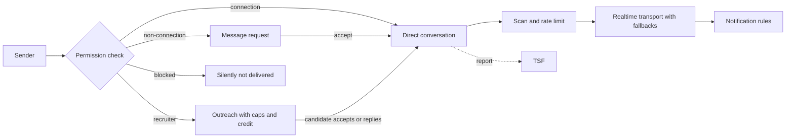

# MSG — Messaging & Real-time Communication

> Status: intended product specification. Nothing in this file is a claim that anything is built. Legacy inputs are inputs, not limits. Conventions: [`../00_START_HERE/CONVENTIONS.md`](../00_START_HERE/CONVENTIONS.md).

## 1. Purpose, outcomes and boundaries

### 1.1 Purpose

MSG is the single place where people on TalentSphere talk to each other: connections, candidates and recruiters, mentors and mentees, group collaborators. It gives members control over who can reach them, gives recruiters accountable and rate-limited outreach, and keeps scams and harassment out. [SRC: SSOT §7 F-10, F-59; WF-10]

### 1.2 Outcomes

1. A member can hold direct and group conversations with delivery, read state, search and attachments that behave identically on desktop, phone and flaky networks.
2. A stranger (including a recruiter) cannot land in a member's main inbox: contact from non-connections goes through message requests with candidate-set controls. [SRC: SSOT BR-129, BR-130, BR-214]
3. Recruiter outreach is labelled, capped, refundable on reply, and respects candidate preferences.
4. Abuse is reportable from every message, blockable, and visible to TSF with only the context needed.
5. Messages are encrypted in transit and at rest, access by staff is exceptional and audited, and members can export and delete their data.
6. Realtime delivery degrades gracefully: the product is usable when WebSockets are unavailable. [SRC: SSOT §4.2 "unnecessary realtime infrastructure" is a non-goal, so transports are chosen by need]

### 1.3 In scope

Direct and group conversations; message composition, edit, delete, reactions, replies; attachments; conversation list, folders and states; search; read receipts, typing, presence; message requests; recruiter outreach with controls, credits and caps; candidate outreach preferences; context threads (application, introduction, mentor, interview); employer shared inbox; saved replies; broadcasts; spam and abuse controls; scam banners; encryption posture; retention, export, staff access; realtime transport and fallbacks; offline queue; notification rules; accessibility; link safety.

### 1.4 Out of scope (owned elsewhere)

| Capability | Owner |
|---|---|
| Notification delivery channels, templates, preferences hub | NTF (planned) |
| Report intake UI behaviour, moderation decisions, sanctions | TSF |
| Block and privacy settings storage | NET (`FR-NET-006`, `FR-NET-007`) |
| Interview scheduling and video rooms | INT (planned) |
| Application stage changes and automated pipeline emails | ATS (planned) |
| Plan prices, outreach credit purchase | BIL (planned) |
| AI drafting and translation models | AIC |
| Media storage and virus scanning pipeline | PLT (planned) |
| Mentor sessions | MEN (planned) |

### 1.5 Boundary with the non-goal "sales-prospecting suite"

[SRC: SSOT §4.2] excludes a sales-prospecting suite. MSG limits recruiter outreach to hiring purposes: one-to-one messages labelled with a job or talent-pool purpose, no bulk sequences, no scraping-based cold campaigns, and no contact-data export. Opens `OD-MSG-01` for the allowed bulk volume.

### 1.6 Owned versus consumed

Owned: conversations, messages, attachments, message requests, outreach records and credits ledger entries, read and delivery state, saved replies, broadcasts, messaging export and retention. Consumed: identity and role (IDN planned), connection and block state (NET), employer verification (EMP planned), plan entitlements (BIL planned), moderation verdicts (TSF), notification delivery (NTF planned).

## 2. Roles and permission matrix

Legend: Y allowed, O own conversations only, S scoped by rule, R by rule, N not allowed.

| Capability | GUE | CAN | STD | INS | MNT | REC | HMG | EAD | IAD | PLO | MOD | SUP | PAD | SAD |
|---|---|---|---|---|---|---|---|---|---|---|---|---|---|---|
| Message a connection | N | Y | R | Y | Y | Y | Y | Y | Y | Y | N | N | N | N |
| Send a message request | N | Y | R | Y | Y | Y | Y | Y | Y | Y | N | N | N | N |
| Send recruiter outreach | N | N | N | N | N | S | S | S | N | N | N | N | N | N |
| Receive recruiter outreach | N | Y | R | Y | Y | Y | Y | Y | N | N | N | N | N | N |
| Create group conversation | N | Y | R | Y | Y | Y | Y | Y | Y | Y | N | N | N | N |
| Send attachments | N | Y | Y | Y | Y | Y | Y | Y | Y | Y | N | N | N | N |
| Send broadcast | N | N | N | S | S | S | N | S | S | S | N | N | N | N |
| Read message content of others | N | O | O | O | O | O | O | O | O | O | R | R | N | R |
| Export own conversations | N | O | O | O | O | O | O | O | O | O | N | N | N | N |
| Configure messaging policy (platform) | N | N | N | N | N | N | N | N | N | N | N | N | Y | Y |
| View messaging audit log | N | N | N | N | N | N | N | N | N | N | N | R | Y | Y |

Notes. `MOD` read access applies only to messages attached to a report, with the report's context window (`BR-MSG-022`). `SUP` read access requires a support ticket and the member's explicit in-ticket consent, limited to the named conversation (`BR-MSG-019`). `SAD` access is for legal orders and security incidents under dual approval (`BR-MSG-019`). `STD` follows institution policy (`IAD` can restrict messaging to enrolled peers and staff). `HMG` may send outreach only on jobs where they are a named hiring manager. Minors follow `BR-MSG-008`. `API` principals have no MSG write access in this blueprint; any integration is a PLT (planned) decision.

## 3. Sub-module map

| Code | Sub-module | Features |
|---|---|---|
| MSG-A | Conversations | FR-MSG-001 to 008 |
| MSG-B | Message requests and recruiter outreach | FR-MSG-009 to 016 |
| MSG-C | Safety and abuse controls | FR-MSG-017 to 021 |
| MSG-D | Realtime, delivery and notifications | FR-MSG-022 to 026 |
| MSG-E | Data governance and access | FR-MSG-027 to 030 |
| MSG-F | Experience and accessibility | FR-MSG-031 to 033 |

## 4. Feature specifications

### 4.1 MSG-A Conversations

### FR-MSG-001 — Start a direct conversation

- **Sub-module:** MSG-A Conversations
- **Priority / tier:** Must · R1
- **Source:** [SRC: SSOT §7 F-10; WF-10]
- **Purpose and outcome:** A member opens a one-to-one thread with a connection and sends a first message; the system decides whether it is a conversation, a request or blocked.
- **Roles and permissions:** `CAN, STD (R), INS, MNT, REC, HMG, EAD, IAD, PLO: create` · others N
- **Preconditions and entry points:** "Message" on a profile, connection list, group member list, application page, mentor profile, introduction. Sender has an active, verified-email account and is not under a TSF messaging restriction.
- **User interactions and actions:** 1. Select Message. 2. If a conversation already exists, it opens; otherwise a new thread opens with a composer. 3. Type and send (see FR-MSG-002). 4. If the recipient is not a connection, the composer explains "This will be sent as a message request" with the request limits visible before sending.
- **System behaviour:** Evaluates `BR-MSG-001`. Connection and no block: creates a `Conversation` (type `direct`) with two `Participant` rows, unique per member pair (a second creation returns the existing one). Non-connection: routes to FR-MSG-009. Blocked either way: the composer appears normal and send is accepted but never delivered (`BR-MSG-023`). Emits `msg.conversation.created`.
- **UI elements and controls:** Message button (states Message, Request, Unavailable not shown to hide blocks); composer; recipient header with name, headline, verified-employer badge when applicable; banner for request mode.
- **Configuration options:** User: "Who can message me" (FR-MSG-012). Platform: none.
- **Business rules:** `BR-MSG-001`, `BR-MSG-008`, `BR-MSG-021`, `BR-MSG-023`
- **Validation:** Recipient resolves to an active member; self-conversation rejected; sender's restrictions checked.
- **Inputs and outputs:** In: recipient id, first message. Out: conversation id and first message state.
- **Filters, sorting, search:** n/a — creation flow.
- **Notifications and communication:** Recipient notification per FR-MSG-024 (for request: only the "message request" class).
- **Error handling and edge cases:** Recipient deactivated: "This person is not available". Concurrent creation by both members: one conversation; messages merge ordered by server time. Sender restricted: "Messaging is limited on your account" with appeal link.
- **Dependencies:** NET (connection, block, privacy), `ENT-MSG-01`, `ENT-MSG-02`.
- **Security and privacy:** Authorization checked at creation and on every send; conversation id is non-guessable; participant list immutable for direct conversations.
- **Acceptance criteria:**
  - Given two connections, when A messages B, then one conversation exists and B receives the message.
  - Given A and B are not connected, when A sends, then a message request is created and no conversation appears in B's main inbox.
  - Given B has blocked A, when A sends, then A sees a normal sent state and B receives nothing.
  - Given A messages B twice before reply, then exactly one conversation exists.

### FR-MSG-002 — Compose, send, edit, delete and react

- **Sub-module:** MSG-A Conversations
- **Priority / tier:** Must · R1
- **Source:** [SRC: SSOT WF-10 "clientMessageId dedupe"] [DER]
- **Purpose and outcome:** A member sends text messages reliably and manages them after sending.
- **Roles and permissions:** `participants: send, edit own, delete own, react, reply` · others N
- **Preconditions and entry points:** Open conversation.
- **User interactions and actions:** 1. Type text (up to 5,000 characters) with basic formatting (bold, italic, code, links, line breaks, lists). 2. Press Enter to send (setting: Ctrl or Cmd+Enter), Shift+Enter for newline. 3. Reply to a specific message (quote). 4. React with one of 6 emoji reactions. 5. Edit within 15 minutes. 6. Delete for me, or delete for everyone within 60 minutes.
- **System behaviour:** Client generates `client_message_id` (UUID); server dedupes on (conversation, sender, client_message_id) (`BR-MSG-010`). Server assigns monotonically increasing `sequence` per conversation and the authoritative timestamp. States per `SM-MSG-01`. Edits create `MessageRevision`; recipients see "Edited". Delete for everyone replaces content with a tombstone "This message was deleted"; the content stays in restricted storage for TSF if it was reported or flagged, and otherwise for 30 days (`BR-MSG-011`, `BR-MSG-016`). Reactions: one per user per message, changeable. Emits `msg.message.sent`, `.edited`, `.deleted`.
- **UI elements and controls:** Composer with toolbar; Send button (disabled when empty or over limit); quote preview; message bubble menu (Reply, React, Edit, Delete, Report, Copy); state ticks (sending, sent, delivered, read, failed with Retry); character counter at 90 percent.
- **Configuration options:** User: Enter-to-send, formatting toolbar visibility. Platform: limits (`BR-MSG-009`).
- **Business rules:** `BR-MSG-009`, `BR-MSG-010`, `BR-MSG-011`, `BR-MSG-021`
- **Validation:** 1 to 5,000 characters after trim or at least one attachment; control and zero-width characters stripped; at most 5 links; formatting limited to the allowed set (no HTML).
- **Inputs and outputs:** In: conversation id, text, client id, optional reply-to. Out: message with sequence and state.
- **Filters, sorting, search:** Messages ordered by sequence ascending; search is FR-MSG-006.
- **Notifications and communication:** Per FR-MSG-024.
- **Error handling and edge cases:** Network failure: message shows Failed with Retry; retry reuses the same `client_message_id` so no duplicate. Edit after 15 minutes: rejected. Delete for everyone after 60 minutes: only delete for me. Rate limited: "Slow down; try again in N seconds" (`BR-MSG-021`). Message to a conversation that became unavailable: marked Not delivered silently (block) or "Conversation closed" (closure).
- **Dependencies:** FR-MSG-001, FR-MSG-022, `ENT-MSG-03`, `ENT-MSG-04`.
- **Security and privacy:** Output encoded to prevent injection; link scanning (FR-MSG-031); reported messages preserved regardless of deletion.
- **Acceptance criteria:**
  - Given a failed send, when the sender retries, then exactly one message appears for the recipient.
  - Given a message sent 20 minutes ago, when the sender tries to edit, then the edit is refused.
  - Given a deleted-for-everyone message that was later reported, then TSF can still read the preserved content.
  - Given 5,001 characters, then Send is disabled and the counter shows the overage.

### FR-MSG-003 — Attachments and media

- **Sub-module:** MSG-A Conversations
- **Priority / tier:** Must · R1
- **Source:** [DER] [PROP] for voice notes
- **Purpose and outcome:** Members share files and images safely.
- **Roles and permissions:** `participants: send, download` · `MOD: view reported attachments only`
- **Preconditions and entry points:** Composer attach button, drag and drop, paste, camera (mobile).
- **User interactions and actions:** 1. Select files (up to 10 per message, 25 MB each, 100 MB per message). 2. See upload progress and cancel. 3. Add caption. 4. Send. 5. Recipient previews images and PDFs in-app or downloads others. 6. Record a voice note up to 3 minutes [PROP].
- **System behaviour:** Allowed types: JPEG, PNG, WebP, GIF, PDF, DOCX, XLSX, PPTX, TXT, CSV, MP3, M4A, WebM audio, ZIP not allowed in v1 [PROP]; executables and scripts blocked by content sniffing not by extension only. Files scanned for malware and for known-illegal imagery hashes (TSF); message shows "Scanning" and the file is unavailable to the recipient until the scan passes (target under 30 seconds) (`BR-MSG-009`). EXIF location stripped. Download links are signed and expire in 10 minutes. Attachments follow message retention. Resume attachments from a candidate to a recruiter may be linked to a PRF (planned) resume version and respect resume visibility. Emits `msg.attachment.scanned`.
- **UI elements and controls:** Attach button, progress bars, thumbnails, file chips with size and type, voice recorder with waveform and text alternative prompt, "Scanning" badge, "Blocked file" notice.
- **Configuration options:** Platform: size and type allowlist, quotas per plan (`BR-MSG-032`). Institution or employer policy may further restrict types for managed accounts.
- **Business rules:** `BR-MSG-009`, `BR-MSG-020`, `BR-MSG-031`
- **Validation:** MIME sniffed server-side; file name sanitized (255 characters); empty files rejected; image dimensions up to 8,000 pixels per side.
- **Inputs and outputs:** In: files, caption. Out: attachment ids, scan state.
- **Filters, sorting, search:** Conversation "Media and files" tab filtered by type; sort by date.
- **Notifications and communication:** Notification says "sent an attachment" without file name by default.
- **Error handling and edge cases:** Scan fails: attachment removed, sender told "File blocked by safety checks". Upload interrupted: resumable up to 24 hours. Storage failure: retry then error. Over per-plan storage: rejected with explanation.
- **Dependencies:** PLT media and scanning (planned), TSF hash matching, `ENT-MSG-05`.
- **Security and privacy:** Private bucket, no public URLs; antivirus; no inline rendering of HTML or SVG (SVG not allowed); attachments never used for AI or ads (`BR-MSG-020`).
- **Acceptance criteria:**
  - Given a 30 MB file, then it is rejected with the size limit.
  - Given a file that fails the malware scan, then the recipient never receives a download link.
  - Given a download link older than 10 minutes, then it returns an authorization error and a new link can be requested.
  - Given a renamed executable with a .pdf extension, then it is blocked by content sniffing.

### FR-MSG-004 — Group conversations

- **Sub-module:** MSG-A Conversations
- **Priority / tier:** Should · R2
- **Source:** [DER] [PROP]
- **Purpose and outcome:** A small set of members chats together, for example a study group, project team or interview panel prep.
- **Roles and permissions:** `CAN, STD (R), INS, MNT, REC, HMG, EAD, IAD, PLO: create` · `group admin: add, remove, rename` · `member: leave`
- **Preconditions and entry points:** New group chat button; from project or course contexts (LRN planned).
- **User interactions and actions:** 1. Choose 2 to 49 other people (max 50 members including creator). 2. Name the group (optional). 3. Send a first message. 4. Admin adds members, removes members, promotes admins, renames, sets "Only admins can add members". 5. Members leave.
- **System behaviour:** Only the creator's connections can be added directly; other people must receive an invitation they accept (`BR-MSG-014`). A new member sees history only from their join time. Removing a member ends their access immediately. If the last admin leaves, the longest-standing member becomes admin; if all leave, the group closes. Blocks: if two members have blocked each other the group remains but each does not see the other's messages and a banner explains "Some messages are hidden" without naming (`BR-MSG-023`). Group creation is rate limited (10 per day). Emits `msg.group.created`, `msg.group.member_added`.
- **UI elements and controls:** Member picker, group name field, admin settings sheet, member list with roles, "Leave group" with confirm.
- **Configuration options:** Group: add-members permission, name. Platform: size 50 [PROP], `OD-MSG-02`.
- **Business rules:** `BR-MSG-014`, `BR-MSG-023`, `BR-MSG-021`, `BR-MSG-008`
- **Validation:** Name 0 to 80 characters; 2 to 50 members; no duplicate participants.
- **Inputs and outputs:** In: member ids, name. Out: conversation id.
- **Filters, sorting, search:** Group appears in the conversation list; filter "Groups".
- **Notifications and communication:** Added members get a notice (class `messages`); mentions in groups notify even if the group is muted when the member allows it.
- **Error handling and edge cases:** Add a blocked person: silently skipped, the admin sees "Could not add 1 person". Invitation expires after 14 days. Group at the cap: error.
- **Dependencies:** NET connections and blocks, `ENT-MSG-01`.
- **Security and privacy:** Participant lists visible only to participants; minors cannot be added to groups with adults they are not connected to.
- **Acceptance criteria:**
  - Given an admin adds a non-connection, then that person gets an invitation and sees no history until accepting.
  - Given a 51st member is added, then the action is refused.
  - Given A has blocked B inside a group, then A does not see B's messages and B is not told.

### FR-MSG-005 — Conversation list, folders and states

- **Sub-module:** MSG-A Conversations
- **Priority / tier:** Must · R1
- **Source:** [DER] [PROP]
- **Purpose and outcome:** Members triage their conversations quickly and keep the inbox clean.
- **Roles and permissions:** `participants: view, pin, mute, archive, label` · others N
- **Preconditions and entry points:** Messages home.
- **User interactions and actions:** 1. See the list sorted by last activity with unread badges. 2. Tabs: Inbox, Requests, Archived, and (for recruiters) Outreach. 3. Pin up to 5. 4. Mute a conversation for 1 hour, 8 hours, 1 week or forever. 5. Archive and unarchive. 6. Mark unread. 7. Apply private labels (up to 10 labels). 8. Filter by unread, groups, pinned, labelled, with attachments.
- **System behaviour:** Conversation state per participant: `active`, `muted`, `archived` (`SM-MSG-02`); a new message unarchives unless muted. Unread counts derived from `ReadState`. Labels are private per participant. Muted conversations produce no push or email but still count unread. List virtualized and paginated by cursor (50 per page).
- **UI elements and controls:** Conversation rows (avatar, name, snippet, time, unread dot, mute icon), swipe actions on mobile (archive, mute), tabs with counts, filter chips, label manager, empty states ("No messages yet" with Discover link), skeleton loader.
- **Configuration options:** User: snippet preview on or off (default on, hidden on lock screens per `BR-MSG-026`), default tab. Platform: pin limit 5.
- **Business rules:** `BR-MSG-026`, `BR-MSG-016`
- **Validation:** Label name 1 to 30 characters, unique; mute durations enumerated.
- **Inputs and outputs:** In: conversation id, state change. Out: updated list item.
- **Filters, sorting, search:** Filters as above; sort by last activity (default) or unread first; text search in FR-MSG-006.
- **Notifications and communication:** Badge counts shown in app shell; no extra notifications.
- **Error handling and edge cases:** State change offline: queued (FR-MSG-025). Archived conversation receives a message from a blocked party: nothing. 10,000+ conversations: pagination continues; archive nudges appear.
- **Dependencies:** `ENT-MSG-01`, `ENT-MSG-10`.
- **Security and privacy:** Snippets obey privacy previews; labels never shared.
- **Acceptance criteria:**
  - Given an archived conversation, when a new message arrives, then it returns to Inbox unless muted.
  - Given 5 pinned conversations, when the member pins a sixth, then it is refused with the limit.
  - Given a muted conversation, then no push is sent but the unread count updates.

### FR-MSG-006 — Search in conversations

- **Sub-module:** MSG-A Conversations
- **Priority / tier:** Should · R2
- **Source:** [PROP]
- **Purpose and outcome:** A member finds past messages, people and attachments.
- **Roles and permissions:** `participants: search own accessible conversations` · others N
- **Preconditions and entry points:** Search field on Messages home and inside a conversation.
- **User interactions and actions:** 1. Type at least 2 characters. 2. See results grouped: People, Conversations, Messages, Files. 3. Open a result jumping to the message in context with highlight. 4. Filter by person, date range, has attachment, conversation.
- **System behaviour:** Server-side full-text index per member scope; results restricted by participant membership and join time (group history rule). Deleted messages are removed from the index within 5 minutes (`BR-MSG-015`). Blocked-party messages excluded. No content leaves the platform for indexing. Search queries are not logged with text beyond 7 days and never used for ads or AI training. Emits `msg.search.performed` (no query text).
- **UI elements and controls:** Search box with scope toggle (All, This conversation); filter popover; result list with snippet highlighting (marked with `mark` element and accessible text); "No results" empty state.
- **Configuration options:** User: clear search history. Platform: index lag target under 10 seconds.
- **Business rules:** `BR-MSG-015`, `BR-MSG-020`
- **Validation:** Query 2 to 100 characters; date ranges valid.
- **Inputs and outputs:** In: query, filters, cursor. Out: result groups and counts.
- **Filters, sorting, search:** Sort by relevance (default) or newest.
- **Notifications and communication:** n/a — no notifications.
- **Error handling and edge cases:** Index unavailable: falls back to conversation-level title and name search with a notice. New messages not yet indexed: shown once indexed (within 10 seconds).
- **Dependencies:** `ENT-MSG-16`, PLT search infrastructure (planned).
- **Security and privacy:** Per-member authorization on every hit; index stores no data of conversations where membership ended after leave time.
- **Acceptance criteria:**
  - Given a message containing "portfolio", when the member searches "portfolio", then it appears with the conversation context.
  - Given a deleted message, then it is not found after 5 minutes.
  - Given a group joined after a message was sent, then that message is never in the new member's results.

### FR-MSG-007 — Read receipts, delivery status, typing and presence

- **Sub-module:** MSG-A Conversations
- **Priority / tier:** Should · R2
- **Source:** [PROP]
- **Purpose and outcome:** Members see whether messages arrived and optionally whether someone is available, under privacy controls.
- **Roles and permissions:** `participants: view status; edit own privacy`
- **Preconditions and entry points:** Conversation view; Settings > Messaging > Privacy.
- **User interactions and actions:** 1. See ticks: sent, delivered, read. 2. See "typing" in accepted conversations. 3. See presence dots (Online, Away) where allowed. 4. Turn off read receipts, typing indicators, presence in Settings.
- **System behaviour:** Delivered = stored on a recipient device or visible in the recipient's list; Read = conversation opened with the message in view for at least 1 second. Rules (`BR-MSG-012`, `BR-MSG-013`): read receipts are reciprocal (turning them off hides others' receipts too); no receipts or typing in message requests and outreach before the recipient replies or accepts; presence is off by default and, when on, only visible to connections; typing indicators are ephemeral and never stored. Recruiter outreach: the sender sees Delivered but Read only after a reply. Group read receipts show counts not names unless group size is at most 8. Emits `msg.message.read` (receipt only).
- **UI elements and controls:** Tick icons with text labels for screen readers; typing bubble; presence dot with label; privacy toggles with explanation.
- **Configuration options:** User: read receipts (default on for connections), typing (default on), presence (default off). Platform: idle timeout 5 minutes for Away.
- **Business rules:** `BR-MSG-012`, `BR-MSG-013`
- **Validation:** Presence heartbeats rate limited (1 per 30 seconds per device).
- **Inputs and outputs:** In: events from client. Out: receipt state.
- **Filters, sorting, search:** n/a — status indicators.
- **Notifications and communication:** None.
- **Error handling and edge cases:** Offline recipient: delivered only on reconnect. Multiple devices: read on one device marks read on all (FR-MSG-026).
- **Dependencies:** FR-MSG-022, `ENT-MSG-10`, `ENT-MSG-20`.
- **Security and privacy:** Presence and typing are never stored beyond 5 minutes; they are not used for ranking or analytics at member level.
- **Acceptance criteria:**
  - Given receipts are off for A, then A cannot see B's read state and B cannot see A's.
  - Given a message request, then the sender sees no read state until accepted.
  - Given presence off, then no presence is published to anyone.

### FR-MSG-008 — Conversation lifecycle (close, leave, delete, expire)

- **Sub-module:** MSG-A Conversations
- **Priority / tier:** Must · R1
- **Source:** [DER]
- **Purpose and outcome:** Conversations end cleanly and data follows predictable rules.
- **Roles and permissions:** `participants: leave, delete for me` · `system: close context threads` · `PAD: legal hold via SAD`
- **Preconditions and entry points:** Conversation menu; context events (application withdrawn, job closed, mentorship ended).
- **User interactions and actions:** 1. Delete conversation for me (confirm; "Others keep their copy"). 2. Leave group. 3. For context threads, "End conversation" by either side; closed thread shows a banner and disables the composer. 4. Reopen allowed by the member who closed it within 30 days if the other party has not blocked.
- **System behaviour:** `SM-MSG-02`. Delete for me hides the thread for that participant and removes it from search; the other participant is unaffected; data retained per FR-MSG-027. Context threads close automatically 30 days after the context ends (application closed, mentorship ended) with notice 7 days before. Direct conversations between connections are never auto-closed. Participant accounts deleted: the thread shows "Former member" and the remaining participant keeps content they received for retention (`BR-MSG-035`). Emits `msg.conversation.closed`.
- **UI elements and controls:** Menu items with consequence text; closed banner; reopen button.
- **Configuration options:** Platform: auto-close 30 days; notice 7 days.
- **Business rules:** `BR-MSG-016`, `BR-MSG-017`, `BR-MSG-035`
- **Validation:** Only participants can act.
- **Inputs and outputs:** In: conversation id, action. Out: new state.
- **Filters, sorting, search:** Archived and closed filters.
- **Notifications and communication:** Pre-close notice (class `messages`).
- **Error handling and edge cases:** Delete during legal hold: hidden for the member but retained. Reopen after block: refused.
- **Dependencies:** FR-MSG-027, ATS (planned), MEN (planned).
- **Security and privacy:** Closure is not deletion; retention clocks documented to the member.
- **Acceptance criteria:**
  - Given deletion for me, then the other participant still sees the thread.
  - Given an application closed 30 days ago, then the application thread is closed with a banner.
  - Given a legal hold, when the member deletes, then the thread disappears for them but is retained.

### 4.2 MSG-B Message requests and recruiter outreach

