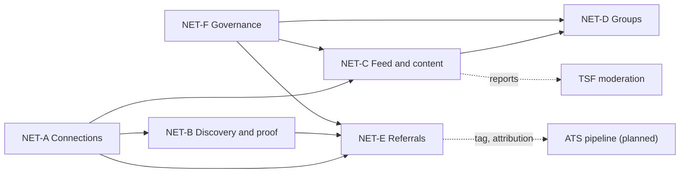
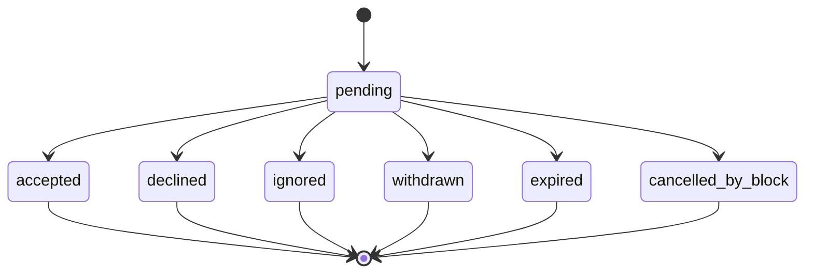
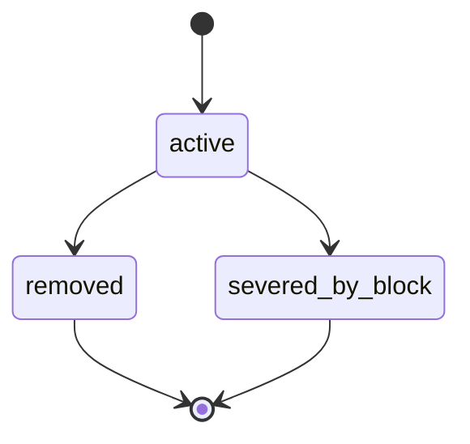
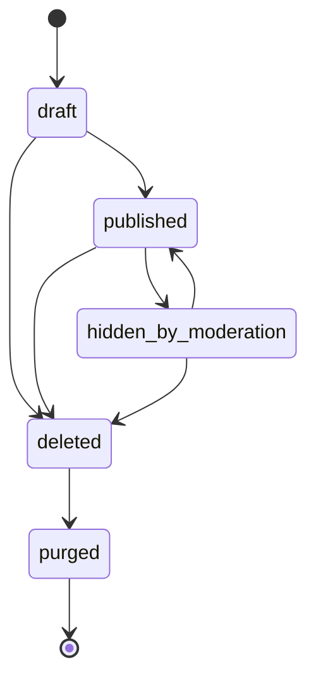
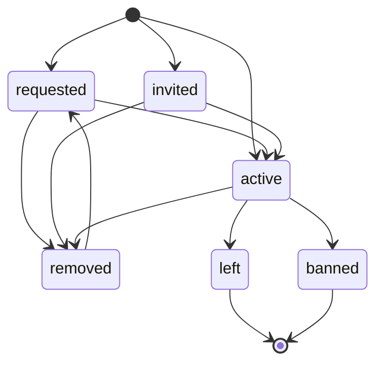
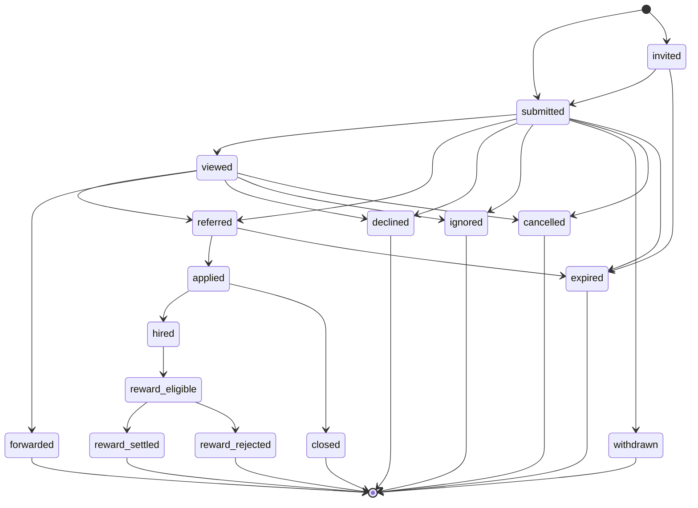
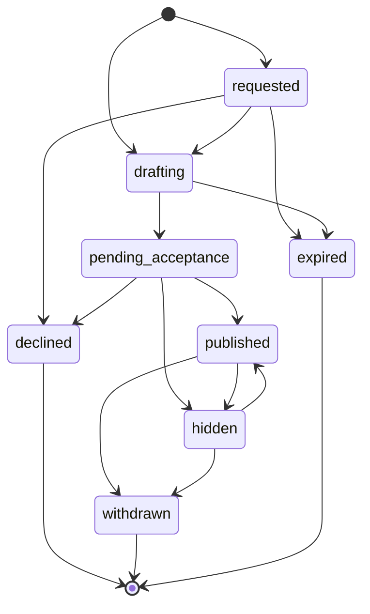
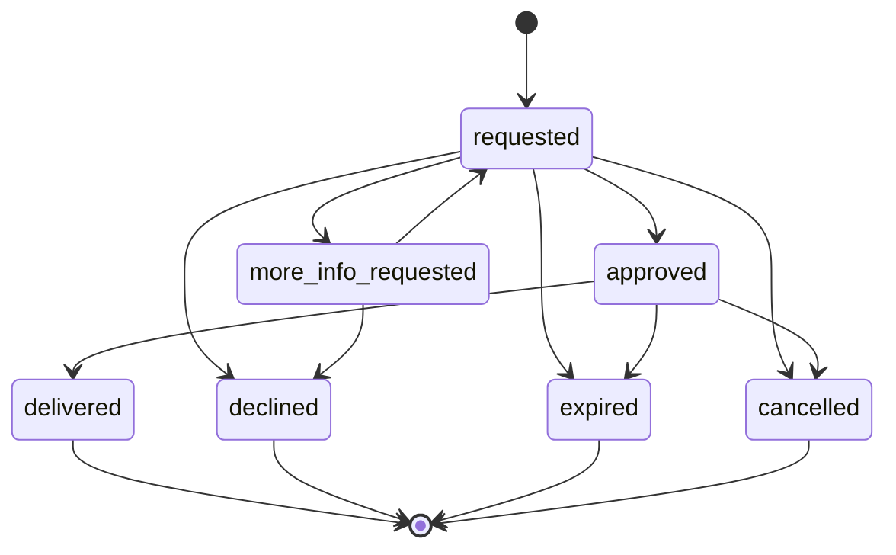
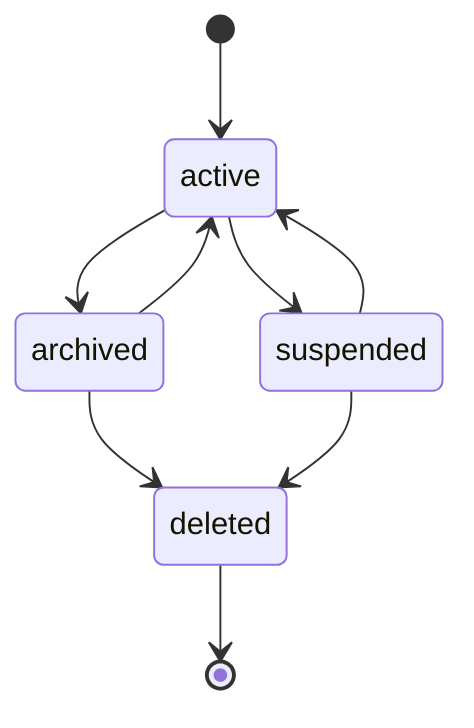
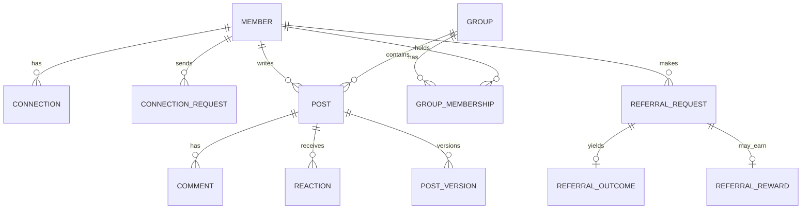

# NET — Networking, Community & Referrals

> Status: intended product specification. Nothing in this file is a claim that anything is built. Legacy inputs (`SSOT.md`, `docs/`, `Yash_Final_Project_Document/`) are inputs, not limits. Conventions: [`../00_START_HERE/CONVENTIONS.md`](../00_START_HERE/CONVENTIONS.md).

## 1. Purpose, outcomes and boundaries

### 1.1 Purpose

NET lets people build a professional graph, see career-relevant content, belong to communities, and obtain employee referrals, so that evidence of skill and work history travels through trusted relationships and not only through cold applications. [SRC: SSOT §7 F-09, F-53, F-55, F-142] It is a career network, not a general social network. [SRC: SSOT §4.2]

### 1.2 Outcomes

1. A member can find relevant people, connect with consent, and control who can see or contact them.
2. A member can publish and read career-relevant posts with a feed that is explainable and always has a chronological alternative. [SRC: BR-124]
3. A member can join communities (including alumni and affinity groups) with clear rules and local moderation.
4. A candidate can request a referral for a job, and an employee can refer someone, with consent, limits, attribution and no pay-to-rank effect on other candidates.
5. Every relationship, post and referral action is reversible by the person who owns it and reportable to Trust and Safety (TSF).

### 1.3 Boundary with the non-goal "social-media clone"

[SRC: SSOT §4.2] excludes a social-media clone; the owner's goal is an operating system for the career domain. NET resolves the tension narrowly [DER] and opens `OD-NET-01`:

- Included: text posts, images, documents, links, polls, long-form articles, newsletters, topics, groups, reactions, comments.
- Excluded by default [PROP]: stories, short-video feeds, live streaming, public follower counts as a ranking game, gifts or tips, engagement streaks, "viral" boosts, trending-people lists, personal-life content categories as a ranking target.
- Every post type has a career-purpose test: it must be tagged with at least one career topic (role, skill, industry, learning, hiring, workplace, career transition, event) or a group context. [PROP]

### 1.4 In scope

Connections and requests; follow; block, mute and restrict; people discovery; warm introductions; endorsements and written recommendations; profile-view insights; posts, comments, reactions, reposts, bookmarks, mentions, topics; home feed with ranking transparency; articles and newsletters; groups, alumni and affinity groups; referral requests, employee referrals, attribution, reward eligibility; ranking configuration; social data lifecycle.

### 1.5 Out of scope (owned elsewhere)

| Capability                                                               | Owner                                   |
| ------------------------------------------------------------------------ | --------------------------------------- |
| Direct and group messages, outreach limits, message requests             | MSG                                     |
| Reports, moderation queue, sanctions, appeals, fraud detection           | TSF                                     |
| Recommendation engine, match scoring, explanations model                 | AIC                                     |
| Profile fields, resume, portfolio                                        | PRF                                     |
| Notification delivery, preferences, digests                              | NTF (planned)                           |
| Privacy dashboard, consent ledger, data export and erasure orchestration | SET (planned)                           |
| Verified employment and credential evidence                              | EVD, BGV (planned)                      |
| Job postings, applications, pipeline stages, hire confirmation           | JOB, ATS (planned)                      |
| Events and webinars                                                      | EVT (planned)                           |
| Mentor matching and sessions                                             | MEN (planned)                           |
| Plans, outreach credit purchase, billing                                 | BIL (planned)                           |
| Payment of referral bonuses (payroll is a non-goal)                      | Employer's own payroll; see `OD-NET-04` |

### 1.6 Owned versus consumed

Owned: connection graph, follows, blocks and mutes, posts and their children, groups, endorsements, recommendations, introductions, referral lifecycle, feed preferences, ranking configuration. Consumed: identity and role claims (IDN), profile snapshot (PRF), verified employment (EVD), job and application context (JOB, ATS), plan entitlements (BIL), moderation verdicts (TSF), notification delivery (NTF), AI explanations and match scores (AIC).

## 2. Roles and permission matrix

Legend: Y allowed, O own objects only, S scoped (group, organization or institution), R by rule, N not allowed.

| Capability                                                          | GUE | CAN | STD | INS | MNT | REC | HMG | EAD | IAD | PLO | MOD | SUP | PAD |
| ------------------------------------------------------------------- | --- | --- | --- | --- | --- | --- | --- | --- | --- | --- | --- | --- | --- |
| View public posts and public group pages                            | Y   | Y   | Y   | Y   | Y   | Y   | Y   | Y   | Y   | Y   | Y   | N   | Y   |
| Send and respond to connection requests                             | N   | Y   | R   | Y   | Y   | Y   | Y   | Y   | Y   | Y   | N   | N   | N   |
| Follow people, organizations, topics                                | N   | Y   | Y   | Y   | Y   | Y   | Y   | Y   | Y   | Y   | N   | N   | N   |
| Block, mute, restrict                                               | N   | Y   | Y   | Y   | Y   | Y   | Y   | Y   | Y   | Y   | Y   | N   | N   |
| Publish posts, comments, reactions                                  | N   | Y   | R   | Y   | Y   | Y   | Y   | Y   | Y   | Y   | N   | N   | N   |
| Create groups                                                       | N   | Y   | R   | Y   | Y   | Y   | Y   | Y   | Y   | Y   | N   | N   | N   |
| Create institution-linked alumni or affinity groups                 | N   | N   | N   | N   | N   | N   | N   | N   | S   | S   | N   | N   | N   |
| Request referral                                                    | N   | Y   | Y   | N   | N   | N   | N   | N   | N   | N   | N   | N   | N   |
| Respond to referral request as referrer                             | N   | O   | O   | O   | O   | O   | O   | O   | O   | O   | N   | N   | N   |
| Configure referral program                                          | N   | N   | N   | N   | N   | N   | N   | S   | N   | N   | N   | N   | N   |
| View referral tags and attribution on applications                  | N   | O   | O   | N   | N   | S   | S   | S   | N   | N   | N   | N   | N   |
| Hide or remove content for policy reasons                           | N   | O   | O   | O   | O   | O   | O   | O   | O   | O   | Y   | N   | Y   |
| Read a user's block list                                            | N   | O   | O   | O   | O   | O   | O   | O   | O   | O   | N   | N   | N   |
| Configure ranking and run ranking audit                             | N   | N   | N   | N   | N   | N   | N   | N   | N   | N   | N   | N   | Y   |
| Support read-only view of relationship data with ticket and consent | N   | N   | N   | N   | N   | N   | N   | N   | N   | N   | N   | R   | N   |

Notes. `STD` rules marked R: students attached to an institution follow the same rules plus institution policies (`IAD` may restrict group creation for managed learners). Minors (16 and 17) follow `BR-NET-011`. `HMG` and `REC` may use NET as individuals but their employer-branded posts go through an organization page owned by EMP (planned). `API` principals have no NET write access in this blueprint; read access to a member's own public posts is a PLT (planned) concern.

## 3. Sub-module map

| Code  | Sub-module                                | Features          |
| ----- | ----------------------------------------- | ----------------- |
| NET-A | Connections and relationships             | FR-NET-001 to 007 |
| NET-B | Discovery, introductions and social proof | FR-NET-008 to 013 |
| NET-C | Feed and content                          | FR-NET-014 to 024 |
| NET-D | Groups and communities                    | FR-NET-025 to 028 |
| NET-E | Referrals                                 | FR-NET-029 to 035 |
| NET-F | Governance and lifecycle                  | FR-NET-036 to 037 |

## 4. Feature specifications

### 4.1 NET-A Connections and relationships

### FR-NET-001 — Send connection request

- **Sub-module:** NET-A Connections and relationships
- **Priority / tier:** Must · R1
- **Source:** [SRC: SSOT §7 F-09] [DER]
- **Purpose and outcome:** A member asks another member for a mutual, two-way professional connection. Outcome is a `ConnectionRequest` in `pending` state visible to the recipient.
- **Roles and permissions:** `CAN, STD (R), INS, MNT, REC, HMG, EAD, IAD, PLO: create` · `GUE: N` · `MOD, SUP, PAD: N`
- **Preconditions and entry points:** Sender has a verified-email active account. Entry points: profile "Connect" button, People You May Know card (FR-NET-008), search result (SRC planned), group member list, post author menu, event attendee list (EVT planned). Recipient account is active, not blocked in either direction, not already connected, no pending request in either direction, and the recipient's "who can send me requests" setting (FR-NET-007) permits the sender.
- **User interactions and actions:** 1. Sender selects Connect. 2. A dialog offers "Add a note" (optional, 300 characters) and a pre-filled context chip when relevant (shared group, shared employer, shared event). 3. Sender selects Send or Cancel. 4. After send, the button becomes "Pending" with a Withdraw action.
- **System behaviour:** Validates `BR-NET-001`, `BR-NET-002`, `BR-NET-003`, `BR-NET-011`. Creates `ConnectionRequest` (`SM-NET-01`) with `expires_at` per `BR-NET-005`. Emits `net.connection_request.sent`. Queues recipient notification (class `network_requests`). Idempotent on `(sender, recipient)` while a pending request exists: a repeat call returns the existing request. Request counts toward sender caps immediately. If a request would exceed the sender's abuse score threshold (TSF planned signal), the send is accepted but held for delayed delivery up to 24 hours and flagged; the sender sees the normal "Pending" state.
- **UI elements and controls:** Connect button (default state "Connect"; states Pending, Connected, Unavailable); Note textarea with live counter (300, optional); Context chip (read-only); Send primary button (disabled while sending); Cancel link; inline error region (`aria-live="polite"`).
- **Configuration options:** Platform: outstanding cap 100, daily cap 30, note length 300 [PROP, `BR-NET-002`]. User: none beyond the recipient's privacy settings. Org: institution policy may restrict managed learners to in-institution connections (IAD, `OD-NET-08`).
- **Business rules:** `BR-NET-001`, `BR-NET-002`, `BR-NET-003`, `BR-NET-004`, `BR-NET-005`, `BR-NET-008`, `BR-NET-011`, `BR-NET-039`
- **Validation:** Note: 0 to 300 Unicode characters after trimming; control and zero-width characters stripped; URLs and email addresses removed if the sender account is younger than 7 days (`BR-NET-003`); recipient id must resolve to an active member; self-request rejected.
- **Inputs and outputs:** In: recipient id, optional note, optional context reference. Out: request id, state `pending`, expiry date. Failures return a typed error code and a user-facing sentence.
- **Filters, sorting, search:** n/a — single action; lists of sent requests are in FR-NET-002.
- **Notifications and communication:** Recipient: in-app and push (default) and email (opt-in) "name wants to connect"; template `net.connection_request_received`; opt-out class `network_requests`. No email is sent for a request held by abuse delay until release.
- **Error handling and edge cases:** Blocked either way: the button shows "Unavailable" with no reason and the API returns `not_available` (never reveals the block). Cap reached: "You have reached your limit of pending requests. Withdraw some or wait for responses." Recipient deleted between page load and send: `not_available`. Concurrent mutual requests (A to B and B to A within one second): the second is converted into an automatic acceptance and both become connected. Offline send (PWA planned): action is queued for up to 24 hours; the server re-validates all rules on replay and reports failures in the activity list.
- **Dependencies:** FR-NET-007, FR-NET-006, IDN account state (planned), NTF delivery (planned), `ENT-NET-01`, `ENT-NET-02`.
- **Security and privacy:** Server-side authz on sender and recipient; the request note is user-generated content scanned for abuse (TSF planned) and is stored with the request only; rate limited per sender and per IP; request metadata (sender, time) is personal data retained per `BR-NET-038`.
- **Acceptance criteria:**
  - Given two active, unconnected members, when A sends a request with a 120-character note, then a pending request exists, B is notified, and A sees "Pending".
  - Given A has 100 outstanding requests, when A sends another, then the request is rejected with the cap message and nothing is created.
  - Given B has blocked A, when A opens B's profile, then the Connect control is "Unavailable" and no API response indicates a block.
  - Given a 7-day-old account sends a note containing a URL, then the URL is stripped before storage and the sender is told it was removed.

### FR-NET-002 — Respond to connection request

- **Sub-module:** NET-A Connections and relationships
- **Priority / tier:** Must · R1
- **Source:** [SRC: SSOT §7 F-09] [DER]
- **Purpose and outcome:** A recipient accepts, declines or ignores requests from a single inbox; the sender can review and withdraw sent requests.
- **Roles and permissions:** `CAN, STD, INS, MNT, REC, HMG, EAD, IAD, PLO: view and act on own received and sent requests` · others: N
- **Preconditions and entry points:** At least one request exists. Entry points: My Network page, notification, email deep link (requires sign-in), push action.
- **User interactions and actions:** 1. Open Invitations with tabs Received and Sent. 2. For a received request choose Accept, Ignore or Decline; open the sender's profile preview with mutual connections and the note. 3. For sent requests choose Withdraw. 4. Bulk select on desktop and mobile long-press to Ignore several. 5. "Block and decline" is available in the overflow menu (FR-NET-006).
- **System behaviour:** Accept: creates `Connection` (`SM-NET-02`) with a canonical ordered pair, closes the request as `accepted`, emits `net.connection.created`, updates both mutual-connection counts, notifies the sender. Decline and Ignore both set the request to `declined` or `ignored` silently (`BR-NET-004`): the sender continues to see "Pending" until expiry, then "Not accepted" with no distinction. Withdraw: sets `withdrawn`, removes from recipient inbox, no notification. All transitions idempotent by request id; accepting an already accepted request returns the existing connection.
- **UI elements and controls:** Tabs (Received default, Sent); request cards with avatar, headline, shared context, note (truncated at 140 characters, expandable); Accept primary, Ignore and Decline secondary; Withdraw tertiary; "Select" mode checkbox column; empty-state illustration with text "No pending invitations"; skeleton loader (3 cards); error banner with Retry.
- **Configuration options:** User: "Show note preview in notifications" (default on). Platform: page size 20.
- **Business rules:** `BR-NET-001`, `BR-NET-004`, `BR-NET-005`, `BR-NET-006`
- **Validation:** Acting user must be the recipient (or sender for withdraw); request must be `pending`; both accounts must still be active and unblocked.
- **Inputs and outputs:** In: request id, action. Out: updated request, and connection id on accept.
- **Filters, sorting, search:** Sort Received by newest (default) or by mutual connections; filter by "has note", "shared group", "shared employer"; text search by name within the inbox.
- **Notifications and communication:** Sender on accept: "name accepted your invitation", `net.connection_request_accepted`, class `network_requests`. No notification on decline, ignore, withdraw, expiry.
- **Error handling and edge cases:** Sender blocked recipient since sending: request is auto-closed as `cancelled_by_block` and disappears. Sender account suspended (TSF): request hidden from recipient, restored if sanction reversed within expiry. Double tab accept: second returns the same connection. Network failure: optimistic UI rolls back and shows retry.
- **Dependencies:** FR-NET-001, FR-NET-006, `ENT-NET-01`, `ENT-NET-02`.
- **Security and privacy:** Recipient sees only profile fields allowed by the sender's visibility settings for a non-connection. The sender cannot infer decline. Audit event kept for pairs with repeated declines (`BR-NET-004`).
- **Acceptance criteria:**
  - Given a pending request, when the recipient accepts, then both members appear in each other's connection list and the sender is notified.
  - Given a recipient declines, when the sender views the profile, then the state is still "Pending" and no decline signal is exposed.
  - Given the sender withdrew the request, when the recipient taps Accept on a stale notification, then the system responds "This invitation is no longer available" and creates nothing.

### FR-NET-003 — Stale-request nudges and expiry

- **Sub-module:** NET-A Connections and relationships
- **Priority / tier:** Should · R1
- **Source:** [PROP] (the owner's brief asks for stale-request nudges; legacy has no cadence) · also [SRC: SSOT §7 F-30 Networking Stale-Request Nudges]
- **Purpose and outcome:** Pending requests do not rot: recipients get gentle reminders; senders get cleanup help; old requests expire so caps recover.
- **Roles and permissions:** System job; `CAN, STD, INS, MNT, REC, HMG, EAD, IAD, PLO: configure own nudge preference` · `PAD: configure thresholds`
- **Preconditions and entry points:** A request is `pending` and recipient has not opted out of nudges. Entry points: scheduled job; Settings > Notifications > Network.
- **User interactions and actions:** 1. Recipient receives a nudge (in-app badge, optional push or email). 2. Recipient opens Invitations and responds, or taps "Stop reminders for this person". 3. Sender sees "Not accepted" after expiry and can send again subject to `BR-NET-004`. 4. Sender gets a Sent-tab banner "N requests older than 30 days. Withdraw to free capacity" with one-tap Withdraw all.
- **System behaviour:** Daily job evaluates pending requests: nudge at day 7 and day 21 (`BR-NET-005`), at most one nudge per day per recipient grouped as a digest, at most 2 nudges per request; expiry at day 45 sets state `expired` and frees the sender's cap. No nudge if the sender is restricted or suspended. Nudges to recipients with more than 25 pending requests collapse into one weekly digest.
- **UI elements and controls:** Nudge card in notification centre; digest email; "Stop reminders for this person" link; Settings toggle "Remind me about pending invitations" (default on); Sent-tab banner with "Withdraw all older than 30 days".
- **Configuration options:** Platform: nudge days (7, 21), expiry (45), max nudges (2), digest threshold (25) [PROP]. User: reminder toggle.
- **Business rules:** `BR-NET-005`, `BR-NET-004`
- **Validation:** Threshold parameters: integers, nudge days strictly less than expiry, expiry between 14 and 180.
- **Inputs and outputs:** In: pending requests. Out: nudge events, expired requests.
- **Filters, sorting, search:** n/a — system job; Invitations inbox sorting is in FR-NET-002.
- **Notifications and communication:** Template `net.connection_request_reminder`, class `network_reminders`, channels in-app (default), email and push (opt-in).
- **Error handling and edge cases:** Recipient inactive for 180 days (IDN planned dormant state): no nudges, requests still expire. Job re-run on the same day: idempotent via per-request `last_nudged_at`. Clock changes: uses server UTC.
- **Dependencies:** FR-NET-001, FR-NET-002, NTF (planned).
- **Security and privacy:** Nudges contain no note text in email. Sender identity in the email follows the sender's non-connection visibility.
- **Acceptance criteria:**
  - Given a request pending for 7 days, when the daily job runs, then the recipient gets one reminder.
  - Given a request pending for 45 days, when the job runs, then it becomes `expired` and the sender's outstanding count decreases by one.
  - Given the recipient chose "Stop reminders for this person", when day 21 arrives, then no nudge is created for that request.
  - Given the job is run twice on day 7, then only one nudge is created.

### FR-NET-004 — Manage connections

- **Sub-module:** NET-A Connections and relationships
- **Priority / tier:** Must · R1
- **Source:** [SRC: SSOT §7 F-09] [PROP] for tags and notes
- **Purpose and outcome:** A member views, organizes and removes connections with private labels.
- **Roles and permissions:** `CAN, STD, INS, MNT, REC, HMG, EAD, IAD, PLO: view and edit own connections` · `SUP: read with consent and ticket`
- **Preconditions and entry points:** My Network > Connections.
- **User interactions and actions:** 1. Browse the list. 2. Search by name, company, school or skill. 3. Add a private note (500 characters) and up to 5 tags per connection (tag names 24 characters, 50 tags total per member). 4. Select Remove connection and confirm. 5. Export connections list (name, headline, profile URL, connected date) as CSV to self only.
- **System behaviour:** Remove deletes the `Connection` row silently (`BR-NET-006`), drops mutual-connection counts, hides connection-only content from each other, cancels pending introductions and referral requests between the pair that need a connection, and emits `net.connection.removed`. Endorsements already given remain but their display follows `BR-NET-015`. Notes and tags are private and deleted with the connection. CSV export requires re-authentication if the last sign-in is older than 15 minutes.
- **UI elements and controls:** List with virtualized rows; search field; sort dropdown; tag filter chips; row menu (Message, Add note, Tag, Remove); confirm dialog with explicit consequence text; Export button; empty state with link to People You May Know.
- **Configuration options:** Platform: page size 30; max tags 50.
- **Business rules:** `BR-NET-006`, `BR-NET-015`, `BR-NET-039`
- **Validation:** Note 0 to 500 characters; tag 1 to 24 characters, no leading or trailing whitespace, unique per member (case-insensitive).
- **Inputs and outputs:** In: connection id, note, tags, remove action. Out: updated list; CSV file.
- **Filters, sorting, search:** Sort: recently connected (default), name A to Z, recently active (only when the connection allows activity status); filters: tag, company, school, location; search is server-side with debounce 250 ms and returns only the viewer's connections.
- **Notifications and communication:** None to the other party.
- **Error handling and edge cases:** Removing during an open conversation: the conversation remains (MSG planned) but message-request rules may apply. Connection with a deleted account: row shown as "Former member" and removable. More than 30,000 connections: rejected at the cap (`BR-NET-039`).
- **Dependencies:** `ENT-NET-01`, FR-NET-010, FR-NET-029, MSG (planned).
- **Security and privacy:** Notes and tags are never visible to the other party or to recruiters. Export is audited and rate limited to 3 per day.
- **Acceptance criteria:**
  - Given a connection, when the member removes it, then both lose connection-only access and the other member receives no notification.
  - Given a note of 501 characters, when saved, then the system rejects it with a length message.
  - Given a member with 30,000 connections, when they accept another request, then acceptance fails with the cap message.

### FR-NET-005 — Follow and unfollow

- **Sub-module:** NET-A Connections and relationships
- **Priority / tier:** Must · R1
- **Source:** [SRC: SSOT §10 BR-121; F-53]
- **Purpose and outcome:** A member subscribes to updates from a person, organization page, group or topic without asking permission, giving one-way following.
- **Roles and permissions:** `CAN, STD, INS, MNT, REC, HMG, EAD, IAD, PLO: follow and unfollow` · `GUE: N`
- **Preconditions and entry points:** Profile, organization page (EMP planned), topic page, post author menu. Target is active, allows follow, and is not blocking or muted by the follower.
- **User interactions and actions:** 1. Select Follow. 2. Optionally choose "Notify me about new posts" (off by default). 3. Select Following to open Unfollow.
- **System behaviour:** Creates unique `Follow` (follower, target type, target id) per `BR-NET-007`. Following grants only access to what the target already makes public; it never grants connections-only content. Person follows auto-create when a connection is created if the member's "Auto-follow connections" is on (default on). Unfollow deletes the row; the feed excludes the target on next refresh. Emits `net.follow.created` and `net.follow.removed`.
- **UI elements and controls:** Follow toggle button (states Follow, Following, Unavailable); bell toggle; "Following" management page with tabs People, Organizations, Topics, Groups.
- **Configuration options:** User: "Allow people to follow me" (default on; if off, only connections may follow), "Auto-follow connections" (default on). Platform: follow cap 5,000 per member (`BR-NET-039`).
- **Business rules:** `BR-NET-007`, `BR-NET-008`, `BR-NET-009`, `BR-NET-039`
- **Validation:** Target type in {person, organization, topic}; follower cannot follow self; unique triple.
- **Inputs and outputs:** In: target type and id, notify flag. Out: follow state.
- **Filters, sorting, search:** In the Following page: search by name, sort by recently followed, filter by type.
- **Notifications and communication:** Target person receives "name started following you" only if they enabled "Follower notifications" (default off, class `network_followers`).
- **Error handling and edge cases:** Follow on a blocked or muting-direction target: `not_available`. Target switches off follows: existing non-connection followers are removed in a batch within 1 hour and are not notified. Cap hit: "You follow the maximum of 5,000. Unfollow someone to continue."
- **Dependencies:** FR-NET-006, FR-NET-007, `ENT-NET-03`.
- **Security and privacy:** Follower lists are visible to the target and to the follower only, unless the target sets "Show followers" to public (default off) [PROP].
- **Acceptance criteria:**
  - Given an active member, when a member follows them, then the follower's feed can include their public posts and no connections-only posts.
  - Given the follower previously muted the target, when they press Follow, then the request is refused with `not_available`.
  - Given Follow on an already followed target, then no duplicate is created and the response is the existing follow.

### FR-NET-006 — Block, mute and restrict

- **Sub-module:** NET-A Connections and relationships
- **Priority / tier:** Must · R1
- **Source:** [SRC: SSOT §10 BR-127, BR-213, BR-216, BR-238] [DER]
- **Purpose and outcome:** A member prevents contact (block), hides content without confrontation (mute), or limits interactions while staying connected (restrict).
- **Roles and permissions:** `CAN, STD, INS, MNT, REC, HMG, EAD, IAD, PLO, MOD: act on own lists` · `SUP, PAD: N`
- **Preconditions and entry points:** Profile menu, post menu, comment menu, request card, message thread (MSG planned), group member list, Settings > Privacy > Blocked and muted.
- **User interactions and actions:** 1. Choose Block, Mute or Restrict. 2. Confirm dialog states consequences. 3. Optionally select "Also report" (opens the TSF report flow, FR-TSF-001). 4. Manage lists in Settings with Unblock, Unmute, Unrestrict.
- **System behaviour:** Block (`BR-NET-008`): both parties become invisible to each other in search, feed, comments, mentions, PYMK, groups lists (shared group membership remains but each hides the other's content), introductions, referral requests; removes connection, follows, pending requests and introductions in both directions; blocks messages (MSG planned). The blocked party sees nothing indicating a block. Mute (`BR-NET-009`): hides the target's posts, comments and reposts from the muter, keeps connection and follows, no notification. Restrict [PROP]: the target's comments on the member's posts are hidden to others until the member approves; the target's messages go to message requests; the target is not told. Unblock does not restore connections or follows. Emits `net.block.created` and related events. Blocks are enforced in every read and write path by one shared relationship check.
- **UI elements and controls:** Menu items; confirmation dialog with checkbox "Also report"; Settings list with search and Unblock buttons; chips for "Blocked on <date>".
- **Configuration options:** Platform: block list cap 5,000 [PROP].
- **Business rules:** `BR-NET-008`, `BR-NET-009`, `BR-NET-007`
- **Validation:** Cannot block self; cannot block a platform account that holds TSF, SUP or PAD role acting in an official capacity (the block is accepted but official notices still reach the user, see edge cases).
- **Inputs and outputs:** In: target id, type of action. Out: updated lists.
- **Filters, sorting, search:** Settings list sortable by date and searchable by name.
- **Notifications and communication:** None to the target. Own confirmation toast only.
- **Error handling and edge cases:** Blocking a person who is an interviewer or hiring contact on an active application: the block does not remove application data; communication from that person via official system notices continues, but chat is disabled; the member sees a banner explaining. Both users block each other: both rows exist. Re-block after unblock is immediate. Legal-hold: block rows are retained for the retention window even if the blocker deletes the account (`BR-NET-038`).
- **Dependencies:** TSF report flow, MSG, FR-NET-001, FR-NET-005, FR-NET-010, FR-NET-029.
- **Security and privacy:** The block list is visible only to its owner and, under legal process, to SAD. Enumeration is prevented: any API that could reveal a block responds identically to a missing object.
- **Acceptance criteria:**
  - Given A blocks B, when B searches for A, then A is absent from results and B's profile view of A returns not found.
  - Given A mutes B, when A opens the feed, then B's posts are absent and B is not notified or unfollowed.
  - Given A has a pending introduction involving B, when A blocks B, then the introduction is cancelled in both directions.
  - Given A blocks B, then B receives no notification and no error message distinguishing a block from a deleted account.

### FR-NET-007 — Network privacy controls

- **Sub-module:** NET-A Connections and relationships
- **Priority / tier:** Must · R1
- **Source:** [SRC: SSOT §7 F-60; BR-122, BR-128, BR-133] [PROP] for granularity
- **Purpose and outcome:** A member decides who can see their connections, followers, activity and who can contact or discover them.
- **Roles and permissions:** `CAN, STD, INS, MNT, REC, HMG, EAD, IAD, PLO: edit own settings` · `IAD: set institution policy bounds for managed learners` · `PAD: set platform defaults`
- **Preconditions and entry points:** Settings > Privacy > Network. SET (planned) hosts the page; NET owns the settings and enforcement.
- **User interactions and actions:** 1. Choose "Who can see my connections" (Everyone, Connections only, Only me). 2. "Who can send me requests" (Everyone, People with a shared context, Nobody). 3. "Show me in People You May Know" (on or off). 4. "Allow follows" (on or off). 5. "Show my activity status" (on or off). 6. "Who can mention me" (Everyone, Connections, Nobody). 7. "Allow warm introductions through me" (on or off, `BR-NET-014`). 8. "Appear in alumni directories" (on or off, `BR-NET-027`). 9. Save.
- **System behaviour:** Settings versioned; changes apply immediately to new reads and are enforced server-side. Narrowing visibility retroactively hides data. Defaults per `BR-NET-035`: connections only, shared context, PYMK on, follows on, activity status off, mentions Everyone, introductions on, alumni listed on. Minors (`BR-NET-011`) default stricter and cannot be widened beyond Connections only for lists. Emits `net.privacy.changed`.
- **UI elements and controls:** Radio groups and toggles with helper text; "Preview how others see me" button (renders profile as non-connection, connection, recruiter); Save and Revert.
- **Configuration options:** Platform defaults editable by PAD with audit; institution policy overrides for managed learners.
- **Business rules:** `BR-NET-035`, `BR-NET-011`, `BR-NET-010`
- **Validation:** Enumerated values only; institution-locked options render disabled with the reason "Set by your institution".
- **Inputs and outputs:** In: setting values. Out: effective settings and the preview.
- **Filters, sorting, search:** n/a — settings form.
- **Notifications and communication:** Confirmation toast; no notification to others.
- **Error handling and edge cases:** Conflicting institution policy: effective value is the stricter of member and institution. Setting changed during an open request flow: the server re-checks at submit time. Offline: change is rejected (privacy settings are server-required, never queued).
- **Dependencies:** SET (planned), `ENT-NET-26`, FR-NET-008, FR-NET-010.
- **Security and privacy:** Every change is audited with before and after values; privacy settings are never exposed to other users except as effects.
- **Acceptance criteria:**
  - Given "Connections only", when a non-connection views the profile, then the connection list and count are hidden.
  - Given "Who can send me requests: Nobody", when someone attempts to connect, then the control is Unavailable.
  - Given a 17-year-old tries to set connection visibility to Everyone, then the option is disabled with an explanation and the API refuses it.

### 4.2 NET-B Discovery, introductions and social proof

### FR-NET-008 — People you may know and people discovery

- **Sub-module:** NET-B Discovery, introductions and social proof
- **Priority / tier:** Should · R2
- **Source:** [SRC: SSOT §10 BR-184, BR-185] [PROP]
- **Purpose and outcome:** A member finds relevant people (peers, alumni, colleagues, mentors) through suggestions and browse filters, each with a visible reason.
- **Roles and permissions:** `CAN, STD (R), INS, MNT, REC, HMG, EAD, IAD, PLO: view` · `GUE: N` · `PAD: configure signals`
- **Preconditions and entry points:** My Network > Discover; sidebar module on the feed; empty-state suggestions. Viewer has a profile with at least one of employer, school, skill or location (otherwise an onboarding prompt appears).
- **User interactions and actions:** 1. Open Discover. 2. Browse sections: Colleagues, Classmates and alumni, Same skills, From your groups, People at companies you follow. 3. Select "Why this suggestion" to read reasons. 4. Connect, Follow or Dismiss. 5. Apply filters.
- **System behaviour:** Candidates come from declared, consented signals only (`BR-NET-012`): shared verified employer or school, shared group, shared event, shared skill, second-degree connections, followed organizations. Excludes blocked, muted, already connected, dismissed (for 90 days), people with PYMK off, minors for adult viewers and adults for minor viewers (`BR-NET-011`), and suspended accounts. Ranking is delegated to AIC recommendation service (planned) with a deterministic non-AI fallback ordered by number of shared signals then recency. Each card stores a reason code list. Dismissal feeds the viewer's own suggestions only (`BR-NET-040`). Emits `net.suggestion.shown`, `net.suggestion.dismissed`.
- **UI elements and controls:** Card grid with avatar, name, headline, reason chips, mutual connection count (only counts visible to the viewer), Connect, Follow, Dismiss (X) buttons; filter drawer; "Why this suggestion" popover.
- **Configuration options:** User: "Show me in People You May Know" (FR-NET-007). Platform: signal weights and enabled signals (PAD, audited); suggestion refresh cadence 24 hours.
- **Business rules:** `BR-NET-012`, `BR-NET-011`, `BR-NET-040`, `BR-NET-010`
- **Validation:** Filters: location (geocoded place), organization id, school id, skill id, role keyword up to 60 characters; at most 5 filters combined.
- **Inputs and outputs:** In: viewer id, filters, page cursor. Out: ranked list with reasons and counts.
- **Filters, sorting, search:** Filters as above; sort by relevance (default) or recently active (where visible); text search is part of SRC (planned) and linked, not duplicated.
- **Notifications and communication:** Optional weekly "People to know" digest (default off), class `network_digest`.
- **Error handling and edge cases:** New member with no signals: shows onboarding tasks to add employer or school and no suggestions. Recommendation service down: deterministic fallback with a note "Simplified suggestions". Zero results: explains which filters to relax.
- **Dependencies:** AIC recommendation service (planned), PRF, EVD, FR-NET-006, FR-NET-007.
- **Security and privacy:** Never uses protected attributes, contact lists without consent, message content, assessment results, application status or location trails. A suggestion never reveals that the other person viewed the viewer's profile.
- **Acceptance criteria:**
  - Given two members who verified the same employer, when one opens Discover, then the other can appear with reason "Worked at <employer>".
  - Given a member dismisses a suggestion, when Discover refreshes within 90 days, then that person does not reappear.
  - Given a blocked pair, when either opens Discover, then the other never appears.
  - Given a 17-year-old viewer, then no adult non-connection appears.

### FR-NET-009 — Hashed-contact mutual discovery

- **Sub-module:** NET-B Discovery, introductions and social proof
- **Priority / tier:** Could · R4
- **Source:** [SRC: SSOT §10 MIG-05; F-64]
- **Purpose and outcome:** A member finds people they already know without the platform importing their address book or any external connection graph.
- **Roles and permissions:** `CAN, INS, MNT, REC, HMG, EAD, PLO: use` · `STD (R), minors: N` · `PAD: enable or disable platform-wide`
- **Preconditions and entry points:** Settings > Find people I know. Feature flag on (`OD-NET-09`). Member has a verified email and has consented to this specific use.
- **User interactions and actions:** 1. Read the plain-language notice. 2. Choose "Match by email list": pick a CSV or paste up to 500 emails; hashing happens in the browser. 3. See matches only where the other person has also opted in to be found by email. 4. Connect or dismiss. 5. Delete uploaded hashes at any time.
- **System behaviour:** Client computes salted SHA-256 hashes of normalized emails; raw emails never reach the server. Server stores hashes with 30-day TTL (`BR-NET-013`) and matches only against hashes of members who opted in as discoverable by email (mutual consent). Matched pairs both see each other as a suggestion; non-matches are discarded immediately and never retained or used to invite non-members. No social graph is imported (`BR-NET-013`). Emits `net.contact_match.completed` (count only).
- **UI elements and controls:** Consent checkbox with link to notice; file picker and paste box; progress bar; result list with Connect; "Delete my uploaded data" button; "Let people find me by email" toggle (default off).
- **Configuration options:** Platform: TTL 30 days, upload cap 500 emails, max 3 uploads per 30 days [PROP].
- **Business rules:** `BR-NET-013`, `BR-NET-011`
- **Validation:** Valid email syntax after normalization (lowercase, trim, strip plus-tags optional); duplicates removed; more than 500 rejected.
- **Inputs and outputs:** In: list of hashes, consent flag. Out: list of matched member ids with Connect action; counts.
- **Filters, sorting, search:** n/a — one-shot result list sorted by name.
- **Notifications and communication:** None to matched members until a connection request is sent.
- **Error handling and edge cases:** Hash salt rotation: stored hashes expire early and the member is asked to re-run. Browser without Web Crypto: feature hidden. Member withdraws opt-in: their hash is removed from matching within 1 hour.
- **Dependencies:** SET consent ledger (planned), `ENT-NET-24`.
- **Security and privacy:** Rate limited; matching results never disclose whether a specific non-opted-in email is a member; consent recorded with timestamp and text version; hashes are personal data with purge job.
- **Acceptance criteria:**
  - Given both members opted in and share an email in the uploader's list, when the uploader runs matching, then the other appears as a match.
  - Given the other member did not opt in, when matching runs, then they do not appear and the response is indistinguishable from a non-member.
  - Given 31 days pass, when the purge job runs, then the uploaded hashes are deleted.

### FR-NET-010 — Warm introductions

- **Sub-module:** NET-B Discovery, introductions and social proof
- **Priority / tier:** Should · R4
- **Source:** [SRC: SSOT §9 F-121; BR-209..BR-216]
- **Purpose and outcome:** A member asks a mutual connection to introduce them to a target person, with the introducer's consent and the target's control.
- **Roles and permissions:** `CAN, STD (R), INS, MNT, REC, HMG, EAD, PLO: request, introduce` · `minors: N` · `MOD: view reported intro metadata`
- **Preconditions and entry points:** Target profile "Ask for an introduction" button appears when at least one path of depth 1 to 4 exists through introducers who opted in (`BR-NET-014`). Requester has under 10 introduction requests in the last 7 days.
- **User interactions and actions:** 1. Requester opens path list (top 3 paths shown, ranked). 2. Picks an introducer. 3. Writes purpose (required, 40 to 500 characters), selects optional resume or profile link. 4. Submits. 5. Introducer receives a card with Approve, Decline, Ask for more information. 6. On approve, introducer may add a personal note; system opens a three-person thread (MSG planned) with the target if the target has not blocked intros.
- **System behaviour:** Path discovery computes depth 1 to 4 over connections where both sides allow introductions; paths are visible only to the requester (`BR-NET-014`). `SM-NET-07` governs states. Target is contacted only after introducer approval and only if target has not disabled introductions. Introduction messages are labelled "Introduction" and are separate from cold outreach quotas (MSG). Requester cannot see which introducers declined. Emits `net.introduction.requested`, `.approved`, `.declined`, `.delivered`.
- **UI elements and controls:** Path cards (introducer, strength label, relationship reason); purpose textarea with counter; resume selector; Submit; introducer decision card with three buttons and a note field; status timeline for requester.
- **Configuration options:** User: allow introductions through me (default on), allow introductions to me (default on). Platform: weekly requester cap 10 [SRC: SSOT F-121], request expiry 14 days [PROP].
- **Business rules:** `BR-NET-014`, `BR-NET-008`, `BR-NET-011`
- **Validation:** Purpose 40 to 500 characters; no URLs to non-platform domains; resume must be one of requester's own; target not the introducer or requester.
- **Inputs and outputs:** In: target, introducer, purpose, optional resume. Out: request id and state.
- **Filters, sorting, search:** Requester history filter by status; introducer inbox sorted by newest.
- **Notifications and communication:** Introducer: `net.introduction_request_received` (in-app, push, email opt-in) class `network_requests`; Requester: decision result; Target: introduction message in MSG.
- **Error handling and edge cases:** Introducer removes the connection with requester or target mid-flow: request is closed `cancelled`. Target deleted: closed. Introducer inactive for 14 days: expires and requester may pick another path. Weekly cap reached: message with reset time.
- **Dependencies:** FR-NET-007, MSG (planned), `ENT-NET-19`, AIC (path ranking explanation, optional).
- **Security and privacy:** Paths reveal second-degree identities only to the requester and only for introducers who opted in; the target never learns the identity of other path candidates; audit of volume; abuse reports route to TSF.
- **Acceptance criteria:**
  - Given a path through an opted-in introducer, when the requester submits an introduction, then only that introducer is notified.
  - Given the target disabled introductions, when the requester views the target, then no path or button appears.
  - Given 10 requests already in 7 days, when an 11th is submitted, then it is refused with the reset time.
  - Given the introducer declines, then the requester sees "Not available" without the reason.

### FR-NET-011 — Endorsements

- **Sub-module:** NET-B Discovery, introductions and social proof
- **Priority / tier:** Should · R2
- **Source:** [SRC: SSOT §10 BR-131]
- **Purpose and outcome:** A connection vouches for a skill listed on a member's profile; endorsements are lightweight social proof, never verified evidence.
- **Roles and permissions:** `CAN, STD, INS, MNT, REC, HMG, EAD, PLO: give (to connections), receive, hide` · others N
- **Preconditions and entry points:** Giver and receiver are connected; skill exists on receiver's profile; receiver allows endorsements (default on). Entry: profile skills list; prompt after accepted connection.
- **User interactions and actions:** 1. Select "Endorse" next to a skill. 2. Optionally pick relationship ("worked together", "studied together", "saw their work", "other"). 3. Confirm. 4. Receiver can Hide or Remove any endorsement and turn off endorsements.
- **System behaviour:** Creates one `Endorsement` per (giver, receiver, skill) (`BR-NET-015`). Daily cap 20 given per member [PROP]. Endorsements display as counts and top endorsers; they carry a lower weight than verified evidence in AIC matching (never counted as verification; `OD-NET-10`). Collusion signals (reciprocal rings, burst endorsements from new accounts) are sent to TSF. Emits `net.endorsement.given`.
- **UI elements and controls:** Endorse button; relationship dropdown; endorsement list modal; Hide and Remove actions for the receiver; settings toggle.
- **Configuration options:** User: allow endorsements (default on), auto-hide endorsements from non-recent connections (default off). Platform: daily cap.
- **Business rules:** `BR-NET-015`, `BR-NET-006`
- **Validation:** Skill id valid and on receiver profile; giver is connection at time of giving; one per triple.
- **Inputs and outputs:** In: receiver, skill, relationship. Out: updated count.
- **Filters, sorting, search:** Sort endorsers by mutual connections then recency.
- **Notifications and communication:** Receiver: batched daily "N endorsed your skills" (class `social_proof`, default in-app only).
- **Error handling and edge cases:** Connection removed later: endorsement stays but is hidden from public display until reconnection if the receiver turns on auto-hide; otherwise stays. Skill removed from profile: endorsements archived. Giver account suspended: endorsements hidden.
- **Dependencies:** PRF skills, `ENT-NET-17`, TSF.
- **Security and privacy:** Endorsement graph is analyzed only for abuse; not exposed as a ranking input in feed.
- **Acceptance criteria:**
  - Given two connections, when A endorses B's skill, then B's skill shows the endorsement count incremented.
  - Given A and B are not connected, when A tries to endorse, then the action is refused.
  - Given A already endorsed the skill, when A endorses again, then no duplicate is created.

### FR-NET-012 — Written recommendations

- **Sub-module:** NET-B Discovery, introductions and social proof
- **Priority / tier:** Should · R2
- **Source:** [SRC: SSOT §7 F-58; BR-132]
- **Purpose and outcome:** A member asks someone to write a recommendation, or writes one unprompted; it is shown only after the recipient accepts.
- **Roles and permissions:** `CAN, STD, INS, MNT, REC, HMG, EAD, PLO: request, write, accept, hide` · others N
- **Preconditions and entry points:** Connected (or shared verified employer or institution relation) members. Entry: profile "Ask for a recommendation"; a connection's profile "Recommend".
- **User interactions and actions:** 1. Requester picks writer, relationship and role context, writes a short request. 2. Writer drafts text (50 to 3,000 characters) with optional AI drafting help (AIC; the human-review rule `BR-AIC-004` applies: the writer reviews and edits before submitting), saves draft or submits. 3. Recipient reviews, chooses Accept and Show, Accept and Hide, or Decline. 4. Either may later remove it.
- **System behaviour:** `SM-NET-06`. Text stays `pending_acceptance` and invisible publicly until the recipient accepts (`BR-NET-016`). Abuse scan runs on submit. Writer can edit before acceptance; after acceptance an edit creates a new version needing re-acceptance. Max 10 open requests per member [PROP]. Emits `net.recommendation.requested`, `.submitted`, `.accepted`.
- **UI elements and controls:** Request form; editor with counter and draft autosave; accept/decline card; "Show on profile" toggle; relationship dropdown; "Verified employer" badge where EVD (planned) confirms a shared employer.
- **Configuration options:** User: allow recommendation requests (default on).
- **Business rules:** `BR-NET-016`
- **Validation:** 50 to 3,000 characters; writer cannot be recipient; relationship required.
- **Inputs and outputs:** In: request or text. Out: recommendation in state.
- **Filters, sorting, search:** Profile section sorted by newest or by relationship; filter by role.
- **Notifications and communication:** Writer on request; recipient on submission; `net.recommendation_requested`, `net.recommendation_submitted`, class `social_proof`.
- **Error handling and edge cases:** Writer deletes account: recommendation removed. Declined recommendation: never shown; writer is not told the reason. Draft abandoned for 90 days: purged.
- **Dependencies:** PRF, AIC (drafting, optional), TSF, `ENT-NET-18`.
- **Security and privacy:** Text is user-generated content; visible per recipient's choice; writer identity visible with the recommendation.
- **Acceptance criteria:**
  - Given a submitted recommendation, when the recipient has not accepted, then it appears nowhere on the profile.
  - Given acceptance with "Show", then it appears and shows the writer and relationship.
  - Given a 40-character text, when submitted, then it is rejected for length.

### FR-NET-013 — Profile view insights

- **Sub-module:** NET-B Discovery, introductions and social proof
- **Priority / tier:** Could · R2
- **Source:** [SRC: SSOT §7 F-60; BR-133]
- **Purpose and outcome:** A member sees who and which kinds of viewers looked at their profile, within the privacy mode each viewer chose.
- **Roles and permissions:** `CAN, STD, INS, MNT, REC, HMG, EAD, PLO: view own insights; set own viewing mode` · others N
- **Preconditions and entry points:** Dashboard widget; My Network > Profile views.
- **User interactions and actions:** 1. Open insights. 2. Review last 90 days: totals, trend, viewer list (named, semi-anonymous, hidden). 3. Change own viewing mode: Named, Semi-anonymous ("A recruiter at a technology company"), Private. 4. Export own insight summary.
- **System behaviour:** A view is logged only after a human opens a profile for at least 2 seconds and respects the viewer's mode at that time (`BR-NET-034`). Private viewers are not logged individually; aggregate counts may include them only when the total is at least 5 for the period to prevent inference [PROP]. Viewer mode change is not retroactive. Recruiter views of candidates are additionally governed by ATS (planned) access logging, which is unaffected by this mode. Emits `net.profile_view.logged`.
- **UI elements and controls:** Trend chart with text alternative table; viewer list; mode radio group with explanation; export button.
- **Configuration options:** User: viewing mode (default Named for adults; minors default Private and cannot choose Named). Platform: retention 90 days.
- **Business rules:** `BR-NET-034`, `BR-NET-011`
- **Validation:** Mode enumerated.
- **Inputs and outputs:** In: period. Out: counts and list.
- **Filters, sorting, search:** Filter by period (7, 30, 90 days) and viewer type; sort by recency.
- **Notifications and communication:** Optional weekly summary (default off), class `network_digest`.
- **Error handling and edge cases:** Blocked viewer views are not logged. Viewer deleted: row shows "Former member".
- **Dependencies:** PRF, `ENT-NET-25`.
- **Security and privacy:** Semi-anonymous descriptors use coarse categories with at least 20 members per category to prevent re-identification [PROP].
- **Acceptance criteria:**
  - Given a Private viewer opens a profile, then the owner sees no individual entry.
  - Given a Named viewer, then the owner sees name and time.
  - Given a view lasting 1 second, then no view is logged.

### 4.3 NET-C Feed and content

### FR-NET-014 — Compose and publish post

- **Sub-module:** NET-C Feed and content
- **Priority / tier:** Must · R2
- **Source:** [SRC: SSOT §7 F-53, F-54; BR-122, BR-125]
- **Purpose and outcome:** A member shares a career-relevant update (text, images, a document, a link, a poll) with a chosen audience.
- **Roles and permissions:** `CAN, STD (R), INS, MNT, REC, HMG, EAD, IAD, PLO: create` · `GUE: N` · `MOD: N`
- **Preconditions and entry points:** Feed composer; profile; group page; "Share" on a job, achievement, course certificate or portfolio item (system-generated templates). Account is not under a posting restriction (TSF sanction ladder).
- **User interactions and actions:** 1. Open composer. 2. Type text (up to 3,000 characters), attach up to 6 images (alt text field per image) or 1 document (PDF up to 10 MB) or 1 link or 1 poll (2 to 4 options, duration 1 to 14 days). 3. Choose at least one topic (career-purpose test, `OD-NET-01`) or a group. 4. Choose audience: Public, Connections, Group, Followers and connections. 5. Optionally disable comments. 6. Post or Save draft.
- **System behaviour:** Validates `BR-NET-017` limits and `BR-NET-010` visibility. Runs pre-publish abuse scan (text, links, media hash, malware scan on documents) synchronously for text and asynchronously for media; media post publishes immediately with media in "processing" state and is auto-hidden if the scan fails (state `hidden_by_moderation` per `SM-NET-03` and notice to author). Link previews are fetched server-side from an allowlisted fetcher with SSRF protection. Emits `net.post.published`. Idempotent by client-generated `client_post_id` so retries do not duplicate. Drafts autosave every 5 seconds and persist for 30 days. Offline (PWA planned): drafts are saved locally; publishing is queued up to 24 hours and re-validated on replay.
- **UI elements and controls:** Composer modal (full-screen on phone); text area with mention and topic autocomplete; media buttons; alt text inputs (required prompt, not blocking); audience selector (default last used, initial Connections); comments toggle; poll builder; Post primary (disabled when empty or over limit); Save draft; character counter with `aria-live` at 90 percent.
- **Configuration options:** User: default audience. Platform: 10 posts per day, 60 comments per hour per member [PROP, `BR-NET-017`]; image max 10 MB, document max 10 MB; allowed types JPEG, PNG, WebP, PDF.
- **Business rules:** `BR-NET-017`, `BR-NET-010`, `BR-NET-018`, `BR-NET-021`, `BR-NET-037`
- **Validation:** Text 1 to 3,000 characters or at least one attachment; at most 10 mentions; at most 5 topics; image alt text up to 500 characters; poll options 1 to 80 characters each; link must be http or https and not on the blocklist.
- **Inputs and outputs:** In: text, attachments, topics, audience, flags, client id. Out: post id, state `published` or `draft`, URL.
- **Filters, sorting, search:** n/a — creation flow; drafts list sorted by last edited.
- **Notifications and communication:** Mentioned members per `BR-NET-021`; followers who enabled post alerts. Author gets a notice if the post is auto-hidden (`net.post_hidden_notice`, class `account_safety`, not opt-out).
- **Error handling and edge cases:** Rate limit hit: "You can post again in <time>". Media scan fails: post held with message "We could not publish your image; review the guidelines". Link preview timeout: post publishes with plain link. Duplicate text posted within 24 hours: warned and blocked after 2 duplicates. Poll with fewer than 2 options: blocked.
- **Dependencies:** TSF content abuse detection (FR-TSF-014), PLT media pipeline (planned), `ENT-NET-06`, `ENT-NET-11`.
- **Security and privacy:** Server enforces audience on every read; media stripped of EXIF location; documents served from a separate origin with download disposition; personal data in public posts is the author's responsibility, with a warning when text matches phone or address patterns [PROP].
- **Acceptance criteria:**
  - Given valid text and a topic, when the author posts to Connections, then only connections can read it.
  - Given 10 posts today, when the member posts again, then it is refused with a time to retry.
  - Given a network retry with the same `client_post_id`, then exactly one post exists.
  - Given an image that fails the scan, then the post is not visible to others and the author is told why.

### FR-NET-015 — Edit, version history, delete and change visibility

- **Sub-module:** NET-C Feed and content
- **Priority / tier:** Must · R2
- **Source:** [SRC: SSOT §10 BR-118, BR-122]
- **Purpose and outcome:** Authors correct, retract or re-scope their posts while preserving accountability.
- **Roles and permissions:** `author: edit, delete, change audience` · `MOD, PAD: hide or remove per TSF` · others: view history N
- **Preconditions and entry points:** Post menu on own posts.
- **User interactions and actions:** 1. Edit: change text, topics, alt text, audience; media replaced only by re-upload. 2. Save. 3. Delete with confirm. 4. View "Edit history" (author and moderators).
- **System behaviour:** Each save creates a `PostVersion` (`BR-NET-019`); public sees "Edited" marker. Edits re-run abuse scan. After 50 percent of text is replaced within 24 hours of heavy engagement (more than 50 reactions), the system flags a possible bait-and-switch to TSF (not an automatic sanction) [PROP]. Delete moves to `deleted` (`SM-NET-03`) hiding it immediately, keeps content in restricted storage for 30 days for legal and moderation needs, then purges (`BR-NET-038`), except evidence held by TSF. Comments and reactions on a deleted post are hidden. Changing audience to a narrower scope applies immediately to all viewers and removes from other users' feeds.
- **UI elements and controls:** Edit and Delete menu items; "Edited" label with tooltip; History dialog with diff view; audience dropdown; confirm dialog.
- **Configuration options:** Platform: version retention 90 days for authors, longer for TSF holds.
- **Business rules:** `BR-NET-019`, `BR-NET-010`, `BR-NET-038`
- **Validation:** Same as FR-NET-014; edits to deleted or hidden_by_moderation posts rejected.
- **Inputs and outputs:** In: post id, changes. Out: new version number.
- **Filters, sorting, search:** History sorted newest first.
- **Notifications and communication:** None to commenters; mentioned members newly added get mention notices.
- **Error handling and edge cases:** Edit conflict between two tabs: later save fails with "Post changed; reload". Post under moderation hold: author sees "Under review; editing disabled".
- **Dependencies:** FR-NET-014, TSF holds.
- **Security and privacy:** Version history never public; deletion by author does not delete TSF evidence copies.
- **Acceptance criteria:**
  - Given an edited post, then readers see "Edited" and the author sees prior versions.
  - Given deletion, then the post disappears from all feeds within 60 seconds.
  - Given a post under moderation hold, when the author edits, then the edit is rejected.

### FR-NET-016 — Comments and replies

- **Sub-module:** NET-C Feed and content
- **Priority / tier:** Must · R2
- **Source:** [SRC: SSOT §10 BR-119; F-53]
- **Purpose and outcome:** Members discuss posts in threaded comments with moderation by the author.
- **Roles and permissions:** `CAN, STD (R), INS, MNT, REC, HMG, EAD, IAD, PLO: comment, edit own, delete own` · `post author: hide or delete comments, disable comments` · `MOD, PAD: remove`
- **Preconditions and entry points:** Post visible to the member; comments enabled; commenter not blocked by the author.
- **User interactions and actions:** 1. Type a comment (1 to 1,250 characters) with mentions. 2. Reply to a comment (one level of nesting shown, deeper replies attach to the same thread). 3. Edit within 15 minutes (marker "Edited"). 4. Delete. 5. Author: Hide comment, Delete, Disable comments, Restrict commenter.
- **System behaviour:** Comment passes abuse scan (`BR-NET-017`). Hidden comments disappear for all except author of the comment and the post author. A blocked user's comments are invisible to the blocker and vice versa (`BR-NET-008`). Rate limit 60 per hour. Emits `net.comment.created`. Counts are eventually consistent within 30 seconds.
- **UI elements and controls:** Comment box (sticky on mobile), threaded list, "Load more", comment menu (Report, Hide, Delete, Edit), "Comments are off" notice.
- **Configuration options:** Post: comments on or off; User: "Comments on my posts from" (Everyone, Connections, Nobody) default Everyone with access.
- **Business rules:** `BR-NET-020`, `BR-NET-017`, `BR-NET-008`, `BR-NET-021`
- **Validation:** 1 to 1,250 characters; no more than 5 links; no attachments in v1 other than one image [PROP].
- **Inputs and outputs:** In: post id, parent id, text. Out: comment id, state.
- **Filters, sorting, search:** Sort: Most relevant (default: author, connections, replies) or Newest; no ranking by controversy.
- **Notifications and communication:** Post author and parent-comment author notified (class `social_activity`), batched when more than 5 in 10 minutes.
- **Error handling and edge cases:** Post deleted while composing: "This post is no longer available". Comments disabled mid-compose: rejected with message.
- **Dependencies:** FR-NET-014, TSF, `ENT-NET-08`.
- **Security and privacy:** Comment audience equals post audience; hidden comments retained for moderation review.
- **Acceptance criteria:**
  - Given an author who disabled comments, when a member opens the post, then no comment box appears and the API refuses new comments.
  - Given an author hides a comment, then it vanishes for other viewers.
  - Given a blocked commenter, then the blocker cannot see the comment.

### FR-NET-017 — Reactions, reposts and bookmarks

- **Sub-module:** NET-C Feed and content
- **Priority / tier:** Must · R2
- **Source:** [SRC: SSOT §10 BR-116, BR-117]
- **Purpose and outcome:** Lightweight signals and private saving of posts.
- **Roles and permissions:** `CAN, STD (R), INS, MNT, REC, HMG, EAD, IAD, PLO: react, repost, bookmark` · `GUE: N`
- **Preconditions and entry points:** Post is visible to the member; repost requires the post audience to be Public.
- **User interactions and actions:** 1. Choose a reaction from a fixed set of five career-oriented reactions: Like, Insightful, Helpful, Congrats, Curious. 2. Tap again to remove or choose another to change. 3. Repost with or without a comment (a quote repost is a post). 4. Bookmark; manage bookmarks in folders.
- **System behaviour:** One reaction per user per post or comment; change replaces (`BR-NET-018`). One repost per user per post. Reposted content is a reference, not a copy: if the original is deleted or hidden the repost shows "Content unavailable". Counts shown to viewers; the list of reactors is visible according to each reactor's profile visibility. Bookmarks are private. Emits `net.reaction.set`, `net.post.reposted`.
- **UI elements and controls:** Reaction button with long-press picker (keyboard: arrow keys; each reaction has text label); Repost menu; Bookmark icon; Saved page with folders (max 20 folders, 1,000 items).
- **Configuration options:** User: hide reaction counts on own posts (default off).
- **Business rules:** `BR-NET-018`, `BR-NET-010`
- **Validation:** Reaction in enumerated set; repost target must be Public.
- **Inputs and outputs:** In: target, reaction. Out: counts.
- **Filters, sorting, search:** Saved: filter by folder, type; search saved items by text.
- **Notifications and communication:** Author notified (batched) per `social_activity`; repost notifies the author.
- **Error handling and edge cases:** Rapid toggling: debounced; last write wins. Reaction on a hidden post: rejected.
- **Dependencies:** FR-NET-014, `ENT-NET-09`.
- **Security and privacy:** Bookmarks never shared; reactor identities respect block lists.
- **Acceptance criteria:**
  - Given a user reacted Like, when they choose Helpful, then they have exactly one reaction (Helpful).
  - Given a Connections-only post, when a member tries to repost, then it is refused.
  - Given a repost already exists, when the member reposts again, then no duplicate is created.

### FR-NET-018 — Mentions and topics

- **Sub-module:** NET-C Feed and content
- **Priority / tier:** Should · R2
- **Source:** [SRC: SSOT §10 BR-120; schema `hashtags`, `mentions`]
- **Purpose and outcome:** Members tag people and subjects; topics become follow targets and feed signals.
- **Roles and permissions:** `CAN, STD (R), INS, MNT, REC, HMG, EAD, IAD, PLO: mention, use topics, follow topics` · `PAD: curate taxonomy`
- **Preconditions and entry points:** Composer and comment box with autocomplete on `@` and `#`.
- **User interactions and actions:** 1. Type @ to search people (connections first, then others who allow mentions). 2. Type # to choose a topic from the curated taxonomy or propose a new one. 3. Open a topic page; follow or mute it.
- **System behaviour:** Mentions notify only recipients whose setting allows mentions from the author (`BR-NET-021`); mentioning a blocked or muting member is silently ignored in notification only, the text remains. Topics map to the skills and career taxonomy (SRC planned); free-form hashtags allowed up to 5 per post and normalized. New-topic proposals reviewed in a PAD queue; topics with spam patterns are blocked. Emits `net.mention.created`.
- **UI elements and controls:** Autocomplete popover; topic chip; topic page with Follow and Mute buttons.
- **Configuration options:** User: "Who can mention me" (FR-NET-007). Platform: taxonomy, banned topics list.
- **Business rules:** `BR-NET-021`, `BR-NET-017`
- **Validation:** Topic names 2 to 40 characters, letters digits and hyphen; max 10 mentions per post and 5 topics.
- **Inputs and outputs:** In: text tokens. Out: resolved entities.
- **Filters, sorting, search:** Topic page sorted by Top or Newest.
- **Notifications and communication:** `net.mention_received`, class `social_activity`.
- **Error handling and edge cases:** Mentioned member deletes account: mention rendered as plain "Former member". Banned topic: post refused with explanation.
- **Dependencies:** SRC taxonomy (planned), FR-NET-007.
- **Security and privacy:** Mention autocomplete honours visibility and never lists members who set "Nobody".
- **Acceptance criteria:**
  - Given a member who set mentions to Nobody, when mentioned, then no notification is created.
  - Given 11 mentions in one post, then publish is refused.
  - Given a banned topic, then the post is refused with the guideline link.

### FR-NET-019 — Home feed (ranked and chronological)

- **Sub-module:** NET-C Feed and content
- **Priority / tier:** Must · R2
- **Source:** [SRC: SSOT §10 BR-124; F-53]
- **Purpose and outcome:** A member reads a feed of posts from their network, groups and topics, in either a ranked view or a strict reverse-chronological view.
- **Roles and permissions:** `CAN, STD, INS, MNT, REC, HMG, EAD, IAD, PLO: view` · `GUE: public posts only via public pages`
- **Preconditions and entry points:** Home; pull to refresh; deep link.
- **User interactions and actions:** 1. Open feed. 2. Toggle Top or Recent. 3. Scroll with infinite loading (page of 20). 4. React, comment, repost, hide. 5. "New posts" pill when fresh content arrives.
- **System behaviour:** Candidate set: posts from connections, followed people and organizations, joined groups, followed topics, plus a capped share of suggested posts (max 20 percent, labelled "Suggested") [PROP]. Recent view is purely reverse-chronological by publish time with no ranking, no suggested posts except clearly labelled ones when the member opts in (`BR-NET-022`). Top view ranks by allowed signals only (`BR-NET-023`). Visibility checks (`BR-NET-010`, `BR-NET-008`, `BR-NET-009`) run on every item. Cursor pagination is stable (no duplicates when new posts arrive). A "caught up" marker appears when the member has seen all posts from the last 7 days. Impressions logged for ranking evaluation only after 1 second visible and are deleted after 30 days. Emits `net.feed.viewed`.
- **UI elements and controls:** View toggle (segmented control "Top", "Recent", default per `OD-NET-02`); post cards; "Why am I seeing this" link (FR-NET-020); skeleton loader; empty state with Discover and Follow suggestions; error state with Retry; "You're all caught up" divider.
- **Configuration options:** User: default view (remembered), "Show suggested posts" (default on in Top, off in Recent), "Hide posts from groups" toggle. Platform: ranking config (FR-NET-036).
- **Business rules:** `BR-NET-022`, `BR-NET-023`, `BR-NET-010`, `BR-NET-008`, `BR-NET-009`, `BR-NET-024`
- **Validation:** Cursor opaque and signed; page size 10 to 50.
- **Inputs and outputs:** In: view mode, cursor. Out: post cards with author, audience label, reason codes, counts.
- **Filters, sorting, search:** Filter chips: All, Connections, Following, Groups, Topics; sort via the Top and Recent toggle. Search is SRC (planned).
- **Notifications and communication:** None directly; digests are NTF.
- **Error handling and edge cases:** Ranking service unavailable: automatic fallback to Recent with a banner. Empty network: onboarding cards. Post deleted between fetch and render: card replaced by "No longer available". Slow connection: first 5 cards from cache (PWA planned, never for restricted audiences after sign-out).
- **Dependencies:** FR-NET-005, FR-NET-036, AIC recommendation (optional), `ENT-NET-13`, `ENT-NET-14`.
- **Security and privacy:** Cached feed cleared at sign-out; ranking never uses private data; suggested posts never include Connections-only or group-private content from outside the viewer's audience.
- **Acceptance criteria:**
  - Given Recent view, then posts appear strictly in reverse publish order with no ranking effects.
  - Given the ranking service is down, when the feed loads, then Recent is shown with a banner.
  - Given an author muted by the viewer, then none of their posts appear in either view.
  - Given a Connections-only post and a non-connection viewer, then it never appears.

### FR-NET-020 — Why am I seeing this (ranking transparency)

- **Sub-module:** NET-C Feed and content
- **Priority / tier:** Must · R2
- **Source:** [SRC: SSOT §10 BR-124, BR-184; §18.2]
- **Purpose and outcome:** Every ranked or suggested item can explain its main reasons and let the member adjust them.
- **Roles and permissions:** `CAN, STD, INS, MNT, REC, HMG, EAD, IAD, PLO: view own explanations` · `PAD: view aggregate transparency report`
- **Preconditions and entry points:** Post menu "Why am I seeing this".
- **User interactions and actions:** 1. Open the popover. 2. Read up to 3 reasons (for example "You follow the topic Data Engineering", "3 connections reacted", "From a group you joined", "Suggested: related to skills on your profile"). 3. Choose "See fewer posts like this", "Mute topic", "Unfollow author", or "Adjust my interests".
- **System behaviour:** Reason codes are computed at ranking time from the allowed signal list and stored per impression for 30 days. Explanations are truthful: only signals that contributed above a threshold are listed; if none (Recent view) the reason says "Shown because you follow X and sorted by time". "Sponsored" items show the label and the advertiser (`BR-NET-024`). Platform publishes an annual ranking transparency summary (what signals exist and their relative order) [PROP]. Emits `net.feed.explanation_viewed`.
- **UI elements and controls:** Popover with reason list; action buttons; link to "How the feed works" help page.
- **Configuration options:** Platform: reason templates, thresholds.
- **Business rules:** `BR-NET-022`, `BR-NET-023`, `BR-NET-024`
- **Validation:** Reason codes must map to a template; no free text from ranking models.
- **Inputs and outputs:** In: impression id. Out: reasons and actions.
- **Filters, sorting, search:** n/a — single-item explanation.
- **Notifications and communication:** None.
- **Error handling and edge cases:** Impression older than 30 days: "This explanation is no longer available" plus generic description. Reason data missing: show generic "Shown from your network" and log a defect metric.
- **Dependencies:** FR-NET-019, FR-NET-036, AIC explanation service (planned).
- **Security and privacy:** Reasons never reveal another member's private actions (for example which specific connection reacted if they hide activity); counts only.
- **Acceptance criteria:**
  - Given a suggested post, when "Why am I seeing this" is opened, then at least one true reason is shown.
  - Given a sponsored item, then the label and sponsor appear in the explanation.
  - Given a reason that depends on a hidden-activity member, then the reason shows only an aggregate count.

### FR-NET-021 — Feed controls

- **Sub-module:** NET-C Feed and content
- **Priority / tier:** Should · R2
- **Source:** [SRC: SSOT §10 BR-127, BR-186]
- **Purpose and outcome:** Members shape their feed without confrontation.
- **Roles and permissions:** `CAN, STD, INS, MNT, REC, HMG, EAD, IAD, PLO: use`
- **Preconditions and entry points:** Post menu; Settings > Feed.
- **User interactions and actions:** 1. "Not interested" on a post. 2. "Snooze author for 30 days". 3. Mute or follow topics. 4. "Reset my interests" (clears learned signals). 5. "Hide all reposts from this person". 6. View the list of muted topics, snoozed authors.
- **System behaviour:** Dismissals and snoozes affect only the member's own ranking and train only their personal model (`BR-NET-040`). Snooze auto-expires at 30 days. Reset deletes derived interest vectors within 24 hours and confirms. Emits `net.feed.feedback`.
- **UI elements and controls:** Menu items; Settings page lists with Undo; confirm dialog for Reset.
- **Configuration options:** User: all above. Platform: snooze duration 30 days.
- **Business rules:** `BR-NET-040`, `BR-NET-009`
- **Validation:** Snooze target must be a person or organization the member follows or is connected to.
- **Inputs and outputs:** In: target, action. Out: preference update.
- **Filters, sorting, search:** Lists searchable by name.
- **Notifications and communication:** None.
- **Error handling and edge cases:** Undo within 10 seconds via toast. Offline: queued, applied on reconnect.
- **Dependencies:** FR-NET-019, `ENT-NET-14`.
- **Security and privacy:** Preferences are personal data covered by export and deletion.
- **Acceptance criteria:**
  - Given "Not interested", then similar items rank lower for that member only.
  - Given Reset interests, then derived signals are deleted and the next feed shows the default order.
  - Given Snooze, when 30 days pass, then the author's posts return.

### FR-NET-022 — Long-form articles and newsletters

- **Sub-module:** NET-C Feed and content
- **Priority / tier:** Could · R4
- **Source:** [SRC: SSOT §7 F-54; BR-123] · also [SRC: SSOT §7 F-79 Articles & Newsletters]
- **Purpose and outcome:** Members publish long-form career writing and optional newsletters to opted-in subscribers.
- **Roles and permissions:** `CAN, INS, MNT, REC (personal), EAD (org page): create` · `STD (R)` · `MOD: review`
- **Preconditions and entry points:** Write article from composer; Settings > Newsletters. Member account at least 14 days old and email verified [PROP].
- **User interactions and actions:** 1. Write with a rich-text editor (headings, lists, quotes, images, code blocks). 2. Preview, set cover image, topics, audience. 3. Publish or schedule. 4. Optionally enable a newsletter with a title and cadence label. 5. Send an issue to subscribers.
- **System behaviour:** Articles have versions (`BR-NET-019`). Newsletter subscription is opt-in only with one-click unsubscribe (RFC 8058) (`BR-NET-041`). Issue sending is rate limited to 1 per day and 100,000 recipients per issue [PROP]. Content passes abuse scan. Articles are SEO indexable only when Public and when the author opts in. Emits `net.article.published`, `net.newsletter.issue_sent`.
- **UI elements and controls:** Editor with autosave; schedule picker; subscribe button; subscriber count; unsubscribe link in each issue.
- **Configuration options:** User: allow search indexing (default off). Platform: send caps.
- **Business rules:** `BR-NET-041`, `BR-NET-019`, `BR-NET-017`
- **Validation:** Title 5 to 150 characters; body 200 to 50,000 characters; images alt text prompt; cover image 1200 by 630 pixels minimum.
- **Inputs and outputs:** In: article content, schedule. Out: published article and issue send record.
- **Filters, sorting, search:** Articles list by status; topic pages include articles.
- **Notifications and communication:** Subscribers: email and in-app per issue, class `newsletters` (opt-in only).
- **Error handling and edge cases:** Send failures: per-recipient retry up to 3 times; bounce suppression list. Author suspended: issues paused.
- **Dependencies:** NTF email (planned), PLT media (planned), TSF.
- **Security and privacy:** Subscriber lists visible only to the author in aggregate counts unless subscribers opt in; double opt-in for external email addresses [PROP]; no tracking pixels without consent.
- **Acceptance criteria:**
  - Given a subscriber clicks unsubscribe in an issue, then the subscription ends without sign-in.
  - Given a member sends a second issue within 24 hours, then it is refused.
  - Given a non-subscribed member, then they never receive an issue.

### FR-NET-023 — Sponsored content labelling

- **Sub-module:** NET-C Feed and content
- **Priority / tier:** Won't-now · R5 (gated by `OD-NET-03`)
- **Source:** [SRC: SSOT §10 BR-126, BR-187; §4.2 non-goal self-serve ad network] · also [SRC: SSOT §7 F-62 Sponsored Content (NOT RECOMMENDED; dormant, gated by OD-NET-03)]
- **Purpose and outcome:** If sponsored posts exist at all, they are explicit and cannot affect organic ranking or hiring outcomes.
- **Roles and permissions:** `EAD: create sponsored post for an organization page` (only if `OD-NET-03` approves) · `PAD: approve policy`
- **Preconditions and entry points:** Decision `OD-NET-03` approves sponsored content. Until then this feature is dormant and no sponsored slot exists.
- **User interactions and actions:** 1. EAD marks an organization page post as Sponsored through BIL (planned) purchase. 2. Viewers see a "Sponsored" label with the sponsor name. 3. Viewers choose "Hide this ad" or "Why am I seeing this ad".
- **System behaviour:** Sponsored items are inserted in separate slots (max 1 per 10 items) and never counted as organic ranking signals; targeting is limited to declared topic and role categories (no protected attributes, no inferred sensitive categories) (`BR-NET-024`). Sponsored posts cannot be employment ads that discriminate; job ads belong to JOB (planned). Sponsorship never boosts a candidate's recruiter visibility. Emits `net.sponsored.shown`.
- **UI elements and controls:** Label chip, sponsor name, hide control.
- **Configuration options:** Platform: slot frequency; allowed targeting categories (PAD).
- **Business rules:** `BR-NET-024`, `BR-NET-023`
- **Validation:** Label non-removable; targeting categories from an allowlist.
- **Inputs and outputs:** In: sponsored post and targeting. Out: labelled impressions.
- **Filters, sorting, search:** n/a — dormant.
- **Notifications and communication:** None.
- **Error handling and edge cases:** Label missing in rendering: item suppressed.
- **Dependencies:** BIL (planned), EMP (planned).
- **Security and privacy:** No sharing of member-level data with sponsors; aggregate reporting only with k at least 10.
- **Acceptance criteria:**
  - Given `OD-NET-03` is unresolved, then no sponsored slot is served.
  - Given sponsorship is enabled, then every sponsored item carries the label and sponsor.
  - Given a sponsored item, then it has no effect on any member's organic ranking order.

### FR-NET-024 — Share links and external previews

- **Sub-module:** NET-C Feed and content
- **Priority / tier:** Could · R2
- **Source:** [PROP]
- **Purpose and outcome:** Public posts and articles can be shared outside the platform with safe previews; private ones cannot.
- **Roles and permissions:** `CAN, STD, INS, MNT, REC, HMG, EAD, IAD, PLO: share` · `GUE: view public share pages`
- **Preconditions and entry points:** Post menu > Share.
- **User interactions and actions:** 1. Choose Copy link or system share sheet. 2. Guests opening a public link see the post with a sign-in prompt.
- **System behaviour:** Only Public posts get a share URL and Open Graph preview with author name, first 200 characters, and first image; other audiences show "Sign in to view" with no content. Share pages use `noindex` unless the author opted in (`FR-NET-022`). Deleted or hidden content returns 410 or 404.
- **UI elements and controls:** Share sheet items; copy toast.
- **Configuration options:** User: "Allow public sharing of my public posts" (default on).
- **Business rules:** `BR-NET-010`
- **Validation:** Audience check at render time.
- **Inputs and outputs:** In: post id. Out: URL.
- **Filters, sorting, search:** n/a — single action.
- **Notifications and communication:** None.
- **Error handling and edge cases:** Audience narrowed after sharing: old links stop working immediately. Crawler requests rate limited.
- **Dependencies:** FR-NET-014, PWA share target (planned).
- **Security and privacy:** Preview strips location metadata; no leakage of connection counts.
- **Acceptance criteria:**
  - Given a Public post, then its link shows a preview without sign-in.
  - Given a Connections post, then its link shows no content to guests.
  - Given the post is deleted, then the link returns not found.

### 4.4 NET-D Groups and communities

### FR-NET-025 — Create and configure group

- **Sub-module:** NET-D Groups and communities
- **Priority / tier:** Should · R4
- **Source:** [SRC: SSOT §7 F-55, F-140]
- **Purpose and outcome:** A member creates a topic or cohort community with rules, privacy and a purpose.
- **Roles and permissions:** `CAN, INS, MNT, REC, HMG, EAD, PLO: create (account age at least 14 days)` · `STD (R)` · `IAD, PLO: create institution-linked groups` · `MOD, PAD: suspend`
- **Preconditions and entry points:** Communities > Create group; member is under the group creation cap (5 owned groups) [PROP]; not under a TSF restriction.
- **User interactions and actions:** 1. Enter name, purpose statement, topics (1 to 5), rules (up to 10 rules, each 200 characters), cover image, language. 2. Choose type: Public (visible and joinable), Private (visible, join by approval), Hidden (invitation only, not discoverable). 3. Choose posting permission: Everyone, Admins only, Approval required. 4. Create.
- **System behaviour:** Creates `Group` (`SM-NET-08`) and makes the creator owner. Name and purpose pass abuse scan and impersonation checks (names equal to a verified organization require the organization's EMP (planned) ownership proof). Slug unique. New groups with fewer than 3 members after 30 days are flagged inactive (not deleted). Emits `net.group.created`.
- **UI elements and controls:** Form with live validation; type radio with consequences text; rule list editor; image upload; Create button.
- **Configuration options:** Group: type, posting permission, join questions (up to 3), member limit (default none, max 100,000 [PROP]). Platform: caps.
- **Business rules:** `BR-NET-025`, `BR-NET-026`, `BR-NET-017`
- **Validation:** Name 3 to 80 characters, unique case-insensitively; purpose 20 to 500 characters; topics 1 to 5; rules 0 to 10.
- **Inputs and outputs:** In: group config. Out: group id, URL.
- **Filters, sorting, search:** Group directory: filter by topic, language, size; sort by relevance or newest; Hidden groups excluded.
- **Notifications and communication:** Creator confirmation; none to others.
- **Error handling and edge cases:** Duplicate name: suggestion of existing group. Name equal to a protected organization name without proof: refused. Creation cap reached: message with the number.
- **Dependencies:** TSF, EMP (planned), `ENT-NET-15`.
- **Security and privacy:** Hidden groups never appear in search, suggestions, or member profile "groups" sections; membership lists respect member visibility settings.
- **Acceptance criteria:**
  - Given valid input, when the member creates a Private group, then it is discoverable but content is visible only to members.
  - Given a name matching a verified organization, then creation is refused without proof.
  - Given 5 owned groups, when the member tries a sixth, then it is refused.

### FR-NET-026 — Join, invite and approve members

- **Sub-module:** NET-D Groups and communities
- **Priority / tier:** Should · R4
- **Source:** [SRC: SSOT §10 BR-243; schema `group_membership`]
- **Purpose and outcome:** Members find, join, leave and invite others, with admin approval where required.
- **Roles and permissions:** `CAN, STD, INS, MNT, REC, HMG, EAD, PLO: join, leave, invite` · `group admin and moderator: approve, remove, ban`
- **Preconditions and entry points:** Group page, invitation link, suggestion, alumni auto-join (FR-NET-028).
- **User interactions and actions:** 1. Join (Public) or Request to join (Private) with answers to up to 3 questions. 2. Accept or decline an invitation. 3. Admin reviews requests with profile preview and Approve or Decline. 4. Leave group. 5. Invite connections (max 50 per day).
- **System behaviour:** `SM-NET-04` governs membership states. Hidden groups accept invitations only. Banned members cannot rejoin (`BR-NET-026`). Joining is blocked if a blocked pair has an owner relationship conflict (the member can still join; content from the blocked party is hidden). Admin decisions are silent on decline. Group member count updates within 60 seconds. Emits `net.group.member_joined`, `.left`, `.removed`.
- **UI elements and controls:** Join button states (Join, Requested, Joined); questions form; invitation card; admin request queue with bulk actions; leave confirm.
- **Configuration options:** Group: approval mode, questions, auto-decline accounts younger than N days (default off). User: "Who can invite me to groups" (Connections default).
- **Business rules:** `BR-NET-026`, `BR-NET-025`, `BR-NET-011`
- **Validation:** Answers up to 300 characters each; invitations only to connections.
- **Inputs and outputs:** In: join action, answers. Out: membership state.
- **Filters, sorting, search:** Admin queue filter by date, has answers; member list search.
- **Notifications and communication:** Admin: new request digest; invitee: invitation; requester: approval result (decline silent). Class `group_activity`.
- **Error handling and edge cases:** Group full: "This group is full". Last owner leaves: blocked until another owner is assigned or group is archived. Minors cannot join groups with age-inappropriate flags (TSF planned).
- **Dependencies:** FR-NET-025, FR-NET-027, `ENT-NET-16`.
- **Security and privacy:** Membership is personal data; private group membership is not shown on public profiles unless the member opts in.
- **Acceptance criteria:**
  - Given a Private group, when a member requests to join, then admins see the request and the member sees "Requested".
  - Given a banned member, when they request again, then the request is refused.
  - Given the last owner, when they try to leave, then it is blocked with instructions.

### FR-NET-027 — Group roles and group moderation

- **Sub-module:** NET-D Groups and communities
- **Priority / tier:** Should · R4
- **Source:** [SRC: SSOT §10 BR-119; Account `Group Membership` states] [PROP]
- **Purpose and outcome:** Group admins keep their community on-topic with transparent tools, under platform policy.
- **Roles and permissions:** `owner: all` · `admin: manage members, settings, rules, content` · `moderator: remove content, mute members, review requests` · `member: post and report` · `MOD, PAD: override`
- **Preconditions and entry points:** Group admin panel.
- **User interactions and actions:** 1. Assign roles. 2. Review the group report queue. 3. Remove posts or comments with a rule reference. 4. Mute a member for 1, 7 or 30 days. 5. Remove or ban a member. 6. Pin up to 3 posts. 7. Edit rules. 8. View the group audit log.
- **System behaviour:** Group moderators act only inside the group (`BR-NET-025`). Each action records actor, target, rule, time and reason, and notifies the affected member with the rule cited. Affected members can appeal to group admins once, and any member can escalate to TSF (platform appeal flow). Group admins cannot see content outside the group. Platform moderation overrides group decisions. Reports of group content go to both group moderators and TSF according to severity: severe categories bypass group moderators and go to TSF only (`BR-NET-037`). Emits `net.group.moderation_action`.
- **UI elements and controls:** Role dropdown; queue with Approve, Remove, Escalate; reason picker linked to rules; pinned post controls; audit log table.
- **Configuration options:** Group: pre-approval for posts, keyword filter list (up to 100 words), slow mode (1 post per N minutes per member).
- **Business rules:** `BR-NET-025`, `BR-NET-026`, `BR-NET-037`
- **Validation:** At least one owner; max 10 admins and 20 moderators [PROP]; keyword entries 2 to 40 characters.
- **Inputs and outputs:** In: action and target. Out: audit entry.
- **Filters, sorting, search:** Queue filter by type, reporter count; audit log filter by actor.
- **Notifications and communication:** Member notified of removal with rule; class `group_activity` (not opt-out for enforcement notices).
- **Error handling and edge cases:** Moderator conflict of interest (acting on own report): blocked. Mass removal of more than 50 items in an hour: needs owner confirmation. Group suspended by TSF: admin tools read-only.
- **Dependencies:** TSF queue, FR-NET-016.
- **Security and privacy:** Audit log retained 1 year; reporter identity hidden from the reported member.
- **Acceptance criteria:**
  - Given a moderator removes a post citing rule 3, then the author is told rule 3 and may appeal.
  - Given a report of a severe category in a group, then it goes only to TSF and is hidden from group moderators.
  - Given the only owner is demoted, then the action is refused.

### FR-NET-028 — Alumni and affinity groups

- **Sub-module:** NET-D Groups and communities
- **Priority / tier:** Should · R3
- **Source:** [SRC: SSOT §10 BR-241, BR-243, BR-246; F-125, F-140]
- **Purpose and outcome:** Institution graduates and members with a shared identity or interest context get verified, privacy-respecting communities.
- **Roles and permissions:** `IAD, PLO: create, configure institution alumni groups` · `CAN, STD: join, opt out` · `PAD: create platform-wide affinity groups`
- **Preconditions and entry points:** Institution profile with verified domain or seat (INS module planned); member has a verified affiliation.
- **User interactions and actions:** 1. IAD enables the alumni group and sets graduation-year sub-groups. 2. Eligible members are auto-joined with a notice and one-tap Opt out. 3. Members opt in to alumni directory visibility. 4. Affinity groups (for example by identity, role community, region) are join-by-self-declaration, with the declaration never displayed.
- **System behaviour:** Affiliation must be verified by email domain or institutional seat (`BR-NET-027`). Graduates retain alumni status. Default-join is allowed with immediate opt-out and a 7-day notice before first auto-join [PROP]. Data never crosses institutions (`BR-NET-027`). Self-declared affinity membership is a sensitive attribute: not used in ranking, matching or recruiter-visible filters (`BR-NET-023`). Alumni job posts must come from verified alumni (JOB planned). Emits `net.group.alumni_joined`.
- **UI elements and controls:** Auto-join banner; opt-out toggle; directory visibility toggle; affinity join button with privacy note.
- **Configuration options:** Institution: enable alumni group (default on when INS seat verified), sub-groups by year. User: directory visibility (default off for affinity, on for alumni per `BR-NET-035`).
- **Business rules:** `BR-NET-027`, `BR-NET-023`, `BR-NET-035`, `BR-NET-011`
- **Validation:** Verification state must be `verified` and unexpired at join time.
- **Inputs and outputs:** In: institution id, affiliation. Out: memberships.
- **Filters, sorting, search:** Directory filter by graduation year, programme, location; only for opted-in members.
- **Notifications and communication:** Pre-join notice; class `group_activity`.
- **Error handling and edge cases:** Affiliation lost or expired: membership remains for alumni, removed for current-student-only groups. Member is a minor: not auto-joined to adult alumni networks.
- **Dependencies:** INS (planned), EVD (planned), FR-NET-026.
- **Security and privacy:** Affinity membership lists are visible to admins of that group only in aggregate, never exportable with names; no cross-institution leakage.
- **Acceptance criteria:**
  - Given a verified graduate, then they are joined to the alumni group after the notice period unless they opted out.
  - Given a member of institution A, then they cannot see institution B's alumni directory.
  - Given an affinity declaration, then it appears in no search filter or recruiter view.

### 4.5 NET-E Referrals

### FR-NET-029 — Candidate referral request

- **Sub-module:** NET-E Referrals
- **Priority / tier:** Should · R4
- **Source:** [SRC: SSOT §9 F-142; BR-233, BR-234, BR-237, BR-238]
- **Purpose and outcome:** A candidate asks a connection who works at the employer to refer them for a specific job; the request is consented, limited, and tracked.
- **Roles and permissions:** `CAN, STD: create, withdraw` · `others: N`
- **Preconditions and entry points:** Job detail page "Ask for a referral" (JOB planned) when the employer's referral program is enabled (FR-NET-035), the job is open, the candidate has at least one eligible referrer, has not applied with a referral already, meets the skill-match threshold (`BR-NET-028`), and is under the monthly quota.
- **User interactions and actions:** 1. Open "Ask for a referral". 2. See eligible referrers (connections verified as current employees, preferred: direct team or relevant role, shown with a reason). 3. Select up to 3 referrers per job. 4. Write a pitch (50 to 300 characters), attach an optional resume version, state the specific ask (dropdown: "Refer me", "Share my profile with the hiring team", "Advise me first"). 5. Submit. 6. Track status; withdraw.
- **System behaviour:** Eligibility checks (`BR-NET-028`): target job; at least one connection who is a verified current employee of that employer; skill match at or above 70 percent from the AIC matching service (with explanation shown to the candidate; if AIC is down the check falls back to the candidate's declared required-skill overlap); fewer than the monthly limit of requests (3 per rolling 30 days, `BR-NET-028`, conflict note `OD-NET-05`); referrer not blocked in either direction (`BR-NET-008`). Creates `ReferralRequest` per referrer (`SM-NET-05`) in `submitted`. Referrer must consent per request (FR-NET-030). Candidate's resume is shared only after the referrer opens and accepts, and then only the attached version. Emits `net.referral.requested`.
- **UI elements and controls:** Eligibility panel with check results; referrer list with radio-like chips (max 3); pitch textarea with counter; ask dropdown; resume selector; Submit; status timeline; Withdraw.
- **Configuration options:** Platform: pitch length 300, monthly limit 3, skill-match threshold 70 percent (`OD-NET-06`). Employer: program on or off, eligible job categories (FR-NET-035).
- **Business rules:** `BR-NET-028`, `BR-NET-029`, `BR-NET-008`, `BR-NET-033`, `BR-NET-036`
- **Validation:** Pitch 50 to 300 characters, no URLs or contact details (prevents off-platform solicitation); at most 3 referrers per job; candidate cannot request for a job at the employer where they currently work unless the job is an internal move (ENT planned).
- **Inputs and outputs:** In: job id, referrer ids, pitch, ask, resume id. Out: request ids and states.
- **Filters, sorting, search:** My referrals list filter by state and job; sort by last update.
- **Notifications and communication:** Referrer: `net.referral_request_received` (in-app, push; email opt-in), class `referrals`. Candidate: state changes.
- **Error handling and edge cases:** No eligible referrer: explains that no connection works there and offers "Find people at this company" (FR-NET-008) without implying a promise. Quota reached: shows reset date. Job closes before response: requests become `expired` with a note. Referrer leaves company: request closed `cancelled`.
- **Dependencies:** JOB (planned), AIC matching, `ENT-NET-20`, FR-NET-006, FR-NET-035.
- **Security and privacy:** Resume shared only with the consenting referrer; recruiter sees the referral tag only after the referral is delivered (FR-NET-032); the skill-match score is shown to the candidate with its dimensions and never presented as a universal score.
- **Acceptance criteria:**
  - Given a candidate with a connection at the employer, a 75 percent match and 0 prior requests, when they submit, then a request exists in `submitted`.
  - Given 3 requests in the last 30 days, when the candidate submits a fourth, then it is refused with the reset date.
  - Given the candidate blocked the only eligible referrer, then that person is not offered.
  - Given a skill match of 60 percent, then the request is refused and the candidate sees which required skills are missing.

### FR-NET-030 — Referrer response

- **Sub-module:** NET-E Referrals
- **Priority / tier:** Should · R4
- **Source:** [SRC: SSOT §9 F-142; BR-234, BR-239]
- **Purpose and outcome:** An employee decides on each request, with full information, and can refer, forward, decline or ignore.
- **Roles and permissions:** `CAN, STD, INS, MNT, REC, HMG, EAD, PLO who are verified employees of the employer: respond to requests addressed to them`
- **Preconditions and entry points:** Referral inbox (My Network > Referrals), notification, email deep link.
- **User interactions and actions:** 1. Open request: candidate name, job, pitch, ask, match dimensions, resume (view after opening). 2. Choose Refer, Forward to a colleague (pick another verified employee connection; max 1 forward), Decline (optional reason from a list), or Ignore. 3. For Refer: add an optional recommendation note (up to 500 characters) and confirm "I have worked with or can vouch for this person" attestation. 4. Mark "Don't ask me again for this candidate".
- **System behaviour:** Each request requires explicit consent (`BR-NET-029`). Referrer quota 20 referrals per quarter (`BR-NET-031`); at the limit the Refer action is disabled with reset date. Attestation text is stored. On Refer: `SM-NET-05` to `referred`; delivery to the employer pipeline (FR-NET-032). Forward: new request created for the colleague with the same consent rules, original referrer named. Decline and Ignore are silent to the candidate beyond "No response" until the request expires after 21 days [PROP]. Emits `net.referral.responded`.
- **UI elements and controls:** Request card; action buttons; attestation checkbox; note field; reason dropdown; quota indicator.
- **Configuration options:** User: "Receive referral requests" (default on), "Auto-ignore requests below N percent match" (default off, never used to hide from the candidate). Platform: expiry 21 days, quota 20 per quarter.
- **Business rules:** `BR-NET-029`, `BR-NET-031`, `BR-NET-033`, `BR-NET-008`
- **Validation:** Responder must be the addressee and a verified current employee at action time; note up to 500 characters; attestation required for Refer.
- **Inputs and outputs:** In: request id, action, note. Out: updated request state.
- **Filters, sorting, search:** Filter by state, job, candidate; sort by date.
- **Notifications and communication:** Candidate: on Refer ("Your referral was submitted") and on Forward; none on Decline or Ignore. Reminder to referrer at day 7 (class `referrals`).
- **Error handling and edge cases:** Referrer's employment verification expires: Refer disabled until re-verified. Candidate withdrew: request disappears. Candidate already applied via another channel: referral still allowed but marked "late referral", attribution rules in FR-NET-032.
- **Dependencies:** EVD employment verification (planned), JOB, ATS, `ENT-NET-20`.
- **Security and privacy:** Referrer sees only candidate fields the candidate chose to share; the referrer's note is visible to recruiters, not to the candidate [PROP] (`OD-NET-11`).
- **Acceptance criteria:**
  - Given an active request, when the employee chooses Refer with attestation, then the request becomes `referred`.
  - Given 20 referrals this quarter, when the employee tries to refer, then the action is disabled.
  - Given Decline, then the candidate sees no decline signal.
  - Given a referrer without current verified employment, then Refer is disabled.

### FR-NET-031 — Employee-initiated referral of an external person

- **Sub-module:** NET-E Referrals
- **Priority / tier:** Should · R4
- **Source:** [PROP] (the owner's brief asks for an employee referral flow; legacy covers only candidate-initiated)
- **Purpose and outcome:** An employee refers someone for an open job, including a person not yet on the platform, with the referred person's consent before any data moves.
- **Roles and permissions:** `CAN, INS, MNT, REC, HMG, EAD, PLO who are verified employees: create referral` · `referred person: consent or decline`
- **Preconditions and entry points:** Job page "Refer someone" for open jobs with an active referral program (FR-NET-035); employee verified at the employer; under quarterly quota.
- **User interactions and actions:** 1. Choose Refer someone. 2. Select a connection or enter an email address. 3. Write a note (up to 500 characters) and confirm the attestation and the "no pay-to-rank" notice. 4. Submit. 5. Referred person gets an invitation to review and consent, then applies or declines.
- **System behaviour:** Creates `ReferralRequest` with origin `employee_initiated` in `invited` state. For a connection, an in-app invitation; for an external email, a single invitation email (no reminders beyond one, `BR-NET-036`). No profile data of the referred person is shared with the employer, nor stored beyond the email address and the note, until the person consents (`BR-NET-036`). Email addresses of non-consenting recipients are deleted after 30 days. If the referred person consents, they choose what to share and complete the application in the normal flow with a referral tag. Quota and integrity rules apply (`BR-NET-031`, `BR-NET-033`). Emits `net.referral.employee_submitted`.
- **UI elements and controls:** Person picker or email field; note field; attestation checkbox; Submit; "My submitted referrals" list with states.
- **Configuration options:** Employer: allow external-email referrals (default on), list of excluded roles (for example leadership) (FR-NET-035).
- **Business rules:** `BR-NET-033`, `BR-NET-036`, `BR-NET-031`, `BR-NET-008`
- **Validation:** Email valid; referred person not the employee or a person employed by the employer; not already in the employer's active pipeline for that job (checked via ATS without exposing who); one referral per (employee, person, job).
- **Inputs and outputs:** In: job, person, note. Out: referral id, state `invited`.
- **Filters, sorting, search:** Filter by state and job.
- **Notifications and communication:** Referred person: `net.referral_invitation` (one email maximum for non-members); employee: when consented or declined.
- **Error handling and edge cases:** Referred person already applied: "This person is already in the process" with no further detail. Email bounces: state `undeliverable`; quota restored. Referred person declines: no further invitations for that job and the address is suppressed for 12 months for referrals from the same employer.
- **Dependencies:** ATS (planned), NTF (planned), FR-NET-035.
- **Security and privacy:** Transparent notice to the invited person of who referred them and what is stored; right to object honored through unsubscribe; anti-spam controls (max 10 external invitations per employee per month [PROP]).
- **Acceptance criteria:**
  - Given a valid external email, when the employee submits, then one invitation is sent and no data is shared with the employer.
  - Given the person consents and applies, then the application carries a referral tag.
  - Given the person declines, then the address is suppressed for this employer.
  - Given an employee at the quarterly limit, then submission is refused.

### FR-NET-032 — Referral delivery, tagging and attribution

- **Sub-module:** NET-E Referrals
- **Priority / tier:** Should · R4
- **Source:** [SRC: SSOT §9 F-142; BR-235, BR-240]
- **Purpose and outcome:** The employer's pipeline receives a structured referral and the application carries a referral tag; attribution lasts 12 months.
- **Roles and permissions:** `REC, HMG: view referral tag and referrer note for applications in their pipelines` · `EAD: view referral analytics` · `CAN: view own referral status`
- **Preconditions and entry points:** A referral reaches `referred` (FR-NET-030) or a consented employee-initiated referral (FR-NET-031).
- **User interactions and actions:** Recruiter sees a "Referred" tag with referrer name (or "Employee referral" if the referrer opted to be anonymous to the candidate), referrer note and relationship; can filter pipeline by Referred. The candidate sees "Referred by <name>" if the referrer chose to be visible.
- **System behaviour:** Delivers a structured payload (candidate ref, job ref, referrer ref, ask, note, attestation, timestamp) to the ATS pipeline (planned); applying is the candidate's own action: if the candidate has not applied within 14 days, the referral expires with a candidate reminder at day 7 [PROP]. Tag is a priority signal for human recruiters (`BR-NET-030`): it never auto-ranks, auto-advances, auto-rejects or demotes any application, and matching never uses it to hide non-referred candidates. Attribution: the referral stays linked to the application for 12 months from the referral date (`BR-NET-031`); if the person is hired within that period the referrer is attributed; if multiple referrals exist the earliest consented referral wins; ties resolved by timestamp. Emits `net.referral.delivered`, `net.referral.attributed`.
- **UI elements and controls:** Referral chip; pipeline filter; referral detail drawer; candidate-side status card.
- **Configuration options:** Employer: attribution window (default 12 months, within `BR-NET-031` bounds), anonymity default for referrer (default visible to recruiters).
- **Business rules:** `BR-NET-030`, `BR-NET-031`, `BR-NET-033`
- **Validation:** One active referral tag per application; payload schema validated; referrer must still be a verified employee at delivery (else the tag shows "Former employee referral" without reward eligibility).
- **Inputs and outputs:** In: referral. Out: tagged application and attribution record.
- **Filters, sorting, search:** ATS filter "Referred only"; sorting by referral date available but not default.
- **Notifications and communication:** Recruiter: new referred application in the usual ATS notification; candidate reminder; referrer: when the candidate applies and on outcome (hired, closed) subject to employer disclosure settings.
- **Error handling and edge cases:** ATS integration down: delivery queued and retried for up to 72 hours then flagged to EAD. Job closed: referral expires. Duplicate applicant: tag attaches to the existing application.
- **Dependencies:** ATS (planned), JOB, `ENT-NET-21`.
- **Security and privacy:** Recruiters see only data the candidate shared; referral outcomes shown to referrers are limited to hired or not hired states, never rejection reasons.
- **Acceptance criteria:**
  - Given a delivered referral and an application, then recruiters see the Referred tag and referrer note.
  - Given a non-referred and a referred application with identical evidence, then the platform's own sort order treats them identically.
  - Given 13 months after the referral, then no attribution is created for a later hire.
  - Given the referrer left the company, then the tag is shown but the reward is not eligible.

### FR-NET-033 — Referral rewards and bonuses

- **Sub-module:** NET-E Referrals
- **Priority / tier:** Could · R5 (gated by `OD-NET-04`)
- **Source:** [SRC: SSOT §9 F-142; BR-236; §4.2 generic HR/payroll non-goal]
- **Purpose and outcome:** Employers reward successful referrals according to their own policy; the platform records eligibility and recognition and does not pay money.
- **Roles and permissions:** `EAD: define reward policy, approve eligibility, mark as paid externally` · `CAN (referrer): view own reward status` · `REC: N`
- **Preconditions and entry points:** Employer enabled rewards in FR-NET-035; a referral reached `hired` with confirmation from ATS (planned).
- **User interactions and actions:** 1. EAD defines policy: reward type (XP default, recognition badge, monetary bounty recorded only), amount text, eligibility conditions (minimum days after hire, role categories, exclusions). 2. When conditions hold, the referral becomes `reward_eligible`. 3. EAD approves or rejects with reason. 4. For monetary rewards, EAD marks "Paid outside TalentSphere" with a reference. 5. Referrer sees status.
- **System behaviour:** XP default awards via REP (planned) on eligibility approval (`BR-NET-032`). The platform never disburses money, handles payroll, or computes tax: it records the policy, eligibility date and the employer's attestation (`BR-NET-032`, `OD-NET-04`). Eligibility requires: confirmed hire; hire's probation or minimum days elapsed; referrer is a verified employee or former employee permitted by policy; referral earliest-wins; no integrity flag (`BR-NET-033`). Rewards cannot be offered for a referral that was marked after hire. Emits `net.referral.reward_eligible`, `.reward_settled`.
- **UI elements and controls:** Policy form; eligibility queue; Approve and Reject buttons; "Mark paid" dialog; referrer reward status card.
- **Configuration options:** Employer: reward type, minimum days (default 90) [PROP], exclusions. Platform: XP amount (REP).
- **Business rules:** `BR-NET-032`, `BR-NET-033`, `BR-NET-031`
- **Validation:** Policy text up to 500 characters; minimum days 0 to 365; monetary amount, if recorded, positive with ISO 4217 currency in minor units.
- **Inputs and outputs:** In: policy and decisions. Out: reward state and XP events.
- **Filters, sorting, search:** Queue filter by state, job, amount.
- **Notifications and communication:** Referrer: eligibility and settlement; EAD: items awaiting decision (class `referrals`).
- **Error handling and edge cases:** Disputed attribution: EAD resolves in tool; audit retained. Policy changed after referral: the policy in force on the referral date applies.
- **Dependencies:** ATS, REP (planned), EMP, `ENT-NET-22`.
- **Security and privacy:** Monetary figures visible only to the referrer and EAD; sale of referrals prohibited by `BR-NET-033`.
- **Acceptance criteria:**
  - Given a hired referral past the minimum days, then the referral is `reward_eligible`.
  - Given a referral flagged for integrity, then it is not eligible until cleared.
  - Given a monetary policy, then the platform shows "Paid outside TalentSphere" only after EAD marks it and never moves money.

### FR-NET-034 — Referral limits and integrity controls

- **Sub-module:** NET-E Referrals
- **Priority / tier:** Must (when referrals ship) · R4
- **Source:** [SRC: SSOT §9 F-142; BR-233, BR-238, BR-239] [PROP] for collusion
- **Purpose and outcome:** The referral system resists spam, collusion, self-dealing and discrimination.
- **Roles and permissions:** system; `CAN: disable referral requests globally for themselves` · `TSF reviewers: review flags` · `PAD: configure thresholds`
- **Preconditions and entry points:** Runs on every referral action; Settings > Referrals.
- **User interactions and actions:** 1. Member toggles "Receive referral requests" off. 2. Member blocks a user (FR-NET-006) to stop requests. 3. Flagged members see a neutral "temporarily limited" notice with an appeal link.
- **System behaviour:** Enforces per candidate 3 per 30 days, per referrer 20 per quarter, per candidate per job 3 referrers, external invitations 10 per month (`BR-NET-028`, `BR-NET-031`). Detects: reciprocal referral rings, repeated referrals of the same new accounts, referrals for payment, mass requests to the same employee, identical pitches, referrer-candidate shared devices or IPs (signals to TSF, not auto-sanction). Referral rewards are withheld on a flag until human review (`BR-NET-033`). Never uses protected attributes. Emits `net.referral.integrity_flagged`.
- **UI elements and controls:** Settings toggle; limit indicator; neutral notice.
- **Configuration options:** Platform thresholds editable by PAD with audit.
- **Business rules:** `BR-NET-028`, `BR-NET-031`, `BR-NET-033`, `BR-NET-008`
- **Validation:** Threshold integers within bounds (1 to 100).
- **Inputs and outputs:** In: referral events. Out: flags and limits.
- **Filters, sorting, search:** TSF queue filter by signal type.
- **Notifications and communication:** Restricted members: neutral notice (class `account_safety`).
- **Error handling and edge cases:** False positive: appeal reinstates quotas. Quota computations use UTC rolling windows.
- **Dependencies:** TSF (FR-TSF-013, FR-TSF-018), `ENT-NET-20`.
- **Security and privacy:** Detection features logged with reason codes for audit; no secret scoring displayed.
- **Acceptance criteria:**
  - Given the referrer's 21st referral in a quarter, then it is refused.
  - Given a detected ring, then rewards are withheld and TSF is alerted, with no automatic sanction.
  - Given a member turns requests off, then no one can send them a request.

### FR-NET-035 — Referral program settings (employer)

- **Sub-module:** NET-E Referrals
- **Priority / tier:** Should · R4
- **Source:** [SRC: SSOT §9 F-142] [PROP]
- **Purpose and outcome:** An employer decides whether and how employees and candidates can use referrals for its jobs.
- **Roles and permissions:** `EAD: configure` · `REC, HMG: view` · `PAD: view`
- **Preconditions and entry points:** Employer organisation verified (EMP planned); Settings > Referral programme.
- **User interactions and actions:** 1. Turn programme on or off. 2. Choose job categories included or excluded. 3. Set allow external-email referrals. 4. Set reward policy (FR-NET-033). 5. Set attribution window (3 to 24 months, default 12). 6. Set referrer anonymity default. 7. Publish programme terms (up to 2,000 characters) shown to employees.
- **System behaviour:** Changes apply to new referrals; existing referrals keep the policy in force on their date. Verified-employee membership comes from EVD employment verification or EMP employee roster; the roster cannot be edited to inflate referrals. Emits `net.referral_programme.updated`.
- **UI elements and controls:** Toggles, category multi-select, number inputs, textarea, Save.
- **Configuration options:** As above.
- **Business rules:** `BR-NET-031`, `BR-NET-032`
- **Validation:** Attribution window 3 to 24 months; terms length 2,000.
- **Inputs and outputs:** In: settings. Out: saved policy version.
- **Filters, sorting, search:** n/a — settings form.
- **Notifications and communication:** Employees notified of programme changes (class `referrals`).
- **Error handling and edge cases:** Programme disabled with open requests: they expire with notice. Verification lapses: programme paused.
- **Dependencies:** EMP (planned), EVD (planned), FR-NET-033.
- **Security and privacy:** Audit trail of policy versions.
- **Acceptance criteria:**
  - Given the programme is off, then job pages show no referral button.
  - Given a policy change, then open referrals keep their original policy.
  - Given an attribution window of 30 months, then the save is refused.

### 4.6 NET-F Governance and lifecycle

### FR-NET-036 — Ranking configuration, experiments and audit

- **Sub-module:** NET-F Governance and lifecycle
- **Priority / tier:** Should · R4
- **Source:** [SRC: SSOT §10 BR-124, BR-185; §18] [PROP]
- **Purpose and outcome:** The platform controls, tests and audits feed ranking without opaque changes.
- **Roles and permissions:** `PAD: configure, run experiments` · `SAD: approve changes affecting fairness` · `MOD: read audit`
- **Preconditions and entry points:** Admin console (ADM planned) > Feed ranking.
- **User interactions and actions:** 1. View signal list, weights, version history. 2. Propose a new version with changelog. 3. Run a shadow evaluation on historical impressions. 4. Start an experiment on at most 5 percent of members with a pre-declared success metric and stop condition. 5. Approve or roll back.
- **System behaviour:** Allowlist of signals (`BR-NET-023`); denylist enforced in code. Every ranking version stores hash, author, approver, timestamp. Quarterly audit job reports exposure by author group size, content type, and, where lawful and consented, by non-protected cohort proxies; disparities above a threshold create an alert [PROP]. Experiments cannot test paid boosts or any protected attribute. Rollback within 5 minutes. Emits `net.ranking.version_activated`.
- **UI elements and controls:** Version table; diff view; experiment form; rollback button; audit report.
- **Configuration options:** Signal weights, kill switch (fall back to chronological), experiment cap.
- **Business rules:** `BR-NET-023`, `BR-NET-022`
- **Validation:** Weights within 0 to 1; sum of positive weights normalized; changes require reason text.
- **Inputs and outputs:** In: config version. Out: active version, audit report.
- **Filters, sorting, search:** Version history filter by date and author.
- **Notifications and communication:** PAD and SAD alerts on anomaly.
- **Error handling and edge cases:** Invalid config blocked by schema; failed rollout auto-reverts on error rate above 1 percent [PROP].
- **Dependencies:** ADM (planned), ANL (planned), `ENT-NET-27`.
- **Security and privacy:** Audit logs immutable; experiment data pseudonymized.
- **Acceptance criteria:**
  - Given a proposed version with a denylisted signal, then it is rejected.
  - Given an active experiment with error rate above threshold, then it is reverted.
  - Given the kill switch, then all members get the Recent view within 5 minutes.

### FR-NET-037 — Social data lifecycle on deactivation and deletion

- **Sub-module:** NET-F Governance and lifecycle
- **Priority / tier:** Must · R2
- **Source:** [DER] from SET (planned) data rights and `BR-NET-038`
- **Purpose and outcome:** Social data behaves correctly when a member deactivates, is suspended, or deletes the account.
- **Roles and permissions:** `CAN: deactivate, delete (via SET)` · `SAD: legal hold` · system job
- **Preconditions and entry points:** SET (planned) account flows emit events consumed here.
- **User interactions and actions:** Member chooses Deactivate (reversible) or Delete (irreversible after a 30-day grace period); receives a summary of what happens to posts, comments, groups and referrals.
- **System behaviour:** Deactivate: profile and posts hidden, connections kept, requests paused; reactivation restores. Delete: after grace, posts, comments and reactions deleted or anonymized ("Former member") per type: comments on others' posts are deleted; reposts of the member's posts show "unavailable"; group ownership must be transferred or the group is archived with notice; endorsements and recommendations written by the member are deleted; connections removed; referral records kept in minimal form (ids, dates, outcome, no free text) for attribution and fraud for 12 months (`BR-NET-031`, `BR-NET-038`). Legal hold suspends deletion with SAD approval. Emits `net.account.social_data_purged`.
- **UI elements and controls:** Summary screen; transfer ownership dialog; confirm with re-authentication.
- **Configuration options:** Platform: grace 30 days.
- **Business rules:** `BR-NET-038`
- **Validation:** Ownership transfer to an active admin.
- **Inputs and outputs:** In: lifecycle event. Out: purge report.
- **Filters, sorting, search:** n/a — system lifecycle.
- **Notifications and communication:** Confirmation and final purge email.
- **Error handling and edge cases:** Purge partially fails: retried; stuck items flagged to PAD; member sees status "In progress".
- **Dependencies:** SET (planned), TSF holds, all NET entities.
- **Security and privacy:** Verified by deletion job tests; backups age out per retention policy.
- **Acceptance criteria:**
  - Given deletion confirmed and grace elapsed, then the member's comments and posts are not retrievable by any API.
  - Given a legal hold, then deletion is paused and the member is told "pending".
  - Given a sole-owner group, then deletion requires transfer or archive first.

## 5. Business rule table

| ID         | Rule                                                                                                                                                                                                                                                                                                                                                                                                                                | Rationale                                                 | Enforced where                                             | Source                                     |
| ---------- | ----------------------------------------------------------------------------------------------------------------------------------------------------------------------------------------------------------------------------------------------------------------------------------------------------------------------------------------------------------------------------------------------------------------------------------- | --------------------------------------------------------- | ---------------------------------------------------------- | ------------------------------------------ |
| BR-NET-001 | A connection request requires two active accounts, no existing connection, no pending request in either direction, no block in either direction, and a recipient setting that permits the sender. A concurrent opposite request auto-accepts.                                                                                                                                                                                       | Prevents duplicates and unwanted contact.                 | NET service, request create                                | [DER]                                      |
| BR-NET-002 | Outstanding sent requests are capped at 100 and new requests at 30 per day per member.                                                                                                                                                                                                                                                                                                                                              | Spam and harassment control.                              | NET service, per-member counters                           | [PROP] `OD-NET-07`                         |
| BR-NET-003 | The request note is at most 300 characters; URLs and email addresses are removed from notes of accounts younger than 7 days.                                                                                                                                                                                                                                                                                                        | Reduces scam outreach.                                    | NET service validation                                     | [PROP]                                     |
| BR-NET-004 | Decline and ignore are silent: the sender sees Pending until expiry, then Not accepted. After a decline or expiry, the sender may re-request after 30 days; after 3 declines or expiries from the same sender to the same recipient the sender cannot request that person again.                                                                                                                                                    | Protects recipients from retaliation and repeat pressure. | NET service, request create                                | [PROP]                                     |
| BR-NET-005 | Pending requests are nudged on day 7 and day 21 (max 2) and expire on day 45. Senders may withdraw at any time.                                                                                                                                                                                                                                                                                                                     | Keeps caps usable and the inbox clean.                    | Daily job                                                  | [PROP] `OD-NET-07`                         |
| BR-NET-006 | A connection is mutual. Removal is silent and unilateral. Connection-only access ends at once.                                                                                                                                                                                                                                                                                                                                      | Predictable symmetric trust model.                        | NET service                                                | [DER]                                      |
| BR-NET-007 | Follows are unique per (follower, target); they never grant access beyond the target's public content; blocked or muted targets cannot be followed.                                                                                                                                                                                                                                                                                 | Separates attention from trust.                           | NET service                                                | [SRC: SSOT BR-121]                         |
| BR-NET-008 | Block removes connection, follows, pending requests, introductions and referral requests in both directions, hides both parties from each other everywhere, and is never revealed to the blocked party. Blocked users cannot request referrals or be offered as introducers.                                                                                                                                                        | Safety, privacy.                                          | One shared relationship check in every read and write path | [SRC: SSOT BR-213, BR-216, BR-238]         |
| BR-NET-009 | Mute hides a person's or topic's content from the muter without unfollowing and without notifying the muted party.                                                                                                                                                                                                                                                                                                                  | Low-confrontation control.                                | Feed and notification filters                              | [SRC: SSOT BR-127]                         |
| BR-NET-010 | Visibility (Public, Connections, Followers and connections, Group, Private) is enforced server-side on every read, search, notification and share.                                                                                                                                                                                                                                                                                  | No client-side-only privacy.                              | NET service, read path                                     | [SRC: SSOT BR-122]                         |
| BR-NET-011 | Members aged 16 and 17 have private-by-default profiles, receive connection requests only from people sharing a verified context (institution, group, mutual connection), do not appear in discovery to unrelated adults, cannot use contact discovery or introductions, and cannot choose Named for profile views. Under 16 are not permitted.                                                                                     | Protects minors.                                          | NET service with age claim from IDN                        | [SRC: SSOT BR-128] `OD-NET-08`             |
| BR-NET-012 | People suggestions use only declared, consented signals and show the reasons; protected attributes and inferred sensitive attributes are never used.                                                                                                                                                                                                                                                                                | Fairness and transparency.                                | Discovery service                                          | [SRC: SSOT BR-184, BR-185]                 |
| BR-NET-013 | Contact discovery uses client-side hashed emails, mutual opt-in, 30-day TTL, no import of any social graph, no invitations to non-members.                                                                                                                                                                                                                                                                                          | Privacy by design.                                        | Discovery service                                          | [SRC: SSOT MIG-05]                         |
| BR-NET-014 | Introductions are separate from cold outreach; requesters are capped at 10 per week; the introducer and the target can opt out; paths are visible only to the requester.                                                                                                                                                                                                                                                            | Dignified warm intros.                                    | Introduction service                                       | [SRC: SSOT BR-209..BR-216]                 |
| BR-NET-015 | Endorsements require an existing connection at the time of giving, one per (giver, receiver, skill), and are never treated as verification.                                                                                                                                                                                                                                                                                         | Prevents fake proof.                                      | NET service                                                | [SRC: SSOT BR-131]                         |
| BR-NET-016 | A written recommendation is displayed only after the recipient accepts it; edits after acceptance require re-acceptance.                                                                                                                                                                                                                                                                                                            | Recipient control.                                        | NET service                                                | [SRC: SSOT BR-132]                         |
| BR-NET-017 | Every post, comment and article passes a pre-publish abuse scan. Per-member limits: 10 posts per day, 60 comments per hour, 10 mentions per post, 5 topics per post.                                                                                                                                                                                                                                                                | Abuse resistance.                                         | Content service, rate limiter                              | [SRC: SSOT BR-125] limits [PROP]           |
| BR-NET-018 | One reaction per user per target (changeable); one repost per user per post; reposting requires a Public original.                                                                                                                                                                                                                                                                                                                  | Honest counts.                                            | Content service                                            | [SRC: SSOT BR-116, BR-117]                 |
| BR-NET-019 | Edits keep an Edited marker and version history.                                                                                                                                                                                                                                                                                                                                                                                    | Accountability.                                           | Content service                                            | [SRC: SSOT BR-118]                         |
| BR-NET-020 | Post authors and comment authors may hide or delete comments on their posts; authors may disable comments; moderators may override.                                                                                                                                                                                                                                                                                                 | Author control.                                           | Content service                                            | [SRC: SSOT BR-119]                         |
| BR-NET-021 | Mentions notify only members who allow mentions from that author; mentions in text are never blocked by recipient settings.                                                                                                                                                                                                                                                                                                         | Anti-harassment.                                          | Notification fan-out                                       | [SRC: SSOT BR-120]                         |
| BR-NET-022 | A strict chronological feed view is always available; ranking factors are disclosed on demand.                                                                                                                                                                                                                                                                                                                                      | Member agency.                                            | Feed service                                               | [SRC: SSOT BR-124]                         |
| BR-NET-023 | Ranking may use only these signals: recency, relationship type and strength, declared topic interests, group membership, content quality signals (completeness, reports ratio), member feedback (not interested, snooze), format preference. It may never use protected or inferred sensitive attributes, private messages, assessment results, application or interview status, location trails, affinity memberships, or payment. | Fairness.                                                 | Ranking service allowlist                                  | [DER] from [SRC: SSOT BR-185, §18]         |
| BR-NET-024 | Sponsored content, if ever enabled, is labelled, sits in separate slots, has no effect on organic ranking or hiring visibility, and uses no sensitive targeting.                                                                                                                                                                                                                                                                    | Honesty; avoids pay-to-rank.                              | Feed service, BIL                                          | [SRC: SSOT BR-126, BR-187]                 |
| BR-NET-025 | Groups have at least one owner; group moderators act only within the group; platform moderation overrides group decisions.                                                                                                                                                                                                                                                                                                          | Clear accountability.                                     | Group service                                              | [PROP]                                     |
| BR-NET-026 | Join mode is Public, Private (approval) or Hidden (invitation); bans prevent rejoin; admin declines are silent.                                                                                                                                                                                                                                                                                                                     | Community self-governance.                                | Group service                                              | [PROP]                                     |
| BR-NET-027 | Alumni group membership requires a verified affiliation; graduates keep alumni status; members may opt out of default join; no cross-institution data leakage.                                                                                                                                                                                                                                                                      | Trust and privacy.                                        | Group service                                              | [SRC: SSOT BR-241, BR-243, BR-246, BR-247] |
| BR-NET-028 | A referral request needs: an open job in an enabled programme, at least one verified current employee connection, a skill match of at least 70 percent, and fewer than 3 prior requests in the last 30 days (maximum 3 per rolling 30 days; see `OD-NET-05`). A pitch is 50 to 300 characters.                                                                                                                                      | Quality and anti-spam.                                    | Referral service                                           | [SRC: SSOT F-142, BR-233]                  |
| BR-NET-029 | Every referral requires the referrer's explicit consent and a verified current employment at the employer; the candidate's resume is shared only after consent.                                                                                                                                                                                                                                                                     | Consent and integrity.                                    | Referral service                                           | [SRC: SSOT BR-234, BR-237]                 |
| BR-NET-030 | The referral tag is a visible priority signal for human recruiters only; it never auto-ranks, auto-advances, rejects or demotes any application and is never used by matching to hide other candidates.                                                                                                                                                                                                                             | Avoids opaque pay-to-rank and bias.                       | ATS integration, matching                                  | [SRC: SSOT BR-235] [DER]                   |
| BR-NET-031 | A referrer may make at most 20 referrals per calendar quarter; attribution lasts 12 months from the referral date (configurable 3 to 24 months); earliest consented referral wins.                                                                                                                                                                                                                                                  | Fairness and fraud control.                               | Referral service                                           | [SRC: SSOT BR-239, BR-240]                 |
| BR-NET-032 | Referral rewards follow employer policy; XP is the default; TalentSphere records eligibility and never disburses money.                                                                                                                                                                                                                                                                                                             | Avoids payroll scope.                                     | Referral service                                           | [SRC: SSOT BR-236] [DEC-REQ `OD-NET-04`]   |
| BR-NET-033 | Self-referral, referrals for payment, reciprocal rings and referrals of already-active candidates for reward are prohibited; flagged referrals withhold rewards until human review; no automatic sanction.                                                                                                                                                                                                                          | Integrity.                                                | Referral service, TSF                                      | [PROP]                                     |
| BR-NET-034 | Profile-view logging honours the viewer's privacy mode at the time of the view; Private views are not logged individually.                                                                                                                                                                                                                                                                                                          | Viewer privacy.                                           | Profile service                                            | [SRC: SSOT BR-133]                         |
| BR-NET-035 | Privacy defaults: connections visible to connections only, requests from shared context, discoverable on, follows on, activity status off, mentions Everyone, introductions on, alumni listing on, affinity listing off.                                                                                                                                                                                                            | Safe defaults.                                            | Settings service                                           | [PROP]                                     |
| BR-NET-036 | An external person referred by an employee shares no data with the employer until they consent; invitation email is sent once; non-consenting emails are deleted after 30 days.                                                                                                                                                                                                                                                     | Data minimization.                                        | Referral service                                           | [PROP]                                     |
| BR-NET-037 | Content hidden by moderation stays visible to its author with a notice and appeal path; severe categories bypass group moderators and go straight to TSF.                                                                                                                                                                                                                                                                           | Due process.                                              | Content service, TSF                                       | [DER]                                      |
| BR-NET-038 | Deleted social content is hidden at once, retained 30 days in restricted storage, then purged, except TSF evidence and legal holds; blocks are retained for the retention window; referral records are kept in minimal form for 12 months.                                                                                                                                                                                          | Data rights with safety.                                  | Lifecycle job                                              | [DER]                                      |
| BR-NET-039 | Graph limits: 30,000 connections, 5,000 follows, 5,000 blocks, 1,000 bookmarks per folder.                                                                                                                                                                                                                                                                                                                                          | Abuse and performance.                                    | NET service                                                | [PROP]                                     |
| BR-NET-040 | Dismissals, snoozes and mutes train only the member's own ranking and never affect another member's content ranking.                                                                                                                                                                                                                                                                                                                | Prevents brigading.                                       | Ranking service                                            | [SRC: SSOT BR-186]                         |
| BR-NET-041 | Newsletter subscriptions are opt-in with one-click unsubscribe (RFC 8058).                                                                                                                                                                                                                                                                                                                                                          | Anti-spam law alignment.                                  | Newsletter service                                         | [SRC: SSOT BR-123]                         |

## 6. State machines

### SM-NET-01 — Connection request

States: `pending`, `accepted`, `declined`, `ignored`, `withdrawn`, `expired`, `cancelled_by_block`. Terminal: all except `pending`.

| From    | To                 | Trigger                           | Guard                  |
| ------- | ------------------ | --------------------------------- | ---------------------- |
| (new)   | pending            | Sender sends                      | `BR-NET-001..003` pass |
| pending | accepted           | Recipient accepts                 | Both active, no block  |
| pending | declined           | Recipient declines                | recipient is addressee |
| pending | ignored            | Recipient ignores or bulk-ignores | recipient is addressee |
| pending | withdrawn          | Sender withdraws                  | sender is requester    |
| pending | expired            | Daily job                         | age at least 45 days   |
| pending | cancelled_by_block | Either party blocks               | any                    |

### SM-NET-02 — Connection

States: `active`, `removed`, `severed_by_block`. Terminal: `removed`, `severed_by_block`.

| From   | To               | Trigger              | Guard     |
| ------ | ---------------- | -------------------- | --------- |
| (new)  | active           | Request accepted     | n/a       |
| active | removed          | Either party removes | confirmed |
| active | severed_by_block | Either party blocks  | any       |

### SM-NET-03 — Post

States: `draft`, `published`, `hidden_by_moderation`, `deleted`, `purged`. Terminal: `purged`.

| From                 | To                   | Trigger                       | Guard                           |
| -------------------- | -------------------- | ----------------------------- | ------------------------------- |
| (new)                | draft                | Author saves draft            | n/a                             |
| draft                | published            | Author posts                  | scan pass or async scan pending |
| draft                | deleted              | Author discards               | n/a                             |
| published            | hidden_by_moderation | Scan fail or TSF action       | TSF decision or scan result     |
| hidden_by_moderation | published            | Appeal upheld or TSF reversal | TSF decision                    |
| published            | deleted              | Author deletes                | n/a                             |
| hidden_by_moderation | deleted              | Author deletes                | no TSF hold                     |
| deleted              | purged               | Retention job                 | 30 days and no hold             |

### SM-NET-04 — Group membership

States: `requested`, `invited`, `active`, `left`, `removed`, `banned`. Terminal: `left`, `banned` (`removed` may re-request).

| From      | To        | Trigger                          | Guard                    |
| --------- | --------- | -------------------------------- | ------------------------ |
| (new)     | requested | Member requests                  | Private group            |
| (new)     | invited   | Admin or member invites          | invitee is connection    |
| (new)     | active    | Join                             | Public group, not banned |
| requested | active    | Admin approves                   | capacity available       |
| requested | removed   | Admin declines or member cancels | n/a                      |
| invited   | active    | Invitee accepts                  | not banned               |
| invited   | removed   | Invitee declines or expires      | 14 days                  |
| active    | left      | Member leaves                    | not last owner           |
| active    | removed   | Admin removes                    | role hierarchy           |
| active    | banned    | Admin bans or TSF                | reason recorded          |

### SM-NET-05 — Referral request

States: `invited`, `submitted`, `viewed`, `referred`, `forwarded`, `declined`, `ignored`, `expired`, `withdrawn`, `cancelled`, `applied`, `hired`, `closed`, `reward_eligible`, `reward_settled`, `reward_rejected`. Terminal: `declined`, `ignored`, `expired`, `withdrawn`, `cancelled`, `closed`, `reward_settled`, `reward_rejected`.

| From                       | To              | Trigger                                 | Guard                      |
| -------------------------- | --------------- | --------------------------------------- | -------------------------- |
| (new)                      | submitted       | Candidate submits                       | `BR-NET-028`               |
| (new)                      | invited         | Employee-initiated submit               | `BR-NET-031`, `BR-NET-036` |
| submitted                  | viewed          | Referrer opens                          | addressee                  |
| viewed, submitted          | referred        | Referrer chooses Refer                  | `BR-NET-029`, quota        |
| viewed, submitted          | forwarded       | Referrer forwards                       | one forward                |
| viewed, submitted          | declined        | Referrer declines                       | n/a                        |
| submitted, viewed          | ignored         | Referrer ignores                        | n/a                        |
| submitted, viewed, invited | expired         | 21 days (invited 30)                    | n/a                        |
| submitted, invited         | withdrawn       | Candidate withdraws                     | n/a                        |
| submitted, viewed          | cancelled       | Block, referrer leaves, job closed      | any                        |
| invited                    | submitted       | Referred person consents                | consent recorded           |
| referred                   | applied         | Candidate applies with referral         | within 14 days             |
| referred                   | expired         | No application in 14 days               | n/a                        |
| applied                    | hired           | Hire confirmed by ATS                   | n/a                        |
| applied                    | closed          | Rejected or withdrawn                   | n/a                        |
| hired                      | reward_eligible | Policy met                              | `BR-NET-032`, `BR-NET-033` |
| reward_eligible            | reward_settled  | EAD approves or marks paid              | n/a                        |
| reward_eligible            | reward_rejected | EAD rejects or integrity flag confirmed | reason required            |

### SM-NET-06 — Written recommendation

States: `requested`, `drafting`, `pending_acceptance`, `published`, `hidden`, `declined`, `withdrawn`, `expired`. Terminal: `declined`, `withdrawn`, `expired`.

| From                | To                 | Trigger                     | Guard                             |
| ------------------- | ------------------ | --------------------------- | --------------------------------- |
| (new)               | requested          | Requester asks              | open requests under 10            |
| (new)               | drafting           | Writer starts unprompted    | n/a                               |
| requested           | drafting           | Writer accepts              | n/a                               |
| requested           | declined           | Writer declines             | n/a                               |
| drafting            | pending_acceptance | Writer submits              | 50 to 3,000 characters, scan pass |
| pending_acceptance  | published          | Recipient accepts and shows | n/a                               |
| pending_acceptance  | hidden             | Recipient accepts and hides | n/a                               |
| pending_acceptance  | declined           | Recipient declines          | n/a                               |
| published, hidden   | withdrawn          | Writer or recipient removes | n/a                               |
| published           | hidden             | Recipient hides             | n/a                               |
| requested, drafting | expired            | 90 days                     | n/a                               |

### SM-NET-07 — Introduction request

States: `requested`, `more_info_requested`, `approved`, `delivered`, `declined`, `expired`, `cancelled`. Terminal: `delivered`, `declined`, `expired`, `cancelled`.

| From                                     | To                  | Trigger                                    | Guard                    |
| ---------------------------------------- | ------------------- | ------------------------------------------ | ------------------------ |
| (new)                                    | requested           | Requester submits                          | weekly cap, `BR-NET-014` |
| requested                                | more_info_requested | Introducer asks                            | n/a                      |
| more_info_requested                      | requested           | Requester answers                          | within 7 days            |
| requested                                | approved            | Introducer approves                        | target allows intros     |
| approved                                 | delivered           | Thread opened with target                  | target not blocked       |
| requested, more_info_requested           | declined            | Introducer declines                        | n/a                      |
| requested, more_info_requested, approved | expired             | 14 days                                    | n/a                      |
| any non-terminal                         | cancelled           | Block, connection removed, account deleted | n/a                      |

### SM-NET-08 — Group

States: `active`, `suspended`, `archived`, `deleted`. Terminal: `deleted`.

| From                | To        | Trigger                                            | Guard                           |
| ------------------- | --------- | -------------------------------------------------- | ------------------------------- |
| (new)               | active    | Created                                            | caps pass                       |
| active              | suspended | TSF action                                         | decision recorded               |
| suspended           | active    | TSF reversal                                       | appeal upheld                   |
| active              | archived  | Owner archives or inactivity 12 months with notice | owner confirm or notice         |
| archived            | active    | Owner restores                                     | n/a                             |
| archived, suspended | deleted   | Owner deletes or TSF removes                       | 30 days notice for owner delete |

## 7. Screen inventory

| ID          | Name                             | Route proposal                                    | Roles                                       | Purpose                           | Key states                             |
| ----------- | -------------------------------- | ------------------------------------------------- | ------------------------------------------- | --------------------------------- | -------------------------------------- |
| SCR-NET-001 | My Network home                  | `/network`                                        | CAN, STD, INS, MNT, REC, HMG, EAD, IAD, PLO | Counts, invitations, suggestions  | loading, empty, populated, error       |
| SCR-NET-002 | Invitations                      | `/network/invitations`                            | same                                        | Received and sent requests        | empty, bulk-select, error              |
| SCR-NET-003 | Connections                      | `/network/connections`                            | same                                        | List, search, tags, notes, remove | empty, loading, 30k cap                |
| SCR-NET-004 | Following                        | `/network/following`                              | same                                        | Manage follows                    | empty, populated                       |
| SCR-NET-005 | Discover people                  | `/network/discover`                               | same                                        | PYMK and filters                  | empty, fallback-simplified             |
| SCR-NET-006 | Find people I know               | `/network/contacts`                               | adult members                               | Hashed contact match              | consent, processing, results, disabled |
| SCR-NET-007 | Introduction request             | `/network/introductions/new/:targetId`            | adults                                      | Choose path and write purpose     | no-path, cap-reached                   |
| SCR-NET-008 | Introductions inbox              | `/network/introductions`                          | adults                                      | Introducer decisions and history  | empty, populated                       |
| SCR-NET-009 | Endorsements and recommendations | `/profile/proof`                                  | same                                        | Give, receive, manage             | empty, pending                         |
| SCR-NET-010 | Recommendation editor            | `/network/recommendations/:id`                    | same                                        | Write and submit                  | draft, saved, rejected                 |
| SCR-NET-011 | Profile views                    | `/network/profile-views`                          | same                                        | Insights and viewing mode         | empty, below-threshold                 |
| SCR-NET-012 | Home feed                        | `/feed`                                           | members                                     | Top and Recent feed               | loading, empty, caught-up, degraded    |
| SCR-NET-013 | Post composer                    | modal on `/feed`                                  | members                                     | Create posts                      | draft, scanning, error                 |
| SCR-NET-014 | Post detail                      | `/posts/:id`                                      | per visibility                              | Post with comments                | deleted, hidden, comments-off          |
| SCR-NET-015 | Edit history                     | `/posts/:id/history`                              | author, MOD                                 | Versions and diff                 | empty                                  |
| SCR-NET-016 | Why am I seeing this             | popover                                           | members                                     | Explanation                       | expired-explanation                    |
| SCR-NET-017 | Feed preferences                 | `/settings/feed`                                  | members                                     | Muted topics, snoozes, reset      | empty                                  |
| SCR-NET-018 | Saved items                      | `/saved`                                          | members                                     | Bookmarks and folders             | empty                                  |
| SCR-NET-019 | Topic page                       | `/topics/:slug`                                   | members, GUE public                         | Topic posts and follow            | empty                                  |
| SCR-NET-020 | Article editor                   | `/write`                                          | adults                                      | Article and newsletter composing  | autosaved, scheduled                   |
| SCR-NET-021 | Newsletter settings              | `/settings/newsletters`                           | authors                                     | Cadence, subscribers (aggregate)  | none                                   |
| SCR-NET-022 | Groups directory                 | `/communities`                                    | members                                     | Browse groups                     | empty, filtered                        |
| SCR-NET-023 | Group page                       | `/communities/:slug`                              | per group type                              | Posts, members, rules             | joined, requested, banned, suspended   |
| SCR-NET-024 | Group create or settings         | `/communities/new`, `/communities/:slug/settings` | owners, admins                              | Configure                         | validation errors                      |
| SCR-NET-025 | Group admin                      | `/communities/:slug/admin`                        | admins, moderators                          | Queue, members, audit             | empty queue                            |
| SCR-NET-026 | Alumni home                      | `/alumni`                                         | verified alumni                             | Alumni group and directory        | not-verified                           |
| SCR-NET-027 | Referral request                 | `/jobs/:id/referral`                              | CAN, STD                                    | Request referral                  | ineligible, quota-reached              |
| SCR-NET-028 | Referral inbox                   | `/network/referrals`                              | employees                                   | Respond to requests               | empty                                  |
| SCR-NET-029 | Refer someone                    | `/jobs/:id/refer`                                 | verified employees                          | Employee-initiated referral       | quota, invite-sent                     |
| SCR-NET-030 | My referrals                     | `/me/referrals`                                   | members                                     | Status of all referrals           | empty                                  |
| SCR-NET-031 | Referral programme settings      | `/org/:id/referrals/settings`                     | EAD                                         | Configure programme               | draft, saved                           |
| SCR-NET-032 | Referral rewards queue           | `/org/:id/referrals/rewards`                      | EAD                                         | Approve eligibility               | empty                                  |
| SCR-NET-033 | Network privacy settings         | `/settings/privacy/network`                       | members                                     | Visibility and contact controls   | locked-by-institution                  |
| SCR-NET-034 | Blocked and muted                | `/settings/privacy/blocked`                       | members                                     | Manage lists                      | empty                                  |
| SCR-NET-035 | Ranking admin                    | `/admin/feed-ranking`                             | PAD                                         | Versions, experiments, audit      | rollout, rolled-back                   |

## 8. Data entities owned

| ID         | Name                        | Key attributes                                                           | Relationships              | Retention class                         |
| ---------- | --------------------------- | ------------------------------------------------------------------------ | -------------------------- | --------------------------------------- |
| ENT-NET-01 | Connection                  | id, member_a, member_b (ordered), created_at, private_note_a/b, tags     | Member x2                  | Life of account; purged on deletion     |
| ENT-NET-02 | ConnectionRequest           | id, sender, recipient, note, state, expires_at, nudge_count              | Member x2                  | 12 months after terminal                |
| ENT-NET-03 | Follow                      | follower, target_type, target_id, notify                                 | Member, Org, Topic         | Life of account                         |
| ENT-NET-04 | Block                       | blocker, blocked, created_at                                             | Member x2                  | Life of account plus retention window   |
| ENT-NET-05 | Mute                        | member, target_type, target_id, expires_at                               | Member                     | Life of account                         |
| ENT-NET-06 | Post                        | id, author, text, audience, state, topics, client_post_id                | Member, Group, PostVersion | 30 days after delete                    |
| ENT-NET-07 | PostVersion                 | post_id, version, text, edited_at                                        | Post                       | 90 days or hold                         |
| ENT-NET-08 | Comment                     | id, post_id, parent_id, author, text, state                              | Post                       | With post                               |
| ENT-NET-09 | Reaction                    | target_type, target_id, member, kind                                     | Post, Comment              | With target                             |
| ENT-NET-10 | Repost and Bookmark         | member, post_id, folder, created_at                                      | Post                       | Life of account                         |
| ENT-NET-11 | Topic                       | id, slug, name, state, taxonomy_ref                                      | Post, Follow               | Permanent                               |
| ENT-NET-12 | Article and NewsletterIssue | id, author, title, body, versions, subscribers_count                     | Member                     | Life of account plus 30 days            |
| ENT-NET-13 | FeedImpression              | member, post_id, reason_codes, ranking_version, shown_at                 | Post, Member               | 30 days                                 |
| ENT-NET-14 | FeedPreference              | member, muted_topics, snoozes, derived_interest_ref                      | Member                     | Life of account                         |
| ENT-NET-15 | Group                       | id, name, slug, type, rules, state, posting_permission                   | Member, Topic              | Life of group plus 30 days              |
| ENT-NET-16 | GroupMembership             | group_id, member, role, state, answers                                   | Group, Member              | Life of group                           |
| ENT-NET-17 | Endorsement                 | giver, receiver, skill_ref, relationship                                 | Member, Skill              | Life of account                         |
| ENT-NET-18 | Recommendation              | id, writer, recipient, text, state, version                              | Member                     | Life of account                         |
| ENT-NET-19 | IntroductionRequest         | id, requester, introducer, target, purpose, state                        | Member x3                  | 12 months after terminal                |
| ENT-NET-20 | ReferralRequest             | id, origin, candidate, referrer, job_ref, pitch, ask, state, attestation | Member, Job                | 12 months after terminal; minimal after |
| ENT-NET-21 | ReferralOutcome             | referral_id, application_ref, hired_at, attributed_referrer              | ReferralRequest            | Attribution window plus 12 months       |
| ENT-NET-22 | ReferralReward              | referral_id, policy_version, type, state, reference                      | ReferralRequest            | 7 years if monetary record [PROP]       |
| ENT-NET-23 | ReferralProgramme           | org_id, enabled, categories, window, policy_version, terms               | Organisation               | Life of org                             |
| ENT-NET-24 | ContactHash                 | member, hash, expires_at, consent_ref                                    | Member                     | 30 days                                 |
| ENT-NET-25 | ProfileView                 | viewer_ref, owner, viewed_at, mode                                       | Member                     | 90 days                                 |
| ENT-NET-26 | NetworkPrivacySetting       | member, settings_json, version                                           | Member                     | Life of account                         |
| ENT-NET-27 | RankingConfig               | id, version, signals, weights, author, approver, active_from             | Admin                      | Permanent                               |

## 9. Events emitted and consumed

### 9.1 Emitted

| ID          | Event                           | Trigger    | Key payload                   | Consumers               |
| ----------- | ------------------------------- | ---------- | ----------------------------- | ----------------------- |
| EVT-NET-001 | net.connection_request.sent     | FR-NET-001 | request id, sender, recipient | NTF, TSF                |
| EVT-NET-002 | net.connection_request.accepted | FR-NET-002 | request id, connection id     | NTF, REP, AIC           |
| EVT-NET-003 | net.connection.removed          | FR-NET-004 | pair                          | AIC, NET                |
| EVT-NET-004 | net.follow.created              | FR-NET-005 | follower, target              | NTF, AIC                |
| EVT-NET-005 | net.block.created               | FR-NET-006 | blocker, blocked              | MSG, TSF, ATS (planned) |
| EVT-NET-006 | net.privacy.changed             | FR-NET-007 | member, diff                  | SRC, MSG                |
| EVT-NET-007 | net.suggestion.dismissed        | FR-NET-008 | member, suggestion            | AIC                     |
| EVT-NET-008 | net.introduction.requested      | FR-NET-010 | request id                    | NTF                     |
| EVT-NET-009 | net.endorsement.given           | FR-NET-011 | giver, receiver, skill        | NTF, TSF, AIC           |
| EVT-NET-010 | net.recommendation.accepted     | FR-NET-012 | recommendation id             | PRF, AIC                |
| EVT-NET-011 | net.profile_view.logged         | FR-NET-013 | viewer mode, owner            | ANL                     |
| EVT-NET-012 | net.post.published              | FR-NET-014 | post id, audience             | TSF, SRC, AIC           |
| EVT-NET-013 | net.post.edited                 | FR-NET-015 | post id, version              | TSF                     |
| EVT-NET-014 | net.post.deleted                | FR-NET-015 | post id                       | SRC                     |
| EVT-NET-015 | net.comment.created             | FR-NET-016 | comment id                    | NTF, TSF                |
| EVT-NET-016 | net.reaction.set                | FR-NET-017 | target, kind                  | ANL                     |
| EVT-NET-017 | net.mention.created             | FR-NET-018 | mention                       | NTF                     |
| EVT-NET-018 | net.feed.explanation_viewed     | FR-NET-020 | impression                    | ANL                     |
| EVT-NET-019 | net.feed.feedback               | FR-NET-021 | member, action                | AIC                     |
| EVT-NET-020 | net.newsletter.issue_sent       | FR-NET-022 | issue id, recipients          | NTF                     |
| EVT-NET-021 | net.group.created               | FR-NET-025 | group id                      | TSF                     |
| EVT-NET-022 | net.group.member_joined         | FR-NET-026 | group, member                 | NTF                     |
| EVT-NET-023 | net.group.moderation_action     | FR-NET-027 | action, target                | TSF                     |
| EVT-NET-024 | net.referral.requested          | FR-NET-029 | request id                    | NTF                     |
| EVT-NET-025 | net.referral.responded          | FR-NET-030 | request id, action            | NTF, ATS                |
| EVT-NET-026 | net.referral.employee_submitted | FR-NET-031 | request id                    | NTF                     |
| EVT-NET-027 | net.referral.delivered          | FR-NET-032 | referral id, application ref  | ATS, ANL                |
| EVT-NET-028 | net.referral.attributed         | FR-NET-032 | referral id, hire             | ATS, REP                |
| EVT-NET-029 | net.referral.reward_eligible    | FR-NET-033 | referral id                   | NTF, REP                |
| EVT-NET-030 | net.referral.integrity_flagged  | FR-NET-034 | referral id, signal           | TSF                     |
| EVT-NET-031 | net.ranking.version_activated   | FR-NET-036 | version                       | ANL, ADM                |
| EVT-NET-032 | net.account.social_data_purged  | FR-NET-037 | member                        | SET                     |
| EVT-NET-033 | net.group.alumni_joined         | FR-NET-028 | group, member                 | NTF                     |
| EVT-NET-034 | net.referral_programme.updated  | FR-NET-035 | org, version                  | NTF                     |

### 9.2 Consumed

| Event                                                  | From              | Use                                     |
| ------------------------------------------------------ | ----------------- | --------------------------------------- |
| tsf.content.actioned                                   | TSF (EVT-TSF-010) | Hide or restore posts, groups, comments |
| tsf.sanction.applied                                   | TSF (EVT-TSF-013) | Pause posting, requests, referrals      |
| idn.account.deactivated, idn.account.deleted (planned) | IDN, SET          | FR-NET-037                              |
| evd.employment.verified (planned)                      | EVD               | Referrer eligibility                    |
| ats.application.hired (planned)                        | ATS               | Referral outcome                        |
| job.job.closed (planned)                               | JOB               | Expire referral requests                |
| inst.affiliation.verified (planned)                    | INS               | Alumni auto-join                        |
| aic.recommendation.ready (planned)                     | AIC               | Suggestions                             |

## 10. Integrations and external dependencies

| Dependency                                      | Purpose                        | Failure behaviour                  |
| ----------------------------------------------- | ------------------------------ | ---------------------------------- |
| Object storage and media pipeline (PLT planned) | Images and documents           | Post publishes text; media pending |
| Malware and image safety scanner                | Attachment scan                | Media held until scan returns      |
| Link preview fetcher                            | Previews with SSRF protection  | Plain link                         |
| Email provider (NTF planned)                    | Newsletter and invitation mail | Retry and suppression              |
| Geocoding service                               | Location filters               | Filter by text                     |
| Realtime transport (MSG planned)                | Live "new posts" pill          | Poll every 60 seconds              |

## 11. Cross-module dependencies

| Depends on         | For                                                             |
| ------------------ | --------------------------------------------------------------- |
| IDN (planned)      | Account state, age claim, roles                                 |
| PRF (planned)      | Profile snapshot, skills                                        |
| EVD, BGV (planned) | Employment verification for referrers                           |
| JOB, ATS (planned) | Job context, referral tag, hire outcome                         |
| EMP (planned)      | Organization pages, employee roster                             |
| INS (planned)      | Affiliation verification                                        |
| NTF (planned)      | Notification delivery                                           |
| SET (planned)      | Privacy page, consent ledger, deletion                          |
| AIC                | Suggestions, explanations, match score for referral eligibility |
| TSF                | Reporting, moderation, sanctions, fraud signals                 |
| MSG                | Introduction threads, block enforcement                         |
| BIL (planned)      | Sponsored slots (dormant)                                       |
| REP (planned)      | XP rewards                                                      |

| Depended on by | Uses                                                       |
| -------------- | ---------------------------------------------------------- |
| MSG            | Connection, block and privacy state for message permission |
| AIC            | Graph and content signals (consented)                      |
| ATS (planned)  | Referral tags and attribution                              |
| SRC (planned)  | Public posts and people index                              |
| EVT (planned)  | Groups and discovery                                       |
| MEN (planned)  | Connections and groups for mentor discovery                |

## 12. Module-level metrics

| Metric                            | Definition                                      | Formula                                              | Owner         |
| --------------------------------- | ----------------------------------------------- | ---------------------------------------------------- | ------------- |
| Request acceptance rate           | Accepted share of resolved requests             | accepted / (accepted + declined + ignored + expired) | Product (PAD) |
| Invitation response time (median) | Time from send to resolution                    | median(resolved_at - sent_at)                        | Product       |
| Spam-request rate                 | Requests reported or flagged per 1,000 sent     | flagged / sent x 1,000                               | TSF lead      |
| Feed explanation coverage         | Items with at least one valid reason            | items with reasons / items shown                     | Product       |
| Chronological usage               | Share of sessions in Recent view                | Recent sessions / sessions                           | Product       |
| Group moderation latency          | Median time from report to action               | median(action_at - report_at)                        | TSF lead      |
| Referral conversion               | Referred applications that reach hire           | hired referrals / delivered referrals                | EAD view, PAD |
| Referral integrity flag rate      | Flags per 1,000 referrals                       | flags / referrals x 1,000                            | TSF lead      |
| Block rate                        | New blocks per 1,000 active members per week    | blocks / actives x 1,000                             | TSF lead      |
| Ranking exposure disparity        | Max ratio of exposure between author size bands | max(band exposure) / min(band exposure)              | PAD           |

## 13. Open decisions

| ID        | Question                                                                                                                            | Options                                                         | Default proposal                                                          | Who decides         | Blocking               |
| --------- | ----------------------------------------------------------------------------------------------------------------------------------- | --------------------------------------------------------------- | ------------------------------------------------------------------------- | ------------------- | ---------------------- |
| OD-NET-01 | How far does NET go before it becomes a "social-media clone" (SSOT §4.2)? Is the career-topic requirement on every post acceptable? | A: topics required; B: topics optional; C: groups-only content  | A with the excluded formats in section 1.3                                | Owner               | FR-NET-014, FR-NET-019 |
| OD-NET-02 | Default feed view: ranked or chronological?                                                                                         | Top; Recent; per-member sticky choice                           | Top, sticky choice, one tap to Recent                                     | Owner               | FR-NET-019             |
| OD-NET-03 | Are sponsored posts allowed at all (self-serve advertising is a non-goal)?                                                          | Never; employer pages only with sales review; open              | Never until decided                                                       | Owner               | FR-NET-023             |
| OD-NET-04 | Do referral bonuses exist on TalentSphere, and is recording monetary bounties acceptable (payroll is a non-goal)?                   | XP only; record external payment; platform-paid                 | XP and record only                                                        | Owner and counsel   | FR-NET-033             |
| OD-NET-05 | Referral limit wording conflict: F-142 says fewer than 3 requests per 30 days; BR-233 says max 3 per 30 days.                       | Block at the 3rd; block at the 4th                              | Max 3 (BR-233): block the 4th                                             | Product owner       | FR-NET-029             |
| OD-NET-06 | Is a 70 percent skill match an acceptable gate on asking for a referral, given fairness and AIC explainability?                     | Hard gate; soft warning; none                                   | Soft warning plus the 70 percent hard gate only when the employer sets it | Owner and AIC lead  | FR-NET-029             |
| OD-NET-07 | Connection caps and nudge schedule values                                                                                           | As proposed; stricter; none                                     | As proposed                                                               | Product             | FR-NET-001, 003        |
| OD-NET-08 | Minimum age and minors' network scope; may minors use groups and referrals?                                                         | 16 and 17 limited; 18 only                                      | 16 and 17 limited per `BR-NET-011`; referrals disabled for minors         | Owner and counsel   | FR-NET-001, 010, 029   |
| OD-NET-09 | Enable hashed-contact discovery at all?                                                                                             | Yes; no; later                                                  | Later (R4)                                                                | Owner and counsel   | FR-NET-009             |
| OD-NET-10 | Weight of endorsements in matching                                                                                                  | None; low weight; equal to self-reported                        | Low weight, labelled                                                      | AIC lead            | FR-NET-011             |
| OD-NET-11 | Should referrer notes be visible to candidates?                                                                                     | Hidden; visible                                                 | Hidden from candidate, visible to recruiters                              | Product and counsel | FR-NET-030             |
| OD-NET-12 | Referrer eligibility: F-142 says "works at company at most 6 months" which is ambiguous (maximum or minimum tenure)                 | Any verified current employee; minimum 3 months; maximum tenure | Any verified current employee, employer may add a minimum tenure          | Product             | FR-NET-030             |

## 14. Risks

| ID         | Risk                                                          | Likelihood and impact | Mitigation                                                                                    |
| ---------- | ------------------------------------------------------------- | --------------------- | --------------------------------------------------------------------------------------------- |
| RSK-NET-01 | The feed drifts into engagement-bait and a social-media clone | M / H                 | Section 1.3 exclusions, signal allowlist, quarterly ranking audit                             |
| RSK-NET-02 | Connection spam and romance or investment scams               | H / H                 | Caps, note link stripping, TSF scam signals, silent decline                                   |
| RSK-NET-03 | Referral collusion and bounty farming                         | M / M                 | `BR-NET-033`, rewards withheld on flag, human review                                          |
| RSK-NET-04 | Referral tag becomes a hidden pay-to-rank or bias channel     | M / H                 | `BR-NET-030`, audits of outcomes by tag                                                       |
| RSK-NET-05 | Minors contacted by adults                                    | L / H                 | `BR-NET-011`, shared-context rule, TSF minors policy                                          |
| RSK-NET-06 | Block leaks (side channels reveal a block)                    | M / H                 | Uniform not-found responses, tests on all read paths                                          |
| RSK-NET-07 | Ranking opacity erodes trust                                  | M / M                 | Explanations, chronological view, transparency summary                                        |
| RSK-NET-08 | Hidden-group abuse (harassment, fraud rings)                  | M / H                 | Group-level automated detection, TSF access with legal basis, report channel always available |

## 15. Legacy source trace

| Legacy source                                                                              | Used for                                                                                                                                                         | Dropped or changed                                                       |
| ------------------------------------------------------------------------------------------ | ---------------------------------------------------------------------------------------------------------------------------------------------------------------- | ------------------------------------------------------------------------ |
| SSOT §7 F-09, F-53..F-60, F-121, F-125, F-140, F-142                                       | Feature scope                                                                                                                                                    | Phase labels dropped (tiers are dependency-based)                        |
| SSOT §10.22 to 10.24, 10.36, 10.39, 10.40 (BR-116..BR-134, BR-209..BR-216, BR-233..BR-247) | Rules renamed `BR-NET-`                                                                                                                                          | Caps kept as proposals; BR-233 vs F-142 conflict recorded as `OD-NET-05` |
| SSOT MIG-03, MIG-05                                                                        | Contact discovery                                                                                                                                                | Graph import excluded                                                    |
| SSOT §4.2, §18.2                                                                           | Boundaries and ranking transparency                                                                                                                              | n/a                                                                      |
| docs/registries/BUSINESS_RULE_REGISTRY.md                                                  | Cross-check of the above                                                                                                                                         | n/a                                                                      |
| Added by this blueprint [PROP]                                                             | Stale-request nudges, restrict, employee-initiated and external referrals, referral integrity, ranking governance, deletion cascade, newsletters, share previews | n/a                                                                      |
