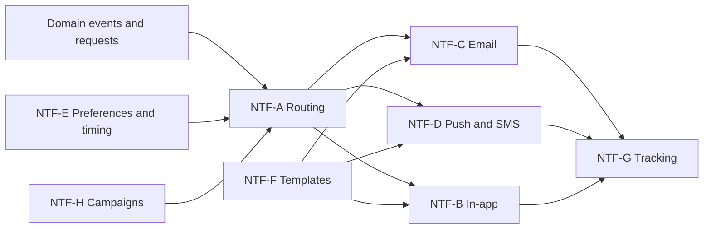
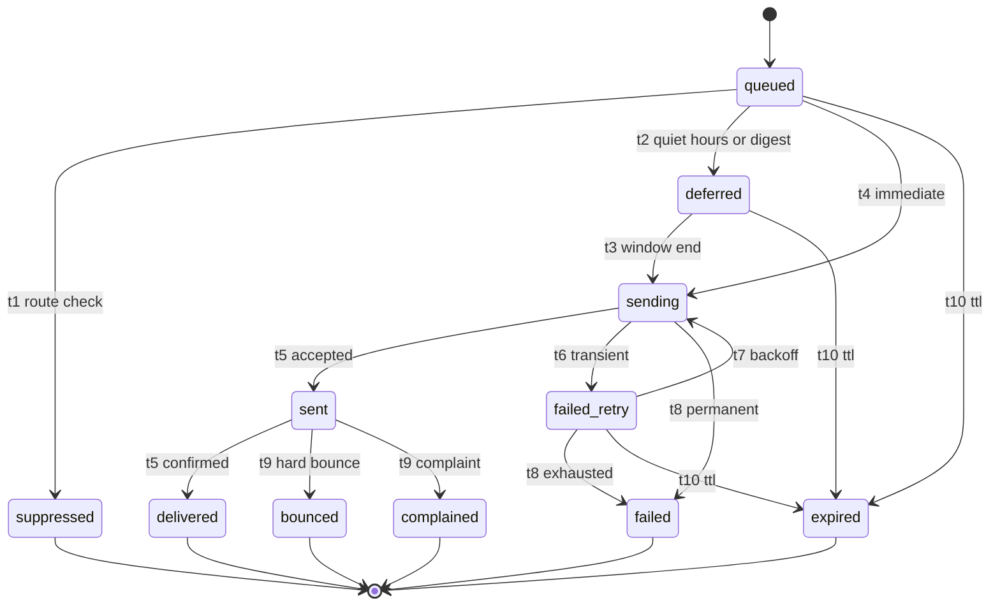
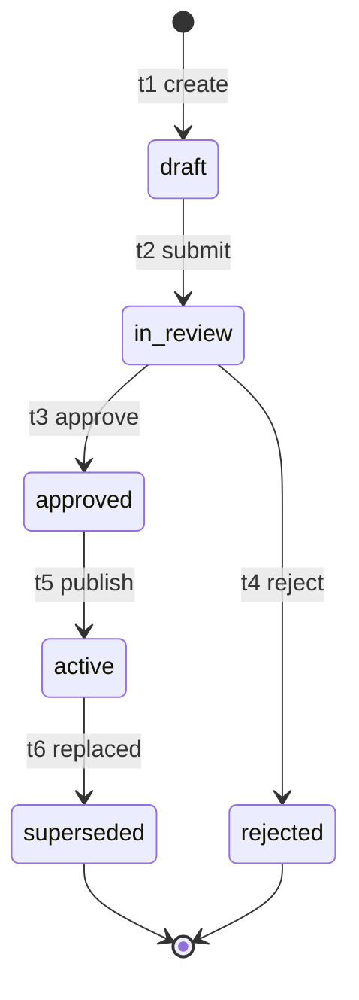
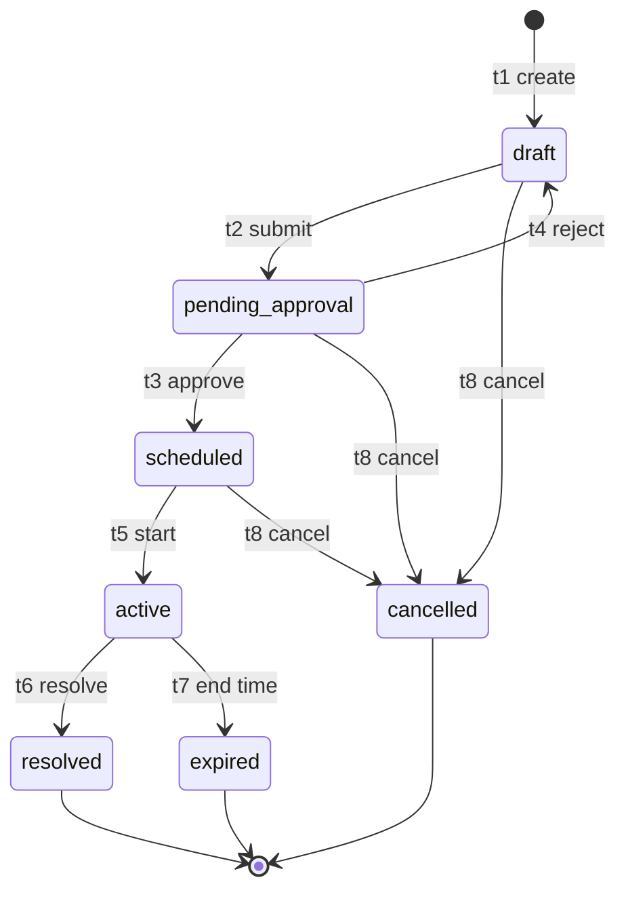
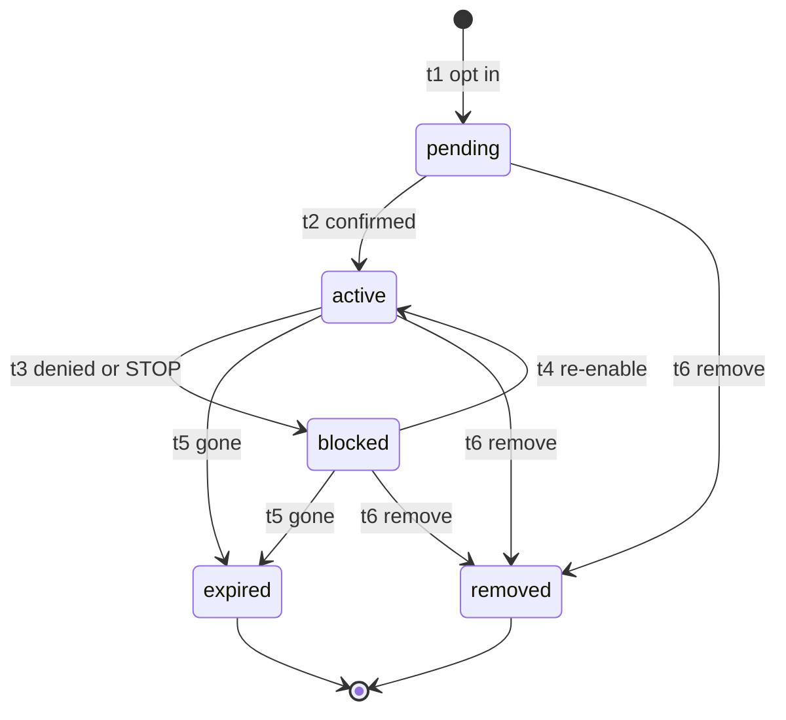
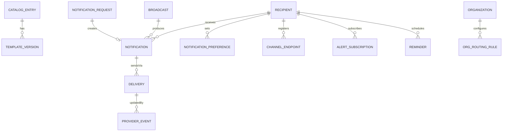

# NTF — Notifications & Communication Channels

Module code: `NTF` · Group: Foundation · Release tier of the module: `R0` (pipeline, in-app, transactional email), with `R1`–`R5` extensions noted per feature.

Status: intended design. Nothing in this file is a claim that anything is built (see [CONVENTIONS](../00_START_HERE/CONVENTIONS.md) §1).

## 1. Purpose, outcomes and boundaries

### 1.1 Purpose

NTF is the single path by which the platform tells people things outside the screen they are looking at: an in-app notification center, email, web and mobile push, optional SMS, digests, reminders and administrator broadcasts. Every module raises a domain event or a notification request; NTF decides whether, when, where and how it is delivered, renders it in the person's language and time zone, tracks the outcome and keeps the person in control through preferences, quiet hours and unsubscribe. No other module sends email, push or SMS directly. [DER; SRC: SSOT F-14, F-29; Yash DT-07, SM-NOTIFY]

### 1.2 Outcomes

| Outcome                                                 | How the system knows                                                                                         |
| ------------------------------------------------------- | ------------------------------------------------------------------------------------------------------------ |
| Important things reach people reliably and on time      | Delivery success and latency by class; mandatory classes delivered or surfaced in-app (`NTF-M01`, `NTF-M02`) |
| People are not spammed                                  | Per-user volume within caps; unsubscribe and complaint rates under thresholds (`NTF-M05`, `NTF-M04`)         |
| Preferences, quiet hours and consent are always honored | Routing decisions stored with reason; zero sends to suppressed addresses (BR-NTF-008)                        |
| The badge never lies                                    | Server-authoritative unread count equals the list on every open (BR-NTF-004) [SRC: SSOT Appendix D M-55]     |
| Failures are visible and recoverable                    | Delivery state machine, retries, dead letters, ops alerts (SM-NTF-01)                                        |
| Marketing never rides on transactional trust            | Separate stream and consent gate (BR-NTF-010)                                                                |

### 1.3 Scope

**In scope**

- Event intake, routing decision table, notification catalog and preference classes, deduplication and grouping, throttling, retry and failover.
- In-app center, unread counts, actions (read, archive, snooze), real-time updates.
- Email delivery, rendering, unsubscribe and suppression, bounce and complaint handling.
- Web push, mobile/PWA push, optional SMS.
- Preference center, quiet hours, digests, nudges and caps, scheduled reminders, alert subscriptions.
- Template console, localization, delivery tracking, user-visible delivery log, deliverability monitoring, marketing campaigns, admin broadcast and banners, team routing, development outbox.

**Out of scope (owned elsewhere)**

- Person-to-person messaging and threads: `MSG` (planned). NTF only notifies that a message arrived.
- The list of events and their wording: the emitting module defines the event and variables; NTF owns the template mechanism.
- Consent scopes and legal text: `SET`. NTF consults `comms.marketing_email` and records suppression.
- Authentication codes and their rules: `IDN` defines; NTF delivers (class mandatory).
- Product analytics: `ANL` (planned). NTF emits delivery and engagement events.
- Outbound webhooks to customer systems: `PLT` (planned).

### 1.4 Owned versus consumed

| Owned by NTF                                                                                                                                | Consumed by NTF                                                                                                                             |
| ------------------------------------------------------------------------------------------------------------------------------------------- | ------------------------------------------------------------------------------------------------------------------------------------------- |
| Notification, delivery, preference, suppression, template, digest, broadcast, reminder, alert subscription, device endpoint, provider event | Domain events and requests from all modules; locale, time zone, consent and account state from `IDN` / `SET`; email, SMS and push providers |

### 1.5 Design stance

1. In-app is the source of truth: every notification that is not purely marketing exists in-app regardless of other channels. [SRC: Yash DT-07 row 9]
2. Honest delivery: states are real (queued, sent, delivered, bounced); no fake "delivered".
3. Time-sensitive beats polite: interview reminders and security notices ignore quiet hours. [SRC: Yash BR-T086]
4. Provider-independent: email, SMS and push providers sit behind ports; the development outbox is labeled and never delivers. [SRC: CLAUDE.md email design]
5. Privacy first: push and lock-screen content is generic; tracking is consent-aware. [DER]

## 2. Roles and permission matrix

Legend: `S` self only · `O` own organization · `G` grant-bound audited · `Y` yes · `R` read-only · `—` no.

| Capability                                | GUE | CAN/STD | INS/MNT/FRL | REC/HMG | EAD | IAD/PLO/EXA | MOD | SUP | FIN | PAD               | SAD | API                                    |
| ----------------------------------------- | --- | ------- | ----------- | ------- | --- | ----------- | --- | --- | --- | ----------------- | --- | -------------------------------------- |
| Receive and read own notifications        | —   | S       | S           | S       | S   | S           | S   | S   | S   | S                 | S   | —                                      |
| Set own preferences, quiet hours, digests | —   | S       | S           | S       | S   | S           | S   | S   | S   | S                 | S   | —                                      |
| Unsubscribe via link (no sign-in)         | Y   | Y       | Y           | Y       | Y   | Y           | Y   | Y   | Y   | Y                 | Y   | —                                      |
| Register push and SMS endpoints           | —   | S       | S           | S       | S   | S           | S   | S   | S   | S                 | S   | —                                      |
| Configure org team routing                | —   | —       | —           | —       | O   | O           | —   | —   | —   | —                 | —   | —                                      |
| View a user's delivery metadata           | —   | S       | S           | S       | S   | S           | —   | G   | —   | Y                 | Y   | —                                      |
| Edit and approve templates                | —   | —       | —           | —       | —   | —           | —   | —   | —   | Y (maker-checker) | Y   | —                                      |
| Send admin broadcast                      | —   | —       | —           | —       | —   | —           | —   | —   | —   | Y (approval)      | Y   | —                                      |
| Create marketing campaign                 | —   | —       | —           | —       | —   | —           | —   | —   | —   | Y (consent-gated) | Y   | —                                      |
| View deliverability dashboards            | —   | —       | —           | —       | —   | —           | —   | R   | R   | Y                 | Y   | —                                      |
| Raise notification requests               | —   | —       | —           | —       | —   | —           | —   | —   | —   | —                 | —   | Y (platform module service principals) |
| Suppress or unsuppress an address         | —   | —       | —           | —       | —   | —           | —   | G   | —   | Y                 | Y   | —                                      |

Rule: no staff role can read notification bodies of a user's security messages; support sees template name, channel, state and time only. [DER]

## 3. Sub-module map

| Code  | Sub-module                 | Features                                 |
| ----- | -------------------------- | ---------------------------------------- |
| NTF-A | Core pipeline              | FR-NTF-001, 002, 018, 019, 023           |
| NTF-B | In-app center              | FR-NTF-003, 004, 005, 006                |
| NTF-C | Email                      | FR-NTF-007, 008, 009, 010                |
| NTF-D | Push and SMS               | FR-NTF-011, 012, 013                     |
| NTF-E | Preferences and timing     | FR-NTF-014, 015, 016, 017, 028, 030, 033 |
| NTF-F | Templates and localization | FR-NTF-020, 021                          |
| NTF-G | Tracking and operations    | FR-NTF-022, 026, 031, 032                |
| NTF-H | Campaigns and broadcast    | FR-NTF-024, 025                          |
| NTF-I | Specialized                | FR-NTF-027, 029                          |

## 4. Feature specifications

Parameter notation: `{braces}` mark `[PROP]` defaults unless a source is cited; open values are in section 13.

### Sub-module NTF-A — Core pipeline

### FR-NTF-001 — Event intake and routing decision

- **Sub-module:** NTF-A Core pipeline
- **Priority / tier:** Must · R0
- **Source:** [SRC: Yash DT-07, BP-36, BR-T085..T087; SSOT F-14]
- **Purpose and outcome:** Every notification request becomes a routed set of deliveries or a recorded suppression. The system knows by a routing decision row with a reason for each channel.
- **Roles and permissions:** `API (platform modules): raise` · users receive.
- **Preconditions and entry points:** A module emits a domain event or calls `notify.request(templateKey, recipient, variables, idempotencyKey, priority)`.
- **User interactions and actions:** none (system feature); staff inspect decisions in the timeline (FR-NTF-022).
- **System behavior:** (1) Validate the request against the catalog (FR-NTF-002) and variable schema. (2) Dedupe by idempotency key. (3) Resolve the recipient: account state (BR-NTF-028), locale, time zone, endpoints, preferences. (4) Evaluate the routing table in order, first match wins: address on suppression list, suppress; mandatory transactional (security, verification, legal, billing), send now on required channels ignoring preferences and quiet hours; time-critical (interview reminder, offer) with channel enabled, send now ignoring quiet hours; engagement or optional category disabled, suppress; engagement inside quiet hours, defer to the window end; digest-eligible with digest daily or weekly, defer into the digest window; nudge with cap reached, suppress; marketing without explicit opt-in, suppress; otherwise send now on enabled channels with in-app always. (5) Create the in-app item (FR-NTF-003) unless the class is marketing. (6) Create one delivery per channel with key `(notificationId, channel)` in SM-NTF-01. (7) Enqueue jobs on priority lanes: security and time-critical, then engagement, then digests, then marketing. The matched row and reason are stored with each delivery.
- **UI elements and controls:** n/a — system feature (staff view is FR-NTF-022).
- **Configuration options:** Platform: routing table (code-reviewed configuration), per-category defaults (FR-NTF-002), lane priorities and worker concurrency.
- **Business rules:** BR-NTF-001, BR-NTF-002, BR-NTF-003, BR-NTF-005, BR-NTF-028, BR-NTF-030.
- **Validation:** `templateKey` exists and is `active`; recipient exists; variables match the schema (types, required); `idempotencyKey` ≤ 128 characters.
- **Inputs and outputs:** In: notification request. Out: notification id and per-channel delivery ids, or a typed rejection.
- **Filters, sorting, search:** n/a — queue-driven.
- **Notifications and communication:** n/a — this is the sender.
- **Error handling and edge cases:** Unknown template: reject `422` and alert ops (module bug). Duplicate idempotency key: return the original ids, no new deliveries. Recipient erased or `pending_erasure`: only mandatory privacy notices continue. Preferences service unavailable: use catalog defaults and fall back to in-app only for non-mandatory classes. Intake overload: queue with back-pressure; the mandatory lane is never starved.
- **Dependencies:** FR-NTF-002, 003, 018, 019, `IDN`, `SET`, ENT-NTF-01, ENT-NTF-03, SM-NTF-01.
- **Security and privacy:** Callers pass account ids, not raw addresses. Variables must not carry secrets except one-time codes in mandatory classes, which are never persisted in logs. Request logs redact variables.
- **Acceptance criteria:**
  - Given a mandatory security notice during quiet hours, when routed, then it is sent now on its required channels and preferences are ignored.
  - Given an engagement notice at 22:00 local with default quiet hours, when routed, then email and push are deferred to 08:00 and the in-app item appears immediately.
  - Given an address on the suppression list, when a non-mandatory email is requested, then it is suppressed with reason `suppressed_address` and no provider call is made.
  - Given the same idempotency key submitted twice, when processed, then exactly one notification and one delivery per channel exist.

### FR-NTF-002 — Notification catalog and preference classes

- **Sub-module:** NTF-A Core pipeline
- **Priority / tier:** Must · R0
- **Source:** [SRC: Yash BR-T085 categories, DT-07]; catalog mechanism [DER]
- **Purpose and outcome:** Every notification type is registered once with class, channels, defaults and owner so preferences and compliance work uniformly. The system knows by a catalog entry per key and CI that rejects unregistered keys.
- **Roles and permissions:** `PAD: manage catalog (maker-checker)` · module owners propose via change request · all users see their effective settings in FR-NTF-014.
- **Preconditions and entry points:** Admin console → Notification catalog (`ADM` planned); module changes add entries.
- **User interactions and actions:**
  1. Staff view the catalog: key, owner module, class, allowed channels, per-channel defaults, lane, TTL, digest-eligible flag, throttle group.
  2. Propose a new entry or change; a second person approves; the entry activates.
  3. Retire an entry (status `retired`; the key is never reused).
- **System behavior:** Classes: **mandatory transactional** (security, verification, legal, billing: cannot be disabled, channels fixed, ignores quiet hours); **time-critical** (interview reminders, offers, deadlines within hours: channel-selectable, ignores quiet hours); **engagement** (activity of interest: opt-out, quiet hours apply); **nudge** (re-engagement prompts: opt-out, capped); **digest-eligible** (a flag allowing batching); **marketing** (promotions and product news: opt-in only). Entry fields: `key`, `class`, `channels[]` with per-channel defaults, `lane`, `ttlHours`, `digestEligible`, `throttleGroup`, `variablesSchema`, `ownerModule`, `description` (shown in preferences), `sensitiveContent` (forces generic push and lock-screen text), `groupable`, `status`. Role context controls visibility: recruiter-only entries never appear for candidates. CI fails if a module raises a key not in the catalog or an entry lacks a template for each enabled channel in the default locale.
- **UI elements and controls:** Catalog table with filters, entry form, change history. States: draft, in review, active, retired.
- **Configuration options:** Platform: all entry fields; the class list is closed.
- **Business rules:** BR-NTF-001, BR-NTF-013.
- **Validation:** Key `module.event` lower snake case and unique; mandatory entries cannot have optional channels; marketing entries must be flagged for the marketing stream.
- **Inputs and outputs:** In: entry. Out: catalog version.
- **Filters, sorting, search:** Filter by module, class, status; search by key and description.
- **Notifications and communication:** none.
- **Error handling and edge cases:** Changing an engagement entry to mandatory removes a user's opt-out, so it is refused without legal approval and a user notice. Retiring an entry with queued deliveries: queued ones drain first. Nightly drift check compares code references to the catalog.
- **Dependencies:** FR-NTF-001, 014, 020, ENT-NTF-13.
- **Security and privacy:** Class changes are audited.
- **Acceptance criteria:**
  - Given a module raises an unregistered key, when CI runs, then the build fails.
  - Given a mandatory entry configured with an optional email channel, when saved, then `422` is returned.
  - Given an engagement entry proposed as mandatory without legal approval, when submitted, then it is refused.
  - Given an entry with no default-locale template, when activating, then activation is refused.

### FR-NTF-018 — Deduplication, collapsing and grouping

- **Sub-module:** NTF-A Core pipeline
- **Priority / tier:** Should · R1
- **Source:** [SRC: Yash SM-NOTIFY t1 "duplicate within window"; SSOT BR-31]; grouping [PROP]
- **Purpose and outcome:** Repeated events do not bury people ("12 people viewed your profile" instead of 12 items). The system knows by one grouped item with a count.
- **Roles and permissions:** system · users see results.
- **Preconditions and entry points:** Catalog entries flagged `groupable` with a group-key template.
- **User interactions and actions:**
  1. See one grouped item such as "Priya and 4 others reacted to your post".
  2. Expand it to see the individual items.
- **System behavior:** Duplicates of `(notificationId, channel)` collapse. Duplicate content within `{dedupe.windowMinutes}` (30) for the same recipient, template and target object is suppressed with reason `duplicate`. Groupable events within `{group.windowMinutes}` (60 for in-app; until the digest for email) merge into one in-app item that updates in place (count, latest actors) and moves to the top only if it had been read; a push or email goes out for the first event only, later ones only if caps allow. Mandatory classes are never grouped; only exact duplicates by key collapse.
- **UI elements and controls:** Grouped item with expand control and count; screen-reader text "5 notifications, expand".
- **Configuration options:** Platform: windows per entry; `groupable` flag.
- **Business rules:** BR-NTF-005, BR-NTF-017.
- **Validation:** Group-key template references existing variables.
- **Inputs and outputs:** In: requests. Out: merged item.
- **Filters, sorting, search:** n/a — behavior feature.
- **Notifications and communication:** n/a.
- **Error handling and edge cases:** Group item deleted by the user while a new event arrives: a new group starts. More than 99 actors shows "99+". Two simultaneous events: merge is atomic by optimistic update.
- **Dependencies:** FR-NTF-001, FR-NTF-003.
- **Security and privacy:** Actor names respect each actor's privacy mode and blocks; a blocked actor is omitted.
- **Acceptance criteria:**
  - Given 12 profile views within an hour, when delivered, then one in-app item shows a count and one push is sent.
  - Given two identical requests with the same key, when processed, then one delivery per channel exists.
  - Given a blocked actor among reactions, when the group renders, then that actor is omitted.
  - Given two security notices for different events raised close together, when processed, then both are delivered (no grouping).

### FR-NTF-019 — Throttling and provider rate limits

- **Sub-module:** NTF-A Core pipeline
- **Priority / tier:** Must · R1
- **Source:** [SRC: SSOT §13.11 resilience, BR-31]; [DER]
- **Purpose and outcome:** No user is flooded and no provider limit is breached. The system knows by per-user and per-provider counters and queue-depth metrics.
- **Roles and permissions:** `PAD: tune`.
- **Preconditions and entry points:** Applied in the dispatcher before provider calls.
- **User interactions and actions:** none; users experience fewer, better-timed messages.
- **System behavior:** Per-recipient daily caps by channel for engagement: email `{5}`, push `{8}`, SMS `{2}`; over-cap engagement items fold into the next digest or are dropped per catalog policy; nudges follow BR-NTF-007. Mandatory and time-critical bypass user caps but are bounded by an anomaly cap `{20}` mandatory emails per recipient per hour, which stops loops and alerts. A global per-provider token bucket respects provider limits and spreads bursts while keeping priority order. A circuit breaker opens per provider after repeated failures (FR-NTF-023). Marketing is paced by the deliverability plan (FR-NTF-031). Counters reset at the recipient's local midnight.
- **UI elements and controls:** n/a — system feature (ops dashboard in FR-NTF-031).
- **Configuration options:** Platform: caps per class and channel; burst rates; anomaly caps.
- **Business rules:** BR-NTF-007, BR-NTF-016.
- **Validation:** Caps are positive integers; anomaly caps ≥ expected maxima.
- **Inputs and outputs:** In: deliveries ready to send. Out: allow, defer or fold decisions.
- **Filters, sorting, search:** n/a — system feature.
- **Notifications and communication:** Ops alert on anomaly cap hit.
- **Error handling and edge cases:** A loop bug sending mandatory email repeatedly is stopped by the anomaly cap. Provider quota exhausted: queue holds and mandatory goes first. Time zone change: counters follow the new zone from the next day.
- **Dependencies:** FR-NTF-001, FR-NTF-023, FR-NTF-031.
- **Security and privacy:** Counters hold only ids and counts.
- **Acceptance criteria:**
  - Given 6 engagement emails requested in a day with cap 5, when processed, then the 6th is folded into the digest.
  - Given a bug raising 25 mandatory emails in an hour for one user, when processed, then sending stops at 20 and ops are alerted.
  - Given provider rate limit reached with mandatory and engagement items queued, when sending resumes, then mandatory goes first.
  - Given the day boundary in the user's time zone, when it passes, then daily counters reset.

### FR-NTF-023 — Retry, dead-letter and provider failover

- **Sub-module:** NTF-A Core pipeline
- **Priority / tier:** Must · R1
- **Source:** [SRC: Yash SM-NOTIFY t6..t10, BACKEND_ARCHITECTURE_REV2 §3.3]
- **Purpose and outcome:** Transient failures are retried safely and permanent ones surface, with no duplicate sends. The system knows by delivery states and dead-letter counts.
- **Roles and permissions:** `PAD: replay dead letters, switch provider`.
- **Preconditions and entry points:** Dispatcher worker; provider response classification.
- **User interactions and actions:** staff view dead letters and replay (FR-NTF-022).
- **System behavior:** Provider 5xx, timeout, 408 or 429: `failed_retry` with backoff 1 min, 5 min, 30 min, 2 h, 12 h, maximum 5 attempts. Other 4xx or exhausted retries: `failed` and dead-letter with a metric. Time-sensitive deliveries expire after 72 h, others after 7 days (`expired`). The delivery row mirrors the background job's retry state. Failover: when the primary provider's error rate exceeds `{failover.errorRate}` for `{failover.minutes}`, new sends for that channel route to the secondary provider; an idempotency token per delivery prevents double sends; failback after health returns. A mandatory delivery that no channel could deliver after retries raises an in-app banner on the next visit.
- **UI elements and controls:** Staff: dead-letter list with replay button and reason.
- **Configuration options:** Platform: backoff schedule, attempts, TTLs, failover thresholds, secondary provider.
- **Business rules:** BR-NTF-015, BR-NTF-005, BR-NTF-029.
- **Validation:** Replay only for `failed` or `expired` within hard TTL (14 days).
- **Inputs and outputs:** In: provider responses. Out: state changes; metrics.
- **Filters, sorting, search:** Dead letters filtered by channel, template, error class.
- **Notifications and communication:** Ops alert on dead-letter spikes.
- **Error handling and edge cases:** Provider accepted but no webhook arrives: after `{delivered.timeoutHours}` the delivery stays `sent` and is reported "accepted, unconfirmed". Duplicate provider webhook: idempotent. Replay of a stale time-sensitive item: refused as expired.
- **Dependencies:** FR-NTF-001, FR-NTF-022, background job platform (`PLT` planned), ENT-NTF-03.
- **Security and privacy:** Dead-letter payloads redacted.
- **Acceptance criteria:**
  - Given a provider 503, when sending, then the delivery is `failed_retry` and retries at 1 minute.
  - Given 5 failed attempts, when the last fails, then the state is `failed` and a dead-letter entry exists.
  - Given a time-sensitive item older than 72 hours, when due, then it is `expired` and not sent.
  - Given failover is active and both providers receive the same delivery key, when sending, then only one send occurs.

### Sub-module NTF-B — In-app center

### FR-NTF-003 — In-app notification center

- **Sub-module:** NTF-B In-app center
- **Priority / tier:** Must · R0
- **Source:** [SRC: SSOT F-14 Notification Center; NotificationBell organism §12.14]
- **Purpose and outcome:** Users see their notifications in one list and act on them. The system knows by the inbox projection and read events.
- **Roles and permissions:** all authenticated roles `S`.
- **Preconditions and entry points:** Bell icon in the top bar with badge; `/notifications`; deep links from push and email.
- **User interactions and actions:**
  1. Press the bell: a panel opens with the latest 20 items grouped by day; unread items have an indicator.
  2. Press an item: it is marked read and opens its target (keyboard: arrows move, Enter opens).
  3. Press "View all" for the full page with tabs All and Unread and category filters (Jobs, Applications, Learning, Messages, Account, Community).
  4. Press "Mark all as read".
  5. Press the gear icon to open preferences (FR-NTF-014).
- **System behavior:** The inbox is per account and per role context; items from another context do not appear but the bell shows "N in <Org>" for other contexts. Item fields: id, category, title, body (≤ 240 characters), icon, target link, createdAt, readAt, archivedAt, actors, groupCount, priority. Retention: read {180 days}, unread {365 days}, archived {30 days}. Items link only to resources the recipient can still access; otherwise the item shows "No longer available". Accounts in `deactivated` or `pending_erasure` show nothing.
- **UI elements and controls:** Bell with numeric badge (accessible name carries the exact count), panel as a dialog (focus managed, Escape closes), rows with title, time (relative, absolute on hover or focus), overflow menu, "Mark all as read", filter tabs. States: loading skeleton, list, empty ("You're all caught up"), error with retry, offline (cached with banner).
- **Configuration options:** Platform: retention; panel size.
- **Business rules:** BR-NTF-003, BR-NTF-004, BR-NTF-020.
- **Validation:** Filters from closed lists; pagination cursor valid.
- **Inputs and outputs:** In: list query. Out: items page and unread counts per context.
- **Filters, sorting, search:** Filter by read state and category; newest first (groups by latest activity); title search `Could` on the full page.
- **Notifications and communication:** n/a — this is the in-app channel.
- **Error handling and edge cases:** Target access lost: "No longer available" and no data leaks. Very large inbox: cursor pagination of 50. Two tabs: synchronized by FR-NTF-006.
- **Dependencies:** FR-NTF-001, 004, 005, 006, `IDN` contexts.
- **Security and privacy:** Items readable only by the recipient; entries flagged `sensitiveContent` show generic titles ("You have an update on an application").
- **Acceptance criteria:**
  - Given three unread items, when the bell is opened, then they appear first with indicators and the badge says 3.
  - Given the user presses an item, when it opens, then it is marked read and the badge decrements.
  - Given an item whose target access was lost, when opened, then "No longer available" is shown and no data leaks.
  - Given a recruiter context, when viewing the candidate-context indicator, then only a count is shown, not content.

### FR-NTF-004 — Unread count and reconciliation

- **Sub-module:** NTF-B In-app center
- **Priority / tier:** Must · R0
- **Source:** [SRC: SSOT Appendix D M-55 "The Badge That Lies"]
- **Purpose and outcome:** The badge always equals the number of unread items. The system knows because the count is server-authoritative and reconciled on every open.
- **Roles and permissions:** all authenticated roles `S`.
- **Preconditions and entry points:** Any page with the bell; arrival of a new item.
- **User interactions and actions:** none beyond viewing; the badge shows "9+" above 9 while the accessible name carries the exact number.
- **System behavior:** The server computes unread counts per context and returns them with the inbox and from a lightweight counts endpoint. Optimistic client updates are limited to one step and are replaced by the server value after each fetch; every panel open and page focus reconciles. A nightly job compares denormalized counters to item rows and repairs drift with a metric. Counts exclude archived and expired items.
- **UI elements and controls:** Badge (number, `aria-label` full count). States: zero (hidden), 1–9, 9+.
- **Configuration options:** Platform: display cap 9.
- **Business rules:** BR-NTF-004.
- **Validation:** n/a — computed.
- **Inputs and outputs:** In: none. Out: counts per context.
- **Filters, sorting, search:** n/a — counter.
- **Notifications and communication:** n/a.
- **Error handling and edge cases:** Counts endpoint failure: keep the last server value and do not increment by guess. Race between read and arrival: the server value wins on the next fetch. Drift found: repaired and counted.
- **Dependencies:** FR-NTF-003, FR-NTF-006.
- **Security and privacy:** Counts are per recipient.
- **Acceptance criteria:**
  - Given a badge showing 3, when the panel opens and lists 0 unread, then the badge reconciles to 0.
  - Given the counts endpoint fails, when a push arrives, then the badge does not increment beyond the last server value.
  - Given drift introduced in a counter, when the nightly job runs, then it is repaired and a metric is recorded.
  - Given 12 unread, when displayed, then the badge shows "9+" with accessible name "12 unread notifications".

### FR-NTF-005 — Read, archive, snooze and "turn off this type"

- **Sub-module:** NTF-B In-app center
- **Priority / tier:** Should · R1
- **Source:** [SRC: SSOT F-14]; snooze and quick opt-out [PROP]
- **Purpose and outcome:** Users manage items without leaving the list. The system knows by item state fields.
- **Roles and permissions:** all authenticated roles `S`.
- **Preconditions and entry points:** Item overflow menu; full-page bulk mode and keyboard shortcuts.
- **User interactions and actions:**
  1. Mark an item read or unread.
  2. Archive an item (moves to Archive for {30 days}).
  3. Snooze: choose "Later today", "Tomorrow" or "Next week"; the item returns as unread.
  4. "Turn off this type": confirm the category and channel affected; the preference updates (not available for mandatory items, where the menu explains why).
  5. Bulk select in the full page for mark read and archive.
- **System behavior:** State changes are idempotent and synchronized across tabs and devices (FR-NTF-006). Snooze uses the user's time zone; quiet hours do not delay the in-app reappearance. "Turn off this type" writes through FR-NTF-014 with source `quick_action`. Bulk requests are capped at {100} items.
- **UI elements and controls:** Overflow menu, checkbox column in bulk mode, snooze submenu, toast with "Undo" for 8 seconds. States: normal, selecting, snoozed, archived.
- **Configuration options:** Platform: snooze options; undo window.
- **Business rules:** BR-NTF-001, BR-NTF-003.
- **Validation:** Items belong to the caller; snooze time in the future and ≤ 30 days.
- **Inputs and outputs:** In: item ids and action. Out: updated items and counts.
- **Filters, sorting, search:** Archive view; filter by state.
- **Notifications and communication:** none.
- **Error handling and edge cases:** Item removed by retention during selection: skipped with a message. More than 100 selected: `422`. Turn off a mandatory type: refused with explanation.
- **Dependencies:** FR-NTF-003, FR-NTF-014, FR-NTF-006.
- **Security and privacy:** Item ids are not guessable and are checked per recipient (IDOR).
- **Acceptance criteria:**
  - Given an unread item, when marked read, then the badge decrements on all open tabs.
  - Given a snoozed item for "Tomorrow", when the time arrives, then it reappears unread.
  - Given a security notice, when "Turn off this type" is attempted, then it is refused with the reason.
  - Given 101 selected items, when archived, then `422` is returned.

### FR-NTF-006 — Real-time in-app delivery and cross-tab sync

- **Sub-module:** NTF-B In-app center
- **Priority / tier:** Should · R1
- **Source:** [SRC: SSOT §13.9 realtime vs polling; Yash SPEC-11 SSE with 15 s polling fallback]
- **Purpose and outcome:** New items appear without reload and state is consistent across tabs and devices. The system knows by stream acknowledgments and the polling fallback.
- **Roles and permissions:** all authenticated roles `S`.
- **Preconditions and entry points:** Signed-in app shell loaded.
- **User interactions and actions:** none; a new item updates the bell (animation only if motion is allowed) and a polite live region announces "New notification".
- **System behavior:** The client opens a server-sent event stream (one per browser via a shared worker where available) authenticated by the session cookie. Events carry `{type, id, count}` only, never content; the client fetches details. If the stream is unavailable the client polls every {15 s}, backing off to {60 s} when the tab is hidden. Read and archive changes propagate to other tabs and devices through the same stream. Streams close on logout or session revoke (IDN) and reopen after refresh. Offline PWA: no stream; on reconnect the client reconciles counts. Connection cap `{5}` per user.
- **UI elements and controls:** Bell animation (off under reduced motion); toast only for time-critical items, never for engagement.
- **Configuration options:** Platform: poll intervals; toast classes.
- **Business rules:** BR-NTF-004.
- **Validation:** Stream authenticated; per-user connection cap.
- **Inputs and outputs:** In: stream subscription. Out: lightweight events.
- **Filters, sorting, search:** n/a — transport.
- **Notifications and communication:** n/a.
- **Error handling and edge cases:** Stream drops: reconnect with the last event id to replay; a gap beyond the buffer triggers count reconciliation. Session revoked: stream ends and the client goes to sign-in. Proxy blocks streaming: polling fallback.
- **Dependencies:** FR-NTF-003, FR-NTF-004, `IDN` sessions, `PWA` (planned).
- **Security and privacy:** Events contain no content; the recipient is checked on every event.
- **Acceptance criteria:**
  - Given an open tab, when a new notification is created, then the bell updates within 5 seconds without reload.
  - Given the stream is blocked, when time passes, then the client polls at 15 seconds.
  - Given a session revoked on another device, when the stream next checks, then it closes.
  - Given reduced motion enabled, when an item arrives, then no animation plays and a live region announces it.

### Sub-module NTF-C — Email

### FR-NTF-007 — Transactional email delivery

- **Sub-module:** NTF-C Email
- **Priority / tier:** Must · R0
- **Source:** [SRC: SSOT §9.1 transactional email via a provider port, V61-08; CLAUDE.md provider-independent service, opt-in Brevo, labeled dev outbox, live delivery not established by source]
- **Purpose and outcome:** Emails reach inboxes and are traceable. The system knows by provider acceptance, delivery webhooks and bounce events.
- **Roles and permissions:** system · `PAD: switch provider, replay`.
- **Preconditions and entry points:** A delivery routed to email (FR-NTF-001); the recipient has a verified primary email.
- **User interactions and actions:** the user receives the email, may follow links and may unsubscribe (FR-NTF-009).
- **System behavior:** An `EmailPort.send(message)` interface with one adapter per provider and one for the development outbox (FR-NTF-032). Message: from (per stream), reply-to, to, subject, HTML and plain text, headers (`List-Unsubscribe` and `List-Unsubscribe-Post` for non-mandatory classes), category tag, idempotency token, metadata of ids only. Two streams with separate sending identities and domains: **transactional** (security, verification, billing, application status, reminders) and **engagement and marketing** (digests, nudges, campaigns). Sends only to a verified address; a pending new address (IDN email change) is not used. Provider responses map to SM-NTF-01. Sending identities are authenticated by SPF, DKIM and DMARC alignment. Rate limits per FR-NTF-019.
- **UI elements and controls:** n/a — delivery feature.
- **Configuration options:** Platform: provider and adapters, from addresses per stream, reply-to policy, provider region. Org-branded senders are `Won't-now` (OD-NTF-07).
- **Business rules:** BR-NTF-008, BR-NTF-009, BR-NTF-010, BR-NTF-015, BR-NTF-026.
- **Validation:** Recipient valid and verified; subject ≤ 150 characters; body ≤ 400 KB; no attachments in mandatory classes (links to authenticated pages instead).
- **Inputs and outputs:** In: rendered message. Out: provider message id; state changes.
- **Filters, sorting, search:** n/a — delivery feature.
- **Notifications and communication:** n/a — this is the sender.
- **Error handling and edge cases:** Provider outage: retry and failover (FR-NTF-023). Suppressed address: suppressed; in-app item remains. Oversized variable content truncated with a link. Until a live provider is configured and verified, non-production shows only the labeled outbox and operations shows "email not configured".
- **Dependencies:** FR-NTF-001, 008, 010, 012, 019, 023, 032, email provider.
- **Security and privacy:** One-time codes appear only in templates designed for them; emails never carry session tokens or links that sign the user in; PII minimal; bodies are not stored beyond delivery (metadata only, BR-NTF-025).
- **Acceptance criteria:**
  - Given a verification email request, when sent, then it uses the transactional stream and has no unsubscribe header.
  - Given a digest, when sent, then it uses the engagement stream and includes `List-Unsubscribe` and one-click POST support.
  - Given the provider returns 429, when sending, then the delivery is retried per schedule.
  - Given a pending unverified new address, when a notification is routed, then it goes to the current verified address only.

### FR-NTF-008 — Email rendering, layout and accessibility

- **Sub-module:** NTF-C Email
- **Priority / tier:** Must · R1
- **Source:** [DER]; [SRC: Yash SPEC-01 §8 i18n for emails]
- **Purpose and outcome:** Emails render correctly across clients and are accessible. The system knows by render tests and client previews.
- **Roles and permissions:** `PAD: manage layouts`.
- **Preconditions and entry points:** The render step in the pipeline.
- **User interactions and actions:** recipients read; staff preview in FR-NTF-020.
- **System behavior:** A shared responsive layout (header, content blocks, footer) with design tokens inlined at build; HTML and a complete plain-text part always generated; preheader text; `lang` and `dir` from locale; meaningful alt text; single column; text ≥ 14 px; contrast ≥ 4.5:1; descriptive link text; tap targets ≥ 44 px; dark-mode safe colors; buttons are styled links and never the only way to act (a visible URL fallback in mandatory messages). Footer: why you received this (class name), manage preferences link, unsubscribe link (non-mandatory), legal entity and postal address where required (from SET compliance rules). No tracking pixels in mandatory messages. Rendering is deterministic with golden-file tests per template and locale.
- **UI elements and controls:** n/a — rendering (staff preview in FR-NTF-020).
- **Configuration options:** Platform: layout variants (transactional, engagement, marketing); footer content by region.
- **Business rules:** BR-NTF-013, BR-NTF-019, BR-NTF-032.
- **Validation:** Rendered HTML ≤ 100 KB before inlining; every image has alt; links absolute https; no inline scripts.
- **Inputs and outputs:** In: template, locale, variables. Out: HTML and text.
- **Filters, sorting, search:** n/a — rendering.
- **Notifications and communication:** n/a.
- **Error handling and edge cases:** Missing variable: render fails, delivery `failed` with `template_error`, ops alert (a broken message is never sent). Very long content: truncated with "View in the app". Right-to-left locales mirrored.
- **Dependencies:** FR-NTF-020, FR-NTF-021, `SET` compliance rules.
- **Security and privacy:** Variables HTML-escaped by default; user-generated content sanitized; external links go through a safe redirect only in marketing, never in mandatory messages.
- **Acceptance criteria:**
  - Given a template, when rendered, then both HTML and complete plain text exist.
  - Given a user-generated string containing HTML, when rendered, then it is escaped.
  - Given a mandatory email, when inspected, then it has no tracking pixel and no tracked links.
  - Given an Arabic locale, when rendered, then `dir="rtl"` is set.

### FR-NTF-009 — Unsubscribe and email preference landing

- **Sub-module:** NTF-C Email
- **Priority / tier:** Must · R1
- **Source:** [SRC: Yash TEST-MSG-010, FEAT-15-07, BR-T085]
- **Purpose and outcome:** A recipient stops a category with one action, without signing in. The system knows by a preference change and a confirmation page.
- **Roles and permissions:** any recipient (`GUE` allowed via a signed link).
- **Preconditions and entry points:** Footer unsubscribe link; `List-Unsubscribe` header; mail client one-click button.
- **User interactions and actions:**
  1. Press unsubscribe in the email, or use the mail client's one-click button.
  2. See a page naming the category ("Weekly job digest") with "You're unsubscribed from this category" and buttons "Undo", "Manage all email preferences" (needs sign-in) and "Unsubscribe from all marketing and tips".
  3. For mandatory classes the link is absent and the footer says "This is a required account message".
- **System behavior:** The link carries a signed, scoped token (recipient, category, expiry {60 days}) needing no login. A one-click POST (RFC 8058) applies immediately without a page. A GET of the visible link renders a one-button page and changes nothing until the button is pressed (defeats link scanners). The action turns the category off for email with source `unsubscribe_link`. "All marketing and tips" revokes `comms.marketing_email` through `SET`. Queued sends re-check preferences at send time so the change is effective immediately. "Undo" is available for 30 days; re-subscribing is also possible in FR-NTF-014.
- **UI elements and controls:** Confirmation page without ads or login wall; "Undo", "Manage preferences", "Unsubscribe from all marketing". States: done, expired link (offers sign-in), invalid link, mandatory explanation.
- **Configuration options:** Platform: token expiry 60 days; categories shown.
- **Business rules:** BR-NTF-009, BR-NTF-001.
- **Validation:** Token signature and scope valid; category in the catalog and non-mandatory.
- **Inputs and outputs:** In: token. Out: preference update and page.
- **Filters, sorting, search:** n/a — single action.
- **Notifications and communication:** none (no "sorry to see you go" email).
- **Error handling and edge cases:** Expired token: page explains and links to signed-in preferences. Deleted account: page says it is already unsubscribed. Rate limited; no personal data on the page beyond the category name.
- **Dependencies:** FR-NTF-014, FR-NTF-007, `SET` consent.
- **Security and privacy:** Tokens do not reveal the email address.
- **Acceptance criteria:**
  - Given a digest email, when the mail client one-click is used, then the digest category is off immediately and no later digest is sent.
  - Given a security email, when inspected, then it has no unsubscribe link and the footer explains why.
  - Given a link scanner issues GET, when it fetches the visible link, then no preference changes.
  - Given the user presses "Undo" within 30 days, when confirmed, then the category is on again.

### FR-NTF-010 — Bounce, complaint and suppression handling

- **Sub-module:** NTF-C Email
- **Priority / tier:** Must · R1
- **Source:** [SRC: Yash SM-NOTIFY t9 and forbidden "sending to suppressed address"]
- **Purpose and outcome:** Undeliverable and complaining addresses are suppressed so sender reputation stays healthy and users are not re-mailed against their will. The system knows by provider webhooks mapped to suppression entries.
- **Roles and permissions:** `PAD, SAD: view, unsuppress (audited)` · `SUP: G (view, request unsuppress)` · users see address health in preferences.
- **Preconditions and entry points:** Signed provider webhooks for bounce, complaint, unsubscribe, deferral.
- **User interactions and actions:**
  1. The user sees a banner "We couldn't deliver email to <masked address>; check your address" with "Update email" (IDN) and "Send a test".
  2. Staff search the suppression list by recipient id and unsuppress with a reason after the user fixes the address.
- **System behavior:** Webhook signature and timestamp verified; events deduped by provider event id. Hard bounce: delivery `bounced` and address suppressed. Soft bounces retried then counted: {3} within 7 days suppress for 30 days. Complaint: delivery `complained`; marketing and engagement categories suppressed for the address; transactional still allowed unless hard-bounced; a review flag is raised. Suppression is by salted address hash across accounts. A verified new address in IDN is not suppressed. Suppressed address blocks non-mandatory sends (BR-NTF-008); for mandatory classes the in-app notice and banner appear instead. Unsuppress requires the user to confirm control of the address by code.
- **UI elements and controls:** In-app banner; admin suppression table with "Unsuppress". States: healthy, soft-bouncing, suppressed.
- **Configuration options:** Platform: soft-bounce threshold; suppression durations.
- **Business rules:** BR-NTF-008, BR-NTF-009.
- **Validation:** Webhook signature; timestamps within {5 min} or replays rejected.
- **Inputs and outputs:** In: provider events. Out: delivery and suppression updates.
- **Filters, sorting, search:** Suppression list by reason and date; search by recipient id.
- **Notifications and communication:** In-app `ntf.address_undeliverable` and banner; no email.
- **Error handling and edge cases:** Forged webhook: rejected and alerted. Mailbox full (soft): retry then count. Provider duplicates: idempotent. Corporate filter complaining on all mail: review flag only.
- **Dependencies:** FR-NTF-007, FR-NTF-022, `IDN` email change, ENT-NTF-06, ENT-NTF-12.
- **Security and privacy:** Suppression stores salted hashes; webhook endpoints signed and rate limited.
- **Acceptance criteria:**
  - Given a hard bounce event, when received, then the delivery is `bounced` and the address is suppressed.
  - Given a suppressed address, when an engagement email is requested, then no provider call is made.
  - Given a forged webhook without a valid signature, when received, then it is rejected.
  - Given the user changes email in IDN, when the new address is verified, then the old suppression does not apply to it.

### Sub-module NTF-D — Push and SMS

### FR-NTF-011 — Web push notifications

- **Sub-module:** NTF-D Push and SMS
- **Priority / tier:** Should · R1
- **Source:** [SRC: Yash INTEGRATION_ARCHITECTURE push section (VAPID, subscription after user gesture and opt-in, generic encrypted payload), BR-T086]
- **Purpose and outcome:** Users who opt in receive timely browser or installed-PWA alerts. The system knows by an active subscription and acknowledged deliveries.
- **Roles and permissions:** all authenticated roles `S`.
- **Preconditions and entry points:** Settings → Notifications → "Push on this device"; a contextual prompt after a meaningful action (for example after applying), never on first load.
- **User interactions and actions:**
  1. Press "Turn on push on this device" and read what is sent.
  2. Grant the browser permission.
  3. See the device listed; press "Send test"; toggle categories for push.
  4. Remove a device from the list.
- **System behavior:** A subscription is created only after a user gesture, browser permission and an explicit in-product opt-in; endpoint and keys are stored encrypted, keyed to account and device label; VAPID keys in the secret manager. Payloads are generic (short title and body from the push variant plus the notification id) and encrypted per the Web Push standard; the service worker fetches details on tap when signed in; `sensitiveContent` entries show generic text. Routing applies (quiet hours exempt only for time-critical and mandatory). A 410 response removes the subscription. Logout, session revoke or device removal deletes it. A browser "denied" state is detected and explained. Caps per FR-NTF-019.
- **UI elements and controls:** Device list (label, added date, status chip), "Send test", "Remove". States: unsupported, off, on, blocked, expired.
- **Configuration options:** Platform: push availability by region; engagement push default off until opt-in per category. User: per-device and per-category toggles.
- **Business rules:** BR-NTF-011, BR-NTF-020, BR-NTF-006.
- **Validation:** Subscription endpoint https and from known push services; ≤ {10} devices per account.
- **Inputs and outputs:** In: subscription object. Out: stored endpoint; push sends.
- **Filters, sorting, search:** n/a — short list.
- **Notifications and communication:** `ntf.push_enabled` in-app confirmation.
- **Error handling and edge cases:** 410 Gone: deleted with an in-app note on the next visit. Browser denies: prompt not repeated for {30 days}. Offline device: provider queues up to the catalog TTL. iOS requires an installed PWA: the prompt appears only in that context with an explanation.
- **Dependencies:** FR-NTF-001, 014, 015, 019, `PWA` (planned), `IDN` session events, ENT-NTF-04, SM-NTF-04.
- **Security and privacy:** No personal content in payloads; endpoints encrypted at rest; deleted on logout.
- **Acceptance criteria:**
  - Given a first page load, when the user has not opted in, then no permission prompt appears.
  - Given the user logs out, when logout completes, then the device subscription is deleted.
  - Given a time-critical interview reminder at 23:00, when push is enabled, then it is sent now.
  - Given a push for an application update flagged sensitive, when received, then the text is generic.

### FR-NTF-012 — Mobile and PWA push endpoints

- **Sub-module:** NTF-D Push and SMS
- **Priority / tier:** Could · R5
- **Source:** [PROP]
- **Purpose and outcome:** If a native or wrapped mobile client exists, it registers device tokens for platform push. The system knows by device tokens bound to sessions.
- **Roles and permissions:** all authenticated roles `S`.
- **Preconditions and entry points:** Mobile client sign-in (`PWA` planned); OS permission prompt.
- **User interactions and actions:**
  1. Allow notifications in the OS dialog.
  2. See the device in the shared device list; send a test; remove it.
- **System behavior:** The token is registered with the platform service (APNs, FCM) and bound to the session family; token refresh updates in place; badge counts come from FR-NTF-004; silent pushes are used only for count sync. Routing, caps, generic payload and deletion rules are the same as FR-NTF-011.
- **UI elements and controls:** Shared device list; OS dialogs.
- **Configuration options:** Platform: enabled platforms; keys in the secret manager.
- **Business rules:** BR-NTF-011.
- **Validation:** Token format by platform; ≤ 10 devices.
- **Inputs and outputs:** In: token. Out: registration.
- **Filters, sorting, search:** n/a — short list.
- **Notifications and communication:** as web push.
- **Error handling and edge cases:** Invalid-token response: removed. Reinstall: new token, old removed on first failure. An 11th device: the least recently used is removed after a confirm prompt.
- **Dependencies:** FR-NTF-011, `PWA` (planned).
- **Security and privacy:** As FR-NTF-011.
- **Acceptance criteria:**
  - Given a mobile sign-in with push allowed, when registered, then the device appears in the list.
  - Given logout, when completed, then the token is deleted.
  - Given an invalid-token response from the push service, when received, then the token is removed.
  - Given 11 devices, when registering another, then the user must confirm removing the least recently used.

### FR-NTF-013 — SMS notifications (optional)

- **Sub-module:** NTF-D Push and SMS
- **Priority / tier:** Could · R2
- **Source:** [PROP]; depends on IDN phone verification
- **Purpose and outcome:** Users who opt in receive a small set of time-critical or security messages by SMS. The system knows by a verified number, an opt-in record and delivery receipts.
- **Roles and permissions:** all authenticated roles `S`.
- **Preconditions and entry points:** Verified phone (FR-IDN-003); Settings → Notifications → SMS; feature enabled for the region (OD-NTF-01).
- **User interactions and actions:**
  1. Press "Turn on SMS", read frequency notes, confirm the number.
  2. Choose categories (only time-critical and security: interview reminders, offers, sign-in alerts).
  3. Reply STOP to opt out or HELP for help.
  4. Remove SMS in settings.
- **System behavior:** The opt-in record stores number, time, wording version and source. Messages are short (≤ 160 characters where possible), name the sender and include "Reply STOP to opt out" in the first message and monthly. STOP from the provider's inbound webhook turns SMS off for that number across accounts immediately; START re-enables only after in-product confirmation. Quiet hours apply except security and interview reminders within {2 h}. Marketing SMS is `Won't-now`. Country allow-list and sender-ID rules; cap `{2}` per day. Delivery receipts update SM-NTF-01. On "not in service" or STOP the number is unlinked from SMS.
- **UI elements and controls:** Opt-in dialog, category checkboxes, "Turn off SMS". States: off, pending confirmation, on, stopped by reply.
- **Configuration options:** Platform: enabled countries, provider, sender IDs, caps.
- **Business rules:** BR-NTF-012, BR-NTF-006, BR-NTF-001.
- **Validation:** Number verified and E.164; categories from the allowed list.
- **Inputs and outputs:** In: opt-in and inbound STOP and HELP. Out: SMS sends.
- **Filters, sorting, search:** n/a — short page.
- **Notifications and communication:** `ntf.sms_optin_confirm` (mandatory class) requiring an explicit confirmation reply.
- **Error handling and edge cases:** Carrier filtering: delivery `failed` with reason, at most 2 attempts. Recycled number: STOP or undeliverable status unlinks it. Provider outage: security notices fall back to email and in-app.
- **Dependencies:** FR-IDN-003, FR-NTF-001, 019, ENT-NTF-04.
- **Security and privacy:** Number encrypted; SMS bodies avoid sensitive detail; sign-in codes only through IDN templates.
- **Acceptance criteria:**
  - Given a user replies STOP, when received, then SMS is off immediately and no further SMS is sent.
  - Given an interview reminder 90 minutes ahead at 23:30, when SMS is on, then it is sent despite quiet hours.
  - Given an unverified number, when turning on SMS, then it is refused with a link to verify.
  - Given a category not on the allowed list, when selected through the API, then `422` is returned.

### Sub-module NTF-E — Preferences and timing

### FR-NTF-014 — Preference center

- **Sub-module:** NTF-E Preferences and timing
- **Priority / tier:** Must · R1
- **Source:** [SRC: Yash FEAT-15-02, ACT-NTF-05, BR-T085]
- **Purpose and outcome:** The user controls what they get and where. The system knows by stored preferences per category and channel.
- **Roles and permissions:** all authenticated roles `S`.
- **Preconditions and entry points:** Settings → Notifications; bell gear icon; "Manage preferences" in emails; quick actions (FR-NTF-005).
- **User interactions and actions:**
  1. See a matrix: rows are categories (Jobs and applications, Interviews, Learning, Messages, Community, Mentorship, Events, Account and security, Product news); columns are channels (In-app, Email, Push, SMS).
  2. Toggle cells; mandatory cells are locked with "Required for your security".
  3. Set digest frequency per digest-eligible category (Off, Daily, Weekly) and quiet hours (FR-NTF-015).
  4. Use "Turn off everything optional" and "Reset to defaults".
  5. See the marketing section showing the `comms.marketing_email` consent and its purpose text.
- **System behavior:** The matrix is generated from the catalog and the user's role contexts, so only relevant categories appear. Defaults per catalog; marketing default off; push default off until opt-in. Saves per cell with inline status and takes effect for the next routing decision (queued items re-check). Each write records source and time. Digest frequency options follow BR-NTF-007. Org admins cannot override personal preferences; org routing (FR-NTF-027) only adds team channels.
- **UI elements and controls:** Matrix as an accessible data table of switches, digest selects, quiet-hours controls, bulk buttons. States: loading, loaded, saving, locked cell, error.
- **Configuration options:** Platform: catalog defaults. User: all cells.
- **Business rules:** BR-NTF-001, BR-NTF-007, BR-NTF-010.
- **Validation:** Cell exists in the catalog; mandatory cells immutable; digest frequency from the allowed list.
- **Inputs and outputs:** In: preference change. Out: updated matrix.
- **Filters, sorting, search:** Search categories by name; sections collapsible.
- **Notifications and communication:** none.
- **Error handling and edge cases:** Concurrent edits: `412` with a refresh. Retired category: row disappears, stored value retained for audit. New category: default applies and a "New" marker shows once. Disabling all channels for a time-critical category is allowed (in-app remains) with a warning.
- **Dependencies:** FR-NTF-002, 015, 016, `SET` consent, ENT-NTF-05.
- **Security and privacy:** Preferences are `Confidential` and included in the user's export.
- **Acceptance criteria:**
  - Given a mandatory cell, when toggled, then it stays on and shows the reason.
  - Given the user disables the weekly digest email, when the next window arrives, then no digest is sent.
  - Given a candidate-only user, when opening preferences, then recruiter categories are not shown.
  - Given a stale save, when submitted, then `412` is returned with the current values.

### FR-NTF-015 — Quiet hours and time-zone-aware scheduling

- **Sub-module:** NTF-E Preferences and timing
- **Priority / tier:** Must · R1
- **Source:** [SRC: Yash BR-T086, FEAT-15-02.1, TEST-MSG-007]
- **Purpose and outcome:** Non-urgent messages wait until the user is awake. The system knows by deferral decisions and release times.
- **Roles and permissions:** all authenticated roles `S`.
- **Preconditions and entry points:** Preference center → Quiet hours.
- **User interactions and actions:**
  1. Toggle quiet hours; set start and end (default 21:00–08:00) and days (all or weekdays).
  2. Optionally set "Do not disturb until…" for a one-off period.
  3. Read the note that security and time-critical items still arrive.
- **System behavior:** Evaluated in the user's time zone (FR-SET-020), DST-safe by local wall-clock rules. Deferred deliveries get state `deferred` with `releaseAt` and are sent at the end of the window, bounded by their TTL (past TTL they become `expired`). Releases are spread over the first {10 minutes} of the window. Unknown time zone: use the account locale's primary zone and ask at the first time-sensitive feature. One-off DND overrides the schedule. Applies to email, push and SMS; in-app items are created at once but raise no toast during quiet hours. Digests are delivered at the window end (OD-NTF-03).
- **UI elements and controls:** Switch, two time pickers (24h or 12h by locale), day chips, DND picker. States: off, on, DND active (icon on the bell).
- **Configuration options:** Platform: default 21:00–08:00. User: schedule.
- **Business rules:** BR-NTF-006, BR-NTF-002.
- **Validation:** Start ≠ end; DND end in the future and ≤ 14 days.
- **Inputs and outputs:** In: schedule. Out: stored; routing effect.
- **Filters, sorting, search:** n/a — single control.
- **Notifications and communication:** none.
- **Error handling and edge cases:** Spring forward: the window end clock time is honored. Fall back: single release. Time zone change: applies to future deferrals only. Deferral past TTL: dropped as expired while the in-app item stays.
- **Dependencies:** FR-NTF-001, FR-NTF-014, FR-SET-020.
- **Security and privacy:** The schedule reveals sleep pattern and is never shared.
- **Acceptance criteria:**
  - Given an engagement email at 22:00 local with quiet hours 21:00–08:00, when routed, then it is sent at 08:00.
  - Given an interview reminder at 22:30, when quiet hours are on, then it is sent now.
  - Given a DST change, when quiet hours end at 08:00 local, then release happens at 08:00 local that day.
  - Given a deferred item past its TTL, when the window ends, then it is `expired` and not sent.

### FR-NTF-016 — Digests

- **Sub-module:** NTF-E Preferences and timing
- **Priority / tier:** Should · R2
- **Source:** [SRC: SSOT F-29 and job `notification.digest` 07:30 (§13.6), BR-14; Yash BR-T087; SSOT DOR-010 time zone open]
- **Purpose and outcome:** Users get one summary instead of many messages. The system knows by a digest batch and its items.
- **Roles and permissions:** all authenticated roles `S`.
- **Preconditions and entry points:** Digest frequency set in FR-NTF-014; digest-eligible catalog entries.
- **User interactions and actions:**
  1. Receive a daily digest (default 08:00 local) or weekly digest (default Monday 08:00 local) as email and an in-app summary card.
  2. Press items to open targets; press "Manage digest" to change frequency or sections.
  3. Press "Unsubscribe from this digest" (FR-NTF-009).
- **System behavior:** A worker runs per time-zone bucket. For each user with digests on, it gathers deferred digest-eligible deliveries plus alert matches and activity since the last digest, skips if empty, composes sections by category with counts and the top {5} items and "See all in app", and sends at most one digest per day (BR-NTF-007). Mandatory and time-critical items are never delayed into a digest. Included deliveries are marked `sent` through the digest delivery; items remain in-app. Role-specific content: candidate (matching jobs, application updates, learning progress), recruiter (new applicants, pending actions, interviews), instructor (learner activity), employer admin (team summary). Content is generated at send time from live data and excludes items the recipient can no longer access. Delivery waits for the quiet-hours end.
- **UI elements and controls:** Email sections; in-app "Your digest" card; frequency controls in preferences. States: scheduled, sent, skipped (empty), failed.
- **Configuration options:** Platform: send-hour defaults, sections per role, item caps. User: frequency, sections.
- **Business rules:** BR-NTF-007, BR-NTF-018, BR-NTF-006.
- **Validation:** Frequency in {off, daily, weekly}; sections from the catalog.
- **Inputs and outputs:** In: deferred deliveries and activity queries. Out: digest delivery.
- **Filters, sorting, search:** n/a — generated.
- **Notifications and communication:** `ntf.digest_daily`, `ntf.digest_weekly` (engagement class, digest stream).
- **Error handling and edge cases:** Worker restart: idempotent by `(user, windowStart)`. Empty digest: skipped and counted. Time zone change: next window uses the new zone. User turned digests off after the batch was built: send-time re-check cancels.
- **Dependencies:** FR-NTF-001, 014, 015, 019, 030, ENT-NTF-08.
- **Security and privacy:** Digest shows only content the recipient may access; sensitive items summarized generically.
- **Acceptance criteria:**
  - Given 7 deferred engagement items, when the daily window arrives, then one digest lists them grouped and each is marked included.
  - Given no activity, when the window arrives, then no digest is sent.
  - Given a recruiter and a candidate context, when digests run, then each context has its own sections but only one email per day is sent.
  - Given the user set Off after the batch was built, when the worker sends, then it cancels.

### FR-NTF-017 — Nudges and frequency caps

- **Sub-module:** NTF-E Preferences and timing
- **Priority / tier:** Should · R2
- **Source:** [SRC: Yash BR-T087, FEAT-15-05; SSOT F-12 profile completeness nudges]
- **Purpose and outcome:** Helpful reminders that never become nagging. The system knows by nudge counters and per-type cool-downs.
- **Roles and permissions:** all authenticated roles `S`.
- **Preconditions and entry points:** Catalog entries of class nudge (finish onboarding, continue a course, review a pending invitation, refresh a stale skill) with eligibility predicates owned by modules.
- **User interactions and actions:**
  1. Receive no more than the allowed nudges.
  2. Press "Not interested in this" to stop that nudge type.
  3. Turn off all nudges in preferences ("Tips and reminders").
- **System behavior:** Caps: ≤ {3} per week and ≤ 1 per day per user across modules. A global nudge budget picks the highest-priority eligible nudge (priority declared in the catalog; ties by oldest eligibility). Each type has max repeats (for example onboarding reminders max 2) and a cool-down {14 d} after dismissal. No nudge within {24 h} of the user taking the action, and none to accounts inactive beyond {180 d}. Quiet hours and channel choices apply. A send-time re-check cancels nudges whose condition no longer holds.
- **UI elements and controls:** Dismiss link in the nudge; preference toggle.
- **Configuration options:** Platform: caps, cool-downs, dormancy limit.
- **Business rules:** BR-NTF-007, BR-NTF-017.
- **Validation:** Nudge type registered with predicate and priority.
- **Inputs and outputs:** In: eligibility signals. Out: selected nudge.
- **Filters, sorting, search:** n/a — system feature.
- **Notifications and communication:** Nudge templates per module.
- **Error handling and edge cases:** Budget exhausted: lower-priority nudges are dropped, not queued. Action completed after selection and before send: cancelled.
- **Dependencies:** FR-NTF-001, 014, 015, 019, emitting modules.
- **Security and privacy:** No nudge reveals sensitive inference (for example job-search status) to anyone else.
- **Acceptance criteria:**
  - Given 4 eligible nudges in a week, when scheduled, then at most 3 are delivered.
  - Given a nudge dismissed, when 7 days pass, then the same type is not sent until the cool-down ends.
  - Given the user completed the nudged action, when the send-time check runs, then the nudge is cancelled.
  - Given an account inactive for 200 days, when nudges are evaluated, then none is sent.

### FR-NTF-028 — Scheduled reminders

- **Sub-module:** NTF-E Preferences and timing
- **Priority / tier:** Must · R2
- **Source:** [SRC: Yash TEST-MSG-007 interview reminder time-critical, BR-T086]; user-created reminders [PROP]
- **Purpose and outcome:** Time-bound events are reminded reliably in the user's time zone. The system knows by reminder rows fired at their time.
- **Roles and permissions:** emitters: `INT`, `JOB`, `LRN`, `EVT`, `MEN` (planned) · users `S: create personal reminders`.
- **Preconditions and entry points:** Emitting modules call `reminder.schedule(recipient, templateKey, fireAt, targetRef)`; users add "Remind me" on jobs, deadlines and events.
- **User interactions and actions:**
  1. See default reminders for an interview (24 h and 1 h before) on its detail page.
  2. Change or add offsets (15 min, 1 h, 1 day) where the owning module allows.
  3. Add "Remind me" to an application deadline; edit or cancel from the reminders list (SCR-NTF-008).
- **System behavior:** A reminder stores `fireAt` (UTC) plus intended local time and zone. If the event time changes the reminder reschedules; if the event is cancelled the reminder is cancelled. Time-critical class sends now regardless of quiet hours; non-critical personal reminders follow quiet hours unless the user chose the time explicitly. A scanner claims due reminders with row locking and fires each idempotently by reminder id. After downtime, missed reminders fire if still useful (event not yet passed), else become `expired` with an in-app note. Max {50} active personal reminders.
- **UI elements and controls:** Reminders list with edit and cancel; "Remind me" dropdown. States: scheduled, sent, cancelled, expired.
- **Configuration options:** Platform: default offsets per type; limits.
- **Business rules:** BR-NTF-006, BR-NTF-005.
- **Validation:** `fireAt` in the future; event-linked reminders reference an existing target; ≤ 50 personal reminders.
- **Inputs and outputs:** In: reminder definition. Out: deliveries at fire time.
- **Filters, sorting, search:** List filter by type and date.
- **Notifications and communication:** `ntf.reminder_*` templates per module.
- **Error handling and edge cases:** Event rescheduled after a reminder was sent: the owning module sends a "time changed" notice. User time zone changes: reminders keep the absolute event time. Duplicate fire after crash: idempotent.
- **Dependencies:** FR-NTF-001, FR-NTF-015, `INT` (planned), ENT-NTF-11.
- **Security and privacy:** Reminder text avoids sensitive detail on lock screens ("Interview reminder").
- **Acceptance criteria:**
  - Given an interview at 10:00, when 09:00 arrives, then the 1-hour reminder is delivered even in quiet hours.
  - Given the interview moves to 11:00, when rescheduled, then the 1-hour reminder moves to 10:00.
  - Given a cancelled interview, when cancelled, then pending reminders are cancelled.
  - Given the worker crashes during firing, when it restarts, then each reminder is sent once.

### FR-NTF-030 — Alert subscriptions (saved searches and watches)

- **Sub-module:** NTF-E Preferences and timing
- **Priority / tier:** Should · R2
- **Source:** [SRC: SSOT BR-14 saved-search digest as service-owned audited scheduler; F-04 saved searches]
- **Purpose and outcome:** Users subscribe to changes (new jobs for a search, courses for a skill, events in a city, replies to a thread) and receive them in the form they choose. The system knows by subscription rows and matches.
- **Roles and permissions:** all authenticated roles `S` · recruiter pool alerts honor candidate consent (owned by `SRC` and `ATS`, planned).
- **Preconditions and entry points:** "Create alert" on search pages (`SRC` planned); Settings → Notifications → Alerts (SCR-NTF-007).
- **User interactions and actions:**
  1. Press "Create alert" on a search; name it; choose frequency (Instant, Daily, Weekly) and channels.
  2. See the list with last match time; pause, edit, delete.
  3. Press "Stop this alert" in any message.
- **System behavior:** Subscription `(subscriber, kind, queryRef, frequency, channels, status)`. A matcher runs on content-created events (instant) or on schedule (daily, weekly), creates notifications for new matches since the last run, deduplicated per item. Cap `{20}` alerts per user. Matching respects the visibility and consent of the matched content (non-discoverable profiles never match). Instant alerts are capped `{5}` per alert per day with the rest folded into the digest. Alerts with no opens for {90 d} prompt to keep, then auto-pause.
- **UI elements and controls:** Alerts list with status toggle, frequency select, channel checkboxes, delete confirm. States: active, paused, auto-paused, needs update.
- **Configuration options:** Platform: caps, frequencies.
- **Business rules:** BR-NTF-024, BR-NTF-007.
- **Validation:** Query reference belongs to the subscriber; ≤ 20 alerts.
- **Inputs and outputs:** In: subscription. Out: matches as notification requests.
- **Filters, sorting, search:** List filter by kind and status.
- **Notifications and communication:** `ntf.alert_match`, `ntf.alert_paused`.
- **Error handling and edge cases:** Query invalid after a taxonomy change: flagged "Needs update". Match flood: folded. Content removed after notification: "No longer available".
- **Dependencies:** FR-NTF-001, 016, 019, `SRC`, `JOB` (planned), ENT-NTF-10.
- **Security and privacy:** Only content visible to the subscriber matches.
- **Acceptance criteria:**
  - Given a daily alert, when new matches exist, then one notification summarizes them.
  - Given 21 alerts, when creating another, then `422` is returned.
  - Given a candidate who is not discoverable, when a recruiter pool alert runs, then the candidate never appears.
  - Given 90 days without opens, when the sweep runs, then the alert is auto-paused with a notice.

### Sub-module NTF-F — Templates and localization

### FR-NTF-020 — Template management console

- **Sub-module:** NTF-F Templates and localization
- **Priority / tier:** Must · R2
- **Source:** [DER]
- **Purpose and outcome:** Staff create and change notification content safely. The system knows by versioned templates with approval and render checks.
- **Roles and permissions:** `PAD: edit, submit` · `SAD: approve mandatory-class changes (second person)` · module owners propose via change request.
- **Preconditions and entry points:** Admin console → Templates (`ADM` planned).
- **User interactions and actions:**
  1. Select a template key; see variants per channel (in-app, email subject, HTML, text, push, SMS) and locale.
  2. Edit with variable chips from the schema; see live preview with sample data per locale, client mock-ups (desktop, mobile, dark) and a plain-text view.
  3. Run checks: missing variables, missing locales, links, length limits, reading level, accessibility lint.
  4. Send a test to the editor's own address (subject marked TEST).
  5. Submit for approval, approve, publish, or roll back to a prior version.
- **System behavior:** Versions follow SM-NTF-02 and are immutable once published; one `active` version per key and locale; mandatory-class templates need maker-checker with a different approver; legal and security wording needs a counsel sign-off flag. Rendering uses the production engine. Variables are schema-typed. Publishing is atomic and applies to new deliveries (queued ones keep their rendered version unless re-render is requested). Template logic is limited to a safe expression subset.
- **UI elements and controls:** Editor with variable palette, locale tabs, preview panes, checks panel, test send, version list with diff, Submit, Approve, Publish, Roll back.
- **Configuration options:** Platform: length limits (push title ≤ 50, body ≤ 140; SMS ≤ 160; email subject ≤ 150), approval policy.
- **Business rules:** BR-NTF-013, BR-NTF-014, BR-NTF-019, BR-NTF-031.
- **Validation:** Variables subset of schema; each enabled channel has default-locale content; links https and on the allowed host list; no secrets in samples.
- **Inputs and outputs:** In: template version. Out: published version.
- **Filters, sorting, search:** Filter by module, class, status, locale coverage; search key and text.
- **Notifications and communication:** Reviewer notifications to approvers.
- **Error handling and edge cases:** Approver equals author: refused. Publish with failing checks: blocked (warnings need acknowledgment). Rollback with queued items: new sends use the rolled-back version. Concurrent edits: optimistic lock.
- **Dependencies:** FR-NTF-002, FR-NTF-008, FR-NTF-021, ENT-NTF-07, SM-NTF-02.
- **Security and privacy:** Test sends only to the editor's verified address; all changes audited.
- **Acceptance criteria:**
  - Given a mandatory template edited by A, when A tries to approve it, then it is refused.
  - Given a template referencing a variable not in the schema, when checking, then publish is blocked.
  - Given a published version, when editing, then a new draft is created and the active one is unchanged.
  - Given a test send, when delivered, then the subject carries a TEST marker.

### FR-NTF-021 — Localization and locale fallback

- **Sub-module:** NTF-F Templates and localization
- **Priority / tier:** Must · R2
- **Source:** [SRC: Yash SPEC-01 §8 i18n for emails; SPEC-02 §8 version parity]
- **Purpose and outcome:** Messages arrive in the recipient's language with correct formats. The system knows by the locale resolution recorded on each delivery.
- **Roles and permissions:** `PAD: manage translations`; external translators via an offline workflow.
- **Preconditions and entry points:** Locale from account preference (FR-SET-020).
- **User interactions and actions:** staff import and export translation files; review coverage per locale (SCR-NTF-016).
- **System behavior:** Resolution: account locale, then language base (`pt-BR` to `pt`), then default locale. Templates use ICU message format with plurals; numbers, dates and currency formatted by locale and the recipient's time zone. A locale is enabled for a template only when complete; partial templates fall back whole, never mixed. Translations of legal and consent messages carry the same version as the source. User-generated text inside messages is not translated. Right-to-left layouts supported. Rendering happens at send time with the locale then current.
- **UI elements and controls:** Coverage matrix, import and export, locale preview.
- **Configuration options:** Platform: enabled locales; default locale.
- **Business rules:** BR-NTF-014.
- **Validation:** ICU syntax valid; placeholder sets identical across locales.
- **Inputs and outputs:** In: translation sets. Out: localized renders.
- **Filters, sorting, search:** Filter by locale and coverage.
- **Notifications and communication:** none.
- **Error handling and edge cases:** Locale missing: falls back to default and the event is counted. Placeholder mismatch: import rejected. Locale change between queue and send: the new locale is used.
- **Dependencies:** FR-SET-020, FR-NTF-020.
- **Security and privacy:** Translators see sample data only.
- **Acceptance criteria:**
  - Given a `pt-BR` recipient with only `pt` available, when rendering, then the `pt` template is used.
  - Given a partial translation, when rendering, then the whole template falls back to default rather than mixing languages.
  - Given mismatched placeholders in an import, when validated, then it is rejected.
  - Given a deferred email and a locale change before release, when sent, then the new locale is used.

### Sub-module NTF-G — Tracking and operations

### FR-NTF-022 — Delivery tracking and timeline

- **Sub-module:** NTF-G Tracking and operations
- **Priority / tier:** Must · R1
- **Source:** [SRC: Yash SM-NOTIFY, DT-07]
- **Purpose and outcome:** Staff and the system know exactly what happened to each notification. The system knows by delivery states and a per-notification timeline.
- **Roles and permissions:** `PAD, SAD: view` · `SUP: G (one subject, metadata only)`.
- **Preconditions and entry points:** Admin console → Notification operations (`ADM` planned); support console subject view.
- **User interactions and actions:**
  1. Search by recipient id, notification id, template key or provider message id.
  2. Open the timeline: request, routing decision (matched row and reason), each channel's state changes with times, provider ids, errors.
  3. Replay a failed delivery or open the provider dashboard link.
- **System behavior:** Every state change (SM-NTF-01) and routing decision is recorded. Email "delivered" is provider-confirmed, in-app "delivered" is the inbox row existing, push "delivered" is acknowledgment. Metrics: counts by state, latency percentiles per channel and class, retry rates, queue depth and oldest queued per lane, dead letters. The support view omits bodies and shows template, channel, state and time.
- **UI elements and controls:** Search box, timeline list, state chips with text, metrics charts with table alternatives, replay button. States: loading, found, not found, error.
- **Configuration options:** Platform: retention of detail {90 days}; aggregates {24 months}.
- **Business rules:** BR-NTF-005, BR-NTF-025, BR-NTF-029.
- **Validation:** Filters from closed lists; replay only for `failed` or `expired` within hard TTL.
- **Inputs and outputs:** In: search. Out: timeline.
- **Filters, sorting, search:** Filter by state, channel, class, date; sort by time; search by ids.
- **Notifications and communication:** none.
- **Error handling and edge cases:** Missing provider webhook: delivery stays `sent` and is flagged "unconfirmed" after the timeout. Large timelines paginated.
- **Dependencies:** FR-NTF-001, 023, ENT-NTF-03, ENT-NTF-12, SM-NTF-01.
- **Security and privacy:** Content not shown; recipient addresses masked; staff access logged.
- **Acceptance criteria:**
  - Given a delivery, when opened, then the timeline lists the request, routing reason and each state change with times.
  - Given a support agent without a grant, when opening another user's timeline, then it is denied.
  - Given a missing webhook, when the timeout passes, then the delivery is flagged unconfirmed.
  - Given a replay of an expired delivery beyond the hard TTL, when pressed, then it is refused.

### FR-NTF-026 — User-visible delivery log and support view

- **Sub-module:** NTF-G Tracking and operations
- **Priority / tier:** Should · R2
- **Source:** [SRC: Yash SPEC-13 §3.1 export of notifications preferences and delivery log]; UI [PROP]
- **Purpose and outcome:** A user sees what was sent and why something did not arrive. The system knows by a user-scoped projection of delivery metadata.
- **Roles and permissions:** all authenticated roles `S` · `SUP: G`.
- **Preconditions and entry points:** Settings → Notifications → "Message history"; "Why didn't I get this?" link in help.
- **User interactions and actions:**
  1. See a list: date, title, channel, state in plain words (Sent, Delivered, Not sent: you turned it off, Not sent: quiet hours, Bounced).
  2. Filter by channel and date; open an entry to see the category and the preference responsible.
  3. For a bounce, press "Fix email".
- **System behavior:** Reads delivery rows filtered to the subject; shows titles for engagement items and a generic label for security items ("Security notice"); suppression reasons are translated to plain language. Detail retained {90 days}, then aggregated; included in the export.
- **UI elements and controls:** Table with filters, detail drawer, "Fix email" link. States: loading, empty, list.
- **Configuration options:** Platform: retention.
- **Business rules:** BR-NTF-025.
- **Validation:** Filters from closed lists.
- **Inputs and outputs:** In: filters. Out: entries.
- **Filters, sorting, search:** Filter by channel, state, date; newest first.
- **Notifications and communication:** none.
- **Error handling and edge cases:** Entry for erased content: category only. Mandatory item not delivered: "Required message could not be delivered" with an action.
- **Dependencies:** FR-NTF-022, FR-NTF-014.
- **Security and privacy:** Own data only; no bodies.
- **Acceptance criteria:**
  - Given a digest that was deferred, when the user opens history, then the entry says deferred until the window and names the preference responsible.
  - Given an email that bounced, when listed, then a "Fix email" action is offered.
  - Given another user's entry id, when requested, then `404` is returned.
  - Given 91 days, when the retention job runs, then detail rows are aggregated.

### FR-NTF-031 — Deliverability monitoring

- **Sub-module:** NTF-G Tracking and operations
- **Priority / tier:** Should · R2
- **Source:** [DER]
- **Purpose and outcome:** Email stays inbox-bound. The system knows by authentication status, reputation metrics and thresholds.
- **Roles and permissions:** `PAD, SAD: operate` · `SUP, FIN: R`.
- **Preconditions and entry points:** Admin console → Deliverability (SCR-NTF-020).
- **User interactions and actions:**
  1. See per-stream and per-domain metrics: sent, delivered, bounce rate, complaint rate, unsubscribe rate, blocklist status.
  2. See SPF, DKIM, DMARC check status and DNS expiry alerts.
  3. Pause or resume a stream or campaign; adjust the warm-up schedule.
- **System behavior:** Daily DNS checks (SPF, DKIM selectors, DMARC, return path, tracking domain). Thresholds `{0.1%}` complaint and `{2%}` hard bounce per stream automatically pause engagement and marketing sends and alert; transactional is never auto-paused but is alerted. Warm-up schedules cap volume for new domains or IPs. Provider postmaster data is read when available.
- **UI elements and controls:** Dashboard with charts (table alternatives), DNS status panel, pause buttons with confirmation.
- **Configuration options:** Platform: thresholds; warm-up plan.
- **Business rules:** BR-NTF-010, BR-NTF-027.
- **Validation:** Thresholds positive.
- **Inputs and outputs:** In: provider and DNS data. Out: alerts and pauses.
- **Filters, sorting, search:** Filter by stream, domain, date.
- **Notifications and communication:** Ops alerts.
- **Error handling and edge cases:** DNS record missing: immediate alert naming the record. One campaign damages reputation: pause that campaign only. Provider data delayed: shown with timestamp.
- **Dependencies:** FR-NTF-007, 010, 024.
- **Security and privacy:** Aggregate metrics only.
- **Acceptance criteria:**
  - Given complaint rate above threshold on the engagement stream, when computed, then that stream pauses and ops are alerted while transactional continues.
  - Given a DKIM record removed, when the daily check runs, then an alert names the record.
  - Given a new sending domain, when sending starts, then volume follows the warm-up cap.
  - Given a pause, when resumed by staff, then an audit entry records who and why.

### FR-NTF-032 — Development outbox and sandbox

- **Sub-module:** NTF-G Tracking and operations
- **Priority / tier:** Must · R0
- **Source:** [SRC: CLAUDE.md "development uses the labelled dev outbox; live delivery is not established by source"]
- **Purpose and outcome:** Non-production environments never send real messages and developers and testers can see what would have been sent. The system knows by an outbox adapter capturing messages.
- **Roles and permissions:** developers and testers in non-production · `PAD` in staging.
- **Preconditions and entry points:** Setting `notifications.mode` is `outbox` (default in non-production).
- **User interactions and actions:**
  1. Open the outbox viewer (`/dev/outbox`, non-production only) to see captured email, push and SMS with rendered content and headers.
  2. Click a captured verification link or copy a code.
  3. Clear the outbox.
- **System behavior:** The outbox adapter implements the same ports as real providers, stores rendered messages with a visible "DEV OUTBOX — not delivered" label, and reports state `sent` only (never `delivered`). Production refuses to start in `outbox` mode unless an explicit override flag is set, and then shows operators the banner "Notifications not delivered". `allowlist` mode in staging sends real mail only to approved test addresses. Test hooks let automated tests await a message by recipient and template.
- **UI elements and controls:** Outbox list, message viewer, "Clear", "Copy link"; operator banner when outbox mode is on.
- **Configuration options:** Platform: mode (`outbox`, `allowlist`, `live`); allow-list addresses.
- **Business rules:** BR-NTF-026, BR-NTF-029.
- **Validation:** Mode from a closed list; production start check.
- **Inputs and outputs:** In: rendered messages. Out: stored captures.
- **Filters, sorting, search:** Filter by recipient and template.
- **Notifications and communication:** n/a.
- **Error handling and edge cases:** Outbox mode in production: refuse to boot or show the banner. Table growth: trimmed at {10,000} items.
- **Dependencies:** FR-NTF-007, 011, 013.
- **Security and privacy:** Non-production only; access controlled; never exposes production data.
- **Acceptance criteria:**
  - Given non-production mode `outbox`, when an email is requested, then it appears in the viewer labeled "not delivered" and no provider call is made.
  - Given production boot with mode `outbox` and no override, when starting, then startup fails.
  - Given an automated test, when it awaits a verification email, then it can read the code from the outbox.
  - Given the outbox grows past 10,000 items, when trimmed, then the oldest are removed.

### Sub-module NTF-H — Campaigns and broadcast

### FR-NTF-024 — Marketing and product-news campaigns

- **Sub-module:** NTF-H Campaigns and broadcast
- **Priority / tier:** Could · R5
- **Source:** [SRC: Yash CSC `comms.marketing_email`, DT-07 row 8]; tooling [PROP]
- **Purpose and outcome:** Opted-in users receive tips and product news; others never do. The system knows by campaign sends restricted to consented audiences.
- **Roles and permissions:** `PAD: create and send (approval)` · `SAD: approve` · recipients opt in.
- **Preconditions and entry points:** Admin console → Campaigns (SCR-NTF-021); `comms.marketing_email` granted by the recipient in SET.
- **User interactions and actions:**
  1. Create a campaign: name, marketing-class template, audience filter (role, locale, tenure; never sensitive attributes), schedule.
  2. See the estimated audience (consented only) and a suppression summary.
  3. Send a test, submit for approval, approve, send or schedule.
  4. View results: sent, delivered, bounces, complaints, unsubscribes; clicks only where the recipient's analytics consent allows.
- **System behavior:** Audience resolved per recipient batch at send time, so revocations are honored mid-send: consent live, not suppressed, account `active`, region rules satisfied. Paced by the deliverability plan; per-user cap ≤ {2} campaign emails per week. Footer has unsubscribe, legal entity and address. Campaigns cannot target by protected attributes or use `search.discoverable` data. Candidate outreach and job alerts are not campaigns. A Stop button halts a running campaign.
- **UI elements and controls:** Campaign form, audience estimator, approval flow, results table. States: draft, in review, scheduled, sending, sent, stopped.
- **Configuration options:** Platform: caps, approval, allowed filters.
- **Business rules:** BR-NTF-010, BR-NTF-001, BR-NTF-019.
- **Validation:** Template class marketing; audience filters from the allow-list; schedule in the future.
- **Inputs and outputs:** In: campaign. Out: sends and results.
- **Filters, sorting, search:** Campaign list by status and date.
- **Notifications and communication:** Campaign emails (marketing stream).
- **Error handling and edge cases:** Revocation during send: skipped. High complaint rate: auto-pause (FR-NTF-031). Audience of zero: send blocked. Region without a lawful basis: excluded.
- **Dependencies:** FR-NTF-007, 009, 031, `SET`.
- **Security and privacy:** Analytics limited to ids and consent-gated tracking.
- **Acceptance criteria:**
  - Given a user who revoked marketing consent mid-send, when the batch reaches them, then they are skipped.
  - Given a campaign filter by an unlisted attribute, when saved, then `422` is returned.
  - Given a sent campaign, when inspected, then every message has unsubscribe and the marketing sender.
  - Given complaint rate above threshold, when detected, then the campaign pauses.

### FR-NTF-025 — Admin broadcast and system banners

- **Sub-module:** NTF-H Campaigns and broadcast
- **Priority / tier:** Should · R3
- **Source:** [PROP]; honest maintenance messaging [SRC: SSOT §9.1 failure modes]
- **Purpose and outcome:** Operators inform users about incidents, maintenance, security advisories and important changes. The system knows by a broadcast record with audience, channels and delivery stats.
- **Roles and permissions:** `PAD: create and send (second approval)` · `SAD: approve security advisories` · users receive.
- **Preconditions and entry points:** Admin console → Broadcasts (SCR-NTF-022); incident runbooks.
- **User interactions and actions:**
  1. Create a broadcast: type (Maintenance, Incident, Security advisory, Product change, Policy change), severity (Info, Warning, Critical), title, body, audience (all, role, region, org, individuals), channels (banner, in-app, email, push), schedule and end time.
  2. Preview per channel and locale; submit; an approver approves; send.
  3. Users see a banner (dismissible unless Critical) and an in-app item; security advisories also go by email.
  4. Staff update or resolve the broadcast; users see the update in place.
- **System behavior:** SM-NTF-03. Types map to catalog classes: security advisories and policy changes use mandatory classes with approved wording; maintenance and incident notices are time-critical; product changes are engagement (opt-out, never marketing). Banners come from the shell via a lightweight endpoint, with a static status file when the app is degraded. Audience resolved at send time with locale per recipient; large audiences are sent in waves. One critical banner per context at a time; others queue by severity. Audiences over {1,000} need a second approver.
- **UI elements and controls:** Broadcast form with previews, approval buttons, status page, banner with "Dismiss" (non-critical) and "Details".
- **Configuration options:** Platform: types, severities, approval thresholds, banner placement.
- **Business rules:** BR-NTF-021, BR-NTF-001.
- **Validation:** Title ≤ 100 and body ≤ 1,000 characters; end time after start; audience non-empty; critical needs an approver.
- **Inputs and outputs:** In: broadcast definition. Out: banners, notifications, emails.
- **Filters, sorting, search:** List by type, status, date.
- **Notifications and communication:** Resulting messages per channel and template.
- **Error handling and edge cases:** Wrong broadcast sent: "Cancel and send correction" with audit. Email provider down: banner and in-app still show. Resolved broadcast: banners removed and users who dismissed never see it again.
- **Dependencies:** FR-NTF-001, 007, 020, `ADM` (planned), ENT-NTF-09, SM-NTF-03.
- **Security and privacy:** Audience selection by role and region only; approvals audited.
- **Acceptance criteria:**
  - Given a critical maintenance broadcast, when active, then a non-dismissible banner shows for the audience.
  - Given a broadcast to more than 1,000 recipients and no second approver, when sending, then it is refused.
  - Given an attempt to use a broadcast for a promotion with a marketing template, when submitted, then it is refused.
  - Given a resolved broadcast, when resolved, then banners disappear and an update item is posted in-app.

### Sub-module NTF-I — Specialized

### FR-NTF-027 — Team and organization notification routing

- **Sub-module:** NTF-I Specialized
- **Priority / tier:** Should · R2
- **Source:** [DER] recruiter workflows; Slack and Teams [PROP]
- **Purpose and outcome:** Employer teams get the right alerts to the right people (assignee, hiring team, shared mailbox, team chat) without personal data leaking. The system knows by routing rules per org.
- **Roles and permissions:** `EAD, IAD, EXA: configure (own org)` · `REC, HMG, PLO: receive per role and assignment`.
- **Preconditions and entry points:** Org settings → Notifications (`EMP` planned); events from `ATS` carry `assignees` and `teamId`.
- **User interactions and actions:**
  1. Admin sets rules: "New applicant: job owner and hiring team", "Stage stuck > 5 days: owner and org admin", "Offer approval needed: approvers".
  2. Admin adds team channels: a shared email address or a Slack or Teams webhook, with a minimizing mode ("link only, no names").
  3. Members tune their own preferences within what the org allows.
- **System behavior:** Org rules expand an event to recipients from assignments and roles at send time; each member still receives through their own preferences (the org cannot force a channel beyond mandatory classes for the role, such as approval requests the org marks time-critical). Team channel posts carry only a title and link by default; candidate details only when the org enables detail mode on an allow-listed channel; never in push or SMS. Integration tokens encrypted; failures fall back to in-app and email.
- **UI elements and controls:** Rule table with conditions and recipients, channel list with test button, detail-mode toggle with warning. States: active, paused, failing.
- **Configuration options:** Org: rules, channels, detail mode. Platform: allowed integrations.
- **Business rules:** BR-NTF-022, BR-NTF-001.
- **Validation:** Recipients are current members with the needed role; webhook hosts on an allow-list; conditions from a closed set.
- **Inputs and outputs:** In: org rules. Out: routed notifications.
- **Filters, sorting, search:** Rules by event; search by member.
- **Notifications and communication:** `ntf.team_*` templates.
- **Error handling and edge cases:** Removed member: no further notifications. Assignee unavailable: routed to a backup defined in `ATS` (planned). Channel failing: flagged with an alert to org admins.
- **Dependencies:** FR-NTF-001, 014, `EMP`, `ATS` (planned), `IDN` membership.
- **Security and privacy:** Candidate data minimized in external channels; org admins see routing config, not members' preferences.
- **Acceptance criteria:**
  - Given a new applicant, when routed, then the job owner and hiring team receive per their own preferences.
  - Given detail mode off, when posting to a team chat, then only the job title and a link are sent.
  - Given a removed member, when events occur, then they receive nothing.
  - Given a webhook host not on the allow-list, when saved, then `422` is returned.

### FR-NTF-029 — Security and account notifications

- **Sub-module:** NTF-I Specialized
- **Priority / tier:** Must · R0
- **Source:** [SRC: Yash BR-T059, BR-T085; IDN features]
- **Purpose and outcome:** Account-protecting messages always arrive and are safe to act on. The system knows by mandatory-class delivery and content rules.
- **Roles and permissions:** emitted by `IDN`, `SET`, `BIL` · all users receive.
- **Preconditions and entry points:** Events: sign-in from a new device, password or email changed, MFA changes, recovery requested, session reuse, support access, data-request milestones, billing failures, policy changes.
- **User interactions and actions:** recipients read and press "Secure my account" or "This was me" links, which lead to authenticated pages and never sign the user in directly.
- **System behavior:** A fixed catalog subset in the mandatory class (security, verification, legal, billing). Always email plus in-app; SMS and push only where the user enabled them and the template allows. Ignores preferences and quiet hours; never grouped or user-capped (anomaly cap only); no tracking; no marketing content; the same calm layout for all, each with the line "We will never ask for your password or code by email or message". Sender identity fixed. Codes appear only in templates designed for them. Links are single-purpose and expire as defined by the owning module. A failed delivery shows a banner (FR-NTF-010); a hard-bounced address is not sent to and the banner and in-app instruct the user. For credential-change events, a second channel (SMS if verified and opted in) is tried when email fails.
- **UI elements and controls:** none (messages); in-app banner for undeliverable.
- **Configuration options:** Platform: list of mandatory keys (change-controlled); no user options.
- **Business rules:** BR-NTF-001, BR-NTF-002, BR-NTF-008, BR-NTF-031.
- **Validation:** Template class mandatory; link hosts on the allow-list.
- **Inputs and outputs:** In: security events. Out: messages.
- **Filters, sorting, search:** n/a — system feature.
- **Notifications and communication:** The templates themselves (`idn.new_device`, `idn.password_changed`, and so on).
- **Error handling and edge cases:** Email down: in-app item and retries. Mailbox hijacked: notices to the old address and phone as defined by IDN flows. Phishing lookalike: fixed layout, sender and phrase help recipients verify.
- **Dependencies:** FR-NTF-001, 007, 010, `IDN`.
- **Security and privacy:** Messages reveal minimal detail (device family, approximate region, time); never full IP or tokens.
- **Acceptance criteria:**
  - Given a mandatory notice during quiet hours, when raised, then it is sent immediately.
  - Given a security email, when inspected, then it has no tracking and no link that signs the user in.
  - Given a hard-bounced address, when a security notice is raised, then no send occurs and an in-app banner appears.
  - Given 30 mandatory emails in an hour due to a loop, when processed, then the anomaly cap triggers an alert.

### FR-NTF-033 — Personal automation rules

- **Sub-module:** NTF-E Preferences and timing
- **Priority / tier:** Could · R4
- **Source:** [SRC: SSOT §7.1 F-49 Automation & Agents (title and dependency F-48 only; priority 4, Ph3+); SSOT §14.5 "OS layer" tables `automation_rules`, `automation_runs`, `agents`, `agent_runs`] [PROP] for behavior; agents narrowed by `BR-AIC-001`, `BR-AIC-002`, `BR-AIC-004`; scope in `OD-NTF-09`
- **Purpose and outcome:** A person defines simple "when this happens, do that for me" rules over their own career events so routine follow-ups (reminders, tasks, collections, calendar entries) are created automatically. The system knows it works when each rule fires exactly once per event, every run is visible to the owner, and nothing is ever sent to another person or changed in an authoritative record.
- **Roles and permissions:** `all signed-in roles (S): create, edit, pause, resume, delete own rules; read own run log` · `PAD: manage trigger and action catalogue, limits and the kill switch` · `SUP: no access to rule content except through consented view-as (FR-ADM-024)`
- **Preconditions and entry points:** The trigger exists in the catalogue and its source module is enabled; actions that create tasks need the workbench (FR-ANL-037). Entry: Home > Automations, and "Create a rule from this" on a saved search, an application, a course deadline, a credential or an event registration.
- **User interactions and actions:**
  1. Choose a trigger from the catalogue (initial list [PROP]): new listing matches saved search X (FR-SRC-018); my application has had no status change for N days (FR-JOB-025); interview invite received (FR-JOB-030); offer received (FR-JOB-031); course deadline in N days (FR-LRN-049); assessment retake available (FR-ASM-040); credential expires in N days (FR-EVD-019); my connection request unanswered for N days (FR-NET-003); event I registered for starts in N hours (FR-EVT-014); a schedule I set (daily, or weekly on a chosen day and time, in my time zone per FR-NTF-015), which matches the legacy idea of a scheduled weekly job search.
  2. Add up to 3 conditions on fields of the trigger payload that the user can already see (for example company, work mode, location, number of days).
  3. Choose up to 3 actions from the allowlist: notify me (channel per my preferences), create a task in my workbench, add the item to one of my collections, create a calendar entry for me (ICS to my own address), snooze one recommendation type for N days, run one of my saved searches and add the new results to one of my collections.
  4. Name the rule and set the daily run limit (default {10}).
  5. Press "Preview": the system shows how many times the rule would have fired over the last 30 days of the user's own events, without running any action.
  6. Save. Pause, resume or delete the rule from the list; open the run log (last 90 days: time, triggering event, action results).
- **System behaviour:** The rule engine consumes the owner's domain events through the NTF routing pipeline (FR-NTF-001). Evaluation is idempotent per `(ruleId, eventId)`. Actions run through the owning module's API as the member, with the same authorization as the member's own request, and only from the allowlist (BR-NTF-033). Rules contain no model calls and cannot invoke the AI gateway (BR-NTF-034). Limits: {20} active rules per user, the per-rule daily run limit, and {100} runs per user per day. Loop guard: an action whose result would emit an event consumed by the same rule pauses that rule with a notice. A failed action is retried 3 times with backoff; then the run is logged `failed` and the owner gets one in-app notice per rule per day. A rule whose trigger is retired is paused with the reason. The kill switch `ntf.automation` (FR-ADM-015) stops all evaluation and shows "Automations are paused by the platform". No autonomous agent acts for the member; assistant suggestions remain apply-with-review under FR-AIC-008.
- **UI elements and controls:** Rule list with status chips (active, paused, error), rule builder (trigger select, condition rows, action rows), preview panel with counts, run log table, pause switch, delete with confirmation, example templates in the empty state ("Remind me when an application goes quiet for 14 days").
- **Configuration options:** User: master switch for automations (default on), per-rule run limit. Platform: trigger and action catalogue, limits ({20} rules, {100} runs per day), kill switch, retention of the run log ({90} days).
- **Business rules:** BR-NTF-033, BR-NTF-034, BR-NTF-005
- **Validation:** Rule name 1 to 60 characters, unique per user; 1 trigger, 0 to 3 conditions, 1 to 3 actions; day parameters integer 1 to 90; run limit 1 to 50; an action not on the allowlist returns `422 action_not_allowed`; a trigger parameter the user cannot see returns `422 trigger_not_visible`.
- **Inputs and outputs:** In: rule definition. Out: saved rule with state, preview counts, run log entries and the actions' results (tasks, notifications, collection entries, calendar files created for the owner).
- **Filters, sorting, search:** Rules filter by state and trigger module; sort by last run or name. Run log filters by rule, outcome and date.
- **Notifications and communication:** `ntf.automation_failed` (in-app, once per rule per day, class engagement, opt-out); actions of type "notify me" use the standard pipeline and preference classes.
- **Error handling and edge cases:** Replayed or re-indexed event: no second run. Source event for an object the user can no longer see: run `skipped` with reason. Daily limit reached: later events are skipped and logged `skipped_limit`. The target collection or workbench item was deleted: that action is `failed` with a reason and the rule keeps running. Time zone: day offsets use the user's zone (FR-NTF-015). Account deactivation: rules are paused and resume on reactivation.
- **Dependencies:** FR-NTF-001, FR-NTF-005, FR-NTF-015, FR-NTF-028, FR-NTF-030, FR-ANL-037, FR-ADM-015, FR-ADM-024, FR-AIC-008, FR-JOB-025, ENT-NTF-15, ENT-NTF-16.
- **Security and privacy:** Rules and runs are private to the owner; rule parameters hold no secrets; actions cannot reach other people or authoritative records (BR-NTF-033); run logs are excluded from product analytics beyond aggregate counts above `min_cohort_k`; rules and logs are included in data export and erasure (FR-SET-013, FR-SET-015).
- **Acceptance criteria:**
  - Given a rule "when a new listing matches saved search X, create a task", when a matching listing is indexed twice, then exactly one task exists.
  - Given a rule with an action "message the recruiter", when the user saves it, then the API returns `422 action_not_allowed` and nothing is stored (negative).
  - Given 20 active rules, when the user creates a 21st, then the API returns `422 limit_reached` (negative).
  - Given the kill switch is active, when a trigger event occurs, then no action runs and the run log shows `skipped_platform_pause`.

## 5. Business rule table

| ID         | Rule                                                                                                                                                                                                                                                                                                                                                                                                        | Rationale                                                                                            | Enforced where                                              | Source                                     |
| ---------- | ----------------------------------------------------------------------------------------------------------------------------------------------------------------------------------------------------------------------------------------------------------------------------------------------------------------------------------------------------------------------------------------------------------- | ---------------------------------------------------------------------------------------------------- | ----------------------------------------------------------- | ------------------------------------------ |
| BR-NTF-001 | Preference classes: mandatory transactional (security, verification, legal, billing) cannot be disabled; time-critical (interview reminder, offer) is channel-selectable and ignores quiet hours; engagement is opt-out; nudge is opt-out and capped; marketing is opt-in.                                                                                                                                  | Law and trust.                                                                                       | Catalog + router                                            | [SRC: Yash BR-T085]                        |
| BR-NTF-002 | Routing evaluates in a fixed order, first match wins: suppression, mandatory, time-critical, disabled category, quiet hours, digest, nudge cap, marketing opt-in, otherwise send on enabled channels with in-app always.                                                                                                                                                                                    | Predictable behavior.                                                                                | Router                                                      | [SRC: Yash DT-07]                          |
| BR-NTF-003 | Every non-marketing notification creates an in-app item that is the source of truth, regardless of other channels or suppression.                                                                                                                                                                                                                                                                           | Nothing is lost.                                                                                     | Router                                                      | [SRC: Yash DT-07 row 9]                    |
| BR-NTF-004 | The unread count is server-authoritative and reconciled on every panel open and page focus; clients show at most one optimistic step beyond the last server value.                                                                                                                                                                                                                                          | The badge cannot lie.                                                                                | API + client                                                | [SRC: SSOT Appendix D M-55]                |
| BR-NTF-005 | Delivery is idempotent by `(notificationId, channel)`; duplicate requests by idempotency key collapse; the dispatcher is at-least-once with consumer de-duplication.                                                                                                                                                                                                                                        | No duplicate sends.                                                                                  | Dispatcher                                                  | [SRC: Yash SM-NOTIFY, ADR-T09; SSOT BR-31] |
| BR-NTF-006 | Quiet hours default 21:00–08:00 in the user's time zone, DST-safe; they defer non-mandatory, non-time-critical email, push and SMS to the window end; users may change or disable them.                                                                                                                                                                                                                     | Respect for sleep.                                                                                   | Router + worker                                             | [SRC: Yash BR-T086]                        |
| BR-NTF-007 | Nudges ≤ {3} per week and ≤ 1 per day; digests ≤ 1 per day; per-channel daily caps for engagement; anomaly caps for mandatory bursts.                                                                                                                                                                                                                                                                       | Avoid fatigue.                                                                                       | Router + throttle                                           | [SRC: Yash BR-T087]                        |
| BR-NTF-008 | No message is sent to a suppressed address; hard bounces suppress; complaints suppress marketing and engagement; mandatory notices to a hard-bounced address surface in-app instead.                                                                                                                                                                                                                        | Reputation and consent.                                                                              | Router + webhook handler                                    | [SRC: Yash SM-NOTIFY forbidden]            |
| BR-NTF-009 | Non-mandatory email carries a working unsubscribe (header and footer); one-click POST applies immediately; GET changes nothing; mandatory email has none and explains why.                                                                                                                                                                                                                                  | Standards and trust.                                                                                 | Email service                                               | [SRC: Yash TEST-MSG-010]                   |
| BR-NTF-010 | Marketing and product news need explicit opt-in (`comms.marketing_email`), use a separate sending stream and domain with a legal footer, are paced, and auto-pause on complaint thresholds; transactional trust is never lent to marketing.                                                                                                                                                                 | Reputation separation.                                                                               | Campaign service                                            | [SRC: Yash DT-07 row 8, CSC]               |
| BR-NTF-011 | Push subscriptions are created only after a user gesture, browser permission and in-product opt-in; payloads are generic and encrypted; subscriptions are deleted on logout, session revoke and 410; ≤ {10} devices.                                                                                                                                                                                        | Privacy by design.                                                                                   | Push service                                                | [SRC: Yash INTEGRATION_ARCHITECTURE]       |
| BR-NTF-012 | SMS needs a verified number and explicit per-category opt-in, honors STOP and HELP immediately, is limited to time-critical and security categories, and obeys country rules; marketing SMS is not offered.                                                                                                                                                                                                 | Carrier and legal rules.                                                                             | SMS service                                                 | [PROP]                                     |
| BR-NTF-013 | Every notification type is registered in the catalog with class, channels, defaults, TTL and owner; unregistered keys fail CI; a template exists per enabled channel in the default locale.                                                                                                                                                                                                                 | Governed catalog.                                                                                    | CI + catalog service                                        | [DER]                                      |
| BR-NTF-014 | Templates are versioned and immutable once published; mandatory-class changes need maker-checker; locale fallback is whole-template, never mixed; legal and consent text versions match their source.                                                                                                                                                                                                       | Safe content change.                                                                                 | Template service                                            | [SRC: Yash SPEC-02 §8]                     |
| BR-NTF-015 | Retry schedule 1 m, 5 m, 30 m, 2 h, 12 h, maximum 5 attempts; permanent errors fail at once; TTL 72 h for time-sensitive and 7 d for others; expiry is not a failure of intent.                                                                                                                                                                                                                             | Bounded retries.                                                                                     | Dispatcher                                                  | [SRC: Yash SM-NOTIFY t6..t10]              |
| BR-NTF-016 | Mandatory and time-critical lanes have priority and bypass user caps but obey provider limits and anomaly caps.                                                                                                                                                                                                                                                                                             | Reliability.                                                                                         | Throttle                                                    | [DER]                                      |
| BR-NTF-017 | Grouped notifications merge by group key and window; nudges obey cool-downs, dormancy limits and send-time re-checks.                                                                                                                                                                                                                                                                                       | Reduce noise.                                                                                        | Router                                                      | [PROP]                                     |
| BR-NTF-018 | Digest items are generated at send time from live data, exclude inaccessible content and never include mandatory or time-critical notices; empty digests are not sent.                                                                                                                                                                                                                                      | Accuracy.                                                                                            | Digest worker                                               | [SRC: SSOT F-29]                           |
| BR-NTF-019 | Emails have complete plain-text parts, accessible markup (contrast, alt text, `lang`), escaped variables and no tracking in mandatory messages; tracking elsewhere only where analytics consent allows.                                                                                                                                                                                                     | Accessibility and privacy.                                                                           | Renderer                                                    | [DER]                                      |
| BR-NTF-020 | Push, lock-screen and in-app titles for entries flagged `sensitiveContent` use generic wording and never carry sensitive details.                                                                                                                                                                                                                                                                           | Shoulder-surfing safety.                                                                             | Renderer                                                    | [DER]                                      |
| BR-NTF-021 | Admin broadcasts need approval, map to mandatory, time-critical or engagement classes (never marketing), and critical banners persist until resolved.                                                                                                                                                                                                                                                       | Honest operations communication.                                                                     | Broadcast service                                           | [PROP]                                     |
| BR-NTF-022 | Org routing expands recipients from assignments and roles at send time; members keep their own preferences; external team channels get minimal data unless detail mode is on and allow-listed; no personal data in push or SMS to teams.                                                                                                                                                                    | Data minimization.                                                                                   | Org routing                                                 | [PROP]                                     |
| BR-NTF-023 | Provider failover requires a sustained error rate above threshold, uses one idempotency token per delivery across providers, and fails back after health returns; it never double-sends.                                                                                                                                                                                                                    | Reliability without duplicates.                                                                      | Dispatcher                                                  | [DER]                                      |
| BR-NTF-024 | A user may hold ≤ {20} alert subscriptions; matches respect the visibility and consent of the matched content; instant alerts are capped per alert per day.                                                                                                                                                                                                                                                 | No leakage via alerts.                                                                               | Alert service                                               | [SRC: SSOT BR-14]                          |
| BR-NTF-025 | Delivery rows are retained {90 days} in detail and 24 months aggregated; users can see their own metadata; bodies are not retained beyond delivery.                                                                                                                                                                                                                                                         | Storage limitation.                                                                                  | Retention job                                               | [PROP]                                     |
| BR-NTF-026 | Non-production environments never send real messages unless in explicit allow-list mode; production refuses outbox mode without an override; outbox items are labeled not delivered.                                                                                                                                                                                                                        | Safety.                                                                                              | Config + boot check                                         | [SRC: CLAUDE.md dev outbox]                |
| BR-NTF-027 | Sending domains authenticate with SPF, DKIM and DMARC alignment; complaint above {0.1%} or hard bounce above {2%} auto-pauses a non-transactional stream.                                                                                                                                                                                                                                                   | Deliverability.                                                                                      | Deliverability monitor                                      | [PROP]                                     |
| BR-NTF-028 | Non-mandatory notifications are not sent to accounts that are not `active` (deactivated, suspended, pending erasure); on erasure queued items for the subject are purged and only privacy receipts remain.                                                                                                                                                                                                  | Respect for account state.                                                                           | Router                                                      | [DER]                                      |
| BR-NTF-029 | Delivery states are truthful: `delivered` only on provider confirmation (email), inbox row (in-app) or acknowledgment (push); the outbox reports `sent` only.                                                                                                                                                                                                                                               | No false delivery claims.                                                                            | Dispatcher                                                  | [SRC: Yash SM-NOTIFY]                      |
| BR-NTF-030 | Callers identify recipients by account id; raw addresses and numbers are resolved inside NTF and never returned to callers.                                                                                                                                                                                                                                                                                 | Data minimization.                                                                                   | API                                                         | [DER]                                      |
| BR-NTF-031 | Security notices use a fixed recognizable layout and sender, carry no tracked links, contain no direct sign-in links and state that the platform never asks for passwords or codes by message.                                                                                                                                                                                                              | Anti-phishing.                                                                                       | Templates + CI                                              | [DER]                                      |
| BR-NTF-032 | In-app items and emails use plain language (reading grade ≤ 9) and every actionable message names the action and its target.                                                                                                                                                                                                                                                                                | Clarity.                                                                                             | Template review                                             | [DER]                                      |
| BR-NTF-033 | Personal automation actions are limited to an allowlist: notify the owner, create the owner's task, add to the owner's collection, create the owner's calendar entry, snooze the owner's own recommendation type. A rule can never message another person, submit, withdraw or decide anything, edit profile, evidence or credentials, move money, publish content, or act on moderation or hiring records. | Keeps automation a convenience layer and inside the SSOT §4.2 limit on ungoverned autonomous action. | Action executor allowlist; CI test over the action registry | [DER] [SRC: SSOT §4.2; BR-AIC-004]         |
| BR-NTF-034 | Rule evaluation is deterministic and contains no model calls; each run is idempotent per (rule, event), logged for {90} days, capped per rule and per user per day, and a rule that loops or fails 5 consecutive runs is paused with a notice.                                                                                                                                                              | Predictability, cost control and safe failure.                                                       | Rule engine                                                 | [PROP]                                     |

## 6. State machines

### SM-NTF-01 — Delivery (one notification on one channel)

States: `queued`, `suppressed`, `deferred`, `sending`, `sent`, `delivered`, `failed_retry`, `failed`, `bounced`, `complained`, `expired`. Terminal: `suppressed`, `delivered`, `failed`, `bounced`, `complained`, `expired` (`delivered` may still become `complained`). Source: [SRC: Yash SM-NOTIFY].

| t   | From → To                                | Trigger                                         | Guard                                                            |
| --- | ---------------------------------------- | ----------------------------------------------- | ---------------------------------------------------------------- |
| t1  | queued → suppressed                      | route check                                     | preference off (non-mandatory), suppression list, duplicate, cap |
| t2  | queued → deferred                        | quiet hours or digest                           | not time-critical or mandatory                                   |
| t3  | deferred → sending                       | window end                                      | TTL and preferences re-checked                                   |
| t4  | queued → sending                         | immediate                                       | —                                                                |
| t5  | sending → sent → delivered               | provider response, webhook, inbox row, push ack | —                                                                |
| t6  | sending → failed_retry                   | 5xx, timeout, 408, 429                          | attempts < 5                                                     |
| t7  | failed_retry → sending                   | backoff timer                                   | —                                                                |
| t8  | sending, failed_retry → failed           | permanent 4xx or attempts exhausted             | dead-letter                                                      |
| t9  | sent → bounced or complained             | provider webhook                                | suppression updated                                              |
| t10 | queued, deferred, failed_retry → expired | TTL passed                                      | 72 h time-sensitive, 7 d others                                  |

Forbidden: sending to a suppressed address; re-sending after `bounced` without an address change; any transition out of a terminal state except `delivered → complained`.

### SM-NTF-02 — Template version

States: `draft`, `in_review`, `approved`, `active`, `superseded`, `rejected`. Terminal: `superseded`, `rejected`.

| t   | From → To            | Trigger                             | Guard                                          |
| --- | -------------------- | ----------------------------------- | ---------------------------------------------- |
| t1  | [*] → draft          | editor creates                      | —                                              |
| t2  | draft → in_review    | submit                              | checks pass                                    |
| t3  | in_review → approved | approver approves                   | approver differs from author (mandatory class) |
| t4  | in_review → rejected | approver rejects                    | reason                                         |
| t5  | approved → active    | publish                             | previous active becomes superseded             |
| t6  | active → superseded  | newer version published or rollback | —                                              |

### SM-NTF-03 — Admin broadcast

States: `draft`, `pending_approval`, `scheduled`, `active`, `resolved`, `cancelled`, `expired`. Terminal: `resolved`, `cancelled`, `expired`.

| t   | From → To                                      | Trigger           | Guard                          |
| --- | ---------------------------------------------- | ----------------- | ------------------------------ |
| t1  | [*] → draft                                    | creator           | —                              |
| t2  | draft → pending_approval                       | submit            | required fields                |
| t3  | pending_approval → scheduled                   | approve           | second approver where required |
| t4  | pending_approval → draft                       | reject            | reason                         |
| t5  | scheduled → active                             | start time        | —                              |
| t6  | active → resolved                              | operator resolves | resolution note                |
| t7  | active → expired                               | end time          | —                              |
| t8  | draft, pending_approval, scheduled → cancelled | creator cancels   | —                              |

### SM-NTF-04 — Channel endpoint (push device or SMS number)

States: `pending`, `active`, `blocked`, `expired`, `removed`. Terminal: `expired`, `removed`.

| t   | From → To                          | Trigger                                      | Guard                                             |
| --- | ---------------------------------- | -------------------------------------------- | ------------------------------------------------- |
| t1  | [*] → pending                      | opt-in started                               | gesture and permission, or SMS confirmation reply |
| t2  | pending → active                   | confirmed                                    | —                                                 |
| t3  | active → blocked                   | browser permission denied or STOP            | reversible only by the user                       |
| t4  | blocked → active                   | user re-enables                              | in-product confirmation                           |
| t5  | active, blocked → expired          | provider 410 or undeliverable                | —                                                 |
| t6  | pending, active, blocked → removed | logout, session revoke, user remove, erasure | —                                                 |

## 7. Screen inventory

| ID          | Name                        | Route proposal                           | Roles               | Purpose                             | Key states                             |
| ----------- | --------------------------- | ---------------------------------------- | ------------------- | ----------------------------------- | -------------------------------------- |
| SCR-NTF-001 | Notification bell and panel | top-bar component                        | all authenticated   | Recent items, unread badge          | loading, list, empty, offline          |
| SCR-NTF-002 | Notifications page          | `/notifications`                         | all authenticated   | Full list, filters, bulk actions    | list, empty, bulk mode, archive        |
| SCR-NTF-003 | Notification preferences    | `/settings/notifications`                | all authenticated   | Category by channel matrix, digests | loaded, locked cell, saving            |
| SCR-NTF-004 | Quiet hours and DND         | `/settings/notifications/quiet-hours`    | all authenticated   | Schedule                            | off, on, DND                           |
| SCR-NTF-005 | Push devices                | `/settings/notifications/devices`        | all authenticated   | Manage push devices                 | none, list, blocked                    |
| SCR-NTF-006 | SMS settings                | `/settings/notifications/sms`            | all authenticated   | SMS opt-in                          | off, pending confirmation, on, stopped |
| SCR-NTF-007 | Alerts                      | `/settings/notifications/alerts`         | all authenticated   | Alert subscriptions                 | list, paused                           |
| SCR-NTF-008 | Reminders                   | `/reminders`                             | all authenticated   | Scheduled reminders                 | list, empty                            |
| SCR-NTF-009 | Message history             | `/settings/notifications/history`        | all authenticated   | Delivery log                        | list, empty                            |
| SCR-NTF-010 | Unsubscribe confirmation    | `/unsubscribe/:token`                    | GUE, all            | One-step unsubscribe, undo          | done, expired, mandatory               |
| SCR-NTF-011 | Address problem banner      | in-app banner                            | all authenticated   | Undeliverable email help            | shown, resolved                        |
| SCR-NTF-012 | System banner               | app shell                                | all                 | Broadcast banners                   | info, warning, critical                |
| SCR-NTF-013 | Org notification rules      | `/org/:id/settings/notifications`        | EAD, IAD, EXA       | Team routing and channels           | rules list, channel failing            |
| SCR-NTF-014 | Notification catalog        | `/admin/notifications/catalog`           | PAD                 | Catalog management                  | list, entry, in review                 |
| SCR-NTF-015 | Template editor             | `/admin/notifications/templates/:key`    | PAD, SAD            | Edit, preview, approve              | draft, review, active                  |
| SCR-NTF-016 | Locale coverage             | `/admin/notifications/locales`           | PAD                 | Translation coverage                | matrix                                 |
| SCR-NTF-017 | Delivery operations         | `/admin/notifications/deliveries`        | PAD, SAD, SUP (G)   | Search, timeline, replay            | found, not found                       |
| SCR-NTF-018 | Dead letters                | `/admin/notifications/dead-letters`      | PAD                 | Replay failed                       | list, replay done                      |
| SCR-NTF-019 | Suppression list            | `/admin/notifications/suppression`       | PAD, SAD            | View and unsuppress                 | list                                   |
| SCR-NTF-020 | Deliverability dashboard    | `/admin/notifications/deliverability`    | PAD, SAD            | Reputation, DNS                     | healthy, paused                        |
| SCR-NTF-021 | Campaigns                   | `/admin/notifications/campaigns`         | PAD, SAD            | Create and send                     | draft, sending, sent                   |
| SCR-NTF-022 | Broadcasts                  | `/admin/notifications/broadcasts`        | PAD, SAD            | Create and manage                   | draft, active, resolved                |
| SCR-NTF-023 | Dev outbox                  | `/dev/outbox`                            | non-production only | Captured messages                   | list, viewer                           |
| SCR-NTF-024 | Digest preview              | `/settings/notifications/digest-preview` | all authenticated   | See what the next digest holds      | preview, empty                         |

Accessibility notes for all screens: WCAG 2.2 AA; the bell badge exposes the exact count in its accessible name; new-item announcements use polite live regions; the panel is a dialog with focus return and Escape; the preference matrix is a data table with row and column headers; state is shown by text and icon, not color alone; motion respects reduced-motion settings (FR-SET-021).

## 8. Data entities owned

| ID         | Entity                       | Key attributes                                                                                                                                    | Relationships      | Retention class                                  |
| ---------- | ---------------------------- | ------------------------------------------------------------------------------------------------------------------------------------------------- | ------------------ | ------------------------------------------------ |
| ENT-NTF-01 | NotificationRequest          | id, template_key, recipient_ref, variables (redacted), idempotency_key, priority, created_at                                                      | Notification       | 90 days                                          |
| ENT-NTF-02 | Notification (in-app item)   | id, recipient_ref, context, category, title, body, target_link, created_at, read_at, archived_at, snoozed_until, group_key, group_count, priority | Request, Recipient | read 180 days, unread 365 days, archived 30 days |
| ENT-NTF-03 | Delivery                     | id, notification_id, channel, state, decision_reason, attempts, release_at, ttl_at, provider_message_id, error_class, updated_at                  | Notification       | 90 days detail, 24 months aggregated             |
| ENT-NTF-04 | ChannelEndpoint              | id, recipient_ref, type (push_web, push_mobile, sms), endpoint (encrypted), device_label, state, opt_in_at, wording_version                       | Recipient          | Until removal or erasure                         |
| ENT-NTF-05 | NotificationPreference       | recipient_ref, category, channel, enabled, digest_frequency, source, updated_at; quiet-hours fields                                               | Recipient, Catalog | Until erasure                                    |
| ENT-NTF-06 | SuppressionEntry             | address_hash, channel, reason, since, expires_at, source_event                                                                                    | none               | By reason; hash only                             |
| ENT-NTF-07 | Template and TemplateVersion | key, locale, channel, version, content, status, author, approver, checks                                                                          | Catalog            | Permanent                                        |
| ENT-NTF-08 | DigestBatch                  | id, recipient_ref, window_start, status, item_count                                                                                               | Delivery           | 90 days                                          |
| ENT-NTF-09 | Broadcast                    | id, type, severity, audience_def, channels, start_at, end_at, state, approvals                                                                    | Notification       | 24 months                                        |
| ENT-NTF-10 | AlertSubscription            | id, subscriber_ref, kind, query_ref, frequency, channels, status, last_match_at                                                                   | Recipient          | Until delete or erasure                          |
| ENT-NTF-11 | Reminder                     | id, recipient_ref, template_key, fire_at_utc, local_time, zone, target_ref, state                                                                 | Recipient          | 30 days after fire                               |
| ENT-NTF-12 | ProviderEvent                | provider, event_id, type, delivery_id, at, signature_ok                                                                                           | Delivery           | 30 days                                          |
| ENT-NTF-13 | CatalogEntry                 | key, class, channels, defaults, lane, ttl_hours, digest_eligible, groupable, throttle_group, sensitive_content, owner_module, status              | Template           | Permanent                                        |
| ENT-NTF-14 | OrgRoutingRule               | org_id, event, condition, recipients, channels, detail_mode                                                                                       | Organization       | While the org exists                             |
| ENT-NTF-15 | AutomationRule               | id, ownerId, name, trigger{key, params}, conditions[], actions[], state (active, paused, error), runLimitPerDay, createdAt, lastRunAt             | N:1 user           | Until deleted                                    |
| ENT-NTF-16 | AutomationRun                | id, ruleId, eventId, outcome (done, partial, failed, skipped), actionResults[], at                                                                | N:1 AutomationRule | 90 days                                          |

## 9. Events emitted and consumed

### 9.1 Emitted

| ID          | Event                    | Trigger                                                          | Key payload                              |
| ----------- | ------------------------ | ---------------------------------------------------------------- | ---------------------------------------- |
| EVT-NTF-001 | ntf.notification.created | in-app item created                                              | notification id, recipient ref, category |
| EVT-NTF-002 | ntf.notification.read    | read action                                                      | notification id                          |
| EVT-NTF-003 | ntf.delivery.sent        | provider accepted                                                | delivery id, channel                     |
| EVT-NTF-004 | ntf.delivery.delivered   | confirmed                                                        | delivery id, channel                     |
| EVT-NTF-005 | ntf.delivery.failed      | permanent failure                                                | delivery id, error class                 |
| EVT-NTF-006 | ntf.delivery.bounced     | hard bounce                                                      | delivery id                              |
| EVT-NTF-007 | ntf.delivery.complained  | complaint                                                        | delivery id                              |
| EVT-NTF-008 | ntf.delivery.suppressed  | routing suppress                                                 | delivery id, reason                      |
| EVT-NTF-009 | ntf.address.suppressed   | suppression added                                                | recipient ref, reason                    |
| EVT-NTF-010 | ntf.preference.changed   | preference write                                                 | recipient ref, category, channel         |
| EVT-NTF-011 | ntf.unsubscribed         | unsubscribe                                                      | recipient ref, category                  |
| EVT-NTF-012 | ntf.endpoint.registered  | push or SMS endpoint added or removed                            | recipient ref, type                      |
| EVT-NTF-013 | ntf.digest.sent          | digest delivered                                                 | recipient ref, item count                |
| EVT-NTF-014 | ntf.broadcast.started    | broadcast active or resolved                                     | broadcast id                             |
| EVT-NTF-015 | ntf.template.published   | template active                                                  | key, locale, version                     |
| EVT-NTF-016 | ntf.alert.matched        | alert match                                                      | subscription id, count                   |
| EVT-NTF-017 | ntf.reminder.fired       | reminder sent                                                    | reminder id                              |
| EVT-NTF-018 | ntf.stream.paused        | deliverability pause                                             | stream, reason                           |
| EVT-NTF-019 | ntf.automation.run       | A rule was evaluated and its actions executed, failed or skipped | rule id, event id, outcome               |

### 9.2 Consumed

| Event                                                                                                                                           | From                       | Used for                                |
| ----------------------------------------------------------------------------------------------------------------------------------------------- | -------------------------- | --------------------------------------- |
| `notify.request` and module domain events (for example idn.device.new_sign_in; planned ats.application.status_changed, int.interview.scheduled) | All modules                | Notifications                           |
| idn.account.deactivated, suspended, erasure_pending, erased                                                                                     | IDN                        | Stop non-mandatory sends; purge queues  |
| idn.session.revoked                                                                                                                             | IDN                        | Delete push endpoints of the session    |
| idn.email.changed                                                                                                                               | IDN                        | Switch address; clear stale suppression |
| set.consent.changed (`comms.marketing_email`, `analytics.product`)                                                                              | SET                        | Marketing eligibility; tracking         |
| set.setting.changed (locale, time zone)                                                                                                         | SET                        | Rendering and scheduling                |
| set.dsr.erasure_started                                                                                                                         | SET                        | Purge subject data                      |
| Provider webhooks                                                                                                                               | Email, SMS, push providers | Delivery states                         |

## 10. Integrations and external dependencies

| Dependency                                                                                                                         | Purpose                                                                                                               | Failure behavior                        |
| ---------------------------------------------------------------------------------------------------------------------------------- | --------------------------------------------------------------------------------------------------------------------- | --------------------------------------- |
| Transactional and marketing email providers behind a provider-independent port (Brevo is the proposed default, [SRC: SSOT V61-08]) | Email                                                                                                                 | Retry, failover, in-app remains         |
| SMS provider                                                                                                                       | SMS                                                                                                                   | Fallback to email and in-app            |
| Web Push services (browser vendors) with VAPID                                                                                     | Web push                                                                                                              | Delete 410 endpoints; in-app remains    |
| APNs and FCM                                                                                                                       | Mobile push                                                                                                           | As above                                |
| Slack and Microsoft Teams webhooks                                                                                                 | Org team channels                                                                                                     | Channel marked failing; in-app fallback |
| DNS and reputation tools                                                                                                           | Deliverability                                                                                                        | Alerts                                  |
| Background job platform (`PLT`)                                                                                                    | Dispatch, digests, reminders                                                                                          | Delivery rows mirror job state          |
| Key management service                                                                                                             | Encrypting endpoints                                                                                                  | Fail closed                             |
| Note                                                                                                                               | Live email delivery is not established by current source; configuring and verifying a provider is an operational task | Labeled outbox in development           |

## 11. Cross-module dependencies

| Depends on         | For                                       | Depended on by          | For                                |
| ------------------ | ----------------------------------------- | ----------------------- | ---------------------------------- |
| IDN                | Account state, sessions, contacts, locale | All modules             | `notify.request`                   |
| SET                | Consent, locale, time zone, DSR purge     | IDN                     | Security and verification delivery |
| EMP, ATS (planned) | Org membership and assignees              | SET                     | Notification preferences export    |
| PLT (planned)      | Job platform, object storage              | ADM (planned)           | Operations consoles                |
| SRC, JOB (planned) | Alert matching                            | REP                     | Streak and badge notices           |
| INT (planned)      | Interview events                          | MSG (planned)           | New-message notices                |
| PWA (planned)      | Service worker, installed push            | JOB, LRN, INS (planned) | Digests, reminders                 |

## 12. Module-level metrics

| ID      | Metric                          | Definition / formula                                                                | Owner                |
| ------- | ------------------------------- | ----------------------------------------------------------------------------------- | -------------------- |
| NTF-M01 | Mandatory delivery rate         | mandatory deliveries delivered or surfaced in-app within 5 min ÷ mandatory requests | Platform engineering |
| NTF-M02 | Delivery latency                | p50 and p95 seconds from request to `sent` by lane                                  | Platform engineering |
| NTF-M03 | Bounce rate                     | hard bounces ÷ sent per stream                                                      | PAD                  |
| NTF-M04 | Complaint rate                  | complaints ÷ delivered per stream (threshold 0.1%)                                  | PAD                  |
| NTF-M05 | Unsubscribe rate                | unsubscribes ÷ delivered per category                                               | Product              |
| NTF-M06 | Notifications per user per week | median and p95 by class                                                             | Product              |
| NTF-M07 | Unread drift                    | badge vs list mismatches per 10,000 opens (target 0)                                | Platform engineering |
| NTF-M08 | Dead letters                    | count per day by channel                                                            | Platform engineering |
| NTF-M09 | Quiet-hour violations           | non-exempt sends inside quiet hours (target 0)                                      | Platform engineering |
| NTF-M10 | Preference opt-out rate         | opt-outs by category (informational)                                                | Product              |
| NTF-M11 | Digest skip rate                | skipped empty ÷ scheduled                                                           | Product              |
| NTF-M12 | Template coverage               | enabled locales complete ÷ enabled locales                                          | PAD                  |

## 13. Open decisions

| ID        | Question                                                                                                                                                                                                  | Options                                                                                                                                                                              | Default proposal                                                                  | Who decides               | Blocking                               |
| --------- | --------------------------------------------------------------------------------------------------------------------------------------------------------------------------------------------------------- | ------------------------------------------------------------------------------------------------------------------------------------------------------------------------------------ | --------------------------------------------------------------------------------- | ------------------------- | -------------------------------------- |
| OD-NTF-01 | Is SMS offered, in which countries, and with which provider?                                                                                                                                              | none, security only, security plus time-critical                                                                                                                                     | security plus time-critical, disabled until a provider is chosen                  | Owner                     | FR-NTF-013                             |
| OD-NTF-02 | Email provider and region (Brevo default proposed in V61-08, unratified).                                                                                                                                 | Brevo, other                                                                                                                                                                         | provider-independent port; decision pending                                       | Owner                     | FR-NTF-007                             |
| OD-NTF-03 | Digest times and whether 21:00 and 08:00 fall inside quiet hours; allowed digest frequencies (BR-T087 caps 1 per day; instant, daily, weekly are for job alerts only).                                    | deliver at window end, ignore quiet hours                                                                                                                                            | deliver at quiet-hours end; digests daily or weekly                               | Product director          | FR-NTF-016                             |
| OD-NTF-04 | Time zone for scheduled jobs (UTC or user local day; source DOR-010 open).                                                                                                                                | UTC, user local                                                                                                                                                                      | user local, scheduled in UTC buckets                                              | Product director          | FR-NTF-016, FR-REP-011                 |
| OD-NTF-05 | Are open and click tracking used, and for which classes?                                                                                                                                                  | none, engagement only                                                                                                                                                                | clicks only for engagement and marketing with analytics consent; no open tracking | Owner and counsel         | FR-NTF-008                             |
| OD-NTF-06 | Are native mobile apps planned (affects mobile push)?                                                                                                                                                     | PWA only, native later                                                                                                                                                               | PWA only (feature is `Could`)                                                     | Owner                     | FR-NTF-012                             |
| OD-NTF-07 | Org-branded sender for employer messages.                                                                                                                                                                 | allowed, never                                                                                                                                                                       | never (`Won't-now`); org identity appears in the body                             | Product director          | FR-NTF-007                             |
| OD-NTF-08 | Retention of delivery detail.                                                                                                                                                                             | 30, 90, 180 days                                                                                                                                                                     | 90 days                                                                           | Counsel                   | FR-NTF-022                             |
| OD-NTF-09 | SSOT F-49 names "Automation & Agents". May the platform offer autonomous agents that act for a member (for example auto-apply or auto-message), or only the deterministic owner-only rules of FR-NTF-033? | A: deterministic owner-only rules; B: A plus scheduled agent tasks where every outgoing action needs the member's explicit approval (the legacy F-49 position); C: autonomous agents | A `[PROP]`; C conflicts with SSOT §4.2 and `BR-AIC-004`                           | Product owner and counsel | FR-NTF-033 scope, FR-AIC-008 extension |

## 14. Risks

| ID         | Risk                                                                  | Likelihood / impact | Mitigation                                                             |
| ---------- | --------------------------------------------------------------------- | ------------------- | ---------------------------------------------------------------------- |
| RSK-NTF-01 | Reputation damage from complaint spikes harms security email delivery | M / H               | Separate streams, auto-pause, warm-up (FR-NTF-031)                     |
| RSK-NTF-02 | Notification fatigue drives disablement and churn                     | H / M               | Caps, grouping, digests, nudge budget                                  |
| RSK-NTF-03 | Phishing by imitating platform emails                                 | M / H               | Fixed security layout and phrase, no sign-in links (BR-NTF-031)        |
| RSK-NTF-04 | Provider outage delays security mail                                  | M / M               | Failover, in-app source of truth, retries                              |
| RSK-NTF-05 | Sensitive detail leaks via lock screen or shared mailbox              | M / M               | Generic push, `sensitiveContent` flag                                  |
| RSK-NTF-06 | Loop bug floods a user with mandatory messages                        | L / M               | Anomaly caps and alerts                                                |
| RSK-NTF-07 | Live delivery assumed from source but never verified                  | M / M               | Outbox labeling and an explicit provider readiness check before launch |
| RSK-NTF-08 | Quiet-hours or time-zone errors cause wrong-time sends                | M / L               | DST-safe tests, user-confirmed zone                                    |

## 15. Legacy source trace

| Legacy source                                                                                                                                           | What was used                                                                    | What was dropped or changed and why                                                        |
| ------------------------------------------------------------------------------------------------------------------------------------------------------- | -------------------------------------------------------------------------------- | ------------------------------------------------------------------------------------------ |
| `SSOT.md` F-14 Notification Center, F-29 digest, §13.6 job `notification.digest`, §13.9 realtime vs polling, Appendix D M-55 badge                      | In-app center, digest, polling boundary, badge reconciliation                    | Supabase Realtime assumption replaced by a transport-agnostic stream with polling fallback |
| `docs/registries/FEATURE_REGISTRY.md` F-14, F-29                                                                                                        | Feature identities                                                               | Split into 32 features                                                                     |
| `Yash_Final_Project_Document/06_BUSINESS_PROCESSES/DECISION_TABLES.md` DT-07; `STATE_MACHINES.md` SM-NOTIFY; `BUSINESS_RULES_REGISTRY.md` BR-T085..T087 | Routing order, delivery state machine, classes, quiet hours, caps                | Values kept as parameters; DOR-010 time-zone question recorded as OD-NTF-04                |
| `Yash_Final_Project_Document/13_API_EVENTS_AND_INTEGRATIONS/INTEGRATION_ARCHITECTURE.md` push section                                                   | VAPID, opt-in, generic payload                                                   | —                                                                                          |
| `Yash_Final_Project_Document/16_QA_AND_TESTING/TEST_CATALOG.md` TEST-MSG-001, 007, 008, 010                                                             | Acceptance cases for quiet hours, mandatory classes, outbox retries, unsubscribe | —                                                                                          |
| `CLAUDE.md` email section                                                                                                                               | Provider-independent service, dev outbox, live delivery not established          | Used for BR-NTF-026 and the statement in FR-NTF-007                                        |
| Industry products (LinkedIn notification settings, Slack digests, Braze and Customer.io channel patterns, RFC 8058)                                     | Preference matrix, grouping, one-click unsubscribe, snooze                       | Tagged `[PROP]`: FR-NTF-005 snooze, 012, 013, 018 grouping, 024, 025, 027, 031             |
