# PLT — Platform: Public API, Webhooks, Integrations, Media & Files

Status: intended product specification. Nothing in this file claims anything is built. Legacy inputs: `SSOT.md` §12.18 to §12.20 (API architecture, response envelope, interface contracts CON-001 to CON-016), §13.3 to §13.8 (integration register, doctrine, dual queue, job catalogs, job schema), §13.15 to §13.16 (media pipeline, media security), §10.21 (BR-083 to BR-090 media rules), F-42; `Yash_Final_Project_Document/13_API_EVENTS_AND_INTEGRATIONS` (API design standards, integration architecture).

## 1. Purpose, outcomes and boundaries

**Purpose.** PLT is the substrate every other module stands on to talk to the outside world and to move bytes and work reliably: a public developer API, signed webhooks, a governed catalog of third-party integrations behind adapters, a file and media service, import and export tooling, and the background job and scheduling platform. [DER]

**Outcomes.**

1. A developer or customer system can integrate with TalentSphere through a versioned, documented, rate-limited API with least-privilege scopes, without screen scraping. [SRC: SSOT §12.18, CON-001 to CON-006]
2. Customers receive reliable, signed event notifications and can replay what they missed. [SRC: SSOT CON-007]
3. Every external dependency (calendar, ATS, HRIS, LMS, SSO, payment, email, SMS, video, storage, identity verification) sits behind a provider port so a vendor can be swapped or lost without touching the domain. [SRC: SSOT §13.4 ADR-009]
4. Files and media are accepted safely (validated, scanned, quota-controlled), stored privately, served through short-lived access and delivered fast through a CDN. [SRC: SSOT §13.15, §13.16, CON-011]
5. Bulk data comes in and goes out through validated, resumable, audited import and export tools. [SRC: SSOT WF-17, §13.7 `institutional.import`, `migration.*`]
6. Asynchronous work is bounded, idempotent, observable and recoverable, and nothing is silently lost. [SRC: SSOT §13.5 to §13.8, CON-008]

### 1.1 In scope

API versioning and deprecation; OAuth 2.0 and API keys; scopes and consent; rate limits and quotas; pagination, filtering, idempotency, error model; the OpenAPI contract and SDKs; developer usage analytics; webhook endpoints, signing, delivery, retries, replay; integration catalog, connection lifecycle, adapter framework and credential vault; specific integrations (calendar, ATS, HRIS, LMS and LTI, SSO and SCIM, payment, email and SMS, video, identity verification); integration health; the marketplace decision gate; developer portal and sandbox; upload service, virus scanning, quotas, retention, signed URLs, transcoding abstraction, external media embeds, CDN; import and export tooling; the background job platform, scheduler, transactional outbox; SSRF-safe outbound fetching.

### 1.2 Out of scope (owned elsewhere)

| Capability                                                                             | Owner                    | Relationship                                                                                                           |
| -------------------------------------------------------------------------------------- | ------------------------ | ---------------------------------------------------------------------------------------------------------------------- |
| End-user sessions, passkeys, login                                                     | IDN                      | PLT's OAuth server issues API-scoped tokens; user login is IDN's                                                       |
| Notification content and channels                                                      | NTF                      | PLT provides email and SMS provider ports and the job engine; NTF decides what to send                                 |
| Billing, plans, entitlements, invoices                                                 | BIL                      | PLT enforces quotas and rate limits using entitlements supplied by BIL; the payment adapter is PLT's port, BIL's logic |
| Domain data models (jobs, applications, courses)                                       | JOB, ATS, LRN and others | Resources exposed by the API are owned by those modules                                                                |
| Consent and data-subject rights                                                        | SET                      | PLT's export and file deletion execute SET's decisions                                                                 |
| Admin consoles over PLT surfaces (job console, kill switches, integration admin views) | ADM                      | PLT owns the engines, ADM owns the console (FR-ADM-037)                                                                |
| Moderation of uploaded content                                                         | TSF                      | PLT provides scan results and hooks; TSF decides on policy                                                             |
| PWA client storage, extension                                                          | PWA                      | Consumes uploads and idempotency                                                                                       |
| AI model providers and prompts                                                         | AIC                      | AI gateway is AIC's; PLT provides the provider-port pattern and outbound fetch rules                                   |
| Analytics warehouse and dashboards                                                     | ANL                      | PLT emits usage events                                                                                                 |
| Search indexing                                                                        | SRC                      | PLT provides jobs and the outbox                                                                                       |

### 1.3 Owned versus consumed

PLT **owns**: API gateway behavior, OAuth server for API clients, API keys, scopes catalog, rate-limit and quota engine, idempotency store, error model, OpenAPI, SDKs, webhook subsystem, integration catalog and connections, credential vault, adapters framework, file and media service, import and export engines, job engine, scheduler, outbox, developer portal and sandbox. PLT **consumes**: tenant, user and role data from IDN and EMP, entitlements from BIL, policy decisions from SET, console hooks from ADM, vendor services.

### 1.4 Principles

- **Contract first.** Zod schemas are the contract; OpenAPI, JSON Schema and client types are generated; hand-edited OpenAPI is a defect. [SRC: Yash 13 API-STD §1]
- **Safe by default.** Unknown request fields rejected; responses additive; unsafe operations retry-safe; concurrent edits detected. [SRC: Yash 13 API-STD §1]
- **No domain-critical writes from the browser straight to tables.** [SRC: SSOT §12.18]
- **Vendors behind ports.** Core domain never imports a vendor SDK. [SRC: SSOT §13.4]
- **Private by default for bytes.** Files are private, scanned, short-lived-access. [SRC: SSOT §13.16]
- **Unknown is not healthy.** Integration and job health report `unknown` honestly. [SRC: SSOT §20.2]
- **Everything is tenant- and purpose-scoped.** [SRC: SSOT §20.2 request-user-tenant trace]

## 2. Roles and permission matrix

Roles: `GUE`, `CAN`, `STD`, `INS`, `MNT`, `FRL`, `REC`, `HMG`, `EAD` Employer Admin, `IAD` Institution Admin, `PLO`, `EXA` Enterprise Admin, `MOD`, `SUP`, `FIN`, `PAD`, `SAD`, `API` Integration / Service Principal. Developer is an attribute (`developer` capability on an account), not a role. [PROP]

Legend: **U** use, **M** manage own, **O** manage for organization or tenant, **P** manage platform, **R** read only, **—** none.

| Capability                                             | CAN, STD, FRL, INS, MNT | REC, HMG      | EAD, IAD, EXA, PLO | API              | SUP              | PAD               | SAD                 |
| ------------------------------------------------------ | ----------------------- | ------------- | ------------------ | ---------------- | ---------------- | ----------------- | ------------------- |
| Authorize third-party apps to own data (OAuth consent) | M                       | —             | M (own account)    | —                | —                | —                 | —                   |
| Create personal API keys (own data, low scopes)        | M (if enabled by plan)  | M             | M                  | —                | —                | —                 | —                   |
| Create organization API keys and OAuth clients         | —                       | —             | O                  | —                | —                | P (review)        | P                   |
| Use the public API                                     | U (own scope)           | U (own scope) | U (org scope)      | U (client scope) | —                | —                 | —                   |
| Webhook endpoints                                      | —                       | —             | O                  | —                | R (support view) | P                 | R                   |
| Integration connections (calendar own)                 | M                       | M             | O (org-level)      | —                | R                | P                 | R                   |
| Integration catalog admin, adapter config              | —                       | —             | —                  | —                | —                | P                 | P (security review) |
| Uploads (own files)                                    | U                       | U             | U                  | U                | —                | —                 | —                   |
| Org storage quota view                                 | —                       | —             | O                  | —                | R                | P                 | —                   |
| Imports and exports (own org)                          | M (own data export)     | —             | O                  | —                | —                | P                 | P                   |
| Job console and scheduler                              | —                       | —             | —                  | —                | —                | P (via ADM)       | R                   |
| Developer portal and sandbox                           | M                       | M             | O                  | —                | —                | P                 | R                   |
| Rate limit and quota configuration                     | —                       | —             | —                  | —                | —                | P                 | P (security keys)   |
| Marketplace publisher approval                         | —                       | —             | —                  | —                | —                | P (decision gate) | P                   |

Rules: an `API` principal acts only within its client's scopes and tenant; it can never exceed the permissions of the user who granted it (delegated) or the org role it was created under (client credentials). [DER] `SUP` sees metadata of customers' integrations and webhook deliveries (status, timestamps, error class) and never secrets or payload bodies without a grant (FR-ADM-009).

## 3. Sub-module map

| Code | Sub-module                                         | Features                             |
| ---- | -------------------------------------------------- | ------------------------------------ |
| A    | Public API foundation                              | FR-PLT-001 to FR-PLT-010             |
| B    | Webhooks and events                                | FR-PLT-011 to FR-PLT-014             |
| C    | Integrations                                       | FR-PLT-015 to FR-PLT-027             |
| D    | Developer experience                               | FR-PLT-028 to FR-PLT-029             |
| E    | Files and media                                    | FR-PLT-030 to FR-PLT-036, FR-PLT-043 |
| F    | Data movement, background work and outbound safety | FR-PLT-037 to FR-PLT-042             |

## 4. Feature specifications

Conventions used by every feature (not repeated in each field):

- **Contracts.** All API shapes are defined in the shared Zod contract package; examples here describe fields in words. Money is integer minor units plus an ISO 4217 code; times are RFC 3339 UTC; ids are opaque UUIDs. [SRC: SSOT CON-009, CON-010]
- **Authorization.** Every route declares a policy action; the server enforces it per resource and tenant; clients never decide. [SRC: Yash 13 API-STD §1]
- **Observability.** Every request and job carries a request id and a tenant id in structured, redacted logs. [SRC: SSOT CON-016, §20.3]
- **Audit.** Security-relevant PLT actions emit audit events through the audit API (FR-ADM-032) as well as the module events listed.
- **Accessibility.** Developer portal and settings screens meet WCAG 2.1 AA.

### A. Public API foundation

### FR-PLT-001 — API versioning and deprecation policy

- **Sub-module:** A. Public API foundation
- **Priority / tier:** Must · R2
- **Source:** [SRC: SSOT §12.18 deprecation ≥ 6 months; CON-002 path-versioned, additive within major] · [SRC: Yash 13 API-STD 90-day proposal]
- **Purpose and outcome:** Integrators can rely on the API not breaking underneath them; changes are announced early and visible in machine-readable form.
- **Roles and permissions:** `PAD: publish versions, set deprecations` · `EAD, developers: view and subscribe to changes` · `API: receive deprecation headers`
- **Preconditions and entry points:** Public API enabled for the tenant. Entry: path prefix `/api/v1`; developer portal "Changelog" and "Versions" pages.
- **User interactions and actions:** 1. Call `/api/v1/...`. 2. Read response headers `Deprecation` and `Sunset` when a route or version is deprecated. 3. Subscribe to the changelog by email, RSS or webhook (`plt.apiversion.deprecated`). 4. Compare versions in the portal's migration guide. 5. Request an extension for a sunset date through support (PAD decides).
- **System behaviour:** Major version in the path; within a major, only additive changes (new optional request fields, new response fields, new endpoints, new enum values flagged as extensible, new event types). Breaking changes require a new major, with the previous major supported for at least the deprecation window (6 months default, OD-PLT-01). Unknown request fields are rejected with a clear error (strict input) while response clients must ignore unknown fields. Deprecations announced via headers, changelog, email to client owners, and a banner in the portal; usage of deprecated routes is reported per client. At sunset the version returns `410 Gone` with a problem document pointing to the migration guide. `SM-PLT-11` tracks version state. Feature previews are explicit: `/api/v1-preview` or a `Preview-Features` header, never promised stable.
- **UI elements and controls:** Portal versions table (version, state, dates), changelog feed with filters, per-client "deprecated calls last 30 days" report, subscription form.
- **Configuration options:** Platform: deprecation window (6 months default), preview features list. Org: changelog recipients.
- **Business rules:** BR-PLT-001, BR-PLT-009
- **Validation:** Sunset date at least window days after announcement unless a security exception is recorded; contract diff tool in CI classifies changes and blocks breaking changes within a major.
- **Inputs and outputs:** Input: contract diffs. Output: version records, headers, changelog entries, event `plt.apiversion.deprecated`.
- **Filters, sorting, search:** Changelog filter by version, type (added, changed, deprecated, removed, security), area.
- **Notifications and communication:** `api.deprecation.announced` email to client owners at announcement, 90, 30 and 7 days before sunset (service class).
- **Error handling and edge cases:** Client on a sunset version: `410` with `type` link. Security-driven emergency removal: allowed with a shorter window and an incident-class notice. Deprecated route called by a client that never subscribed: header only plus the email to the owner.
- **Dependencies:** FR-PLT-009, FR-PLT-010, FR-PLT-028, ENT-PLT-23.
- **Security and privacy:** Deprecation reports are tenant-scoped.
- **Acceptance criteria:**
  - Given a PR that renames a response field within `v1`, when CI runs the contract diff, then the build fails with `breaking_change_in_major`.
  - Given a deprecated route, when called, then the response carries `Deprecation` and `Sunset` headers and the call is counted for that client.
  - Given a sunset version, when called after the date, then the API returns 410 and a problem document linking to the migration guide.

### FR-PLT-002 — OAuth 2.0 authorization for API clients

- **Sub-module:** A. Public API foundation
- **Priority / tier:** Must · R2
- **Source:** [DER] standard practice for public APIs; [SRC: SSOT §3 integration register] · [PROP] for grant set
- **Purpose and outcome:** Third-party applications and customer systems get access to TalentSphere data only with explicit, revocable authorization, using standard flows that SDKs and partners already support.
- **Roles and permissions:** `CAN, STD, FRL, INS, MNT, REC, HMG, EAD, IAD: authorize (delegated)` · `EAD, IAD: create clients with client credentials for the org` · `PAD: suspend clients`
- **Preconditions and entry points:** A registered, approved client (FR-PLT-034). Entry: authorization endpoint `/oauth/authorize`, token endpoint `/oauth/token`, revocation `/oauth/revoke`, introspection for resource servers, discovery document `/.well-known/oauth-authorization-server`.
- **User interactions and actions:** 1. A third-party app redirects the user to the authorization endpoint with `client_id`, `redirect_uri`, `scope`, `state`, PKCE `code_challenge`. 2. The user signs in (IDN) and sees the consent screen (FR-PLT-004). 3. The user allows or denies. 4. The app exchanges the code for tokens at the token endpoint. 5. The user can review and revoke authorized apps in Settings > Connected apps. 6. Server systems use `client_credentials` with a client secret or private-key JWT.
- **System behaviour:** Supported grants: authorization code with mandatory PKCE (S256), refresh token (rotating, reuse detection revokes the family), client credentials (organization-owned confidential clients), and device authorization for CLI and TV-like tools `[PROP]`. Implicit and password grants are not supported. Access tokens are opaque or signed JWTs with 15 to 60 minutes lifetime (default 30 minutes `[PROP]`); refresh tokens 30 days sliding with 1 year absolute `[PROP]`; authorization codes 60 seconds, single use. Redirect URIs must match exactly and be https (localhost allowed for development clients only). Token binding to client id and scope set; tokens carry tenant id for org clients. Introspection and revocation per RFC 7662 and 7009. Refresh reuse triggers revocation of the grant family and an alert to the user. Suspended clients' tokens fail within 60 seconds.
- **UI elements and controls:** Consent screen (FR-PLT-004), Settings > Connected apps list (app name, publisher, scopes, authorized date, last used, "Revoke access"), portal client management.
- **Configuration options:** Platform: token lifetimes, supported grants, device grant on or off. Org: allowed client types, require admin approval for apps requesting org scopes.
- **Business rules:** BR-PLT-003, BR-PLT-004, BR-PLT-034, BR-PLT-035
- **Validation:** PKCE challenge required on public clients and recommended-enforced on confidential; `state` echoed; scope subset of the client's registered scopes; redirect exact match.
- **Inputs and outputs:** Input: authorization and token requests. Output: tokens with scope, expiry; events `plt.grant.authorized`, `plt.grant.revoked`.
- **Filters, sorting, search:** Connected apps list sorted by last used.
- **Notifications and communication:** Email to the user "An app was given access to your account" with revoke link (security class); alert on refresh reuse.
- **Error handling and edge cases:** Invalid or reused code: `invalid_grant`. Scope not permitted for the user's role: consent screen omits it and tells the user. User denies: redirect with `access_denied`. Client secret leaked: rotate secret (FR-PLT-003 rules), old secret valid for a configurable overlap (default 24 hours).
- **Dependencies:** FR-PLT-004, FR-PLT-034, IDN (planned), ENT-PLT-01, ENT-PLT-03.
- **Security and privacy:** Tokens hashed at rest if opaque; secrets never logged; consent is recorded with scope and time; org-level client credentials require EAD approval and optionally SAD review for sensitive scopes.
- **Acceptance criteria:**
  - Given an authorization request without `code_challenge`, when sent by a public client, then the server returns `invalid_request`.
  - Given a refresh token used twice, when the second use arrives, then the whole grant family is revoked and the user is emailed.
  - Given a redirect URI differing by a trailing path, when sent, then the authorization is rejected.

### FR-PLT-003 — API keys and personal access tokens

- **Sub-module:** A. Public API foundation
- **Priority / tier:** Must · R2
- **Source:** [PROP] building on [SRC: SSOT §3.4 "bulk verification via API with rate limit + audit"]
- **Purpose and outcome:** Customers and individuals can script against their own data using long-lived keys that are scoped, expiring, auditable and safe to rotate.
- **Roles and permissions:** `EAD, IAD, EXA: create org keys` · `CAN, STD, FRL, REC, HMG: create personal access tokens (own data, read scopes by default)` · `PAD: revoke any`
- **Preconditions and entry points:** Plan allows API access (BIL entitlement). Entry: Settings > Developer > API keys.
- **User interactions and actions:** 1. Click "Create key". 2. Enter name, choose scopes (FR-PLT-004), expiry (30, 90, 365 days; default 90), optional IP allowlist (CIDR), environment (live, sandbox). 3. Click Create. 4. The secret is shown once with a copy button and warning. 5. Later: view metadata, last used time and IP, usage; rotate; revoke.
- **System behaviour:** Key format `ts_<env>_<prefix>_<secret>`; the prefix identifies the key without revealing the secret; only a hash (slow salted hash for secrets, SHA-256 of high-entropy secret with pepper acceptable) is stored. Keys are sent as `Authorization: Bearer`. Rotation creates a successor and keeps the predecessor valid for an overlap (default 24 hours) so deployments can switch without downtime; both appear in the list. Maximum 25 active keys per account or org `[PROP]`. Keys expire at the chosen date; an email at 14 and 3 days warns. Keys can be IP-restricted; requests from other IPs return 403 `ip_not_allowed`. Secret scanning: the key format is registered with public secret-scanning programs so leaked keys can be auto-revoked `[PROP]`; the system also revokes keys reported by the scanner and notifies the owner. Usage records last used time and counts. Personal tokens act as the user and are limited to the user's own data scopes; org keys act as an `API` principal in the org.
- **UI elements and controls:** Create dialog (name, scopes checklist, expiry select, IP allowlist textarea, environment radio), one-time secret panel with copy, key table (name, prefix, scopes, created, last used, expires, status), Rotate and Revoke buttons.
- **Configuration options:** Platform: max keys, default and maximum expiry (maximum 1 year), overlap duration. Org: require expiry on all keys, mandatory IP allowlist, disallow personal tokens for members.
- **Business rules:** BR-PLT-003, BR-PLT-004, BR-PLT-005
- **Validation:** Name 3 to 60 characters unique per owner; at least one scope; expiry ≤ 365 days; CIDR syntax valid.
- **Inputs and outputs:** Input: key spec. Output: key record, secret (once), events `plt.credential.created`, `plt.credential.rotated`, `plt.credential.revoked`.
- **Filters, sorting, search:** Key table filter by status, environment, owner; sort by last used or expiry.
- **Notifications and communication:** Expiry warnings and "key created" or "key revoked" notices to the owner and org admins (security class).
- **Error handling and edge cases:** Lost secret: cannot be retrieved; rotate. Key used after revoke: 401 `credential_revoked`. Secret displayed twice attempt: not possible. Key belongs to a user who left the org: org keys remain; personal tokens are revoked on deactivation.
- **Dependencies:** FR-PLT-004, FR-PLT-005, FR-PLT-010, ENT-PLT-02, BIL (planned).
- **Security and privacy:** Secrets never returned after creation; hashed at rest; creation and use audited; accounts with MFA required to create org keys (step-up).
- **Acceptance criteria:**
  - Given a created key, when the dialog closes, then the secret cannot be displayed again and only the prefix appears in the list.
  - Given a key with an IP allowlist, when used from another IP, then the API returns 403 `ip_not_allowed` and counts the event.
  - Given a rotation, when the overlap ends, then the predecessor stops working and the audit log records both events.

### FR-PLT-004 — Scopes, consent screen and permission model

- **Sub-module:** A. Public API foundation
- **Priority / tier:** Must · R2
- **Source:** [DER]; [SRC: Yash 13 API-STD §1 x-policy-action]
- **Purpose and outcome:** Access granted to an app or key is exactly what the human understood and approved, expressed in a small, stable catalog of scopes.
- **Roles and permissions:** `PAD: maintain scope catalog` · `all authorizing users: consent` · `EAD: approve org-level scopes for apps`
- **Preconditions and entry points:** Authorization request (FR-PLT-002), key creation (FR-PLT-003), app registration (FR-PLT-034).
- **User interactions and actions:** 1. The consent screen lists the app name, publisher (verified or not), and each requested permission in plain language grouped by sensitivity, with expand-for-detail. 2. The user can deselect optional scopes. 3. Choose Allow or Deny. 4. Organization admins approving org scopes see which data classes and which people are affected.
- **System behaviour:** Scope naming `resource.action` with optional `:own` or `:org` (examples: `profile.read:own`, `applications.read:org`, `jobs.write:org`, `candidates.read:org`, `webhooks.manage:org`, `files.write:own`, `learning.progress.read:own`, `integrations.manage:org`). Sensitive scopes (sealed data classes such as assessment answers, identity documents, background-check results, message bodies) are not offered to third-party apps at all (BR-PLT-041). Scope sets are intersected with the user's permissions at consent time and checked again on every request (a user who loses a role loses access immediately even with a token). Each scope has a human description, risk level (low, medium, high) and review requirement (app review before production for high). Consent records store scope list, version of the catalog, and time. Adding scopes later requires re-consent. Catalog changes are versioned and additive.
- **UI elements and controls:** Consent screen with grouped scope list, sensitivity labels (text and icon), "Allow" and "Deny" buttons, publisher verification badge with text, "What can this app never see?" expander; org approval screen.
- **Configuration options:** Platform: scope catalog, risk levels. Org: scopes apps may request without admin approval.
- **Business rules:** BR-PLT-004, BR-PLT-041, BR-PLT-002
- **Validation:** Requested scopes ⊆ client's registered scopes ∩ user-permitted scopes; unknown scope → `invalid_scope`.
- **Inputs and outputs:** Input: requested scopes. Output: granted scopes recorded in the grant.
- **Filters, sorting, search:** Portal scope reference searchable by resource and risk.
- **Notifications and communication:** Notice to org admins when an app requests an org scope pending approval.
- **Error handling and edge cases:** User lacks permission for a requested scope: not shown and the app receives the reduced grant (flag `scope` in token response). Org admin disapproves: the grant fails with `admin_approval_required` and the user sees an explanation.
- **Dependencies:** FR-PLT-002, FR-PLT-003, FR-PLT-034, IDN and EMP (role data), ENT-PLT-03.
- **Security and privacy:** Least privilege; no wildcard scopes; scope changes audited.
- **Acceptance criteria:**
  - Given an app requesting `applications.read:org` by a user who is not an org admin, when consent loads, then that scope is absent and the token response lists only granted scopes.
  - Given a request for a sealed-class scope by a third-party app, when sent, then the server returns `invalid_scope`.
  - Given a user's role removed after a grant, when the app calls the API, then the call returns 403 even though the token is valid.

### FR-PLT-005 — Rate limits and quotas

- **Sub-module:** A. Public API foundation
- **Priority / tier:** Must · R2
- **Source:** [SRC: SSOT CON-006 per-class budgets, 429 + Retry-After] · [SRC: SSOT §20.1 open: where counters are kept across instances]
- **Purpose and outcome:** The platform stays available and fair under heavy or abusive use, and customers know their limits and consumption.
- **Roles and permissions:** `PAD: configure policies` · `EAD: view own org consumption` · `API: receive headers`
- **Preconditions and entry points:** Every API request; also uploads, webhook-triggering writes, exports. Entry: Developer portal > Usage.
- **User interactions and actions:** 1. Call the API; read headers `RateLimit-Limit`, `RateLimit-Remaining`, `RateLimit-Reset` (and `Retry-After` on 429). 2. View usage charts and limit values in the portal. 3. Request a higher limit through a form (PAD or BIL decides). 4. Configure client-side backoff using SDK defaults.
- **System behaviour:** Layered limits: (1) edge protection per IP (flood control); (2) per principal (key, client or user) token bucket per endpoint class (read, write, search, bulk, upload, auth, export) with burst; (3) per tenant daily and monthly quotas tied to plan entitlements (requests, webhook deliveries, storage, AI calls, export rows); (4) concurrency limits for expensive classes (exports, bulk imports). Counters live in a shared fast store accessible to all instances (not process memory) with a documented fail mode: if the store is unavailable, limits fail open for reads at a conservative local limit and fail closed for write bursts and auth endpoints (BR-PLT-005). Existing product limits are retained for end-user flows (login 10 per minute per IP, password reset 5 per minute, apply 5 per hour per candidate) [SRC: SSOT §5]. Defaults for API are proposals (OD-PLT-14): read 600 per minute, write 120 per minute, search 60 per minute, bulk 10 per minute per principal `[PROP]`. 429 responses are RFC 9457 problems with `Retry-After` and which limit tripped. Quota exhaustion returns 429 with `quota_exhausted` and the reset time, never silently throttles.
- **UI elements and controls:** Portal usage page (requests per day, 429 count, top endpoints, quota gauges with text values), limit table, "Request increase" form.
- **Configuration options:** Platform: limit classes, defaults, burst, fail modes. Org: per-key sub-limits (an admin can set a lower limit on a key). Plan: quota values via BIL.
- **Business rules:** BR-PLT-005
- **Validation:** Sub-limits cannot exceed tenant limits; increase request requires a reason of 20+ characters.
- **Inputs and outputs:** Input: request stream. Output: allow or 429, headers, events `plt.ratelimit.exceeded` (sampled), `plt.quota.threshold_reached` (80% and 100%).
- **Filters, sorting, search:** Usage filter by key, endpoint class, period.
- **Notifications and communication:** Email at 80% and 100% of monthly quotas to org admins (service class).
- **Error handling and edge cases:** Clock skew: windows use server time. Thundering herd after outage: jittered reset and `Retry-After` randomization. Misconfigured client retrying aggressively: temporary block escalation (429 then 15 minute penalty) recorded with reason.
- **Dependencies:** FR-PLT-008, BIL (planned), FR-ADM-016 (config), ENT-PLT-04, ENT-PLT-05.
- **Security and privacy:** Counters hold no payloads; per-IP limits tolerate shared NAT via principal-based limits for authenticated calls.
- **Acceptance criteria:**
  - Given a client exceeding its write limit, when the next request arrives, then the API returns 429 with `Retry-After` and a problem body naming the limit.
  - Given the counter store is down, when a login request arrives, then it is refused (fail closed) and a read request is served under the local limit.
  - Given a tenant at 100% of monthly quota, when a request arrives, then the response is `quota_exhausted` with the reset date.

### FR-PLT-006 — Pagination, filtering, sorting and field selection

- **Sub-module:** A. Public API foundation
- **Priority / tier:** Must · R2
- **Source:** [SRC: SSOT CON-003, CON-004] · [SRC: Yash 13 API-STD list shape]
- **Purpose and outcome:** Clients can traverse large collections reliably and cheaply with predictable, stable behavior.
- **Roles and permissions:** `all API principals`
- **Preconditions and entry points:** Any list endpoint.
- **User interactions and actions:** 1. Request `GET /api/v1/<resource>?limit=25&cursor=<token>`. 2. Filter with documented query parameters (`status=open`, `createdAfter=2026-01-01T00:00:00Z`). 3. Sort with `sort=-createdAt`. 4. Select fields with `fields=id,title,status`. 5. Follow `page.next` until absent.
- **System behaviour:** Cursor (keyset) pagination only; offset pagination is not offered. Default limit 25 and maximum 100 (OD-PLT-03 notes SSOT default 20). The cursor is opaque, signed, expires after 24 hours and encodes the sort key and last id; tamper attempts return 400. Sorting limited to allow-listed, indexed keys, always with a unique tiebreaker (id). Filters allow-listed per resource with typed values; unknown filters are rejected. `fields` returns only listed properties (id always included) within the caller's authorization. Expansion (`expand=organization`) allowed for documented relations with a depth of 1. Totals are not returned by default (expensive); `includeTotal=true` returns an approximate count with `totalIsApproximate`. Response shape: `items` array and `page` object `{nextCursor, hasMore, limit}` (the SSOT envelope alternative is recorded in OD-PLT-02).
- **UI elements and controls:** n/a — API; the portal reference documents each parameter with examples.
- **Configuration options:** Platform: default and maximum limits per resource class.
- **Business rules:** BR-PLT-006
- **Validation:** limit 1 to 100; cursor signature and expiry; filter value types; sort key in allowlist.
- **Inputs and outputs:** Input: query parameters. Output: page of items and cursor.
- **Filters, sorting, search:** As defined; full-text search is a separate `/search` endpoint with its own limits (SRC).
- **Notifications and communication:** None.
- **Error handling and edge cases:** Expired cursor: 400 `cursor_expired` with advice to restart. Data changing between pages: keyset guarantees no duplicates or skips for stable sort keys. `limit` above max: clamped to max and reported in `page.limit`.
- **Dependencies:** FR-PLT-008, SRC (planned).
- **Security and privacy:** Filters and field selection are applied after authorization; cursors do not leak data.
- **Acceptance criteria:**
  - Given 130 items, when paging with limit 50, then three pages return all items once each in order and the last page has `hasMore=false`.
  - Given a tampered cursor, when sent, then the API returns 400 `invalid_cursor`.
  - Given `sort=salaryMax` which is not allow-listed, when sent, then the API returns 400 listing allowed sort keys.

### FR-PLT-007 — Idempotency keys

- **Sub-module:** A. Public API foundation
- **Priority / tier:** Must · R1
- **Source:** [SRC: SSOT CON-005 `Idempotency-Key` on non-idempotent writes; 24h replay] · [SRC: Yash 08 OFF-01-REV2 14-day retention] · [SRC: SSOT CON-012]
- **Purpose and outcome:** Any client, including the PWA and public integrators, can safely retry a write without creating duplicates.
- **Roles and permissions:** `all authenticated principals`
- **Preconditions and entry points:** `POST`, and `PATCH` where declared non-idempotent, on any API.
- **User interactions and actions:** 1. Send `Idempotency-Key: <uuid>` with the request. 2. On network failure retry the same request with the same key. 3. Receive the original response (status and body) with `Idempotent-Replayed: true`.
- **System behaviour:** Keys are scoped per principal and per route. On first receipt the server stores `{key, route, requestFingerprint, status: in_progress}` atomically (unique constraint) then executes and stores the response (status, headers subset, body up to 64 KB, otherwise a reference). Same key and same fingerprint returns the stored response; same key with a different payload returns 422 `idempotency_key_reuse`; while in progress returns 409 `request_in_progress` with `Retry-After`. Retention 14 days (OD-PLT-03 notes SSOT 24 hours; the longer window is required by offline clients, BR-PWA-005). Keys are required on selected public endpoints (create application, create job, send message, refund-capable operations, imports) and optional elsewhere; missing key on a required endpoint returns 400 `idempotency_key_required`. Responses with 5xx are not stored as final results to allow safe retries; the in-progress marker expires after a timeout (60 seconds `[PROP]`). Optimistic concurrency through `If-Match` complements it (428 when missing on versioned resources; 412 or 409 on mismatch).
- **UI elements and controls:** n/a — protocol.
- **Configuration options:** Platform: retention (14 days), in-progress timeout, required-endpoint list, stored body cap.
- **Business rules:** BR-PLT-007
- **Validation:** Key is a UUID v4 or an opaque string 16 to 64 characters; fingerprint = hash of method, path, normalized body, selected headers.
- **Inputs and outputs:** Input: key, request. Output: first or replayed response.
- **Filters, sorting, search:** n/a — protocol.
- **Notifications and communication:** None.
- **Error handling and edge cases:** Process crash mid-request: in-progress marker times out, the next retry may re-execute only if the original left no committed effect (effects and key record are written in the same transaction wherever possible). Large response not stored: replay returns the resource's current representation with `Idempotent-Replayed: true` and a `Location` header.
- **Dependencies:** FR-PLT-008, ENT-PLT-06.
- **Security and privacy:** Stored bodies inherit the data class of the original response and are encrypted at rest; deleted at retention end and on erasure of the principal.
- **Acceptance criteria:**
  - Given the same key and payload sent twice, when both reach the server, then one resource exists and the second response carries `Idempotent-Replayed: true`.
  - Given the same key with a different payload, when sent, then the server returns 422 `idempotency_key_reuse`.
  - Given a required endpoint without a key, when called, then the response is 400 `idempotency_key_required`.

### FR-PLT-008 — Error model, request identifiers and status codes

- **Sub-module:** A. Public API foundation
- **Priority / tier:** Must · R1
- **Source:** [SRC: SSOT CON-001 RFC 9457; CON-016 logging] · [SRC: Yash 13 API-STD errors]
- **Purpose and outcome:** Every error is machine-readable, stable, safe to show, and traceable by a request id the user can quote to support.
- **Roles and permissions:** `all API principals and the web app`
- **Preconditions and entry points:** Any failing request.
- **User interactions and actions:** 1. Client receives an error with HTTP status, `Content-Type: application/problem+json`. 2. Client reads `type` (stable URL slug), `title`, `status`, `detail` (human sentence), `code` (stable machine code), `requestId`, and for validation `errors[]` (field pointer, code, message). 3. User-facing apps show the message and a support reference containing the request id.
- **System behaviour:** Standard status usage: 400 malformed, 401 unauthenticated, 403 forbidden, 404 not found (also used where existence must not leak), 409 conflict, 410 gone, 412 precondition failed, 413 payload too large, 415 unsupported media type, 422 validation, 426 upgrade required, 428 precondition required, 429 rate limited, 500 server fault, 503 unavailable with `Retry-After`. Codes are stable and documented; new codes are additive. `detail` never exposes stack traces, SQL, hostnames or internal ids. Every response (success or error) includes `X-Request-Id` (generated at the edge if the client does not send a UUID; a client-provided one is accepted if valid and echoed alongside a server id). Validation errors list all problems (up to 50). Localization: `title` and `detail` follow `Accept-Language` for the web app; machine fields stay English. 5xx automatically opens an observability event; repeated identical 5xx bursts raise an alert.
- **UI elements and controls:** Standard error component in the web app showing message and "Reference: <requestId>" with copy button; portal "Errors" reference page.
- **Configuration options:** Platform: error catalog, localization strings.
- **Business rules:** BR-PLT-008
- **Validation:** Error catalog test ensures each code has a type slug, title and documentation anchor; no 5xx contains internal detail.
- **Inputs and outputs:** Input: failure. Output: problem document.
- **Filters, sorting, search:** Portal error reference searchable by code.
- **Notifications and communication:** None.
- **Error handling and edge cases:** Proxy-generated errors (gateway timeouts) are converted to the same shape at the edge where possible. Unknown routes: 404 problem. Method not allowed: 405 with `Allow` header.
- **Dependencies:** FR-PLT-009, observability stack.
- **Security and privacy:** Error text never reveals whether an email or account exists for authentication endpoints; 404 vs 403 policy documented per resource to avoid enumeration.
- **Acceptance criteria:**
  - Given a validation failure on two fields, when returned, then the problem document lists both with JSON pointers and codes.
  - Given an unhandled exception, when it occurs, then the client sees a generic 500 problem with a request id and no stack trace.
  - Given a request with no `X-Request-Id`, when answered, then the response contains one and logs share it.

### FR-PLT-009 — OpenAPI contract, SDKs and developer documentation

- **Sub-module:** A. Public API foundation
- **Priority / tier:** Should · R2
- **Source:** [SRC: Yash 13 API-STD §1 contract generated from Zod; OpenAPI 3.1] · [PROP] for SDKs
- **Purpose and outcome:** Integrators start from accurate documentation and generated clients; the contract can never drift from the implementation.
- **Roles and permissions:** `GUE: read public docs` · `developers: download SDKs` · `PAD: publish`
- **Preconditions and entry points:** Contract package builds. Entry: developer portal docs, `/api/v1/openapi.json`.
- **User interactions and actions:** 1. Open API reference (grouped by resource) with try-it console using a sandbox key. 2. Copy code samples in curl, TypeScript, Python. 3. Download the OpenAPI document. 4. Install SDKs (npm, PyPI) `[PROP]`. 5. Read guides (authentication, pagination, errors, webhooks, idempotency, rate limits, migration).
- **System behaviour:** OpenAPI 3.1 and JSON Schema generated from the Zod contracts at build; each route documents `x-policy-action`, scopes, rate-limit class, idempotency requirement and error codes. SDKs generated from OpenAPI with hand-written ergonomic wrappers for auth, retries (idempotent only), pagination iterators and webhook signature verification. Contract tests run SDK examples against the sandbox in CI. Documentation sample requests are executed in CI to prevent rot. Try-it console works only against sandbox. Public docs exclude internal-only routes (`x-internal`).
- **UI elements and controls:** Docs site with search, left nav, code tabs, "Try it" panel, version selector, copy buttons.
- **Configuration options:** Platform: SDK languages, publication cadence.
- **Business rules:** BR-PLT-009
- **Validation:** CI fails if OpenAPI diverges from route registry or any example fails.
- **Inputs and outputs:** Input: contract. Output: OpenAPI, SDK packages, docs site.
- **Filters, sorting, search:** Docs search over endpoints, guides, error codes.
- **Notifications and communication:** Changelog subscriptions (FR-PLT-001).
- **Error handling and edge cases:** Docs build failure blocks release; SDK publish failure leaves previous version live.
- **Dependencies:** FR-PLT-001, FR-PLT-028, FR-PLT-029.
- **Security and privacy:** Try-it sends only sandbox credentials; examples use synthetic data.
- **Acceptance criteria:**
  - Given a route added without a policy action, when CI runs, then the OpenAPI generation fails.
  - Given a documented example, when CI executes it against the sandbox, then it must succeed.
  - Given a signed-out visitor, when opening the docs, then no internal-only route appears.

### FR-PLT-010 — API request logs and usage analytics for developers

- **Sub-module:** A. Public API foundation
- **Priority / tier:** Should · R2
- **Source:** [PROP]; [SRC: SSOT CON-016 redacted structured logs]
- **Purpose and outcome:** Developers debug integrations themselves by seeing recent requests, errors and usage without contacting support.
- **Roles and permissions:** `EAD, developers: view logs of own keys and clients` · `SUP: view metadata with tenant consent` · `PAD: all`
- **Preconditions and entry points:** Portal > Logs and Usage.
- **User interactions and actions:** 1. Filter requests by time, key or client, status class, endpoint, request id. 2. Open a request to see method, path template, status, latency, rate-limit state, idempotency key, error code, and (optionally) redacted bodies. 3. Copy request id. 4. Enable "capture bodies for 1 hour" for debugging. 5. See charts: requests, error rate, p95 latency, 429s, deprecated calls.
- **System behaviour:** Request metadata retained 30 days `[PROP]`; bodies are not stored by default; with debug capture enabled (max 60 minutes, owner action, audited) bodies are stored redacted (secrets, tokens, fields tagged sensitive) and deleted after 7 days. Logs queryable by tenant only. Aggregates retained 13 months. Sampling for high-volume tenants with transparent notice. Webhook delivery logs live in FR-PLT-014.
- **UI elements and controls:** Log table, request detail drawer, time-range picker, debug-capture toggle with countdown, charts with text summaries for accessibility.
- **Configuration options:** Platform: retention, sampling. Org: allow support to view metadata (default on).
- **Business rules:** BR-PLT-038, BR-PLT-035
- **Validation:** Capture duration ≤ 60 minutes; filters bounded to 30 days.
- **Inputs and outputs:** Input: request stream. Output: logs and aggregates; event stream to ANL.
- **Filters, sorting, search:** As listed; sort by time, latency.
- **Notifications and communication:** Alert email if error rate exceeds a configured threshold (optional, org setting).
- **Error handling and edge cases:** Log pipeline lag: banner "Logs are delayed by N minutes". Redaction failure detected (pattern match on stored body): body dropped and incident-class alert.
- **Dependencies:** FR-PLT-005, FR-PLT-008, observability stack, ENT-PLT-05.
- **Security and privacy:** Redaction library with tests; bodies of sealed classes never captured.
- **Acceptance criteria:**
  - Given a request with an `Authorization` header, when viewed in logs, then the header is shown as redacted.
  - Given debug capture enabled for 60 minutes, when the time ends, then capture stops automatically.
  - Given a different tenant's request id, when searched, then no result is returned.

### B. Webhooks and events

### FR-PLT-011 — Webhook endpoint management and event subscriptions

- **Sub-module:** B. Webhooks and events
- **Priority / tier:** Must · R2
- **Source:** [SRC: SSOT CON-007 webhooks HMAC signed, timestamp + replay window] · [SRC: SSOT §13.6 `notification.fanout`, webhooks as transactional jobs]
- **Purpose and outcome:** Customers subscribe their own systems to platform events (application received, stage changed, offer accepted, course completed) so they react in real time rather than polling.
- **Roles and permissions:** `EAD, IAD, EXA: create, edit, delete, test endpoints for the org` · `developers with `webhooks.manage` scope: via API` · `SUP: read metadata` · `PAD: disable any`
- **Preconditions and entry points:** Plan allows webhooks; org has verified domain or passes endpoint verification. Entry: Settings > Developer > Webhooks; API `POST /api/v1/webhook-endpoints`.
- **User interactions and actions:** 1. Click "Add endpoint". 2. Enter HTTPS URL, description, API version, choose event types (grouped, with a search), optionally filter by resource (for example only jobs of one department), environment (live or sandbox). 3. Save; the system sends a verification challenge ping; the endpoint must answer 2xx within 10 seconds, and the user sees "Verified". 4. Copy the signing secret (shown once; rotation available). 5. Send a test event from the UI. 6. Disable, enable, edit or delete the endpoint. 7. Pause deliveries for a period during their maintenance.
- **System behaviour:** Endpoint states per `SM-PLT-02`. URL rules: https only, port 443 (or allowlisted), no credentials in the URL, no private, loopback or link-local addresses (BR-PLT-012, resolved at delivery time too, with DNS pinning). Up to 20 endpoints per org and 100 event-type subscriptions per endpoint `[PROP]`. Events are registered in a catalog with schema, version and sample payload (BR-PLT-037); wildcard subscription (`application.*`) allowed. Delivery payload is "thin plus snapshot": event id, type, created time, API version, tenant id, resource id and a small data snapshot; consumers fetch full resources through the API if needed (limits PII spread, BR-PLT-041). The secret is generated per endpoint (32 bytes random), stored encrypted in the vault, rotated on demand with a 24-hour dual-signing overlap (FR-PLT-012). Endpoint changes are audited.
- **UI elements and controls:** Endpoint list (URL host, status chip with text, event count, last delivery, success rate), "Add endpoint" wizard (3 steps), event type picker with descriptions, "Send test event" button, secret reveal-once panel, Rotate secret, Pause, Delete (with confirmation typing the host).
- **Configuration options:** Platform: endpoint caps, allowed ports, event catalog. Org: default retry profile (standard or extended).
- **Business rules:** BR-PLT-010, BR-PLT-011, BR-PLT-012, BR-PLT-035, BR-PLT-037
- **Validation:** URL length ≤ 2048; scheme https; resolved IPs not in blocked ranges; description ≤ 200 characters; at least one event type; verification challenge answered 2xx with the echo token.
- **Inputs and outputs:** Input: endpoint definition. Output: endpoint record, secret, events `plt.webhook.endpoint_created`, `plt.webhook.endpoint_disabled`.
- **Filters, sorting, search:** Endpoint list filter by status, environment; event catalog search.
- **Notifications and communication:** Email to org admins when an endpoint is auto-disabled or its secret is rotated (security and operational class).
- **Error handling and edge cases:** Verification fails: endpoint stays `pending_verification` with the last error shown (timeout, TLS error, non-2xx, blocked address). Endpoint URL redirects (3xx): not followed; shown as a failure. Endpoint on a domain resolving to an internal IP later (DNS rebinding): blocked at delivery with `egress_blocked` and event `plt.egress.blocked`.
- **Dependencies:** FR-PLT-012, FR-PLT-013, FR-PLT-041, FR-PLT-016 (vault), FR-PLT-042 (outbox), ENT-PLT-07.
- **Security and privacy:** Secrets encrypted; outbound only through the SSRF-safe fetcher; payloads minimal; sealed classes never included.
- **Acceptance criteria:**
  - Given an endpoint URL `https://10.0.0.5/hook`, when saved, then validation fails with `address_not_allowed`.
  - Given a verified endpoint, when the user sends a test event, then the delivery log shows the attempt and response status within 10 seconds.
  - Given the user deletes an endpoint, when confirmed, then no further events are delivered and the secret is destroyed.

### FR-PLT-012 — Webhook signing and verification

- **Sub-module:** B. Webhooks and events
- **Priority / tier:** Must · R2
- **Source:** [SRC: SSOT CON-007] · [SRC: SSOT §12.18 provider webhooks signature verification, replay protection, idempotency]
- **Purpose and outcome:** Receivers can prove a webhook is genuine, fresh and untampered, and the platform can prove the same about inbound provider webhooks.
- **Roles and permissions:** `developers: verify` · `PAD: manage platform signing policy`
- **Preconditions and entry points:** Every outbound delivery; every inbound provider webhook (payment, identity verification, video, e-signature).
- **User interactions and actions:** 1. Receiver reads headers `TalentSphere-Signature: t=<unix>,v1=<hex>[,v1=<hex>]`, `TalentSphere-Event-Id`, `TalentSphere-Delivery-Id`, `TalentSphere-Api-Version`. 2. Compute `HMAC-SHA256(secret, t + "." + rawBody)` and compare in constant time with any `v1`. 3. Reject if the timestamp is older than 5 minutes. 4. Deduplicate by event id.
- **System behaviour:** Outbound: signature over timestamp and raw body; during a rotation overlap two `v1` values are sent (new and old secret). SDKs ship a verify helper (FR-PLT-009). Inbound provider webhooks: each adapter implements `verifySignature(rawBody, headers)` using the provider's scheme (for example payment provider signature header), rejects stale timestamps, stores `(provider, eventId)` for deduplication, and acknowledges quickly (2xx) after durable enqueue, processing asynchronously (BR-PLT-043). Raw body is preserved for verification (no JSON re-serialization). Secrets rotate on a schedule or on demand; platform signing secrets for all endpoints can be mass-rotated by SAD with 2P (FR-ADM-010).
- **UI elements and controls:** Portal "Verify a webhook" tool where a developer pastes headers and body to check a signature offline; per-endpoint secret rotate button.
- **Configuration options:** Platform: tolerance (5 minutes), overlap (24 hours).
- **Business rules:** BR-PLT-010, BR-PLT-043
- **Validation:** Timestamp within tolerance; signature hex length; constant-time compare.
- **Inputs and outputs:** Input: payload and secret. Output: signature headers; verification result.
- **Filters, sorting, search:** n/a — protocol.
- **Notifications and communication:** Rotation notices (FR-PLT-011).
- **Error handling and edge cases:** Clock skew at receiver: documentation recommends NTP; tolerance is configurable per endpoint up to 10 minutes. Secret lost: rotate. Inbound signature invalid: 400, counted, alerts at a threshold, never processed.
- **Dependencies:** FR-PLT-011, FR-PLT-016, FR-PLT-009.
- **Security and privacy:** Secrets never in logs; replay protection by timestamp and event id.
- **Acceptance criteria:**
  - Given a body modified by one byte, when the receiver verifies, then the signature fails.
  - Given a delivery signed 6 minutes ago, when verified with default tolerance, then it is rejected.
  - Given an inbound payment webhook with an invalid signature, when received, then the platform returns 400 and enqueues nothing.

### FR-PLT-013 — Webhook delivery, retries and circuit breaking

- **Sub-module:** B. Webhooks and events
- **Priority / tier:** Must · R2
- **Source:** [SRC: SSOT CON-007, CON-008 retry/timeout 10s default, exponential backoff] · [SRC: SSOT §13.6 notification.fanout retries 5]
- **Purpose and outcome:** Events reach receivers at least once, in a bounded and predictable way, without hammering failing endpoints or losing events.
- **Roles and permissions:** `system` · `EAD: view delivery state` · `PAD: tune platform defaults`
- **Preconditions and entry points:** A domain event (outbox) matching a subscription.
- **User interactions and actions:** 1. Receiver returns 2xx within 10 seconds to acknowledge. 2. Non-2xx or timeout triggers retries. 3. The owner views delivery attempts in the log (FR-PLT-014) and the endpoint health chip.
- **System behaviour:** Delivery job per (event, endpoint) (kind `webhook.deliver`, FR-PLT-039) with timeout 10 seconds, no redirects, response body stored truncated (first 1 KB, redacted). Retry schedule (standard profile `[PROP]`): immediate, 1 minute, 5 minutes, 30 minutes, 2 hours, 8 hours, 24 hours (7 attempts across about 34 hours), with ±20% jitter; extended profile continues to 72 hours. 410 Gone from the receiver disables the endpoint immediately. 429 or `Retry-After` from the receiver is honored up to 1 hour. Circuit breaker: after 20 consecutive failures or a success rate under 10% over 100 attempts the endpoint becomes `degraded` (deliveries queue and are tried at a reduced rate, one probe every 5 minutes); after 3 days of continuous failure it becomes `auto_disabled`, and owners are emailed at degraded, 24 hours before auto-disable, and at disable. Events are delivered at least once; ordering is not guaranteed (events carry a `createdAt` and a per-resource sequence number so receivers can order); receivers deduplicate on event id (BR-PLT-011). Events not delivered within the retry window become `dead` and remain replayable for 30 days.
- **UI elements and controls:** Endpoint health chip (Healthy, Degraded, Disabled with text), delivery attempt list (FR-PLT-014), "Retry now" for a failed delivery.
- **Configuration options:** Platform: timeout, schedule, jitter, breaker thresholds. Org: standard or extended profile (plan dependent).
- **Business rules:** BR-PLT-011, BR-PLT-040, BR-PLT-012
- **Validation:** Response size cap read 1 MB; TLS 1.2 or newer; certificate must validate (no self-signed in live).
- **Inputs and outputs:** Input: events. Output: delivery attempts, state, events `plt.webhook.delivery_failed`, `plt.webhook.delivery_dead`.
- **Filters, sorting, search:** n/a — system behavior.
- **Notifications and communication:** Degraded, pre-disable and disable emails to org admins (operational class).
- **Error handling and edge cases:** Receiver slow (accepts after 9 seconds): counts as success; repeated slowness flagged. Massive event bursts: per-endpoint concurrency cap (default 5) and queue backpressure; platform never blocks the producer. Endpoint re-enabled after auto-disable: queued events within retention are delivered in order of creation at a throttled rate.
- **Dependencies:** FR-PLT-011, FR-PLT-039, FR-PLT-041, FR-PLT-042, ENT-PLT-08.
- **Security and privacy:** Delivery uses the egress-safe fetcher; payload minimization; response bodies stored redacted.
- **Acceptance criteria:**
  - Given a receiver returning 500, when an event is delivered, then retries follow the schedule and each attempt is logged.
  - Given a receiver returning 410, when the first delivery returns, then the endpoint is disabled and the owner is notified.
  - Given 20 consecutive failures, when the 20th fails, then the endpoint becomes degraded and probing slows to every 5 minutes.

### FR-PLT-014 — Webhook delivery log and replay

- **Sub-module:** B. Webhooks and events
- **Priority / tier:** Should · R2
- **Source:** [PROP] (as in Stripe, GitHub and Twilio developer dashboards)
- **Purpose and outcome:** Customers see exactly what was sent and what their endpoint answered, and can resend events after fixing their receiver, so integration problems are resolved without support.
- **Roles and permissions:** `EAD, developers: view and replay own endpoint deliveries` · `SUP: view metadata`
- **Preconditions and entry points:** Delivery history exists (retained 30 days). Entry: webhook endpoint page > Deliveries.
- **User interactions and actions:** 1. Filter deliveries by status (success, failed, dead, pending), event type, time range, event id. 2. Open a delivery to see request headers (signature redacted), payload, each attempt with status code, latency, response snippet and error class. 3. Click "Resend" on one delivery, or "Replay failed events" for a time range (up to 1,000 events, async job). 4. Download the payload.
- **System behaviour:** A replay creates a new delivery of the same event (same event id, new delivery id, header `TalentSphere-Replay: true`) so receivers deduplicating on event id can choose. Bulk replay respects rate limits and ordering by creation time; it is capped at 1,000 events per request `[PROP]` and one active bulk replay per endpoint. Replays after the retention window are refused. Payload shown is the stored snapshot at event time (not regenerated) to avoid leaking data the user can no longer access; if the recipient's access to a referenced resource has since been revoked, the snapshot is still the original but its resource link requires authorization. Replays are audited.
- **UI elements and controls:** Deliveries table with status chips (text and icon), detail drawer with tabs (Request, Attempts, Response), "Resend" and "Replay failed events" buttons with time-range picker, download button.
- **Configuration options:** Platform: log retention (30 days), bulk replay cap.
- **Business rules:** BR-PLT-011, BR-PLT-038
- **Validation:** Time range ≤ 30 days; event count ≤ cap; endpoint must be active or degraded.
- **Inputs and outputs:** Input: replay request. Output: new deliveries, event `plt.webhook.replayed`.
- **Filters, sorting, search:** As listed; sort by time.
- **Notifications and communication:** Completion notice of a bulk replay in-app.
- **Error handling and edge cases:** Replay to a disabled endpoint: refused with prompt to enable. Duplicate bulk replay: second refused with `replay_in_progress`.
- **Dependencies:** FR-PLT-013, FR-PLT-039, ENT-PLT-08.
- **Security and privacy:** Payload snapshots inherit retention; access limited to endpoint owners.
- **Acceptance criteria:**
  - Given a failed delivery, when the user clicks Resend after fixing the receiver, then a new delivery with the same event id is sent and flagged as replay.
  - Given a request to replay events older than 30 days, when submitted, then it is refused.
  - Given another org's delivery id, when requested, then the API returns 404.

### C. Integrations

### FR-PLT-015 — Integration catalog and connection management

- **Sub-module:** C. Integrations
- **Priority / tier:** Must · R2
- **Source:** [SRC: SSOT §13.3 integration register] · [SRC: Yash 13 INTEGRATION_ARCHITECTURE]
- **Purpose and outcome:** Org admins and individuals discover, connect, configure and disconnect integrations from one place with a consistent flow and clear data-sharing statements.
- **Roles and permissions:** `EAD, IAD, EXA: connect org-level integrations` · `CAN, STD, FRL, INS, MNT, REC, HMG: connect personal integrations (calendar, video)` · `PAD: manage catalog entries` · `SUP: read connection status`
- **Preconditions and entry points:** Entitlement allows the integration; user has the needed role. Entry: Settings > Integrations (org) and Settings > Connected accounts (personal).
- **User interactions and actions:** 1. Browse the catalog by category (Calendar, ATS, HRIS, Learning (LMS and LTI), Single sign-on, Payments, Email and SMS, Video meetings, Identity verification, Storage, Automation). 2. Open a tile: description, what data is read and written, direction, setup steps, plan requirement, status badge, support link. 3. Click Connect and complete the provider's authorization (OAuth, SAML metadata, API key entry or SCIM token). 4. Choose settings (which calendar, which ATS job mappings, sync direction, field mapping). 5. Review the data-sharing summary and confirm. 6. Run "Test connection". 7. Disconnect: choose whether to keep or delete data previously imported (where applicable) and confirm.
- **System behaviour:** Each catalog entry is an `IntegrationDefinition` (id, category, adapter id, auth type, scopes requested, data read and written lists, supported directions, plan gates, regions, status: beta, general, deprecated). A `IntegrationConnection` (`SM-PLT-03`) belongs to a tenant or user, stores configuration, references vault secrets, and has a health state (FR-PLT-026). Connecting requires explicit consent to the data-sharing summary; disconnect revokes tokens at the provider where supported, stops syncs, and records what was retained. Imported records carry provenance (source integration id, external id, imported time) (BR-PLT-015). Data minimization: only the declared fields and scopes are requested (BR-PLT-039). Per-tenant limits on connections per type. Reconnect flows when authorization expires (`reauth_required`). Data-sharing summaries are generated from the adapter's declared lists, never free text.
- **UI elements and controls:** Catalog grid with filters and search, tile detail page, Connect wizard, settings form per integration, status badge (text and icon), "Test connection", "Sync now" (where relevant), "Disconnect" with data-retention choice.
- **Configuration options:** Platform: catalog entries, plan gates, regional availability. Org: allowed integrations list (an admin can restrict which integrations members may connect personally).
- **Business rules:** BR-PLT-013, BR-PLT-015, BR-PLT-035, BR-PLT-039
- **Validation:** Required settings per integration; scopes not exceeding the definition; one active connection per (tenant, integration) unless the definition allows multiple.
- **Inputs and outputs:** Input: connection spec and provider authorization. Output: connection record, events `plt.integration.connected`, `plt.integration.disconnected`.
- **Filters, sorting, search:** Catalog filter by category, status, plan; search by name.
- **Notifications and communication:** Email to org admins on connect, disconnect and `reauth_required` (operational).
- **Error handling and edge cases:** Provider authorization denied: the wizard returns to step one with an explanation. Disconnect while a sync is running: the sync is cancelled gracefully. Provider revoked access: connection becomes `reauth_required` and syncs pause.
- **Dependencies:** FR-PLT-016, FR-PLT-026, FR-PLT-004, ENT-PLT-09, ENT-PLT-10.
- **Security and privacy:** Tenant-scoped; secrets only in the vault; disconnect revokes; audit trail of connect and disconnect.
- **Acceptance criteria:**
  - Given an integration requiring the Business plan, when a Free-plan admin opens it, then Connect is disabled with the plan requirement.
  - Given a connected ATS, when the admin disconnects and chooses "Keep imported data", then syncs stop, tokens are revoked at the provider and imported records remain with provenance.
  - Given the provider revokes access, when the next sync runs, then the connection becomes `reauth_required` and admins are emailed.

### FR-PLT-016 — Provider adapter framework and credential vault

- **Sub-module:** C. Integrations
- **Priority / tier:** Must · R1
- **Source:** [SRC: SSOT §13.4 ADR-009 `ProviderAdapter` + anti-corruption mappers; §12.10 shared kernel] · [SRC: SSOT §13.4 rules: server-side secrets, idempotency, circuit breakers, status visible, owner and degraded mode]
- **Purpose and outcome:** Every vendor is wrapped in a uniform adapter so the domain stays vendor-free, and every credential is held in a hardened vault with rotation.
- **Roles and permissions:** `engineers: implement adapters` · `PAD: rotate platform secrets` · `SAD: vault policy` · `org admins: enter and replace their own integration credentials (write-only)`
- **Preconditions and entry points:** Each adapter registers in the catalog (FR-PLT-015).
- **User interactions and actions:** 1. An org admin pastes an API key or completes OAuth; the secret goes straight to the vault. 2. The UI shows "Saved. Last rotated 2026-10-01" and never the secret. 3. Replace or rotate through the same form. 4. Platform operators rotate platform-level secrets through the console (FR-ADM-016 shows only metadata).
- **System behaviour:** `ProviderAdapter<TPort>` interface: `id`, `capabilities`, `healthCheck()`, `call(operation, input, ctx)` with timeout, retry policy, circuit breaker and metrics, plus mappers translating provider models to domain models both ways (anti-corruption layer). Contract tests per adapter run against recorded fixtures and the provider sandbox on a schedule. Each adapter has an owner, a documented degraded mode (what users see when it fails), and a removal drill result (the product works with the adapter disabled) as a release gate (SRC VER-021). Vault: envelope encryption with a key per tenant derived from a master key held in a KMS; secrets encrypted at rest, decrypted only in the process making the call, never logged or returned to clients (BR-PLT-014); access audited; rotation policies per type (OAuth refresh tokens rotated by provider rules; API keys on schedule or on demand); secret versions kept for rollback for a short overlap. Detection of leaked secrets in logs by pattern tests in CI. Platform secrets (VAPID, webhook signing, JWT keys) use the same vault with scheduled rotation (FR-PWA-021 consumes).
- **UI elements and controls:** Credential field components (write-only with "Replace"), metadata line (last rotated, last used, status), rotate button.
- **Configuration options:** Platform: rotation schedules, adapter timeouts and breaker thresholds per adapter, KMS configuration. Org: none.
- **Business rules:** BR-PLT-013, BR-PLT-014, BR-PLT-040
- **Validation:** Adapters must declare capabilities and degraded behavior to register; secrets validated by the provider "test" call before being committed (where available).
- **Inputs and outputs:** Input: secrets, adapter calls. Output: provider results mapped to domain types; vault metadata.
- **Filters, sorting, search:** n/a — framework.
- **Notifications and communication:** Secret nearing expiry notice to the owner; failure notices through health (FR-PLT-026).
- **Error handling and edge cases:** KMS unavailable: calls needing secrets fail with a degraded-mode response, never fall back to plaintext. Secret decryption failure: connection flagged `error` and admins notified. Adapter timeouts produce provider-neutral error classes (`provider_timeout`, `provider_rejected`, `provider_unavailable`).
- **Dependencies:** FR-PLT-015, FR-PLT-026, FR-PLT-041, KMS (external), ENT-PLT-11.
- **Security and privacy:** Strong isolation per tenant; key rotation without downtime; no secrets in environment dumps; break-glass decryption is not supported (secrets are replaced, not recovered).
- **Acceptance criteria:**
  - Given a saved API key, when any API or UI reads the connection, then the secret is absent and only metadata is returned.
  - Given an adapter without a documented degraded mode, when registering, then registration fails.
  - Given the KMS is unreachable, when a sync needs a secret, then the run fails with `vault_unavailable` and no plaintext fallback occurs.

### FR-PLT-017 — Calendar integrations

- **Sub-module:** C. Integrations
- **Priority / tier:** Should · R2
- **Source:** [SRC: SSOT §13.3 Slack / Cal.com post-MVP; INT scheduling needs] · [PROP] for providers
- **Purpose and outcome:** Interviewers, candidates and mentors link their calendars so availability is respected and scheduled events appear where they already look; INT consumes this port.
- **Roles and permissions:** `CAN, STD, FRL, INS, MNT, REC, HMG: connect personal calendars` · `EAD: org-level calendar (resource calendars, delegated access)`
- **Preconditions and entry points:** Settings > Connected accounts > Calendar.
- **User interactions and actions:** 1. Connect Google Calendar, Microsoft 365/Outlook, or an iCal/ICS feed (read-only), by OAuth. 2. Choose which calendars to check for conflicts and which one to write events to. 3. Choose "Free and busy only" (default) or "Event titles" (not recommended). 4. See the next 7 days preview. 5. Disconnect.
- **System behaviour:** `CalendarPort` operations: `listCalendars`, `getFreeBusy(range, calendars)`, `createEvent`, `updateEvent`, `cancelEvent`, `subscribeToChanges` (push notifications or polling every 10 minutes). Least scopes: free/busy read plus event write on a chosen calendar; event content is not read unless the user chooses titles (BR-PLT-047). Availability computations use free/busy in UTC with the user's working hours (INT). Scheduled interview events carry a TalentSphere link and ICS attachment (RFC 5545) with `METHOD:REQUEST`, UID stable per interview so updates and cancels amend the same event. Two-way sync of cancellations (a declined event notifies INT). Time zones resolved with IANA names; daylight changes handled by the provider. Rate limits per provider respected (backoff). Disconnecting stops writes and deletes cached busy data.
- **UI elements and controls:** Provider buttons, calendar checklist, privacy radio (Free/busy, Titles), preview list, Disconnect.
- **Configuration options:** User: calendars, privacy level, buffer minutes. Platform: providers enabled, poll interval.
- **Business rules:** BR-PLT-047, BR-PLT-015, BR-PLT-016
- **Validation:** At least one calendar chosen for conflict checking; write calendar must be writable.
- **Inputs and outputs:** Input: OAuth and settings. Output: free/busy, events; connection events.
- **Filters, sorting, search:** n/a.
- **Notifications and communication:** Reconnect notice on `reauth_required`.
- **Error handling and edge cases:** Calendar API quota: backoff and "Availability may be delayed" notice. Event deleted at the provider: INT receives `calendar.event.removed` and asks the organizer. Shared or delegated calendars: allowed only with the owner's grant.
- **Dependencies:** FR-PLT-015, FR-PLT-016, INT (planned), ENT-PLT-10.
- **Security and privacy:** Free/busy default; cached busy blocks purged on disconnect; tokens in vault.
- **Acceptance criteria:**
  - Given a user with free/busy only, when INT checks availability, then only busy intervals are retrieved and no titles are stored.
  - Given an interview rescheduled, when INT updates it, then the same calendar event UID is updated, not duplicated.
  - Given disconnect, when completed, then cached busy data is deleted.

### FR-PLT-018 — ATS import and export adapters

- **Sub-module:** C. Integrations
- **Priority / tier:** Should · R2
- **Source:** [SRC: SSOT WF migration `migration.parse` / `.commit`; §13.3 LinkedIn migration source] · [PROP] for ATS list (Greenhouse, Lever, Workable, Ashby, SmartRecruiters)
- **Purpose and outcome:** Employers bring jobs and candidates from their existing ATS and keep systems in step, or push TalentSphere candidates and decisions out, so adopting TalentSphere does not mean double entry.
- **Roles and permissions:** `EAD, REC (with `integrations.manage:org` granted by EAD): connect and run` · `PAD: catalog`
- **Preconditions and entry points:** Org has ATS module entitlement; Settings > Integrations > ATS.
- **User interactions and actions:** 1. Connect the ATS with API credentials or OAuth. 2. Choose scope: jobs (open and closed), candidates and applications, stages, notes (optional), attachments (optional). 3. Map ATS stages to TalentSphere pipeline stages; map departments and locations. 4. Choose mode: one-time import, ongoing inbound sync, outbound push (candidate moved or hired), or two-way (field-level ownership table, BR-PLT-016). 5. Run a dry run showing counts and warnings. 6. Start; watch progress; download the result report. 7. Resolve flagged duplicates.
- **System behaviour:** `AtsPort` operations: `listJobs`, `listApplications(since)`, `getCandidate`, `pushApplicationStatus`, `createCandidate`, `webhookIngest`. Import runs on the import engine (FR-PLT-037) with per-record idempotency keyed by (integration, externalId). Deduplication by verified email then normalized name plus phone; ambiguous matches queued for human review. Candidate personal data imported on behalf of the employer follows the employer-as-controller rule: records are flagged `source=ats_import`, no consent assumptions are made about processing beyond the employer's contract, and candidates are not auto-invited unless the org enables it with a lawful-basis acknowledgement [DEC-REQ] OD-PLT-10. Stage mapping is explicit; unmapped stages block the run. Outbound pushes are queued with retries and idempotency. Field ownership table decides conflicts (default: ATS owns job and candidate master fields on inbound mode; TalentSphere owns stages in outbound mode). Provider rate limits respected; resumable using cursors.
- **UI elements and controls:** Connect wizard, mapping table (dropdown per stage), mode radios with explanation, dry-run summary, progress bar with counts, report download, duplicate review list.
- **Configuration options:** Org: mapping, mode, schedule (hourly, daily), attachments on or off. Platform: adapters, batch sizes.
- **Business rules:** BR-PLT-016, BR-PLT-028, BR-PLT-039, BR-PLT-015
- **Validation:** Mapping complete for all stages in scope; credentials tested; mode requires matching scopes.
- **Inputs and outputs:** Input: ATS data, mapping. Output: imported entities, push calls, sync run records (`ENT-PLT-12`), events `plt.integration.sync_completed`, `plt.integration.sync_failed`.
- **Filters, sorting, search:** Run history filter by status and date.
- **Notifications and communication:** Run completion and failure summary to the connecting admin.
- **Error handling and edge cases:** ATS rate limit: backoff and resume. Deleted-in-source records: marked `source_deleted`, not auto-deleted. Partial failure: successful rows stay, failures reported with reasons. Webhook from ATS arrives for an unmapped event: logged and ignored.
- **Dependencies:** FR-PLT-015, FR-PLT-016, FR-PLT-037, FR-PLT-039, ATS (planned), JOB (planned).
- **Security and privacy:** Imported candidates are employer-scoped data (no cross-org visibility); attachments scanned (FR-PLT-031); credentials in vault.
- **Acceptance criteria:**
  - Given an unmapped ATS stage, when the dry run executes, then it reports `unmapped_stage` and the run cannot start.
  - Given the same import run twice, when completed, then no duplicate candidates exist.
  - Given a candidate moved to Hired in TalentSphere in outbound mode, when pushed, then the ATS receives exactly one status update even after a retry.

### FR-PLT-019 — HRIS sync

- **Sub-module:** C. Integrations
- **Priority / tier:** Could · R6
- **Source:** [SRC: SSOT §13.3 Workday / SAP / BambooHR bidirectional HRIS sync Ph6]
- **Purpose and outcome:** Enterprise customers keep employee, org structure and role data in step with their HR system so internal mobility and learning assignments use current data; this brushes the SSOT non-goal of generic HR and is limited to read-oriented sync (OD-PLT-09).
- **Roles and permissions:** `EXA: connect and configure` · `PAD: catalog`
- **Preconditions and entry points:** Enterprise entitlement; ENT module (planned) enabled.
- **User interactions and actions:** 1. Connect (Workday, BambooHR, SAP SuccessFactors, or generic SFTP/CSV and SCIM). 2. Select fields to sync (employee id, name, work email, manager, department, job title, location, hire date, employment status; compensation and performance are excluded). 3. Choose schedule (nightly default). 4. Preview and approve the first sync. 5. Monitor changes (joiners, movers, leavers) feed.
- **System behaviour:** `HrisPort`: `listWorkers(since)`, `getOrgUnits`, `getJobCatalog`. Inbound only by default; write-back is not offered in v1 (internal mobility results are exposed to the HRIS through exports or webhooks instead). Field allowlist enforces data minimization (BR-PLT-039): compensation, performance, medical, and protected-class fields are never requested. Joiner, mover and leaver events update ENT's workforce directory; leavers deprovision access through SCIM or an event (FR-PLT-021). Identity matching on work email and employee id. Changes are applied in transactional batches with rollback on a failed batch. Conflicts: HRIS wins for mastered fields (BR-PLT-016).
- **UI elements and controls:** Connector wizard, field-selection list with data-class labels, schedule select, change preview, sync history.
- **Configuration options:** Org: fields, schedule, leaver policy (suspend or remove after N days). Platform: adapters.
- **Business rules:** BR-PLT-016, BR-PLT-039, BR-PLT-041
- **Validation:** Field list limited to the allowlist; first sync requires explicit approval after preview.
- **Inputs and outputs:** Input: HRIS data. Output: workforce directory updates, events.
- **Filters, sorting, search:** Change feed filter by type and department.
- **Notifications and communication:** Sync summary to EXA; alert on large deltas (over 20% change `[PROP]`) requiring approval.
- **Error handling and edge cases:** Large delta (mass termination or data error): sync paused awaiting approval. Duplicate employee ids: flagged. Field mapping change: next sync requires preview.
- **Dependencies:** FR-PLT-015, FR-PLT-016, FR-PLT-021, FR-PLT-037, ENT (planned).
- **Security and privacy:** Strict allowlist; employee data encrypted; org-scoped.
- **Acceptance criteria:**
  - Given a field `salary` selected via custom mapping, when saving, then validation rejects with `field_not_permitted`.
  - Given a nightly sync where 30% of workers disappear, when run, then the sync pauses for approval.
  - Given a leaver in the HRIS, when synced, then access is suspended per the org's leaver policy.

### FR-PLT-020 — LMS integration and LTI 1.3

- **Sub-module:** C. Integrations
- **Priority / tier:** Could · R3
- **Source:** [SRC: SSOT §13.3 Moodle / Canvas / Blackboard / SIS LMS interop Ph6] · [PROP] for LTI details
- **Purpose and outcome:** Institutions launch TalentSphere learning, assessments or career tools from inside their LMS with single sign-on, and receive grades and completions back, so students do not need separate logins.
- **Roles and permissions:** `IAD: register the LMS platform` · `INS, STD: launch` · `PAD: security review`
- **Preconditions and entry points:** Institution tenant with LTI enabled. Entry: LMS external tool placement; Settings > Integrations > LMS.
- **User interactions and actions:** 1. IAD registers a platform: issuer, client id, deployment id, OIDC auth URL, JWKS URL, token URL (or uses dynamic registration). 2. TalentSphere shows its tool configuration (login initiation URL, redirect URIs, JWKS, public key). 3. The LMS admin adds the tool. 4. An instructor adds a TalentSphere course or assessment as an activity. 5. A student clicks and lands directly in the item, signed in. 6. Scores and completions return to the LMS gradebook.
- **System behaviour:** LTI 1.3 Advantage: OIDC third-party login initiation, id token validation (signature via JWKS, issuer, audience, nonce, expiry, deployment id), `LtiResourceLink` and Deep Linking (content selection), Assignment and Grade Services (score passback with `scoreGiven`, `scoreMaximum`, `activityProgress`, `gradingProgress`), and Names and Role Provisioning Services (roster). User mapping by (issuer, subject) to a TalentSphere account: first launch can auto-provision an institution-managed account (if INS policy allows) or require linking. Roles mapped from LTI context roles. Launch uses state and nonce stored server-side, one use, 10-minute lifetime. Grade passback is queued with retries; only the grades the institution authorizes (contexts bound to the tool). Cookies in iframes: launches open in a new window when third-party cookies are blocked (capability check). Data returned to the LMS limited to scores and completion status.
- **UI elements and controls:** Platform registration form, tool config page with copy buttons, activity picker (deep linking UI), roster sync status, grade passback log.
- **Configuration options:** Institution: auto-provision, role mapping, roster sync schedule, grade passback on or off per activity.
- **Business rules:** BR-PLT-018, BR-PLT-015, BR-PLT-035
- **Validation:** JWKS reachable over https; deployment id present; id token claims validated per spec; nonce unused.
- **Inputs and outputs:** Input: LTI launches and registrations. Output: sessions, grade updates, roster data.
- **Filters, sorting, search:** Passback log filter by status.
- **Notifications and communication:** Admin notice on repeated passback failures.
- **Error handling and edge cases:** Expired or replayed nonce: launch rejected with a message. LMS JWKS rotation: refreshed automatically with caching. Score above maximum: clamped and logged. Student not in roster: launch allowed only if policy permits.
- **Dependencies:** FR-PLT-015, FR-PLT-016, FR-PLT-021, INS (planned), LRN and ASM (planned).
- **Security and privacy:** Strict JWT validation; tenant isolation by deployment; minimal claims stored.
- **Acceptance criteria:**
  - Given an id token with a reused nonce, when launched, then the launch is rejected.
  - Given a student completing an assessment, when passback is enabled, then the LMS receives one score and the log shows it.
  - Given a context not bound to a registered deployment, when launched, then access is refused.

### FR-PLT-021 — Single sign-on (SAML 2.0, OIDC) and SCIM provisioning

- **Sub-module:** C. Integrations
- **Priority / tier:** Must · R3
- **Source:** [SRC: SSOT §13.3 MS Entra / Google Workspace / Okta SSO Ph6] · [PROP] for SCIM
- **Purpose and outcome:** Employers and institutions authenticate members with their own identity provider and have accounts created and removed automatically, meeting enterprise security requirements.
- **Roles and permissions:** `EAD, IAD, EXA: configure SSO and SCIM for their tenant` · `PAD, SAD: review` · `all members: sign in through SSO`
- **Preconditions and entry points:** Tenant has verified a domain; plan includes SSO. Entry: Settings > Security > Single sign-on.
- **User interactions and actions:** 1. Choose protocol (SAML 2.0 or OIDC). 2. For SAML: download TalentSphere SP metadata (entity id, ACS URL, certificates), upload IdP metadata XML or enter SSO URL, entity id and X.509 certificate. 3. For OIDC: enter issuer, client id, secret; discovery is fetched. 4. Map attributes (email, name, groups to roles). 5. Click "Test sign-in" in a separate window. 6. Enable for selected domains; choose "Required for all members" or "Optional". 7. Generate a SCIM token and base URL for the IdP; map groups. 8. Download recovery codes for the break-glass admin.
- **System behaviour:** SAML: SP-initiated and IdP-initiated (configurable, IdP-initiated off by default), signed assertions required (response or assertion), strict audience, recipient and `InResponseTo` checks, 5-minute clock skew, replay cache of assertion ids, encryption supported, certificate rollover with two certificates. OIDC: authorization code with PKCE, id token validation. Account linking by verified email and domain ownership, never by unverified attributes. Just-in-time provisioning off by default; when on, creates accounts with the mapped role at least privilege. SCIM 2.0 `/Users` and `/Groups` with `filter`, `PATCH`, soft deactivation (`active=false` suspends the account and revokes sessions within 5 minutes, BR-PLT-017). Enforcement: when SSO is required, password and social login for those domain members are disabled, except one designated break-glass owner account protected by a passkey (BR-PLT-017). Group-to-role mapping applies on every login. SSO sessions respect the IdP's session lifetime up to the platform maximum. Domain ownership must be proven by DNS TXT before activation; domain claims cannot take over existing accounts silently: existing members are notified and prompted to link.
- **UI elements and controls:** SSO wizard, metadata download and upload, attribute mapping table, "Test sign-in" button, enforcement toggle with warning, SCIM token panel (shown once), break-glass account selector, recovery codes download.
- **Configuration options:** Tenant: protocol, mapping, JIT on or off, enforcement, IdP-initiated on or off, SCIM. Platform: allowed algorithms (RSA-SHA256 or stronger), clock skew.
- **Business rules:** BR-PLT-017, BR-PLT-015, BR-PLT-035
- **Validation:** Metadata XML schema validated; certificate not expired and ≥2048-bit RSA or P-256; domain verified; at least one break-glass account before enabling enforcement.
- **Inputs and outputs:** Input: IdP configuration, assertions, SCIM calls. Output: authenticated sessions via IDN, provisioned users, events `plt.sso.connection_verified`, `plt.scim.user_deprovisioned`.
- **Filters, sorting, search:** Provisioning log filter by operation and status.
- **Notifications and communication:** Email to org admins on SSO enablement, enforcement change and certificate expiry (60 and 14 days before).
- **Error handling and edge cases:** Assertion lacks email: sign-in fails with an explanatory page and a log entry. Certificate expired: SSO disabled for new sign-ins and admins notified; the break-glass account remains. User exists with the same email under another tenant: sign-in refused with a conflict message and support path. SCIM duplicate: 409 per spec.
- **Dependencies:** IDN (planned), FR-PLT-015, FR-PLT-016, FR-ADM-007 (staff SSO), ENT-PLT-10.
- **Security and privacy:** Strict signature validation; enforcement always leaves an owner recovery path; SCIM tokens hashed and rotatable.
- **Acceptance criteria:**
  - Given an unsigned SAML assertion, when posted to the ACS, then sign-in is rejected and logged.
  - Given SCIM `active=false` for a user, when received, then their sessions are revoked within 5 minutes.
  - Given a tenant enabling "Required for all members" with no break-glass account, when saving, then validation fails.

### FR-PLT-022 — Payment provider port

- **Sub-module:** C. Integrations
- **Priority / tier:** Must · R5
- **Source:** [SRC: SSOT §13.3 Stripe bidirectional billing, webhooks, metering, invoicing] · [SRC: SSOT BR-32 subscription state webhook-owned]
- **Purpose and outcome:** BIL charges, refunds and manages subscriptions through a provider-neutral port, with payment state owned by verified webhooks, so the provider can change without domain change.
- **Roles and permissions:** `system` · `FIN: operational views via ADM` · `PAD: catalog and keys`
- **Preconditions and entry points:** BIL requests payment operations; provider configured per environment.
- **User interactions and actions:** End users see hosted checkout and billing portal pages of the provider (card data never touches TalentSphere servers); staff see state through ADM. No direct user controls in PLT.
- **System behaviour:** `PaymentPort` operations: `createCheckoutSession`, `createCustomer`, `attachPaymentMethodViaPortal`, `createSubscription`, `changeSubscription`, `cancelSubscription`, `refund`, `listDisputes`, `submitDisputeEvidence`, `reconcile(range)`. All calls carry idempotency keys (provider-supported) derived from BIL's intent ids. State changes are accepted only from verified provider webhooks (BR-PLT-043): signature verified, event id deduplicated, processed in order by `created` with out-of-order tolerance, applied idempotently by BIL; webhook endpoint acknowledges after durable enqueue. Customer and subscription mappings are stored with provider ids; tax and invoicing features are delegated to the provider where legally appropriate. Currency handling in minor units with ISO 4217. Reconciliation job compares provider balance transactions to BIL ledger daily and raises worklists (FR-ADM-035). Test and live modes are strictly separated by environment keys. Provider outage degrades to "Billing temporarily unavailable" with queued intents (no duplicate charges on resume).
- **UI elements and controls:** n/a — port; provider-hosted pages.
- **Configuration options:** Platform: provider selection per region (OD-PLT-15), webhook endpoints, API versions pinned.
- **Business rules:** BR-PLT-043, BR-PLT-013, BR-PLT-040
- **Validation:** Webhook signature; event type allowlist; amounts match order records before applying.
- **Inputs and outputs:** Input: BIL intents, provider webhooks. Output: provider calls and verified events delivered to BIL.
- **Filters, sorting, search:** n/a — port.
- **Notifications and communication:** None directly (BIL owns customer emails).
- **Error handling and edge cases:** Duplicate webhook: ignored by event id. Unknown event type: stored and ignored with metric. Webhook backlog: alert when lag exceeds 5 minutes. Provider API version upgrade: pinned and tested in sandbox before switch.
- **Dependencies:** BIL (planned), FR-PLT-012, FR-PLT-016, FR-PLT-039, FR-ADM-035.
- **Security and privacy:** No card data stored (PCI scope minimized via hosted fields); keys in vault; webhook secrets rotated.
- **Acceptance criteria:**
  - Given a duplicate payment webhook, when received, then BIL state changes once.
  - Given a refund request retried after a timeout, when sent with the same idempotency key, then the provider issues one refund.
  - Given a webhook with an invalid signature, when received, then it is rejected and not enqueued.

### FR-PLT-023 — Email and SMS provider ports

- **Sub-module:** C. Integrations
- **Priority / tier:** Must · R1
- **Source:** [SRC: SSOT §13.3 transactional email provider behind a provider port (decides none)] · [SRC: ARCHITECTURE Brevo behind provider-independent service] · [PROP] for SMS
- **Purpose and outcome:** NTF sends email and (where in scope) SMS through replaceable providers with deliverability controls, so messages arrive and failures are handled.
- **Roles and permissions:** `system` · `PAD: provider configuration` · `SUP: delivery status lookup (metadata)`
- **Preconditions and entry points:** NTF requests a send with a template id, recipient, locale and variables.
- **User interactions and actions:** End users unsubscribe via links and manage preferences in NTF. Staff view delivery status in tickets and ADM.
- **System behaviour:** `EmailPort.send({to, templateKey, variables, idempotencyKey, class})` and `SmsPort.send` with the same shape. Adapters implement the provider API, map provider events (delivered, bounced, complained, opened if enabled) to normalized events delivered to NTF; hard bounces and complaints add the address to a suppression list honored by all sends except mandatory security messages to a user's verified address (BR-PLT-044). Sender domain authentication: SPF, DKIM and DMARC records documented and monitored; separate sending streams for transactional and bulk/marketing with different IPs or subdomains. Rate limiting per provider quota; provider failover (primary and secondary) for transactional email when the circuit opens `[PROP]`. Message bodies and recipient addresses are not written to application logs (only ids and status). SMS: sender ids, opt-in records, STOP handling, country regulations, per-country enablement; OTP and security messages only until a decision (OD-PLT-12). Template rendering is in NTF; the port receives rendered content or a provider template id. Idempotency key prevents duplicates on retry. A dev outbox replaces providers outside production and is labeled as such.
- **UI elements and controls:** n/a — port; admin views via ADM.
- **Configuration options:** Platform: providers, streams, failover, countries for SMS, send rate caps. Tenant: custom sending domain (enterprise) `[PROP]`.
- **Business rules:** BR-PLT-044, BR-PLT-013, BR-PLT-040
- **Validation:** Recipient address syntax; template key exists; class (transactional, security, marketing) required; suppressed addresses blocked for non-mandatory classes.
- **Inputs and outputs:** Input: send request. Output: accepted id, delivery events.
- **Filters, sorting, search:** n/a.
- **Notifications and communication:** n/a (this is the channel).
- **Error handling and edge cases:** Provider 5xx: retry with backoff, then failover. Soft bounce: retried by the provider; repeated soft bounces after 3 attempts treated as hard for suppression. Complaint: suppress and notify NTF. Webhook from the provider with bad signature: rejected.
- **Dependencies:** NTF (planned), FR-PLT-012, FR-PLT-016, FR-PLT-039.
- **Security and privacy:** Recipients are personal data: minimal retention in provider; DPAs required; no content in logs.
- **Acceptance criteria:**
  - Given a hard bounce, when received, then the address is suppressed and marketing sends to it are refused.
  - Given a retried send with the same idempotency key, when the first succeeded, then no second email is sent.
  - Given the primary provider circuit open, when a transactional email is sent, then the secondary provider delivers it.

### FR-PLT-024 — Video meeting providers

- **Sub-module:** C. Integrations
- **Priority / tier:** Should · R2
- **Source:** [SRC: SSOT F-33 video interview rooms; §13.3 Kaltura / Panopto / MS Stream gateways Ph6] · [PROP] for conferencing providers
- **Purpose and outcome:** Interviews and mentoring sessions can use the participant's preferred meeting tool (or a built-in room) with links created and cancelled automatically.
- **Roles and permissions:** `REC, HMG, MNT, INS: connect personal provider` · `EAD: org default provider`
- **Preconditions and entry points:** INT or MEN schedules a session needing a meeting link. Entry: Settings > Connected accounts > Video.
- **User interactions and actions:** 1. Connect Zoom, Google Meet (via calendar), Microsoft Teams, or choose "TalentSphere room". 2. When scheduling, choose the provider; the link is created and placed in the calendar invite. 3. Participants join via the link; hosts see attendance where the provider returns it. 4. Cancelling the session cancels the meeting.
- **System behaviour:** `MeetingPort`: `createMeeting`, `updateMeeting`, `cancelMeeting`, `getAttendance`, `getRecordingStatus`. Links created at scheduling time with lobby or waiting room defaults and unique per session. Recording: off by default; enabling requires the consent flow of INT (all parties informed before joining) (BR-PLT-045); recordings stored by the provider are not copied unless INT's retention rules apply, then ingested through the file service with a retention class. If the provider fails at creation, the system offers the built-in room or a manual link field. Enterprise gateways (Kaltura, Panopto, Microsoft Stream) are catalog entries for lecture video hosting under LRN via the media port (FR-PLT-035), not the meeting port.
- **UI elements and controls:** Provider selector in the scheduling flow, connection cards, link display with copy.
- **Configuration options:** User: default provider. Org: default and allowed providers, recording policy.
- **Business rules:** BR-PLT-045, BR-PLT-013, BR-PLT-040
- **Validation:** Provider connection must be active; durations within provider limits; recording requires consent flags.
- **Inputs and outputs:** Input: session details. Output: meeting link, attendance data.
- **Filters, sorting, search:** n/a.
- **Notifications and communication:** Link included in INT notifications.
- **Error handling and edge cases:** Provider token expired: reauth prompt to the host before scheduling completes. Meeting deleted at provider: INT is told and offers a new link. Attendance unavailable: field absent, not zero.
- **Dependencies:** FR-PLT-015, FR-PLT-016, INT and MEN (planned).
- **Security and privacy:** Least-privilege scopes (create meetings only); recording consent; no content stored beyond metadata unless INT policy.
- **Acceptance criteria:**
  - Given an interview scheduled with Zoom, when it is cancelled, then the meeting is cancelled at the provider.
  - Given recording enabled without participant consent configured, when scheduling, then validation fails.
  - Given the provider API down, when scheduling, then the user can pick the built-in room and no partial meeting remains.

### FR-PLT-025 — Identity verification vendor port

- **Sub-module:** C. Integrations
- **Priority / tier:** Should · R4
- **Source:** [SRC: SSOT §13.3 IDV vendor Ph9 OD-27] · [SRC: Yash 18 PROC-01 identity fallback]
- **Purpose and outcome:** BGV and IDN verify a person's identity document and liveness through a replaceable vendor, receiving only the minimal result, so the platform avoids storing identity documents.
- **Roles and permissions:** `CAN, STD, MNT, FRL, EAD: complete verification` · `PAD, SAD: vendor configuration`
- **Preconditions and entry points:** BGV or IDN requires a verification (profile trust badge, mentor onboarding, support recovery).
- **User interactions and actions:** 1. The user is redirected to the vendor's hosted flow (or embedded SDK) after a consent screen stating what is collected and why. 2. They capture the document and a selfie. 3. They return to TalentSphere and see "Verification in progress" then the result.
- **System behaviour:** `IdentityVerificationPort`: `createSession(subject, level, locale)`, `getResult(sessionId)`, webhook `verification.completed`. The vendor holds documents and biometrics under its retention (contractually short, `[PROP]` 30 days); TalentSphere stores only the outcome facts (verified, level, name match boolean, document country and type, expiry month, verified at, vendor reference) not images (BR-PLT-046). Name mismatch with profile prompts a profile correction flow rather than rejection. Results valid for a policy period (24 months default). Retries limited (3 attempts per 24 hours). Vendor failure shows "Verification unavailable, try later" and does not block non-dependent actions. Appeal path through support (PROC-15). Region and legal restrictions per country on biometrics determine availability.
- **UI elements and controls:** Consent screen, redirect, status page with states (Not started, In progress, Verified, Needs another try, Unable to verify), help link.
- **Configuration options:** Platform: vendor, levels, validity, countries.
- **Business rules:** BR-PLT-046, BR-PLT-013
- **Validation:** Consent recorded before session creation; webhook signature; result schema.
- **Inputs and outputs:** Input: session request. Output: verification facts to BGV.
- **Filters, sorting, search:** n/a.
- **Notifications and communication:** Result notification via NTF.
- **Error handling and edge cases:** User abandons: session expires after 24 hours. Vendor returns "refer" (manual review): state `in_review` with SLA. Document type unsupported: guidance to alternatives.
- **Dependencies:** BGV (planned), IDN, FR-PLT-012, FR-PLT-016.
- **Security and privacy:** Biometrics never stored by TalentSphere; explicit consent; results as minimal facts; DPA with vendor.
- **Acceptance criteria:**
  - Given a successful verification, when the webhook arrives, then only outcome facts are stored and no image exists in TalentSphere storage.
  - Given 4 failed attempts in 24 hours, when the user starts another, then it is refused with a retry time.
  - Given a vendor outage, when the user opens verification, then the page says unavailable and other features work.

### FR-PLT-026 — Integration health monitoring and circuit breakers

- **Sub-module:** C. Integrations
- **Priority / tier:** Must · R1
- **Source:** [SRC: SSOT §13.4 status visible in admin health; circuit breakers with degraded modes; BR-28 live / inferred / degraded / not-configured]
- **Purpose and outcome:** Everyone can see whether each integration really works, with honest unknowns, and failures are contained automatically.
- **Roles and permissions:** `EAD, IAD, EXA: view their connections' health` · `PAD, SUP: view platform and tenant health` · `PAD: override breakers`
- **Preconditions and entry points:** Connections and platform adapters exist. Entry: Settings > Integrations (per connection status), ADM health dashboard (FR-ADM-039).
- **User interactions and actions:** 1. See per-connection status: Live, Inferred, Degraded, Not configured, Needs sign-in, Unknown, with last success time and last error. 2. Click "Run check". 3. Read the suggested fix (reconnect, check permissions, wait for provider). 4. PAD sees fleet-wide per-adapter error rates and breaker states.
- **System behaviour:** Health sources: (1) active `healthCheck()` calls on a schedule (every 5 minutes for platform adapters, hourly for tenant connections); (2) passive success and error rates from real calls; (3) provider status feeds where available (inferred). Status values follow BR-28: `live` (recent successful probe and calls), `inferred` (derived from provider status or indirect signals), `degraded` (elevated errors or latency), `not_configured`, `reauth_required`, `unknown` (no data in 2 intervals; never shown as healthy, BR-PLT-019). Circuit breaker per adapter and tenant: opens after N consecutive failures or error rate over threshold within a window, half-open probes after cool-down; open breaker returns the adapter's degraded response instantly rather than waiting for timeouts. Health changes emit `plt.integration.health_changed`, consumed by ADM and incident tooling. Per-adapter SLO tracking and an alert when a breaker stays open longer than 15 minutes.
- **UI elements and controls:** Status chips with text and icon, last success and error times, "Run check" button, fix suggestions, admin fleet table.
- **Configuration options:** Platform: probe intervals, breaker thresholds, cool-downs per adapter.
- **Business rules:** BR-PLT-019, BR-PLT-040
- **Validation:** Probe calls must be safe (read-only) and rate-limited.
- **Inputs and outputs:** Input: probe results, call outcomes. Output: health state, events.
- **Filters, sorting, search:** Admin table filter by adapter, state, tenant.
- **Notifications and communication:** Tenant admins get an email when a connection is degraded for over 1 hour; PAD gets alerts for platform adapters.
- **Error handling and edge cases:** Probe itself failing due to platform issues: state `unknown`, not `degraded`. Breaker open for a tenant due to their credentials: scoped to that tenant only.
- **Dependencies:** FR-PLT-016, FR-ADM-039, ENT-PLT-10.
- **Security and privacy:** Health data excludes payloads and secrets.
- **Acceptance criteria:**
  - Given no probe result for 2 intervals, when the page loads, then the status is Unknown, not Live.
  - Given 10 consecutive provider failures, when the next call is made, then the breaker returns the degraded response immediately.
  - Given a health transition, when it occurs, then `plt.integration.health_changed` is emitted once.

### FR-PLT-027 — Integration marketplace decision gate

- **Sub-module:** C. Integrations
- **Priority / tier:** Should · R6 (decision) · Won't-now (marketplace build)
- **Source:** [SRC: SSOT §4.2 non-goal: not a general marketplace] · [SRC: SSOT §13.3 Zapier / Make future] · [PROP] for gate
- **Purpose and outcome:** The team decides, on stated criteria, whether to let third parties publish apps to a TalentSphere directory; until then only first-party catalog integrations exist. The gate avoids drifting into the general-marketplace non-goal.
- **Roles and permissions:** `PAD, SAD, product owner: decide` · `developers: apply for review (after the gate opens)`
- **Preconditions and entry points:** Public API and OAuth operating for at least one release cycle with measured third-party demand.
- **User interactions and actions:** 1. PAD reviews the gate dashboard: number of registered apps, request volume, partner inquiries, abuse incidents, support load. 2. Records the decision (stay first-party only; allow unlisted private apps for customers; open a curated directory). 3. If curated directory approved, the build proposal lists the review process, policies, revenue-share question and security requirements.
- **System behaviour:** Criteria `[PROP]`: (a) at least N active third-party apps by verified developers (N set in OD-PLT-11); (b) no unresolved high-severity abuse incidents tied to API apps in the last two quarters; (c) completed app review process (security questionnaire, scope justification, privacy policy, support contact); (d) legal review of developer terms and data-processing terms; (e) support capacity defined. Even when open: apps listed only if they use only low and medium risk scopes or pass a manual review for high; sealed scopes remain forbidden; listing is within the career domain (recruiting, learning, career tools), not a general app store; apps can be delisted and their tokens revoked. Private (unlisted) custom apps for a single customer are allowed without the directory. Decision records are retained.
- **UI elements and controls:** Gate dashboard, decision form, records list.
- **Configuration options:** Platform: gate thresholds.
- **Business rules:** BR-PLT-020, BR-PLT-004
- **Validation:** Decision requires metrics snapshot and rationale ≥ 100 characters; approvals by product owner and SAD.
- **Inputs and outputs:** Input: metrics, rationale. Output: decision record.
- **Filters, sorting, search:** Records by date and decision.
- **Notifications and communication:** Quarterly review reminders to PAD.
- **Error handling and edge cases:** Metrics unavailable: "Not measured", decision deferred.
- **Dependencies:** FR-PLT-028, FR-PLT-034, FR-ADM-010.
- **Security and privacy:** Metrics aggregated.
- **Acceptance criteria:**
  - Given thresholds unmet, when a PAD attempts to open directory submissions, then the system requires a documented exception.
  - Given a decision of "unlisted private apps only", when a developer submits a public listing, then it is refused.
  - Given a delisted app, when delisted, then its tokens are revoked.

### D. Developer experience

### FR-PLT-028 — Developer portal and application registration

- **Sub-module:** D. Developer experience
- **Priority / tier:** Should · R2
- **Source:** [PROP] (modeled on Stripe, GitHub and Twilio developer consoles)
- **Purpose and outcome:** Developers register applications, obtain credentials, read documentation and monitor their integrations in one place, and customers' admins can see and govern the apps in their org.
- **Roles and permissions:** `any signed-in user: become a developer (accept developer terms)` · `EAD: approve org apps` · `PAD: review, suspend apps`
- **Preconditions and entry points:** Signed-in account that accepted the developer terms. Entry: `developers.<domain>` or Settings > Developer.
- **User interactions and actions:** 1. Open the portal home (docs, quickstart, status, changelog). 2. Click "Create app": name, description, logo, owner contact, homepage URL, privacy policy URL, terms URL, app type (server, single-page, mobile, CLI), redirect URIs, requested scopes with a justification per high-risk scope, environment (sandbox, live). 3. Submit. Sandbox apps are active immediately. 4. Live apps with only low-risk scopes activate after automated checks; apps with medium or high-risk scopes enter review (`SM-PLT-09`). 5. Receive client id and secret (secret shown once). 6. Manage: rotate secret, edit redirect URIs (re-review if scopes widen), view authorized users count, webhook endpoints, logs and usage (FR-PLT-010), delete app.
- **System behaviour:** App records hold publisher identity, verification status (verified when a business domain is proven by DNS TXT or email at the domain), and policy URLs required for apps requesting user-delegated scopes. Review checks: URL reachability, scope justification quality, privacy policy presence, abuse history of the publisher. Approval is time-limited to a review cycle (12 months) `[PROP]`; changes to scopes or redirect URIs for live apps trigger re-review. Suspended apps' tokens fail within 60 seconds and users with grants are notified. Developer terms define acceptable use (no scraping beyond scope, no resale of data, no ranking or bias circumvention, honoring deletion requests via webhooks `user.data_deleted`). Deleting an app revokes all grants and credentials. Portal activity audited.
- **UI elements and controls:** App list, create wizard (4 steps), credentials panel, scopes picker with risk labels, review status timeline, usage tabs, delete with typed confirmation.
- **Configuration options:** Platform: auto-approve rules, review SLA, maximum apps per developer (10 `[PROP]`), required policies.
- **Business rules:** BR-PLT-034, BR-PLT-004, BR-PLT-035
- **Validation:** Name 3 to 60 characters unique per developer; https URLs; redirect URIs exact and https (loopback allowed for native/CLI); scope justification ≥ 50 characters for high risk.
- **Inputs and outputs:** Input: app registration. Output: client credentials, review decision, events `plt.apiclient.registered`, `plt.apiclient.approved`.
- **Filters, sorting, search:** App list filter by environment and status.
- **Notifications and communication:** Review outcomes, suspension and secret-expiry notices to the developer (service class).
- **Error handling and edge cases:** Review rejected: reasons listed with resubmission. Secret leaked: rotate with overlap. Developer account deleted: apps removed and grants revoked.
- **Dependencies:** FR-PLT-002, FR-PLT-004, FR-PLT-029, FR-ADM-010, ENT-PLT-01, ENT-PLT-21.
- **Security and privacy:** Publisher verification prevents impersonation of real organizations; secrets hashed.
- **Acceptance criteria:**
  - Given an app requesting a high-risk scope with a 10-character justification, when submitted, then validation fails.
  - Given a live app widening its scopes, when saved, then it returns to review and keeps old scopes active until approved.
  - Given a suspended app, when a user calls with its token, then the API returns 401 within 60 seconds of suspension.

### FR-PLT-029 — Sandbox environment and test data

- **Sub-module:** D. Developer experience
- **Priority / tier:** Should · R2
- **Source:** [PROP]
- **Purpose and outcome:** Developers build and test against a realistic, isolated copy of the API with synthetic data and test modes of providers, never touching real people's data or money.
- **Roles and permissions:** `developers: create and use sandbox tenants` · `PAD: manage platform sandbox`
- **Preconditions and entry points:** Developer account. Entry: portal > Sandbox.
- **User interactions and actions:** 1. Create a sandbox tenant (organization with seeded data: jobs, candidates, applications, courses, events). 2. Generate sandbox keys and OAuth clients. 3. Trigger scenarios from a "Simulator" panel (candidate applies, stage change, offer accepted, interview scheduled, course completed, webhook failure, rate limit). 4. Reset data to the seed state. 5. Use test provider accounts (test card numbers, test SSO IdP, test calendar).
- **System behaviour:** Sandbox runs on separate infrastructure or schema with its own API base `sandbox-api` and no connection to production data (BR-PLT-033). Data is synthetic and generated from deterministic seeds with realistic variety (names, skills, time zones, edge cases such as missing salary, long text, non-Latin names). Emails and SMS in the sandbox are captured to a "sandbox outbox" viewer, never sent; payments use provider test mode; file scanning and transcoding run on small samples. Limits: 3 sandbox tenants per developer, data auto-deleted after 90 days of inactivity, reduced rate limits. Webhooks from the sandbox are signed with sandbox secrets and flagged `livemode: false`. Parity: the sandbox always runs the same version as live plus preview features; differences are documented.
- **UI elements and controls:** Sandbox tenant list, scenario simulator, outbox viewer, reset button, "Switch to live" instructions.
- **Configuration options:** Platform: seed profiles, limits, inactivity period.
- **Business rules:** BR-PLT-033
- **Validation:** Live credentials rejected by sandbox endpoints and vice versa (`wrong_environment`).
- **Inputs and outputs:** Input: scenario actions. Output: sandbox events and data changes.
- **Filters, sorting, search:** Outbox viewer filter by channel.
- **Notifications and communication:** Inactivity deletion warning 14 days before.
- **Error handling and edge cases:** Seed failure: tenant creation retried automatically and reported. Developer posts real personal data in the sandbox: documentation prohibits; no scanning promise; deleted on inactivity.
- **Dependencies:** FR-PLT-028, FR-PLT-009, FR-PLT-011, ENT-PLT-22.
- **Security and privacy:** Strict environment separation; no production data ever copied.
- **Acceptance criteria:**
  - Given a live key, when used against the sandbox host, then the API returns 401 `wrong_environment`.
  - Given the simulator triggers "candidate applies", when run, then a signed webhook with `livemode:false` is delivered.
  - Given 90 days of inactivity, when passed, then the tenant and data are deleted after a warning.

### E. Files and media

### FR-PLT-030 — File upload service (resumable, direct-to-storage)

- **Sub-module:** E. Files and media
- **Priority / tier:** Must · R1
- **Source:** [SRC: SSOT CON-011 files/uploads allow-list, MIME sniff, size caps, AV] · [SRC: SSOT §15.1 sensitive file controls]
- **Purpose and outcome:** Users upload resumes, portfolios, evidence, course materials, images and videos reliably on any connection, and the platform accepts only safe files.
- **Roles and permissions:** `all signed-in roles: upload within their purpose and quota` · `GUE: upload only on specific public forms (contact form, with CAPTCHA)` · `API: upload via files.write scope`
- **Preconditions and entry points:** Any upload control in any module calls the service with a purpose (for example `resume`, `avatar`, `evidence`, `course_asset`, `message_attachment`, `support_attachment`, `import_file`).
- **User interactions and actions:** 1. Choose or drag files into the uploader. 2. See name, size and a progress bar for each, pause and resume, cancel. 3. After upload see "Checking file" then "Ready" or an error. 4. Replace or remove the file.
- **System behaviour:** Flow: client calls `POST /api/v1/uploads` with purpose, filename, size, declared type, SHA-256 (optional) and `Idempotency-Key`; server checks the purpose policy (allowed types, max size, count limits) and quota (FR-PLT-032) and returns an upload session with a signed target for direct-to-storage upload (single request ≤ 8 MB; multipart/resumable chunks of 5 to 16 MB for larger files using the tus or the storage provider's multipart protocol). The client uploads straight to object storage (bytes do not pass through API servers); on completion calls `POST /uploads/{id}/complete`. The server verifies size and checksum, sniffs the real content type from magic bytes (the declared type is not trusted), rejects mismatches and executable or script types, then sets state `pending_scan` and enqueues scanning (FR-PLT-031). Files in `pending_scan` are not downloadable or embeddable (BR-PLT-022). Images are re-encoded to strip EXIF and metadata; PDFs are checked for active content (JavaScript, launch actions) and flattened or rejected per purpose policy; Office documents with macros are rejected. Purpose policies `[PROP]`: resume (PDF, DOCX, ≤ 10 MB), avatar (JPEG, PNG, WebP ≤ 5 MB), evidence (PDF, images, video up to 500 MB with transcoding), course assets (per STU limits), message attachments (≤ 25 MB), support attachments (≤ 10 MB). Unfinished upload sessions expire after 24 hours and their parts are garbage collected. Filenames are normalized (Unicode NFC, path characters removed, length ≤ 200) and stored separately from the storage key (random id). Object keys are random and non-guessable; buckets are private.
- **UI elements and controls:** Shared uploader component: drop zone, file picker, per-file row (name, size, status text, progress, cancel, retry), error messages with remedies, paste support, keyboard operable, announced progress for screen readers.
- **Configuration options:** Platform: purpose policies, chunk sizes, session expiry, storage regions (OD-PLT-06). Org: per-org upload restrictions (for example block video).
- **Business rules:** BR-PLT-021, BR-PLT-022, BR-PLT-023, BR-PLT-035
- **Validation:** Size ≤ purpose maximum; type from allow-list by sniffed content; checksum matches if supplied; count limits; filename length; one in-flight session per (user, purpose, checksum) to dedupe.
- **Inputs and outputs:** Input: file bytes via signed target. Output: file record (`SM-PLT-04`) with id, state, size, type, checksum; events `plt.file.upload_started`, `plt.file.available`.
- **Filters, sorting, search:** n/a for the service; per-module lists handle display.
- **Notifications and communication:** None (failure shown inline; support attachments confirm in ticket).
- **Error handling and edge cases:** Network drop: resumes from the last confirmed chunk, even after app restart if the session is alive (state stored in the client, FR-PWA-013 for retained selections). Type mismatch: "This file isn't a valid PDF". Over quota: "Storage full" with a manage link. Duplicate upload (same checksum, same owner and purpose): returns the existing file (deduplication reference, never cross-tenant). Zero-byte file rejected. Very large file on low bandwidth: warns about data usage in low-bandwidth mode (FR-PWA-027).
- **Dependencies:** FR-PLT-031, FR-PLT-032, FR-PLT-034, FR-PLT-007, FR-PLT-039, object storage (external), ENT-PLT-13, ENT-PLT-15.
- **Security and privacy:** Signed upload targets are single-purpose and short-lived (15 minutes); all objects private by default; encryption at rest with tenant-scoped keys for sensitive purposes; files are personal data of their owner.
- **Acceptance criteria:**
  - Given a `.pdf` file that is actually an executable, when completed, then the upload is rejected with `type_mismatch` and no object remains available.
  - Given a connection drop at 60% of a 200 MB upload, when the connection returns, then the upload resumes from the last confirmed chunk.
  - Given a file in `pending_scan`, when anyone requests its download URL, then the service returns 409 `file_not_ready`.

### FR-PLT-031 — Virus scanning, content validation and quarantine

- **Sub-module:** E. Files and media
- **Priority / tier:** Must · R1
- **Source:** [SRC: SSOT CON-011; §13.15 pipeline: validation, AV scan; §15.1 sensitive file controls]
- **Purpose and outcome:** No file reaches another user or a viewer unless it passed malware and policy checks; failures never become visible.
- **Roles and permissions:** `system` · `SUP: see scan status of a ticket attachment` · `PAD, MOD: review quarantined items (with TSF)`
- **Preconditions and entry points:** File in `pending_scan` after upload completion.
- **User interactions and actions:** 1. The owner sees "Checking file" then "Ready". 2. On failure sees "This file couldn't be accepted" with a generic reason class (malware detected, unsupported content, too large after processing). 3. They can upload a different file.
- **System behaviour:** Scan job (kind `file.scan`, FR-PLT-039) runs: (1) antivirus engine (adapter port: ClamAV or commercial engine, OD-PLT-07) with signature updates at least daily; (2) archive handling (depth and size limits to avoid zip bombs; encrypted archives rejected); (3) type-specific checks (PDF active content, Office macros, SVG scripts sanitized or rejected, image decoding to detect polyglot files); (4) optional content policy checks via TSF hooks (for example image safety classification on avatars and public portfolios) producing a label, never an automatic ban. Results stored (`ENT-PLT-27`): engine, signature version, verdict (`clean`, `infected`, `suspicious`, `error`), time. Verdict `clean` moves the file to `available`; `infected` moves to `quarantined` (object moved to a quarantine bucket, deleted after 30 days `[PROP]`; metadata retained), the owner notified generically, and TSF is informed for repeat offenders; `suspicious` goes to manual review; `error` retries up to 3 times then fails closed (`quarantined` with reason `scan_failed`) (BR-PLT-022). Scan SLA: 95% of files under 60 seconds `[PROP]`. Re-scan: periodic re-scan of files older than 30 days against updated signatures (monthly) with automatic quarantine of newly detected threats and notification to recipients who downloaded it (for shared files) via TSF. Files from imports and emails are scanned the same way.
- **UI elements and controls:** Status text and icon on the file chip; moderator review queue entries link to TSF.
- **Configuration options:** Platform: engine, limits, re-scan cadence, quarantine retention.
- **Business rules:** BR-PLT-021, BR-PLT-022
- **Validation:** Archive depth ≤ 3, expanded size ≤ 1 GB `[PROP]`, file count ≤ 1000.
- **Inputs and outputs:** Input: file id. Output: verdict and state change; events `plt.file.available`, `plt.file.quarantined`.
- **Filters, sorting, search:** Review queue filter by verdict and purpose.
- **Notifications and communication:** Owner notice on rejection (in-app; email for important purposes like resume).
- **Error handling and edge cases:** Engine outage: files remain `pending_scan` (not exposed), queue grows, alert at age > 10 minutes; no bypass. False positive: owner can appeal via support; PAD can re-scan with a second engine; never released without a clean verdict from a trusted check.
- **Dependencies:** FR-PLT-030, FR-PLT-039, TSF (planned), ENT-PLT-27.
- **Security and privacy:** Quarantine bucket isolated with no public access; scan engines have no network egress to the internet except signature updates.
- **Acceptance criteria:**
  - Given an EICAR test file, when scanned, then it is quarantined and never becomes downloadable.
  - Given the scan engine is down, when a file is uploaded, then it stays `pending_scan` and an alert fires after 10 minutes.
  - Given a zip containing 2,000 files, when scanned, then it is rejected for exceeding limits.

### FR-PLT-032 — Storage quotas and usage

- **Sub-module:** E. Files and media
- **Priority / tier:** Should · R2
- **Source:** [SRC: SSOT §14 lifecycle; BIL entitlements] · [PROP]
- **Purpose and outcome:** Storage use is bounded per user, organization and plan, visible to owners, and fails gracefully.
- **Roles and permissions:** `CAN, STD, FRL, INS, MNT, REC, HMG: view own usage` · `EAD, IAD: view org usage` · `PAD: adjust quotas` · `BIL: sets entitlements`
- **Preconditions and entry points:** Settings > Storage; uploader checks.
- **User interactions and actions:** 1. View a usage meter and a breakdown by purpose (resumes, evidence, course assets, attachments). 2. See largest files and delete or archive. 3. At 80% receive a warning; at 100% uploads are blocked with a message and options (delete, upgrade).
- **System behaviour:** Quota records per principal and per org with `usedBytes`, `limitBytes`, updated transactionally on `available` and deleted transitions with periodic reconciliation. Defaults `[PROP]`: candidate 1 GB, instructor 20 GB, org by plan (set via BIL, OD-PLT-14). Reserved bytes are counted at upload session creation to prevent overshoot. Never delete existing content because a plan lapses; going over quota only blocks new uploads, with a 30-day grace after downgrade. Deduplication within a tenant counts once. Derived renditions are counted separately and do not consume user quota but have platform cost tracking. Alerts to org admins at 80% and 100%.
- **UI elements and controls:** Usage meter (text values plus bar), breakdown table, file list with sizes and "Delete" actions, upgrade link.
- **Configuration options:** Platform: defaults by role and plan, grace days. Org: per-member sub-quotas.
- **Business rules:** BR-PLT-023
- **Validation:** Reserved plus used ≤ limit; reconciliation job fixes drift within 0.1%.
- **Inputs and outputs:** Input: file events. Output: quota state, events `plt.storage.quota_threshold`.
- **Filters, sorting, search:** File list sorted by size or date, filter by purpose.
- **Notifications and communication:** `storage.quota.warning` email and in-app at 80% and 100% (service class).
- **Error handling and edge cases:** Concurrent uploads racing the limit: reservation under a lock; the loser gets 413 `quota_exceeded`. Reconciliation finds negative drift: logs and corrects. Downgrade under usage: read-only for uploads with clear message.
- **Dependencies:** FR-PLT-030, BIL (planned), FR-PLT-005, ENT-PLT-24.
- **Security and privacy:** Quota views are tenant-scoped.
- **Acceptance criteria:**
  - Given 99% usage, when a 50 MB upload is requested exceeding the limit, then the API returns 413 `quota_exceeded` and no session is created.
  - Given a plan downgrade, when usage exceeds the new limit, then existing files remain and uploads are blocked until under the limit.
  - Given two concurrent uploads each fitting alone but not together, when requested, then exactly one succeeds.

### FR-PLT-033 — File retention, deletion and legal hold

- **Sub-module:** E. Files and media
- **Priority / tier:** Must · R1
- **Source:** [SRC: SSOT CON-015 data lifecycle, erasure propagates; §14] · [SRC: Yash 18 PROC-09]
- **Purpose and outcome:** Files live as long as they are needed, are deleted when users or policy require, and are never deleted while a legal hold applies.
- **Roles and permissions:** `file owners: delete own files` · `SET (system): erasure executions` · `SAD: legal hold` · `PAD: retention policy configuration`
- **Preconditions and entry points:** User deletion, account erasure, retention expiry, org offboarding, moderation removal.
- **User interactions and actions:** 1. A user deletes a file; the UI says what will happen ("Removed from your profile now; fully erased within 30 days"). 2. For files attached to submitted applications, deletion removes the file from the owner's library but the employer's copy follows the employer's retention (stated before deletion). 3. Admins view retention rules.
- **System behaviour:** Retention classes `[PROP]`: `profile_asset` (life of account), `application_attachment` (life of application plus employer policy, default 24 months after close), `evidence` (life of account), `support_attachment` (24 months after ticket close), `import_file` (30 days), `export_file` (24 hours to 7 days), `temp` (24 hours), `quarantine` (30 days), `media_original` (life of content), `message_attachment` (life of message). Deletion is two-phase: soft delete (immediately hidden, recoverable for 30 days), then purge job removes object versions, renditions, CDN cache entries and search index references, writing a deletion record (no content) as evidence. Erasure requests (SET) trigger deletion of all owned files except those under legal hold or required by law, with the exceptions reported to ADM data-request console (FR-ADM-033). Backups age out on their own schedule (documented; erasure is complete within the backup retention window). Shared copies: a file shared with others through a message or application remains for recipients per their retention until they delete or retention ends; the owner's deletion revokes links. Legal hold flag prevents purge and is audited. Orphan detection job finds objects without records and records without objects daily.
- **UI elements and controls:** Delete buttons with explanatory dialogs, "Recently deleted" list with restore (30 days), org retention policy page (read-only for most).
- **Configuration options:** Platform: retention classes and durations (OD-PLT-13). Org: application attachment retention within bounds.
- **Business rules:** BR-PLT-024
- **Validation:** Hold prevents purge; restore only within window and quota.
- **Inputs and outputs:** Input: deletion triggers. Output: purge completion records; events `plt.file.deleted`, `plt.file.purged`.
- **Filters, sorting, search:** "Recently deleted" sorted by deletion date.
- **Notifications and communication:** Restore-expiry reminder (in-app 3 days before).
- **Error handling and edge cases:** Purge failure at the storage provider: retried, then alert; the record stays `purge_pending`. Restore after window: unavailable. Hold added during purge: purge halts at the next step and records.
- **Dependencies:** SET (planned), FR-ADM-033, FR-PLT-039, FR-PLT-036, ENT-PLT-13, ENT-PLT-25.
- **Security and privacy:** Deletion records contain no content; purge covers all copies including renditions and CDN.
- **Acceptance criteria:**
  - Given a user deletes a resume, when 30 days pass, then the object, renditions and CDN entries are purged and a deletion record exists.
  - Given a file under legal hold, when erasure runs, then it remains and the exception is reported.
  - Given a deleted file within 30 days, when the user restores it, then it returns with its original links disabled and new links issued.

### FR-PLT-034 — Signed URLs and file access control

- **Sub-module:** E. Files and media
- **Priority / tier:** Must · R1
- **Source:** [SRC: SSOT §13.16 media security] · [SRC: Yash 18 PROC-04 signed link delivery] · [DER]
- **Purpose and outcome:** Private files are reachable only by authorized people for a short time through links that cannot be guessed, shared widely or reused after expiry.
- **Roles and permissions:** `file owner: view, share` · `recipients: per module authorization` · `API: files.read scope` · `SUP: no access to content (BR-ADM-017)`
- **Preconditions and entry points:** User or app requests a file for download, preview or embed.
- **User interactions and actions:** 1. Click a file (or an image renders). 2. The app calls `POST /api/v1/files/{id}/access` with intent (view, download, embed) and receives a signed URL. 3. The browser fetches it. 4. Share links for files the owner chooses to share (for example a portfolio item) expire at a chosen time.
- **System behaviour:** Authorization happens when issuing the URL: the module's policy (owner, recipient of an application, instructor of a course, support grant) decides; the file service checks file state (`available`) and purpose rules. URLs: HMAC-signed query or cookie-based token, valid 15 minutes by default (max 1 hour; share links up to 30 days with owner choice and revocation), bound to object id and operation (GET only), optionally to the requesting IP range or session for high-sensitivity classes. Responses set `Content-Disposition` (attachment for non-media types), `X-Content-Type-Options: nosniff`, a restrictive CSP for rendered documents, and `Content-Type` from the sniffed type; HTML and SVG are never served inline from the app origin (served from a separate sandbox domain). Public assets (avatars set public, public portfolio images, marketing media) use unsigned CDN URLs under a public prefix with versioned keys. Range requests supported for media. URLs are never logged in full (token redacted). Revoking a share or deleting a file invalidates outstanding tokens via a version counter on the object. Download events for sensitive classes (identity documents, evidence shared with recruiters) are audited.
- **UI elements and controls:** Share dialog (expiry selector, "Copy link", "Revoke"), download buttons, preview component.
- **Configuration options:** Platform: default and max TTL per class, IP binding classes.
- **Business rules:** BR-PLT-025, BR-PLT-041
- **Validation:** Intent allowed for the file type; TTL within class limit; share expiry ≤ 30 days.
- **Inputs and outputs:** Input: access request. Output: signed URL with expiry.
- **Filters, sorting, search:** n/a.
- **Notifications and communication:** Owner notice when a share link is first opened (optional setting).
- **Error handling and edge cases:** Expired token: 403 `link_expired` with a re-request path. File deleted: 404. File quarantined after issuance: access denied at fetch time because the object is moved. Clock skew: server time only.
- **Dependencies:** FR-PLT-030, FR-PLT-036, FR-ADM-009, ENT-PLT-13.
- **Security and privacy:** Tokens unguessable (≥128 bits); nosniff and separate origin for active content; IP binding for sensitive classes.
- **Acceptance criteria:**
  - Given a URL older than 15 minutes, when fetched, then the response is 403 `link_expired`.
  - Given an SVG upload, when previewed, then it is served from the sandbox origin with a CSP forbidding scripts.
  - Given a user whose access to an application was removed, when they request a file URL, then no URL is issued.

### FR-PLT-035 — Media transcoding and processing abstraction

- **Sub-module:** E. Files and media
- **Priority / tier:** Should · R3
- **Source:** [SRC: SSOT §13.15 media pipeline (validation, AV, transcode, HLS renditions, thumbnail, caption/transcript, CDN publish); §13.3 Mux / Cloudflare Stream OD-14; F-42] · [SRC: SSOT BR-086 isolated failure]
- **Purpose and outcome:** Videos, audio and images become playable and fast on any device through a vendor-neutral processing pipeline, and one broken item never breaks a course.
- **Roles and permissions:** `INS, MNT, CAN, STD: upload media` · `STU (planned): course media` · `PAD: provider and profile configuration`
- **Preconditions and entry points:** A media-purpose file in `available` state (after scan).
- **User interactions and actions:** 1. After upload, the owner sees processing status: Uploaded, Processing, Ready, or Failed with a reason and "Try again". 2. When ready, they preview with a player (quality auto, captions, speed). 3. They can replace the source or request captions.
- **System behaviour:** `MediaProcessingPort`: `submitVideo(sourceRef, profile) → jobRef`, `getStatus`, `getRenditions`, `deleteAsset`, with adapters for a managed video service (Mux or Cloudflare Stream, OD-PLT-08) or self-hosted ffmpeg workers. Pipeline (`SM-PLT-05`): validation (container, codec, duration, resolution limits), transcoding to adaptive HLS renditions (for example 240p, 360p, 720p, 1080p capped by source) plus MP4 fallback, thumbnails and poster frames, audio normalization, optional caption and transcript generation via speech-to-text adapter (language detection, WebVTT output) flagged "auto-generated" until reviewed, then CDN publish. Images: resize renditions (thumbnail, small, medium, large, WebP and AVIF where supported) generated on upload for public or frequent use and on-demand with signed transform parameters for others (allowlist of sizes). Renditions are idempotent by (content hash, profile version); reprocessing on profile change is a background job. Originals are retained (life of content) unless the owner deletes. Failures are isolated to the media item with a clear message; courses continue working (BR-PLT-026). Heavy jobs run on the heavy queue (`media.transcode`, `media.enrich`, retries 3, then DLQ, FR-PLT-039). Cost controls: per-tenant minutes quota and concurrency caps; very long videos need plan entitlement. Protected DRM is out of scope for v1 (OD-PLT-08 notes). Provider webhooks (job complete) are verified (FR-PLT-012).
- **UI elements and controls:** Status chip (text and icon), progress estimate, error message with retry, player with caption toggle and quality menu, "Generate captions" button.
- **Configuration options:** Platform: provider, profiles, caps. Org: caption languages, auto-captions on or off.
- **Business rules:** BR-PLT-026, BR-PLT-021, BR-PLT-040
- **Validation:** Max duration and resolution per plan; allowed codecs; source must be `available`.
- **Inputs and outputs:** Input: media file. Output: renditions, poster, captions, state; events `plt.media.transcode_completed`, `plt.media.transcode_failed`.
- **Filters, sorting, search:** Studio lists filter by processing state.
- **Notifications and communication:** Email or in-app when processing completes or fails for long jobs (over 5 minutes).
- **Error handling and edge cases:** Corrupt source: `failed` with "We couldn't read this video. Try exporting it again as MP4". Provider outage: jobs queue and the UI says "Processing is delayed". Duplicate submission of the same source: reuses renditions. Caption failure: media still plays without captions.
- **Dependencies:** FR-PLT-030, FR-PLT-031, FR-PLT-036, FR-PLT-039, STU and LRN (planned), ENT-PLT-14.
- **Security and privacy:** Signed playback tokens for private media (FR-PLT-034); captions are content of the owner; vendor retention terms in DPA.
- **Acceptance criteria:**
  - Given a valid 500 MB video, when processed, then HLS renditions and a poster exist and the state is Ready.
  - Given a corrupt source, when processed, then the item shows Failed with the message while the course page still loads.
  - Given the same source submitted twice, when processed, then renditions are created once.

### FR-PLT-036 — CDN delivery and cache management

- **Sub-module:** E. Files and media
- **Priority / tier:** Should · R2
- **Source:** [SRC: SSOT §13.15 CDN publish; CON-014 caching: only derived reads, keys include tenant and actor] · [PROP]
- **Purpose and outcome:** Static assets and approved media are served quickly worldwide at low cost, and cached content can be purged precisely and promptly.
- **Roles and permissions:** `system` · `PAD: purge, configure` · `ADM CMS publish triggers purge`
- **Preconditions and entry points:** Public assets, hashed bundles, media renditions, CMS pages.
- **User interactions and actions:** Users see faster loads. PAD can purge by URL, tag or prefix from the console and see hit ratios.
- **System behaviour:** Caching classes: immutable hashed assets (1 year, `immutable`); public media renditions (versioned URLs, 30 days); public pages (short TTL with stale-while-revalidate); private content is not cached at shared edges unless using signed cookies or tokenized URLs whose cache keys exclude the token but authorization is validated at the edge (edge token verification), `Cache-Control: private` otherwise. Cache keys never include user identifiers for public content and always include tenant for tenant-scoped content (CON-014). Surrogate keys (tags) per resource enable purge by tag (for example `file:{id}`, `page:{key}`). Purge propagation target under 60 seconds `[PROP]`. Image transformation at the edge uses allowlisted sizes only. Security headers set at the edge (HSTS, nosniff, CSP for documents). Bandwidth budget alerts. Origin shielding to protect storage. Low-bandwidth renditions (FR-PWA-027) served from the same CDN. CDN logs have IPs truncated.
- **UI elements and controls:** Admin purge form (URL, tag, prefix) with dry-run count, hit-ratio and bandwidth charts.
- **Configuration options:** Platform: TTLs, tags, regions, purge rate limits.
- **Business rules:** BR-PLT-042, BR-PLT-025
- **Validation:** Purge pattern must match allowed prefixes; prefix purges require 2P (FR-ADM-010) when broader than one tenant.
- **Inputs and outputs:** Input: purge request, publish events. Output: purged keys, metrics.
- **Filters, sorting, search:** Charts by region, asset class.
- **Notifications and communication:** Alert when hit ratio drops under threshold or purge fails.
- **Error handling and edge cases:** Purge API failure: retried with alert; entry marked `purge_pending`. Stale content after deletion: deletion pipeline purges by tag as part of purge job (FR-PLT-033). CDN outage: origin fallback with reduced capacity and a degraded flag.
- **Dependencies:** FR-PLT-033, FR-PLT-034, FR-ADM-029, CDN provider (external).
- **Security and privacy:** No private content cached publicly; tokens excluded from keys but verified; logs minimized.
- **Acceptance criteria:**
  - Given a deleted public image, when the purge job runs, then the URL returns 404 at the edge within 60 seconds.
  - Given a private file URL, when requested by a user lacking access, then the edge rejects it.
  - Given a hashed asset, when requested again, then it is served from cache with a one-year TTL.

### FR-PLT-043 — External media embeds and provider allowlist

- **Sub-module:** E. Files and media
- **Priority / tier:** Must · R3
- **Source:** [SRC: SSOT §10.21 BR-083 to BR-090; §13.16 media security; F-42 provider-agnostic media engine]
- **Purpose and outcome:** Instructors and authors can reference video and documents hosted elsewhere (video platforms, slide hosts) safely, with unsupported or blocked embeds failing explicitly and never breaking a course.
- **Roles and permissions:** `INS, MNT, CAN (authors): add embeds` · `IAD: set tenant provider allowlist` · `PAD: maintain global allowlist` · `viewers: play`
- **Preconditions and entry points:** Author adds an external media item in a studio or post. Entry: "Add from link" in STU and posts.
- **User interactions and actions:** 1. Paste a URL. 2. The system validates it and shows the title, thumbnail, duration and whether playback and completion tracking are supported. 3. Author ticks the rights attestation "I have the right to use this content". 4. Publish. 5. Viewers play it in a sandboxed frame; if blocked, a clear message and an "Open on provider" link appear.
- **System behaviour:** Provider registry (YouTube, Vimeo, Loom, Wistia, Google Slides and Docs, and others) with parsers extracting canonical ids, oEmbed metadata fetched through the SSRF-safe fetcher (FR-PLT-041), embed-ability checks (public, embeds allowed, not age-restricted or region-locked where detectable), and capability flags (can report progress, can seek). Validation before publication; invalid, private or embed-blocked links are rejected (BR-PLT-027, SSOT BR-083). Provider embedding restrictions are never bypassed and protected content is never downloaded (SSOT BR-084). Capabilities decide available playback and completion settings (SSOT BR-085). A broken provider affects only that item (SSOT BR-086); progress is stored by the platform where trackable (SSOT BR-087). Unsupported providers produce explicit errors (SSOT BR-088). Authors attest rights before publication (SSOT BR-089). Tenant allowlists are enforced on the server (SSOT BR-090). Rendering: iframes with `sandbox`, `referrerpolicy`, CSP `frame-src` limited to the active allowlist; no arbitrary HTML or scripts from authors; `javascript:` and `data:` URLs rejected. Periodic link health check (kind `media.healthcheck`, weekly) flags dead embeds to authors.
- **UI elements and controls:** Link field, validation result card (status text, provider, title, thumbnail, capabilities), rights attestation checkbox, error messages, viewer placeholder with "Open on provider".
- **Configuration options:** Platform: provider registry and capabilities. Tenant: allowlist subset.
- **Business rules:** BR-PLT-027, BR-PLT-012
- **Validation:** URL https; provider recognized; attestation required; allowlist match.
- **Inputs and outputs:** Input: URL. Output: media reference record with provider, id and capabilities.
- **Filters, sorting, search:** Studio list filter by provider and health.
- **Notifications and communication:** Weekly digest to authors of dead embeds (in-app and email, operational class).
- **Error handling and edge cases:** oEmbed times out: author can retry; publication blocked until validated. Provider changes embed policy later: health check flags and viewers see the explicit fallback. Tenant removes a provider from the allowlist: existing items show "Not allowed by your organization".
- **Dependencies:** FR-PLT-041, STU and LRN (planned), ENT-PLT-26.
- **Security and privacy:** Sandboxed frames; no third-party scripts in our origin; viewers' playback data stays with providers per their terms (disclosed in the privacy notice).
- **Acceptance criteria:**
  - Given a private video link, when validated, then it is rejected with "This video isn't public".
  - Given a link on a domain not in the tenant allowlist, when published, then the server refuses it.
  - Given a provider outage, when a course page loads, then only the affected item shows an error.

### F. Data movement, background work and outbound safety

### FR-PLT-037 — Import tooling

- **Sub-module:** F. Data movement, background work and outbound safety
- **Priority / tier:** Must · R3
- **Source:** [SRC: SSOT WF-17 Bulk Student Import, validate-then-commit; §13.7 `institutional.import`, `migration.parse` / `.commit` / `.purge-archive`] · [SRC: SSOT §13.3 LinkedIn migration source]
- **Purpose and outcome:** Admins load many records (students, employees, jobs, candidates, course rosters, skills) from files or integrations through one guided tool that validates everything before changing anything and reports each row's outcome.
- **Roles and permissions:** `IAD: students, rosters, cohorts` · `EAD, REC (granted): jobs, candidates` · `EXA: employees and skills` · `CAN: personal data migration from another platform (own profile only)` · `PAD: all (support-assisted)`
- **Preconditions and entry points:** Importable entity types are registered by owning modules with a schema, a template and a commit handler. Entry: module screens "Import", Settings > Data > Imports, API `POST /api/v1/imports`.
- **User interactions and actions:** 1. Choose the entity type and download the CSV or XLSX template (headers, example rows, allowed values). 2. Upload the file (FR-PLT-030, purpose `import_file`). 3. Map columns to fields (auto-matched by header, editable; saved as a reusable mapping). 4. Choose options (update existing, create only, skip duplicates, notify new users yes or no). 5. Click "Validate": the system returns counts (valid, warnings, errors) and a downloadable row-level report. 6. Fix the file or accept warnings. 7. Click "Import": confirm with the counts. 8. Watch progress; at the end download the result report. 9. Within the rollback window (24 hours `[PROP]`) click "Undo import" where the entity type supports it.
- **System behaviour:** Run states per `SM-PLT-08`: `uploaded`, `validating`, `validated`, `committing`, `committed`, `rolled_back`, `failed`, `cancelled`. Validate-then-commit (BR-PLT-028): the validation pass parses the file in a job (kind `import.parse`), applies schema and business rules from the owning module (dry run in a transaction that is rolled back), detects duplicates (within the file and against existing data by natural keys), and writes nothing else. Commit (`import.commit`) processes in batches of 100 inside transactions with per-row idempotency keys (hash of run id and row number), so a retry never duplicates rows; a row failure does not abort the batch unless the option "stop on first error" is selected. Limits `[PROP]`: 20 MB, 50,000 rows per file, columns ≤ 100; larger files use API chunking. Encoding detection (UTF-8, UTF-16, Windows-1252 fallback with preview), delimiter detection, date format selection with preview, locale-aware numbers. CSV injection neutralized on both import (formula prefixes stripped from text fields) and export. Required-consent fields (for example inviting imported students by email) are explicit options with a notice of the sender identity. Undo: entity handlers declare `rollback(runId)` that removes or reverts records created by the run when not modified since; modified records are skipped and listed. Source files are deleted after 30 days; reports kept 12 months. One active import per entity type per tenant. Personal data uploaded is processed under the tenant as controller; the run is audited with row counts only.
- **UI elements and controls:** Stepper (Upload, Map, Validate, Review, Import, Report), template download buttons, mapping table with dropdowns and sample values, options checkboxes with explanations, validation summary with filters (errors, warnings), progress bar with counts, report download, "Undo import" button with confirmation.
- **Configuration options:** Platform: limits, templates, retention. Tenant: default mapping, notify new users default off.
- **Business rules:** BR-PLT-028, BR-PLT-035, BR-PLT-021
- **Validation:** File type CSV, XLSX (no macros) or JSON for API; header row present; required fields mapped; per-field rules from the entity schema; duplicates policy chosen before commit.
- **Inputs and outputs:** Input: file and mapping. Output: validation report, import result, events `plt.import.validated`, `plt.import.committed`, `plt.import.failed`.
- **Filters, sorting, search:** Run history filter by entity type, status, date; report filter by row outcome.
- **Notifications and communication:** Completion or failure summary to the initiator (in-app and email, operational class); imported users receive invitations only if the option is on (NTF template `account.invited`).
- **Error handling and edge cases:** File changed after validation: the commit refuses (`file_changed_since_validation`) and requires re-validation. Partial commit failure: successful rows stay, a failure report lists rows with reasons and the run is `committed` with `hasErrors`; "Retry failed rows" creates a follow-up run. Worker crash: resumes from the last committed batch. Mapping missing required column: validation blocked with the column named. Import would exceed seat or plan limits: validation error `seat_limit_exceeded` with counts (INS).
- **Dependencies:** FR-PLT-030, FR-PLT-031, FR-PLT-039, owning modules' handlers (INS, EMP, ATS, ENT, PRF planned), FR-PLT-018, ENT-PLT-16.
- **Security and privacy:** Tenant-scoped; files scanned; reports masked per viewer role; no content in logs; imported personal data subject to the same retention and erasure as native data.
- **Acceptance criteria:**
  - Given a file with 3 invalid rows out of 1,000, when validated, then the report lists the 3 rows with reasons and no data has changed.
  - Given a commit interrupted at row 450, when the worker restarts, then the import resumes and no row is duplicated.
  - Given an import run younger than 24 hours, when "Undo import" is used, then unmodified created records are removed and modified ones are reported as skipped.

### FR-PLT-038 — Export tooling and data portability

- **Sub-module:** F. Data movement, background work and outbound safety
- **Priority / tier:** Must · R2
- **Source:** [SRC: SSOT BR-063 DSR data export; WF-35; Resume exports append-only BR-26] · [SRC: Yash 18 PROC-09 data access and export] · [PROP] for self-service exports
- **Purpose and outcome:** Users and organizations obtain their data in open formats (reports, candidate lists, learning records, the full personal data package) through asynchronous, authorized, expiring exports.
- **Roles and permissions:** `all signed-in roles: export own data package (via SET)` · `EAD, REC (granted): export org candidates and applications` · `IAD: export roster, progress, results` · `INS: export own course analytics` · `PAD, SAD: platform exports via ADM (FR-ADM-036)` · `API: exports scope`
- **Preconditions and entry points:** Exportable datasets are registered by modules with a schema, filters, authorization policy and format writers. Entry: "Export" buttons on tables, Settings > Privacy > Download my data (SET), API `POST /api/v1/exports`.
- **User interactions and actions:** 1. Choose dataset, filters and format (CSV, XLSX, JSON, NDJSON; PDF for reports; ZIP for packages). 2. Review "What's included" with the data classes and a warning when the file will contain personal data of others. 3. Confirm; receive an export id. 4. Wait or leave; get notified when ready. 5. Download from "My exports" via a signed link (single use or limited downloads). 6. Delete early.
- **System behaviour:** Export run states per `SM-PLT-10`: `requested`, `preparing`, `ready`, `downloaded`, `expired`, `failed`. Authorization is evaluated at request time and again at generation time (data the requester can no longer see is excluded) (BR-PLT-029). The export job (kind `export.generate`, heavy queue) streams rows to a temp file in batches, never loading all rows in memory, writes to the file service with purpose `export_file`, encrypts at rest, and issues a signed link valid 24 hours (7 days for personal data packages) (FR-PLT-034). Row limits per plan; very large exports are split into parts. Sealed data classes are excluded unless the requester is the data subject exporting their own data via SET or an authorized legal-process export through ADM with 2P (BR-PLT-041). Column selection from a whitelist; headers use stable field names plus labels; dates RFC 3339; money as minor units and currency columns. A manifest file (`manifest.json`) lists contents, counts, filters, generation time, schema version and checksums. The personal data package (SET) includes profile, resume versions, evidence metadata and files, applications, messages the user sent, course progress, certificates, consent history, notification settings, and logs of staff access to their data, in machine-readable formats and an HTML index; third parties' personal data is redacted from messages. Concurrency: max 3 active exports per user, 10 per org. Downloads and creation are audited; watermark column for staff exports (FR-ADM-036).
- **UI elements and controls:** Export dialog (dataset, filters, format, included data summary, confirm), "My exports" table (status chips, created, expires, size, Download, Delete), progress, error messages.
- **Configuration options:** Platform: row limits by plan, link validity, concurrency caps, formats per dataset. Tenant: restrict exports to admins (default off for members).
- **Business rules:** BR-PLT-029, BR-PLT-041, BR-PLT-035, BR-PLT-021
- **Validation:** Dataset registered; filters valid; format supported by dataset; requester authorized; concurrency not exceeded.
- **Inputs and outputs:** Input: export request. Output: file, manifest, signed link; events `plt.export.ready`, `plt.export.expired`.
- **Filters, sorting, search:** "My exports" filter by status and dataset.
- **Notifications and communication:** Ready notice (in-app and email, with a link to sign in, never the file itself), expiry reminder 3 days before for data packages.
- **Error handling and edge cases:** Generation failure: automatic retry twice then `failed` with a retry button. Requester loses access during generation: rows excluded and noted in the manifest. Link expired: re-request. Dataset schema version changed mid-run: run uses the version at start.
- **Dependencies:** FR-PLT-030, FR-PLT-034, FR-PLT-039, SET (planned), FR-ADM-036, ENT-PLT-17.
- **Security and privacy:** Encrypted at rest; signed single-use links; exports of others' personal data restricted by role and logged; automatic deletion at expiry.
- **Acceptance criteria:**
  - Given a recruiter whose access to a job was revoked after requesting an export, when generation runs, then that job's rows are absent and the manifest says so.
  - Given a ready export, when the link is opened after 24 hours, then it returns expired and the file is deleted.
  - Given an export of a dataset containing a sealed class, when requested by an org admin, then sealed columns are not offered.

### FR-PLT-039 — Background job platform and dead-letter handling

- **Sub-module:** F. Data movement, background work and outbound safety
- **Priority / tier:** Must · R1
- **Source:** [SRC: SSOT §13.5 dual queue, §13.6 transactional catalog, §13.7 heavy catalog, §13.8 job schema; CON-008 retry and timeout] · [SRC: ARCHITECTURE: worker claims `background_jobs` with `FOR UPDATE SKIP LOCKED`]
- **Purpose and outcome:** All asynchronous work in the product (notifications, scans, transcodes, imports, exports, webhooks, digests, reindexing, retention) runs on one engine that bounds retries, prevents duplicate effects, exposes health, and never loses a job silently.
- **Roles and permissions:** `engineers: define kinds` · `PAD: operate through the ADM job console (FR-ADM-037)` · `modules: enqueue`
- **Preconditions and entry points:** A module enqueues a job in the same transaction as the state change that requires it (via the outbox, FR-PLT-042) or directly through the job API.
- **User interactions and actions:** End users see only effects (an export becoming ready). Operators use the console: inspect, retry, requeue, cancel, pause a kind.
- **System behaviour:** Job record (`ENT-PLT-18`): id, kind, payload (≤ 64 KB; large data by reference to files), status, attempts, `maxAttempts`, `runAfter`, `leaseOwner`, `leaseExpiresAt`, `fencingToken`, `idempotencyKey` (UNIQUE per kind), `tenantId`, `traceId`, `lastError` (≤ 4 KB, redacted), timestamps. States per `SM-PLT-06`: `queued`, `running`, `retrying` (the SSOT "failed, retry pending" state, made explicit), `succeeded`, `dead`, `cancelled`; terminal: `succeeded`, `dead`, `cancelled` (BR-PLT-031 resolves the legacy ambiguity). Claiming uses `FOR UPDATE SKIP LOCKED` with a lease (default 5 minutes, heartbeat extension) and a monotonically increasing fencing token; a worker whose lease expired and whose fencing token is stale cannot commit side effects (the commit checks the token). A job whose lease expires after its last allowed attempt becomes `dead`, not `queued` (BR-PLT-030). Retries: per-kind policy (attempts, backoff exponential with jitter, max delay, retry on error classes only); non-retryable errors (validation, forbidden, permanent provider rejection) go straight to `dead`. Queue assignment rule (OD-PLT-05 default): a kind is **transactional** if its p95 runtime is under 5 seconds, it needs no heavy CPU, memory or large IO, and its failure cost is low; otherwise **heavy**. Transactional kinds run on the Postgres table queue with `enqueue < 10 ms`, processing within 5 seconds; heavy kinds run on a durable queue with dedicated workers sized separately (kinds from the SSOT catalogs: `media.transcode`, `media.enrich`, `media.healthcheck`, `institutional.import`, `migration.*`, `feed.fanout`, `earnings.settle`, `coupon.expiry_scan`, `interview.ai_analysis`, plus `export.generate`, `import.parse`, `import.commit`, `file.scan`, `embedding.compute`, `retention.purge`, `search.reindex`, `webhook.deliver`, `notification.fanout`, `notification.digest`, `xp.settle`, `streak.rollover`, `leaderboard.rebuild`, `metrics.rollup`, `stripe.sync`, `skill.market_signal_update`, `career.benchmark_compute`, `salary.aggregate`, `learning.outcome_correlation`, `emerging_skill.detect`). Each kind registers: owner module, queue class, payload schema, idempotency key function, retry policy, timeout, `replaySafe` flag, concurrency cap, per-tenant fairness weight, degraded behavior. Fair scheduling: per-tenant concurrency caps prevent one tenant from starving others (round-robin across tenants). Dead-letter: jobs reaching `dead` stay inspectable and replayable (FR-ADM-037) for 30 days with payloads redacted; replay of a non-replay-safe kind is refused. Backpressure and metrics: queue depth, oldest age, runtime percentiles, failure rate by kind and error class, lease expiries; alerts on age and dead counts. Graceful shutdown: workers stop claiming, finish or release in-flight jobs within the grace period, and heartbeat until done; a draining worker never leaves a job leased without heartbeat. Idempotent handlers are mandatory: effects use idempotency keys at the next hop (email, payment, webhook).
- **UI elements and controls:** n/a — engine; operator UI in ADM (FR-ADM-037).
- **Configuration options:** Platform: kinds registry, retry policies, lease durations, concurrency caps, fairness weights, DLQ retention (30 days). Kind-level pause is a kill switch (FR-ADM-015).
- **Business rules:** BR-PLT-030, BR-PLT-031, BR-PLT-035, BR-PLT-040
- **Validation:** Kind registered; payload valid against the schema; idempotency key present for non-singleton kinds; `runAfter` ≤ 30 days ahead.
- **Inputs and outputs:** Input: enqueue requests. Output: executed work, job records, events `plt.job.dead` (to ADM), `plt.job.replayed`.
- **Filters, sorting, search:** Operator filtering by kind, status, tenant, age, error class (ADM console).
- **Notifications and communication:** Alerts to on-call for dead counts and age thresholds.
- **Error handling and edge cases:** Duplicate enqueue with the same idempotency key: returns the existing job id. Poison payload crashing workers: attempts cap prevents loops; quarantined as `dead`. Database failover during claim: leases expire and jobs are re-claimed. Clock differences: lease times use the database clock.
- **Dependencies:** PostgreSQL, FR-PLT-040, FR-PLT-042, FR-ADM-037, FR-ADM-015, ENT-PLT-18.
- **Security and privacy:** Payloads minimized and classified; redacted errors; tenant id and trace id propagated into worker logs.
- **Acceptance criteria:**
  - Given a worker that dies mid-job, when its lease expires, then another worker re-claims the job and the stale worker cannot commit side effects.
  - Given a job at its last allowed attempt whose lease expires, when the sweeper runs, then it becomes `dead`.
  - Given two enqueue calls with the same kind and idempotency key, when processed, then one job exists and both callers get its id.

### FR-PLT-040 — Scheduler and recurring job registry

- **Sub-module:** F. Data movement, background work and outbound safety
- **Priority / tier:** Must · R1
- **Source:** [SRC: SSOT §13.6 cadences (daily 07:30, 00:05, 02:00, hourly, nightly, weekly); BR-31 schedulers dry-run default, idempotent delivery keys] · [SRC: SSOT §13.6 open: cadence time zone not stated]
- **Purpose and outcome:** Recurring work runs exactly once per slot across many instances, in a declared time zone, with defined behavior after downtime.
- **Roles and permissions:** `engineers: register schedules` · `PAD: pause, run now, edit within bounds (via ADM)` · `SAD: view`
- **Preconditions and entry points:** Schedules are registered in code with a kind, cron expression and time zone; an operator view lists them (ADM Operations > Jobs > Schedules).
- **User interactions and actions:** 1. Operator sees each schedule: next run, last run and outcome, missed runs, owner. 2. "Run now" enqueues one execution (dry-run option for kinds that support it). 3. Pause or resume a schedule with reason. 4. View history of slot executions.
- **System behaviour:** A scheduler tick (every 15 seconds) uses a database lock (advisory lock or `schedule_slots` unique key on `(schedule, slot_time)`) so only one instance creates the job for each slot (BR-PLT-032); the job then runs through the normal engine with idempotency key `schedule:slot`. Time zone is explicit per schedule: platform maintenance schedules use UTC; user-facing digests and streak rollovers use each user's local day by fan-out (the schedule runs hourly and processes users whose local time matches), resolving the legacy open question (OD-PLT-05 records the decision request). Missed-run policy per schedule: `skip` (default for time-sensitive), `catch_up_one` (run once for the latest missed slot), `catch_up_all` (rare, idempotent kinds only). Jitter option to avoid thundering herds (for example up to 120 seconds). Overlap policy: `skip_if_running` default. Schedulers that have side effects start in dry-run in non-production and as configured in production: a schedule can be flagged `dryRunDefault` so new schedules first record what they would do (SSOT BR-31). Daylight saving transitions handled by the declared zone library; ambiguous or skipped local times follow documented rules (run once at the first occurrence; skipped times run at the next valid time). Cadences carried from the SSOT: `notification.digest` daily 07:30 (user local), `streak.rollover` daily 00:05 (user local), `retention.purge` daily 02:00 UTC, `metrics.rollup` hourly and daily, `leaderboard.rebuild` daily off-peak, `search.reindex` nightly, benchmark and market-signal kinds nightly, `emerging_skill.detect` weekly, `earnings.settle` monthly, `coupon.expiry_scan` daily.
- **UI elements and controls:** In ADM: schedule table, "Run now" and "Pause" buttons, slot history.
- **Configuration options:** Platform: per-schedule policy fields; paused flag.
- **Business rules:** BR-PLT-032, BR-PLT-030
- **Validation:** Cron expression valid; time zone is an IANA name; catch-up policy valid for the kind; minimum interval 1 minute.
- **Inputs and outputs:** Input: registry, clock. Output: scheduled jobs; event `plt.schedule.missed` when a slot is skipped.
- **Filters, sorting, search:** Table filter by kind and state.
- **Notifications and communication:** Alert if a schedule has not produced a slot for 2 expected intervals.
- **Error handling and edge cases:** Scheduler instance dies: another instance takes over within one tick. Clock jump: slots computed from the database clock. Long outage: policy decides catch-up; large catch-up bounded by caps.
- **Dependencies:** FR-PLT-039, FR-ADM-037, FR-ADM-019.
- **Security and privacy:** Schedules contain no personal data; run-now is audited.
- **Acceptance criteria:**
  - Given three app instances, when 02:00 UTC arrives, then exactly one `retention.purge` job is created for that slot.
  - Given a 30-minute outage covering a `skip` schedule, when service resumes, then the missed slot is recorded and not run.
  - Given a schedule paused with a reason, when its slot passes, then no job is created and the pause is visible in history.

### FR-PLT-041 — SSRF-safe outbound HTTP and egress control

- **Sub-module:** F. Data movement, background work and outbound safety
- **Priority / tier:** Must · R1
- **Source:** [SRC: SSOT §13.16 SSRF allow-list on server fetches; reject `javascript:`, `data:`, unknown iframes] · [SRC: SSOT §13.4 server-side secrets]
- **Purpose and outcome:** Every server-initiated request to a user- or tenant-supplied URL (webhooks, oEmbed, imports from URL, link previews, LTI JWKS, SSO metadata) goes through one hardened client that cannot be turned into an attack on internal systems.
- **Roles and permissions:** `system` · `PAD: manage global allow and deny lists` · `SAD: egress policy`
- **Preconditions and entry points:** Any code path fetching a URL not under a platform-owned hostname must use the egress client; direct use of raw HTTP clients for such URLs is blocked by lint and review.
- **User interactions and actions:** Users see the effects: errors such as "This address isn't allowed" when entering a URL pointing to a blocked destination.
- **System behaviour:** The client enforces: scheme `https` (http only where a purpose explicitly allows, never for webhooks); port allowlist (443 by default); DNS resolution performed by the client, with all resolved addresses checked against deny ranges (loopback, link-local, private RFC 1918, carrier-grade NAT, multicast, cloud metadata addresses, IPv6 equivalents including IPv4-mapped forms) and the connection pinned to the checked address to defeat DNS rebinding; redirects not followed by default (or followed up to 3 hops with each hop re-validated); response size cap (default 1 MB, up to 25 MB for explicit file imports), timeout (10 seconds default, CON-008), content-type checks per purpose, no cookies or ambient credentials, fixed user agent identifying TalentSphere with a contact URL, per-destination rate limits and circuit breakers. Internal service calls never use this client and the egress client runs on network segments with no route to internal services (defense in depth: infrastructure-level egress rules allow only public internet). Secrets are attached only for purposes and hosts that require them. Every blocked attempt emits `plt.egress.blocked` with purpose and reason class (no URL query strings). Deny list is code; allow lists (for example provider domains for oEmbed) are configuration with review.
- **UI elements and controls:** n/a — library; user messages as above.
- **Configuration options:** Platform: size and timeout per purpose, allowlists, redirect policy.
- **Business rules:** BR-PLT-012, BR-PLT-040
- **Validation:** URL parse strictness (reject userinfo, unusual encodings, fragments, nonstandard IP notations such as octal, decimal or hex hosts).
- **Inputs and outputs:** Input: URL and purpose. Output: bounded response or a classified error.
- **Filters, sorting, search:** n/a — library.
- **Notifications and communication:** Alert on bursts of blocked attempts from one tenant (possible probing).
- **Error handling and edge cases:** DNS returns both public and private addresses: request refused. Slowloris responses: total deadline enforced. Redirect to a blocked address: refused at that hop.
- **Dependencies:** FR-PLT-011, FR-PLT-043, FR-PLT-020, FR-PLT-021, FR-PLT-013.
- **Security and privacy:** Core control against SSRF; test suite includes a corpus of known bypass forms; penetration tests target it.
- **Acceptance criteria:**
  - Given a URL whose hostname resolves to 169.254.169.254, when fetched, then the request is refused and `plt.egress.blocked` is emitted.
  - Given a hostname returning a public address at validation and a private one at connect time (rebinding), when fetched, then the connection stays pinned to the validated address or fails.
  - Given a redirect chain of 5 hops, when fetched with the default policy, then redirects are not followed.

### FR-PLT-042 — Transactional outbox and domain event dispatch

- **Sub-module:** F. Data movement, background work and outbound safety
- **Priority / tier:** Must · R1
- **Source:** [SRC: SSOT §13.5 target replaces Supabase Queues with a transactional outbox (ADR-T05, ADR-T09)] · [SRC: Yash 13 EVENT_CATALOG] · [DER]
- **Purpose and outcome:** State changes and the events they imply are committed atomically, and every interested consumer (webhooks, notifications, search indexing, analytics, audit) receives each event at least once without dual-write bugs.
- **Roles and permissions:** `modules: emit and consume` · `PAD: inspect via console`
- **Preconditions and entry points:** Producers call `emit(event)` inside the same database transaction as the change.
- **User interactions and actions:** None directly; developers see event traces in the portal logs for their webhooks.
- **System behaviour:** `outbox_events` rows (id, type, version, tenantId, actor, subject ids, payload, `createdAt`, per-aggregate sequence) are inserted in the producer's transaction. A dispatcher claims unpublished rows (SKIP LOCKED), fans out to consumers by subscription (internal handlers as jobs with idempotency key `event:consumer`, webhook subscriptions through FR-PLT-013, audit sink, analytics stream), and marks the event published after all durable hand-offs. Delivery is at-least-once; consumers are idempotent by event id (BR-PLT-036). Ordering: guaranteed per aggregate through the sequence number for consumers that request ordered delivery; global ordering is not promised. Event types are registered with a JSON schema and version; changes are additive within a version (BR-PLT-037); breaking changes publish a new version in parallel for a deprecation period. Retention: published events kept 30 days for replay, audit-class events 7 years via the audit store (FR-ADM-032). Replays of events to a single consumer are possible by range for recovery (operator action, audited). Poison events: a consumer failure after retries marks that (event, consumer) pair `dead` without blocking others; visible in the job console. Naming `module.entity.action`; payloads carry ids and minimal snapshots, never sealed-class data (BR-PLT-041).
- **UI elements and controls:** n/a — engine; optional event inspector in ADM.
- **Configuration options:** Platform: consumer registry, retention, batch sizes.
- **Business rules:** BR-PLT-036, BR-PLT-037, BR-PLT-041, BR-PLT-035
- **Validation:** Event type registered and payload valid; tenant id present.
- **Inputs and outputs:** Input: events. Output: dispatches, consumer jobs.
- **Filters, sorting, search:** Inspector filter by type, tenant, time, consumer state.
- **Notifications and communication:** Alert when oldest unpublished event age exceeds 60 seconds.
- **Error handling and edge cases:** Dispatcher down: events accumulate safely and publish on recovery. Consumer added later: starts from "now" or from a replay range by choice. Event schema registry mismatch: producer fails fast in tests, not at runtime.
- **Dependencies:** FR-PLT-039, FR-PLT-013, FR-ADM-032, ENT-PLT-20.
- **Security and privacy:** Payload minimization; tenant isolation of dispatch; audit-class events immutable downstream.
- **Acceptance criteria:**
  - Given a transaction that rolls back after `emit`, when the dispatcher runs, then no event is published.
  - Given a consumer that fails permanently, when retries are exhausted, then only that consumer's delivery is `dead` and other consumers still receive the event.
  - Given two events for one aggregate, when an ordered consumer receives them, then they arrive by sequence number.

## 5. Business rules

| ID         | Rule                                                                                                                                                                                                                                                                                                                                                                                          | Rationale                                                                                                                                                                           | Enforced where                        | Source                                                  |
| ---------- | --------------------------------------------------------------------------------------------------------------------------------------------------------------------------------------------------------------------------------------------------------------------------------------------------------------------------------------------------------------------------------------------- | ----------------------------------------------------------------------------------------------------------------------------------------------------------------------------------- | ------------------------------------- | ------------------------------------------------------- | ----- |
| BR-PLT-001 | The public API is path-versioned (`/api/v1`). Within a major version only additive changes are allowed; breaking changes need a new major and a deprecation window of at least 6 months (OD-PLT-01) announced with `Deprecation` and `Sunset` headers, changelog, email and per-client reports; sunset returns 410.                                                                           | Integrator trust.                                                                                                                                                                   | Contract diff in CI; gateway headers  | [SRC: SSOT §12.18, CON-002]                             |
| BR-PLT-002 | Every route declares a policy action; authorization is enforced server-side per resource and tenant; clients never learn permissions except as UI hints; direct browser writes to domain tables are prohibited.                                                                                                                                                                               | Single enforcement point.                                                                                                                                                           | API framework; route registry         | [SRC: Yash 13 API-STD §1] [SRC: SSOT §12.18]            |
| BR-PLT-003 | Access tokens are short-lived (default 30 minutes); refresh tokens rotate and reuse revokes the family; authorization codes are single-use for 60 seconds; API keys and secrets are shown once, stored hashed or encrypted, expire (maximum 1 year), can be IP-restricted and rotate with an overlap.                                                                                         | Limits credential theft impact.                                                                                                                                                     | OAuth server; key service             | [DER] [PROP] values                                     |
| BR-PLT-004 | Scopes follow `resource.action[:own                                                                                                                                                                                                                                                                                                                                                           | :org]`, are least-privilege, are intersected with the grantor's permissions at consent time and re-checked on every request, and widen only through re-consent; no wildcard scopes. | Prevent over-grant.                   | OAuth server; resource guard                            | [DER] |
| BR-PLT-005 | Rate limits and quotas apply in layers (edge IP, per principal and endpoint class, per tenant quota, concurrency); counters live in a store shared by all instances; the fail mode is fail-closed for authentication and write bursts and fail-open at a conservative local limit for reads; exceeding returns 429 with `Retry-After`; quota exhaustion is explicit, never a silent throttle. | Availability and fairness.                                                                                                                                                          | Gateway limiter                       | [SRC: SSOT CON-006] [SRC: SSOT §20.1 open]              |
| BR-PLT-006 | List endpoints use signed, expiring cursor (keyset) pagination only, default limit 25 and maximum 100 (OD-PLT-03), allow-listed filters and sort keys with a unique tiebreaker, and no offset pagination.                                                                                                                                                                                     | Stable and cheap traversal.                                                                                                                                                         | API framework                         | [SRC: SSOT CON-003, CON-004]                            |
| BR-PLT-007 | Unsafe writes honor `Idempotency-Key`: same key and payload replays the stored response, same key with another payload is 422, in-progress is 409; keys are retained 14 days (OD-PLT-03); versioned resources require `If-Match` (428 when missing).                                                                                                                                          | Retry safety including offline clients.                                                                                                                                             | Idempotency store                     | [SRC: SSOT CON-005, CON-012] [SRC: Yash 08 OFF-01-REV2] |
| BR-PLT-008 | All errors are RFC 9457 `application/problem+json` with stable `code`, `requestId` and field errors; no internals are exposed; every response carries `X-Request-Id`.                                                                                                                                                                                                                         | Debuggability and safety.                                                                                                                                                           | Error middleware                      | [SRC: SSOT CON-001]                                     |
| BR-PLT-009 | The API contract is generated from the shared Zod schemas; OpenAPI, SDKs and examples are generated or tested from it; hand-edited OpenAPI is a defect; routes without policy action, scopes and rate class fail the build.                                                                                                                                                                   | No drift.                                                                                                                                                                           | CI                                    | [SRC: Yash 13 API-STD §1]                               |
| BR-PLT-010 | Outbound webhooks are signed with HMAC-SHA256 over `timestamp.rawBody` using a per-endpoint secret, with a 5-minute tolerance, dual signatures during a 24-hour rotation overlap; inbound provider webhooks must pass their provider's signature verification and are deduplicated by provider event id before processing.                                                                    | Authenticity and replay protection.                                                                                                                                                 | Webhook subsystem; adapters           | [SRC: SSOT CON-007]                                     |
| BR-PLT-011 | Webhook delivery is at-least-once with a bounded retry schedule (standard 7 attempts over about 34 hours, extended to 72 hours), 10-second timeout, no redirects, honoring 429 and 410, circuit breaking to `degraded` and `auto_disabled`, ordering not guaranteed (per-resource sequence provided), and replayability for 30 days.                                                          | Reliability without overload.                                                                                                                                                       | Webhook delivery job                  | [SRC: SSOT CON-007, CON-008] [PROP] schedule            |
| BR-PLT-012 | Every server-side fetch of a tenant- or user-supplied URL goes through the egress client: https only, allowed ports, checked and pinned DNS, deny ranges (loopback, private, link-local, metadata, IPv6 equivalents), no redirects by default, size and time limits, no ambient credentials.                                                                                                  | SSRF prevention.                                                                                                                                                                    | Egress library; network rules         | [SRC: SSOT §13.16]                                      |
| BR-PLT-013 | The domain never calls a vendor SDK directly: every external dependency sits behind a provider port with an adapter, anti-corruption mappers, an owner, a documented degraded mode, contract tests and a removal drill as a release gate.                                                                                                                                                     | Vendor replaceability.                                                                                                                                                              | Architecture tests; release checklist | [SRC: SSOT §13.4 ADR-009]                               |
| BR-PLT-014 | Integration and platform secrets live only in the vault (envelope encryption, tenant-scoped keys), are write-only to users, are decrypted only in the calling process, never logged, rotated on schedule or demand, and access is audited; no plaintext fallback exists.                                                                                                                      | Secret safety.                                                                                                                                                                      | Vault service                         | [SRC: SSOT §13.4] [DER]                                 |
| BR-PLT-015 | An integration connects only with explicit consent to a generated data-sharing summary; disconnect revokes tokens at the provider, stops syncs and asks what to do with imported data; imported records carry provenance (integration id, external id, imported time).                                                                                                                        | Transparency and control.                                                                                                                                                           | Connection service                    | [DER]                                                   |
| BR-PLT-016 | Synchronization is idempotent, resumable and bounded; every two-way sync declares a field ownership table naming the system of record per field; unresolved conflicts go to review, not silent overwrite; source-deleted records are marked, not auto-deleted.                                                                                                                                | Data integrity.                                                                                                                                                                     | Sync engine                           | [SRC: SSOT §19.3 principle] [DER]                       |
| BR-PLT-017 | SSO requires a DNS-verified domain, strict signature, audience and replay checks, no silent takeover of existing accounts, and an always-available break-glass owner account before enforcement; SCIM deactivation revokes sessions within 5 minutes; JIT provisioning is off by default and least-privilege.                                                                                 | Enterprise security.                                                                                                                                                                | SSO and SCIM service                  | [DER]                                                   |
| BR-PLT-018 | LTI 1.3 launches validate the id token (signature via JWKS, issuer, audience, nonce, expiry, deployment id), use one-time state and nonce, and pass back only authorized scores and completions for bound contexts.                                                                                                                                                                           | LMS interop security.                                                                                                                                                               | LTI service                           | [PROP]                                                  |
| BR-PLT-019 | Integration health uses `live`, `inferred`, `degraded`, `not_configured`, `reauth_required` and `unknown`; missing data for two probe intervals is `unknown`, never healthy; breaker state is visible to operators and tenant admins.                                                                                                                                                         | Honest status.                                                                                                                                                                      | Health service                        | [SRC: SSOT BR-28, §20.2]                                |
| BR-PLT-020 | Third-party apps are not listed in any directory until the marketplace gate criteria are met and approved; sealed scopes are never available; listing is limited to the career domain; unlisted private apps for one customer are permitted.                                                                                                                                                  | Avoid drifting into a general marketplace.                                                                                                                                          | Decision gate                         | [SRC: SSOT §4.2] [PROP]                                 |
| BR-PLT-021 | Uploads are validated by sniffed content type against a purpose allow-list, with size, count and archive limits; executable and active content is rejected; EXIF and metadata are stripped from images; filenames are normalized and kept apart from random storage keys.                                                                                                                     | Safe intake.                                                                                                                                                                        | Upload service                        | [SRC: SSOT CON-011]                                     |
| BR-PLT-022 | A file is unavailable (not downloadable or embeddable) until it has a clean scan verdict; scan failure or engine outage fails closed; infected files are quarantined and never released; suspicious files go to manual review.                                                                                                                                                                | Malware containment.                                                                                                                                                                | File state machine                    | [SRC: SSOT §13.15, CON-011]                             |
| BR-PLT-023 | Storage quotas are enforced per principal and tenant with reservation at session creation; exceeding blocks new uploads only; plan downgrade never deletes existing data and gives a 30-day grace; warnings at 80% and 100%.                                                                                                                                                                  | Fair and safe limits.                                                                                                                                                               | Quota service                         | [PROP]                                                  |
| BR-PLT-024 | File deletion is two-phase (soft delete with 30-day restore, then purge of object, renditions, CDN entries and index references); erasure propagates except under legal hold or legal retention, with exceptions reported; deletion leaves a content-free record.                                                                                                                             | Lifecycle and erasure.                                                                                                                                                              | Retention service                     | [SRC: SSOT CON-015]                                     |
| BR-PLT-025 | Private files are served only through short-lived, object-scoped signed URLs (default 15 minutes, maximum 1 hour; share links up to 30 days, revocable); active content (HTML, SVG) is served from a separate sandbox origin with nosniff and CSP; tokens are never logged.                                                                                                                   | Access control.                                                                                                                                                                     | Access service; CDN                   | [SRC: SSOT §13.16] [DER]                                |
| BR-PLT-026 | Media processing sits behind a provider port; renditions are idempotent by (content hash, profile version); originals are retained; a failed or delayed item affects only itself and the page still renders.                                                                                                                                                                                  | Isolation and cost control.                                                                                                                                                         | Media pipeline                        | [SRC: SSOT §13.15, BR-086]                              |
| BR-PLT-027 | External media embeds are validated before publication; provider restrictions are never bypassed; protected content is never downloaded; capabilities decide playback and completion options; tenant allowlists are enforced on the server; authors attest rights; unsupported providers fail explicitly.                                                                                     | Rights and safety.                                                                                                                                                                  | Embed service                         | [SRC: SSOT BR-083 to BR-090]                            |
| BR-PLT-028 | Imports are validate-then-commit: validation writes nothing; commit is batched with per-row idempotency keys; a file changed after validation must be re-validated; one active import per entity type per tenant; undo is available within 24 hours where the handler supports it.                                                                                                            | Data integrity.                                                                                                                                                                     | Import engine                         | [SRC: SSOT WF-17]                                       |
| BR-PLT-029 | Exports are asynchronous, authorization is checked at request and at generation, files are encrypted and delivered by expiring signed links, row and concurrency limits apply, sealed classes are excluded except for the data subject's own package or an approved legal process, and each export carries a manifest.                                                                        | Safe portability.                                                                                                                                                                   | Export engine                         | [SRC: SSOT BR-063]                                      |
| BR-PLT-030 | Jobs are idempotent and bounded: each kind declares attempts, backoff, timeout, concurrency, `replaySafe` and an idempotency key; a lease with fencing token prevents stale workers from committing; a job whose lease expires after its last allowed attempt becomes `dead`; non-retryable errors go straight to `dead`.                                                                     | No loops or duplicates.                                                                                                                                                             | Job engine                            | [SRC: SSOT §13.8, CON-008]                              |
| BR-PLT-031 | Job states are `queued`, `running`, `retrying`, `succeeded`, `dead`, `cancelled`; `failed` is not a state (it is `retrying` or `dead`); terminal states are `succeeded`, `dead`, `cancelled`.                                                                                                                                                                                                 | Resolves the legacy terminal-set ambiguity.                                                                                                                                         | Job schema                            | [SRC: SSOT §13.8 open] [DEC-REQ] OD-PLT-05              |
| BR-PLT-032 | Schedules declare a time zone and a missed-run and overlap policy; exactly one instance creates each slot (unique slot key); new schedules with side effects can start in dry-run.                                                                                                                                                                                                            | Predictable recurring work.                                                                                                                                                         | Scheduler                             | [SRC: SSOT BR-31, §13.6]                                |
| BR-PLT-033 | The sandbox is isolated from production (separate data, hosts and credentials), uses synthetic data and test modes of providers, never sends real email, SMS or payments, and rejects live credentials.                                                                                                                                                                                       | Safety of testing.                                                                                                                                                                  | Sandbox environment                   | [PROP]                                                  |
| BR-PLT-034 | Developer apps need a verified publisher for user-delegated scopes, exact https redirect URIs, privacy and terms URLs, justified high-risk scopes and review before live use; scope widening or redirect changes re-trigger review; suspension revokes tokens within 60 seconds.                                                                                                              | App ecosystem trust.                                                                                                                                                                | Developer portal                      | [PROP]                                                  |
| BR-PLT-035 | Every API call, job, file, webhook and integration carries tenant and purpose context; cross-tenant access is impossible by construction (tenant-scoped keys, queries and caches); caches include tenant in keys.                                                                                                                                                                             | Tenant isolation.                                                                                                                                                                   | Request context; data layer           | [SRC: SSOT §20.2, CON-014]                              |
| BR-PLT-036 | Domain events are written in the same transaction as the state change (outbox) and delivered at least once; consumers are idempotent by event id; one failing consumer does not block others.                                                                                                                                                                                                 | No dual-write loss.                                                                                                                                                                 | Outbox dispatcher                     | [SRC: SSOT §13.5 ADR-T05]                               |
| BR-PLT-037 | Event types are registered with versioned schemas; within a version changes are additive; breaking changes publish a new version in parallel for a deprecation period; event payloads are thin snapshots with ids.                                                                                                                                                                            | Stable integrations.                                                                                                                                                                | Event registry                        | [DER]                                                   |
| BR-PLT-038 | API request logs keep metadata 30 days and no bodies by default; debug body capture is time-boxed (60 minutes), redacted, deleted after 7 days and never for sealed classes; webhook payload snapshots follow 30-day retention.                                                                                                                                                               | Minimization.                                                                                                                                                                       | Logging pipeline                      | [SRC: SSOT CON-016] [PROP] values                       |
| BR-PLT-039 | Integrations request only the scopes and fields declared in their definition; HRIS and similar sources are read with a field allowlist that excludes compensation, performance, medical and protected-class data.                                                                                                                                                                             | Data minimization.                                                                                                                                                                  | Adapter definitions                   | [DER]                                                   |
| BR-PLT-040 | Every adapter and queue consumer defines a degraded mode, bounded timeouts and a circuit breaker; provider outages degrade the specific feature with a clear message and queue work instead of failing silently or duplicating effects on recovery.                                                                                                                                           | Graceful degradation.                                                                                                                                                               | Adapter framework                     | [SRC: SSOT §20.1, §13.4]                                |
| BR-PLT-041 | Sealed data classes (assessment answers and keys, message bodies, identity documents, background-check reports, health-class data) are not offered through third-party scopes, webhook payloads or org exports; only the data subject's own package or an approved legal process may include them.                                                                                            | Containment.                                                                                                                                                                        | Scope catalog; payload builders       | [DER] (aligned with BR-ADM-017)                         |
| BR-PLT-042 | CDN caching applies only to public or tokenized-and-verified content; cache keys include tenant for tenant-scoped content and exclude tokens; purge by tag completes within 60 seconds; private content is `Cache-Control: private` otherwise.                                                                                                                                                | No leakage through caches.                                                                                                                                                          | CDN configuration                     | [SRC: SSOT CON-014]                                     |
| BR-PLT-043 | Payment and subscription state is changed only by verified, deduplicated provider webhooks applied idempotently; webhooks acknowledge after durable enqueue; provider calls carry idempotency keys; reconciliation compares provider records to the ledger daily.                                                                                                                             | Financial integrity.                                                                                                                                                                | Payment adapter; BIL                  | [SRC: SSOT BR-32]                                       |
| BR-PLT-044 | Email and SMS go through provider ports with suppression lists (hard bounces, complaints, opt-outs), authenticated sender domains (SPF, DKIM, DMARC), separate streams for transactional and bulk, no message bodies or addresses in logs, and idempotency keys; mandatory security messages may bypass marketing suppression but not hard-bounce suppression.                                | Deliverability and privacy.                                                                                                                                                         | Email and SMS adapters                | [DER]                                                   |
| BR-PLT-045 | Meeting providers create unique links with waiting-room defaults; recording is off by default and requires consent flags before scheduling; recordings are ingested only under a retention class.                                                                                                                                                                                             | Consent.                                                                                                                                                                            | Meeting adapter                       | [PROP]                                                  |
| BR-PLT-046 | Identity verification stores only outcome facts (verified, level, name match, document country and type, expiry month, time, vendor reference); no document images or biometrics are stored by TalentSphere; attempts are limited (3 per 24 hours); results expire per policy.                                                                                                                | Minimization.                                                                                                                                                                       | IDV adapter                           | [DER]                                                   |
| BR-PLT-047 | Calendar access uses the least scope: free/busy by default and event write on one chosen calendar; reading event titles needs the user's explicit choice; cached availability is deleted on disconnect.                                                                                                                                                                                       | Privacy.                                                                                                                                                                            | Calendar adapter                      | [PROP]                                                  |

## 6. State machines

### SM-PLT-01 — Webhook delivery

States: `pending`, `delivering`, `delivered`, `retrying`, `dead`, `cancelled`. Terminal: `delivered`, `dead`, `cancelled`. A replay creates a new delivery.

| From              | To         | Trigger                                                       | Guard                       |
| ----------------- | ---------- | ------------------------------------------------------------- | --------------------------- |
| pending           | delivering | job claimed                                                   | endpoint active or degraded |
| delivering        | delivered  | 2xx within 10 seconds                                         | —                           |
| delivering        | retrying   | timeout, 5xx, 429, network error                              | attempts remaining          |
| retrying          | delivering | backoff elapsed                                               | —                           |
| delivering        | dead       | attempts exhausted or non-retryable (4xx other than 429, 408) | —                           |
| delivering        | dead       | 410 response                                                  | endpoint disabled           |
| pending, retrying | cancelled  | endpoint deleted or event retracted                           | —                           |

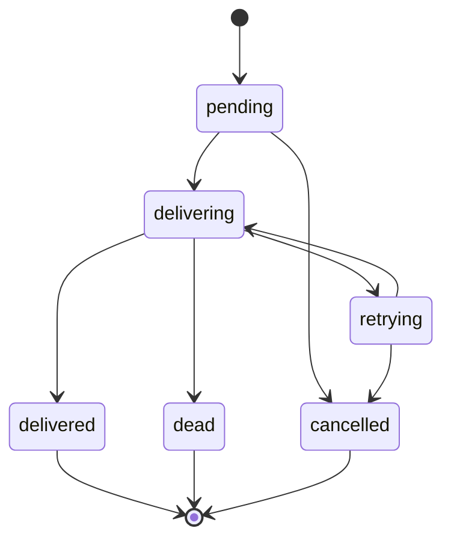

### SM-PLT-02 — Webhook endpoint

States: `pending_verification`, `active`, `degraded`, `auto_disabled`, `disabled`, `deleted`. Terminal: `deleted`.

| From                    | To            | Trigger                                               | Guard                                    |
| ----------------------- | ------------- | ----------------------------------------------------- | ---------------------------------------- |
| pending_verification    | active        | challenge answered 2xx                                | address allowed                          |
| active                  | degraded      | 20 consecutive failures or success under 10% over 100 | —                                        |
| degraded                | active        | probe or delivery succeeds 3 times                    | —                                        |
| degraded                | auto_disabled | continuous failure for 3 days                         | owners notified                          |
| active, degraded        | disabled      | owner pauses, 410 response, or PAD disables           | reason recorded                          |
| auto_disabled, disabled | active        | owner re-enables                                      | re-verification if disabled over 30 days |
| any                     | deleted       | owner deletes                                         | secret destroyed                         |

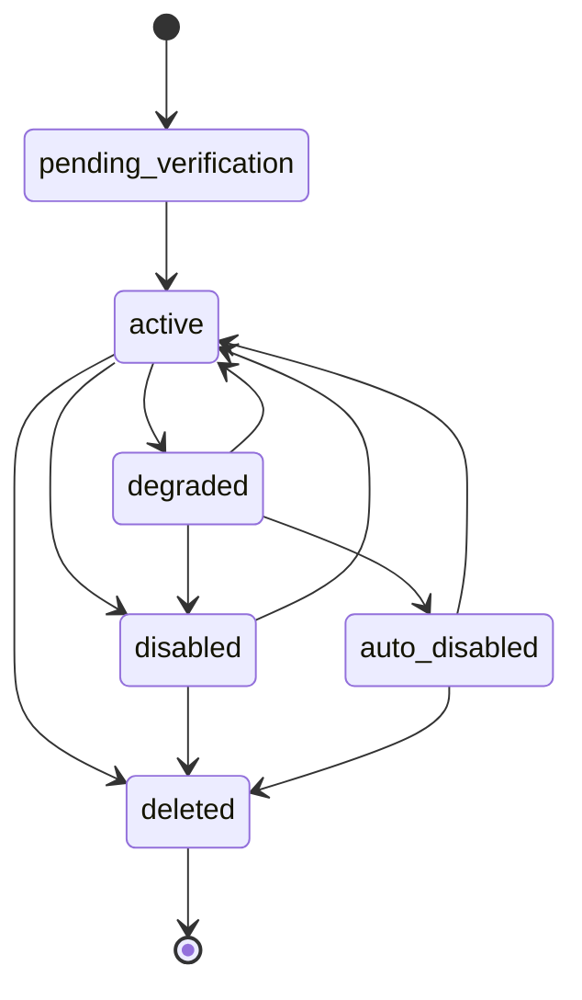

### SM-PLT-03 — Integration connection

States: `not_connected`, `authorizing`, `connected`, `degraded`, `reauth_required`, `suspended`, `disconnected`. Terminal: `disconnected` (a new connection starts again at `not_connected`).

| From                                 | To              | Trigger                                      | Guard                           |
| ------------------------------------ | --------------- | -------------------------------------------- | ------------------------------- |
| not_connected                        | authorizing     | user starts connect                          | consent to data-sharing summary |
| authorizing                          | connected       | provider authorization and test call succeed | —                               |
| authorizing                          | not_connected   | denied or timeout                            | —                               |
| connected                            | degraded        | health degraded or breaker open              | —                               |
| degraded                             | connected       | recovery                                     | —                               |
| connected, degraded                  | reauth_required | token revoked or expired                     | —                               |
| reauth_required                      | connected       | user reconnects                              | —                               |
| connected, degraded, reauth_required | suspended       | PAD or plan lapse                            | reason                          |
| suspended                            | connected       | resolved                                     | —                               |
| any except not_connected             | disconnected    | user or admin disconnects                    | tokens revoked                  |

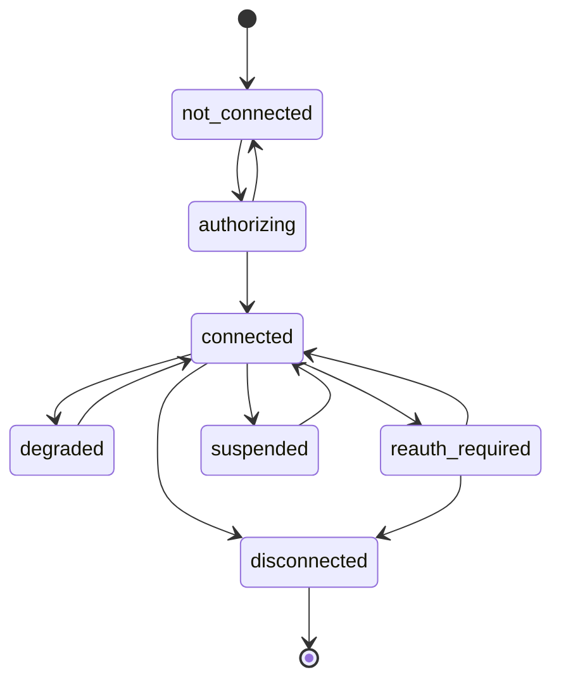

### SM-PLT-04 — Stored file

States: `upload_pending`, `uploading`, `pending_scan`, `available`, `quarantined`, `soft_deleted`, `purge_pending`, `purged`, `upload_expired`. Terminal: `purged`, `upload_expired`.

| From                      | To             | Trigger                                                   | Guard                                 |
| ------------------------- | -------------- | --------------------------------------------------------- | ------------------------------------- |
| upload_pending            | uploading      | first chunk                                               | session valid                         |
| upload_pending, uploading | upload_expired | 24 hours without completion                               | parts collected                       |
| uploading                 | pending_scan   | complete call                                             | size and checksum match, type allowed |
| pending_scan              | available      | scan verdict clean                                        | —                                     |
| pending_scan              | quarantined    | infected, suspicious confirmed, scan failed after retries | fail closed                           |
| available                 | quarantined    | re-scan detects threat or moderation action               | —                                     |
| available                 | soft_deleted   | owner or system delete                                    | —                                     |
| soft_deleted              | available      | restore within 30 days                                    | quota                                 |
| soft_deleted, quarantined | purge_pending  | 30 days elapse or erasure                                 | no legal hold                         |
| purge_pending             | purged         | all copies removed                                        | deletion record written               |

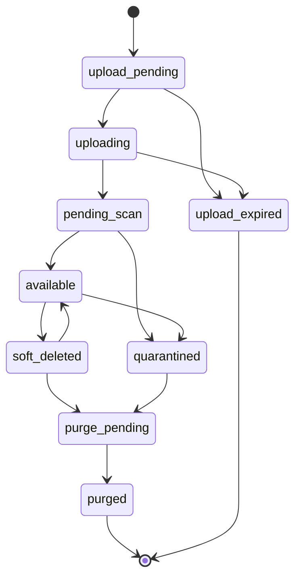

### SM-PLT-05 — Media asset processing

States: `uploaded`, `processing`, `ready`, `failed`, `retired`. Terminal: `retired`.

| From          | To         | Trigger                                           | Guard                          |
| ------------- | ---------- | ------------------------------------------------- | ------------------------------ |
| uploaded      | processing | source file `available` and job started           | entitlement and caps           |
| processing    | ready      | renditions and poster published                   | —                              |
| processing    | failed     | provider error or invalid source after 3 attempts | message class stored           |
| failed        | processing | owner retries or source replaced                  | —                              |
| ready         | processing | profile version change reprocess                  | renditions kept until replaced |
| ready, failed | retired    | media deleted                                     | CDN purged                     |

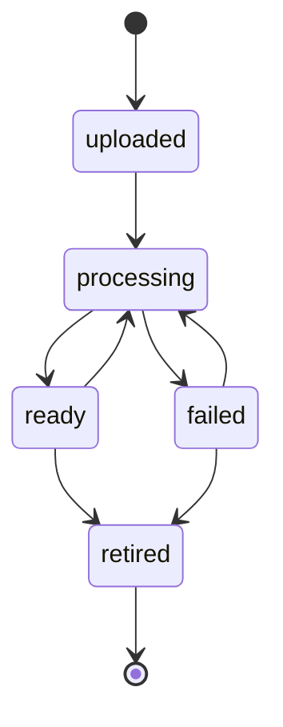

### SM-PLT-06 — Background job

States: `queued`, `running`, `retrying`, `succeeded`, `dead`, `cancelled`. Terminal: `succeeded`, `dead`, `cancelled`.

| From             | To        | Trigger                                                                  | Guard                                  |
| ---------------- | --------- | ------------------------------------------------------------------------ | -------------------------------------- |
| queued           | running   | worker claims with lease and fencing token                               | `runAfter` reached; concurrency allows |
| running          | succeeded | handler completes                                                        | token current                          |
| running          | retrying  | retryable error or lease expiry                                          | attempts < max                         |
| retrying         | queued    | backoff elapsed                                                          | —                                      |
| running          | dead      | attempts exhausted, non-retryable error, or lease expiry at last attempt | error stored                           |
| queued, retrying | cancelled | operator or owner cancels                                                | not running                            |
| dead             | queued    | operator replay (new attempt count)                                      | kind `replaySafe`; within 30 days      |

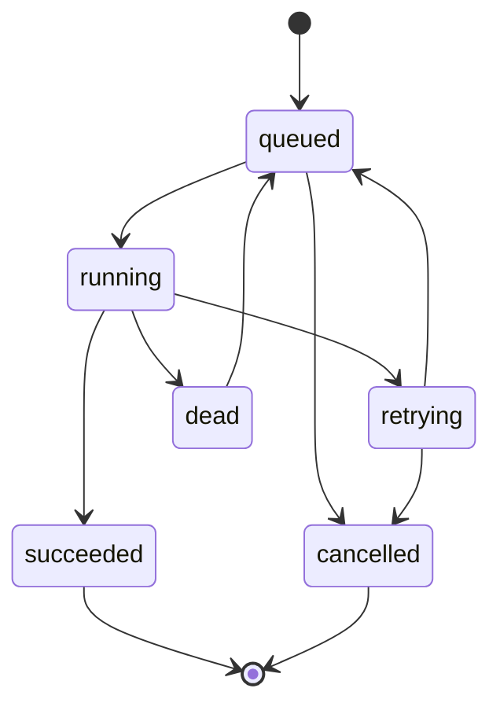

Note: `dead` is terminal for automatic processing; an operator replay creates a new execution cycle recorded as a new attempt series on the same job record.

### SM-PLT-07 — API credential (key, client secret)

States: `active`, `rotating`, `expired`, `revoked`. Terminal: `expired`, `revoked`.

| From             | To       | Trigger                               | Guard            |
| ---------------- | -------- | ------------------------------------- | ---------------- |
| active           | rotating | rotation requested; successor created | —                |
| rotating         | revoked  | overlap ends (24 hours default)       | successor active |
| active, rotating | expired  | expiry date                           | —                |
| active, rotating | revoked  | owner, admin or leak scanner revokes  | reason           |

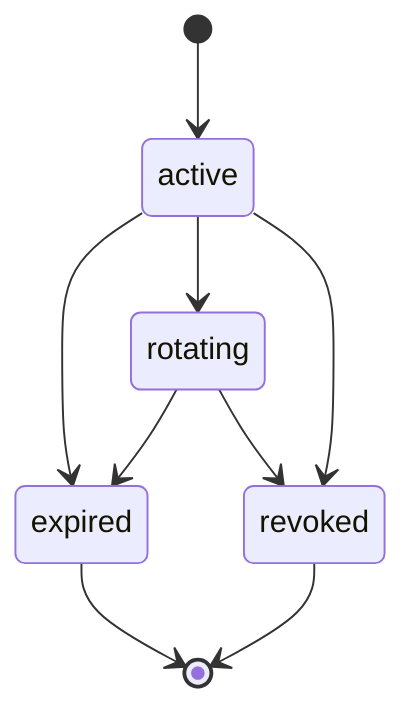

### SM-PLT-08 — Import run

States: `uploaded`, `validating`, `validated`, `committing`, `committed`, `rolled_back`, `failed`, `cancelled`. Terminal: `committed`, `rolled_back`, `failed`, `cancelled`.

| From                | To          | Trigger                                     | Guard                                                                 |
| ------------------- | ----------- | ------------------------------------------- | --------------------------------------------------------------------- |
| uploaded            | validating  | user starts validation                      | mapping complete                                                      |
| validating          | validated   | parse and checks finish                     | —                                                                     |
| validating          | failed      | unreadable file or system error             | —                                                                     |
| validated           | committing  | user confirms import                        | validation younger than 24 hours; file unchanged; no other active run |
| committing          | committed   | all batches processed (row errors reported) | —                                                                     |
| committing          | failed      | systemic error or stop-on-first-error       | rows committed so far listed                                          |
| committed           | rolled_back | undo within 24 hours                        | handler supports rollback                                             |
| uploaded, validated | cancelled   | user cancels                                | —                                                                     |

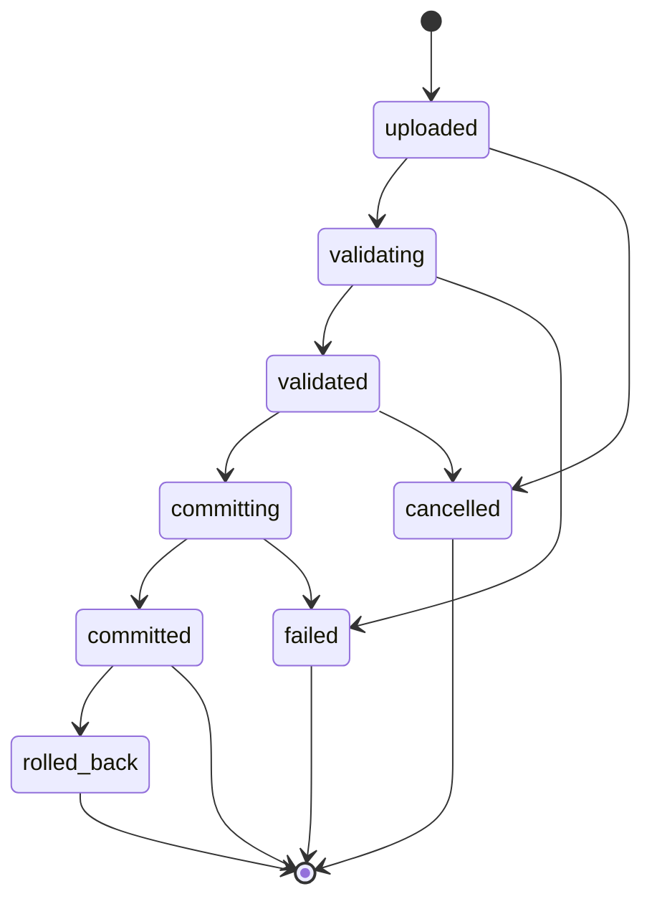

### SM-PLT-09 — Developer application

States: `draft`, `sandbox_active`, `submitted`, `in_review`, `approved`, `rejected`, `suspended`, `retired`. Terminal: `retired`.

| From           | To             | Trigger                                       | Guard                                 |
| -------------- | -------------- | --------------------------------------------- | ------------------------------------- |
| draft          | sandbox_active | create sandbox app                            | developer terms accepted              |
| sandbox_active | submitted      | request live                                  | policies and justifications present   |
| submitted      | approved       | automated checks pass (low-risk scopes only)  | —                                     |
| submitted      | in_review      | medium or high-risk scopes                    | —                                     |
| in_review      | approved       | reviewer approves                             | —                                     |
| in_review      | rejected       | reviewer rejects                              | reasons listed                        |
| rejected       | submitted      | resubmit                                      | changes made                          |
| approved       | in_review      | scopes or redirect URIs change; annual review | old scopes stay active until decision |
| approved       | suspended      | abuse, policy violation, security             | tokens revoked in 60 seconds          |
| suspended      | approved       | resolved                                      | PAD decision                          |
| any            | retired        | developer deletes app                         | grants revoked                        |

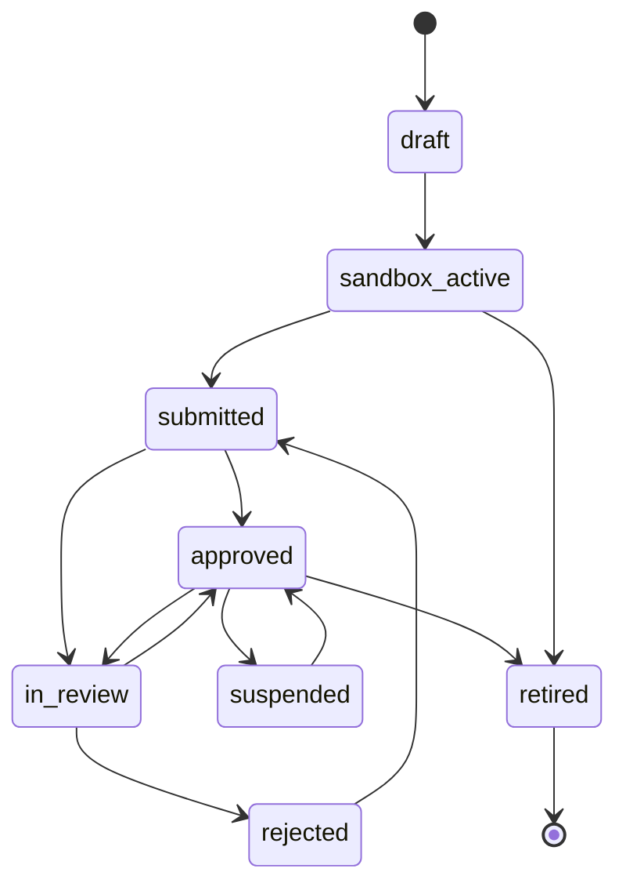

### SM-PLT-10 — Export run

States: `requested`, `preparing`, `ready`, `downloaded`, `expired`, `failed`. Terminal: `expired`, `failed` (a retry creates a new run).

| From              | To         | Trigger                                          | Guard                           |
| ----------------- | ---------- | ------------------------------------------------ | ------------------------------- |
| requested         | preparing  | job claimed                                      | authorized; concurrency allowed |
| preparing         | ready      | file generated, scanned and stored               | manifest written                |
| preparing         | failed     | error after retries                              | —                               |
| ready             | downloaded | first download (when single-use) or any download | link valid                      |
| ready, downloaded | expired    | link validity ends or owner deletes              | file deleted                    |

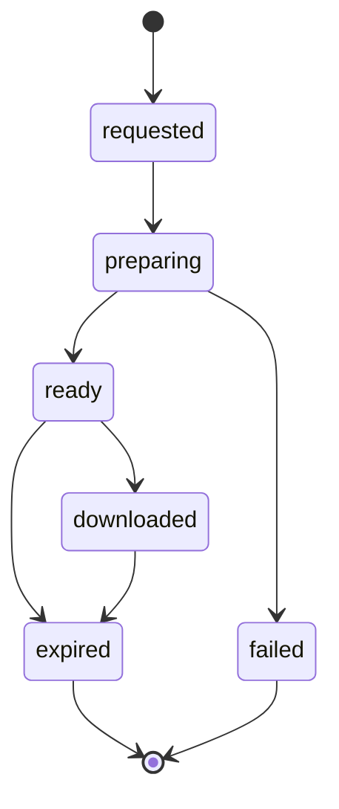

### SM-PLT-11 — API version

States: `preview`, `stable`, `deprecated`, `sunset`. Terminal: `sunset`.

| From       | To         | Trigger                                | Guard                                                          |
| ---------- | ---------- | -------------------------------------- | -------------------------------------------------------------- |
| preview    | stable     | release                                | contract frozen                                                |
| stable     | deprecated | successor stable and announcement made | window start recorded                                          |
| deprecated | sunset     | sunset date reached                    | at least 6 months after announcement unless security exception |
| deprecated | stable     | deprecation withdrawn                  | PAD decision                                                   |

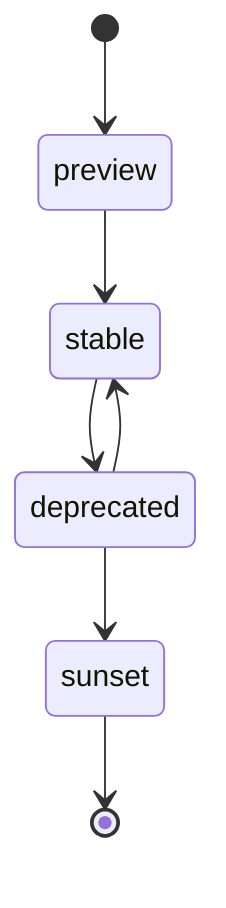

## 7. Screen inventory

Routes are on the product origin or the developer portal host (`developers`). [PROP]

| ID          | Name                                           | Route proposal                               | Roles                                     | Purpose                                   | Key states                                             |
| ----------- | ---------------------------------------------- | -------------------------------------------- | ----------------------------------------- | ----------------------------------------- | ------------------------------------------------------ |
| SCR-PLT-001 | Developer portal home                          | `developers /`                               | GUE and all                               | Docs entry, quickstart, status, changelog | default, maintenance banner                            |
| SCR-PLT-002 | API reference and try-it                       | `developers /docs/*`                         | GUE and all                               | Endpoint docs, sandbox console            | loading, search no results, try-it error               |
| SCR-PLT-003 | Changelog and versions                         | `developers /changelog`                      | GUE and all                               | Versions, deprecations, migration guides  | filtered, subscribed                                   |
| SCR-PLT-004 | App list and create wizard                     | `developers /apps`, `/apps/new`              | developers                                | Register apps                             | empty, draft, in review, approved, suspended           |
| SCR-PLT-005 | App detail: credentials, scopes, redirect URIs | `developers /apps/:id`                       | developers                                | Secrets, scopes, review status            | secret shown once, rotating, review needed             |
| SCR-PLT-006 | OAuth consent screen                           | `/oauth/authorize`                           | all signed-in roles                       | Allow or deny scopes                      | consent, reduced scopes, denied, admin approval needed |
| SCR-PLT-007 | Connected apps                                 | `/settings/connected-apps`                   | signed-in roles                           | Review and revoke app access              | empty, list, revoked                                   |
| SCR-PLT-008 | API keys                                       | `/settings/developer/keys`                   | EAD, IAD, EXA, developers                 | Create, rotate, revoke keys               | empty, one-time secret panel, expiring                 |
| SCR-PLT-009 | Usage and limits                               | `/settings/developer/usage`                  | EAD, developers                           | Requests, 429s, quotas, increase request  | normal, near quota, exhausted                          |
| SCR-PLT-010 | Request logs                                   | `/settings/developer/logs`                   | EAD, developers                           | Search requests, debug capture            | filtered, delayed, capture on                          |
| SCR-PLT-011 | Webhook endpoints                              | `/settings/developer/webhooks`               | EAD, developers                           | List and manage endpoints                 | empty, healthy, degraded, disabled                     |
| SCR-PLT-012 | Add or edit webhook endpoint                   | wizard                                       | EAD, developers                           | URL, events, verify, secret               | verifying, verification failed, secret once            |
| SCR-PLT-013 | Webhook deliveries                             | `/settings/developer/webhooks/:id`           | EAD, developers                           | Attempts, replay                          | list, detail, replay in progress                       |
| SCR-PLT-014 | Sandbox tenants and simulator                  | `developers /sandbox`                        | developers                                | Seeded data, scenarios, outbox            | create, reset, inactive warning                        |
| SCR-PLT-015 | Integrations catalog                           | `/settings/integrations`                     | EAD, IAD, EXA, signed-in roles (personal) | Browse and connect                        | plan-gated, connected, needs sign-in                   |
| SCR-PLT-016 | Integration detail and settings                | `/settings/integrations/:id`                 | EAD, IAD, EXA                             | Mapping, schedule, test, disconnect       | healthy, degraded, reauth, syncing                     |
| SCR-PLT-017 | Sync run history and report                    | `/settings/integrations/:id/runs`            | EAD, IAD, EXA                             | Run results and errors                    | running, failed rows, completed                        |
| SCR-PLT-018 | SSO and SCIM setup                             | `/settings/security/sso`                     | EAD, IAD, EXA                             | Configure IdP, test, enforce, SCIM        | not configured, tested, enforced, cert expiring        |
| SCR-PLT-019 | LMS and LTI registration                       | `/settings/integrations/lti`                 | IAD                                       | Platform registration, tool config        | registering, active, passback errors                   |
| SCR-PLT-020 | Connected accounts (calendar, video)           | `/settings/connected-accounts`               | signed-in roles                           | Personal connections                      | none, connected, reconnect                             |
| SCR-PLT-021 | Uploader component and file chips              | component                                    | signed-in roles                           | Upload with progress, states              | idle, uploading, paused, scanning, ready, rejected     |
| SCR-PLT-022 | Storage usage                                  | `/settings/storage`                          | signed-in roles                           | Meter, breakdown, delete                  | normal, 80%, full                                      |
| SCR-PLT-023 | Recently deleted files                         | `/settings/storage/deleted`                  | signed-in roles                           | Restore within 30 days                    | empty, list                                            |
| SCR-PLT-024 | Share link dialog                              | modal                                        | file owners                               | Expiry and revoke                         | default, copied, revoked                               |
| SCR-PLT-025 | Media processing status and player             | component                                    | INS, MNT, authors, viewers                | Status, retry, captions                   | processing, ready, failed                              |
| SCR-PLT-026 | External media validation card                 | component                                    | authors                                   | Link validation result                    | valid, blocked, unsupported, attest needed             |
| SCR-PLT-027 | Import wizard                                  | `/imports/new`                               | IAD, EAD, REC (granted), EXA, PAD         | Upload, map, validate, import             | each step, errors, undo                                |
| SCR-PLT-028 | Import history and report                      | `/imports`                                   | same                                      | Past runs                                 | list, report, rolled back                              |
| SCR-PLT-029 | Export dialog and My exports                   | modal, `/exports`                            | signed-in roles                           | Request and download exports              | preparing, ready, expired                              |
| SCR-PLT-030 | Admin: integrations fleet health               | admin origin `/ops/integrations`             | PAD, SUP                                  | Adapter state, breakers                   | healthy, degraded, unknown                             |
| SCR-PLT-031 | Admin: quarantine review                       | admin origin `/ops/quarantine`               | PAD, MOD                                  | Review suspicious files                   | queue, decision                                        |
| SCR-PLT-032 | Admin: developer app review                    | admin origin `/ops/dev-apps`                 | PAD                                       | Approve, reject, suspend apps             | queue, decision                                        |
| SCR-PLT-033 | Admin: schedules and event inspector           | admin origin `/ops/schedules`, `/ops/events` | PAD, SAD                                  | Run now, pause, inspect                   | list, history                                          |
| SCR-PLT-034 | Admin: marketplace gate                        | admin origin `/ops/marketplace-gate`         | PAD, SAD                                  | Metrics and decision                      | monitoring, decided                                    |

## 8. Data entities owned

| ID         | Entity                     | Key attributes                                                                                                                            | Relationships                                  | Retention class                                                  |
| ---------- | -------------------------- | ----------------------------------------------------------------------------------------------------------------------------------------- | ---------------------------------------------- | ---------------------------------------------------------------- |
| ENT-PLT-01 | ApiClient                  | id, ownerType and id, name, type, redirectUris, scopes, status, publisherVerified, environment, reviewState                               | has ApiCredential, OAuthGrant, WebhookEndpoint | Life of app plus 2 years                                         |
| ENT-PLT-02 | ApiCredential              | id, clientId or ownerId, prefix, secretHash, scopes, ipAllowlist, expiresAt, lastUsedAt, status                                           | ApiClient                                      | 13 months after revoke or expiry                                 |
| ENT-PLT-03 | OAuthGrant                 | id, userId, clientId, scopes, catalogVersion, authorizedAt, refreshFamilyId, status                                                       | ApiClient, user                                | Life of grant plus 13 months                                     |
| ENT-PLT-04 | RateLimitPolicy            | class, window, limit, burst, scope, failMode, planOverrides                                                                               | tenant                                         | Versioned config, 2 years                                        |
| ENT-PLT-05 | RequestLog and UsageRecord | requestId, tenantId, principalId, route template, status, latencyMs, ts, rateLimitState, idempotencyKey                                   | ApiClient                                      | Metadata 30 days; aggregates 13 months                           |
| ENT-PLT-06 | IdempotencyRecord          | principalId, route, key, fingerprint, status, responseRef, createdAt                                                                      | principal                                      | 14 days                                                          |
| ENT-PLT-07 | WebhookEndpoint            | id, tenantId, url, apiVersion, eventTypes, secretRef, state, environment, createdBy                                                       | has WebhookDelivery                            | Life plus 13 months                                              |
| ENT-PLT-08 | WebhookDelivery            | id, endpointId, eventId, attempts[], state, responseSnippet, replayOf                                                                     | WebhookEndpoint, OutboxEvent                   | 30 days                                                          |
| ENT-PLT-09 | IntegrationDefinition      | id, category, adapterId, authType, scopes, dataRead, dataWritten, directions, planGates, status                                           | has IntegrationConnection                      | Versioned, permanent in release history                          |
| ENT-PLT-10 | IntegrationConnection      | id, tenantId or userId, definitionId, state, config, secretRefs, lastSuccessAt, health, consentSummaryVersion                             | IntegrationDefinition, SyncRun                 | Life plus 13 months                                              |
| ENT-PLT-11 | VaultSecret                | id, ownerRef, kind, ciphertext, keyVersion, rotatedAt, lastUsedAt                                                                         | connections, endpoints                         | Deleted at disconnect; versions kept for overlap only            |
| ENT-PLT-12 | SyncRun                    | id, connectionId, mode, startedAt, counts, errors, cursor, state                                                                          | IntegrationConnection                          | 12 months                                                        |
| ENT-PLT-13 | StoredFile                 | id, ownerRef, tenantId, purpose, state, size, sniffedType, checksum, storageKey, retentionClass, legalHold, version                       | has ScanResult, MediaAsset                     | By retention class                                               |
| ENT-PLT-14 | MediaAsset and Rendition   | id, fileId, kind, state, profileVersion, renditions[], posterRef, captionsRef, durationMs                                                 | StoredFile                                     | Life of content                                                  |
| ENT-PLT-15 | UploadSession              | id, userId, purpose, declaredSize, parts, expiresAt, checksum                                                                             | StoredFile                                     | 24 hours                                                         |
| ENT-PLT-16 | ImportRun                  | id, tenantId, entityType, fileId, mapping, options, state, counts, reportRef, rollbackUntil                                               | StoredFile                                     | Report 12 months; source file 30 days                            |
| ENT-PLT-17 | ExportJob                  | id, requesterId, dataset, filters, format, state, fileId, expiresAt, manifestRef                                                          | StoredFile                                     | Metadata 13 months; file 24 hours to 7 days                      |
| ENT-PLT-18 | BackgroundJob              | id, kind, payload, status, attempts, maxAttempts, runAfter, leaseOwner, leaseExpiresAt, fencingToken, idempotencyKey, tenantId, lastError | JobSchedule                                    | Succeeded 14 days; dead 30 days then archived metadata 13 months |
| ENT-PLT-19 | JobSchedule                | id, kind, cron, timeZone, missedPolicy, overlapPolicy, paused, dryRunDefault, lastSlot                                                    | BackgroundJob                                  | Versioned config                                                 |
| ENT-PLT-20 | OutboxEvent                | id, type, version, tenantId, aggregateId, sequence, payload, createdAt, publishedAt                                                       | WebhookDelivery, consumers                     | 30 days; audit class to the audit store                          |
| ENT-PLT-21 | DeveloperAccount           | userId, termsAcceptedAt, verifiedPublisher, status                                                                                        | ApiClient                                      | Life plus 2 years                                                |
| ENT-PLT-22 | SandboxTenant              | id, developerId, seedProfile, createdAt, lastActiveAt                                                                                     | ApiClient                                      | Deleted after 90 days inactivity                                 |
| ENT-PLT-23 | ApiVersion                 | version, state, announcedAt, sunsetAt, migrationGuideRef                                                                                  | changelog                                      | Permanent                                                        |
| ENT-PLT-24 | StorageQuota               | ownerRef, limitBytes, usedBytes, reservedBytes, updatedAt                                                                                 | StoredFile, BIL entitlement                    | Life of owner                                                    |
| ENT-PLT-25 | RetentionPolicy            | class, duration, trigger, legalBasisNote, version                                                                                         | StoredFile                                     | Versioned config                                                 |
| ENT-PLT-26 | ExternalMediaProvider      | id, domains, parserVersion, capabilities, status, allowlistScope                                                                          | media references                               | Versioned config                                                 |
| ENT-PLT-27 | ScanResult                 | fileId, engine, signatureVersion, verdict, scannedAt, details                                                                             | StoredFile                                     | 13 months                                                        |

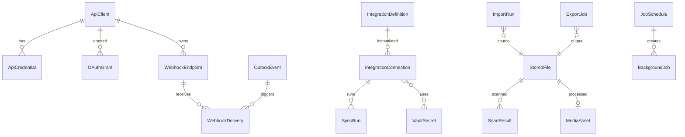

## 9. Events emitted and consumed

### 9.1 Emitted

| ID          | Name                             | Trigger                              | Key payload                         | Consumers                  |
| ----------- | -------------------------------- | ------------------------------------ | ----------------------------------- | -------------------------- |
| EVT-PLT-001 | `plt.apiclient.registered`       | App registered                       | clientId, ownerId, environment      | ADM, ANL                   |
| EVT-PLT-002 | `plt.apiclient.approved`         | Live approval or suspension decision | clientId, decision                  | NTF, ADM                   |
| EVT-PLT-003 | `plt.credential.created`         | Key or secret created                | credentialId, ownerRef, scopes      | NTF (notice), audit        |
| EVT-PLT-004 | `plt.credential.revoked`         | Key revoked or expired               | credentialId, reason                | NTF, audit                 |
| EVT-PLT-005 | `plt.credential.rotated`         | Rotation started                     | credentialId, successorId           | NTF, audit                 |
| EVT-PLT-006 | `plt.grant.authorized`           | OAuth consent granted                | userId, clientId, scopes            | NTF (notice), audit        |
| EVT-PLT-007 | `plt.grant.revoked`              | Grant revoked                        | grantId, reason                     | audit                      |
| EVT-PLT-008 | `plt.ratelimit.exceeded`         | Limit tripped (sampled)              | principalId, class                  | ANL, ADM alerts            |
| EVT-PLT-009 | `plt.quota.threshold_reached`    | 80% or 100% of quota                 | tenantId, quotaType, percent        | NTF, BIL                   |
| EVT-PLT-010 | `plt.apiversion.deprecated`      | Version deprecation announced        | version, sunsetAt                   | NTF, changelog subscribers |
| EVT-PLT-011 | `plt.webhook.endpoint_created`   | Endpoint created or verified         | endpointId, tenantId                | audit                      |
| EVT-PLT-012 | `plt.webhook.endpoint_disabled`  | Endpoint disabled or auto-disabled   | endpointId, reason                  | NTF, audit                 |
| EVT-PLT-013 | `plt.webhook.delivery_failed`    | Attempt failed                       | deliveryId, attempt, errorClass     | ANL, ADM health            |
| EVT-PLT-014 | `plt.webhook.delivery_dead`      | Delivery exhausted                   | deliveryId, eventId                 | NTF (digest), ADM          |
| EVT-PLT-015 | `plt.webhook.replayed`           | Delivery replayed                    | deliveryId, by                      | audit                      |
| EVT-PLT-016 | `plt.integration.connected`      | Connection active                    | connectionId, definitionId          | audit, ANL                 |
| EVT-PLT-017 | `plt.integration.disconnected`   | Connection ended                     | connectionId, dataDisposition       | audit                      |
| EVT-PLT-018 | `plt.integration.health_changed` | Health state transition              | connectionId or adapterId, from, to | ADM (EVT consumed), NTF    |
| EVT-PLT-019 | `plt.integration.sync_completed` | Sync run done                        | runId, counts                       | owning module, audit       |
| EVT-PLT-020 | `plt.integration.sync_failed`    | Sync run failed                      | runId, errorClass                   | NTF, ADM                   |
| EVT-PLT-021 | `plt.sso.connection_verified`    | SSO test sign-in succeeded           | tenantId, protocol                  | audit                      |
| EVT-PLT-022 | `plt.scim.user_deprovisioned`    | SCIM deactivation applied            | userId, tenantId                    | IDN, audit                 |
| EVT-PLT-023 | `plt.file.upload_started`        | Upload session created               | fileId, purpose                     | ANL                        |
| EVT-PLT-024 | `plt.file.available`             | Scan clean                           | fileId, purpose, size               | owning modules             |
| EVT-PLT-025 | `plt.file.quarantined`           | File quarantined                     | fileId, reasonClass                 | TSF, NTF                   |
| EVT-PLT-026 | `plt.file.deleted`               | Soft delete                          | fileId, by                          | owning modules, search     |
| EVT-PLT-027 | `plt.file.purged`                | Purge complete                       | fileId                              | audit, SET                 |
| EVT-PLT-028 | `plt.media.transcode_completed`  | Media ready                          | assetId                             | STU, LRN                   |
| EVT-PLT-029 | `plt.media.transcode_failed`     | Media failed                         | assetId, reasonClass                | STU, NTF                   |
| EVT-PLT-030 | `plt.storage.quota_threshold`    | Storage quota threshold              | ownerRef, percent                   | NTF, BIL                   |
| EVT-PLT-031 | `plt.import.validated`           | Validation complete                  | runId, counts                       | NTF                        |
| EVT-PLT-032 | `plt.import.committed`           | Import finished                      | runId, counts                       | owning module, audit       |
| EVT-PLT-033 | `plt.import.failed`              | Import failed                        | runId, errorClass                   | NTF, ADM                   |
| EVT-PLT-034 | `plt.export.ready`               | Export ready                         | exportId, expiresAt                 | NTF                        |
| EVT-PLT-035 | `plt.export.expired`             | Export link expired                  | exportId                            | audit                      |
| EVT-PLT-036 | `plt.job.dead`                   | Job became dead                      | jobId, kind, errorClass             | ADM (FR-ADM-037)           |
| EVT-PLT-037 | `plt.job.replayed`               | Operator replay                      | jobId, by                           | audit                      |
| EVT-PLT-038 | `plt.schedule.missed`            | Slot skipped or late                 | scheduleId, slot, policy            | ADM alerts                 |
| EVT-PLT-039 | `plt.sandbox.reset`              | Sandbox reset or deleted             | sandboxId                           | ANL                        |
| EVT-PLT-040 | `plt.egress.blocked`             | Outbound request refused             | purpose, reasonClass, tenantId      | security alerts, ADM       |

### 9.2 Consumed

| Event                                                  | Owner                          | Used for                                        |
| ------------------------------------------------------ | ------------------------------ | ----------------------------------------------- |
| `admin.killswitch.activated`, `admin.config.changed`   | ADM (EVT-ADM-024, EVT-ADM-026) | Kind pauses, limit changes, adapter disablement |
| `admin.maintenance.started`, `admin.maintenance.ended` | ADM (EVT-ADM-028, EVT-ADM-029) | Read-only mode for API writes                   |
| `set.erasure.approved`                                 | SET (planned)                  | File purge and export deletion (FR-PLT-033)     |
| `bil.entitlement.changed`                              | BIL (planned)                  | Quotas, rate limits, integration gates          |
| `idn.account.deactivated`                              | IDN (planned)                  | Revoke personal tokens, grants                  |
| `emp.org.suspended`                                    | EMP (planned)                  | Pause org keys, webhooks, syncs                 |
| `tsf.content.removed`                                  | TSF (planned)                  | Quarantine or delete files                      |
| All domain events (`module.entity.action`)             | All modules                    | Webhook fan-out through the outbox              |

## 10. Integrations and external dependencies

| Dependency                                                              | Direction     | Purpose                        | Notes                             |
| ----------------------------------------------------------------------- | ------------- | ------------------------------ | --------------------------------- |
| Object storage (S3-compatible) with versioning and object lock options  | Outbound      | File bytes, quarantine bucket  | Region and provider per OD-PLT-06 |
| Antivirus engine (ClamAV or commercial)                                 | Outbound      | Scanning                       | OD-PLT-07                         |
| Video processing service (Mux, Cloudflare Stream) or self-hosted ffmpeg | Outbound      | Transcoding, HLS               | OD-PLT-08                         |
| Speech-to-text provider                                                 | Outbound      | Captions                       | adapter                           |
| CDN                                                                     | Outbound      | Delivery, purge                | provider undecided                |
| KMS                                                                     | Outbound      | Envelope keys for the vault    | cloud KMS or HSM                  |
| Payment provider (Stripe default)                                       | Bidirectional | Billing                        | OD-PLT-15                         |
| Email provider (Brevo default, behind port) and SMS provider            | Outbound      | Messaging                      | SMS scope OD-PLT-12               |
| Calendar APIs (Google, Microsoft)                                       | Bidirectional | Availability and events        | OAuth                             |
| Meeting providers (Zoom, Teams, Meet)                                   | Bidirectional | Meeting links                  | OAuth                             |
| ATS APIs (Greenhouse, Lever, Workable, Ashby, others)                   | Bidirectional | Import and sync                | priority per OD-PLT-16            |
| HRIS APIs (Workday, BambooHR, SAP SuccessFactors)                       | Inbound       | Directory sync                 | read-only                         |
| LMS platforms (Moodle, Canvas, Blackboard) via LTI 1.3                  | Bidirectional | SSO launch and grades          |                                   |
| Identity providers (Entra, Google Workspace, Okta)                      | Inbound       | SSO and SCIM                   |                                   |
| Identity verification vendor                                            | Bidirectional | Document and liveness          | OD-PLT-16                         |
| Oembed and external media providers                                     | Outbound      | Embeds                         | allowlist                         |
| Redis-class shared store                                                | Internal      | Rate-limit counters, caches    | failure modes in BR-PLT-005       |
| PostgreSQL                                                              | Internal      | Job queue, outbox, idempotency | system of record                  |
| Observability stack                                                     | Outbound      | Logs, metrics, traces          | redacted                          |

## 11. Cross-module dependencies

| PLT depends on | Why                                                                     |
| -------------- | ----------------------------------------------------------------------- |
| IDN            | User authentication for consent, session revocation, account state      |
| BIL            | Plan entitlements for quotas, limits, integration gates; payments logic |
| SET            | Consent, erasure and export authority                                   |
| ADM            | Flags, kill switches, config, console surfaces, audit API, approvals    |
| EMP and INS    | Tenant, org and institution records                                     |
| NTF            | Notification content for PLT notices                                    |
| TSF            | Moderation hooks for files                                              |

| Depends on PLT   | Why                                                                  |
| ---------------- | -------------------------------------------------------------------- |
| All modules      | Jobs, outbox, files, idempotency, error model, rate limits, webhooks |
| PWA              | Resumable uploads, idempotency, pairing OAuth, CDN renditions        |
| JOB, ATS         | ATS import and sync, jobs and candidates API, webhooks               |
| INT              | Calendar and meeting providers                                       |
| LRN, STU, ASM    | Media, transcoding, embeds, LTI                                      |
| INS              | LMS, SSO, SCIM, roster import                                        |
| ENT (enterprise) | HRIS sync, SSO                                                       |
| BIL              | Payment port                                                         |
| NTF              | Email and SMS ports                                                  |
| BGV              | Identity verification port                                           |
| ADM              | Job console, health, DLQ tools                                       |
| ANL              | Usage and event streams                                              |

## 12. Module-level metrics

| Metric                        | Definition and formula                                                   | Owner role   |
| ----------------------------- | ------------------------------------------------------------------------ | ------------ |
| API availability              | Successful non-5xx requests ÷ all requests per month, by endpoint class  | PAD          |
| API latency                   | p50, p95, p99 per endpoint class                                         | PAD          |
| API error budget burn         | Observed error rate ÷ allowed error rate (SLO set by OD)                 | PAD          |
| Developer adoption            | Active apps and keys (30-day) and requests per day                       | PAD          |
| Time to first successful call | Median minutes from developer sign-up to first 2xx in sandbox            | PAD          |
| 429 rate                      | 429 responses ÷ requests by client                                       | PAD          |
| Deprecated-route traffic      | Requests to deprecated routes ÷ total at 90, 30 and 7 days before sunset | PAD          |
| Webhook delivery success      | Deliveries succeeded within first attempt, within window ÷ all           | PAD          |
| Webhook latency               | p95 from event creation to first delivery attempt                        | PAD          |
| Dead webhook deliveries       | Count and share per week                                                 | PAD          |
| Integration health            | Share of connections `live` vs `degraded` vs `unknown` by adapter        | PAD          |
| Sync freshness                | Median age of last successful sync per integration                       | PAD          |
| Upload success rate           | Completed ÷ started upload sessions, by purpose                          | PAD          |
| Scan latency                  | p95 from complete to verdict                                             | PAD          |
| Quarantine rate               | Quarantined ÷ scanned files                                              | PAD with TSF |
| Storage growth and cost       | Bytes stored and egressed by class, cost per tenant                      | PAD          |
| Transcode success and time    | Ready ÷ submitted; p95 duration per minute of source                     | PAD          |
| CDN hit ratio                 | Cached responses ÷ total for public classes                              | PAD          |
| Import success                | Rows committed ÷ rows validated; runs with errors                        | PAD          |
| Export time to ready          | p95 from request to ready by dataset                                     | PAD          |
| Job queue health              | Oldest queued age and depth by kind; dead jobs per day; lease expiries   | PAD          |
| Job success rate              | Succeeded ÷ finished by kind                                             | PAD          |
| Outbox lag                    | Age of oldest unpublished event                                          | PAD          |
| Egress blocks                 | `plt.egress.blocked` per day by reason                                   | SAD          |

## 13. Open decisions

| ID        | Question                                                                                                                                                                             | Options                                                        | Default proposal                                                                                                | Who decides                     | Blocking                           |
| --------- | ------------------------------------------------------------------------------------------------------------------------------------------------------------------------------------ | -------------------------------------------------------------- | --------------------------------------------------------------------------------------------------------------- | ------------------------------- | ---------------------------------- |
| OD-PLT-01 | Deprecation window for the public API: SSOT §12.18 says at least 6 months; the target API standard proposes 90 days.                                                                 | 90 days; 6 months; 12 months for enterprise                    | 6 months `[PROP]` (stricter wins)                                                                               | Product owner and platform lead | FR-PLT-001                         |
| OD-PLT-02 | Success response shape: SSOT `{success, data, meta}` versus target `{items, page}` and bare resources (OPEN-46).                                                                     | SSOT envelope; bare resources with `items`/`page`              | Bare resources and `{items, page}` for lists, problem+json for errors `[PROP]`; the envelope is not used        | Platform lead                   | FR-PLT-006, SDKs                   |
| OD-PLT-03 | Interface defaults in conflict: list page default 20 (SSOT CON-003) versus 25 (target); idempotency replay window 24 hours (CON-005) versus 14 days (offline clients).               | 20 or 25; 24 hours or 14 days                                  | 25 and 14 days `[PROP]`                                                                                         | Platform lead                   | FR-PLT-006, FR-PLT-007             |
| OD-PLT-04 | Which plans and roles may use the public API, personal tokens and webhooks.                                                                                                          | Paid only; all with low limits                                 | Free: personal read tokens; paid: org keys, OAuth apps and webhooks; enterprise: higher limits and SSO `[PROP]` | Product owner with BIL owner    | FR-PLT-003, FR-PLT-011             |
| OD-PLT-05 | Rule assigning kinds to the transactional versus heavy queue; user-local versus UTC cadence for digests and streaks; legacy ambiguity about `failed`; infrastructure for heavy jobs. | Runtime and resource rule; local-day fan-out                   | Rule in FR-PLT-039; local-day fan-out for user-facing schedules, UTC for platform schedules `[PROP]`            | Platform lead                   | FR-PLT-039, FR-PLT-040, BR-PLT-031 |
| OD-PLT-06 | Object storage provider, regions and data residency per tenant.                                                                                                                      | Single region; per-region buckets; customer-chosen             | Single primary region with residency tiers added for institutions later `[PROP]`                                | Security lead and product owner | FR-PLT-030                         |
| OD-PLT-07 | Antivirus engine choice and acceptable scan latency.                                                                                                                                 | ClamAV self-hosted; commercial API; both                       | ClamAV plus a second engine for suspicious cases `[PROP]`                                                       | Security lead                   | FR-PLT-031                         |
| OD-PLT-08 | Video processing vendor (Mux, Cloudflare Stream, self-hosted), DRM and offline need.                                                                                                 | Vendor; self-host; DRM yes or no                               | Managed vendor, no DRM in v1 `[PROP]` (legacy OD-14 open)                                                       | Platform lead and LRN owner     | FR-PLT-035                         |
| OD-PLT-09 | Does HRIS sync, even read-only, brush the SSOT §4.2 non-goal of generic HR?                                                                                                          | Exclude; read-only directory sync only                         | Read-only directory sync with field allowlist `[PROP]`                                                          | Product owner                   | FR-PLT-019                         |
| OD-PLT-10 | Lawful basis and notification duties for candidates imported from an employer's ATS.                                                                                                 | Employer controller, no outreach; outreach with acknowledgment | Employer is controller; no automatic outreach unless the org acknowledges lawful basis `[PROP]`                 | Legal and privacy lead          | FR-PLT-018                         |
| OD-PLT-11 | Criteria and thresholds (N apps, abuse record) for opening an integration directory to third-party apps.                                                                             | Never; unlisted private only; curated directory                | Unlisted private apps first; curated directory only after gate review `[PROP]`                                  | Product owner                   | FR-PLT-027                         |
| OD-PLT-12 | Is SMS in scope and for what purposes (OTP, reminders, marketing)?                                                                                                                   | None; OTP and security only; reminders too                     | OTP and security only until legal review `[PROP]`                                                               | Product owner and legal         | FR-PLT-023                         |
| OD-PLT-13 | Retention periods per file class and for logs.                                                                                                                                       | Values per class                                               | Defaults in FR-PLT-033 `[PROP]`                                                                                 | Legal and privacy lead          | FR-PLT-033, FR-PLT-010             |
| OD-PLT-14 | Rate-limit and quota values per plan and endpoint class; storage per plan.                                                                                                           | Values                                                         | Placeholders in FR-PLT-005 and FR-PLT-032 `[PROP]`; calibrate with load tests                                   | Product owner with BIL          | FR-PLT-005, FR-PLT-032             |
| OD-PLT-15 | Payment provider(s) per region and whether a second provider is supported.                                                                                                           | Stripe only; Stripe plus regional                              | Stripe only for v1 `[PROP]`                                                                                     | Finance owner and product owner | FR-PLT-022                         |
| OD-PLT-16 | Priority list of ATS, HRIS, LMS and identity verification vendors to build first.                                                                                                    | Ranked list                                                    | Greenhouse, Lever for ATS; Canvas and Moodle for LTI; Entra and Okta for SSO; vendor RFP for IDV `[PROP]`       | Product owner                   | FR-PLT-018 to FR-PLT-025           |

## 14. Risks

| ID         | Risk                                                                                | Likelihood / impact | Mitigation                                                                                             |
| ---------- | ----------------------------------------------------------------------------------- | ------------------- | ------------------------------------------------------------------------------------------------------ |
| RSK-PLT-01 | SSRF through webhooks, oEmbed, imports or metadata fetch reaches internal services. | Medium / Critical   | Single egress client, pinned DNS, network-level egress rules, bypass corpus tests (FR-PLT-041).        |
| RSK-PLT-02 | Webhook or API secret leakage.                                                      | Medium / High       | Hashing and vault, scanner revocation, short overlap rotations, IP allowlists.                         |
| RSK-PLT-03 | Malicious uploads (malware, polyglots, active documents) reach users.               | Medium / High       | Fail-closed scan, sandbox origin, re-scan, type sniffing.                                              |
| RSK-PLT-04 | Vendor outage or lock-in (storage, transcode, email, payments).                     | Medium / High       | Ports, degraded modes, breakers, removal drills, export of renditions.                                 |
| RSK-PLT-05 | Bulk scraping of candidate or profile data through the public API.                  | High / High         | Scope limits, sealed classes excluded, rate limits and anomaly detection, developer terms, app review. |
| RSK-PLT-06 | Breaking changes slip into a stable version.                                        | Medium / Medium     | Contract diff in CI, pinned SDK tests, long deprecation window.                                        |
| RSK-PLT-07 | Dead-letter growth hides data loss.                                                 | Medium / High       | Alerts by age and count, console replay, ownership per kind (FR-ADM-037).                              |
| RSK-PLT-08 | Storage and transcoding costs grow faster than plan revenue.                        | Medium / Medium     | Quotas, renditions caps, lifecycle tiers, per-tenant cost tracking.                                    |
| RSK-PLT-09 | Poor integration data quality (duplicates, mapping errors) damages customer trust.  | Medium / Medium     | Dry runs, mapping validation, duplicate review, undo windows.                                          |
| RSK-PLT-10 | Marketplace ambitions drift into the SSOT §4.2 general-marketplace non-goal.        | Medium / Medium     | Decision gate, career-domain limit, unlisted-first policy.                                             |
| RSK-PLT-11 | Rate-limit counters inconsistent across instances (SSOT §20.1 open issue).          | Medium / Medium     | Shared store, documented fail modes, tests with multiple instances.                                    |
| RSK-PLT-12 | Enforced SSO locks out an organization when the IdP fails.                          | Low / High          | Break-glass owner account requirement, certificate expiry alerts.                                      |

## 15. Legacy source trace

| Legacy source                                                                                                           | Informed                                                                                          | Dropped or changed                                                                                           |
| ----------------------------------------------------------------------------------------------------------------------- | ------------------------------------------------------------------------------------------------- | ------------------------------------------------------------------------------------------------------------ |
| SSOT §12.18 to §12.20 (API architecture, envelope, CON-001 to CON-016)                                                  | Versioning, pagination, idempotency, errors, rate limits, webhooks, files, time and money rules   | Conflicts on envelope, page default, replay window and deprecation window recorded as OD-PLT-01 to OD-PLT-03 |
| SSOT §13.3 integration register                                                                                         | Integration categories and vendor examples                                                        | Phase numbers dropped; priorities made OD-PLT-16                                                             |
| SSOT §13.4 ADR-009 doctrine                                                                                             | Adapter pattern, circuit breakers, degraded modes, removal drill                                  | Kept as BR-PLT-013, BR-PLT-040                                                                               |
| SSOT §13.5 to §13.8 (dual queue, job catalogs, job schema)                                                              | Job kinds, retries, schema, DLQ                                                                   | Queue assignment rule and terminal-state ambiguity resolved as proposals (OD-PLT-05, BR-PLT-031)             |
| SSOT §13.15, §13.16, §10.21 BR-083 to BR-090, F-42                                                                      | Media pipeline, security, embeds                                                                  | Provider choice left to OD-PLT-08                                                                            |
| SSOT BR-28, BR-31, BR-32, BR-063, WF-17                                                                                 | Health states, dry-run schedulers, webhook-owned subscription state, export, validate-then-commit | Applied to PLT engines                                                                                       |
| SSOT §20.1 to §20.3                                                                                                     | Observability, reliability, trace propagation                                                     | Counter-store gap addressed in BR-PLT-005                                                                    |
| Yash 13 API_DESIGN_STANDARDS, INTEGRATION_ARCHITECTURE, EVENT_CATALOG                                                   | Contract-first, resource modeling, headers, event naming                                          | Numeric proposals re-labeled `[PROP]`                                                                        |
| Yash 18 PROC-04, PROC-09, PROC-13                                                                                       | Signed delivery of packages, data-rights exports, payment operations                              | Staff tooling remains in ADM                                                                                 |
| Own knowledge of Stripe, GitHub, Twilio developer platforms; Greenhouse, Lever, Workday, Canvas LTI 1.3; Mux; Okta SCIM | Webhook signing and replay, OAuth and scopes, LTI, SCIM, sandbox                                  | Tagged `[PROP]`                                                                                              |
| Dropped: Zapier and Make listings (SSOT §13.3 future)                                                                   | Covered by public API and webhooks                                                                | Revisit under FR-PLT-027                                                                                     |
