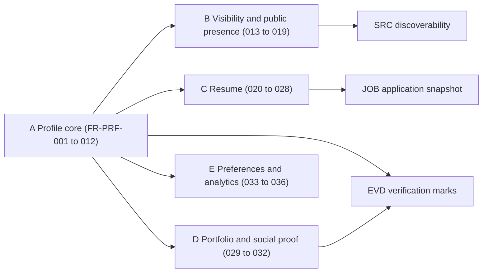
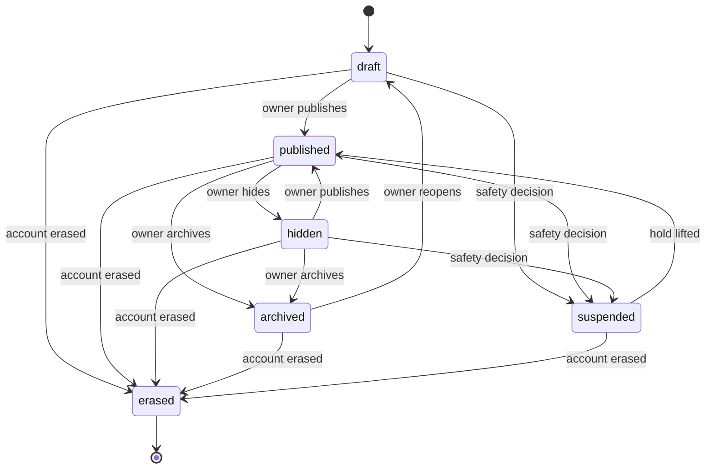
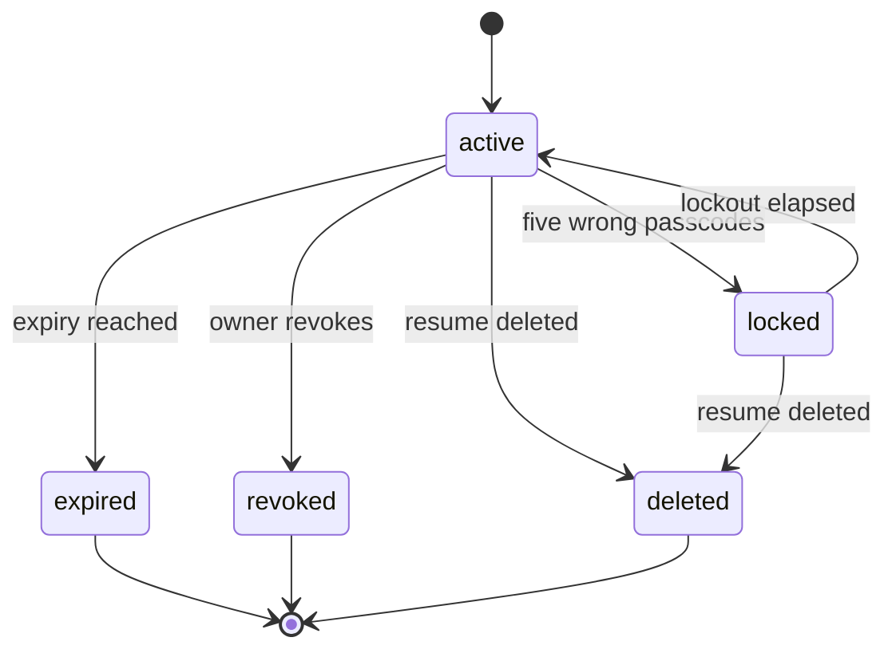
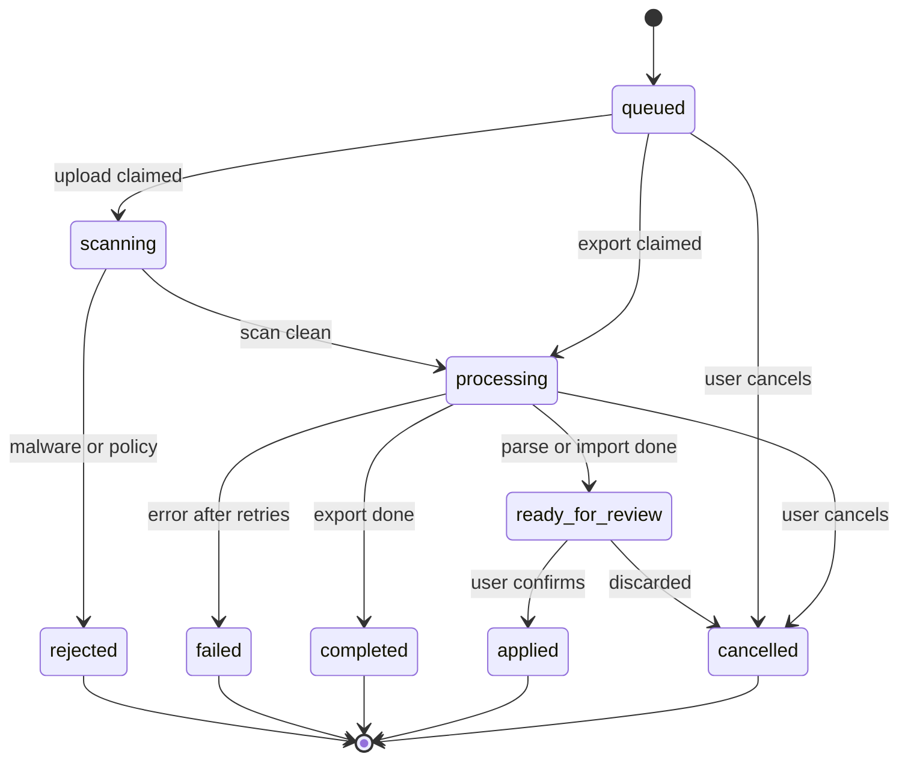
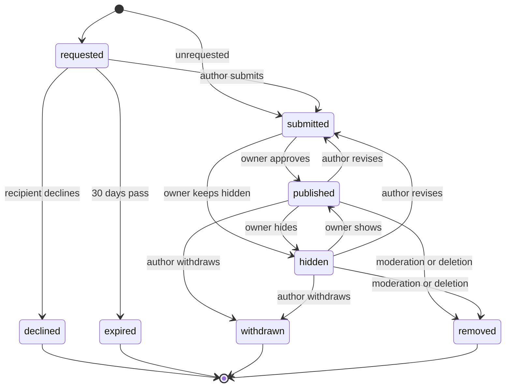
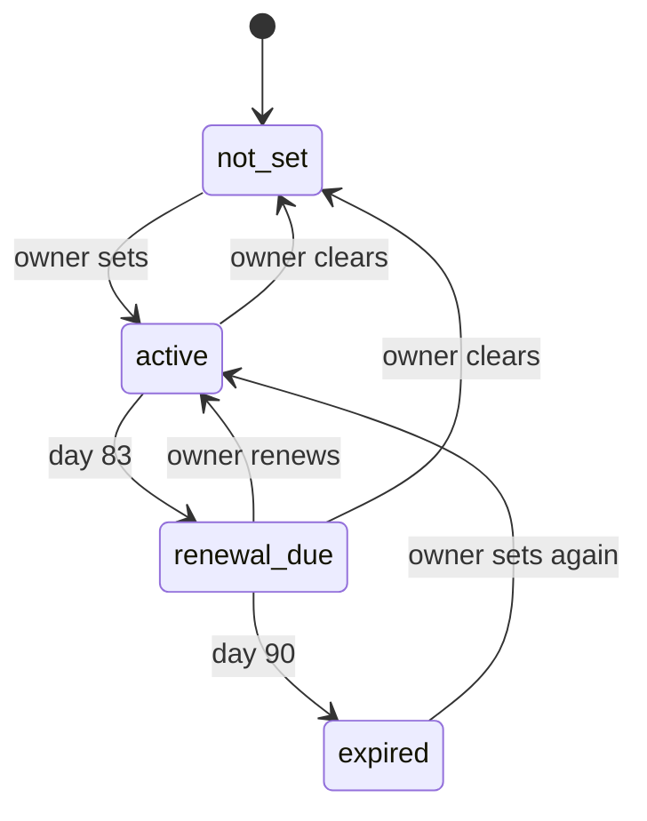
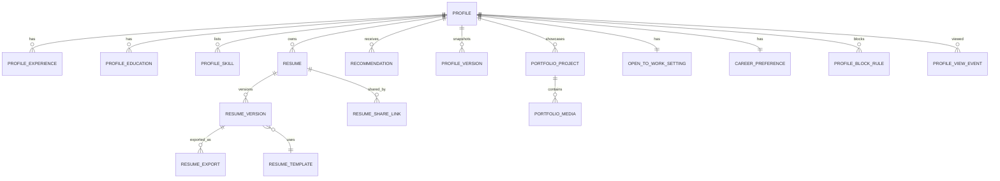

# PRF — Profile, Resume & Portfolio

> Status: intended product specification. Nothing here is a claim that anything is built. Legacy inputs: `SSOT.md` F-12, F-13, F-26, F-60, F-64, F-80, F-112; `docs/registries/FEATURE_REGISTRY.md`.

## 1. Purpose, outcomes and boundaries

### 1.1 Purpose

PRF owns the **self-presented** professional identity: what a person says about themselves, how they choose to show it, and the documents (resume, portfolio, public page) built from it. Everything in PRF is a **claim** until the Evidence module (EVD) attaches evidence to it `[SRC: SSOT §6.1 "A claim is not verified evidence"]`. PRF shows verification marks that EVD and BGV produce, but never creates them.

### 1.2 Outcomes

1. A candidate can build a complete, accurate profile in one sitting and keep it current with small edits.
2. A candidate controls exactly who sees each part of the profile, and the system enforces that on every surface (profile page, search, resume links, recruiter views, API).
3. A candidate can produce an ATS-readable resume in under five minutes from profile data, in several templates, and export it as PDF, DOCX or JSON.
4. A candidate can show work (portfolio projects, media, recommendations) and link it to skills so EVD can later attach evidence.
5. A candidate can signal availability and preferences without exposing that signal to their current employer.

### 1.3 In scope, out of scope, owned vs consumed

| Area                                                               | In scope (owned by PRF) | Out of scope (owner)                                         |
| ------------------------------------------------------------------ | ----------------------- | ------------------------------------------------------------ |
| Profile record, sections, completeness, visibility, slug           | Yes                     | Account, login, email, age gate: IDN (planned)               |
| Public profile page and SEO flags                                  | Yes                     | Global privacy center, consent ledger, data export: SET (planned) |
| Resume builder, templates, import, export, ATS check, share links  | Yes                     | AI generation engine and prompts: AIC (planned)              |
| Portfolio projects and media                                       | Yes                     | File storage, malware scanning, transcoding: PLT (planned)   |
| Recommendations (free-text testimonials)                           | Yes                     | Skill endorsements and verification marks: EVD               |
| Open-to-work and career preferences                                | Yes                     | Job matching using them: AIC and JOB (planned)               |
| Profile view analytics                                             | Yes                     | Platform analytics warehouse: ANL (planned)                  |
| Self-declared certifications, experience, education                | Yes (claims)            | Verification of them: EVD (work history, credentials), BGV (formal checks) |
| Recruiter discoverability switch (stealth mode)                    | Yes (the setting)       | Search index, ranking and fairness controls: SRC             |
| Application-time resume snapshot                                   | Consumed from PRF by JOB (planned) | Application records: JOB (planned)               |

**Owned:** the data in section 8. **Consumed:** account identity (IDN), canonical skill taxonomy (SRC §taxonomy admin and EVD), verification state (EVD, BGV), media storage (PLT), notifications (NTF), moderation decisions (TSF).

### 1.4 Boundaries that are easy to confuse

- **Experience entry (PRF) vs work history verification (EVD):** PRF stores what the candidate typed. EVD stores the verification request and result and writes back a verification mark. Editing a verified field in PRF resets that mark (BR-PRF-011).
- **Recommendation (PRF) vs endorsement (EVD):** a recommendation is a free-text paragraph from one person about the profile owner. An endorsement is a structured vouch for a single skill with a weight. Different entities, different rules.
- **Reference check (BGV) vs recommendation (PRF):** recommendations are candidate-solicited and shown on the profile. Reference checks are employer-initiated, confidential to the employer, and run under BGV consent rules.
- **Resume file stored for an application (JOB) vs resume document (PRF):** applying takes an immutable snapshot of a PRF resume version. Later edits do not change what the employer received.

## 2. Roles and permission matrix

Role codes are from CONVENTIONS section 5. `own` means the profile owner. `Y` allowed, `-` not allowed, `A` allowed with audit, `V` allowed subject to the owner's visibility and block settings.

| Capability                                  | GUE | CAN/STD/FRL (own) | CAN (other) | REC/HMG (employer, verified org) | EAD | INS/MNT | MOD | SUP | PAD | SAD |
| ------------------------------------------- | --- | ----------------- | ----------- | -------------------------------- | --- | ------- | --- | --- | --- | --- |
| Create and edit own profile sections        | -   | Y                 | -           | -                                | -   | Y (own) | -   | -   | -   | -   |
| View public-level sections                  | V   | Y                 | V           | V                                | V   | V       | Y   | Y   | Y   | Y   |
| View connections-level sections             | -   | Y                 | V (connected) | -                              | -   | V       | A   | A   | A   | A   |
| View recruiter-level sections               | -   | Y                 | -           | V                                | V   | -       | A   | A   | A   | A   |
| View private sections                       | -   | Y                 | -           | -                                | -   | -       | A (case) | A (case, with owner consent or legal basis) | A (case) | A (case) |
| Set section visibility, slug, SEO flag      | -   | Y                 | -           | -                                | -   | Y (own) | -   | -   | -   | -   |
| Edit another person's profile               | -   | -                 | -           | -                                | -   | -       | A (remove content only) | A (on owner request, logged) | A (break-glass) | A  |
| Manage resumes, export, share links         | -   | Y                 | -           | -                                | -   | Y (own) | -   | -   | -   | -   |
| View a resume via share link                | V (token) | Y   | V (token)   | V (token)                        | V   | V       | -   | -   | -   | -   |
| Manage portfolio projects                   | -   | Y                 | -           | -                                | -   | Y (own) | A (remove) | -  | -   | -   |
| Write a recommendation for someone          | -   | Y                 | Y (signed in) | Y (signed in)                  | Y   | Y       | -   | -   | -   | -   |
| Accept, hide, remove a received recommendation | - | Y                 | -           | -                                | -   | Y (own) | A (remove) | -  | -   | -   |
| Set open-to-work and preferences            | -   | Y                 | -           | -                                | -   | Y (own) | -   | -   | -   | -   |
| View profile-view analytics                 | -   | Y (own)           | -           | -                                | -   | Y (own) | -   | -   | A (aggregate) | -  |
| Manage resume templates (catalog)           | -   | -                 | -           | -                                | -   | -       | -   | -   | Y   | Y   |
| Configure completeness weights, reserved slugs | -  | -                | -           | -                                | -   | -       | -   | -   | Y (audited, versioned) | Y |
| Suspend a profile                           | -   | -                 | -           | -                                | -   | -       | Y (via TSF) | - | Y | Y  |

Rules for reading the matrix: the owner's block list (FR-PRF-017) overrides every `V`. Employer roles see recruiter-level sections only when the employer organization is verified (EMP, planned) and the owner has not blocked it. Moderators and support see private data only inside an open case and every view is written to the audit log (BR-PRF-034).

## 3. Sub-module map

| Sub-module | Name                           | Features            |
| ---------- | ------------------------------ | ------------------- |
| A          | Profile core                   | FR-PRF-001 to 012   |
| B          | Visibility and public presence | FR-PRF-013 to 019   |
| C          | Resume                         | FR-PRF-020 to 028   |
| D          | Portfolio and social proof     | FR-PRF-029 to 032   |
| E          | Preferences and analytics      | FR-PRF-033 to 036   |

## 4. Feature specifications

### Sub-module A: Profile core

### FR-PRF-001 — Profile record and onboarding wizard

- **Sub-module:** A Profile core
- **Priority / tier:** Must · R1
- **Source:** [SRC: SSOT F-12 steps 1 and edge case "Empty profile on first login → onboarding wizard"]
- **Purpose and outcome:** Every account gets exactly one profile, and a new user is walked through the minimum set of sections so the profile is useful on day one. The system knows it worked when the profile reaches the `draft` state with the required starter fields filled.
- **Roles and permissions:** `CAN/STD/FRL/INS/MNT: create (automatic), view, edit own` · `PAD: view with audit`
- **Preconditions and entry points:** Account created and email verified by IDN (planned). Entry: first login redirect to `/welcome/profile`, or "Finish your profile" prompt on the home page.
- **User interactions and actions:**
  1. User lands on step 1 "Who you are" (name, location, headline).
  2. Step 2 "What you do" (current role or "student", up to 3 skills).
  3. Step 3 "Where you are going" (open-to-work choice, target role, optional).
  4. Step 4 "Add a resume" (upload to parse, FR-PRF-024) or "Start from scratch".
  5. User can press "Skip for now" on any step except step 1; "Back" returns to prior step with values kept.
  6. Final screen shows completeness score and the next three suggestions.
- **System behaviour:** On the IDN event `idn.account.created` (planned) the system creates the profile row in state `draft` with a generated private id, no slug, all sections `private`. Wizard answers are saved per step (autosave on step change). Creation is idempotent per account id: a replayed event does not create a second profile. Wizard progress is stored server-side so it resumes on another device.
- **UI elements and controls:** Stepper (4 steps, current step announced), text inputs, typeahead for location and skills, radio group for availability, "Skip for now" text button, "Continue" primary button (disabled until step is valid), progress bar.
- **Configuration options:** Platform: wizard step list and which steps are skippable (default as above). User: none. Org: none.
- **Business rules:** BR-PRF-001, BR-PRF-004, BR-PRF-041.
- **Validation:** `fullName` required 1–120 chars after trim; `location` optional, chosen from normalized place list (city level); `headline` ≤ 120; skills must be canonical (BR-PRF-008).
- **Inputs and outputs:** In: wizard answers per step. Out: profile id, draft state, completeness score, next-step suggestions.
- **Filters, sorting, search:** n/a — single-record wizard.
- **Notifications and communication:** Day 3 and day 10 reminders if the profile is below 40% (email and push; opt-out class `product_tips`). Template `prf.profile.finish_prompt`.
- **Error handling and edge cases:** Profile already exists → wizard opens at the first incomplete step. Network failure on save → inline "Not saved, retry" banner and local draft kept in memory for the session. Under-age account (IDN flag) → wizard hides public and recruiter options and forces visibility `private` (BR-PRF-041). Duplicate event → no-op.
- **Dependencies:** IDN account events (planned), FR-PRF-012, FR-PRF-024, ENT-PRF-01.
- **Security and privacy:** Own-row access only. Wizard answers are profile data (classification: personal, non-sensitive). No third-party calls except location lookup (query contains only typed text).
- **Acceptance criteria:**
  1. Given a new verified account, when the account-created event arrives twice, then exactly one profile exists in `draft`.
  2. Given the user is on step 2, when they close the browser and return on another device, then the wizard opens on step 2 with answers kept.
  3. Given an account flagged under-age, when the wizard reaches step 3, then public and recruiter visibility options are absent and the profile stays `private`. (negative)

### FR-PRF-002 — Basic info editor

- **Sub-module:** A Profile core
- **Priority / tier:** Must · R1
- **Source:** [SRC: SSOT F-12 step 2] plus [PROP] preferred name, pronouns, name pronunciation
- **Purpose and outcome:** The user maintains their identity fields shown across the product. Success is a saved record reflected on all surfaces within the cache window.
- **Roles and permissions:** `CAN/STD/FRL/INS/MNT: edit own` · `SUP: edit on owner request with audit` · `PAD: break-glass edit with audit`
- **Preconditions and entry points:** Profile exists. Entry: `/profile/edit` "Basics" card.
- **User interactions and actions:**
  1. Edit legal-style display name (`fullName`), optional `preferredName`, optional `pronouns` (free text or pick list), optional `namePronunciation` text, optional audio clip (≤ 10 s, FR-PRF-030 media rules).
  2. Choose `location` from the place picker; toggle "Show only country and region" (hide city).
  3. Optionally set `timezone` (defaults from browser; editable).
  4. Press "Save"; or leave the page and answer the "Unsaved changes" prompt.
- **System behaviour:** Save sends the record version; server applies if versions match, increments `version`, writes a profile version snapshot (FR-PRF-018), recomputes completeness, emits `prf.profile.updated`. Display name changes also notify IDN (planned) to refresh the account label. Location is normalized to a stable place id plus display text.
- **UI elements and controls:** Text inputs with character counters, pronouns combobox, audio recorder, location typeahead, switch "Hide city", Save button (disabled when nothing changed), inline error text tied to inputs.
- **Configuration options:** Platform: allowed pronoun suggestions list. User: city hiding (default off).
- **Business rules:** BR-PRF-001, BR-PRF-002, BR-PRF-003, BR-PRF-030, BR-PRF-031.
- **Validation:** `fullName` 1–120, Unicode letters, spaces, hyphen, apostrophe, period; no URLs or emails; `preferredName` ≤ 60; `pronouns` ≤ 30; `namePronunciation` ≤ 80; `timezone` valid IANA id.
- **Inputs and outputs:** In: field values, expected `version`. Out: updated record, new `version`, recomputed completeness.
- **Filters, sorting, search:** n/a — single-record form.
- **Notifications and communication:** None to the owner. If `fullName` changes and the profile has verified work history or credentials, show a banner "Your verified items use your earlier name; ask EVD to re-issue if needed" (in-app only).
- **Error handling and edge cases:** Version mismatch → 409 with message "Your profile changed in another tab" and a diff offer. Name contains a URL → field error "Names cannot contain links". Server error → 500 banner, form kept. Name changed while a BGV check is in flight → BGV is notified through `prf.profile.updated` so the check name-match uses the legal name (BGV rule).
- **Dependencies:** ENT-PRF-01, FR-PRF-018, IDN (planned), BGV name match.
- **Security and privacy:** Pronunciation audio is personal data, public only if section visibility allows. Name changes are audited (who, old, new) in the profile history, not in analytics.
- **Acceptance criteria:**
  1. Given a valid change, when the user saves, then the response includes version n+1 and the public page shows the new name after cache refresh.
  2. Given two tabs editing the same profile, when the second tab saves with a stale version, then the server returns 409 and nothing is overwritten.
  3. Given `fullName` is `Jane http://x.io`, when saving, then the request is rejected with a field error. (negative)

### FR-PRF-003 — Headline and summary

- **Sub-module:** A Profile core
- **Priority / tier:** Must · R1
- **Source:** [SRC: SSOT F-12 step 2 (headline ≤120, summary ≤2000 sanitized markdown)]
- **Purpose and outcome:** The user writes a one-line headline and a longer "About" summary that recruiters and peers read first. Success is stored, sanitized text.
- **Roles and permissions:** `CAN/STD/FRL/INS/MNT: edit own`
- **Preconditions and entry points:** Profile exists. Entry: "About" card on profile editor.
- **User interactions and actions:**
  1. Type headline; see live counter and a "preview as recruiter" strip.
  2. Type summary in the markdown-lite editor (bold, italic, bullet list, numbered list, links); toggle preview.
  3. Press "Suggest with AI" (optional, if AIC is enabled) to receive up to 3 drafts; pick one to insert as editable text.
  4. Save.
- **System behaviour:** Text is sanitized to an allowlist (BR-PRF-003). AI drafts are shown as suggestions only and are never saved without the user pressing Save (BR-PRF-016 equivalent: drafts never auto-commit). Server strips zero-width and control characters and collapses 3+ blank lines. Saves create a version snapshot.
- **UI elements and controls:** Single-line input (headline), markdown-lite textarea with toolbar, character counters (120, 2000), "Suggest with AI" button (hidden if AIC disabled or the user opted out of AI in SET), preview toggle.
- **Configuration options:** Platform: AI suggestions on/off. User: AI opt-out (from SET, planned).
- **Business rules:** BR-PRF-001, BR-PRF-003, BR-PRF-016.
- **Validation:** headline ≤ 120 chars; summary ≤ 2000 chars; links must be `https` or `mailto`; no raw HTML; maximum 10 links in summary.
- **Inputs and outputs:** In: headline, summary markdown. Out: sanitized text, new version.
- **Filters, sorting, search:** n/a — free text. Both fields are indexed for search by SRC (planned feed).
- **Notifications and communication:** None.
- **Error handling and edge cases:** Over-length paste → truncated at the limit with a warning, never silently. Disallowed markup removed on save and the editor shows what was removed ("2 unsupported elements were removed"). AI service down → button disabled with tooltip "Suggestions unavailable". Summary containing contact data (phone or email pattern) → warning "This will be visible to everyone who can see this section" but not blocked.
- **Dependencies:** FR-PRF-018, AIC (planned), SET AI preference (planned).
- **Security and privacy:** XSS sanitization server-side on write and re-escaped on render. AI prompts exclude private-visibility sections unless the user explicitly includes them.
- **Acceptance criteria:**
  1. Given a summary with bold and a bullet list, when saved, then the public page renders both and stores sanitized markdown.
  2. Given a summary with ``, when saved, then the script is removed and never executed on any surface. (negative)
  3. Given the user clicks "Suggest with AI" and does not press Save, when they reload, then the stored summary is unchanged.

### FR-PRF-004 — Avatar and banner images

- **Sub-module:** A Profile core
- **Priority / tier:** Must · R1
- **Source:** [SRC: SSOT F-12 step 2 (avatar ≤4MB JPEG/PNG/WebP, MIME sniffed, EXIF stripped)]; banner [PROP]
- **Purpose and outcome:** The user adds a profile photo and optional banner. Success is a processed, scanned image served from the media pipeline.
- **Roles and permissions:** `CAN/STD/FRL/INS/MNT: upload, replace, remove own` · `MOD: remove (via TSF case)`
- **Preconditions and entry points:** Profile exists. Entry: click on avatar circle on `/profile/edit`.
- **User interactions and actions:**
  1. Choose "Upload photo" (file picker or drag and drop) or "Take photo" (camera, on devices that allow).
  2. Crop in the square (avatar) or 4:1 (banner) cropper; zoom with slider or arrow keys; add alt text.
  3. Press "Save photo"; or "Remove photo".
- **System behaviour:** File goes to PLT media pipeline: MIME sniffed from bytes, malware scanned, EXIF and GPS stripped, re-encoded to WebP and JPEG at fixed sizes (e.g., 48, 96, 256, 512 px for avatar), and stored. The profile references the processed asset id only after scanning passes. Until then the previous image (or initials placeholder) stays. Removal deletes derived sizes within 24 h.
- **UI elements and controls:** Dropzone, cropper, zoom slider, alt-text input (≤ 125 chars), Save/Remove buttons, progress indicator, initials placeholder.
- **Configuration options:** Platform: max bytes (default 4 MB avatar, 6 MB banner `[PROP]`), accepted types. User: show photo to "everyone / connections only" via section visibility.
- **Business rules:** BR-PRF-013, BR-PRF-030.
- **Validation:** JPEG, PNG, WebP only; ≤ 4 MB; minimum 200×200 px; maximum 8000×8000 px; MIME must match bytes.
- **Inputs and outputs:** In: image file, crop rectangle, alt text. Out: processed asset id and URLs.
- **Filters, sorting, search:** n/a — single asset.
- **Notifications and communication:** None on success. On scan failure, in-app message "We could not accept this image".
- **Error handling and edge cases:** Wrong type or spoofed extension → 415 "Unsupported image type". Oversize → 413 with limit shown. Scan flagged → rejected, event logged for TSF, user sees generic message. Upload interrupted → resumable upload retries up to 3 times; no partial save. Photo is optional and never required for completeness or applications (BR-PRF-030).
- **Dependencies:** PLT media pipeline (planned), TSF image moderation (planned), ENT-PRF-01.
- **Security and privacy:** Face image is personal data; never used for ranking or matching (BR-PRF-030); image URLs are signed or unguessable and respect visibility; EXIF removed.
- **Acceptance criteria:**
  1. Given a 2 MB JPEG with GPS EXIF, when uploaded, then the served image has no EXIF and is cropped as chosen.
  2. Given a `.png` file whose bytes are an executable, when uploaded, then the upload is rejected and no asset is created. (negative)
  3. Given the user removes the photo, when 24 h pass, then derived image URLs return 404.

### FR-PRF-005 — Work experience entries

- **Sub-module:** A Profile core
- **Priority / tier:** Must · R1
- **Source:** [SRC: SSOT F-12 step 4]
- **Purpose and outcome:** The user lists roles held. Each entry is a claim that EVD can verify. Success is a saved ordered list with consistent dates.
- **Roles and permissions:** `CAN/STD/FRL/INS/MNT: create, edit, reorder, delete own`
- **Preconditions and entry points:** Profile exists. Entry: "Experience" card, "Add experience".
- **User interactions and actions:**
  1. Press "Add experience"; fill `title`, `company` (typeahead from organizations; free text allowed), `employmentType` (full-time, part-time, contract, freelance, internship, apprenticeship, volunteer), `location`, `workMode` (on-site, hybrid, remote), `startMonth/Year`, `endMonth/Year` or tick "I currently work here", `description` (markdown-lite), `skills used` (canonical typeahead, up to 15).
  2. Optionally tick "Request verification" to open the EVD flow after saving.
  3. Save. Drag handle or "Move up/down" buttons to reorder; default order is reverse chronological.
  4. Delete with confirm dialog.
- **System behaviour:** Entry stored as claim with `verificationStatus = unverified`. Company matched to an organization id when the user picks a suggestion; free text stays text and can be matched later. Overlapping dates are allowed (concurrent roles) and flagged with an info note, not blocked. Edits to employer, title or dates of a verified entry follow BR-PRF-011. Changes recompute completeness and emit `prf.profile.updated` with section `experience`.
- **UI elements and controls:** Modal or page form, company combobox, date pickers (month and year only), "currently work here" checkbox, rich text field, skills multi-select, drag handle with keyboard alternative, verification chip (unverified, pending, verified, disputed) read-only, Delete button.
- **Configuration options:** Platform: max entries (default 40 `[PROP]`). User: per-entry visibility inherits section visibility; per-entry hide "Hide this role from recruiters" `[PROP]`.
- **Business rules:** BR-PRF-001, BR-PRF-003, BR-PRF-008, BR-PRF-010, BR-PRF-011.
- **Validation:** `title` 1–120; `company` 1–120; start date ≤ today; end date ≥ start date and ≤ today; description ≤ 2000; end date absent only if current; at most one entry may be current per employer name (warn only).
- **Inputs and outputs:** In: entry fields. Out: stored entry id, ordering index, verification chip state.
- **Filters, sorting, search:** Editor lists sort by start date desc by default; manual order override stored. Fields indexed for SRC.
- **Notifications and communication:** If the entry is verified and the user edits a locked field: confirm dialog "Editing this will remove the verified mark". No external notification.
- **Error handling and edge cases:** End before start → inline error. Future start → error "Start date cannot be in the future". Company deleted from organization table → text retained, link dropped. Deleting a verified entry → confirm dialog; EVD record retained as history but unlinked from the profile. Concurrent edit → 409.
- **Dependencies:** ENT-PRF-02, EVD work history (FR-EVD-008), SRC taxonomy for skills.
- **Security and privacy:** Employment history is personal data; current-employer hiding handled by FR-PRF-033. Deleted entries purged from versions per BR-PRF-040.
- **Acceptance criteria:**
  1. Given a new entry with valid dates, when saved, then it appears in reverse chronological order with chip "Unverified".
  2. Given a verified entry, when the user changes the end date and confirms, then the verified mark is removed and EVD is notified.
  3. Given end date earlier than start date, when saving, then the request is rejected with a field error. (negative)

### FR-PRF-006 — Education entries

- **Sub-module:** A Profile core
- **Priority / tier:** Must · R1
- **Source:** [SRC: SSOT F-12 step 5]
- **Purpose and outcome:** The user lists schools, degrees and programs; entries can be linked to an institution on the platform (INS module planned) and verified.
- **Roles and permissions:** `CAN/STD/FRL/INS/MNT: create, edit, reorder, delete own` · `IAD: confirm affiliation (via INS planned)`
- **Preconditions and entry points:** Profile exists. Entry: "Education" card.
- **User interactions and actions:**
  1. Press "Add education"; pick `institution` (typeahead; free text allowed), `degree` (pick list: high school, associate, bachelor, master, doctorate, diploma, certificate program, bootcamp, other), `fieldOfStudy`, `startYear`, `endYear` (or "Expected" year), `grade` (free text, optional), `activities`, `description`.
  2. Tick "Hide grade" to keep grade private even when the section is public.
  3. Save, reorder, delete.
- **System behaviour:** Entry is a claim. If the institution exists on the platform and the user has an institution-managed account (STD), the entry can show "Confirmed by institution" from INS (planned). Expected end years up to 8 years ahead are allowed and shown as "Expected 2028". Grade visibility is enforced separately from the section.
- **UI elements and controls:** Institution combobox, degree select, year pickers, "Expected" toggle, grade input with "Hide grade" switch, Save, Delete.
- **Configuration options:** Platform: degree list, grade display formats. User: per-entry grade hiding (default hidden for new entries `[PROP]`).
- **Business rules:** BR-PRF-001, BR-PRF-003, BR-PRF-010, BR-PRF-011.
- **Validation:** `institution` 1–160; `startYear` 1950 to current+1; `endYear` ≥ startYear and ≤ current+8; `grade` ≤ 40 chars; `fieldOfStudy` ≤ 120.
- **Inputs and outputs:** In: entry fields. Out: entry with verification chip.
- **Filters, sorting, search:** Sorted by end year desc by default; indexed for SRC (institution name).
- **Notifications and communication:** None.
- **Error handling and edge cases:** Institution not found → free text accepted and flagged `unmatched` for later matching. End year before start year → inline error. Entry removed by institution disaffiliation → remains as claim, confirmation mark removed.
- **Dependencies:** ENT-PRF-03, INS (planned), EVD education evidence, BGV education verification.
- **Security and privacy:** Grade is sensitive-ish personal data; default hidden publicly. Education data not used to infer protected attributes (BR-PRF-030).
- **Acceptance criteria:**
  1. Given a valid entry, when saved, then it appears with the "Unverified" chip.
  2. Given "Hide grade" is on, when a recruiter views the profile, then the grade is not returned by the API. 
  3. Given end year 2040 in 2026, when saving, then rejected because it exceeds current year + 8. (negative)

### FR-PRF-007 — Skills section

- **Sub-module:** A Profile core
- **Priority / tier:** Must · R1
- **Source:** [SRC: SSOT F-12 step 3; BR-141, BR-144]
- **Purpose and outcome:** The user declares skills with proficiency, creating skill claims that EVD can back with evidence. Success is a list of canonical skills with levels and a pinned top set.
- **Roles and permissions:** `CAN/STD/FRL/INS/MNT: add, edit, remove, pin own`
- **Preconditions and entry points:** Profile exists. Entry: "Skills" card; also "Add skill" suggestions from experience, courses and portfolio.
- **User interactions and actions:**
  1. Type in the skill typeahead; pick a canonical skill (synonyms resolve, e.g., "JS" → JavaScript).
  2. Choose `proficiency` (Beginner, Intermediate, Advanced, Expert) and optional `years`.
  3. If no match: press "Suggest this skill" to submit a taxonomy request.
  4. Pin up to 5 skills as "Top skills"; reorder pinned set by drag or arrow keys.
  5. Remove a skill with a confirm if it has attached evidence.
- **System behaviour:** Adding writes a `ProfileSkill` row `source=self_declared`. EVD (planned FR-EVD-002) owns the skill claim record; PRF holds the display row and links to the claim id. Evidence badges ("Verified by assessment", "5 endorsements") come from EVD and are read-only here. Unknown skills never become canonical automatically (BR-PRF-008); the suggestion is queued for taxonomy admins (SRC). Removing a skill with evidence hides it from the profile but EVD retains evidence.
- **UI elements and controls:** Typeahead, proficiency segmented control, years numeric input, pin star toggle, evidence badge (read-only), "Suggest this skill" link, drag handles, Remove button.
- **Configuration options:** Platform: max skills (default 50 `[PROP]`), max pinned (5). User: hide proficiency display (default shown).
- **Business rules:** BR-PRF-001, BR-PRF-008, BR-PRF-009.
- **Validation:** Skill id must exist and be `active`; `years` 0–60 integer; proficiency one of four values; no duplicates (case-insensitive canonical id).
- **Inputs and outputs:** In: skill id, proficiency, years, pin flag. Out: list with evidence badges.
- **Filters, sorting, search:** Editor sorts pinned first, then by proficiency desc, then alphabetical; filter box "Filter skills". Skills are the main facet in SRC people search.
- **Notifications and communication:** None.
- **Error handling and edge cases:** Skill deprecated and merged by taxonomy admin → row silently remapped to the replacement and the user sees a one-time note. 51st skill → error "You can list up to 50 skills". Suggestion duplicate of existing queue item → merged, user told "Already suggested".
- **Dependencies:** SRC taxonomy (FR-SRC-014, FR-SRC-030), EVD skill claims, ENT-PRF-04.
- **Security and privacy:** Self-declared proficiency is not used by ranking as proven capability (EVD rules). Skills influence matching only through documented signals (AIC planned).
- **Acceptance criteria:**
  1. Given the user types "js", when they pick "JavaScript", then a ProfileSkill is stored with the canonical id.
  2. Given 5 pinned skills, when pinning a sixth, then the action is rejected with message "Unpin one first".
  3. Given a skill id not in the taxonomy, when posted directly to the API, then the request fails with a validation error. (negative)

### FR-PRF-008 — Languages section

- **Sub-module:** A Profile core
- **Priority / tier:** Should · R1
- **Source:** [PROP] (languages are a standard profile section and a search facet)
- **Purpose and outcome:** The user lists spoken and written languages with a proficiency on the CEFR scale, used for filters and matching. Success is a stored list.
- **Roles and permissions:** `CAN/STD/FRL/INS/MNT: add, edit, remove own`
- **Preconditions and entry points:** Profile exists. Entry: "Languages" card.
- **User interactions and actions:**
  1. Add language from a list of ISO 639 languages.
  2. Choose level: A1, A2, B1, B2, C1, C2, Native; optional note "spoken only" (checkbox for speaking, writing, reading toggles).
  3. Optionally attach evidence (certificate such as IELTS) via EVD.
  4. Save, reorder, remove.
- **System behaviour:** Stored as claim; test scores (if attached) are EVD credentials. The profile display language preference (UI language) is separate and lives in IDN/SET settings.
- **UI elements and controls:** Language combobox, level select, three skill checkboxes, Remove, Add evidence link.
- **Configuration options:** Platform: language list. User: none.
- **Business rules:** BR-PRF-001, BR-PRF-037.
- **Validation:** language code from ISO 639-1/3; level one of seven; max 15 entries; no duplicates.
- **Inputs and outputs:** In: language, level, modalities. Out: list.
- **Filters, sorting, search:** Sorted by level desc. Filterable in SRC people search by language and minimum level.
- **Notifications and communication:** None.
- **Error handling and edge cases:** Duplicate language → "Already listed". Unsupported code → picker prevents; API returns validation error.
- **Dependencies:** ENT-PRF-05, EVD credentials (optional).
- **Security and privacy:** Native language can correlate with national origin; it is displayed only if visibility allows and is never used as an automated ranking input (BR-PRF-030).
- **Acceptance criteria:**
  1. Given "French C1", when saved, then the profile shows "French (C1)".
  2. Given recruiter language filter "German B2+", when the profile lists German B1, then it is excluded.
  3. Given a duplicate language, when added, then it is rejected. (negative)

### FR-PRF-009 — Certifications and licenses (self-declared)

- **Sub-module:** A Profile core
- **Priority / tier:** Must · R1
- **Source:** [SRC: SSOT F-12 step 6]
- **Purpose and outcome:** The user lists certifications and licenses as claims; EVD turns them into checkable credentials. Success is an entry with a clear verified/unverified state.
- **Roles and permissions:** `CAN/STD/FRL/INS/MNT: create, edit, delete own`
- **Preconditions and entry points:** Profile exists. Entry: "Certifications" card or after completing a platform course (prompt to add).
- **User interactions and actions:**
  1. Press "Add certification": `title`, `issuer` (typeahead from EVD issuer registry, free text allowed), `issueDate`, `expiryDate` or "No expiry", `credentialId`, `credentialUrl`.
  2. Press "Verify this" to hand over to EVD (FR-EVD-016 import and verify).
  3. Save or delete.
- **System behaviour:** Stored as claim with `verificationStatus`. Platform-issued credentials (EVD) appear automatically and cannot be edited here (read-only, issuer is the platform or the instructor). Expired entries stay visible with an "Expired" chip unless the user hides expired items. Expiry reminders are generated by EVD, not PRF.
- **UI elements and controls:** Form fields, date pickers, URL input, "Verify this" button, status chips (unverified, pending, verified, expired, revoked), "Hide expired" switch.
- **Configuration options:** User: hide expired (default off).
- **Business rules:** BR-PRF-001, BR-PRF-010, BR-PRF-011.
- **Validation:** `title` 1–160; `issuer` 1–120; `credentialUrl` must be `https`, ≤ 500 chars, not on the URL blocklist; `expiryDate` ≥ `issueDate`; `credentialId` ≤ 100 chars.
- **Inputs and outputs:** In: entry fields. Out: entry plus status chip.
- **Filters, sorting, search:** Sorted by issue date desc; filter "Active only". Indexed in SRC.
- **Notifications and communication:** None here (expiry reminders in EVD).
- **Error handling and edge cases:** URL not https → rejected. Duplicate (same issuer + credentialId) → warning and merge suggestion. Credential revoked in EVD → chip shows "Revoked" and entry stays as history; user can delete it.
- **Dependencies:** ENT-PRF-07 (extra entries stores these as type `certification`), EVD (FR-EVD-015, FR-EVD-016).
- **Security and privacy:** Credential URLs are opened with `rel="noopener noreferrer"`; platform never fetches them server-side without the SSRF-safe fetcher in EVD.
- **Acceptance criteria:**
  1. Given a valid certification, when saved, then it shows "Unverified" with a "Verify this" action.
  2. Given EVD revokes the linked credential, when the profile loads, then the chip shows "Revoked".
  3. Given `credentialUrl` is `http://...`, when saving, then it is rejected. (negative)

### FR-PRF-010 — Links and contact methods

- **Sub-module:** A Profile core
- **Priority / tier:** Must · R1
- **Source:** [SRC: SSOT F-12 step 7 demo_url/repo_url; `phone_number` masked] and [PROP] link types
- **Purpose and outcome:** The user adds external links (website, GitHub, LinkedIn, Stack Overflow, Behance, etc.) and chooses which contact methods others may use. Success is a validated link list and a clear contact policy.
- **Roles and permissions:** `CAN/STD/FRL/INS/MNT: edit own`
- **Preconditions and entry points:** Profile exists. Entry: "Links and contact" card.
- **User interactions and actions:**
  1. Add link: choose type (website, GitHub, GitLab, LinkedIn, X, Behance, Dribbble, Stack Overflow, Kaggle, other), enter URL, optional label.
  2. For GitHub and similar, press "Connect to prove ownership" (EVD contribution verification, FR-EVD-007).
  3. Set contact methods: in-platform messaging (default on, MSG planned), public email address (separate from login email, default none), phone (default none).
  4. For each contact method choose who sees it: nobody, connections, verified recruiters, everyone.
- **System behaviour:** URLs are normalized (lowercase host, remove tracking parameters) and checked against a blocklist and scheme rules. Links display a favicon only through the proxy (no third-party calls from the visitor). Phone is stored encrypted and shown masked unless the user chooses a wider audience. Login email is never shown unless set as the public email.
- **UI elements and controls:** Link rows (type select, URL input, label input, "Connect" button, Remove), contact audience selects, mask preview.
- **Configuration options:** Platform: link type list, blocklist. User: audience per contact method.
- **Business rules:** BR-PRF-001, BR-PRF-004, BR-PRF-006.
- **Validation:** `https` only (except `mailto`, `tel`); ≤ 500 chars; max 20 links; phone in E.164; public email must be a deliverable-format address and verified by one-time code before display.
- **Inputs and outputs:** In: link list, contact settings. Out: validated normalized links.
- **Filters, sorting, search:** n/a — short list.
- **Notifications and communication:** Verification code email for public email (template `prf.contact.verify_email`, transactional).
- **Error handling and edge cases:** Malware or phishing blocklist hit → "This link cannot be added". Redirect chain to blocked domain detected on periodic re-check → link hidden and owner notified. Phone entered without country code → asks for country.
- **Dependencies:** ENT-PRF-06, PLT URL safety service (planned), EVD (FR-EVD-007).
- **Security and privacy:** Phone encrypted at rest; contact data never indexed in SRC; scraping protections (FR-SRC-029) apply to profile pages.
- **Acceptance criteria:**
  1. Given a GitHub URL with a tracking parameter, when saved, then the stored URL has it removed.
  2. Given phone audience "verified recruiters", when a candidate views the profile, then phone is not returned.
  3. Given a `javascript:` URL, when saving, then it is rejected. (negative)

### FR-PRF-011 — Additional sections

- **Sub-module:** A Profile core
- **Priority / tier:** Could · R1
- **Source:** [PROP] (volunteering, awards, publications, patents, courses are standard professional profile sections)
- **Purpose and outcome:** The user adds typed supplementary entries that do not fit experience or education. Success is a typed, ordered, visibility-controlled list per type.
- **Roles and permissions:** `CAN/STD/FRL/INS/MNT: create, edit, delete own`
- **Preconditions and entry points:** Profile exists. Entry: "Add section" menu.
- **User interactions and actions:**
  1. Pick a type: volunteering, award or honor, publication, patent, test score, military service, course taken elsewhere.
  2. Fill the type-specific fields (e.g., publication: title, venue, date, URL, co-authors; patent: number, office, status; award: title, issuer, date).
  3. Save; reorder within the type; delete.
- **System behaviour:** Each type has a schema validated server-side; entries are stored as typed records. Each type can be switched on or off per profile; hidden types are not rendered. Publications and patents with identifiers (DOI, patent number) can later be verified via EVD import.
- **UI elements and controls:** "Add section" menu, per-type form, drag handle, per-section visibility control.
- **Configuration options:** Platform: enabled types. User: per-section visibility (FR-PRF-013).
- **Business rules:** BR-PRF-001, BR-PRF-003, BR-PRF-010.
- **Validation:** per-type required fields; max 30 entries per type; DOI must match `10.\d{4,9}/\S+`; dates not in the future except patent "pending".
- **Inputs and outputs:** In: typed entry. Out: stored entry.
- **Filters, sorting, search:** Sorted by date desc; indexed in SRC.
- **Notifications and communication:** None.
- **Error handling and edge cases:** Unknown type via API → 422. Military service section is sensitive; defaults to `private` visibility (user must opt in to widen).
- **Dependencies:** ENT-PRF-07.
- **Security and privacy:** Military service and some volunteering (religious, political) can imply protected attributes; defaults to `private` and excluded from recruiter default views (BR-PRF-030).
- **Acceptance criteria:**
  1. Given a publication with a DOI, when saved, then it appears under "Publications".
  2. Given a military service entry, when created, then its visibility defaults to private.
  3. Given an invalid DOI, when saving, then it is rejected. (negative)

### FR-PRF-012 — Completeness score and guidance

- **Sub-module:** A Profile core
- **Priority / tier:** Must · R1
- **Source:** [SRC: SSOT F-12 step 8; BR-037/BR-061 gate ≥70 owned by JOB]
- **Purpose and outcome:** The user sees a 0–100 score and a short ordered list of the actions that most improve it. Success is a reproducible score.
- **Roles and permissions:** `CAN/STD/FRL/INS/MNT: view own` · `PAD: configure weights`
- **Preconditions and entry points:** Profile exists. Entry: completeness ring on `/profile`, wizard final screen.
- **User interactions and actions:**
  1. View the ring and breakdown by section.
  2. Click a suggestion ("Add 3 skills +8") to jump to the editor.
  3. Dismiss a suggestion for 30 days.
- **System behaviour:** Score is computed on the server after every write by a pure function of profile content and the active weight set: basic 20, skills 15, experience 20, education 15, certifications 10, portfolio 10, summary 10 `[SRC: SSOT F-12]`. Each section earns weight proportional to rules (e.g., skills: 0 for none, half for 1–2, full for ≥3). Weight set is versioned; a version change does not retroactively alter stored scores but triggers recompute on next edit and a nightly batch. Emits `prf.completeness.changed` only when the integer score changes or crosses the 70 threshold.
- **UI elements and controls:** Progress ring with numeric label, per-section checklist, suggestion cards, "Dismiss" button.
- **Configuration options:** Platform: weight set and rules (versioned, audited). User: none.
- **Business rules:** BR-PRF-007, BR-PRF-001.
- **Validation:** n/a — computed value; weights must sum to 100 when saved by PAD.
- **Inputs and outputs:** In: profile content. Out: score, per-section scores, suggestions with point value.
- **Filters, sorting, search:** Suggestions sorted by point value desc.
- **Notifications and communication:** Weekly digest nudge if score < 70 (opt-out class `product_tips`, template `prf.completeness.nudge`); "You reached 70%: you can now apply to jobs" in-app toast once.
- **Error handling and edge cases:** Concurrent edits compute from the committed version only. Weight change that lowers a user below 70 does not remove their ability to withdraw existing applications; JOB decides new-application gating.
- **Dependencies:** ENT-PRF-01, JOB application gate (planned).
- **Security and privacy:** Score is visible to the owner; to recruiters only as a coarse "profile strength" label if the owner allows (FR-PRF-032). Not used for ranking people in SRC other than as a data-quality tie-breaker disclosed in ranking transparency.
- **Acceptance criteria:**
  1. Given the same content, when the score is computed twice, then the results are identical.
  2. Given a profile at 68, when the user adds a skill list worth +5, then the score becomes 73 and the 70-threshold event fires once.
  3. Given PAD saves weights that sum to 95, when submitting, then the change is rejected. (negative)

### Sub-module B: Visibility and public presence

### FR-PRF-013 — Section visibility controls

- **Sub-module:** B Visibility and public presence
- **Priority / tier:** Must · R1
- **Source:** [SRC: SSOT F-12 step 9 (public / connections_only / recruiters_only / private)]
- **Purpose and outcome:** The user sets who can see each section. Success is that every surface returns only what the viewer is allowed to see.
- **Roles and permissions:** `CAN/STD/FRL/INS/MNT: set own` · `PAD: none (cannot widen visibility)`
- **Preconditions and entry points:** Profile exists. Entry: lock icon on each section header; "Privacy" tab on `/profile/edit`.
- **User interactions and actions:**
  1. Open the visibility menu on a section and pick Public, Connections, Verified recruiters, or Only me.
  2. Press "Preview as…" and choose a viewer type (public visitor, connection, recruiter) to see the result.
  3. Use "Set all sections to…" shortcut; confirm.
- **System behaviour:** Visibility is stored per section (and per contact method, FR-PRF-010). A single server-side `visibleSections(viewer, profile)` function decides what any API or page returns; no client-side hiding. Effective visibility is the narrower of section visibility and profile-level state (hidden, suspended) (BR-PRF-006). Changes take effect immediately: cache entries for the profile are purged within 60 s. Search indexes are updated via `prf.section.visibility_changed`.
- **UI elements and controls:** Visibility dropdown with icon and text label per section, "Preview as" drawer, bulk setter, change summary toast with "Undo" for 10 s.
- **Configuration options:** Platform: defaults for new profiles (all `private` until the user publishes; after publish, header, headline, location, skills default `public` `[PROP]`). User: per-section values.
- **Business rules:** BR-PRF-005, BR-PRF-006, BR-PRF-004.
- **Validation:** value must be one of four enumerations; contact methods cannot be wider than the profile state allows.
- **Inputs and outputs:** In: section id, visibility value. Out: updated settings and preview.
- **Filters, sorting, search:** n/a — settings.
- **Notifications and communication:** None. Audit entry written.
- **Error handling and edge cases:** Widening visibility while profile is `hidden` → saved but shows warning "Hidden profile: nobody sees this yet". Setting recruiters-only while the user has blocked all recruiters (FR-PRF-016) → allowed, warning. Race between change and a cached page → cache purge; worst case 60 s stale, never longer.
- **Dependencies:** ENT-PRF-08, SRC permission filter (FR-SRC-020), SET privacy center (planned).
- **Security and privacy:** Must be enforced identically in profile page, API, search snippets, resume share pages, exports, notifications (BR-PRF-005). Visibility changes audited with actor and time.
- **Acceptance criteria:**
  1. Given the Experience section is "Connections", when a non-connected user requests the profile, then Experience is absent from the response.
  2. Given the owner sets Skills to "Only me", when a search result is built, then skills are not shown in the snippet.
  3. Given an API call tries to set visibility value `admins`, when sent, then it is rejected. (negative)

### FR-PRF-014 — Public profile page

- **Sub-module:** B Visibility and public presence
- **Priority / tier:** Must · R1
- **Source:** [SRC: SSOT F-12 step 10 (`/profile/:userId`, PII never exposed; 404-equivalent when denied)]
- **Purpose and outcome:** Anyone permitted can view a profile at a stable URL. Success is a fast, accessible page that shows exactly the allowed sections.
- **Roles and permissions:** `GUE/CAN/REC/HMG/EAD/INS/MNT: view subject to visibility` · `MOD/SUP/PAD: view with audit in a case`
- **Preconditions and entry points:** Profile `published` and not suspended. Entry: `/in/:slug` or `/p/:profileId`, links from search, messages and applications.
- **User interactions and actions:**
  1. Viewer opens the URL; sees header (photo, name, headline, location), summary, experience, education, skills with evidence badges, certifications, portfolio, recommendations, links.
  2. Viewer clicks "Connect", "Message", "Share profile" (copy link, QR code) or "Report".
  3. Signed-in recruiters see "Save to pool" and "Request evidence pack" if allowed by their role (ATS and EVD planned).
- **System behaviour:** Server renders only allowed sections using FR-PRF-013 rules. Unknown, hidden, blocked, suspended, erased or deleted profiles return identical 404 responses (BR-PRF-005). Records a view event (FR-PRF-035) after render. Adds `noindex` unless the owner opted into search engine visibility (BR-PRF-038); when indexable adds JSON-LD `Person` markup with public fields only. Page is server-rendered for first paint and cacheable per viewer class (public vs signed-in), never across viewer classes.
- **UI elements and controls:** Header block, section cards with "See more", evidence badge popovers, action bar (Connect, Message, Share, Report, More), skip-to-content link, print stylesheet.
- **Configuration options:** Platform: cache TTL (default 60 s `[PROP]`). User: search engine visibility (default off), show profile view count? (no, not public).
- **Business rules:** BR-PRF-004, BR-PRF-005, BR-PRF-006, BR-PRF-029, BR-PRF-034, BR-PRF-038.
- **Validation:** slug or id format check before lookup; invalid format → same 404.
- **Inputs and outputs:** In: URL, viewer identity (optional). Out: HTML page or JSON for the same viewer scope.
- **Filters, sorting, search:** n/a — single page.
- **Notifications and communication:** Optional "Someone viewed your profile" (FR-PRF-035) triggered by the view event, throttled.
- **Error handling and edge cases:** Slug recently changed → 301 to new slug for 90 days (FR-PRF-015). Section data load failure → section shows inline "Could not load, retry" while the rest renders. Viewer blocked → 404. Mobile print → single column.
- **Dependencies:** FR-PRF-013, FR-PRF-015, FR-PRF-017, FR-PRF-032, FR-PRF-035.
- **Security and privacy:** No PII leakage (phone, DOB, login email never in the payload). Rate limit per IP for unauthenticated views (FR-SRC-029 shared limiter). Page meets WCAG 2.2 AA; images carry alt text from the owner or generated neutral text ("Profile photo of {name}").
- **Acceptance criteria:**
  1. Given a published profile with Skills public, when a guest opens the URL, then the page shows Skills and omits private sections.
  2. Given the owner hid the profile, when anyone else opens the URL, then a 404 identical to a never-existing slug is returned.
  3. Given a viewer on the owner's block list, when opening the URL, then a 404 is returned and no view event is stored. (negative)

### FR-PRF-015 — Vanity URL slug

- **Sub-module:** B Visibility and public presence
- **Priority / tier:** Should · R1
- **Source:** [SRC: SSOT F-12 edge case "Vanity slug collision → suggest alternatives, block reserved words"]
- **Purpose and outcome:** The user claims a readable URL like `/in/jane-doe-ux`. Success is a unique slug that resolves to the profile, with old slugs redirecting.
- **Roles and permissions:** `CAN/STD/FRL/INS/MNT: set own` · `PAD: reserve or release slug with audit`
- **Preconditions and entry points:** Profile exists. Entry: "Public link" card on Privacy tab.
- **User interactions and actions:**
  1. Type a slug; availability is checked as typed (debounced 300 ms).
  2. If taken, see 3 suggestions (e.g., add initials or a number).
  3. Press "Save link"; the old link keeps working for 90 days.
  4. Press "Copy link" or "Show QR code".
- **System behaviour:** Slug reservation is atomic with a unique index on lowercase slug. The previous slug is stored in slug history and redirects (301) for 90 days, then enters 30 days of quarantine before anyone else can claim it (BR-PRF-012). Reserved words list (e.g., `admin`, `jobs`, `learn`, `api`, brand and system routes) is rejected. Change limit: 3 per rolling 12 months `[PROP]`.
- **UI elements and controls:** Prefix label, slug input, availability indicator (icon + text, not color only), suggestion chips, Save, Copy, QR.
- **Configuration options:** Platform: reserved list, change limit, redirect days, quarantine days.
- **Business rules:** BR-PRF-012.
- **Validation:** 3–30 chars, `a-z`, `0-9`, hyphen; no leading, trailing or double hyphen; not all digits; not in reserved list; not matching offensive-term list.
- **Inputs and outputs:** In: slug. Out: saved slug and canonical URL.
- **Filters, sorting, search:** n/a — single value.
- **Notifications and communication:** None. Audit entry.
- **Error handling and edge cases:** Race on same slug → loser gets 409 "Taken" with suggestions. Change limit reached → "You can change your link again on {date}". Offensive term → generic "This link is not available". Impersonation complaint → TSF can release or reassign (FR-PRF-036).
- **Dependencies:** ENT-PRF-09, TSF (planned).
- **Security and privacy:** Slug changes recorded; slugs may contain personal names, so slug history is erased on account erasure. Enumeration protection: availability check rate-limited.
- **Acceptance criteria:**
  1. Given slug `jane-doe` is free, when the user saves it, then `/in/jane-doe` resolves to the profile.
  2. Given the user changes the slug, when someone visits the old URL within 90 days, then a 301 to the new URL is returned.
  3. Given slug `admin`, when saving, then it is rejected as reserved. (negative)

### FR-PRF-016 — Recruiter discoverability and stealth mode

- **Sub-module:** B Visibility and public presence
- **Priority / tier:** Must · R1
- **Source:** [SRC: SSOT F-92 steps 7–8 (opt-in to recruiter search; stealth mode)]
- **Purpose and outcome:** The user decides whether employers can find them in talent search and which employers can never see them. Success is that SRC excludes them correctly within 24 hours.
- **Roles and permissions:** `CAN/STD/FRL: set own` · `REC/HMG: none` · `PAD: none`
- **Preconditions and entry points:** Profile exists. Entry: "Who can find me" card on Privacy tab; onboarding step 3.
- **User interactions and actions:**
  1. Choose discoverability: "Visible to recruiters in search" (default off), "Only recruiters of companies I apply to", or "Not discoverable".
  2. Toggle "Stealth mode": hidden from all talent search while still able to apply.
  3. Add companies or email domains to "Hide from" (e.g., current employer) via the block list (FR-PRF-017).
  4. See an explainer panel "What recruiters see" with a live preview.
- **System behaviour:** Stored as `discoverability` enum plus `stealth` boolean. Saving emits `prf.profile.updated` with section `discoverability`; SRC removes or adds the profile from recruiter indexes (target propagation ≤ 24 h, aim ≤ 15 min `[PROP]`). Stealth mode does not hide the profile from recruiters of jobs the candidate applied to; the application carries a snapshot consent (JOB, planned). Under-age profiles are forced "Not discoverable" (BR-PRF-041).
- **UI elements and controls:** Radio group (3 options) with descriptions, stealth switch, "Hide from" chips, preview panel, last-propagated timestamp.
- **Configuration options:** Platform: default (off). User: values above.
- **Business rules:** BR-PRF-025, BR-PRF-029, BR-PRF-041.
- **Validation:** enum values; hide list entries are domains or organization ids, max 100.
- **Inputs and outputs:** In: discoverability, stealth, hide list. Out: settings and propagation status.
- **Filters, sorting, search:** n/a — settings.
- **Notifications and communication:** Confirmation toast; if the user later switches to "visible", a one-time explanation email (template `prf.discoverability.enabled`, transactional).
- **Error handling and edge cases:** Propagation lag → panel shows "Updating, up to 24 hours" and SRC enforces the setting at query time as well (index-independent check), so there is no leak window. Enabling discoverability with an empty profile (< 40% complete) → allowed but warns "Recruiters will see a short profile".
- **Dependencies:** ENT-PRF-19 (stored with open-to-work settings), SRC (FR-SRC-021, FR-SRC-022), FR-PRF-017.
- **Security and privacy:** Zero stealth leakage is an acceptance condition [SRC: SSOT F-92]. Query-time enforcement required. Setting changes audited.
- **Acceptance criteria:**
  1. Given stealth mode is on, when a recruiter runs a search that would otherwise match, then the profile is absent from results immediately.
  2. Given stealth is on and the candidate applies to a job, when the recruiter opens the application, then the candidate's snapshot is visible.
  3. Given an under-age account tries to set "Visible to recruiters", when saving, then it is rejected. (negative)

### FR-PRF-017 — Block list

- **Sub-module:** B Visibility and public presence
- **Priority / tier:** Should · R1
- **Source:** [PROP] (hiding from current employer is a standard job-seeker protection)
- **Purpose and outcome:** The user prevents specific people, companies or email domains from seeing the profile or finding it. Success is a 404 for the blocked viewer everywhere.
- **Roles and permissions:** `CAN/STD/FRL/INS/MNT: manage own`
- **Preconditions and entry points:** Entry: "Blocked viewers" on Privacy tab; "Block" on another profile; "Hide from this company" from the open-to-work flow.
- **User interactions and actions:**
  1. Add a rule: person (search by name or slug), organization (typeahead), or email domain (e.g., `acme.com`).
  2. Choose scope: "Hide profile and search results" (default) or "Also stop messages".
  3. Remove a rule.
- **System behaviour:** Rules are evaluated on every viewer check by account, by the viewer's verified organization membership (EMP, planned), and by verified work email domain. Blocking does not notify the blocked party. Existing connections are not removed by org/domain rules; person blocks also remove the connection (NET, planned). Rules apply to resume share links when the viewer is signed in; anonymous token viewers cannot be identified so the user is warned (BR-PRF-029).
- **UI elements and controls:** Rule list table, "Add rule" dialog with type selector, scope radio, Remove button, explainer with the anonymous-link caveat.
- **Configuration options:** Platform: max rules (200). User: scope per rule.
- **Business rules:** BR-PRF-029.
- **Validation:** domain must be a valid DNS name and not a public mail provider blocklist entry (e.g., `gmail.com` rejected with message); no self-block.
- **Inputs and outputs:** In: rule target and scope. Out: stored rule.
- **Filters, sorting, search:** Rules list filter by type.
- **Notifications and communication:** None to the blocked party.
- **Error handling and edge cases:** Rule for unknown organization → saved as domain rule. 201st rule → error. A recruiter who already has the candidate in a pool → pool entry becomes inaccessible (shows "Candidate unavailable") without deleting recruiter notes.
- **Dependencies:** ENT-PRF-22, EMP membership (planned), NET connections (planned), SRC.
- **Security and privacy:** The blocked party cannot infer the block (404 identical to non-existence). Rules are personal data; included in the user's data export.
- **Acceptance criteria:**
  1. Given a domain rule `acme.com`, when a recruiter with a verified `acme.com` work email opens the profile, then a 404 is returned.
  2. Given the same rule, when the same recruiter searches, then the profile is excluded.
  3. Given the rule `gmail.com`, when saving, then it is rejected because it is a public mail provider. (negative)

### FR-PRF-018 — Profile versions, history and restore

- **Sub-module:** B Visibility and public presence
- **Priority / tier:** Should · R1
- **Source:** [SRC: SSOT F-12 edge case "optimistic concurrency via `version` column; 409"] and [SRC: SSOT F-12 state machine draft/published/hidden/archived]; history and restore [PROP]
- **Purpose and outcome:** Edits are safe: conflicts are detected, mistakes can be undone, and the profile state (draft, published, hidden) is explicit. Success is a restorable history.
- **Roles and permissions:** `CAN/STD/FRL/INS/MNT: view history, restore, publish, hide own` · `SUP: restore on owner request with audit`
- **Preconditions and entry points:** Profile exists. Entry: "History" on profile editor; Publish and Hide controls in the editor header.
- **User interactions and actions:**
  1. Press "Publish" (draft to published) after the system shows what will become public.
  2. Press "Hide profile" to unpublish temporarily; "Publish" again to restore.
  3. Open "History": list of snapshots with date and changed sections; select one to compare with current; press "Restore" for a section or the whole profile.
  4. Press "Archive profile" (stops visibility and discoverability, keeps data; reversible).
- **System behaviour:** State machine SM-PRF-01. Each successful save creates a snapshot (max 30 kept, oldest dropped, minimum 12 months `[PROP]`). Restore creates a new version with the restored content; it never rewrites history. Restore of a verified field follows BR-PRF-011. Concurrency: every write carries `version`; mismatch yields 409 with diff data.
- **UI elements and controls:** State badge (Draft, Published, Hidden, Archived), Publish and Hide buttons, history list, compare view (side-by-side text diff), Restore buttons, confirmation dialogs.
- **Configuration options:** Platform: snapshots retained. User: none.
- **Business rules:** BR-PRF-002, BR-PRF-011, BR-PRF-040.
- **Validation:** Publish requires `fullName`, at least one visible section beyond the header, and no unresolved safety hold (FR-PRF-036).
- **Inputs and outputs:** In: state change, snapshot id. Out: new state/version.
- **Filters, sorting, search:** History sorted newest first; filter by section.
- **Notifications and communication:** None. If a support agent restores a version, the owner gets an email (template `prf.profile.restored_by_support`, transactional).
- **Error handling and edge cases:** Publish with safety hold → blocked with reason code. Restore of a snapshot containing a deleted organization link → link dropped, text kept. History snapshot containing content later removed for moderation → that content is redacted in history permanently.
- **Dependencies:** ENT-PRF-10, SM-PRF-01, TSF holds.
- **Security and privacy:** Snapshots inherit the privacy of the profile and are purged on erasure. Support restore is audited.
- **Acceptance criteria:**
  1. Given a draft profile, when the user publishes, then state is `published` and the public URL resolves.
  2. Given a user restores a snapshot of the Summary, when saved, then a new version is created and the old history remains.
  3. Given a profile under a safety hold, when the user presses Publish, then the action is rejected with the hold reason code. (negative)

### FR-PRF-019 — Profile import from external export files

- **Sub-module:** B Visibility and public presence
- **Priority / tier:** Should · R1
- **Source:** [SRC: SSOT F-64 LinkedIn Migration Engine, F-65 LinkedIn Decoupling] and [PROP] JSON Resume import
- **Purpose and outcome:** A user brings existing data by uploading a file they exported themselves (LinkedIn data archive, JSON Resume). Success is a reviewed merge into the profile. The platform does not scrape third-party sites.
- **Roles and permissions:** `CAN/STD/FRL/INS/MNT: import own`
- **Preconditions and entry points:** Entry: wizard step 4, "Import" on profile editor.
- **User interactions and actions:**
  1. Pick source: "LinkedIn data export (ZIP)" or "JSON Resume (.json)".
  2. Upload the file; see a progress bar.
  3. Review a diff: items grouped by section with "Add", "Replace", "Skip" per row; defaults to Add for new and Skip for duplicates.
  4. Press "Apply selected".
- **System behaviour:** File is virus scanned, parsed in an isolated worker (zip bomb limits: max 50 MB uncompressed, max 500 files). Only recognized CSV/JSON files are read; others ignored. Parsed data is a draft (BR-PRF-016) and nothing is written until Apply. Duplicates detected by normalized title+company+start date. Imported skills are mapped to canonical skills; unmapped ones listed for optional suggestion. Job `ProfileImportJob` follows SM-PRF-03. Raw file deleted after 24 h `[PROP]`.
- **UI elements and controls:** Source selector, upload dropzone, progress, diff table with per-row radios, "Select all new" checkbox, Apply, Cancel.
- **Configuration options:** Platform: enabled sources. User: none.
- **Business rules:** BR-PRF-016, BR-PRF-017, BR-PRF-032.
- **Validation:** ZIP or JSON only; ≤ 50 MB upload; JSON must pass JSON Resume schema v1.0.0 (lenient on unknown keys); text fields sanitized (BR-PRF-003).
- **Inputs and outputs:** In: file. Out: import job id, diff, applied counts.
- **Filters, sorting, search:** Diff table filter by section and by action.
- **Notifications and communication:** In-app and email "Your import is ready to review" when processing takes > 30 s (template `prf.import.ready`).
- **Error handling and edge cases:** Malware found → job `rejected`, file deleted, message "File could not be processed". Unrecognized structure → "We could not find profile data in this file" with a link to supported formats. Apply while profile changed since diff → diff recomputed, user re-confirms.
- **Dependencies:** ENT-PRF-24, PLT scanning, SRC taxonomy mapping, SM-PRF-03.
- **Security and privacy:** Exports contain personal data of the user only; contacts (connections list) are ignored unless NET (planned) defines a consented import. Raw files encrypted at rest and deleted on schedule.
- **Acceptance criteria:**
  1. Given a valid JSON Resume file, when the user applies all new items, then experience and education entries appear as unverified claims.
  2. Given a ZIP containing 600 files, when uploaded, then the job fails with a size/count limit message and nothing is imported.
  3. Given the user presses Cancel at the diff, when they leave, then no profile data has changed. (negative)

### Sub-module C: Resume

### FR-PRF-020 — Resume library: multiple resumes and versions

- **Sub-module:** C Resume
- **Priority / tier:** Must · R1
- **Source:** [SRC: SSOT F-13 (resume builder, `resumes` data)] and [PROP] multiple resumes and version history
- **Purpose and outcome:** The user keeps several named resumes (e.g., "UX roles", "Data roles") each with version history. Success is a library where one is the default.
- **Roles and permissions:** `CAN/STD/FRL/INS/MNT: create, rename, duplicate, archive, delete own`
- **Preconditions and entry points:** Profile exists. Entry: `/resumes`.
- **User interactions and actions:**
  1. Press "New resume": choose "From my profile", "From an upload (parse)" or "Blank".
  2. Rename, duplicate, set default (star), archive, delete.
  3. Open a resume to edit (FR-PRF-021) or see versions list and restore a version.
- **System behaviour:** Each resume is a document (ENT-PRF-11) with immutable versions (ENT-PRF-12) created on explicit "Save version" and automatically on export or application (BR-PRF-014 related). Exactly one default resume at most (BR-PRF-018). Deleting a resume used by existing applications: the application snapshot is unaffected (it is a JOB copy). Limits: 10 resumes, 50 versions each (BR-PRF-019).
- **UI elements and controls:** Card grid or list with thumbnail, name, updated date, default star, overflow menu (Rename, Duplicate, Archive, Delete), "New resume" button, version side panel.
- **Configuration options:** Platform: resume and version limits. User: default resume.
- **Business rules:** BR-PRF-014, BR-PRF-018, BR-PRF-019.
- **Validation:** name 1–80 chars, unique per user (case-insensitive); limit counts exclude archived.
- **Inputs and outputs:** In: create/rename/default actions. Out: resume list.
- **Filters, sorting, search:** Sort by updated, name; filter active/archived; text search by name.
- **Notifications and communication:** None.
- **Error handling and edge cases:** 11th resume → "You have reached 10 resumes. Archive or delete one." Delete default with other resumes present → dialog to choose a new default. Duplicate name → suffix " (2)" offered.
- **Dependencies:** ENT-PRF-11, ENT-PRF-12, JOB snapshot (planned).
- **Security and privacy:** Resumes are private by default; only share links expose them (FR-PRF-028). Delete is soft for 30 days then purged; exports follow BR-PRF-014.
- **Acceptance criteria:**
  1. Given two resumes, when the user stars one, then only that resume is default.
  2. Given a resume with 3 versions, when restoring version 1, then a new version 4 is created with the old content.
  3. Given 10 active resumes, when creating another, then the request fails with the limit message. (negative)

### FR-PRF-021 — Resume builder editor

- **Sub-module:** C Resume
- **Priority / tier:** Must · R1
- **Source:** [SRC: SSOT F-13 "Profile-based resume generation. Prefill from profile. Generation < 2s"]
- **Purpose and outcome:** The user composes a resume from profile data with per-resume overrides and sees a live preview. Success is a saved document ready to export.
- **Roles and permissions:** `CAN/STD/FRL/INS/MNT: edit own`
- **Preconditions and entry points:** Resume exists. Entry: `/resumes/:id/edit`.
- **User interactions and actions:**
  1. Left panel: toggle sections on/off, drag to reorder, collapse.
  2. Each item has a checkbox "Include" and an "Edit for this resume" action that creates an override (the profile stays unchanged).
  3. Right panel: live preview at page size (Letter or A4), zoom, page-break markers.
  4. Settings: font size, spacing, accent color from the template's palette, show/hide photo, show/hide contact lines, date format.
  5. Press "Sync from profile" to refresh non-overridden content.
  6. Press "Save version", "Export" or "Share".
- **System behaviour:** The document stores structure plus references to profile items and any overrides (not a copy of unchanged text). Preview renders server-side with the same engine as export so preview equals output (target generation < 2 s `[SRC: SSOT F-13]`). Autosave every 5 s of idle edits to the working draft; "Save version" makes an immutable version. Resume content is plain text safe: no hidden text, no white-on-white keyword stuffing; the editor rejects font color matching the background.
- **UI elements and controls:** Section list with drag handles and keyboard reorder, include checkboxes, override editors, preview with zoom slider, template selector, settings drawer, status text "Saved 10:42".
- **Configuration options:** Platform: page sizes, fonts. User: per-resume settings. Region defaults: photo hidden by default for US, UK, Canada `[PROP]` (BR-PRF-030).
- **Business rules:** BR-PRF-003, BR-PRF-014, BR-PRF-020, BR-PRF-030.
- **Validation:** overrides follow field limits of the source section; max 4 pages hard stop with warning at 2; at least one section included.
- **Inputs and outputs:** In: structure, overrides, settings. Out: saved draft, preview image/HTML.
- **Filters, sorting, search:** n/a — editor.
- **Notifications and communication:** None.
- **Error handling and edge cases:** Preview failure → shows last good preview with banner. Referenced profile item deleted → item shown as "Removed from profile" with options Keep as override or Remove. Concurrent edits across tabs → last-write conflict dialog using draft version number.
- **Dependencies:** FR-PRF-022, FR-PRF-005–011, ENT-PRF-11/12.
- **Security and privacy:** Resume may include phone and email; the editor shows which contact lines will print and defaults to the public email only (FR-PRF-010). Hidden text and invisible characters are stripped.
- **Acceptance criteria:**
  1. Given a profile with 3 roles, when a new resume is created from it, then the preview shows all 3 roles within 2 s.
  2. Given an override on one role, when the profile role is later edited, then the resume keeps the override text.
  3. Given the user sets white text on a white background, when saving, then the setting is rejected. (negative)

### FR-PRF-022 — Resume templates

- **Sub-module:** C Resume
- **Priority / tier:** Must · R1
- **Source:** [SRC: SSOT F-13 "Templates"] and [PROP] template catalog governance
- **Purpose and outcome:** The user picks a layout; each template is tested for ATS readability and accessibility. Success is switching templates without losing content.
- **Roles and permissions:** `CAN/STD/FRL/INS/MNT: choose` · `PAD: publish, deprecate templates`
- **Preconditions and entry points:** Entry: "Template" in editor; template gallery `/resumes/templates`.
- **User interactions and actions:**
  1. Open gallery; filter by "ATS-safe", "Single column", "Two column", "Compact", "Academic CV".
  2. Hover or focus to preview with the user's data; press "Use this template".
  3. Adjust accent color and fonts within template limits.
- **System behaviour:** Templates are versioned definitions (layout, typography, allowed settings, `atsSafe` flag). Templates tagged ATS-safe must be single-column or simple layout with real text, standard section headings and no tables used for layout, no text in images, and embedded fonts (BR-PRF-042). Switching preserves content and settings that the new template supports. A template used by saved versions is never deleted, only deprecated; existing documents keep their pinned template version.
- **UI elements and controls:** Gallery grid with preview thumbnails, filter chips, "ATS-safe" badge with tooltip, "Use this template" button, color picker restricted to template palette.
- **Configuration options:** Platform: catalog and flags. User: accent and font choices.
- **Business rules:** BR-PRF-042, BR-PRF-020.
- **Validation:** template version must exist and be active or deprecated (not removed); settings must be inside the template's allowed ranges.
- **Inputs and outputs:** In: template id and settings. Out: re-rendered preview.
- **Filters, sorting, search:** Filter by tag; sort by "Recommended" then name.
- **Notifications and communication:** None.
- **Error handling and edge cases:** Template removed → can't happen (deprecation only); if a deprecated one is chosen from an old doc, banner "This template is retired; switch to keep editing layout". Content too long for template → warning and pagination.
- **Dependencies:** ENT-PRF-13, FR-PRF-026.
- **Security and privacy:** Templates contain no third-party scripts; fonts are self-hosted.
- **Acceptance criteria:**
  1. Given a resume, when the user switches from template A to B, then all included content remains.
  2. Given the "ATS-safe" filter, when applied, then only templates passing the ATS-safe checklist appear.
  3. Given a PAD attempts to delete a template referenced by versions, when submitting, then the system only allows deprecation. (negative)

### FR-PRF-023 — Resume export (PDF, DOCX, JSON, TXT)

- **Sub-module:** C Resume
- **Priority / tier:** Must · R1
- **Source:** [SRC: SSOT F-13 "PDF export", BR-26 "Resume exports append-only; artifact soft-delete"] and [PROP] DOCX, JSON Resume, TXT
- **Purpose and outcome:** The user downloads the resume in the format an employer asks for. Success is a correct file listed in export history.
- **Roles and permissions:** `CAN/STD/FRL/INS/MNT: export own`
- **Preconditions and entry points:** Resume has at least one version or a draft. Entry: "Export" in editor and library.
- **User interactions and actions:**
  1. Press "Export" and choose format: PDF (tagged, text-selectable), DOCX, JSON Resume v1.0.0, plain text.
  2. Choose page size (Letter/A4), "Include verification marks" toggle, "Include hyperlinks" toggle.
  3. Download starts; the file also appears in "Export history".
- **System behaviour:** Export creates a `ResumeExport` row (append-only, BR-PRF-014) and a job (SM-PRF-03). PDF: embedded fonts, tagged structure for accessibility, selectable text, document title set. DOCX: uses semantic styles. JSON: maps to JSON Resume schema plus a `meta.talentsphere` block. Export always snapshots the current content as an automatic version. Verification marks print only if toggled and only for items currently verified (BR-PRF-015); printed marks include a short verification URL. Files kept 30 days for re-download then soft-deleted.
- **UI elements and controls:** Format radio, page size select, two checkboxes, "Export" button, progress and "Download" link, export history list with delete.
- **Configuration options:** Platform: formats on/off, retention days. User: default format.
- **Business rules:** BR-PRF-014, BR-PRF-015, BR-PRF-020, BR-PRF-042.
- **Validation:** resume must have ≥ 1 included section; page count ≤ 4.
- **Inputs and outputs:** In: resume/version id, format, options. Out: file stream and export record.
- **Filters, sorting, search:** Export history sorted newest first; filter by format.
- **Notifications and communication:** If export takes > 20 s: toast "We'll tell you when it's ready" and in-app notification (class `account_activity`).
- **Error handling and edge cases:** Render failure → job `failed` with retry button (up to 3 automatic retries). Verified mark lost between request and render → mark omitted. Deleting an export record soft-deletes the file; the row remains (BR-PRF-014).
- **Dependencies:** ENT-PRF-14, PLT file service (planned), SM-PRF-03.
- **Security and privacy:** Files are served via short-lived signed URLs; contain personal data so no public caching; export events logged without file contents.
- **Acceptance criteria:**
  1. Given a resume, when exporting PDF, then the file text is selectable and an export record exists.
  2. Given verification toggle on and one experience verified, when exported, then only that item carries a mark.
  3. Given a user deletes an export, when listing exports, then the row shows "Deleted" and the download link is gone. (negative: file not retrievable)

### FR-PRF-024 — Resume upload and parsing

- **Sub-module:** C Resume
- **Priority / tier:** Should · R1
- **Source:** [SRC: SSOT F-112 Resume Parsing & Optimization; BR-043, BR-044; F-12 failure mode "Resume parse failure → manual entry fallback"]
- **Purpose and outcome:** The user uploads an existing resume and gets structured data to review. Success is a parse result in `ready_for_review`.
- **Roles and permissions:** `CAN/STD/FRL/INS/MNT: upload own`
- **Preconditions and entry points:** Entry: wizard step 4, "New resume from upload", `/resumes/import`.
- **User interactions and actions:**
  1. Drop a PDF, DOCX, RTF or TXT file (≤ 10 MB).
  2. See progress: Scanning, Reading, Structuring.
  3. When done, press "Review" (FR-PRF-025); or "Enter manually" if failed.
- **System behaviour:** File is virus scanned before extraction (BR-PRF-017). Text extraction runs in an isolated worker; OCR fallback for scanned PDFs (≤ 5 pages `[PROP]`). A parser adapter (rules plus optional AI model through AIC, planned) outputs structured JSON with per-field confidence. Extracted text is encrypted at rest. The upload is kept for re-parse for 30 days then deleted, unless the user saves it as the "original file" of a resume. Idempotency key = file hash + user; re-uploading the same file returns the existing parse. AI use is disclosed and respects the user's AI opt-out (then rule-based only).
- **UI elements and controls:** Dropzone, file type hints, three-step progress, "Cancel", "Enter manually", error panel with reason.
- **Configuration options:** Platform: size limit (10 MB), page limit (10), OCR on/off, AI parsing on/off. User: AI opt-out.
- **Business rules:** BR-PRF-016, BR-PRF-017.
- **Validation:** types PDF, DOCX, RTF, TXT; ≤ 10 MB; ≤ 10 pages; not password protected; not zero text.
- **Inputs and outputs:** In: file. Out: parse job id, structured result with confidences.
- **Filters, sorting, search:** n/a — one upload.
- **Notifications and communication:** Completion notification if user navigated away (in-app). Failure: in-app with reason.
- **Error handling and edge cases:** Password-protected → "Remove the password and try again". Virus found → rejected, file deleted. Image-only PDF beyond OCR limit → "We can read the first 5 pages". Parser timeout (60 s) → `failed` with manual fallback. Non-resume document → low confidence → warning "This does not look like a resume".
- **Dependencies:** ENT-PRF-23, PLT scanning/storage, AIC (planned), SM-PRF-03.
- **Security and privacy:** Resumes hold sensitive personal data; processed in region (data residency, SET planned); not used to train models; logs exclude content.
- **Acceptance criteria:**
  1. Given a 2-page PDF resume, when uploaded, then a parse result reaches `ready_for_review` within 60 s.
  2. Given the same file uploaded twice, when the second finishes, then the first result is reused.
  3. Given a file containing malware, when uploaded, then it is rejected and no text is extracted. (negative)

### FR-PRF-025 — Parse review and merge into profile

- **Sub-module:** C Resume
- **Priority / tier:** Should · R1
- **Source:** [SRC: SSOT BR-33 "AI drafts never auto-commit to records"] and [DER]
- **Purpose and outcome:** The user inspects parsed data, corrects it and chooses what goes into the profile and/or the new resume. Success is a profile updated only with confirmed items.
- **Roles and permissions:** `CAN/STD/FRL/INS/MNT: review own`
- **Preconditions and entry points:** Parse job in `ready_for_review`. Entry: notification or `/resumes/import/:jobId`.
- **User interactions and actions:**
  1. See side-by-side: original text on the left, extracted fields on the right with confidence chips (High/Medium/Low).
  2. Edit any field; mark items "Skip".
  3. Choose destination: "Create a resume only", "Add to profile and create a resume", "Add to profile only".
  4. Press "Confirm".
- **System behaviour:** Nothing is written until Confirm (BR-PRF-016). On Confirm, items are written as claims; duplicates found against existing entries are shown as "Already on your profile" and default to Skip. Skills map to canonical ids; unmapped go to suggestions. The result is marked `applied` and the original file retention follows FR-PRF-024. Emits `prf.resume.imported`.
- **UI elements and controls:** Two-pane view, confidence chips (text label plus icon), per-row Skip checkbox, destination radios, Confirm and Discard buttons.
- **Configuration options:** Platform: confidence thresholds for chip colors.
- **Business rules:** BR-PRF-016, BR-PRF-003, BR-PRF-008.
- **Validation:** same field limits as the target sections.
- **Inputs and outputs:** In: edits and destination. Out: created resume and/or profile entries.
- **Filters, sorting, search:** Filter rows by confidence level.
- **Notifications and communication:** None.
- **Error handling and edge cases:** Profile edited elsewhere during review → duplicates recomputed at Confirm. Discard → parse result and extracted text deleted within 24 h. Session expired → state saved, resume at same point.
- **Dependencies:** FR-PRF-024, FR-PRF-005–009.
- **Security and privacy:** Parsed data stays private until written; no auto-publish.
- **Acceptance criteria:**
  1. Given a parse with 4 roles, when the user skips one and confirms, then 3 entries are created.
  2. Given a role already on the profile, when reviewing, then it is pre-set to Skip with the "Already on your profile" label.
  3. Given the user closes the page without confirming, when checking the profile, then nothing was added. (negative)

### FR-PRF-026 — ATS-friendliness checker

- **Sub-module:** C Resume
- **Priority / tier:** Should · R1
- **Source:** [SRC: SSOT F-13 "ATS parse-compatible", F-112] and [PROP] explainable checklist
- **Purpose and outcome:** The user learns whether a resume will be read correctly by applicant tracking systems and how to fix problems. Success is a checklist with pass/warn/fail.
- **Roles and permissions:** `CAN/STD/FRL/INS/MNT: run on own resume`
- **Preconditions and entry points:** Entry: "Check ATS" in editor; automatic before export when enabled.
- **User interactions and actions:**
  1. Press "Check ATS".
  2. View results grouped: Structure, Text, Content, Length.
  3. Click an item to jump to the cause; press "Fix for me" where an automatic fix exists.
  4. Optionally paste a job description to see keyword coverage (FR-PRF-027).
- **System behaviour:** Checks run on the rendered PDF/DOCX by extracting text as an ATS would. Rules (each with id): standard headings present; reading order matches visual order; no text in images; no tables for layout; contact info extractable; dates parseable; file text length > 0; fonts embedded; page count ≤ 2 for < 10 years experience (advice only); no hidden text. Results are advisory and never block export (BR-PRF-020). Results are deterministic for the same input. The checker states it cannot guarantee how a specific vendor parses.
- **UI elements and controls:** Score summary ("8 of 10 checks passed"), expandable rule rows with status icon plus text, "Fix for me" buttons, "Re-check".
- **Configuration options:** Platform: rule set version.
- **Business rules:** BR-PRF-020, BR-PRF-042.
- **Validation:** resume must render successfully.
- **Inputs and outputs:** In: resume version, optional job description. Out: list of rule results with locations.
- **Filters, sorting, search:** Filter by status (fail, warn, pass).
- **Notifications and communication:** None.
- **Error handling and edge cases:** Render error → "We could not check this resume" with retry. Auto-fix changes content → shown as diff to accept.
- **Dependencies:** FR-PRF-021, FR-PRF-023.
- **Security and privacy:** Job description pasted is processed transiently and not stored unless the user saves a tailored variant.
- **Acceptance criteria:**
  1. Given a two-column template with text in a table, when checked, then "No tables for layout" fails and points to the section.
  2. Given the same resume checked twice, when compared, then results are identical.
  3. Given a failing check, when the user exports, then export is still allowed. (negative: no blocking)

### FR-PRF-027 — Tailor resume for a job

- **Sub-module:** C Resume
- **Priority / tier:** Could · R1
- **Source:** [PROP]; relates to SSOT F-27 local resume match preview and F-99 resume review
- **Purpose and outcome:** The user creates a job-specific variant, sees which job keywords are covered by their real experience, and accepts suggested rewording. Success is a variant created without invented content.
- **Roles and permissions:** `CAN/STD/FRL: tailor own`
- **Preconditions and entry points:** A resume exists. Entry: "Tailor for a job" in the job page (JOB planned) or in the editor with a pasted description.
- **User interactions and actions:**
  1. Choose a job from the platform or paste text.
  2. See coverage: matched, missing (with "You list this skill, add it?" or "You have no evidence of this").
  3. Accept or reject suggestions: reorder sections, include different bullets, reword.
  4. Save as new resume "Name – Company".
- **System behaviour:** Keyword extraction maps job text to canonical skills. Suggestions only reuse the user's existing profile content; the tool may propose rewording but must not add skills, employers, dates or credentials the user has not claimed (BR-PRF-016). Output is a new resume document in the library; the original is untouched. AI is optional and disclosed; the rules-based mode works without it.
- **UI elements and controls:** Two-column coverage view, suggestion cards with Accept/Reject, "Save as new resume" button, disclosure text "Suggested by AI".
- **Configuration options:** Platform: AI on/off. User: AI opt-out.
- **Business rules:** BR-PRF-016, BR-PRF-020.
- **Validation:** job text ≤ 15,000 chars.
- **Inputs and outputs:** In: resume id, job text or job id. Out: coverage analysis, new resume.
- **Filters, sorting, search:** Filter suggestions by type.
- **Notifications and communication:** None.
- **Error handling and edge cases:** Job text is not English or unsupported language → coverage disabled with notice. Missing skill the user truly has → one-click "Add to profile" opens the skill editor.
- **Dependencies:** AIC (planned), JOB (planned), FR-PRF-021, FR-PRF-007.
- **Security and privacy:** Job text and resume are sent only to the approved AI gateway (AIC); not stored by providers; user's AI opt-out is honored.
- **Acceptance criteria:**
  1. Given a job requiring "SQL" and the user lists SQL, when tailoring, then SQL shows as matched.
  2. Given a required skill the user does not list, when tailoring, then the suggestions never add it automatically.
  3. Given AI is opted out, when tailoring, then only rule-based coverage is shown. (negative: no AI call)

### FR-PRF-028 — Resume share links and hosted resume page

- **Sub-module:** C Resume
- **Priority / tier:** Should · R1
- **Source:** [PROP]
- **Purpose and outcome:** The user shares a specific resume by link without sending a file, with control over expiry and contact details. Success is a working, revocable link and view counts.
- **Roles and permissions:** `CAN/STD/FRL/INS/MNT: create, revoke own links` · `GUE/any with token: view`
- **Preconditions and entry points:** Resume exists. Entry: "Share" in editor/library.
- **User interactions and actions:**
  1. Press "Create link"; choose expiry (7, 30, 90 days, or custom up to 365), "Hide contact details", "Allow download", optional passcode.
  2. Copy link; optionally "Email link" (recipient enters email).
  3. See views count and last viewed; press "Revoke".
- **System behaviour:** Link contains a random 128-bit token; only a hash is stored. Hosted page renders the resume version pinned at creation (or "always latest" if chosen). Expired or revoked links return 410 with a neutral page. Each view stores a coarse event (time, country, signed-in viewer id if any). If the viewer is signed in and blocked by the owner (FR-PRF-017), the page returns 410; anonymous viewers cannot be checked (caveat shown at creation). The page is `noindex`.
- **UI elements and controls:** Share dialog with expiry select, switches, passcode input, link field with Copy, list of links with views and Revoke buttons.
- **Configuration options:** Platform: max active links (default 20 `[PROP]`), max expiry. User: link options above.
- **Business rules:** BR-PRF-021, BR-PRF-029, BR-PRF-004.
- **Validation:** passcode 6–32 chars; expiry 1–365 days.
- **Inputs and outputs:** In: resume id, options. Out: URL and link record.
- **Filters, sorting, search:** List filter: active/expired/revoked.
- **Notifications and communication:** Optional "Your resume link was viewed" (class `profile_activity`, off by default); expiry reminder 2 days before (in-app).
- **Error handling and edge cases:** Passcode brute force → lock after 5 failures for 15 min per IP/token. Resume deleted → links revoked. Owner suspended → links return 410.
- **Dependencies:** ENT-PRF-15, SM-PRF-02, FR-PRF-017.
- **Security and privacy:** Token entropy 128 bits, hash at rest; no indexing; views not attributable to anonymous viewers beyond coarse data.
- **Acceptance criteria:**
  1. Given a link with 7-day expiry, when opened on day 8, then 410 is returned.
  2. Given the owner revokes a link, when a visitor opens it, then 410 is returned within 60 s.
  3. Given 5 wrong passcodes, when the sixth attempt is made, then it is blocked for 15 minutes. (negative)

### Sub-module D: Portfolio and social proof

### FR-PRF-029 — Portfolio projects

- **Sub-module:** D Portfolio and social proof
- **Priority / tier:** Must · R1
- **Source:** [SRC: SSOT F-12 step 7, F-26 Portfolio Showcase]
- **Purpose and outcome:** The user showcases work as projects with description, links, media and skills used. Success is a published project page that can later receive review evidence from EVD.
- **Roles and permissions:** `CAN/STD/FRL/INS/MNT: create, edit, publish, delete own` · `MOD: remove via TSF`
- **Preconditions and entry points:** Profile exists. Entry: "Portfolio" tab; "Add to portfolio" prompts after a challenge or course project (LRN, ASM planned).
- **User interactions and actions:**
  1. Press "Add project": `title`, `summary` (≤ 280), `description` (markdown-lite ≤ 5000), `role` (e.g., Lead designer), `dates`, `teamSize`, `demoUrl`, `repoUrl`, `tech/skills` (canonical, ≤ 20), `collaborators` (platform users, optional), cover image.
  2. Add media (FR-PRF-030); reorder.
  3. Choose project visibility (Public, Connections, Recruiters, Only me) and "Feature on profile" (up to 6).
  4. Press "Publish" or "Save draft".
  5. Press "Request review" to hand over to EVD (FR-EVD-006) for peer or instructor review.
- **System behaviour:** Project is a claim. Skills listed create or link to skill claims in EVD as `claimed` (BR-PRF-036). Collaborator tagging sends a request; the tag shows only after acceptance. Repository links to GitHub-like hosts can be ownership-verified via EVD (FR-EVD-007). Project pages are public at `/in/:slug/projects/:projectSlug` when visibility allows. Limit 50 projects.
- **UI elements and controls:** Project form, cover uploader, skills multi-select, collaborator picker, visibility select, Featured toggle, Publish/Save draft/Delete buttons, "Request review".
- **Configuration options:** Platform: max projects, allowed embed providers. User: per-project visibility.
- **Business rules:** BR-PRF-001, BR-PRF-003, BR-PRF-035, BR-PRF-036.
- **Validation:** `title` 1–120; `summary` ≤ 280; URLs https; dates valid; ≤ 20 skills; embeds only from allowlisted providers (BR-PRF-035).
- **Inputs and outputs:** In: project fields. Out: project record and public URL.
- **Filters, sorting, search:** Sort by featured, then date; filter by skill and visibility; indexed for SRC (content type project).
- **Notifications and communication:** Collaborator tag request (in-app, email; class `social`); acceptance notice to owner.
- **Error handling and edge cases:** Demo URL later returns errors → periodic check flags "Link may be broken" to the owner only. Collaborator declines → tag removed. Deleting a reviewed project → EVD evidence retained with "project removed" label.
- **Dependencies:** ENT-PRF-16, FR-PRF-030, EVD (FR-EVD-006, FR-EVD-007), NTF (planned).
- **Security and privacy:** Project content may expose employer IP; confirm checkbox "I have the right to share this" required at publish; takedown handled by TSF.
- **Acceptance criteria:**
  1. Given a draft project with 3 skills, when published, then the project page is reachable and 3 skill claims exist as unverified.
  2. Given a collaborator tag, when the collaborator declines, then their name does not appear.
  3. Given a demo URL with `http://`, when saving, then it is rejected. (negative)

### FR-PRF-030 — Portfolio media and attachments

- **Sub-module:** D Portfolio and social proof
- **Priority / tier:** Must · R1
- **Source:** [SRC: SSOT F-12 step 7 "media_assets images/PDFs ≤50MB"; BR-083..BR-090 media rules]
- **Purpose and outcome:** The user adds images, PDFs, video links and short clips to projects and profile. Success is safely processed media with alt text.
- **Roles and permissions:** `CAN/STD/FRL/INS/MNT: upload, edit, delete own` · `MOD: remove`
- **Preconditions and entry points:** Project or profile section editor. Entry: "Add media".
- **User interactions and actions:**
  1. Upload image (JPEG, PNG, WebP, GIF ≤ 10 MB each), PDF (≤ 50 MB), audio (≤ 10 s name clip), or paste a video link from an allowlisted provider.
  2. Add caption and alt text (required for images before publish).
  3. Reorder; set cover; delete.
- **System behaviour:** Upload goes to PLT media pipeline (scan, strip EXIF, thumbnail, PDF preview). External video embeds are validated and only allowlisted providers embed; private or embed-blocked videos are rejected (BR-PRF-035, SRC BR-083/084). Missing alt text blocks publishing the project but not saving a draft. Total storage quota per user (default 500 MB `[PROP]`).
- **UI elements and controls:** Dropzone, media grid with drag handles, caption/alt fields, cover radio, quota meter, progress bars.
- **Configuration options:** Platform: size limits, quota, provider allowlist.
- **Business rules:** BR-PRF-035, BR-PRF-013.
- **Validation:** types as above; MIME sniffed; alt text 1–250 chars; max 20 media per project.
- **Inputs and outputs:** In: files/links, captions. Out: asset ids and URLs.
- **Filters, sorting, search:** Media filter by type.
- **Notifications and communication:** Quota 90% warning (in-app).
- **Error handling and edge cases:** Quota exceeded → upload blocked with link to manage files. Scan failure → rejected. Provider embed removed later → item shows "Video unavailable" and the project keeps working (SRC BR-086).
- **Dependencies:** PLT media (planned), ENT-PRF-17.
- **Security and privacy:** Files private until the project is visible; signed URLs; PDFs served with `Content-Disposition` safe handling and no script execution.
- **Acceptance criteria:**
  1. Given a 12 MB PNG, when uploaded, then rejected with the 10 MB limit message.
  2. Given an image without alt text, when publishing the project, then publishing is blocked with a clear message.
  3. Given a non-allowlisted video link, when added, then rejected as unsupported provider. (negative)

### FR-PRF-031 — Recommendations (testimonials) received

- **Sub-module:** D Portfolio and social proof
- **Priority / tier:** Should · R2
- **Source:** [SRC: SSOT F-94 referee structured recommendations; BR-153 anonymous prohibited by analogy] and [PROP] profile recommendations
- **Purpose and outcome:** The user collects written recommendations from colleagues, managers, mentors and clients and displays the ones they approve. Success is an approved recommendation shown with the author's verified identity.
- **Roles and permissions:** `CAN/STD/FRL/INS/MNT/REC/HMG: write for others (signed in)` · `profile owner: request, approve, hide, delete`
- **Preconditions and entry points:** Owner: "Recommendations" tab, "Request". Author: invitation link or "Write a recommendation" on a profile of a connection or former colleague.
- **User interactions and actions:**
  1. Owner presses "Request", picks a person on the platform or enters an email, selects relationship (manager, peer, report, client, instructor, mentor), links it to an experience entry, adds a note.
  2. Recipient receives the request; signs in (or creates an account) and writes the recommendation (50–3000 chars) with relationship and company context.
  3. Author presses "Submit". Owner sees it in "Pending" and chooses "Show on profile", "Keep hidden" or "Ask to revise".
  4. Author can withdraw later; owner can hide or delete anytime.
- **System behaviour:** State machine SM-PRF-04. Recommendations require an authenticated author (no anonymous, BR-PRF-022). One recommendation per author per recipient; revisions replace the text and return it to `submitted`. Display shows author name, headline, relationship, date and a "Verified colleague" mark if EVD or BGV confirms shared employer (read-only mark). The author's own deletion of account removes their recommendation. Recommendations are never altered by the owner (only shown/hidden). Rate limit: authors can submit ≤ 10 per day.
- **UI elements and controls:** Request dialog, pending list, approve/hide buttons, author form with counters and guidance prompts ("What did you work on together?"), relationship select, "Withdraw" button.
- **Configuration options:** Platform: length limits, daily limits. User: "Allow people to write unrequested recommendations" (default off).
- **Business rules:** BR-PRF-022, BR-PRF-023.
- **Validation:** 50–3000 chars; relationship required; author ≠ owner; author account age ≥ 7 days `[PROP]`; no URLs beyond 2 links; profanity and spam screening.
- **Inputs and outputs:** In: request, recommendation text. Out: recommendation record and display state.
- **Filters, sorting, search:** Sort by date or by owner's order; filter by relationship.
- **Notifications and communication:** Request email and in-app to recipient (template `prf.recommendation.request`, class `social`); "You received a recommendation" to owner; reminder to recipient after 7 days, max 2.
- **Error handling and edge cases:** Request to an email without an account → invite flow; link expires after 30 days. Recipient is blocked by owner → request refused. Author edits after owner approval → returns to `submitted`, hidden until re-approved. Text flagged by TSF → held, author told it is under review.
- **Dependencies:** ENT-PRF-18, SM-PRF-04, NTF (planned), TSF (planned), EVD (verified colleague mark).
- **Security and privacy:** Author's text is their personal data; shown only while published; erased when author or owner erases account per policy (owner's copy of a withdrawn recommendation is deleted).
- **Acceptance criteria:**
  1. Given a submitted recommendation, when the owner approves it, then it appears on the profile with the author's name.
  2. Given the same author submits a second recommendation for the same owner, when saving, then it replaces the first (revision), not a duplicate.
  3. Given an author without a signed-in account, when attempting to submit, then submission is refused. (negative: no anonymous)

### FR-PRF-032 — Verification marks and trust display

- **Sub-module:** D Portfolio and social proof
- **Priority / tier:** Must · R1
- **Source:** [SRC: SSOT BR-064 "Recruiters see verified signals on candidate profiles"; F-96 "Verified by TalentSphere" badge]
- **Purpose and outcome:** The profile shows, per item, whether it is unverified, pending, verified or disputed, using the same labels everywhere. Success is a consistent, non-misleading display.
- **Roles and permissions:** `all viewers: see per visibility` · `CAN: toggle which marks are shown (can hide marks, not fake them)`
- **Preconditions and entry points:** Verification data exists in EVD or BGV. Entry: chips on profile and resume; "Why is this verified?" popover.
- **User interactions and actions:**
  1. Viewer sees chips: Unverified (no chip), Pending, Verified (by method), Disputed, Expired, Revoked.
  2. Viewer opens the popover: method (e.g., "Employer confirmed on 2026-03-02", "Assessment passed"), issuer, date, link to `/verify/:id` where public.
  3. Owner can hide individual marks or the "profile strength" label from the public.
- **System behaviour:** PRF stores no verification truth. It reads a `verificationSummary` per item from EVD/BGV at render time (cached ≤ 5 min). A revoked or disputed state is shown immediately. Hiding a mark never hides a `Disputed` or `Revoked` status on a page where the item itself is shown (BR-PRF-033). BGV results (criminal, identity) are never displayed here; only a user-opted "Identity verified" mark from BGV (FR-BGV-004) may appear.
- **UI elements and controls:** Chip with icon and text, popover (focus-trappable, Escape to close), owner toggles on Privacy tab.
- **Configuration options:** Platform: chip vocabulary. User: hide individual marks; hide "profile strength".
- **Business rules:** BR-PRF-011, BR-PRF-033.
- **Validation:** n/a — read-only display.
- **Inputs and outputs:** In: item ids. Out: verification summaries.
- **Filters, sorting, search:** n/a — display component; SRC consumes the same summaries for filters.
- **Notifications and communication:** None here; EVD notifies the owner of changes.
- **Error handling and edge cases:** EVD unavailable → chips omitted and a quiet "Verification info unavailable" note rather than showing everything as unverified. Mark conflicts between EVD and BGV → EVD's state shown with a "Review" tag.
- **Dependencies:** EVD (FR-EVD-001, FR-EVD-018), BGV (FR-BGV-004).
- **Security and privacy:** Popover shows no PII of the verifier beyond organization name; never shows criminal or adjudication data.
- **Acceptance criteria:**
  1. Given an experience verified by an employer, when the profile loads, then the chip shows "Verified" with the method.
  2. Given EVD revokes a credential, when the page reloads, then the chip shows "Revoked" within 5 minutes.
  3. Given the owner hides marks, when an item is Disputed, then the Disputed status is still shown. (negative)

### Sub-module E: Preferences and analytics

### FR-PRF-033 — Open-to-work settings

- **Sub-module:** E Preferences and analytics
- **Priority / tier:** Must · R1
- **Source:** [SRC: SSOT F-92 "availability status (open to work, passive)"] and [PROP] expiry and employer hiding
- **Purpose and outcome:** The user signals availability to recruiters privately or publicly. Success is a signal that expires and never reaches blocked employers.
- **Roles and permissions:** `CAN/STD/FRL: set own`
- **Preconditions and entry points:** Profile exists. Entry: "Open to work" card, wizard step 3, profile header menu.
- **User interactions and actions:**
  1. Choose status: Not looking, Open to opportunities (passive), Actively looking, Open to freelance (FRL).
  2. Choose audience: Recruiters only (default) or Public "Open to work" frame on the avatar.
  3. Set target: job titles (up to 5), types, start timing (immediately, 1 month, 3 months, flexible).
  4. Press "Hide from my current employer" (adds a domain and org block, FR-PRF-017).
  5. Press "Save"; renew at expiry prompt.
- **System behaviour:** Status auto-expires after 90 days `[PROP]`; at day 83 the user is asked to renew, otherwise it reverts to "Not set". Public frame is shown only if the audience is Public. Recruiter-only signal is available to SRC (discoverability rules apply) and to JOB/AIC for matching only with consent (BR-PRF-025). Under-age users cannot set Public or recruiter audiences.
- **UI elements and controls:** Status radio group, audience radio, title chips, timing select, "Hide from current employer" switch, expiry text, Save.
- **Configuration options:** Platform: expiry days (90), allowed statuses. User: values above.
- **Business rules:** BR-PRF-024, BR-PRF-025, BR-PRF-041.
- **Validation:** ≤ 5 titles each ≤ 80 chars; enum values; hide-employer requires a domain or organization.
- **Inputs and outputs:** In: status, audience, targets. Out: settings and expiry date.
- **Filters, sorting, search:** Recruiter search facet "Availability" (SRC).
- **Notifications and communication:** Renewal reminder (email and push at day 83, template `prf.opentowork.renew`, class `career_signals`).
- **Error handling and edge cases:** Hide-employer domain not provided and current employer is free text → prompt to enter domain. Expiry job failure → retried; status shown as expired in queries even if the job lags (query-time check).
- **Dependencies:** ENT-PRF-19, FR-PRF-016, FR-PRF-017, SRC.
- **Security and privacy:** Job-search intent is sensitive in employment context; never exposed to current employer; kept out of analytics reports at individual level.
- **Acceptance criteria:**
  1. Given "Actively looking, recruiters only", when a recruiter from the hidden employer domain searches, then the candidate is absent.
  2. Given 90 days pass with no renewal, when the user next opens the app, then status shows "Not set" and recruiters no longer see it.
  3. Given an under-age user sets Public, when saving, then it is rejected. (negative)

### FR-PRF-034 — Career preferences

- **Sub-module:** E Preferences and analytics
- **Priority / tier:** Should · R1
- **Source:** [SRC: SSOT F-92 filters "willingness to relocate, salary expectations"] and [PROP]
- **Purpose and outcome:** The user states what they want: roles, locations, work modes, compensation range, notice period, work authorization, so matches and recruiters reach out appropriately. Success is a private preference set.
- **Roles and permissions:** `CAN/STD/FRL: edit own` · `REC: view only the fields the owner shares`
- **Preconditions and entry points:** Entry: "Career preferences" card; wizard step 3.
- **User interactions and actions:**
  1. Set desired job titles, industries, employment types, work mode, locations (cities or "anywhere in country"), willingness to relocate, relocation regions.
  2. Set salary expectation: currency, period (year/month/hour), minimum, optional maximum; choose who sees it (Only me, Recruiters of jobs I apply to, Verified recruiters).
  3. Set notice period, earliest start date, work authorization by country (yes, need sponsorship, not sure).
  4. Set "Do not contact me about": roles, companies (links to block list), and contact frequency cap.
- **System behaviour:** Stored privately. Salary expectation is never public (BR-PRF-026). Preference fields are used for matching and filters only when the owner has granted the relevant sharing level; protected-attribute fields (age, gender, marital status) do not exist. Work authorization is sensitive: shared only with employers on applications or when the owner selects "Verified recruiters".
- **UI elements and controls:** Multi-selects, numeric inputs with currency selector, audience selects per sensitive field, switches.
- **Configuration options:** Platform: currencies, work-authorization countries.
- **Business rules:** BR-PRF-025, BR-PRF-026, BR-PRF-030.
- **Validation:** salary min ≤ max; > 0; ≤ 10,000,000 in selected currency; notice period 0–365 days; ≤ 10 location entries.
- **Inputs and outputs:** In: preference fields and audiences. Out: stored preferences.
- **Filters, sorting, search:** Recruiter filters limited to fields shared with them (FR-SRC-021).
- **Notifications and communication:** None.
- **Error handling and edge cases:** Currency unsupported → error. Min > max → inline error. Audience narrower than a previously shared state → access removed immediately for recruiters.
- **Dependencies:** ENT-PRF-20, SRC, JOB/AIC (planned).
- **Security and privacy:** Salary and work authorization are sensitive; encrypted at rest; excluded from search snippets; never included in public API.
- **Acceptance criteria:**
  1. Given salary audience "Only me", when a recruiter views the profile, then no salary field is returned.
  2. Given audience "Verified recruiters", when a verified recruiter views, then the range is shown with currency.
  3. Given min 90,000 and max 70,000, when saving, then rejected. (negative)

### FR-PRF-035 — Profile view analytics

- **Sub-module:** E Preferences and analytics
- **Priority / tier:** Should · R2
- **Source:** [SRC: SSOT F-60 Profile Views & Privacy Controls]
- **Purpose and outcome:** The user sees who and how many viewed the profile, subject to the viewers' own privacy choices. Success is a trustworthy, privacy-respecting view log.
- **Roles and permissions:** `CAN/STD/FRL/INS/MNT: view own` · `PAD: aggregate only`
- **Preconditions and entry points:** Published profile. Entry: "Profile views" tab.
- **User interactions and actions:**
  1. See totals for 7, 30, 90 days and a trend line.
  2. See a list of named viewers (those who allow it) with role/company and date; and a count of "private viewers".
  3. Break down by source (search, message, application, direct link) and viewer type (recruiter, peer, other).
  4. Toggle "Notify me of views" (default off).
- **System behaviour:** Each page view by a signed-in non-owner creates a `ProfileViewEvent`, de-duplicated per viewer per 24 h. Viewers with private browsing mode on (a setting in SET planned) are recorded as anonymous category only. Reciprocity: users who turn on private mode cannot see their own viewers list (`[PROP]` BR-PRF-027). Guests are counted only in the aggregate (no identity). Employers see only that viewing is recorded in their own audit per EMP policy. Retention 12 months, then aggregated. Free tier limits (BIL, planned, OD-PRF-04).
- **UI elements and controls:** Date range select, trend chart with accessible data table, viewer list, source chart, notify toggle.
- **Configuration options:** Platform: retention and de-dup window. User: notify toggle; viewer private mode (in SET).
- **Business rules:** BR-PRF-027, BR-PRF-028.
- **Validation:** date range ≤ 365 days.
- **Inputs and outputs:** In: range. Out: counts, named list, breakdown.
- **Filters, sorting, search:** Filter by viewer type and source; sort by date.
- **Notifications and communication:** Optional weekly summary (class `profile_activity`, template `prf.views.weekly`), default off.
- **Error handling and edge cases:** Low volume (< 5 views) → named list still shown but breakdown suppressed to avoid re-identification. Viewer later deletes account → entry shows "Deleted user". Bot traffic → excluded by bot filter.
- **Dependencies:** ENT-PRF-21, SET privacy settings (planned), ANL (planned).
- **Security and privacy:** View logs are personal data of the viewer; shown only per their setting; excluded from exports of the owner except as aggregates; blocked viewers never recorded.
- **Acceptance criteria:**
  1. Given a signed-in viewer allowing identity, when they view, then the owner's list shows them once per 24 h.
  2. Given a viewer in private mode, when they view, then the owner sees "Anonymous recruiter" with no identifying data.
  3. Given the owner views their own profile, when counting, then the view is not recorded. (negative)

### FR-PRF-036 — Profile safety checks and reports

- **Sub-module:** E Preferences and analytics
- **Priority / tier:** Must · R2
- **Source:** [DER] from SSOT TSF intent (BR-34 report lifecycle) and impersonation risk
- **Purpose and outcome:** Profile content is screened and users can report impersonation or abuse. Success is fast containment without leaking reporter identity.
- **Roles and permissions:** `any signed-in user: report` · `MOD: review, remove content, suspend` · `owner: appeal`
- **Preconditions and entry points:** Entry: "Report" on profile, project, recommendation; automated checks on write.
- **User interactions and actions:**
  1. Reporter chooses a reason: impersonation, fake credentials or experience, harassment, spam or scam, sexual content, other; adds optional details.
  2. System confirms receipt with a reference id.
  3. Owner is notified of any action taken and can appeal.
- **System behaviour:** Automated checks on write: text toxicity and scam patterns, image moderation, known-bad URL list, duplicate-identity heuristics (same photo + different names). Positive hits create a TSF case (planned) and may place a "safety hold" blocking publish or visibility until reviewed. Reports are confidential; the owner is not told who reported. Suspended profiles return 404 to non-owners and the owner sees a suspension notice with the appeal path. Moderators can remove specific content but cannot edit text (BR-PRF-034).
- **UI elements and controls:** Report dialog (reason radio, details textarea), confirmation with reference id, owner-side notice banner with "Appeal" button.
- **Configuration options:** Platform: thresholds for auto-hold (tuned in TSF).
- **Business rules:** BR-PRF-034, BR-PRF-005.
- **Validation:** details ≤ 1000 chars; max 10 reports per user per day; cannot report own profile.
- **Inputs and outputs:** In: target, reason, details. Out: case reference.
- **Filters, sorting, search:** n/a — reporter side. Moderator queue is in TSF.
- **Notifications and communication:** Reporter receives outcome summary without detail; owner receives action notices (template `prf.safety.action`, transactional, cannot be disabled).
- **Error handling and edge cases:** Mass false reports (brigading) → TSF reporter reputation; throttled. Safety hold on a profile with active applications → JOB notified (planned) so employers see "Profile unavailable" not content.
- **Dependencies:** TSF (planned), FR-PRF-018, FR-PRF-014.
- **Security and privacy:** Reporter identity confidential; moderator views audited (BR-PRF-034).
- **Acceptance criteria:**
  1. Given a report of impersonation, when submitted, then a case reference is returned and the owner is not told who reported.
  2. Given a moderator suspends the profile, when a guest opens the URL, then a 404 is returned.
  3. Given a user reports their own profile, when submitting, then the request is rejected. (negative)

## 5. Business rule table

| ID | Rule | Rationale | Enforced where | Source |
| --- | --- | --- | --- | --- |
| BR-PRF-001 | Only the profile owner may create, edit or delete profile content. Staff may only act under BR-PRF-034. | Identity data integrity and trust. | API authz on every write; database row policy by owner id | [SRC: SSOT F-12 "Own-row edit only"; BR-005] |
| BR-PRF-002 | Every profile write carries the expected `version`; a mismatch returns 409 and writes nothing. | Prevents silent overwrite between tabs or devices. | API + database `version` check | [SRC: SSOT F-12 edge cases] |
| BR-PRF-003 | Rich text is sanitized server-side to an allowlist (bold, italic, lists, `https`/`mailto` links with `rel="nofollow ugc noopener"`); raw HTML and scripts are removed. | Stored XSS prevention. | Write path and render path | [SRC: SSOT F-12 Security Requirements] |
| BR-PRF-004 | Public and cross-user responses contain only public-safe fields. Phone, login email, date of birth, address and tax identifiers are never returned unless the owner chose a contact audience that includes the viewer. | PII protection. | Serializer allowlist per viewer class | [SRC: SSOT F-12 step 10] |
| BR-PRF-005 | A profile that does not exist, is hidden, archived, suspended, erased, or blocked for the viewer yields the same 404 response body, headers and timing class. | No existence leak. | Public profile route and all lookups | [SRC: SSOT F-12 failure modes] |
| BR-PRF-006 | Each section has one visibility value (public, connections, recruiters, private). The effective visibility is the narrower of section visibility and profile state; decided only on the server. | Single enforcement point. | `visibleSections()` used by page, API, search snippets, resume pages, exports | [SRC: SSOT F-12 step 9] |
| BR-PRF-007 | Completeness is a deterministic server-side function of profile content and the active weight set (default basic 20, skills 15, experience 20, education 15, certifications 10, portfolio 10, summary 10); weights sum to 100. The job-application threshold of 70 is owned by JOB (planned) and reads this score. | Reproducible gating. | Domain function; weights table with versioning | [SRC: SSOT F-12 step 8; BR-037; BR-061] |
| BR-PRF-008 | Every skill on a profile references a canonical skill id from the governed taxonomy. Users cannot create canonical skills; unknown skills go to a suggestion queue. | Clean matching and search. | Skills write path | [SRC: SSOT BR-141, BR-144] |
| BR-PRF-009 | A profile lists at most 50 skills and pins at most 5 as top skills. | Signal quality; UI sanity. Limits are defaults. | Skills write path | [PROP] |
| BR-PRF-010 | Dates must be valid: end not before start; experience start not in the future; education end year up to current year + 8; no `end` when current. | Data quality. | Section validators | [DER] |
| BR-PRF-011 | Editing employer, title, start date or end date of a verified work entry, or issuer, title or dates of a verified credential claim, removes the verified mark and notifies EVD. The UI warns before saving. Non-locked fields (description, skills used) may change freely. | Verification must describe what was verified. | Section update handlers; EVD event | [DER] from SSOT §6.1 |
| BR-PRF-012 | Slug: 3–30 chars of `a-z0-9-`, no edge or double hyphen, not all digits, unique case-insensitively, not reserved or offensive; at most 3 changes per rolling 12 months; old slug redirects 90 days then is quarantined 30 days before anyone can claim it. | Stable links, anti-squatting and impersonation control. | Slug service + unique index | [SRC: SSOT F-12 slug edge case]; numbers [PROP] |
| BR-PRF-013 | Profile images: JPEG, PNG, WebP, ≤ 4 MB (avatar), MIME verified from bytes, malware scanned, EXIF and GPS stripped, re-encoded. | Safe media. | Media pipeline | [SRC: SSOT F-12 step 2] |
| BR-PRF-014 | Resume exports are append-only records; deleting an export soft-deletes the file artifact only. Each export or application creates an automatic version. | Evidence of what was sent. | Export service; storage policy | [SRC: SSOT BR-26] |
| BR-PRF-015 | Verification marks appear on a resume export only if the owner toggled them on and the underlying item is currently verified at render time. | Marks must be true at the moment shown. | Resume renderer | [DER] |
| BR-PRF-016 | Parsed, imported or AI-suggested content is a draft. It is written to the profile only after explicit user confirmation, and AI may not add skills, employers, dates or credentials the user has not claimed. | User remains author of claims. | Import, parse, tailor flows | [SRC: SSOT BR-33] |
| BR-PRF-017 | Uploaded resumes and import files are malware scanned before any parsing; extracted text is encrypted at rest; raw files are deleted after 30 days (resume) or 24 hours (import file) unless the user keeps them as a resume original. | Sensitive data handling. | Upload pipeline | [SRC: SSOT BR-043, BR-044]; retention [PROP] |
| BR-PRF-018 | A user has at most one default resume; if the default is deleted or archived, the user must pick another or have none. | Predictable apply-time behavior. | Resume service | [DER] |
| BR-PRF-019 | Limits: 10 active resumes per user, 50 saved versions per resume, 20 active share links. | Abuse and cost control. Defaults. | Resume service | [PROP] |
| BR-PRF-020 | The ATS check is advisory. It never blocks saving, exporting, sharing or applying. | Avoid false blocking from heuristics. | UI and export service | [DER] |
| BR-PRF-021 | Resume share links use random 128-bit tokens stored hashed, expire (default 30 days, max 365), are revocable, `noindex`, and return 410 when expired or revoked. | Safe link sharing. | Share service | [PROP] |
| BR-PRF-022 | Recommendations require an authenticated author; anonymous recommendations are not permitted. | Accountability. | Recommendation service | [DER] from SSOT BR-153 |
| BR-PRF-023 | A recommendation is 50–3000 characters, states a relationship, is shown only after the recipient approves, and there is at most one per author-recipient pair (edits are revisions that need re-approval). The owner can hide or delete it but never edit its text. | Authenticity of social proof. | Recommendation service | [PROP] |
| BR-PRF-024 | An open-to-work signal expires 90 days after it is set unless renewed. Query-time checks treat expired signals as off. | Stale availability misleads recruiters. | Settings service; SRC | [PROP] |
| BR-PRF-025 | Open-to-work, preferences and discoverability are used by search, matching and outreach only within the consent the user set; changes apply at query time, not only after re-indexing. | Consent must be immediate. | SRC query filter; AIC and JOB reads | [SRC: SSOT F-92 "consent revocation < 24h"] |
| BR-PRF-026 | Salary expectation and work authorization are never public and are shared only at the audience the user chose. | Sensitive employment data. | Preferences serializer | [DER] |
| BR-PRF-027 | Profile views are attributed to a viewer only if the viewer allows it; private-mode viewers appear as an anonymous category; a user in private mode cannot see their own viewers list. | Viewer privacy and reciprocity. | View logger and analytics API | [PROP] |
| BR-PRF-028 | Profile view events are retained 12 months, then reduced to aggregates; breakdowns are suppressed when fewer than 5 views in the period. | Data minimization; re-identification control. | Retention job; analytics API | [PROP]; threshold [DEC-REQ] OD-PRF-05 |
| BR-PRF-029 | Block rules (person, organization, domain) make the profile, its search appearances and its messages unavailable to the blocked party without notifying them. Anonymous links cannot be blocked and the owner is told so. | Personal safety and employer hiding. | Viewer check on all surfaces | [PROP] |
| BR-PRF-030 | Protected attributes (age, date of birth, gender, marital status, race, religion, disability, photo, native language, military or volunteer affiliation) are never required, never used in ranking or match scoring by PRF, and optional fields default to hidden. Photos are excluded from resume templates by default in regions where it is not customary. | Anti-discrimination by design. | Schema; resume defaults; reviews | [DER] |
| BR-PRF-031 | Pronouns, preferred name and name pronunciation are optional and displayed only if set. | Inclusion. | Profile UI | [PROP] |
| BR-PRF-032 | Imports accept only files the user uploads from their own export; the platform does not scrape or log into third-party sites to read a profile. | Terms-of-service and privacy compliance. | Import feature scope | [SRC: SSOT F-65 LinkedIn Decoupling] |
| BR-PRF-033 | The owner may hide verified marks but cannot hide a Disputed or Revoked status on an item that is displayed. | Prevents using hiding to mislead. | Mark renderer | [DER] |
| BR-PRF-034 | Moderators and support may view private profile content only inside an open case with a stated reason; every view and every content removal is audit logged; staff cannot edit text, only remove content or restore on owner request. | Least privilege. | Admin tools; audit log | [SRC: SSOT BR-67] |
| BR-PRF-035 | Portfolio media: images ≤ 10 MB, PDFs ≤ 50 MB, 20 media per project; external embeds only from allowlisted providers and only if the provider allows embedding; alt text is required before a project is published. | Safety and accessibility. | Media service; publish validator | [SRC: SSOT F-12 step 7; BR-083..084]; limits [PROP] |
| BR-PRF-036 | Skills attached to a project or resume create claims, never verified skills; verification comes only from EVD. | Claims are not evidence. | Skill link service | [SRC: SSOT §6.1] |
| BR-PRF-037 | Spoken language level uses CEFR (A1–C2) plus Native. | Common, comparable scale. | Language validator | [PROP] |
| BR-PRF-038 | Public profiles carry `noindex` unless the owner opts into search engine visibility; indexable pages expose only public fields. | Control over external discovery. | Page headers and structured data | [PROP] |
| BR-PRF-039 | JSON resume export conforms to JSON Resume schema v1.0.0 plus a namespaced `meta.talentsphere` block. | Portability. | Export service | [PROP] |
| BR-PRF-040 | Profile history keeps up to 30 snapshots for at least 12 months; content removed for moderation or by erasure is redacted from all snapshots. | Recovery without retaining removed data. | Version service; erasure handler | [PROP] |
| BR-PRF-041 | Accounts flagged under 18 by IDN (planned) can never have public or recruiter-visible sections, cannot be discoverable, and cannot set open-to-work to recruiters. | Child safety. | Visibility service | [DER] |
| BR-PRF-042 | A resume template may carry the "ATS-safe" flag only if it passes the template checklist: real text, standard headings, no layout tables, no text in images, embedded fonts, tagged PDF. | Truthful labeling. | Template publish gate | [DER] |

## 6. State machines

### SM-PRF-01 — Profile publication

| State | Meaning |
| --- | --- |
| `draft` | Created, never published; visible only to owner |
| `published` | Visible per section settings |
| `hidden` | Owner temporarily removed it from every surface |
| `archived` | Owner closed it without deleting data |
| `suspended` | Staff action; visible to nobody but the owner as a notice |
| `erased` | Terminal; created by IDN erasure |

| From | To | Trigger | Guard |
| --- | --- | --- | --- |
| `draft` | `published` | Owner presses Publish | Required fields, no safety hold |
| `published` | `hidden` | Owner presses Hide | none |
| `hidden` | `published` | Owner presses Publish | no safety hold |
| `published`/`hidden` | `archived` | Owner archives | none |
| `archived` | `draft` | Owner reopens | none |
| any non-terminal | `suspended` | TSF decision | MOD or PAD, reason recorded |
| `suspended` | previous state | Appeal upheld or hold lifted | TSF decision |
| any | `erased` | `idn.account.erased` | irreversible |

### SM-PRF-02 — Resume share link

States: `active`, `expired`, `revoked`, `locked` (passcode lockout, temporary), `deleted` (parent resume deleted or owner erased). Terminal: `expired`, `revoked`, `deleted`.

| From | To | Trigger | Guard |
| --- | --- | --- | --- |
| `[*]` | `active` | Owner creates link | link limit not exceeded |
| `active` | `expired` | Clock passes expiry | none |
| `active` | `revoked` | Owner revokes | none |
| `active` | `locked` | 5 wrong passcodes | per-token lockout 15 min |
| `locked` | `active` | Lockout time elapsed | none |
| `active`/`locked` | `deleted` | Resume deleted or owner erased | none |

### SM-PRF-03 — Document job (resume parse, resume export, profile import)

States: `queued`, `scanning`, `processing`, `ready_for_review` (parse and import only), `completed`, `failed`, `rejected` (malware or policy), `cancelled`, `applied` (import/parse merged). Terminal: `completed`, `failed`, `rejected`, `cancelled`, `applied`.

| From | To | Trigger | Guard |
| --- | --- | --- | --- |
| `[*]` | `queued` | User submits | validation passed |
| `queued` | `scanning` | Worker claims | uploads only |
| `scanning` | `rejected` | Scan flags file | none |
| `scanning` | `processing` | Scan clean | none |
| `queued` (exports) | `processing` | Worker claims | none |
| `processing` | `ready_for_review` | Parse or import extraction ok | job is parse/import |
| `processing` | `completed` | Export file produced | job is export |
| `processing` | `failed` | Error or timeout after 3 retries | retry count |
| `ready_for_review` | `applied` | User confirms | profile version check |
| `ready_for_review` | `cancelled` | User discards or 30 days pass | none |
| `queued`/`processing` | `cancelled` | User cancels | not yet complete |

### SM-PRF-04 — Recommendation

States: `requested`, `declined`, `expired`, `submitted` (awaiting owner), `published`, `hidden`, `withdrawn`, `removed` (moderation or deletion). Terminal: `declined`, `expired`, `withdrawn`, `removed`.

| From | To | Trigger | Guard |
| --- | --- | --- | --- |
| `[*]` | `requested` | Owner sends request | recipient not blocked |
| `requested` | `submitted` | Author submits | authenticated, text valid |
| `requested` | `declined` | Recipient declines | none |
| `requested` | `expired` | 30 days pass | none |
| `[*]` | `submitted` | Unrequested recommendation | owner allows unrequested |
| `submitted` | `published` | Owner approves | none |
| `submitted` | `hidden` | Owner keeps hidden | none |
| `published` | `hidden` | Owner hides | none |
| `hidden` | `published` | Owner shows | none |
| `published`/`hidden` | `submitted` | Author revises | none |
| any active | `withdrawn` | Author withdraws | none |
| any active | `removed` | Moderator removes, owner deletes, or either account erased | none |

### SM-PRF-05 — Open-to-work signal

States: `not_set`, `active`, `renewal_due`, `expired`. Transitions: `not_set` to `active` (owner sets), `active` to `renewal_due` (day 83), `renewal_due` to `active` (owner renews), `renewal_due` to `expired` (day 90), `active`/`renewal_due` to `not_set` (owner clears), `expired` to `active` (owner sets again). No terminal state.

## 7. Screen inventory

| ID | Name | Route proposal | Roles | Purpose | Key states |
| --- | --- | --- | --- | --- | --- |
| SCR-PRF-001 | Profile onboarding wizard | `/welcome/profile` | CAN, STD, INS, MNT | First-run guided setup (FR-PRF-001) | step n of 4, saving, offline, under-age restricted |
| SCR-PRF-002 | Profile home | `/profile` | own | Overview, completeness ring, suggestions (FR-PRF-012) | empty, partial, complete, suspended notice |
| SCR-PRF-003 | Profile editor | `/profile/edit` | own | Edit all sections, publish and hide (FR-PRF-002–011, 018) | dirty, saving, conflict 409, error |
| SCR-PRF-004 | Section editor drawer | `/profile/edit/:section/:id?` | own | Add or edit an entry (FR-PRF-005–011) | create, edit, invalid, verified-field warning |
| SCR-PRF-005 | Skills editor | `/profile/edit/skills` | own | Typeahead, pins, proficiency (FR-PRF-007) | empty, limit reached, suggest skill |
| SCR-PRF-006 | Visibility and privacy | `/profile/privacy` | own | Section visibility, preview as, discoverability (FR-PRF-013, 016) | propagating, preview mode |
| SCR-PRF-007 | Public profile | `/in/:slug` | any | Viewer page (FR-PRF-014) | full, partial, 404, loading section, print |
| SCR-PRF-008 | Public link settings | `/profile/privacy/link` | own | Slug, QR (FR-PRF-015) | available, taken, limit reached |
| SCR-PRF-009 | Preview as viewer | `/profile/preview?as=` | own | See what a viewer sees (FR-PRF-013) | public, connection, recruiter |
| SCR-PRF-010 | Profile history | `/profile/history` | own | Snapshots, compare, restore (FR-PRF-018) | empty, compare, restoring |
| SCR-PRF-011 | Import profile | `/profile/import` | own | Upload, diff, apply (FR-PRF-019) | uploading, processing, diff, failed |
| SCR-PRF-012 | Resume library | `/resumes` | own | Resume list and versions (FR-PRF-020) | empty, limit reached, archived filter |
| SCR-PRF-013 | Resume editor | `/resumes/:id/edit` | own | Builder with live preview (FR-PRF-021) | saving, preview failed, override |
| SCR-PRF-014 | Template gallery | `/resumes/templates` | own | Pick template (FR-PRF-022) | filtered, retired template |
| SCR-PRF-015 | Export dialog and history | `/resumes/:id/export` | own | Export and history (FR-PRF-023) | processing, ready, failed |
| SCR-PRF-016 | Resume upload | `/resumes/import` | own | Upload to parse (FR-PRF-024) | scanning, reading, failed, manual fallback |
| SCR-PRF-017 | Parse review | `/resumes/import/:jobId` | own | Review and merge (FR-PRF-025) | low-confidence rows, confirm, discarded |
| SCR-PRF-018 | ATS check panel | `/resumes/:id/ats` | own | Checklist and fixes (FR-PRF-026) | pass, warn, fail, error |
| SCR-PRF-019 | Tailor for a job | `/resumes/:id/tailor` | own | Coverage and suggestions (FR-PRF-027) | no AI, coverage ready |
| SCR-PRF-020 | Resume share manager | `/resumes/:id/share` | own | Links, views, revoke (FR-PRF-028) | none, active, locked |
| SCR-PRF-021 | Hosted resume page | `/r/:token` | any with token | Read-only resume (FR-PRF-028) | passcode, expired (410), loaded |
| SCR-PRF-022 | Portfolio manager | `/profile/portfolio` | own | Project list, featured (FR-PRF-029) | empty, drafts, limit |
| SCR-PRF-023 | Project editor | `/profile/portfolio/:id/edit` | own | Project form, media (FR-PRF-029, 030) | draft, publish blocked (alt text), quota |
| SCR-PRF-024 | Public project page | `/in/:slug/projects/:projectSlug` | any | Project view (FR-PRF-029) | visible, restricted (404), broken link |
| SCR-PRF-025 | Recommendations manager | `/profile/recommendations` | own | Request, approve, hide (FR-PRF-031) | empty, pending, published |
| SCR-PRF-026 | Write recommendation | `/recommend/:token` | author | Author form (FR-PRF-031) | sign-in required, draft, submitted, expired |
| SCR-PRF-027 | Open to work and preferences | `/profile/career` | own | Status and preferences (FR-PRF-033, 034) | not set, active, renewal due |
| SCR-PRF-028 | Profile views | `/profile/views` | own | Analytics (FR-PRF-035) | no data, low volume, named list |
| SCR-PRF-029 | Blocked viewers | `/profile/privacy/blocked` | own | Block rules (FR-PRF-017) | empty, rule list, anonymous-link caveat |
| SCR-PRF-030 | Report dialog and suspension notice | modal and `/profile/notice` | any, own | Report and notice (FR-PRF-036) | submitted, suspended, appeal |

## 8. Data entities owned

| ID | Name | Key attributes | Relationships | Retention class |
| --- | --- | --- | --- | --- |
| ENT-PRF-01 | Profile | id, accountId, state, fullName, preferredName, pronouns, headline, summary, locationId, timezone, avatarAssetId, bannerAssetId, completenessScore, searchEngineVisible, version | 1:1 account; 1:n sections | Account lifetime; erased with account |
| ENT-PRF-02 | ProfileExperience | id, profileId, title, companyText, organizationId?, employmentType, workMode, start, end?, description, skillIds, order, verificationRef? | n:1 Profile; 0..1 EVD work-history record | Account lifetime |
| ENT-PRF-03 | ProfileEducation | id, profileId, institutionText, institutionId?, degree, field, startYear, endYear, expected, grade, gradeHidden, verificationRef? | n:1 Profile | Account lifetime |
| ENT-PRF-04 | ProfileSkill | id, profileId, skillId, proficiency, years, pinned, order, claimRef | n:1 Profile; 1:1 EVD skill claim | Account lifetime |
| ENT-PRF-05 | ProfileLanguage | id, profileId, languageCode, level, modalities | n:1 Profile | Account lifetime |
| ENT-PRF-06 | ProfileLink | id, profileId, type, url, label, ownershipVerified, contactAudience | n:1 Profile | Account lifetime |
| ENT-PRF-07 | ProfileExtraEntry | id, profileId, type, typedFields (json), order, verificationRef? | n:1 Profile | Account lifetime |
| ENT-PRF-08 | SectionVisibility | profileId, sectionKey, visibility | n:1 Profile | Account lifetime |
| ENT-PRF-09 | ProfileSlug | slug, profileId, status (current, redirecting, quarantined), changedAt, releasedAt | n:1 Profile | Current for account lifetime; history 120 days |
| ENT-PRF-10 | ProfileVersion | id, profileId, version, snapshot, changedSections, createdAt | n:1 Profile | 12 months minimum, max 30 |
| ENT-PRF-11 | Resume | id, ownerId, name, templateVersionId, settings, isDefault, status (active, archived, deleted) | n:1 Profile; 1:n ResumeVersion | Account lifetime; soft delete 30 days |
| ENT-PRF-12 | ResumeVersion | id, resumeId, number, structure, overrides, createdBy (manual, export, application), createdAt | n:1 Resume | Until resume purge; versions used by applications kept as JOB copies |
| ENT-PRF-13 | ResumeTemplate | id, version, name, tags, atsSafe, definition, status (active, deprecated) | 1:n ResumeVersion | Permanent while referenced |
| ENT-PRF-14 | ResumeExport | id, resumeVersionId, format, options, assetId?, status, createdAt, deletedAt? | n:1 ResumeVersion | Row permanent (append-only); file 30 days |
| ENT-PRF-15 | ResumeShareLink | id, resumeId, tokenHash, expiresAt, options, passcodeHash?, status, viewCount, lastViewedAt | n:1 Resume | 90 days after terminal state |
| ENT-PRF-16 | PortfolioProject | id, profileId, title, summary, description, role, dates, urls, skillIds, collaborators, visibility, featured, state | n:1 Profile; 1:n PortfolioMedia | Account lifetime |
| ENT-PRF-17 | PortfolioMedia | id, projectId or profileId, kind, assetId or embedUrl, caption, alt, order | n:1 Project | With project |
| ENT-PRF-18 | Recommendation | id, recipientProfileId, authorAccountId, relationship, experienceRef?, text, state, requestedAt, submittedAt | n:1 Profile (recipient) | Until withdrawn, removed or either account erased |
| ENT-PRF-19 | OpenToWorkSetting | profileId, status, audience, titles, timing, expiresAt, discoverability, stealth | 1:1 Profile | Account lifetime |
| ENT-PRF-20 | CareerPreference | profileId, titles, industries, workModes, locations, relocation, salary, notice, workAuthorization, audiences | 1:1 Profile | Account lifetime; encrypted fields |
| ENT-PRF-21 | ProfileViewEvent | id, profileId, viewerAccountId?, viewerClass, source, viewedAt | n:1 Profile | 12 months then aggregates |
| ENT-PRF-22 | ProfileBlockRule | id, profileId, type (person, organization, domain), target, scope | n:1 Profile | Account lifetime |
| ENT-PRF-23 | ResumeParseJob | id, ownerId, fileHash, status, result, confidence, createdAt | n:1 account | 30 days |
| ENT-PRF-24 | ProfileImportJob | id, ownerId, source, status, diff, createdAt | n:1 account | 24 h raw file; 30 days metadata |

## 9. Events emitted and consumed

### 9.1 Emitted

| ID | Event | Trigger | Key payload | Consumers |
| --- | --- | --- | --- | --- |
| EVT-PRF-001 | `prf.profile.created` | Profile created | profileId, accountId | ANL, SRC |
| EVT-PRF-002 | `prf.profile.updated` | Any section write | profileId, sections[], version | SRC, EVD, BGV, AIC |
| EVT-PRF-003 | `prf.profile.published` | draft or hidden to published | profileId | SRC, NTF |
| EVT-PRF-004 | `prf.profile.hidden` | published to hidden or archived | profileId | SRC, JOB |
| EVT-PRF-005 | `prf.profile.restored` | History restore | profileId, snapshotId | SRC |
| EVT-PRF-006 | `prf.slug.changed` | Slug saved | profileId, oldSlug, newSlug | SRC, ANL |
| EVT-PRF-007 | `prf.completeness.changed` | Integer score change or 70 threshold crossed | profileId, score, crossed70 | JOB, NTF, ANL |
| EVT-PRF-008 | `prf.section.visibility_changed` | Visibility edit | profileId, section, from, to | SRC |
| EVT-PRF-009 | `prf.discoverability.changed` | Discoverability or stealth change | profileId, discoverability, stealth | SRC |
| EVT-PRF-010 | `prf.workentry.locked_field_changed` | Verified work or credential claim edited | profileId, entryId | EVD |
| EVT-PRF-011 | `prf.resume.created` | Resume created | resumeId, source | ANL |
| EVT-PRF-012 | `prf.resume.exported` | Export completed | resumeId, format | ANL |
| EVT-PRF-013 | `prf.resume.parsed` | Parse job ready_for_review | jobId, confidence | NTF |
| EVT-PRF-014 | `prf.resume.imported` | Parse confirmed | jobId, createdItems | ANL, EVD |
| EVT-PRF-015 | `prf.resume.share_created` | Link created | resumeId, expiry | ANL |
| EVT-PRF-016 | `prf.resume.share_viewed` | Link opened | linkId, country | NTF (opt-in) |
| EVT-PRF-017 | `prf.resume.share_revoked` | Link revoked | linkId | ANL |
| EVT-PRF-018 | `prf.project.published` | Project published | projectId, skillIds | SRC, EVD |
| EVT-PRF-019 | `prf.project.removed` | Project deleted or removed | projectId | SRC, EVD |
| EVT-PRF-020 | `prf.recommendation.requested` | Owner sends request | recommendationId | NTF |
| EVT-PRF-021 | `prf.recommendation.submitted` | Author submits | recommendationId | NTF |
| EVT-PRF-022 | `prf.recommendation.published` | Owner approves | recommendationId | SRC, EVD |
| EVT-PRF-023 | `prf.recommendation.withdrawn` | Author withdraws | recommendationId | SRC |
| EVT-PRF-024 | `prf.opentowork.changed` | Status set, renewed, expired | profileId, status | SRC, AIC |
| EVT-PRF-025 | `prf.preferences.updated` | Preferences saved | profileId, fieldsChanged | AIC, JOB |
| EVT-PRF-026 | `prf.profile.viewed` | View recorded | profileId, viewerClass, source | ANL, NTF |
| EVT-PRF-027 | `prf.import.completed` | Import applied | jobId, counts | ANL |

### 9.2 Consumed (owned by others, names planned)

`idn.account.created`, `idn.account.erased`, `idn.account.age_flag_changed`, `evd.workhistory.verified`, `evd.skill.verified`, `evd.credential.revoked`, `evd.credential.issued`, `tsf.profile.suspended`, `tsf.content.removed`, `set.privacy.updated`, `emp.membership.changed`, `ins.affiliation.changed`.

## 10. Integrations and external dependencies

| Dependency | Purpose | Notes |
| --- | --- | --- |
| Media and file service (PLT, planned) | Upload, malware scan, EXIF strip, thumbnails | Required for avatar, portfolio, resume upload |
| Document renderer (PDF, DOCX) | Resume export | Self-hosted rendering worker; deterministic output |
| Resume parser adapter | Text extraction and structuring | Adapter interface so a vendor or in-house model can be swapped; OCR fallback |
| AI gateway (AIC, planned) | Summary suggestions, tailoring, parsing assist | Optional; respects user opt-out and region |
| Place and organization lookup | Location typeahead; organization matching | Provider-independent adapter |
| Email and notification service (NTF, planned) | Requests, reminders | Opt-out classes defined per feature |
| URL safety service (PLT, planned) | Link blocklist and re-check | Used for links and demo URLs |
| Moderation tooling (TSF, planned) | Content and image checks, reports | Holds and suspensions |

## 11. Cross-module dependencies

| Depends on | Why |
| --- | --- |
| IDN (planned) | Account, age flag, email verification, erasure events |
| SET (planned) | Privacy preferences (private viewing mode, AI opt-out), data export, erasure |
| PLT (planned) | Media pipeline, public API for profile reads |
| SRC | Skill taxonomy, search indexing of profiles, permission filter |
| EVD | Verification marks, skill claims, review of projects, credentials |
| BGV | Identity-verified mark (opt-in) |
| TSF (planned) | Reports, holds, suspension |
| AIC (planned) | AI drafts and parsing assist |
| NTF (planned) | Delivery of notifications |

| Depended on by | Uses |
| --- | --- |
| JOB (planned) | Completeness score; resume snapshot at application; preferences |
| ATS (planned) | Candidate profile and resume views |
| SRC | Profile content, discoverability and block rules for indexing and filtering |
| AIC (planned) | Preferences, skills, experience for matching |
| EVD | Claims to verify (experience, education, certifications, skills, projects) |
| NET, MSG (planned) | Public profile, block rules |
| INS (planned) | Student profiles and institution affiliation display |

## 12. Module-level metrics

| Metric | Definition | Formula | Owner role |
| --- | --- | --- | --- |
| Profile activation rate | Share of new verified accounts reaching completeness ≥ 70 within 7 days | accounts with score ≥ 70 by day 7 / new verified accounts | PAD (product analytics) |
| Median completeness | Median score of active profiles | median(score) | PAD |
| Publish rate | Share of profiles in `published` | published / non-erased | PAD |
| Resume export success rate | Exports completed without failure | completed / (completed + failed) | PAD |
| Parse acceptance rate | Parse jobs where the user confirmed ≥ 80% of items | confirmed jobs / ready_for_review jobs | PAD |
| Parse correction rate | Fields edited during review | edited fields / total fields | PAD |
| ATS checks passed before export | Share of exports where all ATS checks pass | passed / exports | PAD |
| Visibility enforcement defects | Confirmed leaks of non-visible data | count per quarter (target 0) | SAD |
| Recommendation conversion | Requests that become published recommendations | published / requested | PAD |
| Stale open-to-work | Active signals older than 90 days (must be 0 in queries) | count | PAD |
| Slug conflict rate | Slug saves rejected as taken | rejected / attempts | PAD |

## 13. Open decisions

| ID | Question | Options | Default proposal | Who decides | Blocks |
| --- | --- | --- | --- | --- | --- |
| OD-PRF-01 | Should public profiles be indexable by search engines by default? | Off by default; on by default; user chooses at onboarding | Off by default (`noindex`), user opts in | Product owner + legal | FR-PRF-014, BR-PRF-038 |
| OD-PRF-02 | Are DOCX export and OCR in the first release? | Both; PDF/JSON only; PDF/DOCX only | PDF and JSON first, DOCX and OCR after | Product owner | FR-PRF-023, FR-PRF-024 |
| OD-PRF-03 | How long are open-to-work signals valid before renewal? | 30, 90, 180 days | 90 days | Product owner | FR-PRF-033, BR-PRF-024 |
| OD-PRF-04 | Which profile view analytics are free versus paid? | Counts free, names paid; all free; all paid | Counts free, named viewers gated by plan (BIL) | Product owner + finance | FR-PRF-035 |
| OD-PRF-05 | Minimum number of views before showing a breakdown? | 3, 5, 10 | 5 | Privacy officer | BR-PRF-028 |
| OD-PRF-06 | Should user photos be allowed at all in resumes and recruiter views? | Allowed everywhere; hidden from recruiter views until interview; allowed by user choice | User choice, hidden in recruiter list views by default | Legal + product owner | BR-PRF-030, FR-PRF-004, FR-PRF-021 |
| OD-PRF-07 | Does the extension of profile to organizations/companies belong here? | Company pages in EMP only; shared | EMP owns company pages; PRF is people only | Product owner | module boundary |
| OD-PRF-08 | Is a profile video introduction in scope? | Yes (short clip); no | Defer; revisit after moderation capacity is known | Product owner | FR-PRF-030 |
| OD-PRF-09 | Are non-English profiles (multiple language versions of one profile) supported? | Single language; multi-language profile | Single language at launch; multi-language later [PROP] | Product owner | FR-PRF-003, FR-PRF-021 |
| OD-PRF-10 | Conflict with SSOT §4.2 non-goal "social clone": do recommendations, profile views and public open-to-work frame stay within the career-OS scope? | Keep narrowly (as specified); drop recommendations and frames | Keep as specified; no feed or follower features in PRF | Product owner | FR-PRF-031, FR-PRF-033, FR-PRF-035 |

## 14. Risks

| ID | Risk | Impact | Mitigation |
| --- | --- | --- | --- |
| RSK-PRF-01 | A visibility check is missed on one surface (search snippet, export, API) and exposes private data | Privacy breach | Single `visibleSections` function; contract tests across surfaces; query-time checks; leak scanning |
| RSK-PRF-02 | Resume parsing quality is low for some formats and languages | User frustration, wrong data | Review step mandatory; confidence chips; manual fallback; measure correction rate |
| RSK-PRF-03 | Employers learn a candidate is job hunting through a side channel | Harm to candidate | Domain and org blocks; query-time enforcement; anonymous-link caveat; no analytics at individual level |
| RSK-PRF-04 | Impersonation profiles and fake experience claims | Trust erosion | Safety checks, slug controls, EVD verification, TSF reports |
| RSK-PRF-05 | ATS checker over-promises compatibility | Rejected resumes, blame | Advisory language; documented limitations; no guarantees |
| RSK-PRF-06 | Photo and personal fields enable discrimination | Legal exposure | BR-PRF-030; defaults; fairness controls in SRC |
| RSK-PRF-07 | Vendor lock-in on parser or renderer | Cost and quality risk | Adapter interfaces; deterministic tests |
| RSK-PRF-08 | Slug squatting and brand impersonation | Trust, support load | Reserved list, change limits, quarantine, TSF override |

## 15. Legacy source trace

| Legacy source | Used for | Dropped or changed |
| --- | --- | --- |
| `SSOT.md` F-12 Profile Management | Sections, completeness weights, visibility levels, public view, slug, concurrency, state machine | `phone_number` and `tax_id` fields: `tax_id` not kept in PRF (belongs to payouts, BIL planned); data residency set at signup moved to IDN/SET; PROFILE-001..035 detail rules were not found in the registries and are re-derived here |
| `SSOT.md` F-13 and F-112 | Resume builder, templates, parsing, ATS | Legacy had only one-line spec; multi-resume, share links, versions, DOCX and JSON added as [PROP] |
| `SSOT.md` F-26 Portfolio Showcase, F-143 | Portfolio structure | Contribution verification moved to EVD |
| `SSOT.md` F-60 Profile Views, F-61 Premium Candidate Tier | Profile views | Premium gating left as OD-PRF-04 |
| `SSOT.md` F-64, F-65 LinkedIn migration and decoupling | Import via user-supplied exports only | Scraping and live sync excluded (BR-PRF-032) |
| `SSOT.md` F-92 (stealth mode, opt-in) | Discoverability and open-to-work | Search side moved to SRC |
| `SSOT.md` F-94, F-110 | Recommendation concepts | Structured references and endorsements moved to EVD and BGV |
| `SSOT.md` BR-26, BR-33, BR-043, BR-044, BR-083..090 | Export rules, AI drafts, resume scanning, media rules | Reused as BR-PRF-014, 016, 017, 035 |
| `docs/registries/FEATURE_REGISTRY.md` | Feature ids F-12, F-13, F-26, F-60, F-64, F-80, F-112 | F-80 "Profile Enhancements" has no detailed spec; absorbed into FR-PRF-002, 008, 011, 034 [DER] |
| `ARCHITECTURE.md`, `FEATURE_STATUS_2026-10-21.md` | Not used (status only) | Not copied |
