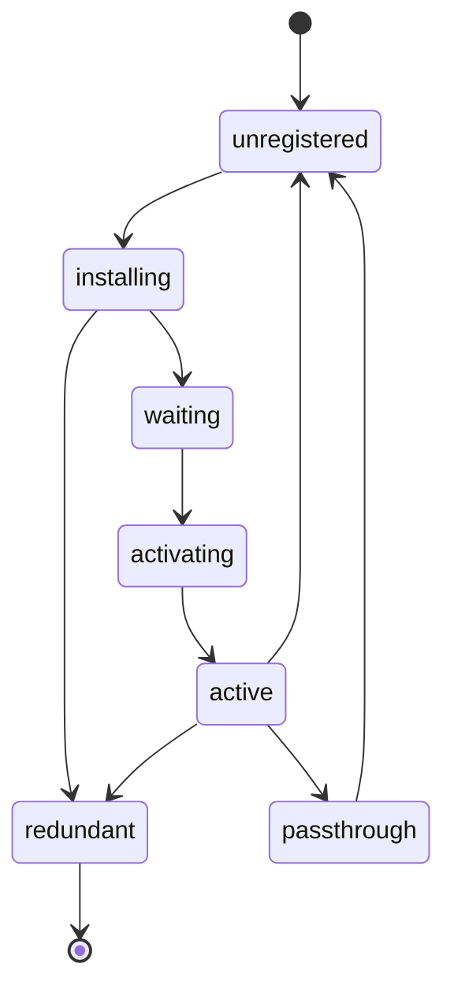
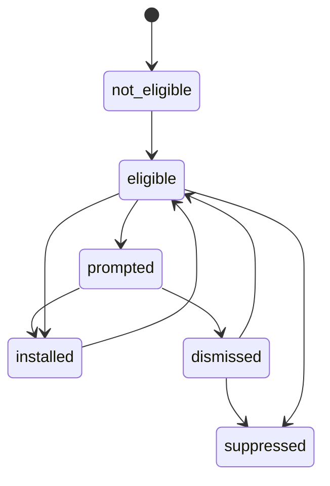
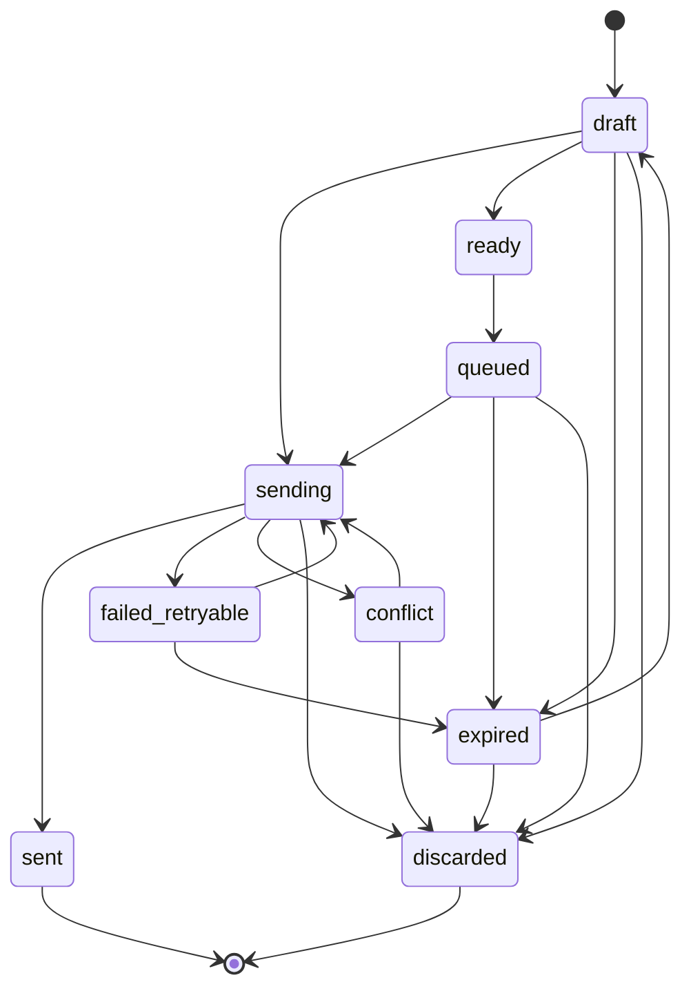
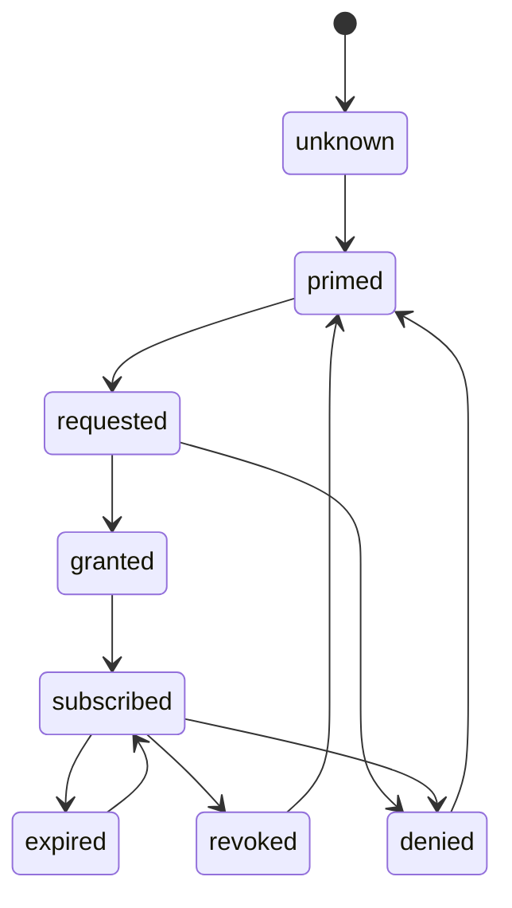
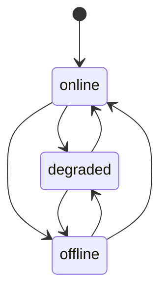
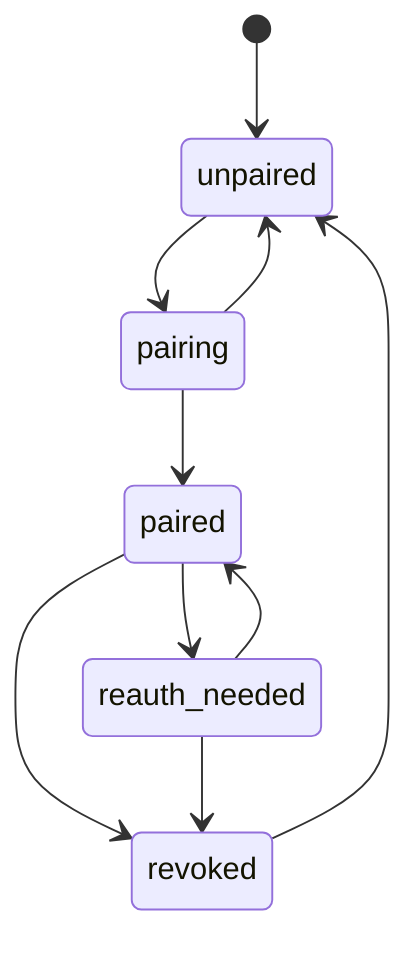
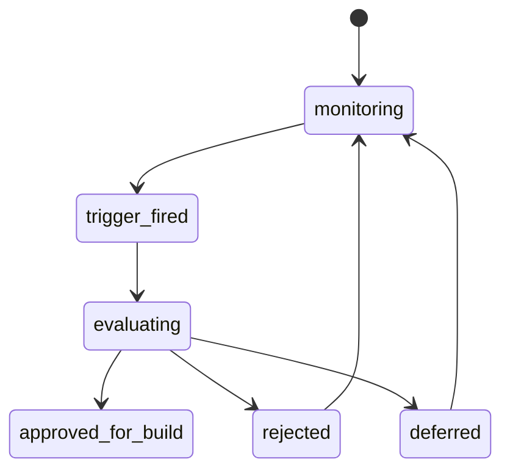
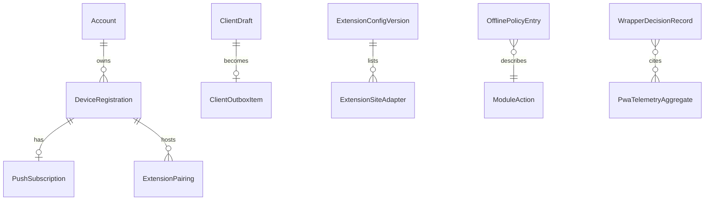

# PWA — PWA, Offline, Mobile & Browser Extension

Status: intended product specification. Nothing in this file claims anything is built. Legacy inputs: `SSOT.md` §19, F-18, F-27, F-28, BR-30, J-11; `Yash_Final_Project_Document/08_PWA_AND_MOBILE` (PWA architecture, offline and sync design revision 2, mobile distribution decision, platform compatibility matrix).

## 1. Purpose, outcomes and boundaries

**Purpose.** PWA makes TalentSphere behave like an installed app on any phone or desktop, keeps people productive on poor connections without ever risking data integrity, delivers timely push notifications, defines the mobile interaction rules every module follows, and ships a browser extension that brings career tools to the job pages people already visit. [DER]

**Outcomes.**

1. A user can install TalentSphere from the browser, launch it from the home screen, and always run the latest compatible version without a store. [SRC: SSOT §19; Yash 08 MOB-01 decision B]
2. A user on a train, in a lift or on slow mobile data can read their own recent data, write and keep drafts, and never lose typed work; consequential actions wait for a real connection. [SRC: SSOT §19.2; Yash 08 OFF-01-REV2]
3. The service worker and caches are never the business source of truth; nothing sensitive leaks through a cache or survives logout. [SRC: SSOT §19.2]
4. Push reaches users who opted in, never carries sensitive content, and never is the only channel for something consequential. [SRC: Yash 08 MOB-01 §4]
5. The browser extension scans job pages, previews resume match locally, saves jobs and fills application forms with the user in control, and collects nothing by default. [SRC: SSOT F-18, F-27, F-28, BR-30]
6. A wrapper (store app) is built only when measured evidence says the PWA cannot reach a goal. [SRC: Yash 08 MOB-01 §5]

### 1.1 In scope

Web app manifest, install prompts and install state; app shell and navigation fallback; service worker lifecycle, update flow and caching policy per surface; cache partitioning, never-cache list and purge; storage quota and persistence; connectivity detection; offline reads, local drafts, queued writes, idempotency, conflict resolution, background sync and the sync center; offline-safe and unsafe feature registry; web push subscription, payload rules, per-device preferences, badging; responsive and mobile interaction rules; low-bandwidth mode; share target and deep links; device capability detection and capture; native-wrapper decision gate and store listing requirements; the browser extension (pairing, scanner, local match, save, autofill, privacy, update and kill switch); PWA health telemetry.

### 1.2 Out of scope (owned elsewhere)

| Capability                                                        | Owner | Relationship                                                                                             |
| ----------------------------------------------------------------- | ----- | -------------------------------------------------------------------------------------------------------- |
| Notification content, templates, channel preferences, quiet hours | NTF   | PWA owns the Web Push transport, subscription and device-level opt-in; NTF owns what is sent and to whom |
| Session tokens, passkeys, login                                   | IDN   | PWA clears client state on logout signals; uses sessions as given                                        |
| Job entities, applications, saved jobs                            | JOB   | PWA's extension and offline layer call JOB APIs                                                          |
| Resume content and structured profile                             | PRF   | Extension consumes a read-only resume projection                                                         |
| Assessment delivery, proctoring                                   | ASM   | PWA declares assessments online-only (FR-PWA-012)                                                        |
| Course lesson delivery and downloads                              | LRN   | PWA provides the storage and sync substrate; LRN owns content                                            |
| Public API, webhooks, file service, job engine                    | PLT   | PWA consumes uploads (resumable, FR-PLT-030) and idempotency (FR-PLT-007)                                |
| Admin console                                                     | ADM   | Excluded from install, offline and caching by policy                                                     |
| Native iOS or Android apps                                        | none  | Decision gate only (FR-PWA-030); no native build specified                                               |

### 1.3 Owned versus consumed

PWA **owns**: manifest, service worker, client storage schema (IndexedDB, Cache Storage), outbox and draft stores, sync center, push subscription records, device registrations, capability registry, extension code and pairing, low-bandwidth mode and PWA telemetry. PWA **consumes**: server APIs from all modules, NTF for push payloads, IDN sessions, PLT uploads and idempotency, ADM flags, kill switches and maintenance state.

### 1.4 Principles

- **Server is the system of record.** A cache hit is never proof of current state, authorization or consent. [SRC: Yash 08 PWA-01]
- **Honest labels.** "Unsent, saved on this device only" and "as of 10:42" are literal; never "Waiting to sync" when nothing will sync. [SRC: Yash 08 OFF-01-REV2]
- **Feature-detect, never user-agent sniff.** Every capability has a stated fallback. [SRC: SSOT §19.1]
- **Local first for the extension.** Data stays on the device unless the user takes an explicit action. [SRC: SSOT BR-30]
- **Core journeys work in a plain browser tab.** Install and push are enhancements. [SRC: Yash 08 MOB-01]

## 2. Roles and permission matrix

PWA features serve end users of every role; staff roles are excluded from install and offline by policy. `GUE` Guest, `CAN` Candidate, `STD` Student, `INS` Instructor, `MNT` Mentor, `FRL` Freelancer, `REC` Recruiter, `HMG` Hiring Manager, `EAD` Employer Admin, `IAD` Institution Admin, `PLO` Placement Officer, `EXA` Enterprise Admin, `PAD` Platform Admin, `SAD` Security Officer, `API` service principal.

Legend: **U** use, **C** configure for self, **O** configure for organization, **P** configure platform, **—** none.

| Capability                                                 | GUE | CAN, STD, FRL | INS, MNT | REC, HMG                                 | EAD, IAD, PLO, EXA | PAD                    | SAD                |
| ---------------------------------------------------------- | --- | ------------- | -------- | ---------------------------------------- | ------------------ | ---------------------- | ------------------ |
| Install app, update prompts                                | U   | U             | U        | U                                        | U                  | P                      | P                  |
| Offline reads of own data                                  | —   | U             | U        | U                                        | U                  | P (policy)             | —                  |
| Local unsent drafts                                        | —   | U             | U        | U                                        | U                  | P                      | —                  |
| Queued writes (after OD-PWA-01 trigger)                    | —   | U             | U        | U                                        | U                  | P                      | —                  |
| Sync center                                                | —   | U             | U        | U                                        | U                  | —                      | —                  |
| Push opt-in per device                                     | —   | C             | C        | C                                        | C                  | P                      | —                  |
| Org-level push policy (quiet hours, allowed event classes) | —   | —             | —        | —                                        | O                  | P                      | —                  |
| Low-bandwidth mode                                         | U   | C             | C        | C                                        | C                  | P                      | —                  |
| Extension install and pairing                              | —   | C             | C        | C (recruiter extension variant, planned) | —                  | P (min versions, kill) | P (store, signing) |
| Extension scan, match, save, autofill                      | —   | U             | U        | —                                        | —                  | —                      | —                  |
| Wrapper decision gate                                      | —   | —             | —        | —                                        | —                  | P                      | P (approve)        |
| Admin console install, offline cache                       | —   | —             | —        | —                                        | —                  | not allowed            | not allowed        |

Rules: `REC` and `HMG` use the extension for candidate sourcing only after a separate decision (OD-PWA-06); v1 of the extension is candidate-facing. [PROP] Staff roles use the admin origin, which is never installable or cached (BR-PWA-002).

## 3. Sub-module map

| Code | Sub-module                         | Features                 |
| ---- | ---------------------------------- | ------------------------ |
| A    | Installability and shell           | FR-PWA-001 to FR-PWA-009 |
| B    | Offline and sync                   | FR-PWA-010 to FR-PWA-020 |
| C    | Push and re-engagement             | FR-PWA-021 to FR-PWA-024 |
| D    | Mobile experience and distribution | FR-PWA-025 to FR-PWA-031 |
| E    | Browser extension companion        | FR-PWA-032 to FR-PWA-038 |
| F    | Health and measurement             | FR-PWA-039               |

## 4. Feature specifications

Conventions used by every feature (not repeated in each field):

- **Capability detection.** Each feature lists its fallback; absence of a capability never blocks a core journey (BR-PWA-029).
- **Accessibility.** WCAG 2.1 AA: keyboard operable, focus visible, status changes announced through live regions, no information by color alone, reduced-motion respected. [DER]
- **Telemetry.** Events listed use the whitelist rule BR-PWA-024: no personal data, no content, coarse device class only.
- **Time labels.** Times shown to users are local with an unambiguous "as of" form; stored in UTC.

### A. Installability and shell

### FR-PWA-001 — Web app manifest and installability

- **Sub-module:** A. Installability and shell
- **Priority / tier:** Must · R0
- **Source:** [SRC: Yash 08 PWA_ARCHITECTURE §2 manifest] · [SRC: SSOT §19]
- **Purpose and outcome:** The product meets browser installability criteria so users can add it to a home screen or desktop with correct name, icons and launch behavior; the system knows it works when install eligibility passes on supported browsers in the compatibility matrix.
- **Roles and permissions:** `GUE, CAN, STD, INS, MNT, FRL, REC, HMG, EAD, IAD, PLO, EXA: install` · `PAD: edit manifest values through release pipeline`
- **Preconditions and entry points:** HTTPS origin, registered service worker with fetch handler (FR-PWA-004), valid manifest with icons. Entry: browser install affordance, FR-PWA-002 prompt, "Install app" item in the profile menu.
- **User interactions and actions:** 1. Open the site in a supporting browser. 2. Use the browser's install control or the in-app "Install app" menu item. 3. Confirm the browser dialog. 4. Launch from the home screen or app list; the app opens in a standalone window. 5. On iOS and iPadOS follow the in-app guidance for "Add to Home Screen" (FR-PWA-002).
- **System behaviour:** Manifest fields: `id` fixed to `/`, `scope` `/`, `start_url` `/?source=pwa`, `display` standalone with `minimal-ui` override, name "TalentSphere", short name, description, `lang`, `dir` auto, categories business and education, icons 192 and 512 (purpose any) plus maskable 512, wide and narrow screenshots, shortcuts (Jobs, My applications, Messages, Learning). Theme and background colors come from design tokens and `theme-color` meta follows light and dark scheme. The `source=pwa` parameter splits installed and tab sessions in telemetry and is stripped after reading. `share_target` and `file_handlers` are declared only when FR-PWA-028 is enabled. `related_applications` empty; `prefer_related_applications` false. The admin origin serves no manifest (BR-PWA-002). A manifest linting step in release checks fields, icon sizes and `start_url` within `scope`.
- **UI elements and controls:** Profile menu item "Install app" (visible only when installable and not installed); browser-native dialog; shortcut entries on the installed icon.
- **Configuration options:** Platform: manifest values, shortcut list (role-neutral entries only; a static manifest cannot vary by role), screenshots set. User: none. Org: none.
- **Business rules:** BR-PWA-007, BR-PWA-029
- **Validation:** Icons present at 192 and 512 and one maskable; `start_url` inside `scope`; `id` stable across releases; screenshots at documented sizes; names within browser limits (short name ≤ 12 characters).
- **Inputs and outputs:** Input: manifest file and icons. Output: installable web app; `pwa.app.installed` event on `appinstalled`.
- **Filters, sorting, search:** n/a — configuration artifact.
- **Notifications and communication:** None.
- **Error handling and edge cases:** Browser without install support (desktop Firefox, in-app browsers): "Install app" hidden and a "Open in your browser" hint shown inside in-app browsers (detected by capability and referrer hints). Manifest change that alters `id` would create a second app: blocked by the release check. Icon fetch failure: install still succeeds with a fallback letter icon.
- **Dependencies:** FR-PWA-004, FR-PWA-002, FR-PLT-036 (CDN for icons).
- **Security and privacy:** Manifest public; no per-user data; `start_url` carries only the `source` parameter.
- **Acceptance criteria:**
  - Given Chrome on Android, when the user visits twice over the engagement threshold, then the browser reports the app installable and the manifest passes the lint.
  - Given the installed app, when launched, then it opens standalone at `/` with the stripped `source` parameter and telemetry records an installed session.
  - Given a release that changes the manifest `id`, when the release check runs, then the build fails with `manifest_id_changed`.

### FR-PWA-002 — Install prompt experience

- **Sub-module:** A. Installability and shell
- **Priority / tier:** Should · R1
- **Source:** [PROP] building on [SRC: Yash 08 MOB-01 §4 install-gated push UX]
- **Purpose and outcome:** Eligible users are offered installation at a respectful moment and understand the benefits; the system knows it works by measuring accepted over shown prompts without raising dismissal complaints.
- **Roles and permissions:** `CAN, STD, INS, MNT, FRL, REC, HMG, EAD, IAD, PLO, EXA: see prompt` · `GUE: never prompted` · `PAD: configure thresholds`
- **Preconditions and entry points:** Signed-in user; install eligible (`SM-PWA-02` state `eligible`); engagement criteria met (at least 3 sessions on 2 different days and one completed value moment, for example profile saved or application submitted) `[PROP]`; not already installed; prompt not suppressed.
- **User interactions and actions:** 1. A non-blocking card appears after a value moment: "Install TalentSphere for faster access and notifications". 2. User taps "Install" (triggers the deferred browser prompt) or "Not now". 3. On iOS the card shows illustrated steps: Share, then Add to Home Screen. 4. "Don't ask again" in the card menu suppresses permanently. 5. The profile menu "Install app" stays available.
- **System behaviour:** Captures `beforeinstallprompt` and defers it; shows the card only at allowed moments (never during forms, assessments, checkout or interviews). Frequency: first card after criteria, a second after 14 days, a third after 60 days, then never `[PROP]`. Dismissal state stored per device and per account; cleared on install. After install, shows a one-time "App installed" confirmation and offers notification opt-in (FR-PWA-021). Emits events for shown, accepted, dismissed. Detects standalone display mode to hide prompts.
- **UI elements and controls:** Install card (title, benefits list of 3, "Install" button, "Not now" link, overflow with "Don't ask again"); iOS instruction sheet with numbered images and alt text; post-install toast.
- **Configuration options:** Platform: engagement thresholds, frequency schedule, enable by role. User: "Don't ask again". Org: none.
- **Business rules:** BR-PWA-007
- **Validation:** Prompt only if `SM-PWA-02` is `eligible`; deferred prompt event must be present for programmatic prompt; otherwise the card falls back to instructions.
- **Inputs and outputs:** Input: engagement counters, browser prompt event. Output: user choice, install state change, events `pwa.install.prompted`, `pwa.install.accepted`, `pwa.install.dismissed`.
- **Filters, sorting, search:** n/a — single prompt surface.
- **Notifications and communication:** None.
- **Error handling and edge cases:** Prompt event never fires (browser heuristics): card shows manual instructions only if user opens the menu item. User dismisses with the browser's own dialog: counts as dismissed. Multiple accounts on one device: suppression is per account and per device. Install while offline: allowed by the browser; the app shell is available offline after install.
- **Dependencies:** FR-PWA-001, FR-PWA-021, FR-PWA-039, ADM flags.
- **Security and privacy:** Engagement counters are local and coarse; nothing is sent until the user acts.
- **Acceptance criteria:**
  - Given a user mid-application, when criteria are met, then no install card appears until the form is left.
  - Given a user who tapped "Don't ask again", when 100 days pass, then no install card appears but the profile menu item still works.
  - Given Safari on iPhone, when the card shows, then it presents Share and Add to Home Screen steps and no "Install" button.

### FR-PWA-003 — App shell and navigation fallback

- **Sub-module:** A. Installability and shell
- **Priority / tier:** Must · R0
- **Source:** [SRC: Yash 08 PWA_ARCHITECTURE §3 app shell, R1]
- **Purpose and outcome:** The app starts instantly and shows a usable frame even offline, because the shell is a static, user-independent document served from the service worker precache.
- **Roles and permissions:** `all product roles and GUE: use`
- **Preconditions and entry points:** Service worker active (FR-PWA-004). Entry: any in-scope navigation.
- **User interactions and actions:** 1. Open or reload any app route. 2. The shell paints the header, navigation and a skeleton content area within the performance budget. 3. Content replaces the skeleton when data arrives, or an offline state appears (FR-PWA-019).
- **System behaviour:** The shell HTML contains no user data, tokens or inline state, so one cached copy is safe for any account. Navigation requests that are in scope and not on the never-cache list are answered with the shell; the client router renders the route, the offline screen or not-found. Navigation preload is enabled where supported to avoid waiting on SW startup. Public tokenized routes (`/r/*` referee and confirm links, `/invite/*`, `/p/*` public profiles) are excluded from SW caching because the URL carries a token or must reflect live state; they use network-only with the offline page as fallback. Server-rendered public pages (landing, help, public profiles) are network-first with short stale fallback (FR-PWA-006). A first-paint budget applies: shell critical path ≤ 1.5 MB precached (BR-PWA-011).
- **UI elements and controls:** App header, bottom navigation on narrow screens and sidebar on wide, skeleton placeholders, connectivity chip (FR-PWA-010).
- **Configuration options:** Platform: navigation denylist, precache manifest, skeleton variants.
- **Business rules:** BR-PWA-001, BR-PWA-002, BR-PWA-011
- **Validation:** Release check fails if the shell HTML contains user-specific strings or if precache size exceeds budget.
- **Inputs and outputs:** Input: navigation request. Output: shell document and routed view.
- **Filters, sorting, search:** n/a — rendering infrastructure.
- **Notifications and communication:** None.
- **Error handling and edge cases:** Shell cache missing (first visit offline): browser error page is unavoidable; the first online visit precaches. Route chunk fails to load: retry once, then "Couldn't load this screen. Try again" with a retry button. Stale shell after deploy: update flow (FR-PWA-005).
- **Dependencies:** FR-PWA-004, FR-PWA-006, FR-PWA-019.
- **Security and privacy:** Shell cached for everyone; routing decisions never rely on cached authorization.
- **Acceptance criteria:**
  - Given a previously visited installed app, when the device is offline and the user opens `/jobs`, then the shell renders with the offline state within 1 second.
  - Given a referee link `/r/abc`, when offline, then the offline page shows and no cached copy of the token URL exists.
  - Given a shell HTML containing a user email string in a release candidate, when checks run, then the build fails.

### FR-PWA-004 — Service worker registration and lifecycle

- **Sub-module:** A. Installability and shell
- **Priority / tier:** Must · R0
- **Source:** [SRC: Yash 08 PWA_ARCHITECTURE §4 SW lifecycle] · [SRC: SSOT §19]
- **Purpose and outcome:** One service worker per origin controls the app's network behavior, installs safely, activates without breaking open tabs, and can be disabled remotely.
- **Roles and permissions:** `all product roles: use (invisible)` · `PAD: disable SW through kill switch`
- **Preconditions and entry points:** HTTPS; browser supports service workers. Registered after first paint on window load.
- **User interactions and actions:** None directly. Developer-visible: version number in Settings > About, "Reset app data" button.
- **System behaviour:** Single scope `/`; script URL `/sw.js` served with `Cache-Control: no-cache` and a versioned name inside. Lifecycle per `SM-PWA-01`: install (precache the shell), waiting, activate (delete obsolete caches, claim clients only when safe), redundant. `skipWaiting` is never called automatically (BR-PWA-008). A remote disable path: the `/sw-config.json` (network-only, tiny) can set `mode: "passthrough"` or `"unregister"`; the SW checks it at startup and every 24 hours; the kill switch `pwa.serviceWorker` (ADM) flips it. Errors in the SW are reported with version, error class and route (no personal data). The SW never stores tokens. A "Reset app data" control unregisters the SW, clears caches, IndexedDB and local drafts after confirmation (warns about unsent drafts).
- **UI elements and controls:** Settings > About: app version, SW version, last update check time, "Check for updates" button, "Reset app data" button (confirmation dialog listing unsent drafts count).
- **Configuration options:** Platform: update check interval (24 hours), remote mode (normal, passthrough, unregister).
- **Business rules:** BR-PWA-001, BR-PWA-008
- **Validation:** SW script size budget; `sw-config.json` signed or served only over same origin; version string monotonic.
- **Inputs and outputs:** Input: registration, lifecycle events. Output: controlled clients, event `pwa.sw.updated`.
- **Filters, sorting, search:** n/a — infrastructure.
- **Notifications and communication:** None.
- **Error handling and edge cases:** Install failure (precache 404): old SW stays, error reported, retried next load. Corrupt SW causing blank screens: `unregister` mode removes it at next check, and "Reset app data" is reachable from the offline page. Multiple tabs on different versions: handled by FR-PWA-005. Private browsing: SW may be unavailable; app works as a normal website.
- **Dependencies:** FR-PWA-003, FR-PWA-005, FR-ADM-015.
- **Security and privacy:** SW scope limited to `/`; the admin origin registers no SW; update checks carry no identifiers.
- **Acceptance criteria:**
  - Given a deployed bad SW, when the kill switch sets `unregister`, then clients unregister within 24 hours or on next launch and the site works as a plain website.
  - Given an activated update, when tabs of the old version are open, then they are not forcibly reloaded.
  - Given the user chooses "Reset app data" with 2 unsent drafts, when the dialog opens, then it states "2 unsent drafts will be lost" and requires confirmation.

### FR-PWA-005 — App update flow

- **Sub-module:** A. Installability and shell
- **Priority / tier:** Must · R0
- **Source:** [SRC: Yash 08 PWA_ARCHITECTURE §5 update policy] · [SRC: SSOT §19.2 open: service-worker updates not specified]
- **Purpose and outcome:** Users move to new versions safely: nothing in progress is lost, and a security-critical release can be required.
- **Roles and permissions:** `all product roles: accept update` · `PAD: mark release as required`
- **Preconditions and entry points:** A new SW is waiting (`SM-PWA-01` state `waiting`); entry from a toast or Settings > About.
- **User interactions and actions:** 1. After the new version is ready the app shows a banner "A new version is ready". 2. User taps "Update now" when convenient or ignores it. 3. The app reloads into the new version. 4. For a required update a blocking dialog appears at the next safe moment.
- **System behaviour:** The banner is non-blocking and appears only at safe moments (not during forms with unsaved input, uploads, assessments, payments or interviews). If unsent drafts exist they are persisted before reload. Normal updates apply on next cold start without prompting if the user ignores the banner. Required updates (minimum version in `/version.json`, set by PAD for security reasons or incompatible API changes) show a dialog "Update required to continue" at the next safe moment; until then writes continue to be accepted if the API still supports that client; once the API drops the old version it returns `426 Upgrade Required` and the client shows the dialog. Version compatibility: the API supports the previous two client versions `[PROP]`. Emits `pwa.update.prompted` and `pwa.update.applied`.
- **UI elements and controls:** Update banner (text, "Update now" button, "Later" link); required-update modal (single "Update now" button); version text in About.
- **Configuration options:** Platform: minimum supported client version, grace period (7 days `[PROP]`), safe-moment definitions per route class.
- **Business rules:** BR-PWA-008
- **Validation:** Minimum version must not exceed current deployed version; version.json served network-only.
- **Inputs and outputs:** Input: SW state, version manifest. Output: reload into new version.
- **Filters, sorting, search:** n/a — single flow.
- **Notifications and communication:** None (in-app only).
- **Error handling and edge cases:** Update fetch fails midway: the old version continues; retried at next check. User offline when required update is mandated: dialog displayed once online. Two devices on different versions after a schema change: API compatibility window applies. Update during an in-flight outbox flush: flush completes or pauses and resumes in the new version (items are versioned).
- **Dependencies:** FR-PWA-004, FR-PWA-014, FR-ADM-016.
- **Security and privacy:** Version checks carry no personal identifiers.
- **Acceptance criteria:**
  - Given a waiting update and an open application form with unsaved input, when the user is typing, then no update banner interrupts and the draft is saved before any later reload.
  - Given a required update and an API that now returns 426, when the next write fires, then the user sees "Update required" and the typed content is kept as a draft.
  - Given an ignored normal update, when the app is closed and reopened, then the new version is active.

### FR-PWA-006 — Caching strategy per surface

- **Sub-module:** A. Installability and shell
- **Priority / tier:** Must · R0
- **Source:** [SRC: Yash 08 PWA_ARCHITECTURE §4 route table R1 to R9] · [DER]
- **Purpose and outcome:** Every URL class has one declared caching strategy so speed gains never produce stale-authorization, privacy or correctness bugs.
- **Roles and permissions:** `PAD: edit policy through release pipeline` · `all: affected invisibly`
- **Preconditions and entry points:** Service worker active. The policy table is code-defined and test-enforced.
- **User interactions and actions:** None; user sees "as of" labels where stale data is shown (FR-PWA-011).
- **System behaviour:** The strategy table (all caches versioned and namespaced per FR-PWA-008):

| Class | Surface                                                                                                                 | Strategy                                                      | Offline behavior                                                        | Max age / notes                 |
| ----- | ----------------------------------------------------------------------------------------------------------------------- | ------------------------------------------------------------- | ----------------------------------------------------------------------- | ------------------------------- |
| S1    | App shell HTML, precached assets                                                                                        | Precache (revisioned)                                         | Served                                                                  | replaced atomically on activate |
| S2    | Hashed static assets, fonts, icons                                                                                      | Cache-first, immutable                                        | Served                                                                  | 1 year, LRU cap                 |
| S3    | Public marketing and help pages                                                                                         | Network-first, 3 second timeout, stale fallback               | Stale copy with banner                                                  | 24 hours                        |
| S4    | Public profiles and public job pages                                                                                    | Network-first, stale-while-revalidate for images only         | Not served stale if profile hidden since (tombstone check on reconnect) | 1 hour                          |
| S5    | Authenticated reads of the user's own data (profile, applications, saved jobs, messages list metadata, course progress) | Network-first with cache fallback, per-resource TTL           | Served with "as of" label                                               | TTL table in FR-PWA-011         |
| S6    | Search, discovery, recommendations                                                                                      | Network-only (stale-if-error 5 minutes for the last query)    | Failure message                                                         | prevents stale ranking          |
| S7    | Authentication, session, MFA, token, payment, checkout, webhooks                                                        | Network-only, never cached                                    | Fails with clear message                                                | never-cache list                |
| S8    | Assessment content, answers, proctoring, interview rooms                                                                | Network-only                                                  | Fails; route blocked offline                                            | BR-PWA-002                      |
| S9    | Uploads and downloads of user files                                                                                     | Network-only; uploads resumable via PLT                       | Upload paused and resumed                                               | signed URLs never cached        |
| S10   | Media (video, audio)                                                                                                    | Network-only (range requests pass through); no offline copies | Fails                                                                   | revisit via FR-PWA-020          |
| S11   | Images (avatars, logos, thumbnails)                                                                                     | Stale-while-revalidate, LRU 50 MB `[PROP]`                    | Served                                                                  | 7 days                          |
| S12   | API reads of reference data (skills taxonomy, countries)                                                                | Stale-while-revalidate                                        | Served                                                                  | 24 hours                        |
| S13   | Admin origin, any `/admin` path, back-office bundles                                                                    | Not handled by the SW                                         | Not available offline                                                   | BR-PWA-002                      |

Responses with `Cache-Control: no-store`, `Vary: Cookie` of a different account, `Set-Cookie`, status other than 200 and 206 range responses are never stored. Authenticated cached entries are keyed by account alias so two accounts on one device never share entries.

- **UI elements and controls:** "As of <time>" chips on stale data; connectivity chip.
- **Configuration options:** Platform: TTLs, caps, strategy table. User: "Clear offline data" (FR-PWA-008).
- **Business rules:** BR-PWA-001, BR-PWA-002, BR-PWA-011
- **Validation:** CI test compares every API route class to a strategy and fails on unclassified routes.
- **Inputs and outputs:** Input: fetch events. Output: response from cache or network, cache writes.
- **Filters, sorting, search:** n/a — policy.
- **Notifications and communication:** None.
- **Error handling and edge cases:** Cache quota exceeded: LRU eviction in this order: images, reference data, own-data reads, never drafts (FR-PWA-009). Corrupted entry: deleted and refetched. Response with unexpected content type: not stored.
- **Dependencies:** FR-PWA-007, FR-PWA-008, FR-PWA-011, FR-PWA-012.
- **Security and privacy:** Per-account keys; never-cache list enforced in code and verified by tests; no response with sealed data class is ever cacheable.
- **Acceptance criteria:**
  - Given an own-profile response cached at 10:00, when offline at 10:30, then the profile renders with "as of 10:00".
  - Given a search request, when offline, then it fails with the offline message and no stale ranking is shown beyond the last query for 5 minutes.
  - Given an unclassified new API route, when CI runs, then the policy test fails.

### FR-PWA-007 — Static asset precache and runtime cache management

- **Sub-module:** A. Installability and shell
- **Priority / tier:** Should · R0
- **Source:** [SRC: Yash 08 PWA_ARCHITECTURE R2 revision: budget B13 ≤ 1.5 MB; lazy chunks cache-first on first use]
- **Purpose and outcome:** The app loads quickly and stays within a small install footprint: only the critical shell is precached; other code is cached when first used.
- **Roles and permissions:** `all: invisible` · `PAD: budget via release pipeline`
- **Preconditions and entry points:** Build output with hashed assets and a revision manifest.
- **User interactions and actions:** None. The user sees faster repeat loads; "Storage used by app" shows sizes (FR-PWA-009).
- **System behaviour:** Precache set: shell HTML, critical JS and CSS, fonts subset, core icons, offline page. Lazy route chunks are cached cache-first at first use with an LRU cap (30 MB `[PROP]`). Obsolete revisions are deleted on activate. Back-office bundles are never cached (BR-PWA-002). Integrity: each precached asset is verified by its hash. Large media never precached. Compression assumed at the CDN.
- **UI elements and controls:** none (Settings > Storage shows totals).
- **Configuration options:** Platform: precache budget (1.5 MB), lazy cache cap (30 MB), font subset.
- **Business rules:** BR-PWA-011
- **Validation:** Build fails if precache exceeds budget or includes back-office paths.
- **Inputs and outputs:** Input: build manifest. Output: cache contents.
- **Filters, sorting, search:** n/a — infrastructure.
- **Notifications and communication:** None.
- **Error handling and edge cases:** Hash mismatch: asset dropped and refetched, error reported. Partial precache on flaky network: install retried; shell stays on the old version.
- **Dependencies:** FR-PWA-004, FR-PWA-006.
- **Security and privacy:** No user data in static caches.
- **Acceptance criteria:**
  - Given a build that adds 600 KB to the precache pushing it to 1.8 MB, when checks run, then the build fails with `precache_budget_exceeded`.
  - Given a lazy chunk used once, when the user is offline later, then the chunk loads from cache.
  - Given a back-office path in the precache list, when checks run, then the build fails.

### FR-PWA-008 — Cache partitioning, never-cache list and purge on logout

- **Sub-module:** A. Installability and shell
- **Priority / tier:** Must · R0
- **Source:** [SRC: Yash 08 OFF-01 §10 purge on logout, account switch] · [SRC: SSOT §19.2 sensitive data and local data on logout open]
- **Purpose and outcome:** No account's data is visible to another account on the same device, and logging out leaves nothing sensitive behind.
- **Roles and permissions:** `all signed-in roles: logout, switch account, clear offline data` · `PAD: force purge via required-update or remote message`
- **Preconditions and entry points:** Any logout, session expiry, account switch, "Clear offline data" action, or remote force-purge signal.
- **User interactions and actions:** 1. Choose Log out. 2. If unsent drafts or queued items exist, a dialog lists them: "Keep on this device" (allowed only for session expiry, not for explicit logout on shared devices), "Send now" (if online), or "Discard". 3. After confirmation, local data is purged. 4. "Clear offline data" in Settings > Storage purges caches and drafts for the current account after confirmation. 5. Account switch purges the previous account's data unless the user previously chose "Keep this account's offline data on this device".
- **System behaviour:** Storage is partitioned by account alias (hash of user id and a device salt): `ts-acct-<alias>` for IndexedDB and cache namespaces. Never-cache list (BR-PWA-002): authentication and token endpoints, session, MFA, payment, checkout, assessment, interview, proctoring, admin, sealed data classes, tokenized public URLs, signed file URLs, messages bodies [DEC-REQ] OD-PWA-04 (legacy keeps message lists cached, bodies undecided). Purge deletes caches, IndexedDB stores, drafts, outbox and local settings tied to the alias, unregisters push subscription server-side (FR-PWA-021), and clears extension pairing tokens if the extension is on the same account on that browser profile (signals through the extension messaging channel). Session expiry (not explicit logout) keeps drafts encrypted under a key held server-side and released only on re-login of the same account for up to 14 days `[PROP]`; otherwise they are purged. Shared-device mode (a toggle at login) disables offline retention entirely.
- **UI elements and controls:** Logout confirmation dialog with draft counts; Settings > Storage: "Clear offline data" button; login option "This is a shared device" checkbox.
- **Configuration options:** User: keep offline data between sessions (default on for personal, forced off in shared-device mode). Org: force shared-device mode for managed institutions' devices [DEC-REQ] OD-PWA-05. Platform: retention after session expiry (14 days).
- **Business rules:** BR-PWA-001, BR-PWA-002, BR-PWA-003
- **Validation:** Purge must delete all namespaces matching the alias; tests assert zero entries after logout.
- **Inputs and outputs:** Input: logout or switch signal. Output: purged stores, server-side push unsubscribe, event `pwa.cache.purged`.
- **Filters, sorting, search:** n/a — lifecycle action.
- **Notifications and communication:** None.
- **Error handling and edge cases:** Purge fails midway (browser storage error): next launch re-runs purge before rendering any data; the UI shows "Cleaning up" and blocks login for a different account until done. Offline logout: purge runs locally and the server session is revoked when the device reconnects (pending-revoke flag); the session token is also deleted locally immediately. Tab open in another window: broadcast channel triggers its purge and redirect to login.
- **Dependencies:** FR-PWA-011, FR-PWA-013, FR-PWA-014, FR-PWA-021, IDN logout events.
- **Security and privacy:** Encryption at rest for retained drafts using a non-extractable key; shared-device mode prevents retention; purge events carry no content.
- **Acceptance criteria:**
  - Given account A logs out explicitly, when account B logs in on the same browser, then no cache or store entry for A exists.
  - Given the device is offline when the user logs out, when it later reconnects, then the server session is revoked and no local data remained after logout.
  - Given unsent drafts at logout, when the dialog shows, then "Keep on this device" is disabled in shared-device mode.

### FR-PWA-009 — Storage quota, persistence and eviction handling

- **Sub-module:** A. Installability and shell
- **Priority / tier:** Should · R1
- **Source:** [SRC: Yash 08 OFF-01 §6 quota and Safari 7-day eviction] · [SRC: Yash 08 MOB-01 offline robustness]
- **Purpose and outcome:** The app uses storage responsibly, asks the browser to keep data when the user depends on it, and tells users plainly when the browser may erase it.
- **Roles and permissions:** `all signed-in roles: view usage, clear` · `PAD: configure budgets`
- **Preconditions and entry points:** Browser Storage API available. Entry: Settings > Storage; automatic warnings.
- **User interactions and actions:** 1. Open Settings > Storage to see usage by category (cached pages, images, drafts, queued items, downloads), quota and persistence status. 2. Tap "Keep my data on this device" to request persistent storage (shown after the first draft is saved). 3. Tap "Clear" per category. 4. See a warning when usage exceeds 80% of quota.
- **System behaviour:** Calls `navigator.storage.estimate()` and `persist()` where available. Budgets `[PROP]`: images 50 MB, lazy code 30 MB, own-data cache 20 MB, drafts and outbox protected and not evicted by the app itself. Eviction order by the app: images, lazy code, reference data, own-data cache; drafts and outbox never evicted without consent. On browsers that evict storage after 7 days of inactivity without installation (Safari), the app records a "last active" marker and, when it detects that the stores are empty but the server has unsent-draft hints (a count only, stored on the server per device), it tells the user "Some unsent drafts were removed by your browser" once. Write failures with `QuotaExceededError` surface a message and never silently drop a draft.
- **UI elements and controls:** Usage bars by category, quota text, persistence status chip, "Keep my data on this device" button, per-category "Clear" buttons, warning banner.
- **Configuration options:** Platform: budgets, warning threshold (80%), draft-count hint on/off.
- **Business rules:** BR-PWA-010, BR-PWA-012
- **Validation:** Budgets sum below a safe fraction of reported quota; draft hints contain counts only.
- **Inputs and outputs:** Input: storage estimates. Output: usage UI, warnings, eviction actions, event `pwa.storage.quota_warning`.
- **Filters, sorting, search:** n/a — single page.
- **Notifications and communication:** In-app warning only.
- **Error handling and edge cases:** `persist()` denied: shows "Your browser may clear this data if space runs low". Estimate API missing: category sizes computed by the app, quota unknown. Eviction while the app is open: stores recreated on next write; the user is told if drafts are lost.
- **Dependencies:** FR-PWA-008, FR-PWA-013, FR-PWA-014.
- **Security and privacy:** Draft-count hints on the server carry only a number and device id.
- **Acceptance criteria:**
  - Given usage at 85% of quota, when the user opens the app, then a warning offers to clear images first and never offers to clear drafts silently.
  - Given a browser that purged IndexedDB, when the app starts and the server hint says 2 drafts existed, then the user sees one message about removed drafts.
  - Given `persist()` is denied, when the user saves a draft, then the status chip says "Not protected from browser cleanup".

### B. Offline and sync

### FR-PWA-010 — Connectivity detection and indicator

- **Sub-module:** B. Offline and sync
- **Priority / tier:** Must · R1
- **Source:** [DER]; [SRC: SSOT §19.1 capability abstraction]
- **Purpose and outcome:** The app knows whether it can really reach the server and tells the user in plain words, so users understand why something is waiting and act accordingly.
- **Roles and permissions:** `all signed-in roles and GUE: see indicator`
- **Preconditions and entry points:** Always on while the app runs. Entry: connectivity chip in the header and inline state on actions.
- **User interactions and actions:** 1. See the chip: hidden when online and healthy; "Offline" when unreachable; "Slow connection" when degraded. 2. Tap the chip to see details: last successful contact time, the number of unsent drafts or queued items, a "Retry now" button. 3. Actions that need a connection show "Needs connection" with a disabled primary control and an explanation.
- **System behaviour:** `SM-PWA-05` has states `online`, `degraded`, `offline`. The state combines `navigator.onLine` (a hint only, BR-PWA-026), failures of real requests, and a lightweight health probe (`HEAD /health/reachability`, response under 1 KB, at most once every 30 seconds while offline or degraded, none while requests succeed). Degraded means median request time above 3 seconds or more than 30% request failures over the last 20 requests `[PROP]`. Captive portal detection: a probe returning an unexpected body marks `offline` with a "Sign in to the network" hint. Reconnection triggers the flush of queued items (FR-PWA-014) and a revalidation of visible data. The chip is a live region (`aria-live="polite"`). Changes are debounced to avoid flicker (state must persist 2 seconds).
- **UI elements and controls:** Header chip (icon plus text), details popover, "Retry now" button, inline "Needs connection" helper text.
- **Configuration options:** Platform: probe interval, degraded thresholds, debounce.
- **Business rules:** BR-PWA-026, BR-PWA-012
- **Validation:** Probe response must match an expected signature; otherwise treated as captive portal.
- **Inputs and outputs:** Input: network events, request outcomes, probe. Output: connectivity state broadcast to all tabs.
- **Filters, sorting, search:** n/a — state indicator.
- **Notifications and communication:** None.
- **Error handling and edge cases:** `navigator.onLine` true but server down: state `offline` with "We can't reach TalentSphere". Maintenance mode (503 with `Retry-After`): shown as "Temporarily read-only" not "Offline" (FR-ADM-018). Rapid flapping: debounce keeps previous state until stable 2 seconds.
- **Dependencies:** FR-PWA-014, FR-PWA-019, FR-ADM-018.
- **Security and privacy:** The probe carries no identifiers.
- **Acceptance criteria:**
  - Given airplane mode, when the user opens a form, then the chip says "Offline" and the submit button reads "Needs connection to send".
  - Given Wi-Fi connected to a captive portal, when the probe returns a login page, then the chip says "Sign in to the network" and not "Online".
  - Given connectivity returns, when stable for 2 seconds, then the chip clears and visible data revalidates.

### FR-PWA-011 — Offline reading of own data with "as of" labels

- **Sub-module:** B. Offline and sync
- **Priority / tier:** Must · R1
- **Source:** [SRC: Yash 08 OFF-01-REV2 class RO read cache and TTLs] · [SRC: SSOT §19.2 READ_OFFLINE]
- **Purpose and outcome:** Users can re-read their own recent information (applications, saved jobs, profile, interview details, course progress) offline, and always know how old it is.
- **Roles and permissions:** `CAN, STD, FRL, INS, MNT, REC, HMG, EAD, IAD, PLO, EXA: read own cached data` · `GUE: none`
- **Preconditions and entry points:** The data was fetched while signed in and is within its TTL. Entry: any route that supports offline read per the capability registry (FR-PWA-012).
- **User interactions and actions:** 1. Open a supported screen offline. 2. See content with a chip "As of 10:42 (offline)". 3. Tap a disabled action; see "Needs connection". 4. On reconnection the screen refreshes silently and the chip disappears; if the data changed a subtle "Updated" marker is shown.
- **System behaviour:** Resource classes and default TTLs `[PROP]`: own profile 7 days; applications list and detail 7 days; saved jobs 7 days; upcoming interviews (details, join instructions) 3 days; course enrollment, progress and already-viewed lesson text 14 days; own resume versions list 7 days; notification list 3 days; message conversation list (metadata only) 3 days; employer pipeline lists (REC, HMG) are not cached because they include candidate personal data about others [DEC-REQ] OD-PWA-03. Past TTL, content is not shown and the screen displays the offline state. The "as of" time is the response time stamp, not the access time. Cached data is keyed by account alias, encrypted at rest when the browser supports Web Crypto and the user's device offers non-extractable keys. Cached responses of resources that became restricted (blocked user, withdrawn consent, deleted content) are invalidated on the next successful contact through a "tombstone" list returned with any authenticated response header (`X-Invalidations` ids, with a version cursor).
- **UI elements and controls:** "As of" chip, offline banner on screens, disabled controls with tooltips, "Updated" marker after refresh.
- **Configuration options:** Platform: TTL table, cacheable resource classes. User: "Keep offline data between sessions". Org: disable offline retention for managed devices (OD-PWA-05).
- **Business rules:** BR-PWA-001, BR-PWA-012, BR-PWA-002
- **Validation:** Only resource classes in the registry are cached; responses carrying a sealed class marker are rejected by the cache layer.
- **Inputs and outputs:** Input: network responses. Output: cached copies, rendered offline views.
- **Filters, sorting, search:** Lists cached offline support client-side filtering over what was cached and show "Results limited to saved items".
- **Notifications and communication:** None.
- **Error handling and edge cases:** Detail not cached though list is: shows "Not saved for offline. Connect to view". TTL expired: shows offline state without the old data. Invalidation list says a resource is withdrawn: the cached copy is deleted before display. Schema change in a new version: old cached shapes discarded by cache version.
- **Dependencies:** FR-PWA-006, FR-PWA-008, FR-PWA-010, FR-PWA-012.
- **Security and privacy:** Others' personal data (candidate pipelines) is not cached by default; encryption at rest; purge on logout (FR-PWA-008).
- **Acceptance criteria:**
  - Given an application list cached 2 days ago, when offline, then it displays with the as-of chip and disabled withdraw button.
  - Given a list cached 9 days ago (TTL 7), when offline, then no stale data shows and the offline state appears.
  - Given the server reports an application as removed in an invalidation list, when the user reconnects, then the cached copy is deleted before the next render.

### FR-PWA-012 — Offline capability registry (safe and unsafe feature matrix)

- **Sub-module:** B. Offline and sync
- **Priority / tier:** Must · R1
- **Source:** [SRC: SSOT §19.2 per-feature offline contract (READ_OFFLINE, WRITE_OFFLINE, QUEUE, SYNC_STRATEGY, CONFLICT_STRATEGY, SERVER_REQUIRED, SENSITIVE_DATA)] · [SRC: Yash 08 OFF-01-REV2 classes FO, RO, LD, QW]
- **Purpose and outcome:** Every user-facing action in the product declares its offline contract in a single registry, so engineers cannot accidentally make a consequential action work offline and the UI behaves the same everywhere.
- **Roles and permissions:** `PAD: approve registry changes through release` · `all modules: must register actions`
- **Preconditions and entry points:** Each module registers its actions at build time; CI validates completeness.
- **User interactions and actions:** None directly; users experience consistent "Needs connection" or "Saved on this device" outcomes.
- **System behaviour:** Offline classes: **FO** (app opens offline), **RO** (read cached own data), **LD** (local unsent draft, sent by explicit user action when online), **QW** (queued write, sent automatically after reconnection, after the OD-PWA-01 trigger), **ON** (online only). Each action entry holds the seven contract fields from SSOT §19.2. Default for an unregistered action is **ON** (fail safe). The initial matrix `[PROP]`:

| Action                                                                              | Class                                         | Why                                                     |
| ----------------------------------------------------------------------------------- | --------------------------------------------- | ------------------------------------------------------- |
| Open app, navigate shell                                                            | FO                                            | Static shell                                            |
| View own profile, applications, saved jobs, interviews, notifications list          | RO                                            | Own data, low risk                                      |
| Edit profile fields, resume sections                                                | LD (QW later)                                 | Reversible, versioned                                   |
| Write application answers before submitting                                         | LD                                            | Draft is not a submission                               |
| Submit application                                                                  | ON                                            | Consequential, needs eligibility check                  |
| Send message                                                                        | LD (QW later, with expiry notice)             | Not consequential, but recipient state may have changed |
| Save or unsave job                                                                  | QW                                            | Idempotent toggle                                       |
| Mark notification read                                                              | QW                                            | Idempotent                                              |
| Add private note on an application or candidate                                     | LD (QW later)                                 | Own data                                                |
| Course lesson progress (viewed lesson)                                              | QW                                            | Idempotent, monotonic                                   |
| Quiz or exam attempts, assessment submission, proctored sessions, coding challenges | ON                                            | Integrity, timing, server authority                     |
| Payments, subscription changes, refunds                                             | ON                                            | Financial                                               |
| Accepting an offer, signing a document, accepting terms                             | ON                                            | Legal                                                   |
| Evidence submission requiring file upload                                           | LD for metadata; upload resumable when online | Files need scanning                                     |
| Identity verification, background check consent                                     | ON                                            | Sensitive                                               |
| Privacy requests, account deletion, password or MFA change                          | ON                                            | Security                                                |
| Interview rooms, live video                                                         | ON                                            | Real time                                               |
| Admin console actions                                                               | ON and excluded from install                  | BR-PWA-002                                              |
| Posting a job, publishing, hiring decisions                                         | ON                                            | Consequential                                           |
| Search and recommendations                                                          | ON                                            | Freshness                                               |

The registry feeds three consumers: the UI wrapper that disables or relabels controls offline, the SW rule generator, and the QA test generator that tries each action offline.

- **UI elements and controls:** Standard offline control states: enabled with "Saved on this device" outcome (LD), enabled with "Will send when online" outcome (QW), disabled with "Needs connection" (ON).
- **Configuration options:** Platform: registry (code-defined), per-class feature flags (QW class gated by OD-PWA-01).
- **Business rules:** BR-PWA-004, BR-PWA-001
- **Validation:** CI fails if an action lacks a class or if a class QW action lacks an idempotency key schema or conflict strategy.
- **Inputs and outputs:** Input: registry entries. Output: generated UI wrappers, SW rules, test cases.
- **Filters, sorting, search:** n/a — developer artifact; a read-only "Works offline" help article is generated from it (FR-ADM-025).
- **Notifications and communication:** None.
- **Error handling and edge cases:** Module adds an action without registering: defaults to ON with a build warning that blocks release in CI. Action reclassified from ON to LD: requires a security review note in the registry diff.
- **Dependencies:** FR-PWA-013, FR-PWA-014, all modules (action registration).
- **Security and privacy:** Reclassifying toward offline requires SAD review for any action touching sensitive data classes.
- **Acceptance criteria:**
  - Given an action without a registry entry, when CI runs, then the build fails with `offline_class_missing`.
  - Given "Submit application" offline, when the user presses it, then the control is disabled with "Needs connection to submit" and the draft stays.
  - Given a quiz attempt offline, when opened, then the route shows "Quizzes need a connection" and no questions load.

### FR-PWA-013 — Local unsent drafts

- **Sub-module:** B. Offline and sync
- **Priority / tier:** Must · R1
- **Source:** [SRC: Yash 08 OFF-01-REV2 §1 class LD] · [SRC: SSOT F-36 application draft autosave; §19.2 local drafts of F-04, M-24]
- **Purpose and outcome:** Typed work is never lost to a dropped connection, a closed tab or a crash; the user sends it deliberately when ready.
- **Roles and permissions:** `CAN, STD, FRL, INS, MNT, REC, HMG, EAD, IAD, PLO, EXA: create, edit, discard own drafts`
- **Preconditions and entry points:** Any form whose action is class LD in FR-PWA-012; works online and offline. Entry: normal forms; "Unsent drafts" list in the sync center (FR-PWA-018).
- **User interactions and actions:** 1. Type in a form; the draft autosaves locally every 2 seconds after a pause and on blur. 2. Status text beneath the form: "Unsent. Saved on this device only." 3. Close or lose connection; return later; the form restores with a "Restored unsent draft" notice. 4. Press the normal Send or Save control while online to submit; offline the control says "Needs connection to send". 5. On reconnection a prompt says "You're back online. Send your changes?" 6. Discard from the form menu.
- **System behaviour:** Draft kinds `application`, `profile`, `message`, `note`, `evidence`, `post` stored per account in IndexedDB with `baseEtag`, form schema version, one `Idempotency-Key` generated per user intent and stored with the draft, `createdAt`, `updatedAt`. Nothing is sent automatically while in class LD. When the server `ETag` differs from the draft's `baseEtag`, the send step shows a choice (FR-PWA-016). Drafts expire after 14 days from creation with a warning at 5 days, and are removed only with consent (BR-PWA-005). Server-side autosave for application drafts exists as a separate online feature owned by JOB; local drafts merge by timestamp when both exist (the user is asked on conflict). Drafts never contain files; attachments chosen offline are listed as "file chosen, will upload when you send" and the file handle is kept only if the browser allows persistent file references, otherwise the user is asked to reattach.
- **UI elements and controls:** Status line under forms ("Unsent. Saved on this device only."), "Restored unsent draft" banner with "Discard" and "Keep editing", Send control with offline variant, drafts list in sync center.
- **Configuration options:** Platform: autosave delay (2 seconds), lifetime (14 days), warning (5 days). User: none. Org: none.
- **Business rules:** BR-PWA-004, BR-PWA-005, BR-PWA-012, BR-PWA-003
- **Validation:** Draft payload size ≤ 256 KB `[PROP]` (larger content is truncated with a warning to save online); draft schema version must match or be migrated.
- **Inputs and outputs:** Input: form state. Output: draft row, send request on user action, events `pwa.draft.saved_offline`, `pwa.draft.sent_after_reconnect`, `pwa.draft.discarded`.
- **Filters, sorting, search:** Drafts list sorted by last updated; filter by kind.
- **Notifications and communication:** In-app only: warning at 5 days; no push.
- **Error handling and edge cases:** Storage full: save fails, banner "Couldn't save your draft here. Copy your text" with a copy button; never silently dropped (FR-PWA-009). Browser evicted draft store: see FR-PWA-009. Draft restored after the underlying item was deleted on the server: send returns 404, the user is told and the content is offered for copy. Two tabs edit the same draft: last writer wins locally with a cross-tab notice (BroadcastChannel).
- **Dependencies:** FR-PWA-012, FR-PWA-016, FR-PWA-008, FR-PWA-009, JOB (planned).
- **Security and privacy:** Encrypted at rest where supported; purged at logout (FR-PWA-008); sensitive form kinds (identity, payment) are not draftable.
- **Acceptance criteria:**
  - Given a candidate typing an application answer offline, when they close the tab and return 2 hours later, then the answer is restored with "Unsent. Saved on this device only."
  - Given a draft older than 14 days, when the user opens the app, then it is flagged for decision and not deleted without consent.
  - Given the user presses Submit offline on an application, when pressed, then nothing is queued, the control states "Needs connection to submit" and the draft remains.

### FR-PWA-014 — Outbox: queued writes for safe actions

- **Sub-module:** B. Offline and sync
- **Priority / tier:** Should · R3 (gated by OD-PWA-01)
- **Source:** [SRC: Yash 08 OFF-01 outbox, flusher, Web Locks election; OFF-01-REV2 §0 dormant until ADR-T10 trigger] · [SRC: SSOT §19.3 sync]
- **Purpose and outcome:** For a small allowlist of safe, idempotent actions the app accepts the action offline and delivers it automatically on reconnection, so routine taps (save a job, mark read, lesson progress) are not lost.
- **Roles and permissions:** `CAN, STD, FRL, INS, MNT: queue allowlisted actions` · `others: same for their allowlisted actions` · `PAD: enable per class`
- **Preconditions and entry points:** Action is class QW in FR-PWA-012; feature enabled (OD-PWA-01 trigger met); user signed in on this device.
- **User interactions and actions:** 1. Tap an allowlisted action offline (for example Save job). 2. The UI updates optimistically with a "Waiting to send" marker (not "Done"). 3. On reconnection the item sends automatically; the marker disappears. 4. Failed or conflicting items appear in the sync center (FR-PWA-018) with options. 5. The user can cancel a queued item before it sends.
- **System behaviour:** Outbox rows (`SM-PWA-03`): `queued`, `sending`, `sent`, `failed_retryable`, `conflict`, `expired`, `discarded`. A single flusher runs across tabs through a Web Locks lease (BR-PWA-030). Delivery order: per entity FIFO; independent entities may parallelize up to 3 `[PROP]`. Retry: exponential backoff starting 2 seconds, factor 2, cap 5 minutes, jitter, at most 8 attempts before `failed_retryable` waits for a user retry or next app open. Item lifetime 14 days; warning at 5 days (BR-PWA-005). A mutation that the server rejects as unauthorized or forbidden is moved to `discarded` with a message, never retried. Server responses 409 route to conflict handling (FR-PWA-016). The outbox is purged at logout after the user decision dialog (FR-PWA-008). Optimistic UI markers roll back on `discarded`.
- **UI elements and controls:** "Waiting to send" marker, cancel option on item, sync center rows with Retry, Discard, Edit.
- **Configuration options:** Platform: allowlist per class, backoff, max attempts, enable flag. User: none.
- **Business rules:** BR-PWA-004, BR-PWA-005, BR-PWA-006, BR-PWA-030
- **Validation:** Only registered actions with an operation schema may be queued; payload ≤ 64 KB; operation schema version must be supported by the server.
- **Inputs and outputs:** Input: user action, op schema. Output: outbox row, request on reconnect, events `pwa.outbox.item_queued`, `pwa.outbox.item_synced`, `pwa.outbox.item_conflict`, `pwa.outbox.item_expired`.
- **Filters, sorting, search:** Sync center filter by state.
- **Notifications and communication:** In-app only (sync center badge); no push.
- **Error handling and edge cases:** Server rejects due to rules changed (job closed): item `discarded`, user told "Couldn't save: this job is no longer available". Tab closed with flusher running: lease expires, another tab or the next launch takes over. Device clock wrong: ordering uses a client sequence number, not timestamps. Browser lacks Web Locks: single-tab flusher via BroadcastChannel election with fallback to "flush on open".
- **Dependencies:** FR-PWA-012, FR-PWA-015, FR-PWA-016, FR-PWA-017, FR-PWA-018, FR-PLT-007.
- **Security and privacy:** Outbox payloads contain only the minimum fields; encrypted at rest; never includes secrets; actions on others' personal data are not queueable.
- **Acceptance criteria:**
  - Given offline and a saved job tap, when connectivity returns, then exactly one save request is sent and the marker clears.
  - Given the same item sent twice due to a retry after timeout, when the server receives both, then the second returns the first result (idempotency) and no duplicate exists.
  - Given an item queued for 15 days, when the app opens, then it is `expired`, listed for decision and not sent.

### FR-PWA-015 — Operation identifiers, idempotency and version preconditions for client writes

- **Sub-module:** B. Offline and sync
- **Priority / tier:** Must · R1
- **Source:** [SRC: SSOT §19.3 operation IDs, entity versions, device context, mutation type] · [SRC: Yash 13 API standards idempotency, ETag]
- **Purpose and outcome:** Every client write is safe to retry and safe against concurrent edits, regardless of connection quality.
- **Roles and permissions:** `all roles: invisible` · `PAD: configure retention`
- **Preconditions and entry points:** Every mutating request from the web app and extension.
- **User interactions and actions:** None visible.
- **System behaviour:** Each user intent gets a UUID `Idempotency-Key` generated when the intent is created (not at send time) and persisted with the draft or outbox row. Requests carry: `Idempotency-Key`, `If-Match` with the entity ETag where the resource is editable, `X-Client-Op` (op type and schema version), `X-Device-Id`, and a client sequence number. Server stores the key with the request fingerprint and response for at least 14 days (equal to the maximum draft or queue lifetime) via FR-PLT-007; the same key with a different payload returns 422 `idempotency_key_reuse`. Creates that return a server id are replay-safe. Client-generated ids are accepted for creates of private objects (notes, drafts) so the optimistic id equals the server id.
- **UI elements and controls:** none.
- **Configuration options:** Platform: key retention (14 days minimum), op schema registry.
- **Business rules:** BR-PWA-005, BR-PWA-006
- **Validation:** Key is a UUID v4; `If-Match` required for updates on versioned resources (428 otherwise).
- **Inputs and outputs:** Input: write intent. Output: request headers, replay-safe result.
- **Filters, sorting, search:** n/a — protocol.
- **Notifications and communication:** None.
- **Error handling and edge cases:** Key present but original request still processing: server returns 409 `request_in_progress` and the client retries after a short delay. Key expired (older than retention): treated as a new request only if the user confirms resend. Missing `If-Match`: 428.
- **Dependencies:** FR-PLT-007, FR-PWA-013, FR-PWA-014.
- **Security and privacy:** Keys are random and non-guessable; fingerprint stored as hash.
- **Acceptance criteria:**
  - Given the same Idempotency-Key and payload sent twice, when received, then only one effect occurs and both responses are identical.
  - Given the same key with a changed payload, when received, then the server returns 422 `idempotency_key_reuse`.
  - Given an update without `If-Match` on a versioned resource, when received, then the server returns 428.

### FR-PWA-016 — Conflict detection and resolution

- **Sub-module:** B. Offline and sync
- **Priority / tier:** Must · R1
- **Source:** [SRC: SSOT §19.3 conflicts follow entity-specific policy; material concurrent changes not silently overwritten] · [SRC: Yash 08 OFF-01-REV2 two-way choice in Phase 1]
- **Purpose and outcome:** When the server copy changed after the user began editing, the user decides what to keep; no change is silently lost or overwritten.
- **Roles and permissions:** `all signed-in roles: resolve own conflicts`
- **Preconditions and entry points:** A send or flush receives 409 or 412 because the server ETag differs from `baseEtag`. Entry: send step of a draft, sync center row.
- **User interactions and actions:** 1. A dialog states "This was changed elsewhere since you started editing." 2. Shows the user's version and the current server version side by side for text fields, with changed fields marked. 3. Options: "Keep mine" (resend on top of the current version), "Use theirs" (discard local), "Edit" (merge manually in the form). 4. Confirm.
- **System behaviour:** Phase-1 policy is a two-way choice; automatic field-level merges apply only for registry-declared safe merges after OD-PWA-01 (for example, non-overlapping fields of a profile are merged and shown for confirmation; set-like data such as saved jobs merge as union with deletions as tombstones). Monotonic data (lesson progress, notification read state) resolves by "max wins" and needs no dialog. Entity-specific policy in the registry: private notes (user chooses), profile sections (field-level compare), messages (not versioned; a sent message is never overwritten), applications (server wins once submitted). "Keep mine" re-reads the current ETag and sends with it, creating a new version; the previous server version remains in history where the entity keeps one. Resolution is recorded locally with outcome only.
- **UI elements and controls:** Conflict dialog: two columns, changed-field highlights, buttons "Keep mine", "Use theirs", "Edit"; focus trapped, Escape cancels without choosing.
- **Configuration options:** Platform: per-entity policy in the registry.
- **Business rules:** BR-PWA-006
- **Validation:** Resolution requires an explicit choice; auto-merge only for registry-declared types.
- **Inputs and outputs:** Input: local and server versions. Output: resolved write or discard.
- **Filters, sorting, search:** n/a — dialog.
- **Notifications and communication:** None.
- **Error handling and edge cases:** Server version deleted: dialog states deleted and offers copy-to-clipboard of the local content. Second conflict during resolution (changed again): the dialog reloads with the newest version. Large text diff: collapses unchanged parts.
- **Dependencies:** FR-PWA-013, FR-PWA-014, FR-PWA-015.
- **Security and privacy:** The server version shown is subject to the user's current authorization; if access was removed, only a "no longer available" message appears.
- **Acceptance criteria:**
  - Given a profile headline edited on two devices, when device B sends after A, then B sees both versions and must choose before anything is overwritten.
  - Given the server item was deleted, when the user sends a draft for it, then the dialog says deleted and offers copy.
  - Given lesson progress 40% local and 60% on the server, when synced, then the result is 60% with no dialog.

### FR-PWA-017 — Background sync and periodic refresh

- **Sub-module:** B. Offline and sync
- **Priority / tier:** Could · R3
- **Source:** [SRC: Yash 08 OFF-01 Background Sync as enhancement] · [SRC: Yash 08 PLATFORM_COMPATIBILITY_MATRIX]
- **Purpose and outcome:** Where the browser supports it, queued items flush and key data refreshes without the user reopening the app; everywhere else the app flushes on open and on reconnection while visible.
- **Roles and permissions:** `all signed-in roles: invisible` · `PAD: enable`
- **Preconditions and entry points:** Browser supports Background Sync or Periodic Background Sync; the app is installed for periodic sync; the outbox has items or the user has granted the site engagement threshold.
- **User interactions and actions:** None; Settings > Storage shows "Background refresh" with an on/off switch where supported.
- **System behaviour:** Registers a one-shot `sync` tag when the outbox becomes non-empty; the SW flushes without opening a window using the same lock and idempotency rules. Periodic sync (minimum interval chosen by the browser) refreshes the RO caches of the three most-used lists. Correctness never depends on background sync (BR-PWA-025): the app always also flushes on open, on focus after reconnection and on a visible-timer. Battery and data-saver conditions: skipped when Save-Data is on or low-power mode is detected. The SW does not run user-visible logic beyond flushing and refreshing.
- **UI elements and controls:** Settings switch "Background refresh" (hidden when unsupported).
- **Configuration options:** Platform: enable flag, tag names, intervals. User: switch.
- **Business rules:** BR-PWA-025, BR-PWA-013
- **Validation:** The SW sync handler must complete within browser time limits; long work is deferred.
- **Inputs and outputs:** Input: sync events. Output: flushed items, refreshed caches.
- **Filters, sorting, search:** n/a — background process.
- **Notifications and communication:** None.
- **Error handling and edge cases:** Sync event fires with expired session: handler stops without retry and marks "Sign in to finish sending" for the next open. Browser denies permission: switch disabled. Duplicate flush by tab and SW: lock prevents.
- **Dependencies:** FR-PWA-014, FR-PWA-010.
- **Security and privacy:** SW holds no token; requests use the cookie session credentials; tokens are never stored by the SW.
- **Acceptance criteria:**
  - Given Chrome on Android with queued items, when the connection returns while the app is closed, then the items flush and none duplicate.
  - Given Safari without Background Sync, when the user reopens the app online, then the queue flushes on open.
  - Given Save-Data on, when periodic sync is due, then it is skipped.

### FR-PWA-018 — Sync center

- **Sub-module:** B. Offline and sync
- **Priority / tier:** Should · R1 (drafts view) · R3 (queue view)
- **Source:** [SRC: Yash 08 OFF-01 Sync Center] · [PROP] for layout
- **Purpose and outcome:** One screen shows everything the user wrote that is not yet on the server, with what will happen to it, and lets them act.
- **Roles and permissions:** `all signed-in roles: use`
- **Preconditions and entry points:** Settings > Sync, connectivity chip popover, header badge when items exist.
- **User interactions and actions:** 1. Open the sync center. 2. See sections: Unsent drafts, Waiting to send (queued), Needs attention (failed, conflict, expired). 3. Per item: open, send now, retry, edit, discard. 4. "Send all" for drafts is not offered (drafts need individual intent); "Retry all" for failed queued items is. 5. See last successful sync time.
- **System behaviour:** Reads the local stores only; works offline. Items show kind, short preview (first 80 characters, user's own content), age, state, and next step. Age warnings from 5 days. Counts feed the header badge. Discard asks for confirmation for drafts older than 1 hour. Sync center never shows other accounts' items.
- **UI elements and controls:** Sectioned list; item row with state chip (text plus icon); action menu; "Retry all" button; empty state "Nothing waiting. Everything is saved to your account."
- **Configuration options:** Platform: preview length, warning ages.
- **Business rules:** BR-PWA-012, BR-PWA-005
- **Validation:** Actions respect the item's state machine (for example, no "send now" on `sending`).
- **Inputs and outputs:** Input: local stores. Output: user actions mapped to FR-PWA-013, 014, 016.
- **Filters, sorting, search:** Filter by kind and state; sort by age.
- **Notifications and communication:** Header badge count only.
- **Error handling and edge cases:** Store unavailable: banner "Can't read saved items on this device". Item preview contains sensitive-looking content: previews are shortened and masked for kinds flagged sensitive. Large lists virtualize.
- **Dependencies:** FR-PWA-013, FR-PWA-014, FR-PWA-016.
- **Security and privacy:** Local only; honest labels (BR-PWA-012).
- **Acceptance criteria:**
  - Given 2 drafts and 1 conflict, when the user opens the sync center offline, then three items show in the right sections and no "synced" wording appears.
  - Given a failed item, when "Retry all" is pressed offline, then nothing is sent and the button explains "Needs connection".
  - Given no items, when opened, then the empty state appears.

### FR-PWA-019 — Offline fallback page and degraded-state patterns

- **Sub-module:** B. Offline and sync
- **Priority / tier:** Must · R0
- **Source:** [SRC: Yash 08 PWA_ARCHITECTURE offline page] · [SRC: SSOT F-21 error recovery]
- **Purpose and outcome:** When something can't load, users see a consistent, useful screen that says what happened, what still works and what to do.
- **Roles and permissions:** `all roles and GUE`
- **Preconditions and entry points:** A navigation or data request fails because the device is offline or the server is unreachable.
- **User interactions and actions:** 1. See "You're offline" or "We can't reach TalentSphere". 2. Options: "Try again", "Open saved items" (sync center and cached screens), "Reset app data" (visible after two failed retries). 3. Cached screens show their as-of label instead of this page.
- **System behaviour:** The offline page is precached and independent of the app bundle (plain HTML and CSS, small inline script). The same visual patterns are used for component-level failures: skeleton, then inline error card with retry and exponential backoff on automatic retries (up to 3). Distinguishes: offline, server error (5xx), maintenance (503 with `Retry-After`, shows ADM message), upgrade required (426), kill-switched feature (message from ADM, FR-ADM-015). Messages are written in plain language with no codes except a support-reference id that the user may quote.
- **UI elements and controls:** Illustration with alt text, headline, one-sentence explanation, primary "Try again", secondary links.
- **Configuration options:** Platform: copy variants (CMS-managed, FR-ADM-029), retry thresholds.
- **Business rules:** BR-PWA-012, BR-PWA-029
- **Validation:** Page passes accessibility checks; contains no external requests.
- **Inputs and outputs:** Input: failure class. Output: appropriate state screen.
- **Filters, sorting, search:** n/a — state screen.
- **Notifications and communication:** None.
- **Error handling and edge cases:** Retry succeeds: the page navigates to the original target. Repeated failure over 60 seconds: suggests checking the network and shows the status page link if the failure is server-side.
- **Dependencies:** FR-PWA-003, FR-PWA-010, FR-ADM-018.
- **Security and privacy:** Page shows no user data.
- **Acceptance criteria:**
  - Given offline and a route with no cache, when opened, then the offline page shows with "Try again" and no spinner loop.
  - Given a 503 with Retry-After during maintenance, when a route loads, then the maintenance message shows instead of "You're offline".
  - Given a keyboard user, when the page loads, then focus lands on the headline and "Try again" is reachable by Tab.

### FR-PWA-020 — Offline course downloads

- **Sub-module:** B. Offline and sync
- **Priority / tier:** Could · R6 (gated by OD-PWA-07)
- **Source:** [SRC: Yash 08 OFF-01-REV2 §0 downloadable video or media offline: No in Phase 1 and 2, revisit by new ADR] · [PROP] for design
- **Purpose and outcome:** Learners with unreliable connectivity could download lesson text, documents and optionally video for offline study, with rights, expiry and storage controls.
- **Roles and permissions:** `STD, CAN (enrolled learners): download` · `INS: allow or forbid downloads per course` · `IAD: allow per tenant`
- **Preconditions and entry points:** Course permits downloads (license and provider allow); learner enrolled; storage quota available; persistent storage granted. Entry: lesson and course "Download" button.
- **User interactions and actions:** 1. Choose "Download for offline" on a lesson, section or course. 2. See size estimate and storage left. 3. Confirm; progress per item with pause and cancel. 4. Study offline; progress is recorded locally and queued (QW class for lesson progress only). 5. Remove downloads individually from Settings > Storage.
- **System behaviour:** Text, images and PDFs download as signed, time-limited resources stored in Cache Storage under the account alias; video uses encrypted, segmented files only when the media provider and license permit and the OD-PWA-07 decision enables it (BR-PWA-021). Downloads expire after 30 days or at the end of the license `[PROP]`, and are revoked at unenrollment (checked at next contact). Assessments inside courses stay online-only. Protected third-party content is never downloaded (SSOT BR-084). Download tasks use the Background Fetch API where available else foreground fetch with resume.
- **UI elements and controls:** Download button with state (not downloaded, downloading with progress, downloaded, expiring), size text, remove button, storage meter.
- **Configuration options:** Platform: enable, max total size (500 MB `[PROP]`), expiry. Course: allow downloads. Tenant: allow.
- **Business rules:** BR-PWA-021, BR-PWA-010
- **Validation:** Course flag must allow; total size within budget; provider license flag required for video.
- **Inputs and outputs:** Input: lesson ids. Output: cached content, local progress.
- **Filters, sorting, search:** Settings list by course; sort by size.
- **Notifications and communication:** In-app expiry notice 3 days before.
- **Error handling and edge cases:** Quota exceeded: stops with a message and keeps completed items. Unenrolled while offline: access ends at the next reconnection check. Download interrupted: resumes from the last segment.
- **Dependencies:** LRN (planned), FR-PWA-009, FR-PWA-014, FR-PLT-034, FR-PLT-035.
- **Security and privacy:** Encrypted at rest; license-bound; purge at logout.
- **Acceptance criteria:**
  - Given a course not flagged for downloads, when the learner opens it, then no Download button appears.
  - Given an unenrollment, when the device reconnects, then downloaded content for that course is deleted.
  - Given storage insufficient for the selection, when confirming, then the app blocks with the shortfall size.

### C. Push and re-engagement

### FR-PWA-021 — Web push permission and subscription

- **Sub-module:** C. Push and re-engagement
- **Priority / tier:** Should · R1
- **Source:** [SRC: SSOT §19.1 push permission detection; §19.2 open: push permission not specified] · [SRC: Yash 08 MOB-01 §4 iOS push needs Home-Screen install]
- **Purpose and outcome:** Users who want timely alerts opt in per device through a clear explanation, and the platform holds a valid subscription for each; the system knows it works by delivered-to-subscribed rate.
- **Roles and permissions:** `CAN, STD, FRL, INS, MNT, REC, HMG, EAD, IAD, PLO, EXA: subscribe, unsubscribe per device` · `GUE: none` · `PAD: configure`
- **Preconditions and entry points:** Browser supports Push and Notifications; on iOS and iPadOS the app is installed to the Home Screen; the user is signed in; the account has at least one notification class that benefits (interview invitation, application status, message). Entry: priming card after a value moment, Settings > Notifications > "This device".
- **User interactions and actions:** 1. After a value moment (for example application submitted, interview scheduled, message received) a priming card explains what will be sent: "Get notified about interviews and application updates". 2. User taps "Turn on notifications" (this is when the browser prompt is requested). 3. User accepts or denies the browser prompt. 4. On success a test notification can be sent from Settings ("Send a test"). 5. "Turn off on this device" unsubscribes.
- **System behaviour:** Permission is never requested on page load (BR-PWA-009). The subscription (endpoint, keys, expiration) is stored server-side bound to the account and device id (ENT-PWA-01). VAPID identification is used; keys are rotated through PLT secret rotation. The subscription is refreshed on `pushsubscriptionchange` and every 30 days. Denied state is remembered; the priming card is not shown again for 90 days `[PROP]` and Settings shows instructions to re-enable in browser settings. Invalid or expired endpoints returning 404 or 410 are deleted. On logout or account switch the subscription is removed server-side (FR-PWA-008). Max 10 active subscriptions per account `[PROP]`; the oldest is retired on the 11th.
- **UI elements and controls:** Priming card (benefit text, "Turn on notifications", "Not now"); Settings device list with device name, platform, last used, "Turn off" and "Send a test" buttons; denied-state help text with steps.
- **Configuration options:** Platform: priming triggers, re-prompt interval (90 days), subscription cap. User: per-device on or off. Org: allowed push classes (FR-PWA-023).
- **Business rules:** BR-PWA-009, BR-PWA-031
- **Validation:** Subscription endpoint must be https and from a known push service domain pattern; keys base64url of correct length; device id belongs to the account.
- **Inputs and outputs:** Input: browser subscription. Output: stored subscription, events `pwa.push.permission_prompted`, `pwa.push.subscribed`, `pwa.push.unsubscribed`.
- **Filters, sorting, search:** Device list sorted by last used.
- **Notifications and communication:** A confirmation test notification on request.
- **Error handling and edge cases:** iOS in a browser tab: card shows "Install the app to get notifications" (FR-PWA-002). Permission denied: no repeated prompts. Subscription creation fails (push service outage): retry once after 10 seconds, then a message and a later retry on next launch. Browser profile cloned to another device: endpoint belongs to the browser instance; duplicates collapse by endpoint.
- **Dependencies:** FR-PWA-002, FR-PWA-023, FR-PLT-016 (secret rotation), NTF (planned), ENT-PWA-01.
- **Security and privacy:** Endpoints and keys are credentials-class data, encrypted at rest and never logged; unsubscribed on account deletion.
- **Acceptance criteria:**
  - Given a first-time visitor, when the page loads, then no browser notification prompt appears.
  - Given the user accepts on a device, when they open Settings, then the device is listed with a "Send a test" button and the test is delivered.
  - Given a push service returning 410, when a send is attempted, then the subscription is deleted and the user's device list no longer shows it.

### FR-PWA-022 — Push payload rules and deep links

- **Sub-module:** C. Push and re-engagement
- **Priority / tier:** Must · R1
- **Source:** [SRC: Yash 08 MOB-01 §4 push best-effort; consequential events also in-app and email] · [DER]
- **Purpose and outcome:** Push messages are useful, safe on a lock screen, and land the user on the right screen only after authorization.
- **Roles and permissions:** `all subscribed roles: receive` · `PAD: manage templates with NTF`
- **Preconditions and entry points:** NTF decides to send a push-class notification; subscription exists for the recipient.
- **User interactions and actions:** 1. Notification appears with a title, a short body, an icon and optionally up to 2 actions (for example "View", "Dismiss"). 2. Tapping opens the app at a deep link. 3. If the user is signed out the app opens to login then continues to the link. 4. Dismiss closes without opening.
- **System behaviour:** Payload carries only a notification id, a template key and a minimal display text; sensitive details are withheld: no message body, no salary, no assessment content, no candidate names for recruiters beyond a generic phrase. Examples: "You have a new message", "Your interview is tomorrow at 10:00" (time only, no company name if the org setting hides it) `[PROP]`. Max payload 4 KB. The SW fetches no data on receipt unless the template requires a fresh summary and then only through authenticated calls when the session is valid. Collapsing key per thread avoids floods; urgency set by class (interview reminder high, digest very low). Deep links are validated against an allowlist of internal route patterns; unknown targets open the home screen. Clicking marks the notification read in NTF through the outbox rule. Consequential events (offer, security alert, legal notice) are always also available in-app and by email; push is a convenience (BR-PWA-031). Delivery metrics: sent, delivered (SW receipt ping), clicked.
- **UI elements and controls:** System notification (title, body, icon, badge, actions); in-app notification center entry (NTF).
- **Configuration options:** Platform: template catalog (with NTF), TTL per class (interview reminders 2 hours, digests 24 hours), allowed actions. Org: hide company names on lock screen (default on for recruiters). User: per-class opt-outs (NTF).
- **Business rules:** BR-PWA-009, BR-PWA-031, BR-PWA-022
- **Validation:** Payload size, template key must exist, deep link pattern must match the allowlist.
- **Inputs and outputs:** Input: NTF send request. Output: Web Push message, events `pwa.push.delivery_failed`, `pwa.push.clicked`.
- **Filters, sorting, search:** n/a — delivery.
- **Notifications and communication:** Template names owned by NTF; opt-out class assigned per template.
- **Error handling and edge cases:** Push service 429 or 5xx: retried by NTF with backoff within TTL. Click on an item the user lost access to: the app shows "This is no longer available". Message arrives while the app is focused: shown in-app instead of a system notification (the SW checks for a focused client).
- **Dependencies:** FR-PWA-021, FR-PWA-023, NTF (planned), FR-PLT-039.
- **Security and privacy:** Lock-screen text is treated as public to bystanders; no tokens in payload or links; links carry no personal identifiers beyond ids that require authorization.
- **Acceptance criteria:**
  - Given a new message, when push is sent, then the lock-screen text says "You have a new message" and contains no message text.
  - Given a deep link to an unknown route pattern, when tapped, then the app opens the home screen.
  - Given the app is focused, when a push arrives, then no system notification is shown and an in-app toast appears.

### FR-PWA-023 — Per-device push preferences and channel fallback

- **Sub-module:** C. Push and re-engagement
- **Priority / tier:** Should · R2
- **Source:** [SRC: Yash 08 MOB-01 email and in-app as channels of record] · [PROP]
- **Purpose and outcome:** Users control push per device and per notification class, and the platform falls back to email or in-app when push is not available, so nothing consequential is lost.
- **Roles and permissions:** `all signed-in roles: manage own` · `EAD, IAD: set org policy`
- **Preconditions and entry points:** Settings > Notifications > Devices and Classes.
- **User interactions and actions:** 1. Per device: turn push on or off, rename the device. 2. Per class (NTF classes): choose channels (push, email, in-app) per class; some classes are mandatory in-app. 3. Set quiet hours per device (delegated to NTF settings). 4. View delivery history for the last 30 days for push (sent, delivered, clicked).
- **System behaviour:** Channel selection rules for a notification: if the class requires a record of delivery (consequential), the platform sends in-app plus email regardless of push; push is added where subscribed and allowed. If no push subscription exists, the push channel is skipped without error. Quiet hours suppress push (not in-app or consequential email). Org policy can disable push for specific classes (for example, no candidate PII classes) and sets the lock-screen text policy.
- **UI elements and controls:** Device list with switches; class matrix (rows classes, columns channels) with mandatory cells disabled and labeled "Required"; quiet-hours controls; delivery history table.
- **Configuration options:** User, org and platform as above. Defaults: push on for interview, message and application status classes only after opt-in; digests email only.
- **Business rules:** BR-PWA-009, BR-PWA-031
- **Validation:** Mandatory classes cannot be switched off; at least one channel remains for each class.
- **Inputs and outputs:** Input: preference changes. Output: NTF preference records and device flags.
- **Filters, sorting, search:** History filter by class and outcome.
- **Notifications and communication:** None beyond preference confirmations in-app.
- **Error handling and edge cases:** Device removed while offline: removal queued as an authenticated call when online. Conflict between org policy and user choice: org policy wins and is shown as locked with a tooltip.
- **Dependencies:** FR-PWA-021, FR-PWA-022, NTF (planned), SET (planned).
- **Security and privacy:** Delivery history shows metadata only.
- **Acceptance criteria:**
  - Given an offer notification class marked required, when the user tries to disable all channels, then the control rejects and shows "Required".
  - Given a device with push off, when a consequential notification is generated, then in-app and email deliveries occur and push is skipped.
  - Given org policy disabling push for "candidate update", when the user opens the matrix, then the cell is locked.

### FR-PWA-024 — App badging, launch shortcuts and window controls

- **Sub-module:** C. Push and re-engagement
- **Priority / tier:** Could · R2
- **Source:** [SRC: Yash 08 PWA_ARCHITECTURE shortcuts, launch handler] · [PROP]
- **Purpose and outcome:** Installed users see unread counts on the app icon and jump to common tasks from the icon, improving return visits.
- **Roles and permissions:** `all signed-in roles: use`
- **Preconditions and entry points:** Installed app; Badging API supported; user opted into badges.
- **User interactions and actions:** 1. See a numeric badge on the app icon. 2. Long-press or right-click the icon to use shortcuts (Jobs, My applications, Messages, Learning). 3. Toggle "Show badge on app icon" in settings.
- **System behaviour:** Badge value is the unread count of messages and actionable notifications reported by the server through a lightweight authenticated endpoint on open and through push (an update push of class "silent" where allowed). The badge never reflects content, only a number; it clears when the items are read. The count is capped at 99. Shortcut targets are static URLs with `?source=shortcut`. On desktop, window controls overlay and `launch_handler` focus-existing are used where supported to avoid duplicate windows.
- **UI elements and controls:** Badge on icon; Settings toggle; shortcut entries.
- **Configuration options:** User: toggle. Platform: counted classes.
- **Business rules:** BR-PWA-023
- **Validation:** Count is a non-negative integer from the server; the client ignores values larger than the declared max.
- **Inputs and outputs:** Input: unread count. Output: `navigator.setAppBadge`.
- **Filters, sorting, search:** n/a — OS surface.
- **Notifications and communication:** None.
- **Error handling and edge cases:** API unsupported: no badge, no error. Count stale after offline: updated on next contact; the badge may be cleared on logout.
- **Dependencies:** FR-PWA-022, NTF (planned), FR-PWA-001.
- **Security and privacy:** Count only; cleared at logout.
- **Acceptance criteria:**
  - Given 3 unread messages, when the app is backgrounded, then the icon shows 3.
  - Given the user reads all messages on another device, when this device next contacts the server, then the badge clears.
  - Given logout, when completed, then the badge is cleared.

### D. Mobile experience and distribution

### FR-PWA-025 — Responsive layout system and breakpoints

- **Sub-module:** D. Mobile experience and distribution
- **Priority / tier:** Must · R0
- **Source:** [SRC: SSOT Appendix D UX mobile-specific] · [DER]
- **Purpose and outcome:** Every screen works from 320 px phones to wide desktops with consistent patterns, so no module invents its own mobile behavior.
- **Roles and permissions:** `all roles` · `PAD: maintain design tokens`
- **Preconditions and entry points:** Design tokens from `packages/ui` (never literal values in feature code).
- **User interactions and actions:** The user sees the layout adapt: bottom navigation on phones, side navigation on larger screens, tables turning into cards, dialogs becoming full-screen sheets on phones.
- **System behaviour:** Breakpoints `[PROP]`: compact up to 599 px, medium 600 to 1023, expanded 1024 and above. Rules: (1) content never requires horizontal scrolling at 320 px width except data tables with a sticky first column and explicit scroll affordance; (2) reflow at 400% zoom; (3) respects safe areas (`env(safe-area-inset-*)`) in standalone mode; (4) orientation any; (5) dialogs become bottom sheets or full-screen on compact; (6) primary action stays reachable in the thumb zone (sticky bottom bar on long forms); (7) text scales with user font settings up to 200%; (8) container queries are used for components; (9) sticky headers must not consume more than 20% of viewport height; (10) loading uses skeletons that match final layout to avoid layout shift (CLS < 0.1 target from SSOT §20.8).
- **UI elements and controls:** Navigation patterns, sheets, cards, sticky action bar.
- **Configuration options:** Platform: breakpoint tokens, density. User: text size (via OS and an in-app "larger text" option).
- **Business rules:** BR-PWA-014
- **Validation:** Automated visual and accessibility checks at 320, 375, 768, 1024 and 1440 px; fails the build on horizontal overflow.
- **Inputs and outputs:** Input: viewport. Output: layout.
- **Filters, sorting, search:** n/a — layout rules.
- **Notifications and communication:** None.
- **Error handling and edge cases:** Foldables and split view: layout reacts to viewport segments. Keyboard open: forms scroll the focused field above the keyboard, sticky bar hides while typing. Extreme aspect ratios: content max width 1200 px centered.
- **Dependencies:** `packages/ui` tokens, all modules' screens.
- **Security and privacy:** n/a — presentation.
- **Acceptance criteria:**
  - Given a 320 px viewport, when any listed screen renders, then there is no page-level horizontal scroll.
  - Given 200% text size, when a form renders, then no label is clipped and primary actions remain visible.
  - Given a standalone iPhone with a notch, when the app renders, then content is outside the safe-area insets.

### FR-PWA-026 — Touch, gesture and mobile input rules

- **Sub-module:** D. Mobile experience and distribution
- **Priority / tier:** Must · R0
- **Source:** [SRC: SSOT Appendix D §UX-MICRO-10 mobile-specific] · [DER]
- **Purpose and outcome:** Touch interaction is comfortable and accessible: targets are large enough, gestures have alternatives, inputs raise the right keyboards.
- **Roles and permissions:** `all roles`
- **Preconditions and entry points:** Any interactive UI.
- **User interactions and actions:** Tap, long-press, swipe (for list actions), pull-to-refresh, pinch zoom (not blocked).
- **System behaviour:** Rules: (1) touch targets at least 44×44 CSS px with 8 px spacing; (2) no function is hover-only; (3) every gesture (swipe to archive, pull to refresh) has a visible button alternative; (4) pull-to-refresh only on list screens and never inside forms; (5) inputs set `type`, `inputmode`, `autocomplete` and `enterkeyhint` correctly (email, tel, url, numeric); (6) no autofocus that raises the keyboard unexpectedly; (7) zoom is never disabled; (8) 16 px minimum input font size to avoid iOS zoom; (9) haptic feedback optional and subtle; (10) back button and swipe-back behave predictably: closing a sheet before navigating back; (11) unsaved-changes guard on navigation away from forms with a draft-saving explanation (not a blocking "are you sure" when autosave exists); (12) pointer, touch and keyboard all supported; motion respects `prefers-reduced-motion`.
- **UI elements and controls:** Standard components in `packages/ui` implement the rules; component tests assert target sizes.
- **Configuration options:** User: reduce motion, larger targets option (adds 4 px padding). Platform: none.
- **Business rules:** BR-PWA-014
- **Validation:** Automated tests measure target sizes on a component gallery; lint rule against `user-scalable=no`.
- **Inputs and outputs:** Input: touch events. Output: UI actions.
- **Filters, sorting, search:** n/a — interaction rules.
- **Notifications and communication:** None.
- **Error handling and edge cases:** Gesture conflict with OS navigation gesture: edge swipes avoided in the first 20 px. Dense tables: row actions in a menu button with 44 px target.
- **Dependencies:** FR-PWA-025.
- **Security and privacy:** n/a — interaction rules.
- **Acceptance criteria:**
  - Given any button in the component gallery, when measured, then it is at least 44×44 CSS px.
  - Given a swipe-to-archive row, when using a keyboard, then an "Archive" button is available.
  - Given an email field, when focused on a phone, then an email keyboard is shown and text size is at least 16 px.

### FR-PWA-027 — Low-bandwidth and data-saver mode

- **Sub-module:** D. Mobile experience and distribution
- **Priority / tier:** Should · R2
- **Source:** [PROP]; [SRC: Yash 08 OFF-01-REV2 telemetry on poor connectivity]
- **Purpose and outcome:** Users on slow or metered connections get a lighter experience that still lets them complete core journeys; usage drops measurably.
- **Roles and permissions:** `GUE, CAN, STD, FRL, INS, MNT, REC, HMG, EAD, IAD, PLO, EXA: use` · `PAD: configure thresholds`
- **Preconditions and entry points:** Automatic detection (Save-Data header or client hint, effective connection type 2g or 3g, `downlink` below 1.5 Mbps) or manual toggle in Settings > Data usage and the connectivity chip popover.
- **User interactions and actions:** 1. See a one-time notice "Data saver is on to keep things fast" with "Turn off". 2. Browse; images load smaller; video does not autoplay; heavy widgets show "Load" buttons. 3. Toggle manually: "Off, Auto, On".
- **System behaviour:** When on: server and CDN return low-resolution image renditions and omit decorative images; lists paginate with smaller page sizes (halved); no video or audio autoplay; lazy rich components (charts, 3D, large editors) render a placeholder with a "Load" button; fonts limited to system plus one; prefetching disabled; polling intervals doubled; thumbnails only for the first screenful; analytics batching increased; uploads still allowed (resumable). Essential flows remain (apply, message, view schedule). The state is stored per device. The platform records the effect on bytes transferred (aggregated) to evaluate the mode.
- **UI elements and controls:** Settings tri-state "Data saver: Off / Auto / On"; "Load" placeholders; one-time notice.
- **Configuration options:** Platform: auto thresholds, page-size multiplier, rendition profile. User: tri-state.
- **Business rules:** BR-PWA-013
- **Validation:** Rendition requests must use the allowed profile list at the CDN; unknown profile falls back to default.
- **Inputs and outputs:** Input: network hints, user setting. Output: reduced payloads, event `pwa.lowbandwidth.toggled`.
- **Filters, sorting, search:** n/a — mode.
- **Notifications and communication:** None.
- **Error handling and edge cases:** Hints missing (Safari): manual toggle and observed throughput only. Mode flips repeatedly on unstable networks: hysteresis of 60 seconds. A user needing full-resolution image: tap to load the original.
- **Dependencies:** FR-PWA-010, FR-PLT-036, FR-PLT-035.
- **Security and privacy:** Network hints are not sent to the server except the standard Save-Data header.
- **Acceptance criteria:**
  - Given Save-Data on, when a job list loads, then page size is halved and no video autoplays.
  - Given data saver forced Off, when the connection is 2g, then full-quality content loads.
  - Given data saver on, when the user taps "Load" on a chart, then only that chart loads.

### FR-PWA-028 — Share target, deep links and file handling

- **Sub-module:** D. Mobile experience and distribution
- **Priority / tier:** Could · R2
- **Source:** [SRC: Yash 08 PWA_ARCHITECTURE share_target omitted at launch, phase 2, Chromium installed-only] · [PROP]
- **Purpose and outcome:** Users can share a job link, a document or an image from other apps into TalentSphere, and links to TalentSphere open the right screen in the installed app.
- **Roles and permissions:** `CAN, STD, FRL: share into app` · `all roles: open deep links`
- **Preconditions and entry points:** Installed app on a platform that supports Web Share Target (Chromium); links shared from anywhere.
- **User interactions and actions:** 1. In another app choose Share and pick TalentSphere. 2. A picker screen asks what to do: "Save as job" (URL), "Add as evidence" (file), "Attach to a message draft". 3. Confirm; the app opens at the right screen with the shared content prefilled but not submitted. 4. Tapping a TalentSphere link in email or chat opens the installed app (via `launch_handler` and link capturing where supported) at that route.
- **System behaviour:** `share_target` posts multipart to `/share-target`; the SW stages the data in an isolated store, redirects to a handler page, treats all content as untrusted: size limits (20 MB per file `[PROP]`), type allowlist, scanning on upload (FR-PLT-031). URL parsing for jobs only extracts the URL; no fetching of third-party pages by the server (SSRF safe, FR-PLT-041). Deep links are validated against route patterns and never perform an action by themselves (BR-PWA-022): a link may open a form, never submit it. Unknown or unauthorized targets open a neutral screen after login. File handlers (resume PDF) open an "Import resume" flow.
- **UI elements and controls:** Share picker screen with three choices and a preview; error states for unsupported types.
- **Configuration options:** Platform: enable, accepted types, size limits.
- **Business rules:** BR-PWA-022
- **Validation:** File type by signature, not extension; URL must be http or https; text up to 2000 characters.
- **Inputs and outputs:** Input: share payload. Output: prefilled draft or flow.
- **Filters, sorting, search:** n/a — entry flow.
- **Notifications and communication:** None.
- **Error handling and edge cases:** Share while signed out: login then continue (the staged payload expires after 10 minutes). Unsupported browser: option hidden. Oversize file: rejected with size message.
- **Dependencies:** FR-PWA-001, FR-PLT-030, FR-PLT-031, FR-PWA-035.
- **Security and privacy:** Staged payload is deleted after use or 10 minutes; nothing is uploaded until the user confirms.
- **Acceptance criteria:**
  - Given a shared URL to a job page, when the user chooses "Save as job", then a saved-job draft is prefilled and nothing is saved until they confirm.
  - Given a shared executable file, when staged, then it is rejected with "This file type isn't supported".
  - Given a deep link to an application the user can't access, when opened, then a neutral "no longer available" screen appears.

### FR-PWA-029 — Device capability detection and media capture

- **Sub-module:** D. Mobile experience and distribution
- **Priority / tier:** Should · R1
- **Source:** [SRC: SSOT §19.1 capability abstraction: installability, push, camera and microphone, sharing, filesystem, background, WebAuthn, storage, local AI] · [SRC: Yash 08 PLATFORM_COMPATIBILITY_MATRIX]
- **Purpose and outcome:** The app knows what each device can do and offers each feature's fallback, and uses camera, microphone and file pickers with careful permission handling.
- **Roles and permissions:** `all roles: use` · `PAD: maintain capability matrix`
- **Preconditions and entry points:** Any feature requiring a capability (camera for document capture, microphone for interviews, WebAuthn for passkeys).
- **User interactions and actions:** 1. A feature requiring a capability checks it. 2. If missing, the user sees the fallback (for example "Upload a photo instead of using the camera"). 3. Permission prompts appear only on a user tap with a short explanation first. 4. If denied, the screen explains how to enable and offers the fallback.
- **System behaviour:** A single `capabilities` module feature-detects (never user-agent sniffs, BR-PWA-029): install, service worker, push, background sync, periodic sync, Web Share, Share Target, Badging, WebAuthn and conditional UI, camera, microphone, screen share, file system access, Web Locks, BroadcastChannel, storage persistence and estimate, Web Crypto, notifications, wake lock, vibration. The result is cached per session and exposed to features. Capture: image capture through `<input capture>` or `getUserMedia` with client-side downscaling to 2048 px and EXIF stripping before upload; audio and video recordings use MediaRecorder where available with codec fallback; the capability tests include a codec check. Wake lock during interviews and long forms in progress. The compatibility matrix document lists supported browsers; unsupported combinations get the "Open in a supported browser" message.
- **UI elements and controls:** Pre-permission explainer sheets, fallback buttons, settings help for re-enabling permissions.
- **Configuration options:** Platform: capability matrix, minimum browser versions, capture size limits.
- **Business rules:** BR-PWA-029, BR-PWA-014
- **Validation:** Image dimension and size limits before upload; codecs from an allowlist.
- **Inputs and outputs:** Input: feature probes. Output: capability map; captured files handed to FR-PLT-030.
- **Filters, sorting, search:** n/a — infrastructure.
- **Notifications and communication:** None.
- **Error handling and edge cases:** Permission denied permanently: instruction sheet. Device without camera: file picker. In-app browsers that block permissions: "Open in your browser".
- **Dependencies:** FR-PLT-030, ASM and INT (planned) for media use.
- **Security and privacy:** Captures stay local until the user confirms upload; EXIF location data removed; permissions are never requested on load.
- **Acceptance criteria:**
  - Given a device without a camera, when the user chooses "Take photo", then the file picker opens instead and no error appears.
  - Given a photo with GPS EXIF, when uploaded, then the stored file has no location metadata.
  - Given denied microphone permission, when joining an interview room, then the screen explains how to re-enable and offers audio-off join if the interview allows.

### FR-PWA-030 — Native wrapper decision gate

- **Sub-module:** D. Mobile experience and distribution
- **Priority / tier:** Must · R0 (as decision process) · wrappers themselves Won't-now
- **Source:** [SRC: Yash 08 MOBILE_DISTRIBUTION_DECISION options A to D and triggers] · [SRC: SSOT ADR-T02 PWA-first]
- **Purpose and outcome:** A store-distributed wrapper or native app is built only when evidence shows the PWA cannot meet a goal, and the evidence is reviewed on a schedule.
- **Roles and permissions:** `PAD: submit evidence, run review` · `SAD: approve security aspects` · `product owner (decision authority, outside roles)`
- **Preconditions and entry points:** Quarterly mobile review (calendar) or a trigger alert.
- **User interactions and actions:** 1. PAD opens Platform > Mobile review (a page in the admin console). 2. Views trigger metrics: iOS install and push reach, Android store-presence demand, native-only capability requests, institution distribution requests. 3. Adds qualitative evidence (support requests, partner asks). 4. Records a decision: stay on installed PWA, evaluate TWA, evaluate Capacitor-style wrapper, targeted native module. 5. An approved evaluation creates a build proposal with scope and exit criteria.
- **System behaviour:** Triggers (`SM-PWA-07`): T1 iOS push or install friction: share of iOS active users with push enabled below the threshold and install share below threshold for two consecutive quarters; T2 Android store presence: measured acquisition loss due to no store listing (survey and referral data); T3 native-only capability: a roadmap feature requires an API unavailable to the web (for example NFC identity reading); T4 enterprise or institution distribution: tenants require managed (MDM) deployment. Thresholds are parameters with `[PROP]` defaults pending OD-PWA-08. A thin wrapper that adds nothing beyond a web view is not approved alone because of store policy risk (BR-PWA-015). The record stores metrics snapshot, option chosen, rationale, and review date.
- **UI elements and controls:** Trigger dashboard, evidence form, decision form with options and rationale, history table.
- **Configuration options:** Platform: trigger thresholds, review cadence.
- **Business rules:** BR-PWA-015
- **Validation:** Decision requires a metrics snapshot attached and a rationale of at least 100 characters; approvals recorded with approver identity.
- **Inputs and outputs:** Input: metrics, evidence. Output: decision record, build proposal.
- **Filters, sorting, search:** History by date and option.
- **Notifications and communication:** Review reminders to PAD.
- **Error handling and edge cases:** Metrics unavailable: dashboard shows "Not measured", the review cannot conclude a trigger. Conflicting evidence: decision deferred with a stated reason.
- **Dependencies:** FR-PWA-039, ANL (planned), ADM change calendar.
- **Security and privacy:** Metrics aggregated; no personal data.
- **Acceptance criteria:**
  - Given no trigger fired, when a PAD tries to open a wrapper build proposal, then the system requires an explicit exception with rationale.
  - Given the quarterly date arrives, when no review is recorded within 14 days, then a reminder goes to PAD and SAD.
  - Given an approval for evaluation, when saved, then a proposal record with exit criteria is created and no store account actions are implied.

### FR-PWA-031 — Store listing and distribution requirements

- **Sub-module:** D. Mobile experience and distribution
- **Priority / tier:** Should · R2 (extension store) · Won't-now (app stores until FR-PWA-030 fires)
- **Source:** [SRC: Yash 08 MOBILE_DISTRIBUTION_DECISION store policy risk] · [PROP]
- **Purpose and outcome:** Everything required to list the browser extension (and, later, any wrapper) in a store is defined up front so submissions are accepted and the listings are truthful.
- **Roles and permissions:** `SAD: approve listings and privacy declarations` · `PAD: manage releases` · `legal: review`
- **Preconditions and entry points:** Extension build ready (FR-PWA-032 to FR-PWA-038); privacy policy published; support contact live.
- **User interactions and actions:** 1. Prepare a listing checklist per store (Chrome Web Store, Edge Add-ons, Firefox AMO, Safari later, and app stores only after the gate). 2. Fill name, short and long descriptions (no keyword stuffing), category, screenshots (at least 3 per size), promo images, support URL, privacy policy URL, single-purpose statement, permission justifications, data-use disclosure (the "privacy practices" form), contact email. 3. Submit; track review; respond to feedback. 4. Publish with staged rollout.
- **System behaviour:** Requirements: a clear single-purpose statement ("Helps you save, match and apply to jobs with your TalentSphere profile"); each permission justified in plain words; data-use disclosure consistent with actual behavior and with BR-PWA-016 (extension reads page content only on user action, no browsing history, no remote code, no sale of data); remote hosted code is forbidden (Manifest V3); screenshots show real UI; version numbers in lockstep with the changelog; reviews are answered within 5 business days `[PROP]`; a monitoring job checks the live listing metadata against the repository to detect tampering or drift. Wrapper listings (only after the gate) additionally require: app privacy labels, data safety form, account deletion in-app (store requirement), minimum functionality beyond a website, sign-in method parity.
- **UI elements and controls:** Release checklist (admin console page), asset library, submission status table.
- **Configuration options:** Platform: store accounts, rollout percentages.
- **Business rules:** BR-PWA-027, BR-PWA-016, BR-PWA-017
- **Validation:** Checklist items must be complete before the submit action is enabled; permission list in the manifest must equal the list in the listing.
- **Inputs and outputs:** Input: assets and text. Output: store submissions, status.
- **Filters, sorting, search:** Filter by store and status.
- **Notifications and communication:** Submission outcomes to PAD and SAD.
- **Error handling and edge cases:** Rejection for permissions: remove or justify; rollback to previous version via store dashboard. Store takedown: kill switch (FR-PWA-038) and communication through status page.
- **Dependencies:** FR-PWA-037, FR-PWA-038, FR-ADM-030 (privacy policy).
- **Security and privacy:** Signing keys held in the secret manager with two-person access; listing text reviewed by legal.
- **Acceptance criteria:**
  - Given a manifest permission not listed in the privacy practices form, when the release checklist runs, then submission is blocked with `permission_not_disclosed`.
  - Given a listing screenshot showing a feature that is not in the build, when reviewed, then the checklist fails.
  - Given a store rejection, when logged, then the item appears in the tracking table with the reviewer's reason.

### E. Browser extension companion

Extension scope note: v1 is candidate-facing for Chromium browsers (Chrome, Edge, Brave) on Manifest V3, with Firefox as a second target and Safari later. [PROP] A recruiter variant is not specified (OD-PWA-06). The extension talks only to the TalentSphere API origin, only for the user-initiated actions named in each feature, and never to third-party analytics (BR-PWA-016). The conflict between SSOT BR-30 (no network) and SSOT J-11 (sync) is recorded as OD-PWA-02 and handled by the explicit-action rule.

### FR-PWA-032 — Extension installation, pairing and sign-in

- **Sub-module:** E. Browser extension companion
- **Priority / tier:** Should · R2
- **Source:** [SRC: SSOT F-18 Chrome Extension Companion; J-11 Extension: Install, Local-First, Sync] · [PROP] for pairing flow
- **Purpose and outcome:** A candidate links the extension to their TalentSphere account safely, without typing a password into the extension, and can revoke it at any time.
- **Roles and permissions:** `CAN, STD, FRL, INS, MNT: install, pair, unpair` · `GUE: install (works in unpaired mode with limited features)` · `PAD: set minimum versions`
- **Preconditions and entry points:** Extension installed from a store; user has a TalentSphere account. Entry: extension popup "Connect to TalentSphere"; web app Settings > Extensions "Add extension".
- **User interactions and actions:** 1. Install the extension; the popup shows "Connect your account" and "Use without an account". 2. Choose Connect; the extension opens the TalentSphere pairing page (authorization code flow with PKCE, FR-PLT-002) in a tab. 3. The user signs in (passkey, etc.) and sees what the extension will be allowed to do (scopes) with Allow and Cancel. 4. On Allow the tab shows "Connected" and the popup updates. 5. Unpair from the extension popup or from Settings > Extensions > Revoke.
- **System behaviour:** Pairing uses OAuth 2.0 authorization code with PKCE and a dedicated public client `talentsphere-extension` with redirect through the extension's own `chrome.identity` or a `https://<id>.chromiumapp.org/` redirect. Scopes (BR-PWA-019): `extension.profile.read` (a minimized profile and resume projection), `extension.jobs.save`, `extension.autofill.read` (field values for forms). Tokens are short-lived access tokens (15 minutes `[PROP]`) with a refresh token bound to the extension install id; stored in `chrome.storage.session` for access and `chrome.storage.local` encrypted with a non-extractable key for refresh where possible. Each pairing is an `ExtensionPairing` record (ENT-PWA-06) visible to the user with browser, version, first and last used time. Revoking invalidates tokens at once. Unpaired mode: scanner and local match require a resume the user imports locally (PDF or text file), never uploaded.
- **UI elements and controls:** Popup with state (unpaired, paired with name, error), "Connect", "Use without an account", "Disconnect"; web Settings list of extensions with "Revoke"; consent screen with scope list.
- **Configuration options:** Platform: token lifetimes, scope definitions, pairing limit (5 active extensions per account `[PROP]`). User: revoke.
- **Business rules:** BR-PWA-019, BR-PWA-016
- **Validation:** PKCE verifier, state and redirect URI must match; install id UUID; scopes limited to the extension client's allowed set.
- **Inputs and outputs:** Input: authorization. Output: tokens, pairing record, events `pwa.extension.paired`, `pwa.extension.revoked`.
- **Filters, sorting, search:** Settings list sorted by last used.
- **Notifications and communication:** Email "A new extension was connected to your account" (security class) with a revoke link; push optional.
- **Error handling and edge cases:** User cancels: popup returns to unpaired. Token refresh fails after revocation: popup shows "Reconnect needed". Pairing from a browser profile that is already paired: updates the existing record. Account deleted or suspended: tokens revoked.
- **Dependencies:** FR-PLT-002, FR-PLT-004, FR-PWA-037, IDN (planned), ENT-PWA-06.
- **Security and privacy:** No password entry in the extension; redirect URIs fixed; tokens never exposed to page scripts (content scripts message the service worker, never hold tokens).
- **Acceptance criteria:**
  - Given a user clicks Connect, when they authorize, then the popup shows connected and the account lists the new extension within a minute.
  - Given the user revokes in Settings, when the extension next calls the API, then it receives 401 and shows "Reconnect needed".
  - Given a pairing attempt with a mismatched redirect URI, when sent, then the authorization server refuses it.

### FR-PWA-033 — Job page scanner

- **Sub-module:** E. Browser extension companion
- **Priority / tier:** Should · R2
- **Source:** [SRC: SSOT F-28 External Job Page Scanner] · [SRC: SSOT §3.4 LinkedIn extension scan]
- **Purpose and outcome:** On a job posting page the extension reads the job details locally and shows a summary the user can match, save or apply from, so people don't copy and paste.
- **Roles and permissions:** `CAN, STD, FRL, INS, MNT: use` · `GUE: use in unpaired mode`
- **Preconditions and entry points:** Extension installed; the user is on a page that looks like a job posting; the page is on the supported-sites list or the user clicks the toolbar icon (activeTab).
- **User interactions and actions:** 1. Open a job posting. 2. The toolbar icon shows a dot if a posting was detected on a supported site. 3. Click the icon; the side panel shows parsed fields: title, company, location, work mode, employment type, salary if stated, posted date, description excerpt, apply link, detected skills. 4. Edit any parsed field before saving. 5. Choose Match (FR-PWA-034), Save (FR-PWA-035), or Autofill (FR-PWA-036). 6. Report a wrong parse with "Parsing looks wrong" (sends a minimal report only after the user confirms and previews the data).
- **System behaviour:** Detection and parsing run in the page's isolated content script using, in order: schema.org `JobPosting` JSON-LD, Open Graph and meta tags, site-specific adapters (versioned rule files bundled in the extension, one per supported site), then a generic heuristic. No network request is made to scan; nothing is sent anywhere by scanning (BR-PWA-016). Content scripts activate on user action (activeTab) or, for the allowlisted job-board domains, passively to show the dot only; the passive pass reads only structured markup and discards it if the user doesn't open the panel (BR-PWA-017). Skills are extracted against a bundled skills taxonomy snapshot. Parsed data is held in memory for the tab and cleared when the tab navigates away or the panel is closed, unless saved. Supported-site adapters can be disabled remotely by version (FR-PWA-038) for terms-of-service or breakage reasons; scraping of sites that forbid automated access is not enabled (the extension reads what the user is looking at, it does not crawl).
- **UI elements and controls:** Toolbar icon with dot; side panel with editable fields, confidence indicator per field (text plus icon), action buttons (Match, Save, Autofill), "Parsing looks wrong" link, site support status.
- **Configuration options:** Platform: supported-site list, adapter versions. User: enable passive detection on supported sites (default on), site allow and deny list.
- **Business rules:** BR-PWA-016, BR-PWA-017, BR-PWA-028
- **Validation:** Parsed text sanitized (strip scripts, limit lengths: title 200, description 20,000 characters); URL must be http or https.
- **Inputs and outputs:** Input: page DOM. Output: in-memory job draft.
- **Filters, sorting, search:** n/a — single page flow.
- **Notifications and communication:** None.
- **Error handling and edge cases:** Posting detected incorrectly (a list page): panel says "This looks like a list of jobs. Open a single job" and does nothing else. Page requires login or is dynamically rendered late: panel offers "Rescan". Very large pages: parse limited to a time budget (500 ms) with partial results labeled.
- **Dependencies:** FR-PWA-032 (optional), FR-PWA-034, FR-PWA-035, FR-PWA-037, FR-PWA-038.
- **Security and privacy:** Content script isolated world; no page script can read extension data; no browsing history collected; no data leaves the browser at this step.
- **Acceptance criteria:**
  - Given a page with `JobPosting` JSON-LD, when the user opens the panel, then fields prefill from it and no network call is made.
  - Given a page not on the supported list, when the user has not clicked the icon, then no scanning occurs.
  - Given a list page of jobs, when the icon is clicked, then the panel asks the user to open a single posting.

### FR-PWA-034 — Local resume match preview

- **Sub-module:** E. Browser extension companion
- **Priority / tier:** Should · R2
- **Source:** [SRC: SSOT F-27 Local Resume Match Preview; BR-30 local-first]
- **Purpose and outcome:** Before applying, the user sees how well their resume fits the job, computed entirely on their device, with missing skills and suggestions.
- **Roles and permissions:** `CAN, STD, FRL, INS, MNT: use` · `GUE: use with a locally imported resume`
- **Preconditions and entry points:** A parsed job (FR-PWA-033) and a resume source: the paired account's resume projection (cached locally) or a locally imported resume.
- **User interactions and actions:** 1. In the panel choose "Match". 2. See an overall fit band (Strong, Good, Partial, Weak) with a numeric score 0 to 100, matched skills, missing skills, title and seniority alignment, location and work-mode alignment, and salary expectation alignment if both known. 3. Tap a missing skill to see "Add to profile" (opens the web app) or "I have this" (adds to a local override). 4. Choose which resume version to use. 5. "Why this score?" shows the weights.
- **System behaviour:** Scoring runs in the extension with a deterministic, explainable algorithm (weighted overlap of normalized skills from the shared taxonomy, title similarity, experience years, location, mode); the algorithm and taxonomy snapshot are bundled and versioned; no resume text or job text is sent to any server (BR-PWA-028, BR-PWA-016). The score is labeled as an estimate; it is not the employer's ranking and no AI model call is made in v1. The resume projection comes from the profile snapshot (FR-PWA-032 scope), stored locally and refreshed on explicit "Refresh profile" or at most daily when the extension opens with the user's connected state (this refresh is a network call initiated by the user's pairing consent and is listed in the privacy disclosure). Locally imported resumes are parsed in the browser and stored encrypted in `chrome.storage.local`; "Remove local resume" deletes them.
- **UI elements and controls:** Match card with band, numeric score, skill chips (matched, missing) with text labels, resume selector, "Why this score?" expander, "Refresh profile" button, "Remove local resume" link.
- **Configuration options:** Platform: weights, taxonomy version. User: default resume, local overrides.
- **Business rules:** BR-PWA-016, BR-PWA-028
- **Validation:** Resume file ≤ 5 MB, types PDF, DOCX, TXT; parsing time-boxed; skill names normalized via taxonomy.
- **Inputs and outputs:** Input: job draft, resume. Output: match result in memory.
- **Filters, sorting, search:** Skill chips filterable (matched, missing).
- **Notifications and communication:** None.
- **Error handling and edge cases:** No resume available: panel offers "Connect your account" or "Import a resume". Taxonomy outdated: shows an "Update available" prompt (extension update). Resume has too little text: "We couldn't find enough in this resume to score".
- **Dependencies:** FR-PWA-033, FR-PWA-032, AIC (planned) for shared taxonomy and scoring rules, PRF (planned).
- **Security and privacy:** All matching local; stored resume encrypted; cleared on disconnect or sign-out (BR-PWA-028).
- **Acceptance criteria:**
  - Given a parsed job and an imported resume, when Match is chosen with the network disabled, then a result is produced.
  - Given the user disconnects the extension, when complete, then cached profile data and local resumes are deleted.
  - Given a resume with 10 words, when scored, then the panel says there isn't enough content and shows no number.

### FR-PWA-035 — Save job to TalentSphere from any site

- **Sub-module:** E. Browser extension companion
- **Priority / tier:** Should · R2
- **Source:** [SRC: SSOT F-18; J-11] · [PROP] for flow
- **Purpose and outcome:** With one click the user adds an external job to their TalentSphere saved jobs and tracker, so job hunting across sites ends up in one place.
- **Roles and permissions:** `CAN, STD, FRL: save` · `GUE: save locally only (offered to sync after sign-up)`
- **Preconditions and entry points:** A parsed job; paired extension for server save. Entry: panel "Save to TalentSphere", keyboard shortcut (default Alt+Shift+S).
- **User interactions and actions:** 1. Review or edit parsed fields. 2. Choose a tracker status (Interested, Applied, Interview, Offer, Rejected; default Interested) and optional notes and tags. 3. Click Save. 4. See "Saved" with an "Open in TalentSphere" link. 5. Undo within 10 seconds to remove the saved item.
- **System behaviour:** One user-initiated API call `POST /api/v1/me/saved-external-jobs` with the confirmed fields and an `Idempotency-Key` (FR-PWA-015); job text sent is only what the user confirmed in the panel. The server deduplicates by canonical URL hash and by (company, title, location) similarity and returns the existing item with "Already saved". Matching internal TalentSphere jobs: if the posting corresponds to a TalentSphere job, the response includes the internal job and the panel offers "Apply on TalentSphere". The saved record appears in JOB's saved-jobs and tracker (planned). Offline: the save is queued in the extension's own outbox for up to 24 hours with a visible "Will save when online" state and is the only queued write the extension has.
- **UI elements and controls:** Save button, status select, notes field (up to 1000 characters), tags input, success toast with link and Undo, "Already saved" state.
- **Configuration options:** User: default status, shortcut. Platform: dedupe thresholds.
- **Business rules:** BR-PWA-016, BR-PWA-005
- **Validation:** Title and company required (2 to 200 characters); URL valid; notes ≤ 1000 characters; tags ≤ 10 each ≤ 30 characters.
- **Inputs and outputs:** Input: confirmed job data. Output: saved item, event `pwa.extension.job_saved`.
- **Filters, sorting, search:** n/a — single action.
- **Notifications and communication:** None.
- **Error handling and edge cases:** 401: "Reconnect needed". 429: "Too many saves, try again in a minute". Duplicate: shows existing record. Quota: max 5,000 saved external jobs `[PROP]` with a message.
- **Dependencies:** FR-PWA-033, FR-PWA-032, FR-PWA-015, JOB (planned).
- **Security and privacy:** Only confirmed fields are sent; no page HTML; no cookies; request authenticated by extension token with `extension.jobs.save` scope.
- **Acceptance criteria:**
  - Given a parsed job, when the user clicks Save, then exactly one saved item exists in the account and the toast links to it.
  - Given the same page saved twice, when the second save is sent, then the panel shows "Already saved" and no duplicate is created.
  - Given the user is offline, when Save is clicked, then the panel says "Will save when online" and the item saves once on reconnection.

### FR-PWA-036 — Application form autofill

- **Sub-module:** E. Browser extension companion
- **Priority / tier:** Could · R3
- **Source:** [SRC: SSOT §3.4 extension features (autofill implied by companion scope)] · [PROP]
- **Purpose and outcome:** On an employer's application form the user can fill known fields from their TalentSphere profile in one action, reviewing every value, saving minutes per application without the extension ever submitting anything.
- **Roles and permissions:** `CAN, STD, FRL: use (paired only)`
- **Preconditions and entry points:** Paired extension with `extension.autofill.read` scope; a page with an application form; user clicks the icon and chooses "Autofill this form" (never automatic).
- **User interactions and actions:** 1. Click "Autofill this form". 2. The panel lists detected fields with proposed values and a checkbox per field (all checked by default except sensitive ones). 3. Edit values; uncheck fields to skip. 4. Click "Fill selected". 5. The extension fills the fields and highlights them; the user completes the remaining questions and submits the form themselves. 6. A "Report mismatch" link improves mapping.
- **System behaviour:** Field mapping uses autocomplete attributes, labels, names and ids, and site adapters for known applicant tracking systems (versioned rules). Sensitive fields are never filled: passwords, payment cards, government identifiers, date of birth, gender, ethnicity, disability, veteran status, health, and any field flagged as EEO or self-identification (BR-PWA-018); free-text essay questions are never generated or filled. File upload fields: the extension can offer "Attach resume" through the file input only with the user's explicit action for each file, using a resume PDF fetched on demand from the account (a user-initiated network call). Fill dispatches input and change events for framework compatibility; it never clicks submit, next or apply buttons. The profile snapshot comes from the local copy (FR-PWA-034). A per-site opt-in is needed the first time the extension fills on a new domain (a permission request for that origin through optional host permissions).
- **UI elements and controls:** Autofill panel with field table (label, value, checkbox), "Fill selected" button, "Attach resume" button, "Report mismatch" link, per-site permission prompt.
- **Configuration options:** User: which profile fields are allowed for autofill (default: name, email, phone, address city and region, links, current employer and title, education summary, work authorization if the user has set it); per-site allow list. Platform: adapters, sensitive field patterns.
- **Business rules:** BR-PWA-018, BR-PWA-017, BR-PWA-016
- **Validation:** Values escaped for the target input type; max length respected from the field's `maxlength`; no HTML in values.
- **Inputs and outputs:** Input: form DOM, profile snapshot. Output: filled fields; event `pwa.extension.autofill_used` (counts only).
- **Filters, sorting, search:** n/a — one panel.
- **Notifications and communication:** None.
- **Error handling and edge cases:** Form inside a cross-origin iframe: fills only if the extension has host permission for that frame, otherwise explains. Framework overwrites values: second pass after 300 ms. Field detected as sensitive: shown disabled with "Not filled for your privacy". Application site is not on the optional-permission list: asks the user to grant the origin.
- **Dependencies:** FR-PWA-032, FR-PWA-034, FR-PWA-037, PRF (planned).
- **Security and privacy:** Never auto-fills on page load; never submits; no field values leave the browser; host permissions are requested per site at the moment of use.
- **Acceptance criteria:**
  - Given an application form with name, email and a date of birth field, when the user fills selected fields, then name and email are filled and date of birth is skipped with an explanation.
  - Given a filled form, when the extension finishes, then no submit action has been triggered.
  - Given a new domain, when the user clicks Autofill, then a one-time permission request appears for that origin only.

### FR-PWA-037 — Extension privacy controls and permission model

- **Sub-module:** E. Browser extension companion
- **Priority / tier:** Must · R2
- **Source:** [SRC: SSOT BR-30 extension data stays local; ADR-006 extension local-first] · [DER]
- **Purpose and outcome:** Users can see, in plain language, what the extension can access and what it has stored or sent, and can erase everything; store reviewers can verify the same.
- **Roles and permissions:** `CAN, STD, FRL, INS, MNT, GUE (unpaired): view and control` · `SAD: approve permission changes`
- **Preconditions and entry points:** Extension installed. Entry: popup > Privacy; web Settings > Extensions.
- **User interactions and actions:** 1. Open Privacy. 2. See "What this extension can do": read the page you're on when you click it (activeTab); detect job postings on these sites (list); save to TalentSphere; fill forms on sites you approve. 3. See "What is stored on this device": profile snapshot (date), local resumes (names and sizes), saved-job outbox, per-site permissions; "What was sent to TalentSphere": last 20 actions (saves, refreshes) with time and fields. 4. Buttons: "Delete local data", "Disconnect and delete", "Manage site access". 5. Toggle optional features: passive detection, autofill, crash reports.
- **System behaviour:** Manifest permissions (BR-PWA-017): `activeTab`, `storage`, `scripting`, `identity`, `sidePanel` and host permissions limited to the TalentSphere origins; supported job sites are in `optional_host_permissions` requested when the user enables passive detection for them; application-form sites are requested at first autofill. No `tabs`, `history`, `webRequest`, `cookies`, `<all_urls>` or `webNavigation` permissions. No remote code, no `eval`. No third-party analytics. Optional crash reports (off by default) contain error class and extension version only. Policy: browsing activity, page content and form values are never stored beyond the in-memory session unless the user saves them (BR-PWA-016). A "data inventory" file lists every storage key. Permission changes in an update require SAD approval and trigger the store's re-consent.
- **UI elements and controls:** Privacy page with three sections (can do, stored, sent), buttons as above, toggles with explanations.
- **Configuration options:** User: toggles. Platform: permission manifest, data inventory.
- **Business rules:** BR-PWA-016, BR-PWA-017, BR-PWA-028
- **Validation:** CI check compares manifest permissions to the approved list; fails on additions without SAD approval record.
- **Inputs and outputs:** Input: user controls. Output: deletions, preferences.
- **Filters, sorting, search:** n/a — settings page.
- **Notifications and communication:** Security email when "Disconnect and delete" runs from the web.
- **Error handling and edge cases:** Delete during an outbox item pending: the item is discarded and the user is told. Optional permission revoked by browser: features that need it show "Permission removed" with re-grant.
- **Dependencies:** FR-PWA-032, FR-PWA-031, SET (planned).
- **Security and privacy:** This feature is the control surface for BR-PWA-016; extension privacy policy page must match.
- **Acceptance criteria:**
  - Given a manifest adding the `tabs` permission, when CI runs, then the build fails without an approval record.
  - Given the user taps "Delete local data", when confirmed, then storage keys listed in the inventory are empty.
  - Given the "What was sent" list, when the user saves a job, then an entry shows time and the fields sent.

### FR-PWA-038 — Extension updates, minimum version and kill switch

- **Sub-module:** E. Browser extension companion
- **Priority / tier:** Must · R2
- **Source:** [DER]; [SRC: SSOT §13.4 degraded modes, removal drill]
- **Purpose and outcome:** The team can make the extension stop working safely (parse adapters, a feature, or entirely) and require updates, without waiting on store review.
- **Roles and permissions:** `PAD: set minimum version, disable adapters and features` · `SAD: full disable`
- **Preconditions and entry points:** Extension polls a signed remote-config document.
- **User interactions and actions:** 1. Users see "Update available" or "This version is no longer supported" with a link to update. 2. When a feature is disabled the panel says "Temporarily unavailable" with the reason class. 3. PAD manages the config in the admin console (FR-ADM-016 keys).
- **System behaviour:** The extension fetches `/extension-config.json` (signed with a key whose public part is bundled) at startup and every 6 hours `[PROP]`. Contents: minimum supported version, disabled adapters by id and version, disabled features (scan, match, save, autofill), message text keys. The config only turns things off or requires updates; it cannot add behavior, enable code or change permissions (no remote code). API calls from unsupported versions return 426. Store updates are staged (5%, 25%, 100%) with a rollback plan. A hard disable removes all features until the next version.
- **UI elements and controls:** Popup banners; admin controls via config keys.
- **Configuration options:** Platform: poll interval, signature key rotation schedule.
- **Business rules:** BR-PWA-020, BR-PWA-017
- **Validation:** Config signature must verify; unsigned or invalid config is ignored and the last good config stays (but the minimum version is never lowered by an old config: monotonic version counter).
- **Inputs and outputs:** Input: signed config. Output: feature gates.
- **Filters, sorting, search:** n/a — configuration.
- **Notifications and communication:** Status page entry if a hard disable lasts over 1 hour.
- **Error handling and edge cases:** Config endpoint unreachable: last good config applies; no fail-open for kill state (a disabled flag persists until a newer config says otherwise). Key compromise: rotate the key via a new extension version listing both keys for one release.
- **Dependencies:** FR-ADM-015, FR-ADM-016, FR-PWA-031.
- **Security and privacy:** Config contains no personal data; signature prevents tampering by network attackers.
- **Acceptance criteria:**
  - Given an adapter for a supported site is disabled in config, when the user opens a job there, then the scan falls back to generic parsing or says unavailable per config.
  - Given a config with an invalid signature, when fetched, then it is ignored and an error counter is incremented.
  - Given minimum version raised above the installed version, when the extension calls the API, then it shows the update-required message.

### F. Health and measurement

### FR-PWA-039 — PWA and extension health telemetry

- **Sub-module:** F. Health and measurement
- **Priority / tier:** Should · R1
- **Source:** [SRC: Yash 08 OFF-01-REV2 §0 telemetry draft.saved_while_offline etc.] · [SRC: SSOT §20.2 observability, §20.8 Core Web Vitals]
- **Purpose and outcome:** The team measures installs, offline use, sync failures, push delivery, update adoption and web vitals so decisions such as activating the outbox or a wrapper rest on evidence.
- **Roles and permissions:** `PAD: view dashboards, configure` · `ANL consumers: read aggregates` · `users: control via consent settings`
- **Preconditions and entry points:** Telemetry consent state allows (SET planned); the client batches events.
- **User interactions and actions:** Users: Settings > Privacy > "Share anonymous usage data" toggle (default per OD with SET). PAD: dashboard.
- **System behaviour:** Event whitelist only (BR-PWA-024); no personal data, no content, no stable cross-site identifiers; device class coarse (phone, tablet, desktop), OS family and major browser version; installed vs tab (`source=pwa`). Events: install funnel (prompted, accepted, dismissed, installed), SW update (prompted, applied, time to adoption), offline (entered, duration bucket), drafts (saved while offline, sent after reconnect, discarded unsent, age at send), outbox (queued, synced, conflict, expired), submit network failure rate by route, push (permission prompted, subscribed, delivered, clicked, failed), low-bandwidth toggles, storage warnings, capability matrix counts, Core Web Vitals field data (LCP, INP, CLS, TTFB) by route class, extension (pairings, scans completed counts, saves, autofill uses, parse failures by adapter id), wrapper-trigger metrics (iOS share, push reach). Batching with `sendBeacon`, sampling for high-volume events (10% `[PROP]`), no events sent in shared-device mode. Dashboards: PWA health, offline usage (feeds OD-PWA-01), extension adapters health.
- **UI elements and controls:** Consent toggle; admin dashboards.
- **Configuration options:** Platform: sampling rates, event whitelist, retention (13 months aggregated `[PROP]`). User: consent toggle.
- **Business rules:** BR-PWA-024
- **Validation:** Events validated against whitelist schema server-side; unknown fields dropped.
- **Inputs and outputs:** Input: events. Output: aggregates and alerts (for example, sync failure rate above threshold).
- **Filters, sorting, search:** Dashboard filters by platform, version, route class, period.
- **Notifications and communication:** Alerts to PAD for update adoption stuck or push failure spikes.
- **Error handling and edge cases:** Ad blockers dropping beacons: documented as undercount. Clock skew: server time used for aggregates. Consent withdrawn: queued events discarded.
- **Dependencies:** SET (planned), ANL (planned), FR-ADM-039, FR-PWA-030.
- **Security and privacy:** Whitelist enforcement; no URLs with tokens (route templates only); IP not stored beyond aggregation.
- **Acceptance criteria:**
  - Given a client sending an event with an unknown field `email`, when received, then the field is dropped and a counter increments.
  - Given consent off, when the user works offline, then no events are queued for sending.
  - Given route `/r/abc123`, when a vitals event is recorded, then the route is reported as `/r/:token`.

## 5. Business rules

| ID         | Rule                                                                                                                                                                                                                                                                                                                                                                                                                          | Rationale                                 | Enforced where                             | Source                                           |
| ---------- | ----------------------------------------------------------------------------------------------------------------------------------------------------------------------------------------------------------------------------------------------------------------------------------------------------------------------------------------------------------------------------------------------------------------------------- | ----------------------------------------- | ------------------------------------------ | ------------------------------------------------ |
| BR-PWA-001 | The service worker and every client cache are disposable conveniences, never the business source of truth. A cached response is never proof of current state, authorization or consent; server authority decides.                                                                                                                                                                                                             | Integrity and security.                   | Cache layer; server APIs                   | [SRC: SSOT §19.2] [SRC: Yash 08 INV-T13]         |
| BR-PWA-002 | The never-cache list is enforced in code and tests: authentication, session, MFA, payment and checkout, assessments and proctoring, interview rooms, the admin origin and back-office bundles, sealed data classes, tokenized public URLs (`/r/*`, `/invite/*`), signed file URLs. Admin surfaces are never installable and never offline.                                                                                    | Prevents leakage and stale authorization. | SW routing; CI policy tests                | [SRC: Yash 08 PWA-01 R2b] [DER]                  |
| BR-PWA-003 | On logout, session expiry (after the retention window), account switch, "Clear offline data" or a forced purge, all caches, drafts, outbox rows, local settings and push subscriptions of the account are removed; shared-device mode retains nothing.                                                                                                                                                                        | Shared-device safety.                     | Client storage manager; server unsubscribe | [SRC: Yash 08 OFF-01 §10]                        |
| BR-PWA-004 | Offline writes follow the capability registry: drafts (LD) for reversible content, queued writes (QW) only for allowlisted idempotent actions after OD-PWA-01 fires, and everything consequential, legal, financial, assessed, security-related or real-time is online-only (ON). Unregistered actions default to ON.                                                                                                         | Safety by default.                        | Registry; CI; UI wrappers                  | [SRC: SSOT §19.2] [SRC: Yash 08 OFF-01-REV2]     |
| BR-PWA-005 | Every user intent that may be retried has a UUID idempotency key generated when the intent is created and stored with it; drafts and queued items live 14 days with a warning at 5 days and removal only with consent; server key retention is at least 14 days.                                                                                                                                                              | Retry safety.                             | Client stores; PLT idempotency             | [SRC: Yash 08 OFF-01-REV2 §2]                    |
| BR-PWA-006 | Concurrent changes are detected with entity versions (`If-Match`); material conflicts are never silently overwritten; monotonic data resolves by rule, others by explicit user choice.                                                                                                                                                                                                                                        | No silent data loss.                      | API (428, 409/412); conflict dialog        | [SRC: SSOT §19.3]                                |
| BR-PWA-007 | The install prompt is shown only to signed-in users after engagement criteria and never during forms, assessments, checkout or interviews; frequency is limited (first, +14 days, +60 days, then never); dismissal and "Don't ask again" are honored.                                                                                                                                                                         | Respect for users.                        | Install controller                         | [PROP]                                           |
| BR-PWA-008 | The service worker never calls `skipWaiting` automatically; updates apply at safe moments with drafts persisted; required updates are set only by minimum version and enforced by API 426; a remote passthrough or unregister mode exists.                                                                                                                                                                                    | Prevent data loss and bricking.           | SW; version manifest; API                  | [SRC: Yash 08 PWA-01 §5]                         |
| BR-PWA-009 | Notification permission is requested only after a user tap following an explanation, never on load; denial is remembered and not re-prompted for 90 days; push is opt-in per device.                                                                                                                                                                                                                                          | Consent and trust.                        | Push controller                            | [SRC: SSOT §19.1] [PROP]                         |
| BR-PWA-010 | Client storage has budgets per category; the app evicts in a fixed order (images, lazy code, reference data, own-data cache) and never evicts drafts or the outbox without consent; write failures surface to the user.                                                                                                                                                                                                       | No silent loss.                           | Storage manager                            | [SRC: Yash 08 OFF-01 §6]                         |
| BR-PWA-011 | The precache holds only the shell critical path and offline page within a 1.5 MB budget; lazy chunks are runtime-cached on first use; back-office bundles are never precached.                                                                                                                                                                                                                                                | Fast install, small footprint.            | Build checks                               | [SRC: Yash 08 PWA-01 R2 B13]                     |
| BR-PWA-012 | UI labels about local data are literal: "Unsent. Saved on this device only", "Waiting to send", "As of <time>"; never "Synced" or "Sent" unless the server confirmed.                                                                                                                                                                                                                                                         | Honesty.                                  | UI components                              | [SRC: Yash 08 OFF-01-REV2 §1]                    |
| BR-PWA-013 | Low-bandwidth mode is automatic on Save-Data or slow effective connection and manually overridable; it never removes essential flows and never changes legal or safety content.                                                                                                                                                                                                                                               | Inclusion.                                | Client and CDN renditions                  | [PROP]                                           |
| BR-PWA-014 | Mobile UI rules: touch targets ≥ 44 px, no hover-only functions, gesture alternatives, correct input types, zoom never disabled, 16 px inputs, safe-area insets, reflow at 400% zoom, `prefers-reduced-motion` respected.                                                                                                                                                                                                     | Usability and accessibility.              | `packages/ui`; tests                       | [SRC: SSOT Appendix D] [DER]                     |
| BR-PWA-015 | A wrapper or native client is built only after a documented trigger (iOS push or install friction, Android store presence, native-only capability, institution distribution) is measured and approved; a thin web-view-only wrapper is not approved alone.                                                                                                                                                                    | Cost and store policy risk.               | Decision gate (FR-PWA-030)                 | [SRC: Yash 08 MOB-01 §5]                         |
| BR-PWA-016 | The extension is local-first: scanning, matching and form detection run on the device; page content, browsing activity and form values are not transmitted or stored beyond in-memory use unless the user saves or fills; the only network calls are the user-initiated actions listed in the privacy disclosure (pairing, profile refresh, save job, resume attach, config fetch); no third-party analytics; no remote code. | Privacy and store compliance.             | Extension code; CI; review                 | [SRC: SSOT BR-30, ADR-006] [DEC-REQ] OD-PWA-02   |
| BR-PWA-017 | The extension requests the minimum permissions (`activeTab`, `storage`, `scripting`, `identity`, `sidePanel`, TalentSphere hosts); job-site and form-site access uses optional host permissions requested at the moment of use; forbidden: `tabs`, `history`, `webRequest`, `cookies`, `<all_urls>`, `webNavigation`; any change needs SAD approval.                                                                          | Least privilege.                          | Manifest CI                                | [DER]                                            |
| BR-PWA-018 | Autofill never submits, never fills on load, never fills sensitive fields (passwords, payment, government identifiers, date of birth, gender, ethnicity, disability, veteran status, health, EEO self-identification) and never generates answers to free-text questions; every value is shown and editable before filling.                                                                                                   | Safety and fairness.                      | Autofill engine                            | [PROP]                                           |
| BR-PWA-019 | Extension pairing uses OAuth authorization code with PKCE; tokens are short-lived and scoped (`extension.profile.read`, `extension.jobs.save`, `extension.autofill.read`); pairings are listed and revocable; revocation takes effect at once.                                                                                                                                                                                | Secure delegation.                        | Auth server; extension                     | [DER]                                            |
| BR-PWA-020 | Remote extension config is signed, may only disable features or require updates, never add behavior or permissions, and its version counter is monotonic; kill state persists until a newer config changes it.                                                                                                                                                                                                                | Safe remote control.                      | Extension config handler                   | [DER]                                            |
| BR-PWA-021 | Offline downloadable media is not available until OD-PWA-07 is decided; when enabled, only licensed, provider-permitted content is downloadable, stored encrypted, time-limited and revoked at unenrollment; protected third-party content is never downloaded.                                                                                                                                                               | Rights and ADR-T10.                       | Download manager                           | [SRC: Yash 08 OFF-01-REV2 §0] [SRC: SSOT BR-084] |
| BR-PWA-022 | Deep links, share targets and file handlers are untrusted input: routes are allowlisted, content size and type validated, no action is performed by a link itself, and staged payloads expire in 10 minutes.                                                                                                                                                                                                                  | Abuse prevention.                         | Router; SW                                 | [DER]                                            |
| BR-PWA-023 | App badge counts equal server unread counts, contain no content, are capped at 99 and cleared on read or logout.                                                                                                                                                                                                                                                                                                              | Accuracy and privacy.                     | Badge service                              | [PROP]                                           |
| BR-PWA-024 | PWA and extension telemetry is whitelist-only, without personal data, content or tokenized URLs; route templates replace paths; sampling applies; nothing is sent without consent or in shared-device mode.                                                                                                                                                                                                                   | Privacy.                                  | Telemetry client; server schema            | [SRC: SSOT BR-27]                                |
| BR-PWA-025 | Background Sync and Periodic Sync are enhancements only; correctness never depends on them; the app also flushes on open, on focus after reconnection and on a visible timer.                                                                                                                                                                                                                                                 | Browser variance.                         | Sync controller                            | [SRC: Yash 08 PLATFORM_COMPATIBILITY_MATRIX]     |
| BR-PWA-026 | `navigator.onLine` is a hint only; connectivity state combines request outcomes and a small reachability probe; captive portals are detected.                                                                                                                                                                                                                                                                                 | Accurate state.                           | Connectivity module                        | [DER]                                            |
| BR-PWA-027 | Store listings must be truthful and consistent with behavior: single-purpose statement, permission justifications, data-use disclosure equal to the manifest, real screenshots, no keyword stuffing; listing metadata is monitored for drift.                                                                                                                                                                                 | Approval and trust.                       | Release checklist                          | [PROP]                                           |
| BR-PWA-028 | Extension-held personal data (profile snapshot, local resumes, saved-job outbox) is stored encrypted where possible, never leaves the device except through listed actions, and is deleted on disconnect, "Delete local data" or account deletion.                                                                                                                                                                            | Data minimization.                        | Extension storage                          | [SRC: SSOT BR-30]                                |
| BR-PWA-029 | Capabilities are feature-detected, never inferred from the user agent; every capability-dependent feature has a defined fallback; no core journey requires install, push or any single browser API.                                                                                                                                                                                                                           | Robustness.                               | `capabilities` module                      | [SRC: SSOT §19.1] [SRC: Yash 08 FF-09]           |
| BR-PWA-030 | Only one outbox flusher runs per account per device at a time (Web Locks lease, with a BroadcastChannel fallback); delivery is FIFO per entity.                                                                                                                                                                                                                                                                               | Prevent duplicates and reordering.        | Outbox                                     | [SRC: Yash 08 OFF-01]                            |
| BR-PWA-031 | Push is a convenience channel: payloads are sensitive-content-free and consequential events (offers, legal notices, security alerts) are always also delivered in-app and by email; lock-screen text assumes bystanders.                                                                                                                                                                                                      | Privacy and reliability.                  | NTF routing; payload builder               | [SRC: Yash 08 MOB-01 §4]                         |

## 6. State machines

### SM-PWA-01 — Service worker and update lifecycle

States: `unregistered`, `installing`, `waiting`, `activating`, `active`, `redundant`, `passthrough`. Terminal: `redundant` (per version).

| From                | To           | Trigger                                                   | Guard                              |
| ------------------- | ------------ | --------------------------------------------------------- | ---------------------------------- |
| unregistered        | installing   | first registration                                        | HTTPS; SW supported                |
| installing          | waiting      | precache complete                                         | all assets verified                |
| installing          | redundant    | precache failure                                          | old SW remains active              |
| waiting             | activating   | cold start with no controlled clients or user taps Update | no unsaved input; drafts persisted |
| waiting             | activating   | required update at a safe moment                          | minimum version raised             |
| activating          | active       | old caches deleted                                        | —                                  |
| active              | redundant    | replaced by a newer version                               | —                                  |
| active              | passthrough  | remote mode passthrough                                   | `sw-config.json`                   |
| active, passthrough | unregistered | remote mode unregister or Reset app data                  | —                                  |

### SM-PWA-02 — Install state (per device and account)

States: `not_eligible`, `eligible`, `prompted`, `dismissed`, `suppressed`, `installed`. Terminal: none (installed can revert on uninstall).

| From                | To         | Trigger                                                                            | Guard                         |
| ------------------- | ---------- | ---------------------------------------------------------------------------------- | ----------------------------- |
| not_eligible        | eligible   | browser reports installable and engagement criteria met                            | signed in                     |
| eligible            | prompted   | card shown                                                                         | safe moment; frequency allows |
| prompted            | installed  | user accepts and `appinstalled` fires                                              | —                             |
| prompted            | dismissed  | "Not now" or browser dismissal                                                     | —                             |
| dismissed           | eligible   | frequency window elapses                                                           | fewer than 3 prompts          |
| dismissed, eligible | suppressed | "Don't ask again" or third dismissal                                               | —                             |
| any                 | installed  | `appinstalled` or standalone display detected                                      | —                             |
| installed           | eligible   | uninstall detected (standalone no longer seen for 30 days and installability true) | —                             |

### SM-PWA-03 — Draft and outbox item

States: `draft`, `ready`, `queued`, `sending`, `sent`, `failed_retryable`, `conflict`, `expired`, `discarded`. Terminal: `sent`, `discarded`.

| From                            | To               | Trigger                                                     | Guard                |
| ------------------------------- | ---------------- | ----------------------------------------------------------- | -------------------- |
| draft                           | ready            | user presses Send while offline (class QW only) or confirms | action class permits |
| draft                           | sending          | user presses Send while online                              | —                    |
| ready                           | queued           | class QW action accepted offline                            | OD-PWA-01 enabled    |
| queued                          | sending          | flusher takes lease                                         | online               |
| sending                         | sent             | server confirms                                             | —                    |
| sending                         | failed_retryable | timeout or 5xx                                              | attempts < 8         |
| failed_retryable                | sending          | backoff elapsed or user retry                               | —                    |
| sending                         | conflict         | 409 or 412                                                  | —                    |
| conflict                        | sending          | user resolves (Keep mine, Edit)                             | —                    |
| conflict                        | discarded        | user chooses Use theirs                                     | —                    |
| draft, queued, failed_retryable | expired          | 14 days elapse                                              | warning at 5 days    |
| expired                         | discarded        | user decides discard                                        | consent              |
| expired                         | draft            | user decides keep (resets timer once)                       | —                    |
| sending                         | discarded        | 401, 403, 404 or 422 (non-retryable)                        | message shown        |
| draft, queued                   | discarded        | user discards or cancels                                    | —                    |

### SM-PWA-04 — Push permission and subscription (per device)

States: `unknown`, `primed`, `requested`, `granted`, `denied`, `subscribed`, `expired`, `revoked`. Terminal: none.

| From                | To         | Trigger                                                  | Guard                       |
| ------------------- | ---------- | -------------------------------------------------------- | --------------------------- |
| unknown             | primed     | priming card shown after value moment                    | installed on iOS; signed in |
| primed              | requested  | user taps "Turn on notifications"                        | —                           |
| requested           | granted    | browser permission granted                               | —                           |
| requested           | denied     | browser permission denied                                | no re-prompt 90 days        |
| granted             | subscribed | subscription stored server-side                          | valid keys                  |
| subscribed          | expired    | push service returns 404 or 410, or 30-day refresh fails | —                           |
| expired             | subscribed | resubscribe on next launch                               | permission still granted    |
| subscribed          | revoked    | user turns off, logout, or account switch                | —                           |
| denied              | primed     | 90 days pass and user opens Settings                     | —                           |
| granted, subscribed | denied     | user blocks in browser settings (detected on launch)     | —                           |

### SM-PWA-05 — Connectivity

States: `online`, `degraded`, `offline`. Terminal: none.

| From              | To       | Trigger                                                                 | Guard              |
| ----------------- | -------- | ----------------------------------------------------------------------- | ------------------ |
| online            | degraded | median request time above 3 seconds or over 30% failures in 20 requests | persists 2 seconds |
| online, degraded  | offline  | requests fail and probe fails                                           | persists 2 seconds |
| offline           | degraded | probe succeeds but slow                                                 | —                  |
| offline, degraded | online   | probe and requests succeed                                              | stable 2 seconds   |

### SM-PWA-06 — Extension pairing

States: `unpaired`, `pairing`, `paired`, `reauth_needed`, `revoked`. Terminal: `revoked`.

| From                  | To            | Trigger                                    | Guard                    |
| --------------------- | ------------- | ------------------------------------------ | ------------------------ |
| unpaired              | pairing       | user clicks Connect                        | PKCE challenge created   |
| pairing               | paired        | user authorizes                            | state and redirect match |
| pairing               | unpaired      | user cancels or 10 minutes pass            | —                        |
| paired                | reauth_needed | refresh fails (expired)                    | —                        |
| reauth_needed         | paired        | user reconnects                            | —                        |
| paired, reauth_needed | revoked       | user revokes, account suspended or deleted | —                        |
| revoked               | unpaired      | local data deleted                         | new pairing starts fresh |

### SM-PWA-07 — Native wrapper decision

States: `monitoring`, `trigger_fired`, `evaluating`, `approved_for_build`, `rejected`, `deferred`. Terminal: `rejected` (until the next review cycle).

| From               | To                 | Trigger                                                                    | Guard                          |
| ------------------ | ------------------ | -------------------------------------------------------------------------- | ------------------------------ |
| monitoring         | trigger_fired      | metric crosses threshold for two quarters, or qualitative trigger recorded | snapshot attached              |
| trigger_fired      | evaluating         | PAD opens an evaluation                                                    | —                              |
| evaluating         | approved_for_build | decision recorded with scope and exit criteria                             | product owner and SAD approval |
| evaluating         | rejected           | evidence insufficient                                                      | rationale ≥ 100 characters     |
| evaluating         | deferred           | conflicting evidence                                                       | review date set                |
| deferred, rejected | monitoring         | next quarterly review                                                      | —                              |

## 7. Screen inventory

Routes are on the product origin unless noted. [PROP]

| ID          | Name                                         | Route proposal                     | Roles                   | Purpose                                             | Key states                                             |
| ----------- | -------------------------------------------- | ---------------------------------- | ----------------------- | --------------------------------------------------- | ------------------------------------------------------ |
| SCR-PWA-001 | Install card                                 | inline component                   | signed-in roles         | Offer install                                       | eligible, iOS instructions, dismissed                  |
| SCR-PWA-002 | iOS Add to Home Screen sheet                 | modal                              | signed-in roles         | Step-by-step install on iOS                         | default                                                |
| SCR-PWA-003 | Update banner and required-update dialog     | inline, modal                      | all                     | Apply new version                                   | optional, required, deferred (unsaved input)           |
| SCR-PWA-004 | Settings: About and app data                 | `/settings/app`                    | signed-in roles         | Versions, update check, Reset app data              | default, resetting, confirm with unsent count          |
| SCR-PWA-005 | Settings: Storage                            | `/settings/storage`                | signed-in roles         | Usage, persistence, clear, background refresh       | normal, over 80%, persistence denied                   |
| SCR-PWA-006 | Connectivity chip and details                | header                             | all                     | Show state, last contact, retry                     | online (hidden), degraded, offline, captive portal     |
| SCR-PWA-007 | Offline page                                 | `/offline` (precached)             | all                     | Fallback when nothing is cached                     | offline, server error, maintenance, upgrade required   |
| SCR-PWA-008 | Offline-aware screen states                  | pattern                            | all                     | As-of chips, disabled controls                      | cached, stale beyond TTL, not saved                    |
| SCR-PWA-009 | Draft restore banner and form status         | inline                             | signed-in roles         | Restore and status of unsent drafts                 | restored, storage full, expired warning                |
| SCR-PWA-010 | Sync center                                  | `/settings/sync`                   | signed-in roles         | Drafts, waiting, needs attention                    | empty, mixed, offline                                  |
| SCR-PWA-011 | Conflict resolution dialog                   | modal                              | signed-in roles         | Keep mine, use theirs, edit                         | text diff, deleted on server, re-conflict              |
| SCR-PWA-012 | Logout and account-switch dialog             | modal                              | signed-in roles         | Decide on unsent items; purge                       | with drafts, shared device                             |
| SCR-PWA-013 | Push priming card                            | inline                             | signed-in roles         | Explain and request push                            | default, iOS needs install, denied help                |
| SCR-PWA-014 | Settings: Notifications devices and channels | `/settings/notifications`          | signed-in roles         | Per-device push, class matrix, quiet hours, history | default, locked by org, test sent                      |
| SCR-PWA-015 | Data saver settings                          | `/settings/data`                   | all                     | Off, Auto, On                                       | auto-on notice                                         |
| SCR-PWA-016 | Share target picker                          | `/share-target`                    | CAN, STD, FRL           | Choose how to use shared content                    | URL, file, unsupported, signed out                     |
| SCR-PWA-017 | Deep-link neutral screen                     | `/link-unavailable`                | all                     | Unauthorized or missing target                      | default                                                |
| SCR-PWA-018 | Permission explainer sheets                  | modal                              | all                     | Camera, microphone, notifications                   | explain, denied help                                   |
| SCR-PWA-019 | Offline downloads manager                    | `/settings/downloads`              | STD, CAN                | Manage downloaded lessons                           | empty, downloading, expiring                           |
| SCR-PWA-020 | Settings: Extensions                         | `/settings/extensions`             | CAN, STD, FRL, INS, MNT | List pairings, revoke                               | none, list, revoked                                    |
| SCR-PWA-021 | Extension pairing consent                    | `/extensions/pair`                 | CAN, STD, FRL, INS, MNT | Authorize scopes                                    | consent, success, error                                |
| SCR-PWA-022 | Extension popup                              | extension                          | all                     | Connection state, quick actions                     | unpaired, paired, reconnect needed, disabled by config |
| SCR-PWA-023 | Extension side panel: scan result            | extension                          | CAN, STD, FRL           | Parsed job, edit, actions                           | detected, list page, unsupported, partial              |
| SCR-PWA-024 | Extension match card                         | extension                          | CAN, STD, FRL           | Local match and skills                              | scored, not enough content, no resume                  |
| SCR-PWA-025 | Extension autofill panel                     | extension                          | CAN, STD, FRL           | Review and fill fields                              | detected, sensitive skipped, permission needed         |
| SCR-PWA-026 | Extension privacy page                       | extension, `/extensions/privacy`   | all                     | Can do, stored, sent, delete                        | default, deleting                                      |
| SCR-PWA-027 | Mobile review (admin)                        | admin origin `/ops/mobile-review`  | PAD, SAD                | Trigger dashboard and decisions                     | monitoring, trigger fired, evaluating                  |
| SCR-PWA-028 | Release and store checklist (admin)          | admin origin `/ops/store-releases` | PAD, SAD                | Submission checklist and status                     | incomplete, ready, in review, rejected                 |
| SCR-PWA-029 | PWA health dashboard (admin)                 | admin origin `/ops/pwa-health`     | PAD                     | Install, offline, push, vitals                      | healthy, degraded, no data                             |

## 8. Data entities owned

Client-side entities live on the device (IndexedDB or extension storage) and are never the system of record; their server-side shadows are limited to counts and receipts.

| ID         | Entity                    | Key attributes                                                                                               | Relationships                      | Retention class                                                     |
| ---------- | ------------------------- | ------------------------------------------------------------------------------------------------------------ | ---------------------------------- | ------------------------------------------------------------------- |
| ENT-PWA-01 | PushSubscription          | id, accountId, deviceId, endpoint, p256dh, auth, expiresAt, createdAt, lastUsedAt, status                    | DeviceRegistration                 | Credentials class; deleted on unsubscribe, logout, account deletion |
| ENT-PWA-02 | DeviceRegistration        | deviceId, accountId, platform, browser, installState, swVersion, appVersion, lastSeenAt, name                | PushSubscription, ExtensionPairing | 13 months after last seen                                           |
| ENT-PWA-03 | ClientOutboxItem (device) | clientSeq, opType, schemaVersion, payload, idempotencyKey, baseEtag, state, attempts, createdAt, expiresAt   | ClientDraft                        | Device only; 14 days; purged at logout                              |
| ENT-PWA-04 | ClientDraft (device)      | draftId, kind, accountAlias, payload, baseEtag, idempotencyKey, createdAt, updatedAt                         | ClientOutboxItem                   | Device only; 14 days                                                |
| ENT-PWA-05 | OfflinePolicyEntry        | actionId, class (FO, RO, LD, QW, ON), seven contract fields, conflictPolicy, ttl                             | module actions                     | Versioned with the code (kept permanently in release history)       |
| ENT-PWA-06 | ExtensionPairing          | id, accountId, installId, browser, extensionVersion, scopes, createdAt, lastUsedAt, status, refreshTokenHash | DeviceRegistration                 | While active; metadata 13 months after revoke                       |
| ENT-PWA-07 | ExtensionConfigVersion    | counter, signedPayload, minVersion, disabledAdapters, disabledFeatures, publishedBy, publishedAt             | ADM config                         | 2 years                                                             |
| ENT-PWA-08 | ExtensionSiteAdapter      | adapterId, domainPatterns, ruleVersion, status, lastVerifiedAt                                               | ExtensionConfigVersion             | Life of adapter plus 1 year                                         |
| ENT-PWA-09 | WrapperDecisionRecord     | id, quarter, triggerSnapshot, optionChosen, rationale, approvers, reviewDate                                 | ADM approvals                      | 7 years                                                             |
| ENT-PWA-10 | PwaTelemetryAggregate     | metric, dimensions (platform, version, routeClass), period, value                                            | ANL                                | 13 months                                                           |
| ENT-PWA-11 | AppVersionManifest        | version, minSupported, requiredFrom, releasedAt                                                              | release pipeline                   | 2 years                                                             |
| ENT-PWA-12 | DraftCountHint            | deviceId, accountId, count, updatedAt                                                                        | DeviceRegistration                 | Deleted when count is 0 or after 30 days                            |

## 9. Events emitted and consumed

### 9.1 Emitted

| ID          | Name                              | Trigger                                       | Key payload            | Consumers                             |
| ----------- | --------------------------------- | --------------------------------------------- | ---------------------- | ------------------------------------- |
| EVT-PWA-001 | `pwa.install.prompted`            | Install card shown                            | platform, count        | ANL, FR-PWA-030                       |
| EVT-PWA-002 | `pwa.install.accepted`            | User accepts prompt                           | platform               | ANL                                   |
| EVT-PWA-003 | `pwa.install.dismissed`           | User dismisses                                | platform, method       | ANL                                   |
| EVT-PWA-004 | `pwa.app.installed`               | `appinstalled`                                | platform, source       | ANL, NTF (offers notification opt-in) |
| EVT-PWA-005 | `pwa.sw.updated`                  | New SW activated                              | fromVersion, toVersion | ANL, ADM health                       |
| EVT-PWA-006 | `pwa.update.prompted`             | Update banner shown                           | version, required      | ANL                                   |
| EVT-PWA-007 | `pwa.update.applied`              | User or cold start applied                    | version, latencyBucket | ANL                                   |
| EVT-PWA-008 | `pwa.offline.entered`             | State becomes offline                         | durationBucket on exit | ANL                                   |
| EVT-PWA-009 | `pwa.draft.saved_offline`         | Draft saved while offline                     | kind                   | ANL (OD-PWA-01 evidence)              |
| EVT-PWA-010 | `pwa.draft.sent_after_reconnect`  | Draft sent after being offline                | kind, ageBucket        | ANL                                   |
| EVT-PWA-011 | `pwa.draft.discarded`             | Draft discarded unsent                        | kind, ageBucket        | ANL                                   |
| EVT-PWA-012 | `pwa.outbox.item_queued`          | Item queued                                   | opType                 | ANL                                   |
| EVT-PWA-013 | `pwa.outbox.item_synced`          | Item confirmed                                | opType, attempts       | ANL                                   |
| EVT-PWA-014 | `pwa.outbox.item_conflict`        | Conflict detected                             | opType                 | ANL                                   |
| EVT-PWA-015 | `pwa.outbox.item_expired`         | Item expired                                  | opType                 | ANL                                   |
| EVT-PWA-016 | `pwa.push.permission_prompted`    | Browser prompt requested                      | platform               | ANL                                   |
| EVT-PWA-017 | `pwa.push.subscribed`             | Subscription stored                           | deviceId               | NTF                                   |
| EVT-PWA-018 | `pwa.push.unsubscribed`           | Subscription removed                          | deviceId, reason       | NTF                                   |
| EVT-PWA-019 | `pwa.push.delivery_failed`        | Push send failed                              | class, statusClass     | NTF, ADM health                       |
| EVT-PWA-020 | `pwa.push.clicked`                | Notification opened                           | class                  | NTF, ANL                              |
| EVT-PWA-021 | `pwa.lowbandwidth.toggled`        | Mode changed                                  | mode, auto             | ANL                                   |
| EVT-PWA-022 | `pwa.storage.quota_warning`       | Over 80% usage                                | category               | ANL                                   |
| EVT-PWA-023 | `pwa.cache.purged`                | Purge executed                                | reason                 | ANL, audit                            |
| EVT-PWA-024 | `pwa.share.received`              | Share target used                             | kind                   | ANL                                   |
| EVT-PWA-025 | `pwa.extension.paired`            | Pairing complete                              | browser, version       | NTF (security email), audit           |
| EVT-PWA-026 | `pwa.extension.revoked`           | Pairing revoked                               | reason                 | IDN, audit                            |
| EVT-PWA-027 | `pwa.extension.job_saved`         | Job saved from extension                      | source domain class    | JOB (planned), ANL                    |
| EVT-PWA-028 | `pwa.extension.scan_completed`    | Scan finished (counts only, opt-in telemetry) | adapterId, success     | ANL, FR-PWA-038                       |
| EVT-PWA-029 | `pwa.extension.autofill_used`     | Autofill executed                             | adapterId, fieldCount  | ANL                                   |
| EVT-PWA-030 | `pwa.wrapper.trigger_fired`       | Trigger threshold crossed                     | trigger, snapshotRef   | ADM, product owner                    |
| EVT-PWA-031 | `pwa.version.unsupported_blocked` | API returned 426                              | clientVersion          | ANL, ADM health                       |

### 9.2 Consumed

| Event                                                  | Owner                          | Used for                                 |
| ------------------------------------------------------ | ------------------------------ | ---------------------------------------- |
| `idn.session.revoked`, `idn.logout`                    | IDN (planned)                  | Purge and remote logout (FR-PWA-008)     |
| `ntf.notification.created` (push channel selected)     | NTF (planned)                  | Send Web Push (FR-PWA-022)               |
| `admin.killswitch.activated`, `admin.config.changed`   | ADM (EVT-ADM-024, EVT-ADM-026) | SW and extension remote modes            |
| `admin.maintenance.started`, `admin.maintenance.ended` | ADM (EVT-ADM-028, EVT-ADM-029) | Read-only state (FR-PWA-010, FR-PWA-019) |
| `set.consent.changed`                                  | SET (planned)                  | Telemetry consent                        |
| `jobs.job.closed`, `jobs.application.withdrawn`        | JOB (planned)                  | Cache invalidation list                  |

## 10. Integrations and external dependencies

| Dependency                                                                           | Direction | Purpose                                           | Notes                                |
| ------------------------------------------------------------------------------------ | --------- | ------------------------------------------------- | ------------------------------------ |
| Browser push services (FCM, Mozilla autopush, Apple web push)                        | Outbound  | Web Push delivery                                 | VAPID; endpoint set per subscription |
| Browser extension stores (Chrome Web Store, Edge Add-ons, Firefox AMO, Safari later) | Outbound  | Distribution                                      | FR-PWA-031                           |
| App stores (Apple, Google Play)                                                      | Outbound  | Only after the wrapper gate                       | Not specified for build              |
| CDN                                                                                  | Outbound  | Static assets, image renditions for low-bandwidth | FR-PLT-036                           |
| Identity provider (own authorization server)                                         | Inbound   | Extension PKCE pairing                            | FR-PLT-002                           |
| Object storage via PLT file service                                                  | Outbound  | Resumable uploads, signed URLs                    | FR-PLT-030                           |
| Observability stack                                                                  | Outbound  | Web vitals, SW errors                             | whitelist only                       |
| Platform capabilities (Web APIs)                                                     | n/a       | Storage, locks, crypto, share, badging            | feature-detected                     |

## 11. Cross-module dependencies

| PWA depends on          | Why                                                                            |
| ----------------------- | ------------------------------------------------------------------------------ |
| IDN                     | Sessions, logout signals, OAuth server for extension                           |
| NTF                     | Push content and channel decisions                                             |
| PLT                     | Uploads, idempotency store, rate limits, CDN, config secrets                   |
| ADM                     | Flags, kill switches, maintenance state, config, admin dashboards              |
| JOB, PRF, LRN, MSG, ASM | Action registration, cache invalidation, extension save and profile projection |
| SET                     | Consent, privacy center, telemetry consent                                     |
| AIC                     | Skills taxonomy and match rules shared with the extension                      |
| ANL                     | Aggregates for decision gates                                                  |

| Depends on PWA | Why                                                                                 |
| -------------- | ----------------------------------------------------------------------------------- |
| All modules    | Offline registry entries, responsive and mobile UI rules, draft and outbox services |
| NTF            | Push transport and device subscription                                              |
| JOB            | Extension saves and tracker                                                         |
| ADM            | Admin exclusion rules; health dashboard inputs                                      |
| LRN            | Offline download substrate (R6)                                                     |

## 12. Module-level metrics

| Metric                       | Definition and formula                                                              | Owner role             |
| ---------------------------- | ----------------------------------------------------------------------------------- | ---------------------- |
| Install rate                 | Installed (appinstalled) ÷ eligible prompted sessions, by platform                  | PAD                    |
| Installed share of sessions  | Sessions with `source=pwa` ÷ all sessions                                           | PAD                    |
| Update adoption time         | Median hours from release to 90% of active clients on the new version               | PAD                    |
| Offline session share        | Sessions with at least one offline period ÷ all sessions, by route class            | PAD                    |
| Draft rescue rate            | Drafts saved offline and later sent ÷ drafts saved offline (OD-PWA-01 evidence)     | PAD                    |
| Draft loss indicators        | Drafts expired or discarded unsent ÷ drafts created; browser-eviction notices shown | PAD                    |
| Submit network failure rate  | Failed submits due to network ÷ submit attempts by route                            | PAD                    |
| Outbox success rate          | Items synced ÷ items queued; conflict rate                                          | PAD                    |
| Push opt-in rate             | Devices subscribed ÷ installed devices, by platform                                 | PAD                    |
| Push delivery and click rate | Delivered ÷ sent; clicked ÷ delivered, by class                                     | PAD                    |
| Web Vitals                   | LCP, INP, CLS, TTFB p75 by route class and device class (SSOT §20.8 targets)        | PAD                    |
| Low-bandwidth savings        | Median bytes per session with mode on versus off, same route mix                    | PAD                    |
| Extension adoption           | Active paired extensions (weekly) ÷ active candidates                               | PAD                    |
| Extension parse success      | Scans with all required fields (title, company, location) ÷ scans, by adapter       | PAD                    |
| Extension save-to-apply      | Saved jobs from the extension later applied ÷ saved                                 | PAD                    |
| Wrapper trigger values       | iOS push reach, store-demand evidence counts, native capability requests            | PAD with product owner |

## 13. Open decisions

| ID        | Question                                                                                                                                                      | Options                                                                                                                                                  | Default proposal                                                                                                                            | Who decides                               | Blocking                          |
| --------- | ------------------------------------------------------------------------------------------------------------------------------------------------------------- | -------------------------------------------------------------------------------------------------------------------------------------------------------- | ------------------------------------------------------------------------------------------------------------------------------------------- | ----------------------------------------- | --------------------------------- |
| OD-PWA-01 | When is the queued-write outbox (class QW) built and enabled? The legacy ADR-T10 revisit trigger needs a measured threshold.                                  | Build now; wait for telemetry threshold; never                                                                                                           | Specified fully but dormant until `Draft rescue rate` and `Submit network failure rate` cross a threshold set by the product owner `[PROP]` | Product owner with frontend platform lead | FR-PWA-014, FR-PWA-017 activation |
| OD-PWA-02 | Conflict: SSOT BR-30 says extension data stays in `chrome.storage.local` with no sync, fetch or network; SSOT J-11 ends with a sync ("Profile diff applied"). | A: no network at all; B: local scan and match, network only for explicit user actions (pair, profile refresh, save, resume attach, config); C: full sync | B `[PROP]` (adopted in BR-PWA-016)                                                                                                          | Product owner and security lead           | FR-PWA-032 to FR-PWA-037          |
| OD-PWA-03 | May recruiter pipelines (others' personal data) be cached offline?                                                                                            | Never; metadata only; encrypted full                                                                                                                     | Never `[PROP]`                                                                                                                              | Security lead and product owner           | FR-PWA-011                        |
| OD-PWA-04 | May message bodies be cached for offline reading?                                                                                                             | Metadata only; bodies encrypted with 3-day TTL                                                                                                           | Metadata only `[PROP]`                                                                                                                      | Security lead with MSG owner              | FR-PWA-008, FR-PWA-011            |
| OD-PWA-05 | May institutions or organizations force shared-device mode (no offline retention) on managed devices?                                                         | Yes by tenant policy; user choice only                                                                                                                   | Yes by tenant policy `[PROP]`                                                                                                               | Product owner with INS owner              | FR-PWA-008                        |
| OD-PWA-06 | Is a recruiter-facing extension variant in scope (candidate sourcing on external sites)? It touches the SSOT §4.2 social-clone and scraping boundaries.       | Not in scope; later with legal review                                                                                                                    | Not in scope for v1 `[PROP]`                                                                                                                | Product owner and legal                   | Section 4E scope                  |
| OD-PWA-07 | Are offline video and course downloads allowed (SSOT-era ADR-T10 excluded them)?                                                                              | No; text and documents only; full with licensing                                                                                                         | Text and documents only after R6 `[PROP]`                                                                                                   | Product owner with LRN owner              | FR-PWA-020                        |
| OD-PWA-08 | Numeric thresholds for the wrapper triggers (iOS push reach, install share, store acquisition loss).                                                          | Values per trigger                                                                                                                                       | None set; metrics collected first                                                                                                           | Product owner                             | FR-PWA-030                        |
| OD-PWA-09 | Telemetry consent default (opt-in or opt-out for anonymous usage data) per jurisdiction.                                                                      | Opt-in; opt-out where lawful                                                                                                                             | Opt-in everywhere until legal review `[PROP]`                                                                                               | Legal and privacy lead with SET owner     | FR-PWA-039                        |
| OD-PWA-10 | Supported browser versions and minimum OS versions (compatibility matrix).                                                                                    | Evergreen two latest; wider                                                                                                                              | Latest two major versions of Chrome, Edge, Safari (iOS 16.4 or newer for web push), Firefox `[PROP]`                                        | Frontend platform lead                    | FR-PWA-029                        |
| OD-PWA-11 | Which job sites may the scanner support given their terms of service and scraping rules?                                                                      | User-viewed pages only; allowlist after legal review                                                                                                     | Structured-data and user-click only; site adapters only after legal review `[PROP]`                                                         | Legal and product owner                   | FR-PWA-033, FR-PWA-036            |
| OD-PWA-12 | Who owns store developer accounts and signing keys; is Safari extension support required?                                                                     | Company-owned; contractor                                                                                                                                | Company-owned with two-person key access; Safari later `[PROP]`                                                                             | Security lead                             | FR-PWA-031                        |

## 14. Risks

| ID         | Risk                                                                                                                                            | Likelihood / impact | Mitigation                                                                                      |
| ---------- | ----------------------------------------------------------------------------------------------------------------------------------------------- | ------------------- | ----------------------------------------------------------------------------------------------- |
| RSK-PWA-01 | iOS and Safari web limits (push needs Home-Screen install, storage eviction after inactivity, no background sync) reduce reach and reliability. | High / Medium       | Install guidance, email and in-app as channels of record, honest labels, wrapper decision gate. |
| RSK-PWA-02 | Browser evicts drafts and caches, causing user data loss.                                                                                       | Medium / High       | Persistent storage request, draft-count hints, clear messaging, short draft lifetime guidance.  |
| RSK-PWA-03 | A faulty service worker bricks the app.                                                                                                         | Low / Critical      | No auto skipWaiting, remote passthrough and unregister modes, Reset app data, staged releases.  |
| RSK-PWA-04 | Scanner and autofill violate sites' terms or local laws, or trigger takedowns.                                                                  | Medium / High       | OD-PWA-11, user-initiated activation, no crawling, adapter kill switch.                         |
| RSK-PWA-05 | Extension store rejection or user distrust over permissions.                                                                                    | Medium / Medium     | Minimal permissions, optional hosts at use, privacy page, truthful listing.                     |
| RSK-PWA-06 | Cached personal data remains on shared devices.                                                                                                 | Medium / High       | Partitioning, purge on logout, shared-device mode, encryption.                                  |
| RSK-PWA-07 | Lock-screen push reveals private information to bystanders.                                                                                     | Medium / Medium     | Sensitive-free payloads, org-level text policy.                                                 |
| RSK-PWA-08 | Conflict dialogs frustrate users or lead to wrong choices.                                                                                      | Medium / Medium     | Field-level diffs, safe automatic rules for monotonic data, telemetry on conflict rate.         |
| RSK-PWA-09 | Parser breakage as job sites change markup.                                                                                                     | High / Low          | Versioned adapters, JSON-LD first, parse-success monitoring, remote disable.                    |
| RSK-PWA-10 | The offline registry drifts from reality and consequential actions become reachable offline.                                                    | Low / High          | CI tests that exercise each action offline, default ON, security review for reclassification.   |

## 15. Legacy source trace

| Legacy source                                                                                    | Informed                                                                            | Dropped or changed                                                                             |
| ------------------------------------------------------------------------------------------------ | ----------------------------------------------------------------------------------- | ---------------------------------------------------------------------------------------------- |
| SSOT §19 PWA, Offline & Synchronization (19.1 to 19.3)                                           | Capability abstraction, per-feature contract fields, sync principles                | Marked open items (installability, SW updates, push permission, logout clearing) now specified |
| SSOT F-18, F-27, F-28; BR-30; ADR-006; J-11                                                      | Extension companion, local match, job scanner, local-first                          | BR-30 versus J-11 conflict recorded as OD-PWA-02 and resolved by default proposal B            |
| SSOT F-36 Application Draft Autosave                                                             | Local drafts                                                                        | Local drafts specified separately from server autosave                                         |
| Yash 08 PWA_ARCHITECTURE                                                                         | Manifest, shell, route strategy, SW lifecycle, budget                               | Reference-code findings ignored; tags converted                                                |
| Yash 08 OFFLINE_AND_SYNC_DESIGN and REV2                                                         | Classes FO, RO, LD, QW, 14-day lifetime, 5-day warning, purge, trigger-gated outbox | Phase scoping turned into OD-PWA-01 gating; backoff constants re-stated here                   |
| Yash 08 MOBILE_DISTRIBUTION_DECISION                                                             | Options A to D, triggers, push facts                                                | Scoring table dropped; gate retained                                                           |
| Yash 08 PLATFORM_COMPATIBILITY_MATRIX                                                            | Capability fallbacks                                                                | Browser version lists left to OD-PWA-10                                                        |
| Own knowledge of Workbox patterns, Web Push, Manifest V3, Simplify and Teal and Huntr extensions | Install prompts, badge, share target, extension privacy and store rules             | Tagged `[PROP]`                                                                                |
| Dropped: downloadable video offline (legacy Phase 1 and 2 no)                                    | Kept as gated FR-PWA-020                                                            | See OD-PWA-07                                                                                  |
