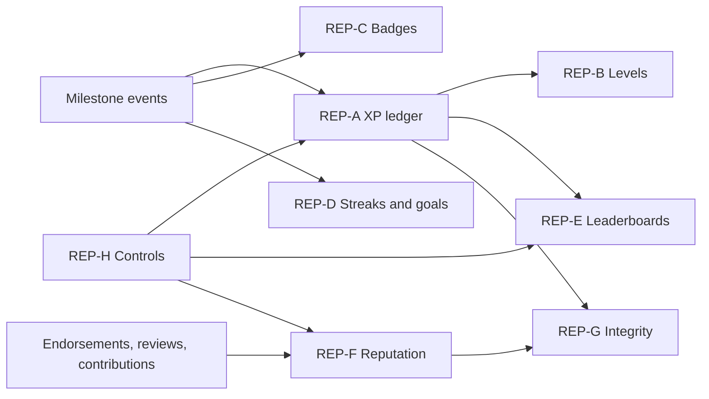
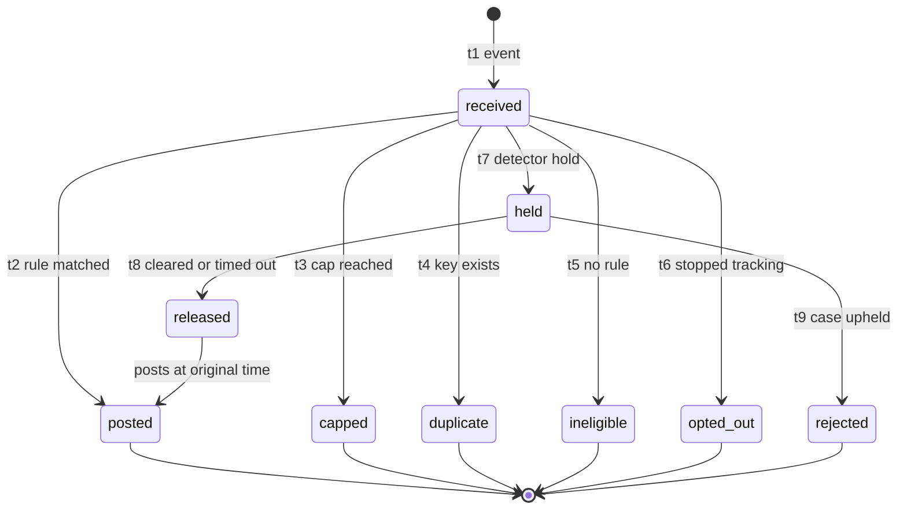
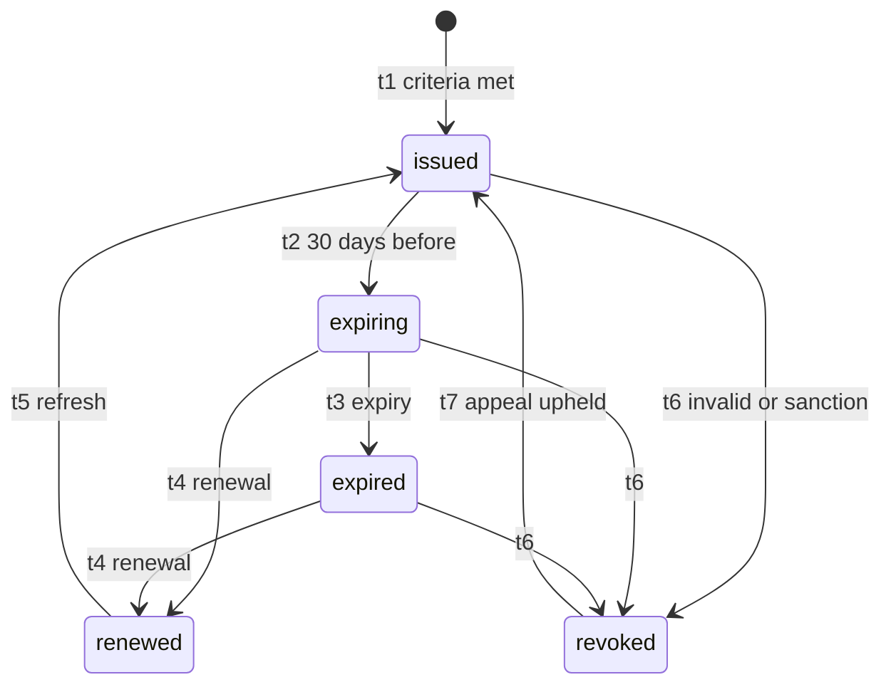
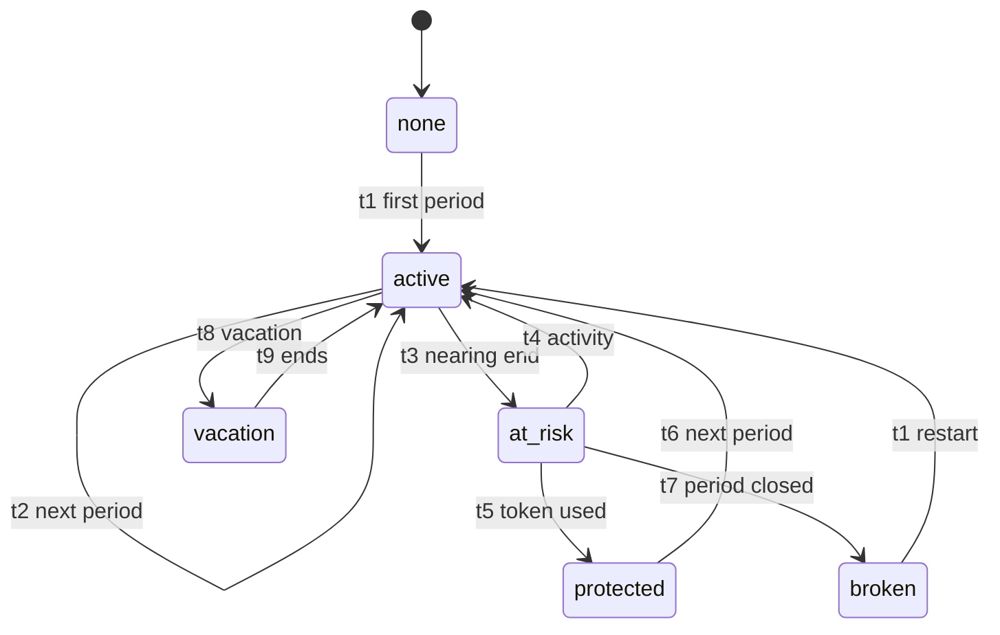
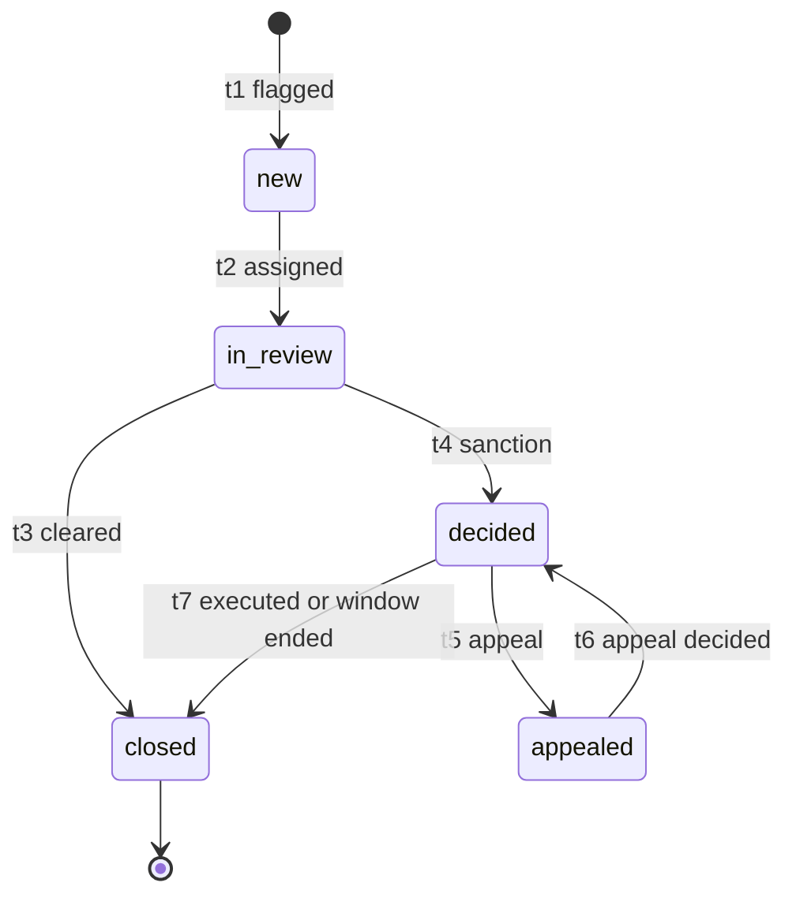
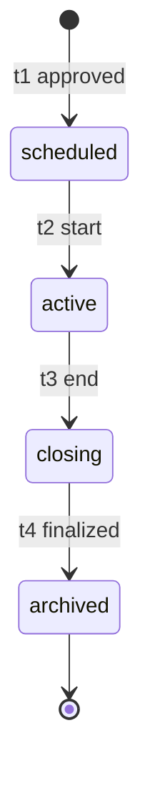
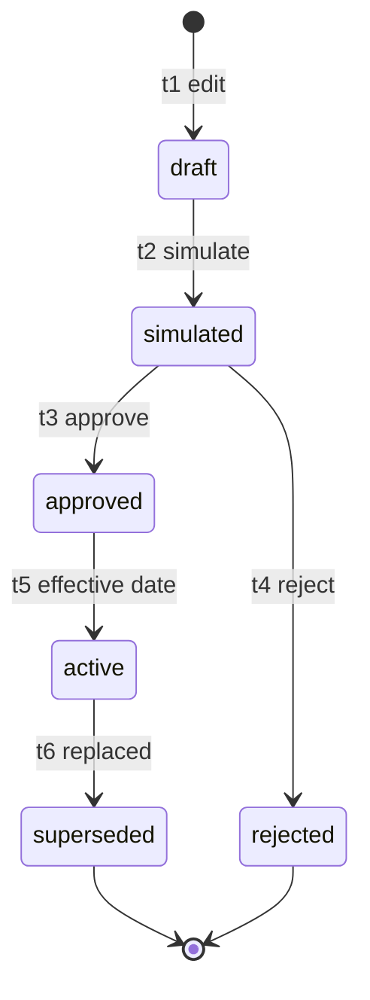

# REP — Gamification, Reputation & Recognition

Module code: `REP` · Group: Engagement · Release tier of the module: `R1` (XP ledger, levels, badges, streaks), `R2`–`R4` for leaderboards, reputation and institutional use, `R6` for enterprise boards.

Status: intended design. Nothing in this file is a claim that anything is built (see [CONVENTIONS](../00_START_HERE/CONVENTIONS.md) §1). The legacy documents call parts of this area "Partial / ephemeral"; that status is not carried into this blueprint.

## 1. Purpose, outcomes and boundaries

### 1.1 Purpose

REP gives people honest feedback on effort and standing, and gives the platform a set of derived trust signals, without ever replacing verified evidence. It owns four things: the XP ledger and levels (effort), badges and streaks (milestones and habit), leaderboards (opt-in comparison), and the reputation engine (multi-context, skill-specific, privacy-preserving standing built from signals such as endorsements, reviews and contributions). It also owns recognition between people, the anti-gaming controls that keep all of this honest, and the transparency and opt-out controls that keep it humane. [SRC: SSOT F-22, F-23, F-101, F-144, F-148..F-150; Yash BR-T0xx where cited]

### 1.2 Outcomes

| Outcome                                                            | How the system knows                                                                                                            |
| ------------------------------------------------------------------ | ------------------------------------------------------------------------------------------------------------------------------- |
| Learners and candidates keep coming back to finish meaningful work | Streak continuity, goal completion, weekly active learners (`REP-M01`..`REP-M04`)                                               |
| XP and badges mean something                                       | Awards only for verified milestones (BR-REP-001, BR-REP-008); integrity flag rate and clawback rate stay low (`REP-M07`)        |
| Reputation is explainable, fair and private                        | Every score has an explanation view; zero individual signal leakage; deterministic nightly computation (BR-REP-018, BR-REP-021) |
| Nobody is pressured or shamed                                      | Opt-out and intensity controls used without penalty; no loss-aversion copy (BR-REP-014, BR-REP-027)                             |
| Gaming does not pay                                                | Velocity limits, collusion discounts, sanctions with appeal (BR-REP-025, BR-REP-026)                                            |
| Recruiters are never misled                                        | XP, level and badges are labeled engagement indicators, never evidence (BR-REP-034)                                             |

### 1.3 Scope

**In scope**

- XP rule catalog, award engine, append-only ledger, reversals and clawbacks, daily caps.
- Levels, progress UI, dashboard widgets.
- Badge catalog, issuance, display, revocation and expiry, verifiable (Open Badges) export, peer recognition.
- Streaks, protection, reminders; goals and weekly quests.
- Leaderboards: global, skill, cohort, institutional, enterprise; privacy; seasons.
- Reputation: engine, signal intake and weighting, decay, recovery, visibility, explanation, context reputations (candidate, instructor, mentor, employer, community).
- Anti-gaming detection, review queue and sanctions; opt-out and intensity; share cards; admin rule tuning; fairness and ethics audit.

**Out of scope (owned elsewhere)**

- Verified credentials, evidence rungs, certificates and their revocation: `EVD`, `BGV` (planned). REP consumes completion events and never issues credentials of record.
- Course, lesson and challenge completion and grading: `LRN`, `ASM` (planned). They emit milestone events.
- Endorsements, reviews, community contributions as content: `NET`, `LRN`, `MEN` (planned). They emit signals.
- Moderation cases and appeals beyond gamification sanctions: `TSF` (planned).
- Matching and recommendation use of reputation: `AIC` (planned) under the limits in BR-REP-024.
- Consent scopes and visibility settings: `SET` (this blueprint). Notification delivery: `NTF` (this blueprint).
- Referral rewards and any monetary incentive: `NET`, `BIL` (planned). XP has no monetary value (BR-REP-007).

### 1.4 Owned versus consumed

| Owned by REP                                                                                                                                                                                                                                                       | Consumed by REP                                                                                                                                                                                                     |
| ------------------------------------------------------------------------------------------------------------------------------------------------------------------------------------------------------------------------------------------------------------------ | ------------------------------------------------------------------------------------------------------------------------------------------------------------------------------------------------------------------- |
| XP rule, ledger entry, balance and level projection, badge definition and award, streak, goal, leaderboard snapshot and preference, season, recognition (kudos), reputation signal, score and config, integrity flag and case, gamification preference, share card | Milestone and activity events from `LRN`, `ASM`, `PRF`, `EVD`, `JOB`, `NET`, `MEN`, `EVT`, `INS`; consent and visibility from `SET`; time zone and locale from `SET`; delivery from `NTF`; account state from `IDN` |

### 1.5 Design stance

1. Effort is not evidence. XP, levels and badges describe engagement; verified work history and credentials live in `EVD`. [SRC: SSOT §6 evidence semantics]
2. Honest incentives. No paid XP or badges, no dark patterns, no shaming, easy opt-out. [SRC: SSOT BR-202]
3. Derived, never set. Scores are computed from auditable signals; nobody edits a score by hand. [SRC: SSOT BR-164]
4. Private by default. Reputation and leaderboard identity are visible to others only with consent or an application context. [SRC: SSOT BR-167]
5. Humans decide consequences. Gamification signals never trigger automated hiring or rejection. [SRC: SSOT §15.10.1]

## 2. Roles and permission matrix

Legend: `S` self only · `C` cohort or org scope as configured · `O` own organization · `G` grant-bound audited · `Y` yes · `R` read-only · `—` no.

| Capability                               | GUE           | CAN/STD                       | INS/MNT/FRL               | REC/HMG                         | EAD | IAD/PLO/EXA                    | MOD | SUP | FIN | PAD                   | SAD | API                                    |
| ---------------------------------------- | ------------- | ----------------------------- | ------------------------- | ------------------------------- | --- | ------------------------------ | --- | --- | --- | --------------------- | --- | -------------------------------------- |
| See own XP, level, streak, badges, goals | —             | S                             | S                         | S (if participating)            | S   | S                              | —   | —   | —   | —                     | —   | —                                      |
| Opt out or set intensity                 | —             | S                             | S                         | S                               | S   | S                              | S   | S   | S   | S                     | S   | —                                      |
| View public badge page of another user   | Y (if public) | Y                             | Y                         | Y                               | Y   | Y                              | —   | —   | —   | —                     | —   | —                                      |
| Join leaderboards (visible identity)     | —             | S (opt-in)                    | S (opt-in)                | —                               | —   | —                              | —   | —   | —   | —                     | —   | —                                      |
| View global and skill leaderboards       | —             | Y (aliases or opted-in names) | Y                         | R (aggregate only)              | —   | —                              | —   | —   | —   | Y                     | Y   | —                                      |
| View institution cohort leaderboard      | —             | C (members)                   | C (instructors of cohort) | —                               | —   | C (policy)                     | —   | —   | —   | —                     | —   | —                                      |
| Enable enterprise internal boards        | —             | —                             | —                         | —                               | O   | O (EXA)                        | —   | —   | —   | —                     | —   | —                                      |
| Give recognition (kudos)                 | —             | S                             | S                         | S                               | S   | S                              | —   | —   | —   | —                     | —   | —                                      |
| View own reputation and explanation      | —             | S                             | S                         | S                               | S   | S                              | —   | —   | —   | —                     | —   | —                                      |
| View another person's reputation         | —             | consent-gated                 | consent-gated             | consent or active application   | —   | institution policy (aggregate) | —   | G   | —   | G                     | G   | —                                      |
| Define badges for own org or course      | —             | —                             | O (course badges)         | O (org culture badges, `Could`) | O   | O                              | —   | —   | —   | Y                     | Y   | —                                      |
| Review integrity cases                   | —             | —                             | —                         | —                               | —   | —                              | Y   | G   | —   | Y                     | Y   | —                                      |
| Tune XP rules, levels, reputation config | —             | —                             | —                         | —                               | —   | —                              | —   | —   | —   | Y (change-controlled) | Y   | —                                      |
| Read ledgers of a subject                | —             | S                             | S                         | S                               | S   | S                              | G   | G   | —   | G                     | G   | —                                      |
| Emit milestone events                    | —             | —                             | —                         | —                               | —   | —                              | —   | —   | —   | —                     | —   | Y (platform module service principals) |

Rules: recruiters and employers never see XP totals, levels or streaks of candidates by default; badge visibility follows the holder's choice; reputation visibility follows BR-REP-020. [DER; SRC: SSOT BR-167]

## 3. Sub-module map

| Code  | Sub-module              | Features                                 |
| ----- | ----------------------- | ---------------------------------------- |
| REP-A | XP and ledger           | FR-REP-001, 002, 003                     |
| REP-B | Levels                  | FR-REP-004, 005                          |
| REP-C | Badges and recognition  | FR-REP-006, 007, 008, 009, 010, 028      |
| REP-D | Streaks and goals       | FR-REP-011, 012, 013                     |
| REP-E | Leaderboards            | FR-REP-014, 015, 016, 017, 027           |
| REP-F | Reputation              | FR-REP-018, 019, 020, 021, 022, 023, 031 |
| REP-G | Integrity               | FR-REP-024, 025                          |
| REP-H | Controls and governance | FR-REP-026, 029, 030                     |

## 4. Feature specifications

Parameter notation: `{braces}` mark `[PROP]` defaults unless a source is cited; open values are in section 13.

### Sub-module REP-A — XP and ledger

### FR-REP-001 — XP rule catalog and award engine

- **Sub-module:** REP-A XP and ledger
- **Priority / tier:** Must · R1
- **Source:** [SRC: SSOT F-22 Gamification & XP Ledger, WF-11 XP Earning, BR-23 course completion XP bonus, BR-25 idempotent XP, F-08 challenge XP 20–100]
- **Purpose and outcome:** XP is awarded by explicit, versioned rules when verified qualifying events occur. The system knows by an evaluation record per event stating which rule matched and the outcome.
- **Roles and permissions:** `PAD: manage rules (change-controlled, FR-REP-029)` · `API (platform modules): emit events` · users earn.
- **Preconditions and entry points:** A source module emits a milestone event (lesson completed, course completed, challenge passed, profile section completed, evidence verified, mentor session completed, event attended, and so on); the user has not opted out of earning (FR-REP-026) and the account is `active`.
- **User interactions and actions:**
  1. The user completes a qualifying action in a source module.
  2. A toast or inline note shows "+30 XP · Challenge passed" (suppressed when intensity is Off).
  3. The user opens "How XP works" to see the rule list in plain language.
- **System behavior:** For each event the engine finds the active rule version for the event type, checks eligibility (rule conditions such as difficulty, first completion, verified status), computes the amount (fixed, or by a lookup such as challenge difficulty 20–100), applies caps and diminishing returns (FR-REP-024), and writes a ledger entry through FR-REP-002 in one transaction with the evaluation record. Event types and examples: lesson completed (small, once per lesson), course completed (bonus, BR-23), challenge passed (20–100 by difficulty, once per challenge for life, none for practice mode or failed attempts, BR-25), profile section verified, evidence verified at a higher rung, endorsement received from a verified peer (low, capped), mentor session completed, event attended, contribution accepted. Rules never reference unverified self-reports (BR-REP-001). Evaluation outcomes: `posted`, `capped`, `duplicate`, `ineligible`, `held` (integrity hold), `opted_out`. Every rule has an id, version, effective window, amount function, cap group and a plain-language description used by "How XP works".
- **UI elements and controls:** XP toast, "How XP works" page with rule table (action, XP, limits), per-rule "Why didn't I get XP?" link. States: awarded, capped (message "Daily XP limit reached"), duplicate (no message), ineligible (explanation on request).
- **Configuration options:** Platform: rule catalog, amount functions, cap groups (FR-REP-029). User: intensity (FR-REP-026).
- **Business rules:** BR-REP-001, BR-REP-002, BR-REP-003, BR-REP-005, BR-REP-007.
- **Validation:** Event schema validated (source module, event id, subject id, occurredAt, type, attributes); `occurredAt` not in the future and within {7 days} of receipt; unknown type is recorded as `ineligible`; rule amount functions return integers 0–1000 per event.
- **Inputs and outputs:** In: milestone event. Out: evaluation outcome and ledger entry (when posted).
- **Filters, sorting, search:** "How XP works" list grouped by source module; sorted by amount.
- **Notifications and communication:** XP award is shown in-app only; level-ups and badges use their own notices (FR-REP-004, FR-REP-007). No email or push for plain XP awards.
- **Error handling and edge cases:** Event delivered twice: idempotent, second is `duplicate`. Event arrives after the source record was reversed: award is skipped (the source emits a reversal event instead, FR-REP-003). Rule version changes between event and processing: the version effective at `occurredAt` applies. Engine outage: events remain queued in the source outbox and are processed in order; the UI shows XP late, never wrong. Unknown event type: `ineligible` with alert to PAD if rate is high.
- **Dependencies:** FR-REP-002, FR-REP-024, FR-REP-026, FR-REP-029, `LRN`, `ASM`, `PRF`, `EVD`, `MEN`, `EVT` (planned), ENT-REP-01, ENT-REP-02.
- **Security and privacy:** Only platform service principals can emit events; subject ids are validated against the event's source record; evaluation records contain no content.
- **Acceptance criteria:**
  - Given a first-time pass of a medium challenge worth 50 XP, when the event arrives, then one ledger entry of 50 is posted and the evaluation is `posted`.
  - Given the same challenge passed again, when the event arrives, then the evaluation is `duplicate` and no XP is added.
  - Given a challenge attempt in practice mode, when it passes, then no XP is awarded.
  - Given a user who has opted out of earning, when a qualifying event arrives, then the evaluation is `opted_out` and no ledger entry is written.

### FR-REP-002 — XP ledger (append-only, idempotent, capped)

- **Sub-module:** REP-A XP and ledger
- **Priority / tier:** Must · R1
- **Source:** [SRC: SSOT BR-25 `UNIQUE(user_id, reference_type, reference_id)`, daily cap 200 XP, table `xp_transactions`; SSOT WIT-011]
- **Purpose and outcome:** Every XP change is a permanent, explainable row. The system knows by the ledger total equaling the balance projection and no duplicate references.
- **Roles and permissions:** `CAN, STD, INS, MNT, FRL, REC, HMG, EAD: S (view own)` · `SUP, PAD, SAD: G` · no role can edit or delete rows.
- **Preconditions and entry points:** Written only by the award engine (FR-REP-001), reversal (FR-REP-003) and sanctions (FR-REP-025). Viewed at Profile → Progress → "XP history".
- **User interactions and actions:**
  1. Open "XP history" to see rows: date, amount, source (course, challenge, event), rule name, running balance.
  2. Filter by source and date range; press a row to open the source item (if still accessible).
  3. Press "Why this amount?" to see the rule and version.
- **System behavior:** Ledger entry: `id, subjectRef, amount (signed integer), ruleId, ruleVersion, referenceType, referenceId, occurredAt, postedAt, kind [award|reversal|adjustment|cap_note], reason, sourceEventId`. Unique constraint `(subjectRef, referenceType, referenceId, kind)` makes awards idempotent. Daily cap: total positive awards per subject per local day ≤ `{200}` XP (legacy BR-25) with cap groups per rule category; excess is not posted and a `cap_note` entry records the capped amount for transparency; capped XP is not carried over. Balance projection (`xp_total`, `xp_week`, `xp_by_skill`) is rebuildable from the ledger and verified nightly; mismatch raises an alert and a rebuild. "Local day" uses the user's time zone (OD-NTF-04, OD-REP-03). Ledger rows are never updated or deleted; corrections are new rows. Skill-tagged XP also feeds per-skill totals used by skill leaderboards and reputation signals.
- **UI elements and controls:** Table with running balance, filters, row detail drawer, CSV download of own ledger. States: loading, list, empty ("No XP yet — complete a lesson to start"), error.
- **Configuration options:** Platform: daily cap (default 200), cap groups, display retention. User: none.
- **Business rules:** BR-REP-002, BR-REP-003, BR-REP-004, BR-REP-005.
- **Validation:** Amount integer within ±10,000; reference type from a closed list; `occurredAt` ≤ now; unique key enforced by the database.
- **Inputs and outputs:** In: award, reversal or adjustment command. Out: ledger entry id and new balance.
- **Filters, sorting, search:** Filter by kind, source module, skill, date range; sorted newest first; paginated 50.
- **Notifications and communication:** none.
- **Error handling and edge cases:** Duplicate reference: returns the existing entry (idempotent, no error). Daily cap reached mid-award: partial award up to the cap, remainder noted. Concurrent awards for one subject: serialized per subject to keep the cap exact. Projection drift: nightly job rebuilds and alerts. Account erasure: ledger rows keep an opaque subject reference and aggregates only after the mapping is destroyed (SET).
- **Dependencies:** FR-REP-001, FR-REP-003, FR-SET-015 (erasure contributor), ENT-REP-02, ENT-REP-03.
- **Security and privacy:** Database privileges forbid UPDATE and DELETE on the ledger for the application role; own-row read only; included in the subject's export (FR-SET-013).
- **Acceptance criteria:**
  - Given an award with an existing `(subject, referenceType, referenceId)`, when posted again, then no new row is created.
  - Given 190 XP awarded today and a 30 XP award, when posted, then 10 XP is posted, a cap note records 20 and the total for the day is 200.
  - Given the application database role, when it attempts to UPDATE a ledger row, then the database denies it.
  - Given the balance projection is altered by hand, when the nightly check runs, then the mismatch is detected, alerted and the projection rebuilt.

### FR-REP-003 — XP reversal and clawback

- **Sub-module:** REP-A XP and ledger
- **Priority / tier:** Must · R2
- **Source:** [DER] from SSOT BR-52 plagiarism detection and BR-23 completion; reversal mechanics [PROP]
- **Purpose and outcome:** XP that was earned through something later invalidated (plagiarized challenge, revoked credential, fraudulent event) is removed transparently. The system knows by reversal rows linked to the originals.
- **Roles and permissions:** `API (source modules): request reversal` · `MOD, PAD: approve clawbacks from sanctions` · users see the reversal and its reason.
- **Preconditions and entry points:** A source module emits a reversal event (for example `asm.challenge.invalidated`, `evd.credential.revoked`) or an integrity case decides a clawback (FR-REP-025).
- **User interactions and actions:**
  1. The user sees a ledger row "−50 XP · Challenge result invalidated" with reason code and a link "Learn more or appeal" (appeal path of FR-REP-025).
  2. If the reversal drops a level, the user sees a notice explaining it.
- **System behavior:** A reversal writes a negative ledger row referencing the original entry id and `kind=reversal`; a given original can be reversed once and only up to its amount. The balance and level are recomputed. Badges and streak credit derived from the reversed event are re-evaluated: a badge whose criteria no longer hold is revoked via FR-REP-008 (never silently); the streak day keeps its credit unless the event was fraudulent (then the day is removed). Balance may not go below 0 (excess recorded as `debt_note`, not carried). Clawbacks by sanctions can target a period or a rule category, listing affected rows. Notice with reason and appeal path goes to the subject (BR-REP-026).
- **UI elements and controls:** Reversal rows in XP history with reason chips; notice banner; "Appeal" link.
- **Configuration options:** Platform: reason codes; maximum retroactive window `{12 months}` for automated reversals (older ones need a human case).
- **Business rules:** BR-REP-004, BR-REP-009, BR-REP-026.
- **Validation:** Original exists and not already reversed; reason code from the list; amount ≤ original.
- **Inputs and outputs:** In: reversal command (original id, reason, actor). Out: reversal entry; recomputed balance and level.
- **Filters, sorting, search:** Filter ledger by kind `reversal`.
- **Notifications and communication:** `rep.xp_reversed` (class engagement-transactional: sent by in-app and email, because it affects a user's standing; not marketing; user may route to in-app only except when tied to a sanction, which is mandatory).
- **Error handling and edge cases:** Reversal for XP that was capped: reverses the posted amount only. Reversal after level-up: level drops and the earlier level-up badges stay (they were true at the time) unless sanctions revoke them. Duplicate reversal event: idempotent.
- **Dependencies:** FR-REP-002, FR-REP-008, FR-REP-025, `ASM`, `EVD` (planned), ENT-REP-02.
- **Security and privacy:** Reversal reasons shown to the subject avoid revealing detection method details (anti-evasion).
- **Acceptance criteria:**
  - Given a posted award of 50, when a reversal event arrives, then a −50 row referencing the original exists and the balance decreases by 50.
  - Given the same reversal event delivered twice, when processed, then only one reversal row exists.
  - Given a reversal larger than the original amount, when requested, then `422` is returned.
  - Given a reversal that removes the criteria of a badge, when processed, then the badge is revoked with a notice and reason.

### Sub-module REP-B — Levels

### FR-REP-004 — Levels and progression

- **Sub-module:** REP-B Levels
- **Priority / tier:** Must · R1
- **Source:** [SRC: SSOT WF-11 "XP Earning & Level Progression", Ph1 "XP + levels"]; thresholds [PROP]
- **Purpose and outcome:** Users see a level that reflects accumulated effort with clear next steps. The system knows by a deterministic function from total XP to level.
- **Roles and permissions:** all authenticated roles that participate `S`.
- **Preconditions and entry points:** Any XP change; Profile → Progress; dashboard widget (FR-REP-005).
- **User interactions and actions:**
  1. See "Level 7 · 1,240 / 1,500 XP to Level 8".
  2. On reaching a new level, see a level-up screen with what it means (no unlocks of product capability) and a share option (FR-REP-028).
  3. Open "Levels" to see the table of thresholds and names.
- **System behavior:** Level = function of `xp_total` using a versioned threshold table (for example a gentle curve; amounts `[PROP]`, OD-REP-02). Levels never confer product capability, search ranking or recruiter visibility; they are display only (BR-REP-034). Level is recomputed after every ledger change; level can decrease only through reversal or sanction (BR-REP-006). Level names are neutral (numbers plus optional themed titles, no ranking against others). A level-up event fires once per level per subject (idempotent). Threshold table changes are versioned and do not lower existing levels (grandfathering) unless approved as a fix.
- **UI elements and controls:** Level badge with number, progress bar with text values (not color alone), level table page, level-up dialog. States: normal, level-up, reduced intensity (no dialog, subtle notice), opted out (hidden).
- **Configuration options:** Platform: threshold table version, level names. User: intensity.
- **Business rules:** BR-REP-006, BR-REP-034, BR-REP-007.
- **Validation:** Thresholds strictly increasing; version effective dates non-overlapping.
- **Inputs and outputs:** In: xp total. Out: level, progress fraction, next threshold.
- **Filters, sorting, search:** n/a — single computed value.
- **Notifications and communication:** `rep.level_up` (engagement class, in-app default, optional push per FR-NTF-014).
- **Error handling and edge cases:** Threshold change: existing levels never drop on a table change. XP reversal drops a level: notice explains, previous level-up events not re-fired when re-earned. Opted out: values still computed but hidden if the user chose "keep tracking silently", else frozen (FR-REP-026).
- **Dependencies:** FR-REP-002, FR-REP-005, FR-REP-026, ENT-REP-04.
- **Security and privacy:** Level is not shared with recruiters by default; public badge page may show it only if the holder chooses.
- **Acceptance criteria:**
  - Given 1,499 XP and a threshold of 1,500 for level 8, when 1 XP is awarded, then the level becomes 8 and one level-up event is emitted.
  - Given a threshold table change, when published, then no existing level decreases.
  - Given a reversal that drops XP below a threshold, when processed, then the level decreases and the user is told why.
  - Given a recruiter viewing a candidate profile, when rendering, then level and XP are not shown unless the candidate made them public.

### FR-REP-005 — Progress screen and dashboard widget

- **Sub-module:** REP-B Levels
- **Priority / tier:** Must · R1
- **Source:** [SRC: Yash LEGACY_REQUIREMENTS F-22 "XP and streaks shown on the dashboard from /gamification/summary and /xp/ledger"]
- **Purpose and outcome:** Users see their progress in one place and on the dashboard. The system knows by a summary model matching the ledger.
- **Roles and permissions:** participating roles `S`.
- **Preconditions and entry points:** Dashboard widget (candidate and student homes); Profile → Progress (SCR-REP-001).
- **User interactions and actions:**
  1. See the widget: level, XP bar, streak count, next badge hint, active goal.
  2. Open Progress for tabs: Overview, XP history, Badges, Streaks and goals, Leaderboards, Reputation (explanation).
  3. Hide the widget from the dashboard via its menu ("Hide progress").
- **System behavior:** Summary endpoint returns computed values from projections with `asOf` timestamp; widget refreshes on focus and after an award event. The widget never shows other users' data except an opt-in leaderboard position. Content honors intensity (Standard shows all; Minimal shows level and streak only; Off hides the widget). Skeleton and error states are shown honestly; stale data is labeled "updated 5 min ago".
- **UI elements and controls:** Widget card, tabs, progress bars with numeric text, "Hide progress" menu item. States: loading, loaded, empty ("Complete your first lesson to earn XP"), error, hidden.
- **Configuration options:** User: widget visibility and intensity.
- **Business rules:** BR-REP-027, BR-REP-004.
- **Validation:** n/a — read model.
- **Inputs and outputs:** In: none. Out: summary model.
- **Filters, sorting, search:** Tabs; XP history filters as FR-REP-002.
- **Notifications and communication:** none.
- **Error handling and edge cases:** Projection lag: shows previous value with "updating" note. Opted out: widget absent and Progress page shows only the settings link. New user: empty-state guidance.
- **Dependencies:** FR-REP-002, 004, 007, 011, 013, ENT-REP-03.
- **Security and privacy:** Own data only; no other person's identity.
- **Acceptance criteria:**
  - Given an award, when it posts, then the widget shows the new XP on next focus without reload errors.
  - Given intensity Minimal, when viewing the dashboard, then only level and streak are shown.
  - Given a projection failure, when loading, then the widget shows an error state, not zeros.
  - Given the user hides the widget, when reloading, then it stays hidden and Settings can restore it.

### Sub-module REP-C — Badges and recognition

### FR-REP-006 — Badge catalog and criteria

- **Sub-module:** REP-C Badges and recognition
- **Priority / tier:** Must · R1
- **Source:** [SRC: SSOT F-23 Leaderboard & Badges, BR-053 badges minted only upon verified milestone completion, BR-202 no paid badges, tables `badges`, `user_badges`]
- **Purpose and outcome:** Badges are defined once, with explicit machine-checkable criteria, and shown in a catalog so users know what to aim for. The system knows by a badge definition with a criteria version.
- **Roles and permissions:** `PAD: create platform badges (change-controlled)` · `INS: define badges for own course (R3)` · `EAD: define org badges (`Could`, R6)` · all users view the catalog.
- **Preconditions and entry points:** Profile → Progress → Badges; "Badge catalog" page; admin console → Badges (`ADM` planned); course authoring in `STU` (planned) for course badges.
- **User interactions and actions:**
  1. Browse the catalog: name, image, description, criteria in plain language, rarity (percentage of active participants holding it, shown only above a cohort of {100}), category (Learning, Skills, Contribution, Community, Milestone, Seasonal).
  2. Filter by category and "earned or not"; open a badge to see criteria and progress ("2 of 3 courses").
  3. Staff: create or edit a definition: name, description, image (alt text required), criteria expression, category, issuer, expiry rule, visibility default, version note; submit for approval.
- **System behavior:** A definition has `id`, `version`, `issuerClass` (`platform`, `instructor`, `institution`, `employer_org`), `criteria` (a declarative expression over verified events and counts, for example `course_completed(skill=Python, count>=1) AND challenge_passed(skill=Python, difficulty>=medium, count>=3)`), `expiryPolicy`, `evidenceSource`. Criteria can only reference verified events (BR-REP-008). Badges are never sold, never granted by purchase, and no badge exists whose criteria include payment (BR-REP-007). Instructor and institution badges show the issuer class beside the badge and never satisfy a "platform-verified" predicate (consistent with `EVD` issuer classes [SRC: Yash BR-T118]). A definition change creates a new version; existing awards stay with the version earned. Images are scanned and accessible (alt text, no text-only meaning).
- **UI elements and controls:** Catalog grid with filter chips and search, badge detail page, staff form with criteria builder (structured, no free code), preview, "Submit for approval". States: draft, in review, active, retired.
- **Configuration options:** Platform: categories; rarity display threshold {100}; approval policy. Instructors: course badge limit {10} per course.
- **Business rules:** BR-REP-008, BR-REP-007, BR-REP-034.
- **Validation:** Name 3–60 characters unique per issuer; description ≤ 300; criteria must parse and reference only registered verified event types; image PNG or SVG ≤ 500 KB with alt text 5–120 characters.
- **Inputs and outputs:** In: definition. Out: versioned badge.
- **Filters, sorting, search:** Filter by category, issuer class, earned state; search by name; sort by rarity or newest.
- **Notifications and communication:** `rep.badge_defined` to approvers; none to users at definition time.
- **Error handling and edge cases:** Criteria referencing an unknown event: rejected with the missing event name. Retired badge: stays on existing holders and is hidden from the catalog. Duplicate criteria with an existing badge: warning, not blocked.
- **Dependencies:** FR-REP-007, FR-REP-029, `STU`, `EVD` (planned), ENT-REP-05.
- **Security and privacy:** Rarity counts use only opted-in participants and a minimum cohort.
- **Acceptance criteria:**
  - Given a criteria expression referencing a self-reported claim, when saved, then `422` is returned.
  - Given a published badge edited, when saved, then a new version is created and existing awards keep the old version.
  - Given an instructor badge, when displayed, then the issuer class is shown beside it.
  - Given a rarity cohort under 100, when the catalog renders, then no percentage is shown.

### FR-REP-007 — Badge issuance and display

- **Sub-module:** REP-C Badges and recognition
- **Priority / tier:** Must · R1
- **Source:** [SRC: SSOT F-23, BR-053; Yash LEGACY_REQUIREMENTS F-23 "a user with XP sees their badges"]
- **Purpose and outcome:** When a user meets criteria, the badge is issued exactly once and shown where they choose. The system knows by a badge award row bound to a definition version and the qualifying events.
- **Roles and permissions:** participating roles `S: view, choose visibility` · other users view public badges.
- **Preconditions and entry points:** Qualifying events processed; badge evaluator runs on each event and nightly for time-based criteria.
- **User interactions and actions:**
  1. See a celebration card "You earned: Python Practitioner" (suppressed when intensity is Off; reduced-motion safe).
  2. Open Badges to see earned badges with date and the criteria met (links to the events).
  3. Set each badge's visibility: Private, On my profile, Public page; reorder featured badges (max {6}).
  4. Press "Share" to open the achievement card flow (FR-REP-028).
- **System behavior:** The evaluator checks definitions affected by the event type, evaluates criteria over the subject's verified event history, and on success writes one award `(subjectRef, definitionId, version, awardedAt, evidenceRefs[], expiresAt?)` unique per `(subject, definition)`. Awards are idempotent and written in the same transaction as an `rep.badge.awarded` outbox event. Display follows holder visibility; profile display is delegated to `PRF` (planned) using the visibility chosen here. Public badge pages show only badge name, issuer class, date and criteria, never the underlying evidence unless the holder shares it. A badge never contributes to XP (avoids loops) except where a rule says so explicitly in the catalog.
- **UI elements and controls:** Celebration card, badge grid, visibility select per badge, "Feature on profile" toggle with limit 6, share button. States: locked (with progress), earned, expired, revoked (with notice).
- **Configuration options:** Platform: featured limit 6. User: per-badge visibility; intensity.
- **Business rules:** BR-REP-008, BR-REP-010, BR-REP-034.
- **Validation:** Visibility from {private, profile, public}; featured count ≤ 6.
- **Inputs and outputs:** In: events, definitions. Out: awards, display state.
- **Filters, sorting, search:** Filter by category and visibility; sort by date earned.
- **Notifications and communication:** `rep.badge_awarded` (engagement class; in-app default; digest-eligible).
- **Error handling and edge cases:** Two events satisfying criteria concurrently: unique key yields one award. Criteria met retroactively when a new badge is added: back-fill job awards quietly with one grouped notice ("3 new badges from past work"). Event later reversed: re-evaluation may revoke (FR-REP-008). Holder erased: awards removed, rarity counts recomputed.
- **Dependencies:** FR-REP-006, FR-REP-008, FR-REP-028, `PRF` (planned), ENT-REP-06.
- **Security and privacy:** Default visibility Private; public pages carry `noindex` unless the holder opts in to indexing (SET).
- **Acceptance criteria:**
  - Given criteria met by a single event, when evaluated twice concurrently, then exactly one award exists.
  - Given a new badge added with a back-fill, when the job runs, then eligible users get the badge and one grouped notice.
  - Given a badge set to Private, when another user opens the profile, then it is not visible.
  - Given more than 6 badges set as featured, when saving, then `422` is returned.

### FR-REP-008 — Badge revocation and expiry

- **Sub-module:** REP-C Badges and recognition
- **Priority / tier:** Must · R2
- **Source:** [DER] from SSOT credential revocation §6.3 and BR-052; Yash BR-T012 notice and appeal
- **Purpose and outcome:** Badges reflect current truth: they can expire or be removed when their basis is invalid, with notice. The system knows by award state and reasons.
- **Roles and permissions:** system and `MOD, PAD: revoke (with reason)` · holders view and appeal.
- **Preconditions and entry points:** Triggers: source event reversed or credential revoked, criteria with expiry reached, integrity sanction (FR-REP-025), issuer withdraws.
- **User interactions and actions:**
  1. See a notice "Your badge X was removed: <reason>" with "Appeal" (when applicable).
  2. See expiring badges flagged 30 days ahead with "How to renew".
  3. Renew by meeting renewal criteria (for example retaking an assessment).
- **System behavior:** Award states: `issued`, `expiring`, `expired`, `revoked`, `renewed` (SM-REP-02). Expiry follows the definition's policy (for example skill badges {24 months} unless renewed, aligned with skill decay [SRC: SSOT F-97 intent]). Revocation requires a reason code and, for sanctions, a human decision; automatic revocation is limited to objective invalidation (source reversed). Revoked and expired badges disappear from public display but remain in the holder's history with the status. Open Badges status endpoint (FR-REP-009) reports revoked state. XP is not clawed back by badge revocation unless the sanction says so.
- **UI elements and controls:** Notice banner, "Appeal" button, status chips (text), renewal button. States: issued, expiring, expired, revoked, renewed.
- **Configuration options:** Platform: expiry defaults per category; reminder lead 30 days.
- **Business rules:** BR-REP-010, BR-REP-009, BR-REP-026.
- **Validation:** Revocation needs reason code; sanction revocations need a case id.
- **Inputs and outputs:** In: revocation or expiry trigger. Out: updated award state; notice.
- **Filters, sorting, search:** Filter holder badges by status.
- **Notifications and communication:** `rep.badge_revoked` (mandatory-privacy class when from sanction; engagement-transactional otherwise), `rep.badge_expiring` (30 days, engagement).
- **Error handling and edge cases:** Appeal granted: award restored with the original date and a notice. Renewal during notice window: state returns to `issued`. Revocation of a badge a recruiter saw earlier: no recall, but status endpoints show revoked.
- **Dependencies:** FR-REP-007, FR-REP-009, FR-REP-025, ENT-REP-06.
- **Security and privacy:** Reason text shown to holder only.
- **Acceptance criteria:**
  - Given a credential revocation event, when processed, then dependent badges are revoked with a notice and reason.
  - Given a badge expiring in 30 days, when the sweep runs, then the holder is notified once.
  - Given a revoked badge, when its public verification URL is opened, then it shows revoked.
  - Given an appeal upheld, when processed, then the badge is restored with its original date.

### FR-REP-009 — Verifiable badge export (Open Badges)

- **Sub-module:** REP-C Badges and recognition
- **Priority / tier:** Could · R4
- **Source:** [PROP] (Credly-style verifiable digital badges; SSOT §6.1 evidence semantics for verification URLs)
- **Purpose and outcome:** A holder takes a badge outside the platform in a standard, verifiable format. The system knows by a signed credential and a public status URL.
- **Roles and permissions:** holders `S` · anyone with the link verifies.
- **Preconditions and entry points:** Badge page → "Add to wallet or share"; requires the badge to be set Public.
- **User interactions and actions:**
  1. Press "Export as Open Badge"; choose JSON file download or "Copy verification link".
  2. Paste the link into another site (for example a professional network) or add to a digital wallet.
  3. A verifier opens the link and sees issuer, badge, criteria, date and status.
- **System behavior:** Generates an Open Badges 3.0 style verifiable credential signed by the platform key, with issuer profile, achievement, criteria URL, evidence only if the holder includes it, and a status URL. Verification page is public, shows only what the holder made public, reports `valid`, `expired`, `revoked` truthfully and contains no personal data beyond the holder's chosen name. Keys are managed with rotation; old signatures remain verifiable. Revocation updates status immediately.
- **UI elements and controls:** "Export" menu (JSON, link, QR), verification page. States: valid, expired, revoked, not found.
- **Configuration options:** Platform: key rotation; issuer profile; whether export is enabled.
- **Business rules:** BR-REP-011, BR-REP-010.
- **Validation:** Badge must be public and `issued` or `expiring`.
- **Inputs and outputs:** In: badge award. Out: signed credential and verification URL.
- **Filters, sorting, search:** n/a — single record.
- **Notifications and communication:** none.
- **Error handling and edge cases:** Holder switches the badge to Private: verification page returns "not available" immediately (the holder controls the link). Key compromise: reissue and mark old signatures superseded. Verification URL guessed: tokens ≥ 128 bits.
- **Dependencies:** FR-REP-007, FR-REP-008, key management, ENT-REP-06.
- **Security and privacy:** No personal data beyond chosen display name; no enumeration of holders.
- **Acceptance criteria:**
  - Given a public valid badge, when exported, then the credential verifies against the platform key.
  - Given the badge revoked, when its URL is opened, then status shows revoked.
  - Given the holder sets the badge Private, when the old URL is opened, then it returns not available.
  - Given a malformed token, when opened, then `404` is returned without leaking existence.

### FR-REP-010 — Peer recognition (kudos)

- **Sub-module:** REP-C Badges and recognition
- **Priority / tier:** Should · R2
- **Source:** [SRC: SSOT F-101 Badge Marketplace & Recognition "a member lists a badge for claim and another member claims it"; BR-202 earned only]; kudos mechanics [PROP]
- **Purpose and outcome:** People thank and recognize each other for specific help, visibly but without becoming a currency. The system knows by recognition records with limits.
- **Roles and permissions:** `CAN, STD, INS, MNT, FRL, REC, HMG: give and receive` (not to people they have blocked or in conflict contexts).
- **Preconditions and entry points:** "Say thanks" on community answers (`NET`), mentor sessions (`MEN`), project collaboration, course Q&A (`LRN`).
- **User interactions and actions:**
  1. Press "Say thanks" on a contribution; choose a recognition type (Helpful, Clear explanation, Great feedback, Generous mentor) and optionally add a note ≤ 200 characters.
  2. Recipient sees "Alex thanked you for: Clear explanation" in their notifications and recognition list.
  3. Recipient may hide a recognition from their public view.
  4. Optional "recognition badge" claim (F-101 idea): an issuer lists a badge for claim by members who meet verifiable conditions, and members claim it (no purchase).
- **System behavior:** Recognition has `(giver, recipient, type, targetRef, note, createdAt)`. Limits: ≤ {5} per giver per day, one per giver per target, none to self, none within an org reporting line when the org flags conflict (`EMP` planned). Recognition yields no XP (BR-REP-012); it is a low-weight reputation signal for the recipient's community or mentor context, weighted by giver credibility and discounted for reciprocal pairs and rings (FR-REP-022, FR-REP-024). Notes pass content moderation (`TSF` planned). Blocked users cannot give or receive from each other. Recognition counts show as "Thanked 12 times" without naming givers publicly unless givers agree.
- **UI elements and controls:** "Say thanks" button with type menu and note field, recognition list, hide toggle. States: sent, limit reached ("You've reached today's limit"), hidden.
- **Configuration options:** Platform: daily limit 5; types; claimable badge listings limited to verified issuers. User: show recognitions publicly (default off).
- **Business rules:** BR-REP-012, BR-REP-025, BR-REP-022.
- **Validation:** Note ≤ 200 characters; target exists and the recipient is its author; giver not blocked; limits.
- **Inputs and outputs:** In: recognition. Out: record and signal.
- **Filters, sorting, search:** Recognition list by type and date.
- **Notifications and communication:** `rep.recognition_received` (engagement; groupable to avoid noise).
- **Error handling and edge cases:** Reciprocal exchanges flagged and discounted silently (no accusation to users). Giver deleted: recognition kept anonymized as "a member". Abusive note: reported and removed; recognition remains without the note.
- **Dependencies:** FR-REP-022, FR-REP-024, `NET`, `MEN`, `LRN` (planned), ENT-REP-15.
- **Security and privacy:** Recognition notes are user content subject to moderation; no private data in them.
- **Acceptance criteria:**
  - Given 5 recognitions given today, when giving a 6th, then it is refused with the limit message.
  - Given the same giver and target, when thanking twice, then the second is refused.
  - Given a recognition, when the recipient views their XP, then no XP was added by it.
  - Given a blocked pair, when attempting recognition, then it is not offered.

### FR-REP-028 — Achievement share cards

- **Sub-module:** REP-C Badges and recognition
- **Priority / tier:** Could · R2
- **Source:** [PROP] (social sharing of achievements as in Coursera, Credly)
- **Purpose and outcome:** Users share an achievement (badge, level, completed course milestone) outside the platform in a safe, minimal form. The system knows by a generated card with a revocable link.
- **Roles and permissions:** participating roles `S`.
- **Preconditions and entry points:** Share button on badge, level-up, season result and course completion screens.
- **User interactions and actions:**
  1. Press "Share"; preview the card (image and text); choose what to include (badge name, date, level, display name or "Anonymous learner").
  2. Choose a target (copy link, download image, native share sheet).
  3. Later revoke the link from "My shared cards".
- **System behavior:** Generates a static image and a public page `/s/<token>` with Open Graph tags; content limited to chosen fields; no private data, no rank unless the user made leaderboards public; token ≥ 128 bits, revocable, `noindex`. Link views are counted without visitor identity. Card text avoids exaggeration ("Earned a badge", not "Certified"). Shared cards respect opt-out and the minors rule (not available for minors, BR-REP-032).
- **UI elements and controls:** Share dialog with checkboxes, preview, buttons, "My shared cards" list with revoke. States: preview, generated, revoked.
- **Configuration options:** Platform: card templates, enabled targets. User: inclusion options.
- **Business rules:** BR-REP-036, BR-REP-032, BR-REP-034.
- **Validation:** Included fields from the allowed list; display name per profile visibility rules.
- **Inputs and outputs:** In: share request. Out: image and URL.
- **Filters, sorting, search:** n/a — short list.
- **Notifications and communication:** none.
- **Error handling and edge cases:** Revoked link: `404`. Badge later revoked: card page shows "no longer valid". Image generation failure: retry and fallback to link-only.
- **Dependencies:** FR-REP-007, FR-REP-004, `SET` visibility, ENT-REP-19.
- **Security and privacy:** Public by link; no personal data beyond what the user selected; abuse-reportable.
- **Acceptance criteria:**
  - Given a share card, when created, then it contains only the selected fields.
  - Given the link revoked, when opened, then `404` is returned.
  - Given a revoked badge, when its card page is opened, then it shows "no longer valid".
  - Given a minor account, when pressing share, then the option is unavailable.

### Sub-module REP-D — Streaks and goals

### FR-REP-011 — Streaks

- **Sub-module:** REP-D Streaks and goals
- **Priority / tier:** Should · R1
- **Source:** [SRC: SSOT §13.6 job `streak.rollover` daily 00:05, DOR-010 time-zone open; Yash LEGACY F-22 "XP and streaks"]
- **Purpose and outcome:** Users who practice regularly see their consistency without pressure. The system knows by qualifying-day records per user in their own time zone.
- **Roles and permissions:** participating roles `S`.
- **Preconditions and entry points:** A qualifying activity (complete a lesson, pass a challenge, practice session, mentor session, contribution accepted); dashboard widget; Progress → Streaks and goals.
- **User interactions and actions:**
  1. See "5-day streak" and a week view with each day marked (text and icon).
  2. Open details: current streak, longest streak, qualifying activities list, protection status (FR-REP-012).
  3. Choose cadence: Daily (default) or Weekly (for people who cannot practice daily, for accessibility and fairness).
- **System behavior:** A day qualifies when at least one qualifying activity is recorded for the subject on that local calendar day (user time zone, DST-safe). Weekly cadence qualifies a week with ≥ {3} qualifying days. A streak increments on first qualifying activity of a new period; it breaks when a period passes with none and no protection applies (SM-REP-03). The longest streak is kept. A rollover job evaluates per time-zone bucket after local midnight (not a single UTC time, OD-NTF-04). Qualifying activities must be meaningful (completion events, not page views) and subject to anti-gaming caps (FR-REP-024). Reversed activities may remove a day only if fraudulent. Streaks earn no XP by themselves; milestones (7, 30, 100 days) can grant badges. Time zone changes: the streak is not broken by a zone change; boundaries use the zone at activity time.
- **UI elements and controls:** Streak counter with week strip, cadence select, details page. States: none, active, at risk, protected, broken (neutral wording).
- **Configuration options:** Platform: qualifying events; weekly threshold 3. User: cadence, streak visibility (hide), notifications.
- **Business rules:** BR-REP-013, BR-REP-014, BR-REP-030.
- **Validation:** Cadence from {daily, weekly}; activity events from the qualifying list only.
- **Inputs and outputs:** In: activity events. Out: streak state.
- **Filters, sorting, search:** n/a — single record with history list.
- **Notifications and communication:** `rep.streak_milestone` (engagement); reminders per FR-REP-012.
- **Error handling and edge cases:** Activity near midnight with clock skew: server time and stored zone decide. Offline learning (PWA): offline completions sync with their local timestamps and may credit the correct day if within {48 h} of receipt. Late event beyond window: not credited. Time zone unknown: account locale's primary zone.
- **Dependencies:** FR-REP-001, FR-REP-012, FR-REP-024, FR-SET-020, ENT-REP-07.
- **Security and privacy:** Streak data is personal data; visible to others only on leaderboards or public profile if chosen.
- **Acceptance criteria:**
  - Given a qualifying activity at 23:55 local, when recorded, then it counts for that local day.
  - Given a day with no qualifying activity and no protection, when the period closes, then the streak breaks and the longest streak is preserved.
  - Given weekly cadence with 3 qualifying days in a week, when the week closes, then the streak continues.
  - Given a time zone change mid-streak, when the user travels, then the streak is not broken solely by the change.

### FR-REP-012 — Streak protection and reminders

- **Sub-module:** REP-D Streaks and goals
- **Priority / tier:** Should · R2
- **Source:** [PROP]; reminder limits [SRC: Yash BR-T087]
- **Purpose and outcome:** Life interruptions do not erase progress, and reminders help without shaming. The system knows by protection tokens and reminder logs.
- **Roles and permissions:** participating roles `S`.
- **Preconditions and entry points:** Active streak ≥ {3}; reminders enabled in FR-NTF-014.
- **User interactions and actions:**
  1. See "Protection: 1 available" on the streak page.
  2. When a day is missed, protection applies automatically if available; user sees "Protection used".
  3. Receive at most one reminder per day when a streak of ≥ 3 is at risk, at the user's chosen time (default 18:00 local).
  4. Turn reminders off or choose a time.
- **System behavior:** Protection is earned, not bought: one token per {7} consecutive qualifying periods, max {2} stored, and one automatic use per missed period. "Vacation mode" lets a user pause a streak for up to {14 days} per {90 days} without penalty. Reminders are nudges under FR-NTF-017: counted against the global nudge cap, respect quiet hours, stop after the user completes the activity, and never use guilt wording ("You'll lose your streak!" is forbidden; neutral wording like "Keep going with a quick lesson?" is used) (BR-REP-014). Streak loss is announced once and calmly, with an invitation to restart.
- **UI elements and controls:** Protection counter, vacation mode toggle with dates, reminder time picker. States: protected, vacation, at risk (text only), broken.
- **Configuration options:** Platform: token earning rate, max stored, vacation limits. User: reminder time and enablement.
- **Business rules:** BR-REP-013, BR-REP-014, BR-REP-027.
- **Validation:** Vacation ≤ 14 days and ≤ one period per 90 days; reminder time within allowed hours.
- **Inputs and outputs:** In: user settings, missed-period event. Out: protection application and reminders.
- **Filters, sorting, search:** n/a.
- **Notifications and communication:** `rep.streak_reminder` (nudge class, capped), `rep.streak_broken` (in-app only).
- **Error handling and edge cases:** Reminder suppressed by cap: no catch-up send. Protection token expiry: none, but cap on storage. User on vacation receives no streak nudges.
- **Dependencies:** FR-REP-011, FR-NTF-017, FR-NTF-015, ENT-REP-07.
- **Security and privacy:** Reminder text does not reveal learning topic on lock screens.
- **Acceptance criteria:**
  - Given one protection token and a missed day, when the period closes, then the streak continues and the token is consumed.
  - Given the user completed the activity, when a reminder is about to send, then it is cancelled.
  - Given vacation mode of 14 days, when it ends, then the streak resumes without a break.
  - Given a reminder template with loss-aversion wording, when proposed in the template console, then review rejects it per BR-REP-014.

### FR-REP-013 — Goals and weekly quests

- **Sub-module:** REP-D Streaks and goals
- **Priority / tier:** Could · R3
- **Source:** [PROP] (learning platforms' weekly goals)
- **Purpose and outcome:** Users set small achievable goals and platform-suggested quests nudge exploration. The system knows by goal progress rows and completion events.
- **Roles and permissions:** participating roles `S`.
- **Preconditions and entry points:** Progress → Goals; dashboard card; onboarding suggestion.
- **User interactions and actions:**
  1. Create a goal from templates: "Complete 3 lessons this week", "Pass a challenge", "Update my profile evidence", "Attend an event"; adjust the target within limits.
  2. See suggested quests (weekly, up to {3}) tied to the user's declared interests and skills gap (recommendations are advisory, `AIC` planned).
  3. Track progress; mark a goal paused or archived.
  4. On completion, see a calm confirmation and optionally earn XP per catalog.
- **System behavior:** Goal `(subject, type, target, period, progress, status)`; progress computed from verified events. Max {5} active goals. Quest completion awards XP only via rules in the catalog and counts toward the daily cap. Missed goals carry no penalty, no streak of goals, no public failure. Quests exclude activities that would encourage unsafe behavior (for example mass applications). Suggested quests avoid demographic inference (BR-REP-030).
- **UI elements and controls:** Goal form, progress bars with text, quest cards, pause and archive actions. States: active, completed, paused, archived, expired.
- **Configuration options:** Platform: goal templates, quest rotation. User: goals.
- **Business rules:** BR-REP-015, BR-REP-030, BR-REP-001.
- **Validation:** Target within template bounds; ≤ 5 active goals.
- **Inputs and outputs:** In: goal, events. Out: progress and completions.
- **Filters, sorting, search:** Filter by status.
- **Notifications and communication:** `rep.goal_completed` (engagement); weekly summary is part of the digest.
- **Error handling and edge cases:** Goal target impossible (course has fewer lessons): validation message. Event reversal: progress decreases. Opted out: goals hidden.
- **Dependencies:** FR-REP-001, FR-REP-026, `AIC` (planned), ENT-REP-09.
- **Security and privacy:** Goals private to the user.
- **Acceptance criteria:**
  - Given a goal of 3 lessons, when 3 lessons complete in the period, then the goal is `completed`.
  - Given 5 active goals, when creating a 6th, then `422` is returned.
  - Given a missed goal at period end, when the period closes, then status becomes `expired` with no penalty or notification of failure.
  - Given a quest that would encourage unsafe mass actions, when proposed, then review blocks it.

### Sub-module REP-E — Leaderboards

### FR-REP-014 — Leaderboards (global, skill, cohort and friends)

- **Sub-module:** REP-E Leaderboards
- **Priority / tier:** Should · R2
- **Source:** [SRC: SSOT F-23 Leaderboard & Badges, F-08 step 9 "weekly + all-time tabs", OD-06 "weekly + all-time tabs"; WIT tables `leaderboards`; F-76 contest leaderboards owned by `ASM`]
- **Purpose and outcome:** Users who want friendly comparison see where their effort stands among peers, without exposing anyone who did not opt in. The system knows by snapshot rows computed from the ledger.
- **Roles and permissions:** `CAN, STD, FRL: view; join with visible identity (opt-in)` · `INS, MNT: view` · `REC, HMG: aggregate only` · `PAD: configure`.
- **Preconditions and entry points:** Progress → Leaderboards; skill pages; learning hub. The viewer is a participant (not opted out, FR-REP-026); the board's audience rules are met (FR-REP-015).
- **User interactions and actions:**
  1. Open Leaderboards; choose a board: Global, by Skill (for example Python), My cohort (course or institution, FR-REP-016), Connections (people I am connected to, `NET` planned).
  2. Choose a period tab: This week (default) and All time (plus season boards when a season is active, FR-REP-027).
  3. See the top {20} and "Your position" row with rank, display name or alias, XP for the period; scroll to load around my rank.
  4. Press a name (only if that person is visible) to open their public profile summary.
  5. Press "Join with my name" or "Stay anonymous" (FR-REP-015).
- **System behavior:** Rank is computed from the XP ledger entries (kind `award` and `reversal`) within the period window, per board scope (all participants, skill-tagged XP, cohort members, connection set). Ties share a rank and are ordered by earliest time reaching the score then by alias for display only. Snapshots are recomputed incrementally (every {5 min}) and finalized at period close; weekly boards reset at the period boundary defined by the platform (OD-REP-03). Participants flagged under integrity review, sanctioned, deactivated, suspended or erased are excluded (BR-REP-016). Boards with fewer than `{10}` participants in the scope show the list but no percentile and no "Top X%" claims. Minors are excluded from public boards (BR-REP-032). Reversals lower the period score and may reorder ranks at the next snapshot. Skill boards use skill-tagged XP only. The board never shows XP from capped or held entries. Boards are labeled as engagement indicators, never as skill proof (BR-REP-034).
- **UI elements and controls:** Board selector, period tabs, table (rank, name or alias, level optional, score), "Your position" sticky row, "Load more", join/anonymous switch, "About leaderboards" disclosure with rules, "Report" on rows. Rank changes shown as text ("+3") not color only. States: loading, list, empty ("No one on this board yet"), small board (no percentile), not participating (invitation card), error.
- **Configuration options:** Platform: boards enabled, top size 20, minimum cohort 10, snapshot interval, period boundaries. User: participation (FR-REP-015).
- **Business rules:** BR-REP-016, BR-REP-017, BR-REP-032, BR-REP-034, BR-REP-031.
- **Validation:** Board and period from closed lists; pagination cursor valid; skill must exist in the skills taxonomy (`SRC` planned).
- **Inputs and outputs:** In: board, period, cursor. Out: ranked rows and the viewer's position.
- **Filters, sorting, search:** Filter by board and period; sorted by rank; "Find me" jumps to own position; name search `Could` and limited to visible participants.
- **Notifications and communication:** `rep.rank_change` (engagement; weekly digest only, never instant; off by default); `rep.season_result` at season close (FR-REP-027).
- **Error handling and edge cases:** Snapshot job failure: previous snapshot shown with "Updated 20 min ago". Viewer opted out: board hidden with an explanation and a way to join. Reported row: queued for review (FR-REP-025) and hidden for the reporter. Account erasure: row removed at next snapshot (≤ 15 min after erasure begins) and aggregates keep no identity.
- **Dependencies:** FR-REP-002, FR-REP-015, FR-REP-016, FR-REP-024, FR-REP-027, ENT-REP-10, ENT-REP-11.
- **Security and privacy:** Rows expose only the chosen display identity, XP for the period and optionally level; no other profile data. Boards are not indexed. Rank data of participants is `Confidential` and included in their export.
- **Acceptance criteria:**
  - Given 30 participants, when viewing the weekly board, then the top 20 and the viewer's own position are shown with correct ranks.
  - Given two users with equal XP, when ranked, then they share a rank.
  - Given a board scope with 8 participants, when rendered, then no percentile or "Top X%" text is shown.
  - Given a user under integrity review, when the next snapshot runs, then they are absent from every board.

### FR-REP-015 — Leaderboard privacy: anonymity, alias and opt-out

- **Sub-module:** REP-E Leaderboards
- **Priority / tier:** Must · R2 (ships with FR-REP-014)
- **Source:** [DER] SSOT §15.2 privacy by purpose; BR-167 spirit; Yash INV-T15
- **Purpose and outcome:** Nobody appears on a board with their identity unless they chose to. The system knows by a per-user leaderboard preference consulted at render time.
- **Roles and permissions:** participating roles `S`.
- **Preconditions and entry points:** First visit to Leaderboards (invitation card); Settings → Privacy → "Leaderboards" (SET entry).
- **User interactions and actions:**
  1. On the first visit, choose: "Show my name", "Show an alias" (generated, editable from a safe list or free text with moderation), or "Don't include me".
  2. Change the choice at any time; the board updates at the next snapshot (display name change within {5 min}).
  3. Choose whether to show their level and badge count next to the name.
- **System behavior:** Default is `not included` (no identity, no row) until the user chooses. Alias is unique per board scope, 3–24 characters, moderated against impersonation of other users or staff and offensive terms; aliases are not linked to the real profile in the UI but remain linkable by the user's own export and by staff under grant for abuse cases. "Show my name" uses the profile's public display name only if profile visibility allows it, else prompts the user to adjust (FR-SET-003). Opting out removes the user from all boards and all ranks computed for others immediately (ranks of others adjust at next snapshot). Cohort boards in institutions follow FR-REP-016 rules, which can be stricter. No board shows deactivated or erased users.
- **UI elements and controls:** Invitation card with three radio options and plain explanation, alias field with availability check, "Show level" switch, "Remove me from leaderboards" button. States: not chosen, name, alias, excluded.
- **Configuration options:** Platform: alias rules and blocked terms; default (not included). User: choice.
- **Business rules:** BR-REP-016, BR-REP-031, BR-REP-032.
- **Validation:** Alias 3–24 characters, letters, digits, spaces, hyphen, underscore, no URLs, no reserved or impersonation terms; one alias per user per scope family.
- **Inputs and outputs:** In: choice. Out: preference record.
- **Filters, sorting, search:** n/a — settings control.
- **Notifications and communication:** none.
- **Error handling and edge cases:** Alias collision: suggestions offered. Alias flagged by moderation after the fact: replaced by a neutral alias with notice. Profile private but "Show my name" chosen: board shows alias until the profile is adjusted, with a prompt. User under 18 or minor flag: only "Don't include me" is available.
- **Dependencies:** FR-REP-014, FR-SET-003, `TSF` (planned), ENT-REP-11.
- **Security and privacy:** Alias-to-account mapping is `Confidential`; never exposed through the API to other users; rate limited changes (≤ 3 per 30 days).
- **Acceptance criteria:**
  - Given a new user, when the board loads, then they are not listed and see the invitation card.
  - Given "Don't include me", when saved, then the user disappears from boards at the next snapshot and sees no rank.
  - Given an alias resembling a staff role, when submitted, then it is rejected with a reason.
  - Given a minor account, when opening the invitation, then only the exclusion option is offered.

### FR-REP-016 — Institutional leaderboards

- **Sub-module:** REP-E Leaderboards
- **Priority / tier:** Should · R3
- **Source:** [SRC: SSOT F-40 Institutional Managed Learning, FERPA §15.9.2, §15.9.4]; board rules [DER]
- **Purpose and outcome:** A class or cohort can use friendly rankings for motivation under privacy rules. The system knows by cohort-scoped boards honoring consent and policy.
- **Roles and permissions:** `STD: view, join (opt-in)` · `INS, IAD, PLO: configure and view per policy` · `EAD`: none.
- **Preconditions and entry points:** Institution cohort (planned `INS`); IAD enables boards for a cohort; STD sees them in the cohort hub and Progress.
- **User interactions and actions:**
  1. IAD or instructor enables a board for a cohort: choose metric (XP in the cohort's courses, challenges passed, completion %), period (week, term), visibility (names, aliases, top-N only), and whether instructors see full rankings.
  2. Students receive an invitation to join with the privacy options of FR-REP-015.
  3. Students view the board; instructors view according to policy; IAD sees aggregates.
- **System behavior:** The board draws only on in-cohort activity ledger entries; scoring metric options exclude grades and exam scores (no grading data on boards, BR-REP-033). Students must opt in with identity; for non-consenting students, the instructor and IAD see them in a non-ranked "not participating" count only. Rank and boards never feed grading, honors or transcript decisions; copy states this. Boards close at term end and are archived to aggregate stats; student-identifying rankings are deleted or anonymized at graduation severance [SRC: SSOT §15.9.4]. Instructors cannot export ranked lists with names unless students consented to that disclosure. Minors in the cohort: boards disabled by default (BR-REP-032).
- **UI elements and controls:** Cohort board panel with metric label, period, table, "Join" and "Hide me", IAD configuration form with preview. States: disabled, enabled, closed, archived.
- **Configuration options:** Institution: enablement per cohort, metric, period, visibility, instructor visibility. Platform: allowed metrics.
- **Business rules:** BR-REP-033, BR-REP-016, BR-REP-031, BR-REP-032.
- **Validation:** Metric from allowed list; visibility option valid; cohort has ≥ {10} members for a ranked board else an unranked progress view only.
- **Inputs and outputs:** In: board config. Out: cohort board.
- **Filters, sorting, search:** Filter by period; sorted by rank.
- **Notifications and communication:** `rep.cohort_board_invite` (engagement).
- **Error handling and edge cases:** Student leaves cohort: removed immediately. Institution disables boards: hidden, snapshots archived as aggregates. Conflict with grading policy flags: configuration refused if the institution has declared boards as non-graded policy and the metric uses grade data.
- **Dependencies:** FR-REP-014, FR-REP-015, `INS` (planned), `SET` consent (FR-SET-031 for managed locks), ENT-REP-10.
- **Security and privacy:** Tenant isolation: boards never leak across institutions; FERPA severance honored; participation consent is purpose-bound and revocable.
- **Acceptance criteria:**
  - Given a student who has not opted in, when the board renders, then they appear only in an aggregate "not participating" count for instructors.
  - Given a metric based on grades, when the board is configured, then `422` is returned.
  - Given a cohort with 8 students, when enabling a ranked board, then only an unranked progress view is available.
  - Given graduation severance, when it runs, then identifying rankings are removed or anonymized.

### FR-REP-017 — Enterprise internal leaderboards

- **Sub-module:** REP-E Leaderboards
- **Priority / tier:** Could · R6
- **Source:** [SRC: SSOT §4.2 non-goals and F-47/F-110 L&D context]; [PROP]; touches the "not generic HR" non-goal and is narrowed by BR-REP-035 (OD-REP-04)
- **Purpose and outcome:** Enterprise L&D admins run optional internal learning challenges and boards among employees. The system knows by org-scoped boards with employee consent and strict non-HR use.
- **Roles and permissions:** `EXA, EAD: enable and configure (aggregates)` · employees `S: opt in, view` · managers: aggregates only.
- **Preconditions and entry points:** Enterprise plan with L&D features (`ENT`, `BIL` planned); EXA enables a challenge or board for a team or the org.
- **User interactions and actions:**
  1. EXA creates an internal challenge: name, period, metric (learning hours, courses completed, skills practiced), audience (teams), visibility (aliases or names, team totals).
  2. Employees receive an invitation; they opt in with name or alias, or decline without any record visible to managers.
  3. Participants view the board; EXA views team aggregates.
  4. At the end, a recap shows team totals and optional recognition badges (org-issued).
- **System behavior:** Boards are strictly opt-in; non-participants are invisible to everyone but themselves (no "declined" list, no participation rate by person; team-level participation rate shown only when ≥ {10} members). Individual ranks are visible only to participants who opted in to identity; managers see team aggregates, never individual XP, streaks or learning content. Data from these boards must not be used for performance evaluation, compensation, promotion or termination decisions; the product states this, forbids export of individual rows to HR systems, and logs EXA access (BR-REP-035). Individual metrics exclude work output and monitoring data. Employees can leave at any time and their rows vanish at next snapshot.
- **UI elements and controls:** Challenge creation form, invitation card with decline equal to accept, team aggregate dashboard, participant board. States: draft, active, closed, archived.
- **Configuration options:** Org: challenge definitions, visibility, minimum cohort. Platform: allowed metrics; feature gate for plan.
- **Business rules:** BR-REP-035, BR-REP-016, BR-REP-031.
- **Validation:** Metric from allowed list; audience ≥ {10} for ranked boards; no metrics derived from monitoring.
- **Inputs and outputs:** In: challenge definition. Out: board and aggregates.
- **Filters, sorting, search:** Aggregates by team and period.
- **Notifications and communication:** `rep.org_challenge_invite`, `rep.org_challenge_recap` (engagement; org-initiated, user-opt-out).
- **Error handling and edge cases:** Employee leaves the org: removed immediately. Manager attempts individual lookup: denied and logged. Org requests HR export: refused with a policy message.
- **Dependencies:** FR-REP-014, FR-REP-015, `ENT`, `EMP`, `BIL` (planned), ENT-REP-10.
- **Security and privacy:** Org-scoped data isolation; individual participation is `Confidential`; access logs to the participant (FR-SET-012).
- **Acceptance criteria:**
  - Given an employee who declines, when the EXA views the dashboard, then no individual declined record is visible.
  - Given a manager, when opening the board, then only team aggregates are visible.
  - Given a request to export individual rankings to an HR system, when submitted, then it is refused.
  - Given a board audience of 8, when enabling a ranked board, then it is refused.

### FR-REP-027 — Seasons and period resets

- **Sub-module:** REP-E Leaderboards
- **Priority / tier:** Could · R2
- **Source:** [SRC: SSOT OD-06 leaderboard reset "weekly + all-time tabs", GAP-006 open]; seasons [PROP]
- **Purpose and outcome:** Periodic fresh starts let newcomers compete fairly and give recognition for completed seasons. The system knows by season records and archived results.
- **Roles and permissions:** `PAD: define seasons` · participants view results.
- **Preconditions and entry points:** Admin console → Seasons (`ADM` planned); season banner on boards.
- **User interactions and actions:**
  1. Staff define a season: name, start, end, boards included, scoring rules (default XP from ledger, optional themed bonus within caps), season badges.
  2. Participants see the active season board and countdown; at close they receive a result card.
  3. They can view past seasons in "Season history".
- **System behavior:** SM-REP-05. Seasons run alongside the weekly and all-time boards; scoring comes from ledger entries in the window (no separate currency). At close the system finalizes ranks, awards season badges per bands (top {10%} of participating cohort of at least {50}; participation badge for meeting activity minimums), writes archived results (aggregate and per-participant for those who opted in) and starts the next. Season boundaries use UTC with per-user local display, or user-local day, per OD-REP-03. Seasonal XP bonuses are capped within the daily cap and never create unearned XP. A season cannot be edited after start except to extend the end by ≤ {7 days} with notice.
- **UI elements and controls:** Season banner with dates, board tab, result card, history list. States: scheduled, active, closing, archived.
- **Configuration options:** Platform: season length (default 8 weeks), bands, badges.
- **Business rules:** BR-REP-028, BR-REP-017, BR-REP-016.
- **Validation:** Start before end; no overlapping seasons of the same board; bands within 1–50%.
- **Inputs and outputs:** In: season definition. Out: archived results; awards.
- **Filters, sorting, search:** Season history by date.
- **Notifications and communication:** `rep.season_start`, `rep.season_result` (engagement, digest-eligible).
- **Error handling and edge cases:** Season starts with fewer than {50} participants: bands disabled, participation badge only. Integrity case resolved after close: result adjusted with a correction note, badges revoked if needed (FR-REP-008). Extension: participants notified.
- **Dependencies:** FR-REP-014, FR-REP-007, FR-REP-002, ENT-REP-17.
- **Security and privacy:** Archived per-participant results exclude non-opted users; erased users removed.
- **Acceptance criteria:**
  - Given a season ending at 00:00, when it closes, then ranks are finalized and the next season starts.
  - Given a cohort under 50, when closing, then no rank-band badges are awarded.
  - Given a season extended by 8 days, when saving, then `422` is returned.
  - Given an integrity case upheld after close, when processed, then results are corrected with a note.

### Sub-module REP-F — Reputation

### FR-REP-018 — Reputation engine (derived, domain-specific, nightly)

- **Sub-module:** REP-F Reputation
- **Priority / tier:** Should · R2
- **Source:** [SRC: SSOT F-144 Reputation Engine (signal aggregation, context-specific scoring, domain-specific reputation, derived scores), BR-164 derived never manually set, BR-165 skill-specific; acceptance "computation nightly, deterministic weighting"]
- **Purpose and outcome:** For each person and each context, the platform computes a trustworthy standing in a domain (for example "Python", "mentoring") from auditable signals. The system knows by score rows with an `asOf` date, an input signal set hash and a config version.
- **Roles and permissions:** system computes · `CAN, STD, INS, MNT, FRL: view own (FR-REP-031)` · others per FR-REP-021 · `PAD: configure (FR-REP-029)` · no role can set a score.
- **Preconditions and entry points:** Signals exist (FR-REP-019); the subject is `active` and has not opted out of reputation (FR-REP-026); nightly job and on-demand recompute for a subject after a material signal (for example revoked credential).
- **User interactions and actions:**
  1. The user opens Progress → Reputation and sees an overall standing label and a per-domain list (for example Python: Established; Leadership: Emerging).
  2. The user opens a domain to see the explanation (FR-REP-031).
  3. Staff open a subject's score history under grant to investigate disputes (read-only).
- **System behavior:** Per `(subject, context, domain)` the score is a deterministic function of the weighted, time-decayed signals and the active config version: score = Σ(signal value × source weight × difficulty weight × proximity weight × decay(age)) normalized to a bounded scale 0–100, then mapped to labels (Emerging, Established, Trusted, Distinguished) by thresholds. Labels need a minimum number of distinct sources ({3}) and minimum signal age spread so that one burst cannot create a high label (anti-gaming, FR-REP-024). Computation is nightly per subject and incremental; identical inputs and config give identical outputs (replay test). Scores are **derived and never manually set** (BR-REP-018); corrections happen by correcting or removing signals. Domains reference the skills taxonomy (`SRC`, `EVD` planned) so "Python" is the canonical skill. Contexts: candidate, instructor, mentor, employer, community (FR-REP-023); the engine never blends contexts. Scores carry `confidence` (low/medium/high) based on signal count and diversity, displayed with the label. Subjects with insufficient signals show "Not enough activity yet" instead of a number.
- **UI elements and controls:** Reputation overview (labels with text, confidence indicator, no raw numeric score by default; numeric score only on the explanation page), domain list, "How is this calculated?" link. States: not enough signals, computed, recalculating, opted out (hidden).
- **Configuration options:** Platform: config version (weights, thresholds, half-life), minimum sources {3}, label thresholds, domains list. User: participation (FR-REP-026).
- **Business rules:** BR-REP-018, BR-REP-019, BR-REP-022, BR-REP-024, BR-REP-037.
- **Validation:** Config version exists and is `active`; signal set complete for the cutoff date; output within 0–100.
- **Inputs and outputs:** In: signals and config. Out: score rows `(subject, context, domain, score, label, confidence, asOf, configVersion, inputHash)`.
- **Filters, sorting, search:** Domain list sorted by score then recency; filter by context.
- **Notifications and communication:** `rep.reputation_milestone` (engagement; at most once per label change per domain; in-app and digest only).
- **Error handling and edge cases:** Job failure: previous scores stay with their `asOf`; ops alert if two nights missed. Config change: recompute in shadow, compare distribution, then switch (FR-REP-029). Signal removed (for example endorsement from a sanctioned account): next run lowers the score and logs a history row. Subject under integrity review: score frozen and hidden from others, visible to self with a neutral note.
- **Dependencies:** FR-REP-019, FR-REP-022, FR-REP-023, FR-REP-024, FR-REP-029, `EVD`, `NET`, `LRN`, `MEN`, `SRC` (planned), ENT-REP-12, ENT-REP-13, ENT-REP-14.
- **Security and privacy:** Reputation is private by default (BR-REP-020). Per-signal sources are never exposed to third parties. Scores are personal data: exported and erased with the account (BR-REP-031).
- **Acceptance criteria:**
  - Given identical signals and config, when the engine runs twice, then the outputs are identical.
  - Given fewer than 3 distinct sources in a domain, when computed, then the result is "Not enough activity yet" with no label.
  - Given any API or admin action attempting to set a score, when called, then it is rejected (`405`) and logged.
  - Given a config change, when published, then scores recompute in shadow and are compared before switching.

### FR-REP-019 — Reputation signal intake, registry and time decay

- **Sub-module:** REP-F Reputation
- **Priority / tier:** Should · R2
- **Source:** [SRC: SSOT F-144 "Signal Aggregation: credentials + endorsements + reviews + contributions + peer feedback", "Time Decay: configurable half-life", BR-166 older than 24 months count less] · also [SRC: SSOT §7 F-146 Activity & Contribution Tracking]
- **Purpose and outcome:** Only registered, verifiable signal types feed reputation, and old signals fade. The system knows by a registry of signal types and a signal row per qualifying event.
- **Roles and permissions:** `API (platform modules): emit signals` · `PAD: manage registry (FR-REP-029)`.
- **Preconditions and entry points:** Source modules emit signals: verified credential issued or revoked (`EVD`), skill endorsement from a verified connection (`NET`), course review quality or instructor rating (`LRN`), accepted contribution (`NET`), mentor session feedback (`MEN`), peer recognition (FR-REP-010), challenge performance relative to difficulty (`ASM`), hire outcome confirmation with consent (`ATS`, `BGV`), employer-side signals in the employer context (FR-REP-023).
- **User interactions and actions:** none directly; users see signal categories in the explanation (FR-REP-031).
- **System behavior:** The registry defines each signal type: id, context, domain mapping, direction (positive or negative), base value, source credibility class, difficulty factor, proximity factor, decay curve, whether the subject can contest it, and retention. A signal row: `(id, subjectRef, context, domain, typeId, sourceRef, sourceClass, value, occurredAt, evidenceRef, status [active|removed|contested])`. Intake validates that the source is a verified, distinct person or system (not the subject, not a sock puppet of the subject, FR-REP-024) and that the referenced event exists. Time decay: weight multiplier `decay(age) = 0.5^(age / halfLife)` with default half-life `{24 months}` (signals older than 24 months count less, BR-166) and a floor so old verified credentials do not vanish entirely unless expired or revoked. Negative signals have their own expiry and recovery path (FR-REP-020). Signals removed at source (revoked endorsement, deleted review) are removed here at next intake sync. Signals can be `contested` by the subject for a short list of reasons (wrong subject, conflict of interest), which routes to review (FR-REP-025) and suspends the signal's weight pending outcome.
- **UI elements and controls:** none for users beyond the explanation page; staff registry editor (SCR-REP-018).
- **Configuration options:** Platform: registry, half-life, floor, retention.
- **Business rules:** BR-REP-019, BR-REP-021, BR-REP-022.
- **Validation:** Type registered; source distinct from subject; domain exists in taxonomy; `occurredAt` ≤ now.
- **Inputs and outputs:** In: signal event. Out: signal row.
- **Filters, sorting, search:** Staff: search by subject, type, source, status.
- **Notifications and communication:** none (users are not told each signal; they see aggregates in the explanation).
- **Error handling and edge cases:** Duplicate signals (same source, subject, target): collapse by key. Source account erased: signal kept anonymized (source class only) if it is a hire or verification fact, else removed; recipient's score recomputed. Backdated events beyond {12 months} need review.
- **Dependencies:** FR-REP-018, FR-REP-022, FR-REP-024, FR-REP-025, ENT-REP-12.
- **Security and privacy:** Signals are `Confidential`; source identities are never returned to the subject or third parties; only class and count.
- **Acceptance criteria:**
  - Given an endorsement from the subject's own second account, when intake validates, then it is rejected as a conflict.
  - Given a signal 24 months old, when computed with half-life 24 months, then its weight is half that of a fresh identical signal.
  - Given an endorsement revoked at the source, when the next sync runs, then the signal is removed and the score recomputed.
  - Given an unregistered signal type, when received, then it is rejected and counted.

### FR-REP-020 — Reputation recovery paths

- **Sub-module:** REP-F Reputation
- **Priority / tier:** Should · R3
- **Source:** [SRC: SSOT F-144 "Reputation Recovery: path to rebuild after mistakes"]; mechanics [PROP]
- **Purpose and outcome:** People who made mistakes can rebuild standing through good behavior, so reputation is not a life sentence. The system knows by negative signals expiring and recovery progress shown.
- **Roles and permissions:** `CAN, STD, INS, MNT, FRL: S` · `MOD, PAD: grant recovery credit on appeal (audited)`.
- **Preconditions and entry points:** A negative signal or sanction affects the subject's reputation (for example upheld integrity violation, sustained low review ratings).
- **User interactions and actions:**
  1. The user sees "Recovery plan" on the reputation page with plain steps (complete an integrity refresher, perform N positive interactions, wait until the expiry date).
  2. The user completes steps; progress shows as a checklist.
  3. At completion or expiry, the negative signal stops affecting the score and a notice confirms it.
- **System behavior:** Each negative signal type has a recovery policy: expiry after `{12 months}` of clean history (default) or earlier on plan completion, with a floor so severe sanctions (for example verified fraud) are not erased from internal records but cease affecting public labels after the policy period. Positive signals continue to accrue normally; recovery never artificially boosts the score. Appeals can restore a contested signal's weight (FR-REP-025). Recovery is available once per negative event. History of negative events remains for staff and the subject; third parties see only current labels.
- **UI elements and controls:** Recovery card with checklist and dates, "Appeal" link. States: none, in progress, completed, expired.
- **Configuration options:** Platform: policy per negative type; refresher content link.
- **Business rules:** BR-REP-023, BR-REP-026.
- **Validation:** Steps from the policy list; completion verified by source events.
- **Inputs and outputs:** In: negative signal, progress events. Out: recovery state; adjusted weights.
- **Filters, sorting, search:** n/a — single page.
- **Notifications and communication:** `rep.recovery_progress` (engagement), `rep.recovery_complete` (engagement-transactional).
- **Error handling and edge cases:** New violation during recovery: plan resets with a longer period. Signal source later retracted: signal removed, plan closed. Account suspended: recovery paused.
- **Dependencies:** FR-REP-019, FR-REP-025, FR-REP-018, ENT-REP-12, ENT-REP-16.
- **Security and privacy:** Recovery state visible to the subject and staff only.
- **Acceptance criteria:**
  - Given a negative signal with a 12-month expiry, when 12 clean months pass, then it stops affecting the score.
  - Given an in-progress plan and a new violation, when recorded, then the plan resets.
  - Given a third party viewing the label, when the signal expires, then the label reflects only current signals.
  - Given an appeal upheld, when processed, then the signal's weight is restored and the plan closes.

### FR-REP-021 — Reputation visibility and consent

- **Sub-module:** REP-F Reputation
- **Priority / tier:** Must · R2 (ships with FR-REP-018)
- **Source:** [SRC: SSOT BR-167 "private by default; recruiter visibility requires candidate consent or active application", F-144 "privacy-preserving"; Yash CSC scope pattern]
- **Purpose and outcome:** People decide who sees their reputation labels. The system knows by the visibility setting evaluated at read time.
- **Roles and permissions:** subjects `S: set` · `REC, HMG`: read when allowed · `INS` (cohort aggregate) per policy · `SUP, PAD: G`.
- **Preconditions and entry points:** Progress → Reputation → "Who can see this"; consent prompts at application time.
- **User interactions and actions:**
  1. Choose visibility per context and domain: Only me (default), Employers I apply to, Recruiters who find me, Public on my profile.
  2. See a preview of what each audience sees (labels only, never raw signals).
  3. Hide a single domain while showing others.
- **System behavior:** Visibility maps to consent scopes (extends `evidence.share_summary` semantics; a dedicated scope `reputation.share_summary` is proposed, OD-REP-05, and until decided reputation display rides on `evidence.share_summary` plus per-application share). Default is private. An active application grants the job's hiring team the labels the candidate chose to include in the application snapshot, not more. Recruiters and employers see labels with the explanation of what they mean and the "engagement and community signals, not verified evidence" note where applicable (BR-REP-034). Third parties never see raw signals, source identities, or numeric scores unless the subject opts to display numbers. Revocation is effective on the next read (consent rules of SET). Search and matching may use reputation only under BR-REP-024.
- **UI elements and controls:** Visibility table with selects per domain, preview, "Hide domain" toggle. States: private, shared with employers, discoverable, public.
- **Configuration options:** Platform: allowed audiences; whether numeric display exists. User: choices.
- **Business rules:** BR-REP-020, BR-REP-021, BR-REP-024, BR-REP-034.
- **Validation:** Audience from the list; domain exists and has a computed score.
- **Inputs and outputs:** In: visibility settings. Out: consent rows; read-time decisions.
- **Filters, sorting, search:** n/a — settings page.
- **Notifications and communication:** none.
- **Error handling and edge cases:** Labels change while shared: recipients see the current label at next read. Subject revokes during a recruiter session: next read denied. Domain with low confidence: shown as "Early signal" to third parties (never as a high label).
- **Dependencies:** FR-SET-005, FR-SET-006, FR-REP-018, `ATS`, `SRC` (planned), ENT-REP-13.
- **Security and privacy:** Raw signals are never exposed; read-time evaluation; access logged in the subject's access log (FR-SET-012).
- **Acceptance criteria:**
  - Given default settings, when a recruiter views the profile, then no reputation is shown.
  - Given the candidate includes Python reputation in an application, when the recruiter reviews it, then only the label and confidence appear.
  - Given the candidate revokes visibility, when the recruiter reloads, then the label is gone.
  - Given a low-confidence domain, when a recruiter views it, then it shows "Early signal", not a high label.

### FR-REP-022 — Signal weighting, source credibility and collusion discounts

- **Sub-module:** REP-F Reputation
- **Priority / tier:** Should · R2
- **Source:** [SRC: SSOT F-144 "Weighting: by source credibility, difficulty, relationship proximity", "Peer Credibility Networks" F-150, BR-131 endorsements require connection]; collusion discount [PROP]
- **Purpose and outcome:** A signal counts according to how trustworthy and independent its source is. The system knows by recorded weight components per signal.
- **Roles and permissions:** system · `PAD: tune (FR-REP-029)`.
- **Preconditions and entry points:** Engine computation (FR-REP-018).
- **User interactions and actions:** none for users; the explanation page lists weight categories (FR-REP-031).
- **System behavior:** Weight = base × credibility × difficulty × proximity × independence. **Credibility** is the source's own standing in the relevant domain and context (verified credentials rank above self-claims; an instructor with strong verified outcomes weighs more than a new account); credibility is computed from the source's reputation but capped so the powerful cannot dominate (cap {3×} of the median). **Difficulty** reflects the challenge or contribution difficulty and verified rigor (`ASM`). **Proximity** discounts close relationships (same employer, same cohort, reporting line, family-domain emails) because they are more biased, with a floor not zero. **Independence** discounts reciprocal exchanges (A endorses B, B endorses A within {30 days}), small closed groups endorsing each other (ring detection), bursts from one network range or device cluster, and signals from accounts under integrity review. Self-signals are excluded. Weights are stored per signal with component values so explanations are exact. The weighting formula is versioned with the config and deterministic.
- **UI elements and controls:** none (staff view of weight components in subject review).
- **Configuration options:** Platform: component factors, caps, discount rates, windows.
- **Business rules:** BR-REP-022, BR-REP-025.
- **Validation:** Component factors within configured bounds; caps respected.
- **Inputs and outputs:** In: signal and context data. Out: weight and components.
- **Filters, sorting, search:** Staff search by signal and component.
- **Notifications and communication:** none.
- **Error handling and edge cases:** Missing relationship data: neutral proximity. Source with no standing: minimal credibility, not zero (new users' feedback still counts a little). Detected ring: discount applied silently; the subject is not accused; persistent patterns open a case (FR-REP-025).
- **Dependencies:** FR-REP-018, FR-REP-019, FR-REP-024, FR-REP-029, ENT-REP-12.
- **Security and privacy:** Relationship graph used only for discounting; never exposed.
- **Acceptance criteria:**
  - Given reciprocal endorsements within 30 days, when weighted, then each carries the independence discount.
  - Given a signal from a same-employer colleague, when weighted, then proximity discount applies but the weight is above zero.
  - Given a highly credible source, when weighted, then the credibility factor does not exceed the cap.
  - Given a self-signal, when received, then it is excluded.

### FR-REP-023 — Context reputations (instructor, mentor, employer, community)

- **Sub-module:** REP-F Reputation
- **Priority / tier:** Should · R3 (instructor, mentor); Could · R6 (employer brand)
- **Source:** [SRC: SSOT F-148 Instructor Reputation, F-149 Employer Reputation & Brand, F-150 Peer Credibility Networks, F-144 context-specific scoring] · also [SRC: SSOT §7 F-169 Community Contribution Scoring & Recognition]
- **Purpose and outcome:** Different roles earn their own standing from signals suited to that role, so learners, candidates and employers can judge who to trust. The system knows by separate score rows per context.
- **Roles and permissions:** `INS, MNT: view own and public` · `EAD: view own org's` · `CAN: view public labels` · `PAD: configure`.
- **Preconditions and entry points:** Instructor profile and course pages (`STU`, `LRN` planned), mentor profiles (`MEN` planned), employer pages (`EMP` planned), community profiles (`NET` planned).
- **User interactions and actions:**
  1. Learners see an instructor's reputation label and an explanation ("Based on 340 learner ratings and verified learner outcomes").
  2. Instructors see their reputation, the categories, and improvement tips (for example response time to questions).
  3. Candidates see an employer's reputation summary (response rate to applicants, feedback quality, reported interview experience), only as aggregates.
  4. Contributors see a community standing label from accepted contributions and recognition.
- **System behavior:** Each context has its own signal set and config: **Instructor** (verified learner outcomes, ratings with weighting for verified enrollment, content quality reviews, response time; no AI-graded sentiment), **Mentor** (session completion, mentee feedback with independence checks, repeat mentee rate), **Employer** (aggregates: time-to-first-response, feedback on rejection, offer acceptance, anonymous candidate reviews with credibility rules; shown only with minimum sample {10} and anonymization, `OD-REP-06`), **Community** (accepted contributions, recognition, moderation record). Contexts never blend: an instructor's score does not affect their candidate standing. Employer reputation excludes reviews that fail credibility checks and displays a minimum sample; an employer can respond publicly. A subject can hold several contexts. Public labels follow context-specific visibility (instructor and employer labels are public by nature with disclosure, mentor labels public on the mentor listing).
- **UI elements and controls:** Context label chips with explanation links, instructor dashboard card, employer reputation summary, response box for employers. States: not enough signals, computed, hidden by subject (mentor, community only).
- **Configuration options:** Platform: per-context signal sets, minimum samples, public visibility defaults.
- **Business rules:** BR-REP-037, BR-REP-019, BR-REP-022, BR-REP-024, BR-REP-021.
- **Validation:** Context in the closed list; minimum sample for public display; signal types allowed per context.
- **Inputs and outputs:** In: context signals. Out: context labels.
- **Filters, sorting, search:** Instructor and mentor listings can filter by reputation label (labels only).
- **Notifications and communication:** `rep.context_milestone` (engagement).
- **Error handling and edge cases:** Instructor sanctioned: context hidden pending review. Employer with too few reviews: "Not enough data" only. Review bombing: bursts discounted (FR-REP-022). Subject asks removal: contested path (FR-REP-019).
- **Dependencies:** FR-REP-018, FR-REP-019, FR-REP-022, `STU`, `LRN`, `MEN`, `EMP`, `NET` (planned), ENT-REP-13.
- **Security and privacy:** Employer reviews are anonymous and aggregated with k-minimum; reviewer identities are never exposed (links to the small-cell rule `min_cohort_k`, [SRC: SSOT HDN-026]).
- **Acceptance criteria:**
  - Given an instructor with excellent ratings and a candidate profile, when the candidate profile is viewed, then the instructor score does not appear there.
  - Given an employer with 8 reviews, when its page renders, then no aggregated reputation is shown.
  - Given a burst of ratings from one network range, when weighted, then they are discounted.
  - Given a subject contests a signal, when accepted for review, then its weight is suspended.

### FR-REP-031 — Reputation explanation and transparency page

- **Sub-module:** REP-F Reputation
- **Priority / tier:** Must · R2
- **Source:** [SRC: SSOT BR-168 reputation signals auditable; F-144 "Privacy-Preserving: never expose individual signals without consent"; Yash BR-T071 explanation rule pattern]
- **Purpose and outcome:** Every person can understand how their reputation is made and what could change it. The system knows by an explanation model built from the same inputs as the score.
- **Roles and permissions:** subjects `S` · `SUP, PAD: G`.
- **Preconditions and entry points:** Progress → Reputation → domain → "How is this calculated?"
- **User interactions and actions:**
  1. See the label, confidence, and the contribution breakdown by signal category (for example Verified credentials 45%, Endorsements 25%, Contributions 20%, Peer feedback 10%) with counts, not names.
  2. See "What would raise this": concrete actions (verify a credential, complete a challenge, mentor a peer).
  3. See freshness: which categories are aging and the half-life note.
  4. Press "Contest a signal" for a listed category (opens FR-REP-019 contest) or "Report a problem".
  5. Download "my reputation data" (own export).
- **System behavior:** The explanation is generated from the stored weight components and decay of each signal, aggregated by category so individual sources are not identified (minimum {3} sources per displayed category; smaller categories merged into "Other"). Numeric score appears here for the subject only. Config version and `asOf` shown. Tips come from rules, not AI-generated sentiment; AI may draft plain wording but never alters numbers. The page makes clear that XP, levels and badges are separate from reputation.
- **UI elements and controls:** Breakdown chart with a data table alternative, tips list, freshness note, contest buttons. States: computed, not enough data, recalculating.
- **Configuration options:** Platform: category groupings; minimum per category.
- **Business rules:** BR-REP-021, BR-REP-020, BR-REP-034.
- **Validation:** n/a — read model.
- **Inputs and outputs:** In: subject, domain. Out: explanation model.
- **Filters, sorting, search:** Domain selector.
- **Notifications and communication:** none.
- **Error handling and edge cases:** Category with fewer than 3 sources merged to protect sources. Explanation older than score: banner "Updating". Subject opted out: explanation hidden.
- **Dependencies:** FR-REP-018, FR-REP-019, FR-REP-022, ENT-REP-12, ENT-REP-13.
- **Security and privacy:** No source identities; breakdown percentages rounded to avoid re-identification.
- **Acceptance criteria:**
  - Given a score, when the explanation opens, then category contributions sum to the score within rounding.
  - Given a category with 2 sources, when displayed, then it is merged into "Other".
  - Given the explanation page, when inspected, then no signal source is named.
  - Given the user presses "Contest a signal", when submitted, then a review item is created.

### Sub-module REP-G — Integrity

### FR-REP-024 — Anti-gaming detection

- **Sub-module:** REP-G Integrity
- **Priority / tier:** Must · R2
- **Source:** [SRC: SSOT BR-052 async plagiarism, F-08 anti-cheat (AST comparison, behavioral timing), F-144 weighting; Yash HDN-021 contest integrity]; XP and reputation controls [PROP]
- **Purpose and outcome:** Cheap tricks do not pay. The system knows by detection rules that hold or discount suspicious activity and open cases.
- **Roles and permissions:** system detects · `MOD, PAD: review (FR-REP-025)` · users are not shown detection details.
- **Preconditions and entry points:** Every XP evaluation, streak credit, badge evaluation, recognition and reputation signal passes the detector.
- **User interactions and actions:** Users experience: a diminishing-returns note for repetitive low-effort actions ("XP for this action is reduced today"), or a hold ("We're checking this activity") with a link to learn more. They do not see rule internals.
- **System behavior:** Rule families: **velocity** (events faster than humanly plausible, for example 20 lessons completed in 10 minutes, completions shorter than the minimum content duration, challenge passes without realistic timing), **repetition** (same low-effort action cycled to farm XP, diminishing returns curve per action per day), **duplication** (copied answers, plagiarism flags from `ASM`, duplicate content in contributions), **collusion** (reciprocal endorsements and recognition, rings, shared devices or network ranges among cluster members, coordinated rating bursts), **identity** (multiple accounts of one person: device and behavioral linkage, never biometric), **automation** (scripted event patterns, headless clients). Outcomes per event: `ok`, `discount` (reduced value), `hold` (value pending review), `block` (rejected with generic reason). Holds are time-limited ({14 days}) and auto-release as `ok` if no case is opened and reviewed; confirmed cases go to FR-REP-025. Detectors use only behavior and metadata, never protected attributes (BR-REP-030), and thresholds are tuned with false-positive monitoring and a sample audit by humans. No emotion or sentiment analysis of people; no keystroke biometrics. Detection runs server-side only; the client cannot assert XP.
- **UI elements and controls:** Inline notice for discount or hold with "Learn more" and "Contact support"; staff view in the review queue.
- **Configuration options:** Platform: rule thresholds, diminishing returns curves, hold duration, sampling rate for audits (FR-REP-029).
- **Business rules:** BR-REP-025, BR-REP-030, BR-REP-002.
- **Validation:** n/a — rule engine; thresholds numeric with bounds.
- **Inputs and outputs:** In: events, relationship data. Out: decision and optional case.
- **Filters, sorting, search:** Staff filter by rule family, outcome, subject.
- **Notifications and communication:** `rep.activity_hold` (mandatory-transactional wording of a neutral kind: sent in-app and email once per hold) so people are not silently penalized.
- **Error handling and edge cases:** False positive: the user contacts support; staff release the hold with reason, XP posts at the original time. Legitimate fast learner: velocity thresholds consider prior history; hold not discount. Shared household device: network linkage alone never creates a case. Detector outage: events pass with a flag for later batch review (fail open for users, fail closed for leaderboards: boards exclude unscreened events beyond {1 h}).
- **Dependencies:** FR-REP-001, 002, 011, 019, 022, 025, `ASM` (planned), ENT-REP-16.
- **Security and privacy:** Linkage data retained {90 days} unless in a case; detection reasons stored as codes; access limited to reviewers.
- **Acceptance criteria:**
  - Given 20 lesson completions in 10 minutes shorter than the minimum duration, when evaluated, then XP is held and a notice is sent.
  - Given a hold with no case after 14 days, when the sweep runs, then the XP posts as `ok`.
  - Given two accounts on one household network endorsing each other once, when evaluated, then no case opens from network linkage alone.
  - Given a client sending an XP amount, when received, then it is ignored (server computes).

### FR-REP-025 — Integrity review queue, sanctions and appeals

- **Sub-module:** REP-G Integrity
- **Priority / tier:** Must · R3
- **Source:** [SRC: Yash BR-T045..T047 moderation notice and appeal, SM-MODCASE pattern; SSOT BR-34 report lifecycle]; sanctions ladder [PROP]
- **Purpose and outcome:** Suspected gaming is decided by people, proportionately, with notice and appeal. The system knows by a case record and its outcome.
- **Roles and permissions:** `MOD: review, decide warnings and holds` · `PAD: decide clawbacks and bans (second reviewer)` · `SAD: audit` · subjects `S: view notice, appeal`.
- **Preconditions and entry points:** Cases from FR-REP-024, user reports on leaderboard rows and contributions, contested signals (FR-REP-019), source module reversals.
- **User interactions and actions:**
  1. Reviewer opens the queue sorted by severity and age; opens a case showing the subject (pseudonymized until needed), evidence summary (events, timings, linkage), prior cases.
  2. Reviewer chooses an outcome: Clear, Warn, XP hold, Clawback (select entries), Leaderboard exclusion (period), Badge revocation, Reputation signal removal, Escalate.
  3. The subject receives a notice with category, effect and appeal path; appeals are reviewed by a different moderator within a target of {5 business days}.
  4. Reviewer closes the case with a note.
- **System behavior:** SM-REP-04. Sanction ladder: first minor offense: warning plus discount; repeated: temporary exclusion from leaderboards and a clawback of the tainted XP; severe or fraudulent identity abuse: clawback, badge revocation, long exclusion, and referral to `TSF` for account-level action. Clawbacks and revocations execute through FR-REP-003 and FR-REP-008. Decisions require a reason code and cannot be made by automation beyond holds; clawbacks over {500 XP} or bans over {30 days} need a second reviewer (`PAD`). Reporter identity is hidden from the subject. Legitimate-interest evidence is retained {12 months} after closure. Emergency block of obvious bot farms: single moderator acts first, second review within {24 h} (consistent with BR-T045 pattern). A subject can appeal once per case; an upheld appeal reverses all consequences and restores items with original dates.
- **UI elements and controls:** Queue table, case view with evidence panel and outcome form, notice preview, appeal inbox. States: new, in review, decided, appealed, closed.
- **Configuration options:** Platform: ladder thresholds, SLA, second-review limits.
- **Business rules:** BR-REP-026, BR-REP-009, BR-REP-010.
- **Validation:** Reason code required; second reviewer differs from first; appeal reviewer differs from decider.
- **Inputs and outputs:** In: case evidence, reviewer decisions. Out: sanctions executed; notices.
- **Filters, sorting, search:** Queue filter by family, severity, status, age; search by case id or subject ref.
- **Notifications and communication:** `rep.sanction_notice`, `rep.appeal_received`, `rep.appeal_decided` (mandatory-privacy class).
- **Error handling and edge cases:** Subject deletes account during a case: case continues for integrity records with opaque reference for the retention period (SET rules). Notice withheld where law forbids: appeal page shows generic text. Reviewer conflict (knows subject): reassign. Duplicate cases for the same pattern: merged.
- **Dependencies:** FR-REP-003, FR-REP-008, FR-REP-024, `TSF`, `ADM` (planned), ENT-REP-16.
- **Security and privacy:** Case evidence `Restricted`; all reviewer actions audited; reviewers see pseudonymized subjects by default and reveal with a reason.
- **Acceptance criteria:**
  - Given a clawback of 800 XP proposed by one reviewer, when saved, then it stays pending until a second reviewer approves.
  - Given a decision, when recorded, then the subject receives a notice stating category, effect and appeal path.
  - Given an appeal, when assigned, then the reviewer differs from the original decider.
  - Given an appeal upheld, when processed, then XP, badges and eligibility are restored with original dates.

### Sub-module REP-H — Controls and governance

### FR-REP-026 — Gamification opt-out and intensity settings

- **Sub-module:** REP-H Controls and governance
- **Priority / tier:** Must · R1
- **Source:** [PROP]; SSOT GAP-019 "gamification intensity — DEFERRED, POST-MVP" now specified; accessibility FR-SET-021
- **Purpose and outcome:** Everyone controls how much gamification they see, and opting out has no downside. The system knows by a gamification preference consulted by every surface.
- **Roles and permissions:** all authenticated roles `S`.
- **Preconditions and entry points:** Settings → Privacy and consent → "Progress and rewards"; first-run choice after the first award; Progress page menu.
- **User interactions and actions:**
  1. Choose intensity: **Standard** (all features), **Minimal** (level, streak counter and badges only; no toasts or celebrations, no leaderboards invitations), **Off** (nothing shown: no XP, levels, streaks, badges, leaderboards or related notifications).
  2. If Off, choose what happens to data: "Keep tracking quietly" (default: ledger continues so nothing is lost if they return; nothing shown) or "Stop tracking" (accrual stops; existing data kept but frozen, or deleted on request).
  3. Toggle individually: streak reminders, rank-change notices, celebration animations, public badges.
  4. Opt out of reputation separately ("Don't compute my reputation") — affects only labels, not eligibility.
- **System behavior:** The preference is read at render time by dashboard widgets, toasts, notifications and leaderboard participation: Off removes the user from all boards (FR-REP-015) and suppresses `rep.*` notifications other than mandatory ones (sanctions, reversals, privacy). Opt-out never reduces access to learning content, job applications, matching, search visibility or recruiter evaluation (BR-REP-027): gamification state is never an input to those. "Stop tracking" ends XP accrual and streaks and removes reputation labels from others; reputation computation stops. Re-enabling restores the previous state (quiet-tracked data) or restarts accrual. Default for new users: Standard in learning contexts, Minimal in recruiter and employer contexts, Off for minors' competitive features (BR-REP-032). Celebrations respect reduced motion (FR-SET-021). Preferences sync across devices.
- **UI elements and controls:** Radio group for intensity with descriptions, sub-toggles, data choice radio, "Delete my gamification data" button (confirm), preview of what changes. States: standard, minimal, off-quiet, off-stopped.
- **Configuration options:** Platform: defaults per role context. User: all options.
- **Business rules:** BR-REP-027, BR-REP-014, BR-REP-032, BR-REP-031.
- **Validation:** Intensity from closed list; data choice only when Off.
- **Inputs and outputs:** In: preference. Out: stored; effects.
- **Filters, sorting, search:** n/a — settings page.
- **Notifications and communication:** none.
- **Error handling and edge cases:** Preference unavailable: default to the more private and quieter setting (Minimal). Switching Off mid-season: removed from boards; season badges not awarded for the period. "Delete my gamification data": ledger rows anonymized or removed per SET erasure rules; irreversible and confirmed.
- **Dependencies:** FR-REP-001, 005, 014, 015, 018, `SET`, `NTF`, ENT-REP-18.
- **Security and privacy:** Preference is `Confidential`; included in the export.
- **Acceptance criteria:**
  - Given intensity Off, when an award occurs, then nothing is shown and no `rep.*` optional notification is sent.
  - Given intensity Off, when applying for a job or being searched, then eligibility and ranking are unchanged.
  - Given "Stop tracking", when a qualifying event arrives, then no ledger entry is written.
  - Given a preference read failure, when rendering, then the quieter setting applies.

### FR-REP-029 — Rule administration, simulation and versioning

- **Sub-module:** REP-H Controls and governance
- **Priority / tier:** Must · R2
- **Source:** [DER] governance of rules; SSOT HDN-025 write protection pattern; Yash change-control patterns
- **Purpose and outcome:** XP rules, level thresholds, badge criteria, weights and caps change safely and visibly. The system knows by versioned configuration with simulation results and approvals.
- **Roles and permissions:** `PAD: propose and publish (change-controlled)` · `SAD: approve changes affecting reputation weights or sanctions` · `ANL` reviewers read simulations.
- **Preconditions and entry points:** Admin console → Gamification configuration (SCR-REP-016) (`ADM` planned).
- **User interactions and actions:**
  1. Open a configuration area: XP rules, caps, level thresholds, badge definitions, streak policy, reputation config, anti-gaming thresholds, seasons.
  2. Edit values in a draft version; see validation messages.
  3. Run a simulation: replay the last {90 days} of events under the draft and view effects (XP distribution, level changes, badges that would be awarded or lost, leaderboard shifts, reputation distribution, fairness checks).
  4. Submit for approval; approver reviews diffs and simulation; publish with an effective date at least {7 days} ahead for user-visible changes; schedule an announcement.
  5. Roll back to a prior version.
- **System behavior:** SM-REP-06: `draft → simulated → approved → active → superseded`. Changes are effective-dated and never retroactive except documented fixes (retroactive correction needs `SAD` and a user notice, BR-REP-029). Publishing reconfigures engines atomically; ledger rows retain their rule version. Simulations run in a sandbox and never write to live ledgers. Guardrails reject changes that would raise XP rates above `{2×}` or lower thresholds by more than {30%} without extra approval (inflation protection). Every change is audited and listed in a public "What changed" page for user-visible rules. Emergency disable switches exist per rule (for example stop a farmable rule immediately), with post-hoc approval within 24 h.
- **UI elements and controls:** Configuration editor with diff view, simulation dashboard (charts with table alternatives), approval flow, "What changed" publisher, emergency switch with confirm. States per SM-REP-06.
- **Configuration options:** Platform: guardrail multipliers; simulation window; notice period.
- **Business rules:** BR-REP-029, BR-REP-030, BR-REP-007.
- **Validation:** Values within bounds; approver differs from proposer; effective date rules.
- **Inputs and outputs:** In: draft config. Out: active version; simulation report.
- **Filters, sorting, search:** Version history filter by area, status.
- **Notifications and communication:** `rep.rules_changed` (engagement, in-app announcement) for user-visible changes.
- **Error handling and edge cases:** Emergency disable: events during disablement are recorded as `held` and re-evaluated after. Simulation missing data: report flags gaps. Concurrent drafts: one active draft per area.
- **Dependencies:** FR-REP-001, 004, 006, 018, 024, 030, `ANL` (planned), ENT-REP-01, ENT-REP-14.
- **Security and privacy:** Simulations use pseudonymized events; access audited.
- **Acceptance criteria:**
  - Given a draft raising an XP rate by 3×, when submitted, then it requires extra approval due to the guardrail.
  - Given a published rule change with a 7-day notice, when the effective date arrives, then new events use the new version and old ledger rows keep theirs.
  - Given a simulation, when run, then no live ledger rows are written.
  - Given an emergency disable, when applied, then new events for that rule are `held` and a post-hoc approval task is created.

### FR-REP-030 — Fairness and ethics audit

- **Sub-module:** REP-H Controls and governance
- **Priority / tier:** Should · R3
- **Source:** [SRC: SSOT §15.9.2 EEOC adverse-impact monitoring pattern, §15.10 AI safety human gate; Yash BR-T077 quarterly audit]; gamification-specific [PROP]
- **Purpose and outcome:** Gamification and reputation do not systematically disadvantage groups or exploit users. The system knows by periodic reports with findings and actions.
- **Roles and permissions:** `SAD: own the audit` · `PAD: remediate` · auditors (`ROLE-AUD` of the legacy model; here `SAD` delegates) read aggregates.
- **Preconditions and entry points:** Quarterly schedule; triggered on major config changes (FR-REP-029).
- **User interactions and actions:**
  1. Auditors open the report: distributions of XP, level, streak, badge and reputation label by available group dimensions (voluntarily supplied, audit-only attributes; region; role; access-needs usage such as captions, weekly cadence), with statistical flags where gaps exceed thresholds.
  2. Review dark-pattern checklist results (loss-aversion copy, notification frequency, streak mechanics) and opt-out rates and effects.
  3. Create remediation actions (change a rule, add an alternative path, adjust weights) tracked to completion.
- **System behavior:** Aggregations only, with minimum group size {10}; demographic attributes come from voluntary audit-only data kept apart from matching and gamification inputs (the open question in OD-SET-10; until resolved the report covers non-demographic proxies such as region, device class and accessibility settings usage). Checks: reputation labels vs signal volume by context; whether weekly cadence users reach levels comparably; whether accessibility features correlate with lower XP; leaderboard concentration (top share); gaming/sanction rates by group to catch biased detection. Findings above thresholds open an action with an owner and due date; reports are retained and summarized for leadership. No individual-level inference about protected attributes.
- **UI elements and controls:** Report viewer with tables and charts (table alternatives), flags list, action tracker. States: scheduled, running, ready, actions open.
- **Configuration options:** Platform: thresholds, dimensions, minimum group size.
- **Business rules:** BR-REP-030, BR-REP-024, BR-REP-031.
- **Validation:** Minimum group size; dimension list.
- **Inputs and outputs:** In: aggregates. Out: report, actions.
- **Filters, sorting, search:** Report filter by period and dimension.
- **Notifications and communication:** Report-ready notice to auditors.
- **Error handling and edge cases:** Insufficient data for a dimension: report states "not enough data". Remediation changes feed FR-REP-029 simulations.
- **Dependencies:** FR-REP-029, FR-REP-018, FR-REP-024, `ANL`, `SET` (OD-SET-10), ENT-REP-20.
- **Security and privacy:** No small-cell disclosure; audit-only data is separate and access controlled.
- **Acceptance criteria:**
  - Given a dimension with a group of 8, when the report runs, then it is suppressed.
  - Given a gap above threshold, when detected, then a remediation action is created with an owner.
  - Given a rule change, when published, then a fairness check precedes approval.
  - Given audit-only data, when matching runs, then it is not an input (verified by allowlist test).

## 5. Business rule table

| ID         | Rule                                                                                                                                                                                                                                                                   | Rationale                          | Enforced where                   | Source                                            |
| ---------- | ---------------------------------------------------------------------------------------------------------------------------------------------------------------------------------------------------------------------------------------------------------------------- | ---------------------------------- | -------------------------------- | ------------------------------------------------- |
| BR-REP-001 | XP is awarded only by rules in the catalog for verified qualifying events from platform modules; self-reported claims and client-submitted amounts never earn XP.                                                                                                      | XP must mean something.            | Award engine                     | [SRC: SSOT BR-053 spirit; F-22]                   |
| BR-REP-002 | An XP award is idempotent by `(subject, referenceType, referenceId, kind)`; one source event yields at most one award.                                                                                                                                                 | No double credit.                  | Database unique key + engine     | [SRC: SSOT BR-25]                                 |
| BR-REP-003 | Positive XP per subject per local day is capped at {200} with cap groups per rule category; excess is recorded in a cap note and not carried over.                                                                                                                     | Bound farming.                     | Ledger service                   | [SRC: SSOT BR-25 daily cap 200]                   |
| BR-REP-004 | The XP ledger is append-only; balance and level are rebuildable projections; corrections are reversing or adjusting rows with reasons.                                                                                                                                 | Auditability.                      | Database privileges + domain     | [SRC: SSOT table `xp_transactions`]               |
| BR-REP-005 | Challenge XP is {20–100} by difficulty, awarded only on a pass, once per challenge for life; practice mode and failed attempts earn nothing.                                                                                                                           | Meaningful effort.                 | Rule catalog                     | [SRC: SSOT F-08 step 7, BR-25]                    |
| BR-REP-006 | Level is a deterministic function of total XP using a versioned threshold table; it decreases only through reversal or sanction; table changes never lower existing levels.                                                                                            | Predictability and fairness.       | Level service                    | [SRC: SSOT WF-11]; thresholds [PROP]              |
| BR-REP-007 | XP, levels and badges have no monetary value, cannot be purchased, sold, transferred or gifted, and no badge criterion includes payment.                                                                                                                               | Honest incentives.                 | Rule validation                  | [SRC: SSOT BR-202]                                |
| BR-REP-008 | A badge is minted only when verified milestone criteria hold; criteria are declarative, versioned and reference only verified events; instructor and institution badges show their issuer class.                                                                       | Trustworthy badges.                | Badge evaluator                  | [SRC: SSOT BR-053; Yash BR-T118]                  |
| BR-REP-009 | A reversal references one original entry, executes at most once and up to its amount; derived awards are re-evaluated; the subject is told the reason.                                                                                                                 | Transparent corrections.           | Ledger service                   | [DER]                                             |
| BR-REP-010 | Badges expire or are revoked only for stated reasons (expiry policy, invalid basis, sanction), with notice and an appeal path for sanctions; revoked state is reflected in public verification.                                                                        | Fair removal.                      | Badge service                    | [DER from Yash BR-T012]                           |
| BR-REP-011 | Verifiable badge export is holder-controlled, signed by the platform, includes only holder-approved data, and reports valid, expired or revoked truthfully.                                                                                                            | Portability with integrity.        | Export service                   | [PROP]                                            |
| BR-REP-012 | Peer recognition gives no XP; it is limited to {5} per giver per day, once per giver per target, never to self or blocked parties, and enters reputation only as a weighted signal.                                                                                    | Prevents kudos farming.            | Recognition service              | [PROP]                                            |
| BR-REP-013 | A streak day or week is evaluated in the user's time zone, DST-safe; it needs a qualifying activity; protection and vacation mode are earned or user-set, never purchased; the longest streak is kept.                                                                 | Fair habit tracking.               | Streak service                   | [SRC: SSOT §13.6 `streak.rollover`; DOR-010 open] |
| BR-REP-014 | Gamification messages never use loss-aversion, guilt or shaming wording; streak reminders are nudges under NTF caps and quiet hours; at most one reminder per day.                                                                                                     | Humane design.                     | Template review + NTF            | [PROP]; [SRC: Yash BR-T087]                       |
| BR-REP-015 | Goals are user-chosen or suggested, max {5} active, carry no penalty for missing, and cannot be public failures.                                                                                                                                                       | No pressure.                       | Goal service                     | [PROP]                                            |
| BR-REP-016 | A person appears on a leaderboard only after opting in; default is not included; display is name or alias; users under integrity review, sanctioned, deactivated, suspended or erased are excluded; boards under {10} participants show no percentiles.                | Privacy and integrity.             | Leaderboard service              | [DER from SSOT §15.2, BR-167]                     |
| BR-REP-017 | Boards are computed from ledger entries in the period; the default tabs are weekly and all-time; ties share a rank; reversals adjust ranks at the next snapshot.                                                                                                       | Deterministic ranking.             | Leaderboard service              | [SRC: SSOT F-08, OD-06]                           |
| BR-REP-018 | A reputation score is derived from signals and configuration, never manually set; computation is deterministic and nightly; corrections change signals.                                                                                                                | Integrity of scores.               | Reputation engine                | [SRC: SSOT BR-164, F-144]                         |
| BR-REP-019 | Reputation is domain-specific (skill) and context-specific; signals older than the half-life (default {24 months}) count less; labels need ≥ {3} distinct sources.                                                                                                     | Relevance and robustness.          | Reputation engine                | [SRC: SSOT BR-165, BR-166]                        |
| BR-REP-020 | Reputation is private by default; others see labels only with the subject's consent or within an application the subject submitted; revocation is effective on next read.                                                                                              | Privacy.                           | Decision function (SET)          | [SRC: SSOT BR-167]                                |
| BR-REP-021 | Reputation signals are auditable by authorized staff; individual signals and their sources are never exposed to the subject or third parties; explanations aggregate by category with a minimum of {3} sources.                                                        | Accountability without leakage.    | Reputation + explanation service | [SRC: SSOT BR-168, F-144]                         |
| BR-REP-022 | Signal weight combines base, source credibility (capped), difficulty, proximity and independence; self-signals are excluded; reciprocal and ring patterns are discounted.                                                                                              | Resist collusion.                  | Reputation engine                | [SRC: SSOT F-144 weighting]; discounts [PROP]     |
| BR-REP-023 | Negative signals expire after a recovery period (default {12 months} of clean history) or on plan completion; recovery never inflates positive signals.                                                                                                                | Second chances.                    | Reputation engine                | [SRC: SSOT F-144 recovery]; values [PROP]         |
| BR-REP-024 | XP, levels, streaks, badges and reputation are advisory indicators: they are never the sole basis of an employment, admission or assessment decision, never trigger automated rejection, and enter matching only through the allowlisted inputs of the matching rules. | Human gate.                        | Policy + matching allowlist      | [SRC: SSOT §15.10.1; Yash BR-T070]; OD-REP-07     |
| BR-REP-025 | Suspicious activity is discounted, held or blocked by server-side rules (velocity, repetition, duplication, collusion, identity, automation); holds auto-release after {14 days} unless a case is opened.                                                              | Gaming does not pay.               | Detector                         | [SRC: SSOT BR-052]; thresholds [PROP]             |
| BR-REP-026 | Sanctions are decided by humans, proportionate, with notice, reason code, and an appeal reviewed by a different person; clawbacks over {500 XP} and bans over {30 days} need a second reviewer.                                                                        | Due process.                       | Case workflow                    | [SRC: Yash BR-T045..T047]                         |
| BR-REP-027 | Users may set gamification intensity Standard, Minimal or Off and choose to keep or stop tracking; opting out never affects access, eligibility, matching, search visibility or recruiter evaluation.                                                                  | No coercion.                       | Preference service + policy      | [PROP]                                            |
| BR-REP-028 | Seasons have fixed dates, cannot be changed after start except a notified extension ≤ {7 days}, and finalize results into archives; rank-band badges need a participating cohort ≥ {50}.                                                                               | Fair competition.                  | Season service                   | [PROP]                                            |
| BR-REP-029 | Rule, threshold and weight changes are versioned, simulated, approved by a different person, effective-dated (≥ {7 days} ahead for user-visible changes) and not retroactive except documented fixes approved by SAD.                                                  | Safe change.                       | Config service                   | [DER]                                             |
| BR-REP-030 | Gamification and reputation logic uses no protected attributes or proxies, no emotion or sentiment analysis, and no biometric behavior; quarterly fairness review is required.                                                                                         | Fairness.                          | Rule validation + audit          | [SRC: SSOT §15.10.2, §15.9.2]                     |
| BR-REP-031 | Ledgers, streaks, badges, reputation data and preferences are personal data: included in export, removed or anonymized on erasure, and boards remove the person within {15 min} of erasure start.                                                                      | Data rights.                       | SET contributors                 | [SRC: SSOT §15.9.1]                               |
| BR-REP-032 | Minors are excluded from public leaderboards, share cards and competitive seasons; their gamification is private and minimal.                                                                                                                                          | Child protection.                  | Preference + board service       | [PROP]; OD-IDN-11                                 |
| BR-REP-033 | Institutional boards require student opt-in for identity, exclude grade data, never influence grading or honors, and are anonymized or deleted at graduation severance.                                                                                                | FERPA-aware design.                | Cohort board service             | [SRC: SSOT §15.9.2, §15.9.4]                      |
| BR-REP-034 | XP, level, badges, streaks and leaderboard rank are engagement indicators and are labeled as such; they never substitute for verified evidence, credentials or rungs.                                                                                                  | No misleading signals.             | UI + API labeling                | [DER from SSOT §6]                                |
| BR-REP-035 | Enterprise internal boards are opt-in, show only team aggregates to managers, are never used for performance, pay, promotion or termination decisions, and cannot be exported to HR systems.                                                                           | Narrow scope near the HR non-goal. | Enterprise board service         | [PROP]; OD-REP-04                                 |
| BR-REP-036 | Share cards contain only holder-selected fields, use revocable high-entropy links with `noindex`, and make no claim beyond the facts (for example "earned a badge" not "certified").                                                                                   | Safe sharing.                      | Share service                    | [PROP]                                            |
| BR-REP-037 | Reputation contexts (candidate, instructor, mentor, employer, community) have separate signal sets and never blend; public employer or instructor aggregates need a minimum sample of {10} and anonymized sources.                                                     | Context integrity.                 | Reputation engine                | [SRC: SSOT F-144, F-148, F-149, HDN-026]          |

## 6. State machines

### SM-REP-01 — XP event evaluation

States: `received`, `posted`, `capped`, `duplicate`, `ineligible`, `held`, `opted_out`, `released`, `rejected`. Terminal: all except `held`.

| t   | From → To             | Trigger                                      | Guard                   |
| --- | --------------------- | -------------------------------------------- | ----------------------- |
| t1  | [*] → received        | milestone event arrives                      | schema valid            |
| t2  | received → posted     | rule matches and caps allow                  | not duplicate, not held |
| t3  | received → capped     | daily cap reached                            | partial or none posted  |
| t4  | received → duplicate  | reference key exists                         | —                       |
| t5  | received → ineligible | no matching rule or conditions fail          | —                       |
| t6  | received → opted_out  | subject stopped tracking                     | FR-REP-026              |
| t7  | received → held       | detector hold                                | FR-REP-024              |
| t8  | held → released       | auto-release after 14 days or reviewer clear | no upheld case          |
| t9  | held → rejected       | case upheld                                  | sanction executed       |

### SM-REP-02 — Badge award

States: `eligible`, `issued`, `expiring`, `expired`, `revoked`, `renewed`. Terminal: `revoked`; `expired` can renew.

| t   | From → To                           | Trigger                   | Guard                                  |
| --- | ----------------------------------- | ------------------------- | -------------------------------------- |
| t1  | [*] → issued                        | criteria met              | verified events, unique per definition |
| t2  | issued → expiring                   | 30 days before expiry     | expiry policy set                      |
| t3  | expiring → expired                  | expiry date reached       | not renewed                            |
| t4  | expiring, expired → renewed         | renewal criteria met      | —                                      |
| t5  | renewed → issued                    | state refresh             | new expiry set                         |
| t6  | issued, expiring, expired → revoked | invalid basis or sanction | reason code                            |
| t7  | revoked → issued                    | appeal upheld             | original date restored                 |

### SM-REP-03 — Streak

States: `none`, `active`, `at_risk`, `protected`, `vacation`, `broken`. Terminal: none (a broken streak restarts at `active`).

| t   | From → To             | Trigger                                           | Guard             |
| --- | --------------------- | ------------------------------------------------- | ----------------- |
| t1  | none, broken → active | first qualifying period                           | activity credited |
| t2  | active → active       | next qualifying period                            | —                 |
| t3  | active → at_risk      | period nearing end with no activity               | streak ≥ 3        |
| t4  | at_risk → active      | qualifying activity                               | —                 |
| t5  | at_risk → protected   | period closes without activity and a token exists | token consumed    |
| t6  | protected → active    | next period                                       | —                 |
| t7  | at_risk → broken      | period closes with no activity and no token       | —                 |
| t8  | active → vacation     | user sets vacation                                | limits            |
| t9  | vacation → active     | vacation ends                                     | —                 |

### SM-REP-04 — Integrity case

States: `new`, `in_review`, `decided`, `appealed`, `closed`. Terminal: `closed`.

| t   | From → To           | Trigger                                 | Guard                           |
| --- | ------------------- | --------------------------------------- | ------------------------------- |
| t1  | [*] → new           | detector, report, contest               | —                               |
| t2  | new → in_review     | reviewer assigns                        | no conflict                     |
| t3  | in_review → closed  | outcome Clear                           | reason                          |
| t4  | in_review → decided | sanction chosen                         | second reviewer if thresholds   |
| t5  | decided → appealed  | subject appeals                         | once per case, within {30 days} |
| t6  | appealed → decided  | appeal decided                          | different reviewer              |
| t7  | decided → closed    | appeal window ends or decision executed | —                               |

### SM-REP-05 — Season

States: `scheduled`, `active`, `closing`, `archived`. Terminal: `archived`.

| t   | From → To          | Trigger                        | Guard                  |
| --- | ------------------ | ------------------------------ | ---------------------- |
| t1  | [*] → scheduled    | definition approved            | dates valid            |
| t2  | scheduled → active | start time                     | —                      |
| t3  | active → closing   | end time                       | —                      |
| t4  | closing → archived | ranks finalized, awards issued | integrity check passed |

### SM-REP-06 — Gamification configuration version

States: `draft`, `simulated`, `approved`, `active`, `superseded`, `rejected`. Terminal: `superseded`, `rejected`.

| t   | From → To            | Trigger                          | Guard                                  |
| --- | -------------------- | -------------------------------- | -------------------------------------- |
| t1  | [*] → draft          | proposer edits                   | one draft per area                     |
| t2  | draft → simulated    | simulation run                   | no live writes                         |
| t3  | simulated → approved | approver approves                | approver differs; guardrails satisfied |
| t4  | simulated → rejected | approver rejects                 | reason                                 |
| t5  | approved → active    | effective date                   | ≥ 7 days notice for visible changes    |
| t6  | active → superseded  | newer version active or rollback | —                                      |

## 7. Screen inventory

| ID          | Name                               | Route proposal                      | Roles               | Purpose                                  | Key states                                   |
| ----------- | ---------------------------------- | ----------------------------------- | ------------------- | ---------------------------------------- | -------------------------------------------- |
| SCR-REP-001 | Progress overview                  | `/progress`                         | participating roles | Level, XP, streak, goals, badges summary | loading, loaded, empty, hidden (opted out)   |
| SCR-REP-002 | XP history                         | `/progress/xp`                      | same                | Ledger table                             | list, empty, error                           |
| SCR-REP-003 | How XP works                       | `/progress/rules`                   | same, GUE           | Rule list and limits                     | loaded                                       |
| SCR-REP-004 | Levels                             | `/progress/levels`                  | same                | Threshold table                          | loaded                                       |
| SCR-REP-005 | Badges                             | `/progress/badges`                  | same                | Earned and locked badges, visibility     | list, locked with progress                   |
| SCR-REP-006 | Badge catalog and detail           | `/badges`, `/badges/:id`            | all authenticated   | Criteria and rarity                      | catalog, detail                              |
| SCR-REP-007 | Public badge page and verification | `/b/:token`                         | GUE                 | Verify a badge                           | valid, expired, revoked, not found           |
| SCR-REP-008 | Streaks and goals                  | `/progress/streaks`                 | participating roles | Streak, protection, vacation, goals      | active, at risk, protected, vacation, broken |
| SCR-REP-009 | Leaderboards                       | `/progress/leaderboards`            | participating roles | Boards and invitation                    | list, small board, not participating, error  |
| SCR-REP-010 | Leaderboard privacy                | `/settings/privacy/leaderboards`    | participating roles | Name, alias or exclude                   | not chosen, name, alias, excluded            |
| SCR-REP-011 | Cohort board                       | `/cohorts/:id/board`                | STD, INS, IAD       | Institution board                        | disabled, enabled, closed                    |
| SCR-REP-012 | Organization challenge             | `/org/:id/learning/challenges/:cid` | employees, EXA      | Enterprise board                         | draft, active, closed                        |
| SCR-REP-013 | Reputation overview                | `/progress/reputation`              | participating roles | Labels per domain and context            | not enough signals, computed                 |
| SCR-REP-014 | Reputation explanation             | `/progress/reputation/:domain`      | subject             | Breakdown and tips                       | computed, recalculating                      |
| SCR-REP-015 | Reputation visibility              | `/settings/privacy/reputation`      | subject             | Who can see                              | private, shared                              |
| SCR-REP-016 | Gamification configuration         | `/admin/gamification`               | PAD, SAD            | Rules, thresholds, simulations           | draft, simulated, active                     |
| SCR-REP-017 | Badge administration               | `/admin/gamification/badges`        | PAD                 | Badge definitions                        | draft, in review, active                     |
| SCR-REP-018 | Signal registry                    | `/admin/gamification/signals`       | PAD                 | Reputation signal types                  | list, edit                                   |
| SCR-REP-019 | Integrity queue                    | `/admin/gamification/cases`         | MOD, PAD            | Cases and decisions                      | queue, case, appeal                          |
| SCR-REP-020 | Seasons                            | `/admin/gamification/seasons`       | PAD                 | Define and monitor                       | scheduled, active, archived                  |
| SCR-REP-021 | Fairness report                    | `/admin/gamification/fairness`      | SAD, PAD            | Audit reports and actions                | ready, actions open                          |
| SCR-REP-022 | Progress and rewards settings      | `/settings/privacy/progress`        | all authenticated   | Intensity and data choices               | standard, minimal, off                       |
| SCR-REP-023 | Share card dialog and list         | overlay, `/progress/shared`         | participating roles | Create, revoke share cards               | preview, generated, revoked                  |
| SCR-REP-024 | Recognition inbox                  | `/progress/recognition`             | participating roles | Recognitions given and received          | list, empty                                  |
| SCR-REP-025 | Recovery plan                      | `/progress/reputation/recovery`     | subject             | Steps and dates                          | none, in progress, completed                 |
| SCR-REP-026 | Sanction notice and appeal         | `/progress/notice/:id`              | subject             | Notice and appeal form                   | notice, drafting, submitted, decided         |
| SCR-REP-027 | What changed                       | `/progress/changes`                 | all                 | Published rule changes                   | list                                         |

Accessibility notes for all screens: WCAG 2.2 AA; progress and ranks always have text values (not color or position alone); celebrations respect reduced motion and never rely on confetti or sound; focus management in dialogs; leaderboards are data tables with headers; rank changes announced as text; no timed controls.

## 8. Data entities owned

| ID         | Entity                      | Key attributes                                                                                                                      | Relationships       | Retention class                                       |
| ---------- | --------------------------- | ----------------------------------------------------------------------------------------------------------------------------------- | ------------------- | ----------------------------------------------------- |
| ENT-REP-01 | XpRule and RuleVersion      | id, version, event_type, amount_fn, cap_group, effective_from, effective_to, description, status                                    | Config version      | Permanent                                             |
| ENT-REP-02 | XpLedgerEntry               | id, subject_ref, amount, rule_id, rule_version, reference_type, reference_id, kind, reason, occurred_at, posted_at, source_event_id | Subject, XpRule     | Permanent with opaque ref; mapping deleted on erasure |
| ENT-REP-03 | XpBalance (projection)      | subject_ref, xp_total, xp_week, xp_by_skill, level, as_of                                                                           | Ledger              | Rebuildable                                           |
| ENT-REP-04 | LevelDefinition             | version, level, threshold, name                                                                                                     | Config version      | Permanent                                             |
| ENT-REP-05 | BadgeDefinition             | id, version, name, issuer_class, criteria, expiry_policy, category, status, image_ref, alt_text                                     | Issuer              | Permanent                                             |
| ENT-REP-06 | BadgeAward                  | subject_ref, definition_id, version, awarded_at, evidence_refs, expires_at, state, visibility, featured                             | Subject, Definition | Until erasure; revocation history kept                |
| ENT-REP-07 | Streak                      | subject_ref, cadence, current, longest, state, last_credit_period, protection_tokens                                                | Subject             | Until erasure                                         |
| ENT-REP-08 | StreakProtectionAndVacation | subject_ref, kind, used_at, vacation_start, vacation_end                                                                            | Streak              | 12 months                                             |
| ENT-REP-09 | Goal                        | id, subject_ref, type, target, period, progress, status                                                                             | Subject             | 12 months after end                                   |
| ENT-REP-10 | LeaderboardSnapshot         | board_id, scope, period, taken_at, rows (rank, subject_ref or alias, score)                                                         | Season, Cohort      | 24 months; identity rows removed on erasure           |
| ENT-REP-11 | LeaderboardPreference       | subject_ref, mode (name, alias, excluded), alias, show_level                                                                        | Subject             | Until erasure                                         |
| ENT-REP-12 | ReputationSignal            | id, subject_ref, context, domain, type_id, source_ref, source_class, value, occurred_at, evidence_ref, weight_components, status    | Subject             | 36 months or until source erasure                     |
| ENT-REP-13 | ReputationScore             | subject_ref, context, domain, score, label, confidence, as_of, config_version, input_hash                                           | Subject             | History 24 months                                     |
| ENT-REP-14 | ReputationConfig            | version, weights, half_life, thresholds, min_sources, status                                                                        | Config              | Permanent                                             |
| ENT-REP-15 | Recognition                 | id, giver_ref, recipient_ref, type, target_ref, note, created_at, hidden                                                            | Subjects            | 24 months                                             |
| ENT-REP-16 | IntegrityFlagAndCase        | flag id, rule_family, subject_ref, evidence_codes, decision, reviewers, appeal, closed_at                                           | Subject             | 12 months after closure                               |
| ENT-REP-17 | Season                      | id, name, start, end, boards, scoring, bands, state                                                                                 | Config              | Permanent                                             |
| ENT-REP-18 | GamificationPreference      | subject_ref, intensity, data_choice, sub-toggles, reputation_opt_out                                                                | Subject             | Until erasure                                         |
| ENT-REP-19 | ShareCard                   | id, subject_ref, kind, fields, token_hash, created_at, revoked_at, views                                                            | Subject             | Until revoke or erasure                               |
| ENT-REP-20 | FairnessReport and Action   | id, period, findings, actions, owners, status                                                                                       | Config              | 5 years aggregate                                     |

```mermaid
erDiagram
    SUBJECT ||--o{ XP_LEDGER_ENTRY : earns
    XP_RULE ||--o{ XP_LEDGER_ENTRY : applies
    SUBJECT ||--|| XP_BALANCE : projects
    BADGE_DEFINITION ||--o{ BADGE_AWARD : issues
    SUBJECT ||--o{ BADGE_AWARD : holds
    SUBJECT ||--o| STREAK : keeps
    SUBJECT ||--o{ GOAL : sets
    SUBJECT ||--o| LEADERBOARD_PREFERENCE : chooses
    SEASON ||--o{ LEADERBOARD_SNAPSHOT : produces
    SUBJECT ||--o{ REPUTATION_SIGNAL : receives
    SUBJECT ||--o{ REPUTATION_SCORE : has
    REPUTATION_CONFIG ||--o{ REPUTATION_SCORE : computes
    SUBJECT ||--o{ INTEGRITY_CASE : subjectOf
    SUBJECT ||--o| GAMIFICATION_PREFERENCE : sets
    SUBJECT ||--o{ SHARE_CARD : creates
    SUBJECT ||--o{ RECOGNITION : givesOrReceives
```

## 9. Events emitted and consumed

### 9.1 Emitted

| ID          | Event                          | Trigger                     | Key payload                           |
| ----------- | ------------------------------ | --------------------------- | ------------------------------------- |
| EVT-REP-001 | rep.xp.awarded                 | ledger award posted         | subject ref, amount, rule, reference  |
| EVT-REP-002 | rep.xp.reversed                | reversal posted             | subject ref, original id, reason code |
| EVT-REP-003 | rep.xp.capped                  | cap note written            | subject ref, amount capped            |
| EVT-REP-004 | rep.level.changed              | level up or down            | subject ref, from, to                 |
| EVT-REP-005 | rep.badge.awarded              | badge issued                | subject ref, definition, version      |
| EVT-REP-006 | rep.badge.revoked              | badge revoked               | subject ref, definition, reason code  |
| EVT-REP-007 | rep.badge.expiring             | 30 days before expiry       | subject ref, definition               |
| EVT-REP-008 | rep.streak.updated             | streak state change         | subject ref, state, count             |
| EVT-REP-009 | rep.goal.completed             | goal complete               | subject ref, goal type                |
| EVT-REP-010 | rep.leaderboard.snapshot       | snapshot finalized          | board id, period                      |
| EVT-REP-011 | rep.season.closed              | season finalized            | season id                             |
| EVT-REP-012 | rep.reputation.updated         | score label change          | subject ref, context, domain, label   |
| EVT-REP-013 | rep.reputation.signal_removed  | signal removed or contested | subject ref, signal id                |
| EVT-REP-014 | rep.recognition.given          | recognition created         | giver ref, recipient ref, type        |
| EVT-REP-015 | rep.integrity.case_opened      | case opened                 | case id, family                       |
| EVT-REP-016 | rep.integrity.sanction_applied | sanction executed           | case id, effect                       |
| EVT-REP-017 | rep.preference.changed         | intensity or opt-out change | subject ref, intensity                |
| EVT-REP-018 | rep.config.activated           | new config version active   | area, version                         |
| EVT-REP-019 | rep.sharecard.created          | share card generated        | subject ref, kind                     |

### 9.2 Consumed

| Event                                                                                                                                                                                               | From                                   | Used for                                                |
| --------------------------------------------------------------------------------------------------------------------------------------------------------------------------------------------------- | -------------------------------------- | ------------------------------------------------------- |
| Lesson, course, challenge, profile, evidence, mentor session, event attendance and contribution milestones (for example lrn.lesson.completed, asm.challenge.passed, evd.evidence.verified; planned) | LRN, ASM, EVD, MEN, EVT, NET (planned) | XP rules, badge criteria, streak credit, goals, signals |
| asm.challenge.invalidated, evd.credential.revoked, ntf endorsement revoked (planned)                                                                                                                | ASM, EVD, NET (planned)                | Reversals, signal removal                               |
| idn.account.deactivated, suspended, erased                                                                                                                                                          | IDN                                    | Exclude from boards; stop; erase                        |
| set.consent.changed, set.setting.changed, set.dsr.erasure_started                                                                                                                                   | SET                                    | Visibility, locale and time zone, erasure               |
| ins.cohort.graduated, ins.cohort.closed (planned)                                                                                                                                                   | INS (planned)                          | Severance of cohort boards                              |
| tsf.case.decided (planned)                                                                                                                                                                          | TSF (planned)                          | Account-level sanctions affecting boards                |
| ntf.delivery.\*                                                                                                                                                                                     | NTF                                    | Reminder effectiveness metrics                          |

## 10. Integrations and external dependencies

| Dependency                                                   | Purpose                                                          | Failure behavior                            |
| ------------------------------------------------------------ | ---------------------------------------------------------------- | ------------------------------------------- |
| Source modules' outboxes (LRN, ASM, EVD, MEN, EVT, NET, PRF) | Milestone and signal events                                      | Events queue; XP shows late, never wrong    |
| NTF                                                          | Delivering reminders, notices                                    | In-app remains authoritative                |
| SET                                                          | Consent, preferences, erasure contributors, locale and time zone | Fail closed on visibility; quieter defaults |
| Key management and signing service                           | Open Badges signatures                                           | Export disabled when keys unavailable       |
| Skills taxonomy (SRC, EVD planned)                           | Domains and skill XP                                             | Unknown skill: unclassified                 |
| Object storage and image scanning                            | Badge and share-card images                                      | Fallback to placeholder                     |
| Analytics (ANL planned)                                      | Simulation and fairness aggregates                               | Reports delayed                             |
| Content moderation (TSF planned)                             | Alias and recognition notes                                      | Notes held until reviewed                   |

## 11. Cross-module dependencies

| Depends on                             | For                                | Depended on by     | For                                                    |
| -------------------------------------- | ---------------------------------- | ------------------ | ------------------------------------------------------ |
| LRN, ASM, EVD, MEN, EVT, NET (planned) | Milestones and signals             | PRF (planned)      | Badge display on profiles                              |
| SET                                    | Consent, preferences, erasure      | INS (planned)      | Cohort boards                                          |
| NTF                                    | Delivery                           | EMP (planned)      | Employer reputation display                            |
| IDN                                    | Account state                      | AIC (planned)      | Reputation label as an advisory input under BR-REP-024 |
| TSF (planned)                          | Account-level sanctions            | ATS (planned)      | Reputation labels shown in applications with consent   |
| ADM (planned)                          | Consoles                           | ANL (planned)      | Gamification aggregates                                |
| INS, EXA, EMP (planned)                | Institutional and enterprise scope | LRN, STU (planned) | Course badges and instructor reputation                |

## 12. Module-level metrics

| ID      | Metric                           | Definition / formula                                                        | Owner                |
| ------- | -------------------------------- | --------------------------------------------------------------------------- | -------------------- |
| REP-M01 | Weekly active learners with XP   | users with ≥ 1 ledger award in the week ÷ active learners                   | Product (engagement) |
| REP-M02 | Streak continuation rate         | users with streak ≥ 3 who continue next period ÷ users with streak ≥ 3      | Product (engagement) |
| REP-M03 | Goal completion rate             | completed goals ÷ goals due                                                 | Product (engagement) |
| REP-M04 | Badge distribution               | holders per badge and per category (rarity health)                          | Product (engagement) |
| REP-M05 | Leaderboard participation        | opted-in ÷ eligible users (informational; not a goal to maximize)           | Privacy PM           |
| REP-M06 | Opt-out and Minimal rate         | users at Minimal or Off ÷ participants (monitored for dark-pattern signals) | Product (engagement) |
| REP-M07 | Integrity flag and clawback rate | flags per 10,000 awards; clawed-back XP ÷ XP awarded                        | SAD                  |
| REP-M08 | False-positive rate              | holds released as clear ÷ holds                                             | SAD                  |
| REP-M09 | Reputation coverage              | subjects with ≥ 1 labeled domain ÷ active participants                      | Product (reputation) |
| REP-M10 | Reputation dispute rate          | contested signals ÷ signals                                                 | SAD                  |
| REP-M11 | Ledger integrity                 | nightly projection mismatches (target 0)                                    | Platform engineering |
| REP-M12 | Fairness gap                     | largest flagged group gap per audit                                         | SAD                  |

## 13. Open decisions

| ID        | Question                                                                                                              | Options                                      | Default proposal                                                                                        | Who decides       | Blocking             |
| --------- | --------------------------------------------------------------------------------------------------------------------- | -------------------------------------------- | ------------------------------------------------------------------------------------------------------- | ----------------- | -------------------- |
| OD-REP-01 | Daily XP cap value and per-category caps (legacy 200 XP/day).                                                         | 200, per-category caps                       | 200 total with category caps                                                                            | Product director  | FR-REP-002           |
| OD-REP-02 | Level thresholds and names.                                                                                           | linear, gentle curve                         | gentle curve tuned after a simulation, neutral names                                                    | Product director  | FR-REP-004           |
| OD-REP-03 | Leaderboard and streak reset time zone and cadence (legacy GAP-006 open; weekly and all-time tabs proposed; DOR-010). | UTC, user local                              | per-user local day for streaks; UTC week for boards with local display                                  | Product director  | FR-REP-011, 014, 027 |
| OD-REP-04 | May enterprise internal boards exist given the non-goal "not generic HR"?                                             | no, narrow opt-in learning challenges only   | narrow opt-in learning challenges with no HR use (BR-REP-035)                                           | Owner             | FR-REP-017           |
| OD-REP-05 | Dedicated consent scope for reputation display (`reputation.share_summary`).                                          | new scope, reuse `evidence.share_summary`    | new scope in the SET catalog                                                                            | Privacy lead      | FR-REP-021           |
| OD-REP-06 | Employer reputation from anonymous candidate reviews: allowed, credibility rules, legal review.                       | allowed with rules, never                    | allowed with credibility checks and k-minimum                                                           | Owner and counsel | FR-REP-023           |
| OD-REP-07 | May reputation labels be an input to recruiter-facing ranking or matching?                                            | no, advisory display only, allowlisted input | advisory display only until the fairness audit and kill-switch conditions of the matching rules are met | Owner             | BR-REP-024           |
| OD-REP-08 | Default gamification intensity per role.                                                                              | Standard for all, role-based                 | Standard learning, Minimal recruiter and employer                                                       | Product director  | FR-REP-026           |
| OD-REP-09 | Half-life and recovery periods.                                                                                       | 12, 24, 36 months                            | 24 months half-life; 12 months negative expiry                                                          | Product director  | FR-REP-019, 020      |
| OD-REP-10 | Public leaderboard for all users or only within cohorts and connections.                                              | global public, cohort and connections only   | opt-in global plus cohort                                                                               | Product director  | FR-REP-014           |
| OD-REP-11 | Badge marketplace claims by issuers other than the platform (F-101).                                                  | platform and instructors only, open issuers  | platform, instructors and institutions with issuer class shown                                          | Product director  | FR-REP-010           |
| OD-REP-12 | Gamification for minors if allowed by region.                                                                         | none, private only                           | private only                                                                                            | Owner and counsel | BR-REP-032           |

## 14. Risks

| ID         | Risk                                                  | Likelihood / impact | Mitigation                                                                     |
| ---------- | ----------------------------------------------------- | ------------------- | ------------------------------------------------------------------------------ |
| RSK-REP-01 | XP farming and collusion undermine trust              | H / M               | Server-side rules, diminishing returns, weighting, sanctions (FR-REP-024, 025) |
| RSK-REP-02 | Dark patterns and anxiety from streaks                | M / M               | Humane copy rule, protection, opt-out, vacation mode (BR-REP-014, 027)         |
| RSK-REP-03 | Reputation seen as verified evidence by recruiters    | M / H               | Labeling, advisory-only rule, explanation (BR-REP-024, 034)                    |
| RSK-REP-04 | Discriminatory effects of reputation or detection     | M / H               | No protected attributes, fairness audit, human gate (BR-REP-030)               |
| RSK-REP-05 | Privacy leakage through leaderboards or small cohorts | M / H               | Opt-in identity, k-minimum, aliases (BR-REP-016)                               |
| RSK-REP-06 | Rule changes cause inflation or user distrust         | M / M               | Simulation, guardrails, notice (BR-REP-029)                                    |
| RSK-REP-07 | Enterprise boards drift into employee monitoring      | L / H               | Opt-in, aggregate-only, no HR export (BR-REP-035)                              |
| RSK-REP-08 | Review bombing or reputation attacks                  | M / M               | Independence discounts, minimum samples, contest path                          |
| RSK-REP-09 | Ledger and projection drift                           | L / M               | Nightly verification and rebuild                                               |

## 15. Legacy source trace

| Legacy source                                                                                                                                                       | What was used                                                                                                                                            | What was dropped or changed and why                                                                                                                            |
| ------------------------------------------------------------------------------------------------------------------------------------------------------------------- | -------------------------------------------------------------------------------------------------------------------------------------------------------- | -------------------------------------------------------------------------------------------------------------------------------------------------------------- |
| `SSOT.md` F-22, F-23, F-101, F-144, F-146, F-148..F-150, WF-11, BR-23, BR-25, BR-053, BR-164..168, BR-202, §10.30, §13.6 `streak.rollover`, OD-06, GAP-006, GAP-019 | XP ledger rules, daily cap, badge rules, reputation rules, decay, leaderboard tabs, streak job                                                           | Leaderboard marked post-MVP in SSOT is specified fully here; GAP-019 (intensity deferred) specified as FR-REP-026; unresolved reset time recorded as OD-REP-03 |
| `docs/registries/FEATURE_REGISTRY.md` F-22, F-23, F-101, F-144, F-148, F-149, F-150                                                                                 | Feature identities                                                                                                                                       | Merged into 31 features; F-146 activity tracking is consumed as events, not owned                                                                              |
| `Yash_Final_Project_Document/05_FEATURE_SPECIFICATIONS/LEGACY_REQUIREMENTS_AND_ACCEPTANCE_FROM_REPORTS.md` F-22, F-23, F-101 rows                                   | Intended acceptance sentences ("completing a tracked action raises XP", "a user with XP appears on the leaderboard", "a member lists a badge for claim") | Partial and ephemeral status not carried over                                                                                                                  |
| `Yash_Final_Project_Document/06_BUSINESS_PROCESSES/BUSINESS_RULES_REGISTRY.md` BR-T045..T047, BR-T070, BR-T077, BR-T087, BR-T118                                    | Moderation notice and appeal, matching allowlist, fairness audit, nudge caps, issuer class                                                               | Applied by analogy to gamification sanctions and reminders                                                                                                     |
| `SSOT.md` §15.9.2 and §15.9.4 (FERPA, severance), §15.10 AI safety                                                                                                  | Institutional board rules; human gate; no emotion analysis                                                                                               | —                                                                                                                                                              |
| Industry products (Duolingo streaks and leagues, Coursera and Credly badges, Stack Overflow reputation, GitHub contributions, Open Badges 3.0)                      | Streak protection, seasons, verifiable badges, weighted reputation                                                                                       | Tagged `[PROP]`: FR-REP-009, 010 (kudos), 012, 013, 017, 027, 028 and the independence discounts in FR-REP-022                                                 |
