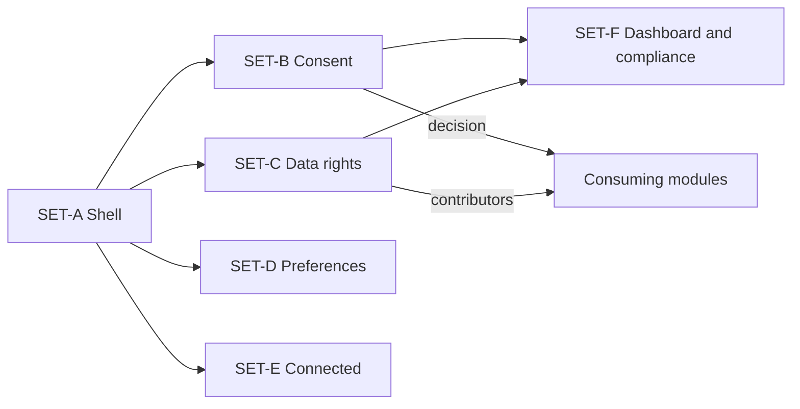
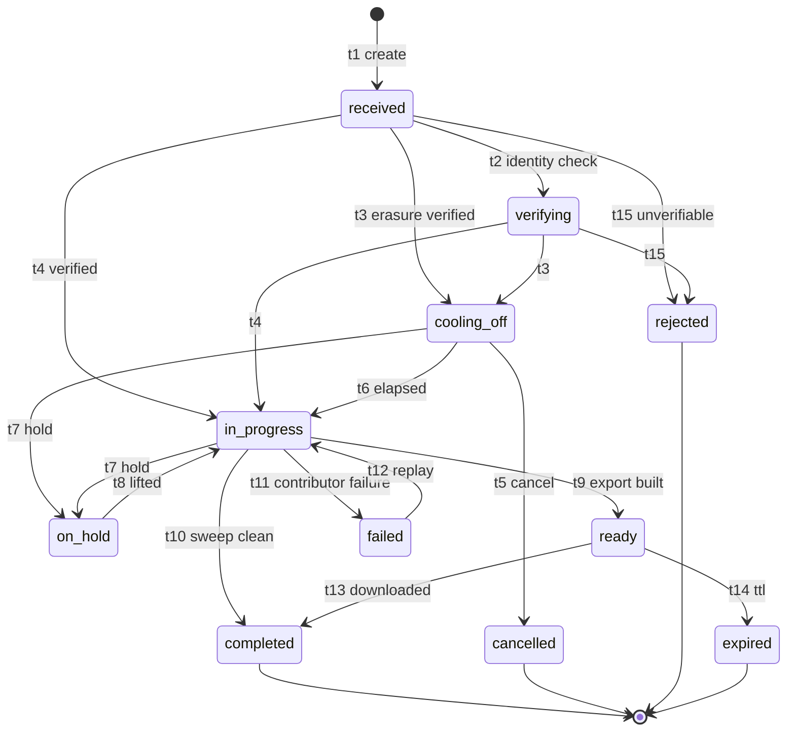
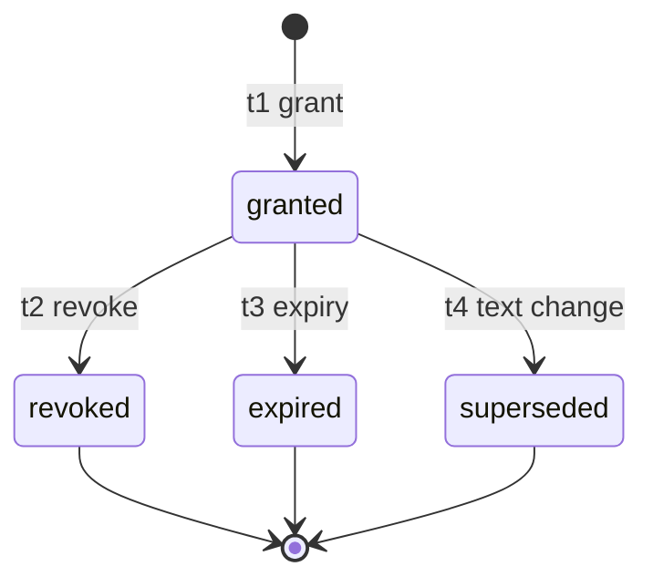
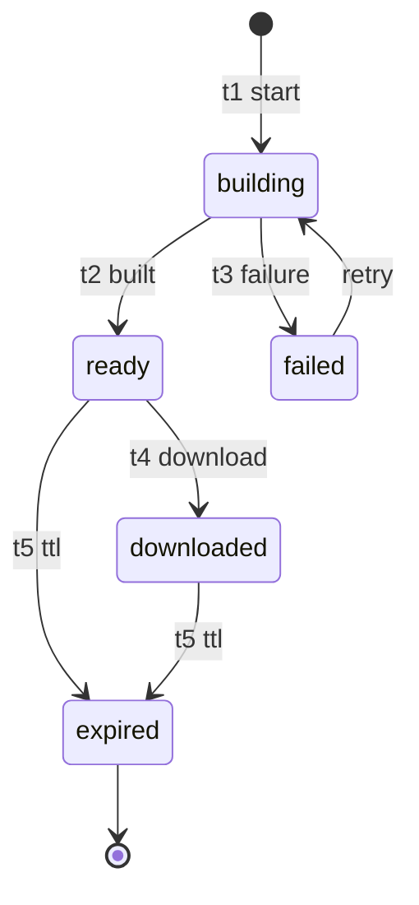
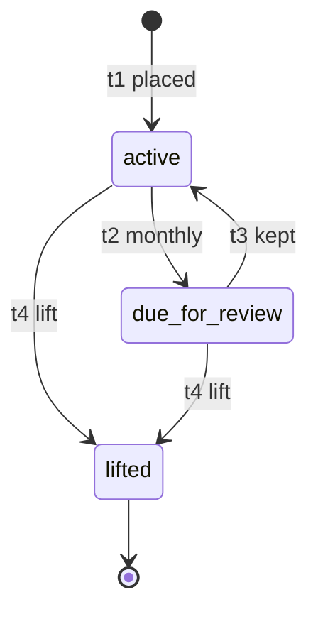
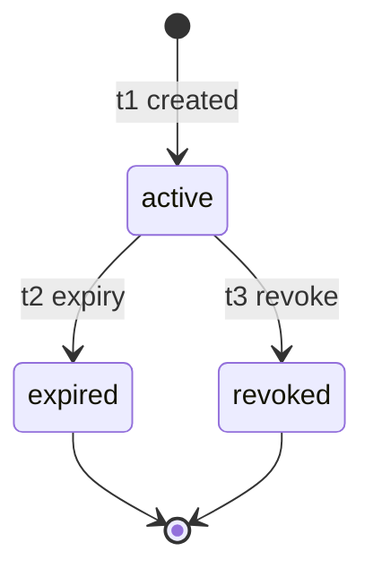
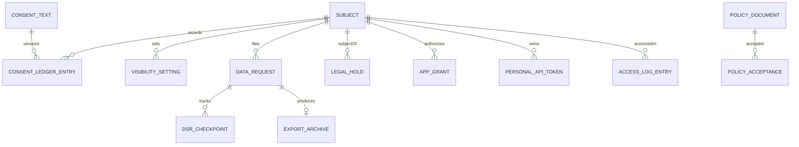

# SET — Settings, Privacy, Consent & Data Rights

Module code: `SET` · Group: Foundation · Release tier of the module: `R0` (consent ledger, export, erasure, settings shell), with `R2`–`R5` extensions noted per feature.

Status: intended design. Nothing in this file is a claim that anything is built (see [CONVENTIONS](../00_START_HERE/CONVENTIONS.md) §1).

## 1. Purpose, outcomes and boundaries

### 1.1 Purpose

SET is where a person controls their presence on the platform and where the platform proves it honors those controls. It owns the settings information architecture, the consent system (what each person allows, to whom, for what purpose, until when), the data-rights workflows (export, erasure, rectification, restriction, objection), retention policy, preference storage (language, time zone, accessibility, display), the registry of connected apps and personal API tokens, and the privacy dashboard that shows all of it in one place. Every module that reads personal data consumes SET's consent decision and never keeps its own copy of consent. [DER]

### 1.2 Outcomes

| Outcome | How the system knows |
|---|---|
| Recruiters and other parties see only what a person consented to | Read-time consent check on every consented read; consent change takes effect on the first read after commit (BR-SET-003); policy matrix tests |
| A person can see, change and withdraw every consent in one place | Consent screen lists every scope with purpose text, grantee, date and version (FR-SET-005); metric `SET-M01` |
| A person can take their data with them and leave completely | Export ready p95 ≤ 4 h; erasure complete ≤ 30 days from request (BR-SET-015); post-erasure sweep finds zero residuals |
| The platform never silently expands what it does with data | Purpose text is versioned; changed purposes need fresh consent (BR-SET-004) |
| Settings are findable and honest | Settings search and deep links; every setting states its effect and whether it is mandatory |
| Preferences follow the person everywhere | Language, time zone and accessibility settings apply to web, installed PWA and emails |

### 1.3 Scope

**In scope**
- Settings shell, navigation, search and deep links; account settings page (display of identity facts owned by IDN).
- Profile visibility presets and per-field visibility; "preview as" a recruiter or the public.
- Consent scopes, the append-only consent ledger, versioned purpose text, per-grantee grants with expiry, re-confirmation, blocklist, search exclusion, access log.
- Cookie and tracking consent, regional compliance rules and toggles, policy document versioning and acceptance ledger.
- Data export, erasure, rectification, restriction and objection requests; DSAR operations queue; legal hold; retention schedule engine.
- Locale, language, time zone, number and date formats; accessibility and display preferences.
- Connected apps (third parties authorized to act for the user), personal API tokens, connected external accounts (calendar and similar).
- Privacy dashboard; AI and personalization settings; settings change history; managed-account policy locks; guardian consent.

**Out of scope (owned elsewhere)**
- Authentication, credentials, sessions, MFA, account lifecycle states: `IDN` (this blueprint). SET triggers IDN operations (credential removal, account state) through events and calls.
- Notification preference matrix, quiet hours, channel delivery: `NTF` (this blueprint). SET shows an entry point and the unified unsubscribe landing is owned by NTF (FR-NTF-009).
- Profile content and résumé: `PRF` (planned). SET owns who may see it, not what it says.
- Search index mechanics: `SRC` (planned). SET supplies the consent predicate and removal events.
- OAuth client registration, public API gateway: `PLT` (planned). SET owns the user-side list and revocation of grants.
- Billing and invoices: `BIL` (planned). SET includes billing metadata in exports.
- Moderation and legal case management: `TSF`, `ADM` (planned). SET owns legal hold on data requests.

### 1.4 Owned versus consumed

| Owned by SET | Consumed by SET |
|---|---|
| Consent ledger and projection, consent text versions, visibility settings, blocklist, search restriction, data requests and checkpoints, export archives, legal holds, retention policy, preferences, connected-app grants, API tokens, policy documents and acceptance ledger, access-log projection, settings history | Account state and re-authentication (`IDN`); delivery (`NTF`); export and erase contributors from every module that holds personal data; access events from consuming modules; legal-hold decisions from `ADM` / counsel |

### 1.5 Design stance

1. One source of truth for consent. Visibility toggles never hold separate flags; they call the consent API. [SRC: Yash SPEC-02 §3.3]
2. Private by default. Every scope is off until the person turns it on; none is pre-ticked or bundled with terms. [SRC: Yash CSC §1]
3. Erasure is not soft delete. It is verified by a sweep across all stores. [SRC: Yash SPEC-13 §12]
4. Honest limits. Data already exported by a recipient cannot be recalled; the interface says so. [SRC: Yash SPEC-02 §9]
5. No legal claim. Statutory timelines and regional rules are policy parameters reviewed by counsel; this document specifies mechanism. [DER]

## 2. Roles and permission matrix

Legend: `S` self only · `O` own organization scope · `G` grant-bound and audited · `Y` yes · `—` no · `R` read-only.

| Capability | GUE | CAN/STD | INS/MNT/FRL | REC/HMG | EAD | IAD/PLO/EXA | MOD | SUP | FIN | PAD | SAD | API |
|---|---|---|---|---|---|---|---|---|---|---|---|---|
| Cookie consent | Y | — | — | — | — | — | — | — | — | — | — | — |
| Edit own settings and preferences | — | S | S | S | S | S | S | S | S | S | S | — |
| Set profile visibility and consents | — | S | S | — | — | — | — | — | — | — | — | — |
| Grant per-employer or per-institution consent | — | S | S | — | — | — | — | — | — | — | — | — |
| Request export or erasure | — | S | S | S | S | S | S | S | S | S | S | — |
| Read the access log of own data | — | S | S | S | S | S | — | — | — | — | — | — |
| Assist a locked-out subject's DSAR | — | — | — | — | — | — | — | G | — | G | Y | — |
| Operate DSR queue (replay, extend, reject) | — | — | — | — | — | — | — | — | — | Y | Y | — |
| Place or lift legal hold | — | — | — | — | — | — | — | — | — | G | Y | — |
| Create personal API tokens | — | S | S | S | S | S | — | — | — | S | S | — |
| Review and revoke connected apps | — | S | S | S | S | S | S | S | S | S | S | — |
| Publish a policy version | — | — | — | — | — | — | — | — | — | Y (change-controlled) | Y | — |
| Configure regional rules and retention | — | — | — | — | — | — | — | — | — | G | Y | — |
| Set org-wide managed policies | — | — | — | — | O | O | — | — | — | — | — | — |
| Read consent ledger aggregates (no personal rows) | — | — | — | — | — | — | — | — | — | R | R (auditor view) | — |
| Read a subject's raw ledger | — | S | S | S | S | S | — | G | — | G | G | — |

Rules: no staff role can read an export archive's contents (support can re-issue, not read). Recruiters and other third parties never read the ledger; they see only the allow or deny outcome. [SRC: Yash SPEC-13 §2, §8]

## 3. Sub-module map

| Code | Sub-module | Features |
|---|---|---|
| SET-A | Settings shell and account | FR-SET-001, 002 |
| SET-B | Visibility and consent | FR-SET-003, 004, 005, 006, 007, 008, 009, 010, 011, 012 |
| SET-C | Data rights | FR-SET-013, 014, 015, 016, 017, 018, 019 |
| SET-D | Preferences | FR-SET-020, 021, 022 |
| SET-E | Connected apps and tokens | FR-SET-023, 024, 025 |
| SET-F | Dashboard, compliance and governance | FR-SET-026, 027, 028, 029, 030, 031, 032 |

## 4. Feature specifications

Parameter notation: `{braces}` mark `[PROP]` policy defaults unless a source is cited; open ones are in section 13.

### Sub-module SET-A — Settings shell and account

### FR-SET-001 — Settings shell, information architecture and search

- **Sub-module:** SET-A Settings shell and account
- **Priority / tier:** Must · R0
- **Source:** [SRC: SSOT F-15 Settings, registry F-15]; IA and search [DER]
- **Purpose and outcome:** Every setting has one findable home. The user reaches any setting in at most three taps from the settings root or by search. The system knows by settings-search success rate and deep-link resolution.
- **Roles and permissions:** all authenticated roles `S`; `GUE` sees only cookie and language settings.
- **Preconditions and entry points:** Avatar menu → Settings; footer "Privacy"; deep links from emails and notices (`/settings/<section>#<setting>`); command search (`SRC` planned).
- **User interactions and actions:**
  1. Open Settings; see sections: Account and security, Privacy and consent, Notifications, Language and region, Accessibility and display, Connected apps and tokens, Data and deletion, plus role-specific sections (Organization, Instructor, Freelance) shown only in that role context.
  2. Type in "Search settings" to filter by name and synonym.
  3. Open a section; each setting shows a label, current value, one-line effect and a "Learn more" disclosure.
  4. Changes save per control with inline "Saved" status (no global save button), except destructive or sensitive ones which use a confirm dialog.
- **System behavior:** Settings are a registry of definitions `(key, section, type, default, scope [user|org|device], sensitivity, requiresStepUp, ownerModule)`; screens render from the registry so new settings appear in search automatically. Each save validates, persists with optimistic concurrency (ETag), writes settings history (FR-SET-030) and emits `set.setting.changed`. Device-scoped settings (theme, reduced motion) store on the device and, if signed in, sync to the account. The shell always shows which role context's settings are visible (IDN context switcher).
- **UI elements and controls:** Left navigation (becomes a drill-down list on mobile), search field (`role="search"`, results announced), setting rows with toggle, select, text, slider controls, "Saved" status live region, "Reset to default" per setting. States: loading skeleton, loaded, saving, saved, error with retry, offline (read-only with a banner).
- **Configuration options:** Platform: setting registry; hidden settings by region; feature flags per section. User: none beyond the settings themselves.
- **Business rules:** BR-SET-030, BR-SET-005.
- **Validation:** Setting values validated against the registry type, range and allowed list; unknown keys rejected `422`.
- **Inputs and outputs:** In: setting key and value. Out: new value, ETag, saved timestamp.
- **Filters, sorting, search:** Search by label, key and synonyms; results grouped by section; sort by relevance.
- **Notifications and communication:** Security-relevant changes send `set.setting_changed_notice` through the owning module's template (for example email change by IDN).
- **Error handling and edge cases:** Concurrent edit on two devices: second save gets `412` with the current value and a "Use theirs / Keep mine" prompt. Offline: values read from cache, edits disabled with explanation (except device-scoped ones which queue). Unknown deep link: opens Settings root with a notice. Removed setting: redirect to its replacement or root.
- **Dependencies:** FR-SET-030, FR-IDN-022 (context), `SRC` (planned).
- **Security and privacy:** Settings are readable only by the owner; org settings require org role; sensitive settings require step-up (FR-IDN-015).
- **Acceptance criteria:**
  - Given the settings root, when the user searches "timezone", then the Language and region setting is listed and opens at that control.
  - Given two devices editing the same setting, when the second saves a stale value, then `412` is returned and the current value shown.
  - Given a recruiter context, when opening Settings, then Candidate-only sections are not shown.
  - Given an unknown setting key in a request, when saved, then `422` is returned and nothing changes.

### FR-SET-002 — Account settings page (identity facts)

- **Sub-module:** SET-A Settings shell and account
- **Priority / tier:** Must · R0
- **Source:** [SRC: SSOT F-15; Yash SPEC-01]; [DER]
- **Purpose and outcome:** The user sees and edits the basic facts of their account in one place and reaches the security flows. The system knows by displayed values matching `IDN` and `PRF` truth.
- **Roles and permissions:** all authenticated roles `S`.
- **Preconditions and entry points:** Settings → Account and security.
- **User interactions and actions:**
  1. See display name, primary email with verified badge, phone (masked), account created date, roles and organizations, sign-in methods summary.
  2. Edit display name (saves inline) and public handle (if `PRF` supports it).
  3. Press "Change email", "Change password", "Manage passkeys", "Two-step verification", "Where you're signed in", "Phone number": each opens the IDN screen (SCR-IDN-014..017).
  4. Press "Deactivate account" or "Delete account" (goes to FR-SET-015 page with the difference explained).
- **System behavior:** This page reads from `IDN` (email, phone, methods, roles) and `PRF` (display name) and writes only display name through `PRF`'s API. It writes no credential data. Role chips link to the role's context.
- **UI elements and controls:** Read-only fact rows, text input for display name, link buttons to security flows, danger zone section (deactivate, delete) visually separated. States: loaded, saving, error.
- **Configuration options:** Platform: display name rules. User: none.
- **Business rules:** BR-SET-030.
- **Validation:** Display name 1–80 characters, no control characters, trimmed.
- **Inputs and outputs:** In: display name. Out: updated name.
- **Filters, sorting, search:** n/a — single-record page.
- **Notifications and communication:** none.
- **Error handling and edge cases:** Display name change blocked while a name-affecting verification is pending (`EVD` planned) with an explanation. Managed accounts (FR-SET-031): name may be locked by the institution with the reason shown.
- **Dependencies:** `IDN`, `PRF` (planned), FR-SET-031.
- **Security and privacy:** Email and phone are shown masked in screenshots-safe form until the user presses "Show".
- **Acceptance criteria:**
  - Given a signed-in user, when opening Account, then email, verified state and sign-in methods match IDN data.
  - Given a display name of 81 characters, when saved, then `422` is returned.
  - Given the user presses "Change password", when the page opens, then the IDN screen is shown and step-up is requested if stale.
  - Given a managed account with a locked name, when editing, then the field is disabled with the reason.

### Sub-module SET-B — Visibility and consent

### FR-SET-003 — Profile visibility presets and per-field visibility

- **Sub-module:** SET-B Visibility and consent
- **Priority / tier:** Must · R1
- **Source:** [SRC: Yash SPEC-02 §3.1, §4 SCR-VISIBILITY]
- **Purpose and outcome:** A candidate decides, field by field and by preset, who may see their profile. The system knows by a visibility map plus the consent rows it implies.
- **Roles and permissions:** `CAN, STD, INS, MNT, FRL: set own`; others `—`.
- **Preconditions and entry points:** Settings → Privacy and consent → "Who can see my profile"; onboarding step (FR-IDN-021); profile editor links.
- **User interactions and actions:**
  1. See a table: rows = profile fields (headline, summary, location, skills, work history, education, evidence summary, links, photo, contact details), columns = audiences (Only me, Employers I apply to, Recruiters who find me, Anyone with my public page).
  2. Choose a preset: "Private", "Apply-only" (default), "Discoverable summary", or "Custom".
  3. Change a cell; the page shows which consents the change will create ("This lets all verified employers find your summary in search") before saving.
  4. Confirm; see the result in the preview (FR-SET-004).
- **System behavior:** Per-field visibility is one of `private`, `applications` (only inside submitted application snapshots), `discoverable` (recruiter search with `search.discoverable`), `public` (with `profile.public_view`). Any choice that implies a consent scope creates or revokes the grant through the consent API in the same transaction (BR-SET-006); there is no second flag. Defaults: everything `private` except fields the candidate shares in an application. Contact details are never `public` or `discoverable`; they require an explicit employer grant (FR-SET-007). The change emits `set.visibility.changed` and `set.consent.changed`, which invalidate caches and update the search index (≤ 15 min removal).
- **UI elements and controls:** Preset radio group, matrix of select controls (one per cell group with text labels, not color-only), "What changes" summary panel, "Save changes" (primary), "Cancel". States: unchanged, dirty, saving, saved, error, blocked field (explains why, e.g. "Contact details can only be shared with a specific employer").
- **Configuration options:** Platform: preset definitions; fields allowed per audience. User: choices.
- **Business rules:** BR-SET-005, BR-SET-006, BR-SET-007.
- **Validation:** Each field's allowed audiences from the field catalog; contact fields restricted; preset must exist.
- **Inputs and outputs:** In: visibility map or preset. Out: saved map, derived consent changes.
- **Filters, sorting, search:** Fields grouped by profile section; search within list.
- **Notifications and communication:** none on save; a confirmation toast only.
- **Error handling and edge cases:** Indexer lag: search may show a stale entry for ≤ 15 min but profile fetch is denied immediately. Concurrent change: `412` and refreshed map. Candidate with active applications: changing visibility never alters snapshots already submitted (they are consented per application). Photo flagged by scan: shown as hidden regardless of setting.
- **Dependencies:** FR-SET-006, FR-SET-004, `PRF`, `SRC` (planned), ENT-SET-01.
- **Security and privacy:** Visibility state is `Confidential`; read-only for staff only under grant; DT-01-style predicate evaluated per read.
- **Acceptance criteria:**
  - Given a new account, when a recruiter searches or an anonymous visitor opens the profile URL, then the profile is not found.
  - Given the user sets headline to `discoverable`, when saved, then a `search.discoverable` grant row exists and the index is notified.
  - Given the user tries to set contact details to `public`, when saved, then `422` is returned with the explanation.
  - Given the user reverts to Private, when saved, then recruiter reads are denied on the next request and the index entry is removed within 15 minutes.

### FR-SET-004 — Preview as recruiter or public visitor

- **Sub-module:** SET-B Visibility and consent
- **Priority / tier:** Must · R1
- **Source:** [SRC: Yash SPEC-02 FEAT-03-02.2]
- **Purpose and outcome:** The candidate sees exactly what each audience would see before and after changing settings. The system knows because the preview uses the same predicate as real reads.
- **Roles and permissions:** `CAN, STD, INS, MNT, FRL: S`.
- **Preconditions and entry points:** Button "Preview as…" on the visibility page and on the profile editor.
- **User interactions and actions:**
  1. Choose an audience: "A recruiter who finds me in search", "An employer I applied to", "A specific employer" (pick from grants), "Anyone with my public link", "A connection" (`NET` planned).
  2. See the rendered profile for that audience with hidden fields marked by a labeled placeholder ("Hidden from this audience").
  3. Toggle "Compare with current settings" to see the effect of unsaved changes.
- **System behavior:** Calls the same decision function as production reads with a synthetic principal of the chosen audience and the user's saved (or draft) settings; never shows data the real audience could not see; draft preview does not persist anything. The preview page sets `noindex, no-store`.
- **UI elements and controls:** Audience select, rendered profile pane, placeholder chips, compare toggle, "Back to settings". States: loading, rendered, no data, error.
- **Configuration options:** Platform: list of audiences.
- **Business rules:** BR-SET-006, BR-SET-007.
- **Validation:** Audience must be in the catalog; specific-employer audience must be an active grantee.
- **Inputs and outputs:** In: audience, optional draft map. Out: rendered view model.
- **Filters, sorting, search:** n/a — single-record page.
- **Notifications and communication:** none.
- **Error handling and edge cases:** Draft invalid: preview shows validation errors. Profile empty: empty-state text. Decision service down: preview disabled with message, saving settings still possible.
- **Dependencies:** FR-SET-003, `PRF` (planned).
- **Security and privacy:** Preview output is never cached and never leaves the owner's session.
- **Acceptance criteria:**
  - Given a headline set `discoverable`, when previewing as "recruiter who finds me", then the headline appears and contact details show as hidden.
  - Given an unsaved draft, when "Compare" is on, then both views render and nothing is saved.
  - Given the preview and a real recruiter read for the same data, when compared, then the visible fields are identical.
  - Given an unknown audience value, when requested, then `422` is returned.

### FR-SET-005 — Consent management screen

- **Sub-module:** SET-B Visibility and consent
- **Priority / tier:** Must · R1
- **Source:** [SRC: Yash SPEC-02 §3.2, CSC §3]; screen design [SRC: Yash SPEC-02 §4 SCR-CONSENTS]
- **Purpose and outcome:** The user sees every consent scope, turns each on or off, and reviews history. The system knows by ledger rows and the derived current projection.
- **Roles and permissions:** `CAN, STD, INS, MNT, FRL: S`; `G` for support reads of the raw ledger.
- **Preconditions and entry points:** Settings → Privacy and consent → "Consents"; links from prompts at the point of use (for example "Allow recruiters to message you").
- **User interactions and actions:**
  1. See scopes grouped by purpose: Discovery (`search.discoverable`, `evidence.share_summary`, `profile.public_view`), Contact (`outreach.recruiter_contact`, `profile.share_contact`), Sharing with specific parties (`evidence.share_artefact`, `evidence.share_institution`, `alumni.share_outcomes`), Intelligence (`matching.recommend`, `ai.assist.process`), Product (`analytics.product`), Marketing (`comms.marketing_email`).
  2. Each row shows purpose text (reading grade ≤ 9), who it applies to, current state, date and text version, a switch, and "What happens if I turn this off".
  3. Switch on or off; the change applies on confirm for scopes with consequences, otherwise immediately; a live-region message confirms.
  4. Open the History tab to see every grant and revoke with date, version and source.
- **System behavior:** `PUT /me/consents/{scope}` body `{granted, policyVersion, granteeType?, granteeId?, targetType?, targetId?, fieldSet?, expiresAt?}` validated against the scope's grain (FR-SET-006); appends to the ledger and updates `consent_current` in the same transaction; emits `set.consent.changed`; consumers (search indexer, cache invalidator) react. `application.share_snapshot` is implicit per application, shown read-only in the list of applications, not as a switch. `data.research_aggregate` is hidden until OD-SET-05 is decided. A grant requires the current text version; turning on never bundles another scope (BR-SET-005).
- **UI elements and controls:** Switch (programmatic name = purpose label; state announced), purpose text, grantee chip, date and version label, "History" tab, "Learn more" disclosure, per-grantee lists (FR-SET-007). No pre-ticked boxes, no dark patterns: "Turn off" is as prominent as "Turn on". States: loading, loaded, saving, saved, conflict (`412`), error.
- **Configuration options:** Platform: scope catalog and text versions; regional hiding of scopes (FR-SET-027).
- **Business rules:** BR-SET-001, BR-SET-002, BR-SET-003, BR-SET-005.
- **Validation:** Scope exists; `policyVersion` equals the current text version; grain fields match the scope class; `expiresAt` in the future and ≤ 24 months where allowed.
- **Inputs and outputs:** In: scope change. Out: new ledger row id and projection.
- **Filters, sorting, search:** History tab filter by scope and date; sorted newest first; paginated 50.
- **Notifications and communication:** `set.consent_changed_confirmation` in-app only; revoke of `evidence.share_artefact` notifies the affected org's admin contact generically (no reason) via `NTF`.
- **Error handling and edge cases:** Revoke during a recruiter's session: recruiter's next read denied; previously exported data is not recalled and the copy says so. Double toggle: idempotent by `(scope, grantee, target)` state. Stale text version: `409 policy_version_stale` with the current text. Network failure: switch reverts with an error message.
- **Dependencies:** FR-SET-006, FR-SET-007, FR-SET-008, FR-SET-027, ENT-SET-02, ENT-SET-03.
- **Security and privacy:** Ledger append-only; the application role cannot update or delete rows (database-enforced); IDOR tests on every endpoint.
- **Acceptance criteria:**
  - Given a new account, when opening Consents, then every switch is off and none is pre-ticked.
  - Given the user grants `search.discoverable`, when saved, then a ledger row with scope, text version and time exists and the candidate appears in search within 15 minutes.
  - Given the user revokes it, when a recruiter fetches the profile next, then the first read is denied.
  - Given a grant request with a stale text version, when submitted, then `409` is returned.

### FR-SET-006 — Consent ledger, projection and versioned purpose text (engine)

- **Sub-module:** SET-B Visibility and consent
- **Priority / tier:** Must · R0
- **Source:** [SRC: Yash CSC §1–§6, INV-T35; SSOT §15.2, V61-16]
- **Purpose and outcome:** All consent decisions come from one append-only ledger and one decision function used by every module. The system knows because no module stores consent and the decision is evaluated at read time.
- **Roles and permissions:** `API/service: evaluate`; `PAD, SAD: publish text versions`; no role can update or delete ledger rows.
- **Preconditions and entry points:** Called by FR-SET-005, FR-SET-007, application submit (`JOB` planned), institution sharing (`INS` planned), search (`SRC` planned).
- **User interactions and actions:** none directly; operators manage text versions in FR-SET-028's console; engineers consume `consent.check(subject, scope, grantee, target)`.
- **System behavior:** Ledger row: `(id, subjectRef, scope, textVersion, granteeType, granteeId, targetType, targetId, fieldSet, action [grant|revoke], expiresAt, source [ui|api|application|system], at)`. Grain classes per scope: account, audience (all verified orgs), grantee (one org or institution), grantee-object (org plus optional evidence), application (job's org plus application id). `consent_current` is a rebuildable fold of the ledger and is verified by an equivalence test. Evaluation is read-time with no cache that outlives the revoking transaction (BR-SET-003); caches keyed by `consent_epoch` bump on change. Expired grants evaluate as not granted at `expiresAt` without a job (time compare), and a sweeper writes the `expire` ledger row and notifies. System-sourced rows exist only for application snapshots and graduation severance. The decision function is generated from one rule definition and also produces the SQL filter used by search so both stay equal.
- **UI elements and controls:** n/a — engine feature (operator view in FR-SET-028).
- **Configuration options:** Platform: scope catalog (ids, grain class, default, expiry policy, linked rules); text versions with `effectiveAt`; `{consent.maxExpiryMonths}` 24.
- **Business rules:** BR-SET-001, BR-SET-002, BR-SET-003, BR-SET-004.
- **Validation:** Scope id matches `^[a-z]+\.[a-z_]+(\.[a-z_]+)?$` and is in the catalog; grain fields consistent (a database check); ids never reused or renamed.
- **Inputs and outputs:** In: grant or revoke command; check query. Out: ledger row; decision `{allow, reason}`.
- **Filters, sorting, search:** Ledger queries by subject, scope, grantee, time.
- **Notifications and communication:** Expiry sweeper triggers FR-SET-007 reminders and expiry notices.
- **Error handling and edge cases:** Ledger write failure: the user action fails (no partial state). Projection drift detected by the equivalence test: alert and rebuild. Decision service unavailable: consuming module denies (fail closed). Clock skew: all comparisons on server time.
- **Dependencies:** ENT-SET-02, ENT-SET-03, ENT-SET-04, every consuming module.
- **Security and privacy:** Rows hold an opaque subject reference; after erasure the identity mapping is deleted so rows no longer resolve to a person while keeping audit integrity (BR-SET-017). Ledger is `Confidential`; database grants forbid UPDATE and DELETE for the application role.
- **Acceptance criteria:**
  - Given the application database role, when it attempts to UPDATE or DELETE a ledger row, then the database denies it.
  - Given the ledger, when `consent_current` is rebuilt from it, then it equals the live projection.
  - Given a grant with `expiresAt` in the past minute, when a read is evaluated, then it is denied without waiting for a job.
  - Given the decision service is down, when a consuming module asks, then access is denied.

### FR-SET-007 — Per-grantee grants with expiry and reminders

- **Sub-module:** SET-B Visibility and consent
- **Priority / tier:** Must · R2
- **Source:** [SRC: Yash SPEC-02 §3.2, CSC §3.2; AC-22-01-03, AC-22-01-06]
- **Purpose and outcome:** A candidate shares evidence files or contact details with one named employer or institution, optionally until a date. The system knows by grant rows bound to that grantee.
- **Roles and permissions:** `CAN, STD, FRL: S`; `REC, HMG: request (not grant)`.
- **Preconditions and entry points:** Prompt in a recruiter's "Request access" message (`ATS` planned); Consents screen → "Shared with specific organizations"; evidence item sharing control (`EVD` planned).
- **User interactions and actions:**
  1. Open a request ("Acme Corp asks to open your evidence files and contact details") with purpose text.
  2. Choose scope (evidence: all or selected items; contact details), expiry (default {12 months}, options 30 days, 90 days, 12 months, until revoked where allowed), and press "Allow" or "Decline".
  3. Later, see the list "Shared with" by org with scope, date, expiry; press "Stop sharing".
- **System behavior:** Creates a grantee-object grant (`evidence.share_artefact`, optionally target evidence id) or grantee grant (`profile.share_contact`). Reads by that org pass the decision function; other orgs get `403/404` with no existence leak. Revocation stops new signed-URL issuance and reads; URLs already issued lapse within their ≤ 5 minute life. A reminder is sent 14 days before expiry; at expiry the grant ends automatically. Grants end automatically if the org is closed. Blocklisted orgs cannot be granted (FR-SET-010).
- **UI elements and controls:** Request card with Allow and Decline, scope checklist, expiry select, "Shared with" table with "Stop sharing" buttons, confirmation dialog stating that already-downloaded copies are not recalled. States: pending request, granted, declined, expired, revoked.
- **Configuration options:** Platform: default expiry 12 months (OD-SET-06), reminder lead 14 days. User: expiry choice.
- **Business rules:** BR-SET-008, BR-SET-003, BR-SET-010.
- **Validation:** Grantee org exists and is verified and not blocked; evidence ids belong to the subject; expiry ≤ 24 months.
- **Inputs and outputs:** In: grant command. Out: ledger row; list.
- **Filters, sorting, search:** Filter by org, scope, status; sort by expiry.
- **Notifications and communication:** `set.grant_expiring` (14 days, class: privacy-mandatory); `set.grant_expired`; org-side `ats.access_granted` is owned by `ATS` (planned).
- **Error handling and edge cases:** Org B recruiter opens an artefact granted to Org A: `403/404`, no leak. Org deleted: grants end, user informed. Evidence deleted by user: grant stays but item missing. Candidate blocks org after granting: grant revoked.
- **Dependencies:** FR-SET-006, FR-SET-010, `EVD`, `ATS` (planned), `EMP` (planned).
- **Security and privacy:** Per-employer access logged to the access log (FR-SET-012).
- **Acceptance criteria:**
  - Given a grant to Org A, when an Org B recruiter opens the artefact URL, then `403/404` is returned and existence is not revealed.
  - Given a 12-month grant, when day 349 arrives, then a reminder is sent; at day 365 access is denied.
  - Given the user stops sharing, when the org's recruiter reads next, then the read is denied.
  - Given a blocklisted org, when the user tries to grant, then `422 org_blocked` is returned.

### FR-SET-008 — Re-confirmation prompts and purpose-text changes

- **Sub-module:** SET-B Visibility and consent
- **Priority / tier:** Should · R2
- **Source:** [SRC: Yash SPEC-02 §5, CSC §3.2, §1 "description change"]; conflict recorded in OD-SET-03
- **Purpose and outcome:** Long-lived consents are re-confirmed, and a changed purpose never silently extends what was agreed. The system knows by a text version on each grant and a re-confirm date.
- **Roles and permissions:** `CAN, STD, INS, MNT, FRL: S`; `PAD: publish text versions`.
- **Preconditions and entry points:** A banner on Settings and the home screen when a re-confirmation is due or a text changed.
- **User interactions and actions:**
  1. See "Your discovery setting is 12 months old. Keep it on?" with "Keep on", "Turn off".
  2. See "We changed what <scope> means. Review the new text" with a diff and "Agree to new text" or "Turn off".
- **System behavior:** `search.discoverable` and `profile.public_view` prompt every {12 months}; the prompt is not an expiry. If a text version changes in meaning, the scope's grants are treated as not granted until re-confirmed [SRC: CSC §1]; if only wording changes (non-material flag), existing grants stay bound to the old version [SRC: SPEC-02 AC-22-01-04]. A grace of {14 days} applies before suspension of the affected processing, with notice at publish, 7 days and 1 day. Re-confirmation writes a new grant row (never edits).
- **UI elements and controls:** Banner, diff view (old vs new), "Keep on", "Agree to new text", "Turn off". States: due, confirmed, declined, grace ended.
- **Configuration options:** Platform: reprompt interval 12 months; grace 14 days; material flag per version.
- **Business rules:** BR-SET-004, BR-SET-009.
- **Validation:** New text version must have a materiality flag and effective date before publish.
- **Inputs and outputs:** In: confirmation. Out: new ledger row.
- **Filters, sorting, search:** n/a — banner flow.
- **Notifications and communication:** `set.reconfirm_due` (privacy-mandatory, email once plus in-app); `set.text_changed`.
- **Error handling and edge cases:** User ignores: processing under that scope pauses after grace; no data deleted. User confirms stale version: `409`. Text rolled back: versions never deleted; a new version is published.
- **Dependencies:** FR-SET-006, FR-SET-028, FR-NTF-001.
- **Security and privacy:** Prompts never pre-select "keep"; both choices equally prominent.
- **Acceptance criteria:**
  - Given a material change to `matching.recommend` text, when the grace ends without action, then recommendations stop and nothing is deleted.
  - Given a non-material wording change, when published, then existing grants remain active under the old version.
  - Given a re-confirmation due, when the user presses "Turn off", then a revoke row is written.
  - Given the banner, when displayed, then "Keep on" and "Turn off" have equal visual weight.

### FR-SET-009 — Cookie and tracking consent

- **Sub-module:** SET-B Visibility and consent
- **Priority / tier:** Must · R0
- **Source:** [DER] from SSOT §15.9 (GDPR, CCPA) and CSC `analytics.product`; [PROP] banner design and GPC
- **Purpose and outcome:** Visitors and users choose which non-essential storage and analytics are allowed, in regions that require it. The system knows by a stored choice and no non-essential tag firing before consent.
- **Roles and permissions:** `GUE: choose`; authenticated users: change in Settings.
- **Preconditions and entry points:** First visit in a region with opt-in rules; footer link "Privacy choices".
- **User interactions and actions:**
  1. See a banner with "Accept all", "Reject non-essential", "Choose" (equal prominence, no consent wall).
  2. In "Choose", toggle categories: Strictly necessary (always on, explained), Preferences, Analytics, Marketing/partners (only if any exists).
  3. Save; reopen anytime from the footer link or Settings.
- **System behavior:** Region from edge geolocation and account country; the rules engine (FR-SET-027) decides: opt-in regions block non-essential tags until accepted; opt-out regions load defaults but honor "Do not sell or share" and the Global Privacy Control signal as a rejection. Strictly necessary storage (session, CSRF, locale) needs no consent. Choice stored in a first-party cookie (≤ 12 months, then re-asked) and, for signed-in users, written to the ledger as `analytics.product` grant or revoke so server-side analytics also obeys. Signed-in changes sync across devices. Tag manager loads only categories allowed.
- **UI elements and controls:** Banner (non-modal region placed first in keyboard order, not a blocking dialog), buttons with equal size, category toggles with descriptions, "Save choices". States: undecided, accepted, rejected, custom.
- **Configuration options:** Platform: region rules; cookie inventory (name, purpose, category, duration, provider); re-ask interval 12 months.
- **Business rules:** BR-SET-033, BR-SET-005.
- **Validation:** Categories from a closed list; inventory entry required before a new cookie ships (CI check).
- **Inputs and outputs:** In: choice. Out: stored choice; tag loading decisions.
- **Filters, sorting, search:** n/a — single control.
- **Notifications and communication:** none.
- **Error handling and edge cases:** Cookies blocked entirely: choice cannot persist; banner shows each visit but non-essential stays off. GPC present: treated as reject for analytics and sale/share. Region unknown: strictest rule. Choice changed to reject: already-set analytics cookies removed.
- **Dependencies:** FR-SET-027, FR-SET-006, analytics (`ANL` planned).
- **Security and privacy:** No fingerprinting as a substitute. Choice records contain no identifiers beyond a random consent id for visitors.
- **Acceptance criteria:**
  - Given an opt-in region, when a visitor loads the page, then no analytics tag fires before acceptance.
  - Given GPC is sent, when a visitor loads, then analytics stay off and the banner reflects it.
  - Given the user rejects after accepting, when saved, then analytics cookies are removed and the ledger records revoke.
  - Given the banner, when navigated by keyboard, then all options are reachable and equal in prominence.

### FR-SET-010 — Organization blocklist

- **Sub-module:** SET-B Visibility and consent
- **Priority / tier:** Should · R2
- **Source:** [SRC: Yash SPEC-02 FEAT-03-09.3, INV-T40]
- **Purpose and outcome:** A candidate hides from named employers (for example their current employer). The system knows because blocked orgs never see or contact the candidate.
- **Roles and permissions:** `CAN, STD, FRL: S`.
- **Preconditions and entry points:** Settings → Privacy → "Hide from employers"; prompt at onboarding ("Hide from my current employer?").
- **User interactions and actions:**
  1. Search for an organization by name or domain; press "Hide from this employer".
  2. See the list; remove an entry with confirmation.
  3. Optionally import a hint list from work history employers.
- **System behavior:** Up to {200} orgs. Applied to search results, shortlist suggestions, outreach and any grant; blocked org members cannot find, view or message the candidate. The candidate remains free to apply; applying to a blocked org prompts "You're hiding from this employer. Apply and unhide for this application?" and applies only after confirmation (explicit action clears the block for that org). Block applies to all members of the org. The org is never told it is blocked (it simply does not see the candidate).
- **UI elements and controls:** Org search combobox, list with "Remove" buttons, empty state "You haven't hidden from anyone". States: loading, list, limit reached.
- **Configuration options:** Platform: max 200. User: list.
- **Business rules:** BR-SET-010.
- **Validation:** Org exists (verified or domain-matched); no duplicates; ≤ 200.
- **Inputs and outputs:** In: org id. Out: updated list.
- **Filters, sorting, search:** Search by name or domain; list sorted by date added.
- **Notifications and communication:** none (the org is not told).
- **Error handling and edge cases:** 201st entry: `422`. Org merges or renames: block follows org id. Org not on platform: block by verified domain, applied when it joins.
- **Dependencies:** `SRC`, `ATS`, `MSG` (planned), `EMP` (planned), ENT-SET-06.
- **Security and privacy:** Blocklist is `Confidential`; blocked orgs cannot infer it from errors (indistinguishable from "not discoverable").
- **Acceptance criteria:**
  - Given the candidate blocks Org X, when an Org X recruiter searches, then the candidate is absent.
  - Given 200 entries, when adding the 201st, then `422` is returned.
  - Given the candidate applies to Org X after confirmation, when applied, then the recruiter sees the application only.
  - Given a blocked org, when its recruiter requests a grant, then no request reaches the candidate.

### FR-SET-011 — Search exclusion (restriction)

- **Sub-module:** SET-B Visibility and consent
- **Priority / tier:** Should · R2
- **Source:** [SRC: Yash BR-T069, FEAT-22-10]
- **Purpose and outcome:** A person who is otherwise active asks to be removed from recruiter search while still applying and messaging. The system knows by absence from the index.
- **Roles and permissions:** `CAN, STD, FRL: S`.
- **Preconditions and entry points:** Settings → Privacy → "Hide me from recruiter search"; data-rights page (FR-SET-016 restriction).
- **User interactions and actions:**
  1. Turn on "Exclude me from recruiter search".
  2. See a note: applications and messaging are unaffected.
- **System behavior:** Sets `searchRestricted` on the subject independent of consent scopes (it is a profile setting, not a scope); index membership excludes the account within ≤ 15 minutes and profile fetch by search-origin reads is denied immediately; it overrides `search.discoverable`. Turning it off does not re-grant `search.discoverable`; the user must choose that separately.
- **UI elements and controls:** Switch, explanatory text. States: on, off.
- **Configuration options:** Platform: none.
- **Business rules:** BR-SET-011.
- **Validation:** Boolean.
- **Inputs and outputs:** In: boolean. Out: stored flag.
- **Filters, sorting, search:** n/a — single control.
- **Notifications and communication:** none.
- **Error handling and edge cases:** Active application: recruiters of that job still see it. Index lag: fetch denied before removal.
- **Dependencies:** `SRC` (planned), FR-SET-006.
- **Security and privacy:** Restriction is honored by every search surface including internal talent pools (`ATS`).
- **Acceptance criteria:**
  - Given exclusion is on, when a recruiter searches, then the profile is absent.
  - Given an active application, when the recruiter opens the applicant list, then the application is still visible.
  - Given exclusion turned off, when searching, then the profile appears only if `search.discoverable` is granted.
  - Given the setting just saved, when a search-origin fetch occurs, then it is denied immediately.

### FR-SET-012 — Access log ("who viewed my data")

- **Sub-module:** SET-B Visibility and consent
- **Priority / tier:** Should · R2
- **Source:** [SRC: Yash BR-T068, FEAT-22-04, INV-T18]
- **Purpose and outcome:** A person sees which organizations accessed their data and for what purpose. The system knows by access rows written by consuming modules.
- **Roles and permissions:** `CAN, STD, INS, MNT, FRL, REC, HMG, EAD: S`; `SUP: G`.
- **Preconditions and entry points:** Settings → Privacy → "Who accessed my data".
- **User interactions and actions:**
  1. See a timeline: organization, purpose (search result view, application review, artefact open, support view), time.
  2. Filter by purpose and date; press an entry to see the scope of data (fields category, not content).
  3. Press "Stop sharing with this organization" shortcut where a grant exists.
- **System behavior:** Consuming modules emit access events `(subjectRef, accessorOrg, accessorRole class, purpose, resourceClass, at)`; SET stores them. Individual recruiter names are shown only if the org's policy allows (BR-SET-012); otherwise the org name. Support and admin accesses always appear with agent role (name per OD-IDN-10). Retention {24 months}. Counts aggregate repeated views by the same org within a day.
- **UI elements and controls:** Timeline list, filters, entry detail drawer, "Stop sharing" shortcut. States: loading, empty ("No one has accessed your data yet"), list, error.
- **Configuration options:** Platform: retention 24 months; org policy flag `showRecruiterNames` (default off).
- **Business rules:** BR-SET-012.
- **Validation:** Filter values from closed lists.
- **Inputs and outputs:** In: filters. Out: paginated entries.
- **Filters, sorting, search:** Filter by purpose, organization, date; sorted newest first; paginated 50.
- **Notifications and communication:** Optional digest "Employers viewed your profile this week" (preference class: engagement, FR-NTF-016).
- **Error handling and edge cases:** Access event lost: the consuming module's outbox retries; absent events are a defect, not a silent gap. Viewer privacy mode: recruiter-side privacy modes cannot hide from this log (BR-SET-012).
- **Dependencies:** `SRC`, `ATS`, `JOB`, `EVD` (planned), ENT-SET-12.
- **Security and privacy:** Entries reveal no content of the data accessed; rows are minimal.
- **Acceptance criteria:**
  - Given a recruiter opened the profile via search, when the user opens the log, then an entry with org and purpose appears.
  - Given org policy hides names, when the entry is shown, then only the org is named.
  - Given a support impersonation, when it occurs, then the entry appears with the support role.
  - Given 24 months pass, when the retention job runs, then the entry is deleted.

### Sub-module SET-C — Data rights

### FR-SET-013 — Data export request and archive build

- **Sub-module:** SET-C Data rights
- **Priority / tier:** Must · R1
- **Source:** [SRC: Yash SPEC-13 §3.1, BR-T064; SSOT §15.9.1 Articles 15 and 20, F-15 "JSON export"]
- **Purpose and outcome:** A person receives a complete, machine-readable copy of their own data. The system knows by a manifest with per-file hashes and counts per category.
- **Roles and permissions:** all authenticated roles `S`; `SUP: re-issue (cannot read)`; `PAD: operate failed builds`.
- **Preconditions and entry points:** Settings → Data and deletion → "Download my data"; fresh step-up (FR-IDN-015); not in `pending_erasure` after execution started.
- **User interactions and actions:**
  1. Press "Request export"; read what is included and excluded; choose format extras (JSON default; optional JSON Resume and Open Badges files, CSV for tables).
  2. Complete step-up; confirm.
  3. See status: Received, Building, Ready (with expiry date), Failed (with retry).
  4. Receive an email that links to the authenticated page, not to the file.
- **System behavior:** `POST /me/data-requests {type:"export"}` with an idempotency key creates a request (SM-SET-01) with `deadlineAt` = request time + {30 days}. One open request per type; at most one completed export per {24 h}. The orchestrator asks every registered export contributor for the subject's data; CI fails if a module that owns personal-data tables has no contributor (BR-SET-014). Archive: ZIP with `manifest.json` (schema version, generated_at, categories, counts, sha256 per file), `data/*.json` UTF-8, `files/` for artefacts, `README.txt`; parts ≤ 2 GB. Categories: Account (emails, dates, policy acceptances, passkey names without keys, session metadata), Profile, Evidence, Verification (outcomes, not referee free text without referee consent), Learning and assessment, Applications (submitted answers, snapshots, status history, notes visible to the candidate), Messages (own thread content, counterpart by display name and role), Consents (full ledger), Billing metadata (no card data), Notifications (preferences and delivery log), Access log, Gamification (XP ledger, badges, streaks, reputation explanation), Settings. Excluded: other people's personal data, fraud and abuse signals, reporter identities, secrets, internal staff security notes (list reviewed, OD-SET-07). Build streams to object storage in a dedicated bucket with lifecycle expiry; job checkpoints allow resume. Emit `set.export.ready`.
- **UI elements and controls:** Request page with included/excluded lists, format checkboxes, "Request export" (primary), status timeline, "Retry" on failure, "Cancel request" while queued. States: none, queued, building, ready, failed, expired.
- **Configuration options:** Platform: `{export.minIntervalHours}` 24; `{export.archiveTtlDays}` 7; `{export.partMaxGb}` 2; contributor registry. User: format extras.
- **Business rules:** BR-SET-013, BR-SET-014, BR-SET-020.
- **Validation:** Step-up fresh; one open request per type; interval since last completed export ≥ 24 h.
- **Inputs and outputs:** In: type, formats, idempotency key. Out: request id and status; archive on completion.
- **Filters, sorting, search:** Request history list sorted newest first.
- **Notifications and communication:** `set.export_ready` (email, link to authenticated page only, class privacy-mandatory); `set.export_failed` (in-app).
- **Error handling and edge cases:** Stale step-up: `403 reauth_required`. Second export within 24 h: `429`. Build crash: resumes from checkpoint, same request id, one archive. Contributor failing: request `failed`, ops alert, replay after fix; the deadline clock stays visible to staff. Very large account: split into parts. Export during `deactivated`: allowed.
- **Dependencies:** FR-SET-014, FR-IDN-015, every module's export contributor, object storage (`PLT` planned), ENT-SET-07, ENT-SET-08.
- **Security and privacy:** Archive encrypted at rest; archive never emailed; support cannot read it; excludes third-party personal data.
- **Acceptance criteria:**
  - Given fresh step-up, when the user requests an export, then `202` is returned and one request is `received`.
  - Given stale step-up, when requesting, then `403 reauth_required` is returned.
  - Given an export completed 23 hours ago, when requesting another, then `429` is returned.
  - Given a built archive, when inspecting it, then the manifest lists categories and hashes, contains only the subject's data and excludes counterpart emails and fraud signals.

### FR-SET-014 — Export download

- **Sub-module:** SET-C Data rights
- **Priority / tier:** Must · R1
- **Source:** [SRC: Yash SPEC-13 §3.1 delivery, AC-22-02-05..07]
- **Purpose and outcome:** The requester downloads the archive safely. The system knows by a one-time signed URL used once.
- **Roles and permissions:** all authenticated roles `S`.
- **Preconditions and entry points:** Request in `ready`; user on the authenticated Privacy page.
- **User interactions and actions:**
  1. Open the request; press "Download" (per part).
  2. Complete step-up if stale.
  3. Browser downloads; page shows remaining days until deletion.
- **System behavior:** `POST /me/data-requests/{id}/download` requires fresh step-up and an active session of the owner; returns a one-time signed URL with TTL {15 min}. Each download increments a counter; after {7 days} the archive is deleted and the request becomes `expired`. Forwarded links are useless (they require the session and step-up). Support may re-issue a new export but cannot fetch the file.
- **UI elements and controls:** "Download" button per part, file size, SHA-256 shown, expiry text, "Request a new export" after expiry. States: ready, downloading, expired, error.
- **Configuration options:** Platform: URL TTL 15 min; archive TTL 7 days.
- **Business rules:** BR-SET-013.
- **Validation:** Request belongs to caller; state `ready`.
- **Inputs and outputs:** In: request id, part. Out: one-time URL.
- **Filters, sorting, search:** n/a — single record.
- **Notifications and communication:** none beyond FR-SET-013.
- **Error handling and edge cases:** Stale step-up: `403`. Another user's request id: `404`. Expired: `410` with "Request a new export". URL reused: denied. Interrupted download: request a new URL (counter shows count).
- **Dependencies:** FR-SET-013, FR-IDN-015.
- **Security and privacy:** URL bound to session and requester; download events audited.
- **Acceptance criteria:**
  - Given a ready export, when downloading without step-up, then `403` is returned; with step-up a URL valid ≤ 15 minutes is issued.
  - Given an archive older than 7 days, when the sweep runs, then it is deleted and the status is `expired`.
  - Given a one-time URL used once, when reused, then it is denied.
  - Given another user's request id, when downloading, then `404` is returned.

### FR-SET-015 — Account erasure request and execution

- **Sub-module:** SET-C Data rights
- **Priority / tier:** Must · R1
- **Source:** [SRC: Yash SPEC-13 §3.2, BR-T060, T065, T066; SSOT §15.9.1 Article 17, three clocks]; clocks conflict recorded in OD-SET-01
- **Purpose and outcome:** A person leaves completely, with a short cooling-off and a verified sweep. The system knows by zero residual hits for the subject in every store and a receipt.
- **Roles and permissions:** all authenticated non-staff roles `S`; `SUP: assist a locked-out subject after identity check (cannot read archives)`; `PAD: replay failed steps`.
- **Preconditions and entry points:** Settings → Data and deletion → "Delete my account"; from IDN deactivation (FR-IDN-026) "Delete instead".
- **User interactions and actions:**
  1. Read the consequences page: what is deleted, what is retained and why (billing, audit, legal), effect on applications, courses, organizations.
  2. Resolve blockers: sole owner of an organization (transfer or close), instructor with live courses (choose transfer, unpublish and keep learner access 30 days, or remove), active subscription (cancel at period end or immediately).
  3. Tick a checkbox per irreversible item; type the account email; complete step-up; press "Delete my account".
  4. See the pending page (SCR-SET-014) with the final date and a prominent "Cancel deletion".
  5. After completion, receive the receipt.
- **System behavior:** `POST /me/data-requests {type:"erasure"}` with idempotency key. IDN moves the account to `pending_erasure` (FR-IDN-027): sessions revoked, profile hidden, search removed, scheduled jobs paused. SM-SET-01 enters `cooling_off` for {7 days} with reminders day 1 and 6; cancel restores the previous state and re-publishes the profile if it was public. After cooling-off the state is `in_progress` and cancel is refused. Execution (≤ {30 days} from request, target ≤ 10): the orchestrator fans out `eraseContributor(subjectRef, requestId)` to every module with idempotent, checkpointed steps: (a) stop processing: revoke credentials, push tokens, share links, API tokens, connected apps; (b) billing: cancel subscription, request deletion of processor customer except legally retained records; (c) applications: withdraw active ones and notify employers "candidate withdrew"; employer-held hiring records follow org policy with subject identifiers pseudonymized; (d) evidence, profile, learning, messages per the data-class table (FR-SET-019); (e) referee data about the subject deleted; responses given as a referee for others are anonymized to "former colleague" so others' verification does not collapse [DEC-REQ OD-SET-08]; (f) search index and caches purged; (g) analytics deleted or aggregated irreversibly; (h) billing records pseudonymized and retained; audit, consent and stage-transition history is not rewritten: it holds opaque `subject_ref` tokens and erasure deletes the token-to-identity mapping (BR-SET-017). A sweep then searches every store for the subject id, email hash and artefact hashes; the request may complete only on zero hits (BR-SET-015). Completion triggers IDN `pending_erasure → erased`, a receipt (FR-SET-015 step 5) and `set.dsr.erasure_released`. SLA monitor alerts ops on day 20, 25, 28; day 30 breach is an incident. An account under `suspended`, an open moderation case, or legal hold is parked `on_hold` (BR-SET-016).
- **UI elements and controls:** Consequence list, blocker cards with resolve buttons, per-item checkboxes, typed-email field, "Delete my account" (destructive), pending page with date and "Cancel deletion" as visible as "Confirm", receipt page. States: composing, blocked (409), cooling-off, in progress, on hold (generic notice), completed, cancelled, failed (ops).
- **Configuration options:** Platform: `{erasure.coolingOffDays}` 7; `{erasure.completionDays}` 30; `{backup.ageOutDays}` 35; contributor registry; retained-record list. User: instructor and subscription choices.
- **Business rules:** BR-SET-015, BR-SET-016, BR-SET-017, BR-SET-018, BR-SET-019, BR-SET-014, BR-SET-022.
- **Validation:** Typed email equals account email; step-up fresh; no unresolved blocker; one open erasure per account.
- **Inputs and outputs:** In: erasure request with choices. Out: request status; receipt.
- **Filters, sorting, search:** n/a — single workflow; staff queue in FR-SET-017.
- **Notifications and communication:** `set.erasure_confirmed`, `idn.erasure_reminder` day 1 and 6, `set.erasure_completed_receipt` (email to the verified address; privacy-mandatory); employers notified of withdrawals via `ATS`.
- **Error handling and edge cases:** Sole organization owner: `409 transfer_ownership_first`. Duplicate submit: single request. Worker crash mid-step: resume from checkpoint, idempotent. Legal hold placed mid-execution: pause at next safe checkpoint, `on_hold`. Residual found by sweep: targeted delete job then re-sweep; request stays `in_progress`. Subject re-registers with the same email later: allowed, nothing linked; the tombstone (salted email hash, {30 d}) only blocks receipt replay. Restore from backup: erasure log replayed before serving. Employer disputes deletion of a hiring record: org policy and legal guidance apply; receipt says so.
- **Dependencies:** FR-IDN-027, FR-IDN-015, FR-SET-018, FR-SET-019, export/erase contributors of all modules, `BIL`, `ATS`, `EVD`, `LRN` (planned), ENT-SET-07, SM-SET-01.
- **Security and privacy:** Jobs run with a service identity limited to the subject's data; completion cannot be marked without a clean sweep; receipt stores no personal data beyond a salted email hash.
- **Acceptance criteria:**
  - Given the sole owner of an org, when requesting erasure, then `409 transfer_ownership_first` is returned.
  - Given a confirmed request, when it starts, then the account is `pending_erasure`, sessions are revoked and the profile is not publicly retrievable.
  - Given day 7 reached, when the worker runs, then the request is `in_progress` and cancel returns `409`.
  - Given execution completes, when the sweep runs, then zero hits exist for the subject id, email hash and artefact hashes, and audit and consent anchors still verify with no history row changed.

### FR-SET-016 — Rectification, restriction and objection requests

- **Sub-module:** SET-C Data rights
- **Priority / tier:** Should · R2
- **Source:** [SRC: SSOT §15.9.5 DSR-001..012; Yash BR-T067, FEAT-22-09, FEAT-22-10]
- **Purpose and outcome:** A person corrects data they cannot self-edit, limits a processing purpose, or objects to one. The system knows by a request resolved with an outcome note.
- **Roles and permissions:** all authenticated roles `S`; `PAD: decide`; `SUP: triage`.
- **Preconditions and entry points:** Settings → Data and deletion → "Correct or limit my data"; links on derived data ("This match is wrong"); privacy contact form for non-users (guest requests verified by email).
- **User interactions and actions:**
  1. Choose request type: Correct a record, Restrict processing, Object to processing, Ask for human review of an automated result.
  2. Pick the data item or purpose from a list (or describe it, ≤ 2,000 characters), attach evidence.
  3. Submit; track status; read the decision.
- **System behavior:** Creates a data request (SM-SET-01) with SLA {30 days}. Self-editable data: the UI points to the editor and closes the request as "You can change this yourself". Verified items follow the rule: the holder edits their own claims; changing a verified item creates a new item and the old one is revoked only by its issuer (BR-T067). Restriction on a purpose maps to turning off the related consent and setting the restriction flag; objection to a purpose stops that processing unless a documented overriding basis applies, which is explained in the decision. Human-review requests route to the responsible module's queue (`AIC`, `TSF` planned). Decisions are recorded with reason; outcomes sent to the requester.
- **UI elements and controls:** Type radio, item picker, text area with counter, attachment control, status timeline. States: submitted, in review, needs more information, decided (granted, partly granted, declined with reason), closed.
- **Configuration options:** Platform: SLA days; request types; routing table.
- **Business rules:** BR-SET-020, BR-SET-021.
- **Validation:** Description ≤ 2,000 characters; attachments per `PLT` rules; guest requests need email verification.
- **Inputs and outputs:** In: request. Out: decision record.
- **Filters, sorting, search:** Staff queue filtered by type, due date, assignee.
- **Notifications and communication:** `set.request_received`, `set.request_decided` (privacy-mandatory).
- **Error handling and edge cases:** Duplicate open request on the same item: merged. SLA approaching: alert at day 20 and 27. Request about another person's data: refused with explanation. Declined: reasons and the right to complain stated.
- **Dependencies:** FR-SET-017, FR-SET-006, `AIC`, `TSF`, `EVD` (planned).
- **Security and privacy:** Identity verified before any data is changed or shown to guests.
- **Acceptance criteria:**
  - Given a self-editable field, when requested, then the request closes with a pointer to the editor.
  - Given a restriction on `matching.recommend`, when granted, then recommendations stop and the consent is revoked.
  - Given day 27 with no decision, when the monitor runs, then an alert is raised.
  - Given a request about another person's data, when submitted, then it is declined.

### FR-SET-017 — DSAR operations queue and assisted requests

- **Sub-module:** SET-C Data rights
- **Priority / tier:** Must · R3
- **Source:** [SRC: Yash SPEC-13 §2, §5, §9 "subject locked out"; SSOT §15.9.5]; third-party and guardian requests [PROP]
- **Purpose and outcome:** Staff can run the data-rights process reliably, including for locked-out subjects, guardians and legal representatives, without ever reading the subject's data. The system knows by SLA compliance and a complete audit.
- **Roles and permissions:** `PAD: operate`; `SUP: intake and assist (G)`; `SAD: approve exceptions`; `MOD`: none.
- **Preconditions and entry points:** Admin console DSAR queue (`ADM` planned); privacy mailbox/form intake.
- **User interactions and actions:**
  1. See the queue: request id, type, subject ref (not name), state, due date, SLA color plus text, assignee.
  2. Open a request: timeline, per-module checkpoint status, errors.
  3. Actions: "Verify identity" (record method and outcome), "Replay failed contributor", "Extend deadline" (with lawful reason and subject notice), "Reject (not verifiable or manifestly unfounded)", "Create on behalf of" (guardian or legal representative with proof).
  4. For a locked-out subject: start assisted flow, which verifies identity by a documented human procedure and then creates the request on their behalf; the subject completes the final step by email proof.
- **System behavior:** Queue reads from `data_request` and `dsr_checkpoint`; staff see metadata, never content. Every action is audited and needs a reason. Extension is allowed once up to {60 days} total where law allows, always notifying the subject before the original due date. Replay re-runs idempotent contributor steps. SLA monitor emits alerts at day 20, 25, 28. Rejections cite a reason code and notify the subject with appeal info. Third-party requests require signed authority; guardian requests link to FR-SET-032.
- **UI elements and controls:** Table with filters, request detail panel, action buttons with confirm dialogs and mandatory reason fields. States: queue empty, loaded, action pending, error.
- **Configuration options:** Platform: SLA days 30; extension max total 60 days; alert days.
- **Business rules:** BR-SET-020, BR-SET-021, BR-SET-015.
- **Validation:** Reason required; identity method from a closed list; extension needs a reason code and cannot be applied after the due date.
- **Inputs and outputs:** In: staff actions. Out: updated request; notices.
- **Filters, sorting, search:** Filter by type, state, due window, assignee; sort by due date; search by request id or subject ref.
- **Notifications and communication:** `set.request_extended`, `set.request_rejected`; ops alerts to PAD.
- **Error handling and edge cases:** Contributor missing: request `failed` with alert. Agent attempts to open archive: denied. Subject cannot be verified: reject with next steps. Conflicting requests (erasure plus export): export first if the subject asks and legally permitted within cooling-off.
- **Dependencies:** FR-SET-013, FR-SET-015, FR-SET-016, FR-SET-018, `ADM` (planned).
- **Security and privacy:** Staff service identity restricted; tamper-evident audit; no content access.
- **Acceptance criteria:**
  - Given a failed contributor, when staff presses "Replay", then the step re-runs idempotently and the checkpoint updates.
  - Given a staff user opening an export archive, when attempted, then it is denied.
  - Given an extension requested after the due date, when submitted, then it is refused.
  - Given a guardian request without proof, when created, then it is rejected.

### FR-SET-018 — Legal hold on data requests

- **Sub-module:** SET-C Data rights
- **Priority / tier:** Should · R3
- **Source:** [SRC: Yash SPEC-13 §3.3, FEAT-22-07, BR-T124]
- **Purpose and outcome:** Lawful holds pause erasure without exposing why. The system knows by `on_hold` requests and a hold record.
- **Roles and permissions:** `PAD: place and lift (G, counsel instruction)`; `SAD: approve`; subject sees only a generic notice.
- **Preconditions and entry points:** Admin console → Legal holds; case reference from counsel.
- **User interactions and actions:**
  1. Place a hold on a subject with reason code and case reference.
  2. Review holds monthly (list with age and owner); lift with note.
  3. Subject sees "A lawful restriction applies to this request".
- **System behavior:** A hold sets any open erasure to `on_hold` at the next safe checkpoint (SM-SET-01 t7) and blocks new erasures from executing; export remains allowed unless counsel restricts it. Lifting resumes automatically (cooling-off restarts only if none elapsed). Holds never expose the reason to the subject.
- **UI elements and controls:** Hold form, list with review due markers, "Lift hold" confirm. States: active, due for review, lifted.
- **Configuration options:** Platform: review interval monthly; reason codes.
- **Business rules:** BR-SET-016, BR-SET-021.
- **Validation:** Case ref required; reason code from list; placer ≠ approver when scope is broad.
- **Inputs and outputs:** In: hold command. Out: hold record; request state change.
- **Filters, sorting, search:** Filter by age, reason, owner.
- **Notifications and communication:** Generic subject notice `set.request_on_hold`; internal review reminders.
- **Error handling and edge cases:** Hold during execution: pause. Hold on non-existent subject: `404`. Hold forgotten: monthly review alert and escalation.
- **Dependencies:** FR-SET-015, FR-SET-017, ENT-SET-09.
- **Security and privacy:** Hold records `Restricted`; access audited.
- **Acceptance criteria:**
  - Given an active erasure, when a hold is placed, then the request moves to `on_hold` at the next checkpoint.
  - Given a hold, when the subject views the request, then only the generic notice appears.
  - Given the hold is lifted, when the worker runs, then execution resumes.
  - Given a hold without a case reference, when submitted, then `422` is returned.

### FR-SET-019 — Retention schedule engine

- **Sub-module:** SET-C Data rights
- **Priority / tier:** Must · R2
- **Source:** [SRC: SSOT §15.9.1 Article 5(1)(e); Yash DT-11, BR-T068, BR-T122]
- **Purpose and outcome:** Every class of personal data has a defined retention and a disposal job, so nothing is kept indefinitely by accident. The system knows by a retention policy table, scheduled purges and disposal reports.
- **Roles and permissions:** `SAD: approve policy changes`; `PAD: operate`; `API/service: execute`.
- **Preconditions and entry points:** Admin console → Retention (`ADM` planned); each module registers its data classes.
- **User interactions and actions:**
  1. Staff view the schedule: data class, owner module, retention period, trigger (time since creation, since event, since account end), disposal action (delete, anonymize, aggregate), legal basis note.
  2. Propose a change (version with approver and effective date).
  3. View disposal reports: counts purged per class per day, failures.
- **System behavior:** A versioned policy table drives purge jobs per module (`retention.purge` is tied to the table). Disposal is idempotent and logged by counts only. Classes cannot be registered without a period (CI lint). Policies reference the DSR data-class table used by erasure (what is deleted vs retained). Defaults (all `[PROP]`, counsel to confirm): login attempts 30 days, session families 90 days after end, one-time codes 30 days after expiry, access log 24 months, export archives 7 days, DSAR receipts 30 days, consent ledger and audit permanent with opaque references, application snapshots per BR-T062 and BR-T122, device records 13 months from last seen. Changes affecting personal data retention need `SAD` approval and a notice in the changelog.
- **UI elements and controls:** Table, version history, proposal form, disposal report chart with table alternative. States: current, proposed, approved, failed purge.
- **Configuration options:** Platform: all periods.
- **Business rules:** BR-SET-022.
- **Validation:** Period > 0 and ≤ legal max where one exists; disposal action required; approver ≠ proposer.
- **Inputs and outputs:** In: policy version. Out: schedule; disposal logs.
- **Filters, sorting, search:** Filter by module, action, period; search class name.
- **Notifications and communication:** Failure alerts to ops.
- **Error handling and edge cases:** Purge failure: retries, alert if two cycles fail. Policy shortened: effect staged with dry-run counts before apply. Legal hold: excluded from disposal.
- **Dependencies:** every module, FR-SET-015, FR-SET-018.
- **Security and privacy:** Disposal logs contain no personal data.
- **Acceptance criteria:**
  - Given a new data class without a retention period, when CI runs, then it fails.
  - Given a policy shortening, when proposed, then a dry-run count is shown before approval.
  - Given a subject under legal hold, when the purge runs, then their rows are skipped.
  - Given a purge run, when complete, then the report shows counts and no personal data.

### Sub-module SET-D — Preferences

### FR-SET-020 — Language, region, time zone and formats

- **Sub-module:** SET-D Preferences
- **Priority / tier:** Must · R0
- **Source:** [SRC: Yash SPEC-02 §8 i18n; MICRO FEAT-15-02.1 DST-safe]; [DER]
- **Purpose and outcome:** The product speaks the user's language and uses their local time and formats everywhere, including emails. The system knows by the stored preferences driving rendering.
- **Roles and permissions:** all roles `S`; `GUE` via device.
- **Preconditions and entry points:** Settings → Language and region; first-run detection prompt.
- **User interactions and actions:**
  1. Choose interface language from supported locales (search list).
  2. Choose region (affects defaults for currency, date, number, week start) and override each.
  3. Choose time zone (searchable IANA list, default detected) with "Detect again".
  4. Choose content language preferences (languages I read, used for job and course filters).
  5. Preview sample date, number and currency.
- **System behavior:** Stored on the account and mirrored to the device. Resolution order: account setting, device setting, browser `Accept-Language`, platform default. Missing translation falls back to the next locale in the chain then English; user-generated content is never machine-translated without an explicit action. Time zone: all timestamps stored UTC and rendered in the user's zone; DST-safe computation for quiet hours and digests (NTF). If the time zone is unknown, use the account locale's primary zone and ask at the first time-sensitive feature. Right-to-left locales switch layout direction. Emails use the account locale (NTF).
- **UI elements and controls:** Language select, region select, time zone combobox, 12/24-hour toggle, week start select, content language multi-select, preview panel. States: detected, saved, unsupported locale (falls back with a note).
- **Configuration options:** Platform: supported locales list with translation completeness thresholds (≥ 95% to enable a locale, `[PROP]`).
- **Business rules:** BR-SET-023.
- **Validation:** Locale from supported list (BCP 47); time zone must be a valid IANA id.
- **Inputs and outputs:** In: preferences. Out: stored; rendering context.
- **Filters, sorting, search:** Search lists by name in native language and English.
- **Notifications and communication:** none.
- **Error handling and edge cases:** Travel: user changes time zone manually; detection only suggests, never silently changes. Unsupported browser locale: fallback and a banner offering a close match. Time zone database update: stored ids remain valid via aliases.
- **Dependencies:** `NTF` (FR-NTF-015, FR-NTF-021), all UI.
- **Security and privacy:** Time zone and locale are low-sensitivity; location not inferred beyond them.
- **Acceptance criteria:**
  - Given a Spanish preference, when an email is sent, then the Spanish template is used or falls back per chain.
  - Given a time zone of `America/New_York`, when a DST change occurs, then quiet hours still end at the local clock time.
  - Given an invalid time zone string, when saved, then `422` is returned.
  - Given no stored preference, when a visitor arrives, then `Accept-Language` is used.

### FR-SET-021 — Accessibility preferences

- **Sub-module:** SET-D Preferences
- **Priority / tier:** Must · R1
- **Source:** [SRC: SSOT F-116 Accessibility; Yash SPEC-G3 §4 captions on by default, reduced motion]; [DER]
- **Purpose and outcome:** Users adapt the product to their needs and it remembers. The system knows by honored OS signals and saved preferences.
- **Roles and permissions:** all roles `S`; `GUE` via device.
- **Preconditions and entry points:** Settings → Accessibility and display; "Accessibility" link in the footer and header menu (available before sign-in).
- **User interactions and actions:**
  1. Toggle: Reduce motion, High contrast, Larger text (scale 100–200%), Dyslexia-friendly font, Increase spacing, Underline links, Show captions by default, Autoplay media (off by default), Keyboard shortcut hints, Screen-reader optimized announcements, Simplified layout (fewer columns).
  2. Preview live; press "Reset to defaults".
- **System behavior:** OS signals (`prefers-reduced-motion`, `prefers-contrast`, `prefers-color-scheme`, forced colors) are respected as initial values; explicit user choice wins. Preferences apply before first paint (device storage) to avoid flash, sync to the account, and apply in emails where relevant (plain, high-contrast variants). Preferences are never used for profiling or exposed to recruiters or third parties. Gamification motion (FR-REP-026) and media players read these settings. Captions default feeds `LRN` player.
- **UI elements and controls:** Switches, slider for text scale with numeric value, font select, live preview card, reset button. All controls keyboard operable with visible focus.
- **Configuration options:** Platform: available options; defaults.
- **Business rules:** BR-SET-024.
- **Validation:** Text scale 100–200% in steps of 10; booleans.
- **Inputs and outputs:** In: preferences. Out: applied styles.
- **Filters, sorting, search:** n/a — single page.
- **Notifications and communication:** none.
- **Error handling and edge cases:** Conflicting OS and user choice: user choice wins and is labeled. Account not signed in: device storage only. Storage unavailable: defaults plus OS signals.
- **Dependencies:** all UI modules, `LRN` (captions).
- **Security and privacy:** Treated as potentially sensitive (can imply disability): `Confidential`, excluded from analytics and exports to third parties, included in the subject's own export.
- **Acceptance criteria:**
  - Given OS reduced motion, when first loading, then animations are minimized without a saved setting.
  - Given the user sets text scale 150%, when navigating, then all pages honor it without horizontal scroll at 320 px width.
  - Given a recruiter viewing a candidate's profile, when rendering, then no accessibility preference is exposed.
  - Given storage is blocked, when loading, then OS signals still apply.

### FR-SET-022 — Display and theme

- **Sub-module:** SET-D Preferences
- **Priority / tier:** Should · R1
- **Source:** [DER] SSOT §11 design system
- **Purpose and outcome:** Users choose light, dark or system appearance and density. The system knows by the saved choice and applied tokens.
- **Roles and permissions:** all roles `S`; `GUE` device.
- **Preconditions and entry points:** Settings → Accessibility and display; theme toggle in the user menu.
- **User interactions and actions:**
  1. Choose Theme: System, Light, Dark.
  2. Choose Density: Comfortable, Compact.
  3. Choose default landing page among allowed pages for the role context.
- **System behavior:** Theme applies via design tokens, no hard-coded colors; contrast ratios meet WCAG AA in all themes; stored on device and account. Landing page restricted to pages the role may access.
- **UI elements and controls:** Segmented control, select. States: saved.
- **Configuration options:** Platform: available themes.
- **Business rules:** BR-SET-024.
- **Validation:** Values from closed lists.
- **Inputs and outputs:** In: choice. Out: applied tokens.
- **Filters, sorting, search:** n/a — single page.
- **Notifications and communication:** none.
- **Error handling and edge cases:** Landing page no longer permitted after role change: falls back to the role home. Print stylesheet ignores dark.
- **Dependencies:** FR-SET-021, design system.
- **Security and privacy:** Not sensitive.
- **Acceptance criteria:**
  - Given Dark selected, when reloading, then no light flash occurs before paint.
  - Given System selected, when the OS changes theme, then the product follows.
  - Given a landing page not permitted for the context, when saved, then `422` is returned.
  - Given Compact density, when viewing tables, then touch targets remain ≥ 24 px.

### Sub-module SET-E — Connected apps and tokens

### FR-SET-023 — Connected apps (third-party authorizations)

- **Sub-module:** SET-E Connected apps and tokens
- **Priority / tier:** Should · R5
- **Source:** [SRC: SSOT F-120 API & Integration Platform; HDN-012 delegated-token care]; user-side review [PROP]
- **Purpose and outcome:** A user sees and revokes every third-party app authorized to act for them. The system knows by grant rows with scopes and last use.
- **Roles and permissions:** all authenticated roles `S`; `PAD: revoke a malicious app globally (via PLT)`.
- **Preconditions and entry points:** Settings → Connected apps; consent screen shown by apps via `PLT` OAuth.
- **User interactions and actions:**
  1. At authorization time, review app name, publisher, requested scopes in plain language, and data access; allow or deny.
  2. Later, list apps with scopes, granted date, last used; press "Revoke" with confirm; optionally "Revoke and delete data the app received" (request sent to the app owner per its policy).
- **System behavior:** Grants are scoped, expiring OAuth authorizations issued by `PLT`; SET stores the user-facing record and drives revocation, which invalidates tokens immediately. Scopes map to consent scopes: an app cannot receive data the user has not consented to share with it; app access requires the same decision function as any grantee. Unverified apps show a warning and cannot request sensitive scopes. Idle grants expire after {12 months}.
- **UI elements and controls:** App list (name, publisher, scopes as plain text, last used), "Revoke", authorization screen with Allow and Deny. States: none ("No apps connected"), list, revoking, error.
- **Configuration options:** Platform: scope catalog; idle expiry; verified-publisher policy.
- **Business rules:** BR-SET-025.
- **Validation:** Scope set from the catalog; redirect URIs exact match (PLT).
- **Inputs and outputs:** In: authorize or revoke. Out: grant record.
- **Filters, sorting, search:** Sort by last used.
- **Notifications and communication:** `set.app_connected`, `set.app_idle_expiring` (privacy-mandatory).
- **Error handling and edge cases:** App deleted by owner: grant removed. Revocation while the app calls: next call `401`. Sensitive scope requested by unverified app: refused.
- **Dependencies:** `PLT` (planned), FR-SET-006, ENT-SET-10.
- **Security and privacy:** Tokens hashed; audit of authorize and revoke.
- **Acceptance criteria:**
  - Given a connected app, when the user revokes it, then its next API call returns `401`.
  - Given an app requesting a scope the user has not consented to share, when authorizing, then the scope is not granted.
  - Given 12 months idle, when the sweep runs, then the grant expires and a notice is sent.
  - Given an unverified app requesting a sensitive scope, when authorizing, then it is refused.

### FR-SET-024 — Personal API tokens

- **Sub-module:** SET-E Connected apps and tokens
- **Priority / tier:** Could · R5
- **Source:** [PROP] (SSOT F-120 platform; HDN-012)
- **Purpose and outcome:** A user (for example a freelancer or recruiter) creates scoped tokens to automate their own data access. The system knows by a hashed token with scopes and expiry.
- **Roles and permissions:** `CAN, STD, FRL, REC, HMG, EAD, PAD, SAD: S` where entitlement `api.personal` allows (`BIL` planned).
- **Preconditions and entry points:** Settings → Connected apps → "Personal API tokens"; step-up fresh.
- **User interactions and actions:**
  1. Press "Create token"; name it, choose scopes (read profile, read applications, write availability, and so on), expiry (30, 90 default, 365 days).
  2. Copy the token once from a reveal panel; confirm "I saved it".
  3. List tokens (name, scopes, created, last used, expires); press "Revoke".
- **System behavior:** Token ≥ 256-bit random with a recognizable prefix for secret scanning; only a hash stored; shown once. Scopes can only cover the owner's own data and permissions of the creating role context; a token never exceeds the creator's current permissions (re-evaluated per call). ≤ {10} active tokens. Rate limited per token. Revoked on erasure, on role loss (scoped), on password reset (all tokens optional setting default revoke), on `suspended`. Usage logged (time, endpoint class, IP prefix).
- **UI elements and controls:** Create form, reveal panel with copy button and warning, token table, "Revoke". States: none, created, list, revoked.
- **Configuration options:** Platform: max tokens 10; default expiry 90 days; max 365; scope catalog.
- **Business rules:** BR-SET-026.
- **Validation:** Name 1–60 characters; scopes non-empty and from catalog; expiry ≤ 365 days.
- **Inputs and outputs:** In: create or revoke. Out: token (once); list.
- **Filters, sorting, search:** Sort by created or last used.
- **Notifications and communication:** `set.token_created`, `set.token_expiring` (7 days), `set.token_used_new_ip` (privacy-mandatory).
- **Error handling and edge cases:** 11th token: `409`. Token leak reported by secret scanning: auto-revoked and owner notified. Creator loses role: tokens of that context stop working.
- **Dependencies:** FR-IDN-015, BR-IDN-040, `PLT`, `BIL` (planned), ENT-SET-11.
- **Security and privacy:** Never logged or recoverable; audit of create, use anomalies and revoke.
- **Acceptance criteria:**
  - Given fresh step-up, when the user creates a token, then it is shown once and only its hash is stored.
  - Given the 11th active token, when creating, then `409` is returned.
  - Given the token's creator loses the recruiter role, when it is used for recruiter scopes, then `403` is returned.
  - Given a token revoked, when used, then `401` is returned.

### FR-SET-025 — Connected accounts and integrations (calendar, storage, professional sites)

- **Sub-module:** SET-E Connected apps and tokens
- **Priority / tier:** Should · R2
- **Source:** [SRC: SSOT §13.3 integration register (calendar, meeting providers)]; [PROP] UI
- **Purpose and outcome:** A user connects external accounts the platform uses on their behalf (calendar for interview scheduling, video provider, cloud storage for résumé import, GitHub for evidence). The system knows by an authorized connection with minimal scopes.
- **Roles and permissions:** all authenticated roles `S`.
- **Preconditions and entry points:** Settings → Connected apps → "Connected accounts"; prompts from `INT`, `PRF`, `EVD` (planned).
- **User interactions and actions:**
  1. Press "Connect Google Calendar" (or Microsoft, Zoom, GitHub, cloud drive); complete provider consent.
  2. See what the platform will do with it ("Read free/busy to offer interview times; create events I accept").
  3. Choose sub-settings (which calendars; write allowed or free/busy only).
  4. Press "Disconnect" to revoke and delete stored tokens.
- **System behavior:** Minimal scopes per purpose; provider tokens encrypted; refresh handled server side; a disconnect revokes at the provider where supported and deletes the tokens. Data fetched is used only for the stated purpose and not retained beyond need (free/busy not stored beyond slot computation). Providers failing show "Reconnect" state. This is distinct from sign-in linking (FR-IDN-024).
- **UI elements and controls:** Connection cards (status chip with text), "Connect", "Disconnect", sub-setting toggles. States: not connected, connected, needs reconnect, error.
- **Configuration options:** Platform: enabled providers; scopes per purpose. User: sub-settings.
- **Business rules:** BR-SET-025.
- **Validation:** Provider in catalog; scopes minimal for the purpose.
- **Inputs and outputs:** In: provider authorization. Out: connection record.
- **Filters, sorting, search:** n/a — short list.
- **Notifications and communication:** `set.connection_needs_reconnect` (in-app and email once).
- **Error handling and edge cases:** Token revoked at provider: connection flagged `needs reconnect`, dependent features degrade with explanation. Provider outage: retry with backoff; no data loss. Account erased: tokens revoked.
- **Dependencies:** `INT`, `PRF`, `EVD` (planned), ENT-SET-10.
- **Security and privacy:** Tokens encrypted with managed keys; connection use audited.
- **Acceptance criteria:**
  - Given a calendar connected for free/busy only, when scheduling, then no events are created.
  - Given Disconnect, when pressed, then stored tokens are deleted and the provider grant revoked where supported.
  - Given provider revokes access, when next used, then the status becomes `needs reconnect`.
  - Given a connection request with broader scopes than the purpose, when attempted, then it is refused.

### Sub-module SET-F — Dashboard, compliance and governance

### FR-SET-026 — Privacy dashboard

- **Sub-module:** SET-F Dashboard, compliance and governance
- **Priority / tier:** Should · R2
- **Source:** [PROP] building on [SRC: SSOT §15.2 privacy by purpose; Yash SCR-PRIVACY-HOME]
- **Purpose and outcome:** One page tells a person, in plain language, what is shared with whom, what is processed, and what actions they can take. The system knows by the page reading live from the ledger and settings.
- **Roles and permissions:** all authenticated roles `S`.
- **Preconditions and entry points:** Settings → Privacy and consent (landing); "Privacy" in the user menu; links from notices.
- **User interactions and actions:**
  1. See summary cards: "Visible to recruiters: yes/no", "Public page: on/off", "Shared with N organizations", "Open data requests", "Active consents N of M", "Connected apps N", "Last access: <date>".
  2. Open any card to its detail screen (visibility, consents, per-grantee list, requests, apps, access log).
  3. Use quick actions: "Make everything private", "Download my data", "Delete my account".
  4. See "What we use your data for" list mapping each purpose to its consent and legal basis in plain words.
- **System behavior:** Reads current projections; "Make everything private" revokes every discoverability and sharing scope in one transaction with a summary and undo for 10 minutes (undo re-grants the same rows as new rows). The page never computes a "privacy score" (BR-SET-034); it states facts. Numbers always match underlying lists (tested). The purposes list is generated from the consent catalog plus a static processing register maintained by privacy staff.
- **UI elements and controls:** Cards with text and numbers, detail links, quick action buttons with confirmations, purposes accordion. States: loading, loaded, error, offline (cached with timestamp).
- **Configuration options:** Platform: card set; regional wording (FR-SET-027).
- **Business rules:** BR-SET-034, BR-SET-003.
- **Validation:** n/a — read model plus quick actions validated by their owning features.
- **Inputs and outputs:** In: none (read); quick action commands. Out: dashboard model.
- **Filters, sorting, search:** n/a — summary page.
- **Notifications and communication:** none.
- **Error handling and edge cases:** Partial data source failure: card shows "Couldn't load" and retries; other cards unaffected. "Make everything private" partially fails: reports exactly which scopes changed. Undo after a conflicting manual change: undo refused for changed scopes.
- **Dependencies:** FR-SET-003, 005, 007, 012, 015, 023.
- **Security and privacy:** Same as the underlying data.
- **Acceptance criteria:**
  - Given three grants, when opening the dashboard, then "Shared with 3 organizations" matches the list.
  - Given "Make everything private", when confirmed, then every discoverability and sharing scope is revoked in one transaction and a summary is shown.
  - Given a card's source fails, when loading, then that card shows an error and the rest render.
  - Given the dashboard, when inspected, then no numeric privacy score appears.

### FR-SET-027 — Regional compliance rules and toggles

- **Sub-module:** SET-F Dashboard, compliance and governance
- **Priority / tier:** Must · R2
- **Source:** [SRC: SSOT §15.9.1–§15.9.3 GDPR, CCPA/CPRA, FERPA, DPDP note; V61-27]; engine design [DER]
- **Purpose and outcome:** Region-specific rules (consent style, age, response deadlines, residency, sale/share opt-out) are configuration, not code branches, so the product can serve each region lawfully. The system knows by a rules table consulted at runtime and change-controlled.
- **Roles and permissions:** `SAD: approve rules`; `PAD: operate (G)`; counsel reviews outside the system; all users subject.
- **Preconditions and entry points:** Admin console → Compliance regions (`ADM` planned).
- **User interactions and actions:**
  1. Staff view regions and rule sets (EU/UK, US-CA and other states, India, Brazil, Canada, rest of world) with each parameter and its legal review status.
  2. Propose a change (version, rationale, reviewer, effective date); approve with dual control; roll back.
  3. View "what would change" simulation for a user sample before enabling.
- **System behavior:** Rule parameters: cookie consent model (opt-in or opt-out), GPC honored, minimum age (feeds `IDN` age gate), DSAR deadlines and extension limits, cooling-off defaults, scopes hidden or added by region, data residency tag and AI egress rules (EU tenancy uses EU endpoints only or falls back to non-AI behavior) [SRC: SSOT §15.9.3], breach notification contacts, FERPA severance rules for institution cohorts, sale/share opt-out switch where a sale or share exists (the product has none by design, so the switch is off and the page says "We do not sell or share personal data" only while that is true). Region of a person = account country setting, else IP-derived (suggestion), strictest rule wins on ambiguity; a rule may only tighten defaults, never silently relax a consent default. Every change is versioned and audited; compliance claims in UI copy require a `legalReviewed` flag on the rule set, else UI says "We aim to follow".
- **UI elements and controls:** Region table, parameter editor with validation, version history, simulation pane, approval buttons. States: draft, in review, approved, active, rolled back.
- **Configuration options:** All parameters above.
- **Business rules:** BR-SET-027, BR-SET-005.
- **Validation:** Parameters typed and bounded; approver ≠ proposer; effective date in the future for relaxations.
- **Inputs and outputs:** In: rule set version. Out: runtime config; audit.
- **Filters, sorting, search:** Filter by region and status.
- **Notifications and communication:** Users get a notice when a rule change affects their rights (`set.rights_changed`).
- **Error handling and edge cases:** Region unknown: strictest set. Rule service unavailable: last approved set cached; no relaxations while degraded. Conflicting rules (two regions): strictest per parameter.
- **Dependencies:** FR-SET-009, FR-IDN-029, FR-SET-015, FR-SET-017, FR-SET-019, ENT-SET-13.
- **Security and privacy:** Rule changes tamper-evident; claims gated by legal review flag.
- **Acceptance criteria:**
  - Given a user in an opt-in region, when browsing, then analytics tags stay blocked until consent.
  - Given a relaxation proposed by the same person who approves, when submitted, then it is refused.
  - Given an unknown region, when evaluated, then the strictest set applies.
  - Given a rule set without `legalReviewed`, when UI copy asks for a compliance claim, then the softer wording is used.

### FR-SET-028 — Policy documents, versions and acceptance ledger

- **Sub-module:** SET-F Dashboard, compliance and governance
- **Priority / tier:** Must · R0
- **Source:** [SRC: Yash FEAT-01-13, FEAT-22-06]
- **Purpose and outcome:** Terms, Privacy Policy, Cookie Policy and other policies are published in versions with an acceptance record per person. The system knows by `policy_acceptance` rows.
- **Roles and permissions:** `PAD, SAD: publish (change-controlled)`; all users `S: read, accept`; `GUE: read`.
- **Preconditions and entry points:** Footer links; registration and re-acceptance gate (FR-IDN-032); admin console → Policies.
- **User interactions and actions:**
  1. Staff create a version: text per locale, summary of changes, materiality flag, effective date, notice period.
  2. Publish after review; users see the new text at its URL with a version selector and a diff to the prior version.
  3. Users accept at registration or via the gate; view their acceptance history in Settings.
- **System behavior:** Versions are immutable once published; translations carry the same version number (translation updates are new versions). Acceptance rows `(subjectRef, policyId, version, acceptedAt, method)` are append-only and permanent with opaque references. Publishing a material version raises `set.policy.published` with `requiresAcceptance`; IDN gates; notices at publish and 7 days before gate. Consent purpose texts (FR-SET-006) are versioned in the same mechanism but evaluated separately.
- **UI elements and controls:** Version editor, locale tabs, diff view, publish button with checklist, public policy page with version dropdown and "Last updated" date, acceptance history table. States: draft, in review, published, superseded.
- **Configuration options:** Platform: notice period {30 days} for material changes (`[PROP]`, counsel to confirm); policy catalog.
- **Business rules:** BR-SET-028, BR-SET-004.
- **Validation:** Effective date ≥ now + notice period for material changes; all enabled locales present or flagged fallback.
- **Inputs and outputs:** In: policy version. Out: published document; events.
- **Filters, sorting, search:** Staff list by policy and status.
- **Notifications and communication:** `set.policy_update_notice` (legal-mandatory) email and in-app.
- **Error handling and edge cases:** Edit after publish: refused; publish a new version. Missing locale: shows default locale with a notice. Emergency legal change: shorter notice with `SAD` approval and reason recorded.
- **Dependencies:** FR-IDN-032, FR-IDN-001, FR-SET-006, ENT-SET-14.
- **Security and privacy:** Acceptance ledger append-only; policy text public.
- **Acceptance criteria:**
  - Given a published version, when an editor tries to modify it, then the operation is refused.
  - Given a material version, when published with less than the notice period, then `422` is returned unless `SAD` override with reason.
  - Given a user accepts a version, when viewing history, then the row shows policy, version and time.
  - Given a locale without translation, when viewing, then the default locale shows with a notice.

### FR-SET-029 — AI and personalization settings

- **Sub-module:** SET-F Dashboard, compliance and governance
- **Priority / tier:** Should · R4
- **Source:** [SRC: SSOT §15.10 AI safety, CSC `ai.assist.process`, `matching.recommend`; F-15 `byo_ai_key`]
- **Purpose and outcome:** The user controls whether AI features process their data, which personalization is on, and optionally brings their own provider key. The system knows by consent rows and an encrypted key record.
- **Roles and permissions:** all roles `S`.
- **Preconditions and entry points:** Settings → Privacy and consent → "AI and recommendations"; first use of an AI feature prompts the consent.
- **User interactions and actions:**
  1. Toggle "Use AI to help me write and improve content" (`ai.assist.process`) and "Use my profile to recommend jobs and courses" (`matching.recommend`).
  2. See a plain description of what is sent (redacted content), to which provider class, and that AI never decides about them (human gate).
  3. Optionally add a personal AI provider key (stored encrypted, validated by a test call, removable).
  4. Choose recommendation categories to hide (jobs, courses, people, events).
  5. Press "Delete my personalization data" to remove embeddings and explanations (consent epoch bump).
- **System behavior:** AI endpoints check `ai.assist.process` per call; redaction pipeline strips personal identifiers where possible; no training on user content without a separate explicit scope (none exists, so never). Turning off `matching.recommend` deletes derived embeddings and match explanations but the candidate stays lexically searchable if `search.discoverable` is live. Own-key use bypasses platform AI quota only, never consent. EU-region users route to EU endpoints or fall back to non-AI behavior (FR-SET-027).
- **UI elements and controls:** Two switches with descriptions, key field (write-only, masked after save), "Test key", "Remove key", category checkboxes, "Delete personalization data" (confirm). States: off, on, key valid, key invalid.
- **Configuration options:** Platform: providers; regional egress rules. User: choices.
- **Business rules:** BR-SET-029, BR-SET-001.
- **Validation:** Key format by provider; test call must succeed before saving.
- **Inputs and outputs:** In: toggles, key. Out: consent rows; key record.
- **Filters, sorting, search:** n/a — single page.
- **Notifications and communication:** none.
- **Error handling and edge cases:** Key invalid later: feature falls back to platform AI only if consent is on, else disabled with message. Consent off mid-request: in-flight call completes but result is discarded and not stored. Region without AI endpoint: AI features hidden.
- **Dependencies:** FR-SET-006, `AIC` (planned), ENT-SET-03.
- **Security and privacy:** Key encrypted with managed key; never displayed; audit on add/remove. Prompt content not logged.
- **Acceptance criteria:**
  - Given `ai.assist.process` is off, when an AI endpoint is called, then it is refused with `403 consent_required`.
  - Given `matching.recommend` is turned off, when saved, then embeddings and explanations are deleted.
  - Given an invalid key, when saved, then `422` is returned and nothing stored.
  - Given an EU-region user without an EU endpoint, when using AI, then the feature is unavailable rather than routed abroad.

### FR-SET-030 — Settings change history and protected settings

- **Sub-module:** SET-F Dashboard, compliance and governance
- **Priority / tier:** Should · R1
- **Source:** [SRC: SSOT BR-29 admin actions audited; HDN-009]; [DER]
- **Purpose and outcome:** Users can see what changed in their settings and when, and sensitive settings need step-up. The system knows by history rows and protected flags in the registry.
- **Roles and permissions:** all roles `S: view own history`; `SUP: G`.
- **Preconditions and entry points:** Settings → "History" tab; each setting's "Last changed" hint.
- **User interactions and actions:**
  1. Open History: list of changes (setting, old value summary, new value summary, time, device label, source: you, support, system).
  2. Press "Undo" on eligible entries (non-destructive settings, within 30 days).
- **System behavior:** Every write via the registry appends a history row (values for sensitive keys stored as "changed" without values). Protected settings (email, MFA, visibility to public, consent scopes, API tokens, deletion) require step-up. System-sourced changes (policy-driven) appear as such. Undo writes a new change; consent changes undo only through the consent API as new rows. Retention {12 months}.
- **UI elements and controls:** History list with filter chips, "Undo" button, empty state. States: loading, list, undo done.
- **Configuration options:** Platform: protected key list; retention 12 months.
- **Business rules:** BR-SET-030, BR-SET-002.
- **Validation:** Undo allowed only for eligible, unchanged-since entries.
- **Inputs and outputs:** In: undo request. Out: new change row.
- **Filters, sorting, search:** Filter by section and source; sorted newest first.
- **Notifications and communication:** none.
- **Error handling and edge cases:** Entry already undone: `409`. Setting changed since: undo refused with explanation. Support change shows source "support" with ticket reference.
- **Dependencies:** FR-SET-001, FR-IDN-015, ENT-SET-15.
- **Security and privacy:** Sensitive values not stored in history; access restricted to owner and granted support.
- **Acceptance criteria:**
  - Given a theme change, when viewing History, then an entry appears with device label and time.
  - Given a protected setting, when changed with stale step-up, then `403 reauth_required` is returned.
  - Given an undo of a changed-since entry, when pressed, then `409` is returned.
  - Given a support-made change, when listed, then the source shows "support".

### FR-SET-031 — Managed-account policy locks (organization and institution)

- **Sub-module:** SET-F Dashboard, compliance and governance
- **Priority / tier:** Should · R3
- **Source:** [SRC: SSOT §4.2 and institutional model; Yash CSC `evidence.share_institution`, FERPA §15.9.2]; boundary design [DER]; brushes a non-goal, specified narrowly (OD-SET-09)
- **Purpose and outcome:** Institutions and enterprises can set defaults and lock a small set of settings on accounts they provision (for example institution-issued email shown, locale) without ever taking over a person's privacy choices. The system knows by locks with explicit reasons and a closed catalog.
- **Roles and permissions:** `IAD, EXA, EAD: configure locks for provisioned members (O)`; members `S: see locks and reasons`.
- **Preconditions and entry points:** Org settings → "Member settings"; applies only to accounts the org provisioned or that accepted the org's managed terms.
- **User interactions and actions:**
  1. Admin selects settings from the lockable catalog (display name format, locale, time zone, institution email visibility within the institution, calendar integration, AI features disabled for assessments) and sets value and reason text.
  2. Members see locked settings with "Managed by <Org>: <reason>".
  3. A member can leave the managed relationship ("Convert to personal account") which removes locks, keeps personal data, and ends org grants (FR-IDN-023).
- **System behavior:** The lockable catalog excludes all consent scopes, visibility to third parties, data export, erasure, security settings and accessibility preferences: an org cannot lock or read those. Locks only affect org-owned surfaces and org-provisioned fields. Org-wide defaults for new members can seed visibility to "private" only (never more open). Cohort sharing to an institution requires the member's own `evidence.share_institution` consent unless the institution's contract is for coursework that necessarily records results (the coursework record belongs to the institution by role, not consent) [DEC-REQ OD-SET-09]. Every lock change is audited and visible to members.
- **UI elements and controls:** Lock catalog list with value controls, reason field, member-side badge and note, "Convert to personal account" button with consequences. States: unlocked, locked, converting.
- **Configuration options:** Platform: lockable catalog; Org: chosen locks.
- **Business rules:** BR-SET-031, BR-SET-005.
- **Validation:** Setting in catalog; reason 10–300 characters.
- **Inputs and outputs:** In: lock configuration. Out: effective settings for members.
- **Filters, sorting, search:** Members filter by locked state.
- **Notifications and communication:** `set.lock_applied` to affected members (privacy-mandatory).
- **Error handling and edge cases:** Attempt to lock a consent or security setting: `422 not_lockable`. Member leaves org: locks removed immediately. Org closed: locks removed.
- **Dependencies:** FR-IDN-023, `INS`, `EXA`, `EMP` (planned), ENT-SET-16.
- **Security and privacy:** Locks never grant the org access to data; audited.
- **Acceptance criteria:**
  - Given an admin tries to lock `search.discoverable`, when saved, then `422 not_lockable` is returned.
  - Given a locked locale, when the member opens Language, then the control is disabled with the org and reason shown.
  - Given a member converts to a personal account, when completed, then locks are removed and org grants end.
  - Given org default visibility set to public, when saved, then it is refused (only more private defaults are allowed).

### FR-SET-032 — Guardian and minor consent management

- **Sub-module:** SET-F Dashboard, compliance and governance
- **Priority / tier:** Could · R3 (only if a region or institution requires minors; gated by OD-IDN-11)
- **Source:** [SRC: Yash OPEN-09, BR-T106 minors]; [PROP]
- **Purpose and outcome:** Where minors are lawfully allowed, a guardian grants and manages consent on their behalf. The system knows by a verified guardian link and guardian-sourced ledger rows.
- **Roles and permissions:** guardian `S (for linked minor)`; `SUP: assist verification`; `PAD: configure`.
- **Preconditions and entry points:** Enabled only for regions and institutions with the guardian flow turned on (FR-SET-027, FR-IDN-029).
- **User interactions and actions:**
  1. Guardian verifies identity (method per region) and links to the minor's account.
  2. Guardian views the minor's consents and sets them (default: all off; discoverability and public pages unavailable to minors).
  3. Guardian can request export and erasure for the minor.
  4. At the age of majority, the account is handed to the person with all consents reset to off pending their own choice.
- **System behavior:** Guardian rows are marked `source=guardian`; certain scopes are not grantable for minors (search discoverability, outreach, public view, marketing). The minor sees their settings read-only with an explanation. Handover resets guardian-sourced grants and notifies the new adult. Data minimization is stricter (shorter retention, no analytics).
- **UI elements and controls:** Guardian verification wizard, linked minor panel, consent switches limited to allowed scopes, handover notice. States: unverified, verified, handed over.
- **Configuration options:** Platform: enabled regions, allowed scopes for minors, verification methods.
- **Business rules:** BR-SET-032.
- **Validation:** Guardian identity method valid; relationship attested; one minor per link request.
- **Inputs and outputs:** In: verification, consent choices. Out: guardian-sourced ledger rows.
- **Filters, sorting, search:** n/a — single flow.
- **Notifications and communication:** `set.guardian_link_request`, `set.majority_handover`.
- **Error handling and edge cases:** Guardian cannot be verified: link refused, minor's account limited. Dispute between guardians: support process, account paused. Region disabled later: guardian rows frozen.
- **Dependencies:** FR-IDN-029, FR-SET-027, FR-SET-017.
- **Security and privacy:** Minor data `Restricted`; guardian verification evidence minimal and deleted after verification.
- **Acceptance criteria:**
  - Given a minor account, when the guardian tries to grant `search.discoverable`, then it is refused.
  - Given the minor reaches majority age, when the handover job runs, then guardian-sourced grants reset to off and the person is notified.
  - Given the feature is disabled in a region, when a minor tries to register, then the age gate blocks them.
  - Given an unverified guardian, when linking, then no access is granted.

## 5. Business rule table

| ID | Rule | Rationale | Enforced where | Source |
|---|---|---|---|---|
| BR-SET-001 | A consent record is purpose-bound, versioned, timestamped and carries a grantee; the default for every scope is no consent; recruiter access beyond an application requires a scope. | Lawful, minimal sharing. | Consent service | [SRC: Yash BR-T061] |
| BR-SET-002 | The consent ledger is append-only (no update or delete by the application role); current state is a rebuildable fold; grants, revokes and expiries are rows. | Auditability. | Database privileges + domain | [SRC: Yash INV-T35] |
| BR-SET-003 | A revocation is effective on the first read after the revoking transaction commits (read-time check, no consent cache); search index removal ≤ 15 min; already exported data is not recalled and the UI says so. | Honest, immediate control. | Decision function + indexer | [SRC: Yash BR-T063, CSC §6] |
| BR-SET-004 | A change of meaning to a purpose text creates a new version and the scope is treated as not granted until re-confirmed (after a {14 d} grace); wording-only changes (non-material) leave grants bound to the old version. | Purpose limitation. | Consent service | [SRC: Yash CSC §1] vs [SRC: SPEC-02 AC-22-01-04]; OD-SET-03 |
| BR-SET-005 | No consent is pre-ticked, bundled with terms, or presented with an asymmetric choice; accept and decline have equal prominence; reading grade ≤ 9. | No dark patterns. | UI standards + review | [SRC: Yash SPEC-02 §4] |
| BR-SET-006 | Visibility choices that imply a consent scope call the consent API in the same transaction; there is no second flag. | Single source of truth. | Domain layer | [SRC: Yash SPEC-02 §3.3] |
| BR-SET-007 | Field visibility is one of `private`, `applications`, `discoverable`, `public`; default `private`; contact details can never be `discoverable` or `public`. | Safe defaults. | Domain layer | [SRC: Yash SPEC-02 §3.1] |
| BR-SET-008 | Per-grantee grants may carry an expiry (default {12 months}, max {24 months}), a reminder 14 days before, and end when the grantee org is closed. | Bounded sharing. | Consent service + worker | [SRC: Yash CSC §3.2] |
| BR-SET-009 | `search.discoverable` and `profile.public_view` prompt re-confirmation every {12 months}; the prompt is not an expiry. | Keeps consent fresh. | Worker | [SRC: Yash SPEC-02 §5] |
| BR-SET-010 | A blocklist holds ≤ {200} orgs, applies to search, suggestions, outreach and grants, covers all members of an org, and is never disclosed to the org; the candidate may still apply after an explicit confirmation. | Protects job seekers. | Decision function | [SRC: Yash FEAT-03-09.3, INV-T40] |
| BR-SET-011 | Search exclusion removes the profile from recruiter search and overrides discoverability without affecting applications or messaging. | Granular restriction. | Indexer + fetch guard | [SRC: Yash BR-T069] |
| BR-SET-012 | The access log shows accessing organization, purpose and time; individual recruiter names only if org policy allows; support and admin access always appear; retained {24 months}; recruiter privacy modes cannot hide from it. | Transparency. | Access service | [SRC: Yash BR-T068; SSOT BR-133 viewer privacy applies to viewer-side only] |
| BR-SET-013 | Export: step-up required; one open request per type; ≤ 1 completed per {24 h}; own data only; archive TTL {7 d}; download via one-time URL TTL {15 min} after step-up; the file is never emailed. | Safe delivery. | Privacy service | [SRC: Yash BR-T064] |
| BR-SET-014 | Every module that owns personal data must register an export contributor and an erase contributor; CI fails otherwise. | Completeness by construction. | CI lint + orchestrator | [SRC: Yash SPEC-13 §5] |
| BR-SET-015 | Erasure completes within {30 d} of the request (target ≤ 10 d); it may be marked complete only after a sweep finds zero residuals in every store; alerts at day 20, 25, 28; day 30 breach is an incident. | Enforceable deadline. | Orchestrator + monitor | [SRC: Yash BR-T060] |
| BR-SET-016 | Erasure for a `suspended` account, an account under an open moderation case, or a subject under legal hold is accepted but parked `on_hold`; sole owners of orgs must transfer first. | Evidence preservation. | Orchestrator | [SRC: Yash BR-T124] |
| BR-SET-017 | Audit, consent and stage-transition history is never rewritten: it holds opaque subject references and erasure deletes the reference-to-identity mapping. | Integrity with erasure. | Data layer | [SRC: Yash BR-T065; SSOT V61-19] |
| BR-SET-018 | Backups age out within {35 d}; restores replay the erasure log before serving. | Erasure survives restore. | Operations | [SRC: Yash SPEC-13 §9]; value open OD-SET-02 |
| BR-SET-019 | The erasure receipt lists what was deleted, what was retained and why, and the date; it holds no personal data beyond a salted email hash kept {30 d}. | Transparency. | Privacy service | [SRC: Yash SPEC-13 §3.2] |
| BR-SET-020 | Rectification, restriction, objection and access requests are answered within {30 d}; identity is verified before any data change or disclosure; extensions are limited, reasoned and notified before the due date. | Rights SLAs. | DSAR queue | [SRC: SSOT §15.9.5] |
| BR-SET-021 | Staff handling requests see metadata only, never subject content; every action needs a reason and is audited; declines state a reason and the right to complain; holds are never explained to the subject. | Least privilege. | Admin policy | [SRC: Yash SPEC-13 §2] |
| BR-SET-022 | Every personal-data class has a retention period and a disposal action in a versioned schedule; unscheduled retention is not allowed; legal holds suspend disposal. | Storage limitation. | Retention engine + CI | [SRC: SSOT §15.9.1 5(1)(e)] |
| BR-SET-023 | Locale must be supported, time zone a valid IANA id; times are stored in UTC and rendered in the user's zone; detection suggests, never silently changes. | Correct time handling. | Preference service | [DER] |
| BR-SET-024 | Accessibility and display preferences are honored from OS signals as defaults, apply before first paint, and are never used for profiling or shown to third parties. | Inclusion and privacy. | UI + policy | [DER] |
| BR-SET-025 | Connected apps and accounts receive only minimal, purpose-bound scopes; an app cannot receive data the user has not consented to share; revocation invalidates tokens immediately; idle grants expire after {12 months}. | Delegated-token care. | PLT + decision function | [SRC: SSOT HDN-012] |
| BR-SET-026 | Personal API tokens are random, hashed, shown once, scoped to the owner's data and current permissions, ≤ {10} active, expire ≤ 365 d (default 90), and are revoked on erasure, suspension and loss of the role. | Least privilege automation. | Token service | [PROP] |
| BR-SET-027 | Regional rules are versioned configuration; strictest wins on ambiguity; relaxations need dual control; compliance claims in UI require a legal-review flag. | Lawful operation without claims of certification. | Rules engine | [SRC: SSOT §15.9.2, §15.9.3] |
| BR-SET-028 | Policy versions are immutable once published; material changes need a notice period (default {30 d}) and re-acceptance; acceptance rows are append-only. | Auditable acceptance. | Policy service | [SRC: Yash FEAT-22-06] |
| BR-SET-029 | AI processing of a person's content requires `ai.assist.process` at call time; no training use; EU-region data goes to EU endpoints or the feature is unavailable. | Lawful AI. | AI gateway | [SRC: SSOT §15.9.3, §15.10] |
| BR-SET-030 | All settings are defined in a registry with type, default, scope and sensitivity; protected settings need step-up; every change is recorded in history (sensitive values omitted) retained {12 months}. | Consistent, auditable settings. | Settings service | [DER] |
| BR-SET-031 | Org locks come from a closed catalog that excludes consent scopes, third-party visibility, export, erasure, security and accessibility settings; org defaults can only be more private; locks end when the member leaves. | Org cannot override personal rights. | Settings service | [DER]; OD-SET-09 |
| BR-SET-032 | Guardian-sourced consent never enables discoverability, outreach, public view or marketing for a minor; majority handover resets guardian grants to off. | Child protection. | Consent service | [PROP] |
| BR-SET-033 | Non-essential cookies and tags load only after consent in opt-in regions; the Global Privacy Control signal is treated as an opt-out; essential storage needs no consent; choices re-asked at most every 12 months. | Lawful tracking. | Tag loader | [DER] |
| BR-SET-034 | The privacy dashboard states facts from live data and never shows a derived privacy score. | No gamification of privacy. | UI + review | [PROP] |

## 6. State machines

### SM-SET-01 — Data request (export, erasure, rectification, restriction, objection, human review)

States: `received`, `verifying`, `cooling_off`, `in_progress`, `on_hold`, `ready`, `completed`, `cancelled`, `rejected`, `failed`, `expired`. Terminal: `completed`, `cancelled`, `rejected`, `expired`. Source: [SRC: Yash SM-DSR] simplified.

| t | From → To | Trigger | Guard |
|---|---|---|---|
| t1 | [*] → received | request created | step-up or verified guest, one open per type |
| t2 | received → verifying | needs identity check | assisted or guest request |
| t3 | received, verifying → cooling_off | erasure verified | erasure only |
| t4 | received, verifying → in_progress | export or other type verified | — |
| t5 | cooling_off → cancelled | holder cancels | within {7 d} |
| t6 | cooling_off → in_progress | cooling-off elapsed | no hold |
| t7 | cooling_off, in_progress → on_hold | legal hold or moderation case | safe checkpoint |
| t8 | on_hold → in_progress | hold lifted | automatic resume |
| t9 | in_progress → ready | export built | all contributors done |
| t10 | in_progress → completed | sweep clean (erasure) or decision recorded | zero residuals |
| t11 | in_progress → failed | contributor failure | alert; replay allowed |
| t12 | failed → in_progress | replay | idempotent |
| t13 | ready → completed | first download | — |
| t14 | ready → expired | archive TTL {7 d} | — |
| t15 | received, verifying → rejected | not verifiable or unfounded | reason and notice |

Forbidden: cancelling in `in_progress`; `completed` for erasure without a clean sweep; any transition out of a terminal state.

### SM-SET-02 — Consent grant (per scope and grantee)

States: `granted`, `revoked`, `expired`, `superseded`. Terminal: all (a re-grant creates a new row). Source: [SRC: Yash SPEC-02 §7].

| t | From → To | Trigger | Guard |
|---|---|---|---|
| t1 | [*] → granted | user or system grant | current text version, grain valid |
| t2 | granted → revoked | user revoke | — |
| t3 | granted → expired | `expiresAt` reached | server clock |
| t4 | granted → superseded | material text change not re-confirmed after grace | BR-SET-004 |

### SM-SET-03 — Export archive

States: `building`, `ready`, `downloaded`, `expired`, `failed`. Terminal: `expired`.

| t | From → To | Trigger | Guard |
|---|---|---|---|
| t1 | [*] → building | request in_progress | — |
| t2 | building → ready | all parts built and hashed | manifest verified |
| t3 | building → failed | contributor or storage failure | retry allowed |
| t4 | ready → downloaded | one-time URL used | step-up |
| t5 | ready, downloaded → expired | TTL {7 d} | deletion job |

### SM-SET-04 — Legal hold

States: `active`, `due_for_review`, `lifted`. Terminal: `lifted`.

| t | From → To | Trigger | Guard |
|---|---|---|---|
| t1 | [*] → active | placed | case ref, reason code |
| t2 | active → due_for_review | monthly review date | — |
| t3 | due_for_review → active | reviewed and kept | note |
| t4 | active, due_for_review → lifted | counsel instruction | approver |

### SM-SET-05 — API token and app grant

States: `active`, `expired`, `revoked`. Terminal: `expired`, `revoked`.

| t | From → To | Trigger | Guard |
|---|---|---|---|
| t1 | [*] → active | created or authorized | step-up (tokens) |
| t2 | active → expired | expiry date or idle {12 months} (apps) | server clock |
| t3 | active → revoked | user, role loss, suspension, erasure, leak detection | — |

## 7. Screen inventory

| ID | Name | Route proposal | Roles | Purpose | Key states |
|---|---|---|---|---|---|
| SCR-SET-001 | Settings home and search | `/settings` | all authed | Entry, search | loading, results, offline |
| SCR-SET-002 | Account | `/settings/account` | all authed | Identity facts, links to IDN | loaded, locked name |
| SCR-SET-003 | Privacy dashboard | `/settings/privacy` | all authed | Summary cards, quick actions | loaded, partial error |
| SCR-SET-004 | Profile visibility | `/settings/privacy/visibility` | CAN, STD, INS, MNT, FRL | Presets and matrix | clean, dirty, blocked field |
| SCR-SET-005 | Preview as | `/settings/privacy/preview` | same | Audience preview | rendered, compare |
| SCR-SET-006 | Consents | `/settings/privacy/consents` | same | Scope switches, history | loaded, saving, conflict |
| SCR-SET-007 | Shared with organizations | `/settings/privacy/sharing` | same | Per-grantee grants | list, request pending, expiring |
| SCR-SET-008 | Hide from employers | `/settings/privacy/blocklist` | same | Blocklist | list, limit |
| SCR-SET-009 | Who accessed my data | `/settings/privacy/access-log` | CAN, STD, INS, MNT, FRL, REC, HMG, EAD | Access log | empty, list |
| SCR-SET-010 | Cookie banner | overlay | GUE, all | Cookie choices | undecided, saved |
| SCR-SET-011 | Privacy choices | `/privacy-choices` | GUE, all | Reopen cookie and GPC choices | saved |
| SCR-SET-012 | Data and deletion | `/settings/data` | all authed | Export, rectify, delete entry | idle |
| SCR-SET-013 | Export status | `/settings/data/export` | all authed | Request, status, download | queued, building, ready, expired |
| SCR-SET-014 | Delete account: consequences and pending | `/settings/data/delete` | all authed | Warn, confirm, countdown, cancel | composing, blocked, cooling-off, in progress, on hold |
| SCR-SET-015 | Erasure receipt | `/settings/data/receipt/:id` | holder (while exists) | Receipt | shown, expired |
| SCR-SET-016 | Correct or limit data | `/settings/data/requests/new` | all authed | Rectification, restriction, objection | form, submitted, decided |
| SCR-SET-017 | Language and region | `/settings/region` | all authed, GUE | Locale, time zone | detected, saved |
| SCR-SET-018 | Accessibility and display | `/settings/accessibility` | all authed, GUE | Preferences, theme | preview, saved |
| SCR-SET-019 | Connected apps | `/settings/apps` | all authed | App grants | none, list |
| SCR-SET-020 | Personal API tokens | `/settings/apps/tokens` | eligible | Create, list, revoke | none, created (reveal), list |
| SCR-SET-021 | Connected accounts | `/settings/apps/accounts` | all authed | Calendar and others | not connected, connected, reconnect |
| SCR-SET-022 | AI and recommendations | `/settings/privacy/ai` | all authed | AI consent, key | off, on, key invalid |
| SCR-SET-023 | Settings history | `/settings/history` | all authed | Changes and undo | list, empty |
| SCR-SET-024 | Member settings (org) | `/org/:id/settings/members` | EAD, IAD, EXA | Managed locks | unlocked, locked |
| SCR-SET-025 | Guardian | `/settings/guardian` | guardian | Minor consents | unverified, verified |
| SCR-SET-026 | DSAR queue | `/admin/privacy/requests` | PAD, SUP | Request operations | empty, list, action pending |
| SCR-SET-027 | DSAR request detail | `/admin/privacy/requests/:id` | PAD, SUP | Checkpoints, actions | in progress, failed |
| SCR-SET-028 | Legal holds | `/admin/privacy/holds` | PAD, SAD | Place and review holds | active, due |
| SCR-SET-029 | Retention schedule | `/admin/privacy/retention` | PAD, SAD | Policies, reports | current, proposed |
| SCR-SET-030 | Compliance regions | `/admin/privacy/regions` | PAD, SAD | Rule sets | draft, active |
| SCR-SET-031 | Policy editor | `/admin/policies` | PAD, SAD | Versions, publish | draft, published |
| SCR-SET-032 | Policy page | `/legal/:policy` | GUE, all | Public policy text, versions | current, older version |
| SCR-SET-033 | Consent catalog admin | `/admin/privacy/consents` | PAD, SAD | Scope catalog, text versions | draft, published |

Accessibility notes for all screens: WCAG 2.2 AA; switches have programmatic names and announce state; confirmation messages in live regions; no timed controls except the security re-authentication window; consent text readable by screen readers; status by text and icon, never color alone. [SRC: Yash SPEC-02 §8, SPEC-13 §4]

## 8. Data entities owned

| ID | Entity | Key attributes | Relationships | Retention class |
|---|---|---|---|---|
| ENT-SET-01 | VisibilitySetting | subject_ref, field_key, audience, preset, updated_at, version | Subject | Until erasure |
| ENT-SET-02 | ConsentLedgerEntry | id, subject_ref, scope, text_version, grantee_type, grantee_id, target_type, target_id, field_set, action, expires_at, source, at | Subject, ConsentText | Permanent (opaque ref; mapping deleted on erasure) |
| ENT-SET-03 | ConsentCurrent | subject_ref, scope, grantee, target, state, expires_at, epoch | derived from ledger | Rebuildable |
| ENT-SET-04 | ConsentText | scope, version, locale, text, material, effective_at | catalog | Permanent |
| ENT-SET-05 | PolicyDocument and PolicyAcceptance | policy_id, version, locale, effective_at, material; acceptance (subject_ref, version, at, method) | Subject | Permanent (acceptance with opaque ref) |
| ENT-SET-06 | BlockedOrg | subject_ref, org_id or domain, at | Subject | Until erasure |
| ENT-SET-07 | DataRequest and Checkpoint | id, subject_ref, type, state, requested_at, deadline_at, verified_at, completed_at, outcome, receipt_ref; checkpoint (module, step, status, at) | Subject | 3 years after completion (metadata only) [PROP] |
| ENT-SET-08 | ExportArchive | request_id, object_key, size, sha256, expires_at, downloads | DataRequest | 7 days |
| ENT-SET-09 | LegalHold | id, subject_ref, reason_code, case_ref, placed_by, placed_at, lifted_at | Subject | Permanent (restricted) |
| ENT-SET-10 | AppGrant and ExternalConnection | id, subject_ref, app_or_provider, scopes, granted_at, last_used_at, status, token (encrypted) | Subject | Until revoke or erasure |
| ENT-SET-11 | PersonalApiToken | id, subject_ref, name, prefix, token_hash, scopes, created_at, expires_at, last_used_at, status | Subject | Until erasure |
| ENT-SET-12 | AccessLogEntry | subject_ref, accessor_org, accessor_class, purpose, resource_class, at | Subject | 24 months |
| ENT-SET-13 | ComplianceRuleSet | region, version, parameters, legal_reviewed, effective_at, approved_by | catalog | Permanent |
| ENT-SET-14 | RetentionPolicy | data_class, module, period, trigger, action, version, approved_by | catalog | Permanent |
| ENT-SET-15 | SettingChange | subject_ref, key, summary_old, summary_new, source, device_label, at | Subject | 12 months |
| ENT-SET-16 | ManagedLock | org_id, setting_key, value, reason, created_by, at | Organization | While org exists |
| ENT-SET-17 | UserPreference | subject_ref, key, value, scope (account/device), updated_at | Subject | Until erasure |
| ENT-SET-18 | ErasureTombstone and RetainedRecordRef | email_hash_salted, request_id, expires_at; store, category, legal_basis_note | DataRequest | 30 days; retained refs permanent |

## 9. Events emitted and consumed

### 9.1 Emitted

| ID | Event | Trigger | Key payload (no personal content) |
|---|---|---|---|
| EVT-SET-001 | set.consent.changed | ledger append | subject ref, scope, grantee, action |
| EVT-SET-002 | set.consent.expired | expiry sweep | subject ref, scope, grantee |
| EVT-SET-003 | set.visibility.changed | visibility save | subject ref, changed fields |
| EVT-SET-004 | set.setting.changed | any setting write | subject ref, key |
| EVT-SET-005 | set.blocklist.changed | add or remove | subject ref, org id |
| EVT-SET-006 | set.search.restriction_changed | FR-SET-011 | subject ref, value |
| EVT-SET-007 | set.dsr.requested | request created | request id, type |
| EVT-SET-008 | set.export.ready | archive built | request id |
| EVT-SET-009 | set.dsr.erasure_started | cooling-off elapsed | request id |
| EVT-SET-010 | set.dsr.erasure_released | sweep clean | request id, subject ref |
| EVT-SET-011 | set.dsr.completed | any request completed | request id, outcome |
| EVT-SET-012 | set.dsr.failed | contributor failure | request id, module |
| EVT-SET-013 | set.legalhold.placed / lifted | hold change | hold id |
| EVT-SET-014 | set.policy.published | policy version published | policy, version, material |
| EVT-SET-015 | set.policy.accepted | acceptance | subject ref, policy, version |
| EVT-SET-016 | set.app.connected / revoked | app grant change | subject ref, app |
| EVT-SET-017 | set.token.created / revoked | token change | subject ref, token id |
| EVT-SET-018 | set.retention.disposed | purge run | class, counts |
| EVT-SET-019 | set.rules.changed | compliance rule version active | region, version |
| EVT-SET-020 | set.lock.applied | managed lock change | org, key |

### 9.2 Consumed

| Event | From | Used for |
|---|---|---|
| idn.account.erasure_pending / erased | IDN | Align request states |
| idn.account.suspended | IDN | Park erasure `on_hold` |
| access events (`ats.profile.viewed`, `src.result.viewed`, `evd.artefact.opened`, `idn.support.access_started`) | ATS, SRC, EVD (planned), IDN | Access log |
| `*.export.contribution`, `*.erase.checkpoint` | every module | Orchestration |
| tsf.case.opened / closed | TSF (planned) | Hold on erasure |
| emp.org.closed | EMP (planned) | End grantee grants |
| plt.app.deleted | PLT (planned) | Remove app grants |

## 10. Integrations and external dependencies

| Dependency | Purpose | Failure behavior |
|---|---|---|
| Object storage (export bucket) | Archives with lifecycle expiry | Build fails and resumes; alert |
| Email provider via `NTF` | Request notices, receipts | Outbox retry; in-app state is authoritative |
| Identity verification partners (for guardian, assisted DSAR) | Verification | Manual procedure |
| Consent management or tag manager | Cookie tag loading | Fail closed: no non-essential tags |
| OAuth providers (calendar, storage, GitHub) | Connected accounts | Needs-reconnect state |
| AI providers | AI features | Disabled when consent or region rule blocks |
| Key management service | Encrypting app tokens and AI keys | Writes fail closed |
| Legal counsel process (offline) | Rule review, holds | Claim wording softens without review flag |

## 11. Cross-module dependencies

| Depends on | For | Depended on by | For |
|---|---|---|---|
| IDN | Step-up, account state, session revocation | All modules | Consent decision function |
| NTF | Delivery of privacy notices | SRC, ATS, JOB, INS, EVD, AIC (planned) | Consent predicate and removal events |
| PRF (planned) | Profile fields, photo | IDN | Policy versions, acceptance ledger |
| EVD, JOB, LRN, MSG, BIL, REP and every data-owning module | Export and erase contributors | NTF | Locale, time zone, quiet-hour context |
| PLT (planned) | OAuth app registry, object storage | REP | Gamification opt-out and leaderboard visibility consent (FR-REP-026) |
| ADM (planned) | DSAR and holds consoles | ADM | DSAR queue, legal holds, retention |
| TSF (planned) | Case state for holds | INS (planned) | Cohort sharing consent |

## 12. Module-level metrics

| ID | Metric | Definition / formula | Owner |
|---|---|---|---|
| SET-M01 | Consent clarity rate | users who changed a consent after viewing the screen ÷ users who viewed it (not a goal to maximize; monitored for confusion) | Privacy PM |
| SET-M02 | Consent propagation latency | p95 seconds from commit to first denied read after revoke (target: first read) and index removal ≤ 15 min | Platform engineering |
| SET-M03 | Export turnaround | p95 hours from request to ready (target ≤ 4) | Privacy PM |
| SET-M04 | Erasure SLA compliance | erasures completed ≤ 30 days ÷ erasures started (target 100%) | SAD |
| SET-M05 | Sweep residual rate | requests needing a second sweep ÷ requests | SAD |
| SET-M06 | Contributor coverage | modules with personal data and both contributors ÷ such modules (target 100%) | Platform engineering |
| SET-M07 | DSAR SLA compliance | non-erasure requests answered ≤ 30 days ÷ requests | PAD |
| SET-M08 | Re-confirmation response rate | prompts answered within grace ÷ prompts sent | Privacy PM |
| SET-M09 | Cookie opt-in rate by region | accepted analytics ÷ visitors (informational) | Privacy PM |
| SET-M10 | Settings search success | searches ending in a setting open ÷ searches | Product |
| SET-M11 | Stale grants | per-grantee grants unused 12 months ÷ grants | Privacy PM |

## 13. Open decisions

| ID | Question | Options | Default proposal | Who decides | Blocking |
|---|---|---|---|---|---|
| OD-SET-01 | Erasure clocks: cooling-off, completion deadline, deactivation purge cannot all be 30 days from one start. | 7-day cooling-off + 30-day completion; 30-day cancel window | 7 days + 30 days; deactivation retention 12 months (links OD-IDN-04) | Owner and counsel | FR-SET-015 |
| OD-SET-02 | Backup age-out and restore replay for erasure. | 35 days, 90 days | 35 days with erasure log replay | Security lead and counsel | BR-SET-018 |
| OD-SET-03 | Treatment of existing grants when purpose text changes: legacy sources conflict (stay active under old version vs treated as not granted). | materiality flag decides; always re-confirm | Materiality flag: material = not granted until re-confirmed, non-material = stays | Privacy lead and counsel | FR-SET-008 |
| OD-SET-04 | Statutory timelines per region (DSAR, breach notice) and India DPDP mapping. | counsel to supply | Parameters in FR-SET-027, no claims until reviewed | Counsel | FR-SET-027 |
| OD-SET-05 | `data.research_aggregate` scope: ever offered? | hidden, offered with separate consent | hidden until a research program is defined | Owner | FR-SET-005 |
| OD-SET-06 | Default expiry for per-employer grants. | 12 months, until revoked | 12 months with 14-day reminder | Product director | FR-SET-007 |
| OD-SET-07 | Export exclusion list (fraud signals, reporter identities, staff security notes, referee free text). | per item | as listed in FR-SET-013, counsel to review | Counsel | FR-SET-013 |
| OD-SET-08 | Disposition of attestations a person gave for others on erasure (anonymize vs delete). | anonymize to "former colleague", delete | anonymize (keeps others' verification intact) | Owner | FR-SET-015 |
| OD-SET-09 | May an institution or employer require data sharing as a condition of managed accounts? | never, only coursework records | coursework records by role; all discretionary sharing by personal consent | Owner and counsel | FR-SET-031 |
| OD-SET-10 | Adverse-impact monitoring needs demographic data: collection, consent, separation from matching. | voluntary audit-only attributes, none | voluntary audit-only scope, separate store, never used in matching | Owner and counsel | new scope needed (propose `audit.demographics`) |
| OD-SET-11 | Data residency regions and sub-processor register publication. | US only, US+EU | decision pending; engine supports both | Owner | FR-SET-027 |
| OD-SET-12 | Does any sale or sharing of personal data exist (affects opt-out UI)? | none, some | none by design | Owner | FR-SET-009, 027 |

## 14. Risks

| ID | Risk | Likelihood / impact | Mitigation |
|---|---|---|---|
| RSK-SET-01 | A module forgets an export or erase contributor and residual data survives erasure | M / H | CI lint (BR-SET-014), sweep gate (BR-SET-015) |
| RSK-SET-02 | Consent caching or CDN caching leaks revoked data | M / H | Read-time evaluation, `private, no-store` on consented endpoints |
| RSK-SET-03 | Audit immutability conflicts with erasure | M / M | Opaque subject refs and deleting the mapping (BR-SET-017) |
| RSK-SET-04 | Consent fatigue and dark patterns erode trust | M / M | Equal-prominence rules, plain-language review, dashboard facts only |
| RSK-SET-05 | Regional rules drift from law | M / H | Versioned rules, counsel review flag, no compliance claims without review |
| RSK-SET-06 | Backups reintroduce erased data | L / H | Erasure log replay before serving, age-out (BR-SET-018) |
| RSK-SET-07 | Org locks used to pressure members into sharing | L / M | Closed lock catalog, member-visible reasons, convert-to-personal (BR-SET-031) |
| RSK-SET-08 | Export archive theft | L / H | Step-up, one-time URL, encryption, short TTL, never emailed |
| RSK-SET-09 | Large exports overload the build pipeline | M / L | Streaming, parts, throttling, checkpoints |

## 15. Legacy source trace

| Legacy source | What was used | What was dropped or changed and why |
|---|---|---|
| `SSOT.md` §15.2, §15.5, §15.9 (GDPR matrix, DSR queue, FERPA severance, residency), V61-07, V61-16, V61-19, V61-27; F-15 Settings; F-60 profile views and privacy | Consent by purpose, erasure clocks, DSR types, field encryption list, residency idea, graduation severance | The 30-day cancel window replaced by proposal 7 days (OD-SET-01); "no sale of personal data" kept as a conditional statement (OD-SET-12); `byo_ai_key` handled as a credential in FR-SET-029 |
| `docs/registries/FEATURE_REGISTRY.md` F-15, F-60 | Feature identities | Split into 32 features; F-60 premium candidate tier left to `BIL` |
| `Yash_Final_Project_Document/05_FEATURE_SPECIFICATIONS/SPEC_G1_IDENTITY_AND_PROFILE.md` SPEC-02 | Visibility fields, consent scope table, slug and share-link rules (left to `PRF`), blocklist, acceptance criteria | Profile editing, slug and share links belong to `PRF` (planned) |
| `…/SPEC_G5_ENGAGEMENT_COMMERCE_PRIVACY_INSTITUTIONS.md` SPEC-13 | Export contents, erasure sequence, receipts, legal hold, checkpoints, SM-DSR | Provisional endpoints not copied; archive format kept |
| `…/00_CONTROL_CENTRE/CONSENT_SCOPE_CATALOGUE.md` | Scope ids, grain model, defaults, revocation effects | `application.share_snapshot` kept implicit per application |
| `…/06_BUSINESS_PROCESSES/BUSINESS_RULES_REGISTRY.md` BR-T060..T069, BR-T122, T124 | Privacy rules | Values kept as parameters where source marked open |
| `…/14_SECURITY_PRIVACY_COMPLIANCE/PRIVACY_AND_DATA_LIFECYCLE_DESIGN.md` (referenced, not all read) | Lifecycle principles | Detailed re-consent wording deferred to FR-SET-008 |
| Industry products (LinkedIn privacy settings, Google privacy dashboard, Apple privacy page) | Privacy dashboard, access log, connected apps, preview-as | Tagged `[PROP]`: FR-SET-004 audience list, 023, 024, 026, 031, 032 |
