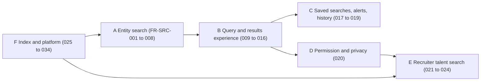

# SRC — Search & Discovery

> Status: intended product specification. Nothing here is a claim that anything is built. Legacy inputs: `SSOT.md` F-20 Command Search, F-32 Saved Searches & Job Alerts, F-34 Multi-Entity Backend Search, F-84 Skills Graph & Taxonomy (§9.1), F-92 Advanced Recruiter Search, F-147 Unified Search & Discovery, F-04 job search (§9.2), BR-141..BR-148, BR-263..BR-268 (referenced by F-147; their text is not defined in the legacy registries, so rules below are re-derived).

## 1. Purpose, outcomes and boundaries

### 1.1 Purpose

SRC is the discovery layer of the platform: one global command search, per-entity search (jobs, people, courses, companies, challenges, content), filters, facets, sorting, saved searches and alerts, typo tolerance, synonyms and the governed skills taxonomy, transparent ranking, search history and privacy, recruiter talent search with fairness controls, and the indexing lifecycle that keeps all of it correct and permission-safe.

### 1.2 Outcomes

1. A user finds the right job, person, course, company, challenge or piece of content in a few keystrokes, including when they mistype or use a different word for the same skill.
2. A user can see why a result appears and can turn off personalization.
3. Search never reveals anything the viewer is not allowed to see: not as a result, a count, a facet value or an autocomplete suggestion.
4. Recruiters can find candidates by skills and verified evidence without protected attributes influencing selection, and every search is auditable.
5. Zero results, errors and degraded modes are explained and recoverable.
6. The index stays fresh, and deletions and privacy changes take effect fast.

### 1.3 In scope, out of scope, owned vs consumed

| Area | Owned by SRC | Not owned (owner) |
| --- | --- | --- |
| Search UI, query processing, ranking, facets, suggestions | Yes | Entity data and detail pages: owning modules (JOB, LRN, ASM, NET, EMP, PRF) |
| Skills taxonomy, synonyms, skill relationships, emerging-skill queue | Yes | Market signals (demand, salary premium): MKT (planned) |
| Saved searches and alert scheduling | Yes | Email/push delivery: NTF (planned) |
| Recruiter talent search, fairness controls, audit | Yes | Talent pools, outreach, pipelines: ATS (planned) |
| Index pipelines, versions, evaluation | Yes | Underlying engine selection (decision recorded as OD-SRC-01) |
| Visibility inputs (discoverability, blocks, section visibility) | Consumed (PRF) | Setting them: PRF, SET |
| Evidence facets (rung, issuer class, freshness) | Consumed (EVD) | Computing them: EVD |
| Identity-verified facet | Consumed (BGV, opt-in) | Verification: BGV |
| Personalized recommendations ("jobs for you") | Not owned | AIC (planned); SRC provides search only, but shares the "why this result" format |
| Plans and entitlements limiting search features | Consumed (BIL) | Defined in BIL |

### 1.4 Boundaries that are easy to confuse

- **Search vs recommendations:** search answers a query the user typed or filters they chose. Recommendations (AIC) are unprompted suggestions. Both use the same explanation card style, but ranking logic is separate.
- **Talent search (SRC) vs talent pools (ATS):** SRC finds candidates; ATS stores pools, notes, stages and outreach.
- **Skills taxonomy (SRC) vs skill claims (EVD) vs profile skills (PRF):** SRC governs the canonical list; EVD and PRF reference it.

## 2. Roles and permission matrix

`Y` allowed, `-` not allowed, `V` within viewer permissions, `A` with audit, `L` limited (public data only, capped).

| Capability | GUE | CAN/STD/FRL | INS/MNT | REC | HMG | EAD | IAD/PLO | MOD | SUP | PAD | SAD | API |
| --- | --- | --- | --- | --- | --- | --- | --- | --- | --- | --- | --- | --- |
| Global command search | L | Y | Y | Y | Y | Y | Y | Y | Y | Y | Y | - |
| Search jobs, courses, companies, challenges, content | L | Y | Y | Y | Y | Y | Y | V | V | Y | Y | V |
| Search people (professional directory) | L (public indexable only) | V | V | V | V | V | V (own institution scope) | A | A | A | A | V |
| Recruiter talent search | - | - | - | Y (verified org, entitlement) | Y (delegated) | Y | - | - | - | A | A | Y |
| Save searches and alerts | - | Y | Y | Y | Y | Y | Y | - | - | - | - | - |
| Manage own recent searches and personalization | - | Y | Y | Y | Y | Y | Y | Y | Y | Y | Y | - |
| View ranking explanation | Y | Y | Y | Y | Y | Y | Y | Y | Y | Y | Y | Y |
| View candidate-side search appearance insights | - | Y (own) | Y (own) | - | - | - | - | - | - | - | - | - |
| Curate taxonomy and synonyms | - | - | - | - | - | - | - | - | - | Y (taxonomy editor) | Y | - |
| Propose a skill or synonym | - | Y | Y (course authors) | Y | - | - | - | - | - | - | - | - |
| Tune ranking, run relevance evaluation | - | - | - | - | - | - | - | - | - | Y (dual approval for release) | Y | - |
| View fairness audit reports | - | - | - | - | - | Y (own org summary) | - | - | - | Y | Y | - |
| Run reindex, view index health | - | - | - | - | - | - | - | - | - | Y | Y | - |
| View search analytics (aggregate) | - | - | - | - | - | Y (own org) | Y (own institution) | - | - | Y | Y | - |

Staff access to people search is for support and moderation inside a case and is audited. "Taxonomy editor" is a PAD sub-role `[PROP]` (OD-SRC-09).

## 3. Sub-module map

| Sub-module | Name | Features |
| --- | --- | --- |
| A | Entity search | FR-SRC-001 to 008 |
| B | Query and results experience | FR-SRC-009 to 016 |
| C | Saved searches, alerts, history | FR-SRC-017 to 019 |
| D | Permission and privacy | FR-SRC-020 |
| E | Recruiter talent search | FR-SRC-021 to 024 |
| F | Index, taxonomy and platform | FR-SRC-025 to 034 |

## 4. Feature specifications

### Sub-module A: Entity search

### FR-SRC-001 — Global command search

- **Sub-module:** A Entity search
- **Priority / tier:** Must · R2
- **Source:** [SRC: SSOT F-20 Command Search (⌘K); §11 keyboard shortcuts `⌘K`, `/`, `Esc`, arrow keys]
- **Purpose and outcome:** From any screen the user opens one box, types, and jumps to a result or runs an action. Success is reaching a destination in under 5 seconds without leaving the keyboard.
- **Roles and permissions:** `all signed-in roles: use` · `GUE: public results only`
- **Preconditions and entry points:** Any page. Entry: `⌘K` or `Ctrl+K`, `/` (when not typing in a field), search icon in the header.
- **User interactions and actions:**
  1. Press the shortcut; a modal palette opens with focus in the input and shows "Recent" and "Suggested actions".
  2. Type; results appear grouped: Actions, Jobs, People, Courses, Companies, Challenges, Content, Pages (settings, help).
  3. Use `↑`/`↓` to move, `Enter` to open, `Ctrl/⌘+Enter` to open in a new tab, `Tab` to switch group filter, `Esc` to close.
  4. Type a prefix: `>` for actions only, `@` for people, `#` for skills, `/` for pages.
  5. Press "See all results" (or `Shift+Enter`) to go to the full results page (FR-SRC-002) with the same query.
- **System behaviour:** Query goes to the unified suggest endpoint (≤ 100 ms target for autocomplete, ≤ 300 ms p95 for results `[SRC: SSOT F-147]`), debounced 120 ms; results are limited to 3–5 per group; actions are role-gated and context-aware (e.g., "Post a job" only for REC/EAD). Recent items are kept locally and optionally synced (FR-SRC-019). Results use the same permission filter as full search (BR-SRC-001). The palette caches nothing about other people's private data.
- **UI elements and controls:** Modal dialog (role `dialog`, labelled), combobox input with listbox results, group headings, keyboard hint chips, "See all results" button, loading skeleton, empty state.
- **Configuration options:** Platform: groups, per-group limit, action registry. User: disable palette shortcut (default on), include people in palette (default on).
- **Business rules:** BR-SRC-001, BR-SRC-002, BR-SRC-028, BR-SRC-027.
- **Validation:** query ≤ 256 chars; strips control characters.
- **Inputs and outputs:** In: query text, context (current page). Out: grouped result list with ids, titles, snippets, destination URLs.
- **Filters, sorting, search:** Group filter via prefix or Tab; ranking by relevance with recency boost for recent items.
- **Notifications and communication:** n/a — no notifications.
- **Error handling and edge cases:** Backend slow (> 1 s) → shows skeleton then partial results with note "Some results are still loading". Backend down → degraded mode (FR-SRC-034). Pointer-only users get a visible search button. Screen reader announces "n results available" via live region. Palette opened inside a form → focus returns to the previously focused element on close.
- **Dependencies:** FR-SRC-010, FR-SRC-020, FR-SRC-034, role action registry.
- **Security and privacy:** No personal data of others in suggestions beyond permitted public fields; query text is not logged raw if it matches identifier patterns (BR-SRC-014).
- **Acceptance criteria:**
  1. Given the user presses `⌘K` and types "react", when results load, then grouped results appear and `Enter` opens the focused one.
  2. Given a candidate, when typing `> post job`, then no "Post a job" action appears.
  3. Given a hidden profile that matches the query, when a non-owner searches, then it does not appear. (negative)

### FR-SRC-002 — Search results page and entity tabs

- **Sub-module:** A Entity search
- **Priority / tier:** Must · R2
- **Source:** [SRC: SSOT F-147 "unified index... multi-faceted filtering"; F-34 Multi-Entity Backend Search]
- **Purpose and outcome:** A full page presents results by entity type with filters, sorting and paging. Success is a shareable URL that reproduces the results.
- **Roles and permissions:** `GUE (public), all signed-in roles: use`
- **Preconditions and entry points:** Query submitted. Entry: `/search?q=...&type=...`; "See all results".
- **User interactions and actions:**
  1. Submit a query in the header search box.
  2. See tabs: All, Jobs, People, Courses, Companies, Challenges, Content, each with a count.
  3. On "All" see top 3–5 per entity with "See all".
  4. Choose a tab; apply filters (FR-SRC-012) and sort (FR-SRC-013).
  5. Scroll with "Load more" or numbered pages; open a result; use the browser back button to return to the same state.
- **System behaviour:** State (query, tab, filters, sort, cursor) is encoded in the URL so it is shareable and restorable. Counts per tab come from the same permission-filtered queries (approximate above 1000 as "1000+", BR-SRC-021). Result cards use entity-specific templates. Each card has "Why this result" (FR-SRC-015). Cursor-based pagination, 20 per page default, 100 max `[SRC: SSOT F-04]`; deep paging capped at 1000 results (BR-SRC-019).
- **UI elements and controls:** Search input with clear button, tabs with counts, filter panel (collapsible on mobile as a drawer), sort select, result list (`ol`), pagination or "Load more", result count live region.
- **Configuration options:** Platform: page size, tab order. User: default tab, results density (comfortable, compact).
- **Business rules:** BR-SRC-001, BR-SRC-019, BR-SRC-020, BR-SRC-021.
- **Validation:** URL params validated; unknown `type` → "All"; page size 1–100.
- **Inputs and outputs:** In: URL state. Out: result page with facets, counts and cursors.
- **Filters, sorting, search:** As per entity; see FR-SRC-012 and FR-SRC-013.
- **Notifications and communication:** n/a.
- **Error handling and edge cases:** Invalid cursor (expired) → restart from first page with notice. Query empty and no filters → show recent searches and popular categories rather than everything. Query only stop-words → treated as empty with hint. Shared link with filters the viewer can't use (e.g., recruiter-only filter) → filter dropped with notice.
- **Dependencies:** FR-SRC-003 to 008, FR-SRC-012, FR-SRC-013, FR-SRC-020, FR-SRC-028.
- **Security and privacy:** Shared URLs contain only query parameters, no personal data other than the typed query.
- **Acceptance criteria:**
  1. Given a query and Jobs tab, when the URL is copied and opened by another user, then the same query and filters are applied under that user's permissions.
  2. Given counts above 1000, when displayed, then they show "1000+".
  3. Given an expired cursor, when requested, then the first page loads with a notice instead of an error. (negative)

### FR-SRC-003 — Job search

- **Sub-module:** A Entity search
- **Priority / tier:** Must · R2
- **Source:** [SRC: SSOT F-04 steps 1–2 (facets, ranking weights, "Why am I seeing this?"); BR-016 no applications to closed jobs]
- **Purpose and outcome:** Candidates find relevant open jobs with precise filters. Success is a ranked, explainable list with correct freshness.
- **Roles and permissions:** `GUE, CAN, STD, FRL, INS, MNT: search published jobs` · `REC/HMG/EAD: search own org's jobs including drafts and closed`
- **Preconditions and entry points:** Published jobs indexed. Entry: `/jobs`, tab in search, command palette.
- **User interactions and actions:**
  1. Type keywords (title, skill, company) and set location (typeahead with radius) or "Remote".
  2. Apply filters: work mode, job type, level, salary range (and "show jobs without pay"), skills (canonical multi-select), company, posted within (24 h, 7 d, 30 d), easy-apply, visa sponsorship, education level, language, "from verified employers".
  3. Sort by relevance, newest, salary (high to low where disclosed), distance.
  4. Save the search (FR-SRC-017); hide a job; bookmark a job (JOB owns these actions).
- **System behaviour:** Index fields: title, description, requirements, skills (canonical ids), company, location (place id and geo point), work mode, type, level, salary range (if disclosed), posted date, status. Closed or expired jobs are removed from results within 5 minutes and direct links answer 410 `[SRC: SSOT F-04]`. Default relevance ranking uses documented weights: skill match 0.45, experience 0.20, location 0.10, title 0.10, organization rating 0.10, recency 0.05 `[SRC: SSOT F-04]`; the personalized components (skill and experience match) apply only for signed-in users with personalization on (BR-SRC-015); for guests only text relevance, title, location and recency apply. The organization-rating input is retained from legacy with a disclosure and an OD (OD-SRC-03). No paid boosts in organic ranking (BR-SRC-038).
- **UI elements and controls:** Search box, location combobox with radius slider, filter panel, sort select, job cards (title, company, location, work mode, pay, skills chips, posted date, "Why this result"), save-search button.
- **Configuration options:** Platform: ranking profile version, boosts none. User: personalization on/off, default location.
- **Business rules:** BR-SRC-001, BR-SRC-004, BR-SRC-005, BR-SRC-015, BR-SRC-022, BR-SRC-024, BR-SRC-038.
- **Validation:** salary min ≤ max; radius 1–200 km; posted-within enumerated; up to 10 skills.
- **Inputs and outputs:** In: query, filters, sort, cursor. Out: job result cards, facet counts.
- **Filters, sorting, search:** Facets: work mode, type, level, company, skills, location region, posted-within, salary band. Sort: relevance, newest, salary, distance.
- **Notifications and communication:** Saved search alerts (FR-SRC-018).
- **Error handling and edge cases:** Job closes while viewing → card shows "Closed" on click and opens a similar-jobs list. Location unknown → suggestions; if none, ignore location with notice. Salary filter excludes undisclosed pay unless "include jobs without pay" is checked. Duplicate postings (same employer, same text) collapsed with "n similar".
- **Dependencies:** JOB (planned), FR-SRC-010–016, FR-SRC-033.
- **Security and privacy:** Draft and private jobs only to org members; applicant data never indexed.
- **Acceptance criteria:**
  1. Given a closed job, when 5 minutes have passed, then it no longer appears in results.
  2. Given a salary filter 80–100k, when applied, then jobs without disclosed pay are excluded unless the include option is checked.
  3. Given a guest, when searching, then no personalized score components are used. (negative)

### FR-SRC-004 — People search

- **Sub-module:** A Entity search
- **Priority / tier:** Must · R2
- **Source:** [SRC: SSOT F-147 (people in unified index)]; [PROP] design
- **Purpose and outcome:** Users find other professionals (to connect, message, mentor or invite) within each person's privacy settings. Success is correct, privacy-respecting results.
- **Roles and permissions:** `CAN/STD/FRL/INS/MNT/REC/HMG/EAD: search` · `GUE: only people with indexable public profiles, capped` · `IAD/PLO: institution members within scope`
- **Preconditions and entry points:** Entry: `/search?type=people`, `@` prefix in palette, network pages.
- **User interactions and actions:**
  1. Search by name, headline, skill, company, school, or location.
  2. Filter by: connection degree (1st, 2nd, others), current company, past company, school, location, skills, languages, industry, "open to mentoring" (MNT), "open to freelance" (FRL).
  3. Open a profile, connect, message (NET and MSG, planned).
- **System behaviour:** Only profiles that are `published`, not suspended, not blocked for the viewer, and whose visibility allows the viewer appear (BR-SRC-001, BR-SRC-036). Snippets show only fields visible to the viewer. Recruiter-style filters (availability, salary, work authorization, evidence rung) are not available here (FR-SRC-021 only). Name search supports transliteration and diacritics. Results for guests show only users who enabled search-engine visibility (PRF BR-PRF-038) and are capped at 20 results with no deep paging (BR-SRC-026). Suggestions never list people who haven't made their profile discoverable to that viewer class.
- **UI elements and controls:** People cards (photo, name, headline, location, mutual connections, top skills, "Connect"), filter panel.
- **Configuration options:** Platform: guest cap. User: "Appear in people search" (via PRF visibility and SET).
- **Business rules:** BR-SRC-001, BR-SRC-003, BR-SRC-026, BR-SRC-035, BR-SRC-036.
- **Validation:** query ≥ 2 chars for people; name queries rate limited (FR-SRC-029).
- **Inputs and outputs:** In: query, filters. Out: people cards.
- **Filters, sorting, search:** Sort: relevance (default), mutual connections, recent activity (only if the person allows activity display).
- **Notifications and communication:** None.
- **Error handling and edge cases:** Person changes visibility while results are displayed → card click shows 404-equivalent. Common names → disambiguation by company and location in cards. Under-18 accounts never indexed for general people search.
- **Dependencies:** PRF visibility (FR-PRF-013/016/017), NET (planned), FR-SRC-020.
- **Security and privacy:** No contact data indexed; scraping defenses (FR-SRC-029); blocked parties receive empty results as if the person didn't exist.
- **Acceptance criteria:**
  1. Given a person with Experience set to Connections, when a stranger searches their former employer, then the person is not matched through that field.
  2. Given a viewer blocked by the person, when searching the person's exact name, then the person does not appear.
  3. Given a guest, when requesting page 2 of people results, then it is refused. (negative)

### FR-SRC-005 — Course search

- **Sub-module:** A Entity search
- **Priority / tier:** Must · R3
- **Source:** [SRC: SSOT F-147; F-07 LMS]; [PROP] facets
- **Purpose and outcome:** Learners find courses by topic, skill, level and format. Success is relevant, current course listings with transparent ranking.
- **Roles and permissions:** `GUE, CAN, STD, INS, MNT, REC: search published courses` · `IAD: also institution-private courses` · `INS: own drafts`
- **Preconditions and entry points:** Published courses indexed. Entry: `/learn`, tab in search.
- **User interactions and actions:**
  1. Query by topic, skill, instructor or institution.
  2. Filter: skill, level, format (video, text, interactive, live), duration band, language, price (free, paid, subscription), rating (≥ 4), certificate offered, institution, "has captions".
  3. Sort: relevance, newest, rating, shortest, popularity.
- **System behaviour:** Indexed fields: title, outcomes, skills, syllabus text, instructor, institution, level, format, language, duration, price class, rating summary (shown only above a minimum review count), update date. Institution-private and draft courses appear only for authorized users. Ranking: text relevance, skill match to query, quality signals (completion rate, rating with minimum n, content freshness), not instructor or institution payment (BR-SRC-038). Courses with accessibility features can be filtered (captions, transcripts).
- **UI elements and controls:** Course cards (title, instructor, level, duration, rating, price), filter panel, sort select.
- **Configuration options:** Platform: ranking profile; minimum review count for rating (default 5 `[PROP]`).
- **Business rules:** BR-SRC-001, BR-SRC-004, BR-SRC-022, BR-SRC-038.
- **Validation:** price and duration ranges valid; rating filter 1–5.
- **Inputs and outputs:** In: query, filters. Out: course cards.
- **Filters, sorting, search:** As above.
- **Notifications and communication:** Saved search alerts (FR-SRC-018) for new courses matching.
- **Error handling and edge cases:** Course unpublished → removed ≤ 15 minutes. Learner already enrolled → card shows "Continue". Language filter with no results → suggests other languages.
- **Dependencies:** LRN, STU (planned), INS (planned), FR-SRC-014.
- **Security and privacy:** Private institution courses never leak in counts.
- **Acceptance criteria:**
  1. Given a free-course filter, when applied, then only free courses appear.
  2. Given a course with 2 reviews, when displayed, then no star rating is shown.
  3. Given an institution-private course, when a non-member searches its exact title, then it doesn't appear. (negative)

### FR-SRC-006 — Company search

- **Sub-module:** A Entity search
- **Priority / tier:** Should · R2
- **Source:** [SRC: SSOT F-147 (companies); F-56 Organization & Institution Pages]
- **Purpose and outcome:** Users find employers and institutions and check their jobs and information. Success is correct organization matches with verified status.
- **Roles and permissions:** `all: search public organization pages`
- **Preconditions and entry points:** Organization pages published (EMP planned). Entry: tab in search; `/companies`.
- **User interactions and actions:**
  1. Query by name, industry or location.
  2. Filter: industry, size band, location, "verified employer", "hiring now", institution type.
  3. Open a company page; follow; view jobs.
- **System behaviour:** Organization name matching handles legal-name variants and common abbreviations (alias list). "Verified employer" is a status from EMP. "Hiring now" means ≥ 1 open job. Duplicate organizations are merged via an alias map managed by EMP and PAD. No ratings are shown unless EMP publishes aggregated reviews meeting thresholds (MKT/EMP rules).
- **UI elements and controls:** Company cards (logo, name, industry, location, verified badge, open jobs count).
- **Configuration options:** Platform: size bands.
- **Business rules:** BR-SRC-001, BR-SRC-004.
- **Validation:** query ≥ 2 chars.
- **Inputs and outputs:** In: query, filters. Out: company cards.
- **Filters, sorting, search:** Sort: relevance, most open jobs, alphabetical.
- **Notifications and communication:** n/a.
- **Error handling and edge cases:** Company with the same name in different countries → location shown. Suspended company → hidden. Claimed vs unclaimed pages labeled.
- **Dependencies:** EMP (planned), FR-SRC-003.
- **Security and privacy:** Only public organization data indexed.
- **Acceptance criteria:**
  1. Given "Acme Inc" and "ACME Incorporated" in the alias map, when searching "acme inc", then one entry appears.
  2. Given "hiring now", when applied, then only organizations with open jobs show.
  3. Given a suspended company, when searched by exact name, then it doesn't appear. (negative)

### FR-SRC-007 — Challenge search

- **Sub-module:** A Entity search
- **Priority / tier:** Should · R3
- **Source:** [SRC: SSOT F-147; F-08 Challenges Arena]; [PROP] facets
- **Purpose and outcome:** Candidates find practice challenges, contests and assessments by skill and difficulty. Success is a relevant list with status and eligibility.
- **Roles and permissions:** `GUE (public challenges), CAN, STD, INS, REC (own org assessments): search`
- **Preconditions and entry points:** Entry: `/challenges`, search tab.
- **User interactions and actions:**
  1. Query by title, skill, language or topic.
  2. Filter: skill, difficulty, type (practice, contest, assessment, hackathon task), language/runtime, duration, status (open, upcoming, closed), "I haven't attempted", "has certificate".
  3. Sort: relevance, newest, most attempted, difficulty.
- **System behaviour:** Index covers public and eligible challenges only; private assessments (recruiter custom assessments) are never searchable by candidates; custom assessment search is available only to the creating org. Attempt status for the viewer is joined at render time. Hidden test cases and solutions are never indexed. Contest challenges before start show title and date only.
- **UI elements and controls:** Challenge cards (difficulty badge text, skills, status, duration).
- **Configuration options:** Platform: difficulty scale.
- **Business rules:** BR-SRC-001, BR-SRC-002.
- **Validation:** enumerated filters.
- **Inputs and outputs:** In: query, filters. Out: challenge cards.
- **Filters, sorting, search:** As above.
- **Notifications and communication:** Alerts for new challenges by skill (FR-SRC-018).
- **Error handling and edge cases:** Challenge withdrawn after contest integrity issue → removed. Time zones for start times use viewer's zone.
- **Dependencies:** ASM (planned).
- **Security and privacy:** Solutions and hidden tests never indexed; assessments invitation-only are excluded.
- **Acceptance criteria:**
  1. Given the skill filter "SQL", when applied, then only SQL challenges appear.
  2. Given "I haven't attempted", when applied, then challenges with an attempt by the viewer are excluded.
  3. Given an invitation-only custom assessment, when a candidate searches its title, then it doesn't appear. (negative)

### FR-SRC-008 — Content search (posts, articles, discussions, events)

- **Sub-module:** A Entity search
- **Priority / tier:** Should · R3
- **Source:** [SRC: SSOT F-147 (discussions, articles, events); F-54 Content Publishing]
- **Purpose and outcome:** Users find posts, articles, newsletters, discussions and events they are allowed to see. Success is relevant, permission-correct content results.
- **Roles and permissions:** `GUE (public content), signed-in roles per post visibility`
- **Preconditions and entry points:** Content published (NET, EVT planned). Entry: tab Content, group in palette.
- **User interactions and actions:**
  1. Query keywords, hashtags (`#python`) or author (`@name`).
  2. Filter: type (post, article, discussion, event, newsletter), date range, author, community, language, "from my network".
  3. Sort: relevance, newest.
- **System behaviour:** Visibility (public, connections, organization, private) enforced per item against the viewer (BR-SRC-001). Edited or deleted content reindexes/removes within 5 minutes. Ranking: text relevance, recency, quality signals (reports, engagement), not purely popularity; a chronological sort is always offered `[SRC: SSOT BR-124 analog]`. Muted or blocked authors are excluded for the viewer. Moderated content removed by TSF is purged from the index immediately.
- **UI elements and controls:** Content cards with type badge, snippet with highlighted terms, author, date.
- **Configuration options:** Platform: quality signal weights.
- **Business rules:** BR-SRC-001, BR-SRC-003, BR-SRC-022.
- **Validation:** date range valid; hashtag format.
- **Inputs and outputs:** In: query, filters. Out: content cards.
- **Filters, sorting, search:** As above.
- **Notifications and communication:** Alerts (FR-SRC-018) for saved content searches.
- **Error handling and edge cases:** Content deleted after click → 404 page with search link. Language mismatch → language badge.
- **Dependencies:** NET, EVT (planned), TSF (planned).
- **Security and privacy:** Private content only to authorized audiences; highlights never show text from non-visible fields.
- **Acceptance criteria:**
  1. Given a connections-only post, when a non-connection searches its text, then it doesn't appear.
  2. Given "sort newest", when selected, then results order by date desc.
  3. Given a post removed by moderation, when searched within a minute, then it doesn't appear. (negative)

### Sub-module B: Query and results experience

### FR-SRC-009 — Query syntax and operators

- **Sub-module:** B Query and results experience
- **Priority / tier:** Should · R2
- **Source:** [PROP]
- **Purpose and outcome:** Users can express precise queries; casual users aren't punished by syntax. Success is predictable behavior for quoted phrases, exclusion and fields.
- **Roles and permissions:** `all: use` · `talent search: extended boolean (FR-SRC-021)`
- **Preconditions and entry points:** Any search box.
- **User interactions and actions:**
  1. Type words (implicit AND); `"exact phrase"` for phrases; `-word` to exclude; `OR` between terms; `title:engineer` or `company:acme` for fields; `skill:python`.
  2. Press the "?" syntax help link to see examples.
  3. When the syntax is invalid (unmatched quote), the system searches as plain words and shows a hint.
- **System behaviour:** Parser produces a structured query tree; field operators map only to allowed fields per entity; unknown fields are treated as plain text. Complexity limits: ≤ 256 characters, ≤ 20 terms, ≤ 5 nested groups; talent search allows ≤ 15 clauses (BR-SRC-027). Quoted phrases and field-prefixed values disable typo tolerance and synonyms for those parts. Operators are language-independent.
- **UI elements and controls:** Search input, inline hint chip showing interpreted query ("Searching for: …"), syntax help popover.
- **Configuration options:** Platform: allowed fields per entity.
- **Business rules:** BR-SRC-027, BR-SRC-016, BR-SRC-017.
- **Validation:** length and term limits; `-` only as prefix of a term.
- **Inputs and outputs:** In: raw query. Out: parsed query tree and interpretation text.
- **Filters, sorting, search:** n/a — parser.
- **Notifications and communication:** n/a.
- **Error handling and edge cases:** Query over limit → truncated with notice. Only exclusions (`-word`) → hint "Add a word to search". Operator-injection attempts (`*`, regex characters) are escaped.
- **Dependencies:** FR-SRC-011, FR-SRC-014.
- **Security and privacy:** Parser is safe against query injection; no raw engine syntax passes through.
- **Acceptance criteria:**
  1. Given `"data analyst" -intern`, when searched, then results contain the phrase and exclude "intern".
  2. Given `skill:python`, when searched, then it matches the canonical skill.
  3. Given a regex-like input `.*`, when searched, then it is treated as text. (negative)

### FR-SRC-010 — Autocomplete and suggestions

- **Sub-module:** B Query and results experience
- **Priority / tier:** Must · R2
- **Source:** [SRC: SSOT F-147 "autocomplete < 100ms"; F-84 typeahead over `canonical_name` + `aliases`]
- **Purpose and outcome:** As the user types, relevant completions and entities appear fast. Success is p95 under 100 ms for completion lists.
- **Roles and permissions:** `all: use`
- **Preconditions and entry points:** Focus in a search box or an entity picker (skill, location, company).
- **User interactions and actions:**
  1. Type 2+ characters; suggestions appear in a listbox: query completions, matching entities (skills, companies, titles), recent searches.
  2. Arrow keys move; `Enter` selects; `Esc` closes; `→` accepts inline completion.
  3. Selecting a skill or company applies it as a filter chip rather than text.
- **System behaviour:** Prefix and fuzzy matching over a dedicated suggest index built from: popular queries (anonymized, min frequency threshold), titles, canonical skills with aliases, company names, place names. Suggestions are permission-safe: people names appear only for entities the viewer may see; popular-query suggestions require ≥ 20 distinct users to prevent leaking rare or personal queries (BR-SRC-014). Offensive and sensitive completions are blocked (BR-SRC-035). Debounce 100 ms; cancels stale requests.
- **UI elements and controls:** Combobox with `aria-expanded`, `aria-activedescendant`, highlighted matched text, entity-type icons with labels, "remove from history" `x` on recent items.
- **Configuration options:** Platform: min chars (2), max suggestions (8), blocklist. User: show recent searches.
- **Business rules:** BR-SRC-001, BR-SRC-014, BR-SRC-035.
- **Validation:** length ≤ 100 for suggest queries.
- **Inputs and outputs:** In: prefix, context entity. Out: suggestions list.
- **Filters, sorting, search:** Ranked by prefix match, popularity, personalization (if on), entity type context.
- **Notifications and communication:** n/a.
- **Error handling and edge cases:** Slow response → previous suggestions remain until new arrive (no flicker). No suggestions → list hidden. Right-to-left languages supported.
- **Dependencies:** FR-SRC-011, FR-SRC-014, FR-SRC-019, FR-SRC-030.
- **Security and privacy:** No suggestion derived from a single user's private activity for others.
- **Acceptance criteria:**
  1. Given typing "pyth", when suggestions load, then "Python" skill appears within 100 ms p95.
  2. Given a rare query typed by only 3 users, when others type its prefix, then it is not suggested.
  3. Given a private person's name, when a non-permitted viewer types it, then no suggestion appears. (negative)

### FR-SRC-011 — Typo tolerance and spelling correction

- **Sub-module:** B Query and results experience
- **Priority / tier:** Must · R2
- **Source:** [SRC: SSOT F-147 "typo tolerance active"; audit tests cite Levenshtein fuzzy scoring BR-266]
- **Purpose and outcome:** Misspelled queries still find the right items without surprising rewrites. Success is correct results for 1–2 character errors and a visible correction message.
- **Roles and permissions:** `all: use`
- **Preconditions and entry points:** Any text query.
- **User interactions and actions:**
  1. Type "javascirpt developer".
  2. See results for "javascript developer" with a line "Showing results for javascript developer. Search instead for javascirpt developer".
  3. Click "Search instead for…" to force literal search.
- **System behaviour:** Edit distance 1 allowed for terms of 4–7 chars, 2 for ≥ 8 chars; none for ≤ 3 chars and for quoted, field-prefixed or numeric tokens (BR-SRC-016). High-confidence corrections (the corrected form has substantially more matches or is a known entity) are applied automatically with a visible notice; low-confidence ones show "Did you mean…" without changing results. Corrections use taxonomy terms, titles and company names as the dictionary, not the raw query log, to avoid propagating misspellings. Transposition and keyboard-neighbor errors count as one edit.
- **UI elements and controls:** Correction banner with "Search instead" link, "Did you mean" link.
- **Configuration options:** Platform: edit-distance thresholds, confidence cutoffs.
- **Business rules:** BR-SRC-016, BR-SRC-017.
- **Validation:** n/a.
- **Inputs and outputs:** In: terms. Out: corrected terms and confidence.
- **Filters, sorting, search:** Exact matches rank above fuzzy matches.
- **Notifications and communication:** n/a.
- **Error handling and edge cases:** Names (people, companies) are corrected conservatively (never auto-rewritten in people search). Languages without dictionaries → fuzzy only. Correction yields zero results → revert to literal and show zero-results guidance.
- **Dependencies:** FR-SRC-010, FR-SRC-030.
- **Security and privacy:** Corrections never expose entities not permitted.
- **Acceptance criteria:**
  1. Given "javascirpt", when searched in jobs, then JavaScript jobs appear with a correction notice.
  2. Given a quoted phrase with a typo, when searched, then no correction is applied.
  3. Given a 3-character term "sql" mistyped "sqk", when searched, then no automatic correction occurs. (negative)

### FR-SRC-012 — Filters and facets

- **Sub-module:** B Query and results experience
- **Priority / tier:** Must · R2
- **Source:** [SRC: SSOT F-04 step 1 "filters are URL-encoded (shareable)"; F-147 multi-faceted filtering]
- **Purpose and outcome:** Users narrow results with typed filters and see counts that help rather than mislead. Success is consistent filter behavior across entities.
- **Roles and permissions:** `all: use (filters availability per role and entity)`
- **Preconditions and entry points:** Results page or entity page.
- **User interactions and actions:**
  1. Open the filter panel (side panel on desktop, drawer on mobile).
  2. Select facet values (checkboxes), enter ranges (min/max inputs), pick dates, toggle switches.
  3. See active filters as removable chips and a "Clear all" button.
  4. See facet counts update after each change ("disjunctive" counts for the facet being edited).
  5. Press "Show more" to expand long facets with an in-facet search.
- **System behaviour:** Filters of the same facet are OR; across facets AND. Facet counts are computed under the viewer's permissions, approximate above 1000 ("1000+"), and for people facets suppressed below k = 5 to avoid re-identification of rare combinations (BR-SRC-021). Filter state is in the URL. A facet value that yields no results is hidden or disabled with count 0. Skill facets use canonical skill ids and include hierarchical expansion one level by default (BR-SRC-018).
- **UI elements and controls:** Checkbox groups with counts, range inputs, date pickers, switches, chips, "Clear all", "Show more", apply button on mobile.
- **Configuration options:** Platform: facets per entity, max values shown (10).
- **Business rules:** BR-SRC-018, BR-SRC-020, BR-SRC-021.
- **Validation:** ranges valid; unknown facet values are dropped with a notice.
- **Inputs and outputs:** In: filter selections. Out: facet buckets and results.
- **Filters, sorting, search:** n/a — this feature is the filter mechanism.
- **Notifications and communication:** n/a.
- **Error handling and edge cases:** Conflicting filters (min > max) → inline error. Filter on a deprecated skill → remapped via taxonomy redirect with notice. Facet service timeout → results shown without counts and a notice.
- **Dependencies:** FR-SRC-020, FR-SRC-030.
- **Security and privacy:** Counts never reveal hidden entities; small-cell suppression.
- **Acceptance criteria:**
  1. Given two selected work modes, when applied, then results match either mode.
  2. Given a people facet with fewer than 5 matches, when displayed, then the count is suppressed.
  3. Given a filter value not in the allowed list, when passed in the URL, then it is dropped. (negative)

### FR-SRC-013 — Sorting

- **Sub-module:** B Query and results experience
- **Priority / tier:** Must · R2
- **Source:** [SRC: SSOT F-04 "Default sort: relevance"; F-92 "Sort options: relevance, recent activity, readiness score"]
- **Purpose and outcome:** Users change result order with clear, predictable options. Success is stable, explained ordering.
- **Roles and permissions:** `all: use`
- **Preconditions and entry points:** Results list.
- **User interactions and actions:**
  1. Open the Sort select; options depend on the entity.
  2. Pick one; the URL updates and the first page reloads.
- **System behaviour:** Options: Jobs (relevance, newest, salary, distance), People (relevance, mutual connections), Courses (relevance, newest, rating, duration, popularity), Companies (relevance, open jobs, A–Z), Challenges (relevance, newest, most attempted, difficulty), Content (relevance, newest), Talent search (relevance, recent activity if allowed, evidence strength, availability; see FR-SRC-021). Ties are broken by stable secondary keys (recency then id) so paging is deterministic. "Newest" uses the publication date, not edit date, so reposting or editing can't game order. Sorting by an attribute that is only available for some items puts items missing the attribute last.
- **UI elements and controls:** Select (listbox pattern), current sort label.
- **Configuration options:** Platform: options per entity; user: default sort per entity (saved).
- **Business rules:** BR-SRC-022.
- **Validation:** sort key must be in the entity's allowed list.
- **Inputs and outputs:** In: sort key. Out: ordered results.
- **Filters, sorting, search:** This feature is the sort mechanism.
- **Notifications and communication:** n/a.
- **Error handling and edge cases:** Invalid sort in URL → default sort with notice. Distance sort without location → disabled with hint.
- **Dependencies:** FR-SRC-015, FR-SRC-033.
- **Security and privacy:** Recent-activity sort only if the person allows activity display.
- **Acceptance criteria:**
  1. Given "newest", when selected, then results are ordered by publication date.
  2. Given distance sort and no location, when attempted, then it's disabled with a hint.
  3. Given a sort key `salary` on the courses tab via URL, when loaded, then it falls back to relevance. (negative)

### FR-SRC-014 — Synonyms and skills taxonomy expansion

- **Sub-module:** B Query and results experience
- **Priority / tier:** Must · R2
- **Source:** [SRC: SSOT F-84 (aliases, relationships, canonical skills); BR-141, BR-144, BR-146]; [PROP] disclosure to user
- **Purpose and outcome:** A search for one term also finds equivalent terms and related skills, visibly. Success is better recall without hidden surprises.
- **Roles and permissions:** `all: benefit` · `taxonomy editor: curate (FR-SRC-030)`
- **Preconditions and entry points:** Any text or skill search.
- **User interactions and actions:**
  1. Search "JS developer".
  2. See results including "JavaScript" and an inline note "Also showing: JavaScript. Search only for exact terms".
  3. Click the note to see the expansion list and toggle off individual expansions.
  4. In skill facets, selecting "Python" optionally includes sub-skills (e.g., "Django") when the user ticks "Include related skills".
- **System behaviour:** Expansion sources: (a) aliases of canonical skills (JS to JavaScript) always; (b) curated synonym sets (e.g., "UX designer" and "user experience designer"); (c) hierarchical children (one hop default, max 5 hops overall `[SRC: SSOT BR-146]`) only when the user opts in; (d) `correlates_with` is never used for retrieval (recommendation only). Expansions are directional (e.g., "software engineer" includes "backend engineer" but not vice versa) and cross-language for skills. Expansion terms are scored lower than exact matches. Quoted terms and `skill:` fields suppress expansions.
- **UI elements and controls:** Expansion notice with popover, toggle switches for each expansion, "Include related skills" checkbox in skill facet.
- **Configuration options:** Platform: synonym sets, expansion depth. User: turn off expansions globally (default on).
- **Business rules:** BR-SRC-017, BR-SRC-018, BR-SRC-016.
- **Validation:** expansion depth ≤ 5.
- **Inputs and outputs:** In: terms. Out: expanded term set and the explanation.
- **Filters, sorting, search:** Ranking: exact > alias > synonym > related.
- **Notifications and communication:** n/a.
- **Error handling and edge cases:** Ambiguous alias (e.g., "Go" language vs verb) → only expanded in skill context or with disambiguation; term mapped to multiple skills → suggests choices. Deprecated skill alias → redirected via `supersedes`.
- **Dependencies:** FR-SRC-030, EVD/PRF skill references.
- **Security and privacy:** None beyond standard.
- **Acceptance criteria:**
  1. Given "JS", when searching jobs, then jobs tagged JavaScript appear and the notice lists JavaScript.
  2. Given the user toggles off the expansion, when results refresh, then only literal "JS" matches appear.
  3. Given a quoted `"JS"`, when searched, then no expansion is applied. (negative)

### FR-SRC-015 — Ranking and ranking transparency

- **Sub-module:** B Query and results experience
- **Priority / tier:** Must · R2
- **Source:** [SRC: SSOT F-04 step 2 "Why am I seeing this?" disclosure; F-147 ranking relevance + recency + engagement + quality; BR-124 analog "ranking factors disclosed on demand"]
- **Purpose and outcome:** Every ranked list can explain itself. Success is a per-result and per-list explanation that matches how ranking really works.
- **Roles and permissions:** `all: view explanations` · `PAD: manage ranking profiles (FR-SRC-027)`
- **Preconditions and entry points:** Results list. Entry: "Why this result" link on each card; "How results are ranked" link on page footer.
- **User interactions and actions:**
  1. Click "Why this result" to open a popover: matched terms, matched skills, filters satisfied, boosts applied (recency, location), personalization influence (if any), and any expansion used.
  2. Click "How results are ranked" to open the public explanation page per entity: inputs, what is not used (protected attributes, payment), and when it was last changed.
- **System behaviour:** The ranking service returns, for each result, a structured explanation (feature contributions grouped into human-readable reasons, top 3–5). Explanations are generated from the same scoring features, not separately authored text, and tested for consistency (BR-SRC-004). Ranking profiles are versioned with a public changelog (BR-SRC-030). Protected attributes and paid placement are never ranking inputs (BR-SRC-004, BR-SRC-038). Personalization reasons ("Because you viewed similar jobs") appear only if personalization is on.
- **UI elements and controls:** "Why this result" button (focusable, popover with Esc), "How results are ranked" page.
- **Configuration options:** Platform: ranking profile per entity; disclosure copy.
- **Business rules:** BR-SRC-004, BR-SRC-005, BR-SRC-030, BR-SRC-039.
- **Validation:** explanation must exist for every ranked result (contract test).
- **Inputs and outputs:** In: result id and query context. Out: explanation object.
- **Filters, sorting, search:** n/a.
- **Notifications and communication:** n/a.
- **Error handling and edge cases:** Explanation service failure → popover shows "Explanation unavailable" and results still render. Sorted-by-newest lists explain "Sorted by date, not relevance".
- **Dependencies:** FR-SRC-027, FR-SRC-016.
- **Security and privacy:** Explanations never reveal other users' private data or exact scores for talent search candidates beyond criteria matched.
- **Acceptance criteria:**
  1. Given a job result, when "Why this result" is opened, then it lists matched skills and recency boost consistent with scoring.
  2. Given personalization is off, when opened, then no personalized reason appears.
  3. Given a request for an explanation of a result not visible to the viewer, when sent, then 404. (negative)

### FR-SRC-016 — Personalization controls

- **Sub-module:** B Query and results experience
- **Priority / tier:** Should · R3
- **Source:** [SRC: SSOT F-147 "personalization (based on user history)"]; control [PROP]
- **Purpose and outcome:** Users choose whether their activity shapes their own results. Success is a clear switch with immediate effect and data deletion.
- **Roles and permissions:** `all signed-in: control own`
- **Preconditions and entry points:** Settings > Search; banner on first search ("Personalize results?").
- **User interactions and actions:**
  1. Toggle "Use my activity to improve my results" (default on for signed-in users `[PROP]` OD-SRC-05).
  2. Choose which signals count: searches, views, saves, applications.
  3. Press "Clear my search activity" to delete stored signals.
- **System behaviour:** Personalization features are computed per user from the allowed signals and used only for that user's own results; off means ranking uses only query, filters and public item signals. Turning off deletes the personalization profile within 24 h and ranking stops using it immediately. Personalization is never used for recruiter talent search of candidates (BR-SRC-015) and never uses protected attributes. The "Why" popover reflects the setting.
- **UI elements and controls:** Switch with description, per-signal checkboxes, "Clear" button with confirmation.
- **Configuration options:** Platform: default state (OD-SRC-05); user: switches.
- **Business rules:** BR-SRC-015, BR-SRC-014.
- **Validation:** n/a.
- **Inputs and outputs:** In: settings. Out: updated settings and deletion confirmation.
- **Filters, sorting, search:** n/a.
- **Notifications and communication:** Confirmation toast.
- **Error handling and edge cases:** Deletion job delay → ranking stops using signals at once. Region with consent-first law → default off (SET region rules).
- **Dependencies:** SET (planned), FR-SRC-015.
- **Security and privacy:** Signals are stored per user with pseudonymous ids; deletion verified.
- **Acceptance criteria:**
  1. Given the switch off, when searching jobs, then no personalized reasons appear.
  2. Given "Clear my search activity", when pressed, then the personalization profile is deleted within 24 h.
  3. Given a recruiter doing talent search, when personalization is on for their own account, then it does not affect candidate ranking. (negative)

### Sub-module C: Saved searches, alerts, history

### FR-SRC-017 — Saved searches

- **Sub-module:** C Saved searches, alerts, history
- **Priority / tier:** Must · R2
- **Source:** [SRC: SSOT F-04 step 7; F-32 Saved Searches & Job Alerts]
- **Purpose and outcome:** Users save a query-with-filters to reuse and monitor it. Success is a named saved search that reproduces results.
- **Roles and permissions:** `CAN/STD/FRL/INS/MNT/REC/HMG/EAD/IAD: create, edit, delete own`
- **Preconditions and entry points:** Signed in; a search with at least one query or filter. Entry: "Save search" button on results.
- **User interactions and actions:**
  1. Press "Save search"; enter a name (default suggested from the query); choose alert frequency (none, instant, daily, weekly).
  2. See saved searches at `/searches`; run, rename, edit filters, pause, delete.
  3. Open a saved search; it loads the URL state with a badge "n new since last visit".
- **System behaviour:** Stored as a structured query (entity, terms, filters, sort) and not a raw URL. Limit 25 per user `[PROP]` (BR-SRC-011). Duplicate detection warns if an identical search exists. "New since last visit" counts compare to the stored last-seen watermark. Talent searches are saved separately (FR-SRC-021) with additional audit and entitlements. Saved searches with filters that later become invalid (deprecated skill) are migrated via taxonomy redirects.
- **UI elements and controls:** Save dialog (name input, frequency select), list with menu (Run, Edit, Pause, Delete), "n new" badge, limit meter.
- **Configuration options:** Platform: limit; user: default frequency.
- **Business rules:** BR-SRC-011, BR-SRC-012.
- **Validation:** name 1–60 chars; unique per user; frequency enumerated.
- **Inputs and outputs:** In: structured query, name, frequency. Out: saved search record.
- **Filters, sorting, search:** List sorted by last used; text filter by name.
- **Notifications and communication:** Alerts per FR-SRC-018.
- **Error handling and edge cases:** 26th search → "Delete one to save another". Entity no longer available (e.g., feature disabled) → search paused with notice. Saved search by a user who later loses entitlement (recruiter plan) → paused, not deleted.
- **Dependencies:** SM-SRC-01, FR-SRC-018, ENT-SRC-04.
- **Security and privacy:** Saved queries are personal data; included in export and erasure; never visible to others.
- **Acceptance criteria:**
  1. Given a job search with filters, when saved, then opening it reproduces the same filters.
  2. Given 25 saved searches, when saving a 26th, then it is rejected with the limit message.
  3. Given another user's saved search id, when requested, then 404. (negative)

### FR-SRC-018 — Search alerts

- **Sub-module:** C Saved searches, alerts, history
- **Priority / tier:** Must · R2
- **Source:** [SRC: SSOT F-04 step 7 "Job alert emails sent when new matches appear (new-only, no backfill)"; F-32]
- **Purpose and outcome:** Users are told about new matching items at the frequency they choose. Success is timely, non-duplicative, permission-safe alerts.
- **Roles and permissions:** `owner: configure` · `system: evaluate and send`
- **Preconditions and entry points:** Saved search with frequency ≠ none. Entry: saved search settings; alert email links.
- **User interactions and actions:**
  1. Choose frequency and channels (email, push, in-app) per saved search.
  2. Receive an alert with up to 10 new items, a "See all n new" link and "Why you got this" text.
  3. Press "Unsubscribe" (one click) or "Pause 30 days" from the alert.
- **System behaviour:** Evaluation job runs per frequency: instant (within 15 min of indexing for matching new items), daily digest (local 8:00 `[PROP]`), weekly. Only items created or newly matching since the last evaluation are included (no backfill on first save) `[SRC: SSOT F-04]`. Items are re-checked against the viewer's permissions and current status at send time (BR-SRC-012). Digest dedupes items already alerted. Rate limit: max 3 instant emails per day per user, overflow rolls into digest `[PROP]`. Searches unopened for 90 days with no clicks trigger a "still interested?" prompt, then auto-pause after 14 more days. One-click unsubscribe headers (RFC 8058) are included `[SRC: SSOT BR-123 analog]`.
- **UI elements and controls:** Frequency select, channel checkboxes, alert email template (`src.alert.digest`), unsubscribe and pause links.
- **Configuration options:** User: frequency, channels, quiet hours (via NTF). Platform: caps.
- **Business rules:** BR-SRC-011, BR-SRC-012, BR-SRC-037.
- **Validation:** channel must be enabled by the user in NTF preferences.
- **Inputs and outputs:** In: saved search and watermark. Out: alert deliveries.
- **Filters, sorting, search:** Items ordered by relevance then date.
- **Notifications and communication:** Email, push, in-app via NTF; opt-out class `search_alerts`.
- **Error handling and edge cases:** Search returns > 10 new → top 10 and the "n more" link. Alert evaluation failure → retried; no duplicate sends (idempotency key = search id + window). User blocked or entitlement lapsed → alert skipped and paused. Item removed before send → omitted.
- **Dependencies:** NTF (planned), SM-SRC-01, ENT-SRC-05, ENT-SRC-06.
- **Security and privacy:** Alert content contains only items the user can see; emails avoid sensitive snippets.
- **Acceptance criteria:**
  1. Given a daily alert, when 3 new matching jobs are indexed, then one digest lists them once.
  2. Given a job closed before the send, when the digest is built, then it is excluded.
  3. Given the user unsubscribes by one click, when the next evaluation runs, then no further alert is sent. (negative)

### FR-SRC-019 — Recent searches and history management

- **Sub-module:** C Saved searches, alerts, history
- **Priority / tier:** Should · R2
- **Source:** [PROP]
- **Purpose and outcome:** Users quickly repeat past searches and can control or erase them. Success is a private, deletable list.
- **Roles and permissions:** `signed-in users: view, delete, pause own history` · `GUE: device-local only`
- **Preconditions and entry points:** Focus in an empty search box; Settings > Search.
- **User interactions and actions:**
  1. See "Recent searches" (up to 20) when the box is focused; click to rerun; `x` removes one.
  2. Open Settings > Search history; "Clear all"; toggle "Save my searches" (default on).
  3. "Pause history" stops recording until resumed.
- **System behaviour:** History entries (query, entity, filters, time) are stored per user (server-side if signed in so they sync across devices; device-local for guests, in browser storage and optional). Retention 90 days `[PROP]` (OD-SRC-06). Queries matching identifier patterns (email, phone, national id formats, card numbers) are not stored (BR-SRC-014). Deleted entries are removed from personalization signals. History is never visible to other users or recruiters.
- **UI elements and controls:** Recent list, remove buttons, settings switch, "Clear all" with confirm.
- **Configuration options:** Platform: retention, max entries. User: pause.
- **Business rules:** BR-SRC-013, BR-SRC-014.
- **Validation:** n/a.
- **Inputs and outputs:** In: queries. Out: list.
- **Filters, sorting, search:** Most recent first; dedupe identical queries.
- **Notifications and communication:** n/a.
- **Error handling and edge cases:** Storage unavailable (private browsing) → feature degrades silently. History paused → no list shown with note. Account erased → all deleted.
- **Dependencies:** SET (planned), ENT-SRC-03.
- **Security and privacy:** Server-side history encrypted at rest; excluded from analytics at the user level.
- **Acceptance criteria:**
  1. Given a search, when the box is focused later, then the query appears in Recent.
  2. Given "Clear all", when confirmed, then the list is empty on all devices.
  3. Given a query containing a phone number pattern, when searched, then it is not saved to history. (negative)

### Sub-module D: Permission and privacy

### FR-SRC-020 — Permission and visibility filter (RLS-safe search)

- **Sub-module:** D Permission and privacy
- **Priority / tier:** Must · R2
- **Source:** [SRC: SSOT F-147 "RLS scoping, 0 RLS leakage"; F-92 "Zero stealth-mode leakage"; F-12 section visibility]
- **Purpose and outcome:** Search results, counts, facets, suggestions and alerts respect every visibility and privacy rule, in real time. Success is zero leakage in audits.
- **Roles and permissions:** `system: enforce` · `SAD: audit`
- **Preconditions and entry points:** Every query.
- **User interactions and actions:**
  1. Users see only items permitted to them; no visible controls other than the owner-side settings in PRF/EMP/NET.
  2. SAD runs leakage audits using synthetic viewers.
- **System behaviour:** Two layers: (1) index-time document ACL (audience class, org ids, owner id, visibility flags per field-group) and (2) query-time permission checks against the source of truth for the final result page (re-check at hydration), so lag in indexing never exposes data (BR-SRC-001, BR-SRC-003). Fields are indexed into audience-specific field groups (public, connections, recruiter, owner) so a match on a non-visible field-group is never produced and highlights never use them. Blocks, stealth, discoverability, under-18 exclusion, suspended and erased entities are enforced here. Counts and facets are computed from permission-filtered candidate sets. A synthetic leakage test suite runs in CI and nightly in production with canary entities.
- **UI elements and controls:** none (admin audit dashboard: SCR-SRC-026).
- **Configuration options:** Platform: audience classes, re-check policy (always for people and private content).
- **Business rules:** BR-SRC-001, BR-SRC-002, BR-SRC-003, BR-SRC-007, BR-SRC-036.
- **Validation:** every indexable document must declare an audience policy or it is rejected.
- **Inputs and outputs:** In: viewer context, candidate hits. Out: permitted hits.
- **Filters, sorting, search:** n/a — enforcement layer.
- **Notifications and communication:** Leak detection alert to SAD and PAD.
- **Error handling and edge cases:** Source-of-truth unavailable during re-check → fail closed (drop the hit). Policy change in flight → newer policy wins at query time. Index document without an audience policy → not indexed and an alert is raised.
- **Dependencies:** PRF, EMP, NET, JOB, LRN, TSF (policy sources), FR-SRC-025.
- **Security and privacy:** This feature is the privacy control; the test suite is part of the release gate.
- **Acceptance criteria:**
  1. Given a profile switched to hidden, when searching its exact name within a second, then it does not appear even if the index is stale.
  2. Given a stealth-mode candidate, when a recruiter searches matching terms, then the candidate is absent from results and counts.
  3. Given the source-of-truth check fails, when a hit is hydrated, then the hit is dropped, not shown. (negative: fail closed)

### Sub-module E: Recruiter talent search

### FR-SRC-021 — Recruiter talent search

- **Sub-module:** E Recruiter talent search
- **Priority / tier:** Must · R2
- **Source:** [SRC: SSOT F-92 steps 1–2, 7–8 (filters, ranking, privacy, stealth)]
- **Purpose and outcome:** Recruiters find candidates who match role needs and have consented to be found. Success is a ranked, explainable result list limited to discoverable candidates.
- **Roles and permissions:** `REC, HMG (delegated), EAD: search` · `API: via org key` · `PAD/SAD: audit`
- **Preconditions and entry points:** Verified employer organization (EMP), talent search entitlement (BIL), recruiter completed fair-hiring training acknowledgment `[PROP]`. Entry: `/recruiter/search`.
- **User interactions and actions:**
  1. Enter keywords or a job title; add structured filters: skills (canonical, with proficiency and evidence filters, FR-SRC-023), location with radius and "willing to relocate", years of experience band, availability (open to work), education level, languages, work authorization (only for candidates who shared it), salary expectation range (only shared), assessment results (band), credentials, industries.
  2. Choose sort: relevance, recent activity (if allowed), evidence strength, availability.
  3. Open "Blind review mode" (FR-SRC-022) if desired.
  4. Open a result in a side panel (evidence tab, profile) without leaving the list; add to a pool (ATS), message or hide.
  5. Save the search as a talent search with optional alerts for new matching candidates.
- **System behaviour:** Candidate set is limited to profiles that: are published; are not stealth; have discoverability allowing recruiters (or applied to this org's job); do not block the recruiter or org; are not under 18; and for each filter use only fields the candidate shared with recruiters (BR-SRC-007, BR-SRC-001). Query-time enforcement overrides index state. Ranking uses documented factors: skill match (weighted by evidence rung and freshness, shown), experience relevance, location, availability; protected attributes and proxies are excluded (BR-SRC-006). Every query, view and export is logged (BR-SRC-008): recruiter, org, parsed query, result count, viewed profiles. Result window max 1000 per query; rate limit per recruiter (e.g., 200 searches and 300 profile views per hour `[PROP]`). Result cards show why each matched (criteria) and no hidden score. Entitlement-based credit consumption is defined in BIL.
- **UI elements and controls:** Search bar, filter panel, results list with cards (name or blind label, headline, location, top matched skills with evidence chips, availability, match reasons), side panel, "Save search", "Blind mode" toggle, sort select.
- **Configuration options:** Org: default blind mode, required filters, hidden filters. Platform: rate limits, result window, entitlement.
- **Business rules:** BR-SRC-001, BR-SRC-006, BR-SRC-007, BR-SRC-008, BR-SRC-009, BR-SRC-027, BR-SRC-040.
- **Validation:** ≤ 15 boolean clauses; skills from canonical list; salary range valid; radius ≤ 200 km.
- **Inputs and outputs:** In: query and filters. Out: candidate cards with explanations.
- **Filters, sorting, search:** As above.
- **Notifications and communication:** Alerts for saved talent searches (daily or weekly, in-app and email), class `recruiting_alerts`.
- **Error handling and edge cases:** Candidate withdraws consent while recruiter views → next read shows "Candidate unavailable" (consent revocation effective at next query, never later than 24 h in index). Over rate limit → 429 with retry time. Query too broad (> 1000) → prompt to narrow and show top 1000 only. Entitlement lapsed → read-only saved searches.
- **Dependencies:** PRF (FR-PRF-013, 016, 017, 033, 034), EVD (FR-EVD-026), EMP, BIL, ATS (planned), FR-SRC-020, FR-SRC-022, FR-SRC-023.
- **Security and privacy:** Org audit visible to EAD; staff audit; anti-scraping controls (FR-SRC-029); candidates can see aggregate appearance counts (FR-SRC-024).
- **Acceptance criteria:**
  1. Given a discoverable candidate matching all filters, when a recruiter searches, then the candidate appears with match reasons.
  2. Given a candidate who blocked the recruiter's organization, when searched, then the candidate does not appear.
  3. Given a salary filter, when a candidate hasn't shared salary with recruiters, then the candidate isn't excluded or included by salary (the filter doesn't apply to them) and the UI says "salary filter applies only to candidates who share it". (negative)

### FR-SRC-022 — Fairness controls for talent search

- **Sub-module:** E Recruiter talent search
- **Priority / tier:** Must · R4
- **Source:** [PROP]; relates to SSOT F-119 DE&I Analytics and BR-158 (k-anonymity); [DEC-REQ] OD-SRC-04
- **Purpose and outcome:** Talent search does not use protected attributes, reduces identity cues in first-pass review, and is monitored for disparate impact. Success is documented, auditable controls.
- **Roles and permissions:** `REC/HMG/EAD: use blind mode` · `EAD: view org fairness summary` · `PAD/SAD: configure and audit`
- **Preconditions and entry points:** Talent search active.
- **User interactions and actions:**
  1. Recruiter toggles "Blind review" (names, photos, schools' names, graduation years, pronouns hidden; skills, experience and evidence shown); org admins may set it on by default.
  2. Recruiter sees a note on the list "Ranking uses: skills, evidence, experience, location, availability. It does not use name, photo, age, gender, or similar".
  3. Optional "Shuffle equal matches" so ties are randomly ordered per session.
  4. EAD opens "Fair search" report: distribution of shortlisted vs viewed candidates by voluntary demographic cohorts (when the data exists and k ≥ 10), and alerts.
- **System behaviour:** Excluded from ranking and filtering: name, photo, age/date of birth, gender, pronouns, ethnicity, religion, disability, marital status, nationality, graduation year as an age proxy (graduation year shown only as range "years of experience"), address, and language of native origin except as a listed skill requirement. Filters offering such attributes don't exist. Proxy detection: new filter or ranking features undergo a proxy review before release (BR-SRC-030). Blind mode is applied server-side to the payload. Periodic audits (monthly) compute selection-rate ratios per cohort using aggregated voluntary data from ATS (planned) with k-anonymity; alerts if ratio falls below configured thresholds (default four-fifths rule `[PROP]`); results go to PAD and, for org-level, to EAD. The platform maintains an audit-ready documentation pack for automated-decision-tool regulations (e.g., bias audits) as OD-SRC-04 requires legal input.
- **UI elements and controls:** Blind review toggle (persisted), ranking disclosure note, shuffle toggle, fair-search report with data tables.
- **Configuration options:** Org: default blind mode. Platform: thresholds, k.
- **Business rules:** BR-SRC-006, BR-SRC-009, BR-SRC-010, BR-SRC-032.
- **Validation:** feature release requires proxy review sign-off.
- **Inputs and outputs:** In: recruiter actions and ATS aggregates. Out: blinded payloads, reports.
- **Filters, sorting, search:** Report filter by role family, period.
- **Notifications and communication:** Alert to PAD on adverse-impact threshold; EAD summary monthly.
- **Error handling and edge cases:** Insufficient volume → "Not enough data". Blind mode on, recruiter tries to message candidate → name is revealed only when the recruiter moves the candidate to a stage that requires identity (ATS), logged. Voluntary data absent → no cohort analysis, only process metrics.
- **Dependencies:** ATS (planned), ANL (planned), FR-SRC-021.
- **Security and privacy:** Demographic data is voluntary, separated, aggregate-only here; no individual-level protected attributes enter SRC.
- **Acceptance criteria:**
  1. Given blind mode on, when results load, then payloads exclude names, photos, school names and pronouns.
  2. Given a proposed ranking feature correlated with age, when submitted for release, then release is blocked pending proxy review.
  3. Given an attempt to filter by gender via the API, when sent, then the request is rejected. (negative)

### FR-SRC-023 — Evidence-aware filters and talent result cards

- **Sub-module:** E Recruiter talent search
- **Priority / tier:** Must · R2
- **Source:** [SRC: SSOT F-92 "skills ... with proficiency + verification filter"; BR-064]
- **Purpose and outcome:** Recruiters can ask for verified skills and see how strong evidence is, without excluding candidates who haven't had the chance to verify. Success is opt-in filters with clear labels.
- **Roles and permissions:** `REC/HMG/EAD: use`
- **Preconditions and entry points:** Talent search.
- **User interactions and actions:**
  1. In the skills filter, choose a skill and a minimum evidence level: Any (default), Artifact-backed, Peer-attested, Authority-verified; optionally issuer class and freshness.
  2. Toggle "Identity verified (candidate chose to show)" (BGV, opt-in mark).
  3. See cards with evidence chips and a one-line summary ("Python: verified by assessment, current").
  4. Open the evidence tab (EVD FR-EVD-030).
- **System behaviour:** The default is **Any**, so candidates without evidence are still retrievable and the UI says "Filtering by evidence hides candidates who haven't added evidence yet" when a minimum is chosen (BR-SRC-040). Filters evaluate only evidence visible to recruiters or shared with them (BR-SRC-001, EVD BR-EVD-025). Self-declared proficiency is labeled "claimed". The identity facet uses only users who chose to show the mark (BGV BR-BGV-015). Background-check results are never searchable (BR-BGV-013). Evidence strength sorting uses EVD's disclosed composite for sorting only.
- **UI elements and controls:** Skill filter rows with evidence select, identity toggle, evidence chips on cards, notice text.
- **Configuration options:** Org: default evidence level (Any). Platform: facet availability.
- **Business rules:** BR-SRC-001, BR-SRC-040, BR-SRC-009.
- **Validation:** evidence level enumerated; issuer class enumerated.
- **Inputs and outputs:** In: evidence filters. Out: filtered candidates, chips.
- **Filters, sorting, search:** Facets: evidence level per skill, issuer class, freshness, identity verified.
- **Notifications and communication:** n/a.
- **Error handling and edge cases:** Evidence revoked after indexing → query-time re-check drops the match. EVD unavailable → evidence filters disabled with notice; candidates not excluded.
- **Dependencies:** EVD (FR-EVD-001, 026, 027, 030), BGV (FR-BGV-004), FR-SRC-021.
- **Security and privacy:** Only recruiter-visible evidence used; counts of hidden evidence not exposed.
- **Acceptance criteria:**
  1. Given "Python, authority-verified", when searched, then only candidates with such visible evidence appear.
  2. Given the default "Any", when searched, then candidates with only claimed Python also appear and are labeled claimed.
  3. Given a candidate whose verifying credential is private, when filtered, then they are not matched via that credential. (negative)

### FR-SRC-024 — Candidate-side search appearance insights

- **Sub-module:** E Recruiter talent search
- **Priority / tier:** Could · R4
- **Source:** [PROP]
- **Purpose and outcome:** A candidate sees how often they appear in recruiter searches and what could improve discoverability, without naming recruiters. Success is aggregate, privacy-safe insight.
- **Roles and permissions:** `CAN/STD/FRL: view own`
- **Preconditions and entry points:** Discoverable profile. Entry: Profile views page (PRF) "Search appearances".
- **User interactions and actions:**
  1. See weekly counts: appearances in recruiter results, profile opens from search, top matched skills.
  2. See suggestions ("Add evidence for Python to improve match quality").
  3. Turn the insight off.
- **System behaviour:** Counts aggregated weekly; breakdown by industry or org size is shown only if ≥ 5 events (BR-SRC-031). No recruiter or organization identity shown (named viewers are PRF profile views). Insights never include the search queries of recruiters. Suggestions derive from public product rules, not recruiter query content.
- **UI elements and controls:** Weekly chart with data table, suggestions list, off switch.
- **Configuration options:** User: on/off.
- **Business rules:** BR-SRC-031.
- **Validation:** n/a.
- **Inputs and outputs:** In: appearance events. Out: aggregates.
- **Filters, sorting, search:** Date range.
- **Notifications and communication:** Optional weekly summary (class `profile_activity`, default off).
- **Error handling and edge cases:** Low volume → "Not enough data yet". Candidate non-discoverable → panel explains how to opt in.
- **Dependencies:** PRF, FR-SRC-021.
- **Security and privacy:** Aggregates only; no query text.
- **Acceptance criteria:**
  1. Given 12 appearances in a week, when viewed, then the count displays.
  2. Given 3 appearances, when viewing the industry breakdown, then it is suppressed.
  3. Given the candidate is in stealth, when viewing, then appearances show 0 and an explanation. (negative)

