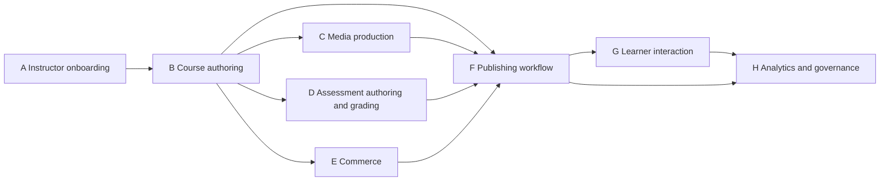

# STU: Instructor Studio and Content Production

> Status: intended product specification. Nothing in this file is a claim that anything is built. Existing code and legacy documents are inputs, not limits (see [CONVENTIONS](../00_START_HERE/CONVENTIONS.md) §1).

Source aliases used in evidence tags: `SSOT` = `SSOT.md`; `YASH-G3` = `Yash_Final_Project_Document/05_FEATURE_SPECIFICATIONS/SPEC_G3_ASSESSMENT_AND_LEARNING.md`; `YASH-MICRO` = `Yash_Final_Project_Document/05_FEATURE_SPECIFICATIONS/MICRO_FEATURE_SPECS.md`; `FREG` = `docs/registries/FEATURE_REGISTRY.md`. Learner-side behavior is specified in [LRN](./LRN_Learning_Course_Experience.md); assessment engine behavior in [ASM](./ASM_Assessments_Challenges_Integrity.md).

## 1. Purpose, outcomes and boundaries

### 1.1 Purpose

STU is the production side of learning: everything an instructor, an institution or the platform does to turn expertise into a published, accessible, correctly priced course, and to run it afterwards. It covers onboarding and verification of instructors, authoring, media upload and processing, assessment authoring, pricing, review and publishing, learner interaction from the instructor side, analytics, revenue reporting and payouts (decision-gated), and content governance (moderation, copyright, localization, quality). It is the "Learn" supply side of the TalentSphere loop [SRC: SSOT §7 F-66, F-74] [DER].

### 1.2 Outcomes

| Outcome | How the system knows |
|---|---|
| A verified instructor can publish a good course without asking support how | Share of submitted courses published within the review SLA; first-time publish success rate |
| Learners never meet an unfinished, inaccessible, infringing or misleading course | Publish gate pass rate; post-publish defect and takedown rates |
| Media is processed reliably and securely, whatever the video provider | Media processing success rate and p95 time-to-ready |
| Instructors know how their course performs and are paid correctly (when payouts are enabled) | Analytics freshness; payout reconciliation drift (target zero) |
| Course content is owned, licensed and attributable | Attestation coverage 100 percent of published versions |

### 1.3 In scope

Instructor application, identity and expertise verification, agreements, public profile, payout and tax profile; studio home; course creation, curriculum builder (sections, lessons, drag and drop), video, text and resource lessons, skill tagging, prerequisites and completion rules, landing page, autosave and edit locking, co-instructors and ownership, import, duplication, versioning, preview; media upload, transcoding, thumbnails, captions and transcripts (auto-generation and editing), content protection, media library, status and retries, external media validation, accessibility tracks; quiz, assignment and rubric authoring, grading queue, peer review setup; pricing, coupons, revenue share, payouts, refund visibility; submission for review, reviewer workflow, automated quality checks, publish, schedule, unpublish, archive; completion sign-off; learner Q&A inbox, announcements, review management, roster, live session hosting; analytics, moderation, copyright, localization, IP attestation, quality score.

### 1.4 Out of scope (owned elsewhere)

| Capability | Owner | Boundary |
|---|---|---|
| Learner experience (catalog, enrollment, playback, progress, certificates, reviews as seen by learners) | LRN | STU publishes an immutable course version and its media manifest; LRN renders and runs it |
| Assessment engine: question types, attempts, timers, grading, integrity, proctoring, certification | ASM | STU embeds ASM's authoring components for in-course quizzes and owns only the course context (placement, weight, completion rule) |
| Payment capture, tax calculation, invoices, payout execution, price tiers, currency | BIL (planned) | STU holds the instructor-facing views and settings; BIL moves money |
| Evidence issuing | EVD (planned) | STU sign-off feeds the rung policy; STU never writes evidence |
| Moderation case workflow and policy | TSF (planned) | STU raises and applies decisions, shows strike status |
| Institution licensing and seats | INS (planned) | Institution-owned courses use STU authoring with institution ownership |
| Object storage, CDN, virus scanning, queue infrastructure | PLT (planned) | STU defines the pipeline behavior; PLT supplies the engine |
| Notification delivery | NTF (planned) | STU names templates |

### 1.5 Owned versus consumed

Owned: instructor profiles and applications, courses, versions, sections, lessons, media assets and renditions, caption and transcript tracks, quiz and assignment configurations (course context), coupons, instructor earnings statements, review cases for publishing, copyright cases for course content, localization tracks, quality scores. Consumed: learner enrollments, progress, reviews and Q&A (LRN), assessment definitions and results (ASM), payments and payout rails (BIL), identity verification services (BGV, IDN, planned).

## 2. Roles and permission matrix

Instructor-side roles inside one course: `Owner` (exactly one), `Co-instructor` (edit content, answer, grade), `Assistant` (answer Q&A and grade only), `Viewer` (analytics only). All are `INS` accounts with course-scoped role. Cell legend: **R** read, **C** create, **U** update, **D** delete, **P** publish, **M** moderate, **A** administer, **-** none.

| Capability | CAN (applicant) | INS Owner | INS Co-instructor | INS Assistant | INS Viewer | IAD (institution course) | MOD | SUP | FIN | PAD |
|---|---|---|---|---|---|---|---|---|---|---|
| Apply and verify as instructor | C U | - | - | - | - | - | - | R | - | A |
| Edit public instructor profile | - | U (own) | U (own) | U (own) | U (own) | - | R | R | - | A |
| Create course draft | - | C | - | - | - | C (institution-owned) | - | - | - | C |
| Edit content, media, curriculum | - | U | U | - | - | U | - | - | - | U (audit) |
| Author quizzes and assignments | - | C U | C U | - | - | C U | - | - | - | - |
| Grade, give feedback | - | U | U | U | - | U | - | - | - | - |
| Set price, coupons | - | C U | - | - | - | C U | - | - | R | A |
| Submit for review | - | C | C (if owner delegates) | - | - | C | - | - | - | - |
| Review and decide on submissions | - | - | - | - | - | - | decide (course reviewer pool) | - | - | A |
| Publish, unpublish, archive | - | P | - | - | - | P | takedown | - | - | A |
| Invite and manage co-instructors | - | C U D | - | - | - | C U D | - | - | - | A |
| View learner roster and progress | - | R | R | R | R (aggregate) | R (scope) | R (case) | R (grant) | - | R (audit) |
| Answer Q&A, post announcements | - | C | C | C (Q&A only) | - | C | M | - | - | M |
| Respond to reviews | - | C | C | - | - | C | M | - | - | M |
| View earnings and payouts | - | R | R (own share) | - | - | R (institution) | - | R | A | R |
| Handle copyright notices | - | R U | - | - | - | R U | A | - | - | A |
| Moderate content, apply strikes | - | - | - | - | - | - | A | R | - | A |

`SAD` has audit access only; `API` principals may read published course metadata through the public API (PLT, planned). Authorization is enforced server-side on every request; course-scoped role is always checked against the course, never inferred from the account type.

## 3. Sub-module map

| Code | Sub-module | Features |
|---|---|---|
| A | Instructor onboarding and identity | FR-STU-001 to 006 |
| B | Course authoring | FR-STU-007 to 020 |
| C | Media production pipeline | FR-STU-021 to 028 |
| D | Assessment authoring and grading | FR-STU-029 to 032 |
| E | Commerce | FR-STU-033 to 037 |
| F | Publishing workflow | FR-STU-038 to 042 |
| G | Learner interaction | FR-STU-043 to 047 |
| H | Analytics and governance | FR-STU-048 to 053 |

## 4. Feature specifications

Notification opt-out classes (owned by NTF, planned): `TRANSACTIONAL` (cannot be disabled), `OPERATIONAL` (studio work items, can be tuned per type), `SOCIAL`, `PROMO`.

### A. Instructor onboarding and identity

### FR-STU-001 — Instructor application

- **Sub-module:** A. Instructor onboarding and identity
- **Priority / tier:** Must · R3
- **Source:** [SRC: SSOT BR-097; §7 F-74] [DER]
- **Purpose and outcome:** A candidate applies to teach, states their expertise and planned topics, and gets a clear decision. Success is a decision inside the stated SLA and a low reapplication-without-change rate.
- **Roles and permissions:** `CAN: create, edit, withdraw own application` · `PAD: decide` · `SUP: view, nudge` · `MOD: view`
- **Preconditions and entry points:** Signed-in account with verified email; "Teach on TalentSphere" link on the footer, dashboard and profile; institution invitations bypass the open application and use FR-STU-002 only.
- **User interactions and actions:**
  1. Open `/teach/apply`; read what is required and how review works.
  2. Fill the form: headline, bio, topics and skills to teach (from the ontology), years of experience, links (portfolio, publications, repository), sample material (a short video or document up to 5 minutes or 20 pages), teaching languages, intended course types, and whether teaching for an institution or employer.
  3. Declare any conflicts of interest and tick the originality and accuracy declaration.
  4. Submit; see status Submitted, In verification, Approved, Rejected (with reasons) or Needs information.
  5. If rejected, see the earliest reapply date.
- **System behavior:** Creates an application (SM-STU-03). Runs automated checks: duplicate account detection, link reachability, sanctions screening via BGV (planned), plagiarism check on sample text, and age gate (BR-STU-038). Routes to reviewers by topic. Approval creates the instructor profile (FR-STU-004) and unlocks FR-STU-002 and FR-STU-003. Rejection stores structured reason codes; reapplication allowed after {30} days (BR-STU-051).
- **UI elements and controls:** Multi-step form with progress indicator, autosave, skill picker, link list with validity check marks, file upload (video, PDF), declaration checkboxes, status page with timeline.
- **Configuration options:** Platform: open applications on or off, required sample type, reapply wait (30 days), reviewer routing rules.
- **Business rules:** BR-STU-001, BR-STU-037, BR-STU-038, BR-STU-051
- **Validation:** Headline 10 to 120 characters; bio 100 to 2,000; at least 1 and at most 10 topics; links must be `https` and reachable (HEAD or GET, 5 s timeout); sample file video up to 500 MB or document up to 20 MB; one open application per account.
- **Inputs and outputs:** In: application form and files. Out: application id, status updates, decision with reason codes.
- **Filters, sorting, search:** Staff queue filters by topic, status, age of application, risk flag; sort by oldest.
- **Notifications and communication:** `stu.application.received`, `stu.application.decided`, `stu.application.needs_info` (`TRANSACTIONAL`) to the applicant; reviewer assignment (`OPERATIONAL`) to staff.
- **Error handling and edge cases:** Unreachable link: field-level error with retry. Upload interrupted: resumable. Duplicate application: `409 application_open`. Under-age: blocked at the age gate with generic text. Reviewer inactivity beyond SLA escalates to PAD.
- **Dependencies:** IDN (planned), BGV (planned), FR-STU-002, FR-STU-004, ENT-STU-01.
- **Security and privacy:** Application data is confidential, visible only to reviewers and the applicant; sample files scanned; retention {24 months} for rejected applications [PROP].
- **Acceptance criteria:**
  1. Given a complete application, when submitted, then status is Submitted and the applicant receives a receipt with the review SLA.
  2. Given an approval, when decided, then an instructor profile exists in draft and the applicant can start verification.
  3. Negative: Given a rejected applicant, when reapplying before 30 days, then `409 reapply_too_soon` shows the date.

### FR-STU-002 — Instructor identity and expertise verification

- **Sub-module:** A. Instructor onboarding and identity
- **Priority / tier:** Must · R3
- **Source:** [SRC: SSOT §7 F-94, F-96; V61-17] [PROP] for the levels
- **Purpose and outcome:** Instructors prove who they are (required for payouts and publishing) and, optionally, that they hold the expertise they teach (shown as a badge). Success is verified instructors on every paid course.
- **Roles and permissions:** `INS: submit evidence, view status` · `PAD, BGV operator (planned): decide` · `SUP: view`
- **Preconditions and entry points:** Approved application; Studio onboarding checklist.
- **User interactions and actions:**
  1. Start identity verification: choose method (government ID and selfie via the BGV provider, or institution-attested identity).
  2. Optionally start expertise verification: add credentials (degree, certification, employer verification, published work, platform evidence from EVD) and request review.
  3. See status per level: Email verified, Identity verified, Expertise verified.
  4. Retry or appeal a failed check.
- **System behavior:** Levels (BR-STU-037): `email` (default), `identity` (required to submit paid courses and to receive payouts), `expertise` (optional; shows a badge with scope, for example "Verified practitioner: data engineering"). Identity checks run through the BGV module and store only the result, timestamp and provider reference, never the ID image. Expertise reviewers check evidence against stated topics and may scope the badge to specific skills. Badges expire after {24 months} and are rechecked on expiry. Platform-evidence-based expertise (for example passing certification exams in ASM) is accepted automatically for the matching skill.
- **UI elements and controls:** Checklist with three levels, method picker, upload and link fields for credentials, status chips with text, appeal button.
- **Configuration options:** Platform: levels required per action, badge validity, accepted credential types.
- **Business rules:** BR-STU-001, BR-STU-037, BR-STU-038
- **Validation:** Names must match across profile and ID within tolerance rules (BGV); credential entries need issuer, date and a verifiable link or document.
- **Inputs and outputs:** In: verification requests and evidence. Out: level states, badge scope.
- **Filters, sorting, search:** Staff queue by level, age, risk.
- **Notifications and communication:** `stu.verification.result`, `stu.verification.expiring` (`TRANSACTIONAL`).
- **Error handling and edge cases:** Provider outage: request queued with honest status. Name mismatch: request clarification, not auto-reject. Badge scope disputes: appeal to a different reviewer. Verification expiry mid-course: existing courses stay live; new submissions are blocked until renewed.
- **Dependencies:** BGV (planned), EVD (planned), FR-STU-001, FR-STU-004.
- **Security and privacy:** ID images processed by the provider, not stored by TalentSphere; verification results are special-category-adjacent data with restricted access and audit.
- **Acceptance criteria:**
  1. Given a passed identity check, when viewing the checklist, then Identity verified shows with the date.
  2. Given no identity verification, when submitting a paid course, then `403 identity_required` is returned.
  3. Negative: Given an expertise badge older than 24 months and not renewed, when viewing the public profile, then the badge is absent.

### FR-STU-003 — Instructor agreement and policy acceptance

- **Sub-module:** A. Instructor onboarding and identity
- **Priority / tier:** Must · R3
- **Source:** [SRC: SSOT BR-089 (author attestation)] [DER]
- **Purpose and outcome:** Instructors accept the current terms, content license, conduct policy and conflict-of-interest declaration before publishing, and re-accept when they change. Success is 100 percent of live instructors on the current version.
- **Roles and permissions:** `INS: accept, view history` · `PAD: publish new versions`
- **Preconditions and entry points:** Studio onboarding; a banner when a new version requires acceptance.
- **User interactions and actions:**
  1. Open each document (instructor terms, content license, community and conduct rules, payout terms when applicable, conflict-of-interest declaration).
  2. Scroll to the end; the Accept button enables; check the box and confirm with re-authentication.
  3. Declare conflicts (relationship with learners, employer, institution, financial interest in referenced products).
  4. Download a signed copy.
- **System behavior:** Records acceptance with document version hash, timestamp, account, IP range and re-authentication result. Material changes require re-acceptance within {30 days}; until then publishing new courses and withdrawals pause while existing courses stay live. Declarations are versioned and can be updated at any time; conflicts feed sign-off independence checks (BR-STU-015).
- **UI elements and controls:** Document viewer with progress, Accept button, declaration form, history table.
- **Configuration options:** Platform: grace days, document set per region.
- **Business rules:** BR-STU-001, BR-STU-015, BR-STU-047
- **Validation:** Declaration entries need type and description up to 500 characters.
- **Inputs and outputs:** In: acceptance, declarations. Out: signed acceptance record.
- **Filters, sorting, search:** n/a — short list.
- **Notifications and communication:** `stu.terms.update_required` (`TRANSACTIONAL`) at 30, 14 and 3 days.
- **Error handling and edge cases:** Grace expired: publishing blocked with an explanation and a direct Accept link. Declaration conflicts with a pending sign-off: sign-off held for review. Re-authentication failure: acceptance not recorded.
- **Dependencies:** FR-STU-001, IDN (planned), ENT-STU-03.
- **Security and privacy:** Acceptance records immutable and retained for the legal period.
- **Acceptance criteria:**
  1. Given new terms, when the grace period passes without acceptance, then publishing a new course is blocked and live courses continue.
  2. Given acceptance, when downloading the copy, then it shows the document hash and timestamp.
  3. Negative: Given an unauthenticated session, when calling the accept endpoint, then `401` is returned and nothing is recorded.

### FR-STU-004 — Instructor public profile

- **Sub-module:** A. Instructor onboarding and identity
- **Priority / tier:** Must · R3
- **Source:** [SRC: SSOT §7 F-74, F-148] [DER]
- **Purpose and outcome:** Instructors present themselves credibly to learners with control over what is public. Success is complete profiles correlated with enrollment.
- **Roles and permissions:** `INS: edit own` · `MOD: hide fields or profile` · `GUE, CAN: view`
- **Preconditions and entry points:** Studio profile; public page `/learn/instructors/:handle` (LRN displays it).
- **User interactions and actions:**
  1. Edit photo, display name, headline, bio (rich text, limited), languages, links, areas of expertise, selected credentials, and an optional intro video.
  2. Toggle visibility for each field and for the whole profile listing.
  3. Preview the public page and see completeness hints.
  4. Choose a unique handle once (changes allowed every 90 days with redirects).
- **System behavior:** Profile fields are validated and sanitized; photos pass image moderation. Verification badges come only from FR-STU-002. Aggregate ratings and learner counts are computed (LRN) and cannot be edited. Hidden fields are removed from public payloads. Profile changes appear within 60 seconds.
- **UI elements and controls:** Form with live preview, photo cropper (min 400 by 400), visibility toggles, handle field with availability check.
- **Configuration options:** Instructor: field visibility. Platform: handle change interval.
- **Business rules:** BR-STU-037, BR-STU-053
- **Validation:** Display name 2 to 60 characters; headline up to 120; bio up to 2,000; handle `[a-z0-9-]{3,30}` unique; links `https`; photo JPEG or PNG up to 5 MB.
- **Inputs and outputs:** In: profile fields. Out: public profile model.
- **Filters, sorting, search:** n/a — single profile.
- **Notifications and communication:** `stu.profile.hidden_by_moderation` (`TRANSACTIONAL`).
- **Error handling and edge cases:** Handle taken: suggestions. Photo rejected: explanation with category. Profile hidden by moderators: courses remain but show "Instructor profile unavailable" until resolved.
- **Dependencies:** FR-STU-002, LRN FR-LRN-011.
- **Security and privacy:** Email, legal name and payout data never in the public payload; scraping throttled.
- **Acceptance criteria:**
  1. Given a hidden bio, when viewing the public profile, then no bio appears in the page data.
  2. Given a handle change, when the old URL is opened, then it redirects with 301.
  3. Negative: Given a handle changed 10 days ago, when changing again, then `409 handle_cooldown` shows the date.

### FR-STU-005 — Payout and tax profile (decision-gated)

- **Sub-module:** A. Instructor onboarding and identity
- **Priority / tier:** Should · R5
- **Source:** [SRC: SSOT BR-101; V61-21 (seller of record, payouts, tax need an ADR)] [DEC-REQ] OD-STU-01
- **Purpose and outcome:** Instructors set up how they are paid and provide tax details, enabling payouts when the commercial model is approved. Success is a complete, valid profile before the first payout.
- **Roles and permissions:** `INS Owner: create, edit own` · `FIN: view status, approve changes` · `PAD: view with audit`
- **Preconditions and entry points:** Identity verified (FR-STU-002); payouts enabled by a platform switch; Studio, Earnings, Payout settings.
- **User interactions and actions:**
  1. Choose country of residence and payout method (bank transfer or a provider wallet, as offered by BIL).
  2. Provide tax information per jurisdiction (for example forms and tax identifiers) via the BIL-hosted secure form.
  3. Verify the account (micro-deposit or provider verification).
  4. Change details; changes enter a {7 day} security hold on payouts.
- **System behavior:** STU stores only a reference to the BIL payout profile and its state (`incomplete`, `pending_verification`, `verified`, `restricted`). Payout is blocked unless verified and the tax profile is complete (BR-STU-048). Changing bank details notifies the instructor on the old contact channel and holds the next payout. The feature is entirely hidden unless the platform switch is on.
- **UI elements and controls:** Payout wizard (hosted by BIL), status card, "Change details" button with warning.
- **Configuration options:** Platform: payouts enabled, supported countries and methods, hold days.
- **Business rules:** BR-STU-019, BR-STU-048
- **Validation:** Delegated to BIL; STU validates only the identity match between profile name and payee name (warning).
- **Inputs and outputs:** In: setup events from BIL. Out: profile state.
- **Filters, sorting, search:** Finance queue by state.
- **Notifications and communication:** `stu.payout_profile.verified`, `stu.payout_profile.changed` (`TRANSACTIONAL`).
- **Error handling and edge cases:** Unsupported country: clear message and waitlist option. Verification failure: retry limit with support path. Tax profile expired (for example annual certification): payouts hold with explanation.
- **Dependencies:** BIL (planned), FR-STU-002, OD-STU-01.
- **Security and privacy:** Financial and tax data processed by BIL; STU stores no account numbers; access to references restricted to FIN with audit.
- **Acceptance criteria:**
  1. Given a verified identity and complete tax profile, when payouts are enabled, then the profile state is `verified`.
  2. Given a changed bank detail, when saved, then the next payout is held for 7 days and the old channel is notified.
  3. Negative: Given an incomplete tax profile, when a payout is due, then it is held and the instructor sees the missing item.

### FR-STU-006 — Studio home and course list

- **Sub-module:** A. Instructor onboarding and identity
- **Priority / tier:** Must · R3
- **Source:** [SRC: SSOT §7 F-74] [DER]
- **Purpose and outcome:** Instructors see all their courses, work needing attention and quick actions in one place. Success is that instructors reach any task in two clicks.
- **Roles and permissions:** `INS (all course roles): view courses they belong to` · `IAD: organization courses`
- **Preconditions and entry points:** `/studio`; navigation "Studio" for instructor accounts.
- **User interactions and actions:**
  1. See the "Needs attention" list: reviews requested changes, unanswered Q&A older than 3 days, grading queue, expiring verification, failed media, copyright notices, coupons expiring.
  2. Browse the course table with state, last edited, learners, rating, revenue (if allowed), and actions.
  3. Create a course, filter by state, search, and open a course workspace.
  4. Switch context between personal and organization workspaces.
- **System behavior:** Aggregates read models from authoring, LRN and BIL. Role-based columns: assistants and viewers do not see revenue. Counts refresh every 5 minutes; "Needs attention" is real time from events.
- **UI elements and controls:** Attention cards with counts, course table with sortable columns, "New course" button, workspace switcher, saved filters.
- **Configuration options:** Instructor: default columns, notification digest.
- **Business rules:** BR-STU-013, BR-STU-029
- **Validation:** n/a — read screen; filters from enumerated sets.
- **Inputs and outputs:** In: filters. Out: courses and tasks.
- **Filters, sorting, search:** Filter by state, role, workspace, language; sort by last edited, learners, rating, revenue; search by title.
- **Notifications and communication:** Daily or weekly digest `stu.digest.attention` (`OPERATIONAL`).
- **Error handling and edge cases:** Course in `taken_down`: row shows state and a link to the notice. No courses: empty state with a "Create your first course" guide. Workspace access removed: its courses disappear from the list.
- **Dependencies:** FR-STU-007, FR-STU-048, ENT-STU-05.
- **Security and privacy:** Role-based visibility of revenue and learner data.
- **Acceptance criteria:**
  1. Given a course with changes requested, when opening Studio home, then it appears in Needs attention with the reviewer note link.
  2. Given an assistant role, when viewing the table, then no revenue column is present.
  3. Negative: Given a course the user is not a member of, when opening its URL, then `404` is returned.

### B. Course authoring

### FR-STU-007 — Course creation wizard

- **Sub-module:** B. Course authoring
- **Priority / tier:** Must · R3
- **Source:** [SRC: SSOT §7 F-66; BR-096] [DER]
- **Purpose and outcome:** An instructor starts a course with the right basic information and a guided checklist to publishability. Success is first-draft creation completed in one sitting.
- **Roles and permissions:** `INS (approved): create` · `IAD: create institution-owned` · `PAD: create platform-authored`
- **Preconditions and entry points:** Approved instructor (BR-STU-001); "New course" in Studio; institution workspace.
- **User interactions and actions:**
  1. Choose ownership (me, organization workspace) and course format (self-paced, cohort-based, live sessions, mixed).
  2. Enter working title, subtitle, primary language, category, level, and 3 to 8 learning outcomes ("After this course you will be able to…").
  3. Declare requirements and target audience; add skills taught (FR-STU-012).
  4. Choose a starting point: blank, from a template (FR-STU-018), from import (FR-STU-017).
  5. See the publishing checklist (the quality checks of FR-STU-040) with progress and open the workspace.
- **System behavior:** Creates the course shell and a working draft version (SM-STU-01, SM-STU-02) with stable ids. The slug is generated from the title and fixed at first publication. One working draft per course (BR-STU-049). Autosave from the first keystroke (FR-STU-015). Outcomes are checked for measurable verbs by a hint (non-blocking).
- **UI elements and controls:** Stepper, field set with counters, outcome list with add and reorder, template picker, "Create draft" button, persistent checklist sidebar.
- **Configuration options:** Platform: allowed formats, outcome count range, templates available.
- **Business rules:** BR-STU-001, BR-STU-003, BR-STU-049
- **Validation:** Title 10 to 80 characters and unique per owner among live courses; subtitle up to 120; outcomes 3 to 8, each 10 to 160 characters; category from taxonomy; level from the fixed set.
- **Inputs and outputs:** In: basics. Out: course id, draft version id, checklist.
- **Filters, sorting, search:** n/a — wizard.
- **Notifications and communication:** `stu.course.created` (in-app, `OPERATIONAL`).
- **Error handling and edge cases:** Duplicate title: warning with link, not a block. Template unavailable: blank fallback. Closing the wizard midway keeps the draft with the filled fields.
- **Dependencies:** FR-LRN-002, FR-STU-012, FR-STU-018, FR-STU-040.
- **Security and privacy:** Drafts are private to course members.
- **Acceptance criteria:**
  1. Given valid basics, when creating, then a draft course with a working version and checklist exists.
  2. Given 2 outcomes, when continuing, then the step shows `at least 3 outcomes required`.
  3. Negative: Given an unapproved instructor, when calling create, then `403 instructor_not_approved` is returned.

### FR-STU-008 — Curriculum builder

- **Sub-module:** B. Course authoring
- **Priority / tier:** Must · R3
- **Source:** [SRC: SSOT §13.12 (Course → Section → ContentItem)] [DER]
- **Purpose and outcome:** Instructors structure the course as sections and lessons by drag and drop, with every lesson type available. Success is building a 20-lesson outline in minutes without losing work.
- **Roles and permissions:** `INS Owner, Co-instructor: edit` · `IAD: edit (institution)` · others: none
- **Preconditions and entry points:** Course workspace, Curriculum tab; working draft.
- **User interactions and actions:**
  1. Click "Add section" and name it; click "Add lesson" in a section and choose a type: video, reading, quiz, assignment, project, live session, practice (coding), external link, downloadable resource.
  2. Drag a lesson by its handle to reorder within or across sections; drag a section to reorder. Keyboard alternative: focus the handle, press Space, move with arrow keys, Space again to drop; "Move to…" menu also available.
  3. Select multiple lessons (checkboxes) to move, duplicate, delete, mark optional or mark preview in bulk.
  4. Collapse or expand sections; rename inline; set per-lesson flags: preview, optional, downloadable, estimated minutes (auto from media when available).
  5. Undo and redo the last 20 actions.
- **System behavior:** Lessons get a permanent `lessonKey` at creation that never changes and is the mapping key for versions, progress and notes (BR-STU-004). Reordering updates positions in one transaction with optimistic concurrency (BR-STU-036). Deleting a lesson in a draft removes it from this draft only; learners on published versions are unaffected. Section and lesson limits {50 sections, 500 lessons per course} [PROP]. Total duration and counts update live. Releasing schedule and sequential gating are set per section (FR-STU-013).
- **UI elements and controls:** Outline tree with drag handles (`aria-grabbed` alternatives), type icons with text, inline rename, bulk action bar, add menus, undo and redo buttons, status chips per lesson (empty, in progress, ready, error).
- **Configuration options:** Platform: size limits, allowed lesson types per course format.
- **Business rules:** BR-STU-004, BR-STU-005, BR-STU-036
- **Validation:** Section title 3 to 80 characters; lesson title 3 to 100; at least one lesson per section to publish; preview flagged lessons limited by BR-STU-005.
- **Inputs and outputs:** In: structure edits. Out: outline model with versions.
- **Filters, sorting, search:** Filter lessons by type or status; search by title.
- **Notifications and communication:** n/a — none.
- **Error handling and edge cases:** Concurrent edit by a co-instructor: server returns `409 stale_version` with a merge view of differing nodes. Dropping a lesson into an invalid position is cancelled with an inline notice. Large course reorder over a slow connection queues operations and shows "Saving". Deleting a lesson referenced by a completion rule is blocked until the rule is updated.
- **Dependencies:** FR-STU-009 to 011, FR-STU-013, FR-STU-015, ENT-STU-07, ENT-STU-08.
- **Security and privacy:** Edits audited with actor and time.
- **Acceptance criteria:**
  1. Given lessons A, B, C, when dragging C above A, then the order is C, A, B and `lessonKey`s are unchanged.
  2. Given keyboard only, when moving a lesson with the handle, then it can be moved and dropped and the new position is announced.
  3. Negative: Given a lesson used in the completion rule, when deleting it, then deletion is refused with `409 rule_reference` naming the rule.

### FR-STU-009 — Video lesson authoring

- **Sub-module:** B. Course authoring
- **Priority / tier:** Must · R3
- **Source:** [SRC: SSOT §13.13 (delivery modes A to E); BR-091, BR-092] [DER]
- **Purpose and outcome:** Instructors attach video to a lesson (upload or external), set chapters and completion rules, and see readiness. Success is a lesson ready to publish with captions and chapters.
- **Roles and permissions:** `INS Owner, Co-instructor: edit`
- **Preconditions and entry points:** Lesson of type video; media library (FR-STU-025).
- **User interactions and actions:**
  1. Choose a source: upload a file, pick from the media library, or paste an external URL (FR-STU-027).
  2. Watch processing status (FR-STU-026); once ready, preview the lesson.
  3. Add lesson description, learning points and resources.
  4. Set chapters: add at the playhead, rename, delete; or accept auto-suggested chapters (FR-STU-023).
  5. Set completion rule (watch at least X percent, or no minimum), mark preview, allow download (if the course allows) and allow transcript download.
  6. Set thumbnail: auto-picked frames or custom upload.
- **System behavior:** Binds a media asset to the lesson (by id, not by file). Lesson readiness requires state `ready` for the asset and captions per BR-STU-007. Replacing the media keeps `lessonKey` and flags watch-coverage mapping impact (LRN BR-LRN-015). Duration is taken from the asset. Chapter data stored with the lesson version.
- **UI elements and controls:** Source picker, upload dropzone, player preview with chapter editor, completion-rule select, preview toggle, thumbnail strip, status chips.
- **Configuration options:** Author: completion mode and threshold override within platform bounds; download allowed.
- **Business rules:** BR-STU-007, BR-STU-009, BR-STU-010
- **Validation:** Chapter times strictly increasing, first at 0:00, min length 10 s, titles 2 to 80 characters; threshold between 50 and 100 percent.
- **Inputs and outputs:** In: media reference and settings. Out: lesson with media state.
- **Filters, sorting, search:** n/a — single lesson.
- **Notifications and communication:** `stu.media.ready`, `stu.media.failed` (`OPERATIONAL`).
- **Error handling and edge cases:** Asset still processing: lesson shows "Processing" and cannot be marked ready. Replacement of media with different duration warns about learner progress mapping. Provider-hosted video becomes unavailable: lesson flagged "Source unavailable" and checks fail.
- **Dependencies:** FR-STU-021 to 027, FR-LRN-036, ENT-STU-08, ENT-STU-09.
- **Security and privacy:** Source files private; learners get tokenized renditions only.
- **Acceptance criteria:**
  1. Given a ready asset and captions, when attaching to the lesson, then readiness shows green.
  2. Given chapters at 0:00, 2:30, 2:35, when saving, then the third is rejected for being under 10 seconds.
  3. Negative: Given an asset in `processing`, when marking the lesson ready, then `409 media_not_ready` is returned.

### FR-STU-010 — Text lesson authoring

- **Sub-module:** B. Course authoring
- **Priority / tier:** Must · R3
- **Source:** [SRC: SSOT §13.12 (ARTICLE), BR-092] [DER]
- **Purpose and outcome:** Instructors write rich reading lessons with code, math and media safely. Success is accessible, well-structured text lessons with no unsafe markup.
- **Roles and permissions:** `INS Owner, Co-instructor: edit`
- **Preconditions and entry points:** Lesson type reading; Curriculum, edit lesson.
- **User interactions and actions:**
  1. Write with a structured editor: headings H2 to H4, paragraphs, lists, tables, quotes, callouts, code blocks with language, inline code, math (LaTeX), images with alt text, diagrams (Mermaid), embedded video from the library, horizontal rules.
  2. Use slash commands and keyboard shortcuts; paste from a document with cleanup.
  3. Insert images by upload or library; set alt text or mark decorative.
  4. Preview as the learner sees it; see estimated reading time and heading outline.
  5. Set completion rule (scroll to end, manual, none).
- **System behavior:** Content stored as a validated structured document (no raw HTML or scripts); links get `rel` safeguards; images go through the media pipeline for resizing; headings must be in order (a lint warning). Accessibility lint: missing alt text blocks publish (BR-STU-052); low-contrast color use is not available. Autosave and version history of the last 20 revisions.
- **UI elements and controls:** Editor toolbar, slash menu, image dialog with alt text field, outline panel, reading time, revision history drawer.
- **Configuration options:** Platform: allowed blocks, max size (500 KB of text).
- **Business rules:** BR-STU-008, BR-STU-052
- **Validation:** Body up to 500 KB; image up to 10 MB each; links `https` or mailto; code block language from list.
- **Inputs and outputs:** In: document. Out: stored lesson body.
- **Filters, sorting, search:** Find and replace within the lesson.
- **Notifications and communication:** n/a — none.
- **Error handling and edge cases:** Pasted HTML stripped to supported blocks with a report. Unsupported embed: converted to a link. Two editors on one lesson: soft lock (FR-STU-015). Math parse error: inline marker, not a crash.
- **Dependencies:** FR-STU-011, FR-STU-015, FR-STU-021.
- **Security and privacy:** XSS-safe schema; no third-party scripts; images sanitized for metadata.
- **Acceptance criteria:**
  1. Given an image without alt text, when running publish checks, then a blocking issue names the lesson and image.
  2. Given pasted HTML with a script tag, when saved, then the script is removed and a notice lists the removal.
  3. Negative: Given a body over 500 KB, when saving, then `413 body_too_large` is returned.

### FR-STU-011 — Resources and attachments

- **Sub-module:** B. Course authoring
- **Priority / tier:** Must · R3
- **Source:** [SRC: SSOT §13.12 (PDF)] [DER]
- **Purpose and outcome:** Instructors attach downloadable files and links to lessons and courses. Success is safe, scanned, accessible attachments.
- **Roles and permissions:** `INS Owner, Co-instructor: add, replace, remove`
- **Preconditions and entry points:** Lesson, Resources panel; course-level resources.
- **User interactions and actions:**
  1. Upload files (documents, archives, datasets, notebooks, images) or add links with a title and description.
  2. Mark each resource as downloadable or view-only, and as required reading or optional.
  3. Reorder, rename, replace (new file keeps the resource id).
  4. See scan status and size per file.
- **System behavior:** Files are scanned (virus and type check) and stored privately; served with signed URLs (BR-STU-012). Replacing a file after publish is a patch change (BR-STU-004) and is logged. PDF accessibility check warns when no text layer exists. Archives are listed but not unpacked.
- **UI elements and controls:** Upload dropzone, resource table, status chips, replace and delete menu.
- **Configuration options:** Platform: allowed types and size (default 500 MB per file, 2 GB per course [PROP]).
- **Business rules:** BR-STU-004, BR-STU-010, BR-STU-012
- **Validation:** Type allowlist (no executables); name up to 150 characters; links `https`.
- **Inputs and outputs:** In: files and links. Out: resource records.
- **Filters, sorting, search:** Filter by lesson, type, status.
- **Notifications and communication:** `stu.resource.scan_failed` (`OPERATIONAL`).
- **Error handling and edge cases:** Infected file: quarantined and removed from the lesson with a notice. Scan outage: file stays "Checking" and is not served. Broken link detected by the periodic checker: flagged.
- **Dependencies:** PLT (planned) storage and scanning, FR-LRN-041.
- **Security and privacy:** No public URLs; metadata stripped from images; license field recommended per resource.
- **Acceptance criteria:**
  1. Given a clean PDF, when uploaded, then it becomes downloadable after the scan completes.
  2. Given an executable file, when uploading, then it is rejected with `415 type_not_allowed`.
  3. Negative: Given an infected file, when scanned, then it is quarantined and never served to any learner.

### FR-STU-012 — Learning objectives and skill tagging

- **Sub-module:** B. Course authoring
- **Priority / tier:** Must · R3
- **Source:** [SRC: SSOT §9.1 F-84 skills graph; YASH-G3 SPEC-06 §3.1] [DER]
- **Purpose and outcome:** Instructors declare which skills the course teaches and at what level so learners can find it and evidence can be created correctly. Success is accurate skill declarations and no unearned evidence claims.
- **Roles and permissions:** `INS Owner, Co-instructor: edit` · `PAD: curate ontology`
- **Preconditions and entry points:** Course workspace, Skills tab.
- **User interactions and actions:**
  1. Search the ontology and add 1 to 8 skills with target level (from the ontology scale) and coverage (primary or secondary).
  2. Map each skill to the lessons or assessments that demonstrate it.
  3. See a coverage check: "Skill X has no assessed lesson, so completion will not produce verified evidence for it".
  4. Request a new skill from the ontology (goes to a curator queue).
- **System behavior:** Skills are claims until assessed (LRN BR-LRN-046). The coverage check lists skills without a graded assessment or independent sign-off; the evidence rung outcome (LRN FR-LRN-071) is previewed honestly ("Completion will produce: authority-verified evidence for SQL; no verified evidence for Data modeling"). Retired ontology skills trigger a migration prompt.
- **UI elements and controls:** Skill search, skill chips with level and coverage, mapping table, evidence preview panel.
- **Configuration options:** Platform: max skills (8), allowed level scale.
- **Business rules:** BR-STU-003, BR-STU-013
- **Validation:** Skills must exist in the ontology; at least 1 primary skill to publish.
- **Inputs and outputs:** In: skills, mapping. Out: course skill declaration.
- **Filters, sorting, search:** Skill search with synonyms.
- **Notifications and communication:** `stu.skill.request_decided` (`OPERATIONAL`).
- **Error handling and edge cases:** Over 8 skills: refused with guidance. Skill retired after publication: the course continues with the mapped successor after owner confirmation. Mapping to a deleted lesson is blocked.
- **Dependencies:** EVD or AIC (planned) ontology, FR-LRN-005, FR-LRN-071, FR-STU-013.
- **Security and privacy:** n/a — public declarations only.
- **Acceptance criteria:**
  1. Given a skill mapped only to video lessons, when viewing the evidence preview, then it says no verified evidence will be produced for it.
  2. Given a new skill request, when approved, then the skill appears in search.
  3. Negative: Given no primary skill, when submitting for review, then the check fails with `primary_skill_required`.

### FR-STU-013 — Prerequisites and completion rule configuration

- **Sub-module:** B. Course authoring
- **Priority / tier:** Must · R3
- **Source:** [SRC: YASH-G3 SPEC-06 §3.1 completion_rule; SSOT BR-047, BR-109] [DER]
- **Purpose and outcome:** Instructors define who the course is for (prerequisites), how learners move (sequential, drip) and exactly what completes the course. Success is unambiguous, satisfiable rules.
- **Roles and permissions:** `INS Owner, Co-instructor: edit`
- **Preconditions and entry points:** Course workspace, Rules tab.
- **User interactions and actions:**
  1. Add prerequisites: courses, skills with minimum level, or text; mark each required or recommended.
  2. Choose navigation: free, or sequential by section or whole course; set drip release (days after enrollment or absolute dates).
  3. Define completion rule: required lessons (default all non-optional), required assessments with minimum score, minimum course grade, final exam, instructor sign-off yes or no.
  4. Run "Test the rule": the system simulates a learner finishing everything and a learner missing one required item and shows the results.
  5. Set certificate: offered or not, validity period.
- **System behavior:** Rules are stored per version (LRN BR-LRN-006). The satisfiability check rejects impossible rules (for example a required assessment not in the course, a minimum grade above reachable, sign-off required with no eligible signer). Grade weights must total 100. Changing rules after publication is a structural change requiring a new version (BR-STU-004). Sign-off requires at least one eligible signer other than the learner (BR-STU-015).
- **UI elements and controls:** Prerequisite builder, navigation radios, rule builder with lesson and assessment checklists, weight table, "Test the rule" button with result panel, certificate toggle.
- **Configuration options:** Platform: default pass threshold (70, SSOT BR-048 [PROP]), drip limits.
- **Business rules:** BR-STU-004, BR-STU-015, BR-STU-035
- **Validation:** Weights integers summing to 100; minimum score 0 to 100; drip days 0 to 365; prerequisites no cycles.
- **Inputs and outputs:** In: rule configuration. Out: validated rule JSON.
- **Filters, sorting, search:** n/a — configuration.
- **Notifications and communication:** n/a — none.
- **Error handling and edge cases:** Unsatisfiable rule blocks submission with the reason. Rule referencing an optional lesson is a warning. Removing a lesson cascades a prompt to update the rule. Test the rule does not create learner data.
- **Dependencies:** FR-LRN-058, FR-LRN-049, FR-STU-029, FR-STU-042.
- **Security and privacy:** n/a — course configuration.
- **Acceptance criteria:**
  1. Given a required assessment that is not in the course, when saving, then `422 unsatisfiable_rule` names it.
  2. Given weights 40, 40, 30, when saving, then it is rejected because the total is 110.
  3. Negative: Given sign-off required and the only member being the owner, when the owner is also a learner, then the check warns that self sign-off is not allowed.

### FR-STU-014 — Course landing page editor

- **Sub-module:** B. Course authoring
- **Priority / tier:** Must · R3
- **Source:** [SRC: SSOT BR-098; §9.2 F-07 step 2] [DER]
- **Purpose and outcome:** Instructors craft the public course page: image, promo video, description and SEO. Success is pages that pass the quality checks and convert.
- **Roles and permissions:** `INS Owner, Co-instructor: edit`
- **Preconditions and entry points:** Course workspace, Landing page tab.
- **User interactions and actions:**
  1. Upload the course image (crop to 16:9) and optionally a promo video up to 2 minutes.
  2. Write the description (rich text subset), "who this is for", and FAQ items.
  3. Choose which sections are shown (outcomes, skills, curriculum, instructors, FAQ).
  4. Edit SEO fields: slug (before first publication), meta title and description, social preview image.
  5. Preview the page as a guest, tablet and phone.
- **System behavior:** Image validated against BR-STU-006 (minimum 750 by 422 pixels, up to 4 MB) and resized into variants. Promo video goes through the media pipeline and needs captions. Slug locks at first publication; later changes create redirects and need support approval. Meta fields default from the description. Claims language lint warns on prohibited promises (for example guaranteed jobs or salary).
- **UI elements and controls:** Image cropper with dimension feedback, promo video slot, rich text editor, FAQ list editor, section toggles, SEO fields with length counters, device preview tabs.
- **Configuration options:** Platform: prohibited-claims list, image rules.
- **Business rules:** BR-STU-006, BR-STU-007, BR-STU-009
- **Validation:** Description 200 to 5,000 characters; meta title up to 60; meta description up to 160; FAQ up to 15 items; slug `[a-z0-9-]{3,80}` unique.
- **Inputs and outputs:** In: page content. Out: stored page model.
- **Filters, sorting, search:** n/a — editor.
- **Notifications and communication:** n/a — none.
- **Error handling and edge cases:** Image too small: cannot continue, with dimensions shown. Promo video processing: page preview shows placeholder. Prohibited claim detected: warning at edit and blocking issue at submit if not changed.
- **Dependencies:** FR-STU-021, FR-STU-040, FR-LRN-008.
- **Security and privacy:** Public content only; no personal data of learners.
- **Acceptance criteria:**
  1. Given an image of 700 by 400 pixels, when uploading, then it is rejected with the minimum size.
  2. Given a published course, when the slug is edited, then the change is refused without support approval.
  3. Negative: Given a description claiming "guaranteed job", when submitting for review, then the check blocks with the phrase highlighted.

### FR-STU-015 — Autosave, drafts and edit locking

- **Sub-module:** B. Course authoring
- **Priority / tier:** Must · R3
- **Source:** [SRC: SSOT §19.3 sync (operation ids, entity versions)] [DER]
- **Purpose and outcome:** Authors never lose work and never silently overwrite a colleague. Success is zero lost edits in failure tests.
- **Roles and permissions:** `INS Owner, Co-instructor: edit`
- **Preconditions and entry points:** Any editor surface.
- **User interactions and actions:**
  1. Type or change anything; see "Saving…" then "Saved at 14:02".
  2. When another member is editing the same lesson, see a banner "Priya is editing this lesson" with Request control or Edit anyway (read-only by default).
  3. After a conflict, open a side-by-side diff and choose per block: keep mine, keep theirs, both.
  4. Restore a previous revision from history.
- **System behavior:** Autosave debounced 2 seconds and on blur; each save carries a version token (BR-STU-036); stale saves fail with `409` and a merge view. Soft locks are leases of 5 minutes renewed by activity; expired leases free automatically. Offline edits queue locally (IndexedDB) and sync on reconnect with conflict handling; the latest 20 revisions per lesson are kept for 90 days. Working drafts persist indefinitely.
- **UI elements and controls:** Save indicator, presence avatars, lock banner, merge dialog, revision drawer with Restore.
- **Configuration options:** Platform: debounce, lease length, revision count.
- **Business rules:** BR-STU-036, BR-STU-049
- **Validation:** Version tokens must match; payload size limits per field.
- **Inputs and outputs:** In: edits with token. Out: new token or conflict payload.
- **Filters, sorting, search:** Revision list by time and author.
- **Notifications and communication:** n/a — in-app indicators only.
- **Error handling and edge cases:** Save failure: banner with retry and local copy retained. Lock holder disconnects: lease expires in 5 minutes. Network flaps: queue ordering preserved. Browser crash: recovered draft offered on reopen.
- **Dependencies:** FR-STU-008, FR-STU-010, PWA (planned).
- **Security and privacy:** Revisions follow course access; authors can delete a revision containing sensitive data (audited).
- **Acceptance criteria:**
  1. Given two editors on one lesson, when the second saves a stale version, then `409` and a diff are shown and no content is lost.
  2. Given the browser closed mid-edit, when reopened, then the unsaved text is offered for recovery.
  3. Negative: Given a lease held by another member, when "Edit anyway" is not chosen, then the editor stays read-only.

### FR-STU-016 — Co-instructors and ownership

- **Sub-module:** B. Course authoring
- **Priority / tier:** Should · R3
- **Source:** [SRC: SSOT §7 F-74] [PROP] for roles and transfer
- **Purpose and outcome:** Courses can be built and run by a team with clear roles, revenue split and ownership continuity. Success is no orphaned courses.
- **Roles and permissions:** `INS Owner: invite, change roles, remove, transfer` · `IAD: manage for institution-owned` · `PAD: reassign with audit`
- **Preconditions and entry points:** Course workspace, Team tab.
- **User interactions and actions:**
  1. Invite an instructor by handle or email with a role (Co-instructor, Assistant, Viewer) and, if paid, a revenue share percentage.
  2. The invitee accepts or declines; roles can be changed or removed later.
  3. Choose which co-instructors are displayed publicly on the course page.
  4. Transfer ownership to another instructor or organization: the target must accept; the previous owner may stay as co-instructor.
  5. Leave the course (non-owner) or request ownership reassignment (owner leaving).
- **System behavior:** Exactly one owner (BR-STU-013). Invitations SM-STU-10 expire in 14 days. Revenue split must total 100 percent of the instructor share and every member accepts their share (BR-STU-014); split changes apply to future earnings only. Public display requires the member's consent (BR-STU-053). When the owner account is closed, ownership goes to a named successor or the organization; else to PAD for custody and courses stay live. Organization-owned courses persist when instructors leave (BR-STU-039).
- **UI elements and controls:** Member table with role selects and share inputs, Invite dialog, Transfer wizard, "Display publicly" toggle.
- **Configuration options:** Platform: max members (10), allowed roles.
- **Business rules:** BR-STU-013, BR-STU-014, BR-STU-039, BR-STU-053
- **Validation:** Shares integers summing to 100; invitee must be an approved instructor for co-instructor role; assistants may be any verified account.
- **Inputs and outputs:** In: invitation, role, split. Out: membership records.
- **Filters, sorting, search:** Member list by role.
- **Notifications and communication:** `stu.team.invited`, `stu.team.role_changed`, `stu.team.ownership_transfer` (`TRANSACTIONAL`).
- **Error handling and edge cases:** Invitation to an unapproved instructor: blocked with reason. Owner removes themselves without successor: refused. Split sum mismatch: save disabled with the difference shown. Disputes over ownership: staff mediation path.
- **Dependencies:** FR-STU-035, FR-LRN-011, ENT-STU-15.
- **Security and privacy:** Role changes audited; assistants cannot see revenue.
- **Acceptance criteria:**
  1. Given a transfer to another instructor, when they accept, then they become owner and the previous owner is demoted to the chosen role.
  2. Given shares 60 and 50, when saving, then the request fails with `422 share_total`.
  3. Negative: Given an assistant, when calling the Invite endpoint, then `403` is returned.

### FR-STU-017 — Course import

- **Sub-module:** B. Course authoring
- **Priority / tier:** Could · R4
- **Source:** [SRC: SSOT §10.26 MIG-01..MIG-08 migration principles; F-42 playlist import] [PROP]
- **Purpose and outcome:** Instructors bring existing material (playlists, documents, Markdown, packages) instead of re-creating it. Success is import-to-publish time reduction without rights or safety shortcuts.
- **Roles and permissions:** `INS Owner, Co-instructor: import into drafts`
- **Preconditions and entry points:** New course wizard, Curriculum tab "Import".
- **User interactions and actions:**
  1. Choose a source: external playlist (provider allowlist), Markdown or ZIP of documents and media, SCORM or xAPI package (read-only content import), or another course export.
  2. See a preview mapping: sections, lessons, media found, problems.
  3. Choose which items to import and where; confirm rights attestation.
  4. Track import progress; resolve warnings.
- **System behavior:** Import creates draft content only and never publishes automatically (BR-STU-040). Media enters the pipeline; external playlists become external lessons only if the provider is allowlisted and embedding is allowed (BR-STU-009). SCORM content is imported as static learning content inside a sandboxed frame or converted when possible; tracking beyond completion is not supported at first [PROP]. Imported data is owned by the instructor, editable and deletable. Import jobs are idempotent per source hash.
- **UI elements and controls:** Source picker, mapping preview tree, rights attestation checkbox, progress panel, issues list.
- **Configuration options:** Platform: allowed sources, size limits.
- **Business rules:** BR-STU-008, BR-STU-009, BR-STU-040
- **Validation:** ZIP up to 5 GB, entries scanned; playlists up to 200 items; path traversal rejected.
- **Inputs and outputs:** In: source. Out: draft sections and lessons, import report.
- **Filters, sorting, search:** n/a — wizard.
- **Notifications and communication:** `stu.import.completed`, `stu.import.failed` (`OPERATIONAL`).
- **Error handling and edge cases:** Duplicate import of the same source detected and offered as update. Malformed package: file-level errors listed. Provider rate limits: backoff and resume. Imported items failing virus scan are skipped.
- **Dependencies:** FR-STU-021, FR-STU-027, FR-STU-040, ENT-STU-30.
- **Security and privacy:** Imported archives scanned and never executed; SCORM scripts run only in sandboxed frames.
- **Acceptance criteria:**
  1. Given a playlist of 12 allowlisted videos, when imported, then 12 external lessons are created as drafts.
  2. Given a ZIP with `../` paths, when importing, then the archive is rejected.
  3. Negative: Given an import completes, when the course draft is viewed, then it is not published or submitted automatically.

### FR-STU-018 — Course duplication and templates

- **Sub-module:** B. Course authoring
- **Priority / tier:** Could · R4
- **Source:** [PROP]
- **Purpose and outcome:** Instructors and organizations reuse proven structures. Success is faster creation of similar courses and consistent organization templates.
- **Roles and permissions:** `INS Owner: duplicate own, save templates` · `IAD: organization templates` · `PAD: platform templates`
- **Preconditions and entry points:** Course menu "Duplicate"; "Save as template"; wizard template picker.
- **User interactions and actions:**
  1. Choose Duplicate, then what to copy (structure only, structure and content, plus assessments); name the copy.
  2. Or Save as template (structure and placeholders) with a name and visibility (private, organization).
  3. Create a course from a template in the wizard.
- **System behavior:** Copies create a new course with new ids; enrollments, reviews, ratings, coupons, announcements and analytics are never copied (BR-STU-041). Media references are shared through the media library with usage tracking, not duplicated storage. Rights attestations are not copied; the new course requires its own. Question content is copied from the pinned version; pool membership is copied.
- **UI elements and controls:** Duplicate dialog with checkboxes, template manager, template picker.
- **Configuration options:** Platform: template availability.
- **Business rules:** BR-STU-041, BR-STU-008
- **Validation:** New title required; copy size limit follows course limits.
- **Inputs and outputs:** In: source course, options. Out: new draft course.
- **Filters, sorting, search:** Template list by owner and category.
- **Notifications and communication:** n/a — none.
- **Error handling and edge cases:** Source contains media the actor cannot access (co-instructor of a different owner): item replaced by placeholder with note. Very large course: duplication runs as a job with progress.
- **Dependencies:** FR-STU-007, FR-STU-025.
- **Security and privacy:** Templates never include learner data.
- **Acceptance criteria:**
  1. Given a published course, when duplicated with content, then a new draft has the same structure and no reviews or enrollments.
  2. Given a copy, when submitting for review, then a new rights attestation is required.
  3. Negative: Given a course the user cannot edit, when duplicating, then `403` is returned.

### FR-STU-019 — Course versioning

- **Sub-module:** B. Course authoring
- **Priority / tier:** Must · R3
- **Source:** [SRC: SSOT BR-093, BR-105; YASH-G3 SPEC-06 §3.1] [DER]
- **Purpose and outcome:** Published courses can improve without breaking learners: structure changes create new versions, small fixes publish as patches. Success is zero progress loss on updates.
- **Roles and permissions:** `INS Owner: create version, publish` · `Co-instructor: edit draft` · `PAD: view`
- **Preconditions and entry points:** Published course; "Create new version" or "Edit" actions.
- **User interactions and actions:**
  1. Click "Create new version" to fork the live version into a working draft (SM-STU-02).
  2. Edit; see the change summary (added, changed, removed lessons, rule changes) generated automatically.
  3. Write a learner-facing change note; mark the update "recommended" for notifying learners.
  4. Submit for review (if structural) or publish a patch directly (non-structural).
  5. Compare versions side by side; retire superseded versions after no active enrollments remain.
- **System behavior:** Published versions are immutable (BR-STU-004). Structural changes: adding or removing lessons or sections, changing completion rules, prerequisites, skills or weights, replacing media with different content. Patches: typo fixes, caption corrections, resource replacement, description edits, thumbnail changes; patches pass automated checks only and publish into the same version as a patch revision with a log. `lessonKey` stability is enforced; lessons removed keep their key retired. Learners remain pinned (LRN BR-LRN-006) until they migrate. One working draft at a time (BR-STU-049).
- **UI elements and controls:** Version list, "Create new version", diff view, change note editor, "Publish patch" button with checklist, retire button.
- **Configuration options:** Platform: patch eligibility rules; notification threshold.
- **Business rules:** BR-STU-002, BR-STU-004, BR-STU-049
- **Validation:** Change note 20 to 1,000 characters for structural updates; `lessonKey` uniqueness.
- **Inputs and outputs:** In: draft changes. Out: version or patch revision.
- **Filters, sorting, search:** Version list by state.
- **Notifications and communication:** `stu.version.published` (`OPERATIONAL`); learners per LRN FR-LRN-012.
- **Error handling and edge cases:** Patch attempted for a structural change: refused with the offending diff items. Concurrent draft by another owner request: `409 draft_exists`. Retiring a version with active learners: blocked.
- **Dependencies:** FR-LRN-012, FR-STU-038, FR-STU-041, ENT-STU-06.
- **Security and privacy:** Version history retained for audit and certificate verification.
- **Acceptance criteria:**
  1. Given a live course, when creating a new version and adding a lesson, then the draft shows 1 lesson added and the live version is unchanged.
  2. Given a typo fix, when published as a patch, then learners on the version see it within 5 minutes and no review is needed.
  3. Negative: Given a patch that adds a lesson, when publishing as a patch, then `409 structural_change` is returned.

### FR-STU-020 — Preview as learner

- **Sub-module:** B. Course authoring
- **Priority / tier:** Must · R3
- **Source:** [DER]
- **Purpose and outcome:** Authors and reviewers experience the course exactly as a learner would before it goes live. Success is fewer post-publish defects.
- **Roles and permissions:** `INS (all roles), reviewers, PAD: preview`
- **Preconditions and entry points:** "Preview" button in the workspace; reviewer queue.
- **User interactions and actions:**
  1. Open the preview in a new tab; choose learner state (new learner, mid-course, completed) and device frame.
  2. Navigate lessons, play media, attempt quizzes in preview mode, see locked and drip states with a "simulate day N" control.
  3. Toggle captions, transcript, playback speed and quality like a learner.
  4. Leave comments pinned to lessons for the team (private to members and reviewers).
- **System behavior:** Preview uses the LRN player in preview mode with a synthetic enrollment that never produces progress, grades, evidence, certificates, analytics or notifications for real accounts. Media is served via short-lived preview tokens. Quiz attempts in preview do not mint anything and answers are visible to authors only. Reviewer comments attach to the version.
- **UI elements and controls:** Preview toolbar (state, device, day simulator), comment pins, "Exit preview".
- **Configuration options:** Platform: preview token TTL (30 minutes).
- **Business rules:** BR-STU-002, BR-STU-012
- **Validation:** Preview states from enumerated set.
- **Inputs and outputs:** In: state choices. Out: rendered preview.
- **Filters, sorting, search:** Comments filter by lesson and resolved state.
- **Notifications and communication:** `stu.preview.comment` (`OPERATIONAL`) to members.
- **Error handling and edge cases:** Media not ready: placeholder with status. Expired token: silent refresh. Preview of a draft with errors renders what exists with markers.
- **Dependencies:** LRN FR-LRN-026, FR-STU-026.
- **Security and privacy:** Preview access restricted to members and assigned reviewers; unpublished content is never reachable by other users.
- **Acceptance criteria:**
  1. Given a preview session, when completing all lessons, then no enrollment, certificate or XP exists for any account.
  2. Given "simulate day 7", when opening a drip lesson set for day 7, then it unlocks in preview only.
  3. Negative: Given a non-member user, when opening a preview URL, then `404` is returned.

### C. Media production pipeline

