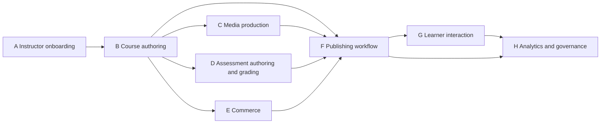

# STU: Instructor Studio and Content Production

> Status: intended product specification. Nothing in this file is a claim that anything is built. Existing code and legacy documents are inputs, not limits (see [CONVENTIONS](../00_START_HERE/CONVENTIONS.md) §1).

Source aliases used in evidence tags: `SSOT` = `SSOT.md`; `YASH-G3` = `Yash_Final_Project_Document/05_FEATURE_SPECIFICATIONS/SPEC_G3_ASSESSMENT_AND_LEARNING.md`; `YASH-MICRO` = `Yash_Final_Project_Document/05_FEATURE_SPECIFICATIONS/MICRO_FEATURE_SPECS.md`; `FREG` = `docs/registries/FEATURE_REGISTRY.md`. Learner-side behavior is specified in [LRN](./LRN_Learning_Course_Experience.md); assessment engine behavior in [ASM](./ASM_Assessments_Challenges_Integrity.md).

## 1. Purpose, outcomes and boundaries

### 1.1 Purpose

STU is the production side of learning: everything an instructor, an institution or the platform does to turn expertise into a published, accessible, correctly priced course, and to run it afterwards. It covers onboarding and verification of instructors, authoring, media upload and processing, assessment authoring, pricing, review and publishing, learner interaction from the instructor side, analytics, revenue reporting and payouts (decision-gated), and content governance (moderation, copyright, localization, quality). It is the "Learn" supply side of the TalentSphere loop [SRC: SSOT §7 F-66, F-74] [DER].

### 1.2 Outcomes

| Outcome | How the system knows |
|---|---|
| A verified instructor can publish a good course without asking support how | Share of submitted courses published within the review SLA; first-time publish success rate |
| Learners never meet an unfinished, inaccessible, infringing or misleading course | Publish gate pass rate; post-publish defect and takedown rates |
| Media is processed reliably and securely, whatever the video provider | Media processing success rate and p95 time-to-ready |
| Instructors know how their course performs and are paid correctly (when payouts are enabled) | Analytics freshness; payout reconciliation drift (target zero) |
| Course content is owned, licensed and attributable | Attestation coverage 100 percent of published versions |

### 1.3 In scope

Instructor application, identity and expertise verification, agreements, public profile, payout and tax profile; studio home; course creation, curriculum builder (sections, lessons, drag and drop), video, text and resource lessons, skill tagging, prerequisites and completion rules, landing page, autosave and edit locking, co-instructors and ownership, import, duplication, versioning, preview; media upload, transcoding, thumbnails, captions and transcripts (auto-generation and editing), content protection, media library, status and retries, external media validation, accessibility tracks; quiz, assignment and rubric authoring, grading queue, peer review setup; pricing, coupons, revenue share, payouts, refund visibility; submission for review, reviewer workflow, automated quality checks, publish, schedule, unpublish, archive; completion sign-off; learner Q&A inbox, announcements, review management, roster, live session hosting; analytics, moderation, copyright, localization, IP attestation, quality score.

### 1.4 Out of scope (owned elsewhere)

| Capability | Owner | Boundary |
|---|---|---|
| Learner experience (catalog, enrollment, playback, progress, certificates, reviews as seen by learners) | LRN | STU publishes an immutable course version and its media manifest; LRN renders and runs it |
| Assessment engine: question types, attempts, timers, grading, integrity, proctoring, certification | ASM | STU embeds ASM's authoring components for in-course quizzes and owns only the course context (placement, weight, completion rule) |
| Payment capture, tax calculation, invoices, payout execution, price tiers, currency | BIL (planned) | STU holds the instructor-facing views and settings; BIL moves money |
| Evidence issuing | EVD (planned) | STU sign-off feeds the rung policy; STU never writes evidence |
| Moderation case workflow and policy | TSF (planned) | STU raises and applies decisions, shows strike status |
| Institution licensing and seats | INS (planned) | Institution-owned courses use STU authoring with institution ownership |
| Object storage, CDN, virus scanning, queue infrastructure | PLT (planned) | STU defines the pipeline behavior; PLT supplies the engine |
| Notification delivery | NTF (planned) | STU names templates |

### 1.5 Owned versus consumed

Owned: instructor profiles and applications, courses, versions, sections, lessons, media assets and renditions, caption and transcript tracks, quiz and assignment configurations (course context), coupons, instructor earnings statements, review cases for publishing, copyright cases for course content, localization tracks, quality scores. Consumed: learner enrollments, progress, reviews and Q&A (LRN), assessment definitions and results (ASM), payments and payout rails (BIL), identity verification services (BGV, IDN, planned).

## 2. Roles and permission matrix

Instructor-side roles inside one course: `Owner` (exactly one), `Co-instructor` (edit content, answer, grade), `Assistant` (answer Q&A and grade only), `Viewer` (analytics only). All are `INS` accounts with course-scoped role. Cell legend: **R** read, **C** create, **U** update, **D** delete, **P** publish, **M** moderate, **A** administer, **-** none.

| Capability | CAN (applicant) | INS Owner | INS Co-instructor | INS Assistant | INS Viewer | IAD (institution course) | MOD | SUP | FIN | PAD |
|---|---|---|---|---|---|---|---|---|---|---|
| Apply and verify as instructor | C U | - | - | - | - | - | - | R | - | A |
| Edit public instructor profile | - | U (own) | U (own) | U (own) | U (own) | - | R | R | - | A |
| Create course draft | - | C | - | - | - | C (institution-owned) | - | - | - | C |
| Edit content, media, curriculum | - | U | U | - | - | U | - | - | - | U (audit) |
| Author quizzes and assignments | - | C U | C U | - | - | C U | - | - | - | - |
| Grade, give feedback | - | U | U | U | - | U | - | - | - | - |
| Set price, coupons | - | C U | - | - | - | C U | - | - | R | A |
| Submit for review | - | C | C (if owner delegates) | - | - | C | - | - | - | - |
| Review and decide on submissions | - | - | - | - | - | - | decide (course reviewer pool) | - | - | A |
| Publish, unpublish, archive | - | P | - | - | - | P | takedown | - | - | A |
| Invite and manage co-instructors | - | C U D | - | - | - | C U D | - | - | - | A |
| View learner roster and progress | - | R | R | R | R (aggregate) | R (scope) | R (case) | R (grant) | - | R (audit) |
| Answer Q&A, post announcements | - | C | C | C (Q&A only) | - | C | M | - | - | M |
| Respond to reviews | - | C | C | - | - | C | M | - | - | M |
| View earnings and payouts | - | R | R (own share) | - | - | R (institution) | - | R | A | R |
| Handle copyright notices | - | R U | - | - | - | R U | A | - | - | A |
| Moderate content, apply strikes | - | - | - | - | - | - | A | R | - | A |

`SAD` has audit access only; `API` principals may read published course metadata through the public API (PLT, planned). Authorization is enforced server-side on every request; course-scoped role is always checked against the course, never inferred from the account type.

## 3. Sub-module map

| Code | Sub-module | Features |
|---|---|---|
| A | Instructor onboarding and identity | FR-STU-001 to 006 |
| B | Course authoring | FR-STU-007 to 020 |
| C | Media production pipeline | FR-STU-021 to 028 |
| D | Assessment authoring and grading | FR-STU-029 to 032 |
| E | Commerce | FR-STU-033 to 037 |
| F | Publishing workflow | FR-STU-038 to 042 |
| G | Learner interaction | FR-STU-043 to 047 |
| H | Analytics and governance | FR-STU-048 to 053 |

## 4. Feature specifications

Notification opt-out classes (owned by NTF, planned): `TRANSACTIONAL` (cannot be disabled), `OPERATIONAL` (studio work items, can be tuned per type), `SOCIAL`, `PROMO`.

### A. Instructor onboarding and identity

### FR-STU-001 — Instructor application

- **Sub-module:** A. Instructor onboarding and identity
- **Priority / tier:** Must · R3
- **Source:** [SRC: SSOT BR-097; §7 F-74] [DER]
- **Purpose and outcome:** A candidate applies to teach, states their expertise and planned topics, and gets a clear decision. Success is a decision inside the stated SLA and a low reapplication-without-change rate.
- **Roles and permissions:** `CAN: create, edit, withdraw own application` · `PAD: decide` · `SUP: view, nudge` · `MOD: view`
- **Preconditions and entry points:** Signed-in account with verified email; "Teach on TalentSphere" link on the footer, dashboard and profile; institution invitations bypass the open application and use FR-STU-002 only.
- **User interactions and actions:**
  1. Open `/teach/apply`; read what is required and how review works.
  2. Fill the form: headline, bio, topics and skills to teach (from the ontology), years of experience, links (portfolio, publications, repository), sample material (a short video or document up to 5 minutes or 20 pages), teaching languages, intended course types, and whether teaching for an institution or employer.
  3. Declare any conflicts of interest and tick the originality and accuracy declaration.
  4. Submit; see status Submitted, In verification, Approved, Rejected (with reasons) or Needs information.
  5. If rejected, see the earliest reapply date.
- **System behavior:** Creates an application (SM-STU-03). Runs automated checks: duplicate account detection, link reachability, sanctions screening via BGV (planned), plagiarism check on sample text, and age gate (BR-STU-038). Routes to reviewers by topic. Approval creates the instructor profile (FR-STU-004) and unlocks FR-STU-002 and FR-STU-003. Rejection stores structured reason codes; reapplication allowed after {30} days (BR-STU-051).
- **UI elements and controls:** Multi-step form with progress indicator, autosave, skill picker, link list with validity check marks, file upload (video, PDF), declaration checkboxes, status page with timeline.
- **Configuration options:** Platform: open applications on or off, required sample type, reapply wait (30 days), reviewer routing rules.
- **Business rules:** BR-STU-001, BR-STU-037, BR-STU-038, BR-STU-051
- **Validation:** Headline 10 to 120 characters; bio 100 to 2,000; at least 1 and at most 10 topics; links must be `https` and reachable (HEAD or GET, 5 s timeout); sample file video up to 500 MB or document up to 20 MB; one open application per account.
- **Inputs and outputs:** In: application form and files. Out: application id, status updates, decision with reason codes.
- **Filters, sorting, search:** Staff queue filters by topic, status, age of application, risk flag; sort by oldest.
- **Notifications and communication:** `stu.application.received`, `stu.application.decided`, `stu.application.needs_info` (`TRANSACTIONAL`) to the applicant; reviewer assignment (`OPERATIONAL`) to staff.
- **Error handling and edge cases:** Unreachable link: field-level error with retry. Upload interrupted: resumable. Duplicate application: `409 application_open`. Under-age: blocked at the age gate with generic text. Reviewer inactivity beyond SLA escalates to PAD.
- **Dependencies:** IDN (planned), BGV (planned), FR-STU-002, FR-STU-004, ENT-STU-01.
- **Security and privacy:** Application data is confidential, visible only to reviewers and the applicant; sample files scanned; retention {24 months} for rejected applications [PROP].
- **Acceptance criteria:**
  1. Given a complete application, when submitted, then status is Submitted and the applicant receives a receipt with the review SLA.
  2. Given an approval, when decided, then an instructor profile exists in draft and the applicant can start verification.
  3. Negative: Given a rejected applicant, when reapplying before 30 days, then `409 reapply_too_soon` shows the date.

### FR-STU-002 — Instructor identity and expertise verification

- **Sub-module:** A. Instructor onboarding and identity
- **Priority / tier:** Must · R3
- **Source:** [SRC: SSOT §7 F-94, F-96; V61-17] [PROP] for the levels
- **Purpose and outcome:** Instructors prove who they are (required for payouts and publishing) and, optionally, that they hold the expertise they teach (shown as a badge). Success is verified instructors on every paid course.
- **Roles and permissions:** `INS: submit evidence, view status` · `PAD, BGV operator (planned): decide` · `SUP: view`
- **Preconditions and entry points:** Approved application; Studio onboarding checklist.
- **User interactions and actions:**
  1. Start identity verification: choose method (government ID and selfie via the BGV provider, or institution-attested identity).
  2. Optionally start expertise verification: add credentials (degree, certification, employer verification, published work, platform evidence from EVD) and request review.
  3. See status per level: Email verified, Identity verified, Expertise verified.
  4. Retry or appeal a failed check.
- **System behavior:** Levels (BR-STU-037): `email` (default), `identity` (required to submit paid courses and to receive payouts), `expertise` (optional; shows a badge with scope, for example "Verified practitioner: data engineering"). Identity checks run through the BGV module and store only the result, timestamp and provider reference, never the ID image. Expertise reviewers check evidence against stated topics and may scope the badge to specific skills. Badges expire after {24 months} and are rechecked on expiry. Platform-evidence-based expertise (for example passing certification exams in ASM) is accepted automatically for the matching skill.
- **UI elements and controls:** Checklist with three levels, method picker, upload and link fields for credentials, status chips with text, appeal button.
- **Configuration options:** Platform: levels required per action, badge validity, accepted credential types.
- **Business rules:** BR-STU-001, BR-STU-037, BR-STU-038
- **Validation:** Names must match across profile and ID within tolerance rules (BGV); credential entries need issuer, date and a verifiable link or document.
- **Inputs and outputs:** In: verification requests and evidence. Out: level states, badge scope.
- **Filters, sorting, search:** Staff queue by level, age, risk.
- **Notifications and communication:** `stu.verification.result`, `stu.verification.expiring` (`TRANSACTIONAL`).
- **Error handling and edge cases:** Provider outage: request queued with honest status. Name mismatch: request clarification, not auto-reject. Badge scope disputes: appeal to a different reviewer. Verification expiry mid-course: existing courses stay live; new submissions are blocked until renewed.
- **Dependencies:** BGV (planned), EVD (planned), FR-STU-001, FR-STU-004.
- **Security and privacy:** ID images processed by the provider, not stored by TalentSphere; verification results are special-category-adjacent data with restricted access and audit.
- **Acceptance criteria:**
  1. Given a passed identity check, when viewing the checklist, then Identity verified shows with the date.
  2. Given no identity verification, when submitting a paid course, then `403 identity_required` is returned.
  3. Negative: Given an expertise badge older than 24 months and not renewed, when viewing the public profile, then the badge is absent.

### FR-STU-003 — Instructor agreement and policy acceptance

- **Sub-module:** A. Instructor onboarding and identity
- **Priority / tier:** Must · R3
- **Source:** [SRC: SSOT BR-089 (author attestation)] [DER]
- **Purpose and outcome:** Instructors accept the current terms, content license, conduct policy and conflict-of-interest declaration before publishing, and re-accept when they change. Success is 100 percent of live instructors on the current version.
- **Roles and permissions:** `INS: accept, view history` · `PAD: publish new versions`
- **Preconditions and entry points:** Studio onboarding; a banner when a new version requires acceptance.
- **User interactions and actions:**
  1. Open each document (instructor terms, content license, community and conduct rules, payout terms when applicable, conflict-of-interest declaration).
  2. Scroll to the end; the Accept button enables; check the box and confirm with re-authentication.
  3. Declare conflicts (relationship with learners, employer, institution, financial interest in referenced products).
  4. Download a signed copy.
- **System behavior:** Records acceptance with document version hash, timestamp, account, IP range and re-authentication result. Material changes require re-acceptance within {30 days}; until then publishing new courses and withdrawals pause while existing courses stay live. Declarations are versioned and can be updated at any time; conflicts feed sign-off independence checks (BR-STU-015).
- **UI elements and controls:** Document viewer with progress, Accept button, declaration form, history table.
- **Configuration options:** Platform: grace days, document set per region.
- **Business rules:** BR-STU-001, BR-STU-015, BR-STU-047
- **Validation:** Declaration entries need type and description up to 500 characters.
- **Inputs and outputs:** In: acceptance, declarations. Out: signed acceptance record.
- **Filters, sorting, search:** n/a — short list.
- **Notifications and communication:** `stu.terms.update_required` (`TRANSACTIONAL`) at 30, 14 and 3 days.
- **Error handling and edge cases:** Grace expired: publishing blocked with an explanation and a direct Accept link. Declaration conflicts with a pending sign-off: sign-off held for review. Re-authentication failure: acceptance not recorded.
- **Dependencies:** FR-STU-001, IDN (planned), ENT-STU-03.
- **Security and privacy:** Acceptance records immutable and retained for the legal period.
- **Acceptance criteria:**
  1. Given new terms, when the grace period passes without acceptance, then publishing a new course is blocked and live courses continue.
  2. Given acceptance, when downloading the copy, then it shows the document hash and timestamp.
  3. Negative: Given an unauthenticated session, when calling the accept endpoint, then `401` is returned and nothing is recorded.

### FR-STU-004 — Instructor public profile

- **Sub-module:** A. Instructor onboarding and identity
- **Priority / tier:** Must · R3
- **Source:** [SRC: SSOT §7 F-74, F-148] [DER]
- **Purpose and outcome:** Instructors present themselves credibly to learners with control over what is public. Success is complete profiles correlated with enrollment.
- **Roles and permissions:** `INS: edit own` · `MOD: hide fields or profile` · `GUE, CAN: view`
- **Preconditions and entry points:** Studio profile; public page `/learn/instructors/:handle` (LRN displays it).
- **User interactions and actions:**
  1. Edit photo, display name, headline, bio (rich text, limited), languages, links, areas of expertise, selected credentials, and an optional intro video.
  2. Toggle visibility for each field and for the whole profile listing.
  3. Preview the public page and see completeness hints.
  4. Choose a unique handle once (changes allowed every 90 days with redirects).
- **System behavior:** Profile fields are validated and sanitized; photos pass image moderation. Verification badges come only from FR-STU-002. Aggregate ratings and learner counts are computed (LRN) and cannot be edited. Hidden fields are removed from public payloads. Profile changes appear within 60 seconds.
- **UI elements and controls:** Form with live preview, photo cropper (min 400 by 400), visibility toggles, handle field with availability check.
- **Configuration options:** Instructor: field visibility. Platform: handle change interval.
- **Business rules:** BR-STU-037, BR-STU-053
- **Validation:** Display name 2 to 60 characters; headline up to 120; bio up to 2,000; handle `[a-z0-9-]{3,30}` unique; links `https`; photo JPEG or PNG up to 5 MB.
- **Inputs and outputs:** In: profile fields. Out: public profile model.
- **Filters, sorting, search:** n/a — single profile.
- **Notifications and communication:** `stu.profile.hidden_by_moderation` (`TRANSACTIONAL`).
- **Error handling and edge cases:** Handle taken: suggestions. Photo rejected: explanation with category. Profile hidden by moderators: courses remain but show "Instructor profile unavailable" until resolved.
- **Dependencies:** FR-STU-002, LRN FR-LRN-011.
- **Security and privacy:** Email, legal name and payout data never in the public payload; scraping throttled.
- **Acceptance criteria:**
  1. Given a hidden bio, when viewing the public profile, then no bio appears in the page data.
  2. Given a handle change, when the old URL is opened, then it redirects with 301.
  3. Negative: Given a handle changed 10 days ago, when changing again, then `409 handle_cooldown` shows the date.

### FR-STU-005 — Payout and tax profile (decision-gated)

- **Sub-module:** A. Instructor onboarding and identity
- **Priority / tier:** Should · R5
- **Source:** [SRC: SSOT BR-101; V61-21 (seller of record, payouts, tax need an ADR)] [DEC-REQ] OD-STU-01
- **Purpose and outcome:** Instructors set up how they are paid and provide tax details, enabling payouts when the commercial model is approved. Success is a complete, valid profile before the first payout.
- **Roles and permissions:** `INS Owner: create, edit own` · `FIN: view status, approve changes` · `PAD: view with audit`
- **Preconditions and entry points:** Identity verified (FR-STU-002); payouts enabled by a platform switch; Studio, Earnings, Payout settings.
- **User interactions and actions:**
  1. Choose country of residence and payout method (bank transfer or a provider wallet, as offered by BIL).
  2. Provide tax information per jurisdiction (for example forms and tax identifiers) via the BIL-hosted secure form.
  3. Verify the account (micro-deposit or provider verification).
  4. Change details; changes enter a {7 day} security hold on payouts.
- **System behavior:** STU stores only a reference to the BIL payout profile and its state (`incomplete`, `pending_verification`, `verified`, `restricted`). Payout is blocked unless verified and the tax profile is complete (BR-STU-048). Changing bank details notifies the instructor on the old contact channel and holds the next payout. The feature is entirely hidden unless the platform switch is on.
- **UI elements and controls:** Payout wizard (hosted by BIL), status card, "Change details" button with warning.
- **Configuration options:** Platform: payouts enabled, supported countries and methods, hold days.
- **Business rules:** BR-STU-019, BR-STU-048
- **Validation:** Delegated to BIL; STU validates only the identity match between profile name and payee name (warning).
- **Inputs and outputs:** In: setup events from BIL. Out: profile state.
- **Filters, sorting, search:** Finance queue by state.
- **Notifications and communication:** `stu.payout_profile.verified`, `stu.payout_profile.changed` (`TRANSACTIONAL`).
- **Error handling and edge cases:** Unsupported country: clear message and waitlist option. Verification failure: retry limit with support path. Tax profile expired (for example annual certification): payouts hold with explanation.
- **Dependencies:** BIL (planned), FR-STU-002, OD-STU-01.
- **Security and privacy:** Financial and tax data processed by BIL; STU stores no account numbers; access to references restricted to FIN with audit.
- **Acceptance criteria:**
  1. Given a verified identity and complete tax profile, when payouts are enabled, then the profile state is `verified`.
  2. Given a changed bank detail, when saved, then the next payout is held for 7 days and the old channel is notified.
  3. Negative: Given an incomplete tax profile, when a payout is due, then it is held and the instructor sees the missing item.

### FR-STU-006 — Studio home and course list

- **Sub-module:** A. Instructor onboarding and identity
- **Priority / tier:** Must · R3
- **Source:** [SRC: SSOT §7 F-74] [DER]
- **Purpose and outcome:** Instructors see all their courses, work needing attention and quick actions in one place. Success is that instructors reach any task in two clicks.
- **Roles and permissions:** `INS (all course roles): view courses they belong to` · `IAD: organization courses`
- **Preconditions and entry points:** `/studio`; navigation "Studio" for instructor accounts.
- **User interactions and actions:**
  1. See the "Needs attention" list: reviews requested changes, unanswered Q&A older than 3 days, grading queue, expiring verification, failed media, copyright notices, coupons expiring.
  2. Browse the course table with state, last edited, learners, rating, revenue (if allowed), and actions.
  3. Create a course, filter by state, search, and open a course workspace.
  4. Switch context between personal and organization workspaces.
- **System behavior:** Aggregates read models from authoring, LRN and BIL. Role-based columns: assistants and viewers do not see revenue. Counts refresh every 5 minutes; "Needs attention" is real time from events.
- **UI elements and controls:** Attention cards with counts, course table with sortable columns, "New course" button, workspace switcher, saved filters.
- **Configuration options:** Instructor: default columns, notification digest.
- **Business rules:** BR-STU-013, BR-STU-029
- **Validation:** n/a — read screen; filters from enumerated sets.
- **Inputs and outputs:** In: filters. Out: courses and tasks.
- **Filters, sorting, search:** Filter by state, role, workspace, language; sort by last edited, learners, rating, revenue; search by title.
- **Notifications and communication:** Daily or weekly digest `stu.digest.attention` (`OPERATIONAL`).
- **Error handling and edge cases:** Course in `taken_down`: row shows state and a link to the notice. No courses: empty state with a "Create your first course" guide. Workspace access removed: its courses disappear from the list.
- **Dependencies:** FR-STU-007, FR-STU-048, ENT-STU-05.
- **Security and privacy:** Role-based visibility of revenue and learner data.
- **Acceptance criteria:**
  1. Given a course with changes requested, when opening Studio home, then it appears in Needs attention with the reviewer note link.
  2. Given an assistant role, when viewing the table, then no revenue column is present.
  3. Negative: Given a course the user is not a member of, when opening its URL, then `404` is returned.

### B. Course authoring

### FR-STU-007 — Course creation wizard

- **Sub-module:** B. Course authoring
- **Priority / tier:** Must · R3
- **Source:** [SRC: SSOT §7 F-66; BR-096] [DER]
- **Purpose and outcome:** An instructor starts a course with the right basic information and a guided checklist to publishability. Success is first-draft creation completed in one sitting.
- **Roles and permissions:** `INS (approved): create` · `IAD: create institution-owned` · `PAD: create platform-authored`
- **Preconditions and entry points:** Approved instructor (BR-STU-001); "New course" in Studio; institution workspace.
- **User interactions and actions:**
  1. Choose ownership (me, organization workspace) and course format (self-paced, cohort-based, live sessions, mixed).
  2. Enter working title, subtitle, primary language, category, level, and 3 to 8 learning outcomes ("After this course you will be able to…").
  3. Declare requirements and target audience; add skills taught (FR-STU-012).
  4. Choose a starting point: blank, from a template (FR-STU-018), from import (FR-STU-017).
  5. See the publishing checklist (the quality checks of FR-STU-040) with progress and open the workspace.
- **System behavior:** Creates the course shell and a working draft version (SM-STU-01, SM-STU-02) with stable ids. The slug is generated from the title and fixed at first publication. One working draft per course (BR-STU-049). Autosave from the first keystroke (FR-STU-015). Outcomes are checked for measurable verbs by a hint (non-blocking).
- **UI elements and controls:** Stepper, field set with counters, outcome list with add and reorder, template picker, "Create draft" button, persistent checklist sidebar.
- **Configuration options:** Platform: allowed formats, outcome count range, templates available.
- **Business rules:** BR-STU-001, BR-STU-003, BR-STU-049
- **Validation:** Title 10 to 80 characters and unique per owner among live courses; subtitle up to 120; outcomes 3 to 8, each 10 to 160 characters; category from taxonomy; level from the fixed set.
- **Inputs and outputs:** In: basics. Out: course id, draft version id, checklist.
- **Filters, sorting, search:** n/a — wizard.
- **Notifications and communication:** `stu.course.created` (in-app, `OPERATIONAL`).
- **Error handling and edge cases:** Duplicate title: warning with link, not a block. Template unavailable: blank fallback. Closing the wizard midway keeps the draft with the filled fields.
- **Dependencies:** FR-LRN-002, FR-STU-012, FR-STU-018, FR-STU-040.
- **Security and privacy:** Drafts are private to course members.
- **Acceptance criteria:**
  1. Given valid basics, when creating, then a draft course with a working version and checklist exists.
  2. Given 2 outcomes, when continuing, then the step shows `at least 3 outcomes required`.
  3. Negative: Given an unapproved instructor, when calling create, then `403 instructor_not_approved` is returned.

### FR-STU-008 — Curriculum builder

- **Sub-module:** B. Course authoring
- **Priority / tier:** Must · R3
- **Source:** [SRC: SSOT §13.12 (Course → Section → ContentItem)] [DER]
- **Purpose and outcome:** Instructors structure the course as sections and lessons by drag and drop, with every lesson type available. Success is building a 20-lesson outline in minutes without losing work.
- **Roles and permissions:** `INS Owner, Co-instructor: edit` · `IAD: edit (institution)` · others: none
- **Preconditions and entry points:** Course workspace, Curriculum tab; working draft.
- **User interactions and actions:**
  1. Click "Add section" and name it; click "Add lesson" in a section and choose a type: video, reading, quiz, assignment, project, live session, practice (coding), external link, downloadable resource.
  2. Drag a lesson by its handle to reorder within or across sections; drag a section to reorder. Keyboard alternative: focus the handle, press Space, move with arrow keys, Space again to drop; "Move to…" menu also available.
  3. Select multiple lessons (checkboxes) to move, duplicate, delete, mark optional or mark preview in bulk.
  4. Collapse or expand sections; rename inline; set per-lesson flags: preview, optional, downloadable, estimated minutes (auto from media when available).
  5. Undo and redo the last 20 actions.
- **System behavior:** Lessons get a permanent `lessonKey` at creation that never changes and is the mapping key for versions, progress and notes (BR-STU-004). Reordering updates positions in one transaction with optimistic concurrency (BR-STU-036). Deleting a lesson in a draft removes it from this draft only; learners on published versions are unaffected. Section and lesson limits {50 sections, 500 lessons per course} [PROP]. Total duration and counts update live. Releasing schedule and sequential gating are set per section (FR-STU-013).
- **UI elements and controls:** Outline tree with drag handles (`aria-grabbed` alternatives), type icons with text, inline rename, bulk action bar, add menus, undo and redo buttons, status chips per lesson (empty, in progress, ready, error).
- **Configuration options:** Platform: size limits, allowed lesson types per course format.
- **Business rules:** BR-STU-004, BR-STU-005, BR-STU-036
- **Validation:** Section title 3 to 80 characters; lesson title 3 to 100; at least one lesson per section to publish; preview flagged lessons limited by BR-STU-005.
- **Inputs and outputs:** In: structure edits. Out: outline model with versions.
- **Filters, sorting, search:** Filter lessons by type or status; search by title.
- **Notifications and communication:** n/a — none.
- **Error handling and edge cases:** Concurrent edit by a co-instructor: server returns `409 stale_version` with a merge view of differing nodes. Dropping a lesson into an invalid position is cancelled with an inline notice. Large course reorder over a slow connection queues operations and shows "Saving". Deleting a lesson referenced by a completion rule is blocked until the rule is updated.
- **Dependencies:** FR-STU-009 to 011, FR-STU-013, FR-STU-015, ENT-STU-07, ENT-STU-08.
- **Security and privacy:** Edits audited with actor and time.
- **Acceptance criteria:**
  1. Given lessons A, B, C, when dragging C above A, then the order is C, A, B and `lessonKey`s are unchanged.
  2. Given keyboard only, when moving a lesson with the handle, then it can be moved and dropped and the new position is announced.
  3. Negative: Given a lesson used in the completion rule, when deleting it, then deletion is refused with `409 rule_reference` naming the rule.

### FR-STU-009 — Video lesson authoring

- **Sub-module:** B. Course authoring
- **Priority / tier:** Must · R3
- **Source:** [SRC: SSOT §13.13 (delivery modes A to E); BR-091, BR-092] [DER]
- **Purpose and outcome:** Instructors attach video to a lesson (upload or external), set chapters and completion rules, and see readiness. Success is a lesson ready to publish with captions and chapters.
- **Roles and permissions:** `INS Owner, Co-instructor: edit`
- **Preconditions and entry points:** Lesson of type video; media library (FR-STU-025).
- **User interactions and actions:**
  1. Choose a source: upload a file, pick from the media library, or paste an external URL (FR-STU-027).
  2. Watch processing status (FR-STU-026); once ready, preview the lesson.
  3. Add lesson description, learning points and resources.
  4. Set chapters: add at the playhead, rename, delete; or accept auto-suggested chapters (FR-STU-023).
  5. Set completion rule (watch at least X percent, or no minimum), mark preview, allow download (if the course allows) and allow transcript download.
  6. Set thumbnail: auto-picked frames or custom upload.
- **System behavior:** Binds a media asset to the lesson (by id, not by file). Lesson readiness requires state `ready` for the asset and captions per BR-STU-007. Replacing the media keeps `lessonKey` and flags watch-coverage mapping impact (LRN BR-LRN-015). Duration is taken from the asset. Chapter data stored with the lesson version.
- **UI elements and controls:** Source picker, upload dropzone, player preview with chapter editor, completion-rule select, preview toggle, thumbnail strip, status chips.
- **Configuration options:** Author: completion mode and threshold override within platform bounds; download allowed.
- **Business rules:** BR-STU-007, BR-STU-009, BR-STU-010
- **Validation:** Chapter times strictly increasing, first at 0:00, min length 10 s, titles 2 to 80 characters; threshold between 50 and 100 percent.
- **Inputs and outputs:** In: media reference and settings. Out: lesson with media state.
- **Filters, sorting, search:** n/a — single lesson.
- **Notifications and communication:** `stu.media.ready`, `stu.media.failed` (`OPERATIONAL`).
- **Error handling and edge cases:** Asset still processing: lesson shows "Processing" and cannot be marked ready. Replacement of media with different duration warns about learner progress mapping. Provider-hosted video becomes unavailable: lesson flagged "Source unavailable" and checks fail.
- **Dependencies:** FR-STU-021 to 027, FR-LRN-036, ENT-STU-08, ENT-STU-09.
- **Security and privacy:** Source files private; learners get tokenized renditions only.
- **Acceptance criteria:**
  1. Given a ready asset and captions, when attaching to the lesson, then readiness shows green.
  2. Given chapters at 0:00, 2:30, 2:35, when saving, then the third is rejected for being under 10 seconds.
  3. Negative: Given an asset in `processing`, when marking the lesson ready, then `409 media_not_ready` is returned.

### FR-STU-010 — Text lesson authoring

- **Sub-module:** B. Course authoring
- **Priority / tier:** Must · R3
- **Source:** [SRC: SSOT §13.12 (ARTICLE), BR-092] [DER]
- **Purpose and outcome:** Instructors write rich reading lessons with code, math and media safely. Success is accessible, well-structured text lessons with no unsafe markup.
- **Roles and permissions:** `INS Owner, Co-instructor: edit`
- **Preconditions and entry points:** Lesson type reading; Curriculum, edit lesson.
- **User interactions and actions:**
  1. Write with a structured editor: headings H2 to H4, paragraphs, lists, tables, quotes, callouts, code blocks with language, inline code, math (LaTeX), images with alt text, diagrams (Mermaid), embedded video from the library, horizontal rules.
  2. Use slash commands and keyboard shortcuts; paste from a document with cleanup.
  3. Insert images by upload or library; set alt text or mark decorative.
  4. Preview as the learner sees it; see estimated reading time and heading outline.
  5. Set completion rule (scroll to end, manual, none).
- **System behavior:** Content stored as a validated structured document (no raw HTML or scripts); links get `rel` safeguards; images go through the media pipeline for resizing; headings must be in order (a lint warning). Accessibility lint: missing alt text blocks publish (BR-STU-052); low-contrast color use is not available. Autosave and version history of the last 20 revisions.
- **UI elements and controls:** Editor toolbar, slash menu, image dialog with alt text field, outline panel, reading time, revision history drawer.
- **Configuration options:** Platform: allowed blocks, max size (500 KB of text).
- **Business rules:** BR-STU-008, BR-STU-052
- **Validation:** Body up to 500 KB; image up to 10 MB each; links `https` or mailto; code block language from list.
- **Inputs and outputs:** In: document. Out: stored lesson body.
- **Filters, sorting, search:** Find and replace within the lesson.
- **Notifications and communication:** n/a — none.
- **Error handling and edge cases:** Pasted HTML stripped to supported blocks with a report. Unsupported embed: converted to a link. Two editors on one lesson: soft lock (FR-STU-015). Math parse error: inline marker, not a crash.
- **Dependencies:** FR-STU-011, FR-STU-015, FR-STU-021.
- **Security and privacy:** XSS-safe schema; no third-party scripts; images sanitized for metadata.
- **Acceptance criteria:**
  1. Given an image without alt text, when running publish checks, then a blocking issue names the lesson and image.
  2. Given pasted HTML with a script tag, when saved, then the script is removed and a notice lists the removal.
  3. Negative: Given a body over 500 KB, when saving, then `413 body_too_large` is returned.

### FR-STU-011 — Resources and attachments

- **Sub-module:** B. Course authoring
- **Priority / tier:** Must · R3
- **Source:** [SRC: SSOT §13.12 (PDF)] [DER]
- **Purpose and outcome:** Instructors attach downloadable files and links to lessons and courses. Success is safe, scanned, accessible attachments.
- **Roles and permissions:** `INS Owner, Co-instructor: add, replace, remove`
- **Preconditions and entry points:** Lesson, Resources panel; course-level resources.
- **User interactions and actions:**
  1. Upload files (documents, archives, datasets, notebooks, images) or add links with a title and description.
  2. Mark each resource as downloadable or view-only, and as required reading or optional.
  3. Reorder, rename, replace (new file keeps the resource id).
  4. See scan status and size per file.
- **System behavior:** Files are scanned (virus and type check) and stored privately; served with signed URLs (BR-STU-012). Replacing a file after publish is a patch change (BR-STU-004) and is logged. PDF accessibility check warns when no text layer exists. Archives are listed but not unpacked.
- **UI elements and controls:** Upload dropzone, resource table, status chips, replace and delete menu.
- **Configuration options:** Platform: allowed types and size (default 500 MB per file, 2 GB per course [PROP]).
- **Business rules:** BR-STU-004, BR-STU-010, BR-STU-012
- **Validation:** Type allowlist (no executables); name up to 150 characters; links `https`.
- **Inputs and outputs:** In: files and links. Out: resource records.
- **Filters, sorting, search:** Filter by lesson, type, status.
- **Notifications and communication:** `stu.resource.scan_failed` (`OPERATIONAL`).
- **Error handling and edge cases:** Infected file: quarantined and removed from the lesson with a notice. Scan outage: file stays "Checking" and is not served. Broken link detected by the periodic checker: flagged.
- **Dependencies:** PLT (planned) storage and scanning, FR-LRN-041.
- **Security and privacy:** No public URLs; metadata stripped from images; license field recommended per resource.
- **Acceptance criteria:**
  1. Given a clean PDF, when uploaded, then it becomes downloadable after the scan completes.
  2. Given an executable file, when uploading, then it is rejected with `415 type_not_allowed`.
  3. Negative: Given an infected file, when scanned, then it is quarantined and never served to any learner.

### FR-STU-012 — Learning objectives and skill tagging

- **Sub-module:** B. Course authoring
- **Priority / tier:** Must · R3
- **Source:** [SRC: SSOT §9.1 F-84 skills graph; YASH-G3 SPEC-06 §3.1] [DER]
- **Purpose and outcome:** Instructors declare which skills the course teaches and at what level so learners can find it and evidence can be created correctly. Success is accurate skill declarations and no unearned evidence claims.
- **Roles and permissions:** `INS Owner, Co-instructor: edit` · `PAD: curate ontology`
- **Preconditions and entry points:** Course workspace, Skills tab.
- **User interactions and actions:**
  1. Search the ontology and add 1 to 8 skills with target level (from the ontology scale) and coverage (primary or secondary).
  2. Map each skill to the lessons or assessments that demonstrate it.
  3. See a coverage check: "Skill X has no assessed lesson, so completion will not produce verified evidence for it".
  4. Request a new skill from the ontology (goes to a curator queue).
- **System behavior:** Skills are claims until assessed (LRN BR-LRN-046). The coverage check lists skills without a graded assessment or independent sign-off; the evidence rung outcome (LRN FR-LRN-071) is previewed honestly ("Completion will produce: authority-verified evidence for SQL; no verified evidence for Data modeling"). Retired ontology skills trigger a migration prompt.
- **UI elements and controls:** Skill search, skill chips with level and coverage, mapping table, evidence preview panel.
- **Configuration options:** Platform: max skills (8), allowed level scale.
- **Business rules:** BR-STU-003, BR-STU-013
- **Validation:** Skills must exist in the ontology; at least 1 primary skill to publish.
- **Inputs and outputs:** In: skills, mapping. Out: course skill declaration.
- **Filters, sorting, search:** Skill search with synonyms.
- **Notifications and communication:** `stu.skill.request_decided` (`OPERATIONAL`).
- **Error handling and edge cases:** Over 8 skills: refused with guidance. Skill retired after publication: the course continues with the mapped successor after owner confirmation. Mapping to a deleted lesson is blocked.
- **Dependencies:** EVD or AIC (planned) ontology, FR-LRN-005, FR-LRN-071, FR-STU-013.
- **Security and privacy:** n/a — public declarations only.
- **Acceptance criteria:**
  1. Given a skill mapped only to video lessons, when viewing the evidence preview, then it says no verified evidence will be produced for it.
  2. Given a new skill request, when approved, then the skill appears in search.
  3. Negative: Given no primary skill, when submitting for review, then the check fails with `primary_skill_required`.

### FR-STU-013 — Prerequisites and completion rule configuration

- **Sub-module:** B. Course authoring
- **Priority / tier:** Must · R3
- **Source:** [SRC: YASH-G3 SPEC-06 §3.1 completion_rule; SSOT BR-047, BR-109] [DER]
- **Purpose and outcome:** Instructors define who the course is for (prerequisites), how learners move (sequential, drip) and exactly what completes the course. Success is unambiguous, satisfiable rules.
- **Roles and permissions:** `INS Owner, Co-instructor: edit`
- **Preconditions and entry points:** Course workspace, Rules tab.
- **User interactions and actions:**
  1. Add prerequisites: courses, skills with minimum level, or text; mark each required or recommended.
  2. Choose navigation: free, or sequential by section or whole course; set drip release (days after enrollment or absolute dates).
  3. Define completion rule: required lessons (default all non-optional), required assessments with minimum score, minimum course grade, final exam, instructor sign-off yes or no.
  4. Run "Test the rule": the system simulates a learner finishing everything and a learner missing one required item and shows the results.
  5. Set certificate: offered or not, validity period.
- **System behavior:** Rules are stored per version (LRN BR-LRN-006). The satisfiability check rejects impossible rules (for example a required assessment not in the course, a minimum grade above reachable, sign-off required with no eligible signer). Grade weights must total 100. Changing rules after publication is a structural change requiring a new version (BR-STU-004). Sign-off requires at least one eligible signer other than the learner (BR-STU-015).
- **UI elements and controls:** Prerequisite builder, navigation radios, rule builder with lesson and assessment checklists, weight table, "Test the rule" button with result panel, certificate toggle.
- **Configuration options:** Platform: default pass threshold (70, SSOT BR-048 [PROP]), drip limits.
- **Business rules:** BR-STU-004, BR-STU-015, BR-STU-035
- **Validation:** Weights integers summing to 100; minimum score 0 to 100; drip days 0 to 365; prerequisites no cycles.
- **Inputs and outputs:** In: rule configuration. Out: validated rule JSON.
- **Filters, sorting, search:** n/a — configuration.
- **Notifications and communication:** n/a — none.
- **Error handling and edge cases:** Unsatisfiable rule blocks submission with the reason. Rule referencing an optional lesson is a warning. Removing a lesson cascades a prompt to update the rule. Test the rule does not create learner data.
- **Dependencies:** FR-LRN-058, FR-LRN-049, FR-STU-029, FR-STU-042.
- **Security and privacy:** n/a — course configuration.
- **Acceptance criteria:**
  1. Given a required assessment that is not in the course, when saving, then `422 unsatisfiable_rule` names it.
  2. Given weights 40, 40, 30, when saving, then it is rejected because the total is 110.
  3. Negative: Given sign-off required and the only member being the owner, when the owner is also a learner, then the check warns that self sign-off is not allowed.

### FR-STU-014 — Course landing page editor

- **Sub-module:** B. Course authoring
- **Priority / tier:** Must · R3
- **Source:** [SRC: SSOT BR-098; §9.2 F-07 step 2] [DER]
- **Purpose and outcome:** Instructors craft the public course page: image, promo video, description and SEO. Success is pages that pass the quality checks and convert.
- **Roles and permissions:** `INS Owner, Co-instructor: edit`
- **Preconditions and entry points:** Course workspace, Landing page tab.
- **User interactions and actions:**
  1. Upload the course image (crop to 16:9) and optionally a promo video up to 2 minutes.
  2. Write the description (rich text subset), "who this is for", and FAQ items.
  3. Choose which sections are shown (outcomes, skills, curriculum, instructors, FAQ).
  4. Edit SEO fields: slug (before first publication), meta title and description, social preview image.
  5. Preview the page as a guest, tablet and phone.
- **System behavior:** Image validated against BR-STU-006 (minimum 750 by 422 pixels, up to 4 MB) and resized into variants. Promo video goes through the media pipeline and needs captions. Slug locks at first publication; later changes create redirects and need support approval. Meta fields default from the description. Claims language lint warns on prohibited promises (for example guaranteed jobs or salary).
- **UI elements and controls:** Image cropper with dimension feedback, promo video slot, rich text editor, FAQ list editor, section toggles, SEO fields with length counters, device preview tabs.
- **Configuration options:** Platform: prohibited-claims list, image rules.
- **Business rules:** BR-STU-006, BR-STU-007, BR-STU-009
- **Validation:** Description 200 to 5,000 characters; meta title up to 60; meta description up to 160; FAQ up to 15 items; slug `[a-z0-9-]{3,80}` unique.
- **Inputs and outputs:** In: page content. Out: stored page model.
- **Filters, sorting, search:** n/a — editor.
- **Notifications and communication:** n/a — none.
- **Error handling and edge cases:** Image too small: cannot continue, with dimensions shown. Promo video processing: page preview shows placeholder. Prohibited claim detected: warning at edit and blocking issue at submit if not changed.
- **Dependencies:** FR-STU-021, FR-STU-040, FR-LRN-008.
- **Security and privacy:** Public content only; no personal data of learners.
- **Acceptance criteria:**
  1. Given an image of 700 by 400 pixels, when uploading, then it is rejected with the minimum size.
  2. Given a published course, when the slug is edited, then the change is refused without support approval.
  3. Negative: Given a description claiming "guaranteed job", when submitting for review, then the check blocks with the phrase highlighted.

### FR-STU-015 — Autosave, drafts and edit locking

- **Sub-module:** B. Course authoring
- **Priority / tier:** Must · R3
- **Source:** [SRC: SSOT §19.3 sync (operation ids, entity versions)] [DER]
- **Purpose and outcome:** Authors never lose work and never silently overwrite a colleague. Success is zero lost edits in failure tests.
- **Roles and permissions:** `INS Owner, Co-instructor: edit`
- **Preconditions and entry points:** Any editor surface.
- **User interactions and actions:**
  1. Type or change anything; see "Saving…" then "Saved at 14:02".
  2. When another member is editing the same lesson, see a banner "Priya is editing this lesson" with Request control or Edit anyway (read-only by default).
  3. After a conflict, open a side-by-side diff and choose per block: keep mine, keep theirs, both.
  4. Restore a previous revision from history.
- **System behavior:** Autosave debounced 2 seconds and on blur; each save carries a version token (BR-STU-036); stale saves fail with `409` and a merge view. Soft locks are leases of 5 minutes renewed by activity; expired leases free automatically. Offline edits queue locally (IndexedDB) and sync on reconnect with conflict handling; the latest 20 revisions per lesson are kept for 90 days. Working drafts persist indefinitely.
- **UI elements and controls:** Save indicator, presence avatars, lock banner, merge dialog, revision drawer with Restore.
- **Configuration options:** Platform: debounce, lease length, revision count.
- **Business rules:** BR-STU-036, BR-STU-049
- **Validation:** Version tokens must match; payload size limits per field.
- **Inputs and outputs:** In: edits with token. Out: new token or conflict payload.
- **Filters, sorting, search:** Revision list by time and author.
- **Notifications and communication:** n/a — in-app indicators only.
- **Error handling and edge cases:** Save failure: banner with retry and local copy retained. Lock holder disconnects: lease expires in 5 minutes. Network flaps: queue ordering preserved. Browser crash: recovered draft offered on reopen.
- **Dependencies:** FR-STU-008, FR-STU-010, PWA (planned).
- **Security and privacy:** Revisions follow course access; authors can delete a revision containing sensitive data (audited).
- **Acceptance criteria:**
  1. Given two editors on one lesson, when the second saves a stale version, then `409` and a diff are shown and no content is lost.
  2. Given the browser closed mid-edit, when reopened, then the unsaved text is offered for recovery.
  3. Negative: Given a lease held by another member, when "Edit anyway" is not chosen, then the editor stays read-only.

### FR-STU-016 — Co-instructors and ownership

- **Sub-module:** B. Course authoring
- **Priority / tier:** Should · R3
- **Source:** [SRC: SSOT §7 F-74] [PROP] for roles and transfer
- **Purpose and outcome:** Courses can be built and run by a team with clear roles, revenue split and ownership continuity. Success is no orphaned courses.
- **Roles and permissions:** `INS Owner: invite, change roles, remove, transfer` · `IAD: manage for institution-owned` · `PAD: reassign with audit`
- **Preconditions and entry points:** Course workspace, Team tab.
- **User interactions and actions:**
  1. Invite an instructor by handle or email with a role (Co-instructor, Assistant, Viewer) and, if paid, a revenue share percentage.
  2. The invitee accepts or declines; roles can be changed or removed later.
  3. Choose which co-instructors are displayed publicly on the course page.
  4. Transfer ownership to another instructor or organization: the target must accept; the previous owner may stay as co-instructor.
  5. Leave the course (non-owner) or request ownership reassignment (owner leaving).
- **System behavior:** Exactly one owner (BR-STU-013). Invitations SM-STU-10 expire in 14 days. Revenue split must total 100 percent of the instructor share and every member accepts their share (BR-STU-014); split changes apply to future earnings only. Public display requires the member's consent (BR-STU-053). When the owner account is closed, ownership goes to a named successor or the organization; else to PAD for custody and courses stay live. Organization-owned courses persist when instructors leave (BR-STU-039).
- **UI elements and controls:** Member table with role selects and share inputs, Invite dialog, Transfer wizard, "Display publicly" toggle.
- **Configuration options:** Platform: max members (10), allowed roles.
- **Business rules:** BR-STU-013, BR-STU-014, BR-STU-039, BR-STU-053
- **Validation:** Shares integers summing to 100; invitee must be an approved instructor for co-instructor role; assistants may be any verified account.
- **Inputs and outputs:** In: invitation, role, split. Out: membership records.
- **Filters, sorting, search:** Member list by role.
- **Notifications and communication:** `stu.team.invited`, `stu.team.role_changed`, `stu.team.ownership_transfer` (`TRANSACTIONAL`).
- **Error handling and edge cases:** Invitation to an unapproved instructor: blocked with reason. Owner removes themselves without successor: refused. Split sum mismatch: save disabled with the difference shown. Disputes over ownership: staff mediation path.
- **Dependencies:** FR-STU-035, FR-LRN-011, ENT-STU-15.
- **Security and privacy:** Role changes audited; assistants cannot see revenue.
- **Acceptance criteria:**
  1. Given a transfer to another instructor, when they accept, then they become owner and the previous owner is demoted to the chosen role.
  2. Given shares 60 and 50, when saving, then the request fails with `422 share_total`.
  3. Negative: Given an assistant, when calling the Invite endpoint, then `403` is returned.

### FR-STU-017 — Course import

- **Sub-module:** B. Course authoring
- **Priority / tier:** Could · R4
- **Source:** [SRC: SSOT §10.26 MIG-01..MIG-08 migration principles; F-42 playlist import] [PROP]
- **Purpose and outcome:** Instructors bring existing material (playlists, documents, Markdown, packages) instead of re-creating it. Success is import-to-publish time reduction without rights or safety shortcuts.
- **Roles and permissions:** `INS Owner, Co-instructor: import into drafts`
- **Preconditions and entry points:** New course wizard, Curriculum tab "Import".
- **User interactions and actions:**
  1. Choose a source: external playlist (provider allowlist), Markdown or ZIP of documents and media, SCORM or xAPI package (read-only content import), or another course export.
  2. See a preview mapping: sections, lessons, media found, problems.
  3. Choose which items to import and where; confirm rights attestation.
  4. Track import progress; resolve warnings.
- **System behavior:** Import creates draft content only and never publishes automatically (BR-STU-040). Media enters the pipeline; external playlists become external lessons only if the provider is allowlisted and embedding is allowed (BR-STU-009). SCORM content is imported as static learning content inside a sandboxed frame or converted when possible; tracking beyond completion is not supported at first [PROP]. Imported data is owned by the instructor, editable and deletable. Import jobs are idempotent per source hash.
- **UI elements and controls:** Source picker, mapping preview tree, rights attestation checkbox, progress panel, issues list.
- **Configuration options:** Platform: allowed sources, size limits.
- **Business rules:** BR-STU-008, BR-STU-009, BR-STU-040
- **Validation:** ZIP up to 5 GB, entries scanned; playlists up to 200 items; path traversal rejected.
- **Inputs and outputs:** In: source. Out: draft sections and lessons, import report.
- **Filters, sorting, search:** n/a — wizard.
- **Notifications and communication:** `stu.import.completed`, `stu.import.failed` (`OPERATIONAL`).
- **Error handling and edge cases:** Duplicate import of the same source detected and offered as update. Malformed package: file-level errors listed. Provider rate limits: backoff and resume. Imported items failing virus scan are skipped.
- **Dependencies:** FR-STU-021, FR-STU-027, FR-STU-040, ENT-STU-30.
- **Security and privacy:** Imported archives scanned and never executed; SCORM scripts run only in sandboxed frames.
- **Acceptance criteria:**
  1. Given a playlist of 12 allowlisted videos, when imported, then 12 external lessons are created as drafts.
  2. Given a ZIP with `../` paths, when importing, then the archive is rejected.
  3. Negative: Given an import completes, when the course draft is viewed, then it is not published or submitted automatically.

### FR-STU-018 — Course duplication and templates

- **Sub-module:** B. Course authoring
- **Priority / tier:** Could · R4
- **Source:** [PROP]
- **Purpose and outcome:** Instructors and organizations reuse proven structures. Success is faster creation of similar courses and consistent organization templates.
- **Roles and permissions:** `INS Owner: duplicate own, save templates` · `IAD: organization templates` · `PAD: platform templates`
- **Preconditions and entry points:** Course menu "Duplicate"; "Save as template"; wizard template picker.
- **User interactions and actions:**
  1. Choose Duplicate, then what to copy (structure only, structure and content, plus assessments); name the copy.
  2. Or Save as template (structure and placeholders) with a name and visibility (private, organization).
  3. Create a course from a template in the wizard.
- **System behavior:** Copies create a new course with new ids; enrollments, reviews, ratings, coupons, announcements and analytics are never copied (BR-STU-041). Media references are shared through the media library with usage tracking, not duplicated storage. Rights attestations are not copied; the new course requires its own. Question content is copied from the pinned version; pool membership is copied.
- **UI elements and controls:** Duplicate dialog with checkboxes, template manager, template picker.
- **Configuration options:** Platform: template availability.
- **Business rules:** BR-STU-041, BR-STU-008
- **Validation:** New title required; copy size limit follows course limits.
- **Inputs and outputs:** In: source course, options. Out: new draft course.
- **Filters, sorting, search:** Template list by owner and category.
- **Notifications and communication:** n/a — none.
- **Error handling and edge cases:** Source contains media the actor cannot access (co-instructor of a different owner): item replaced by placeholder with note. Very large course: duplication runs as a job with progress.
- **Dependencies:** FR-STU-007, FR-STU-025.
- **Security and privacy:** Templates never include learner data.
- **Acceptance criteria:**
  1. Given a published course, when duplicated with content, then a new draft has the same structure and no reviews or enrollments.
  2. Given a copy, when submitting for review, then a new rights attestation is required.
  3. Negative: Given a course the user cannot edit, when duplicating, then `403` is returned.

### FR-STU-019 — Course versioning

- **Sub-module:** B. Course authoring
- **Priority / tier:** Must · R3
- **Source:** [SRC: SSOT BR-093, BR-105; YASH-G3 SPEC-06 §3.1] [DER]
- **Purpose and outcome:** Published courses can improve without breaking learners: structure changes create new versions, small fixes publish as patches. Success is zero progress loss on updates.
- **Roles and permissions:** `INS Owner: create version, publish` · `Co-instructor: edit draft` · `PAD: view`
- **Preconditions and entry points:** Published course; "Create new version" or "Edit" actions.
- **User interactions and actions:**
  1. Click "Create new version" to fork the live version into a working draft (SM-STU-02).
  2. Edit; see the change summary (added, changed, removed lessons, rule changes) generated automatically.
  3. Write a learner-facing change note; mark the update "recommended" for notifying learners.
  4. Submit for review (if structural) or publish a patch directly (non-structural).
  5. Compare versions side by side; retire superseded versions after no active enrollments remain.
- **System behavior:** Published versions are immutable (BR-STU-004). Structural changes: adding or removing lessons or sections, changing completion rules, prerequisites, skills or weights, replacing media with different content. Patches: typo fixes, caption corrections, resource replacement, description edits, thumbnail changes; patches pass automated checks only and publish into the same version as a patch revision with a log. `lessonKey` stability is enforced; lessons removed keep their key retired. Learners remain pinned (LRN BR-LRN-006) until they migrate. One working draft at a time (BR-STU-049).
- **UI elements and controls:** Version list, "Create new version", diff view, change note editor, "Publish patch" button with checklist, retire button.
- **Configuration options:** Platform: patch eligibility rules; notification threshold.
- **Business rules:** BR-STU-002, BR-STU-004, BR-STU-049
- **Validation:** Change note 20 to 1,000 characters for structural updates; `lessonKey` uniqueness.
- **Inputs and outputs:** In: draft changes. Out: version or patch revision.
- **Filters, sorting, search:** Version list by state.
- **Notifications and communication:** `stu.version.published` (`OPERATIONAL`); learners per LRN FR-LRN-012.
- **Error handling and edge cases:** Patch attempted for a structural change: refused with the offending diff items. Concurrent draft by another owner request: `409 draft_exists`. Retiring a version with active learners: blocked.
- **Dependencies:** FR-LRN-012, FR-STU-038, FR-STU-041, ENT-STU-06.
- **Security and privacy:** Version history retained for audit and certificate verification.
- **Acceptance criteria:**
  1. Given a live course, when creating a new version and adding a lesson, then the draft shows 1 lesson added and the live version is unchanged.
  2. Given a typo fix, when published as a patch, then learners on the version see it within 5 minutes and no review is needed.
  3. Negative: Given a patch that adds a lesson, when publishing as a patch, then `409 structural_change` is returned.

### FR-STU-020 — Preview as learner

- **Sub-module:** B. Course authoring
- **Priority / tier:** Must · R3
- **Source:** [DER]
- **Purpose and outcome:** Authors and reviewers experience the course exactly as a learner would before it goes live. Success is fewer post-publish defects.
- **Roles and permissions:** `INS (all roles), reviewers, PAD: preview`
- **Preconditions and entry points:** "Preview" button in the workspace; reviewer queue.
- **User interactions and actions:**
  1. Open the preview in a new tab; choose learner state (new learner, mid-course, completed) and device frame.
  2. Navigate lessons, play media, attempt quizzes in preview mode, see locked and drip states with a "simulate day N" control.
  3. Toggle captions, transcript, playback speed and quality like a learner.
  4. Leave comments pinned to lessons for the team (private to members and reviewers).
- **System behavior:** Preview uses the LRN player in preview mode with a synthetic enrollment that never produces progress, grades, evidence, certificates, analytics or notifications for real accounts. Media is served via short-lived preview tokens. Quiz attempts in preview do not mint anything and answers are visible to authors only. Reviewer comments attach to the version.
- **UI elements and controls:** Preview toolbar (state, device, day simulator), comment pins, "Exit preview".
- **Configuration options:** Platform: preview token TTL (30 minutes).
- **Business rules:** BR-STU-002, BR-STU-012
- **Validation:** Preview states from enumerated set.
- **Inputs and outputs:** In: state choices. Out: rendered preview.
- **Filters, sorting, search:** Comments filter by lesson and resolved state.
- **Notifications and communication:** `stu.preview.comment` (`OPERATIONAL`) to members.
- **Error handling and edge cases:** Media not ready: placeholder with status. Expired token: silent refresh. Preview of a draft with errors renders what exists with markers.
- **Dependencies:** LRN FR-LRN-026, FR-STU-026.
- **Security and privacy:** Preview access restricted to members and assigned reviewers; unpublished content is never reachable by other users.
- **Acceptance criteria:**
  1. Given a preview session, when completing all lessons, then no enrollment, certificate or XP exists for any account.
  2. Given "simulate day 7", when opening a drip lesson set for day 7, then it unlocks in preview only.
  3. Negative: Given a non-member user, when opening a preview URL, then `404` is returned.

### C. Media production pipeline

### FR-STU-021 — Media upload

- **Sub-module:** C. Media production pipeline
- **Priority / tier:** Must · R3
- **Source:** [SRC: SSOT §13.13 mode A; §13.15 pipeline] [DER]
- **Purpose and outcome:** Instructors upload large video, audio and image files reliably from any network. Success is resumable uploads that finish without re-sending completed data.
- **Roles and permissions:** `INS Owner, Co-instructor: upload` · `Assistant: none`
- **Preconditions and entry points:** Lesson media picker, media library, landing page editor.
- **User interactions and actions:**
  1. Drag files or choose "Upload"; queue several files at once.
  2. See per-file progress, speed, time left; pause, resume or cancel.
  3. Close the tab and return later; interrupted uploads resume.
  4. See validation results immediately after upload (format, duration, resolution, audio).
- **System behavior:** Direct-to-storage resumable multipart upload (chunks {8 MB}) using short-lived signed upload sessions; checksum per chunk and per file (BR-STU-010). Supported containers and codecs: MP4, MOV, MKV, WebM with H.264, H.265, VP9, AV1; audio MP3, AAC, WAV, FLAC; images JPEG, PNG, WebP. Max file {10 GB} per video and {5 GB} audio [PROP]. After upload the file is virus scanned and probed (duration, resolution, frame rate, audio channels, loudness) before processing. Duplicate uploads detected by content hash within the owner's library are linked, not stored twice.
- **UI elements and controls:** Dropzone, queue list with progress bars (text percent), pause and cancel buttons, validation badges.
- **Configuration options:** Platform: size and type limits, chunk size, concurrent uploads (3).
- **Business rules:** BR-STU-010, BR-STU-011, BR-STU-043
- **Validation:** Extension and magic bytes must agree; min resolution 720p for course video (warning below, block below 360p) [PROP]; duration at least 5 seconds; no DRM-protected sources.
- **Inputs and outputs:** In: file chunks. Out: media asset id in `uploaded` state.
- **Filters, sorting, search:** Queue filter by state.
- **Notifications and communication:** `stu.media.upload_failed` (`OPERATIONAL`).
- **Error handling and edge cases:** Connection drop: resume from last confirmed chunk. Expired upload session: auto-renewed if the user is signed in. Quota exceeded: message with usage and upgrade path. Corrupt file: probe failure with plain explanation. Browser closes: server keeps partial parts for 7 days.
- **Dependencies:** PLT (planned) storage, FR-STU-022, FR-STU-025, ENT-STU-09.
- **Security and privacy:** Private bucket, signed sessions bound to account and course; magic-byte checks; no execution of uploaded content.
- **Acceptance criteria:**
  1. Given a 2 GB upload interrupted at 60 percent, when resuming, then only the remaining chunks upload and the final checksum matches.
  2. Given an MP4 renamed to `.mov` with the wrong magic bytes, when uploaded, then it is rejected `415`.
  3. Negative: Given a file containing malware, when scanned, then the asset enters `quarantined` and cannot be attached.

### FR-STU-022 — Transcoding, renditions and thumbnails

- **Sub-module:** C. Media production pipeline
- **Priority / tier:** Must · R3
- **Source:** [SRC: SSOT §13.15 pipeline (transcode, HLS renditions, thumbnail)] [DER]
- **Purpose and outcome:** Every uploaded video becomes an adaptive, device-compatible set of renditions with poster, thumbnails and scrub sprites. Success is p95 time-to-ready within the stated target and playback on all supported devices.
- **Roles and permissions:** `System: process` · `INS: view status, retry` · `PAD: tune profiles`
- **Preconditions and entry points:** Asset in `uploaded` and scanned `clean`.
- **User interactions and actions:**
  1. Instructor sees the asset move through Scanning, Processing (with step names), Ready.
  2. Chooses an auto-picked or custom poster frame.
  3. Optionally selects "high quality" ladder for screen-recorded code (preserves sharp text).
- **System behavior:** Provider-agnostic engine: a `MediaProvider` interface (transcode, package, deliver, thumbnails) with adapters (for example an in-house FFmpeg farm or a managed provider such as Mux, SSOT OD-03 and OD-14). Output: HLS (CMAF) ladder of {1080p, 720p, 480p, 360p, 240p} capped by source, audio-only rendition, WebVTT-ready timing, poster images, sprite sheet (one frame per 5 seconds), duration and loudness normalization to {-16 LUFS} [PROP]. Jobs are idempotent per (asset, profile version) and retried up to 3 times with backoff (BR-STU-011). Ready state is reached only when all required renditions and the manifest validate. Re-processing with a newer profile does not change URLs and is rolled out lazily.
- **UI elements and controls:** Status stepper per asset, poster picker, "Retry processing" button, advanced profile select (code-optimized).
- **Configuration options:** Platform: ladder, codec settings, provider selection and failover, loudness target.
- **Business rules:** BR-STU-010, BR-STU-011, BR-STU-044
- **Validation:** Output verified by probe: durations within 1 percent, all rendition playlists reachable, audio present.
- **Inputs and outputs:** In: asset. Out: renditions, manifest, poster, sprites.
- **Filters, sorting, search:** Ops dashboard filters by state, age, provider.
- **Notifications and communication:** `stu.media.ready`, `stu.media.failed` (`OPERATIONAL`).
- **Error handling and edge cases:** Provider failure: failover to a second provider if configured, else `failed` with reason. Variable frame rate or odd rotation metadata normalized. Source with no audio: warning (not failure) unless the lesson requires audio. Jobs stuck over {2 hours}: alert and auto-retry once.
- **Dependencies:** PLT (planned), FR-STU-021, FR-STU-026, FR-LRN-029.
- **Security and privacy:** Renditions in private storage, delivered via signed URLs (FR-STU-024).
- **Acceptance criteria:**
  1. Given a 1080p source, when processed, then renditions down to 240p, audio-only, poster and sprite exist and the asset is `ready`.
  2. Given a transient provider error, when the job retries, then exactly one set of renditions exists.
  3. Negative: Given a failed validation of one rendition, when completing, then the asset is not marked `ready`.

### FR-STU-023 — Captions and transcript generation and editing

- **Sub-module:** C. Media production pipeline
- **Priority / tier:** Must · R3
- **Source:** [SRC: YASH-MICRO FEAT-08-03.3; SSOT §7 F-44] [DER]
- **Purpose and outcome:** Every video gets accurate captions and a transcript, generated automatically and corrected by the author. Success is 100 percent caption coverage at publish and low correction burden.
- **Roles and permissions:** `INS Owner, Co-instructor: generate, edit, upload, approve` · `System: ASR`
- **Preconditions and entry points:** Video asset `ready` or in processing (audio extracted early); lesson caption panel.
- **User interactions and actions:**
  1. See auto-generated captions appear (language detected); choose or correct the source language.
  2. Open the caption editor: edit text with the waveform and video, adjust cue timing, split and merge cues, set speaker labels, mark sound effects.
  3. Upload an existing caption file (SRT or WebVTT) or download the current one.
  4. Mark the track "Reviewed" to remove the auto-generated label.
  5. Request translated subtitles (FR-STU-051).
  6. Accept auto-suggested chapters and a short summary from the transcript, editing before use.
- **System behavior:** ASR via a provider-agnostic interface produces WebVTT with word timings; confidence scores highlight low-confidence words. Auto tracks carry `autoGenerated=true` until the author marks them reviewed (BR-STU-007). Publishing requires at least one caption track and a transcript for every video lesson; auto-generated only is allowed if the author confirms they have reviewed the track in full (checkbox plus minimal edit pass tracking [PROP]). Chapter and summary suggestions are drafts, never auto-applied. Custom vocabulary list per course improves ASR (names, jargon).
- **UI elements and controls:** Caption editor with timeline, confidence highlights, find and replace, vocabulary list, "Reviewed" toggle, upload and download buttons.
- **Configuration options:** Platform: ASR provider, languages, confidence threshold. Author: course vocabulary.
- **Business rules:** BR-STU-007, BR-STU-032
- **Validation:** Cues non-overlapping, max 2 lines of 42 characters, duration between 1 and 7 seconds (lint); file formats SRT, VTT.
- **Inputs and outputs:** In: audio, edits, uploads. Out: caption tracks and transcript.
- **Filters, sorting, search:** Editor shows low-confidence cues first (filter).
- **Notifications and communication:** `stu.captions.ready` (`OPERATIONAL`).
- **Error handling and edge cases:** Poor audio: warns about low quality and suggests re-recording. Unsupported language: manual upload only. ASR outage: lesson shows "Captions pending" and blocks publish. Mixed-language audio: segments flagged for manual language marking.
- **Dependencies:** PLT (planned) ASR provider, FR-STU-022, FR-LRN-030, FR-LRN-031.
- **Security and privacy:** Audio sent to ASR providers only under data-processing terms; an opt-out for sensitive content (use manual captions only) [PROP].
- **Acceptance criteria:**
  1. Given a ready video, when ASR completes, then an English track labeled auto-generated exists with word timings.
  2. Given an edited and "Reviewed" track, when viewing as a learner, then the auto-generated label is gone.
  3. Negative: Given a video lesson without any caption track, when running publish checks, then it fails with `captions_required`.

### FR-STU-024 — Content protection: signed URLs and DRM

- **Sub-module:** C. Media production pipeline
- **Priority / tier:** Must · R3
- **Source:** [SRC: SSOT §9.2 F-07 security; §13.16] [DER] [PROP] for DRM
- **Purpose and outcome:** Paid and private media is delivered only to authorized sessions and resists casual copying. Success is zero unauthorized delivery and measured leak resistance.
- **Roles and permissions:** `System: enforce` · `PAD: configure policies` · `INS: choose protection level per course (within platform options)`
- **Preconditions and entry points:** All protected media delivery; course settings, Protection.
- **User interactions and actions:**
  1. Instructor selects protection level: Standard (signed URLs and short TTL), Enhanced (adds encrypted HLS with key delivery), Premium (adds DRM, watermarking, device binding) where offered.
  2. Instructor sees which learner features each level affects (for example downloads, PiP, external display).
  3. Staff configure global defaults and allow lists.
- **System behavior:** Storage buckets are private; all delivery uses signed manifest and segment tokens (TTL, binding) issued by LRN FR-LRN-039. Enhanced encrypts segments (AES-128) with keys served only after authorization. Premium uses multi-DRM (Widevine, FairPlay, PlayReady) via the provider interface and optional visible or forensic watermark with learner id. Leak response: forensic watermark identification supports account actions by TSF (planned). HDCP and output restrictions are best effort. Policies are provider-agnostic through capability flags; if a provider lacks a level, the course falls back and shows the instructor the effective level.
- **UI elements and controls:** Protection level radios with plain-language effects, effective level indicator, watermark toggle.
- **Configuration options:** Platform: available levels, default by price band, watermark settings, key rotation.
- **Business rules:** BR-STU-012, BR-STU-010
- **Validation:** Level must be supported by the active provider set.
- **Inputs and outputs:** In: level selection. Out: protected delivery configuration.
- **Filters, sorting, search:** n/a — settings.
- **Notifications and communication:** n/a — none.
- **Error handling and edge cases:** DRM license server outage: playback blocked with message and ops alert; fallback to Enhanced only if the policy allows. Unsupported browser for Premium: message listing supported browsers, no silent downgrade. Key rotation overlap period prevents mid-play failures.
- **Dependencies:** PLT (planned), FR-LRN-039, FR-LRN-037.
- **Security and privacy:** Keys never in logs; watermark identifies the learner and is disclosed in the learner terms.
- **Acceptance criteria:**
  1. Given Standard, when a manifest URL is requested without a token, then `403` is returned.
  2. Given Premium on an unsupported browser, when playing, then a message explains supported options and no unprotected stream is served.
  3. Negative: Given a leaked URL used after expiry, when requested, then `403` is returned by the edge.

### FR-STU-025 — Media library

- **Sub-module:** C. Media production pipeline
- **Priority / tier:** Should · R3
- **Source:** [PROP]
- **Purpose and outcome:** Instructors manage all their media in one place, reuse it across lessons and courses and delete safely. Success is no accidental deletion of live media.
- **Roles and permissions:** `INS Owner, Co-instructor: view, rename, tag, delete unused` · `IAD: organization library`
- **Preconditions and entry points:** Studio, Library; media picker dialogs.
- **User interactions and actions:**
  1. Browse assets as grid or list with thumbnail, duration, size, state, tracks, and usage count.
  2. Search and filter; open an asset to see details, usage list (courses, versions, lessons), tracks, and processing history.
  3. Rename, tag, move to folders, replace file (keeps id and usage).
  4. Delete an asset that has no usage in live or draft versions; otherwise see why it cannot be deleted.
- **System behavior:** Deletion safety: assets referenced by any published version cannot be deleted (BR-STU-042). Delete is soft for {30 days} then purged. Storage usage and quota shown. Shared organization libraries have permissions per folder. Replace creates a new asset revision and re-runs the pipeline; lessons using it show "Update pending" until ready.
- **UI elements and controls:** Grid and list toggle, filters, bulk selection, usage drawer, quota meter, "Replace file" button.
- **Configuration options:** Platform: quotas, retention.
- **Business rules:** BR-STU-042, BR-STU-043
- **Validation:** Names up to 120 characters; bulk delete up to 100 items.
- **Inputs and outputs:** In: library actions. Out: updated assets.
- **Filters, sorting, search:** Filter by type, state, used or unused, size, date; search by name and tag.
- **Notifications and communication:** `stu.library.quota_near` (80 percent and 95 percent, `OPERATIONAL`).
- **Error handling and edge cases:** Delete attempt on used asset: `409 asset_in_use` with usage list. Restore from soft delete within 30 days. Over quota: uploads blocked with explanation.
- **Dependencies:** FR-STU-021, FR-STU-022, ENT-STU-09.
- **Security and privacy:** Organization library access by role; deletion audited.
- **Acceptance criteria:**
  1. Given an asset used by a published version, when deleting, then `409 asset_in_use` lists the course and version.
  2. Given an unused asset, when deleted and restored within 30 days, then it returns with its tracks.
  3. Negative: Given an assistant, when opening the library, then access is denied.

### FR-STU-026 — Media processing status, failure and retry

- **Sub-module:** C. Media production pipeline
- **Priority / tier:** Must · R3
- **Source:** [SRC: SSOT §13.15 failure branch; §20 observability] [DER]
- **Purpose and outcome:** Instructors and operators see exactly where each media item is, why it failed and what to do. Success is low support tickets about "stuck video".
- **Roles and permissions:** `INS: view and retry own` · `SUP: view, retry` · `PAD: bulk retry, tune`
- **Preconditions and entry points:** Asset detail; lesson status chip; ops console (ADM, planned).
- **User interactions and actions:**
  1. Open an asset to see the timeline (uploaded, scanned, probed, transcoded, packaged, captioned, ready) with times.
  2. For failures see a plain reason (unsupported codec, corrupt file, audio missing, provider error) and recommended action.
  3. Retry processing; or replace the file.
  4. Staff filter all failed assets and retry in bulk.
- **System behavior:** Each step emits events with job ids and attempts (SM-STU-04). Automatic retries up to 3 with backoff for transient errors only; deterministic errors stop immediately. Errors are classified into user-fixable and platform errors; platform errors alert operations and never blame the user. Estimated time shown from recent averages. Course checks reflect asset states.
- **UI elements and controls:** Step timeline, error panel with action buttons, retry button with attempt count.
- **Configuration options:** Platform: retry counts and backoff; alert thresholds.
- **Business rules:** BR-STU-011
- **Validation:** Retry only for `failed` assets; max 5 manual retries per asset per day.
- **Inputs and outputs:** In: retry request. Out: new job.
- **Filters, sorting, search:** Ops list filters by state, error class, provider, age.
- **Notifications and communication:** `stu.media.failed` with reason (`OPERATIONAL`).
- **Error handling and edge cases:** Retry loop prevention via attempt counter. Orphan jobs reconciled by a nightly sweep. Platform-wide provider outage: banner in Studio.
- **Dependencies:** FR-STU-022, PLT (planned) queue.
- **Security and privacy:** Error details exclude internal paths and secrets.
- **Acceptance criteria:**
  1. Given a corrupt file, when processing fails, then the reason says the file is corrupt and offers Replace, not Retry.
  2. Given a transient provider error, when retries succeed, then the asset reaches `ready` without user action.
  3. Negative: Given 6 manual retries in a day, when retrying again, then `429` is returned.

### FR-STU-027 — External media validation

- **Sub-module:** C. Media production pipeline
- **Priority / tier:** Should · R3
- **Source:** [SRC: SSOT §13.13 modes B to E; BR-083, BR-084, BR-088, BR-089, BR-090] [DER]
- **Purpose and outcome:** Instructors can use content hosted on allowed providers, and the system checks it before publication. Success is no silent broken embeds.
- **Roles and permissions:** `INS Owner, Co-instructor: add external media` · `PAD: manage provider registry`
- **Preconditions and entry points:** Lesson media picker "External link"; playlist import.
- **User interactions and actions:**
  1. Paste a URL; the system normalizes it, detects the provider and shows title, duration, thumbnail and capabilities.
  2. See warnings (embedding disabled, private, age-restricted, region-blocked) or errors.
  3. Choose delivery mode (embed, playlist embed, playlist import, link out).
  4. Attest the right to use the content.
- **System behavior:** Provider registry holds URL patterns, oEmbed or API metadata lookups through an SSRF-safe fetcher, and capability flags (embed, track progress, captions, speed, start time, end time, PiP, fullscreen). Validation outcomes are `valid`, `warning` or `blocked` (BR-STU-009). Unsupported providers produce an explicit error. A periodic health checker revalidates published external items weekly and flags authors when they fail. Org allowlists narrow the provider set (BR-LRN-033).
- **UI elements and controls:** URL field with live validation, capability chips, mode picker, attestation checkbox.
- **Configuration options:** Platform: provider registry, check frequency, allowlist.
- **Business rules:** BR-STU-008, BR-STU-009
- **Validation:** Scheme `https`; no private IPs; domains on the registry; start and end times within duration.
- **Inputs and outputs:** In: URL. Out: external media asset with capabilities.
- **Filters, sorting, search:** n/a — dialog.
- **Notifications and communication:** `stu.external_media.broken` (`OPERATIONAL`).
- **Error handling and edge cases:** Provider API quota exceeded: validation deferred with warning and publish blocked until validated. URL redirect chains followed up to 3 hops with domain re-check. Private video: blocked with explanation.
- **Dependencies:** FR-LRN-040, FR-STU-009, PLT (planned).
- **Security and privacy:** No arbitrary HTML; server-side fetches only to registry domains; CSP frame-src allowlist.
- **Acceptance criteria:**
  1. Given an embeddable public video, when pasted, then it validates with capabilities listed.
  2. Given a private video, when pasted, then it is blocked with the reason.
  3. Negative: Given a URL on a non-registry domain, when pasted, then it is rejected with an explicit unsupported-provider error.

### FR-STU-028 — Accessibility tracks authoring

- **Sub-module:** C. Media production pipeline
- **Priority / tier:** Should · R4
- **Source:** [SRC: SSOT §7 F-116; §21.7] [PROP]
- **Purpose and outcome:** Instructors provide audio description, alternative text, sign-language video and accessible documents so more learners can learn. Success is accessibility badges backed by real assets.
- **Roles and permissions:** `INS Owner, Co-instructor: author`
- **Preconditions and entry points:** Lesson accessibility panel.
- **User interactions and actions:**
  1. Upload or record an audio description track synchronized to the video (or write text descriptions and request synthesis).
  2. Upload a sign-language video overlay.
  3. Provide long descriptions for complex diagrams and alt text for images.
  4. Mark documents as accessible (tagged) after the checker passes.
  5. See the course accessibility summary used for catalog badges.
- **System behavior:** Audio description is stored as an alternate audio rendition; text description with synthetic voice generation is a draft needing author approval [PROP]. Catalog accessibility facets (LRN FR-LRN-004) derive from actual tracks and lint results, never from author claims (BR-STU-052). A checker evaluates PDFs for tags and reading order.
- **UI elements and controls:** Track uploader, description editor with timeline, accessibility checklist per lesson, summary panel.
- **Configuration options:** Platform: supported track types.
- **Business rules:** BR-STU-052, BR-STU-007
- **Validation:** Audio description duration equals video duration within 1 second; alt text up to 250 characters.
- **Inputs and outputs:** In: tracks and text. Out: accessibility assets and summary.
- **Filters, sorting, search:** Lesson list filter by missing accessibility items.
- **Notifications and communication:** n/a — none.
- **Error handling and edge cases:** Track out of sync: warning with offset tool. Synthetic voice unavailable in a language: manual recording only.
- **Dependencies:** FR-LRN-038, FR-STU-023, FR-STU-040.
- **Security and privacy:** Same protection as media.
- **Acceptance criteria:**
  1. Given an uploaded audio description, when a learner enables it, then it plays in sync.
  2. Given only author-claimed accessibility, when the course is listed, then no accessibility badge shows.
  3. Negative: Given an audio description track 30 seconds shorter than the video, when uploading, then it is rejected with the duration mismatch.

### D. Assessment authoring and grading

### FR-STU-029 — Quiz authoring in lessons

- **Sub-module:** D. Assessment authoring and grading
- **Priority / tier:** Must · R3
- **Source:** [SRC: SSOT §7 F-68; BR-107, BR-108, BR-109, BR-113] [DER]
- **Purpose and outcome:** Instructors add quizzes, checkpoints and final exams to a course using the shared assessment engine. Success is correct placement, weights and rules with no answer-key leakage.
- **Roles and permissions:** `INS Owner, Co-instructor: author`
- **Preconditions and entry points:** Curriculum, add lesson type quiz or exam; question bank (ASM).
- **User interactions and actions:**
  1. Create a quiz lesson; choose type (practice, graded quiz, final exam).
  2. Add questions: create new (ASM authoring panel embedded), pick from the question bank, or draw randomly from a tagged pool (N of M).
  3. Configure time limit, attempts, passing score, grade weight, shuffling, feedback release (immediate, after submit, after deadline, never), show correct answers policy.
  4. Preview and test as a learner (FR-STU-020); see the item list with difficulty tags.
  5. Publish with the lesson.
- **System behavior:** The quiz is an ASM assessment in context `course_lesson` (ASM-016 builder). STU stores only placement, weight, completion contribution and policy overrides within platform bounds. Versions are snapshotted at publish; later question edits do not change past attempts (BR-STU-035). Answer keys never leave the server. Minimum 3 questions per graded quiz [PROP]. Pools must be at least 1.5 times the draw size to give variety.
- **UI elements and controls:** Quiz settings form, question list with drag reorder, "Add from bank" dialog, pool builder, feedback-policy select, preview button.
- **Configuration options:** Platform: attempt maximum (10), default pass score (70), feedback policy options.
- **Business rules:** BR-STU-035, BR-STU-013
- **Validation:** Time limit 1 to 240 minutes; attempts 1 to 10 or unlimited for practice; weights per FR-STU-013; every question has a correct answer and an explanation (explanation optional for graded quizzes, warning).
- **Inputs and outputs:** In: quiz configuration. Out: assessment reference bound to the lesson.
- **Filters, sorting, search:** Bank search by tag, difficulty, skill.
- **Notifications and communication:** n/a — none.
- **Error handling and edge cases:** Question retired in the bank after publish: the course keeps the snapshot. Pool below draw size: blocking check. Removing a question used by learners' attempts: no effect on pinned versions.
- **Dependencies:** FR-ASM-016, FR-ASM-017, FR-ASM-018, FR-ASM-021, FR-LRN-042.
- **Security and privacy:** Authors can see answer keys; learners cannot; preview attempts are not stored.
- **Acceptance criteria:**
  1. Given a graded quiz with weight 20, when published, then it contributes 20 percent to the course grade rule.
  2. Given a pool of 5 and draw of 5, when running checks, then a warning says variety is limited.
  3. Negative: Given a question with no correct answer, when saving, then `422 no_correct_answer` is returned.

### FR-STU-030 — Assignment and rubric authoring

- **Sub-module:** D. Assessment authoring and grading
- **Priority / tier:** Must · R3
- **Source:** [SRC: SSOT §7 F-69; BR-111, BR-112] [DER]
- **Purpose and outcome:** Instructors define assignments and rubrics so grading is consistent and learners know the criteria. Success is rubric-based feedback on every graded submission.
- **Roles and permissions:** `INS Owner, Co-instructor: author`
- **Preconditions and entry points:** Curriculum, add lesson type assignment or project.
- **User interactions and actions:**
  1. Write the brief (rich text), attach resources and starter files.
  2. Choose submission types (text, files, link, repository, code with auto-grading) and limits.
  3. Set due date, late policy (accept with penalty percent per day, accept ungraded, reject), number of revisions, deadline kind (soft or hard).
  4. Build a rubric (ASM-020): criteria, levels, points, descriptors; or choose a rubric template.
  5. Choose grading mode: instructor, peer, auto (tests), or mixed with weights.
  6. State the AI-use policy for the assignment in plain text (shown to learners).
- **System behavior:** Rubric criteria sum to the assignment points. Auto-graded code assignments reuse the ASM sandbox and test suites (BR-112 SSOT). Late policy values are stored in the version and applied by LRN (BR-LRN-038). The AI-use statement is displayed with the honesty declaration at submission. Publishing requires at least one rubric criterion.
- **UI elements and controls:** Brief editor, submission type checkboxes, date and policy fields, rubric grid editor, grading mode radios, AI-policy text field.
- **Configuration options:** Platform: file size limits, rubric templates, late-penalty bounds (0 to 100 percent).
- **Business rules:** BR-STU-034, BR-STU-035
- **Validation:** Points 1 to 1,000; due date at least 24 hours after publish for cohort courses; rubric criteria 1 to 12 with 2 to 6 levels each.
- **Inputs and outputs:** In: assignment configuration. Out: assignment definition.
- **Filters, sorting, search:** Rubric template search.
- **Notifications and communication:** n/a — none.
- **Error handling and edge cases:** Changing due dates after learners start: notifies learners and is logged. Rubric edited after submissions exist: creates a new rubric version; existing submissions keep theirs (BR-STU-034).
- **Dependencies:** FR-ASM-020, FR-ASM-019, FR-LRN-044, FR-LRN-049.
- **Security and privacy:** Starter files private; test cases hidden from learners where flagged.
- **Acceptance criteria:**
  1. Given a rubric with criteria summing to 100, when publishing, then the assignment is valid.
  2. Given criteria summing to 90 and total 100, when saving, then `422 rubric_total` is returned.
  3. Negative: Given a late policy of 150 percent per day, when saving, then it is rejected as out of range.

### FR-STU-031 — Grading queue and feedback

- **Sub-module:** D. Assessment authoring and grading
- **Priority / tier:** Must · R3
- **Source:** [SRC: SSOT WF-30; BR-103, BR-111] [DER]
- **Purpose and outcome:** Graders work through submissions efficiently with rubrics, comments and release control. Success is grading within the stated SLA and consistent scores.
- **Roles and permissions:** `INS Owner, Co-instructor, Assistant: grade` · `IAD: institution courses`
- **Preconditions and entry points:** Studio, Grading; notification links.
- **User interactions and actions:**
  1. See the queue by assignment with counts, age, late flags and similarity flags.
  2. Open a submission (anonymized by default option) in the workbench: view content, files, code with test results, rubric, side panel with the learner's history (own course only).
  3. Score each criterion, add inline and overall comments (text, audio note), attach feedback files.
  4. Save as draft, then Release grades (single or batch); optionally request resubmission.
  5. Handle grade disputes from learners: review, adjust with a reason, reply.
- **System behavior:** Tasks are claimed (lease 30 minutes) to avoid double grading (SM-STU-09). Calibration tools: double-grade sample and show variance between graders [PROP]. Batch release applies at a chosen time. Grade changes after release require a reason and notify the learner (BR-STU-034). Auto-graded items arrive pre-scored with editable overrides. Submissions with similarity flags display evidence but never penalize automatically.
- **UI elements and controls:** Queue table with filters, workbench with split view, rubric scorer with keyboard shortcuts, comment bank (reusable snippets), release controls, dispute panel.
- **Configuration options:** Instructor: anonymized grading, comment bank, release mode. Platform: lease length, SLA display.
- **Business rules:** BR-STU-015, BR-STU-034, BR-STU-035
- **Validation:** Scores within criterion ranges; reason 10 to 500 characters for post-release changes.
- **Inputs and outputs:** In: scores and feedback. Out: grade records and learner notifications.
- **Filters, sorting, search:** Filter by assignment, state, late, flagged, grader; sort by age; search by learner (non-anonymized).
- **Notifications and communication:** `lrn.assignment.graded` to learners (`LEARNING`); `stu.grading.queue_aging` to graders (`OPERATIONAL`).
- **Error handling and edge cases:** Lease expiry returns the task to the queue. Two graders conflict: second sees "claimed by X". Grader is also the learner: blocked (BR-STU-015). Large files render with a download fallback.
- **Dependencies:** FR-ASM-027, FR-ASM-033, FR-LRN-044, FR-LRN-062, ENT-STU-31.
- **Security and privacy:** Learner data limited to the course; anonymization removes names and avatars from the workbench; all views audited.
- **Acceptance criteria:**
  1. Given a submission claimed by Priya, when Sam opens the queue, then it shows as claimed and cannot be graded by Sam without release.
  2. Given a released grade, when changed with a reason, then the learner is notified and the history shows both values.
  3. Negative: Given a co-instructor who is also the submitting learner, when opening their own submission, then `403 self_grading` is returned.

### FR-STU-032 — Peer review configuration

- **Sub-module:** D. Assessment authoring and grading
- **Priority / tier:** Could · R3
- **Source:** [SRC: SSOT BR-103; F-69] [DER]
- **Purpose and outcome:** Instructors set up peer review rules and monitor its quality. Success is reliable peer grades with instructor safeguards.
- **Roles and permissions:** `INS Owner, Co-instructor: configure, monitor, adjudicate`
- **Preconditions and entry points:** Assignment grading mode peer or mixed.
- **User interactions and actions:**
  1. Set reviews required per submission (minimum 2), reviews each learner must give, anonymity, review deadline, and whether a learner's grade waits for their reviews.
  2. Choose aggregation (median or mean with outlier trimming) and peer weight versus instructor weight.
  3. Monitor completion, variance and flagged reviews; open a flagged review and override.
  4. Reassign or add reviewers manually.
- **System behavior:** Assignment of reviewers is automatic with balancing (LRN BR-LRN-040). Outlier reviews (distance from median over a threshold) are queued for instructor check. Reviewer quality score based on helpfulness votes and agreement; low-quality reviewers get warnings. Cohort too small: fallback to instructor grading with notice.
- **UI elements and controls:** Peer settings form, monitoring dashboard with histograms, flagged reviews list, manual assign dialog.
- **Configuration options:** As listed; platform minimum of 2 reviews.
- **Business rules:** BR-STU-034
- **Validation:** Required reviews at least 2; deadline after submission deadline.
- **Inputs and outputs:** In: peer configuration. Out: review assignments and aggregates.
- **Filters, sorting, search:** Flagged reviews by variance.
- **Notifications and communication:** `stu.peer.flagged_review` (`OPERATIONAL`).
- **Error handling and edge cases:** Insufficient reviewers: alert with options (extend, instructor review). Reviewer abuse reports go to the instructor and TSF (planned).
- **Dependencies:** FR-LRN-045, FR-ASM-020.
- **Security and privacy:** Reviewer identities hidden from reviewees.
- **Acceptance criteria:**
  1. Given 2 required reviews, when both complete, then the aggregate is computed and the grade is released per rule.
  2. Given an outlier review, when detected, then it appears in the flagged list.
  3. Negative: Given a setting of 1 required review, when saving, then `422 min_reviews` is returned.

### E. Commerce

### FR-STU-033 — Pricing

- **Sub-module:** E. Commerce
- **Priority / tier:** Must · R5
- **Source:** [SRC: SSOT §7 F-73; BR-099; V61-21] [DER]
- **Purpose and outcome:** Owners price courses from platform-defined tiers or make them free, with clear effects on existing learners. Success is correct prices everywhere and no surprise charges.
- **Roles and permissions:** `INS Owner: set` · `IAD: institution courses` · `FIN: view, set platform tiers` · `PAD: override with audit`
- **Preconditions and entry points:** Course workspace, Pricing; requires identity verified, payout profile (if payouts enabled) and accepted terms.
- **User interactions and actions:**
  1. Choose Free, Paid, or Included in plans only.
  2. For Paid, pick a price tier; see the local-currency preview for major markets and the estimated net earnings.
  3. Set regional price adjustments only through platform-defined bands.
  4. Schedule a price change (effective date at least 24 hours ahead).
- **System behavior:** Tier table and currencies come from BIL (planned). A price change applies to new purchases only; existing buyers are never charged. Converting paid to free is allowed and existing purchasers keep access; free to paid does not charge existing enrollees (BR-STU-017). Sale prices are handled as promotions (FR-STU-034) not as price edits. Tax display per jurisdiction by BIL. Courses that are Included in plans only cannot be bought individually.
- **UI elements and controls:** Pricing mode radios, tier select with preview table, regional band table, schedule picker, earnings estimate.
- **Configuration options:** Platform: tier table, minimum price, currencies, change notice period.
- **Business rules:** BR-STU-016, BR-STU-017, BR-STU-018
- **Validation:** Tier must exist; minimum paid price per platform; scheduled date within 90 days.
- **Inputs and outputs:** In: pricing choice. Out: price setting.
- **Filters, sorting, search:** n/a — settings.
- **Notifications and communication:** `stu.price.changed` to instructor team (`OPERATIONAL`); price drop alerts to savers via LRN.
- **Error handling and edge cases:** Price change during an open checkout: the quote id keeps the old price until expiry. BIL outage: pricing editor read-only. Switching to Paid without a verified payout profile (if required): blocked with the missing item.
- **Dependencies:** BIL (planned), FR-STU-005, FR-LRN-015.
- **Security and privacy:** Pricing data business-confidential until published.
- **Acceptance criteria:**
  1. Given a price change scheduled in 48 hours, when it takes effect, then new checkouts use the new price and old quotes expire normally.
  2. Given a switch from Paid to Free, when saved, then existing purchasers keep access and are not refunded automatically.
  3. Negative: Given a price below the platform minimum for paid courses, when saving, then `422 below_minimum` is returned.

### FR-STU-034 — Coupons and promotions

- **Sub-module:** E. Commerce
- **Priority / tier:** Should · R5
- **Source:** [SRC: SSOT BR-099; §7 F-73] [DER]
- **Purpose and outcome:** Instructors run discounts and free-access campaigns without breaking price floors. Success is coupon use matching intent with no abuse.
- **Roles and permissions:** `INS Owner: create, pause, revoke` · `FIN: view, revoke` · `PAD: global promotions`
- **Preconditions and entry points:** Course workspace, Promotions.
- **User interactions and actions:**
  1. Create a coupon: type (percentage, fixed amount, free access), course scope, code (auto or custom), start and end, usage limit, per-learner limit, new learners only, region.
  2. Generate bulk single-use codes and download as CSV.
  3. See redemptions, revenue effect and remaining uses; pause or revoke.
  4. Copy a link `?coupon=CODE` for sharing.
- **System behavior:** The discounted price may never fall below the platform minimum unless the coupon is a free-access type approved within the instructor's free-coupon allowance per month {20 redemptions} [PROP] (BR-STU-016). No coupon stacking. Coupons apply at checkout creation and validate server-side (BIL). Revocation stops future use only. Abuse controls: rate limiting, per-account limits, detection of code leaking to coupon sites with auto-pause suggestion.
- **UI elements and controls:** Coupon form, bulk generator, redemption table, pause and revoke buttons, share link.
- **Configuration options:** Platform: floor, allowance, max duration (90 days).
- **Business rules:** BR-STU-016, BR-LRN-055
- **Validation:** Percentage 1 to 100; fixed amount in tier currencies; code 4 to 20 alphanumerics unique per course; end after start; limit 1 to 100,000.
- **Inputs and outputs:** In: coupon definition. Out: coupon and redemptions.
- **Filters, sorting, search:** Coupons by state, course, date.
- **Notifications and communication:** `stu.coupon.exhausted`, `stu.coupon.expiring` (`OPERATIONAL`).
- **Error handling and edge cases:** Expired coupon at checkout: clear message. Race on last use: atomic decrement. Sudden spike in redemptions: auto-pause prompt to the owner.
- **Dependencies:** BIL (planned), FR-LRN-015, FR-LRN-017, ENT-STU-17.
- **Security and privacy:** Codes hashed at rest for bulk single-use sets.
- **Acceptance criteria:**
  1. Given a 50 percent coupon, when applied at checkout, then the price is half and the redemption count increments.
  2. Given a coupon taking the price below the floor, when saving, then it is rejected with the floor value.
  3. Negative: Given a revoked coupon, when a learner applies it, then `409 coupon_revoked` is returned.

### FR-STU-035 — Revenue share and earnings statements (decision-gated)

- **Sub-module:** E. Commerce
- **Priority / tier:** Should · R5
- **Source:** [SRC: SSOT BR-101; OD-28] [DEC-REQ] OD-STU-01
- **Purpose and outcome:** Instructors see how much each sale earned them, after fees and refunds, and can reconcile. Success is statements that reconcile to BIL ledgers to the cent.
- **Roles and permissions:** `INS Owner, Co-instructor (own share): view` · `FIN: view all, adjust with audit` · `PAD: view`
- **Preconditions and entry points:** Studio, Earnings; platform switch for commercial features.
- **User interactions and actions:**
  1. See earnings overview by period, course and channel (organic, coupon, affiliate [PROP]).
  2. Open a statement: gross, platform fee, taxes withheld or collected, payment fees, refunds and reversals, net, your share.
  3. Download CSV and PDF; filter by course and period.
  4. See pending versus available balance.
- **System behavior:** Formula (default pending OD): earnings = instructor share percent (default 70 [PROP] per SSOT OD-28) of net revenue after payment fees, taxes and refunds, split by member shares (BR-STU-014, BR-STU-018). Computed by BIL; STU displays statements with immutable monthly closes and adjustments as separate lines. Refunds reverse earnings in the period they occur (BR-STU-020). Currency conversion rates fixed at transaction time.
- **UI elements and controls:** Earnings dashboard (charts with tables), statement view, export buttons, balance cards.
- **Configuration options:** Platform: share percent by tier, close schedule.
- **Business rules:** BR-STU-014, BR-STU-018, BR-STU-020
- **Validation:** n/a — read-only for instructors.
- **Inputs and outputs:** In: BIL ledger. Out: statements.
- **Filters, sorting, search:** Period, course, member, currency.
- **Notifications and communication:** `stu.statement.available` (`TRANSACTIONAL`).
- **Error handling and edge cases:** Ledger lag: banner with last sync time. Adjustment after close: appears in the next statement as a labeled line. Dispute: link to support with statement reference.
- **Dependencies:** BIL (planned), FR-STU-016, FR-STU-036.
- **Security and privacy:** Financial data restricted by role; exports watermarked with the account.
- **Acceptance criteria:**
  1. Given a sale and later refund in different months, when viewing statements, then the second month shows the reversal line.
  2. Given a 60/40 co-instructor split, when viewing as each, then each sees only their share.
  3. Negative: Given an assistant role, when opening Earnings, then `403` is returned.

### FR-STU-036 — Payouts (decision-gated)

- **Sub-module:** E. Commerce
- **Priority / tier:** Should · R5
- **Source:** [SRC: V61-21 (payouts need an ADR)] [DEC-REQ] OD-STU-01
- **Purpose and outcome:** Instructors receive earned money on a predictable schedule when payouts are enabled. Success is on-time, accurate payouts and clear holds.
- **Roles and permissions:** `INS: view and request (if manual)` · `FIN: approve, hold, reverse`
- **Preconditions and entry points:** Verified payout profile (FR-STU-005); balance above threshold; Studio, Earnings, Payouts.
- **User interactions and actions:**
  1. See next payout date, amount, method, and status history.
  2. Request an early payout if allowed.
  3. See holds with reasons (new instructor hold, change of bank details, dispute, tax profile).
  4. Download payout receipts.
- **System behavior:** Payout cycle monthly after statement close, minimum threshold {50 in base currency}, hold period after sale to cover refund window (default equals refund window) (BR-STU-019). States per SM-STU-06. Failures (bank rejection) return funds to balance and notify. Negative balances (refunds exceeding earnings) carry forward. FIN may hold for compliance with a reason visible to the instructor unless legally restricted.
- **UI elements and controls:** Payout schedule card, history table, hold banners, receipt links.
- **Configuration options:** Platform: schedule, threshold, hold days, methods.
- **Business rules:** BR-STU-019, BR-STU-048
- **Validation:** Early payout allowed only above threshold and outside holds.
- **Inputs and outputs:** In: payout runs from BIL. Out: payout records.
- **Filters, sorting, search:** Payouts by status and period.
- **Notifications and communication:** `stu.payout.scheduled`, `stu.payout.paid`, `stu.payout.failed`, `stu.payout.held` (`TRANSACTIONAL`).
- **Error handling and edge cases:** Provider outage: payout delayed with status. Duplicate execution prevented by idempotent payout keys. Instructor account suspended: payouts held pending decision.
- **Dependencies:** BIL (planned), FR-STU-005, FR-STU-035.
- **Security and privacy:** Payout records financial retention; no bank data shown in full.
- **Acceptance criteria:**
  1. Given a balance above threshold after hold days, when the cycle runs, then one payout is created and marked paid on provider confirmation.
  2. Given a failed payout, when it returns, then the funds go back to the balance and the instructor is notified.
  3. Negative: Given a payout run replayed with the same key, when executed, then no second payout is created.

### FR-STU-037 — Refunds and disputes visibility

- **Sub-module:** E. Commerce
- **Priority / tier:** Should · R5
- **Source:** [SRC: SSOT BR-100] [DER]
- **Purpose and outcome:** Instructors understand refunds and payment disputes affecting their courses without seeing private payment data. Success is fewer support tickets about "missing" revenue.
- **Roles and permissions:** `INS Owner, Co-instructor: view aggregates` · `FIN, SUP: view details`
- **Preconditions and entry points:** Earnings, Refunds.
- **User interactions and actions:**
  1. See refund counts and rate per course and period with reason categories (aggregated).
  2. See affected earnings lines.
  3. For chargebacks, see status and, if requested by BIL, submit course evidence (for example progress data summary) through a guided form.
- **System behavior:** Learner identities are not shown; counts only. Chargeback evidence packages are assembled from LRN data with the learner's progress facts, produced by BIL workflows and never including personal notes. Refund reasons selected by learners are shown in aggregate with a minimum group size of 5.
- **UI elements and controls:** Refund rate chart with table, reasons breakdown, dispute list.
- **Configuration options:** Platform: reason categories.
- **Business rules:** BR-STU-020, BR-STU-029
- **Validation:** Evidence upload limits per BIL.
- **Inputs and outputs:** In: BIL events. Out: aggregates.
- **Filters, sorting, search:** Period, course, reason.
- **Notifications and communication:** `stu.dispute.opened` (`TRANSACTIONAL`).
- **Error handling and edge cases:** Group size under 5: reasons shown as "Other". Data lag: banner.
- **Dependencies:** BIL (planned), FR-LRN-021.
- **Security and privacy:** No personal payment data; aggregates only.
- **Acceptance criteria:**
  1. Given 12 refunds in a month, when viewing, then the rate and reason breakdown show without learner names.
  2. Given 3 refunds for one reason, when viewing, then that reason is grouped into "Other".
  3. Negative: Given an assistant role, when opening refunds, then `403` is returned.

### F. Publishing workflow

### FR-STU-038 — Submit for review

- **Sub-module:** F. Publishing workflow
- **Priority / tier:** Must · R3
- **Source:** [SRC: SSOT WF-24; BR-091 to BR-098; OD-42] [DER]
- **Purpose and outcome:** An owner sends a complete draft version to review with the right attestations. Success is submissions that pass automated checks the first time.
- **Roles and permissions:** `INS Owner: submit` · `Co-instructor: submit if the owner delegated`
- **Preconditions and entry points:** Course workspace, "Submit for review"; all blocking checks pass (FR-STU-040); instructor approved and terms current.
- **User interactions and actions:**
  1. Click Submit; the system runs the checks and lists any blocking issues with links to fix them.
  2. Complete the submission form: rights attestation (BR-STU-008), accuracy and originality declaration, AI-generated content disclosure (which parts were AI-assisted or synthetic), target audience rating (general or mature), notes to the reviewer.
  3. Confirm; see queue position and expected decision time.
  4. Withdraw the submission before a reviewer opens it.
- **System behavior:** Locks the version for editing (state `submitted`, SM-STU-02) except for reviewer-requested fixes after changes are requested. Creates a review case (SM-STU-05) with a snapshot of the version and checks. Only structural versions and first publications need review; patches skip it (BR-STU-004). Estimated decision time uses the SLA (default 72 hours, SSOT OD-42).
- **UI elements and controls:** Pre-flight checklist with blocking and warning items, attestation form with checkboxes, AI disclosure fields, Submit button, Withdraw button, status tracker.
- **Configuration options:** Platform: SLA, required attestations per region, review sampling for trusted instructors [PROP].
- **Business rules:** BR-STU-001, BR-STU-002, BR-STU-003, BR-STU-008, BR-STU-023
- **Validation:** Notes up to 1,000 characters; attestation required; AI disclosure required (may state "none").
- **Inputs and outputs:** In: submission form. Out: review case id.
- **Filters, sorting, search:** n/a — action.
- **Notifications and communication:** `stu.review.submitted` to the team (`OPERATIONAL`); reviewers get queue items.
- **Error handling and edge cases:** Checks fail on submit: blocked with the list. Edit attempt while submitted: read-only with explanation. Withdraw after the reviewer opened: refused; the owner may ask the reviewer to return it.
- **Dependencies:** FR-STU-040, FR-STU-039, ENT-STU-20, ENT-STU-29.
- **Security and privacy:** Attestation recorded immutably with account and time.
- **Acceptance criteria:**
  1. Given all checks pass, when the owner submits, then the version is `submitted` and a review case exists with the SLA.
  2. Given a blocking check failing, when submitting, then no case is created and the issue list is shown.
  3. Negative: Given a co-instructor without delegation, when submitting, then `403` is returned.

### FR-STU-039 — Review queue and reviewer workflow

- **Sub-module:** F. Publishing workflow
- **Priority / tier:** Must · R3
- **Source:** [SRC: SSOT WF-24, OD-42; BR-097] [DER]
- **Purpose and outcome:** Reviewers examine submitted courses against a checklist and decide fairly and quickly, with authors getting actionable feedback. Success is decision within SLA and low overturn on appeal.
- **Roles and permissions:** `MOD (course reviewer pool), PAD: review and decide` · `INS Owner: view feedback, appeal` · `SAD: audit`
- **Preconditions and entry points:** Staff console, Course review queue (ADM, planned shell); case assignment.
- **User interactions and actions:**
  1. Reviewer opens the queue sorted by age and risk; claims a case.
  2. Reviews the course in preview mode with the checklist: accuracy and quality, originality and rights, safety and policy, accessibility, pricing and claims, assessment integrity, learner outcomes alignment.
  3. Adds comments pinned to lessons; marks each checklist item pass, fail or concern.
  4. Decides: Approve, Request changes (with required items), or Reject (with reason code).
  5. Author receives the decision; may appeal once (second reviewer).
- **System behavior:** Reviewers cannot review their own courses, those of their organization or related accounts (conflict check, BR-STU-021). Decisions require reasons mapped to checklist items (BR-STU-022). High-risk categories (health, legal, finance, safety) require a second reviewer [PROP]. Case SLA timers and escalation: at 80 percent of SLA warn; at 100 percent escalate to PAD. Approved versions move to `approved` and are publishable or scheduled by the owner. Review notes are retained with the version for audit.
- **UI elements and controls:** Queue table, case workbench with preview and checklist, comment pins, decision dialog, appeal form for authors.
- **Configuration options:** Platform: checklist items, risk categories, SLA, double-review rules.
- **Business rules:** BR-STU-021, BR-STU-022, BR-STU-023
- **Validation:** Reject and request-changes need at least one failed or concern item with a note of 20 or more characters.
- **Inputs and outputs:** In: decision and notes. Out: version state and author feedback.
- **Filters, sorting, search:** Queue filters by category, risk, age, reviewer, SLA state.
- **Notifications and communication:** `stu.review.decided`, `stu.review.appeal_decided` (`TRANSACTIONAL`); `stu.review.sla_warning` (`OPERATIONAL`).
- **Error handling and edge cases:** Reviewer inactive after claim for 24 hours: case returns to the queue. Disagreeing double reviewers escalate to PAD. Appeal on a rejected course: different reviewer, decision final except for legal issues.
- **Dependencies:** FR-STU-038, FR-STU-020, ADM (planned), TSF (planned).
- **Security and privacy:** Reviewer comments visible to the author; internal-only notes separate; all actions audited.
- **Acceptance criteria:**
  1. Given a submitted course, when the reviewer approves, then the version is `approved` and the owner is notified.
  2. Given a reviewer affiliated with the author's organization, when claiming, then `409 conflict_of_interest` is returned.
  3. Negative: Given a rejection without a reason on any checklist item, when submitting, then `422 reason_required` is returned.

### FR-STU-040 — Automated content quality checks

- **Sub-module:** F. Publishing workflow
- **Priority / tier:** Must · R3
- **Source:** [SRC: SSOT BR-091, BR-092, BR-094, BR-096, BR-098; YASH-MICRO FEAT-08-03.3] [DER]
- **Purpose and outcome:** The system tells authors exactly what blocks publication and what is advisable, continuously, before a human sees it. Success is first-pass approval rate and low post-publish defects.
- **Roles and permissions:** `INS (all members): view` · `PAD: manage rule set`
- **Preconditions and entry points:** Checklist sidebar in the workspace; re-run on every save (incremental), on submit and on publish.
- **User interactions and actions:**
  1. Open the checklist; see Blocking, Warning and Info items grouped by area (structure, content, media, accessibility, assessments, page, rules, rights).
  2. Click an item to jump to the exact lesson or field.
  3. Dismiss a warning with a reason (logged), never a blocking item.
  4. Re-run checks manually.
- **System behavior:** Blocking checks (BR-STU-023): at least 5 lessons and 30 minutes (BR-STU-003), at least one video or text lesson, category and level set, at least 3 outcomes, primary skill, image meets size (BR-STU-006), preview share at most 20 percent (BR-STU-005), every video has captions and transcript (BR-STU-007), every image has alt text or decorative (BR-STU-052), all media `ready`, external media valid, every quiz question has a key, grade weights total 100, completion rule satisfiable, no empty sections, prohibited claims absent, attestation present, instructor verified for paid. Warnings: audio loudness or noise, resolution under 720p, long videos over 20 minutes without chapters, lessons under 1 minute, sections over 12 lessons, missing resources, reading level, broken links, low question variety, identical consecutive lesson titles. Info: SEO hints. Rules are versioned and configurable.
- **UI elements and controls:** Checklist with counts, item rows with severity icons and text, jump links, dismiss dialog, "Run again" button.
- **Configuration options:** Platform: rule set, thresholds (all `[PROP]` defaults above).
- **Business rules:** BR-STU-003, BR-STU-005, BR-STU-006, BR-STU-007, BR-STU-023, BR-STU-052
- **Validation:** Rule set JSON schema validated on change.
- **Inputs and outputs:** In: version snapshot. Out: list of findings with severity and locations.
- **Filters, sorting, search:** Filter by severity and area.
- **Notifications and communication:** n/a — in-app; blocking count included in `stu.review.submitted` receipt.
- **Error handling and edge cases:** Checker timeout: results marked "Incomplete" and submit blocked until a full run. Media state changes re-trigger relevant checks. Check rule change after submission: existing approved versions are not re-blocked.
- **Dependencies:** All authoring features, ENT-STU-21.
- **Security and privacy:** n/a — course data only.
- **Acceptance criteria:**
  1. Given a video lesson with no captions, when running checks, then a blocking item names it and links to the caption editor.
  2. Given a warning dismissed with a reason, when submitting, then it is allowed and the reason is stored.
  3. Negative: Given a blocking item, when trying to dismiss it, then the dismissal is refused.

### FR-STU-041 — Publish, schedule, unpublish and archive

- **Sub-module:** F. Publishing workflow
- **Priority / tier:** Must · R3
- **Source:** [SRC: SSOT §10.10 Course (authoring) published, archived, unpublished; BR-114] [DER]
- **Purpose and outcome:** Owners control when an approved version goes live, pause it or retire it without harming enrolled learners. Success is safe state changes and no unintended exposure.
- **Roles and permissions:** `INS Owner: publish, schedule, unpublish, archive` · `PAD: any, plus takedown` · `MOD: takedown`
- **Preconditions and entry points:** Approved version (or patch passing checks); course workspace, Publish.
- **User interactions and actions:**
  1. Choose Publish now, or Schedule for a date and time (zone shown).
  2. Choose visibility: listed or unlisted (link only).
  3. Add release notes for the catalog "Updated" badge.
  4. Unpublish: confirm; see the number of enrolled learners who keep access and the effect on the catalog.
  5. Archive: retire the course permanently from sale; export data if wanted.
- **System behavior:** Publish makes the approved version `live` and the course `published` (SM-STU-01), updates the catalog read model and emits `studio.course.published`. Scheduled publish rechecks quality checks and attestation at run time; on failure it does not publish, notifies the owner and leaves the schedule open (BR-STU-025). Unpublish blocks new enrollments, hides from catalog and search, and preserves enrolled access (BR-STU-024, LRN BR-LRN-047). Archive is unpublish plus read-only state; archived courses can be reinstated by PAD only. Taken-down courses cannot be republished by the owner. All transitions audited.
- **UI elements and controls:** Publish panel with radios, date-time picker with zone, visibility select, release notes, confirm dialogs with impact counts.
- **Configuration options:** Platform: unlisted allowed, schedule horizon (90 days).
- **Business rules:** BR-STU-002, BR-STU-024, BR-STU-025
- **Validation:** Schedule at least 15 minutes ahead; notes up to 500 characters.
- **Inputs and outputs:** In: publish settings. Out: state change and event.
- **Filters, sorting, search:** n/a — action.
- **Notifications and communication:** `stu.course.published`, `stu.course.unpublished`, `stu.publish.failed` (`OPERATIONAL`); learners per LRN rules.
- **Error handling and edge cases:** Schedule fails due to a new blocking issue: owner notified and course not published. Concurrent publish and unpublish: last valid transition wins with a version token. Unpublish during an active live session: sessions continue.
- **Dependencies:** FR-STU-039, FR-STU-040, FR-LRN-001, PLT (planned) scheduler.
- **Security and privacy:** Published data becomes public; draft data remains private.
- **Acceptance criteria:**
  1. Given an approved version, when published, then it appears in the catalog within 60 seconds.
  2. Given unpublish with 120 enrolled learners, when confirmed, then they keep access and the catalog hides the course.
  3. Negative: Given a scheduled publish whose attestation was withdrawn, when the time arrives, then the course is not published and the owner is notified.

### FR-STU-042 — Completion sign-off

- **Sub-module:** F. Publishing workflow
- **Priority / tier:** Should · R3
- **Source:** [SRC: YASH-G3 SPEC-06 §3.4; YASH-MICRO AC-05-04-51..54] [DER]
- **Purpose and outcome:** For courses that require instructor confirmation, the instructor reviews eligible learners and signs off, with independence safeguards. Success is timely sign-off with no self-dealing.
- **Roles and permissions:** `INS Owner, Co-instructor: sign off` · `Assistant: recommend` · `PAD: reassign`
- **Preconditions and entry points:** Course rule `instructorSignoff`; learners awaiting sign-off appear in Studio.
- **User interactions and actions:**
  1. Open "Awaiting sign-off"; see learners who met all other criteria with grade summary and flags.
  2. Review evidence (assessments, projects) and sign off or decline with a reason.
  3. Decline asks for a remediation note shown to the learner.
  4. See SLA timers.
- **System behavior:** Sign-off yields `learning.course.completed` via LRN; evidence rung per the rule policy (LRN FR-LRN-071): instructor class, never platform-verified. Independence checks (BR-STU-015): instructor not equal to learner, conflict declaration of relationship, shared device or payment instrument signals hold the sign-off for human review (no automatic rejection). Reminders at 3 and 7 days, then escalation to the owner. All sign-offs audited.
- **UI elements and controls:** Sign-off queue, learner summary card, Sign off and Decline buttons, note field.
- **Configuration options:** Platform: reminder days, independence checks.
- **Business rules:** BR-STU-015, BR-STU-046
- **Validation:** Decline note 20 to 500 characters.
- **Inputs and outputs:** In: sign-off decision. Out: completion event or remediation note.
- **Filters, sorting, search:** Queue by age and flag.
- **Notifications and communication:** `stu.signoff.pending`, `stu.signoff.reminder` (`OPERATIONAL`); learner notices via LRN.
- **Error handling and edge cases:** Instructor leaves: pending items reassigned to the owner or PAD. Held sign-off: reviewer decides within SLA. Duplicate sign-off clicks idempotent.
- **Dependencies:** FR-LRN-058, FR-LRN-071, EVD (planned), ENT-STU-31.
- **Security and privacy:** Independence signals used only for the hold and not shown to the learner in detail.
- **Acceptance criteria:**
  1. Given an eligible learner, when the instructor signs off, then the enrollment completes once and evidence is requested with class `instructor`.
  2. Given instructor and learner sharing a payment instrument, when signing off, then the sign-off is held for human review.
  3. Negative: Given instructor equals learner, when signing off, then `422 self_signoff` is returned.

### G. Learner interaction

### FR-STU-043 — Learner Q&A inbox

- **Sub-module:** G. Learner interaction
- **Priority / tier:** Must · R3
- **Source:** [SRC: SSOT §7 F-71, F-107] [DER]
- **Purpose and outcome:** Instructors and assistants answer learner questions efficiently across lessons and courses. Success is median time to first answer and unanswered backlog.
- **Roles and permissions:** `INS Owner, Co-instructor, Assistant: answer` · `MOD: moderate`
- **Preconditions and entry points:** Studio, Q&A inbox; email digest.
- **User interactions and actions:**
  1. See questions across courses sorted by unanswered and age, with lesson context and a link to the exact point.
  2. Open a thread; reply with rich text, code, saved replies, links to lessons; mark as endorsed answer.
  3. Assign to a teammate; mark resolved or hide inappropriate posts (with reason).
  4. Pin a question to the lesson or convert it into an FAQ entry or announcement.
- **System behavior:** Reads LRN discussion data (SM-LRN-09). Priority score favors unanswered, older, upvoted and course-recently-updated threads. Duplicate detection suggests merging. Saved replies support variables. Response-time metrics are shown to the team and, optionally, as a public "Typically replies within X" label (opt-in) [PROP]. Hiding follows LRN BR-LRN-049.
- **UI elements and controls:** Inbox list with filters, thread view, reply composer, assign menu, saved replies manager.
- **Configuration options:** Instructor: digest frequency, saved replies, public response-time label.
- **Business rules:** BR-STU-027, BR-STU-029
- **Validation:** Reply up to 5,000 characters; saved reply up to 1,000.
- **Inputs and outputs:** In: replies. Out: posts and notifications.
- **Filters, sorting, search:** Filter by course, lesson, state, assignee, endorsed; sort by priority, age.
- **Notifications and communication:** `stu.qa.new_question` digest (`OPERATIONAL`); learners get `lrn.qa.instructor_replied` (`SOCIAL`).
- **Error handling and edge cases:** Learner deleted account: shown as "Former learner". Offensive post: hide with reason and report to TSF. Conflicting answer by assistant: instructor can override with an endorsed answer.
- **Dependencies:** FR-LRN-050, TSF (planned).
- **Security and privacy:** Only course data; no off-platform contact requests (BR-STU-027).
- **Acceptance criteria:**
  1. Given 3 unanswered questions, when opening the inbox, then they appear first and oldest first.
  2. Given an endorsed answer, when the learner views the thread, then it shows the Instructor badge and ranks first.
  3. Negative: Given an assistant, when hiding a post, then it is refused unless the assistant role includes moderation.

### FR-STU-044 — Announcements authoring

- **Sub-module:** G. Learner interaction
- **Priority / tier:** Should · R3
- **Source:** [SRC: SSOT BR-102] [DER]
- **Purpose and outcome:** Instructors send timely updates to enrolled learners within frequency limits. Success is useful announcements with low mute rates.
- **Roles and permissions:** `INS Owner, Co-instructor: post`
- **Preconditions and entry points:** Studio, Announcements.
- **User interactions and actions:**
  1. Write an announcement (title, body with links), choose audience (all, a cohort run, learners who have not started, learners behind schedule).
  2. Choose channels (in-app always; email and push subject to learner preferences).
  3. Preview, schedule or send now; see delivery and read stats.
  4. Edit or correct after sending (marks "Edited").
- **System behavior:** Limit 1 per day per course (BR-STU-026). Audience segments computed from LRN data without exposing identities. Sending applies learner mute settings. Content scanned for prohibited solicitation (BR-STU-027). Delivered through NTF (planned).
- **UI elements and controls:** Composer, audience select with count, channel checkboxes, schedule picker, stats panel.
- **Configuration options:** Platform: daily limit.
- **Business rules:** BR-STU-026, BR-STU-027
- **Validation:** Title 5 to 120; body up to 5,000; links `https`.
- **Inputs and outputs:** In: announcement. Out: delivery records.
- **Filters, sorting, search:** Past announcements by date.
- **Notifications and communication:** `lrn.announcement.posted` (`LEARNING`).
- **Error handling and edge cases:** Second post same day: `429 daily_limit`. Audience empty: blocked. Scheduled send for a course unpublished later: still sent to enrolled learners.
- **Dependencies:** FR-LRN-053, NTF (planned).
- **Security and privacy:** No personal data in segment counts below 5.
- **Acceptance criteria:**
  1. Given 40 learners behind schedule, when targeting that segment, then 40 receive it and others do not.
  2. Given an announcement with an off-platform payment link, when saving, then it is flagged and blocked pending edit.
  3. Negative: Given a second announcement the same day, when sending, then `429` is returned.

### FR-STU-045 — Review management for instructors

- **Sub-module:** G. Learner interaction
- **Priority / tier:** Should · R3
- **Source:** [SRC: SSOT §7 F-72, F-148] [DER]
- **Purpose and outcome:** Instructors read reviews, reply once, and report abusive reviews. Success is constructive replies and prompt reporting of abuse.
- **Roles and permissions:** `INS Owner, Co-instructor: read, reply, report`
- **Preconditions and entry points:** Studio, Reviews.
- **User interactions and actions:**
  1. See reviews with filters (stars, version, has text, unanswered), summary trends and common themes.
  2. Reply publicly once (up to 1,000 characters).
  3. Report a review with a reason; track the report.
  4. Export review text for internal improvement (no reviewer identity beyond the displayed name).
- **System behavior:** Replies follow LRN BR-LRN-022: one reply, no editing after 24 hours, no deletion of reviews. Theme extraction summarizes recurring topics (labeled automated). Reports go to TSF (planned). Review notices to instructors never reveal real identities.
- **UI elements and controls:** Review list, filters, reply box, report dialog, themes panel.
- **Configuration options:** Instructor: new-review notifications.
- **Business rules:** BR-STU-028, BR-STU-029
- **Validation:** Reply 20 to 1,000 characters.
- **Inputs and outputs:** In: reply or report. Out: stored reply or case.
- **Filters, sorting, search:** As above.
- **Notifications and communication:** `stu.review.new` (`SOCIAL`).
- **Error handling and edge cases:** Second reply attempt: `409 reply_exists`. Hostile reply: moderated. Review hidden after reply: reply hidden too.
- **Dependencies:** FR-LRN-064, FR-LRN-065.
- **Security and privacy:** Reviewer identity limited to the display choice.
- **Acceptance criteria:**
  1. Given a review, when the instructor replies, then the reply appears under it and the reviewer is notified.
  2. Given 25 hours after a reply, when editing, then the edit is refused.
  3. Negative: Given an instructor tries to delete a review, when calling the endpoint, then `403` is returned.

### FR-STU-046 — Learner roster and progress

- **Sub-module:** G. Learner interaction
- **Priority / tier:** Should · R3
- **Source:** [SRC: SSOT BR-189 to BR-193; YASH-G3 SPEC-06 §2] [DER]
- **Purpose and outcome:** Instructors see who is learning and where learners struggle, within privacy limits. Success is timely interventions for struggling learners.
- **Roles and permissions:** `INS Owner, Co-instructor, Assistant: roster` · `Viewer: aggregate only` · `IAD: institution scope`
- **Preconditions and entry points:** Studio, Learners.
- **User interactions and actions:**
  1. See the roster with progress, last activity, grade, and flags (behind schedule, at risk, stuck on lesson X).
  2. Open a learner: course-level progress, grades, submissions, Q&A in this course. No notes, bookmarks or activity outside the course.
  3. Send a nudge message from a template to selected learners.
  4. Export roster data (CSV) with fields limited by learner consent scope.
- **System behavior:** Learner-level data limited to the course (LRN BR-LRN-028). Institution cohorts see only their members. Learners who opted out of sharing with instructors appear as "Learner (private)" with aggregates only [PROP]. Nudge messages count against communication limits and go through NTF. At-risk flags are descriptive heuristics, not predictions about people, and are labeled as such.
- **UI elements and controls:** Roster table with filters, learner detail drawer, nudge dialog, export button.
- **Configuration options:** Platform: at-risk thresholds; learner: sharing consent.
- **Business rules:** BR-STU-029, BR-STU-027
- **Validation:** Nudge template fields; export limited to 10,000 rows.
- **Inputs and outputs:** In: filters. Out: roster data.
- **Filters, sorting, search:** Filter by progress band, behind, grade, cohort, last active; search by name.
- **Notifications and communication:** `lrn.nudge.from_instructor` (`LEARNING`).
- **Error handling and edge cases:** Large roster: paginated. Learner erased: row removed. Export while data syncing: labeled with timestamp.
- **Dependencies:** FR-LRN-055, FR-LRN-016, ENT-STU-05.
- **Security and privacy:** Audit of exports; minimum necessary fields; institutional visibility scope enforced.
- **Acceptance criteria:**
  1. Given a cohort course, when filtering "behind schedule", then only learners with overdue items appear.
  2. Given a learner who opted out of sharing, when viewing the roster, then they appear as private with no identifying detail.
  3. Negative: Given an instructor requests a learner's notes, when calling the API, then `403` is returned.

### FR-STU-047 — Live session hosting

- **Sub-module:** G. Learner interaction
- **Priority / tier:** Should · R3
- **Source:** [SRC: SSOT §7 F-107; OD-33] [DER]
- **Purpose and outcome:** Instructors schedule and run live classes and office hours and publish recordings. Success is on-time sessions with captured attendance and recordings.
- **Roles and permissions:** `INS Owner, Co-instructor: schedule, host` · `Assistant: co-host`
- **Preconditions and entry points:** Course with live format; Studio, Schedule.
- **User interactions and actions:**
  1. Create a session: title, description, date, time, duration, capacity, recording on or off, chat on or off, attendance rule, linked lesson.
  2. Repeat sessions weekly; invite specific cohorts.
  3. Start the session from the host console: waiting room, admit, mute, polls, Q&A moderation, screen share, end.
  4. After the session, publish the recording as a lesson (it enters the media pipeline and captions flow).
- **System behavior:** Sessions run on a room provider adapter (LRN OD-LRN-06). Sessions need at least 24 hours notice for cohort courses (BR-STU-045). Recording requires the consent notice shown to attendees. Attendance data flows to LRN (BR-LRN-041). Cancelling sends notices and offers rescheduling. Host no-show: auto-cancel after 15 minutes.
- **UI elements and controls:** Session form, schedule calendar, host console, recording publish dialog.
- **Configuration options:** Platform: provider, max capacity, recording retention.
- **Business rules:** BR-STU-045
- **Validation:** Duration 15 to 240 minutes; capacity 1 to provider limit; times in the future.
- **Inputs and outputs:** In: session definition. Out: sessions, recordings.
- **Filters, sorting, search:** Calendar upcoming and past.
- **Notifications and communication:** `lrn.live.reminder`, `lrn.live.starting` (`LEARNING`); `stu.live.cancelled` (`TRANSACTIONAL`).
- **Error handling and edge cases:** Provider outage: reschedule flow. Overbooked: waitlist. Recording failure: warn host and mark session without recording.
- **Dependencies:** PLT (planned) live provider, FR-LRN-047, FR-LRN-048.
- **Security and privacy:** Recording consent; attendee list visible to hosts only; retention limits.
- **Acceptance criteria:**
  1. Given a weekly session series, when created, then each occurrence appears in the cohort calendar.
  2. Given a cancellation, when confirmed, then registered learners are notified.
  3. Negative: Given a session starting in 2 hours on a cohort course, when scheduling, then `422 notice_too_short` is returned.

### H. Analytics and governance

