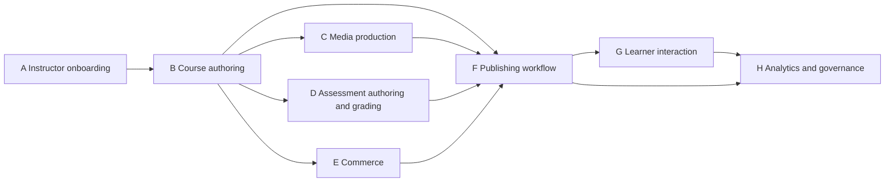

# STU: Instructor Studio and Content Production

> Status: intended product specification. Nothing in this file is a claim that anything is built. Existing code and legacy documents are inputs, not limits (see [CONVENTIONS](../00_START_HERE/CONVENTIONS.md) §1).

Source aliases used in evidence tags: `SSOT` = `SSOT.md`; `YASH-G3` = `Yash_Final_Project_Document/05_FEATURE_SPECIFICATIONS/SPEC_G3_ASSESSMENT_AND_LEARNING.md`; `YASH-MICRO` = `Yash_Final_Project_Document/05_FEATURE_SPECIFICATIONS/MICRO_FEATURE_SPECS.md`; `FREG` = `docs/registries/FEATURE_REGISTRY.md`. Learner-side behavior is specified in [LRN](./LRN_Learning_Course_Experience.md); assessment engine behavior in [ASM](./ASM_Assessments_Challenges_Integrity.md).

## 1. Purpose, outcomes and boundaries

### 1.1 Purpose

STU is the production side of learning: everything an instructor, an institution or the platform does to turn expertise into a published, accessible, correctly priced course, and to run it afterwards. It covers onboarding and verification of instructors, authoring, media upload and processing, assessment authoring, pricing, review and publishing, learner interaction from the instructor side, analytics, revenue reporting and payouts (decision-gated), and content governance (moderation, copyright, localization, quality). It is the "Learn" supply side of the TalentSphere loop [SRC: SSOT §7 F-66, F-74] [DER].

### 1.2 Outcomes

| Outcome | How the system knows |
|---|---|
| A verified instructor can publish a good course without asking support how | Share of submitted courses published within the review SLA; first-time publish success rate |
| Learners never meet an unfinished, inaccessible, infringing or misleading course | Publish gate pass rate; post-publish defect and takedown rates |
| Media is processed reliably and securely, whatever the video provider | Media processing success rate and p95 time-to-ready |
| Instructors know how their course performs and are paid correctly (when payouts are enabled) | Analytics freshness; payout reconciliation drift (target zero) |
| Course content is owned, licensed and attributable | Attestation coverage 100 percent of published versions |

### 1.3 In scope

Instructor application, identity and expertise verification, agreements, public profile, payout and tax profile; studio home; course creation, curriculum builder (sections, lessons, drag and drop), video, text and resource lessons, skill tagging, prerequisites and completion rules, landing page, autosave and edit locking, co-instructors and ownership, import, duplication, versioning, preview; media upload, transcoding, thumbnails, captions and transcripts (auto-generation and editing), content protection, media library, status and retries, external media validation, accessibility tracks; quiz, assignment and rubric authoring, grading queue, peer review setup; pricing, coupons, revenue share, payouts, refund visibility; submission for review, reviewer workflow, automated quality checks, publish, schedule, unpublish, archive; completion sign-off; learner Q&A inbox, announcements, review management, roster, live session hosting; analytics, moderation, copyright, localization, IP attestation, quality score.

### 1.4 Out of scope (owned elsewhere)

| Capability | Owner | Boundary |
|---|---|---|
| Learner experience (catalog, enrollment, playback, progress, certificates, reviews as seen by learners) | LRN | STU publishes an immutable course version and its media manifest; LRN renders and runs it |
| Assessment engine: question types, attempts, timers, grading, integrity, proctoring, certification | ASM | STU embeds ASM's authoring components for in-course quizzes and owns only the course context (placement, weight, completion rule) |
| Payment capture, tax calculation, invoices, payout execution, price tiers, currency | BIL (planned) | STU holds the instructor-facing views and settings; BIL moves money |
| Evidence issuing | EVD (planned) | STU sign-off feeds the rung policy; STU never writes evidence |
| Moderation case workflow and policy | TSF (planned) | STU raises and applies decisions, shows strike status |
| Institution licensing and seats | INS (planned) | Institution-owned courses use STU authoring with institution ownership |
| Object storage, CDN, virus scanning, queue infrastructure | PLT (planned) | STU defines the pipeline behavior; PLT supplies the engine |
| Notification delivery | NTF (planned) | STU names templates |

### 1.5 Owned versus consumed

Owned: instructor profiles and applications, courses, versions, sections, lessons, media assets and renditions, caption and transcript tracks, quiz and assignment configurations (course context), coupons, instructor earnings statements, review cases for publishing, copyright cases for course content, localization tracks, quality scores. Consumed: learner enrollments, progress, reviews and Q&A (LRN), assessment definitions and results (ASM), payments and payout rails (BIL), identity verification services (BGV, IDN, planned).

## 2. Roles and permission matrix

Instructor-side roles inside one course: `Owner` (exactly one), `Co-instructor` (edit content, answer, grade), `Assistant` (answer Q&A and grade only), `Viewer` (analytics only). All are `INS` accounts with course-scoped role. Cell legend: **R** read, **C** create, **U** update, **D** delete, **P** publish, **M** moderate, **A** administer, **-** none.

| Capability | CAN (applicant) | INS Owner | INS Co-instructor | INS Assistant | INS Viewer | IAD (institution course) | MOD | SUP | FIN | PAD |
|---|---|---|---|---|---|---|---|---|---|---|
| Apply and verify as instructor | C U | - | - | - | - | - | - | R | - | A |
| Edit public instructor profile | - | U (own) | U (own) | U (own) | U (own) | - | R | R | - | A |
| Create course draft | - | C | - | - | - | C (institution-owned) | - | - | - | C |
| Edit content, media, curriculum | - | U | U | - | - | U | - | - | - | U (audit) |
| Author quizzes and assignments | - | C U | C U | - | - | C U | - | - | - | - |
| Grade, give feedback | - | U | U | U | - | U | - | - | - | - |
| Set price, coupons | - | C U | - | - | - | C U | - | - | R | A |
| Submit for review | - | C | C (if owner delegates) | - | - | C | - | - | - | - |
| Review and decide on submissions | - | - | - | - | - | - | decide (course reviewer pool) | - | - | A |
| Publish, unpublish, archive | - | P | - | - | - | P | takedown | - | - | A |
| Invite and manage co-instructors | - | C U D | - | - | - | C U D | - | - | - | A |
| View learner roster and progress | - | R | R | R | R (aggregate) | R (scope) | R (case) | R (grant) | - | R (audit) |
| Answer Q&A, post announcements | - | C | C | C (Q&A only) | - | C | M | - | - | M |
| Respond to reviews | - | C | C | - | - | C | M | - | - | M |
| View earnings and payouts | - | R | R (own share) | - | - | R (institution) | - | R | A | R |
| Handle copyright notices | - | R U | - | - | - | R U | A | - | - | A |
| Moderate content, apply strikes | - | - | - | - | - | - | A | R | - | A |

`SAD` has audit access only; `API` principals may read published course metadata through the public API (PLT, planned). Authorization is enforced server-side on every request; course-scoped role is always checked against the course, never inferred from the account type.

## 3. Sub-module map

| Code | Sub-module | Features |
|---|---|---|
| A | Instructor onboarding and identity | FR-STU-001 to 006 |
| B | Course authoring | FR-STU-007 to 020 |
| C | Media production pipeline | FR-STU-021 to 028 |
| D | Assessment authoring and grading | FR-STU-029 to 032 |
| E | Commerce | FR-STU-033 to 037 |
| F | Publishing workflow | FR-STU-038 to 042 |
| G | Learner interaction | FR-STU-043 to 047 |
| H | Analytics and governance | FR-STU-048 to 053 |

## 4. Feature specifications

Notification opt-out classes (owned by NTF, planned): `TRANSACTIONAL` (cannot be disabled), `OPERATIONAL` (studio work items, can be tuned per type), `SOCIAL`, `PROMO`.

### A. Instructor onboarding and identity

