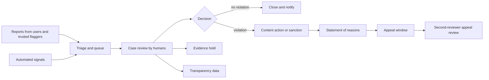

# TSF — Trust, Safety & Moderation

> Status: intended product specification. Nothing in this file is a claim that anything is built. Legacy inputs are inputs, not limits. Conventions: [`../00_START_HERE/CONVENTIONS.md`](../00_START_HERE/CONVENTIONS.md).

## 1. Purpose, outcomes and boundaries

### 1.1 Purpose

TSF keeps TalentSphere safe, honest and lawful: people can report anything, trained humans review it under written policy, automation helps without deciding alone, fraud against job seekers and employers is caught early, and every action is explained, appealable and counted in public. [SRC: SSOT §7 F-24; WF-08; §5.9; §18.3]

### 1.2 Outcomes

1. Anyone can report any content, account, job, employer, credential, message or review in at most three taps, and learns what happened. [SRC: SSOT BR-34]
2. Harmful content and behavior are handled by written policy, proportionate sanctions, and a reviewable record. Permanent actions need two humans. [SRC: SSOT WF-08, §5.9]
3. Job-seeker fraud (fake jobs, fake employers, scams, fake credentials, fake accounts) is detected early and handled with verification and human review, never by anomaly alone. [SRC: SSOT §18.3 "Anomaly is not guilt"]
4. Every enforcement action carries a statement of reasons and an appeal path. [SRC: SSOT BR-154]
5. Evidence is preserved correctly, legal requests are handled by a controlled process, minors are protected, and moderators are protected too.
6. The platform publishes transparency data and can show alignment with the EU Digital Services Act (DSA) and comparable online-safety regimes where they apply.

### 1.3 In scope

Reporting flows for every content type; report taxonomy and triage; policy catalogue and enforcement matrix; moderation queue, case workspace, quorum review, tooling; pre-moderation of high-risk user-generated content; automated detection platform (content abuse, spam and scams, fake jobs and employers, fake credentials, fake and coordinated accounts); content actions; sanctions ladder; statements of reasons; appeals and external dispute settlement information; ban evasion and repeat offenders; minors safety; imminent-harm escalation; scam warnings and safety education; evidence preservation and legal hold; legal requests; transparency reporting; DSA and online-safety workflows; moderator wellbeing, QA and calibration; moderation analytics.

### 1.4 Out of scope (owned elsewhere)

| Capability | Owner |
|---|---|
| Account authentication, session revocation primitives, age claims | IDN (planned) |
| Identity and background verification vendors | BGV (planned) |
| Credential issuance and evidence model | EVD (planned) |
| Employer verification workflow (know your business customer) | EMP (planned) |
| Support tickets, refunds, admin console frame | ADM (planned) |
| Assessment integrity engine and exam proctoring signals | ASM (planned) |
| Feed ranking changes beyond reach limitation | NET (`FR-NET-036`) |
| Message delivery and storage | MSG |
| AI classifier governance (registry, evaluation, bias audit) | AIC (`FR-AIC-024`, `FR-AIC-032`) |
| Notification delivery | NTF (planned) |
| Data subject rights orchestration | SET (planned) |

### 1.5 Boundaries and the non-goal "social-media clone"

TSF does not exist to police speech beyond the platform's career purpose. It enforces published policy for safety, legality, honesty and professionalism. Where policy touches speech (political content, off-topic content) the default is to label or limit reach, not remove, and `OD-TSF-04` records the choice. [SRC: SSOT §4.2]

### 1.6 Owned versus consumed

Owned: reports, cases, decisions, policies, enforcement actions, sanctions, statements of reasons, appeals, evidence holds, legal requests, risk and fraud cases, trusted flagger program, moderator operations, transparency reports. Consumed: content and account data from NET, MSG, JOB, EVD, PRF, LRN and others through a standard content-reference contract; verification states from EMP and BGV; AI classifiers via the AIC registry.

### 1.7 Permission tiers inside role MOD [PROP]

| Tier | Abilities |
|---|---|
| MOD-1 Reviewer | Review assigned cases, apply content actions up to Remove, issue warnings, request second review |
| MOD-2 Senior reviewer | Everything in MOD-1, review appeals of MOD-1 decisions, apply temporary suspensions up to 30 days, act as second reviewer |
| MOD-3 Lead | Everything in MOD-2, propose permanent bans, approve macros, manage queues, calibration, trusted flaggers |
| MOD-S Specialist | Minors safety, legal, fraud investigations (restricted queues with extra training) |

Permanent bans and verified-employer removals need two humans at MOD-2 or above who are different people from the original reviewer (`BR-TSF-011`).

## 2. Roles and permission matrix

Legend: Y allowed, O own objects only, S scoped by tier or queue, R by rule, N not allowed.

| Capability | GUE | CAN | STD | INS | MNT | REC | HMG | EAD | IAD | PLO | MOD | SUP | PAD | SAD |
|---|---|---|---|---|---|---|---|---|---|---|---|---|---|---|
| Submit a report | R | Y | Y | Y | Y | Y | Y | Y | Y | Y | Y | Y | Y | Y |
| View status of own reports | N | O | O | O | O | O | O | O | O | O | O | O | O | O |
| View notices and statements of reasons about own content or account | N | O | O | O | O | O | O | O | O | O | O | O | O | O |
| Appeal a decision | N | O | O | O | O | O | O | O | O | O | N | N | N | N |
| Review cases and apply content actions | N | N | N | N | N | N | N | N | N | N | S | N | N | N |
| Apply account sanctions | N | N | N | N | N | N | N | N | N | N | S | N | N | R |
| Apply permanent ban (two humans) | N | N | N | N | N | N | N | N | N | N | S | N | R | R |
| Read private content beyond a report's scope | N | N | N | N | N | N | N | N | N | N | N | N | N | R |
| Manage policies and enforcement matrix | N | N | N | N | N | N | N | N | N | N | N | N | Y | Y |
| Handle legal requests | N | N | N | N | N | N | N | N | N | N | N | N | R | Y |
| Configure detection thresholds | N | N | N | N | N | N | N | N | N | N | N | N | Y | Y |
| View transparency data | Y | Y | Y | Y | Y | Y | Y | Y | Y | Y | Y | Y | Y | Y |
| Act as institution safety contact (receive escalations for own cohort) | N | N | N | N | N | N | N | N | S | S | N | N | N | N |
| Act as employer trust contact (respond to fraud inquiries for own org) | N | N | N | N | N | N | N | S | N | N | N | N | N | N |
| View moderator wellbeing aggregates | N | N | N | N | N | N | N | N | N | N | S | N | Y | Y |

Notes. `MOD` abilities depend on tier (section 1.7) and queue assignment. `SUP` can route reports from tickets but cannot decide. `SAD` access to private content requires a legal basis recorded in the case and is dual-approved. `API` principals (trusted flaggers' tools) may submit reports through a restricted endpoint (`FR-TSF-004`). Minors follow `BR-TSF-017`.

## 3. Sub-module map

| Code | Sub-module | Features |
|---|---|---|
| TSF-A | Reporting | FR-TSF-001 to 005 |
| TSF-B | Policy | FR-TSF-006 to 007 |
| TSF-C | Moderation queue and tooling | FR-TSF-008 to 012 |
| TSF-D | Automated detection and fraud | FR-TSF-013 to 018 |
| TSF-E | Enforcement and due process | FR-TSF-019 to 026 |
| TSF-F | Evidence, legal, transparency and moderator operations | FR-TSF-027 to 033 |

## 4. Feature specifications

### 4.1 TSF-A Reporting

### FR-TSF-001 — Report content or account (universal intake)

- **Sub-module:** TSF-A Reporting
- **Priority / tier:** Must · R1
- **Source:** [SRC: SSOT §7 F-24; BR-34] [DER] from DSA notice-and-action practice
- **Purpose and outcome:** Any person can report anything on the platform in a guided flow; the system produces a triaged report with an evidence snapshot and a reference the reporter can track.
- **Roles and permissions:** `CAN, STD, INS, MNT, REC, HMG, EAD, IAD, PLO, MOD, SUP, PAD, SAD: report` · `GUE: report public content with challenge`
- **Preconditions and entry points:** Report menu on every reportable object (FR-TSF-002 lists them), the "Report a problem" link in the footer, support ticket "Report abuse", email to the abuse address (routed into the same intake), API for trusted flaggers (FR-TSF-004).
- **User interactions and actions:** 1. Open Report on an object. 2. Choose a top-level reason (for example "Scam or fraud", "Harassment", "Hate or discrimination", "Sexual content", "Violence or threats", "Spam", "Fake profile or impersonation", "Misleading job or employer", "Fake credential", "Privacy violation", "Intellectual property", "Self-harm", "Child safety", "Other"). 3. Choose a more specific sub-reason from a short list. 4. Add optional details (up to 2,000 characters) and optional screenshots (up to 3). 5. For messages, choose which messages to include (`BR-MSG-022`). 6. Optionally block the person or hide the content. 7. Submit and receive a reference ID and expected timeline.
- **System behaviour:** Creates a `Report` (`SM-TSF-01`) with the object reference, reason code, sub-reason, reporter, details, and an `EvidenceSnapshot` (content copy and context at report time, hashed) (`BR-TSF-015`). Duplicates on the same object are merged into one case with a reporter count (`BR-TSF-007`). Assigns a priority tier by reason and signals (`BR-TSF-004`): child safety and imminent harm are P0 and page the on-call specialist (FR-TSF-024, FR-TSF-025). Rate limit: 20 reports per hour per reporter, never applied to P0 reasons (`BR-TSF-001`, `BR-TSF-029`). Guests must pass a challenge and give an optional email for follow-up. The reported party is never told who reported (`BR-TSF-006`). The reporter may choose "hide this for me" immediately. Emits `tsf.report.submitted`.
- **UI elements and controls:** Report dialog (stepper of 3 screens maximum: reason, sub-reason with details, review and submit); reason radio list with descriptions; details textarea with counter; screenshot uploader; "Also block" and "Hide for me" checkboxes; Submit; confirmation page with reference ID and status link; error region.
- **Configuration options:** Platform: reasons and sub-reasons (taxonomy owned by FR-TSF-006), rate limits, screenshot limits. Locale-specific legal reasons (for example "Illegal content" with a jurisdiction field) enabled by region (`BR-TSF-034`).
- **Business rules:** `BR-TSF-001`, `BR-TSF-004`, `BR-TSF-005`, `BR-TSF-006`, `BR-TSF-007`, `BR-TSF-015`, `BR-TSF-029`
- **Validation:** Reason required; details 0 to 2,000 characters; at most 3 images of up to 5 MB (JPEG, PNG, WebP); object reference must resolve and be visible to the reporter (or be public for guests); messages selected must belong to the reporter's accessible conversation.
- **Inputs and outputs:** In: object ref, reason, details, attachments, flags. Out: report id, state `pending`, priority, estimated first-response window.
- **Filters, sorting, search:** n/a — intake flow; status list is in FR-TSF-003.
- **Notifications and communication:** Reporter: confirmation (in-app, email if guest provided) with template `tsf.report_received`; class `account_safety` (non-optional for reporters who asked for updates). P0: on-call page.
- **Error handling and edge cases:** Object already removed: report accepted with note "This content is no longer available; we will still review related account behavior". Reporter offline: the report is queued on the device and submitted on reconnect (up to 24 hours) with a client id for idempotency. Rate limit reached: message with reset time. Attachment fails scan: removed with notice. Reporting own content: allowed only for the reason "Privacy violation" or "Self-harm" and routed accordingly. Report against a moderator or staff member: routed to MOD-3 and SAD, never to the person reported (`BR-TSF-020`).
- **Dependencies:** FR-TSF-002, FR-TSF-006, FR-TSF-008, FR-TSF-015 (evidence), NET, MSG, JOB, EVD, `ENT-TSF-01`, `ENT-TSF-02`.
- **Security and privacy:** Reporter identity stored with restricted access (case staff only); reports are PRIVATE data; snapshots encrypted; CAPTCHA and abuse monitoring for guest reports; no reporter details in any outgoing notice to the reported party.
- **Acceptance criteria:**
  - Given a signed-in member viewing a post, when they report it as "Scam or fraud", then a report exists with a snapshot and the reporter sees a reference ID within 2 seconds.
  - Given two members report the same post, then one case exists with a reporter count of 2.
  - Given a child-safety report, then it is P0 and reaches the on-call specialist within 1 minute.
  - Given a reporter exceeds 20 reports in an hour, when they report another non-P0 item, then it is refused with the reset time; when they report a P0 item, it is accepted.

### FR-TSF-002 — Report entry points and categories for every content type

- **Sub-module:** TSF-A Reporting
- **Priority / tier:** Must · R1
- **Source:** [SRC: SSOT §7 F-24; BR-138] [PROP] for completeness
- **Purpose and outcome:** Every object type has a report entry point with the reasons that apply to it, so nothing on the platform is unreportable.
- **Roles and permissions:** as FR-TSF-001
- **Preconditions and entry points:** The surfaces listed below; each owning module renders the menu item and calls the TSF intake with an object reference.
- **User interactions and actions:** The member opens the overflow menu on any object and selects Report. The reasons shown vary by type per the table below.
- **System behaviour:** The TSF taxonomy registry (FR-TSF-006) lists, per object type, the allowed reasons, the evidence to snapshot and the default queue. Registered types: member profile (photo, headline, summary, name), post, comment, article, newsletter issue, group, group post, direct message or conversation (MSG), message request, recruiter outreach, introduction request, referral request or referral note, recommendation or endorsement, mentor profile and mentor session (MEN planned), job posting (JOB planned), employer page and employer account (EMP planned), company review, salary report, interview question or experience (EVD planned or SRC planned), course and course review (LRN, STU planned), instructor profile, challenge or contest submission (ASM planned), project or portfolio item (PRF planned), credential or certificate claim (EVD planned), event page (EVT planned), gig listing (GIG planned), AI-generated output (AIC `FR-AIC-033`), advertisement or sponsored item, and "something else" for system gaps. Each registered type must have a snapshot adapter implemented by the owning module; a module without an adapter cannot ship a new content type (checked in release gates) (`BR-TSF-005`).
- **UI elements and controls:** Standard "Report" menu item with flag icon and text label; reason list adapted per type.
- **Configuration options:** Per type: reasons, default priority, whether pre-moderation applies (FR-TSF-012), whether the reported party may see the report count (never by default).
- **Business rules:** `BR-TSF-005`, `BR-TSF-001`, `BR-TSF-019`
- **Validation:** The object type must be in the registry; snapshot adapter must return content within 2 seconds.
- **Inputs and outputs:** In: object ref. Out: allowed reasons, snapshot payload.
- **Filters, sorting, search:** n/a — configuration.
- **Notifications and communication:** None.
- **Error handling and edge cases:** Snapshot adapter fails: report is accepted with reference only, and an engineer alert is created; the case is flagged "snapshot missing". Private content the reporter cannot see: cannot be reported by id guessing (authorization check on ref).
- **Dependencies:** All content-owning modules, FR-TSF-006, `ENT-TSF-05`.
- **Security and privacy:** Adapters expose only the content the reporter could see plus system-held context needed for review (for example prior reports on the object).
- **Acceptance criteria:**
  - Given a job posting, when a candidate reports it, then reasons include "Scam or fraud", "Misleading job" and "Discriminatory content".
  - Given a new content type without a snapshot adapter, then the release gate fails.
  - Given an invisible object id supplied by a member, then the intake responds not found.

### FR-TSF-003 — Reporter status and follow-up

- **Sub-module:** TSF-A Reporting
- **Priority / tier:** Must · R2
- **Source:** [SRC: SSOT BR-34 lifecycle] [DER] from DSA acknowledgements
- **Purpose and outcome:** Reporters can see what is happening to their reports and receive a clear outcome without exposing private enforcement details.
- **Roles and permissions:** `reporters: view own reports` · `MOD: n/a`
- **Preconditions and entry points:** Settings > Safety > My reports; email links for guests; notifications.
- **User interactions and actions:** 1. See a list of reports with state: Received, In review, Resolved (action taken), Resolved (no violation found), Closed (duplicate). 2. Open a report to see the timeline and the reason summary. 3. Add more information to an open report (up to 3 additions). 4. Ask to reopen within 14 days with new information. 5. See the outcome in plain language, with a link to the relevant policy.
- **System behaviour:** Reporter-visible states map from case states (`SM-TSF-01`, `SM-TSF-02`). Outcome text says "We removed the content" or "We did not find a violation of <policy>" and for actions against the reported party only the type of action, never personal sanctions details such as suspension duration (`BR-TSF-006`, `BR-TSF-033`). Reporters may appeal a "no violation" outcome once (FR-TSF-022) for high-severity categories and for trusted flaggers. Emits `tsf.report.resolved` consumed for reporter notices.
- **UI elements and controls:** Report list; detail timeline; "Add information" form; "Reopen" button; policy link.
- **Configuration options:** Platform: reopen window 14 days, addition limit 3.
- **Business rules:** `BR-TSF-006`, `BR-TSF-033`, `BR-TSF-002`
- **Validation:** Additional information up to 1,000 characters; reopening requires new information.
- **Inputs and outputs:** In: additions, reopen request. Out: updated status.
- **Filters, sorting, search:** Filter by state; sort by date.
- **Notifications and communication:** `tsf.report_resolved` (in-app, email opt-in); class `account_safety`.
- **Error handling and edge cases:** Report on content later restored after appeal: the reporter is not told the restoration but the case history remains. Reporter account deleted: report kept without reporter identity.
- **Dependencies:** FR-TSF-001, FR-TSF-009, `ENT-TSF-01`.
- **Security and privacy:** Only the reporter sees their report list; no reported-party identity beyond what the reporter already saw.
- **Acceptance criteria:**
  - Given a resolved report with action, then the reporter sees "We took action" and no sanction details.
  - Given a reopen request without new information, then it is refused with a message.
  - Given a closed duplicate, then the reporter sees the outcome of the primary case.

### FR-TSF-004 — Trusted flagger channel and bulk reports

- **Sub-module:** TSF-A Reporting
- **Priority / tier:** Should · R4
- **Source:** [DER] from DSA trusted flaggers concept [PROP]
- **Purpose and outcome:** Vetted organizations (for example anti-fraud agencies, child-safety hotlines, institutions) report at volume with priority handling and accountability.
- **Roles and permissions:** `trusted flagger accounts (CAN with flagger role by TSF assignment, or API principal): submit` · `MOD-3: onboard, review, revoke` · `SAD: approve`
- **Preconditions and entry points:** Application form; signed agreement; designated contacts. Reports via a dedicated form or API with an API key.
- **User interactions and actions:** 1. Organization applies (organization, mission, expertise, accuracy commitments). 2. MOD-3 reviews and SAD approves. 3. Flagger submits reports individually or in batches (CSV or API, up to 500 per batch) with evidence URLs and reason codes. 4. Flagger receives per-report outcomes by webhook or email.
- **System behaviour:** `BR-TSF-028`: criteria are expertise, independence from platform commercial interests, diligence and accuracy tracking. Flagger reports enter a priority queue lane (one tier higher than equivalent user reports, never above P0) and carry a "trusted flagger" label for reviewers. Accuracy is tracked by quarter (share upheld); below 60 percent for two consecutive quarters triggers review, and status can be suspended or revoked with a statement of reasons (`BR-TSF-028`). Flagger status is listed publicly in the transparency report. Abusive batching is blocked by rate limits (500 per hour). Emits `tsf.trusted_flagger.status_changed`.
- **UI elements and controls:** Application form; flagger dashboard (submitted, upheld, rejected); batch upload; API docs link.
- **Configuration options:** Platform: priority uplift, batch size, accuracy thresholds [PROP].
- **Business rules:** `BR-TSF-028`, `BR-TSF-029`, `BR-TSF-004`
- **Validation:** Batch rows validated per row (object ref, reason); invalid rows returned with errors.
- **Inputs and outputs:** In: batch. Out: per-row report ids or errors.
- **Filters, sorting, search:** Dashboard filter by period, outcome.
- **Notifications and communication:** Quarterly accuracy summary; status change notice.
- **Error handling and edge cases:** API key leak: key revoked and reports from it quarantined for review. Duplicate objects: merged.
- **Dependencies:** FR-TSF-001, FR-TSF-008, FR-TSF-029, `ENT-TSF-15`.
- **Security and privacy:** Keys stored hashed; flagger staff identities limited to designated contacts.
- **Acceptance criteria:**
  - Given an approved flagger submits a report, then it enters one priority lane above a user report of the same reason.
  - Given accuracy under 60 percent for two quarters, then a review task is created.
  - Given a revoked flagger, then their API key stops working immediately.

### FR-TSF-005 — Report-abuse controls (manifestly unfounded reports)

- **Sub-module:** TSF-A Reporting
- **Priority / tier:** Should · R2
- **Source:** [DER] from DSA misuse measures [PROP]
- **Purpose and outcome:** Brigading and retaliatory reporting are detected without discouraging legitimate reporting.
- **Roles and permissions:** system; `MOD-2: review flags` · `PAD: configure thresholds`
- **Preconditions and entry points:** Runs on every resolved report; coordinated report spikes.
- **User interactions and actions:** Reporters with repeated unfounded reports receive a graded response: a reminder of policy, then reduced priority for their non-P0 reports, then temporary suspension of the reporting right for non-P0 reasons (14 days), always with a statement of reasons and appeal.
- **System behaviour:** A report is "manifestly unfounded" only when a reviewer marks it so with a reason (not merely "no violation") (`BR-TSF-029`). Thresholds [PROP]: 5 manifestly unfounded reports within 30 days triggers a warning; 10 triggers reduced priority; 20 triggers a 14-day suspension of non-P0 reporting. Report spikes against one target (more than 20 reports in 1 hour from accounts created within 7 days or with correlated signals) are flagged as possible brigading: the target is protected by holding public removal until a human reviews (`BR-TSF-037`) and the reporters are examined (FR-TSF-018). P0 reports are never throttled. Emits `tsf.reporter.warned`.
- **UI elements and controls:** Reviewer UI field "manifestly unfounded" with reason; reporter notice.
- **Configuration options:** Thresholds and windows.
- **Business rules:** `BR-TSF-029`, `BR-TSF-037`, `BR-TSF-006`
- **Validation:** Marking requires a reason of at least 20 characters and MOD-2 review for the suspension step.
- **Inputs and outputs:** In: resolved reports. Out: reporter standing.
- **Filters, sorting, search:** Review queue filter by reporter.
- **Notifications and communication:** Warning, priority reduction and suspension notices (class `account_safety`).
- **Error handling and edge cases:** Reporter harmed by a real abuse pattern repeatedly reporting similar benign-looking items: reviewers may override with "pattern is real". Appeals restore standing.
- **Dependencies:** FR-TSF-009, FR-TSF-018, FR-TSF-022, `ENT-TSF-21`.
- **Security and privacy:** Standing data visible to staff only.
- **Acceptance criteria:**
  - Given 20 manifestly unfounded reports in 30 days, then non-P0 reporting is suspended for 14 days with a notice.
  - Given the suspended reporter, when they submit a child-safety report, then it is accepted.
  - Given a ruling "no violation" without the unfounded flag, then it does not count toward thresholds.

### 4.2 TSF-B Policy

### FR-TSF-006 — Policy catalogue, taxonomy and versioning

- **Sub-module:** TSF-B Policy
- **Priority / tier:** Must · R2
- **Source:** [DER] [PROP]; [SRC: SSOT BR-138, BR-136 policy touchpoints]
- **Purpose and outcome:** Every moderation decision cites a written, versioned, public policy; the report taxonomy and the policies stay in sync.
- **Roles and permissions:** `PAD, SAD: author and publish` · `MOD-3: propose changes` · `all users: read public policies`
- **Preconditions and entry points:** Admin console > Policies; public Safety center and Community guidelines pages.
- **User interactions and actions:** 1. Author drafts a policy or amendment (title, scope, definition, examples of violation and non-violation, exceptions, severity, default actions, regions). 2. Review by counsel and MOD-3. 3. Publish with an effective date. 4. Public pages show versions and a change log. 5. Reviewers see the policy text beside each case.
- **System behaviour:** Policy catalogue (initial set, each with `policy_id`): `POL-01` Child safety; `POL-02` Violence, threats and self-harm; `POL-03` Harassment and bullying; `POL-04` Hate and discrimination; `POL-05` Sexual content and solicitation; `POL-06` Spam and platform manipulation; `POL-07` Scams and financial fraud; `POL-08` Fake jobs and employer misrepresentation (including fees from candidates, work-for-free schemes, pyramid or multi-level offers, requests for sensitive documents before offer); `POL-09` Fake credentials and academic or employment fraud; `POL-10` Impersonation and fake accounts; `POL-11` Privacy and doxxing (including interview questions or reviews exposing individuals); `POL-12` Intellectual property; `POL-13` Illegal goods, services and activities; `POL-14` Misinformation affecting career safety (for example fake certificates or fake regulatory claims); `POL-15` Professional conduct (off-topic, self-promotion beyond limits, engagement bait, undisclosed sponsorship); `POL-16` Reviews and ratings integrity (fake or incentivized reviews, retaliation, interview-process leaks); `POL-17` Assessment and contest integrity violations referred from ASM; `POL-18` Referral and recommendation manipulation; `POL-19` Platform security abuse (scraping, credential trading, automation); `POL-20` Employer conduct (discriminatory job requirements, retaliation against reporters, unauthorized data use). Versions are immutable once published; decisions store `policy_id` and `policy_version` (`BR-TSF-031`, `BR-TSF-035`). Non-urgent changes are announced 14 days before they apply; urgent safety changes apply immediately with after-the-fact notice (`BR-TSF-031`). Translations are maintained for supported languages and the English text is not authoritative where law requires local language (`BR-TSF-034`). Emits `tsf.policy.version_published`.
- **UI elements and controls:** Policy editor with preview; diff view; approval workflow; public policy pages with anchors; "applies in region" selector.
- **Configuration options:** Per policy: severity (low, medium, high, critical), default action set, regions, effective date.
- **Business rules:** `BR-TSF-031`, `BR-TSF-035`, `BR-TSF-034`, `BR-TSF-005`
- **Validation:** Each policy needs definition, at least 3 examples of violation and 3 of non-violation, default action, owner; effective date at least 14 days ahead unless flagged urgent with SAD approval.
- **Inputs and outputs:** In: policy text and metadata. Out: published version.
- **Filters, sorting, search:** Policy list filter by area, region, status.
- **Notifications and communication:** Change announcements to affected users (class `policy_updates`, mandatory for material changes).
- **Error handling and edge cases:** Conflicting policies on one case: reviewer chooses the most specific and notes the overlap. Retired policy referenced by old decisions: version retained for audit.
- **Dependencies:** `ENT-TSF-06`, `ENT-TSF-07`, FR-TSF-007, FR-TSF-030.
- **Security and privacy:** Draft policies restricted; public pages cacheable; audit of edits.
- **Acceptance criteria:**
  - Given a published policy, then it is immutable and a new version is required to change it.
  - Given a decision, then it stores the exact policy id and version.
  - Given a non-urgent amendment with an effective date 5 days away, then publish is refused.

### FR-TSF-007 — Enforcement matrix and severity mapping

- **Sub-module:** TSF-B Policy
- **Priority / tier:** Must · R2
- **Source:** [DER] [PROP]; [SRC: SSOT WF-08 "two-human review on bans"]
- **Purpose and outcome:** For each policy and severity, the allowed and default enforcement actions are written down so decisions are consistent and reviewable.
- **Roles and permissions:** `PAD, SAD: configure` · `MOD-3: propose` · `MOD: view`
- **Preconditions and entry points:** Admin console > Enforcement matrix.
- **User interactions and actions:** 1. PAD edits the matrix: rows are policy and severity; columns are content actions (none, label, reduce reach, hide pending review, remove), account actions (warning, feature restriction, temporary suspension, permanent ban), required reviewer tier, whether two humans are needed, whether to notify authorities, appeal rights. 2. Publish a new matrix version.
- **System behaviour:** The case workspace (FR-TSF-009) offers only actions allowed by the matrix for the chosen policy and severity; a deviation requires a "departure reason" and MOD-2 approval and is flagged for QA (FR-TSF-032) (`BR-TSF-035`). Defaults: critical severity under `POL-01` and `POL-02` allow immediate removal and suspension pending review by MOD-S and mandatory referral (FR-TSF-024, FR-TSF-025); permanent actions always need two humans (`BR-TSF-011`). The matrix version is stored with each decision. Emits `tsf.policy.version_published` (matrix version).
- **UI elements and controls:** Matrix grid editor; version history; test mode to simulate a case.
- **Configuration options:** As described.
- **Business rules:** `BR-TSF-011`, `BR-TSF-013`, `BR-TSF-035`, `BR-TSF-009`
- **Validation:** Every policy-severity row has at least one allowed action; permanent actions cannot be set to a single reviewer; matrix changes need SAD approval.
- **Inputs and outputs:** In: matrix edits. Out: published matrix.
- **Filters, sorting, search:** Filter by policy and severity.
- **Notifications and communication:** Moderators informed of matrix changes before they apply.
- **Error handling and edge cases:** A case with no matching row: escalates to MOD-3 and a matrix gap task is created.
- **Dependencies:** FR-TSF-006, FR-TSF-009, FR-TSF-010, `ENT-TSF-06`.
- **Security and privacy:** Matrix is internal but summarized publicly in the transparency report.
- **Acceptance criteria:**
  - Given a case with `POL-03` low severity, then the permanent ban option is not offered.
  - Given a deviation from the matrix, then the system requires a departure reason and MOD-2 approval.
  - Given a published matrix, then decisions store its version.

### 4.3 TSF-C Moderation queue and tooling

