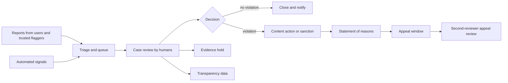

# TSF — Trust, Safety & Moderation

> Status: intended product specification. Nothing in this file is a claim that anything is built. Legacy inputs are inputs, not limits. Conventions: [`../00_START_HERE/CONVENTIONS.md`](../00_START_HERE/CONVENTIONS.md).

## 1. Purpose, outcomes and boundaries

### 1.1 Purpose

TSF keeps TalentSphere safe, honest and lawful: people can report anything, trained humans review it under written policy, automation helps without deciding alone, fraud against job seekers and employers is caught early, and every action is explained, appealable and counted in public. [SRC: SSOT §7 F-24; WF-08; §5.9; §18.3]

### 1.2 Outcomes

1. Anyone can report any content, account, job, employer, credential, message or review in at most three taps, and learns what happened. [SRC: SSOT BR-34]
2. Harmful content and behavior are handled by written policy, proportionate sanctions, and a reviewable record. Permanent actions need two humans. [SRC: SSOT WF-08, §5.9]
3. Job-seeker fraud (fake jobs, fake employers, scams, fake credentials, fake accounts) is detected early and handled with verification and human review, never by anomaly alone. [SRC: SSOT §18.3 "Anomaly is not guilt"]
4. Every enforcement action carries a statement of reasons and an appeal path. [SRC: SSOT BR-154]
5. Evidence is preserved correctly, legal requests are handled by a controlled process, minors are protected, and moderators are protected too.
6. The platform publishes transparency data and can show alignment with the EU Digital Services Act (DSA) and comparable online-safety regimes where they apply.

### 1.3 In scope

Reporting flows for every content type; report taxonomy and triage; policy catalogue and enforcement matrix; moderation queue, case workspace, quorum review, tooling; pre-moderation of high-risk user-generated content; automated detection platform (content abuse, spam and scams, fake jobs and employers, fake credentials, fake and coordinated accounts); content actions; sanctions ladder; statements of reasons; appeals and external dispute settlement information; ban evasion and repeat offenders; minors safety; imminent-harm escalation; scam warnings and safety education; evidence preservation and legal hold; legal requests; transparency reporting; DSA and online-safety workflows; moderator wellbeing, QA and calibration; moderation analytics.

### 1.4 Out of scope (owned elsewhere)

| Capability | Owner |
|---|---|
| Account authentication, session revocation primitives, age claims | IDN (planned) |
| Identity and background verification vendors | BGV (planned) |
| Credential issuance and evidence model | EVD (planned) |
| Employer verification workflow (know your business customer) | EMP (planned) |
| Support tickets, refunds, admin console frame | ADM (planned) |
| Assessment integrity engine and exam proctoring signals | ASM (planned) |
| Feed ranking changes beyond reach limitation | NET (`FR-NET-036`) |
| Message delivery and storage | MSG |
| AI classifier governance (registry, evaluation, bias audit) | AIC (`FR-AIC-024`, `FR-AIC-032`) |
| Notification delivery | NTF (planned) |
| Data subject rights orchestration | SET (planned) |

### 1.5 Boundaries and the non-goal "social-media clone"

TSF does not exist to police speech beyond the platform's career purpose. It enforces published policy for safety, legality, honesty and professionalism. Where policy touches speech (political content, off-topic content) the default is to label or limit reach, not remove, and `OD-TSF-04` records the choice. [SRC: SSOT §4.2]

### 1.6 Owned versus consumed

Owned: reports, cases, decisions, policies, enforcement actions, sanctions, statements of reasons, appeals, evidence holds, legal requests, risk and fraud cases, trusted flagger program, moderator operations, transparency reports. Consumed: content and account data from NET, MSG, JOB, EVD, PRF, LRN and others through a standard content-reference contract; verification states from EMP and BGV; AI classifiers via the AIC registry.

### 1.7 Permission tiers inside role MOD [PROP]

| Tier | Abilities |
|---|---|
| MOD-1 Reviewer | Review assigned cases, apply content actions up to Remove, issue warnings, request second review |
| MOD-2 Senior reviewer | Everything in MOD-1, review appeals of MOD-1 decisions, apply temporary suspensions up to 30 days, act as second reviewer |
| MOD-3 Lead | Everything in MOD-2, propose permanent bans, approve macros, manage queues, calibration, trusted flaggers |
| MOD-S Specialist | Minors safety, legal, fraud investigations (restricted queues with extra training) |

Permanent bans and verified-employer removals need two humans at MOD-2 or above who are different people from the original reviewer (`BR-TSF-011`).

## 2. Roles and permission matrix

Legend: Y allowed, O own objects only, S scoped by tier or queue, R by rule, N not allowed.

| Capability | GUE | CAN | STD | INS | MNT | REC | HMG | EAD | IAD | PLO | MOD | SUP | PAD | SAD |
|---|---|---|---|---|---|---|---|---|---|---|---|---|---|---|
| Submit a report | R | Y | Y | Y | Y | Y | Y | Y | Y | Y | Y | Y | Y | Y |
| View status of own reports | N | O | O | O | O | O | O | O | O | O | O | O | O | O |
| View notices and statements of reasons about own content or account | N | O | O | O | O | O | O | O | O | O | O | O | O | O |
| Appeal a decision | N | O | O | O | O | O | O | O | O | O | N | N | N | N |
| Review cases and apply content actions | N | N | N | N | N | N | N | N | N | N | S | N | N | N |
| Apply account sanctions | N | N | N | N | N | N | N | N | N | N | S | N | N | R |
| Apply permanent ban (two humans) | N | N | N | N | N | N | N | N | N | N | S | N | R | R |
| Read private content beyond a report's scope | N | N | N | N | N | N | N | N | N | N | N | N | N | R |
| Manage policies and enforcement matrix | N | N | N | N | N | N | N | N | N | N | N | N | Y | Y |
| Handle legal requests | N | N | N | N | N | N | N | N | N | N | N | N | R | Y |
| Configure detection thresholds | N | N | N | N | N | N | N | N | N | N | N | N | Y | Y |
| View transparency data | Y | Y | Y | Y | Y | Y | Y | Y | Y | Y | Y | Y | Y | Y |
| Act as institution safety contact (receive escalations for own cohort) | N | N | N | N | N | N | N | N | S | S | N | N | N | N |
| Act as employer trust contact (respond to fraud inquiries for own org) | N | N | N | N | N | N | N | S | N | N | N | N | N | N |
| View moderator wellbeing aggregates | N | N | N | N | N | N | N | N | N | N | S | N | Y | Y |

Notes. `MOD` abilities depend on tier (section 1.7) and queue assignment. `SUP` can route reports from tickets but cannot decide. `SAD` access to private content requires a legal basis recorded in the case and is dual-approved. `API` principals (trusted flaggers' tools) may submit reports through a restricted endpoint (`FR-TSF-004`). Minors follow `BR-TSF-017`.

## 3. Sub-module map

| Code | Sub-module | Features |
|---|---|---|
| TSF-A | Reporting | FR-TSF-001 to 005 |
| TSF-B | Policy | FR-TSF-006 to 007 |
| TSF-C | Moderation queue and tooling | FR-TSF-008 to 012 |
| TSF-D | Automated detection and fraud | FR-TSF-013 to 018 |
| TSF-E | Enforcement and due process | FR-TSF-019 to 026 |
| TSF-F | Evidence, legal, transparency and moderator operations | FR-TSF-027 to 033 |

## 4. Feature specifications

### 4.1 TSF-A Reporting

### FR-TSF-001 — Report content or account (universal intake)

- **Sub-module:** TSF-A Reporting
- **Priority / tier:** Must · R1
- **Source:** [SRC: SSOT §7 F-24; BR-34] [DER] from DSA notice-and-action practice
- **Purpose and outcome:** Any person can report anything on the platform in a guided flow; the system produces a triaged report with an evidence snapshot and a reference the reporter can track.
- **Roles and permissions:** `CAN, STD, INS, MNT, REC, HMG, EAD, IAD, PLO, MOD, SUP, PAD, SAD: report` · `GUE: report public content with challenge`
- **Preconditions and entry points:** Report menu on every reportable object (FR-TSF-002 lists them), the "Report a problem" link in the footer, support ticket "Report abuse", email to the abuse address (routed into the same intake), API for trusted flaggers (FR-TSF-004).
- **User interactions and actions:** 1. Open Report on an object. 2. Choose a top-level reason (for example "Scam or fraud", "Harassment", "Hate or discrimination", "Sexual content", "Violence or threats", "Spam", "Fake profile or impersonation", "Misleading job or employer", "Fake credential", "Privacy violation", "Intellectual property", "Self-harm", "Child safety", "Other"). 3. Choose a more specific sub-reason from a short list. 4. Add optional details (up to 2,000 characters) and optional screenshots (up to 3). 5. For messages, choose which messages to include (`BR-MSG-022`). 6. Optionally block the person or hide the content. 7. Submit and receive a reference ID and expected timeline.
- **System behaviour:** Creates a `Report` (`SM-TSF-01`) with the object reference, reason code, sub-reason, reporter, details, and an `EvidenceSnapshot` (content copy and context at report time, hashed) (`BR-TSF-015`). Duplicates on the same object are merged into one case with a reporter count (`BR-TSF-007`). Assigns a priority tier by reason and signals (`BR-TSF-004`): child safety and imminent harm are P0 and page the on-call specialist (FR-TSF-024, FR-TSF-025). Rate limit: 20 reports per hour per reporter, never applied to P0 reasons (`BR-TSF-001`, `BR-TSF-029`). Guests must pass a challenge and give an optional email for follow-up. The reported party is never told who reported (`BR-TSF-006`). The reporter may choose "hide this for me" immediately. Emits `tsf.report.submitted`.
- **UI elements and controls:** Report dialog (stepper of 3 screens maximum: reason, sub-reason with details, review and submit); reason radio list with descriptions; details textarea with counter; screenshot uploader; "Also block" and "Hide for me" checkboxes; Submit; confirmation page with reference ID and status link; error region.
- **Configuration options:** Platform: reasons and sub-reasons (taxonomy owned by FR-TSF-006), rate limits, screenshot limits. Locale-specific legal reasons (for example "Illegal content" with a jurisdiction field) enabled by region (`BR-TSF-034`).
- **Business rules:** `BR-TSF-001`, `BR-TSF-004`, `BR-TSF-005`, `BR-TSF-006`, `BR-TSF-007`, `BR-TSF-015`, `BR-TSF-029`
- **Validation:** Reason required; details 0 to 2,000 characters; at most 3 images of up to 5 MB (JPEG, PNG, WebP); object reference must resolve and be visible to the reporter (or be public for guests); messages selected must belong to the reporter's accessible conversation.
- **Inputs and outputs:** In: object ref, reason, details, attachments, flags. Out: report id, state `pending`, priority, estimated first-response window.
- **Filters, sorting, search:** n/a — intake flow; status list is in FR-TSF-003.
- **Notifications and communication:** Reporter: confirmation (in-app, email if guest provided) with template `tsf.report_received`; class `account_safety` (non-optional for reporters who asked for updates). P0: on-call page.
- **Error handling and edge cases:** Object already removed: report accepted with note "This content is no longer available; we will still review related account behavior". Reporter offline: the report is queued on the device and submitted on reconnect (up to 24 hours) with a client id for idempotency. Rate limit reached: message with reset time. Attachment fails scan: removed with notice. Reporting own content: allowed only for the reason "Privacy violation" or "Self-harm" and routed accordingly. Report against a moderator or staff member: routed to MOD-3 and SAD, never to the person reported (`BR-TSF-020`).
- **Dependencies:** FR-TSF-002, FR-TSF-006, FR-TSF-008, FR-TSF-015 (evidence), NET, MSG, JOB, EVD, `ENT-TSF-01`, `ENT-TSF-02`.
- **Security and privacy:** Reporter identity stored with restricted access (case staff only); reports are PRIVATE data; snapshots encrypted; CAPTCHA and abuse monitoring for guest reports; no reporter details in any outgoing notice to the reported party.
- **Acceptance criteria:**
  - Given a signed-in member viewing a post, when they report it as "Scam or fraud", then a report exists with a snapshot and the reporter sees a reference ID within 2 seconds.
  - Given two members report the same post, then one case exists with a reporter count of 2.
  - Given a child-safety report, then it is P0 and reaches the on-call specialist within 1 minute.
  - Given a reporter exceeds 20 reports in an hour, when they report another non-P0 item, then it is refused with the reset time; when they report a P0 item, it is accepted.

### FR-TSF-002 — Report entry points and categories for every content type

- **Sub-module:** TSF-A Reporting
- **Priority / tier:** Must · R1
- **Source:** [SRC: SSOT §7 F-24; BR-138] [PROP] for completeness
- **Purpose and outcome:** Every object type has a report entry point with the reasons that apply to it, so nothing on the platform is unreportable.
- **Roles and permissions:** as FR-TSF-001
- **Preconditions and entry points:** The surfaces listed below; each owning module renders the menu item and calls the TSF intake with an object reference.
- **User interactions and actions:** The member opens the overflow menu on any object and selects Report. The reasons shown vary by type per the table below.
- **System behaviour:** The TSF taxonomy registry (FR-TSF-006) lists, per object type, the allowed reasons, the evidence to snapshot and the default queue. Registered types: member profile (photo, headline, summary, name), post, comment, article, newsletter issue, group, group post, direct message or conversation (MSG), message request, recruiter outreach, introduction request, referral request or referral note, recommendation or endorsement, mentor profile and mentor session (MEN planned), job posting (JOB planned), employer page and employer account (EMP planned), company review, salary report, interview question or experience (EVD planned or SRC planned), course and course review (LRN, STU planned), instructor profile, challenge or contest submission (ASM planned), project or portfolio item (PRF planned), credential or certificate claim (EVD planned), event page (EVT planned), gig listing (GIG planned), AI-generated output (AIC `FR-AIC-033`), advertisement or sponsored item, and "something else" for system gaps. Each registered type must have a snapshot adapter implemented by the owning module; a module without an adapter cannot ship a new content type (checked in release gates) (`BR-TSF-005`).
- **UI elements and controls:** Standard "Report" menu item with flag icon and text label; reason list adapted per type.
- **Configuration options:** Per type: reasons, default priority, whether pre-moderation applies (FR-TSF-012), whether the reported party may see the report count (never by default).
- **Business rules:** `BR-TSF-005`, `BR-TSF-001`, `BR-TSF-019`
- **Validation:** The object type must be in the registry; snapshot adapter must return content within 2 seconds.
- **Inputs and outputs:** In: object ref. Out: allowed reasons, snapshot payload.
- **Filters, sorting, search:** n/a — configuration.
- **Notifications and communication:** None.
- **Error handling and edge cases:** Snapshot adapter fails: report is accepted with reference only, and an engineer alert is created; the case is flagged "snapshot missing". Private content the reporter cannot see: cannot be reported by id guessing (authorization check on ref).
- **Dependencies:** All content-owning modules, FR-TSF-006, `ENT-TSF-05`.
- **Security and privacy:** Adapters expose only the content the reporter could see plus system-held context needed for review (for example prior reports on the object).
- **Acceptance criteria:**
  - Given a job posting, when a candidate reports it, then reasons include "Scam or fraud", "Misleading job" and "Discriminatory content".
  - Given a new content type without a snapshot adapter, then the release gate fails.
  - Given an invisible object id supplied by a member, then the intake responds not found.

### FR-TSF-003 — Reporter status and follow-up

- **Sub-module:** TSF-A Reporting
- **Priority / tier:** Must · R2
- **Source:** [SRC: SSOT BR-34 lifecycle] [DER] from DSA acknowledgements
- **Purpose and outcome:** Reporters can see what is happening to their reports and receive a clear outcome without exposing private enforcement details.
- **Roles and permissions:** `reporters: view own reports` · `MOD: n/a`
- **Preconditions and entry points:** Settings > Safety > My reports; email links for guests; notifications.
- **User interactions and actions:** 1. See a list of reports with state: Received, In review, Resolved (action taken), Resolved (no violation found), Closed (duplicate). 2. Open a report to see the timeline and the reason summary. 3. Add more information to an open report (up to 3 additions). 4. Ask to reopen within 14 days with new information. 5. See the outcome in plain language, with a link to the relevant policy.
- **System behaviour:** Reporter-visible states map from case states (`SM-TSF-01`, `SM-TSF-02`). Outcome text says "We removed the content" or "We did not find a violation of <policy>" and for actions against the reported party only the type of action, never personal sanctions details such as suspension duration (`BR-TSF-006`, `BR-TSF-033`). Reporters may appeal a "no violation" outcome once (FR-TSF-022) for high-severity categories and for trusted flaggers. Emits `tsf.report.resolved` consumed for reporter notices.
- **UI elements and controls:** Report list; detail timeline; "Add information" form; "Reopen" button; policy link.
- **Configuration options:** Platform: reopen window 14 days, addition limit 3.
- **Business rules:** `BR-TSF-006`, `BR-TSF-033`, `BR-TSF-002`
- **Validation:** Additional information up to 1,000 characters; reopening requires new information.
- **Inputs and outputs:** In: additions, reopen request. Out: updated status.
- **Filters, sorting, search:** Filter by state; sort by date.
- **Notifications and communication:** `tsf.report_resolved` (in-app, email opt-in); class `account_safety`.
- **Error handling and edge cases:** Report on content later restored after appeal: the reporter is not told the restoration but the case history remains. Reporter account deleted: report kept without reporter identity.
- **Dependencies:** FR-TSF-001, FR-TSF-009, `ENT-TSF-01`.
- **Security and privacy:** Only the reporter sees their report list; no reported-party identity beyond what the reporter already saw.
- **Acceptance criteria:**
  - Given a resolved report with action, then the reporter sees "We took action" and no sanction details.
  - Given a reopen request without new information, then it is refused with a message.
  - Given a closed duplicate, then the reporter sees the outcome of the primary case.

### FR-TSF-004 — Trusted flagger channel and bulk reports

- **Sub-module:** TSF-A Reporting
- **Priority / tier:** Should · R4
- **Source:** [DER] from DSA trusted flaggers concept [PROP]
- **Purpose and outcome:** Vetted organizations (for example anti-fraud agencies, child-safety hotlines, institutions) report at volume with priority handling and accountability.
- **Roles and permissions:** `trusted flagger accounts (CAN with flagger role by TSF assignment, or API principal): submit` · `MOD-3: onboard, review, revoke` · `SAD: approve`
- **Preconditions and entry points:** Application form; signed agreement; designated contacts. Reports via a dedicated form or API with an API key.
- **User interactions and actions:** 1. Organization applies (organization, mission, expertise, accuracy commitments). 2. MOD-3 reviews and SAD approves. 3. Flagger submits reports individually or in batches (CSV or API, up to 500 per batch) with evidence URLs and reason codes. 4. Flagger receives per-report outcomes by webhook or email.
- **System behaviour:** `BR-TSF-028`: criteria are expertise, independence from platform commercial interests, diligence and accuracy tracking. Flagger reports enter a priority queue lane (one tier higher than equivalent user reports, never above P0) and carry a "trusted flagger" label for reviewers. Accuracy is tracked by quarter (share upheld); below 60 percent for two consecutive quarters triggers review, and status can be suspended or revoked with a statement of reasons (`BR-TSF-028`). Flagger status is listed publicly in the transparency report. Abusive batching is blocked by rate limits (500 per hour). Emits `tsf.trusted_flagger.status_changed`.
- **UI elements and controls:** Application form; flagger dashboard (submitted, upheld, rejected); batch upload; API docs link.
- **Configuration options:** Platform: priority uplift, batch size, accuracy thresholds [PROP].
- **Business rules:** `BR-TSF-028`, `BR-TSF-029`, `BR-TSF-004`
- **Validation:** Batch rows validated per row (object ref, reason); invalid rows returned with errors.
- **Inputs and outputs:** In: batch. Out: per-row report ids or errors.
- **Filters, sorting, search:** Dashboard filter by period, outcome.
- **Notifications and communication:** Quarterly accuracy summary; status change notice.
- **Error handling and edge cases:** API key leak: key revoked and reports from it quarantined for review. Duplicate objects: merged.
- **Dependencies:** FR-TSF-001, FR-TSF-008, FR-TSF-029, `ENT-TSF-15`.
- **Security and privacy:** Keys stored hashed; flagger staff identities limited to designated contacts.
- **Acceptance criteria:**
  - Given an approved flagger submits a report, then it enters one priority lane above a user report of the same reason.
  - Given accuracy under 60 percent for two quarters, then a review task is created.
  - Given a revoked flagger, then their API key stops working immediately.

### FR-TSF-005 — Report-abuse controls (manifestly unfounded reports)

- **Sub-module:** TSF-A Reporting
- **Priority / tier:** Should · R2
- **Source:** [DER] from DSA misuse measures [PROP]
- **Purpose and outcome:** Brigading and retaliatory reporting are detected without discouraging legitimate reporting.
- **Roles and permissions:** system; `MOD-2: review flags` · `PAD: configure thresholds`
- **Preconditions and entry points:** Runs on every resolved report; coordinated report spikes.
- **User interactions and actions:** Reporters with repeated unfounded reports receive a graded response: a reminder of policy, then reduced priority for their non-P0 reports, then temporary suspension of the reporting right for non-P0 reasons (14 days), always with a statement of reasons and appeal.
- **System behaviour:** A report is "manifestly unfounded" only when a reviewer marks it so with a reason (not merely "no violation") (`BR-TSF-029`). Thresholds [PROP]: 5 manifestly unfounded reports within 30 days triggers a warning; 10 triggers reduced priority; 20 triggers a 14-day suspension of non-P0 reporting. Report spikes against one target (more than 20 reports in 1 hour from accounts created within 7 days or with correlated signals) are flagged as possible brigading: the target is protected by holding public removal until a human reviews (`BR-TSF-037`) and the reporters are examined (FR-TSF-018). P0 reports are never throttled. Emits `tsf.reporter.warned`.
- **UI elements and controls:** Reviewer UI field "manifestly unfounded" with reason; reporter notice.
- **Configuration options:** Thresholds and windows.
- **Business rules:** `BR-TSF-029`, `BR-TSF-037`, `BR-TSF-006`
- **Validation:** Marking requires a reason of at least 20 characters and MOD-2 review for the suspension step.
- **Inputs and outputs:** In: resolved reports. Out: reporter standing.
- **Filters, sorting, search:** Review queue filter by reporter.
- **Notifications and communication:** Warning, priority reduction and suspension notices (class `account_safety`).
- **Error handling and edge cases:** Reporter harmed by a real abuse pattern repeatedly reporting similar benign-looking items: reviewers may override with "pattern is real". Appeals restore standing.
- **Dependencies:** FR-TSF-009, FR-TSF-018, FR-TSF-022, `ENT-TSF-21`.
- **Security and privacy:** Standing data visible to staff only.
- **Acceptance criteria:**
  - Given 20 manifestly unfounded reports in 30 days, then non-P0 reporting is suspended for 14 days with a notice.
  - Given the suspended reporter, when they submit a child-safety report, then it is accepted.
  - Given a ruling "no violation" without the unfounded flag, then it does not count toward thresholds.

### 4.2 TSF-B Policy

### FR-TSF-006 — Policy catalogue, taxonomy and versioning

- **Sub-module:** TSF-B Policy
- **Priority / tier:** Must · R2
- **Source:** [DER] [PROP]; [SRC: SSOT BR-138, BR-136 policy touchpoints]
- **Purpose and outcome:** Every moderation decision cites a written, versioned, public policy; the report taxonomy and the policies stay in sync.
- **Roles and permissions:** `PAD, SAD: author and publish` · `MOD-3: propose changes` · `all users: read public policies`
- **Preconditions and entry points:** Admin console > Policies; public Safety center and Community guidelines pages.
- **User interactions and actions:** 1. Author drafts a policy or amendment (title, scope, definition, examples of violation and non-violation, exceptions, severity, default actions, regions). 2. Review by counsel and MOD-3. 3. Publish with an effective date. 4. Public pages show versions and a change log. 5. Reviewers see the policy text beside each case.
- **System behaviour:** Policy catalogue (initial set, each with `policy_id`): `POL-01` Child safety; `POL-02` Violence, threats and self-harm; `POL-03` Harassment and bullying; `POL-04` Hate and discrimination; `POL-05` Sexual content and solicitation; `POL-06` Spam and platform manipulation; `POL-07` Scams and financial fraud; `POL-08` Fake jobs and employer misrepresentation (including fees from candidates, work-for-free schemes, pyramid or multi-level offers, requests for sensitive documents before offer); `POL-09` Fake credentials and academic or employment fraud; `POL-10` Impersonation and fake accounts; `POL-11` Privacy and doxxing (including interview questions or reviews exposing individuals); `POL-12` Intellectual property; `POL-13` Illegal goods, services and activities; `POL-14` Misinformation affecting career safety (for example fake certificates or fake regulatory claims); `POL-15` Professional conduct (off-topic, self-promotion beyond limits, engagement bait, undisclosed sponsorship); `POL-16` Reviews and ratings integrity (fake or incentivized reviews, retaliation, interview-process leaks); `POL-17` Assessment and contest integrity violations referred from ASM; `POL-18` Referral and recommendation manipulation; `POL-19` Platform security abuse (scraping, credential trading, automation); `POL-20` Employer conduct (discriminatory job requirements, retaliation against reporters, unauthorized data use). Versions are immutable once published; decisions store `policy_id` and `policy_version` (`BR-TSF-031`, `BR-TSF-035`). Non-urgent changes are announced 14 days before they apply; urgent safety changes apply immediately with after-the-fact notice (`BR-TSF-031`). Translations are maintained for supported languages and the English text is not authoritative where law requires local language (`BR-TSF-034`). Emits `tsf.policy.version_published`.
- **UI elements and controls:** Policy editor with preview; diff view; approval workflow; public policy pages with anchors; "applies in region" selector.
- **Configuration options:** Per policy: severity (low, medium, high, critical), default action set, regions, effective date.
- **Business rules:** `BR-TSF-031`, `BR-TSF-035`, `BR-TSF-034`, `BR-TSF-005`
- **Validation:** Each policy needs definition, at least 3 examples of violation and 3 of non-violation, default action, owner; effective date at least 14 days ahead unless flagged urgent with SAD approval.
- **Inputs and outputs:** In: policy text and metadata. Out: published version.
- **Filters, sorting, search:** Policy list filter by area, region, status.
- **Notifications and communication:** Change announcements to affected users (class `policy_updates`, mandatory for material changes).
- **Error handling and edge cases:** Conflicting policies on one case: reviewer chooses the most specific and notes the overlap. Retired policy referenced by old decisions: version retained for audit.
- **Dependencies:** `ENT-TSF-06`, `ENT-TSF-07`, FR-TSF-007, FR-TSF-030.
- **Security and privacy:** Draft policies restricted; public pages cacheable; audit of edits.
- **Acceptance criteria:**
  - Given a published policy, then it is immutable and a new version is required to change it.
  - Given a decision, then it stores the exact policy id and version.
  - Given a non-urgent amendment with an effective date 5 days away, then publish is refused.

### FR-TSF-007 — Enforcement matrix and severity mapping

- **Sub-module:** TSF-B Policy
- **Priority / tier:** Must · R2
- **Source:** [DER] [PROP]; [SRC: SSOT WF-08 "two-human review on bans"]
- **Purpose and outcome:** For each policy and severity, the allowed and default enforcement actions are written down so decisions are consistent and reviewable.
- **Roles and permissions:** `PAD, SAD: configure` · `MOD-3: propose` · `MOD: view`
- **Preconditions and entry points:** Admin console > Enforcement matrix.
- **User interactions and actions:** 1. PAD edits the matrix: rows are policy and severity; columns are content actions (none, label, reduce reach, hide pending review, remove), account actions (warning, feature restriction, temporary suspension, permanent ban), required reviewer tier, whether two humans are needed, whether to notify authorities, appeal rights. 2. Publish a new matrix version.
- **System behaviour:** The case workspace (FR-TSF-009) offers only actions allowed by the matrix for the chosen policy and severity; a deviation requires a "departure reason" and MOD-2 approval and is flagged for QA (FR-TSF-032) (`BR-TSF-035`). Defaults: critical severity under `POL-01` and `POL-02` allow immediate removal and suspension pending review by MOD-S and mandatory referral (FR-TSF-024, FR-TSF-025); permanent actions always need two humans (`BR-TSF-011`). The matrix version is stored with each decision. Emits `tsf.policy.version_published` (matrix version).
- **UI elements and controls:** Matrix grid editor; version history; test mode to simulate a case.
- **Configuration options:** As described.
- **Business rules:** `BR-TSF-011`, `BR-TSF-013`, `BR-TSF-035`, `BR-TSF-009`
- **Validation:** Every policy-severity row has at least one allowed action; permanent actions cannot be set to a single reviewer; matrix changes need SAD approval.
- **Inputs and outputs:** In: matrix edits. Out: published matrix.
- **Filters, sorting, search:** Filter by policy and severity.
- **Notifications and communication:** Moderators informed of matrix changes before they apply.
- **Error handling and edge cases:** A case with no matching row: escalates to MOD-3 and a matrix gap task is created.
- **Dependencies:** FR-TSF-006, FR-TSF-009, FR-TSF-010, `ENT-TSF-06`.
- **Security and privacy:** Matrix is internal but summarized publicly in the transparency report.
- **Acceptance criteria:**
  - Given a case with `POL-03` low severity, then the permanent ban option is not offered.
  - Given a deviation from the matrix, then the system requires a departure reason and MOD-2 approval.
  - Given a published matrix, then decisions store its version.

### 4.3 TSF-C Moderation queue and tooling

### FR-TSF-008 — Moderation queue and triage

- **Sub-module:** TSF-C Moderation queue and tooling
- **Priority / tier:** Must · R2
- **Source:** [SRC: SSOT WF-08 "append-only queue"; BR-34; BR-059] [PROP]
- **Purpose and outcome:** Reports and automated signals reach the right reviewer in priority order with enough context, and nothing gets lost.
- **Roles and permissions:** `MOD-1..3: work assigned queues` · `MOD-3: manage queues and assignment` · `MOD-S: restricted queues` · `PAD: configure`
- **Preconditions and entry points:** Moderator console > Queues. A report or signal creates a queue item.
- **User interactions and actions:** 1. Choose a queue (General, Fraud, Minors and imminent harm, Legal, Appeals, Pre-moderation, Employer trust, Trusted flagger lane). 2. Click "Take next" (system assigns by priority and age and skill) or pick from a list if the tier allows. 3. Work the case in FR-TSF-009. 4. Release, reassign or escalate. 5. MOD-3 views queue health (counts, age, SLA risk) and rebalances.
- **System behaviour:** Priority tiers (`BR-TSF-004`): P0 immediate (page on-call; target first human review within 15 minutes) for child safety, imminent harm, terrorism or credible violent threats; P1 within 24 hours for scams in progress, doxxing, sexual harassment, hate, fake employer with active postings; P2 within 72 hours for other policy reports; P3 within 7 days for low-severity spam and professional conduct. Sorting within a tier: trusted flagger, report count, reach (views), time waiting. Items are locked to a reviewer for 30 minutes of inactivity then returned. Automated-only signals with no human report expire after 7 days to `lapsed` unless they hit a risk threshold (`BR-TSF-003`, `OD-TSF-02`); any item with a human report never expires. Duplicate reports merge (`BR-TSF-007`). SLA clocks pause when awaiting information from a reporter or agency. Content under automated hold is reviewed within 72 hours or released automatically with the case kept open (`BR-TSF-037`). Queue assignments never route a case to a reviewer with a declared conflict (`BR-TSF-020`). Emits `tsf.report.triaged`, `tsf.case.created`, `tsf.case.assigned`.
- **UI elements and controls:** Queue picker with counts; list with priority chips (text and color), age, reason, reach, flags; "Take next" primary; filters; bulk actions limited to non-sensitive duplicates; SLA risk indicators; keyboard shortcuts.
- **Configuration options:** Platform: priority mapping by reason, SLA targets, lock timeout, queue skills and languages.
- **Business rules:** `BR-TSF-002`, `BR-TSF-003`, `BR-TSF-004`, `BR-TSF-007`, `BR-TSF-020`, `BR-TSF-037`
- **Validation:** Assignment requires tier and language skill match; MOD-S queues require specialist training flag.
- **Inputs and outputs:** In: reports and signals. Out: assigned cases.
- **Filters, sorting, search:** Filter by policy area, region, language, priority, age, source (user, flagger, automated); sort by priority then age; search by case id, object id, reporter id (restricted fields hidden unless needed).
- **Notifications and communication:** SLA risk alerts to MOD-3; P0 pages to on-call.
- **Error handling and edge cases:** No reviewer with the language: machine translation assist is shown with the original (`FR-TSF-011`), and the case is flagged for a native reviewer if the decision is severe. Queue backlog above thresholds: lead can enable "surge mode" (priority-only handling, content reach limits for pending P1 items). On-call unavailable: escalation to the next tier after 5 minutes.
- **Dependencies:** FR-TSF-001, FR-TSF-013, FR-TSF-009, `ENT-TSF-03`, `ENT-TSF-23`.
- **Security and privacy:** Queue views show the minimum data; reporter identity visible to MOD-2 and above only when needed; all views logged.
- **Acceptance criteria:**
  - Given a P0 report, then the on-call specialist is paged and the case is first in the Minors and imminent harm queue.
  - Given a reviewer has declared a conflict with the reported party, then the case is never assigned to them.
  - Given an automated flag without human reports older than 7 days, then it lapses and is counted in metrics.
  - Given a hold older than 72 hours with no decision, then the content is restored and the case stays open.

### FR-TSF-009 — Case workspace and decisions

- **Sub-module:** TSF-C Moderation queue and tooling
- **Priority / tier:** Must · R2
- **Source:** [SRC: SSOT WF-08 "Resolution logged + notice sent"; BR-34] [PROP]
- **Purpose and outcome:** A reviewer sees everything needed to decide, selects a policy-based decision, and the system executes, records and notifies correctly.
- **Roles and permissions:** `MOD-1..3, MOD-S: decide within tier` · `MOD-2: second review` · `SAD: access to restricted data with legal basis`
- **Preconditions and entry points:** A case assigned from the queue.
- **User interactions and actions:** 1. Open the case: reported object, evidence snapshot, context (conversation window, post thread, profile history), reporter reasons (anonymized for the reviewed party), prior reports and prior actions on the object and the account (last 24 months), automated signals with reason codes, applicable policies. 2. Choose Violation or No violation. 3. For violation: choose policy and severity, then actions from the matrix (FR-TSF-007) for content and account. 4. Write a rationale (required, at least 30 characters, using a macro or free text). 5. Choose reviewer notes (internal). 6. Submit; if the action needs a second human (FR-TSF-010) the case moves to `pending_second_review`.
- **System behaviour:** `SM-TSF-02`. Decisions are append-only; changes create a new decision that supersedes the old with a reason (`BR-TSF-012`). Submitting executes actions via owning modules through a signed action API (content hide or remove, account restriction, feature restriction, reach limit), idempotent by decision id. A statement of reasons is generated (FR-TSF-021). Reports linked to the case are resolved with outcomes (FR-TSF-003). Related items found during review can be added to the case ("also affects 3 other posts by this account") with the same decision applied after confirmation. Time spent is recorded for workload and wellbeing metrics (FR-TSF-031). Decision requires policy id, version, severity and rationale (`BR-TSF-035`). Emits `tsf.decision.made`, `tsf.content.actioned`.
- **UI elements and controls:** Three-pane workspace (queue strip, evidence, decision panel); sensitive media blurred by default with click to reveal and a per-session reveal counter; policy side drawer; macros menu; "Request second review"; "Escalate to specialist"; "Needs information" (from reporter or from an agency); timer; keyboard-first controls.
- **Configuration options:** Platform: blur defaults, rationale minimum length, case age limits.
- **Business rules:** `BR-TSF-009`, `BR-TSF-010`, `BR-TSF-012`, `BR-TSF-035`, `BR-TSF-038`
- **Validation:** Rationale at least 30 characters; policy and severity from catalogue; action in matrix or departure with reason.
- **Inputs and outputs:** In: decision. Out: executed actions, notices, updated case state.
- **Filters, sorting, search:** Evidence history filter by type; case search in FR-TSF-011.
- **Notifications and communication:** Notices per FR-TSF-021; reporter outcome per FR-TSF-003.
- **Error handling and edge cases:** Owning module action fails: case stays `decided_pending_execution`, retried with backoff for 24 hours, then escalated to PAD; the reviewer sees the status. Content deleted by the author while under review: case continues for account-level assessment. Concurrent edits: the lock prevents it; expired lock shows "Case reassigned".
- **Dependencies:** FR-TSF-007, FR-TSF-010, FR-TSF-019 to 021, all content-owning modules, `ENT-TSF-03`, `ENT-TSF-04`.
- **Security and privacy:** Reviewer access limited to the case scope; for messages only the selected window (`BR-TSF-038`); every view and action audited; no export of case data except by SAD.
- **Acceptance criteria:**
  - Given a violation decision with policy `POL-07`, then the content action executes and the affected user receives a statement of reasons.
  - Given a rationale shorter than 30 characters, then submit is refused.
  - Given a failed content action, then the case shows "execution pending" and retries without losing the decision.
  - Given a decision correction, then the earlier decision remains visible in history.

### FR-TSF-010 — Quorum review for severe actions

- **Sub-module:** TSF-C Moderation queue and tooling
- **Priority / tier:** Must · R2
- **Source:** [SRC: SSOT §5.9 "Moderation escalations are quorum-based"; WF-08 "two-human review on bans"]
- **Purpose and outcome:** Irreversible or high-impact actions are never made by one person.
- **Roles and permissions:** `MOD-2, MOD-3, MOD-S: first and second reviewers (different people)` · `PAD, SAD: tiebreak for permanent bans of verified employers`
- **Preconditions and entry points:** A decision proposing a permanent ban, removal of a verified employer account or its job inventory, deletion of a group with more than 1,000 members, action on a person holding a TalentSphere staff role, or any action that matrix marks "two humans".
- **User interactions and actions:** 1. First reviewer proposes the action with rationale. 2. The system assigns a second reviewer who has not seen the first rationale until after recording their own independent verdict (blind review). 3. If both agree the action executes. 4. If they disagree a third reviewer (MOD-3) decides; tie rules in `BR-TSF-011`.
- **System behaviour:** Second reviewer must be MOD-2 or above, different person, no conflict of interest, and not in the same shift pod where practical. The action is held in `pending_second_review` with the content restricted (hidden or limited) if the severity is critical, otherwise remains live. SLA for second review: 24 hours (P1) or 72 hours (P2). Both verdicts, rationales and timestamps are stored. Emits `tsf.case.second_review_requested`.
- **UI elements and controls:** "Propose permanent action" form; blind second-review pane that hides the first rationale until the second verdict is submitted; outcome banner.
- **Configuration options:** Platform: list of actions requiring quorum; SLAs; pod separation toggle.
- **Business rules:** `BR-TSF-011`, `BR-TSF-012`, `BR-TSF-020`
- **Validation:** Second reviewer identity differs from first and from anyone who handled prior appeals on the same account.
- **Inputs and outputs:** In: proposal. Out: executed or rejected action.
- **Filters, sorting, search:** Second-review queue filter by action type.
- **Notifications and communication:** Second reviewer assigned; first reviewer informed of outcome.
- **Error handling and edge cases:** Second reviewer unavailable beyond SLA: reassigned automatically. Disagreement unresolved after the third reviewer: lesser action applies and the case is flagged for lead review.
- **Dependencies:** FR-TSF-009, `ENT-TSF-03`, `ENT-TSF-04`.
- **Security and privacy:** Blind review prevents anchoring; all verdicts auditable.
- **Acceptance criteria:**
  - Given a proposed permanent ban, then it does not execute with one verdict.
  - Given the second reviewer is the same person as the first, then assignment is refused.
  - Given disagreement, then a third reviewer decides and the lesser action applies if still tied.

### FR-TSF-011 — Moderator tooling (search, context, macros, translation, redaction)

- **Sub-module:** TSF-C Moderation queue and tooling
- **Priority / tier:** Should · R2
- **Source:** [PROP]
- **Purpose and outcome:** Moderators work faster and more consistently, with less exposure to harmful material.
- **Roles and permissions:** `MOD-1..3, MOD-S: use` · `MOD-3: manage macros and saved searches` · `PAD: configure`
- **Preconditions and entry points:** Moderator console.
- **User interactions and actions:** 1. Search cases by id, object, account, policy, date, reviewer, outcome. 2. Open an account's moderation history (reports, actions, sanctions, appeals) and a timeline of related content. 3. Use macros for rationales and notices with variable fields. 4. See machine translation of foreign-language content beside the original with a "machine translated" label. 5. Use media tools: blur levels, grayscale, audio mute by default, frame sampling for video, OCR text extraction. 6. Use "related content" clustering (same text, same image hash, same links, same account network). 7. Use saved views and keyboard shortcuts.
- **System behaviour:** Search is restricted by tier (MOD-1 sees cases in assigned queues and own history; MOD-2 and above wider). Macros are versioned and approved by MOD-3; macros fill policy citations automatically. Translation never replaces the original in the record. Media tools reduce exposure (`BR-TSF-021`). Image hashing (perceptual) clusters near duplicates and checks against internal block lists. Searching private message content is impossible except inside a case's authorized window (`BR-TSF-038`). All searches are audited. Emits no business events.
- **UI elements and controls:** Global search; account history page; macro picker; translation toggle; media toolbar; cluster view; shortcuts help.
- **Configuration options:** Platform: tier access, macros, blur defaults.
- **Business rules:** `BR-TSF-021`, `BR-TSF-038`, `BR-TSF-020`
- **Validation:** Macro variables resolved before send; search date ranges bounded to 24 months for non-SAD.
- **Inputs and outputs:** In: queries, selections. Out: results, derived views.
- **Filters, sorting, search:** As listed.
- **Notifications and communication:** None.
- **Error handling and edge cases:** Translation unavailable for a language: marks "needs native reviewer". Clustering false positives: reviewers confirm before bulk actions.
- **Dependencies:** FR-TSF-009, AIC translation via gateway (no decisions), `ENT-TSF-22`.
- **Security and privacy:** Audit trail on every search; moderators cannot export data; translation requests pass the AI gateway with redaction rules.
- **Acceptance criteria:**
  - Given a MOD-1, when they search for an account outside their queues, then access is denied and logged.
  - Given a macro with an unfilled variable, then it cannot be sent.
  - Given a graphic image, then it is blurred until revealed and the reveal is counted.

### FR-TSF-012 — Pre-moderation of high-risk user-generated content

- **Sub-module:** TSF-C Moderation queue and tooling
- **Priority / tier:** Must · R2
- **Source:** [SRC: SSOT BR-138; §7 F-75 company reviews; BR-136, BR-137]
- **Purpose and outcome:** Content with high potential for harm to individuals or employers is reviewed before it is public.
- **Roles and permissions:** `MOD-1..2: review` · `PAD: configure categories` · authors: view status
- **Preconditions and entry points:** Submissions of company reviews, salary reports, interview questions and interview experiences, employer replies to reviews, first posts of new accounts containing links, job postings from unverified or new employers (FR-TSF-016), group creation with a name matching an organization, new instructor course publication (STU planned), and content flagged by detectors above a threshold.
- **User interactions and actions:** 1. Author submits; sees "Pending review" with an expected time (typically within 48 hours, P2). 2. Reviewer checks against policy (no personal identification of individuals, no defamation, no confidential information, no solicitation, no abusive language, no fake review signals). 3. Approve, Request changes (with specific feedback), or Reject (with reasons). 4. On approval the item publishes.
- **System behaviour:** `BR-TSF-019`: anonymous reviews hide identity from the employer and the public, never from PAD or legal (a restricted lookup requires dual approval and a recorded basis); interview questions require approval before public display; employer responses are appended and never edit the original review. Salary reports show only in aggregates above `min_cohort_k` (SSOT BR-135 defers the exact k). The review checks for fake-review signals (same device, same IP range, new account, review burst, text similarity, incentives) via FR-TSF-013 signals. Authors can edit and resubmit once per rejection. Items not reviewed within 7 days publish with a "recently posted" label only if the author is established and the category is not critical; otherwise remain pending with an apology notice to the author [PROP]. Emits `tsf.content.actioned` (approve or reject).
- **UI elements and controls:** Pre-moderation queue; reviewer checklist per type; feedback templates; author status chip and feedback message.
- **Configuration options:** Platform: categories subject to pre-moderation, auto-approve rules for established authors in low-risk categories, SLA.
- **Business rules:** `BR-TSF-019`, `BR-TSF-035`, `BR-TSF-016`
- **Validation:** Feedback required for Request changes and Reject (at least 20 characters).
- **Inputs and outputs:** In: pending submissions. Out: published or rejected items.
- **Filters, sorting, search:** Queue filter by type, employer, age.
- **Notifications and communication:** Author notices (approved, changes requested, rejected) with policy links.
- **Error handling and edge cases:** Review contains a named individual: reviewer requests redaction rather than rejecting. Employer contests: handled through appeals or a legal request, never by editing the review.
- **Dependencies:** FR-TSF-008, FR-TSF-013, EVD, SRC (planned), `ENT-TSF-03`.
- **Security and privacy:** Reviewer sees the author identity only when needed for abuse checks (MOD-2 and above), never revealed to employers.
- **Acceptance criteria:**
  - Given a submitted interview question, then it is not visible publicly until approved.
  - Given an anonymous review, then the employer view shows no identifying data.
  - Given an employer reply, then the original review is unchanged.
  - Given a rejected review with feedback, when the author edits and resubmits, then it re-enters the queue.

### 4.4 TSF-D Automated detection and fraud

### FR-TSF-013 — Detection platform and signal registry

- **Sub-module:** TSF-D Automated detection and fraud
- **Priority / tier:** Must · R2
- **Source:** [SRC: SSOT §18.3 "Anomaly is not guilt"; §17.4 signals are indicators] [DER]
- **Purpose and outcome:** One platform collects, scores and routes safety signals from every module, with the rule that signals inform humans and never convict.
- **Roles and permissions:** system; `PAD, SAD: configure thresholds` · `MOD-3: tune rules` · `AIC owners: register classifiers`
- **Preconditions and entry points:** Modules emit signals (content created, message sent, account created, referral integrity flag `EVT-NET-030`, spam flag `EVT-MSG-020`, scam warning `EVT-MSG-022`, assessment integrity events from ASM planned, verification mismatches from EVD or BGV planned).
- **User interactions and actions:** Moderators see signals in cases with reason codes. Admins manage rules and thresholds in the console.
- **System behaviour:** `ENT-TSF-13` `DetectionSignal`: source module, object ref, signal type, reason code, score, detector id and version, created_at. Detectors are rules, statistical models or AIC classifiers registered in the model registry (`FR-AIC-024`) with evaluation and bias results. Actions by score band: low: log only; medium: add to queue at P2 or P3 with signal context; high: apply a reversible hold (hide pending review, delay delivery up to 24 hours, limit reach, require verification step) and queue at P1; critical (confirmed illegal-content hash match): remove immediately, preserve evidence and escalate to MOD-S, with human review following (`BR-TSF-009`). Automated systems never apply permanent bans, never delete accounts and never impose suspensions longer than 24 hours without human review (`BR-TSF-009`, `BR-TSF-010`). Every automated action produces a statement of reasons that says it was automated and offers an appeal (FR-TSF-021). Detectors report precision and recall monthly from reviewed outcomes (FR-TSF-033). Emits `tsf.detection.signal_raised`.
- **UI elements and controls:** Detector catalogue; rule editor with test harness on historical cases; threshold sliders with impact preview; kill switch per detector.
- **Configuration options:** Per detector: thresholds, actions per band, enabled regions, kill switch.
- **Business rules:** `BR-TSF-009`, `BR-TSF-010`, `BR-TSF-025`
- **Validation:** Detector must be registered with an owner, evaluation date and version; thresholds within bounds; new actions in the high band need SAD approval.
- **Inputs and outputs:** In: signals. Out: scored signals, holds, queue items.
- **Filters, sorting, search:** Signal explorer by type, score, module, detector.
- **Notifications and communication:** Detector kill-switch alerts to PAD; affected users per FR-TSF-021.
- **Error handling and edge cases:** Detector outage: signals missing; coverage metric alerts and queue reliance increases. High false-positive rate (precision under target for 7 days): auto-downgrade to medium band and alert.
- **Dependencies:** All emitting modules, AIC registry, FR-TSF-008, `ENT-TSF-13`.
- **Security and privacy:** Signals use metadata and limited content analysis; no use of protected attributes; message content only per MSG scanning boundary (`BR-MSG-020`); signal data retained 12 months [PROP].
- **Acceptance criteria:**
  - Given a high-band signal, then content is reversibly held and a queue item appears at P1.
  - Given a detector claiming to permanently ban an account, then configuration is refused.
  - Given precision below target for 7 days, then the detector is downgraded and an alert is raised.

### FR-TSF-014 — Content abuse detection (text, media, links)

- **Sub-module:** TSF-D Automated detection and fraud
- **Priority / tier:** Must · R2
- **Source:** [SRC: SSOT BR-125 pre-publish abuse scan; BR-059 flags]
- **Purpose and outcome:** Posts, comments, profiles and listings are scanned before and after publish for harassment, hate, sexual content, violence, self-harm and illegal content.
- **Roles and permissions:** system
- **Preconditions and entry points:** Pre-publish hook (NET `FR-NET-014`, comments, profile edits, job posts), post-publish rescans, media upload pipeline (PLT planned).
- **User interactions and actions:** Authors may see "We could not publish this. Review the guidelines." with a link and an option to request review. Content may publish immediately with delayed scan for media.
- **System behaviour:** Pre-publish synchronous checks for text (patterns, lexicons by language, classifier scores) complete within 300 ms p95; media scans are asynchronous (image classifiers, perceptual hash against known-illegal hash lists via an accredited provider, malware scanning, OCR on images for text policies). Outcomes by band (FR-TSF-013): allow; allow and log; hold for review (not published or hidden); block with explanation for critical patterns (for example credible threats, known illegal hashes). A blocked author can request human review (`BR-TSF-014`). Context-aware handling reduces false positives for quoted or reclaiming speech through human review rather than lexicon alone. Reclassification when a new policy version applies is run as batch scans with human review for removals. Emits `tsf.detection.signal_raised`.
- **UI elements and controls:** Author-facing blocked message with "Request review"; moderator detector context.
- **Configuration options:** Per language lexicons and thresholds; region-specific legal lists.
- **Business rules:** `BR-TSF-009`, `BR-TSF-010`, `BR-TSF-014`
- **Validation:** Text up to 50,000 characters scanned; languages detected automatically.
- **Inputs and outputs:** In: content. Out: verdict and reason code.
- **Filters, sorting, search:** n/a — pipeline.
- **Notifications and communication:** Author notice per FR-TSF-021.
- **Error handling and edge cases:** Unsupported language: published with a lower-confidence flag and sampled for human review. Scanner latency above budget: publishes text and continues scanning (hold applies if triggered).
- **Dependencies:** FR-TSF-013, PLT (planned), AIC classifiers, `ENT-TSF-13`.
- **Security and privacy:** Hash-list provider contracts audited; content not shared with third parties beyond hash matching; media retention in scanning ends at verdict.
- **Acceptance criteria:**
  - Given text with a credible threat pattern, then publish is blocked and a P0 or P1 case opens with context.
  - Given a media hash match to known illegal content, then the media is removed and MOD-S is paged.
  - Given an author disputes a block, then a human review task is created.

### FR-TSF-015 — Spam and scam pattern detection

- **Sub-module:** TSF-D Automated detection and fraud
- **Priority / tier:** Must · R2
- **Source:** [SRC: SSOT BR-125; F-24] [PROP]
- **Purpose and outcome:** Mass messaging, link farms, advance-fee and recruitment scams are detected and slowed.
- **Roles and permissions:** system; `MOD-2: tune patterns` · `PAD: thresholds`
- **Preconditions and entry points:** Signals from MSG (`EVT-MSG-020`, `EVT-MSG-022`, `EVT-MSG-030`), NET (connection spam, comment spam), JOB (postings), profile text, group creation.
- **User interactions and actions:** Users encounter friction (challenge, delay) or advisory banners (FR-TSF-026); moderators see clustered cases.
- **System behaviour:** Patterns: advance-fee requests, equipment-purchase scams, check-cashing, gift cards and crypto, "pay to apply" or "training fee", requests to move to external messengers, overseas "recruiter" patterns with mismatched domains, QR codes, fake interview invitations, identical text blasts, link shorteners, newly created accounts with high outbound volume, shared payment or contact details across accounts. Scoring combines pattern, sender trust (account age, verification, history), recipient reports, and network features (same device or IP clusters, shared domains). Actions per FR-TSF-013 bands; for scams in progress the case is P1 and affected recipients can be warned (FR-TSF-026). Known-bad domains and numbers are added to a blocklist after human review. Emits `tsf.detection.signal_raised`, `tsf.scam_warning.shown`.
- **UI elements and controls:** Moderator cluster view; blocklist manager; pattern editor.
- **Configuration options:** Patterns, trust weights, blocklists by region.
- **Business rules:** `BR-TSF-009`, `BR-TSF-010`, `BR-TSF-025`
- **Validation:** Blocklist entries need reviewer and reason; patterns tested on a sample before activation.
- **Inputs and outputs:** In: events. Out: signals, holds, warnings.
- **Filters, sorting, search:** Cluster search by domain, phone hash, text hash.
- **Notifications and communication:** Targeted user warnings (FR-TSF-026).
- **Error handling and edge cases:** Legitimate recruiter flagged: appeal restores and trust score adjusts. Evolving scams: patterns updated weekly through a change log.
- **Dependencies:** FR-TSF-013, MSG, NET, JOB.
- **Security and privacy:** Phone numbers and emails stored as salted hashes in the blocklist.
- **Acceptance criteria:**
  - Given a message requesting a "training fee", then a scam signal is raised and the recipient sees a warning.
  - Given identical text sent to 6 recipients in an hour, then throttling and a case occur.
  - Given a blocklisted domain in a post, then the link is blocked at publish.

### FR-TSF-016 — Fake job and fake employer detection and verification gating

- **Sub-module:** TSF-D Automated detection and fraud
- **Priority / tier:** Must · R2
- **Source:** [PROP]; [SRC: SSOT §18.3 fake projects and credentials resistance]
- **Purpose and outcome:** Job seekers rarely meet fake jobs or sham employers: employers are verified before posting and suspicious listings are reviewed.
- **Roles and permissions:** system; `MOD-S (fraud): investigate` · `EAD: respond to inquiries` · `PAD: configure`
- **Preconditions and entry points:** Job posting submit (JOB planned), employer registration (EMP planned), employer profile changes, candidate reports ("Misleading job").
- **User interactions and actions:** 1. New employers complete verification in EMP (domain email, business registration, payment method for paid plans, contact verification). 2. Unverified or new employers' job posts go to pre-moderation (FR-TSF-012) with limits (for example 3 live jobs, no outreach). 3. Fraud reviewers contact employers for evidence through the platform. 4. Candidates see a verification status badge on employer pages and job posts.
- **System behaviour:** Risk features: domain age and mismatch between email domain and claimed company, free-mail domains, company registry lookup failure, duplicated job text across unrelated employers, impossible salary versus role, requests for payment or sensitive documents, vague remote roles with high pay, contact via messengers only, copied descriptions of real companies (brand impersonation), employer account created recently with many postings, reports per posting. `SM-TSF-07` governs investigations: flagged, verifying, verified_legit, restricted, removed, banned. Restricted state: jobs hidden from recommendations and outreach disabled until verification completes. Removal: jobs taken down with notices to affected applicants where applications exist ("This listing was removed because we could not verify the employer") and application data is protected. Verification outcomes inform EMP badges (`EVT-TSF-022`). Employers are "traders" under DSA-like rules: traceability data (name, address, contact, registration) is collected and kept (`BR-TSF-034`, FR-TSF-030). Paid-plan fraud (chargebacks) is shared with BIL (planned). Emits `tsf.fraud.case_opened`, `tsf.fraud.employer_restricted`, `tsf.fraud.job_removed`.
- **UI elements and controls:** Fraud investigation workspace (employer timeline, job list, evidence, registry results); verification request message templates; candidate-facing badge and "Report this job" link.
- **Configuration options:** Platform: risk thresholds, posting limits for new employers, evidence requirements by region.
- **Business rules:** `BR-TSF-023`, `BR-TSF-009`, `BR-TSF-010`, `BR-TSF-011`, `BR-TSF-027`
- **Validation:** Verification evidence formats (PDF, image) scanned; contact attempts limited to 3 per case.
- **Inputs and outputs:** In: employer and job data, reports. Out: case state, restrictions, badges.
- **Filters, sorting, search:** Fraud queue filter by risk, employer, state, region.
- **Notifications and communication:** Employer inquiry (`tsf.employer_inquiry`), restriction notice, applicant notice on removal (class `account_safety`).
- **Error handling and edge cases:** Legitimate small employer lacking registry data: manual verification path with alternative evidence. Employer disputes: appeal (FR-TSF-022). Mass-posting recruitment agencies: agency verification tier with additional checks.
- **Dependencies:** EMP (planned), JOB (planned), BIL (planned), FR-TSF-012, FR-TSF-013, `ENT-TSF-14`.
- **Security and privacy:** Business registration documents are RESTRICTED; access limited to fraud staff; no cross-employer sharing of findings.
- **Acceptance criteria:**
  - Given an unverified employer posting a job, then the posting is pre-moderated and capped.
  - Given a job asking applicants to pay a fee, then it is removed and the employer enters investigation.
  - Given a legitimate employer verified manually, then restrictions lift and the badge appears.
  - Given removal of a job with applications, then applicants are notified and data is retained per policy.

### FR-TSF-017 — Fake credential and document fraud detection

- **Sub-module:** TSF-D Automated detection and fraud
- **Priority / tier:** Should · R4
- **Source:** [SRC: SSOT §18.3; BR-154 appeal path for disputed credentials, SLA 7 days]
- **Purpose and outcome:** Forged certificates, degrees, employment claims and references are caught and handled fairly, with a dispute path for the credential holder.
- **Roles and permissions:** system; `MOD-S (fraud): review` · `CAN, STD: dispute` · issuers: confirm or deny
- **Preconditions and entry points:** Evidence submission (EVD planned), credential imports, credential disputes, issuer denials, employer reports.
- **User interactions and actions:** 1. A claim is flagged (document manipulation signals, issuer mismatch, impossible dates, duplicate documents across accounts, known template forgeries, unverifiable issuer). 2. The member sees "We could not verify this credential" and may submit more evidence or request a manual review. 3. Reviewer contacts the issuer through verified channels or uses verification partners (BGV planned). 4. Outcome: verified, unverifiable (remains self-reported), or fraudulent (sanction path).
- **System behaviour:** Detection: file forensics (metadata, error level analysis, font and layout anomalies) as signals, hash duplicate detection, issuer registry checks, cross-account duplicates. "Unverifiable" never equals "fraudulent": the claim downgrades to self-reported, with a clear label, and no sanction (`BR-TSF-024`, `BR-TSF-010`). Findings of fraud require human review and, for a sanction, the ladder (FR-TSF-020). Credential holders can dispute any adverse finding; disputes are decided within 7 days (`BR-TSF-024`, SRC SSOT BR-154). Employers see only the current verification state of a credential, never the dispute details. A confirmed forger's published claims are labelled "removed after review" in affected applications. Emits `tsf.detection.signal_raised`, `tsf.fraud.case_opened`.
- **UI elements and controls:** Moderator evidence viewer with forensics panel; member dispute form with document upload; status chips.
- **Configuration options:** Platform: forensic thresholds, dispute SLA 7 days.
- **Business rules:** `BR-TSF-024`, `BR-TSF-010`, `BR-TSF-013`, `BR-TSF-014`
- **Validation:** Dispute evidence up to 5 files of 10 MB.
- **Inputs and outputs:** In: claims and evidence. Out: verification outcome and case.
- **Filters, sorting, search:** Queue filter by credential type, issuer, risk.
- **Notifications and communication:** Member notices at flag, outcome and dispute decision.
- **Error handling and edge cases:** Issuer unresponsive: remains unverifiable after 14 days with explanation. Honest mistake (wrong file): corrected without sanction.
- **Dependencies:** EVD, BGV (planned), FR-TSF-020, FR-TSF-022, `ENT-TSF-14`.
- **Security and privacy:** Documents RESTRICTED; forensics output internal only.
- **Acceptance criteria:**
  - Given a certificate with manipulated metadata and issuer mismatch, then it is flagged for review and the member is told it is unverified.
  - Given an unverifiable credential, then no sanction is applied and the claim is labelled self-reported.
  - Given a dispute, then it is decided within 7 days.

### FR-TSF-018 — Fake account, duplicate identity and coordinated behavior detection

- **Sub-module:** TSF-D Automated detection and fraud
- **Priority / tier:** Should · R4
- **Source:** [SRC: SSOT §18.3 "endorsement rings, review manipulation, assessment farming, duplicate identities"] [PROP]
- **Purpose and outcome:** Networks of fake or duplicate accounts and coordinated manipulation are found and reviewed together, without punishing coincidence.
- **Roles and permissions:** system; `MOD-S (fraud): investigate` · `MOD-3: approve network actions`
- **Preconditions and entry points:** Signals from IDN (device, IP, signup patterns planned), NET (endorsement rings, follow farms, referral rings `EVT-NET-030`), reviews, assessments.
- **User interactions and actions:** 1. Fraud analysts view a network graph of linked accounts with link reasons (shared device, shared payment, same text, synchronized actions, reciprocal endorsements). 2. They confirm a network (human), choose actions per account or for the network, and record rationale. 3. Affected members get notices and appeals.
- **System behaviour:** Links are scored; shared residential or institutional IP addresses and shared devices at libraries or colleges are recognized and weighted down to avoid penalizing shared networks. Anomalies create cases; humans classify as inauthentic, coincidence, or legitimate shared use. Network actions affect only accounts a reviewer confirmed individually (batch UI requires per-account confirmation of the evidence). Reach limits and feature restrictions may be applied immediately as reversible holds; suspensions and bans follow the ladder (`BR-TSF-013`, `BR-TSF-025`). Duplicate identity of one person (multiple personal accounts) leads to merge or closure requests rather than sanction when no harm is shown. Emits `tsf.detection.signal_raised`, `tsf.sanction.proposed`.
- **UI elements and controls:** Graph explorer with link-type filters, per-account confirmation list, timeline.
- **Configuration options:** Link weights, shared-network allowlists (institutions), thresholds.
- **Business rules:** `BR-TSF-025`, `BR-TSF-010`, `BR-TSF-013`
- **Validation:** Network actions require per-account confirmation; network size over 50 accounts requires MOD-3 approval.
- **Inputs and outputs:** In: signals. Out: networks, cases, actions.
- **Filters, sorting, search:** Filter by network size, link type, state.
- **Notifications and communication:** Per-account notices (FR-TSF-021).
- **Error handling and edge cases:** Institution lab IP: allowlist reduces weight. A wrongly linked account: removed from the network with note and any holds lifted.
- **Dependencies:** IDN (planned), NET, FR-TSF-013, FR-TSF-020, `ENT-TSF-13`, `ENT-TSF-14`.
- **Security and privacy:** Device and IP data pseudonymized for analysis; retention 12 months; no protected attributes.
- **Acceptance criteria:**
  - Given 20 new accounts endorsing each other, then a network case opens and no sanction is automatic.
  - Given accounts sharing a university lab IP, then the weight is reduced and no network case opens on that link alone.
  - Given a confirmed network, then each account's action is individually confirmed before execution.

### 4.5 TSF-E Enforcement and due process

