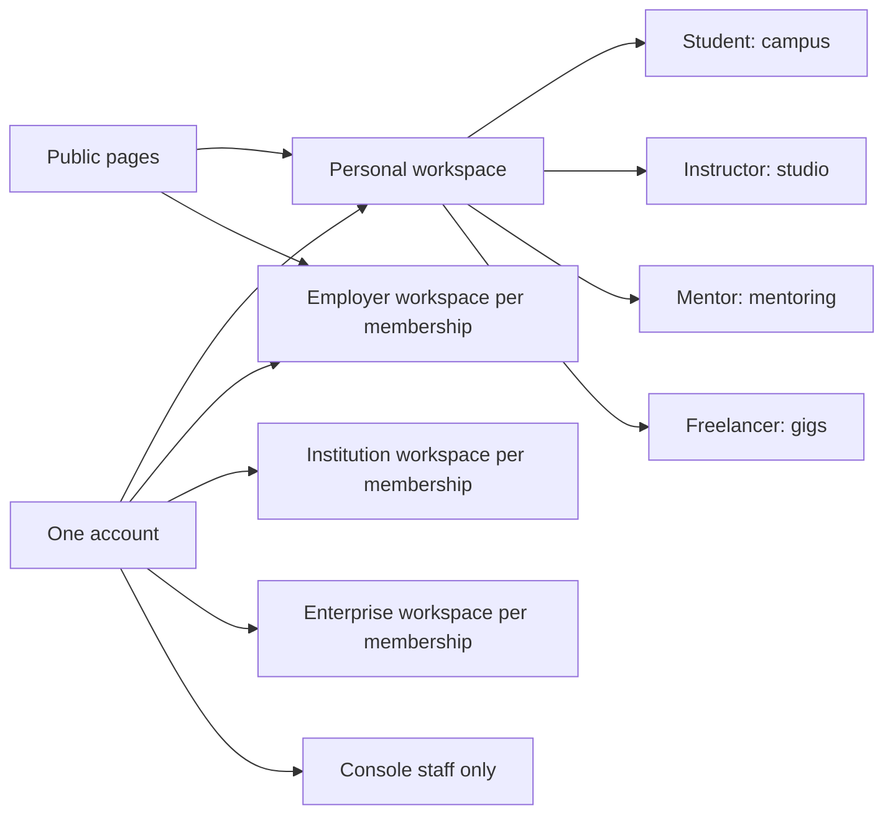

# 01 Information Architecture

Status: intended design. Nothing in this file claims that any screen, route or component is built. The as-built web app (`apps/web/src/App.tsx`, `apps/web/src/components/Layout.tsx`) is an input only: it has a one-row top header, about 25 routes and three navigation sets (public, candidate, hiring). The product described by this blueprint has 31 modules and 18 roles, which that shell cannot carry. This file defines the shell that can.

Shared by every module agent: the route namespaces in section 5, the navigation rules in sections 3 and 4, and the URL rules in section 8 are binding. A module's screen inventory (`02_MODULES/<CODE>_*.md` section 7) proposes routes only inside its reserved namespace. Where a module proposes something that conflicts, the namespace in this file wins and the conflict is recorded in section 14.

Evidence tags follow [CONVENTIONS](../00_START_HERE/CONVENTIONS.md). Rule ids in this file use the area code `IAX` (`NFR-IAX-nnn`).

## 1. Purpose and scope

The information architecture answers five questions for every person who signs in:

1. Where am I? (workspace, section, page, breadcrumb, document title)
2. What can I do here? (navigation filtered by role, membership and entitlement)
3. How do I get somewhere else quickly? (sidebar, tabs, command palette, global search, deep links)
4. Which hat am I wearing? (workspace switcher, role chip, staff banner)
5. What do I do first? (onboarding entry points, dashboard next-best-action)

In scope: sitemap, per-role navigation, global navigation patterns at three widths, workspace and role switching, command palette, breadcrumbs, URL conventions, deep links, onboarding entry points, legacy route mapping. Out of scope: the content of each screen (module files), component anatomy (`02_DESIGN_SYSTEM.md`), onboarding step design (`03_INTERACTION_PATTERNS.md` section 2).

## 2. Mental model: one account, many workspaces

[DER] A person has one account (IDN) and may hold several memberships. The shell organizes the product into **workspaces**. A workspace is a pair of (context, role set) that decides the navigation, the dashboard and the data in scope.

| Workspace   | URL prefix            | Who enters                                                                                                 | What it is                                                                                                                                                                                        |
| ----------- | --------------------- | ---------------------------------------------------------------------------------------------------------- | ------------------------------------------------------------------------------------------------------------------------------------------------------------------------------------------------- |
| Public      | none                  | Everyone, signed in or not                                                                                 | Marketing, search, job, course, company, mentor, gig, event and profile pages that are publicly indexable                                                                                         |
| Personal    | none (root paths)     | Every signed-in user                                                                                       | Candidate home. Carries optional capability sections: Student (campus), Instructor (studio), Mentor, Freelancer. Capabilities are sections inside the personal workspace, not separate workspaces |
| Employer    | `/employer/{org}`     | REC, HMG, EAD with a membership in that employer organization                                              | Hiring workspace for one employer organization                                                                                                                                                    |
| Institution | `/institution/{inst}` | IAD, PLO and institution-attached INS with a membership                                                    | Managed learning and placement workspace for one institution                                                                                                                                      |
| Enterprise  | `/enterprise/{org}`   | EXA with a membership                                                                                      | Internal mobility, skills and L&D workspace for one enterprise customer                                                                                                                           |
| Console     | `/console`            | MOD, SUP, FIN, PAD, SAD                                                                                    | Staff operations. Visually distinct (section 6.5)                                                                                                                                                 |
| Developers  | `/developers`         | Anyone for docs; EAD, IAD, EXA for credentials, which live inside their own workspace under `integrations` | Public API documentation and sandbox                                                                                                                                                              |

Rules:

- `NFR-IAX-001` A signed-in user always has the Personal workspace. It cannot be removed. Deleting the account is the only way out of it.
- `NFR-IAX-002` Capabilities (Student, Instructor, Mentor, Freelancer) add navigation groups to Personal. They never create a second login, second profile or second URL root.
- `NFR-IAX-003` Organization workspaces are addressed by membership, never by role alone. A user who is a Recruiter at Org A and a Hiring Manager at Org B sees two workspace entries.
- `NFR-IAX-004` Every route belongs to exactly one workspace. A screen that several workspaces need (messages, notifications, settings) exists once per workspace scope with a shared component, never as a route with a hidden mode.

### 2.1 Role to workspace map

| Role | Public | Personal                            | Employer      | Institution                      | Enterprise | Console                                                                                              |
| ---- | ------ | ----------------------------------- | ------------- | -------------------------------- | ---------- | ---------------------------------------------------------------------------------------------------- |
| GUE  | yes    | no                                  | no            | no                               | no         | no                                                                                                   |
| CAN  | yes    | yes                                 | no            | no                               | no         | no                                                                                                   |
| STD  | yes    | yes plus Campus section             | no            | no                               | no         | no                                                                                                   |
| INS  | yes    | yes plus Studio section             | no            | yes when attached (Faculty view) | no         | no                                                                                                   |
| MNT  | yes    | yes plus Mentoring (mentor) section | no            | no                               | no         | no                                                                                                   |
| FRL  | yes    | yes plus Gigs (freelancer) section  | no            | no                               | no         | no                                                                                                   |
| REC  | yes    | yes                                 | yes           | no                               | no         | no                                                                                                   |
| HMG  | yes    | yes                                 | yes (reduced) | no                               | no         | no                                                                                                   |
| EAD  | yes    | yes                                 | yes (full)    | no                               | no         | no                                                                                                   |
| IAD  | yes    | yes                                 | no            | yes (full)                       | no         | no                                                                                                   |
| PLO  | yes    | yes                                 | no            | yes (placement and read scope)   | no         | no                                                                                                   |
| EXA  | yes    | yes                                 | no            | no                               | yes        | no                                                                                                   |
| MOD  | yes    | yes                                 | no            | no                               | no         | yes (moderation)                                                                                     |
| SUP  | yes    | yes                                 | no            | no                               | no         | yes (support)                                                                                        |
| FIN  | yes    | yes                                 | no            | no                               | no         | yes (finance)                                                                                        |
| PAD  | yes    | yes                                 | no            | no                               | no         | yes (platform)                                                                                       |
| SAD  | yes    | yes                                 | no            | no                               | no         | yes (security, all read)                                                                             |
| API  | n/a    | n/a                                 | n/a           | n/a                              | n/a        | n/a: a service principal has no UI session; it is managed in the owning workspace under Integrations |

[DER] Staff roles also have the Personal workspace so they can use the product as a user, but staff accounts are separate identities from their personal accounts by default (`OD-UX-04`).

## 3. Global navigation patterns

### 3.1 Width classes

The shell has three layouts. Breakpoints are the as-built values in `packages/ui/src/tokens.ts` (`sm` 640, `md` 768, `lg` 1024, `xl` 1280, `2xl` 1536).

| Class   | Width       | Primary navigation                                               | Secondary                                                                     | Top bar                                                                                 |
| ------- | ----------- | ---------------------------------------------------------------- | ----------------------------------------------------------------------------- | --------------------------------------------------------------------------------------- |
| Phone   | 320 to 767  | Bottom tab bar, 5 slots                                          | Full-screen "More" or "Me" tab; section switch via top-of-page segmented tabs | App bar 56 px: back or logo, page title, search icon, bell                              |
| Tablet  | 768 to 1023 | Navigation rail 72 px, icon above label, up to 7 items plus More | Group flyout on tap; two-pane layouts for list/detail                         | Bar 56 px: workspace switcher, search field (collapses to icon below 900), bell, avatar |
| Desktop | 1024 and up | Sidebar 248 px, collapsible to 72 px rail                        | Sub-navigation as in-page tabs, never a second sidebar                        | Bar 64 px: breadcrumbs, search field (opens palette), "New" menu, help, bell, avatar    |
| Wide    | 1280 and up | Same as desktop                                                  | Optional right context panel 320 px for inspector, AI assistant or preview    | Same                                                                                    |

- `NFR-IAX-005` Phone is below 768, not below 640. Between 640 and 767 the layout is the phone layout with wider gutters and two-column card grids. Rationale: a 700 px device in portrait cannot host a 248 px sidebar and 400 px of content. [DER]
- `NFR-IAX-006` Public pages use a header (not a sidebar) at every width: logo, up to 5 text links, Sign in, Sign up. Below 1024 the links collapse into a menu button whose panel is a full-height drawer.
- `NFR-IAX-007` The signed-in shell is the same component tree at all widths. Only presentation changes. A route never exists on desktop and not on phone. (PWA parity rule; see `05_RESPONSIVE_MOBILE_PWA_UX.md`.)

### 3.2 Sidebar (Desktop)

Anatomy, top to bottom:

1. Brand row: logo mark (links to workspace dashboard), collapse toggle (button, `aria-expanded`, `aria-controls`).
2. Workspace switcher (section 6). Shows workspace name, role chip, and a caret.
3. Primary groups. Each group has an optional heading (overline text, `xs`, `wide` tracking) and 1 to 7 items. An item is icon (20 px), label, optional badge. Groups with more than 4 items may be collapsible; collapsed state persists per user per workspace in preferences (not `localStorage` alone; synced via settings so it follows the account across devices).
4. Spacer.
5. Utility group, pinned bottom: Help, Settings (or workspace Settings), collapse.
6. No profile card at the bottom. The account menu lives in the top bar (one place, not two).

Behaviour:

- Active item: `aria-current="page"`, 3 px leading bar in `--ts-color-action`, semibold label, `--ts-color-bg-selected` fill. Never color alone.
- Item states: default, hover, focus-visible (2 px focus ring, offset 2 px, inside the item bounds so it is not clipped), pressed, active (current), disabled (not used in nav; unavailable items are hidden or show a lock per `NFR-IAX-010`).
- Collapsed rail: label hidden visually, still exposed (`aria-label` on the link); a tooltip with the label appears on hover and on keyboard focus after 300 ms; badge dot replaces count.
- Group with a current child auto-expands on load and on route change.
- Landmarks: `<nav aria-label="Primary">`; the workspace switcher is a button inside it; the skip link "Skip to main content" is the first focusable element of the page and targets `<main id="main" tabindex="-1">`.
- Scroll: the sidebar scrolls independently when taller than the viewport; the brand row and the utility group are sticky.
- Resize: below 1024 the sidebar converts to the tablet rail without reload; the expanded/collapsed preference is ignored below 1024 and restored at or above it.

### 3.3 Navigation rail (Tablet)

- 72 px wide, up to 7 destinations plus a "More" item. Each item: 24 px icon over a 12 px label (labels never hidden on tablet). Group headings are not shown; groups appear as dividers.
- "More" opens a popover sheet anchored to the rail with the remaining destinations, grouped as in the sidebar.
- Landscape tablets at 1024 or wider get the sidebar. Rotating the device swaps layouts and preserves scroll position and unsaved form state (state lives in the route, not the shell).

### 3.4 Bottom tab bar (Phone)

- Exactly 5 slots. Height 56 px plus the safe-area inset. Each slot: icon 24 px, label 12 px (labels always visible), badge. Touch target at least 48 by 48 px (the slot is the full 20 percent width).
- The fifth slot is always "Me" (avatar or generic icon): it opens the Me screen, a full-screen list of every remaining destination, grouped as in the sidebar, plus Settings, Help, Switch workspace, Sign out.
- Tab semantics: this is navigation, not an ARIA tablist. Use `<nav aria-label="Primary">` with links; the current one has `aria-current="page"`.
- Tab switching preserves each tab's own scroll position and its last visited sub-route for the session (stack per tab). Tapping the active tab pops to that tab's root; tapping it again at the root scrolls to top.
- The bar hides on scroll down in long reading or media screens only if the screen spec says so (`SCR` field "Chrome"); it never hides on list or form screens. It is always hidden inside focused flows (assessment runner, interview room, course player fullscreen, checkout, wizards) where the screen spec declares `Chrome: focus`.
- The on-screen keyboard open state hides the bar (otherwise it jumps above the keyboard on some browsers).
- App bar (top): title is the page title (h1 is the same string); left slot is Back (if depth is 2 or more) else the logo; right slots are at most two icons (Search, Bell). Messages is a tab for most roles; where it is not, it is a third right-slot icon (see section 4).

### 3.5 Top bar contents (Desktop and Tablet)

| Slot    | Content                                                                              | Rule                                                                                                      |
| ------- | ------------------------------------------------------------------------------------ | --------------------------------------------------------------------------------------------------------- |
| Left    | Breadcrumbs (section 9), or page title only on root pages                            | Never both a breadcrumb and a duplicate title text                                                        |
| Center  | Global search field, 360 px, placeholder "Search or jump to" with `Ctrl K` hint chip | Clicking or focusing opens the command palette (section 7); it is not a separate inline search            |
| Right 1 | "New" menu button (context-sensitive create actions)                                 | Only when the workspace has at least 2 create actions; with one action, show that action's button instead |
| Right 2 | Help (opens help popover: shortcuts, contact support, help center)                   | Always present                                                                                            |
| Right 3 | Notifications bell with unread count badge                                           | Popover lists latest 8, "See all" goes to `/notifications`                                                |
| Right 4 | Avatar button opening the account menu                                               | Contents below                                                                                            |

Account menu items in order: name and email (non-interactive header), Profile (`/profile`), Settings, Switch workspace (if more than one, else hidden), Display (theme and density quick toggles), Keyboard shortcuts, Sign out. Staff: also "Exit staff mode" where applicable. The menu is a menu button pattern (section DS CMP-Menu).

### 3.6 "New" menu contents per workspace

| Workspace                | Actions (in order)                                                                                                      |
| ------------------------ | ----------------------------------------------------------------------------------------------------------------------- |
| Personal                 | Add work history, Upload evidence, Start application draft (opens Jobs), Write post, Request mentor session, New resume |
| Personal with Instructor | adds New course, New assessment                                                                                         |
| Personal with Freelancer | adds New gig proposal                                                                                                   |
| Employer                 | New job, Add candidate, Invite teammate (EAD), New talent pool, Schedule interview                                      |
| Institution              | Invite students, New cohort, New placement drive, Assign course                                                         |
| Enterprise               | New learning mandate, New internal job, Import people                                                                   |
| Console                  | Context-sensitive: New announcement (PAD), New macro (SUP), New policy (MOD), New flag (PAD)                            |

Each action appears only if the user holds the permission and the entitlement. Keyboard shortcut `c` opens the menu when focus is not in a text field (shortcut disable setting per `NFR-IAX-021`).

## 4. Per-role navigation

Conventions for this section:

- Item = label, route, module, badge rule. Labels use the term list in `06_CONTENT_AND_MICROCOPY_GUIDE.md` section 2.
- Desktop limits: at most 7 groups, at most 7 items per group, at most 24 items total in a workspace sidebar. Phone limit: 5 tabs.
- "Visibility" column: `always`, a permission, a capability flag, or an entitlement. Items hidden by permission are absent from the DOM (not `display:none`), because hidden-but-present items are announced by screen readers and leak the existence of features.
- Badge rules: a badge appears only for items with a user-actionable queue (unread, pending approval, due). Count shows `1` to `99`, then `99+`. Informational counts (number of jobs) never badge.

### 4.1 Guest (GUE), public header

Desktop header: logo, Jobs (`/jobs`), Courses (`/courses`), Mentors (`/mentors`), Companies (`/companies`), For employers (`/for-employers`), Sign in (`/login`), Sign up (primary button, `/signup`). "Pricing" is reached from For employers, For institutions and the footer (individual pricing is on `/pricing`). Footer groups: Product (Jobs, Courses, Mentors, Gigs, Events, Market insights), Solutions (For employers, For institutions, For enterprise), Company (About, Help, Status, Developers), Legal (Terms, Privacy, Cookies, Accessibility statement), language and region selector, theme toggle.

Search: header contains a search icon button opening the palette in "public search" scope (jobs, courses, companies, mentors only). Guests never see commands or private data.

### 4.2 Candidate (CAN), Personal workspace

| Group       | Item             | Route                 | Module   | Visibility                                        | Badge                                                                                                  |
| ----------- | ---------------- | --------------------- | -------- | ------------------------------------------------- | ------------------------------------------------------------------------------------------------------ |
| (none)      | Home             | `/dashboard`          | shell    | always                                            | none                                                                                                   |
| Jobs        | Find jobs        | `/jobs`               | JOB      | always                                            | none                                                                                                   |
| Jobs        | Applications     | `/applications`       | JOB      | always                                            | Count of applications needing candidate action (interview to confirm, offer to answer, info requested) |
| Jobs        | Interviews       | `/interviews`         | INT      | has at least one interview ever, or always [PROP] | Count of interviews to confirm                                                                         |
| Jobs        | Saved and alerts | `/jobs/saved`         | JOB      | always                                            | none                                                                                                   |
| Learn       | My learning      | `/learn`              | LRN      | always                                            | Count of overdue deadlines                                                                             |
| Learn       | Course catalog   | `/courses`            | LRN      | always                                            | none                                                                                                   |
| Learn       | Assessments      | `/assess`             | ASM      | always                                            | Count of invitations not started                                                                       |
| Learn       | Certificates     | `/learn/certificates` | LRN      | has at least one                                  | none                                                                                                   |
| Career      | Profile          | `/profile`            | PRF      | always                                            | none                                                                                                   |
| Career      | Evidence         | `/evidence`           | EVD      | always                                            | Count of items needing action (rejected, expiring)                                                     |
| Career      | Credentials      | `/credentials`        | EVD      | always                                            | Count expiring within 30 days [PROP]                                                                   |
| Career      | Verification     | `/verification`       | BGV      | has at least one check or request                 | Count of pending requests needing candidate consent                                                    |
| Career      | Career plan      | `/career`             | AIC, MKT | always                                            | none                                                                                                   |
| Community   | Network          | `/network`            | NET      | always                                            | Count of connection requests                                                                           |
| Community   | Mentors          | `/mentoring`          | MEN      | always                                            | Count of session requests or confirmations pending                                                     |
| Community   | Events           | `/events`             | EVT      | always                                            | none                                                                                                   |
| Community   | Reputation       | `/reputation`         | REP      | always                                            | none                                                                                                   |
| (top-level) | Messages         | `/messages`           | MSG      | always                                            | Unread conversation count                                                                              |
| Utility     | Billing          | `/billing`            | BIL      | always                                            | Dot when payment failed                                                                                |
| Utility     | Settings         | `/settings`           | SET      | always                                            | Dot when a consent or security action is required                                                      |
| Utility     | Help             | `/help`               | ADM      | always                                            | none                                                                                                   |

That is 22 items in 5 groups; it is within the limits. Notifications are not a sidebar item: they are the top-bar bell plus `/notifications`.

Phone tabs for CAN: Home, Jobs, Learn, Messages, Me. "Jobs" tab root is `/jobs` with a segmented control (Find, Applications, Saved); "Learn" tab root is `/learn`. "Me" lists: Profile, Evidence, Credentials, Verification, Career plan, Network, Mentors, Events, Reputation, Interviews, Notifications, Billing, Settings, Help, Switch workspace, Sign out.

### 4.3 Student (STD)

Same as CAN, plus a leading group "Campus" (institution name shown as group heading):

| Item                  | Route                 | Module   | Visibility                                | Badge                      |
| --------------------- | --------------------- | -------- | ----------------------------------------- | -------------------------- |
| Campus home           | `/campus`             | INS      | STD capability active                     | Count of new announcements |
| My courses (assigned) | `/campus/courses`     | INS, LRN | STD                                       | Count overdue              |
| My cohort             | `/campus/cohort`      | INS      | STD                                       | none                       |
| Placement drives      | `/campus/drives`      | INS, JOB | STD and institution has placement enabled | Count of drives open to me |
| Campus assessments    | `/campus/assessments` | INS, ASM | STD                                       | Count due                  |

Phone tabs for STD: Home, Campus, Learn, Jobs, Me. Messages opens from the app bar icon (third right-slot icon). Rule `NFR-IAX-008`: when a role's tab bar cannot hold Messages, Messages MUST appear in the app bar of every tab root.

A student who leaves the institution (membership ends) loses the Campus group on the next session refresh; their learning records remain under Learn with an "Archived from {institution}" label. [DER]

### 4.4 Instructor (INS), Personal workspace plus Studio

Adds group "Teach" at the top of the CAN sidebar:

| Item        | Route                 | Module   | Visibility            | Badge                               |
| ----------- | --------------------- | -------- | --------------------- | ----------------------------------- |
| Studio home | `/studio`             | STU      | INS capability        | none                                |
| My courses  | `/studio/courses`     | STU      | INS                   | Count of courses in review feedback |
| Learners    | `/studio/learners`    | STU, LRN | INS                   | none                                |
| Grading     | `/studio/grading`     | STU, ASM | INS                   | Count awaiting grade                |
| Discussions | `/studio/discussions` | STU, LRN | INS                   | Count unanswered questions          |
| Reviews     | `/studio/reviews`     | STU      | INS                   | none                                |
| Earnings    | `/studio/earnings`    | STU, BIL | INS with paid courses | none                                |
| Analytics   | `/studio/analytics`   | STU, ANL | INS                   | none                                |

Phone tabs for INS: Home, Studio, Grading, Messages, Me. Learn and Jobs are in Me. Rationale: an instructor's recurring work is grading and answering; learning is secondary. [DER]

Instructors attached to an institution additionally see the institution's Faculty workspace in the workspace switcher (section 4.12).

### 4.5 Mentor (MNT), Personal workspace plus Mentoring

Adds group "Mentor":

| Item               | Route                            | Module   | Visibility           | Badge                           |
| ------------------ | -------------------------------- | -------- | -------------------- | ------------------------------- |
| Mentor home        | `/mentoring/mentor`              | MEN      | MNT capability       | none                            |
| Requests           | `/mentoring/mentor/requests`     | MEN      | MNT                  | Count pending                   |
| Sessions           | `/mentoring/mentor/sessions`     | MEN      | MNT                  | Count today                     |
| Mentees            | `/mentoring/mentor/mentees`      | MEN      | MNT                  | none                            |
| Availability       | `/mentoring/mentor/availability` | MEN, INT | MNT                  | Dot when no future availability |
| Offers and pricing | `/mentoring/mentor/offers`       | MEN, BIL | MNT                  | none                            |
| Earnings           | `/mentoring/mentor/earnings`     | MEN, BIL | MNT with paid offers | none                            |
| Reviews            | `/mentoring/mentor/reviews`      | MEN      | MNT                  | none                            |

Phone tabs for MNT: Home, Sessions, Requests, Messages, Me.

### 4.6 Freelancer (FRL), Personal workspace plus Gigs

Adds group "Freelance" (shown when gig mode is on in `/settings/account`):

| Item         | Route                | Module   | Visibility | Badge                                      |
| ------------ | -------------------- | -------- | ---------- | ------------------------------------------ |
| Find gigs    | `/gigs`              | GIG      | FRL        | none                                       |
| My proposals | `/gigs/my/proposals` | GIG      | FRL        | Count with client replies                  |
| Contracts    | `/gigs/my/contracts` | GIG      | FRL        | Count needing action (milestone to submit) |
| Earnings     | `/gigs/my/earnings`  | GIG, BIL | FRL        | none                                       |
| Gig profile  | `/gigs/my/profile`   | GIG, PRF | FRL        | none                                       |

Phone tabs for FRL: Home, Gigs, Contracts, Messages, Me.

### 4.7 Recruiter (REC), Employer workspace

Prefix `/employer/{org}`.

| Group    | Item                  | Route (after prefix) | Module     | Visibility                  | Badge                               |
| -------- | --------------------- | -------------------- | ---------- | --------------------------- | ----------------------------------- |
| (none)   | Home                  | `/dashboard`         | shell, ANL | always                      | none                                |
| Hiring   | Jobs                  | `/jobs`              | ATS        | always                      | none                                |
| Hiring   | Applications          | `/applications`      | ATS        | always                      | Count of new, unreviewed            |
| Hiring   | Interviews            | `/interviews`        | INT        | always                      | Count to schedule                   |
| Hiring   | Offers                | `/offers`            | ATS        | always                      | Count awaiting approval or response |
| Sourcing | Candidate search      | `/candidates`        | SRC, ATS   | entitlement `talent_search` | none                                |
| Sourcing | Talent pools          | `/pools`             | ATS        | always                      | none                                |
| Sourcing | Outreach              | `/sourcing`          | ATS, MSG   | entitlement `outreach`      | Count of replies                    |
| Hiring   | Assessments           | `/assessments`       | ASM        | always                      | none                                |
| Insights | Reports               | `/reports`           | ANL        | always                      | none                                |
| Insights | Referrals             | `/referrals`         | NET        | referral program on         | Count new                           |
| Brand    | Company page          | `/brand`             | EMP        | always                      | none                                |
| Brand    | Events and hackathons | `/events`            | EVT        | entitlement                 | none                                |
| Brand    | Gigs                  | `/gigs`              | GIG        | entitlement                 | none                                |
| Utility  | Messages              | `/messages`          | MSG        | always                      | Unread                              |
| Utility  | Settings              | `/settings`          | EMP        | always                      | none                                |

Phone tabs for REC: Home, Applications, Interviews, Messages, Me. Jobs and the pipeline are reached from Home cards and Applications filters; the pipeline board on phone is a column-per-screen view (see `07_SCREEN_STATE_CHECKLIST.md` REFSCR-07).

### 4.8 Hiring Manager (HMG), Employer workspace (reduced)

| Group    | Item              | Route (after prefix)         | Visibility                              | Badge                        |
| -------- | ----------------- | ---------------------------- | --------------------------------------- | ---------------------------- |
| (none)   | Home              | `/dashboard`                 | always                                  | none                         |
| Hiring   | My jobs           | `/jobs?scope=mine`           | HMG owns or is assigned to at least one | none                         |
| Hiring   | To review         | `/applications?scope=review` | always                                  | Count assigned for my review |
| Hiring   | Interviews        | `/interviews?scope=mine`     | always                                  | Count to prepare or score    |
| Hiring   | Offers to approve | `/offers?scope=approvals`    | always                                  | Count pending my approval    |
| Insights | Reports           | `/reports?scope=mine`        | always                                  | none                         |
| Utility  | Messages          | `/messages`                  | always                                  | Unread                       |

An HMG never sees candidate search, pools, outreach, brand, integrations, billing or team administration. Phone tabs: Home, To review, Interviews, Messages, Me.

### 4.9 Employer Admin (EAD)

All REC items plus group "Organization":

| Item                      | Route (after prefix) | Module   | Badge                            |
| ------------------------- | -------------------- | -------- | -------------------------------- |
| Team and roles            | `/team`              | EMP      | Count pending invitations        |
| Departments               | `/team/departments`  | EMP      | none                             |
| Hiring plans and requests | `/jobs/requests`     | ATS, EMP | Count requests to approve [PROP] |
| Integrations              | `/integrations`      | PLT      | Dot on failing integration       |
| Billing and plan          | `/billing`           | BIL      | Dot on payment failure           |
| Compliance                | `/compliance`        | EMP, SET | none                             |
| Audit log                 | `/audit`             | EMP      | none                             |

Phone tabs for EAD: Home, Applications, Team, Messages, Me.

### 4.10 Institution Admin (IAD)

Prefix `/institution/{inst}`.

| Group        | Item                       | Route (after prefix)  | Module   | Badge                              |
| ------------ | -------------------------- | --------------------- | -------- | ---------------------------------- |
| (none)       | Home                       | `/dashboard`          | INS, ANL | none                               |
| People       | Students                   | `/students`           | INS      | Count pending enrollment approvals |
| People       | Cohorts                    | `/cohorts`            | INS      | none                               |
| People       | Faculty                    | `/faculty`            | INS      | Count pending invitations          |
| Learning     | Courses                    | `/courses`            | INS, LRN | none                               |
| Learning     | Programs                   | `/programs`           | INS      | none                               |
| Learning     | Assessments                | `/assessments`        | INS, ASM | none                               |
| Learning     | Progress and interventions | `/progress`           | INS, ANL | Count at-risk                      |
| Placement    | Drives                     | `/placement/drives`   | INS, JOB | none                               |
| Placement    | Partner employers          | `/placement/partners` | INS      | Count pending requests             |
| Placement    | Outcomes                   | `/placement/outcomes` | INS, ANL | none                               |
| Organization | Licensing and seats        | `/licensing`          | INS, BIL | Dot at 90 percent seat use [PROP]  |
| Organization | Public page                | `/brand`              | INS      | none                               |
| Organization | Integrations               | `/integrations`       | PLT      | Dot on failure                     |
| Organization | Reports                    | `/reports`            | ANL      | none                               |
| Utility      | Announcements              | `/announcements`      | INS, NTF | none                               |
| Utility      | Messages                   | `/messages`           | MSG      | Unread                             |
| Utility      | Settings and audit         | `/settings`           | INS      | none                               |

### 4.11 Placement Officer (PLO)

Institution workspace subset: Home, Students (read, filtered to the officer's assigned cohorts), Drives, Partner employers, Outcomes, Reports, Messages. No Licensing, Faculty, Integrations, Settings. Phone tabs: Home, Drives, Students, Messages, Me.

### 4.12 Instructor in an institution (INS, Faculty view)

Institution workspace subset: Home, My courses (`/courses?scope=mine`), Cohorts (`/cohorts?scope=mine`), Progress and interventions, Assessments, Announcements, Messages. This view is for managing assigned institutional learning; authoring still happens in `/studio`. A course authored in Studio and assigned to an institution is shown with a link back to Studio.

### 4.13 Enterprise Admin (EXA)

Prefix `/enterprise/{org}`.

| Group        | Item                | Route (after prefix)       | Module   | Badge                 |
| ------------ | ------------------- | -------------------------- | -------- | --------------------- |
| (none)       | Home                | `/dashboard`               | ENT, ANL | none                  |
| Skills       | Skills inventory    | `/skills`                  | ENT      | none                  |
| Skills       | Skill gaps          | `/skills/gaps`             | ENT, MKT | none                  |
| Mobility     | Internal jobs       | `/mobility/jobs`           | ENT, JOB | Count of applications |
| Mobility     | Talent matches      | `/mobility/matches`        | ENT, AIC | none                  |
| Mobility     | Succession          | `/mobility/succession`     | ENT      | none                  |
| Learning     | Mandates            | `/learning/mandates`       | ENT, LRN | Count overdue         |
| Learning     | Programs            | `/learning/programs`       | ENT, LRN | none                  |
| Learning     | Certifications      | `/learning/certifications` | ENT, LRN | Count expiring        |
| People       | Directory           | `/people`                  | ENT      | none                  |
| Organization | Reports and impact  | `/reports`                 | ANL      | none                  |
| Organization | Integrations (HRIS) | `/integrations`            | PLT      | Dot on sync failure   |
| Organization | Billing             | `/billing`                 | BIL      | none                  |
| Organization | Settings and audit  | `/settings`                | ENT      | none                  |
| Utility      | Messages            | `/messages`                | MSG      | Unread                |

Boundary: [SRC: SSOT §4.2] non-goal "not generic HR/payroll". The Directory is a read model of people and skills synced from an HRIS for skills and mobility purposes. It has no payroll, leave, time or performance-review functions (`OD-UX-05`).

### 4.14 Console (MOD, SUP, FIN, PAD, SAD)

Prefix `/console`. The sidebar groups are visible per permission; a user with several staff roles sees the union.

| Group            | Item                    | Route (after prefix)      | Role            | Module   |
| ---------------- | ----------------------- | ------------------------- | --------------- | -------- |
| (none)           | Console home            | `/dashboard`              | all staff       | ADM      |
| Trust and safety | Moderation queue        | `/moderation`             | MOD, PAD        | TSF      |
| Trust and safety | Cases                   | `/moderation/cases`       | MOD, PAD        | TSF      |
| Trust and safety | Appeals                 | `/moderation/appeals`     | MOD, PAD        | TSF      |
| Trust and safety | Policies and rules      | `/moderation/policies`    | MOD (read), PAD | TSF      |
| Support          | Tickets                 | `/support/tickets`        | SUP, PAD        | ADM      |
| Support          | Account lookup          | `/support/users`          | SUP, PAD        | ADM      |
| Support          | Organizations           | `/support/orgs`           | SUP, PAD        | ADM      |
| Support          | Verification cases      | `/support/verification`   | SUP, PAD        | BGV      |
| Support          | Macros and help center  | `/support/content`        | SUP, PAD        | ADM      |
| Finance          | Payments and refunds    | `/finance/payments`       | FIN, PAD        | BIL      |
| Finance          | Payouts                 | `/finance/payouts`        | FIN             | BIL      |
| Finance          | Invoices and tax        | `/finance/invoices`       | FIN             | BIL      |
| Finance          | Reconciliation          | `/finance/reconciliation` | FIN             | BIL      |
| Platform         | Users and organizations | `/platform/accounts`      | PAD             | ADM      |
| Platform         | Catalog and taxonomy    | `/platform/catalog`       | PAD             | LRN, MKT |
| Platform         | Plans and entitlements  | `/platform/plans`         | PAD             | BIL      |
| Platform         | Feature flags           | `/platform/flags`         | PAD             | ADM      |
| Platform         | Announcements           | `/platform/announcements` | PAD             | NTF      |
| Platform         | Templates               | `/platform/templates`     | PAD             | NTF      |
| Platform         | Background jobs         | `/platform/jobs`          | PAD             | ADM      |
| Platform         | Data requests           | `/platform/data-requests` | PAD, SAD        | SET      |
| Security         | Audit log               | `/security/audit`         | SAD, PAD (read) | ADM      |
| Security         | Access reviews          | `/security/access`        | SAD             | ADM      |
| Security         | Sessions and devices    | `/security/sessions`      | SAD             | IDN      |
| Security         | Incidents               | `/security/incidents`     | SAD             | ADM      |
| Security         | Break-glass             | `/security/break-glass`   | SAD             | ADM      |

Rules:

- `NFR-IAX-009` The console shell has a 4 px top stripe in `--ts-color-staff` and the persistent text chip "Staff" next to the logo on every console page, so a staff member can never confuse it with the product. The stripe is not the sole signal: the chip and the document title prefix "Console" carry the same information.
- Phone: the console is usable on phone for MOD queue review, SUP tickets and FIN approvals (responsive), but PAD and SAD configuration screens show a notice "Open this on a larger screen to change settings" with the read-only view available. [DER]
- Sensitive routes (`/console/security/*`, `/console/finance/payouts`, `/console/platform/plans`) require step-up authentication: when the last strong authentication is older than the configured window (default 15 minutes [PROP], `OD-UX-06`), the route renders the re-authentication screen in place and resumes on success.

### 4.15 Item visibility rules (all workspaces)

- `NFR-IAX-010` Permission missing: the item is absent. Entitlement missing but purchasable by this user: the item is present with a lock icon and the label suffix "(Plan)" exposed through `aria-label`; activating it opens the upgrade screen in context (`BIL`). Entitlement missing and not purchasable by this user (for example an HMG without the right): absent.
- `NFR-IAX-011` A feature flag off for the user removes the item entirely; there is no "coming soon" item in navigation. Roadmap messaging lives on public pages only.
- `NFR-IAX-012` The nav is computed from a single manifest (role, capability, membership, entitlement, flag) evaluated on the server in the session bootstrap response, so the client never guesses. The client re-renders when the manifest changes via real-time update (section 6.4). Direct URL access to a hidden item is still authorized server-side (never rely on nav hiding).
- `NFR-IAX-013` Every item has a stable `data-testid` of the form `nav-{workspace}-{item-slug}` for tests.

## 5. Sitemap and route reservation

Column "Auth": `P` public (no session), `S` any signed-in user, a role list means those roles only (and the server enforces it). "Shell" is the chrome used: `pub` public header, `app` signed-in shell, `focus` chrome-free focused flow. Module is the owning module (`02_MODULES/<CODE>_*.md`). Routes are proposals that module agents refine **inside** their namespace; the namespace itself is reserved here.

Dynamic segments: `{id}` is an opaque id, `{slug}` a human slug, `{slug}-{id}` a canonical public pair (section 8.3), `{org}` and `{inst}` are organization slugs.

### 5.1 Public and authentication

| Route                                                                           | Screen                                                                                                       | Auth                                                              | Shell         | Module     |
| ------------------------------------------------------------------------------- | ------------------------------------------------------------------------------------------------------------ | ----------------------------------------------------------------- | ------------- | ---------- |
| `/`                                                                             | Landing                                                                                                      | P (signed-in users are offered "Go to dashboard", not redirected) | pub           | shell      |
| `/jobs`                                                                         | Job search                                                                                                   | P                                                                 | pub or app    | JOB        |
| `/jobs/{slug}-{id}`                                                             | Job detail                                                                                                   | P                                                                 | pub or app    | JOB        |
| `/companies`, `/companies/{slug}`                                               | Company directory, company page                                                                              | P                                                                 | pub or app    | EMP        |
| `/courses`, `/courses/{slug}-{id}`                                              | Course catalog, course landing page                                                                          | P                                                                 | pub or app    | LRN        |
| `/paths/{slug}-{id}`                                                            | Learning path landing page                                                                                   | P                                                                 | pub or app    | LRN        |
| `/mentors`, `/mentors/{handle}`                                                 | Mentor directory, mentor page                                                                                | P                                                                 | pub or app    | MEN        |
| `/gigs`, `/gigs/{slug}-{id}`                                                    | Gig search, gig detail                                                                                       | P                                                                 | pub or app    | GIG        |
| `/events`, `/events/{slug}-{id}`                                                | Event and hackathon list, detail                                                                             | P                                                                 | pub or app    | EVT        |
| `/institutions/{slug}`                                                          | Institution public page                                                                                      | P                                                                 | pub or app    | INS        |
| `/u/{handle}`                                                                   | Public profile                                                                                               | P (subject to profile visibility)                                 | pub or app    | PRF        |
| `/u/{handle}/portfolio`                                                         | Public portfolio                                                                                             | P (subject to visibility)                                         | pub or app    | PRF        |
| `/market/roles/{slug}`, `/market/skills/{slug}`                                 | Role and skill insight pages                                                                                 | P                                                                 | pub or app    | MKT        |
| `/verify/{code}`                                                                | Credential and evidence verification result                                                                  | P                                                                 | pub           | EVD, BGV   |
| `/search`                                                                       | Search results (`?q=&type=`)                                                                                 | P                                                                 | pub or app    | SRC        |
| `/pricing`, `/for-employers`, `/for-institutions`, `/for-enterprise`            | Marketing pages                                                                                              | P                                                                 | pub           | BIL, shell |
| `/about`, `/help`, `/help/{slug}`                                               | About, help center, article                                                                                  | P                                                                 | pub or app    | ADM        |
| `/legal/terms`, `/legal/privacy`, `/legal/cookies`, `/legal/accessibility`      | Legal documents                                                                                              | P                                                                 | pub           | SET        |
| `/developers`, `/developers/{slug}`                                             | API docs, guides                                                                                             | P                                                                 | pub           | PLT        |
| `/status`                                                                       | Platform status (may redirect to a status host)                                                              | P                                                                 | pub           | ADM        |
| `/login`                                                                        | Sign in                                                                                                      | P                                                                 | pub (minimal) | IDN        |
| `/signup`, `/signup/{intent}`                                                   | Sign up; `intent` in `candidate`, `student`, `employer`, `institution`, `mentor`, `instructor`, `enterprise` | P                                                                 | pub (minimal) | IDN        |
| `/auth/mfa`, `/auth/reset`, `/auth/reset/{token}`, `/auth/verify-email/{token}` | Authentication flows                                                                                         | P                                                                 | pub (minimal) | IDN        |
| `/auth/sso/{provider}`, `/auth/sso/callback`                                    | SSO start and return                                                                                         | P                                                                 | none          | IDN        |
| `/invite/{token}`                                                               | Accept an invitation (organization, institution, cohort, interview, mentor)                                  | P then S                                                          | pub (minimal) | IDN        |
| `/signed-out`                                                                   | Confirmation after sign-out                                                                                  | P                                                                 | pub           | IDN        |
| `/offline`                                                                      | Offline fallback page (served by the service worker)                                                         | P                                                                 | none          | PWA        |
| `/maintenance`                                                                  | Maintenance page (served at the edge during planned work)                                                    | P                                                                 | none          | ADM        |

### 5.2 Personal workspace (signed in)

| Route                                                                                                                                                                                                                                         | Screen                                                                          | Auth | Module        |
| --------------------------------------------------------------------------------------------------------------------------------------------------------------------------------------------------------------------------------------------- | ------------------------------------------------------------------------------- | ---- | ------------- |
| `/dashboard`                                                                                                                                                                                                                                  | Home                                                                            | S    | shell         |
| `/profile`, `/profile/edit/{section}`, `/profile/preview`                                                                                                                                                                                     | Own profile, section editor, preview as recruiter sees it                       | S    | PRF           |
| `/profile/resumes`, `/profile/resumes/{id}`                                                                                                                                                                                                   | Resumes, resume editor                                                          | S    | PRF           |
| `/profile/portfolio`, `/profile/portfolio/{id}`                                                                                                                                                                                               | Portfolio, project                                                              | S    | PRF           |
| `/evidence`, `/evidence/{id}`, `/evidence/new/{step}`                                                                                                                                                                                         | Work history and evidence list, item, add wizard                                | S    | EVD           |
| `/credentials`, `/credentials/{id}`                                                                                                                                                                                                           | Credentials wallet, credential                                                  | S    | EVD           |
| `/verification`, `/verification/{id}`                                                                                                                                                                                                         | My verification and background checks                                           | S    | BGV           |
| `/jobs/saved`, `/jobs/alerts`                                                                                                                                                                                                                 | Saved jobs, job alerts                                                          | S    | JOB           |
| `/applications`, `/applications/{id}`, `/applications/new/{jobId}/{step}`                                                                                                                                                                     | Application tracker, application detail, apply wizard                           | S    | JOB           |
| `/interviews`, `/interviews/{id}`, `/interviews/{id}/room`                                                                                                                                                                                    | Interviews, detail, live room                                                   | S    | INT           |
| `/offers`, `/offers/{id}`                                                                                                                                                                                                                     | Offers received, offer detail                                                   | S    | ATS, JOB      |
| `/learn`                                                                                                                                                                                                                                      | My learning home                                                                | S    | LRN           |
| `/learn/courses/{id}`                                                                                                                                                                                                                         | Enrolled course home                                                            | S    | LRN           |
| `/learn/courses/{id}/lessons/{lessonId}`                                                                                                                                                                                                      | Course player                                                                   | S    | LRN           |
| `/learn/courses/{id}/assignments/{assignmentId}`                                                                                                                                                                                              | Assignment                                                                      | S    | LRN           |
| `/learn/paths`, `/learn/paths/{id}`                                                                                                                                                                                                           | My paths, path progress                                                         | S    | LRN           |
| `/learn/certificates`, `/learn/certificates/{id}`                                                                                                                                                                                             | Certificates                                                                    | S    | LRN           |
| `/learn/notes`                                                                                                                                                                                                                                | My notes and bookmarks                                                          | S    | LRN           |
| `/assess`, `/assess/invitations`                                                                                                                                                                                                              | Assessments hub, invitations                                                    | S    | ASM           |
| `/assess/{attemptId}/start`, `/assess/{attemptId}/run`, `/assess/{attemptId}/results`                                                                                                                                                         | Pre-check, runner, results                                                      | S    | ASM           |
| `/assess/challenges`, `/assess/challenges/{id}`                                                                                                                                                                                               | Challenges and contests                                                         | S    | ASM           |
| `/assess/accommodations`                                                                                                                                                                                                                      | Request and manage accommodations                                               | S    | ASM, SET      |
| `/career`, `/career/assistant`, `/career/goals`, `/career/readiness`, `/career/plan`, `/career/market`, `/career/recommendations`                                                                                                             | Career hub, AI assistant, goals, readiness, plan, market, recommendations       | S    | AIC, MKT      |
| `/network`, `/network/connections`, `/network/invitations`, `/network/people`, `/network/groups`, `/network/groups/{slug}`, `/network/posts/{id}`, `/network/referrals`                                                                       | Feed, connections, invitations, discover people, groups, group, post, referrals | S    | NET           |
| `/messages`, `/messages/{conversationId}`, `/messages/requests`                                                                                                                                                                               | Inbox, conversation, message requests                                           | S    | MSG           |
| `/notifications`                                                                                                                                                                                                                              | Notification center                                                             | S    | NTF           |
| `/events/my`, `/events/{slug}-{id}/team`                                                                                                                                                                                                      | My events, hackathon team space                                                 | S    | EVT           |
| `/mentoring`, `/mentoring/sessions`, `/mentoring/sessions/{id}`, `/mentoring/my-mentors`                                                                                                                                                      | Mentee home, sessions, session, my mentors                                      | S    | MEN           |
| `/mentoring/mentor/...`                                                                                                                                                                                                                       | Mentor sections (section 4.5)                                                   | MNT  | MEN           |
| `/gigs/my/...`                                                                                                                                                                                                                                | Freelancer sections (section 4.6)                                               | FRL  | GIG           |
| `/studio/...`                                                                                                                                                                                                                                 | Studio sections (section 4.4)                                                   | INS  | STU           |
| `/studio/courses/{id}/edit`, `/studio/courses/{id}/edit/{step}`                                                                                                                                                                               | Course editor, step                                                             | INS  | STU           |
| `/campus`, `/campus/courses`, `/campus/cohort`, `/campus/drives`, `/campus/assessments`                                                                                                                                                       | Student campus                                                                  | STD  | INS           |
| `/reputation`, `/reputation/badges`, `/reputation/leaderboards`                                                                                                                                                                               | Reputation, badges, leaderboards                                                | S    | REP           |
| `/settings/account`, `/settings/security`, `/settings/privacy`, `/settings/consent`, `/settings/notifications`, `/settings/connected-accounts`, `/settings/accessibility`, `/settings/language`, `/settings/data`, `/settings/accommodations` | Settings sections                                                               | S    | IDN, SET, NTF |
| `/billing`, `/billing/invoices`, `/billing/payment-methods`, `/billing/plans`                                                                                                                                                                 | Billing                                                                         | S    | BIL           |
| `/help/contact`, `/help/tickets`, `/help/tickets/{id}`                                                                                                                                                                                        | Contact support, my tickets                                                     | S    | ADM           |

### 5.3 Employer workspace (prefix `/employer/{org}`)

| Route (after prefix)                                                                                                           | Screen                                                                             | Roles                   | Module   |
| ------------------------------------------------------------------------------------------------------------------------------ | ---------------------------------------------------------------------------------- | ----------------------- | -------- |
| `/dashboard`                                                                                                                   | Employer home                                                                      | REC, HMG, EAD           | ANL, ATS |
| `/jobs`, `/jobs/new/{step}`, `/jobs/requests`                                                                                  | Jobs list, create wizard, hiring requests                                          | REC, EAD; HMG scoped    | ATS, JOB |
| `/jobs/{id}`, `/jobs/{id}/pipeline`, `/jobs/{id}/applicants`, `/jobs/{id}/edit`, `/jobs/{id}/scorecard`, `/jobs/{id}/settings` | Job overview, pipeline board, applicant list, edit, scorecard design, job settings | REC, EAD; HMG scoped    | ATS      |
| `/applications`, `/applications/{id}`                                                                                          | All applications, application review                                               | REC, EAD; HMG scoped    | ATS      |
| `/candidates`, `/candidates/{profileId}`                                                                                       | Candidate search, candidate profile view                                           | REC, EAD                | SRC, ATS |
| `/pools`, `/pools/{id}`, `/sourcing`, `/sourcing/{campaignId}`                                                                 | Talent pools, pool, outreach campaigns, campaign                                   | REC, EAD                | ATS      |
| `/interviews`, `/interviews/{id}`, `/interviews/{id}/room`, `/interviews/availability`                                         | Interviews, interview, live room, interviewer availability                         | REC, HMG, EAD           | INT      |
| `/offers`, `/offers/{id}`                                                                                                      | Offers, offer                                                                      | REC, EAD; HMG approvals | ATS      |
| `/assessments`, `/assessments/{id}`, `/assessments/{id}/results/{attemptId}`                                                   | Assessment library, assessment, candidate result                                   | REC, EAD                | ASM      |
| `/reports`, `/reports/{id}`                                                                                                    | Reports, report                                                                    | REC, HMG, EAD           | ANL      |
| `/referrals`                                                                                                                   | Referrals                                                                          | REC, EAD                | NET      |
| `/brand`, `/brand/careers-site`                                                                                                | Company page editor, careers site                                                  | EAD, REC                | EMP      |
| `/events`, `/gigs`                                                                                                             | Employer events and hackathons, gigs                                               | REC, EAD                | EVT, GIG |
| `/messages`, `/messages/{conversationId}`                                                                                      | Org inbox                                                                          | REC, HMG, EAD           | MSG      |
| `/team`, `/team/roles`, `/team/departments`, `/team/invitations`                                                               | Team, role definitions, departments, invitations                                   | EAD                     | EMP      |
| `/integrations`, `/integrations/api`, `/integrations/webhooks`                                                                 | Integrations, API keys, webhooks                                                   | EAD                     | PLT      |
| `/billing`, `/billing/invoices`                                                                                                | Plan and invoices                                                                  | EAD                     | BIL      |
| `/compliance`                                                                                                                  | EEO, retention, data requests                                                      | EAD                     | EMP, SET |
| `/audit`                                                                                                                       | Org audit log                                                                      | EAD                     | EMP      |
| `/settings`                                                                                                                    | Org settings                                                                       | EAD                     | EMP      |

### 5.4 Institution workspace (prefix `/institution/{inst}`)

| Route (after prefix)                                                                        | Screen                                     | Roles                | Module   |
| ------------------------------------------------------------------------------------------- | ------------------------------------------ | -------------------- | -------- |
| `/dashboard`                                                                                | Institution home                           | IAD, PLO, INS        | INS, ANL |
| `/students`, `/students/{id}`, `/students/import`                                           | Students, student, bulk import             | IAD; PLO scoped read | INS      |
| `/cohorts`, `/cohorts/{id}`                                                                 | Cohorts, cohort                            | IAD; INS scoped      | INS      |
| `/faculty`, `/faculty/{id}`                                                                 | Faculty                                    | IAD                  | INS      |
| `/courses`, `/courses/{id}`                                                                 | Institutional courses, course              | IAD; INS scoped      | INS, LRN |
| `/programs`, `/programs/{id}`                                                               | Programs                                   | IAD                  | INS      |
| `/assessments`, `/assessments/{id}`                                                         | Assessments                                | IAD; INS scoped      | INS, ASM |
| `/progress`, `/progress/interventions`                                                      | Progress, at-risk and interventions        | IAD; INS scoped      | INS, ANL |
| `/placement/drives`, `/placement/drives/{id}`, `/placement/partners`, `/placement/outcomes` | Drives, drive, partner employers, outcomes | IAD, PLO             | INS      |
| `/licensing`, `/licensing/seats`                                                            | Licenses, seats                            | IAD                  | INS, BIL |
| `/brand`                                                                                    | Public page editor                         | IAD                  | INS      |
| `/integrations`                                                                             | SIS and LMS integrations                   | IAD                  | PLT      |
| `/reports`, `/reports/{id}`                                                                 | Reports                                    | IAD, PLO scoped      | ANL      |
| `/announcements`                                                                            | Announcements                              | IAD, INS scoped      | NTF      |
| `/messages`                                                                                 | Institution inbox                          | IAD, PLO, INS        | MSG      |
| `/settings`, `/audit`                                                                       | Settings, audit log                        | IAD                  | INS      |

### 5.5 Enterprise workspace (prefix `/enterprise/{org}`)

| Route (after prefix)                                                                 | Screen                                   | Module        |
| ------------------------------------------------------------------------------------ | ---------------------------------------- | ------------- |
| `/dashboard`                                                                         | Enterprise home                          | ENT, ANL      |
| `/skills`, `/skills/gaps`, `/skills/taxonomy`                                        | Skills inventory, gaps, taxonomy mapping | ENT           |
| `/mobility/jobs`, `/mobility/jobs/{id}`, `/mobility/matches`, `/mobility/succession` | Internal jobs, job, matches, succession  | ENT           |
| `/learning/mandates`, `/learning/programs`, `/learning/certifications`               | Mandates, programs, certifications       | ENT, LRN      |
| `/people`, `/people/{id}`                                                            | Directory, person (skills view only)     | ENT           |
| `/reports`                                                                           | Reports and impact                       | ANL           |
| `/integrations`                                                                      | HRIS and SSO                             | PLT           |
| `/billing`, `/settings`, `/audit`, `/messages`                                       | Billing, settings, audit, inbox          | BIL, ENT, MSG |

### 5.6 Console (prefix `/console`)

Routes are as listed in section 4.14. Detail routes follow the pattern `/console/{area}/{list}/{id}` (for example `/console/support/tickets/{id}`, `/console/moderation/cases/{id}`).

### 5.7 Sitemap diagram

```mermaid
flowchart TD
    ROOT["talentsphere"] --> PUBLIC["Public: jobs, courses, mentors, companies, gigs, events, profiles, market, help"]
    ROOT --> AUTH["Auth: login, signup, invite, mfa, reset"]
    ROOT --> PERSONAL["Personal workspace"]
    ROOT --> EMPW["/employer/org"]
    ROOT --> INSW["/institution/inst"]
    ROOT --> ENTW["/enterprise/org"]
    ROOT --> CONW["/console"]
    PERSONAL --> P1["Home dashboard"]
    PERSONAL --> P2["Jobs: applications, interviews, offers, saved"]
    PERSONAL --> P3["Learn: my learning, assess, certificates"]
    PERSONAL --> P4["Career identity: profile, evidence, credentials, verification"]
    PERSONAL --> P5["Career growth: assistant, plan, market, mentoring"]
    PERSONAL --> P6["Community: network, messages, events, reputation"]
    PERSONAL --> P7["Capabilities: campus, studio, mentor, gigs"]
    PERSONAL --> P8["Account: settings, billing, help"]
    EMPW --> E1["Hiring: jobs, applications, interviews, offers"]
    EMPW --> E2["Sourcing: candidates, pools, outreach"]
    EMPW --> E3["Organization: team, brand, integrations, billing, audit"]
    INSW --> I1["People: students, cohorts, faculty"]
    INSW --> I2["Learning: courses, programs, assessments, progress"]
    INSW --> I3["Placement: drives, partners, outcomes"]
    ENTW --> N1["Skills, mobility, learning, people"]
    CONW --> C1["Moderation, support, finance, platform, security"]
```

## 6. Workspace and role switching

### 6.1 Workspace switcher

Entry points: the sidebar header (desktop), the top-bar left slot (tablet), "Switch workspace" in the Me screen and the account menu (phone). Keyboard: command palette command "Switch workspace" and the chord `g` then `w`.

Contents: a listbox of the user's workspaces, each row = name (organization or "Personal"), role chip(s) in that workspace (`Recruiter`, `Hiring manager`, `Admin`), unread-action count for that workspace (sum of its nav badges, capped 99+), and a check on the current one. Sorted: Personal first, then by last used. A search field appears when there are more than 7 rows. Footer actions: "Create an employer organization" and "Create an institution" (self-serve creation where policy allows, `OD-UX-07`), "Join with an invitation code".

Switching behaviour:

1. Selecting a row closes the switcher and navigates to that workspace's last visited route if one is remembered and still authorized, else to its `/dashboard`.
2. The shell announces the change through a polite live region: "Switched to Acme, Recruiter."
3. Focus moves to the page h1.
4. Document title updates to `{Page} · {Workspace} · TalentSphere`.
5. A form with unsaved changes blocks the switch with the leave-page confirmation (`03_INTERACTION_PATTERNS.md` section 9.3). Autosaved drafts do not block.
6. Server session stays the same; the active workspace is sent as a header on API requests derived from the URL prefix, never from client-only state. A request whose URL prefix workspace conflicts with the token's memberships returns 403.
7. Each workspace keeps its own recent items, command-palette history and filter defaults. Nothing from one workspace appears in another workspace's palette results.

Default workspace on sign-in: the last used one, unless the user set a default in `/settings/account`. An invitation link always lands in the invited workspace.

### 6.2 Cross-workspace links and notifications

- A notification or email deep link into a workspace other than the active one switches automatically, after the same unsaved-changes check, and shows a toast "Switched to {Workspace}." with an Undo action that returns to the previous workspace and route for 8 seconds.
- A deep link to a workspace where the user has no membership or the membership ended renders the permission-denied state (section 10.4) with "Switch workspace" and "Request access" actions. For employer and institution workspaces, the response never confirms the organization exists to non-members except for the public name already published on the public page.

### 6.3 Role within a workspace

[DER] Permissions inside an organization workspace are the union of the member's role assignments. There is no "switch to Hiring Manager mode". The shell shows only what the union permits. EAD has "Preview as role" ([PROP], `OD-UX-08`): a read-only simulation banner that renders the navigation and dashboard as a chosen role would see them, with all write actions disabled; it never changes real permissions.

### 6.4 Live manifest changes

When a membership, role, entitlement or flag changes while the user is signed in (for example an admin removes the user from the organization, or the plan lapses), the server pushes a `session.manifest.changed` signal (real-time channel, falling back to the next API response header `x-session-manifest-version`). The shell then: refetches the manifest, rebuilds navigation, and if the current route is no longer authorized shows the permission-denied state in place with the reason. It never silently redirects away from a form with unsaved input; it blocks save and offers "Copy my changes" for text fields. [DER]

### 6.5 Staff mode and impersonation

- Staff routes under `/console` use the staff shell (section 4.14).
- If support impersonation exists (`OD-UX-09`, default: not offered; read-only "view account as support sees it" instead), the shell shows a non-dismissible 40 px banner at the top of every page: "Viewing as {name}. Read only. Exit". The banner uses `--ts-color-staff` background and 7:1 contrast text, is a `role="status"` region at load, and "Exit" is the first focusable element after the skip link.
- A staff member signed in through the console never silently carries console privileges into the Personal workspace; navigating to a Personal route from the console opens it in the staff member's personal identity only if they have one, else shows a notice.

### 6.6 Role and workspace rules

- `NFR-IAX-014` Switching workspace must complete (new nav, new h1, announcement) within 1 s on a warm cache and show a skeleton for the content region, never a blank screen. [PROP]
- `NFR-IAX-015` The active workspace name and the user's role chip are readable in the top bar at all desktop and tablet widths; on phone they are on the Me screen and in the document title.
- `NFR-IAX-016` No route is reachable in two workspaces with the same URL.

## 7. Command palette and global search

### 7.1 Opening and closing

| Action       | Input                                                                                                                                                                               |
| ------------ | ----------------------------------------------------------------------------------------------------------------------------------------------------------------------------------- |
| Open         | `Ctrl K` (Windows, Linux) or `Cmd K` (macOS); activate the top-bar search field; activate the search icon on phone and tablet; the `/` key when focus is not in an editable element |
| Close        | `Esc`; activating the scrim; selecting a result that navigates                                                                                                                      |
| Toggle scope | `Tab` cycles the scope chips (All, Navigate, Commands, People, Jobs, Learning); `Shift Tab` reverses                                                                                |

On phone the palette opens as a full-screen sheet with a visible Cancel button. It is a modal dialog (`role="dialog"`, `aria-modal="true"`, label "Search and commands") with a combobox input (`role="combobox"`, `aria-expanded`, `aria-controls` the listbox, `aria-activedescendant` the highlighted option). Results are a `listbox` with `option` rows grouped by `role="group"` with `aria-labelledby` headings.

### 7.2 What it searches

Order of groups when the query is empty: Recent (last 5 visited items and commands in this workspace), Suggested (up to 3 next-best-actions from the dashboard), Navigate (top 6 destinations). When the query has characters, groups: Commands, Navigate, then data groups subject to the workspace and permission scope below.

| Workspace           | Data groups (each limited to 5 rows with "See all N results")                                                                          |
| ------------------- | -------------------------------------------------------------------------------------------------------------------------------------- |
| Public and Personal | Jobs, Courses, Companies, People (connections and public profiles), Mentors, Messages (conversation titles only, local), Help articles |
| Employer            | Jobs (org), Candidates (applicants and pool members the user can see), Applications, Interviews, Team members, Reports, Help           |
| Institution         | Students (assigned scope), Cohorts, Courses, Drives, Reports, Help                                                                     |
| Enterprise          | People (skills directory), Skills, Mandates, Reports, Help                                                                             |
| Console             | Accounts by email or id (exact match only for SUP unless permitted), Organizations, Tickets, Cases, Flags, Help                        |

Prefix operators: `>` commands only; `@` people; `#` skills and topics; `?` help articles; `/` navigation only. Operators are shown as hints in the empty state.

### 7.3 Commands (verbs)

Commands appear only if permitted and relevant to the current route context. Core commands:

| Command                 | Available to                    | Keywords                 | Effect                                             |
| ----------------------- | ------------------------------- | ------------------------ | -------------------------------------------------- |
| Go to {destination}     | all                             | the destination label    | Navigates                                          |
| Switch workspace        | users with 2 or more workspaces | workspace, org, switch   | Opens switcher                                     |
| Toggle theme            | all                             | dark, light, contrast    | Cycles light, dark, system                         |
| Change density          | all                             | compact, comfortable     | Toggles density                                    |
| Show keyboard shortcuts | all                             | shortcuts, keys          | Opens help dialog                                  |
| Add work history        | CAN family                      | experience, job, history | Opens `/evidence/new/work`                         |
| Upload evidence         | CAN family                      | certificate, file        | Opens `/evidence/new/upload`                       |
| New resume              | CAN family                      | cv                       | Creates draft resume and opens it                  |
| Update availability     | CAN family                      | open to work             | Opens availability dialog                          |
| New job                 | REC, EAD                        | post, requisition        | Opens `/jobs/new/basics`                           |
| Invite teammate         | EAD                             | team                     | Opens invite dialog                                |
| Schedule interview      | REC                             | interview                | Opens scheduler for the focused application if any |
| Invite students         | IAD                             | import                   | Opens `/students/import`                           |
| New course              | INS                             | course                   | Opens Studio create                                |
| Sign out                | all                             | logout                   | Signs out                                          |
| Copy link to this page  | all                             | share                    | Copies canonical URL                               |
| Report a problem        | all                             | feedback, bug            | Opens report dialog                                |

Destructive commands (delete, remove, suspend) are never in the palette. Rule `NFR-IAX-017`.

### 7.4 Behaviour and performance

- Local results (navigation, commands, recents) render synchronously (under 50 ms) from the manifest.
- Remote results are debounced 150 ms, requested with a 2 second timeout, streamed per group; each group shows an inline skeleton row until its response arrives; a group that fails shows "Couldn't load {group}. Retry" and does not block other groups.
- Ranking: exact prefix on label, then word-prefix, then fuzzy; ties broken by recency, then alphabetical. A result from a recent selection gets a boost.
- Up and Down move the highlight, wrapping; `Home` and `End` go to first and last; `Enter` activates; `Ctrl Enter` (`Cmd Enter` on macOS) opens in a new tab for navigation results; `Alt Enter` shows the secondary action if the row has one (for example "Copy link"). Typing never loses focus from the input.
- Screen reader: on each results update a polite live region announces "{n} results" or "No results"; the highlighted option text includes group and hint ("Jobs, Senior Data Engineer at Acme, Remote").
- The palette never lists anything the user could not open; it applies the same server authorization as the destination (`NFR-IAX-018`). Search queries from the palette are logged for personalization only if the user has not opted out in `/settings/privacy`, and are never logged for the Console.
- Empty result state: "No matches for "{query}"." followed by two actions: "Search all of TalentSphere for "{query}"" (navigates to `/search?q=`) and "Clear".
- Offline: local groups still work; remote groups show "Offline. Showing saved items only."

### 7.5 Global search page

`/search?q=&type=` shows tabs per entity type (All, Jobs, Companies, Courses, People, Mentors, Gigs, Events, Help). The palette is the quick path; the search page is the full path with filters per type (owned by SRC). The palette's "See all" and Enter-on-query both land here.

## 8. URL conventions

### 8.1 General rules

- `NFR-IAX-019` Paths are lowercase, hyphen-separated, ASCII, no trailing slash, no file extensions. A request with a trailing slash or uppercase redirects (308) to the canonical form.
- Plural nouns for collections (`/applications`), id after the collection (`/applications/{id}`), verbs only for non-resource actions that cannot be modeled as nouns (`/auth/reset`, `/run` for an attempt runner).
- Nesting depth: at most 4 segments after the workspace prefix for a resource, excluding `{id}` segments counted as one with their collection (`/jobs/{id}/pipeline` is depth 2). Deeper structures use query parameters or panels.
- Locale is not in the path by default. Language is a user setting and `Accept-Language` for guests. Public marketing pages offer `/{locale}/...` only when localized (`06_CONTENT_AND_MICROCOPY_GUIDE.md` section 9, `OD-UX-10`).
- Environments, tenants and workspaces: the org slug is always the path segment right after the workspace prefix. No subdomains per tenant (cookie scope, PWA scope and caching stay simple). [DER]

### 8.2 Query parameters

| Parameter  | Meaning                                                                                                                                                | Rules                                                                                                                                         |
| ---------- | ------------------------------------------------------------------------------------------------------------------------------------------------------ | --------------------------------------------------------------------------------------------------------------------------------------------- |
| `q`        | Free-text query                                                                                                                                        | URL-encoded, max 200 chars; stored in URL on submit and after 400 ms idle                                                                     |
| `sort`     | Sort key, optionally `-key` for descending                                                                                                             | Only values from the screen's declared list; unknown values ignored with default and no error                                                 |
| `cursor`   | Opaque pagination cursor                                                                                                                               | Never parsed by the client; `page` and `pageSize` used only where cursor pagination is not available (`03_INTERACTION_PATTERNS.md` section 7) |
| `view`     | Presentation (`list`, `grid`, `board`, `calendar`)                                                                                                     | Persisted per user per screen as default; URL wins                                                                                            |
| `tab`      | In-page tab                                                                                                                                            | Value equals the tab slug; default tab omits the parameter                                                                                    |
| `scope`    | Ownership or assignment filter (`mine`, `team`, `all`, `review`)                                                                                       | Server enforces; unauthorized scope falls back to the permitted one                                                                           |
| `open`     | Id of the entity shown in a side panel or dialog over the list                                                                                         | Makes the panel linkable and restorable on reload                                                                                             |
| `returnTo` | Where to go after an interrupt flow (login, MFA, verification)                                                                                         | Relative path only, validated (section 10.1)                                                                                                  |
| Filters    | Repeated key for multiple values (`skill=react&skill=go`), `min_`/`max_` prefixes for ranges, `from`/`to` for dates (ISO 8601 dates), `status`, `type` | Filter keys documented per list screen; unknown keys preserved but ignored                                                                    |

Not in the URL: transient UI (menu open, hover), drafts, selections, scroll position (restored by the router), secrets, tokens, personal data (email, phone, name). Tokens in invitation and reset links are in the path and are single use, short lived, and stripped from the address bar after validation (history replace). `NFR-IAX-020`.

### 8.3 Public content URLs

- `{slug}-{id}` where `{id}` is a short, non-sequential, URL-safe id of 8 to 12 characters and `{slug}` is the title kebab-cased to at most 60 characters. Resolution uses the id only. If the slug differs from the current canonical slug, respond 301 to the canonical. If the item is unpublished or deleted: 410 for items that were public and are gone (with a helpful "This job is no longer available" page and related results), 404 for ids that never existed.
- Profile handles: `/u/{handle}`; handle is 3 to 30 characters, `a-z`, `0-9`, hyphen, unique, not reserved. Changing a handle keeps a 301 from the old handle for 90 days [PROP]. Reserved handles include every first path segment in section 5 and common brand terms.
- Organization slugs follow the same character rules (3 to 40). Slug change keeps a 301 for 180 days [PROP] and invalidates deep links only after that.

### 8.4 Private URLs and enumeration

- Private resource ids are opaque (non-sequential, 22 characters URL-safe) and never encode user data.
- Unauthorized and not-found responses for private resources are indistinguishable to the user (same screen, same status behavior) for: applications, messages, candidate profiles seen by employers, evidence, verification cases, interviews, offers. Public-by-nature resources (a published course) return an honest 403 with request-access options. `NFR-IAX-021`.

### 8.5 Shortcuts and navigation key rules

- Single-character shortcuts (`g d`, `c`, `/`, `?`) are active only when focus is not in an editable element or a widget that uses typeahead, and can be turned off or remapped in `/settings/accessibility` (WCAG 2.1.4). `NFR-IAX-022`.
- Chords: `g d` Dashboard, `g j` Jobs, `g a` Applications, `g l` Learn, `g m` Messages, `g n` Notifications, `g s` Settings, `g w` Switch workspace, `g p` Profile, `?` shortcut help. Employer workspace overrides `g j` Jobs and `g a` Applications to the workspace routes. The shortcut sheet is generated from the registry and lists only shortcuts available to the user.

## 9. Breadcrumbs, titles and page headers

### 9.1 Breadcrumbs

- Shown on desktop and tablet for pages at depth 3 or deeper in the workspace tree (workspace > section > list > item). Root pages (dashboard) and section lists (depth 2) show a page title only.
- Format: `Section / List / Item name`. The workspace name is not part of the trail (it is in the sidebar). The last crumb is the current page, plain text with `aria-current="page"`, not a link. Previous crumbs are links.
- Long labels truncate with an ellipsis at 24 characters visually; the full text is in `title`/`aria-label`. When more than 4 crumbs, the middle ones collapse into a "..." menu button (`aria-label="Show hidden breadcrumbs"`) that lists them.
- Markup: `<nav aria-label="Breadcrumb"><ol>` with `<li>` per crumb; separators are CSS-generated so screen readers do not read them.
- On phone the breadcrumb is replaced by a Back control in the app bar whose accessible name is "Back to {parent label}". Back is not `history.back()`: it goes to the logical parent route (preserving the parent's list filters in `returnTo` if the user came from the list), so deep-linked visitors land somewhere useful. `NFR-IAX-023`.
- Dynamic crumbs show the entity's name from loaded data; while loading they show a 96 px skeleton bar. If the entity fails to load the crumb shows the id's short form.

### 9.2 Document title, h1 and focus

- Title format: `{Page name} · {Workspace name} · TalentSphere`. Public: `{Page name} · TalentSphere`. Unread count is not in the title for the Console; for others, `(3) ` prefix when unread notifications or messages exist and the tab is hidden.
- Exactly one `h1` per route; its text equals the page name in the title.
- On client-side navigation to a new route, focus moves to the `h1` (made programmatically focusable with `tabindex="-1"`) and a polite live region announces `{Page name}`. On navigation that only changes a query or tab within the same route, focus stays on the control that was activated. As-built behaviour announces route changes in `Layout.tsx`; the rule is retained and tightened here. [SRC: apps/web/src/components/Layout.tsx]
- Scroll: new route starts at top; back/forward restores scroll; tab changes within a route do not scroll.

### 9.3 Page header pattern

Every list or detail page has a header region: breadcrumb (if depth 3+), h1, optional status pill, optional subtitle (max 1 line on phone), primary action (at most one `primary` button), up to two secondary actions, overflow menu for the rest. On phone, the primary action becomes a sticky bottom action bar when the screen is a form or detail with a dominant action, else stays in the header.

## 10. Deep links, redirects and unavailable states

### 10.1 `returnTo` and interrupts

- Any route that requires authentication redirects an anonymous user to `/login?returnTo={encoded path and query}`. After successful authentication (including MFA, email verification and onboarding if required) the user lands on `returnTo`.
- Validation: `returnTo` must start with a single `/`, must not start with `//` or `/\`, must not contain a scheme, must resolve (after normalization) to a route in the route table, and must be at most 512 characters. Anything else is discarded and replaced by the workspace default. This closes open-redirect abuse. `NFR-IAX-024`.
- Interrupt order when several are pending: sign in, MFA, email verification, required consent (new legal version), required onboarding step for the role, then `returnTo`. Onboarding steps that are optional never block.
- The expiry of a session during use shows a modal "Your session expired. Sign in to continue" keeping the page and its unsaved state; signing in again resumes in place, not via redirect. `NFR-IAX-025`.

### 10.2 Link types

| Link type                        | Format                                                                   | Behaviour                                                                                                                                                                                                                                                                                    |
| -------------------------------- | ------------------------------------------------------------------------ | -------------------------------------------------------------------------------------------------------------------------------------------------------------------------------------------------------------------------------------------------------------------------------------------- |
| Public content                   | `/jobs/{slug}-{id}`                                                      | Works signed out; share cards use Open Graph metadata; signed-in users see the same URL in the app shell                                                                                                                                                                                     |
| Private resource                 | `/applications/{id}`                                                     | Auth required; wrong workspace triggers 6.2; no access shows the unavailable state                                                                                                                                                                                                           |
| Invitation                       | `/invite/{token}`                                                        | Single use; shows who invited, to what, expiry; signed-out users choose Sign in or Sign up with the invitation bound; expired token: "This invitation has expired. Ask {inviter} to send a new one." and a contact action                                                                    |
| Email verification and reset     | `/auth/verify-email/{token}`, `/auth/reset/{token}`                      | Single use; token stripped from URL after load                                                                                                                                                                                                                                               |
| Verification code                | `/verify/{code}`                                                         | Public, read-only, shows issuer, subject (as the subject permitted), status, issued and expiry dates, and a link to the issuer; invalid code returns the same page style with "We couldn't find this code" (does not distinguish revoked from never existed unless the subject permitted it) |
| Notification and email deep link | Same canonical routes plus `?ref=notif` or `?ref=email` (analytics only) | Switches workspace if needed (6.2), scrolls and highlights the target element for 2 seconds (highlight is a 2 px outline plus background, honoring reduced motion)                                                                                                                           |
| Calendar and meeting link        | `/interviews/{id}/room` and ICS files                                    | Room opens in focus shell; before the start window shows a waiting state                                                                                                                                                                                                                     |
| Share target (PWA)               | `/share-target` (internal)                                               | Receives text, URL, files from the OS share sheet; routes to evidence upload, message composer or post composer by user choice                                                                                                                                                               |
| Magic or SSO callback            | `/auth/sso/callback`                                                     | Not a page: processes then redirects to `returnTo`                                                                                                                                                                                                                                           |

### 10.3 Redirect and status behaviour

| Situation                                         | Response                                                                                                     |
| ------------------------------------------------- | ------------------------------------------------------------------------------------------------------------ |
| Unknown route                                     | 404 page: heading "We can't find that page", search field, links to Home and Help; content carries `noindex` |
| Anonymous on a signed-in route                    | 302 to `/login?returnTo=`                                                                                    |
| Signed in, resource not found or hidden (private) | In-shell unavailable state (10.4), HTTP 404                                                                  |
| Signed in, no permission, non-sensitive resource  | In-shell permission-denied state, HTTP 403                                                                   |
| Moved content (slug, handle, org slug)            | 301 to canonical                                                                                             |
| Removed public content                            | 410 with related items                                                                                       |
| Maintenance                                       | 503 with `Retry-After`; static maintenance page from the edge                                                |
| Server error                                      | Route error boundary state (section 10.5), HTTP 5xx on API only; the shell stays interactive                 |

### 10.4 Unavailable and permission-denied states

Copy and actions are specified in `03_INTERACTION_PATTERNS.md` section 12 (state catalogue). IA requirements: the state renders inside the shell (nav still visible), never a blank page; offers "Go to {workspace} home", "Switch workspace" when the user has another workspace, and "Request access" when the resource kind supports it. Document title is "Not available".

### 10.5 Route error boundary

Each route segment is wrapped by an error boundary that keeps the shell and nav alive, shows the error state with "Try again" (re-runs the route loader) and "Report a problem" (attaches route, build id, request ids; no personal data). [SRC: apps/web/src/components/RouteErrorBoundary.tsx; the pattern is kept and made universal.]

## 11. Onboarding entry points

Full flows are in `03_INTERACTION_PATTERNS.md` section 2. This table fixes where each flow starts and where it ends so IA is consistent.

| Entry                                           | URL                                                                                         | Who                          | Ends at                                                           |
| ----------------------------------------------- | ------------------------------------------------------------------------------------------- | ---------------------------- | ----------------------------------------------------------------- | ---------------------------------------------- |
| Candidate self sign-up                          | `/signup/candidate`                                                                         | New individual               | `/dashboard` with the first-run checklist                         |
| Student sign-up via institution                 | Institution invite `/invite/{token}` or `/signup/student?inst={slug}`                       | New or existing user         | `/campus`                                                         |
| Employer sign-up                                | `/signup/employer`                                                                          | New recruiter or hiring lead | `/employer/{org}/dashboard` with the organization setup checklist |
| Teammate invitation                             | `/invite/{token}` (type org)                                                                | Invited REC, HMG, EAD        | `/employer/{org}/dashboard`                                       |
| Institution onboarding                          | `/signup/institution` (request) then admin-provisioned `/invite/{token}`                    | IAD                          | `/institution/{inst}/dashboard`                                   |
| Enterprise onboarding                           | Sales-assisted; provisioned invitation                                                      | EXA                          | `/enterprise/{org}/dashboard`                                     |
| Mentor application                              | `/signup/mentor` or "Become a mentor" in Personal                                           | CAN                          | `/mentoring/mentor` in pending-approval state                     |
| Instructor application                          | `/signup/instructor` or "Teach" in Personal                                                 | CAN                          | `/studio`                                                         |
| Freelancer mode                                 | Settings toggle or "Start freelancing" on `/gigs`                                           | CAN                          | `/gigs/my/profile`                                                |
| Apply from a shared job link                    | `/jobs/{slug}-{id}` then Apply while signed out                                             | Guest                        | Sign up or sign in with `returnTo`, then the apply wizard resumes |
| Referral link                                   | `/r/{code}` (resolves, records attribution, redirects to the target or `/signup/candidate`) | Guest                        | Target page or onboarding                                         |
| Course purchase from a public page              | `/courses/{slug}-{id}` then Enroll                                                          | Guest                        | Sign up, checkout, `/learn/courses/{id}`                          |
| Assessment invitation (employer or institution) | `/invite/{token}` (type assessment)                                                         | Guest or user                | `/assess/{attemptId}/start`                                       |
| Interview invitation                            | `/invite/{token}` (type interview)                                                          | Guest or user                | `/interviews/{id}` (guest may join with a limited session)        |
| Browser extension install                       | `/extension` (marketing) then extension onboarding tab                                      | CAN                          | `/profile` import review                                          |
| Profile import (LinkedIn or resume)             | `/signup/candidate?import=resume                                                            | linkedin`                    | New candidate                                                     | Profile import review screen then `/dashboard` |
| PWA install prompt                              | In-app, after second visit and one completed action                                         | Any                          | Stays in place                                                    |
| Staff account creation                          | Admin-provisioned invitation with mandatory MFA enrollment                                  | Staff                        | `/console/dashboard`                                              |

Rules:

- `NFR-IAX-026` Onboarding is resumable: leaving at any step and returning later lands on the first incomplete required step, never restarts, and never blocks access to read-only areas for more than the required steps.
- `NFR-IAX-027` An invitation token binds the account email: a signed-in user whose email differs sees "This invitation was sent to a different email address" with options to sign out or add the address as a verified secondary email.

## 12. Legacy route mapping (as-built to blueprint)

[SRC: apps/web/src/App.tsx] Old paths remain valid as 301 redirects for at least one major release so bookmarks and email links continue to work.

| As-built route                       | Blueprint route                                              | Note                                                                                |
| ------------------------------------ | ------------------------------------------------------------ | ----------------------------------------------------------------------------------- |
| `/dashboard`                         | `/dashboard`                                                 | Unchanged for personal; employers redirected to `/employer/{org}/dashboard` by role |
| `/jobs`, `/jobs/:id`                 | `/jobs`, `/jobs/{slug}-{id}`                                 | Id-only links redirect to canonical slug                                            |
| `/applications`                      | `/applications`                                              | Unchanged                                                                           |
| `/evidence`                          | `/evidence`                                                  | Unchanged (product copy says "Work history")                                        |
| `/profile`, `/portfolio`, `/resumes` | `/profile`, `/profile/portfolio`, `/profile/resumes`         |                                                                                     |
| `/learning`, `/learning/:id`         | `/learn`, `/learn/courses/{id}`                              |                                                                                     |
| `/career`                            | `/career`                                                    |                                                                                     |
| `/network`                           | `/network`                                                   |                                                                                     |
| `/messages`, `/messages/:id`         | `/messages`, `/messages/{conversationId}`                    |                                                                                     |
| `/notifications`                     | `/notifications`                                             |                                                                                     |
| `/hiring`, `/hiring/jobs/:id`        | `/employer/{org}/jobs`, `/employer/{org}/jobs/{id}/pipeline` | Org resolved from the user's single membership, else chooser                        |
| `/assessments`                       | `/assess`                                                    |                                                                                     |
| `/admin`                             | `/console/dashboard`                                         |                                                                                     |
| `/settings`                          | `/settings/account`                                          |                                                                                     |
| `/checkout`                          | `/pricing` and `/billing/plans`                              | Checkout steps live in `focus` shell                                                |
| `/verify/:hash`, `/reference/:id`    | `/verify/{code}`, `/invite/{token}` (reference request type) |                                                                                     |
| `/privacy`, `/terms`                 | `/legal/privacy`, `/legal/terms`                             |                                                                                     |
| `/login`, `/signup`                  | unchanged                                                    |                                                                                     |

## 13. Information architecture rules (consolidated)

| Id          | Rule                                                                                | Test                                                                        |
| ----------- | ----------------------------------------------------------------------------------- | --------------------------------------------------------------------------- |
| NFR-IAX-001 | Personal workspace always exists                                                    | Account with only an employer membership still has Personal in the switcher |
| NFR-IAX-002 | Capabilities add groups to Personal, no second login or root                        | Enable gig mode: no new URL root, no new session                            |
| NFR-IAX-003 | Organization workspaces are per membership                                          | User with two memberships sees two rows                                     |
| NFR-IAX-004 | Every route belongs to one workspace                                                | Route table lint: no duplicate path across prefixes                         |
| NFR-IAX-005 | Phone layout below 768 px                                                           | At 767 px bottom tabs; at 768 px rail                                       |
| NFR-IAX-006 | Public pages use a header at all widths                                             | No sidebar on `/jobs` signed out                                            |
| NFR-IAX-007 | Same route set at all widths                                                        | Playwright: every sidebar item reachable from phone Me screen               |
| NFR-IAX-008 | Messages always reachable from every tab root                                       | On STD and INS phone layouts, app bar shows messages icon                   |
| NFR-IAX-009 | Console shows stripe, "Staff" chip and title prefix                                 | Visual and DOM test on `/console/dashboard`                                 |
| NFR-IAX-010 | Missing permission removes item; purchasable entitlement shows lock                 | DOM absent vs locked item assertion                                         |
| NFR-IAX-011 | No "coming soon" items in navigation                                                | Manifest lint                                                               |
| NFR-IAX-012 | Nav derives from one server manifest; server authorizes direct URLs                 | Request hidden route as unauthorized user returns 403 or 404                |
| NFR-IAX-013 | Stable `data-testid` on every nav item                                              | Lint                                                                        |
| NFR-IAX-014 | Workspace switch under 1 s warm, skeleton never blank                               | Performance test                                                            |
| NFR-IAX-015 | Workspace name and role visible on tablet and desktop                               | Visual                                                                      |
| NFR-IAX-016 | No URL reachable in two workspaces                                                  | Route table lint                                                            |
| NFR-IAX-017 | No destructive commands in the palette                                              | Command registry lint                                                       |
| NFR-IAX-018 | Palette results are authorized like destinations                                    | Security test with a user lacking access sees zero matches                  |
| NFR-IAX-019 | Lowercase hyphenated paths, canonical redirects                                     | `/Jobs/` redirects 308 to `/jobs`                                           |
| NFR-IAX-020 | No tokens or personal data in query strings; token path segments stripped after use | Network and history test                                                    |
| NFR-IAX-021 | Private resource unauthorized equals not found                                      | Compare responses for existing and non-existing id as non-owner             |
| NFR-IAX-022 | Single key shortcuts can be disabled or remapped                                    | Settings test, WCAG 2.1.4                                                   |
| NFR-IAX-023 | Back control goes to the logical parent                                             | Deep link then Back lands on parent, not the previous site                  |
| NFR-IAX-024 | `returnTo` validated as same-origin relative                                        | Fuzz: `//evil.com`, `/\evil`, `https://x`, encoded variants are rejected    |
| NFR-IAX-025 | Session expiry resumes in place with state kept                                     | Expire token while form dirty; form retained after sign-in                  |
| NFR-IAX-026 | Onboarding resumable and non-blocking beyond required steps                         | Abort at step 2, return, resumes at step 2                                  |
| NFR-IAX-027 | Invitation binds the invited email                                                  | Mismatch shows message and blocks acceptance                                |

## 14. Conflicts, open decisions and risks

### 14.1 Conflicts recorded

| Id       | Conflict                                                                                                                                                                         | Resolution in this file                                                                                                                                                  |
| -------- | -------------------------------------------------------------------------------------------------------------------------------------------------------------------------------- | ------------------------------------------------------------------------------------------------------------------------------------------------------------------------ |
| C-IAX-01 | As-built shell is a single top navigation; the product needs 31 modules and 18 roles. Legacy `UI_UX_DESIGN_SYSTEM.md` says "Desktop: Sidebar navigation", the code is a top bar. | Blueprint adopts the sidebar, rail, tabs model (the legacy design target), not the as-built top bar. [SRC: docs/experience/UI_UX_DESIGN_SYSTEM.md §8]                    |
| C-IAX-02 | As-built `/hiring` and `/learning` are unprefixed; the blueprint has organization workspaces.                                                                                    | Mapped in section 12.                                                                                                                                                    |
| C-IAX-03 | SSOT §4.2 non-goals (not generic HR, not a social clone) versus Enterprise people directory and Network feed.                                                                    | Enterprise directory limited to skills and mobility; network feed specified as professional, evidence-linked, not a general social product (module decides). `OD-UX-05`. |

### 14.2 Open decisions

| Id       | Question                                                                                | Options                                  | Default proposal                                                                           | Decides                    | Blocks          |
| -------- | --------------------------------------------------------------------------------------- | ---------------------------------------- | ------------------------------------------------------------------------------------------ | -------------------------- | --------------- |
| OD-UX-01 | Should the console be on a separate host (for example `admin.`) rather than `/console`? | Same host path; separate host            | Same host path for IA, separate session cookie scope handled by IDN; revisit with security | Security officer           | Console routing |
| OD-UX-02 | Sidebar shell versus keeping a top-nav shell with mega-menus                            | Sidebar; top nav                         | Sidebar (section 3)                                                                        | Product owner              | All shell work  |
| OD-UX-03 | Is a "view as user" capability allowed for support?                                     | None; read-only view; full impersonation | Read-only "view account as support sees it", no impersonation                              | Security officer and legal | Section 6.5     |
| OD-UX-04 | Are staff accounts separate identities from personal accounts?                          | Separate; same                           | Separate [PROP]                                                                            | Security officer           | Console login   |
| OD-UX-05 | Scope of Enterprise people directory                                                    | Skills only; skills plus org chart       | Skills and reporting line only, no HR data                                                 | Product owner              | ENT module      |
| OD-UX-06 | Step-up authentication window for sensitive console routes                              | 5, 15, 30 minutes                        | 15 minutes                                                                                 | Security officer           | Console         |
| OD-UX-07 | Can any user self-create an employer or institution organization?                       | Self-serve; sales-assisted               | Employer self-serve with verification; institution request-and-approve                     | Product owner              | Onboarding      |
| OD-UX-08 | "Preview as role" for EAD                                                               | Include; exclude                         | Include as read-only                                                                       | Product owner              | EMP             |
| OD-UX-09 | Support impersonation                                                                   | See OD-UX-03                             | Not offered                                                                                | Security officer           | Console         |
| OD-UX-10 | Locale in URL for localized public pages                                                | Prefix; domain; none                     | Prefix `/{locale}/` for public pages only once a second language ships                     | Product owner              | Localization    |

### 14.3 Risks

| Id        | Risk                                                                     | Mitigation                                                                                           |
| --------- | ------------------------------------------------------------------------ | ---------------------------------------------------------------------------------------------------- |
| RSK-UX-01 | Navigation grows by module without discipline, exceeding limits          | Manifest lint enforces the 7/7/24 limits; additions require an IA review                             |
| RSK-UX-02 | Users with many memberships lose track of the active workspace           | Persistent workspace name in the top bar, document title, announcement on switch, last-used ordering |
| RSK-UX-03 | Two modules propose clashing routes                                      | Namespace table in section 5 is the arbiter; route lint in CI (`NFR-IAX-004`, `NFR-IAX-016`)         |
| RSK-UX-04 | Hiding items by permission confuses users who were told a feature exists | Locked items for purchasable entitlements; help articles state role requirements                     |
