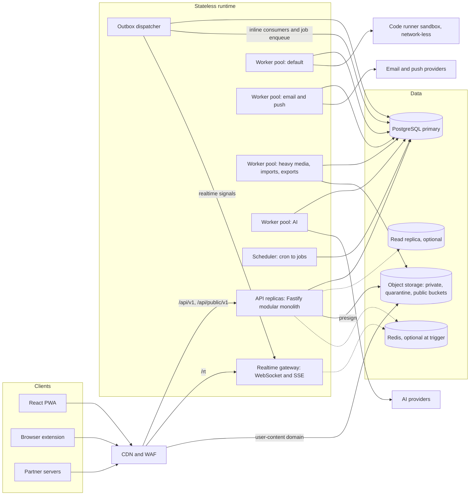
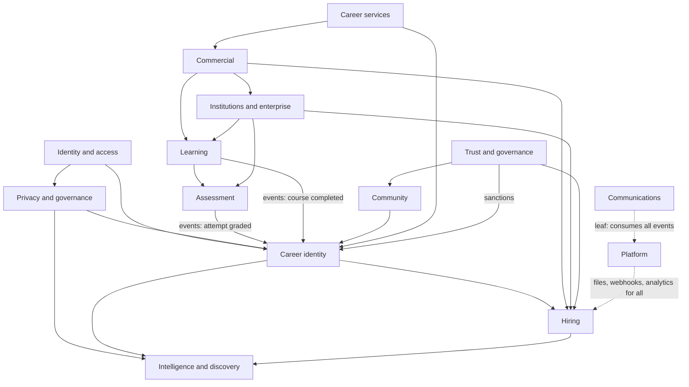
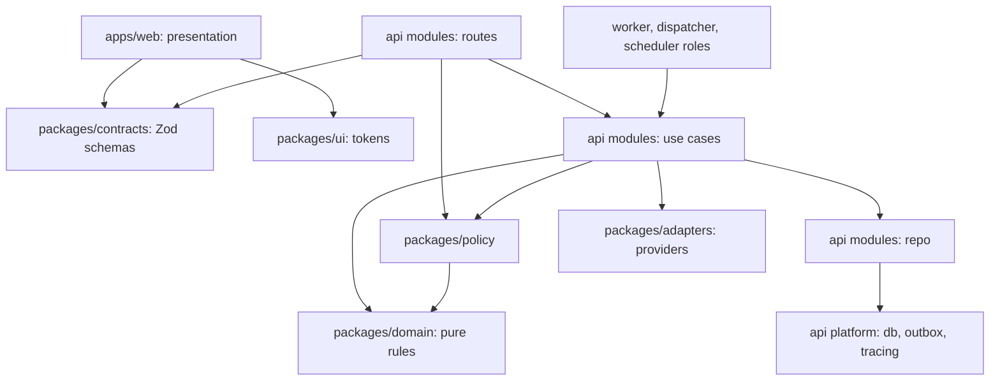

# 01 — System Architecture

Owner role: Principal Software Architect. Status: **Proposed target architecture** for the complete 30-module TalentSphere product. Nothing in this file states that anything is built ([CONVENTIONS §1](../00_START_HERE/CONVENTIONS.md)).

## 0. How to read this file

| Marker               | Meaning                                                                                                                                                                                                                                                                |
| -------------------- | ---------------------------------------------------------------------------------------------------------------------------------------------------------------------------------------------------------------------------------------------------------------------- |
| **As-built (input)** | Present in repository source at the time of writing, taken from [ARCHITECTURE.md](../../ARCHITECTURE.md) or the code. Source presence is not proof of deployment, durability or production readiness. Every as-built item is tagged `[SRC: …]`.                        |
| **Target**           | The intended architecture for the complete product. Everything not marked as-built is target.                                                                                                                                                                          |
| `DEC-ARC-nnn`        | An architecture decision recorded in this folder (§22). Status is `Proposed` until the owner ratifies it. The `DEC-ARC` prefix is this folder's namespace and is distinct from the repository's `ADR-001…016`, SSOT `ADR-001…013` and the legacy target `ADR-T01…T25`. |
| `OD-ARC-nn`          | An open architecture decision that needs stakeholder input (§23).                                                                                                                                                                                                      |
| `RSK-ARC-nn`         | An architecture risk (§24).                                                                                                                                                                                                                                            |

Companion files: [02 Data model](02_DATA_MODEL.md) · [03 API design](03_API_DESIGN.md) · [04 Events and async](04_EVENTS_AND_ASYNC.md) · [05 Integrations](05_INTEGRATIONS_AND_ADAPTERS.md) · [06 AI](06_AI_ARCHITECTURE.md) · [07 Search, media, realtime](07_SEARCH_MEDIA_REALTIME_ARCHITECTURE.md) · [08 Technical specification index](08_TECHNICAL_SPECIFICATION_INDEX.md).

## 1. Architectural drivers

The product is a career "operating system": identity, evidence, learning, assessment, hiring, networking, institutions, enterprise talent and adjacent services in one platform [SRC: COMMON_BRIEF owner goal]. The drivers below decide the shape of the system. They are ranked; when two conflict, the higher one wins.

| Rank | Driver                                                                                                                                    | Consequence for the architecture                                                                                                                                                                | Source                                            |
| ---- | ----------------------------------------------------------------------------------------------------------------------------------------- | ----------------------------------------------------------------------------------------------------------------------------------------------------------------------------------------------- | ------------------------------------------------- |
| 1    | **Trustworthy evidence.** A claim shown as verified must be verified by a server-side transition with provenance.                         | Verification state is written only by owning-module use cases; no client, AI or import path can set a verification rung. Append-only history for evidence, credential and verification changes. | [SRC: SSOT §3.1 "Verified over claimed"; ADR-T14] |
| 2    | **Privacy and consent are enforced at read time.** A person controls who sees their career data.                                          | Central policy module; consent evaluated against the primary database on every consent-guarded read; no consent cache; erasure designed into the schema.                                        | [SRC: BE-01-R2 §6; SSOT §15.2]                    |
| 3    | **Tenant isolation.** Employers, institutions and enterprises never see each other's data, and never see a person's data without a grant. | Row-level tenancy, RLS as a second boundary under a non-bypass database role, generated cross-tenant tests.                                                                                     | [SRC: ADR-T21; SSOT §14.6] [DER]                  |
| 4    | **Assessment integrity.** Scores and AI restrictions are server-authoritative.                                                            | Isolated code-execution sandbox; AI gateway checks the active assessment mode on every call.                                                                                                    | [SRC: SSOT §17; ARCHITECTURE.md INVARIANT-008]    |
| 5    | **Correctness under retry.** Every write is safe to retry; every async effect is at-least-once and idempotent.                            | Idempotency keys, transactional outbox, consumer inbox, fenced job leases.                                                                                                                      | [SRC: ADR-T09; SSOT CON-005]                      |
| 6    | **Evolvability across 30 modules with a small team.**                                                                                     | Modular monolith with enforced boundaries and explicit extraction triggers, not microservices.                                                                                                  | [SRC: SSOT §12.1; ADR-001]                        |
| 7    | **Cost discipline.** No paid inference for a free user without an active cost policy; no infrastructure before a measured trigger.        | AI budget ledger; PostgreSQL-first for queue, search and cache; triggers listed in §21.                                                                                                         | [SRC: SSOT §16.4; SSOT §20]                       |
| 8    | **PWA reach.** Works on low-end mobile, installable, honest offline behavior.                                                             | Lazy route bundles, read-cache offline, server revalidates any queued write.                                                                                                                    | [SRC: SSOT §19; ADR-T10]                          |

## 2. As-built baseline and where the target outgrows it

The current stack is the starting recommendation. This table records each as-built element, whether the target keeps it, and the decision that changes it.

| Area                 | As-built (input)                                                                                                                                                                                                                     | Target                                                                                                                                    | Change recorded as                              |
| -------------------- | ------------------------------------------------------------------------------------------------------------------------------------------------------------------------------------------------------------------------------------ | ----------------------------------------------------------------------------------------------------------------------------------------- | ----------------------------------------------- |
| Web client           | React 19, TypeScript, Vite, react-router-dom, small `fetch` helper (`apiJson`), no TanStack Query [SRC: CLAUDE.md Stack; ARCHITECTURE.md §15]                                                                                        | Same base; feature folders per module; lazily loaded route bundles; a server-state cache layer                                            | DEC-ARC-020, OD-ARC-04                          |
| API                  | Fastify 5 modular monolith; most routes in one `buildApp` closure in `apps/api/src/server.ts` (about 13.9k lines) [SRC: ARCHITECTURE.md §2; code]                                                                                    | Fastify 5 modular monolith with one plugin per module, module-owned tables and public interfaces                                          | DEC-ARC-001, DEC-ARC-003                        |
| Contracts            | Zod request schemas in one `packages/contracts/src/index.ts`; no generated OpenAPI [SRC: ARCHITECTURE.md §14]                                                                                                                        | Zod per module, OpenAPI 3.1 and AsyncAPI generated, breaking-change gate                                                                  | DEC-ARC-004                                     |
| Domain               | Pure functions in `packages/domain/src` (49 files), no framework or I/O imports [SRC: ARCHITECTURE.md INVARIANT-002/003]                                                                                                             | Kept and strengthened; one folder per module                                                                                              | Kept (DEC-ARC-003)                              |
| Persistence          | PostgreSQL via `pg`; core loop written transactionally through `persist`, read from boot-hydrated in-process Maps; single API writer lease; long-tail modules in memory labelled `ephemeral` [SRC: ARCHITECTURE.md §6, §13; ADR-015] | PostgreSQL is the only system of record; every read is SQL; multiple stateless API replicas; no `ephemeral` module in production          | DEC-ARC-002, OD-ARC-01                          |
| Database access role | API connection role can bypass RLS; policies tested separately [SRC: ARCHITECTURE.md §20]                                                                                                                                            | API runs as a non-owner role subject to RLS with per-transaction claims                                                                   | DEC-ARC-008                                     |
| Async                | `background_jobs` with `FOR UPDATE SKIP LOCKED`, 60 s lease, no claim fencing, most handlers only record events, two mail handlers [SRC: ARCHITECTURE.md §18; migration 00042]                                                       | Outbox + dispatcher + consumer inbox; fenced leases; per-kind retry policy; separate worker pools                                         | DEC-ARC-009, DEC-ARC-010                        |
| Auth                 | Self-issued HMAC session tokens, 24 h, stored in browser `localStorage`, no refresh flow, revocation by cutoff and revoked-session rows [SRC: ARCHITECTURE.md §12]                                                                   | HttpOnly cookie sessions with server-side session records, rotating refresh, passkeys, OAuth/OIDC/SAML federation; HMAC primitives reused | DEC-ARC-006, DEC-ARC-007, OD-ARC-03             |
| Authorization        | Per-handler checks; some organization actions accept any membership [SRC: ARCHITECTURE.md §12, R-2, U-3]                                                                                                                             | Central policy package, deny by default, scoped grants                                                                                    | DEC-ARC-005                                     |
| Billing              | Stripe Checkout, Portal and signed webhook behind `stripe-gateway.ts`; `BILLING_MODE=stripe` opt-in [SRC: ARCHITECTURE.md §17]                                                                                                       | Kept as the only payment processor at launch; entitlement service generalised for org seats, license pools and course purchases           | Kept; see [05](05_INTEGRATIONS_AND_ADAPTERS.md) |
| Email                | Provider-independent service in `apps/worker/src/email`, Brevo adapter, dev outbox [SRC: ARCHITECTURE.md §17]                                                                                                                        | Kept; the pattern is the template for every adapter                                                                                       | DEC-ARC-021                                     |
| AI                   | Local heuristic assistant; `assertWithinAIQuota` with hard-coded tier limits; no remote model [SRC: ARCHITECTURE.md §20, R-4; `packages/domain/src/ai-gateway.ts`]                                                                   | AI gateway with provider adapters, budgets, prompt registry, evals, provenance                                                            | DEC-ARC-014                                     |
| Search               | In-process matching over loaded data; no PostgreSQL FTS at runtime [SRC: ARCHITECTURE.md §3]                                                                                                                                         | PostgreSQL FTS + `pg_trgm` + `pgvector` behind `SearchPort`                                                                               | DEC-ARC-012                                     |
| Realtime             | None [SRC: ARCHITECTURE.md §3]                                                                                                                                                                                                       | Realtime gateway for messaging, notification badges, presence, live interview and contest views                                           | DEC-ARC-011                                     |
| Media and files      | None at runtime; Supabase Storage named as target only [SRC: ARCHITECTURE.md §17]                                                                                                                                                    | Object storage port, presigned uploads, AV scan, video provider port                                                                      | DEC-ARC-013                                     |
| Feature flags        | `feature_flags(key, enabled, description)` read by the API [SRC: migration 00051]                                                                                                                                                    | Flags with targeting rules, distinct from entitlements and kill switches                                                                  | DEC-ARC-017                                     |
| Observability        | Pino logs with redaction, request ids, SQL admin audit, worker heartbeat [SRC: ARCHITECTURE.md §21]                                                                                                                                  | OpenTelemetry traces and metrics end to end, including through the outbox                                                                 | DEC-ARC-019                                     |
| Hosting              | Oracle container, Compose and proxy assets; no observed deployment [SRC: ARCHITECTURE.md §23]                                                                                                                                        | Stateless containers on a managed platform; vendor open                                                                                   | DEC-ARC-023, OD-ARC-05                          |

## 3. System context

```mermaid
flowchart TB
    subgraph People
        CAN["Candidates, students, freelancers"]
        EMPU["Recruiters, hiring managers, employer admins"]
        INSU["Institution admins, placement officers, instructors"]
        ENTU["Enterprise talent and L&D admins"]
        MNTU["Mentors and coaches"]
        OPS["Moderators, support, finance, platform admins"]
        REF["Referees and verifiers without accounts"]
        PUB["Public visitors and credential checkers"]
    end

    TS["TalentSphere platform"]

    subgraph External
        PAY["Payments: Stripe"]
        MAIL["Email provider port: Brevo default"]
        PUSH["Web Push services"]
        IDP["Identity providers: Google, GitHub, LinkedIn, Microsoft, enterprise SAML or OIDC"]
        LLM["Model providers via AI gateway"]
        VID["Video transcode and playback provider"]
        RTC["Video interview provider"]
        CAL["Calendars: Google, Microsoft"]
        BGVV["Background check and identity verification vendors"]
        HRIS["HRIS, ATS, LMS, SIS systems"]
        JOBD["Job distribution and search engines"]
        OBS["Observability backend"]
    end

    CAN & EMPU & INSU & ENTU & MNTU & OPS --> TS
    REF -->|"single-use token links"| TS
    PUB -->|"public pages and credential verification"| TS
    TS --> PAY & MAIL & PUSH & LLM & VID & RTC & CAL & BGVV & JOBD & OBS
    IDP --> TS
    HRIS <--> TS
    PAY -->|"signed webhooks"| TS
    BGVV -->|"signed callbacks"| TS
    VID -->|"signed callbacks"| TS
```



Every external system sits behind a port owned by one module ([05](05_INTEGRATIONS_AND_ADAPTERS.md)). Provider names are defaults or examples, never contracts [SRC: SSOT §13.3 "Vendor names are examples"].

## 4. Container view (target)



| Container           | Responsibility                                                                                    | Scales by                                      | State                               | As-built?                                                             |
| ------------------- | ------------------------------------------------------------------------------------------------- | ---------------------------------------------- | ----------------------------------- | --------------------------------------------------------------------- |
| React PWA           | All role workspaces, public pages, offline read cache                                             | CDN                                            | Browser cache and local drafts only | Partly: React app exists [SRC: ARCHITECTURE.md §15]                   |
| Browser extension   | Job capture and profile import, local-first                                                       | n/a                                            | Extension storage                   | No [SRC: SSOT ADR-006 intent]                                         |
| API replicas        | HTTP use cases, policy, validation, transactions, outbox writes                                   | Replica count                                  | None in process except caches       | Single writer today [SRC: ADR-015]                                    |
| Realtime gateway    | Authenticated channels; pushes signals, never authoritative rows                                  | Connections                                    | Connection registry                 | No                                                                    |
| Outbox dispatcher   | Reads `outbox_events`, runs inline consumers, enqueues job-mode consumers, emits realtime signals | One active leader, standby                     | None                                | No                                                                    |
| Worker pools        | Execute jobs by queue class with fenced leases                                                    | Pool size per class                            | None                                | One worker, one pool [SRC: ARCHITECTURE.md §18]                       |
| Scheduler           | Turns cron definitions into idempotent jobs (`kind` + period key)                                 | One active leader                              | None                                | No                                                                    |
| Code runner sandbox | Executes untrusted candidate code without network                                                 | Runner instances                               | Ephemeral                           | No (submissions are not executed) [SRC: ARCHITECTURE.md §20]          |
| PostgreSQL          | System of record, queue, outbox, search index, vector index                                       | Vertical, then read replica, then partitioning | All durable state                   | Yes, as system of record for the core loop [SRC: ARCHITECTURE.md §13] |
| Object storage      | Files, media, exports                                                                             | Provider                                       | Blobs                               | No                                                                    |
| Redis               | Optional: rate-limit counters, realtime fan-out, hot caches                                       | Provider                                       | Disposable                          | No                                                                    |

**Leader election for the dispatcher and scheduler** uses a PostgreSQL advisory lock held on a dedicated session connection; a standby takes over when the lock is released or the connection drops [DER]. The as-built API writer lease [SRC: ARCHITECTURE.md §16] is retired by DEC-ARC-002 because the API no longer needs a single writer.

## 5. Bounded contexts mapped to the 30 modules

A **module** is the unit of code ownership: one backend module folder, one contracts folder, one domain folder and one web feature folder per module code. A **bounded context** groups modules that share a vocabulary and may call each other more freely; calls across contexts go only through module public interfaces or events (§7) [DER from SSOT §12.10–§12.11].

| Context                        | Modules            | Strategic class                                          | What the context owns (aggregate roots)                                                                                                               | Proposed tier (dependency view)                |
| ------------------------------ | ------------------ | -------------------------------------------------------- | ----------------------------------------------------------------------------------------------------------------------------------------------------- | ---------------------------------------------- |
| Identity and access            | IDN                | Generic, security-critical                               | Account, Credential (password, passkey, federated identity), Session, ServicePrincipal, Organization, Membership                                      | R0                                             |
| Privacy and account governance | SET                | Generic, compliance-critical                             | ConsentGrant, PrivacySettings, DataSubjectRequest (export, erasure), SubjectIdentityMap                                                               | R0                                             |
| Communications                 | NTF, MSG           | Supporting                                               | Notification, DeliveryAttempt, ChannelPreference, Conversation, Message                                                                               | NTF R0, MSG R2                                 |
| Career identity                | PRF, EVD, BGV      | **Core**                                                 | Profile, Resume, Portfolio, Evidence, Attestation, Credential, VerificationRequest, BackgroundCheck                                                   | PRF and EVD R1, BGV R4                         |
| Learning                       | LRN, STU           | Supporting                                               | Course, CourseVersion, Enrollment, Progress, LearningPath, Certificate, StudioProject, MediaAsset (content usage)                                     | LRN R1, STU R3                                 |
| Assessment                     | ASM                | **Core**                                                 | Assessment, ItemBank, Attempt, Submission, RunnerJob, IntegrityCase                                                                                   | R1 (unverified attempts), runner R4            |
| Hiring                         | JOB, ATS, INT, EMP | **Core** (JOB, ATS), supporting (INT, EMP)               | Job, Application, Requisition, PipelineStage, Scorecard, Offer, Interview, AvailabilitySlot, EmployerPage, Team                                       | R2                                             |
| Community                      | NET, REP, EVT      | Supporting                                               | Connection, Follow, Post, Group, Referral, ReputationLedger, Badge, CommunityEvent, Hackathon                                                         | NET R2, REP R4, EVT R6                         |
| Intelligence and discovery     | AIC, SRC, MKT      | **Core** (AIC matching), generic (SRC), supporting (MKT) | AIInvocation, Recommendation, MatchExplanation, SearchDocument, SavedSearch, SkillTaxonomy (MKT, released at R1, OD-ARC-07), MarketSignal, CareerPath | SRC R1, AIC R1 gateway and R4 features, MKT R6 |
| Trust and governance           | TSF, ADM           | Generic, safety-critical                                 | Report, ModerationCase, Sanction, Appeal, AuditEvent, SupportTicket, PlatformConfig                                                                   | TSF R1, ADM R0                                 |
| Institutions and enterprise    | INS, ENT           | Supporting                                               | Institution profile, Department, Cohort, ManagedLearnerLink, LicensePool, PlacementDrive, WorkforceLink, InternalOpportunity, SkillsInventory         | INS R3, ENT R6                                 |
| Commercial                     | BIL                | Generic, money-critical                                  | Customer, Subscription, Entitlement, Order, Invoice, LicenseSeat, Payout (gated)                                                                      | R1 stub, R5 scale                              |
| Career services                | MEN, GIG           | Supporting, OS expansion                                 | MentorProfile, Engagement, Session, GigProject, Proposal, Contract, Milestone                                                                         | R6                                             |
| Platform                       | PLT, ANL, PWA      | Generic                                                  | FileObject, WebhookEndpoint, ApiClient, IntegrationConnection, AnalyticsEvent, MetricSnapshot, PushSubscription, DeviceInstall                        | PLT and PWA R0, ANL R1                         |

OS-expansion modules (MEN, GIG, EVT, MKT, ENT) are designed into the context map now so that their tenancy, events and data classes do not force later rework, but none is built before `DEC-002` / its module `OD-` clears [SRC: CONVENTIONS §4]. Final tiers belong to `08_ROADMAP`; the column above only shows dependency order.

### 5.1 Context map



Arrows point from upstream (supplier of a published interface or event) to downstream (consumer). Communications is a **leaf**: nobody imports it; it consumes events [SRC: BE-01-R2 §2 rule 3]. Assessment and Learning **publish** results and Career identity **consumes** them; Assessment and Learning never write evidence rows directly [SRC: BE-01-R2 §2 rule 4].

### 5.2 Ownership rules that the context map enforces

1. Each table has exactly one owning module, recorded in [02 §3](02_DATA_MODEL.md). Only that module's repository code writes it [SRC: SSOT §12.5].
2. A module reads another module's data through the owner's public interface (`modules/<code>/index.ts`) or through a published read-only view named `pv_<owner>_<name>` that the owner maintains. Direct `SELECT` on another module's tables is a lint failure [SRC: BE-01-R2 rule 1, FF-02].
3. Cross-context writes happen only as reactions to events, never as synchronous writes into another module's tables [SRC: SSOT ADR-013].
4. Synchronous calls between modules must form an acyclic graph; the graph is generated from imports in CI and compared with the baseline in [08 §3](08_TECHNICAL_SPECIFICATION_INDEX.md) [SRC: BE-01-R2 §2].

## 6. Modular-monolith structure

### 6.1 One server codebase, several process roles (DEC-ARC-001)

All server-side module code lives in one server application. The same build starts in one of six roles selected by `PROCESS_ROLE`: `http`, `dispatcher`, `worker`, `scheduler`, `realtime`, `migrate`. The code runner is the only server component built and deployed separately, because it is a different trust domain (DEC-ARC-015).

As-built input: `apps/api` and `apps/worker` are separate packages and the worker "cannot see API process Maps" [SRC: ARCHITECTURE.md §7]. In the target the worker runs module job handlers, which need module repositories and use cases, so the module code must be shared. Options are compared in DEC-ARC-001.

### 6.2 Target repository layout

```text
apps/
  web/src/
    app/                      shell: providers, router, layout, error boundaries
    features/<mod>/           pages/, components/, hooks/, api.ts, offline.ts (one folder per module code)
    components/ui/            primitives (as-built owner, kept)
    lib/                      apiJson, session, capability hints (as-built owner, kept)
  api/src/                    the server codebase (all process roles)
    entry/                    http.ts, dispatcher.ts, worker.ts, scheduler.ts, realtime.ts, migrate.ts
    platform/                 http hooks, error mapper, auth plugin, policy plugin, idempotency,
                              rate limits, db (transaction + claims), outbox writer, tracing, flags
    modules/<mod>/
      index.ts                public interface: types and functions other modules may call
      plugin.ts               Fastify plugin; registers this module's routes
      routes/                 thin handlers: parse (contracts) → policy → use case → serialize
      usecases/               one exported function per use case; one transaction each
      repo/                   SQL for tables this module owns; nothing else
      events.ts               emitted event types; consumer registrations (inline or job mode)
      jobs.ts                 job kinds and handlers
      privacy.ts              ErasureParticipant and ExportParticipant
      policy.ts               actions and resource resolvers this module defines
  extension/                  browser extension (PWA module)
runner/                       code-execution sandbox (separate image, separate trust domain)
packages/
  domain/src/<mod>/           pure rules, state machines, scoring (as-built owner, kept)
  contracts/src/<mod>/        Zod schemas: requests, responses, events
  policy/                     authorization engine and action registry (new, DEC-ARC-005)
  adapters/                   server-only provider adapters behind ports (new, DEC-ARC-021)
  config/  observability/  ui/  testing/   (as-built owners, kept)
supabase/migrations/          forward-only SQL migrations (as-built owner, kept)
```

Adding `packages/policy` and `packages/adapters` and the extra entrypoints changes workspace manifests, which are protected build files; the owner must approve those edits before implementation [SRC: CLAUDE.md Rules; AGENTS.md]. Moving `apps/worker/src/email` into `packages/adapters/email` keeps the as-built email contract test (`tests/unit/email/provider-contract.ts`) as the gate [SRC: ARCHITECTURE.md §17].

### 6.3 Module anatomy rules

| Rule | Statement                                                                                                                                                                                                             | Enforced by                                                    |
| ---- | --------------------------------------------------------------------------------------------------------------------------------------------------------------------------------------------------------------------- | -------------------------------------------------------------- |
| M-01 | A route handler contains no business rule. It parses with the contracts schema, calls `policy.authorize`, calls one use case and serializes the result.                                                               | Code review; lint bans imports of `repo/` from `routes/`       |
| M-02 | A use case runs in exactly one database transaction obtained from `platform/db`; the transaction carries the principal claims (§8.5) and the outbox writer.                                                           | `withTx(principal, fn)` is the only way to get a client        |
| M-03 | A use case that changes state emits its events by inserting into `outbox_events` inside the same transaction.                                                                                                         | Outbox writer API; test helper asserts emitted events          |
| M-04 | Business rules and state machines are defined once in `packages/domain/src/<mod>`; use cases call them; SQL transition functions read their allowed edges from tables generated from the same definitions.            | [SRC: ARCHITECTURE.md INVARIANT-002; BE-01-R2 §9] parity tests |
| M-05 | A module's `index.ts` exports only read functions, command functions that run in the caller's transaction, and types. It never exports repositories.                                                                  | Lint                                                           |
| M-06 | Every table a module creates is declared in the module's `ownership.ts` with ownership class, tenancy column, data class and retention class ([02 §2](02_DATA_MODEL.md)). Migration CI fails for an undeclared table. | Migration lint                                                 |
| M-07 | A module declares its routes in a route registry with policy action, rate-limit class, idempotency mode and pagination mode.                                                                                          | Route-registry lint ([03 §14](03_API_DESIGN.md))               |

### 6.4 Extraction criteria

A module is extracted into a separately deployed service only when at least one trigger is measured and recorded in a new DEC-ARC entry [SRC: ADR-T04; SSOT §12.1].

| Trigger                                   | Measured as                                                                                                                                                  | Example candidate                                |
| ----------------------------------------- | ------------------------------------------------------------------------------------------------------------------------------------------------------------ | ------------------------------------------------ |
| T1 Resource profile harms others          | The module's CPU, memory or connection use causes p95 latency regressions in unrelated routes in two consecutive load tests                                  | Media processing, AI batch work                  |
| T2 Different trust boundary               | Executes untrusted code or holds credentials that other modules must not reach                                                                               | Code runner (extracted from day one)             |
| T3 Distinct availability target           | The module needs an availability or latency objective materially different from the API's                                                                    | Realtime gateway, credential verification pages  |
| T4 Data residency or regulatory isolation | A customer contract or regulation requires processing in a separate region or account                                                                        | Enterprise tenant data, background-check results |
| T5 Team ownership contention              | Independent teams block each other's releases on the same deployable (count is a parameter, `extraction.min_independent_teams`, default 3 [PROP], OD-ARC-14) | Learning studio, hiring workspace                |
| T6 Independent scaling                    | The module's load grows on a different curve and would otherwise force over-provisioning of the API                                                          | Search (if moved to an external engine)          |

**Extraction readiness (must already hold before extraction):** the module owns its tables with no foreign keys from other modules' tables except to identity keys; all inbound reads use its interface or `pv_` views; all inbound writes are events; its jobs are in their own queue class. Because these rules hold from day one (§5.2), extraction is a deployment change plus an interface-to-HTTP adapter, not a rewrite [DER].

Ranked extraction candidates: (1) code runner — separate from the start; (2) realtime gateway — separate process role from the start, same codebase; (3) media processing pool; (4) AI gateway execution pool; (5) search, only if an external engine is adopted; (6) notification delivery.

## 7. Layering rules



| Id   | Rule                                                                                                                                                                                        | Source                                        | Enforcement                                    |
| ---- | ------------------------------------------------------------------------------------------------------------------------------------------------------------------------------------------- | --------------------------------------------- | ---------------------------------------------- |
| L-01 | `packages/domain` imports nothing from frameworks, providers, Zod, databases or the network. It may import sibling domain files, never its own barrel.                                      | [SRC: ARCHITECTURE.md INVARIANT-003]          | dependency-cruiser rule; as-built tests        |
| L-02 | `packages/contracts` imports only Zod and its own files. It never imports domain.                                                                                                           | [SRC: ARCHITECTURE.md §7]                     | dependency-cruiser                             |
| L-03 | `packages/policy` imports domain predicates and contracts types only. It holds no database client; resource attributes are passed in by resolvers that each module registers.               | [DER from ADR-T07]                            | dependency-cruiser                             |
| L-04 | Only `apps/api` (roles http, dispatcher, worker, scheduler, realtime, migrate) holds a database client, and only through `platform/db`. The web app, contracts, domain and policy never do. | [SRC: ARCHITECTURE.md INVARIANT-005]          | Lint bans `pg` imports outside `platform/db`   |
| L-05 | Provider SDKs are imported only inside `packages/adapters/<port>/<vendor>`. AI provider SDKs only inside `packages/adapters/ai`.                                                            | [SRC: ARCHITECTURE.md §17; BE-01-R2 rule 5]   | Lint                                           |
| L-06 | The web app never contains authorization decisions that the server does not repeat. UI capability hints come from `GET /api/v1/me/capabilities`.                                            | [SRC: ARCHITECTURE.md INVARIANT-001; ADR-T07] | Security tests                                 |
| L-07 | `packages/adapters` is server-only and never bundled for the browser.                                                                                                                       | [SRC: SSOT §12.16 server-only folders]        | Vite build check that fails on adapter imports |
| L-08 | Errors cross layers as `DomainError` (domain, use case) or validation errors (contracts) and are rendered only by the global error mapper.                                                  | [SRC: ARCHITECTURE.md INVARIANT-004]          | Lint bans `reply.code(4xx/5xx)` in handlers    |
| L-09 | Design tokens come only from `packages/ui/src/tokens.ts`; feature code hard-codes no color or spacing.                                                                                      | [SRC: CLAUDE.md Style]                        | Stylelint or lint rule                         |
| L-10 | No module imports another module's `repo/`, `routes/` or `jobs/`. Cross-module calls go through `index.ts`.                                                                                 | [SRC: SSOT ARCH-016]                          | dependency-cruiser                             |

## 8. Multi-tenancy model

### 8.1 Principals

| Principal kind  | Who                                                           | How authenticated                                                                                                      | Claims carried into a transaction                                                                                                            |
| --------------- | ------------------------------------------------------------- | ---------------------------------------------------------------------------------------------------------------------- | -------------------------------------------------------------------------------------------------------------------------------------------- |
| `account`       | Any human with an account (all human roles in CONVENTIONS §5) | Session cookie (§10)                                                                                                   | `account_id`, active memberships `[{org_id, membership_type, roles}]`, `platform_roles`, `recent_auth_at`, `assessment_session_id` if active |
| `service`       | Partner integration (`API` role) acting for one organization  | OAuth 2.0 client credentials token                                                                                     | `api_client_id`, `org_id`, granted scopes                                                                                                    |
| `system`        | Worker, dispatcher, scheduler                                 | Process identity                                                                                                       | `job_id`, the tenant scope copied from the job payload                                                                                       |
| `token_holder`  | Referee, verifier, guest invitee, unsubscribe link user       | Single-use capability token, stored as a hash                                                                          | `token_purpose`, bound resource id                                                                                                           |
| `support_grant` | Support agent working on a user's case                        | Agent session plus a live, time-boxed `support_access_grants` row consented by the user or an audited policy exception | `agent_account_id`, `subject_account_id`, `grant_id`, allowed scopes                                                                         |

There is no write-capable impersonation ("log in as user"). The read-only, consented, time-boxed "view-as" session that the ADM module specifies (SM-ADM-04, BR-ADM-006) runs as a `support_grant` principal, so every read is attributable and limited [SRC: 02_MODULES ADM BR-ADM-006; API-STD `grant-required`; BR-T041] [DER].

### 8.2 Tenants

| Tenant kind           | Represented as                                                                                        | Members                                                             | Notes                                                                                                                                            |
| --------------------- | ----------------------------------------------------------------------------------------------------- | ------------------------------------------------------------------- | ------------------------------------------------------------------------------------------------------------------------------------------------ |
| Personal space        | Implicit, keyed by `account_id`                                                                       | The account                                                         | Every person-owned record lives here. A person's personal space is never owned by an organization, even when an organization invited the person. |
| Employer organization | `organizations` row with `kind = 'employer'`                                                          | `staff` memberships (REC, HMG, EAD)                                 | Hiring tenant. May enable the `enterprise_talent` capability (below).                                                                            |
| Recruitment agency    | `organizations.kind = 'agency'`                                                                       | `staff` memberships                                                 | Hires on behalf of client employers; client relationship is a separate `agency_client_links` record [SRC: SSOT §14.5 agency tables]              |
| Institution           | `organizations.kind = 'institution'`                                                                  | `staff` (IAD, PLO), `instructor` (INS), `learner` (STD) memberships | Managed learning tenant [SRC: SSOT ADR-008]                                                                                                      |
| Enterprise            | An employer organization whose `capabilities` include `enterprise_talent` (granted by an entitlement) | `staff` (EXA) and `workforce` memberships (employees)               | Internal mobility and L&D happen inside the same tenant that hires externally, so one company is one tenant [PROP]                               |
| Platform              | Reserved organization `platform`                                                                      | Platform staff (MOD, SUP, FIN, PAD, SAD)                            | Owns platform reference data, moderation and audit                                                                                               |

Membership types are `staff`, `instructor`, `learner`, `workforce`, `mentor` (a mentor attached to an institution or enterprise program) and `alumni`. Roles inside a membership are scoped grants (for example `ats.pipeline.manage` on organization X), not global roles [SRC: V61-05 scoped-grant model] [DER].

### 8.3 Data ownership classes

Every table belongs to exactly one class ([02 §2](02_DATA_MODEL.md) gives the per-table assignment).

| Class             | Meaning                                                                  | Tenancy columns                        | Who reads without a grant                           | Example tables                                                                                                              |
| ----------------- | ------------------------------------------------------------------------ | -------------------------------------- | --------------------------------------------------- | --------------------------------------------------------------------------------------------------------------------------- |
| OWN-PERSON        | Data about and controlled by one person                                  | `owner_account_id`                     | The owner only                                      | `profiles`, `evidence`, `resumes`, `consent_grants`, `lesson_progress` (personal enrollments)                               |
| OWN-ORG           | Data an organization creates about its own operations                    | `tenant_org_id`                        | Members with the matching scoped grant              | `jobs`, `pipeline_stages`, `scorecards`, `license_pools`, `cohorts`                                                         |
| SHARED-PARTY      | A record that two parties legitimately share, with field-level audiences | `owner_account_id` and `tenant_org_id` | Each party, limited to its audience's fields        | `job_applications`, `interviews`, `offers`, `enrollments` (institution-assigned), `mentorship_engagements`, `gig_contracts` |
| PLATFORM          | Reference and governance data                                            | none, or `tenant_org_id = platform`    | Platform staff with scope; public subsets via views | `skills`, `plans`, `moderation_cases`, `audit_events`                                                                       |
| PUBLIC-PROJECTION | Derived, public-safe copies                                              | Inherits from the source               | Anyone, including guests                            | `pv_public_profiles`, `pv_published_jobs`, `pv_credential_verifications`                                                    |

A SHARED-PARTY record stores org-internal fields (recruiter notes, scorecard ratings, internal tags) in a **separate child table** owned by the organization side (`application_internal_notes`), never in columns of the shared row. This keeps candidate data export and candidate reads free of org-internal content without column masking errors [PROP].

### 8.4 Grants: how an organization sees person-owned data

| Grant                                  | Created by                                                      | Gives                                                                                                                       | Revocation effect                                                                                                                                                              |
| -------------------------------------- | --------------------------------------------------------------- | --------------------------------------------------------------------------------------------------------------------------- | ------------------------------------------------------------------------------------------------------------------------------------------------------------------------------ |
| `application_share_snapshot`           | Candidate, on submitting an application                         | The employer sees an immutable snapshot of the evidence and profile sections the candidate chose, for that application only | Live evidence links stop resolving at the next read; the snapshot's existence and the application record remain, per hiring retention [SRC: BE-01-R2 §6 application snapshots] |
| `search.discoverable` consent          | Person, in privacy settings                                     | Recruiters with search entitlement can find the public-to-recruiters profile projection                                     | Search documents are excluded at the next query (query-time join on `pv_consent_current`)                                                                                      |
| `institution.share_profile` consent    | Learner                                                         | Placement officers of that institution see the learner's placement profile                                                  | Next read denied                                                                                                                                                               |
| `enterprise.workforce_profile` consent | Employee                                                        | The employer's enterprise talent admins see the fields the employee chose, for internal mobility                            | Next read denied                                                                                                                                                               |
| `support_access_grants`                | Person (or audited policy exception for safety and legal holds) | A named agent reads named scopes for a time window                                                                          | Expiry or revocation ends access at the next request                                                                                                                           |
| `referee_request` capability token     | Person requesting a reference                                   | The referee sees only the claim to be attested                                                                              | Token consumed or expired                                                                                                                                                      |

**Enterprise boundary (the highest-risk tenancy rule):** an employer never learns that its own employee applied to an external job, set `open_to_work`, or was found in external candidate search. External applications are SHARED-PARTY records with the external employer only; the current employer's tenant has no grant path to them, and candidate search excludes profiles from employers listed in the person's `blocked_employer_org_ids` (stealth setting) [PROP] [SRC: SSOT §14.4 "stealth flags"]. What an enterprise may see of an employee is OD-ARC-15.

### 8.5 How tenancy is enforced in PostgreSQL (DEC-ARC-008)

1. Migrations run as `ts_owner`. The API's http role connects as `ts_app`, which owns no tables and is subject to RLS. Worker roles connect as `ts_worker`, also subject to RLS. A `ts_readonly_analytics` role reads only `pv_` and analytics schemas [DER from SSOT §14.6 and as-built gap ARCHITECTURE.md §20].
2. `platform/db.withTx(principal, fn)` begins a transaction and sets claims with `set_config('app.account_id', …, true)`, `app.org_grants` (a compact JSON array of `{org_id, membership_type, grants}`), `app.principal_kind` and `app.support_grant_id`. `true` makes them transaction-local, which is safe with a transaction-mode connection pooler [DER].
3. Policies call stable SQL helper functions: `app_account_id()`, `app_has_org_grant(org_id, grant)`, `app_is_platform_staff(scope)`, `app_has_consent(subject_account_id, scope, audience)`. Policy templates are generated per ownership class (`generate_rls_policies(table, ownership_class, …)`), extending the SSOT generator model [SRC: SSOT §14.6 generator model].
4. RLS is the **second** boundary. The first is `packages/policy` in the API. A route that passes policy but is denied by RLS is a defect and pages on-call; it never silently returns an empty list [DER].
5. CI generates two tenants and two people per ownership class for every migration and asserts: cross-tenant `SELECT` returns zero rows, cross-tenant `UPDATE` and `DELETE` affect zero rows, public projections expose only columns marked public [SRC: SSOT §14.6 RLS fuzzing].
6. Cross-tenant read is a Sev-1 incident [SRC: ADR-T21].

## 9. Authorization architecture (DEC-ARC-005)

`packages/policy` exposes one function: `authorize(principal, action, resource) → Decision`. A `Decision` is `allow` with **obligations**, or `deny` with a reason code. Obligations are instructions the caller must apply: `field_mask` (remove listed fields), `require_consent(scope, subject)`, `require_step_up(max_age)`, `audit(reason)`, `rate_class(name)`.

| Element               | Design                                                                                                                                                                                                                                      |
| --------------------- | ------------------------------------------------------------------------------------------------------------------------------------------------------------------------------------------------------------------------------------------- |
| Action names          | `<mod>.<resource>.<verb>`, lowercase, for example `ats.application.move_stage`, `evd.evidence.verify`, `ins.cohort.assign_course`. Each module registers its actions in `modules/<mod>/policy.ts`.                                          |
| Resource resolver     | Each module registers a resolver that loads the attributes policy needs (owner, tenant, state, audience) for a resource id, using the same transaction.                                                                                     |
| Rules                 | Role-based grants per membership plus attribute rules (owner equals principal, resource tenant in principal grants, state allows action, consent present). Deny by default; an action with no rule is denied [SRC: V61-05 deny-by-default]. |
| Existence hiding      | A denied read of a resource the principal cannot know about returns `404 not-found`; `403 forbidden` is used only when the principal can already see the resource [SRC: SSOT §13.2 "no existence leakage"].                                 |
| Capabilities endpoint | `GET /api/v1/me/capabilities?resource=<type>:<id>` returns the actions the UI may offer. It is a hint; every action is re-authorized [SRC: ADR-T07].                                                                                        |
| Grants cache          | Role and membership grants may be cached per request using `grants_version` on the account; consent is never cached [SRC: BE-01-R2 §6].                                                                                                     |
| Assessment lock       | If the principal has an active `AI_PROHIBITED` assessment session, every `aic.*` action and every action tagged `ai_assisted` is denied with `ai-prohibited` [SRC: ARCHITECTURE.md INVARIANT-008].                                          |
| Audit                 | Every allow on an action tagged `sensitive` and every deny on any action writes an audit event through the outbox [DER].                                                                                                                    |

## 10. Identity and session architecture (DEC-ARC-006, DEC-ARC-007)

| Concern            | Target                                                                                                                                                                                                                                                                                                                                                                                                             | As-built (input)                                                                  |
| ------------------ | ------------------------------------------------------------------------------------------------------------------------------------------------------------------------------------------------------------------------------------------------------------------------------------------------------------------------------------------------------------------------------------------------------------------ | --------------------------------------------------------------------------------- |
| Browser session    | Opaque session id in an HttpOnly, Secure cookie `__Host-ts_sid` (Path=/, SameSite=Lax). The id is an HMAC-signed random value; the server looks up `sessions` on every request. Short-lived access is not needed because the session row is checked each time; idle timeout and absolute lifetime are parameters (`session.idle_minutes` default 60 [PROP], `session.absolute_days` default 30 [PROP]; OD-ARC-03). | 24 h HMAC bearer token in `localStorage`, XSS-readable [SRC: ARCHITECTURE.md §12] |
| CSRF               | `X-CSRF-Token` double-submit value plus `Origin`/`Sec-Fetch-Site` check on unsafe methods [SRC: API-STD §4]                                                                                                                                                                                                                                                                                                        | None needed for bearer tokens today                                               |
| Revocation         | Delete or mark the `sessions` row; effect at the next request. "Sign out other devices" and password change revoke all other rows.                                                                                                                                                                                                                                                                                 | Revoked-session rows and issuance cutoff [SRC: migrations 00045, 00046]           |
| Password           | PBKDF2-SHA512 kept (as-built `hashPassword`/`verifyPassword`) with upgrade-on-login to a memory-hard hash if OD-ARC-03 chooses it; breached-password check against a k-anonymity range API [SRC: SSOT §13.3 HaveIBeenPwned]                                                                                                                                                                                        | PBKDF2-SHA512, 210,000 iterations [SRC: ARCHITECTURE.md §20]                      |
| Passkeys           | WebAuthn registration and login; passkey is a `credentials` row of type `webauthn`                                                                                                                                                                                                                                                                                                                                 | None                                                                              |
| Social login       | OIDC with Google, GitHub, Microsoft, LinkedIn; federated identity linked to an existing account only after the user proves control of the account (no silent merge by email) [PROP]                                                                                                                                                                                                                                | None [SRC: ARCHITECTURE.md §3]                                                    |
| Enterprise SSO     | Per-organization OIDC or SAML 2.0 connection; optional enforcement for staff and workforce memberships of that organization; SCIM 2.0 provisioning for enterprise and institution tenants [PROP]                                                                                                                                                                                                                   | None                                                                              |
| Service principals | OAuth 2.0 client credentials at `POST /api/public/v1/oauth/token`; tokens are opaque, ≤ 1 h, scoped to one organization [SRC: API-STD §4]                                                                                                                                                                                                                                                                          | None                                                                              |
| Step-up            | Sensitive actions require `recent_auth_at` within `auth.step_up_max_age_minutes` (default 10 [SRC: API-STD §4, target value])                                                                                                                                                                                                                                                                                      | None                                                                              |
| Extension          | The browser extension uses a separate, revocable device session obtained through an OAuth device-style pairing flow; it never reads the web cookie [PROP]                                                                                                                                                                                                                                                          | None                                                                              |

Social login, SSO and passkeys are implemented inside IDN as an identity broker, not delegated to an external auth service, so that one session model serves all principals. Whether to adopt a managed identity provider instead is OD-ARC-03.

## 11. Eventing (DEC-ARC-009, DEC-ARC-010)

Summary; full design in [04](04_EVENTS_AND_ASYNC.md).

1. A use case writes its state change and its events (`outbox_events`) in one transaction.
2. The dispatcher reads committed outbox rows in order, delivers each event to registered consumers: **inline** consumers run immediately in their own transaction with a `consumer_inbox` dedupe row; **job** consumers get a `background_jobs` row.
3. Workers claim jobs with `FOR UPDATE SKIP LOCKED`, a lease, and a **fencing token** (`lease_token`), so a worker whose lease expired cannot complete or overwrite a job another worker reclaimed [SRC: ADR-T09; as-built gap ARCHITECTURE.md §18].
4. Delivery is at-least-once. Consumers are idempotent by `event_id`. Ordering is guaranteed only per aggregate (`aggregate_seq`).
5. No message broker. Kafka, NATS or a managed queue is introduced only when the outbox trigger in §21 is measured (DEC-ARC-009).

## 12. Realtime (DEC-ARC-011)

Realtime improves experience but is never the source of truth [SRC: SSOT ADR-004]. The realtime gateway (`PROCESS_ROLE=realtime`) holds WebSocket connections (SSE fallback), authenticates with the session cookie, authorizes each channel subscription through `packages/policy`, and pushes small signals `{type, entity, id, cursor}` ≤ 4 KB [SRC: SSOT §13.10]. Clients fetch authoritative data over HTTP after a signal. Fan-out across gateway instances uses PostgreSQL `LISTEN/NOTIFY` issued only by the dispatcher (never by business transactions) until the Redis trigger in §21 [SRC: BE-01-R2 §1.2] [DER]. Detail in [07 §3](07_SEARCH_MEDIA_REALTIME_ARCHITECTURE.md).

## 13. Search (DEC-ARC-012)

All search goes through `SearchPort` owned by SRC. The default adapter stores one `search_documents` row per searchable entity per audience, with a `tsvector`, trigram columns for names and titles, and an optional `vector` column for semantic retrieval. Projection jobs rebuild documents from owner interfaces on events. Consent and visibility are joined at query time; a stale document can never leak because the live predicate decides [SRC: BE-01-R2 §6]. Detail in [07 §1](07_SEARCH_MEDIA_REALTIME_ARCHITECTURE.md).

## 14. Media and files (DEC-ARC-013)

`StoragePort` (S3-compatible API) and `MediaProviderPort` (transcode, HLS playback, captions). Uploads go directly from the browser to object storage with a presigned, size-limited, content-type-limited URL into a **quarantine** bucket; a scan job checks type by magic bytes and malware before moving the object to the private bucket and marking the `file_objects` row `available` [SRC: SSOT CON-011, §13.15–§13.16]. User content is served from a separate cookieless registrable domain [SRC: BE-01-R2 §10 REVW-32]. Detail in [07 §2](07_SEARCH_MEDIA_REALTIME_ARCHITECTURE.md).

## 15. AI gateway (DEC-ARC-014)

The AI gateway (owned by AIC, used by all modules) is the only code path to any model. Pipeline: identity → purpose and data class → assessment-mode check → AI policy → entitlement and budget reservation → context firewall and redaction → execution target selection (local heuristic, free quota, user-authorized provider, platform provider) → model call → output validation → provenance record → user review [SRC: SSOT §16.1, §16.3]. Detail in [06](06_AI_ARCHITECTURE.md).

## 16. Cache (DEC-ARC-016)

| Layer                               | What may be cached                                                                                                                                                                                                     | Invalidation                                                                                 | Never cached                                                                                                              |
| ----------------------------------- | ---------------------------------------------------------------------------------------------------------------------------------------------------------------------------------------------------------------------- | -------------------------------------------------------------------------------------------- | ------------------------------------------------------------------------------------------------------------------------- |
| CDN                                 | Static assets (immutable, content-hashed); public pages and public API reads (`pv_published_jobs`, public profiles, credential verification pages, skills taxonomy, plans) with short TTL and `stale-while-revalidate` | TTL plus purge on publish, close, takedown, revocation events                                | Any response to a request carrying a session cookie, unless the route is explicitly public and varies on nothing personal |
| Service worker                      | GETs of the user's own data allowed by the per-feature offline contract; labelled stale in the UI                                                                                                                      | Revalidate on focus; cleared on sign-out                                                     | `no-store` routes, tokens, referee pages, payment and privacy routes [SRC: API-STD §10]                                   |
| In-process LRU (API)                | Platform reference data: skills taxonomy, plans, flag definitions, policy rule tables, prompt manifests                                                                                                                | Version number bumped by an event; TTL bound `cache.reference_ttl_seconds` default 60 [PROP] | Authorization decisions, consent, entitlements, balances                                                                  |
| Redis (at trigger)                  | Rate-limit counters, realtime fan-out, expensive derived reads (market aggregates) keyed by tenant and actor                                                                                                           | Event-driven delete plus TTL                                                                 | Same as above [SRC: SSOT CON-014 "keys include tenant + actor"]                                                           |
| PostgreSQL materialized projections | Leaderboards, analytics rollups, salary aggregates                                                                                                                                                                     | Refreshed by jobs                                                                            | n/a                                                                                                                       |

## 17. Configuration and secrets (DEC-ARC-017, DEC-ARC-026)

| Kind                                                                                                         | Where                                                                                                                                | Changed by                                      | Read when                                                            |
| ------------------------------------------------------------------------------------------------------------ | ------------------------------------------------------------------------------------------------------------------------------------ | ----------------------------------------------- | -------------------------------------------------------------------- |
| Boot configuration (ports, database URL, provider selection, signing key references)                         | Environment, validated by the schema in `packages/config/src/env.ts`; deployed mode refuses unsafe values [SRC: ARCHITECTURE.md §16] | Deploy                                          | Process start                                                        |
| Secrets (database passwords, provider API keys, session signing keys, webhook secrets)                       | Secret manager; injected as environment or files at start; never in the repository or image                                          | Security officer (SAD) through rotation runbook | Process start; signing keys support two active versions for rotation |
| Per-organization integration credentials (ATS API keys, SSO certificates, HRIS tokens)                       | `integration_connections.secret_ciphertext`, envelope-encrypted with a data key wrapped by a KMS key                                 | EAD or IAD in their admin console               | On use; decrypted in memory, never logged                            |
| Field-level PII encryption                                                                                   | AES-256-GCM per field with key id stored beside the ciphertext [SRC: SSOT §15.5]                                                     | Key rotation job                                | On read by authorized use cases                                      |
| Runtime configuration (limits, thresholds such as `min_cohort_k`, job-kind retry policy, rate-limit numbers) | `platform_config` table with typed schema, versioned, audited                                                                        | PAD through admin console                       | Cached per reference-cache rules                                     |

## 18. Feature flags, entitlements and kill switches

Three different mechanisms, never mixed [DER]:

| Mechanism    | Question it answers                                                                                                                             | Owner              | Store                                                                                                                                          |
| ------------ | ----------------------------------------------------------------------------------------------------------------------------------------------- | ------------------ | ---------------------------------------------------------------------------------------------------------------------------------------------- |
| Feature flag | Is this code path released to this audience yet? Targeting by environment, platform role, organization id, percentage of accounts (stable hash) | PAD / engineering  | `feature_flags` extended with `rules jsonb`, `owner`, `expires_at` (as-built table has `key`, `enabled`, `description` [SRC: migration 00051]) |
| Entitlement  | Has this account or organization paid for, or been granted, this capability and how much of it remains?                                         | BIL                | `entitlements`, `entitlement_counters`                                                                                                         |
| Kill switch  | Must this dependency or feature be turned off now because it is harmful or failing?                                                             | On-call (PAD, SAD) | `feature_flags` with `kind = 'kill_switch'`; evaluated before entitlements; changes are audited and page the owner                             |

Flags have an expiry date; an expired release flag fails CI until removed [PROP].

## 19. Observability (DEC-ARC-019)

OpenTelemetry traces from browser (sampled) through API, outbox (trace context stored in `outbox_events.trace_context`), dispatcher, worker and provider adapters; RED metrics per route and per job kind; queue depth, oldest-ready-age and dead-letter count per queue class; Pino structured logs with the as-built redaction [SRC: ARCHITECTURE.md §21; ADR-T16]. The security audit trail (`audit_events`) is separate from logs and is a product data store with its own retention ([02 §8](02_DATA_MODEL.md)). Detail belongs to `07_DEVOPS_AND_OPERATIONS`.

## 20. Failure domains and degradation

A failure domain is a component whose failure must not take down the others. Each row states what users see; "never a false success" applies throughout [SRC: SSOT §13.2].

| Failure domain                    | Blast radius if it fails                                   | Isolation mechanism                                                                                     | Degraded behavior users see                                                                                                            |
| --------------------------------- | ---------------------------------------------------------- | ------------------------------------------------------------------------------------------------------- | -------------------------------------------------------------------------------------------------------------------------------------- |
| PostgreSQL primary                | Whole product for writes                                   | Managed failover; read replica for public reads if present                                              | Read-only banner; public job and profile pages served from CDN cache; writes return `503 upstream-unavailable`                         |
| API replica                       | Requests on that replica                                   | Health-checked load balancer; stateless replicas                                                        | Retried by client for idempotent requests                                                                                              |
| Outbox dispatcher                 | Async effects delayed (notifications, search, projections) | Standby leader; outbox persists                                                                         | Notifications late; search freshness banner if lag exceeds `search.freshness_banner_seconds` default 300 [PROP]                        |
| Worker pool (any class)           | That class of jobs only                                    | Separate pools and connection budgets per class                                                         | Email late; media "processing"; export "building"                                                                                      |
| Email or push provider            | Delivery of that channel                                   | Circuit breaker; job retry policy; in-app notification is written inline and is unaffected              | In-app notification still appears; email retried for up to the per-kind span ([04 §6](04_EVENTS_AND_ASYNC.md))                         |
| AI provider                       | AI features                                                | Per-provider breaker; fallback chain; heuristic or non-AI fallback                                      | Badge "AI unavailable, showing basic suggestions"; never blocks a core workflow such as applying [SRC: SSOT §13.2 AI failure row]      |
| Payment provider                  | New purchases, plan changes                                | Breaker; entitlements unchanged on failure                                                              | "Payments temporarily unavailable"; existing entitlements continue [SRC: SSOT §13.2 billing row]                                       |
| Realtime gateway                  | Live updates                                               | Separate process; client falls back to polling with cursor after 3 failed reconnects [SRC: SSOT §13.11] | Slower message arrival; "reconnecting" indicator                                                                                       |
| Code runner                       | Code assessments                                           | Separate image, network and host pool                                                                   | Attempts accepted and queued; results show "grading delayed"; timers are not consumed while grading is pending                         |
| Object storage                    | Uploads, downloads, media                                  | Breaker; presign failures surfaced                                                                      | Upload "unavailable, try later"; text features unaffected                                                                              |
| Video interview provider          | Live interviews                                            | Provider breaker; fallback to dial-in or external meeting link stored on the interview                  | Interview card shows the fallback link                                                                                                 |
| Search index projection           | Search freshness                                           | Live consent and visibility predicates at query time                                                    | Results may miss very recent changes; never show revoked data                                                                          |
| Identity provider (social or SSO) | Federated sign-in for that provider                        | Per-provider breaker                                                                                    | Password and passkey sign-in still available, except for organizations that enforce SSO, which show the organization's support contact |
| Scheduler                         | Periodic jobs delayed                                      | Standby leader; jobs keyed by period are idempotent on catch-up                                         | Digests late                                                                                                                           |

**Connection budgets:** each process role has its own pool size and statement timeout (`db.pool.<role>.max`, `db.statement_timeout_ms.<role>`), so a runaway heavy job cannot exhaust connections that HTTP needs [DER].

## 21. Scale evolution and triggers

SSOT asks for a design that names the trigger for each evolution step rather than overbuilding [SRC: SSOT §20]. No volume target is assumed here; numeric trigger values are parameters with proposed defaults and are open (OD-ARC-10, OD-ARC-11).

| Step | Introduce                                              | Trigger (measured)                                                                                                                                                         | Parameter and default                                                                 |
| ---- | ------------------------------------------------------ | -------------------------------------------------------------------------------------------------------------------------------------------------------------------------- | ------------------------------------------------------------------------------------- |
| S0   | One API replica, one worker, PostgreSQL primary, CDN   | Launch baseline                                                                                                                                                            | n/a                                                                                   |
| S1   | Multiple API replicas behind a load balancer           | DEC-ARC-002 complete (no in-process read model) and either availability needs or CPU saturation                                                                            | `scale.api_cpu_p95_pct` default 70 [PROP]                                             |
| S2   | Separate worker pools per queue class                  | Any class's oldest-ready-age exceeds its target while another class is idle                                                                                                | `queue.<class>.max_ready_age_seconds` (defaults in [04 §5.4](04_EVENTS_AND_ASYNC.md)) |
| S3   | PostgreSQL read replica for public and analytics reads | Primary CPU or I/O saturation from read traffic                                                                                                                            | `scale.pg_primary_cpu_p95_pct` default 70 [PROP]                                      |
| S4   | Redis for rate-limit counters and realtime fan-out     | `auth_throttle` writes exceed 5% of primary write IOPS, limit-check p95 above 5 ms, a Sev-2 credential-stuffing incident, or three or more API replicas [SRC: BE-01-R2 §5] | as stated                                                                             |
| S5   | Table partitioning for high-volume append tables       | A table's size or vacuum time exceeds the threshold in [02 §6](02_DATA_MODEL.md)                                                                                           | `partition.trigger_rows` default 100 million [PROP]                                   |
| S6   | External search engine behind `SearchPort`             | Search p95 above target at measured corpus, or a proven relevance gap PostgreSQL cannot close                                                                              | `search.p95_ms` default 400 [SRC: ADR-T11 trigger value]                              |
| S7   | Message broker behind the outbox                       | Outbox dispatch lag exceeds target under sustained load after dispatcher tuning, or a module is extracted that needs its own subscription                                  | `outbox.max_lag_seconds` default 30 [PROP]                                            |
| S8   | Module extraction                                      | Any trigger T1–T6 (§6.4)                                                                                                                                                   | per trigger                                                                           |
| S9   | Multi-region or regional partition                     | Residency requirement (OD-ARC-06)                                                                                                                                          | n/a                                                                                   |

## 22. Architecture decision register

All entries are `Proposed`. They become binding only after owner ratification. Where an entry supersedes an as-built repository ADR (`ADR-0nn` in ARCHITECTURE.md §26), the as-built ADR stays in force until ratification and until the migration work is done.

| Id          | Decision                                                                                 | Relates to                                  |
| ----------- | ---------------------------------------------------------------------------------------- | ------------------------------------------- |
| DEC-ARC-001 | Modular monolith, one server codebase, six process roles                                 | ADR-001, SSOT ADR-002, ADR-T04              |
| DEC-ARC-002 | PostgreSQL is the only system of record; retire the boot-hydrated read model             | supersedes ADR-015 on ratification; ADR-T05 |
| DEC-ARC-003 | Module anatomy: Fastify plugin per module, module-owned tables, public interfaces        | SSOT ARCH-013..020                          |
| DEC-ARC-004 | Zod-first contracts; generated OpenAPI 3.1 and AsyncAPI; breaking-change gate            | ADR-005, ADR-T08                            |
| DEC-ARC-005 | Central authorization policy package with obligations                                    | ADR-T07                                     |
| DEC-ARC-006 | HttpOnly cookie sessions with server-side session records                                | supersedes ADR-004 token transport; ADR-T06 |
| DEC-ARC-007 | In-house identity broker for social login, enterprise SSO, passkeys, SCIM                | SSOT ADR-001                                |
| DEC-ARC-008 | Shared-schema row-level tenancy; RLS enforced under a non-bypass role                    | SSOT ADR-003, ADR-008, ADR-010; ADR-T21     |
| DEC-ARC-009 | Transactional outbox, dispatcher and consumer inbox; no broker yet                       | SSOT ADR-009, ADR-013; ADR-T09              |
| DEC-ARC-010 | Fenced-lease job engine evolving `background_jobs`                                       | ADR-008, INVARIANT-012                      |
| DEC-ARC-011 | Realtime gateway process; signals only                                                   | SSOT ADR-004                                |
| DEC-ARC-012 | Search behind `SearchPort` on PostgreSQL FTS, trigram and vectors                        | ADR-T11                                     |
| DEC-ARC-013 | Object storage and media provider ports; quarantine and scan                             | SSOT ADR-007, ADR-011                       |
| DEC-ARC-014 | AI gateway is the only path to models                                                    | ADR-007, SSOT §16, ADR-T12                  |
| DEC-ARC-015 | Isolated, network-less code runner as a separate service                                 | ADR-T13                                     |
| DEC-ARC-016 | Cache strategy: CDN and HTTP first, in-process reference cache, Redis at trigger         | SSOT CON-014                                |
| DEC-ARC-017 | Typed configuration; runtime config table; targeted flags separate from entitlements     | as-built migration 00051                    |
| DEC-ARC-018 | REST API with two audiences, RFC 9457 errors, cursor pagination, idempotency keys, ETags | ADR-006, SSOT CON-001..016, ADR-T08         |
| DEC-ARC-019 | OpenTelemetry end-to-end tracing including through the outbox                            | ADR-T16                                     |
| DEC-ARC-020 | Web client: feature modules, bundled lazy routes, server-state cache layer               | SSOT A.6, ADR-T23                           |
| DEC-ARC-021 | Provider-agnostic adapter pattern with contract test suites                              | as-built email service                      |
| DEC-ARC-022 | Erasure by design: `subject_ref` in append-only history, participants per module         | V61-19                                      |
| DEC-ARC-023 | Stateless containers on a managed platform; managed PostgreSQL                           | ADR-T04; deploy assets                      |
| DEC-ARC-024 | Single home region with residency-ready columns                                          | V61-27                                      |
| DEC-ARC-025 | Partner API and outbound webhooks for integrators                                        | SSOT CON-007, PLT module                    |
| DEC-ARC-026 | Secret manager plus envelope encryption for per-tenant credentials and PII fields        | SSOT §15.5                                  |

### DEC-ARC-001 — Modular monolith, one server codebase, six process roles

- **Status:** Proposed.
- **Context:** 30 modules, small team, strong transactional coupling inside the career loop (evidence, application, verification). The as-built worker is a separate package that cannot use API module code [SRC: ARCHITECTURE.md §7].
- **Options considered:** (a) keep `apps/api` and `apps/worker` as separate packages and duplicate job logic in the worker; (b) extract each module into `packages/modules/<mod>` imported by both apps; (c) one server codebase with entrypoints per process role; (d) microservices per context.
- **Decision:** (c). Process roles `http`, `dispatcher`, `worker`, `scheduler`, `realtime`, `migrate`, chosen by `PROCESS_ROLE`, one container image. The code runner is the exception (DEC-ARC-015).
- **Consequences:** job handlers reuse use cases and repositories; one deployable to version; the `apps/worker` package becomes a thin launcher or is retired (build-file change needs owner approval). Risk of a monolithic build time is handled by affected-only CI.
- **Revisit when:** any extraction trigger T1–T6 (§6.4) is measured.
- **Source:** [SRC: ADR-001; SSOT §12.1; ADR-T04] [DER].

### DEC-ARC-002 — PostgreSQL is the only system of record

- **Status:** Proposed. Supersedes ADR-015 only after the owner ratifies (OD-ARC-01).
- **Context:** ADR-015 keeps core reads in boot-hydrated Maps with one writer lease; long-tail modules are in memory and labelled `ephemeral` [SRC: ARCHITECTURE.md §6, §13].
- **Options considered:** (a) keep Maps plus writer lease; (b) Maps as a cache invalidated by events; (c) SQL reads everywhere with targeted caches.
- **Decision:** (c). Every read is a SQL query through the owning module's repository. No in-process authoritative state. Every `ephemeral` module is given tables before it is enabled in a deployed environment.
- **Consequences:** horizontal API replicas become possible; stale reads after external SQL changes disappear; query design and indexes matter from the start; the `persistence-honesty` and `database-migrations` tests remain and grow [SRC: CLAUDE.md Rules].
- **Revisit when:** n/a (foundational).
- **Source:** [SRC: ADR-015; ADR-T05].

### DEC-ARC-003 — Module anatomy

- **Status:** Proposed.
- **Context:** `server.ts` holds most routes in one closure of about 13.9k lines [SRC: code]; ownership and review are hard; authorization is inline [SRC: ARCHITECTURE.md R-2].
- **Options considered:** (a) keep one file with comment blocks per feature; (b) split by HTTP resource; (c) one Fastify plugin per module code with routes, use cases, repositories, events, jobs, privacy participants and policy.
- **Decision:** (c), with the anatomy and rules M-01…M-07 in §6.3. Migration is incremental: one module plugin at a time, behavior-preserving, verified by existing tests.
- **Consequences:** clear ownership per module code; the 30-module blueprint maps one-to-one onto folders.
- **Revisit when:** n/a.
- **Source:** [SRC: SSOT §12.11 ARCH-013…ARCH-020] [DER].

### DEC-ARC-004 — Zod-first contracts and generated specifications

- **Status:** Proposed.
- **Context:** one 1.8k-line contracts file, no OpenAPI [SRC: ARCHITECTURE.md §14; code].
- **Options considered:** (a) hand-written OpenAPI; (b) code-first from Fastify route schemas; (c) Zod schemas per module, OpenAPI 3.1 and AsyncAPI generated, `oasdiff` breaking-change gate.
- **Decision:** (c).
- **Consequences:** the generated spec is committed and diffed; hand edits are defects [SRC: API-STD §1].
- **Revisit when:** a non-TypeScript client team needs a spec-first workflow.
- **Source:** [SRC: ADR-005; ADR-T08].

### DEC-ARC-005 — Central authorization policy

- **Status:** Proposed.
- **Context:** inline and duplicated checks; organization actions accept any membership [SRC: ARCHITECTURE.md R-2, U-3].
- **Options considered:** (a) per-handler checks with shared helpers; (b) an external policy engine (OPA, Cedar) as a sidecar; (c) an in-process TypeScript policy package with registered actions, resolvers and obligations.
- **Decision:** (c). A later move to a policy language such as Cedar stays possible because rules are data plus resolvers.
- **Consequences:** every route declares an action (route-registry lint); permission matrices in module specs translate directly into rules.
- **Revisit when:** enterprise customers require customer-authored policies.
- **Source:** [SRC: ADR-T07; V61-05].

### DEC-ARC-006 — HttpOnly cookie sessions with server-side session records

- **Status:** Proposed (OD-ARC-03 for parameters and for the managed-provider alternative).
- **Context:** tokens in `localStorage` are readable by any XSS [SRC: ARCHITECTURE.md §12]; SSOT intends Supabase Auth JWTs [SRC: SSOT ADR-001]; the legacy target proposes 15-minute access cookies plus rotating refresh [SRC: ADR-T06].
- **Options considered:** (a) keep bearer in `localStorage`; (b) short-lived signed access cookie plus rotating refresh cookie with reuse detection (ADR-T06); (c) opaque session id cookie looked up on every request.
- **Decision:** (c) for the browser, because every request already reads current roles and revocation state from the database [SRC: ARCHITECTURE.md §12], so a stateless access token saves nothing and adds a refresh protocol. The as-built HMAC primitives sign the session id. (b) remains the pattern for the browser extension and mobile wrappers if they cannot use cookies.
- **Consequences:** CSRF protection required; same-origin API routing through the CDN; realtime gateway authenticates with the same cookie.
- **Revisit when:** session lookups exceed the read budget; then add a short-lived signed cache of the session row.
- **Source:** [SRC: ADR-004; ADR-T06; V61-13].

### DEC-ARC-007 — In-house identity broker

- **Status:** Proposed (OD-ARC-03).
- **Context:** social login, enterprise SSO, SCIM, passkeys are needed by candidates, employers, institutions and enterprises; Supabase Auth is not used [SRC: CLAUDE.md Stack].
- **Options considered:** (a) managed identity provider (Supabase Auth, Auth0, Cognito, Keycloak) as session authority; (b) in-house broker using standard libraries for OIDC, SAML, WebAuthn and SCIM, sessions issued by IDN.
- **Decision:** (b) as default, because one session model must also serve referee tokens, support grants and service principals, and per-organization SSO enforcement is a domain rule.
- **Consequences:** security-critical protocol code needs dedicated review and conformance tests; SAML is the highest-risk component.
- **Revisit when:** the security review finds the protocol surface cannot be maintained, or a customer requires a certified identity provider.
- **Source:** [SRC: SSOT §13.3 OAuth and SSO rows] [PROP].

### DEC-ARC-008 — Row-level tenancy enforced twice

- **Status:** Proposed.
- **Context:** employers, agencies, institutions and enterprises are tenants; people own their data; the API currently connects with a role that can bypass RLS [SRC: ARCHITECTURE.md §20].
- **Options considered:** (a) schema per tenant; (b) database per tenant; (c) shared schema with `tenant_org_id` and RLS under a non-bypass role with transaction-local claims.
- **Decision:** (c), with the ownership classes, grants and claims in §8.
- **Consequences:** every table declares its ownership class; generated RLS policies and cross-tenant tests; dedicated databases remain possible for a regulated customer later.
- **Revisit when:** a contract requires physical isolation (trigger T4).
- **Source:** [SRC: ADR-T21; SSOT §14.6].

### DEC-ARC-009 — Transactional outbox, no broker yet

- **Status:** Proposed.
- **Context:** as-built effects commit before `dispatchJob`, so a crash between them loses or duplicates work [SRC: ARCHITECTURE.md §8 item 6].
- **Options considered:** (a) enqueue jobs in the same transaction for each effect (job per subscriber); (b) outbox plus dispatcher with inline and job consumer modes; (c) a broker (Kafka, NATS, SQS) with an outbox relay.
- **Decision:** (b). Consumer modes follow BE-01-R2 §1.1.
- **Consequences:** one extra insert per event; ordering per aggregate; replay within outbox retention.
- **Revisit when:** trigger S7 (§21).
- **Source:** [SRC: ADR-T09; BE-01-R2 §1].

### DEC-ARC-010 — Fenced-lease job engine

- **Status:** Proposed.
- **Context:** as-built leases are not fenced; a timed-out handler's promise is not aborted; expired leases can be reclaimed and executed twice [SRC: ARCHITECTURE.md §18].
- **Options considered:** (a) keep the claim loop and accept duplicates; (b) add `lease_token` fencing, lease renewal, abort signals and per-kind policy to `background_jobs`; (c) adopt an external queue library or service.
- **Decision:** (b). Keeps INVARIANT-012 (one durable queue path) [SRC: ARCHITECTURE.md §25].
- **Consequences:** schema migration of `background_jobs` (additive columns plus status set change, [04 §5](04_EVENTS_AND_ASYNC.md)); `JobQueueEngine` memory engine is removed after ratification [SRC: ADR-008].
- **Revisit when:** job throughput exceeds what PostgreSQL claims sustain under load tests.
- **Source:** [SRC: ADR-T09; BE-01-R2 §3].

### DEC-ARC-011 — Realtime gateway, signals only

- **Status:** Proposed (OD-ARC-08 for interview media vendor).
- **Context:** messaging, notification badges, presence, interview collaboration, live contest boards need push [SRC: SSOT §13.9].
- **Options considered:** (a) polling only; (b) managed realtime service (Supabase Realtime, Pusher, Ably); (c) own gateway process with WebSocket and SSE.
- **Decision:** (c) for signals and collaborative editing, (b) remains an adapter option behind `RealtimePort`; live audio and video always use an external provider.
- **Consequences:** sticky connections; per-channel authorization; fallback to polling.
- **Revisit when:** concurrent connections exceed what the gateway pool sustains in load tests.
- **Source:** [SRC: SSOT ADR-004, §13.9–§13.11].

### DEC-ARC-012 — Search on PostgreSQL behind a port

- **Status:** Proposed.
- **Options considered:** (a) in-process ranking (as-built); (b) PostgreSQL FTS, `pg_trgm`, `pgvector`; (c) OpenSearch, Typesense or Meilisearch now.
- **Decision:** (b) behind `SearchPort`.
- **Consequences:** search documents are projections; relevance tuning in SQL; external engine is an adapter swap.
- **Revisit when:** trigger S6.
- **Source:** [SRC: SSOT §12.2 Search row; ADR-T11].

### DEC-ARC-013 — Files and media

- **Status:** Proposed (OD-ARC-12 for the video vendor).
- **Options considered:** (a) store files in PostgreSQL; (b) object storage proxied through the API; (c) object storage with presigned direct upload, quarantine, scan, separate content domain; video by a managed transcode provider.
- **Decision:** (c).
- **Consequences:** `file_objects` state machine; AV scanner in the heavy worker pool; provider capability flags for embedded video [SRC: SSOT §13.14].
- **Revisit when:** video egress cost or vendor limits justify self-hosted transcoding.
- **Source:** [SRC: SSOT ADR-007, §13.12–§13.16].

### DEC-ARC-014 — AI gateway

- **Status:** Proposed (OD-ARC-13).
- **Options considered:** (a) modules call provider SDKs directly; (b) one gateway module with adapters, policy, budgets, prompt registry, evaluation and provenance; (c) a third-party LLM gateway product.
- **Decision:** (b); a third-party gateway may sit behind the adapter for routing, never replace the policy layer.
- **Consequences:** every AI feature declares a capability id, data class and output-impact class ([06](06_AI_ARCHITECTURE.md)).
- **Revisit when:** n/a.
- **Source:** [SRC: SSOT §16; ADR-007; ADR-T12].

### DEC-ARC-015 — Isolated code runner

- **Status:** Proposed (OD-ARC-09).
- **Options considered:** (a) do not execute code, mark submissions unverified (as-built); (b) self-hosted sandbox (gVisor or Firecracker microVMs) with no network, CPU, memory and time limits; (c) a vendor execution API.
- **Decision:** (b) or (c) behind `CodeRunnerPort`; until one exists, (a) and no verified evidence from code assessments [SRC: ADR-T13; ARCHITECTURE.md §20].
- **Consequences:** separate deploy, separate credentials, results returned through signed callbacks into the outbox.
- **Revisit when:** runner chosen.
- **Source:** [SRC: V61-22].

### DEC-ARC-016 — Cache strategy

- **Status:** Proposed. Decision as in §16. Options considered: (a) Redis from day one; (b) no caching; (c) CDN and HTTP caching first, in-process reference cache, Redis at trigger. Chosen (c). Revisit at trigger S4. [SRC: SSOT CON-014] [DER].

### DEC-ARC-017 — Configuration and flags

- **Status:** Proposed. Options considered: (a) environment only; (b) third-party flag service; (c) typed environment for boot, `platform_config` for runtime values, extended `feature_flags` with targeting, separate entitlements and kill switches. Chosen (c); a flag vendor may back the flag port later. Revisit when experiment volume needs statistical tooling owned by ANL. [SRC: migration 00051] [DER].

### DEC-ARC-018 — API style

- **Status:** Proposed (OD-ARC-02 for envelope and pagination shape; OD-ARC-14 for deprecation windows).
- **Options considered:** (a) keep as-built `{error:{code,message,request_id}}` envelope and page/limit offset pagination [SRC: `packages/contracts/src/index.ts`]; (b) SSOT `{success,data,meta}` with cursor [SRC: SSOT §12.19]; (c) REST resources, RFC 9457 problem details, `{items,page}` cursor pagination, `Idempotency-Key`, ETag; (d) GraphQL.
- **Decision:** (c), with two audiences: `/api/v1` (first-party PWA and extension) and `/api/public/v1` (partners). GraphQL rejected for authorization and caching complexity.
- **Consequences:** a compatibility period where the web client accepts both error shapes; details in [03](03_API_DESIGN.md).
- **Revisit when:** a partner ecosystem demands query flexibility.
- **Source:** [SRC: ADR-006; ADR-T08; API-STD].

### DEC-ARC-019 — OpenTelemetry

- **Status:** Proposed. Options: vendor agents; logs only; OpenTelemetry with W3C trace context. Chosen OpenTelemetry, backend vendor open. Trace context is stored on outbox rows and jobs so a trace continues across async hops. [SRC: ADR-T16].

### DEC-ARC-020 — Web client structure

- **Status:** Proposed (OD-ARC-04).
- **Context:** CLAUDE.md states server state is a small `fetch` helper with no TanStack Query; SSOT §12.2 and Amendment A.6 name TanStack Query [SRC: CLAUDE.md Stack; SSOT §12.2].
- **Options considered:** (a) keep the fetch helper and add per-feature hooks; (b) TanStack Query over the as-built `apiJson`; (c) module federation with remote modules.
- **Decision:** feature folders per module code, route-level lazy bundles, no federation (ADR-T23 baseline). The server-state library choice is OD-ARC-04, default (b) because 30 modules need shared caching, retries, invalidation on realtime signals and offline persistence.
- **Consequences:** a dependency addition, which is a build-file change needing approval.
- **Revisit when:** three or more independent frontend teams exist (federation trigger in ADR-T23).
- **Source:** [SRC: ADR-T23; V61-15].

### DEC-ARC-021 — Adapter pattern

- **Status:** Proposed. Generalises the as-built email design (logical templates, vendor-free contract, one registry, one adapter file per vendor, shared contract test) to every provider [SRC: ARCHITECTURE.md §17]. Options: direct SDK use; a generic integration platform; port-per-capability with contract suites. Chosen port-per-capability. Detail in [05](05_INTEGRATIONS_AND_ADAPTERS.md).

### DEC-ARC-022 — Erasure by design

- **Status:** Proposed (OD-ARC-16, OD-ARC-17 in [02](02_DATA_MODEL.md)).
- **Options considered:** (a) anonymize rows in place by update; (b) hard delete everything, breaking audit; (c) person appears in append-only history only as an opaque `subject_ref`; `subject_identity_map` links it to the account; erasure deletes the map row and hard-deletes or tombstones mutable rows through registered participants.
- **Decision:** (c).
- **Source:** [SRC: V61-19; BE-01-R2 §2 rule 2].

### DEC-ARC-023 — Hosting shape

- **Status:** Proposed (OD-ARC-05). Stateless containers (one image, role by environment) on a managed container platform; managed PostgreSQL with point-in-time recovery; object storage; CDN and WAF in front. Options considered: single VM with Compose (as-built Oracle assets [SRC: ARCHITECTURE.md §23]); managed containers; Kubernetes. Kubernetes rejected until several services exist [SRC: SSOT §12.1].

### DEC-ARC-024 — Data residency readiness

- **Status:** Proposed (OD-ARC-06). One home region at launch. Every OWN-PERSON and OWN-ORG root row carries `data_region` (default the home region) so a later regional partition can route by it. SSOT names US-East with an EU partition as founder intent; the target treats region as undecided [SRC: V61-27].

### DEC-ARC-025 — Partner API and outbound webhooks

- **Status:** Proposed. `/api/public/v1` with OAuth client credentials, per-organization scopes, its own stability window; outbound webhooks with HMAC signatures and at-least-once delivery. Options: expose the first-party API to partners; partner API as a separate service; separate audience on the same server. Chosen the last. [SRC: SSOT CON-007; API-STD §13].

### DEC-ARC-026 — Secrets and encryption

- **Status:** Proposed. Secret manager for platform secrets; envelope encryption (KMS-wrapped data keys) for per-tenant integration credentials and AES-256-GCM field encryption for DC-SENSITIVE and DC-RESTRICTED columns [SRC: SSOT §15.5]. Options: environment variables only; database-stored plaintext with disk encryption; envelope encryption. Chosen envelope encryption. Key management detail belongs to `05_SECURITY_PRIVACY`.

## 23. Open decisions

Open decisions for the whole architecture folder are numbered across files. OD-ARC-01…15 are defined here; later files define OD-ARC-16 onward.

| Id        | Question                                                                                                | Options                                                                                                                                               | Default proposal                                                                                                                                                                                                                                      | Who decides                              | Blocking                                                             |
| --------- | ------------------------------------------------------------------------------------------------------- | ----------------------------------------------------------------------------------------------------------------------------------------------------- | ----------------------------------------------------------------------------------------------------------------------------------------------------------------------------------------------------------------------------------------------------- | ---------------------------------------- | -------------------------------------------------------------------- |
| OD-ARC-01 | Ratify retiring ADR-015 (boot-hydrated Map read model, single writer) in favor of SQL reads everywhere? | Keep ADR-015; ratify DEC-ARC-002                                                                                                                      | Ratify DEC-ARC-002 [DEC-REQ]                                                                                                                                                                                                                          | Product owner with architect             | Multiple API replicas; enabling any `ephemeral` module in production |
| OD-ARC-02 | Which success and list envelope and pagination style?                                                   | As-built error envelope plus offset pages; SSOT `{success,data,meta}` cursor default 20; target `{items,page}` cursor default 25 with RFC 9457 errors | Target style with RFC 9457; transition period accepting both error shapes in the web client [DEC-REQ] (legacy OPEN-46)                                                                                                                                | Architect with product owner             | Contract generation; all list routes                                 |
| OD-ARC-03 | Session and identity authority and parameters                                                           | Self-issued cookie sessions (DEC-ARC-006/007); managed identity provider; ADR-T06 access plus refresh                                                 | Self-issued opaque session cookies; idle 60 min, absolute 30 days [PROP]; password hash upgrade to Argon2id behind the as-built PBKDF2 verifier [DEC-REQ]                                                                                             | Security officer (SAD) and product owner | IDN build; enterprise SSO                                            |
| OD-ARC-04 | Server-state library in the web client                                                                  | Keep fetch helper; TanStack Query; other                                                                                                              | TanStack Query over `apiJson` [DEC-REQ]; requires a dependency change                                                                                                                                                                                 | Frontend lead with product owner         | Web feature-module work at scale                                     |
| OD-ARC-05 | Hosting platform and managed PostgreSQL vendor                                                          | As-built Oracle VM with Compose; managed container platform on a major cloud; Supabase-hosted PostgreSQL                                              | Managed containers plus managed PostgreSQL with point-in-time recovery; vendor open [DEC-REQ] (legacy OPEN-14)                                                                                                                                        | Product owner and finance                | Production deployment                                                |
| OD-ARC-06 | Home region and residency partitions                                                                    | Single region; region plus EU partition; per-customer region                                                                                          | Single region with `data_region` readiness (DEC-ARC-024) [DEC-REQ]                                                                                                                                                                                    | Product owner with counsel               | Enterprise and institution sales in regulated markets                |
| OD-ARC-07 | Which module owns the skills taxonomy (no dedicated module code exists)?                                | PRF sub-module; EVD; MKT; new module code                                                                                                             | MKT owns the taxonomy (its module spec claims it, ENT-MKT-01); because MKT is OS-expansion scope, the taxonomy sub-module must be built and released at R1 ahead of the rest of MKT, with SRC holding only a search projection (ENT-SRC-08) [DEC-REQ] | Product owner                            | PRF, EVD, JOB, LRN, ASM all reference skills                         |
| OD-ARC-08 | Realtime transport hosting and live interview media vendor                                              | Own gateway; managed realtime service; for video: a WebRTC provider or external meeting links only                                                    | Own gateway for signals; WebRTC provider behind `VideoRoomPort` for INT with external-link fallback [DEC-REQ]                                                                                                                                         | Architect and product owner              | INT live interviews, MSG presence                                    |
| OD-ARC-09 | Code runner: self-hosted sandbox or vendor                                                              | gVisor or Firecracker self-hosted; vendor API                                                                                                         | Decide after a security review spike; until then no verified code scores [DEC-REQ] (legacy OPEN-27)                                                                                                                                                   | Security officer and product owner       | ASM verified scores; EVD `challenge_pass` credentials                |
| OD-ARC-10 | Numeric trigger values for scale steps S1–S7                                                            | Defaults in §21 or measured baselines                                                                                                                 | Use §21 defaults until the first load baseline, then replace [DEC-REQ]                                                                                                                                                                                | Architect                                | Capacity planning                                                    |
| OD-ARC-11 | When to introduce Redis                                                                                 | Day one; at trigger S4                                                                                                                                | At trigger S4 [DEC-REQ]                                                                                                                                                                                                                               | Architect                                | Rate limiting at scale; realtime fan-out                             |
| OD-ARC-12 | Video transcode and playback vendor                                                                     | Mux; Cloudflare Stream; cloud-native media services; self-hosted                                                                                      | Managed vendor behind `MediaProviderPort`, selected on cost per minute delivered and caption support [DEC-REQ] (SSOT OD-14)                                                                                                                           | Product owner and finance                | LRN and STU uploaded video                                           |
| OD-ARC-13 | Which model providers, under what data-processing terms, and is bring-your-own-key supported?           | Named providers with zero-retention terms; BYO key per user; BYO key per organization                                                                 | At least two providers behind the gateway, zero data retention and no training on inputs contractually required; BYO key per organization only [DEC-REQ]                                                                                              | Product owner, counsel, security officer | Any remote model execution                                           |
| OD-ARC-14 | Deprecation windows and extraction team threshold                                                       | First-party 90 days vs SSOT 6 months; partner API window; `extraction.min_independent_teams`                                                          | First-party 90 days; partner 12 months; team threshold 3 [DEC-REQ] (legacy OPEN-B18)                                                                                                                                                                  | Product owner                            | API lifecycle policy                                                 |
| OD-ARC-15 | What may an enterprise tenant see about its own employees' personal TalentSphere data?                  | Nothing beyond tenant-created records; employee-chosen fields via consent; full profile                                                               | Tenant-created records plus fields the employee shares through `enterprise.workforce_profile`; never external applications, job-seeking signals or external search presence [DEC-REQ]                                                                 | Product owner with counsel               | ENT build; enterprise SSO enforcement on workforce accounts          |

## 24. Risks

| Id         | Risk                                                                                                                                                       | Likelihood | Impact    | Mitigation                                                                                                                                  | Owner role                        |
| ---------- | ---------------------------------------------------------------------------------------------------------------------------------------------------------- | ---------- | --------- | ------------------------------------------------------------------------------------------------------------------------------------------- | --------------------------------- |
| RSK-ARC-01 | Migrating from Map reads to SQL reads changes behavior in subtle ways (ordering, stale-read assumptions in tests)                                          | Medium     | High      | Migrate one module at a time behind the existing tests; dual-read comparison in staging for the core loop                                   | Backend lead                      |
| RSK-ARC-02 | RLS under `ts_app` adds latency or blocks legitimate queries                                                                                               | Medium     | Medium    | Stable helper functions, indexes on tenancy columns, query plans reviewed per module; policy-deny alarms                                    | Database lead                     |
| RSK-ARC-03 | In-house SAML and OIDC implementation has protocol flaws                                                                                                   | Medium     | High      | Use maintained libraries; conformance suites; external penetration test before enabling SSO enforcement                                     | Security officer                  |
| RSK-ARC-04 | Enterprise tenants infer employees' external job search                                                                                                    | Low        | Very high | Enterprise boundary rule (§8.4), generated negative tests, stealth exclusion in search                                                      | Architect                         |
| RSK-ARC-05 | Dispatcher becomes a bottleneck (single leader)                                                                                                            | Medium     | Medium    | Partition dispatch by `aggregate_type` hash with one leader per partition when lag trigger fires                                            | Backend lead                      |
| RSK-ARC-06 | Thirty modules in one codebase drift into a "big ball of mud"                                                                                              | High       | High      | Generated dependency graph, table-ownership lint, `pv_` only cross-module reads, review checklist                                           | Architect                         |
| RSK-ARC-07 | Security-critical as-built gaps (simulated assessment scores, course completion minting authority-verified evidence) carry into the target                 | Medium     | Very high | Block verified evidence from assessment and learning until runner and final-assessment rules exist (DEC-ARC-015) [SRC: ARCHITECTURE.md §20] | Architect with ASM and EVD owners |
| RSK-ARC-08 | Vendor lock-in through provider-specific features leaking into domain logic                                                                                | Medium     | Medium    | Ports with capability flags; adapters normalize to domain types; removal drill per provider [SRC: SSOT §13.4 VER-021]                       | Architect                         |
| RSK-ARC-09 | AI cost overrun from fan-out features (matching, recommendations)                                                                                          | Medium     | High      | Budget reservation before every call; batch embeddings; free-user invariant [SRC: SSOT §16.4]                                               | AIC owner with finance            |
| RSK-ARC-10 | Realtime gateway leaks data through channel subscriptions                                                                                                  | Low        | High      | Per-subscription policy check; signals carry no personal fields; re-authorize on membership change events                                   | Security officer                  |
| RSK-ARC-11 | Build-file restrictions delay structural changes (new packages, entrypoints, dependencies)                                                                 | High       | Medium    | Batch the needed build-file changes into one owner-approved change early (see [08 §4](08_TECHNICAL_SPECIFICATION_INDEX.md))                 | Architect                         |
| RSK-ARC-12 | OS-expansion modules dilute the core loop or conflict with SSOT §4.2 non-goals (not generic HR, not ad network, not social clone, not general marketplace) | Medium     | High      | Context map keeps them as separate modules behind `DEC-002` and module ODs; GIG and ENT data boundaries specified narrowly                  | Product owner                     |

## 25. Legacy source trace

| Source                                                                             | Used for                                                                                                            | Dropped or changed                                                                                                                                                                                                                  |
| ---------------------------------------------------------------------------------- | ------------------------------------------------------------------------------------------------------------------- | ----------------------------------------------------------------------------------------------------------------------------------------------------------------------------------------------------------------------------------- |
| [ARCHITECTURE.md](../../ARCHITECTURE.md) §§2–26                                    | As-built baseline (§2), invariants carried as layering and tenancy rules, risks R-2, R-4, U-3                       | ADR-015 single writer proposed for retirement; `JobQueueEngine` proposed for removal                                                                                                                                                |
| `CLAUDE.md`, `AGENTS.md`                                                           | Stack facts, build-file restriction, style rules                                                                    | None                                                                                                                                                                                                                                |
| SSOT §12 (12.1–12.21)                                                              | Modular monolith, stack intent, bounded contexts, domain boundary rules, repository layout, API boundary            | Supabase Auth, Supabase Queues and Edge Functions read as one candidate host (V61-14); repository layout replaced by module-code folders                                                                                            |
| SSOT §13 (13.2–13.16)                                                              | Error taxonomy, integration doctrine, job catalogs, realtime contract, media pipeline                               | Dual-queue boundary replaced by queue classes on one fenced engine                                                                                                                                                                  |
| SSOT §14.6, §15.5, §16, §17, §19, §20                                              | RLS model, field encryption, AI gateway, assessment integrity, offline, scale-trigger principle                     | "Highest role wins" replaced by deny-by-default scoped grants                                                                                                                                                                       |
| `Yash_Final_Project_Document/24_RISKS_AND_DECISIONS/ADR_REGISTER.md` ADR-T01…T25   | Options and prior proposals for most DEC-ARC entries                                                                | ADR-T01 "broad career OS rejected" conflicts with the owner's OS goal; this blueprint follows the owner and keeps OS modules gated (RSK-ARC-12). ADR-T06 token pair replaced by opaque session cookie for the browser (DEC-ARC-006) |
| `Yash_Final_Project_Document/11_BACKEND_ARCHITECTURE/BACKEND_ARCHITECTURE_REV2.md` | Consumer modes, module graph rules, job backoff table, idempotency store, rate-limit layering, consent at read time | Module list remapped to the 30 module codes                                                                                                                                                                                         |
| `Yash_Final_Project_Document/13_API_EVENTS_AND_INTEGRATIONS/`                      | API standards, event envelope and delivery classes                                                                  | Event names prefixed by module code ([04 §2](04_EVENTS_AND_ASYNC.md))                                                                                                                                                               |
