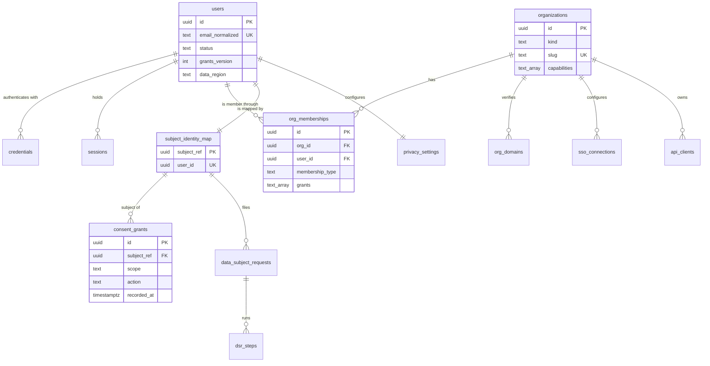
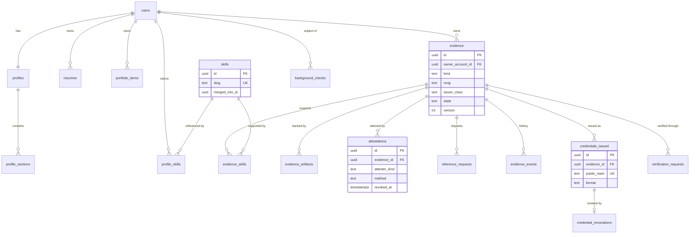
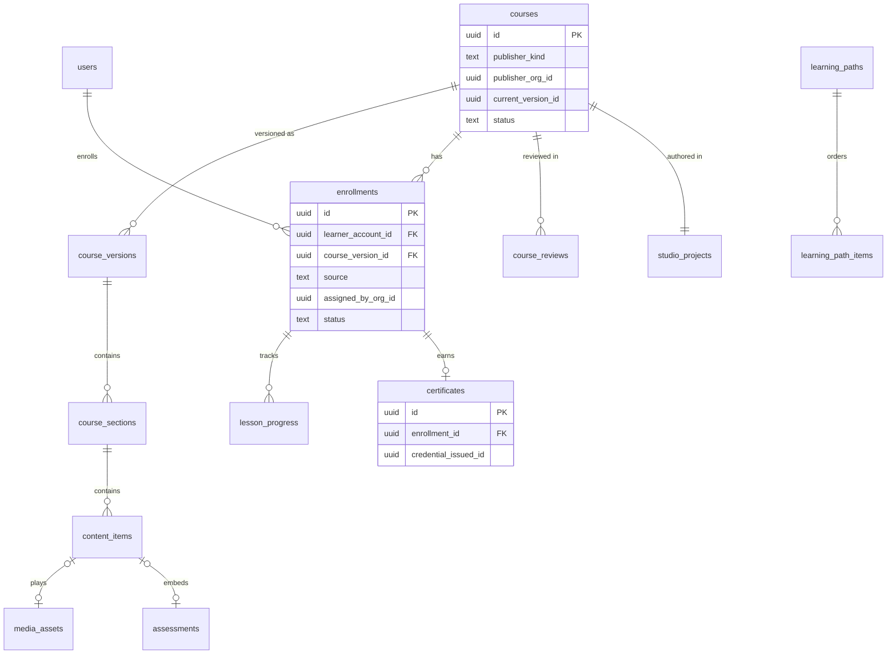
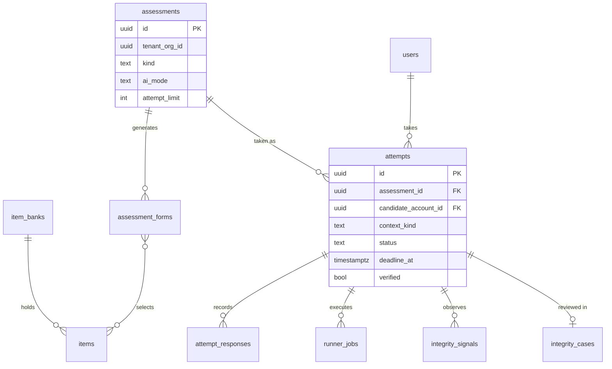
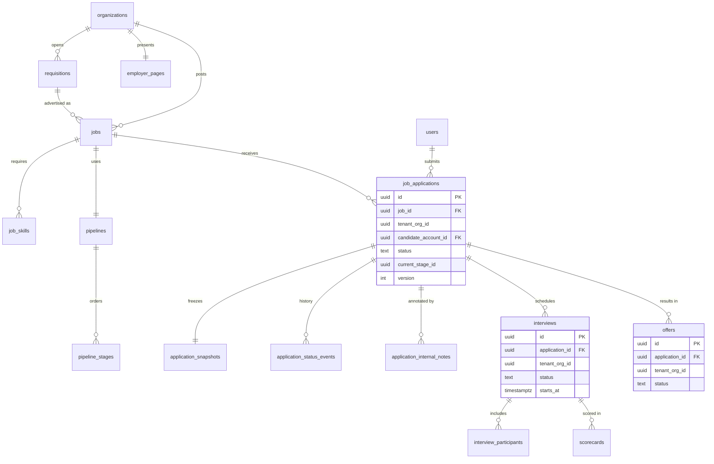
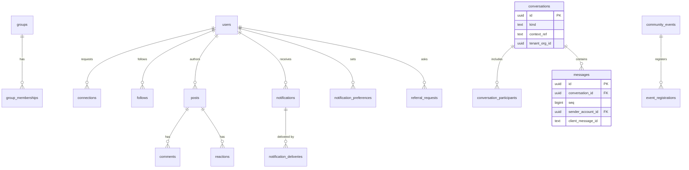
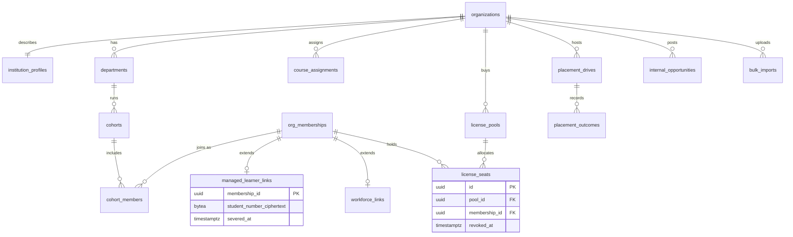
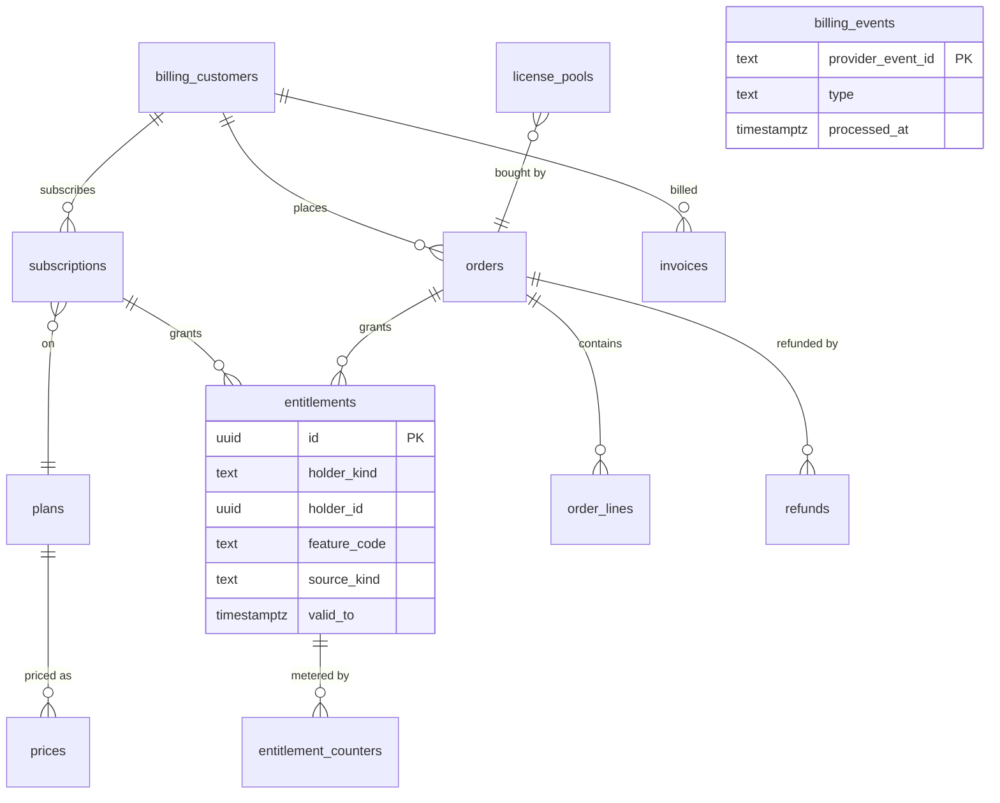
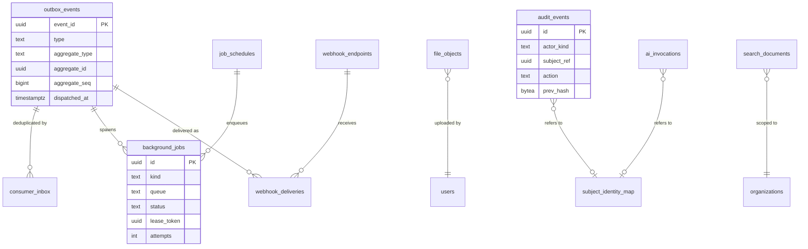
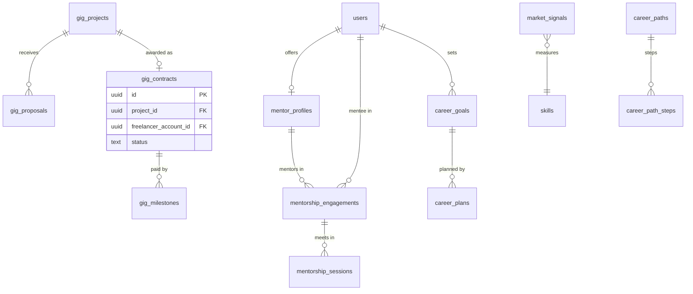

# 02 — Data Model

Status: **Proposed target** conceptual and logical data model for all 30 modules. As-built tables are marked **As-built (input)** with `[SRC: migration nnnnn]`; source presence is not proof that a table is applied in any environment. Entity ids (`ENT-<MOD>-nn`) are assigned in each module specification under `02_MODULES/`; this file names tables and owns cross-cutting data rules. Where a module spec and this file disagree on a table's attributes, the module spec wins for attributes and this file wins for the cross-cutting columns in §1.

Related: [01 System architecture §8 tenancy](01_SYSTEM_ARCHITECTURE.md) · [04 Events](04_EVENTS_AND_ASYNC.md) · `05_SECURITY_PRIVACY` (owns final data-class handling and legal retention values).

## 1. Modeling conventions

| Id   | Rule                                                                                                                                                                                                                                                       | Source                                                    |
| ---- | ---------------------------------------------------------------------------------------------------------------------------------------------------------------------------------------------------------------------------------------------------------- | --------------------------------------------------------- |
| D-01 | Table names are plural `snake_case`, matching the as-built migrations (`users`, `job_applications`). Column names `snake_case`. API fields are `camelCase` and mapped in repositories.                                                                     | [SRC: supabase/migrations 00001…00055; CODE_STYLE]        |
| D-02 | Primary key `id uuid`. New tables use UUIDv7 generated by the application for index locality; as-built tables keep `gen_random_uuid()` (v4) values. Ids are opaque in the API.                                                                             | [SRC: migration 00042 `gen_random_uuid`] [PROP]           |
| D-03 | Every table has `created_at timestamptz not null default now()` and `updated_at timestamptz not null`. All times are UTC.                                                                                                                                  | [SRC: SSOT §14.4 invariants; CON-009]                     |
| D-04 | Mutable aggregate roots carry `version integer not null default 1`, incremented on each update; the API exposes it as the strong `ETag`, and updates use `WHERE id = $1 AND version = $2` (stale write returns `412 precondition-failed`).                 | [SRC: SSOT CON-012; ADR-T08]                              |
| D-05 | Tenancy columns follow the ownership class (01 §8.3): `owner_account_id uuid` for OWN-PERSON, `tenant_org_id uuid` for OWN-ORG, both for SHARED-PARTY. Every tenancy column is `not null` (except documented nullable cases) and leads at least one index. | [DER]                                                     |
| D-06 | Root rows of OWN-PERSON and OWN-ORG aggregates carry `data_region text not null default '<home>'` (DEC-ARC-024).                                                                                                                                           | [PROP]                                                    |
| D-07 | Money is `amount_minor bigint` plus `currency char(3)` (ISO 4217). No floats for money.                                                                                                                                                                    | [SRC: SSOT CON-010]                                       |
| D-08 | State columns are `text` with a `CHECK` constraint whose value list is generated from the module's state machine (`SM-<MOD>-nn`). An enum-versus-state-machine parity test fails on any difference.                                                        | [SRC: V61-18 FF-11]                                       |
| D-09 | Append-only history tables (audit, consent ledger, evidence and application status events, outbox, ledgers) never store an account id. They store `subject_ref uuid`, resolved through `subject_identity_map` (§7).                                        | [SRC: V61-19]                                             |
| D-10 | Free text that may contain personal data is never copied into events, job payloads, logs or search documents beyond what the owning module declares.                                                                                                       | [SRC: EVENT_CATALOG §1 "no free-text personal data"]      |
| D-11 | Foreign keys across modules point only at identity keys (`users.id`, `organizations.id`) or at a module's aggregate root id; never at another module's child tables.                                                                                       | [DER from 01 §6.4 extraction readiness]                   |
| D-12 | JSONB is allowed for provider payload snapshots, configuration documents and sparse extension attributes; never for fields used in authorization, uniqueness or joins.                                                                                     | [DER]                                                     |
| D-13 | Each table is declared in its module's `ownership.ts` with ownership class, tenancy columns, data class per column group, retention class and erasure disposition. Migration CI fails for an undeclared table.                                             | [SRC: SSOT §14.1 "no personal-data inventory" gap] [PROP] |

## 2. Classification schemes

### 2.1 Data classes

The six classes reuse the SSOT AI data-boundary vocabulary so that one label drives storage, logging, export, AI context and search handling [SRC: SSOT §16.5].

| Class             | Meaning                                                   | Examples                                                                                                                                                  | Storage rule                                                                   | May enter AI context                                                          | May enter search documents             |
| ----------------- | --------------------------------------------------------- | --------------------------------------------------------------------------------------------------------------------------------------------------------- | ------------------------------------------------------------------------------ | ----------------------------------------------------------------------------- | -------------------------------------- |
| DC-PUBLIC         | Intended for anyone                                       | Published job, public profile fields, skills taxonomy, credential verification result                                                                     | Plain                                                                          | Yes                                                                           | Yes                                    |
| DC-INTERNAL       | Operational, not personal                                 | Job-kind config, feature flags, aggregate metrics above `min_cohort_k`                                                                                    | Plain                                                                          | Yes                                                                           | n/a                                    |
| DC-PRIVATE        | Personal data visible to the person and granted audiences | Contact email, full profile, evidence artifacts, applications, messages                                                                                   | Plain at column level; encrypted at rest by platform                           | Yes, minimized, owner's own request or granted purpose                        | Only fields in the audience projection |
| DC-SENSITIVE      | Personal data whose misuse causes serious harm            | Date of birth, demographic (EEO) self-identification, accommodation requests, salary history, background-check results, minors' records, precise location | AES-256-GCM field encryption [SRC: SSOT §15.5]; separate table where practical | Never, unless the capability's policy lists the field and the person consents | Never                                  |
| DC-RESTRICTED     | Regulated or contractual secrets about people             | Government id numbers, identity-document images, proctoring recordings                                                                                    | Field or object encryption with dedicated key; access logged on every read     | Never                                                                         | Never                                  |
| DC-NEVER-EXTERNAL | Credentials and keys                                      | Password hashes, session ids, token hashes, provider keys                                                                                                 | Hashed or KMS-encrypted; never exported, never logged                          | Never                                                                         | Never                                  |

### 2.2 Retention classes

Durations are legal and commercial parameters. The defaults below are proposals only; final values come from counsel (OD-ARC-16) and live in `platform_config` as `retention.<class>.days`.

| Class         | What                                                                               | Default [PROP]                                                                                    | Deletion mechanism                                                              |
| ------------- | ---------------------------------------------------------------------------------- | ------------------------------------------------------------------------------------------------- | ------------------------------------------------------------------------------- |
| RC-TRANSIENT  | Idempotency records, rate-limit counters, one-time challenges after use            | 1 day (7 days payment-adjacent; 14 days for queued offline operations) [SRC: BE-01-R2 §4]         | Partition drop or sweep                                                         |
| RC-OPS-SHORT  | Succeeded jobs, consumer inbox rows, outbox rows after dispatch, delivery attempts | 14 days [SRC: EVENT_CATALOG §2 outbox retention]                                                  | Partition drop                                                                  |
| RC-OPS        | Dead-lettered jobs, operational logs, AI invocation payload bodies                 | 90 days                                                                                           | Sweep job `adm.retention.sweep`                                                 |
| RC-ACCOUNT    | Person-owned data while the account exists                                         | Life of account, then erasure workflow                                                            | Erasure participants (§7)                                                       |
| RC-HIRING     | Application records, interview feedback, offers after the hiring decision          | 24 months after the final state, overridable per organization within a platform maximum           | Per-organization sweep; erasure request still honored except under legal hold   |
| RC-EDU        | Institution learning records about managed learners                                | Per institution contract, minimum and maximum set by platform                                     | Institution sweep; graduation severance disposition kept distinct [SRC: V61-27] |
| RC-FINANCIAL  | Orders, invoices, payouts, tax records                                             | 7 years [PROP; jurisdiction-dependent]                                                            | Retained; personal fields pseudonymized on erasure                              |
| RC-AUDIT      | Security and admin audit events                                                    | 2 years hot, then archive up to 7 years                                                           | Partition detach to archive storage                                             |
| RC-CREDENTIAL | Issued credentials and the revocation registry                                     | Until credential expiry plus 2 years; revocation entries kept as long as any copy could circulate | Revocation registry is never purged while the issuer exists                     |
| RC-AGGREGATE  | Aggregates and models built only from data above `min_cohort_k`                    | Indefinite                                                                                        | Rebuilt without erased subjects on the next scheduled rebuild                   |

## 3. Entity catalog

Columns: **Owner** is the module code that owns writes. **Class** is the ownership class (01 §8.3). **Tenancy** names the tenancy columns. **Ret.** is the retention class. **Data** is the highest data class stored. **As-built** cites the migration where a table of that name already exists.

### 3.1 Identity, access and privacy (IDN, SET)

| Table                   | Key and important columns                                                                                                                                                                                             | Owner | Class                                    | Tenancy                                                | Ret.                                    | Data              | As-built                                                          |
| ----------------------- | --------------------------------------------------------------------------------------------------------------------------------------------------------------------------------------------------------------------- | ----- | ---------------------------------------- | ------------------------------------------------------ | --------------------------------------- | ----------------- | ----------------------------------------------------------------- |
| `users`                 | `id`, `email_normalized` unique, `status` (SM: `pending_verification, active, suspended, deactivated, pending_erasure, erased`), `grants_version`, `locale`, `time_zone`, `data_region`                               | IDN   | OWN-PERSON                               | `id` is the owner                                      | RC-ACCOUNT                              | DC-PRIVATE        | Yes [SRC: 00001]                                                  |
| `credentials`           | `id`, `user_id`, `type` (`password, webauthn, oidc, saml`), `secret_hash` or `public_key`, `provider`, `provider_subject` unique per provider, `last_used_at`                                                         | IDN   | OWN-PERSON                               | `user_id`                                              | RC-ACCOUNT                              | DC-NEVER-EXTERNAL | Partly (password hash on `users`)                                 |
| `sessions`              | `id` (hash of cookie value), `user_id`, `kind` (`browser, extension, device`), `created_at`, `last_seen_at`, `idle_expires_at`, `absolute_expires_at`, `recent_auth_at`, `revoked_at`, `ip_prefix`, `user_agent_hash` | IDN   | OWN-PERSON                               | `user_id`                                              | RC-TRANSIENT after expiry + 30 days     | DC-NEVER-EXTERNAL | Revocation rows [SRC: 00045, 00046]                               |
| `auth_challenges`       | `id`, `purpose` (`email_verify, password_reset, email_change, step_up, device_pair`), `user_id`, `token_hash`, `expires_at`, `consumed_at`                                                                            | IDN   | OWN-PERSON                               | `user_id`                                              | RC-TRANSIENT                            | DC-NEVER-EXTERNAL | No                                                                |
| `auth_throttle`         | `key_hash`, `window_start`, `count`, `locked_until`                                                                                                                                                                   | IDN   | PLATFORM                                 | none                                                   | RC-TRANSIENT                            | DC-INTERNAL       | No [SRC: BE-01-R2 §5]                                             |
| `organizations`         | `id`, `kind` (`employer, agency, institution, platform`), `slug` unique, `name`, `status`, `capabilities text[]`, `verified_domain_ids`, `data_region`                                                                | IDN   | OWN-ORG                                  | `id` is the tenant                                     | RC-ACCOUNT (org lifetime)               | DC-PUBLIC/PRIVATE | Yes [SRC: 00001]                                                  |
| `org_memberships`       | `id`, `org_id`, `user_id`, `membership_type` (`staff, instructor, learner, workforce, mentor, alumni`), `status`, `grants text[]`, `invited_by`, unique (`org_id`, `user_id`, `membership_type`)                      | IDN   | SHARED-PARTY                             | `tenant_org_id = org_id`, `owner_account_id = user_id` | RC-ACCOUNT                              | DC-PRIVATE        | Yes [SRC: 00001]                                                  |
| `org_invitations`       | `id`, `org_id`, `email_hash`, `membership_type`, `grants`, `token_hash`, `expires_at`, `accepted_at`                                                                                                                  | IDN   | OWN-ORG                                  | `tenant_org_id`                                        | RC-TRANSIENT after acceptance + 30 days | DC-PRIVATE        | No                                                                |
| `org_domains`           | `id`, `org_id`, `domain`, `verification_method` (`dns_txt, email`), `verified_at`                                                                                                                                     | IDN   | OWN-ORG                                  | `tenant_org_id`                                        | RC-ACCOUNT                              | DC-PUBLIC         | No                                                                |
| `sso_connections`       | `id`, `org_id`, `protocol` (`oidc, saml`), `metadata`, `secret_ciphertext`, `enforced_for text[]`, `scim_token_hash`                                                                                                  | IDN   | OWN-ORG                                  | `tenant_org_id`                                        | RC-ACCOUNT                              | DC-NEVER-EXTERNAL | No                                                                |
| `api_clients`           | `id`, `org_id`, `name`, `client_secret_hash`, `scopes text[]`, `status`, `last_used_at`                                                                                                                               | PLT   | OWN-ORG                                  | `tenant_org_id`                                        | RC-ACCOUNT                              | DC-NEVER-EXTERNAL | No                                                                |
| `consent_grants`        | append-only ledger: `id`, `subject_ref`, `scope` (for example `search.discoverable`, `ai.assist.process`), `audience_type`, `audience_id`, `action` (`grant, revoke`), `policy_version`, `expires_at`, `recorded_at`  | SET   | OWN-PERSON                               | `subject_ref`                                          | RC-AUDIT                                | DC-PRIVATE        | Partial settings store [SRC: 00013]                               |
| `pv_consent_current`    | view: latest grant per (`subject_ref`, `scope`, audience)                                                                                                                                                             | SET   | PUBLIC to other modules (read-only view) | as source                                              | n/a                                     | DC-PRIVATE        | No [SRC: BE-01-R2 §6]                                             |
| `privacy_settings`      | `user_id` PK, `profile_visibility`, `open_to_work_visibility`, `blocked_employer_org_ids uuid[]`, `message_policy`, `version`                                                                                         | SET   | OWN-PERSON                               | `user_id`                                              | RC-ACCOUNT                              | DC-PRIVATE        | Yes, as settings [SRC: 00013]                                     |
| `data_subject_requests` | `id`, `subject_ref`, `kind` (`export, erasure, rectification, restriction`), `status` (SM), `requested_at`, `cooling_off_until`, `due_at`, `completed_at`, `legal_hold_reason`                                        | SET   | OWN-PERSON                               | `subject_ref`                                          | RC-AUDIT                                | DC-PRIVATE        | Erasure store exists [SRC: apps/api/src/storage/erasure-store.ts] |
| `dsr_steps`             | `id`, `request_id`, `participant_module`, `status`, `attempts`, `completed_at`, `evidence_hash`                                                                                                                       | SET   | PLATFORM                                 | none                                                   | RC-AUDIT                                | DC-INTERNAL       | No                                                                |
| `subject_identity_map`  | `subject_ref` PK, `user_id` unique                                                                                                                                                                                    | SET   | OWN-PERSON                               | `user_id`                                              | Deleted on erasure                      | DC-NEVER-EXTERNAL | No [SRC: V61-19]                                                  |
| `support_access_grants` | `id`, `subject_ref`, `agent_user_id`, `scopes`, `reason`, `ticket_id`, `starts_at`, `expires_at`, `revoked_at`                                                                                                        | SET   | OWN-PERSON                               | `subject_ref`                                          | RC-AUDIT                                | DC-PRIVATE        | No                                                                |

### 3.2 Career identity (PRF, EVD, BGV)

| Table                    | Key and important columns                                                                                                                                                                                                                                                                                                                        | Owner                           | Class        | Tenancy                                                            | Ret.                                                          | Data                            | As-built                |
| ------------------------ | ------------------------------------------------------------------------------------------------------------------------------------------------------------------------------------------------------------------------------------------------------------------------------------------------------------------------------------------------ | ------------------------------- | ------------ | ------------------------------------------------------------------ | ------------------------------------------------------------- | ------------------------------- | ----------------------- |
| `profiles`               | `id`, `user_id` unique, `headline`, `summary`, `location_city`, `location_country`, `work_modes`, `open_to_work` (enum incl. `stealth`), `public_slug` unique, `visibility`, `version`                                                                                                                                                           | PRF                             | OWN-PERSON   | `owner_account_id = user_id`                                       | RC-ACCOUNT                                                    | DC-PRIVATE                      | Yes [SRC: 00001]        |
| `profile_sections`       | `id`, `profile_id`, `kind` (`experience, education, project, publication, volunteering, language, award, test_score`), `position`, `data jsonb` validated per kind, `visibility`                                                                                                                                                                 | PRF                             | OWN-PERSON   | `owner_account_id`                                                 | RC-ACCOUNT                                                    | DC-PRIVATE                      | Partial                 |
| `resumes`                | `id`, `owner_account_id`, `title`, `template_id`, `source` (`built, uploaded, imported`), `file_object_id`, `parsed jsonb`, `is_default`                                                                                                                                                                                                         | PRF                             | OWN-PERSON   | `owner_account_id`                                                 | RC-ACCOUNT                                                    | DC-PRIVATE                      | Yes [SRC: 00009]        |
| `portfolio_items`        | `id`, `owner_account_id`, `title`, `description`, `links`, `media_file_ids`, `skill_ids`, `evidence_id` nullable                                                                                                                                                                                                                                 | PRF                             | OWN-PERSON   | `owner_account_id`                                                 | RC-ACCOUNT                                                    | DC-PRIVATE                      | Yes [SRC: 00011]        |
| `skills`                 | `id`, `slug` unique, `name`, `kind` (`hard, soft, tool, language, domain`), `parent_id`, `merged_into_id`, `status`, `aliases text[]`, `external_refs jsonb` (for example ESCO, O\*NET codes)                                                                                                                                                    | MKT (OD-ARC-07; released at R1) | PLATFORM     | none                                                               | Indefinite                                                    | DC-PUBLIC                       | Yes [SRC: 00002]        |
| `profile_skills`         | `owner_account_id`, `skill_id`, `self_level`, `confidence` (derived), `confidence_explanation_id`, `last_evidence_at`, PK (`owner_account_id`, `skill_id`)                                                                                                                                                                                       | PRF                             | OWN-PERSON   | `owner_account_id`                                                 | RC-ACCOUNT                                                    | DC-PRIVATE                      | Yes [SRC: 00002]        |
| `evidence`               | `id`, `owner_account_id`, `kind` (`work_history, project, credential, assessment_result, course_completion, reference, artifact, publication`), `title`, `rung` (`claimed, artifact_backed, peer_attested, authority_verified`), `issuer_class` (required when `authority_verified`), `state` (SM-EVD), `source_module`, `source_ref`, `version` | EVD                             | OWN-PERSON   | `owner_account_id`                                                 | RC-ACCOUNT                                                    | DC-PRIVATE                      | Yes [SRC: 00001, 00002] |
| `evidence_skills`        | `evidence_id`, `skill_id`, `weight`, PK both                                                                                                                                                                                                                                                                                                     | EVD                             | OWN-PERSON   | via `evidence`                                                     | RC-ACCOUNT                                                    | DC-PRIVATE                      | Yes                     |
| `evidence_artifacts`     | `id`, `evidence_id`, `file_object_id` or `url`, `hash_sha256`, `scan_status`                                                                                                                                                                                                                                                                     | EVD                             | OWN-PERSON   | `owner_account_id`                                                 | RC-ACCOUNT                                                    | DC-PRIVATE                      | No                      |
| `evidence_events`        | append-only: `id`, `evidence_id`, `subject_ref`, `from_state`, `to_state`, `from_rung`, `to_rung`, `actor_kind`, `actor_ref`, `reason_code`, `occurred_at`                                                                                                                                                                                       | EVD                             | OWN-PERSON   | `subject_ref`                                                      | RC-AUDIT                                                      | DC-PRIVATE                      | No                      |
| `attestations`           | `id`, `evidence_id`, `attester_kind` (`referee, instructor, employer_org, institution, platform`), `attester_ref`, `method` (`work_email, referee_token, issuer_signature, platform_review`), `issued_at`, `revoked_at`, `revocation_reason`                                                                                                     | EVD                             | SHARED-PARTY | `owner_account_id`, optional `tenant_org_id` of issuing org        | RC-CREDENTIAL                                                 | DC-PRIVATE                      | Partial [SRC: 00041]    |
| `reference_requests`     | `id`, `evidence_id`, `referee_email_hash`, `token_hash`, `expires_at`, `status`, `submitted_at`                                                                                                                                                                                                                                                  | EVD                             | OWN-PERSON   | `owner_account_id`                                                 | RC-ACCOUNT                                                    | DC-NEVER-EXTERNAL for token     | Yes [SRC: 00041]        |
| `credentials_issued`     | `id`, `evidence_id`, `issuer_org_id` nullable, `format` (`open_badges_3, w3c_vc, pdf`), `public_hash` unique, `signed_payload`, `expires_at`, `status`                                                                                                                                                                                           | EVD                             | SHARED-PARTY | `owner_account_id`, `tenant_org_id` (issuer)                       | RC-CREDENTIAL                                                 | DC-PUBLIC (verification fields) | Partial [SRC: 00021]    |
| `credential_revocations` | `credential_id` PK, `revoked_at`, `reason_code`, `revoked_by_kind`                                                                                                                                                                                                                                                                               | EVD                             | PLATFORM     | none                                                               | RC-CREDENTIAL                                                 | DC-PUBLIC                       | Yes [SRC: 00055]        |
| `verification_requests`  | `id`, `evidence_id`, `method`, `status` (SM-BGV), `provider_ref`, `requested_by_kind`, `due_at`                                                                                                                                                                                                                                                  | BGV                             | SHARED-PARTY | `owner_account_id`, optional `tenant_org_id` (requesting employer) | RC-ACCOUNT                                                    | DC-PRIVATE                      | No                      |
| `background_checks`      | `id`, `subject_ref`, `requesting_org_id`, `application_id`, `package_code`, `consent_grant_id`, `status`, `provider`, `provider_case_id`, `result_summary_ciphertext`, `adjudication` (`clear, consider, adverse_pending, adverse_final`), `pre_adverse_sent_at`                                                                                 | BGV                             | SHARED-PARTY | `owner_account_id` via map, `tenant_org_id`                        | RC-HIRING                                                     | DC-RESTRICTED                   | No                      |
| `identity_verifications` | `id`, `user_id`, `provider`, `status`, `level`, `document_object_id` (restricted bucket), `expires_at`                                                                                                                                                                                                                                           | BGV                             | OWN-PERSON   | `owner_account_id`                                                 | RC-ACCOUNT, documents deleted after decision + 30 days [PROP] | DC-RESTRICTED                   | No                      |

### 3.3 Learning (LRN, STU)

| Table                                     | Key and important columns                                                                                                                                                                                                                                                                                                          | Owner | Class                                                             | Tenancy                               | Ret.                                                                       | Data                     | As-built                   |
| ----------------------------------------- | ---------------------------------------------------------------------------------------------------------------------------------------------------------------------------------------------------------------------------------------------------------------------------------------------------------------------------------- | ----- | ----------------------------------------------------------------- | ------------------------------------- | -------------------------------------------------------------------------- | ------------------------ | -------------------------- |
| `courses`                                 | `id`, `publisher_kind` (`platform, instructor, institution, enterprise`), `publisher_org_id` nullable, `instructor_user_id` nullable, `slug` unique, `status` (SM: `draft, in_review, published, unlisted, retired`), `current_version_id`, `visibility` (`public, org_only, cohort_only`), `price_plan_id` nullable               | LRN   | OWN-ORG when `publisher_org_id` set, else OWN-PERSON (instructor) | `tenant_org_id` or `owner_account_id` | Life of course; retired versions kept while any enrollment references them | DC-PUBLIC                | Yes [SRC: 00005]           |
| `course_versions`                         | `id`, `course_id`, `number`, `outline_hash`, `published_at`, `frozen bool`; immutable once published                                                                                                                                                                                                                               | LRN   | as course                                                         | as course                             | as course                                                                  | DC-PUBLIC                | No                         |
| `course_sections`                         | `id`, `course_version_id`, `position`, `title`                                                                                                                                                                                                                                                                                     | LRN   | as course                                                         | as course                             | as course                                                                  | DC-PUBLIC                | Partial (`course_modules`) |
| `content_items`                           | `id`, `section_id`, `kind` (`video, playlist, article, pdf, quiz, assignment, external_link, live_session, lab`), `media_asset_id`, `assessment_id`, `duration_seconds`, `required bool`                                                                                                                                           | LRN   | as course                                                         | as course                             | as course                                                                  | DC-PUBLIC                | No [SRC: SSOT §13.12]      |
| `enrollments`                             | `id`, `learner_account_id`, `course_id`, `course_version_id`, `source` (`self, purchase, license_seat, cohort_assignment, enterprise_assignment`), `assigned_by_org_id` nullable, `status` (SM: `active, completed, expired, withdrawn`), `completed_at`; partial unique (`learner_account_id`, `course_id`) where status `active` | LRN   | OWN-PERSON, SHARED-PARTY when `assigned_by_org_id` set            | `owner_account_id`, `tenant_org_id`   | RC-ACCOUNT; RC-EDU for institution-assigned                                | DC-PRIVATE               | Yes [SRC: 00005]           |
| `lesson_progress`                         | `enrollment_id`, `content_item_id`, `status`, `position_seconds`, `completed_at`, `client_op_id` unique (offline replay)                                                                                                                                                                                                           | LRN   | as enrollment                                                     | as enrollment                         | as enrollment                                                              | DC-PRIVATE               | Partial                    |
| `learning_paths` / `learning_path_items`  | path: `id`, `publisher`, `status`; item: `path_id`, `position`, `course_id` or `assessment_id`                                                                                                                                                                                                                                     | LRN   | as courses                                                        | as courses                            | as courses                                                                 | DC-PUBLIC                | No                         |
| `certificates`                            | `id`, `enrollment_id`, `credential_issued_id` (EVD), `issued_at`; issuance requires the course's final-assessment rule                                                                                                                                                                                                             | LRN   | OWN-PERSON                                                        | `owner_account_id`                    | RC-CREDENTIAL                                                              | DC-PUBLIC (verification) | Partial [SRC: 00021]       |
| `course_reviews`                          | `id`, `course_id`, `author_account_id`, `rating`, `body`, `moderation_state`                                                                                                                                                                                                                                                       | LRN   | OWN-PERSON                                                        | `owner_account_id`                    | RC-ACCOUNT                                                                 | DC-PRIVATE               | Yes                        |
| `course_discussions` / `discussion_posts` | thread per course version; post `author_account_id`, `body`, `moderation_state`                                                                                                                                                                                                                                                    | LRN   | OWN-PERSON per post                                               | `owner_account_id`                    | RC-ACCOUNT                                                                 | DC-PRIVATE               | No                         |
| `studio_projects`                         | `id`, `course_id`, `owner` (instructor or org), `draft_version_id`, `review_status`, `collaborator_ids`                                                                                                                                                                                                                            | STU   | as course                                                         | as course                             | Life of course                                                             | DC-PRIVATE               | No                         |
| `studio_review_comments`                  | `id`, `project_id`, `reviewer_account_id`, `anchor jsonb`, `body`, `resolved_at`                                                                                                                                                                                                                                                   | STU   | as course                                                         | as course                             | Life of project                                                            | DC-PRIVATE               | No                         |
| `media_assets`                            | `id`, `file_object_id` (PLT), `provider`, `provider_asset_id`, `status` (`uploading, processing, ready, failed`), `duration_seconds`, `captions jsonb`, `owner`                                                                                                                                                                    | STU   | as course                                                         | as course                             | Life of course                                                             | DC-PUBLIC after publish  | No                         |
| `instructor_profiles`                     | `user_id` PK, `status` (`applicant, approved, suspended`), `payout_profile_id` nullable                                                                                                                                                                                                                                            | STU   | OWN-PERSON                                                        | `owner_account_id`                    | RC-ACCOUNT                                                                 | DC-PRIVATE               | Partial [SRC: 00031]       |

### 3.4 Assessment (ASM)

| Table               | Key and important columns                                                                                                                                                                                                                                                                                                                                                                                           | Owner | Class                                                      | Tenancy                             | Ret.                               | Data                        | As-built         |
| ------------------- | ------------------------------------------------------------------------------------------------------------------------------------------------------------------------------------------------------------------------------------------------------------------------------------------------------------------------------------------------------------------------------------------------------------------- | ----- | ---------------------------------------------------------- | ----------------------------------- | ---------------------------------- | --------------------------- | ---------------- |
| `assessments`       | `id`, `kind` (`quiz, coding_challenge, take_home, certification_exam, skills_test, contest_round`), `owner_kind`, `tenant_org_id` nullable, `ai_mode` (`ai_prohibited, ai_restricted, ai_allowed, post_assessment_only`), `time_limit_seconds`, `attempt_limit`, `status`, `version`                                                                                                                                | ASM   | OWN-ORG or PLATFORM                                        | `tenant_org_id`                     | Life of assessment                 | DC-INTERNAL                 | Yes [SRC: 00004] |
| `item_banks`        | `id`, `tenant_org_id` nullable, `name`, `skill_ids`, `status`, `version`                                                                                                                                                                                                                                                                                                                                            | ASM   | OWN-ORG or PLATFORM                                        | `tenant_org_id`                     | Life of bank                       | DC-INTERNAL                 | No               |
| `items`             | `id`, `bank_id`, `kind` (`single_choice, multi_choice, short_text, code, file, essay`), `stem`, `options`, `answer_key_ciphertext`, `rubric`, `difficulty`, `skill_ids`, `exposure_count`                                                                                                                                                                                                                           | ASM   | OWN-ORG or PLATFORM                                        | `tenant_org_id`                     | Life of bank                       | DC-RESTRICTED (answer keys) | Partial          |
| `assessment_forms`  | `id`, `assessment_id`, `item_ids` order, `seed`; one per attempt for randomized forms                                                                                                                                                                                                                                                                                                                               | ASM   | as assessment                                              | as assessment                       | as attempt                         | DC-RESTRICTED               | No               |
| `attempts`          | `id`, `assessment_id`, `candidate_account_id`, `context_kind` (`practice, course, application, certification, contest`), `context_ref`, `status` (SM: `started, submitted, grading, graded, voided, expired`), `server_started_at`, `deadline_at`, `score`, `verified bool` (false until runner exists), `integrity_flag_count`; partial unique active per (`assessment_id`, `candidate_account_id`, `context_ref`) | ASM   | SHARED-PARTY when context is an application or institution | `owner_account_id`, `tenant_org_id` | RC-ACCOUNT or RC-HIRING by context | DC-PRIVATE                  | Yes [SRC: 00004] |
| `attempt_responses` | `attempt_id`, `item_id`, `response jsonb`, `saved_at`, `client_seq`; autosave idempotent by (`attempt_id`, `item_id`, `client_seq`)                                                                                                                                                                                                                                                                                 | ASM   | as attempt                                                 | as attempt                          | as attempt                         | DC-PRIVATE                  | No               |
| `runner_jobs`       | `id`, `attempt_id`, `item_id`, `language`, `code_object_id`, `status`, `result jsonb`, `runner_signature`                                                                                                                                                                                                                                                                                                           | ASM   | as attempt                                                 | as attempt                          | RC-OPS for code payloads           | DC-PRIVATE                  | No               |
| `integrity_signals` | append-only: `attempt_id`, `kind` (`focus_loss, paste, device_change, similarity, timing_anomaly`), `value`, `observed_at`                                                                                                                                                                                                                                                                                          | ASM   | as attempt                                                 | as attempt                          | as attempt                         | DC-SENSITIVE                | No               |
| `integrity_cases`   | `id`, `attempt_id`, `status` (`open, under_review, cleared, upheld, appealed`), `reviewer_account_id`, `decision_reason`                                                                                                                                                                                                                                                                                            | ASM   | as attempt                                                 | as attempt                          | RC-AUDIT                           | DC-SENSITIVE                | No               |

### 3.5 Hiring (JOB, ATS, INT, EMP)

| Table                                     | Key and important columns                                                                                                                                                                                                                                                                                                                                                                                                     | Owner | Class                                                | Tenancy                                                    | Ret.                                        | Data                     | As-built                             |
| ----------------------------------------- | ----------------------------------------------------------------------------------------------------------------------------------------------------------------------------------------------------------------------------------------------------------------------------------------------------------------------------------------------------------------------------------------------------------------------------- | ----- | ---------------------------------------------------- | ---------------------------------------------------------- | ------------------------------------------- | ------------------------ | ------------------------------------ |
| `jobs`                                    | `id`, `tenant_org_id`, `requisition_id` nullable, `title`, `description`, `employment_type`, `work_mode`, `locations jsonb`, `salary_min_minor`, `salary_max_minor`, `currency`, `salary_visibility`, `status` (SM-JOB: `draft, pending_review, published, paused, closed, taken_down`), `published_at`, `expires_at`, `version` (write model of the ATS job posting, ENT-ATS-02; JOB owns the listing projection ENT-JOB-01) | ATS   | OWN-ORG                                              | `tenant_org_id`                                            | Life of org + RC-HIRING after close         | DC-PUBLIC when published | Yes [SRC: 00001, 00003]              |
| `job_skills`                              | `job_id`, `skill_id`, `requirement` (`required, preferred`), `min_level`                                                                                                                                                                                                                                                                                                                                                      | ATS   | OWN-ORG                                              | via job                                                    | as job                                      | DC-PUBLIC                | Yes [SRC: 00003]                     |
| `job_questions`                           | `id`, `job_id`, `kind`, `prompt`, `required`, `knockout_rule`                                                                                                                                                                                                                                                                                                                                                                 | ATS   | OWN-ORG                                              | `tenant_org_id`                                            | as job                                      | DC-INTERNAL              | No                                   |
| `job_applications`                        | `id`, `job_id`, `tenant_org_id`, `candidate_account_id`, `status` (SM-APPLICATION), `current_stage_id`, `source`, `submitted_at`, `reapplied_from` nullable, `version`; partial unique active (`job_id`, `candidate_account_id`)                                                                                                                                                                                              | JOB   | SHARED-PARTY                                         | `owner_account_id = candidate_account_id`, `tenant_org_id` | RC-HIRING                                   | DC-PRIVATE               | Yes [SRC: 00001, 00003]              |
| `application_snapshots`                   | `application_id` PK, `profile_snapshot jsonb`, `evidence_ids`, `resume_file_object_id`, `answers jsonb`, `consent_grant_id`; immutable                                                                                                                                                                                                                                                                                        | JOB   | SHARED-PARTY                                         | as application                                             | RC-HIRING                                   | DC-PRIVATE               | No                                   |
| `application_status_events`               | append-only: `application_id`, `subject_ref`, `from_status`, `to_status`, `stage_id`, `actor_kind`, `actor_ref`, `reason_code`, `occurred_at`                                                                                                                                                                                                                                                                                 | JOB   | SHARED-PARTY                                         | `tenant_org_id`, `subject_ref`                             | RC-HIRING                                   | DC-PRIVATE               | Partial                              |
| `application_drafts`                      | `id`, `owner_account_id`, `job_id`, `data jsonb`, `client_op_id`                                                                                                                                                                                                                                                                                                                                                              | JOB   | OWN-PERSON                                           | `owner_account_id`                                         | RC-TRANSIENT 30 days after last edit [PROP] | DC-PRIVATE               | Yes [SRC: 00019]                     |
| `saved_jobs`                              | PK (`owner_account_id`, `job_id`)                                                                                                                                                                                                                                                                                                                                                                                             | JOB   | OWN-PERSON                                           | `owner_account_id`                                         | RC-ACCOUNT                                  | DC-PRIVATE               | Yes                                  |
| `requisitions`                            | `id`, `tenant_org_id`, `title`, `headcount`, `budget_minor`, `status` (`draft, pending_approval, approved, open, filled, cancelled`), `approval_chain jsonb`                                                                                                                                                                                                                                                                  | ATS   | OWN-ORG                                              | `tenant_org_id`                                            | as org                                      | DC-INTERNAL              | No                                   |
| `pipelines` / `pipeline_stages`           | pipeline per job or template; stage `position`, `kind` (`applied, screen, assessment, interview, offer, hired, rejected`), `candidate_label` (what the candidate sees)                                                                                                                                                                                                                                                        | ATS   | OWN-ORG                                              | `tenant_org_id`                                            | as job                                      | DC-INTERNAL              | No                                   |
| `application_internal_notes`              | `id`, `application_id`, `tenant_org_id`, `author_account_id`, `body`, `visibility` (`team, hiring_team, private`)                                                                                                                                                                                                                                                                                                             | ATS   | OWN-ORG                                              | `tenant_org_id`                                            | RC-HIRING                                   | DC-PRIVATE               | No                                   |
| `scorecards`                              | `id`, `application_id`, `interview_id` nullable, `tenant_org_id`, `author_account_id`, `ratings jsonb`, `recommendation`, `submitted_at`                                                                                                                                                                                                                                                                                      | ATS   | OWN-ORG                                              | `tenant_org_id`                                            | RC-HIRING                                   | DC-PRIVATE               | No                                   |
| `offers`                                  | `id`, `application_id`, `tenant_org_id`, `status` (SM: `draft, pending_approval, approved, sent, accepted, declined, rescinded, expired`), `terms_ciphertext`, `document_file_id`, `esign_envelope_ref`, `expires_at`                                                                                                                                                                                                         | ATS   | SHARED-PARTY                                         | both                                                       | RC-HIRING                                   | DC-SENSITIVE             | No                                   |
| `talent_pools` / `talent_pool_members`    | pool `tenant_org_id`, `name`; member `owner_account_id`, `added_by`, `consent_grant_id`                                                                                                                                                                                                                                                                                                                                       | ATS   | OWN-ORG (members reference people only with consent) | `tenant_org_id`                                            | RC-HIRING                                   | DC-PRIVATE               | Yes (intelligence form) [SRC: 00038] |
| `interviews`                              | `id`, `application_id`, `tenant_org_id`, `candidate_account_id`, `kind` (`phone, video, onsite, technical_live, panel`), `status` (SM-INT: `proposed, scheduled, rescheduled, in_progress, completed, cancelled, no_show`), `starts_at`, `ends_at`, `time_zone`, `room_ref`, `fallback_link`, `version`                                                                                                                       | INT   | SHARED-PARTY                                         | both                                                       | RC-HIRING                                   | DC-PRIVATE               | Partial [SRC: 00026]                 |
| `interview_participants`                  | `interview_id`, `account_id`, `role` (`candidate, interviewer, coordinator`), `response`                                                                                                                                                                                                                                                                                                                                      | INT   | SHARED-PARTY                                         | as interview                                               | as interview                                | DC-PRIVATE               | No                                   |
| `availability_rules` / `scheduling_links` | rule `owner_account_id`, `weekly jsonb`, `buffers`, `calendar_connection_id`; link `token_hash`, `slot_options`, `expires_at`                                                                                                                                                                                                                                                                                                 | INT   | OWN-PERSON                                           | `owner_account_id`                                         | RC-ACCOUNT                                  | DC-PRIVATE               | No                                   |
| `calendar_connections`                    | `id`, `owner_account_id`, `provider`, `token_ciphertext`, `scopes`, `status`                                                                                                                                                                                                                                                                                                                                                  | INT   | OWN-PERSON                                           | `owner_account_id`                                         | RC-ACCOUNT                                  | DC-NEVER-EXTERNAL        | No                                   |
| `employer_pages`                          | `org_id` PK, `about`, `media_ids`, `benefits jsonb`, `locations`, `status`, `version`                                                                                                                                                                                                                                                                                                                                         | EMP   | OWN-ORG                                              | `tenant_org_id`                                            | Life of org                                 | DC-PUBLIC                | Partial                              |
| `org_teams` / `org_team_members`          | team `tenant_org_id`, `name`; member `membership_id`, `role`                                                                                                                                                                                                                                                                                                                                                                  | EMP   | OWN-ORG                                              | `tenant_org_id`                                            | Life of org                                 | DC-PRIVATE               | No                                   |
| `employer_reviews`                        | `id`, `org_id`, `author_subject_ref`, `ratings`, `body`, `employment_status`, `moderation_state`; author identity never exposed to the org                                                                                                                                                                                                                                                                                    | EMP   | OWN-PERSON                                           | `subject_ref`                                              | RC-ACCOUNT                                  | DC-PRIVATE               | Partial [SRC: 00034]                 |

### 3.6 Community, messaging and notifications (NET, MSG, REP, EVT, NTF)

| Table                                       | Key and important columns                                                                                                                                                                                              | Owner | Class                     | Tenancy                                              | Ret.                                   | Data                | As-built                      |
| ------------------------------------------- | ---------------------------------------------------------------------------------------------------------------------------------------------------------------------------------------------------------------------- | ----- | ------------------------- | ---------------------------------------------------- | -------------------------------------- | ------------------- | ----------------------------- |
| `connections`                               | `id`, `requester_account_id`, `addressee_account_id`, `status` (`pending, accepted, declined, withdrawn, removed`), unique unordered pair                                                                              | NET   | SHARED-PARTY (two people) | both account ids                                     | RC-ACCOUNT                             | DC-PRIVATE          | Yes [SRC: 00010]              |
| `follows`                                   | PK (`follower_account_id`, `target_kind`, `target_id`)                                                                                                                                                                 | NET   | OWN-PERSON                | `owner_account_id`                                   | RC-ACCOUNT                             | DC-PRIVATE          | No                            |
| `blocks`                                    | PK (`blocker_account_id`, `blocked_account_id`)                                                                                                                                                                        | NET   | OWN-PERSON                | `owner_account_id`                                   | RC-ACCOUNT                             | DC-PRIVATE          | No                            |
| `posts`                                     | `id`, `author_account_id`, `group_id` nullable, `body`, `media_ids`, `visibility`, `moderation_state`, `version`                                                                                                       | NET   | OWN-PERSON                | `owner_account_id`                                   | RC-ACCOUNT                             | DC-PRIVATE          | No                            |
| `comments`, `reactions`                     | comment `post_id`, `author_account_id`, `body`; reaction PK (`post_id`, `account_id`)                                                                                                                                  | NET   | OWN-PERSON                | `owner_account_id`                                   | RC-ACCOUNT                             | DC-PRIVATE          | No                            |
| `groups` / `group_memberships`              | group `owner_kind`, `tenant_org_id` nullable, `visibility`; membership `role`                                                                                                                                          | NET   | OWN-ORG or PLATFORM       | `tenant_org_id`                                      | Life of group                          | DC-PRIVATE          | Partial (alumni) [SRC: 00033] |
| `referral_requests`                         | `id`, `candidate_account_id`, `referrer_account_id`, `job_id`, `status`, `message`, `expires_at`                                                                                                                       | NET   | SHARED-PARTY (two people) | both                                                 | RC-ACCOUNT                             | DC-PRIVATE          | Yes [SRC: 00029]              |
| `intro_requests`                            | `id`, `requester`, `connector`, `target`, `status`, `context`                                                                                                                                                          | NET   | SHARED-PARTY              | three account ids                                    | RC-ACCOUNT                             | DC-PRIVATE          | Yes [SRC: 00028]              |
| `conversations`                             | `id`, `kind` (`direct, application, group, mentorship, gig, support`), `context_ref`, `tenant_org_id` nullable, `last_message_at`                                                                                      | MSG   | SHARED-PARTY              | participants; `tenant_org_id` when application-bound | RC-ACCOUNT or RC-HIRING by kind        | DC-PRIVATE          | Yes [SRC: 00006]              |
| `conversation_participants`                 | PK (`conversation_id`, `account_id`), `role`, `last_read_seq`, `muted_until`, `left_at`                                                                                                                                | MSG   | SHARED-PARTY              | as conversation                                      | as conversation                        | DC-PRIVATE          | Yes                           |
| `messages`                                  | `id`, `conversation_id`, `seq` (per conversation, gapless via conversation row lock), `sender_account_id`, `client_message_id` unique per sender, `body`, `attachments`, `edited_at`, `deleted_at`, `moderation_state` | MSG   | SHARED-PARTY              | as conversation                                      | as conversation                        | DC-PRIVATE          | Yes [SRC: 00006]              |
| `notifications`                             | `id`, `recipient_account_id`, `type`, `category` (opt-out class), `title_key`, `params jsonb`, `entity_ref`, `read_at`, `created_at`                                                                                   | NTF   | OWN-PERSON                | `owner_account_id`                                   | 180 days [PROP]                        | DC-PRIVATE          | Yes [SRC: 00007, 00044]       |
| `notification_deliveries`                   | `id`, `notification_id`, `channel` (`email, push, sms, in_app`), `status` (SM-NOTIFY), `provider_message_id`, `attempts`, `expires_at`                                                                                 | NTF   | OWN-PERSON                | via notification                                     | RC-OPS-SHORT                           | DC-PRIVATE          | Partial                       |
| `notification_preferences`                  | PK (`account_id`, `category`, `channel`), `enabled`, `digest` (`instant, daily, weekly, off`), `quiet_hours`                                                                                                           | NTF   | OWN-PERSON                | `owner_account_id`                                   | RC-ACCOUNT                             | DC-PRIVATE          | Yes [SRC: 00048]              |
| `push_subscriptions`                        | `id`, `account_id`, `endpoint_hash`, `keys_ciphertext`, `device_label`, `last_success_at`                                                                                                                              | PWA   | OWN-PERSON                | `owner_account_id`                                   | Until revoked or 410 from push service | DC-NEVER-EXTERNAL   | No                            |
| `email_suppressions`                        | `email_hash` PK, `reason` (`bounce, complaint, unsubscribe`), `recorded_at`                                                                                                                                            | NTF   | PLATFORM                  | none                                                 | Indefinite                             | DC-PRIVATE (hashed) | No                            |
| `reputation_ledger`                         | append-only: `id`, `subject_ref`, `dimension` (for example `reviewer_reliability`, `mentor_quality`), `delta`, `reason_code`, `source_event_id` unique                                                                 | REP   | OWN-PERSON                | `subject_ref`                                        | RC-ACCOUNT                             | DC-PRIVATE          | Partial [SRC: 00012, 00027]   |
| `xp_transactions`                           | append-only, unique `source_event_id`                                                                                                                                                                                  | REP   | OWN-PERSON                | `subject_ref`                                        | RC-ACCOUNT                             | DC-PRIVATE          | Yes [SRC: 00012]              |
| `badges` / `badge_awards`                   | badge definition PLATFORM; award `owner_account_id`, `badge_id`, `awarded_at`, `source_ref`                                                                                                                            | REP   | PLATFORM / OWN-PERSON     | `owner_account_id`                                   | RC-ACCOUNT                             | DC-PUBLIC by choice | Yes                           |
| `community_events`                          | `id`, `organizer_kind`, `tenant_org_id` nullable, `kind` (`meetup, webinar, career_fair, hackathon, contest`), `starts_at`, `ends_at`, `capacity`, `status`                                                            | EVT   | OWN-ORG or PLATFORM       | `tenant_org_id`                                      | Life of event + 2 years                | DC-PUBLIC           | No                            |
| `event_registrations`                       | `id`, `event_id`, `account_id`, `status` (`registered, waitlisted, cancelled, attended, no_show`), `ticket_code_hash`; unique (`event_id`, `account_id`)                                                               | EVT   | SHARED-PARTY              | `owner_account_id`, `tenant_org_id`                  | as event                               | DC-PRIVATE          | No                            |
| `hackathon_teams` / `hackathon_submissions` | team `event_id`, members; submission `team_id`, `repo_url`, `artifact_ids`, `scores`                                                                                                                                   | EVT   | SHARED-PARTY              | as event                                             | as event                               | DC-PRIVATE          | No                            |

### 3.7 Institutions and enterprise (INS, ENT)

| Table                             | Key and important columns                                                                                                                                                                                 | Owner                      | Class                                        | Tenancy                                            | Ret.                           | Data         | As-built               |
| --------------------------------- | --------------------------------------------------------------------------------------------------------------------------------------------------------------------------------------------------------- | -------------------------- | -------------------------------------------- | -------------------------------------------------- | ------------------------------ | ------------ | ---------------------- |
| `institution_profiles`            | `org_id` PK, `type` (`university, college, bootcamp, school, training_provider`), `accreditation_refs`, `verified_at`                                                                                     | INS                        | OWN-ORG                                      | `tenant_org_id`                                    | Life of org                    | DC-PUBLIC    | No                     |
| `departments`                     | `id`, `tenant_org_id`, `parent_id`, `name`                                                                                                                                                                | INS                        | OWN-ORG                                      | `tenant_org_id`                                    | Life of org                    | DC-INTERNAL  | No                     |
| `cohorts`                         | `id`, `tenant_org_id`, `department_id`, `name`, `starts_on`, `ends_on`, `status`                                                                                                                          | INS                        | OWN-ORG                                      | `tenant_org_id`                                    | RC-EDU                         | DC-INTERNAL  | No                     |
| `cohort_members`                  | PK (`cohort_id`, `membership_id`), `role` (`learner, instructor, mentor`), `joined_at`, `left_at`                                                                                                         | INS                        | SHARED-PARTY                                 | `tenant_org_id`, `owner_account_id` via membership | RC-EDU                         | DC-PRIVATE   | No                     |
| `managed_learner_links`           | `membership_id` PK, `student_number_ciphertext`, `program`, `expected_graduation`, `guardian_contact_ciphertext` nullable (minors), `severed_at` (graduation severance)                                   | INS                        | SHARED-PARTY                                 | both                                               | RC-EDU                         | DC-SENSITIVE | No                     |
| `course_assignments`              | `id`, `tenant_org_id`, `target_kind` (`cohort, department, learner, workforce_group`), `target_id`, `course_id` or `path_id`, `due_on`, `required bool`                                                   | INS (also used by ENT)     | OWN-ORG                                      | `tenant_org_id`                                    | RC-EDU                         | DC-INTERNAL  | No                     |
| `license_pools` / `license_seats` | pool `tenant_org_id`, `product_code`, `quantity`, `valid_from`, `valid_to`, `order_id`; seat `pool_id`, `membership_id`, `assigned_at`, `revoked_at`; unique active seat per (`pool_id`, `membership_id`) | BIL (pool), INS/ENT assign | OWN-ORG                                      | `tenant_org_id`                                    | RC-FINANCIAL                   | DC-INTERNAL  | No                     |
| `placement_drives`                | `id`, `tenant_org_id`, `employer_org_id`, `job_ids`, `eligibility_rules jsonb`, `status`, `window`                                                                                                        | INS                        | SHARED-PARTY (institution and employer orgs) | two org ids                                        | RC-EDU                         | DC-INTERNAL  | No                     |
| `placement_outcomes`              | `id`, `drive_id`, `learner_membership_id`, `application_id`, `outcome`, `reported_by`                                                                                                                     | INS                        | SHARED-PARTY                                 | `tenant_org_id`, `owner_account_id`                | RC-EDU                         | DC-PRIVATE   | No                     |
| `bulk_imports`                    | `id`, `tenant_org_id`, `kind` (`learners, workforce, courses`), `file_object_id`, `status` (`uploaded, parsing, validating, preview, committing, completed, partial, failed`), `row_errors_file_id`       | INS/ENT                    | OWN-ORG                                      | `tenant_org_id`                                    | RC-OPS                         | DC-PRIVATE   | No [SRC: SSOT UXC-013] |
| `workforce_links`                 | `membership_id` PK, `employee_number_ciphertext`, `job_title`, `manager_membership_id`, `hris_ref`, `consent_grant_id` for profile sharing                                                                | ENT                        | SHARED-PARTY                                 | both                                               | Life of employment + RC-HIRING | DC-SENSITIVE | No                     |
| `internal_opportunities`          | `id`, `tenant_org_id`, `kind` (`role, project, gig, mentorship, rotation`), `skill_ids`, `status`, `visibility_rules`                                                                                     | ENT                        | OWN-ORG                                      | `tenant_org_id`                                    | Life of org                    | DC-INTERNAL  | No                     |
| `skills_inventory_snapshots`      | `id`, `tenant_org_id`, `taken_at`, aggregate `data jsonb` above `min_cohort_k` only                                                                                                                       | ENT                        | OWN-ORG                                      | `tenant_org_id`                                    | RC-AGGREGATE                   | DC-INTERNAL  | No                     |

### 3.8 Commercial (BIL)

| Table                         | Key and important columns                                                                                                                                                                                                                                                   | Owner | Class                 | Tenancy | Ret.                    | Data         | As-built                                  |
| ----------------------------- | --------------------------------------------------------------------------------------------------------------------------------------------------------------------------------------------------------------------------------------------------------------------------- | ----- | --------------------- | ------- | ----------------------- | ------------ | ----------------------------------------- |
| `billing_customers`           | `id`, `owner_kind` (`account, org`), `owner_id`, `provider` (`stripe`), `provider_customer_id` unique, `tax_ids_ciphertext`                                                                                                                                                 | BIL   | OWN-PERSON or OWN-ORG | owner   | RC-FINANCIAL            | DC-PRIVATE   | Yes as `stripe_customers` [SRC: 00052]    |
| `plans` / `prices`            | plan `code` unique, `audience` (`candidate, employer, institution, enterprise, instructor`), `features jsonb`; price `plan_id`, `amount_minor`, `currency`, `interval`, `provider_price_id`, `active`                                                                       | BIL   | PLATFORM              | none    | Indefinite (versioned)  | DC-PUBLIC    | Constants in code [SRC: `PLATFORM_PLANS`] |
| `subscriptions`               | `id`, `customer_id`, `plan_code`, `status` (`trialing, active, past_due, canceled, incomplete, paused`), `current_period_end`, `seats`, `provider_subscription_id` unique, `version`                                                                                        | BIL   | as customer           | owner   | RC-FINANCIAL            | DC-PRIVATE   | Yes [SRC: 00014, 00052]                   |
| `entitlements`                | `id`, `holder_kind`, `holder_id`, `feature_code`, `limit_value` nullable, `period`, `source_kind` (`subscription, order, grant, license_seat, trial`), `source_id`, `valid_from`, `valid_to`                                                                                | BIL   | as holder             | holder  | RC-FINANCIAL            | DC-INTERNAL  | Yes [SRC: 00014]                          |
| `entitlement_counters`        | PK (`entitlement_id`, `period_start`), `used`, `reserved`                                                                                                                                                                                                                   | BIL   | as holder             | holder  | RC-OPS after period end | DC-INTERNAL  | No                                        |
| `orders` / `order_lines`      | order `buyer_customer_id`, `status` (`pending, paid, failed, refunded, partially_refunded`), `total_minor`, `currency`, `provider_checkout_id`; line `product_kind` (`course, assessment_credit, license_pool, event_ticket, mentorship_session`), `product_id`, `quantity` | BIL   | as buyer              | buyer   | RC-FINANCIAL            | DC-PRIVATE   | No                                        |
| `invoices`                    | `id`, `customer_id`, `provider_invoice_id` unique, `status`, `amount_due_minor`, `pdf_url_ref`                                                                                                                                                                              | BIL   | as customer           | owner   | RC-FINANCIAL            | DC-PRIVATE   | Yes [SRC: 00052]                          |
| `refunds`                     | `id`, `order_id`, `amount_minor`, `reason`, `status`, `provider_refund_id`                                                                                                                                                                                                  | BIL   | as order              | owner   | RC-FINANCIAL            | DC-PRIVATE   | No                                        |
| `billing_events`              | `provider_event_id` PK, `type`, `received_at`, `processed_at`, `payload_digest`                                                                                                                                                                                             | BIL   | PLATFORM              | none    | RC-FINANCIAL            | DC-INTERNAL  | Yes [SRC: 00052]                          |
| `payout_accounts` / `payouts` | gated by the marketplace money-flow decision (legacy ADR-T25); seller `owner`, `provider_account_id`; payout `amount_minor`, `period`, `status`                                                                                                                             | BIL   | OWN-PERSON or OWN-ORG | owner   | RC-FINANCIAL            | DC-SENSITIVE | No                                        |

### 3.9 Career services and market intelligence (MEN, GIG, MKT, AIC)

| Table                                | Key and important columns                                                                                                                                                                                                                                   | Owner | Class                                                                  | Tenancy                                 | Ret.                             | Data                | As-built                                  |
| ------------------------------------ | ----------------------------------------------------------------------------------------------------------------------------------------------------------------------------------------------------------------------------------------------------------- | ----- | ---------------------------------------------------------------------- | --------------------------------------- | -------------------------------- | ------------------- | ----------------------------------------- |
| `mentor_profiles`                    | `user_id` PK, `topics`, `rate_minor` nullable, `status`, `capacity_per_month`                                                                                                                                                                               | MEN   | OWN-PERSON                                                             | `owner_account_id`                      | RC-ACCOUNT                       | DC-PUBLIC by choice | Partial (SSOT `mentorship_relationships`) |
| `mentorship_engagements`             | `id`, `mentor_account_id`, `mentee_account_id`, `program_org_id` nullable, `status` (`requested, active, paused, completed, cancelled`), `goals`                                                                                                            | MEN   | SHARED-PARTY                                                           | both accounts, optional `tenant_org_id` | RC-ACCOUNT                       | DC-PRIVATE          | No                                        |
| `mentorship_sessions`                | `id`, `engagement_id`, `room_ref`, `starts_at`, `status`, `order_line_id` nullable, `notes_private_mentor`, `notes_shared`                                                                                                                                  | MEN   | SHARED-PARTY                                                           | as engagement                           | as engagement                    | DC-PRIVATE          | No                                        |
| `gig_projects`                       | `id`, `client_kind` (`org, account`), `client_id`, `title`, `scope`, `budget_minor`, `skill_ids`, `status` (`draft, open, in_selection, contracted, closed, cancelled`)                                                                                     | GIG   | OWN-ORG or OWN-PERSON                                                  | client                                  | RC-HIRING                        | DC-PRIVATE          | No                                        |
| `gig_proposals`                      | `id`, `project_id`, `freelancer_account_id`, `price_minor`, `cover_note`, `status`; unique (`project_id`, `freelancer_account_id`)                                                                                                                          | GIG   | SHARED-PARTY                                                           | both                                    | RC-HIRING                        | DC-PRIVATE          | No                                        |
| `gig_contracts` / `gig_milestones`   | contract `project_id`, `freelancer_account_id`, `terms_ciphertext`, `status`; milestone `amount_minor`, `due_on`, `status` (`pending, submitted, accepted, disputed, paid`)                                                                                 | GIG   | SHARED-PARTY                                                           | both                                    | RC-FINANCIAL                     | DC-SENSITIVE        | No                                        |
| `market_signals`                     | `id`, `skill_id` or `role_code`, `geo`, `period`, `metric` (`postings, median_salary, growth`), `value`, `population_n`, `source`, `methodology_ref`                                                                                                        | MKT   | PLATFORM                                                               | none                                    | RC-AGGREGATE                     | DC-PUBLIC           | Partial [SRC: 00023, 00035]               |
| `career_paths` / `career_path_steps` | path `from_role`, `to_role`, `evidence_basis`, `confidence`; step `skill_ids`, `typical_duration`                                                                                                                                                           | MKT   | PLATFORM                                                               | none                                    | RC-AGGREGATE                     | DC-PUBLIC           | Partial [SRC: 00036]                      |
| `career_goals` / `career_plans`      | goal `owner_account_id`, `target_role`, `target_date`; plan items linking courses, assessments, evidence gaps                                                                                                                                               | AIC   | OWN-PERSON                                                             | `owner_account_id`                      | RC-ACCOUNT                       | DC-PRIVATE          | No                                        |
| `recommendations`                    | `id`, `recipient_account_id` or `recipient_org_id`, `kind`, `subject_ref_kind`, `subject_id`, `score`, `explanation_id`, `expires_at`, `feedback`                                                                                                           | AIC   | OWN-PERSON or OWN-ORG                                                  | recipient                               | 90 days [PROP]                   | DC-PRIVATE          | Partial                                   |
| `match_explanations`                 | `id`, `job_id`, `candidate_account_id`, `dimensions jsonb` (constraint, capability, evidence quality, recency, preference, uncertainty), `model_version`, `computed_at`                                                                                     | AIC   | SHARED-PARTY (candidate sees own; org sees for its jobs under consent) | both                                    | RC-HIRING                        | DC-PRIVATE          | No [SRC: SSOT §18.1]                      |
| `ai_conversations` / `ai_messages`   | conversation `owner_account_id`, `capability`, `assessment_session_id` nullable; message role, body, `invocation_id`                                                                                                                                        | AIC   | OWN-PERSON                                                             | `owner_account_id`                      | RC-ACCOUNT; user-deletable       | DC-PRIVATE          | Yes [SRC: 00008]                          |
| `ai_invocations`                     | `id`, `capability_id`, `prompt_version`, `provider`, `model`, `execution_target`, `data_class_max`, `policy_decision`, `input_ref`, `output_ref`, `tokens_in`, `tokens_out`, `cost_minor`, `latency_ms`, `outcome`, `subject_ref`, `tenant_org_id` nullable | AIC   | PLATFORM (provenance)                                                  | `subject_ref`, `tenant_org_id`          | Metadata RC-AUDIT; bodies RC-OPS | DC-PRIVATE          | Partial [SRC: 00008]                      |
| `ai_budget_ledger`                   | append-only: `holder_kind`, `holder_id`, `period`, `kind` (`reserve, commit, release`), `amount_minor`, `invocation_id`                                                                                                                                     | AIC   | as holder                                                              | holder                                  | RC-FINANCIAL                     | DC-INTERNAL         | No                                        |

### 3.10 Trust, platform, search and audit (TSF, ADM, PLT, SRC, ANL, PWA)

| Table                                                                                                         | Key and important columns                                                                                                                                                                                                                                                                                                                                                  | Owner                                          | Class                                    | Tenancy                               | Ret.                         | Data                                 | As-built                                                     |
| ------------------------------------------------------------------------------------------------------------- | -------------------------------------------------------------------------------------------------------------------------------------------------------------------------------------------------------------------------------------------------------------------------------------------------------------------------------------------------------------------------- | ---------------------------------------------- | ---------------------------------------- | ------------------------------------- | ---------------------------- | ------------------------------------ | ------------------------------------------------------------ |
| `reports`                                                                                                     | `id`, `reporter_subject_ref`, `target_kind`, `target_id`, `reason_code`, `details`, `status`, `case_id`                                                                                                                                                                                                                                                                    | TSF                                            | PLATFORM                                 | `subject_ref`                         | RC-AUDIT                     | DC-PRIVATE                           | Yes [SRC: 00017]                                             |
| `moderation_cases`                                                                                            | `id`, `target_kind`, `target_id`, `queue`, `priority`, `status` (`open, in_review, actioned, dismissed, appealed, closed`), `assignee_account_id`, `sla_due_at`                                                                                                                                                                                                            | TSF                                            | PLATFORM                                 | none                                  | RC-AUDIT                     | DC-PRIVATE                           | Partial [SRC: 00017]                                         |
| `moderation_actions`                                                                                          | append-only: `case_id`, `action` (`remove, restrict, warn, suspend, restore`), `actor_ref`, `policy_code`, `occurred_at`                                                                                                                                                                                                                                                   | TSF                                            | PLATFORM                                 | none                                  | RC-AUDIT                     | DC-PRIVATE                           | Partial                                                      |
| `sanctions`                                                                                                   | `id`, `subject_ref`, `kind`, `scope`, `starts_at`, `ends_at`, `appeal_id`                                                                                                                                                                                                                                                                                                  | TSF                                            | PLATFORM                                 | `subject_ref`                         | RC-AUDIT                     | DC-PRIVATE                           | No                                                           |
| `appeals`                                                                                                     | `id`, `sanction_id` or `integrity_case_id`, `status`, `statement`, `decided_by`, `decided_at`                                                                                                                                                                                                                                                                              | TSF                                            | PLATFORM                                 | `subject_ref`                         | RC-AUDIT                     | DC-PRIVATE                           | No                                                           |
| `trust_signals`                                                                                               | `subject_ref`, `kind` (`duplicate_device, endorsement_ring, velocity, disposable_email`), `score`, `observed_at`                                                                                                                                                                                                                                                           | TSF                                            | PLATFORM                                 | `subject_ref`                         | RC-OPS                       | DC-SENSITIVE                         | Partial                                                      |
| `audit_events`                                                                                                | append-only, partitioned monthly: `id`, `occurred_at`, `actor_kind`, `actor_ref`, `subject_ref` nullable, `tenant_org_id` nullable, `action`, `resource_kind`, `resource_id`, `decision`, `reason`, `request_id`, `trace_id`, `prev_hash` (hash chain per partition)                                                                                                       | ADM                                            | PLATFORM                                 | `tenant_org_id` (org-visible subset)  | RC-AUDIT                     | DC-PRIVATE                           | Yes as `audit_logs`, `admin_audit_logs` [SRC: 00001, 00050]  |
| `support_tickets`                                                                                             | `id`, `requester_account_id`, `category`, `status`, `assignee_account_id`, `conversation_id`                                                                                                                                                                                                                                                                               | ADM                                            | OWN-PERSON with platform staff access    | `owner_account_id`                    | RC-OPS (2 years [PROP])      | DC-PRIVATE                           | No                                                           |
| `platform_config`                                                                                             | `key` PK, `value jsonb`, `schema_ref`, `version`, `updated_by`                                                                                                                                                                                                                                                                                                             | ADM                                            | PLATFORM                                 | none                                  | Indefinite (versioned)       | DC-INTERNAL                          | SSOT canonical table 42                                      |
| `feature_flags`                                                                                               | `key` PK, `kind` (`release, ops, kill_switch, experiment`), `enabled`, `rules jsonb`, `owner`, `expires_at`                                                                                                                                                                                                                                                                | ADM                                            | PLATFORM                                 | none                                  | Indefinite                   | DC-INTERNAL                          | Yes (key, enabled, description) [SRC: 00051]                 |
| `announcements`                                                                                               | `id`, `audience_rule`, `body_key`, `starts_at`, `ends_at`                                                                                                                                                                                                                                                                                                                  | ADM                                            | PLATFORM                                 | none                                  | 1 year                       | DC-PUBLIC                            | SSOT canonical table 48                                      |
| `file_objects`                                                                                                | `id`, `owner_kind`, `owner_id`, `tenant_org_id` nullable, `purpose` (`avatar, resume, evidence_artifact, course_media, message_attachment, export, import, id_document`), `bucket`, `object_key`, `content_type_declared`, `content_type_detected`, `size_bytes`, `sha256`, `status` (`pending_upload, quarantined, scanning, available, rejected, deleted`), `data_class` | PLT                                            | as owner                                 | `owner_account_id` or `tenant_org_id` | As owning record             | Up to DC-RESTRICTED (by purpose)     | No                                                           |
| `webhook_endpoints`                                                                                           | `id`, `tenant_org_id`, `url`, `event_types text[]`, `secret_ciphertext`, `status`, `failure_count`                                                                                                                                                                                                                                                                         | PLT                                            | OWN-ORG                                  | `tenant_org_id`                       | Life of org                  | DC-NEVER-EXTERNAL                    | No                                                           |
| `webhook_deliveries`                                                                                          | `id`, `endpoint_id`, `event_id`, `attempt`, `status`, `response_status`, `next_attempt_at`                                                                                                                                                                                                                                                                                 | PLT                                            | OWN-ORG                                  | `tenant_org_id`                       | RC-OPS-SHORT                 | DC-INTERNAL                          | No                                                           |
| `integration_connections`                                                                                     | `id`, `tenant_org_id` or `owner_account_id`, `provider`, `kind` (`ats_import, hris, lms_lti, sis, calendar, job_distribution`), `secret_ciphertext`, `config jsonb`, `status`, `last_sync_at`                                                                                                                                                                              | PLT                                            | OWN-ORG or OWN-PERSON                    | as owner                              | Life of connection           | DC-NEVER-EXTERNAL                    | No                                                           |
| `external_identity_refs`                                                                                      | `id`, `local_kind`, `local_id`, `provider`, `external_id`, unique (`provider`, `external_id`, `local_kind`)                                                                                                                                                                                                                                                                | PLT                                            | as local record                          | as local                              | as local                     | DC-INTERNAL                          | SSOT §14.5 migration cluster                                 |
| `search_documents`                                                                                            | PK (`doc_type`, `doc_id`, `audience`), `tenant_org_id` nullable, `owner_account_id` nullable, `visibility`, `consent_scope` nullable, `consent_epoch`, `tsv tsvector`, `title_trgm text`, `facets jsonb`, `embedding vector` nullable, `rank_features jsonb`, `source_version`, `indexed_at`                                                                               | SRC                                            | PUBLIC-PROJECTION or OWN-ORG by audience | as source                             | Rebuilt; removed with source | DC-PUBLIC or DC-PRIVATE per audience | No [SRC: 00016 tables exist for discovery]                   |
| `saved_searches`                                                                                              | `id`, `owner_account_id` or `tenant_org_id`, `kind` (`jobs, candidates, courses`), `query jsonb`, `alert_cadence`, `last_run_at`                                                                                                                                                                                                                                           | SRC                                            | OWN-PERSON or OWN-ORG                    | owner                                 | RC-ACCOUNT                   | DC-PRIVATE                           | Yes [SRC: 00018]                                             |
| `analytics_events`                                                                                            | partitioned daily: `event_name`, `occurred_at`, `pseudonymous_actor_id` (rotating per `analytics.actor_salt_period`), `tenant_org_id` nullable, `properties jsonb` (allowlisted keys)                                                                                                                                                                                      | ANL                                            | PLATFORM                                 | `tenant_org_id`                       | RC-OPS (13 months [PROP])    | DC-INTERNAL                          | Yes [SRC: 00020]                                             |
| `metric_snapshots`                                                                                            | `metric_code`, `scope_kind`, `scope_id`, `period`, `value`, `population_n`; suppressed when `population_n < min_cohort_k`                                                                                                                                                                                                                                                  | ANL                                            | PLATFORM or OWN-ORG                      | `tenant_org_id`                       | RC-AGGREGATE                 | DC-INTERNAL                          | No                                                           |
| `device_installs`                                                                                             | `id`, `account_id`, `platform`, `app_version`, `last_seen_at`                                                                                                                                                                                                                                                                                                              | PWA                                            | OWN-PERSON                               | `owner_account_id`                    | 1 year after last seen       | DC-PRIVATE                           | No                                                           |
| `outbox_events`, `consumer_inbox`, `background_jobs`, `job_schedules`, `idempotency_records`, `worker_health` | Defined in [04 §3, §5, §8, §10](04_EVENTS_AND_ASYNC.md)                                                                                                                                                                                                                                                                                                                    | Platform core (owned by PLT as infrastructure) | PLATFORM                                 | carried in payload                    | RC-OPS-SHORT / RC-TRANSIENT  | Up to DC-PRIVATE                     | `background_jobs` [SRC: 00042], `worker_health` [SRC: 00049] |

### 3.11 As-built tables without a target home

The as-built migrations include intelligence experiments (`talent_segmentation`, `behavioral_talent_discovery`, `skill_forecasting`, `peer_credibility`, `learning_impact`, `employer_reputation`) [SRC: migrations 00025–00040]. Each is either absorbed by the owning module above (AIC, MKT, REP, EMP) or retired by a forward migration once that module's specification decides. None is dropped without a migration that moves or archives its data (§9). Disposition per table belongs to `11_LEGACY_DISPOSITION`.

## 4. Conceptual diagrams per domain cluster

Diagrams show the main entities and relationships; attributes are limited to keys and tenancy. §3 is the authoritative attribute list.

### 4.1 Identity and privacy

### 4.2 Profile, evidence and verification

### 4.3 Learning

### 4.4 Assessment

### 4.5 Hiring

### 4.6 Social, messaging and notifications

### 4.7 Institutions and enterprise

### 4.8 Billing and entitlements

### 4.9 Platform, audit and async infrastructure

### 4.10 Career services and OS expansion

## 5. Versioning and audit trail

| Mechanism                 | Applies to                                                                                                                                                                                  | Design                                                                                                                                                                                                                                               |
| ------------------------- | ------------------------------------------------------------------------------------------------------------------------------------------------------------------------------------------- | ---------------------------------------------------------------------------------------------------------------------------------------------------------------------------------------------------------------------------------------------------- |
| Optimistic version        | Every mutable aggregate root                                                                                                                                                                | `version` column (D-04); ETag in API; `412` on mismatch                                                                                                                                                                                              |
| Immutable versions        | Published course versions, assessment forms, job descriptions at the moment of application (inside `application_snapshots`), offer documents, policy and terms versions, prompt versions    | A new row per version; old rows never updated; references point at the version id, not the head                                                                                                                                                      |
| Domain history            | Evidence (`evidence_events`), applications (`application_status_events`), consent (`consent_grants` ledger), moderation (`moderation_actions`), reputation and XP ledgers, AI budget ledger | Append-only, `subject_ref` instead of account id, written in the same transaction as the state change by the owning use case                                                                                                                         |
| Security audit            | Authentication events, policy denials, sensitive allows, admin and support actions, configuration and flag changes, data exports, key rotations                                             | `audit_events` written through the outbox (inline consumer) so the audit write commits or retries with the business change; hash chain (`prev_hash`) per monthly partition detects tampering; reads by SAD and by org admins for their tenant subset |
| Provider event log        | Stripe, background-check, media and email provider callbacks                                                                                                                                | Raw payload digest plus normalized fields; dedupe by provider event id (`billing_events` pattern) [SRC: migration 00052]                                                                                                                             |
| Database-level protection | Append-only tables                                                                                                                                                                          | `ts_app` and `ts_worker` have `INSERT` and `SELECT` only; `UPDATE`/`DELETE` revoked; retention drops whole partitions as `ts_owner`                                                                                                                  |

As-built input: two audit stores exist (`audit_logs`, `admin_audit_logs`) and the observability package has a separate audit interface, with coverage not established [SRC: ARCHITECTURE.md R-6]. Target: one `audit_events` store; the older tables are migrated into it and retired (§9).

## 6. Indexing and partitioning guidance

### 6.1 Indexing rules

| Rule | Statement                                                                                                                                                                                                                          |
| ---- | ---------------------------------------------------------------------------------------------------------------------------------------------------------------------------------------------------------------------------------- |
| I-01 | Every tenancy column leads an index that matches the module's main list query, for example `jobs (tenant_org_id, status, published_at desc, id)`.                                                                                  |
| I-02 | Every cursor-paginated list has a composite index on its sort key tuple ending in `id` ([03 §6](03_API_DESIGN.md)).                                                                                                                |
| I-03 | Business uniqueness uses partial unique indexes on the active state, for example `job_applications (job_id, candidate_account_id) where status not in (terminal states)` [SRC: as-built partial unique index, ARCHITECTURE.md §8]. |
| I-04 | Foreign keys used in joins or cascades are indexed.                                                                                                                                                                                |
| I-05 | Search uses GIN on `search_documents.tsv`, GIN trigram on `title_trgm`, and HNSW on `embedding` per `doc_type` partition ([07 §1](07_SEARCH_MEDIA_REALTIME_ARCHITECTURE.md)).                                                      |
| I-06 | JSONB columns are not indexed unless a module spec names the query; then use expression indexes on the specific key.                                                                                                               |
| I-07 | Queue claim index: `background_jobs (queue, run_after) where status in ('queued','retry_wait')` [DER from as-built `idx_background_jobs_claim`].                                                                                   |
| I-08 | New indexes on large tables are created `CONCURRENTLY` in a migration of their own.                                                                                                                                                |

### 6.2 Partitioning candidates

Partitioning is introduced per table at the trigger in [01 §21](01_SYSTEM_ARCHITECTURE.md) (S5), except where retention by partition drop is needed from the start.

| Table                                  | Strategy                                                                                  | From day one? | Reason                                         |
| -------------------------------------- | ----------------------------------------------------------------------------------------- | ------------- | ---------------------------------------------- |
| `outbox_events`, `consumer_inbox`      | Range by day                                                                              | Yes           | RC-OPS-SHORT retention by partition drop       |
| `idempotency_records`                  | Range by day, split by retention class (`short`, `queued`)                                | Yes           | [SRC: BE-01-R2 §4]                             |
| `audit_events`                         | Range by month                                                                            | Yes           | Hash chain per partition; archive by detach    |
| `analytics_events`                     | Range by day                                                                              | Yes           | Volume and 13-month retention                  |
| `background_jobs`                      | Range by `created_at` month for terminal rows (active rows stay in the default partition) | At trigger    | Claim performance                              |
| `messages`                             | Hash by `conversation_id`                                                                 | At trigger    | Volume; queries are per conversation           |
| `notifications`                        | Range by month                                                                            | At trigger    | 180-day retention                              |
| `search_documents`                     | List by `doc_type`                                                                        | Yes           | Separate vector indexes and analyzers per type |
| `integrity_signals`, `lesson_progress` | Range by month                                                                            | At trigger    | High write rate                                |

## 7. Soft delete and erasure strategy

### 7.1 Deletion vocabulary

| Term        | Meaning                                                                                                                                                                                                                           |
| ----------- | --------------------------------------------------------------------------------------------------------------------------------------------------------------------------------------------------------------------------------- |
| Hide        | User-visible removal; row kept (`hidden_at`); reversible by the owner. Example: archive a resume.                                                                                                                                 |
| Soft delete | `deleted_at` set; excluded from all reads by policy; hard-deleted by sweep after `retention.soft_delete_days` (default 30 [PROP]). Used where undo is promised.                                                                   |
| Tombstone   | Row kept with personal fields nulled and `tombstoned_at` set, because other records reference it and the reference must stay meaningful (for example a message in a group conversation becomes "Message from a deleted account"). |
| Hard delete | Row removed.                                                                                                                                                                                                                      |
| Severance   | Institution-specific disposition at graduation: the managed-learner link is closed, the institution keeps its RC-EDU record, the person keeps their personal copy [SRC: V61-27, SSOT §15.9.4].                                    |

### 7.2 Erasure workflow (DEC-ARC-022)

1. The person requests erasure (`data_subject_requests.kind = 'erasure'`) after step-up authentication. The account moves to `pending_erasure`; sign-in is limited to cancelling during the cooling-off window (`dsr.erasure_cooling_off_days`, default 7 [SRC: V61-07 target proposal]; OD-ARC-17).
2. After cooling-off, SET creates one `dsr_steps` row per registered `ErasureParticipant` (every module that owns OWN-PERSON or SHARED-PARTY data). Each participant runs as a `set.erasure.step` job, idempotently, and reports a disposition per table: `hard_deleted`, `tombstoned`, `retained_legal_hold`, `retained_counterparty` (for example the employer's RC-HIRING record of an application, with the candidate's personal fields removed from the employer view unless law requires retention) or `pseudonymized_financial`.
3. When all steps succeed, SET deletes the `subject_identity_map` row. From then on every append-only history row that carries the `subject_ref` is unlinkable to the person [SRC: V61-19].
4. A post-erasure sweep job searches search documents, caches, object storage prefixes and job payloads for the account id and email hash and records the result on the request.
5. Backups age out under the backup retention policy; restored backups replay the erasure log before serving traffic [DER].
6. Deadline: completion within `dsr.erasure_due_days` of the request (default 30 [SRC: V61-07]); overdue steps page the privacy owner.

Whether a tombstoned or pseudonymized record counts as anonymous data is a legal question (OD-ARC-17).

## 8. Row-level security approach

1. RLS is enabled on every table, including PLATFORM tables (deny-by-default with explicit grants), resolving SSOT's "applicable tables" versus "every table" wording in favor of every table [SRC: SSOT §14.4 open note].
2. Policies are generated per ownership class from `ownership.ts` declarations:

| Ownership class   | `SELECT` policy                                                                                                                                                  | Write policy                                                                                      |
| ----------------- | ---------------------------------------------------------------------------------------------------------------------------------------------------------------- | ------------------------------------------------------------------------------------------------- |
| OWN-PERSON        | `owner_account_id = app_account_id()` or (`app_has_consent(owner, scope, audience)` for declared shared projections) or `app_support_grant_allows(owner, scope)` | `owner_account_id = app_account_id()` or `app_principal_kind() = 'system'` with job tenant claim  |
| OWN-ORG           | `app_has_org_grant(tenant_org_id, '<mod>.<resource>.read')`                                                                                                      | `app_has_org_grant(tenant_org_id, '<mod>.<resource>.write')`                                      |
| SHARED-PARTY      | person-side predicate or org-side predicate; org-internal child tables use OWN-ORG                                                                               | per side, plus state rules enforced by `SECURITY DEFINER` transition functions [SRC: BE-01-R2 §9] |
| PLATFORM          | `app_is_platform_staff('<scope>')`; public subsets only through `pv_` views                                                                                      | platform staff scope or system                                                                    |
| PUBLIC-PROJECTION | `true` on the view, which selects only columns marked DC-PUBLIC                                                                                                  | none (views are read-only)                                                                        |

3. Helper functions are `STABLE`, read only transaction-local settings, and are covered by unit tests in SQL.
4. Policy tests: the generated cross-tenant suite (01 §8.5 item 5) plus per-module allow and deny cases from the module permission matrices.
5. As-built input: `00047_private_data_rls_hardening`, `00048`, `00053` and `00055` already add policies and grants for some tables [SRC: migrations]. They are kept and folded into the generator's output when each table is regenerated.

## 9. Migration policy

| Rule  | Statement                                                                                                                                                                                          | Source                                          |
| ----- | -------------------------------------------------------------------------------------------------------------------------------------------------------------------------------------------------- | ----------------------------------------------- |
| MG-01 | Migrations are SQL files in `supabase/migrations`, contiguous five-digit sequence, applied by `pnpm db:migrate`; nothing claims a migration ran that did not                                       | [SRC: ARCHITECTURE.md INVARIANT-009; CLAUDE.md] |
| MG-02 | Forward-only in production; a mistake is fixed by a new migration                                                                                                                                  | [SRC: SSOT CON-013]                             |
| MG-03 | Expand, migrate, contract: add nullable column or new table → deploy code that writes both → backfill in a job → switch reads → drop old structure in a later release after one deprecation window | [DER]                                           |
| MG-04 | No migration takes a lock longer than `migration.max_lock_ms` (default 2000 [PROP]); long operations run as jobs or `CONCURRENTLY`                                                                 | [DER]                                           |
| MG-05 | Every migration that creates or alters a table updates the module `ownership.ts` declaration; CI regenerates RLS policies and the cross-tenant suite                                               | [PROP]                                          |
| MG-06 | State `CHECK` lists come from the state-machine source; a changed machine produces a migration diff in the same pull request                                                                       | [SRC: V61-18]                                   |
| MG-07 | Renaming an as-built table is avoided; if needed, create the new table, dual-write, then retire the old one                                                                                        | [DER]                                           |
| MG-08 | Data backfills are idempotent jobs with progress rows, not migration statements, when they touch more than `migration.inline_backfill_max_rows` rows (default 10,000 [PROP])                       | [DER]                                           |
| MG-09 | The `persistence-honesty` and `database-migrations` tests remain release gates and are never weakened                                                                                              | [SRC: CLAUDE.md Rules]                          |
| MG-10 | Hosted environments use the repository's runner or its gated adapter, never `supabase db push`                                                                                                     | [SRC: ARCHITECTURE.md §23]                      |

## 10. Open decisions and risks

| Id        | Question                                                                           | Options                                                          | Default proposal                                                                                        | Who decides                  | Blocking                       |
| --------- | ---------------------------------------------------------------------------------- | ---------------------------------------------------------------- | ------------------------------------------------------------------------------------------------------- | ---------------------------- | ------------------------------ |
| OD-ARC-16 | Legal retention durations per retention class                                      | Defaults in §2.2; counsel-set per jurisdiction                   | Use §2.2 defaults in non-production; counsel sets production values [DEC-REQ] (legacy OPEN-08)          | Counsel with product owner   | Production launch; sweep jobs  |
| OD-ARC-17 | Erasure clocks and whether tombstoned or pseudonymized records satisfy erasure law | 7-day cooling-off plus 30-day completion; 30-day cancel window   | 7-day cooling-off, 30-day completion, counterparty and financial retention as listed [DEC-REQ] (V61-07) | Counsel and privacy owner    | SET erasure build              |
| OD-ARC-18 | Person-owned rows reference `users.id` or `profiles.id` (SSOT §14.4 open)          | Account id; profile id                                           | Account id (`owner_account_id`) everywhere; `profiles` is 1:1 [DEC-REQ]                                 | Architect                    | All person-owned tables        |
| OD-ARC-19 | Retire or absorb the as-built intelligence experiment tables (§3.11)               | Absorb into AIC, MKT, REP, EMP; archive and drop                 | Decide per table in `11_LEGACY_DISPOSITION` with a moving migration [DEC-REQ]                           | Product owner                | Cleanup migrations             |
| OD-ARC-20 | Credential format for issued credentials                                           | Open Badges 3.0; W3C Verifiable Credentials 2.0; signed PDF only | Open Badges 3.0 (which uses the VC data model) plus PDF rendering [DEC-REQ]                             | Product owner with EVD owner | EVD issuance, INS certificates |

| Id         | Risk                                                                                       | Likelihood | Impact | Mitigation                                                                                   | Owner role       |
| ---------- | ------------------------------------------------------------------------------------------ | ---------- | ------ | -------------------------------------------------------------------------------------------- | ---------------- |
| RSK-ARC-13 | `subject_ref` indirection is bypassed by a developer storing account ids in history tables | Medium     | High   | Lint on append-only tables for `*_account_id` columns; schema review checklist               | Database lead    |
| RSK-ARC-14 | Generated RLS policies become slow on SHARED-PARTY tables with complex predicates          | Medium     | Medium | Denormalize `tenant_org_id` and `owner_account_id` onto child rows; explain-plan tests in CI | Database lead    |
| RSK-ARC-15 | Field encryption blocks needed queries (for example search by student number)              | Medium     | Medium | Store a keyed blind index (HMAC) beside ciphertext for equality lookups only                 | Security officer |

## 11. Legacy source trace

| Source                                                                                            | Used for                                                                                    | Changed                                                                                   |
| ------------------------------------------------------------------------------------------------- | ------------------------------------------------------------------------------------------- | ----------------------------------------------------------------------------------------- |
| `supabase/migrations/00001…00055`                                                                 | As-built table names and columns, `background_jobs` schema, billing and feature-flag tables | Target adds tenancy, version and region columns; consolidates audit stores                |
| SSOT §14.1–§14.6                                                                                  | Canonical core tables, operational clusters, RLS model and generator                        | Table count is not a product invariant [SRC: SSOT §14]; clusters regrouped by module code |
| SSOT §15.5, §15.9, §16.5                                                                          | Field encryption, privacy matrix, data classes                                              | Classes reused as DC-\* labels                                                            |
| `Yash_Final_Project_Document/12_DATA_AND_DATABASE/PHYSICAL_DESIGN*.md` via SSOT Appendix E V61-19 | `subject_ref` and `subject_identity_map` erasure model                                      | Kept                                                                                      |
| BE-01-R2 §4, §6, §9                                                                               | Idempotency store, `pv_consent_current`, SQL transition functions                           | Kept                                                                                      |
