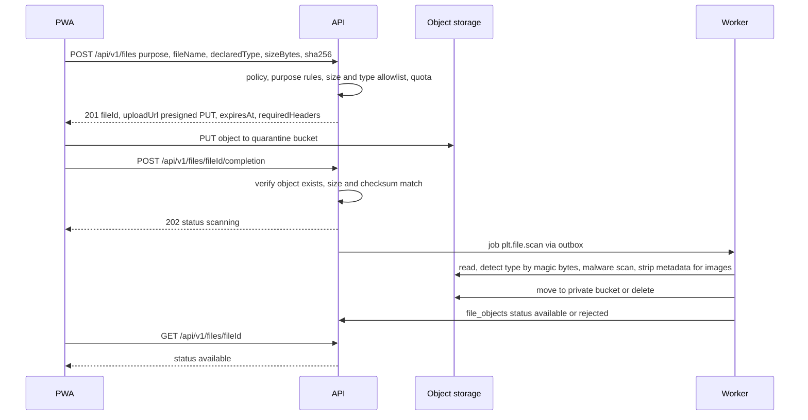

# 03 — API Design

Status: **Proposed target** API standard and route catalog for all 30 modules. As-built routes exist under `/api/v1` in `apps/api/src/server.ts`; their authoritative list is [docs/engineering/API_CONTRACTS.md](../../docs/engineering/API_CONTRACTS.md) [SRC: ARCHITECTURE.md §14]. The catalog below is the target; where a target path differs from an as-built path, the as-built route keeps working through the deprecation process in §8. API capability ids (`API-<MOD>-nn`) are assigned in module specifications; this file fixes the conventions and the route shapes they must follow.

Decision basis: DEC-ARC-018 (style), DEC-ARC-004 (contracts), DEC-ARC-025 (partner API) in [01 §22](01_SYSTEM_ARCHITECTURE.md). Open: OD-ARC-02 (envelope and pagination), OD-ARC-14 (deprecation windows).

## 1. API surfaces

| Surface | Base path | Clients | Auth | Stability |
|---|---|---|---|---|
| First-party API | `/api/v1` | React PWA, browser extension | Session cookie plus CSRF header; extension device session | Additive changes freely; breaking changes through §8 |
| Partner API | `/api/public/v1` | Customer and partner servers (ATS, HRIS, LMS, job boards) | OAuth 2.0 client credentials, organization-scoped | Stricter window (§8); separate OpenAPI document |
| Inbound provider webhooks | `/api/v1/webhooks/<provider>` | Stripe, email provider, background-check vendor, media provider, calendar push | Provider signature over raw body | Provider-defined |
| SCIM | `/scim/v2` | Enterprise and institution identity providers | Per-connection bearer token (hash stored) | SCIM 2.0 |
| LTI | `/lti/1.3/*` | Institution LMS platforms | LTI 1.3 signed launches | LTI spec |
| Realtime | `/rt` | PWA | Session cookie on upgrade | Channel contract §12 |
| Health | `/health` (liveness), `/ready` (readiness) | Load balancer, monitors | None; exempt from rate limits; no data | As-built routes exist [SRC: server.ts `/health`, `/ready`] |
| Telemetry proxy | `/otlp` | PWA | Session optional; fixed upstream; allowlisted schema | [SRC: BE-01-R2 §7] |

Browser traffic is same-origin: the CDN routes `/api`, `/rt` and `/otlp` to the backend so no CORS allowlist is needed for the PWA [SRC: API-STD §1 principle 5]. Partner calls are server-to-server and also need no browser CORS.

## 2. Style rules

| Id | Rule |
|---|---|
| A-01 | Paths are lowercase plural nouns, kebab-case for multiple words (`saved-searches`), at most two levels of nesting below a tenant (`/orgs/{orgId}/jobs/{jobId}`). Ids in paths are opaque UUIDs or public slugs. |
| A-02 | `me` is the only alias and means the authenticated account. Person-owned resources live under `/me/...`. Organization-owned resources live under `/orgs/{orgId}/...`. Platform operations live under `/admin/...`. Public reads have top-level paths (`/jobs`, `/courses`, `/profiles/{slug}`, `/verify/{hash}`). |
| A-03 | CRUD uses HTTP methods. A state transition is `POST` to a noun naming its result: `/publication`, `/closure`, `/withdrawal`, `/stage-transitions`, `/acceptance`, `/decision`. No verbs in paths except protocol endpoints under `/auth` [SRC: API-STD §2]. |
| A-04 | JSON bodies, `camelCase` fields, RFC 3339 UTC timestamps with `Z`, dates `YYYY-MM-DD`, enums lowercase `snake_case` strings, money `{amountMinor, currency}`. Absent field means not provided or not visible; `null` means known empty. |
| A-05 | Unknown request fields are rejected (`422 validation-failed`). Response fields are additive; clients must tolerate unknown fields and unknown enum values. |
| A-06 | Fields hidden by policy obligations are omitted, never nulled, and their absence reveals nothing [SRC: API-STD §2 Masking]. |
| A-07 | Request body maximum is 1 MB JSON; files never travel through JSON (§11). |
| A-08 | `PATCH` uses JSON Merge Patch on documented fields; `PUT` replaces a whole sub-resource. Both require `If-Match` on versioned resources. |
| A-09 | No client-supplied field selection or `expand`; each representation is policy-evaluated as a whole. |
| A-10 | Every route is declared in the module route registry with: policy action, rate-limit class, idempotency mode, pagination mode, data class of response, `x-audience` (`first_party`, `partner`, `both`). |

## 3. Authorization scope notation

Each catalog row has an **Auth** value:

| Notation | Meaning |
|---|---|
| `pub` | No session required. Responses contain DC-PUBLIC data only. Cacheable at the CDN when the route says so. |
| `pub/ses` | Works without a session; a session personalizes the response (for example "saved" flags) and disables shared caching. |
| `ses` | Any authenticated account. The resource is the caller's own (`/me`) or policy checks the resource. |
| `org:<grant>` | Caller has a membership in `{orgId}` carrying `<grant>` (for example `org:ats.application.move_stage`). |
| `plat:<scope>` | Platform staff with the named scope (MOD, SUP, FIN, PAD, SAD per CONVENTIONS §5). |
| `svc:<scope>` | Service principal token with the scope, for the organization the token is bound to. |
| `tok:<purpose>` | A single-use capability token in the path or body (referee, invitation, scheduling link, unsubscribe). Invalid, expired and consumed tokens return an indistinguishable `404` [SRC: API-STD §4]. |
| `+su` | Step-up: `recent_auth_at` within `auth.step_up_max_age_minutes`, else `403 step-up-required`. |
| `+c:<scope>` | Requires a live consent grant (for example `+c:application.share_snapshot`), else `403 consent-required` or omission per route. |

Policy action names follow `<mod>.<resource>.<verb>` ([01 §9](01_SYSTEM_ARCHITECTURE.md)). The grant in `org:` is the policy action unless stated.

## 4. Idempotency

| Notation | Meaning |
|---|---|
| `K!` | `Idempotency-Key` header required (`428 precondition-required` if missing). Used for money, legal effect, irreversible or high-cost operations. |
| `K` | `Idempotency-Key` accepted; strongly recommended for client retries. |
| `N(<key>)` | Natural idempotency: the named key makes a repeat a no-op returning the existing resource (for example `PUT /me/saved-jobs/{jobId}`). |
| `X(<reason>)` | Not idempotent by design, with reason (credential submission, token consumption). |
| `—` | Safe method. |

Semantics [SRC: BE-01-R2 §4; API-STD §8]: scope is principal plus key (anonymous routes scope by hashed IP); same key and identical request returns the stored response with `Idempotency-Replayed: true`; same key with a different body or route returns `422 idempotency-key-reuse`; a concurrent duplicate returns `409 idempotency-in-flight` with `Retry-After`. Keys are 16–64 characters, generated once per user intent and reused on every retry. Retention: 24 hours default, 7 days for payment-adjacent routes, 14 days for routes that accept offline-queued writes. Business uniqueness (for example one active application per job) is enforced by database constraints, not by the key.

## 5. Pagination, filtering, sorting

| Rule | Detail |
|---|---|
| Style | Keyset cursor: `?limit=1..100&cursor=<opaque>`; default limit 25 [SRC: API-STD §6] (SSOT default 20, OD-ARC-02) |
| Response | `{ "items": [...], "page": { "nextCursor": "…" or null, "hasMore": bool, "limit": n } }` |
| Cursor | Opaque, HMAC-signed, contains sort tuple, filter hash, principal hash and issue time; valid `api.cursor_ttl_hours` (default 24); a cursor reused with other filters or by another principal returns `400 malformed-request` |
| Order | Every list has a documented total order ending in `id`; `sort` accepts a per-route allowlist (`sort=-publishedAt`) |
| Totals | None by default; a route may expose `page.estimatedTotal` capped at `api.estimated_total_cap` (default 1000 [PROP]) where the UI needs it |
| Filters | Named query parameters; repeated for multiple values; ranges `<field>From`/`<field>To`; free text `q` (max 200 characters); unknown filters `422` |
| Pagination notation in catalog | `C` cursor list; `B` bounded list (maximum size stated in the module spec); `—` single resource |

## 6. Concurrency and caching

| Topic | Rule |
|---|---|
| ETag | Every versioned resource returns a strong `ETag` derived from `version`. |
| `If-Match` | Required on `PATCH`, `PUT` and state-transition routes of versioned resources; missing returns `428 precondition-required`, stale returns `412 precondition-failed` with the current `ETag` [SRC: SSOT CON-012]. Marked **IM** in the catalog. |
| `If-None-Match` | Supported on `GET`; returns `304`. |
| Cache-Control | Sensitive classes (`/me/privacy*`, billing, verification, tokens, background checks): `private, no-store`. Other personal reads: `private, max-age=0, must-revalidate`. Public catalogs: `public, max-age=60, stale-while-revalidate=300` [SRC: API-STD §10]. |

## 7. Error model

### 7.1 Target: RFC 9457 problem details

`Content-Type: application/problem+json`. Body: `{ type, title, status, detail?, instance?, code, traceId, requestId, retryAfterSeconds?, errors?: [{ pointer, code, message }] }`. `type` is a stable URI `https://errors.<api-domain>/<code>`; `code` repeats the slug [SRC: API-STD §5; SSOT CON-001].

| Code | Status | When |
|---|---|---|
| `malformed-request` | 400 | Unparseable JSON, bad cursor, bad header |
| `unauthenticated` | 401 | No or expired session or token |
| `entitlement-required` | 402 | Plan, seat or quota does not permit the action; body names the entitlement code |
| `forbidden` | 403 | Visible resource, action denied by policy |
| `consent-required` | 403 | Required consent scope absent or revoked |
| `ai-prohibited` | 403 | Caller is in an `AI_PROHIBITED` assessment session |
| `step-up-required` | 403 | Recent authentication needed; body lists acceptable methods |
| `grant-required` | 403 | Support access requires a live grant |
| `account-restricted` | 403 | Sanction or account status blocks the action; body names the appeal route |
| `not-found` | 404 | Missing or not visible to the caller |
| `conflict` | 409 | Generic uniqueness or state conflict |
| `state-transition-invalid` | 409 | Not allowed by the state machine [SRC: BE-01-R2 §3.4] |
| `duplicate-application` | 409 | Active application already exists |
| `reapply-cooldown-active` | 409 | Re-application window not reached |
| `idempotency-in-flight` | 409 | Same key still running |
| `gone` | 410 | Expired export, link, closed job where the spec says so |
| `precondition-failed` | 412 | Stale `If-Match` |
| `payload-too-large` | 413 | Body or declared upload size over cap |
| `unsupported-media-type` | 415 | Content type not allowlisted |
| `validation-failed` | 422 | Schema or business validation; `errors[]` |
| `idempotency-key-reuse` | 422 | Key reused with a different request |
| `account-locked` | 423 | Throttled sign-in |
| `precondition-required` | 428 | Missing `If-Match` or required key |
| `rate-limited` | 429 | Rate class exceeded; `Retry-After` |
| `quota-exceeded` | 429 | Business quota for the period used up (outreach, AI budget); body names the reset time |
| `internal` | 500 | Unexpected; message masked in deployed modes [SRC: ARCHITECTURE.md §19] |
| `upstream-unavailable` | 503 | Dependency breaker open; never a false success |
| `upstream-timeout` | 504 | Dependency timeout |

### 7.2 Transition from the as-built envelope

As-built errors are `{ error: { code, message, request_id, details? } }` rendered by one global handler [SRC: `packages/contracts/src/index.ts` `ErrorEnvelopeSchema`; ARCHITECTURE.md INVARIANT-004]. Until OD-ARC-02 closes: (1) the global handler is the only place either shape is produced; (2) new routes and the partner API emit RFC 9457; (3) existing first-party routes switch per module when the web client's `apiJson` accepts both shapes; (4) `request_id` is kept as `requestId` in the new shape so support workflows do not change.

## 8. Versioning and deprecation

| Rule | Detail |
|---|---|
| Major version in path | `/api/v1`, `/api/public/v1`. A `v2` only for unavoidable breaking change; both run side by side. |
| Compatible changes | Add optional request field, response field, endpoint, enum value (clients tolerate unknown values), problem code; loosen validation. |
| Breaking changes | Remove or rename field, tighten validation, change type, semantics, default sort, auth or idempotency semantics. Detected by `oasdiff` in CI; a breaking diff on a live version fails the build [SRC: API-STD §3]. |
| Deprecation signal | `Deprecation`, `Sunset` and `Link: <doc>; rel="deprecation"` headers; usage telemetry per route and client version. |
| Windows | First-party: `api.deprecation_days.first_party` default 90 [SRC: API-STD §3] versus SSOT ≥ 6 months [SRC: SSOT §12.18] (OD-ARC-14). Partner: `api.deprecation_days.partner` default 365 [PROP]. |
| Client floor | `GET /api/v1/app/version-policy` returns the minimum supported PWA build; older installed PWAs show an update prompt instead of failing silently [PROP]. |

## 9. Rate-limit classes

Values are configuration starting points, not measurements [SRC: API-STD §9; BE-01-R2 §5].

| Class | Applies to | Default limit | Key | Counter store |
|---|---|---|---|---|
| RL-AUTH | Sign-in, register, password reset, email challenges, passkey options | 20 per 10 min per IP prefix; 10 per 15 min per account identifier; progressive delay then `423` | IP prefix and identifier | Durable `auth_throttle` (Redis at trigger) |
| RL-TOKEN | Capability-token routes | 30 per 10 min per IP; 10 per hour per token hash | IP, token hash | Durable |
| RL-READ | Authenticated reads | 600 per min per principal | Principal | In-process bucket per replica |
| RL-WRITE | Authenticated writes | 120 per min per principal | Principal | In-process |
| RL-HEAVY | Search, recommendations, AI, exports, analytics reports | 30 per min and 300 per hour per principal; 600 per hour per organization | Principal, organization | In-process plus business budgets |
| RL-PUBLIC | Anonymous reads | 120 per min per IP prefix; CDN absorbs cacheable traffic | IP prefix | Edge plus in-process |
| RL-PARTNER | Partner API | 1200 per min per API client [PROP] | API client | In-process; Redis at trigger |
| RL-WEBHOOK | Inbound provider webhooks | No quota; signature first; max 50 concurrent per provider | Provider | n/a |

Responses carry `RateLimit-Policy`, `RateLimit` and, on 429, `Retry-After`. As-built: `@fastify/rate-limit` global plugin with per-route overrides (for example 60 per minute) [SRC: server.ts]. Business quotas (outreach messages, job posts, AI budget) are entitlements, not rate classes, and return `402` or `429 quota-exceeded`.

## 10. Long-running operations

Routes that cannot finish within the request timeout (`api.request_timeout_ms`, default 10,000; AI 30,000 [SRC: SSOT CON-008]) return `202 Accepted` with a resource representing the work at a stable URL (`DataExport`, `BulkImport`, `ResumeImport`, `ReportExport`, `AiRun`, `BulkAction`). The resource has an explicit state vocabulary, `Retry-After` on polling, and a notification on completion. There is no generic `/jobs/{id}` route for product features; operators use `/admin/jobs` [SRC: API-STD §11].

## 11. File and upload API

| Rule | Detail |
|---|---|
| Purposes | Each `purpose` (avatar, resume, evidence_artifact, course_media, message_attachment, import, id_document, portfolio_media) defines allowed types, maximum size, data class, bucket and who may read [SRC: SSOT CON-011]. Defaults per purpose are in [07 §2](07_SEARCH_MEDIA_REALTIME_ARCHITECTURE.md). |
| Presigned upload | Single PUT up to `files.single_put_max_bytes` (default 100 MB [PROP]); larger (video) uses multipart upload with per-part presigned URLs from `POST /files/{id}/parts`. URL lifetime `files.presign_ttl_seconds` default 900 [PROP]. |
| Fail-closed | A file is unusable by any feature until `available`. Referencing a non-available file returns `409 conflict` with code detail `file-not-ready`. |
| Download | `POST /files/{id}/download-url` after a policy check returns a short-lived signed URL on the cookieless user-content domain with `Content-Disposition: attachment` for non-media types. Public assets (avatars on public profiles) use CDN URLs of the public bucket. |
| Deletion | `DELETE /files/{id}` marks `deleted`; the object is removed by sweep unless a retention hold applies (evidence referenced by a submitted application snapshot stays for RC-HIRING). |

## 12. Realtime channels

Transport and gateway design are in [07 §3](07_SEARCH_MEDIA_REALTIME_ARCHITECTURE.md). The API contract is:

| Channel pattern | Subscribers | Signals | Authorization |
|---|---|---|---|
| `user:{accountId}` | The account's own connections | `notification.created`, `badge.counts`, `session.revoked` | Account equals caller |
| `conversation:{conversationId}` | Participants | `message.created {seq}`, `message.updated`, `typing`, `read.updated` | Active participant |
| `application:{applicationId}` | Candidate; org members with `ats.application.read` | `status.changed`, `interview.scheduled` | Policy on the application |
| `interview:{interviewId}` | Participants | `state.changed`, `collab.op` (code pad operations) | Participant during the interview window |
| `attempt:{attemptId}` | The candidate | `deadline.updated`, `grading.completed` | Candidate equals caller |
| `org:{orgId}:pipeline:{jobId}` | Org members with access to the job | `application.moved`, `application.created` | `ats.application.read` |
| `contest:{eventId}` | Registered participants and public viewers if enabled | `leaderboard.updated {cursor}` | Event visibility |
| `presence:org:{orgId}` | Org staff | `presence.changed` | Org membership |

Signal payload ≤ 4 KB: `{ type, entity, id, cursor, ts }`; never raw rows or personal free text; the client fetches details over HTTP [SRC: SSOT §13.10]. Overflow sends `refresh`. Subscriptions are re-authorized when `idn.membership.*` or `set.consent.changed` events affect the subscriber.

## 13. Webhooks

### 13.1 Inbound

Order of operations: read raw body → verify signature and timestamp tolerance (Stripe 5 min [SRC: API-STD §4]) → insert the provider event id into the provider event table (`ON CONFLICT DO NOTHING`) → enqueue processing through the outbox → respond `2xx` within `webhook.ack_deadline_ms` (default 2,000 [PROP]). Processing never happens before the response depends on it; duplicate deliveries are no-ops [SRC: SSOT CON-007; as-built Stripe webhook ARCHITECTURE.md §8 item 5].

### 13.2 Outbound (partner webhooks)

| Element | Design |
|---|---|
| Subscription | `webhook_endpoints` per organization with event types from the partner event list (a curated subset of domain events, never internal event payloads directly) |
| Payload | `{ id, type, version, occurredAt, orgId, data }` where `data` is a partner DTO with ids and non-sensitive facts; the receiver fetches details through the partner API under its scopes |
| Signature | Header `TS-Signature: t=<unix>,v1=<hex hmac-sha256(secret, t + "." + body)>`; two active secrets during rotation [SRC: API-STD §13] |
| Delivery | At-least-once via `plt.webhook.deliver` jobs; retry schedule from [04 §6](04_EVENTS_AND_ASYNC.md); endpoint disabled after `webhook.max_consecutive_failures` (default 100 [PROP]) with admin notification |
| Ordering | Not guaranteed; `occurredAt` and resource `version` let receivers discard stale events |
| Tools | Test delivery, delivery log (14 days), manual redelivery |

## 14. Contract governance

| Gate | Rule |
|---|---|
| Source of truth | Zod schemas in `packages/contracts/src/<mod>/` for requests, responses, problem extensions and events. |
| Generation | OpenAPI 3.1 for `/api/v1` and `/api/public/v1`, AsyncAPI 3 for events and realtime signals, JSON Schema for partner webhooks; generated in CI and committed; CI fails if the committed file differs. |
| Breaking change detection | `oasdiff` and AsyncAPI diff against the last released spec [SRC: API-STD §14]. |
| Route registry lint | Fails when a route lacks policy action, rate class, idempotency mode, pagination mode or audience; when an unsafe route has neither key nor natural key; when a list route is not cursor or bounded. |
| Contract tests | Provider tests per route validate success and problem bodies against the schema; web client types are generated from the same schemas. |
| Security tests | Generated IDOR matrix from module permission matrices; cross-tenant canaries; token single-use tests. |
| Review | A schema change in `packages/contracts` requires review from the owning module and from API governance (architect). |

## 15. Route catalog

Paths are relative to `/api/v1` unless they start with `/api/public/v1`, `/scim` or `/lti`. **IM** in Notes means `If-Match` required. Rate class is RL-READ for safe methods and RL-WRITE for unsafe methods unless Notes names another class. Each module spec owns field-level request and response definitions; this table fixes method, path, scope, idempotency and pagination.

### 15.1 Foundation: IDN, SET, NTF

| Method | Path | Auth | Idem. | Page. | Notes |
|---|---|---|---|---|---|
| POST | `/auth/registrations` | pub | N(email) | — | RL-AUTH; always `202` with the same body whether or not the email exists |
| POST | `/auth/sessions` | pub | X(credential submission) | — | Sign-in with password; sets cookies; RL-AUTH; uniform failure |
| DELETE | `/auth/sessions/current` | ses | N(session) | — | Sign out |
| POST | `/auth/email-verifications` | pub | N(email) | — | Resend; RL-AUTH |
| POST | `/auth/email-verifications/{token}/confirmation` | tok:email_verify | X(token) | — | RL-TOKEN |
| POST | `/auth/password-resets` | pub | N(email) | — | RL-AUTH; uniform `202` |
| POST | `/auth/password-resets/{token}/completion` | tok:password_reset | X(token) | — | Revokes all sessions |
| POST | `/auth/passkey-challenges` | pub | X(challenge) | — | Login or registration options; RL-AUTH |
| POST | `/auth/passkey-assertions` | pub | X(credential submission) | — | Passkey sign-in |
| POST | `/me/passkeys` | ses +su | K | — | Register passkey |
| DELETE | `/me/passkeys/{passkeyId}` | ses +su | N(id) | — | Refused if it is the last credential |
| GET | `/auth/federation/{provider}/start` | pub | — | — | OIDC redirect with state and PKCE |
| GET | `/auth/federation/{provider}/callback` | pub | X(state) | — | Links only to an account proven by the user |
| GET | `/auth/sso/{orgSlug}/start` | pub | — | — | Org OIDC or SAML |
| POST | `/auth/sso/{orgSlug}/saml-acs` | pub | X(assertion id replay cache) | — | SAML assertion consumer |
| GET | `/me` | ses | — | — | Account, memberships, CSRF token |
| GET | `/me/capabilities` | ses | — | — | `?resource=type:id`; UI hints only |
| GET | `/me/sessions` | ses | — | B | Active sessions and devices |
| DELETE | `/me/sessions/{sessionId}` | ses | N(id) | — | |
| POST | `/me/session-revocations` | ses +su | K | — | Sign out all other sessions |
| PUT | `/me/password` | ses +su | X(credential submission) | — | Revokes other sessions |
| POST | `/me/email-changes` | ses +su | K | — | Sends confirmation to the new address |
| POST | `/orgs` | ses | K | — | Create employer, agency or institution org; institution needs platform verification |
| GET | `/orgs/{orgId}` | org:idn.org.read | — | — | |
| PATCH | `/orgs/{orgId}` | org:idn.org.manage | K | — | IM |
| GET | `/orgs/{orgId}/members` | org:idn.member.read | — | C | Filter `membershipType`, `grant`, `status` |
| POST | `/orgs/{orgId}/invitations` | org:idn.member.invite | K | — | Batch up to `org.invite_batch_max` |
| POST | `/invitations/{token}/acceptance` | tok:invitation + ses | X(token) | — | |
| PATCH | `/orgs/{orgId}/members/{membershipId}` | org:idn.member.manage | K | — | IM; grant changes bump `grants_version` |
| DELETE | `/orgs/{orgId}/members/{membershipId}` | org:idn.member.manage | N(id) | — | Last admin cannot be removed |
| POST | `/orgs/{orgId}/domains` | org:idn.org.manage | N(domain) | — | |
| POST | `/orgs/{orgId}/domains/{domainId}/verification` | org:idn.org.manage | K | — | DNS TXT check |
| PUT | `/orgs/{orgId}/sso-connection` | org:idn.sso.manage +su | K | — | IM |
| GET, POST, PATCH, DELETE | `/scim/v2/Users`, `/scim/v2/Groups` | svc:scim | SCIM semantics | SCIM | Provisions `staff`, `learner` or `workforce` memberships |
| GET | `/me/privacy-settings` | ses | — | — | `no-store` |
| PATCH | `/me/privacy-settings` | ses | K | — | IM |
| GET | `/me/consents` | ses | — | B | Current grants by scope and audience |
| PUT | `/me/consents/{scope}` | ses | N(scope, audience) | — | Body names audience; ledger append |
| DELETE | `/me/consents/{scope}` | ses | N(scope, audience) | — | Effective at next read |
| POST | `/me/data-exports` | ses +su | K! | — | `202`; RL-HEAVY |
| GET | `/me/data-exports/{exportId}` | ses | — | — | States `requested, building, ready, failed, expired` |
| POST | `/me/data-exports/{exportId}/download-url` | ses +su | K | — | Short-lived signed URL |
| POST | `/me/erasure-request` | ses +su | K! | — | Starts cooling-off |
| DELETE | `/me/erasure-request` | ses | N(request) | — | Cancel during cooling-off only |
| POST | `/me/support-access-grants` | ses | K | — | Scopes, ticket, duration |
| DELETE | `/me/support-access-grants/{grantId}` | ses | N(id) | — | |
| GET | `/me/account-activity` | ses | — | C | Own audit subset |
| GET | `/me/notifications` | ses | — | C | Filter `unread`, `category` |
| POST | `/me/notification-read-marks` | ses | N(ids) | — | Bulk; `upTo` cursor variant |
| GET | `/me/notification-preferences` | ses | — | B | |
| PUT | `/me/notification-preferences/{category}/{channel}` | ses | N(category, channel) | — | Transactional categories cannot be disabled |
| POST | `/me/push-subscriptions` | ses | N(endpoint) | — | |
| DELETE | `/me/push-subscriptions/{subscriptionId}` | ses | N(id) | — | |
| POST | `/unsubscriptions/{token}` | tok:unsubscribe | N(token, category) | — | One-click unsubscribe (RFC 8058 list-unsubscribe-post) |

### 15.2 Career identity: PRF, EVD, BGV, skills

| Method | Path | Auth | Idem. | Page. | Notes |
|---|---|---|---|---|---|
| GET | `/me/profile` | ses | — | — | Full owner view |
| PATCH | `/me/profile` | ses | K | — | IM |
| GET | `/profiles/{slug}` | pub/ses | — | — | Public or audience projection; CDN-cacheable when anonymous |
| POST | `/me/profile/sections` | ses | K | — | |
| PATCH | `/me/profile/sections/{sectionId}` | ses | K | — | IM |
| DELETE | `/me/profile/sections/{sectionId}` | ses | N(id) | — | |
| PUT | `/me/profile/section-order` | ses | N(order) | — | |
| GET | `/me/resumes` | ses | — | B | |
| POST | `/me/resumes` | ses | K | — | Build from profile or attach uploaded file |
| POST | `/me/resume-imports` | ses | K | — | `202`; parses an uploaded file into a proposed profile diff; nothing applied without review |
| POST | `/me/resume-imports/{importId}/application` | ses | K | — | Applies the reviewed diff |
| POST | `/me/resumes/{resumeId}/renderings` | ses | K | — | `202`; PDF rendering |
| POST | `/me/portfolio-items` | ses | K | — | |
| PATCH | `/me/portfolio-items/{itemId}` | ses | K | — | IM |
| DELETE | `/me/portfolio-items/{itemId}` | ses | N(id) | — | |
| GET | `/skills` | pub | — | B | `q` autocomplete, max 20 results |
| GET | `/skills/{skillId}` | pub | — | — | Follows `mergedInto` |
| PUT | `/me/skills/{skillId}` | ses | N(skill) | — | Self level |
| DELETE | `/me/skills/{skillId}` | ses | N(skill) | — | Evidence links remain |
| POST | `/skill-suggestions` | ses | K | — | Proposes a new taxonomy entry for review |
| GET | `/me/evidence` | ses | — | C | Filter `kind`, `rung`, `skillId` |
| POST | `/me/evidence` | ses | K | — | Always starts at `claimed`; `rung` is never a request field [SRC: API-STD §12] |
| PATCH | `/me/evidence/{evidenceId}` | ses | K | — | IM; editing verified content resets the affected rung per EVD rules |
| DELETE | `/me/evidence/{evidenceId}` | ses | N(id) | — | Blocked while referenced by an in-flight application snapshot; snapshot keeps its copy |
| POST | `/me/evidence/{evidenceId}/artifacts` | ses | K | — | Links an `available` file or URL |
| POST | `/me/evidence/{evidenceId}/reference-requests` | ses | K | — | Per-recipient caps |
| GET | `/references/{token}` | tok:referee | — | — | Shows only the claim to attest; `no-store` |
| POST | `/references/{token}/submission` | tok:referee | X(token) | — | RL-TOKEN |
| POST | `/me/evidence/{evidenceId}/work-email-challenges` | ses | K | — | Code sent to work address; code never returned [SRC: ARCHITECTURE.md INVARIANT-015] |
| POST | `/me/work-email-challenges/{challengeId}/confirmation` | ses | X(code) | — | RL-TOKEN |
| GET | `/me/credentials` | ses | — | C | |
| POST | `/me/credentials/{credentialId}/share-links` | ses | K | — | Expiring share link |
| GET | `/verify/{publicHash}` | pub | — | — | Credential verification; revocation shown; CDN short TTL, purged on revocation |
| POST | `/orgs/{orgId}/credential-issuances` | org:evd.credential.issue | K! | — | Institution or employer issues to a member; `202` for batches |
| POST | `/orgs/{orgId}/credentials/{credentialId}/revocation` | org:evd.credential.revoke | K! | — | Reason code required |
| GET | `/admin/verification-queue` | plat:evd.review | — | C | |
| POST | `/admin/evidence/{evidenceId}/verification-decisions` | plat:evd.review | K! | — | Platform-review rung change with reason |
| POST | `/orgs/{orgId}/applications/{applicationId}/background-checks` | org:bgv.check.order | K! | — | Creates request; candidate consent required before vendor call |
| GET | `/orgs/{orgId}/background-checks/{checkId}` | org:bgv.check.read | — | — | `no-store`; summary only |
| POST | `/orgs/{orgId}/background-checks/{checkId}/adjudications` | org:bgv.check.adjudicate | K! | — | `pre_adverse` then `final` with waiting period enforced |
| GET | `/me/background-checks` | ses | — | B | |
| POST | `/me/background-checks/{checkId}/consent` | ses +su | K! | — | Disclosure version recorded |
| POST | `/me/background-checks/{checkId}/disputes` | ses | K | — | |
| POST | `/me/identity-verifications` | ses +su | K | — | Returns vendor session URL |
| POST | `/webhooks/bgv/{provider}` | provider signature | N(provider event id) | — | RL-WEBHOOK |
| POST | `/webhooks/idv/{provider}` | provider signature | N(provider event id) | — | RL-WEBHOOK |

### 15.3 Search and discovery: SRC

| Method | Path | Auth | Idem. | Page. | Notes |
|---|---|---|---|---|---|
| GET | `/search/jobs` | pub/ses | — | C | `q`, location, radius, work mode, salary, skills; RL-PUBLIC or RL-HEAVY |
| GET | `/search/courses` | pub/ses | — | C | |
| GET | `/search/people` | ses | — | C | Network search; only profiles visible to the caller |
| GET | `/orgs/{orgId}/search/candidates` | org:src.candidates.search | — | C | Requires recruiter-search entitlement; consent joined live; RL-HEAVY; each query audited |
| GET | `/search/suggestions` | pub | — | B | Typeahead across jobs, skills, companies, courses |
| GET | `/me/saved-searches` | ses | — | B | |
| POST | `/me/saved-searches` | ses | K | — | Alert cadence |
| PATCH | `/me/saved-searches/{searchId}` | ses | K | — | |
| DELETE | `/me/saved-searches/{searchId}` | ses | N(id) | — | |
| GET, POST, PATCH, DELETE | `/orgs/{orgId}/saved-searches[/{searchId}]` | org:src.candidates.search | K / N(id) | B | Recruiter saved candidate searches |

### 15.4 Learning and assessment: LRN, STU, ASM

| Method | Path | Auth | Idem. | Page. | Notes |
|---|---|---|---|---|---|
| GET | `/courses` | pub/ses | — | C | Catalog; org-only courses visible to members |
| GET | `/courses/{slug}` | pub/ses | — | — | Outline of the current version |
| POST | `/courses/{courseId}/enrollments` | ses | K | — | Free, entitled or license-seat enrollment; paid courses go through checkout first; `402` otherwise |
| GET | `/me/enrollments` | ses | — | C | |
| GET | `/me/enrollments/{enrollmentId}` | ses | — | — | Includes progress |
| PUT | `/me/enrollments/{enrollmentId}/progress/{contentItemId}` | ses | N(clientOpId) | — | Offline-queueable; server revalidates order and completion rules |
| POST | `/me/enrollments/{enrollmentId}/content-items/{contentItemId}/playback-sessions` | ses | K | — | Returns signed playback token for the media provider |
| POST | `/me/enrollments/{enrollmentId}/withdrawal` | ses | K | — | |
| GET | `/me/certificates` | ses | — | C | |
| GET | `/courses/{courseId}/reviews` | pub | — | C | |
| POST | `/courses/{courseId}/reviews` | ses | N(course, author) | — | Only enrolled learners past `lrn.review_min_progress_pct` |
| GET | `/courses/{courseId}/discussions` | ses | — | C | Enrolled only |
| POST | `/courses/{courseId}/discussions` | ses | K | — | Moderated |
| GET | `/paths` | pub | — | C | |
| POST | `/paths/{pathId}/enrollments` | ses | K | — | |
| POST | `/me/instructor-application` | ses | K | — | |
| GET | `/studio/courses` | ses (approved instructor) or org:stu.course.manage | — | C | |
| POST | `/studio/courses` | ses (approved instructor) or org:stu.course.manage | K | — | |
| PATCH | `/studio/courses/{courseId}/draft` | course owner or collaborator | K | — | IM; autosave |
| POST | `/studio/courses/{courseId}/draft/sections` | as above | K | — | |
| PATCH | `/studio/courses/{courseId}/draft/content-items/{itemId}` | as above | K | — | IM |
| POST | `/studio/media-assets` | as above | K | — | Creates `file_objects` row and media asset; returns upload instructions |
| POST | `/studio/courses/{courseId}/review-submissions` | course owner | K | — | Publishing checks run first |
| POST | `/admin/course-reviews/{reviewId}/decision` | plat:stu.review | K! | — | Approve or return with comments |
| POST | `/studio/courses/{courseId}/publication` | course owner | K! | — | Freezes a new course version |
| GET | `/studio/courses/{courseId}/insights` | course owner | — | — | Aggregates above `min_cohort_k` |
| GET | `/assessments/{assessmentId}` | ses | — | — | Public description only; never items |
| POST | `/assessments/{assessmentId}/attempts` | ses | K! | — | Starts the server timer; returns attempt and form; attempt limit enforced |
| GET | `/attempts/{attemptId}` | ses (candidate) | — | — | `no-store` |
| PUT | `/attempts/{attemptId}/responses/{itemId}` | ses (candidate) | N(clientSeq) | — | Autosave; rejected after deadline; never offline-queued |
| POST | `/attempts/{attemptId}/integrity-signals` | ses (candidate) | N(batchSeq) | — | Batched browser signals |
| POST | `/attempts/{attemptId}/submission` | ses (candidate) | K! | — | Moves to `submitted`; grading async |
| GET | `/attempts/{attemptId}/result` | ses (candidate) | — | — | Shows `verified: false` until the runner exists |
| POST | `/attempts/{attemptId}/appeals` | ses (candidate) | K | — | |
| POST | `/orgs/{orgId}/assessments` | org:asm.assessment.manage | K | — | |
| POST | `/orgs/{orgId}/item-banks/{bankId}/items` | org:asm.item.manage | K | — | Answer keys write-only |
| POST | `/orgs/{orgId}/assessment-invitations` | org:asm.assessment.invite | K | — | Links an attempt to an application |
| GET | `/orgs/{orgId}/assessments/{assessmentId}/attempts` | org:asm.attempt.read | — | C | Only attempts in the org's context |
| POST | `/admin/integrity-cases/{caseId}/decision` | plat:asm.integrity.review | K! | — | Human decision with reason |
| POST | `/internal/runner-results` | runner signature | N(runnerJobId) | — | Network-internal only; not routed from the CDN |

### 15.5 Hiring: JOB, ATS, INT, EMP

| Method | Path | Auth | Idem. | Page. | Notes |
|---|---|---|---|---|---|
| GET | `/jobs` | pub/ses | — | C | Published jobs; CDN-cacheable anonymous |
| GET | `/jobs/{jobId}` | pub/ses | — | — | Closed job returns `410 gone` with the closure date [SRC: SSOT §13.2 F-04 note] |
| POST | `/orgs/{orgId}/jobs` | org:job.job.create | K | — | Draft; posting entitlement checked at publication |
| PATCH | `/orgs/{orgId}/jobs/{jobId}` | org:job.job.edit | K | — | IM |
| POST | `/orgs/{orgId}/jobs/{jobId}/publication` | org:job.job.publish | K! | — | May enter `pending_review` per trust rules |
| POST | `/orgs/{orgId}/jobs/{jobId}/pause` | org:job.job.publish | K | — | |
| POST | `/orgs/{orgId}/jobs/{jobId}/closure` | org:job.job.publish | K | — | Reason; open applications handled per ATS rules |
| POST | `/jobs/{jobId}/applications` | ses +c:application.share_snapshot | K! and N(job, candidate) | — | Creates snapshot; `409 duplicate-application` or `409 reapply-cooldown-active` |
| GET | `/me/applications` | ses | — | C | Candidate view with candidate-facing stage labels only |
| GET | `/me/applications/{applicationId}` | ses | — | — | |
| POST | `/me/applications/{applicationId}/withdrawal` | ses | K | — | |
| PUT | `/me/application-drafts/{jobId}` | ses | N(job) | — | Offline-queueable |
| PUT | `/me/saved-jobs/{jobId}` | ses | N(job) | — | |
| DELETE | `/me/saved-jobs/{jobId}` | ses | N(job) | — | |
| GET | `/me/saved-jobs` | ses | — | C | |
| GET | `/orgs/{orgId}/jobs/{jobId}/applications` | org:ats.application.read | — | C | Filter stage, source, rating, tags |
| GET | `/orgs/{orgId}/applications/{applicationId}` | org:ats.application.read | — | — | Snapshot plus live evidence links still consented |
| POST | `/orgs/{orgId}/applications/{applicationId}/stage-transitions` | org:ats.application.move_stage | K | — | IM; `409 state-transition-invalid` |
| POST | `/orgs/{orgId}/applications/{applicationId}/rejection` | org:ats.application.decide | K! | — | Reason code and message template; candidate notified |
| POST | `/orgs/{orgId}/application-bulk-actions` | org:ats.application.decide | K! | — | `202`; per-item results |
| GET, POST | `/orgs/{orgId}/applications/{applicationId}/notes` | org:ats.note.read / write | — / K | C | Org-internal |
| POST | `/orgs/{orgId}/applications/{applicationId}/scorecards` | org:ats.scorecard.submit | K | — | One per interviewer per interview |
| PUT | `/orgs/{orgId}/pipelines/{pipelineId}` | org:ats.pipeline.manage | K | — | IM |
| POST | `/orgs/{orgId}/requisitions` | org:ats.requisition.create | K | — | |
| POST | `/orgs/{orgId}/requisitions/{requisitionId}/approvals` | org:ats.requisition.approve | K | — | |
| POST | `/orgs/{orgId}/applications/{applicationId}/offers` | org:ats.offer.create | K! | — | Draft |
| POST | `/orgs/{orgId}/offers/{offerId}/approval` | org:ats.offer.approve | K! | — | |
| POST | `/orgs/{orgId}/offers/{offerId}/sending` | org:ats.offer.send | K! | — | Optional e-signature envelope |
| POST | `/me/offers/{offerId}/acceptance` | ses +su | K! | — | |
| POST | `/me/offers/{offerId}/decline` | ses | K | — | |
| GET, POST | `/orgs/{orgId}/talent-pools` | org:ats.pool.manage | — / K | C | |
| POST | `/orgs/{orgId}/talent-pools/{poolId}/members` | org:ats.pool.manage +c:search.discoverable | N(pool, person) | — | |
| POST | `/orgs/{orgId}/applications/{applicationId}/interviews` | org:int.interview.schedule | K | — | |
| PATCH | `/orgs/{orgId}/interviews/{interviewId}` | org:int.interview.schedule | K | — | IM; reschedule |
| POST | `/orgs/{orgId}/interviews/{interviewId}/cancellation` | org:int.interview.schedule | K | — | |
| GET | `/me/interviews` | ses | — | C | |
| POST | `/me/interviews/{interviewId}/response` | ses | K | — | Accept or propose other times |
| POST | `/interviews/{interviewId}/room-sessions` | ses (participant) | K | — | Short-lived video room token, valid only in the window |
| POST | `/orgs/{orgId}/scheduling-links` | org:int.interview.schedule | K | — | |
| GET | `/scheduling-links/{token}` | tok:scheduling | — | — | Available slots |
| POST | `/scheduling-links/{token}/booking` | tok:scheduling | K | — | Slot hold with optimistic lock |
| PUT | `/me/availability` | ses | N(owner) | — | IM |
| POST | `/me/calendar-connections` | ses | K | — | OAuth start; returns redirect |
| GET | `/companies/{slug}` | pub/ses | — | — | Employer page |
| PUT | `/orgs/{orgId}/employer-page` | org:emp.page.edit | N(org) | — | IM |
| GET, POST | `/orgs/{orgId}/teams` | org:emp.team.manage | — / K | B | |
| GET | `/companies/{slug}/reviews` | pub | — | C | Aggregates suppressed below `min_cohort_k` |
| POST | `/companies/{slug}/reviews` | ses | N(company, author, period) | — | Author identity never disclosed to the org |
| POST | `/orgs/{orgId}/reviews/{reviewId}/responses` | org:emp.review.respond | K | — | |

### 15.6 Community and messaging: NET, MSG, REP, EVT

| Method | Path | Auth | Idem. | Page. | Notes |
|---|---|---|---|---|---|
| POST | `/me/connections` | ses | N(unordered pair) | — | Connection request; recipient's message policy and blocks applied |
| POST | `/me/connections/{connectionId}/acceptance` | ses (addressee) | K | — | |
| DELETE | `/me/connections/{connectionId}` | ses (either party) | N(id) | — | Withdraw or remove |
| GET | `/me/connections` | ses | — | C | |
| PUT | `/me/follows/{targetKind}/{targetId}` | ses | N(target) | — | People, companies, groups, topics |
| DELETE | `/me/follows/{targetKind}/{targetId}` | ses | N(target) | — | |
| PUT | `/me/blocks/{accountId}` | ses | N(pair) | — | Hides content and blocks messages both ways |
| GET | `/feed` | ses | — | C | Ranked feed; 30 s polling plus realtime refresh signal [SRC: SSOT §13.9] |
| POST | `/posts` | ses | K | — | Moderation pre-check; media must be `available` |
| PATCH | `/posts/{postId}` | ses (author) | K | — | IM; edit history kept |
| DELETE | `/posts/{postId}` | ses (author) or plat:tsf.content.remove | N(id) | — | |
| POST | `/posts/{postId}/comments` | ses | K | — | |
| PUT | `/posts/{postId}/reactions/me` | ses | N(post, account) | — | |
| POST | `/groups` | ses or org:net.group.manage | K | — | |
| POST | `/groups/{groupId}/memberships` | ses | N(group, account) | — | Approval per group setting |
| POST | `/referral-requests` | ses | K | — | Per-referrer weekly cap |
| POST | `/referral-requests/{requestId}/decision` | ses (referrer) | K | — | Accepting submits a referral on the job |
| POST | `/intro-requests` | ses | K | — | Connector must be connected to both |
| GET | `/me/conversations` | ses | — | C | Ordered by `lastMessageAt` |
| POST | `/conversations` | ses | K | — | Direct or context-bound; outreach credits for recruiter cold outreach |
| GET | `/conversations/{conversationId}/messages` | ses (participant) | — | C | Cursor on `seq` |
| POST | `/conversations/{conversationId}/messages` | ses (participant) | N(clientMessageId) | — | Offline-queueable [SRC: SSOT SCI-03] |
| PATCH | `/conversations/{conversationId}/messages/{messageId}` | ses (sender) | K | — | Within `msg.edit_window_minutes` |
| DELETE | `/conversations/{conversationId}/messages/{messageId}` | ses (sender) | N(id) | — | Tombstone |
| POST | `/conversations/{conversationId}/read-marks` | ses (participant) | N(seq) | — | |
| GET | `/me/reputation` | ses | — | — | Dimensions with explanations |
| GET | `/me/xp-ledger` | ses | — | C | |
| GET | `/leaderboards/{leaderboardCode}` | pub/ses | — | B | Opt-in participants only |
| PATCH | `/me/badges/{awardId}` | ses | K | — | Visibility |
| GET | `/events` | pub/ses | — | C | |
| GET | `/events/{eventId}` | pub/ses | — | — | |
| POST | `/orgs/{orgId}/events` | org:evt.event.manage | K | — | Platform events via `/admin/events` |
| POST | `/events/{eventId}/registrations` | ses | N(event, account) | — | Waitlist when full; paid tickets via checkout |
| DELETE | `/events/{eventId}/registrations/me` | ses | N(event, account) | — | |
| POST | `/orgs/{orgId}/events/{eventId}/check-ins` | org:evt.event.manage | N(ticket) | — | |
| POST | `/events/{eventId}/teams` | ses (registered) | K | — | Hackathons |
| POST | `/events/{eventId}/submissions` | ses (team member) | K | — | Before deadline only |
| POST | `/orgs/{orgId}/events/{eventId}/judging-scores` | org:evt.judge | N(judge, submission) | — | |

### 15.7 Intelligence: AIC, MKT

| Method | Path | Auth | Idem. | Page. | Notes |
|---|---|---|---|---|---|
| POST | `/ai/capabilities/{capabilityId}/runs` | ses or org:<capability grant> | K | — | RL-HEAVY; sync up to 30 s or `202`; `403 ai-prohibited`; `402` or `429 quota-exceeded` on budget ([06](06_AI_ARCHITECTURE.md)) |
| GET | `/ai/runs/{runId}` | run owner | — | — | Output, provenance summary, review state |
| POST | `/ai/runs/{runId}/application` | run owner | K | — | User accepts a draft; the owning module's use case applies it |
| POST | `/ai/runs/{runId}/feedback` | run owner | N(run) | — | Rating and reason codes for evals |
| POST | `/ai/conversations` | ses | K | — | Career assistant |
| POST | `/ai/conversations/{conversationId}/messages` | ses (owner) | N(clientMessageId) | — | Streams the reply as `text/event-stream` |
| DELETE | `/ai/conversations/{conversationId}` | ses (owner) | N(id) | — | Deletes memory |
| GET | `/me/ai-settings` | ses | — | — | Execution preferences, connected providers, consent |
| PUT | `/me/ai-settings` | ses | N(owner) | — | IM |
| GET | `/me/recommendations` | ses | — | C | `kind` jobs, courses, people, mentors |
| POST | `/me/recommendations/{recommendationId}/feedback` | ses | N(recommendation) | — | Dismiss, not relevant, save |
| GET | `/me/jobs/{jobId}/match-explanation` | ses | — | — | Dimensions and gaps; no single opaque score [SRC: SSOT §18.1] |
| GET | `/orgs/{orgId}/jobs/{jobId}/candidate-matches` | org:aic.match.read | — | C | Consented discoverable candidates and applicants; RL-HEAVY |
| POST | `/me/career-goals` | ses | K | — | |
| GET | `/me/career-plan` | ses | — | — | |
| POST | `/me/career-plan/regeneration` | ses | K | — | `202` |
| GET | `/market/skills/{skillId}` | pub | — | — | Signals with source, period, population and methodology [SRC: SSOT §18.4] |
| GET | `/market/roles/{roleCode}` | pub | — | — | |
| GET | `/career-paths` | pub | — | B | `fromRole`, `toRole` |
| GET | `/salaries` | ses | — | B | Cells below `min_cohort_k` suppressed |
| POST | `/me/salary-reports` | ses | N(account, role, period) | — | Contributes to aggregates; never shown individually |

### 15.8 Trust, governance and operations: TSF, ADM, ANL

| Method | Path | Auth | Idem. | Page. | Notes |
|---|---|---|---|---|---|
| POST | `/reports` | ses or pub (public content only) | K | — | Target kind and id, reason code |
| GET | `/me/reports` | ses | — | C | Status only |
| GET | `/admin/moderation-cases` | plat:tsf.case.read | — | C | Queue, priority, SLA |
| POST | `/admin/moderation-cases/{caseId}/assignment` | plat:tsf.case.work | K | — | |
| POST | `/admin/moderation-cases/{caseId}/actions` | plat:tsf.case.action | K! | — | Policy code required |
| GET | `/me/sanctions` | ses | — | B | |
| POST | `/me/appeals` | ses | K | — | Against sanction or integrity decision |
| POST | `/admin/appeals/{appealId}/decision` | plat:tsf.appeal.decide | K! | — | Decider differs from the original actor |
| POST | `/support-tickets` | ses or pub | K | — | |
| GET | `/admin/support-tickets` | plat:adm.support.read | — | C | |
| GET | `/admin/users` | plat:adm.user.read | — | C | Search by email hash or id; audited |
| POST | `/admin/users/{userId}/suspension` | plat:adm.user.suspend +su | K! | — | |
| GET | `/admin/organizations` | plat:adm.org.read | — | C | |
| POST | `/admin/organizations/{orgId}/verification` | plat:adm.org.verify | K! | — | Institution and employer verification |
| GET | `/admin/audit-events` | plat:adm.audit.read | — | C | |
| GET | `/orgs/{orgId}/audit-events` | org:adm.audit.read | — | C | Tenant subset |
| PUT | `/admin/feature-flags/{flagKey}` | plat:adm.flag.manage +su | K | — | IM; kill switches page the owner |
| PUT | `/admin/config/{configKey}` | plat:adm.config.manage +su | K | — | IM; schema-validated |
| GET | `/admin/jobs` | plat:adm.ops.read | — | C | Filter queue, kind, status |
| POST | `/admin/jobs/{jobId}/retry` | plat:adm.ops.retry | K | — | Dead jobs only |
| GET | `/admin/health` | plat:adm.ops.read | — | — | Dependency and breaker status [SRC: SSOT §13.4] |
| POST | `/analytics/events` | pub/ses +c:analytics.product | N(batchId) | — | Allowlisted event names and properties [SRC: BE-01-R2 §7] |
| GET | `/orgs/{orgId}/reports/{reportCode}` | org:anl.report.read | — | — | Suppression below `min_cohort_k` |
| POST | `/orgs/{orgId}/report-exports` | org:anl.report.export | K | — | `202`; RL-HEAVY |
| GET | `/admin/metrics/{metricCode}` | plat:anl.metric.read | — | — | |

### 15.9 Institutions and enterprise: INS, ENT

| Method | Path | Auth | Idem. | Page. | Notes |
|---|---|---|---|---|---|
| GET, POST | `/orgs/{orgId}/departments` | org:ins.structure.manage | — / K | B | |
| GET, POST | `/orgs/{orgId}/cohorts` | org:ins.cohort.read / manage | — / K | C | |
| POST | `/orgs/{orgId}/cohorts/{cohortId}/members` | org:ins.cohort.manage | N(cohort, membership) | — | |
| POST | `/orgs/{orgId}/bulk-imports` | org:ins.import.run or org:ent.import.run | K! | — | `202`; states per UXC-013 [SRC: SSOT §12.17] |
| GET | `/orgs/{orgId}/bulk-imports/{importId}` | same | — | — | Preview and row errors |
| POST | `/orgs/{orgId}/bulk-imports/{importId}/commit` | same | K! | — | |
| POST | `/orgs/{orgId}/course-assignments` | org:ins.assignment.manage or org:ent.assignment.manage | K | — | Allocates seats if the course needs them |
| GET | `/orgs/{orgId}/learners/{membershipId}/progress` | org:ins.progress.read | — | — | Institution-assigned learning only |
| GET | `/orgs/{orgId}/license-pools` | org:bil.license.read | — | B | |
| POST | `/orgs/{orgId}/license-pools/{poolId}/seats` | org:bil.license.assign | N(pool, membership) | — | `409` when exhausted |
| DELETE | `/orgs/{orgId}/license-pools/{poolId}/seats/{seatId}` | org:bil.license.assign | N(id) | — | Progress kept |
| POST | `/orgs/{orgId}/placement-drives` | org:ins.placement.manage | K | — | Partner employer org named |
| GET | `/orgs/{orgId}/placement-drives/{driveId}/eligible-learners` | org:ins.placement.manage | — | C | Learners with `institution.share_profile` consent only |
| POST | `/orgs/{orgId}/learners/{membershipId}/severance` | org:ins.learner.manage | K! | — | Graduation severance |
| GET | `/me/institutions` | ses | — | B | Links, consents, severance status |
| POST | `/lti/1.3/launch` | LTI signed launch | X(nonce) | — | |
| GET | `/lti/1.3/jwks` | pub | — | — | |
| GET | `/orgs/{orgId}/workforce` | org:ent.workforce.read | — | C | Shared fields only |
| PUT | `/me/workforce/{orgId}/profile-sharing` | ses (workforce member) | N(org) | — | Consent `enterprise.workforce_profile` |
| GET, POST | `/orgs/{orgId}/internal-opportunities` | workforce member or org:ent.opportunity.manage | — / K | C | |
| POST | `/orgs/{orgId}/internal-opportunities/{opportunityId}/applications` | workforce member | K and N(opportunity, member) | — | Visible to the employee's manager only if the employee opts in [PROP] |
| GET | `/orgs/{orgId}/skills-inventory` | org:ent.inventory.read | — | — | Aggregates above `min_cohort_k` |
| POST | `/orgs/{orgId}/hris-syncs` | org:ent.integration.manage | K | — | `202` |

### 15.10 Commercial: BIL

| Method | Path | Auth | Idem. | Page. | Notes |
|---|---|---|---|---|---|
| GET | `/plans` | pub | — | B | Audience filter |
| POST | `/billing/checkout-sessions` | ses or org:bil.billing.manage | K! | — | Returns provider redirect URL; redirect success grants nothing [SRC: ARCHITECTURE.md §8 item 5] |
| POST | `/billing/portal-sessions` | ses or org:bil.billing.manage | K | — | |
| GET | `/me/subscription` | ses | — | — | `no-store` |
| GET | `/orgs/{orgId}/subscription` | org:bil.billing.read | — | — | |
| GET | `/me/entitlements` | ses | — | B | Remaining counts |
| GET | `/orgs/{orgId}/entitlements` | org:bil.billing.read | — | B | |
| GET | `/me/orders` | ses | — | C | |
| GET | `/me/invoices`, `/orgs/{orgId}/invoices` | ses / org:bil.billing.read | — | C | |
| POST | `/orgs/{orgId}/license-pool-orders` | org:bil.billing.manage | K! | — | Invoice or card |
| POST | `/me/orders/{orderId}/refund-requests` | ses | K | — | Refund policy rules in BIL |
| POST | `/admin/refunds` | plat:bil.refund | K! | — | |
| POST | `/webhooks/stripe` | Stripe signature | N(event id) | — | As-built route exists [SRC: ARCHITECTURE.md §17] |

### 15.11 Career services: MEN, GIG

| Method | Path | Auth | Idem. | Page. | Notes |
|---|---|---|---|---|---|
| GET | `/mentors` | pub/ses | — | C | |
| PUT | `/me/mentor-profile` | ses | N(owner) | — | IM |
| POST | `/mentors/{mentorId}/engagement-requests` | ses | N(mentor, mentee, open) | — | |
| POST | `/me/mentorship-engagements/{engagementId}/acceptance` | ses (mentor) | K | — | |
| POST | `/me/mentorship-engagements/{engagementId}/sessions` | ses (participant) | K | — | Paid sessions create an order |
| POST | `/me/mentorship-engagements/{engagementId}/completion` | ses (participant) | K | — | |
| POST | `/me/mentorship-engagements/{engagementId}/reviews` | ses (mentee) | N(engagement) | — | |
| GET | `/gig-projects` | pub/ses | — | C | |
| POST | `/gig-projects` | ses or org:gig.project.manage | K | — | |
| POST | `/gig-projects/{projectId}/proposals` | ses (freelancer mode) | N(project, freelancer) | — | |
| POST | `/gig-projects/{projectId}/proposals/{proposalId}/award` | project client | K! | — | Creates contract |
| POST | `/gig-contracts/{contractId}/milestones/{milestoneId}/submission` | freelancer | K | — | |
| POST | `/gig-contracts/{contractId}/milestones/{milestoneId}/acceptance` | client | K! | — | Releases payment when the money-flow decision allows |
| POST | `/gig-contracts/{contractId}/disputes` | either party | K | — | Routed to TSF |

### 15.12 Platform: PLT, PWA

| Method | Path | Auth | Idem. | Page. | Notes |
|---|---|---|---|---|---|
| POST | `/files` | ses or org grant per purpose | K | — | Presigned upload (§11) |
| POST | `/files/{fileId}/parts` | uploader | N(partNumber) | — | Multipart |
| POST | `/files/{fileId}/completion` | uploader | N(file) | — | `202` scanning |
| GET | `/files/{fileId}` | policy per purpose | — | — | Status and metadata |
| POST | `/files/{fileId}/download-url` | policy per purpose | K | — | |
| DELETE | `/files/{fileId}` | owner | N(id) | — | |
| GET, POST | `/orgs/{orgId}/webhook-endpoints` | org:plt.webhook.manage | — / K | B | |
| DELETE | `/orgs/{orgId}/webhook-endpoints/{endpointId}` | org:plt.webhook.manage | N(id) | — | |
| POST | `/orgs/{orgId}/webhook-endpoints/{endpointId}/test-deliveries` | org:plt.webhook.manage | K | — | |
| GET | `/orgs/{orgId}/webhook-endpoints/{endpointId}/deliveries` | org:plt.webhook.manage | — | C | |
| POST | `/orgs/{orgId}/webhook-deliveries/{deliveryId}/redelivery` | org:plt.webhook.manage | K | — | |
| POST | `/orgs/{orgId}/api-clients` | org:plt.api_client.manage +su | K | — | Secret shown once |
| POST | `/orgs/{orgId}/api-clients/{clientId}/secret-rotation` | org:plt.api_client.manage +su | K! | — | Old secret valid for `api_client.rotation_overlap_hours` |
| POST | `/orgs/{orgId}/integrations/{provider}/connection` | org:plt.integration.manage +su | K | — | OAuth or key entry; secret envelope-encrypted |
| DELETE | `/orgs/{orgId}/integrations/{provider}/connection` | org:plt.integration.manage | N(org, provider) | — | |
| GET | `/app/version-policy` | pub | — | — | Minimum supported PWA build |
| POST | `/me/devices` | ses | N(installId) | — | Install registration |
| POST | `/me/offline-operations` | ses | K per operation | B | Flushes queued writes allowed by the offline contract; each operation revalidated and answered individually |
| POST | `/extension/pairings` | ses | K | — | Pairs the browser extension to a device session |

### 15.13 Partner API (`/api/public/v1`)

| Method | Path | Auth | Idem. | Page. | Notes |
|---|---|---|---|---|---|
| POST | `/api/public/v1/oauth/token` | client credentials | X(credential submission) | — | Opaque token ≤ 1 h |
| GET, POST, PATCH | `/api/public/v1/jobs[/{jobId}]` | svc:jobs.read / jobs.write | — / K | C | Same rules as first-party job routes |
| POST | `/api/public/v1/jobs/{jobId}/publication`, `/closure` | svc:jobs.write | K | — | |
| GET | `/api/public/v1/applications` | svc:applications.read | — | C | `updatedSince` filter for sync |
| GET | `/api/public/v1/applications/{applicationId}` | svc:applications.read | — | — | Snapshot DTO; consent rules apply |
| POST | `/api/public/v1/applications/{applicationId}/stage-transitions` | svc:applications.write | K | — | IM |
| GET | `/api/public/v1/interviews` | svc:interviews.read | — | C | |
| GET | `/api/public/v1/learners/{externalId}/progress` | svc:learning.read | — | — | Institutions and enterprises |
| POST | `/api/public/v1/course-assignments` | svc:learning.write | K | — | |
| GET | `/api/public/v1/credentials/{publicHash}/verification` | svc:credentials.verify or pub | — | — | Machine-readable verification |
| GET, POST, DELETE | `/api/public/v1/webhook-endpoints` | svc:webhooks.manage | — / K / N(id) | B | |

## 16. Open decisions and risks

| Id | Question | Options | Default proposal | Who decides | Blocking |
|---|---|---|---|---|---|
| OD-ARC-21 | Do as-built route paths that differ from this catalog get renamed, aliased or kept? | Rename with deprecation; permanent aliases; keep as-built | Keep the as-built path where it already matches the style rules; otherwise add the target path and deprecate the old one under §8 [DEC-REQ] | Architect | Contract generation |
| OD-ARC-22 | Partner API scope at first release | Jobs and applications only; plus learning and credentials; full parity | Jobs, applications, interviews and webhooks first; learning and credentials with INS [DEC-REQ] | Product owner | PLT tier |
| OD-ARC-23 | Rate-limit numbers for RL-PARTNER and business quotas per plan | Defaults in §9; plan-specific | Defaults until load baseline; plan quotas from BIL [DEC-REQ] | Product owner and finance | Partner onboarding |

| Id | Risk | Likelihood | Impact | Mitigation | Owner role |
|---|---|---|---|---|---|
| RSK-ARC-16 | Two error shapes in parallel confuse clients | Medium | Medium | One global mapper, generated client handles both, removal date per module | Frontend lead |
| RSK-ARC-17 | Candidate search API used for scraping | Medium | High | RL-HEAVY, entitlement, per-query audit, result caps, anomaly alerts, live consent join | Security officer |

## 17. Legacy source trace

| Source | Used for | Changed |
|---|---|---|
| SSOT §12.18–§12.20, §13.2 | API boundary, envelope intent, CON-001…016, error taxonomy | Envelope and pagination left open (OD-ARC-02) |
| `Yash_Final_Project_Document/13_API_EVENTS_AND_INTEGRATIONS/API_DESIGN_STANDARDS.md` | Problem codes, pagination, idempotency, rate classes, cache rules | Cookie names replaced by the DEC-ARC-006 session cookie; partner audience added |
| BE-01-R2 §3.4, §4, §5, §7 | Canonical `state-transition-invalid`, idempotency store semantics, rate-limit layering, telemetry routes | Kept |
| `packages/contracts/src/index.ts`, `apps/api/src/server.ts` | As-built envelope, offset pagination, rate-limit plugin, health routes | Transition plan §7.2 |
