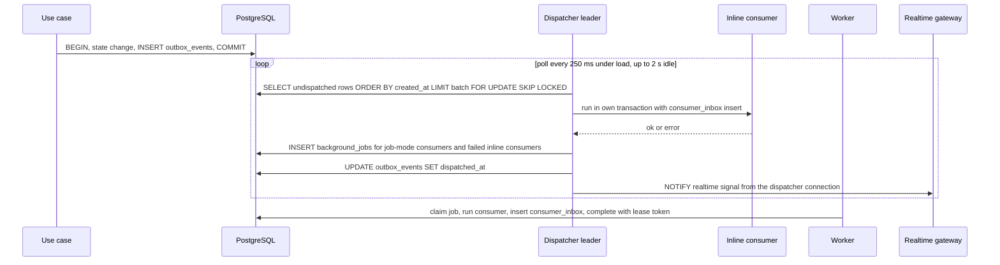

# 04 — Events and Asynchronous Processing

Status: **Proposed target**. As-built input: one `background_jobs` table claimed with `FOR UPDATE SKIP LOCKED` by `runClaimCycle` (10 jobs per claim, 60 s lease, 30 s handler timeout, 3 attempts, exponential backoff with jitter), most handlers only recording events and two transactional mail kinds executing; effects usually commit before `dispatchJob`, leases are not fenced, and timeouts do not abort handlers [SRC: ARCHITECTURE.md §8, §18; migration 00042]. The target keeps PostgreSQL as the queue and adds an outbox, consumer inbox and fencing (DEC-ARC-009, DEC-ARC-010).

Event ids (`EVT-<MOD>-nnn`) are assigned in module specifications. This file fixes the event name format, the envelope, delivery semantics and the starting topic list per module; module specs may add events in the same format.

## 1. Principles

1. **State first, then events, in one transaction.** A use case commits its state change and its outbox rows together. No event is published for a change that did not commit; no committed change lacks its event [SRC: ADR-T05].
2. **At-least-once, idempotent consumers.** Every consumer deduplicates by `event_id` in its own transaction [SRC: EVENT_CATALOG §2].
3. **Events carry facts and ids, not documents.** Consumers fetch details through the owner's interface under policy; no free-text personal data in payloads [SRC: EVENT_CATALOG §1].
4. **Producers never wait for consumers; consumer failure never rolls back the producer.**
5. **No consumer is the only enforcement point of a security rule.** Revocation, consent and sanctions are enforced at read time at the source; events only drive projections and notifications [SRC: EVENT_CATALOG §2].
6. **Ordering only per aggregate.** Consumers that need cross-aggregate facts re-read state.
7. **One durable job engine.** Scheduler, outbox consumers, imports, media and AI all run on the same fenced job engine with queue classes; no second queue technology without a recorded decision [SRC: ARCHITECTURE.md INVARIANT-012].

## 2. Naming and envelope

### 2.1 Event names

Format `<mod>.<entity>.<action>`: lowercase module code, entity in `snake_case`, action as a past-tense verb in `snake_case`. Examples: `job.application.submitted`, `evd.evidence.verified`, `bil.entitlement.changed`. The module code prefix guarantees uniqueness across 30 modules and shows the owner at a glance (the legacy catalog used unprefixed names such as `application.submitted` [SRC: EVENT_CATALOG §4]; those map one-to-one by adding the owner code).

Job kinds use `<mod>.<object>.<verb>` in the present tense (`ntf.email.send`, `src.document.index`). Consumer fallback jobs use `evt:<consumer_module>.<consumer_name>`.

### 2.2 Envelope

| Field | Type | Meaning |
|---|---|---|
| `event_id` | UUIDv7 | Unique id and dedupe key |
| `type` | string | Event name (§2.1) |
| `version` | int | Payload schema version for this type |
| `occurred_at` | timestamptz | Business time (transaction time) |
| `producer` | string | Module code |
| `aggregate` | `{type, id, seq}` | Ordering key; `seq` increments per aggregate within the producing transaction |
| `tenant` | `{org_id?, institution_id?, owner_subject_ref?}` | Scope; consumers must not widen it |
| `actor` | `{kind, human, ref?}` | `kind` ∈ `user, service, system, support, referee`; `human` derived by the producer; `ref` is a `subject_ref`, never an account id [SRC: BE-01-R2 §8] |
| `correlation_id`, `causation_id` | string, uuid | Causal chain; `causation_id` is the event or request that caused this one |
| `trace_context` | W3C `traceparent` | Restored by dispatcher and worker (DEC-ARC-019) |
| `data_class` | enum | Highest data class in `data` (normally DC-INTERNAL or DC-PRIVATE ids) |
| `data` | object | Type-specific payload, Zod-validated |

### 2.3 Delivery classes

| Class | Semantics | Source |
|---|---|---|
| EC-STD | At-least-once; inbox dedupe; per-kind retry (§7); dead-letter with alert | [SRC: EVENT_CATALOG §2] |
| EC-ORD | EC-STD plus per-aggregate order: consumer stores `last_seq` per aggregate; `seq <= last` skipped; gap deferred, then rebuilt from the owner's interface | [SRC: EVENT_CATALOG §2] |
| EC-CRIT | EC-STD with the long retry policy and a page (not only a ticket) on dead-letter: erasure, revocation, verification outcomes, billing and entitlements, passed assessments, offer acceptance | [SRC: EVENT_CATALOG §2] |

### 2.4 Versioning

Adding an optional field keeps the version. Removing, renaming or retyping a field creates `version + 1`; the producer emits both versions for one deprecation window; consumers declare accepted versions; AsyncAPI diff runs in CI [SRC: EVENT_CATALOG §2].

## 3. Outbox pattern

### 3.1 Tables

| Table | Columns | Notes |
|---|---|---|
| `outbox_events` | `event_id` PK, `type`, `version`, `producer`, `aggregate_type`, `aggregate_id`, `aggregate_seq`, `tenant jsonb`, `actor jsonb`, `correlation_id`, `causation_id`, `trace_context`, `data jsonb`, `created_at`, `dispatched_at` nullable, `dispatch_partition smallint` | Partitioned by day; unique (`aggregate_type`, `aggregate_id`, `aggregate_seq`); index (`dispatch_partition`, `created_at`) where `dispatched_at is null`; retained 14 days for replay (RC-OPS-SHORT) |
| `consumer_inbox` | PK (`consumer`, `event_id`), `processed_at` | Partitioned by day; 14 days |
| `consumer_offsets` | PK (`consumer`, `aggregate_type`, `aggregate_id`), `last_seq` | EC-ORD consumers only |
| `consumer_registry` | `consumer` PK, `module`, `event_types text[]`, `mode` (`inline`, `job`), `accepted_versions jsonb`, `enabled` | Generated from module `events.ts` at boot; informational copy for operators |

### 3.2 Write path

`platform/outbox.emit(tx, event)` validates the payload against its contract schema, assigns `event_id` and the next `aggregate_seq` (read from a per-aggregate counter column on the aggregate root, incremented in the same transaction), and inserts the row. `dispatch_partition = hash(aggregate_id) mod outbox.partitions` (default 1 [PROP]); more partitions allow one dispatcher leader per partition when RSK-ARC-05 materializes.

### 3.3 Dispatch path

| Step | Rule |
|---|---|
| Polling | Adaptive interval 250 ms under load, backing off to 2 s idle; no `LISTEN/NOTIFY` on the request path [SRC: BE-01-R2 §1.2] |
| Inline consumers | Cheap database-only reactions (in-app notification rows, counters, cache invalidation, projection deletes on consent change, audit append); 2 s timeout each; on failure the dispatcher enqueues one `evt:<consumer>` job for that event and consumer [SRC: BE-01-R2 §1.1] |
| Job consumers | Anything calling a provider, the AI gateway, object storage, or slow work; enqueued with `idempotency_key = <consumer>:<event_id>` |
| Coalescing | Projection consumers (search documents, match explanations, skill confidence) keep at most one queued job per (`consumer`, `aggregate_id`); a new event updates `payload.upto_seq` instead of adding a row [SRC: BE-01-R2 §1.1] |
| Marking | `dispatched_at` is set only after every inline consumer succeeded or its fallback job was inserted, in the same transaction as the job inserts |
| Realtime | After commit, the dispatcher issues `NOTIFY rt_signals` with a compact signal for events that map to channels ([07 §3](07_SEARCH_MEDIA_REALTIME_ARCHITECTURE.md)) |
| Lag metric | `now() - min(created_at)` of undispatched rows per partition; alert at `outbox.max_lag_seconds` (default 30 [PROP]) |
