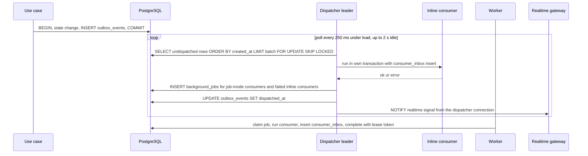
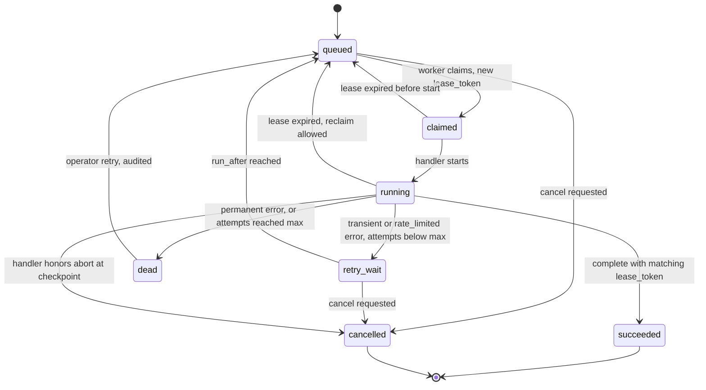
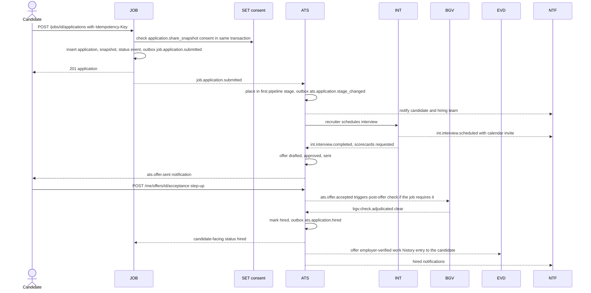
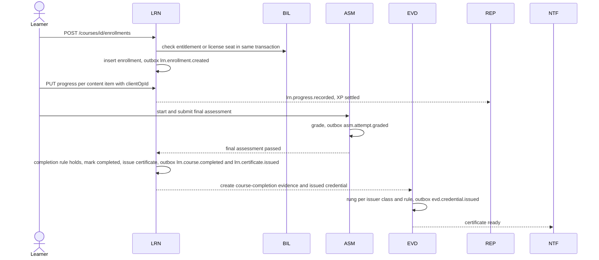
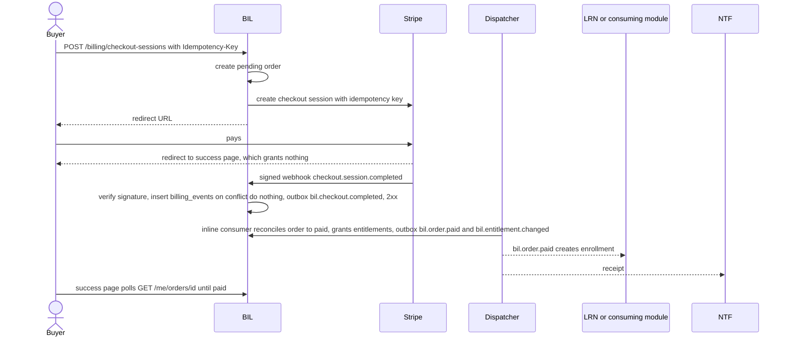
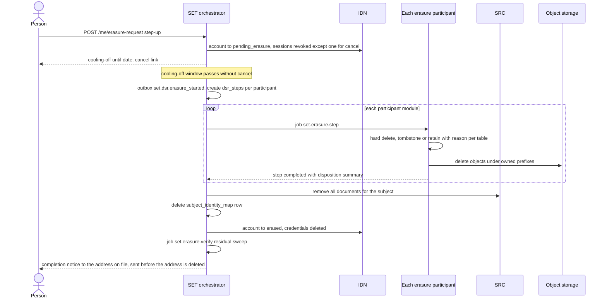
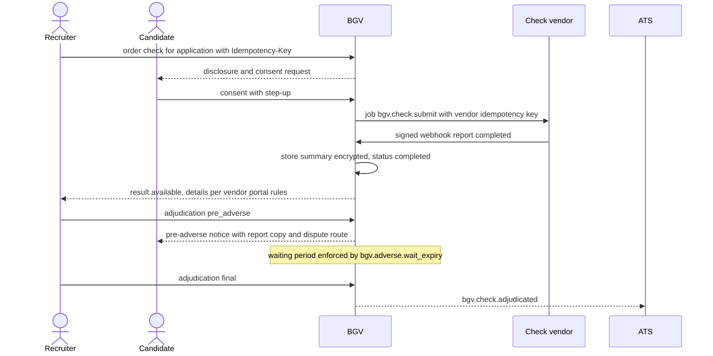

# 04 — Events and Asynchronous Processing

Status: **Proposed target**. As-built input: one `background_jobs` table claimed with `FOR UPDATE SKIP LOCKED` by `runClaimCycle` (10 jobs per claim, 60 s lease, 30 s handler timeout, 3 attempts, exponential backoff with jitter), most handlers only recording events and two transactional mail kinds executing; effects usually commit before `dispatchJob`, leases are not fenced, and timeouts do not abort handlers [SRC: ARCHITECTURE.md §8, §18; migration 00042]. The target keeps PostgreSQL as the queue and adds an outbox, consumer inbox and fencing (DEC-ARC-009, DEC-ARC-010).

Event ids (`EVT-<MOD>-nnn`) are assigned in module specifications. This file fixes the event name format, the envelope, delivery semantics and the starting topic list per module; module specs may add events in the same format.

## 1. Principles

1. **State first, then events, in one transaction.** A use case commits its state change and its outbox rows together. No event is published for a change that did not commit; no committed change lacks its event [SRC: ADR-T05].
2. **At-least-once, idempotent consumers.** Every consumer deduplicates by `event_id` in its own transaction [SRC: EVENT_CATALOG §2].
3. **Events carry facts and ids, not documents.** Consumers fetch details through the owner's interface under policy; no free-text personal data in payloads [SRC: EVENT_CATALOG §1].
4. **Producers never wait for consumers; consumer failure never rolls back the producer.**
5. **No consumer is the only enforcement point of a security rule.** Revocation, consent and sanctions are enforced at read time at the source; events only drive projections and notifications [SRC: EVENT_CATALOG §2].
6. **Ordering only per aggregate.** Consumers that need cross-aggregate facts re-read state.
7. **One durable job engine.** Scheduler, outbox consumers, imports, media and AI all run on the same fenced job engine with queue classes; no second queue technology without a recorded decision [SRC: ARCHITECTURE.md INVARIANT-012].

## 2. Naming and envelope

### 2.1 Event names

Format `<mod>.<entity>.<action>`: lowercase module code, entity in `snake_case`, action as a past-tense verb in `snake_case`. Examples: `job.application.submitted`, `evd.evidence.verified`, `bil.entitlement.changed`. The module code prefix guarantees uniqueness across 30 modules and shows the owner at a glance (the legacy catalog used unprefixed names such as `application.submitted` [SRC: EVENT_CATALOG §4]; those map one-to-one by adding the owner code).

Job kinds use `<mod>.<object>.<verb>` in the present tense (`ntf.email.send`, `src.document.index`). Consumer fallback jobs use `evt:<consumer_module>.<consumer_name>`.

### 2.2 Envelope

| Field                            | Type                                             | Meaning                                                                                                                                               |
| -------------------------------- | ------------------------------------------------ | ----------------------------------------------------------------------------------------------------------------------------------------------------- |
| `event_id`                       | UUIDv7                                           | Unique id and dedupe key                                                                                                                              |
| `type`                           | string                                           | Event name (§2.1)                                                                                                                                     |
| `version`                        | int                                              | Payload schema version for this type                                                                                                                  |
| `occurred_at`                    | timestamptz                                      | Business time (transaction time)                                                                                                                      |
| `producer`                       | string                                           | Module code                                                                                                                                           |
| `aggregate`                      | `{type, id, seq}`                                | Ordering key; `seq` increments per aggregate within the producing transaction                                                                         |
| `tenant`                         | `{org_id?, institution_id?, owner_subject_ref?}` | Scope; consumers must not widen it                                                                                                                    |
| `actor`                          | `{kind, human, ref?}`                            | `kind` ∈ `user, service, system, support, referee`; `human` derived by the producer; `ref` is a `subject_ref`, never an account id [SRC: BE-01-R2 §8] |
| `correlation_id`, `causation_id` | string, uuid                                     | Causal chain; `causation_id` is the event or request that caused this one                                                                             |
| `trace_context`                  | W3C `traceparent`                                | Restored by dispatcher and worker (DEC-ARC-019)                                                                                                       |
| `data_class`                     | enum                                             | Highest data class in `data` (normally DC-INTERNAL or DC-PRIVATE ids)                                                                                 |
| `data`                           | object                                           | Type-specific payload, Zod-validated                                                                                                                  |

### 2.3 Delivery classes

| Class   | Semantics                                                                                                                                                                                   | Source                  |
| ------- | ------------------------------------------------------------------------------------------------------------------------------------------------------------------------------------------- | ----------------------- |
| EC-STD  | At-least-once; inbox dedupe; per-kind retry (§7); dead-letter with alert                                                                                                                    | [SRC: EVENT_CATALOG §2] |
| EC-ORD  | EC-STD plus per-aggregate order: consumer stores `last_seq` per aggregate; `seq <= last` skipped; gap deferred, then rebuilt from the owner's interface                                     | [SRC: EVENT_CATALOG §2] |
| EC-CRIT | EC-STD with the long retry policy and a page (not only a ticket) on dead-letter: erasure, revocation, verification outcomes, billing and entitlements, passed assessments, offer acceptance | [SRC: EVENT_CATALOG §2] |

### 2.4 Versioning

Adding an optional field keeps the version. Removing, renaming or retyping a field creates `version + 1`; the producer emits both versions for one deprecation window; consumers declare accepted versions; AsyncAPI diff runs in CI [SRC: EVENT_CATALOG §2].

## 3. Outbox pattern

### 3.1 Tables

| Table               | Columns                                                                                                                                                                                                                                                                | Notes                                                                                                                                                                                                |
| ------------------- | ---------------------------------------------------------------------------------------------------------------------------------------------------------------------------------------------------------------------------------------------------------------------- | ---------------------------------------------------------------------------------------------------------------------------------------------------------------------------------------------------- |
| `outbox_events`     | `event_id` PK, `type`, `version`, `producer`, `aggregate_type`, `aggregate_id`, `aggregate_seq`, `tenant jsonb`, `actor jsonb`, `correlation_id`, `causation_id`, `trace_context`, `data jsonb`, `created_at`, `dispatched_at` nullable, `dispatch_partition smallint` | Partitioned by day; unique (`aggregate_type`, `aggregate_id`, `aggregate_seq`); index (`dispatch_partition`, `created_at`) where `dispatched_at is null`; retained 14 days for replay (RC-OPS-SHORT) |
| `consumer_inbox`    | PK (`consumer`, `event_id`), `processed_at`                                                                                                                                                                                                                            | Partitioned by day; 14 days                                                                                                                                                                          |
| `consumer_offsets`  | PK (`consumer`, `aggregate_type`, `aggregate_id`), `last_seq`                                                                                                                                                                                                          | EC-ORD consumers only                                                                                                                                                                                |
| `consumer_registry` | `consumer` PK, `module`, `event_types text[]`, `mode` (`inline`, `job`), `accepted_versions jsonb`, `enabled`                                                                                                                                                          | Generated from module `events.ts` at boot; informational copy for operators                                                                                                                          |

### 3.2 Write path

`platform/outbox.emit(tx, event)` validates the payload against its contract schema, assigns `event_id` and the next `aggregate_seq` (read from a per-aggregate counter column on the aggregate root, incremented in the same transaction), and inserts the row. `dispatch_partition = hash(aggregate_id) mod outbox.partitions` (default 1 [PROP]); more partitions allow one dispatcher leader per partition when RSK-ARC-05 materializes.

### 3.3 Dispatch path

| Step             | Rule                                                                                                                                                                                                                                                                       |
| ---------------- | -------------------------------------------------------------------------------------------------------------------------------------------------------------------------------------------------------------------------------------------------------------------------- |
| Polling          | Adaptive interval 250 ms under load, backing off to 2 s idle; no `LISTEN/NOTIFY` on the request path [SRC: BE-01-R2 §1.2]                                                                                                                                                  |
| Inline consumers | Cheap database-only reactions (in-app notification rows, counters, cache invalidation, projection deletes on consent change, audit append); 2 s timeout each; on failure the dispatcher enqueues one `evt:<consumer>` job for that event and consumer [SRC: BE-01-R2 §1.1] |
| Job consumers    | Anything calling a provider, the AI gateway, object storage, or slow work; enqueued with `idempotency_key = <consumer>:<event_id>`                                                                                                                                         |
| Coalescing       | Projection consumers (search documents, match explanations, skill confidence) keep at most one queued job per (`consumer`, `aggregate_id`); a new event updates `payload.upto_seq` instead of adding a row [SRC: BE-01-R2 §1.1]                                            |
| Marking          | `dispatched_at` is set only after every inline consumer succeeded or its fallback job was inserted, in the same transaction as the job inserts                                                                                                                             |
| Realtime         | After commit, the dispatcher issues `NOTIFY rt_signals` with a compact signal for events that map to channels ([07 §3](07_SEARCH_MEDIA_REALTIME_ARCHITECTURE.md))                                                                                                          |
| Lag metric       | `now() - min(created_at)` of undispatched rows per partition; alert at `outbox.max_lag_seconds` (default 30 [PROP])                                                                                                                                                        |

## 4. Topics per module

The starting topic list. **Class** is the delivery class; EC-ORD implies ordering by the aggregate named in the event. **Consumers** lists consuming modules; `notify` means NTF decides whether and how to notify. Consumers marked `(i)` run inline, others in job mode.

| Module | Event                                                                                  | Class                      | Consumers                                                                                                                                   |
| ------ | -------------------------------------------------------------------------------------- | -------------------------- | ------------------------------------------------------------------------------------------------------------------------------------------- |
| IDN    | `idn.account.registered`                                                               | EC-STD                     | NTF (verification mail), SET (subject map), ANL (i)                                                                                         |
| IDN    | `idn.account.email_verified`                                                           | EC-STD                     | PRF (i), NTF                                                                                                                                |
| IDN    | `idn.account.status_changed`                                                           | EC-ORD                     | PRF, SRC, AIC, MSG, NET, TSF (i)                                                                                                            |
| IDN    | `idn.session.revoked`                                                                  | EC-STD                     | Realtime (disconnect), NTF (security alert), TSF                                                                                            |
| IDN    | `idn.credential.changed`                                                               | EC-STD                     | NTF (security alert)                                                                                                                        |
| IDN    | `idn.organization.created`                                                             | EC-ORD                     | BIL, EMP, INS, ANL (i)                                                                                                                      |
| IDN    | `idn.organization.verified`                                                            | EC-ORD                     | JOB, INS, EVD (issuer trust), SRC                                                                                                           |
| IDN    | `idn.membership.added` / `idn.membership.changed` / `idn.membership.removed`           | EC-ORD                     | BIL (seats), ATS (reassignment), INS, ENT, MSG, Realtime (re-authorize), NTF                                                                |
| IDN    | `idn.sso.configured`                                                                   | EC-ORD                     | ADM audit (i)                                                                                                                               |
| SET    | `set.consent.changed`                                                                  | EC-ORD                     | SRC (i, projection cleanup), AIC (i), JOB, INS, ENT, Realtime (re-authorize)                                                                |
| SET    | `set.privacy_settings.changed`                                                         | EC-ORD                     | SRC (i), PRF, NET                                                                                                                           |
| SET    | `set.dsr.export_requested`                                                             | EC-CRIT                    | SET export job                                                                                                                              |
| SET    | `set.dsr.erasure_started`                                                              | EC-CRIT                    | every erasure participant                                                                                                                   |
| SET    | `set.dsr.erasure_completed`                                                            | EC-CRIT                    | ADM audit, NTF (final confirmation to the address on file before deletion)                                                                  |
| NTF    | `ntf.notification.created`                                                             | EC-STD                     | Realtime (badge signal)                                                                                                                     |
| NTF    | `ntf.delivery.failed_permanently`                                                      | EC-STD                     | ADM ops metrics (i)                                                                                                                         |
| PRF    | `prf.profile.updated`                                                                  | EC-ORD                     | SRC, AIC (match recompute), MKT                                                                                                             |
| PRF    | `prf.profile.visibility_changed`                                                       | EC-ORD                     | SRC (i), NET                                                                                                                                |
| PRF    | `prf.resume.imported`                                                                  | EC-STD                     | NTF                                                                                                                                         |
| MKT    | `mkt.skill.created` / `mkt.skill.merged`                                               | EC-ORD                     | SRC, JOB, EVD, LRN, ASM, AIC, MKT                                                                                                           |
| EVD    | `evd.evidence.created`                                                                 | EC-ORD                     | BGV (auto-verification), SRC, AIC                                                                                                           |
| EVD    | `evd.evidence.updated`                                                                 | EC-ORD                     | SRC, AIC                                                                                                                                    |
| EVD    | `evd.evidence.verified`                                                                | EC-ORD + EC-CRIT           | PRF (skill confidence), SRC, AIC, JOB (snapshot link status), REP, NTF                                                                      |
| EVD    | `evd.evidence.revoked`                                                                 | EC-ORD + EC-CRIT           | PRF, SRC, AIC, JOB, NTF                                                                                                                     |
| EVD    | `evd.reference.requested` / `evd.reference.submitted`                                  | EC-STD                     | NTF                                                                                                                                         |
| EVD    | `evd.credential.issued` / `evd.credential.revoked`                                     | EC-CRIT                    | NTF, PLT (CDN purge of `/verify`), partner webhooks                                                                                         |
| BGV    | `bgv.check.ordered` / `bgv.check.consented`                                            | EC-ORD                     | BGV vendor job, NTF                                                                                                                         |
| BGV    | `bgv.check.completed` / `bgv.check.adjudicated`                                        | EC-CRIT                    | ATS, NTF                                                                                                                                    |
| BGV    | `bgv.identity.verified`                                                                | EC-CRIT                    | EVD (identity-backed rung), TSF                                                                                                             |
| SRC    | `src.saved_search.matched`                                                             | EC-STD                     | NTF (alerts)                                                                                                                                |
| LRN    | `lrn.enrollment.created`                                                               | EC-ORD                     | BIL (seat usage), INS, ENT, NTF, ANL (i)                                                                                                    |
| LRN    | `lrn.progress.recorded`                                                                | EC-ORD                     | REP (XP), INS, ENT (i, coalesced)                                                                                                           |
| LRN    | `lrn.course.completed`                                                                 | EC-ORD + EC-CRIT           | EVD (course-completion evidence at `artifact_backed` or `authority_verified` only when the final-assessment rule holds), REP, INS, ENT, NTF |
| LRN    | `lrn.certificate.issued`                                                               | EC-CRIT                    | EVD, NTF                                                                                                                                    |
| STU    | `stu.course.submitted_for_review` / `stu.course.review_decided`                        | EC-STD                     | NTF, ADM                                                                                                                                    |
| STU    | `stu.course.published` / `stu.course.retired`                                          | EC-ORD                     | LRN, SRC, NTF (followers, waitlist)                                                                                                         |
| STU    | `stu.media.ready` / `stu.media.failed`                                                 | EC-STD                     | STU (i), NTF                                                                                                                                |
| ASM    | `asm.attempt.started`                                                                  | EC-ORD                     | Realtime (deadline signal), TSF (i)                                                                                                         |
| ASM    | `asm.attempt.submitted`                                                                | EC-ORD                     | ASM grading job                                                                                                                             |
| ASM    | `asm.attempt.graded`                                                                   | EC-ORD + EC-CRIT           | EVD (assessment-result evidence; verified only when the attempt is verified), LRN, JOB, ATS, REP, NTF                                       |
| ASM    | `asm.integrity_case.opened` / `asm.integrity_case.decided`                             | EC-CRIT                    | TSF, EVD (void evidence on upheld case), NTF                                                                                                |
| ATS    | `ats.posting.published` / `ats.posting.updated`                                        | EC-ORD                     | SRC, AIC, PLT (job distribution, sitemap, partner webhooks), NTF (saved-search alerts via SRC)                                              |
| ATS    | `ats.posting.closed` / `ats.posting.taken_down`                                        | EC-ORD                     | SRC (i), ATS, AIC, PLT (distribution withdrawal)                                                                                            |
| JOB    | `job.application.submitted`                                                            | EC-ORD                     | ATS (pipeline placement), AIC (match explanation), NTF, ANL (i), partner webhooks                                                           |
| JOB    | `job.application.withdrawn`                                                            | EC-ORD                     | ATS, INT (cancel future interviews), NTF                                                                                                    |
| ATS    | `ats.application.stage_changed`                                                        | EC-ORD                     | JOB (candidate-facing status), NTF, Realtime, ANL (i), partner webhooks                                                                     |
| ATS    | `ats.application.rejected` / `ats.application.hired`                                   | EC-ORD + EC-CRIT for hired | JOB, NTF, INS (placement outcome), EVD (employer-verified work history offer), ANL                                                          |
| ATS    | `ats.offer.sent` / `ats.offer.accepted` / `ats.offer.declined` / `ats.offer.rescinded` | EC-CRIT                    | JOB, NTF, BGV (post-offer checks), ATS (requisition fill), partner webhooks                                                                 |
| ATS    | `ats.requisition.approved` / `ats.requisition.filled`                                  | EC-ORD                     | JOB, ANL                                                                                                                                    |
| INT    | `int.interview.scheduled` / `int.interview.rescheduled` / `int.interview.cancelled`    | EC-ORD                     | NTF (with calendar file), INT calendar sync job, Realtime                                                                                   |
| INT    | `int.interview.completed` / `int.interview.no_show`                                    | EC-ORD                     | ATS (scorecard reminders), AIC (optional analysis with consent), ANL                                                                        |
| EMP    | `emp.employer_page.published`                                                          | EC-ORD                     | SRC, PLT (CDN purge)                                                                                                                        |
| EMP    | `emp.review.published`                                                                 | EC-STD                     | EMP aggregates, NTF (org)                                                                                                                   |
| NET    | `net.connection.requested` / `net.connection.accepted`                                 | EC-STD                     | NTF, AIC (people recommendations)                                                                                                           |
| NET    | `net.post.published`                                                                   | EC-STD                     | NET feed fan-out job, TSF (scan), SRC                                                                                                       |
| NET    | `net.referral.requested` / `net.referral.submitted`                                    | EC-STD                     | NTF, JOB (referral source on application)                                                                                                   |
| MSG    | `msg.message.sent`                                                                     | EC-ORD                     | Realtime, NTF (if recipient offline, after `msg.offline_notify_delay_seconds`), TSF (scan sample)                                           |
| MSG    | `msg.conversation.reported`                                                            | EC-STD                     | TSF                                                                                                                                         |
| REP    | `rep.badge.awarded` / `rep.level.changed`                                              | EC-STD                     | NTF, PRF (public badges)                                                                                                                    |
| EVT    | `evt.registration.created` / `evt.registration.cancelled`                              | EC-ORD                     | NTF, BIL (ticket refund rules)                                                                                                              |
| EVT    | `evt.event.starting_soon` (scheduled)                                                  | EC-STD                     | NTF                                                                                                                                         |
| EVT    | `evt.submission.scored`                                                                | EC-ORD                     | REP, EVD (hackathon result evidence at `artifact_backed`)                                                                                   |
| AIC    | `aic.run.completed`                                                                    | EC-STD                     | Realtime (run status), ANL (i)                                                                                                              |
| AIC    | `aic.recommendation.generated`                                                         | EC-STD                     | NTF (digest only)                                                                                                                           |
| AIC    | `aic.budget.threshold_reached`                                                         | EC-STD                     | NTF (holder), BIL                                                                                                                           |
| TSF    | `tsf.report.created`                                                                   | EC-STD                     | TSF triage job                                                                                                                              |
| TSF    | `tsf.content.actioned`                                                                 | EC-CRIT                    | owning module (hide content), SRC (i), NTF                                                                                                  |
| TSF    | `tsf.sanction.applied` / `tsf.sanction.lifted`                                         | EC-CRIT                    | IDN (status), every module that gates actions on sanctions, NTF                                                                             |
| INS    | `ins.learner.linked` / `ins.learner.severed`                                           | EC-ORD                     | LRN, ASM, SRC, NTF                                                                                                                          |
| INS    | `ins.assignment.created`                                                               | EC-ORD                     | LRN (enrollment creation), BIL (seat allocation), NTF                                                                                       |
| INS    | `ins.placement_drive.opened`                                                           | EC-STD                     | NTF (eligible consented learners)                                                                                                           |
| INS    | `ins.import.completed`                                                                 | EC-STD                     | NTF (admin)                                                                                                                                 |
| ENT    | `ent.opportunity.published`                                                            | EC-ORD                     | SRC (workforce-scoped index), AIC, NTF                                                                                                      |
| ENT    | `ent.workforce.synced`                                                                 | EC-STD                     | ENT inventory job                                                                                                                           |
| BIL    | `bil.checkout.completed`                                                               | EC-CRIT                    | BIL entitlement grant (i)                                                                                                                   |
| BIL    | `bil.subscription.changed`                                                             | EC-CRIT                    | BIL entitlements (i), NTF, ANL                                                                                                              |
| BIL    | `bil.entitlement.changed`                                                              | EC-CRIT                    | JOB (posting limits), SRC (recruiter search), AIC (budgets), LRN (access), INS, ENT (capabilities), Realtime                                |
| BIL    | `bil.order.paid` / `bil.order.refunded`                                                | EC-CRIT                    | LRN (enrollment), EVT (tickets), MEN (sessions), NTF                                                                                        |
| BIL    | `bil.payment.failed`                                                                   | EC-CRIT                    | NTF (dunning)                                                                                                                               |
| MEN    | `men.engagement.started` / `men.session.completed`                                     | EC-ORD                     | NTF, REP (mentor reputation), BIL (session settlement)                                                                                      |
| GIG    | `gig.contract.created` / `gig.milestone.accepted` / `gig.dispute.opened`               | EC-CRIT                    | BIL (payment release when enabled), EVD (completed-project evidence at `peer_attested` when the client attests), TSF, NTF                   |
| MKT    | `mkt.signals.refreshed`                                                                | EC-STD                     | AIC (career plan staleness), SRC                                                                                                            |
| ANL    | `anl.report_export.ready`                                                              | EC-STD                     | NTF                                                                                                                                         |
| ADM    | `adm.flag.changed` / `adm.config.changed`                                              | EC-STD                     | All replicas reference caches (i)                                                                                                           |
| PWA    | `pwa.device.registered`                                                                | EC-STD                     | NTF (push targets)                                                                                                                          |
| PLT    | `plt.file.available` / `plt.file.rejected`                                             | EC-ORD                     | owning module of the file purpose, NTF on rejection                                                                                         |
| PLT    | `plt.webhook_endpoint.disabled`                                                        | EC-STD                     | NTF (org admins)                                                                                                                            |
| PLT    | `plt.integration.sync_completed` / `plt.integration.sync_failed`                       | EC-STD                     | NTF, owning module                                                                                                                          |

## 5. Job engine

### 5.1 Target `background_jobs` schema (additive evolution of migration 00042)

| Column                                    | Type        | As-built?                | Purpose                                                                                                                                                       |
| ----------------------------------------- | ----------- | ------------------------ | ------------------------------------------------------------------------------------------------------------------------------------------------------------- |
| `id`                                      | uuid        | Yes                      |                                                                                                                                                               |
| `kind`                                    | text        | Yes                      | Job kind (§8)                                                                                                                                                 |
| `queue`                                   | text        | New                      | Queue class (§5.3); default from the kind registry                                                                                                            |
| `payload`                                 | jsonb       | Yes                      | Ids and parameters only; no tokens, codes or email addresses (resolved at run time); `subject_ref` instead of account ids where the job concerns a person     |
| `tenant`                                  | jsonb       | New                      | Tenant scope used to set transaction claims for the job (01 §8.5)                                                                                             |
| `status`                                  | text        | Changed set              | `queued, claimed, running, retry_wait, succeeded, dead, cancelled` [SRC: BE-01-R2 §3.1]; as-built set is `queued, running, succeeded, failed, dead, canceled` |
| `priority`                                | smallint    | New                      | 0 (highest) to 9; default 5                                                                                                                                   |
| `attempts`, `max_attempts`                | int         | `attempts` yes           | Every claim increments `attempts`                                                                                                                             |
| `run_after`                               | timestamptz | Yes                      |                                                                                                                                                               |
| `lease_token`                             | uuid        | New                      | Fencing token, regenerated on every claim                                                                                                                     |
| `lease_expires_at`                        | timestamptz | Yes as `lock_expires_at` |                                                                                                                                                               |
| `claimed_by`                              | text        | New                      | Worker instance id                                                                                                                                            |
| `last_error_class`, `last_error`          | text        | `last_error` yes         | Error class `transient, permanent, rate_limited, cancelled`; message ≤ 4 KB, redacted                                                                         |
| `idempotency_key`                         | text        | Yes                      | Unique per kind where status is not terminal (as-built index is unconditional, kept until migration)                                                          |
| `cancel_requested_at`                     | timestamptz | New                      | Cooperative cancellation                                                                                                                                      |
| `correlation_id`, `trace_context`         | text        | New                      | Tracing                                                                                                                                                       |
| `created_at`, `updated_at`, `finished_at` | timestamptz | Partly                   |                                                                                                                                                               |

### 5.2 State machine

### 5.3 Claim, fencing and lease renewal

1. **Claim:** `UPDATE background_jobs SET status = 'claimed', lease_token = gen_random_uuid(), lease_expires_at = now() + lease, claimed_by = $worker, attempts = attempts + 1 WHERE id IN (SELECT id FROM background_jobs WHERE queue = $queue AND status = 'queued' AND run_after <= now() ORDER BY priority, run_after LIMIT $batch FOR UPDATE SKIP LOCKED) RETURNING *`. Batch size per queue class; default 1 for `heavy` and `ai`, 10 for others.
2. **Fencing:** every subsequent write by the worker (`running`, heartbeat, completion, retry scheduling) includes `WHERE id = $id AND lease_token = $token`. Zero rows updated means the lease was lost; the worker abandons the result and records `lease_lost` [SRC: ADR-T09].
3. **Fenced side effects:** a handler that writes domain state does so in a transaction that also completes the job with the lease-token predicate, so the effect and the completion commit together. Handlers that call external providers pass `idempotency_key = <job id>:<attempt-independent operation key>` to the provider where the provider supports it (Stripe, most email providers).
4. **Lease renewal:** handlers longer than half the lease call `heartbeat()` which extends `lease_expires_at` under the fencing predicate; default lease 60 s [SRC: as-built], heavy queue 300 s [PROP].
5. **Abort:** each handler receives an `AbortSignal` that fires at timeout or on `cancel_requested_at`; the as-built `Promise.race` without abort [SRC: ARCHITECTURE.md §18] is replaced.
6. **Reclaim:** a reaper (scheduler role) returns `claimed` or `running` rows with expired leases to `queued`, or to `dead` when `attempts >= max_attempts`.

### 5.4 Queue classes and worker pools

| Queue       | Kinds                                                                                                  | Pool default                                 | Max ready age alert [PROP] |
| ----------- | ------------------------------------------------------------------------------------------------------ | -------------------------------------------- | -------------------------- |
| `critical`  | Billing reconciliation, entitlement grants from webhooks, erasure steps, credential revocation fan-out | 2 workers                                    | 60 s                       |
| `default`   | Event consumer fallbacks, projections, search indexing, notifications in-app, reminders                | 4 workers                                    | 120 s                      |
| `email`     | `ntf.email.send`, `ntf.push.send`, `ntf.sms.send` (deferred), digests                                  | 2 workers                                    | 300 s                      |
| `webhook`   | `plt.webhook.deliver`, job distribution pushes                                                         | 2 workers                                    | 300 s                      |
| `heavy`     | Media scan and transcode orchestration, imports, exports, report exports, resume parsing, bulk actions | 2 workers, separate deployment at trigger S2 | 900 s                      |
| `ai`        | AI runs, embeddings, batch recommendations, match recomputation                                        | 2 workers                                    | 300 s                      |
| `scheduled` | Sweeps, rollups, digest fan-out, reminders scan                                                        | 1 worker                                     | 900 s                      |

Each pool has its own database connection budget and statement timeout ([01 §20](01_SYSTEM_ARCHITECTURE.md)).

## 6. Retry, dead-letter and replay

### 6.1 Backoff policy

Formula `delay = min(cap, base × 2^(attempt − 1))` with full jitter `random(0, delay)`; `rate_limited` honors `Retry-After` [SRC: BE-01-R2 §3.2].

| Policy     | Kinds                                                        | Max attempts | Base | Cap    | Worst-case span without jitter |
| ---------- | ------------------------------------------------------------ | ------------ | ---- | ------ | ------------------------------ |
| `default`  | Most internal jobs, `evt:*` fallbacks, `src.*`, `plt.file.*` | 8            | 5 s  | 15 min | about 11 min                   |
| `delivery` | `ntf.email.send`, `plt.webhook.deliver`                      | 12           | 60 s | 6 h    | about 20.5 h                   |
| `push`     | `ntf.push.send`                                              | 4            | 60 s | 15 min | 7 min                          |
| `ai`       | `aic.*`                                                      | 3            | 5 s  | 15 min | 15 s                           |
| `runner`   | `asm.code.run`                                               | 2            | 5 s  | 15 min | 5 s (new run id per attempt)   |
| `critical` | EC-CRIT consumers, `set.erasure.step`, `bil.*`               | 12           | 30 s | 1 h    | about 7.5 h, then page         |

Values are configuration (`jobKinds.<kind>.maxAttempts|baseMs|capMs`) validated at boot. As-built default is 3 attempts [SRC: ARCHITECTURE.md §18].

### 6.2 Error classes

| Class          | Examples                                                                          | Effect                                    |
| -------------- | --------------------------------------------------------------------------------- | ----------------------------------------- |
| `transient`    | Timeout, 5xx, connection reset, lock timeout                                      | Retry per policy                          |
| `rate_limited` | Provider 429                                                                      | Retry after `Retry-After` or policy delay |
| `permanent`    | Validation failure, 4xx other than 408 and 429, missing resource, consent revoked | `dead` immediately; no retry              |
| `cancelled`    | Abort honored                                                                     | `cancelled`                               |

### 6.3 Dead-letter handling

`dead` rows stay in `background_jobs` (RC-OPS, 90 days) and are the dead-letter queue. A dead EC-CRIT job pages on-call; others create an operations ticket and raise the `jobs_dead_total` metric. Operators inspect and retry through `/admin/jobs` (audited). Unknown kinds dead-letter immediately [SRC: as-built ARCHITECTURE.md §18]. Projection consumers also have **rebuild** kinds (`src.index.rebuild`, `aic.match.rebuild`) that recompute from owner interfaces, so a lost event is recoverable without replay.

### 6.4 Replay

Any consumer can replay from `outbox_events` within its 14-day retention by resetting its inbox for a time range (operator action, audited). Consumers are written to tolerate replay of any event within that window [SRC: EVENT_CATALOG §2].

## 7. Job catalog

**Trigger** is an event, a request, or a schedule (`cron`, UTC unless stated). **Key** is the idempotency key pattern. **Policy** refers to §6.1. Cadences are proposals [PROP] unless a source is cited; SSOT cadences carry no time zone [SRC: SSOT §13.6 note], so this catalog states one.

| Kind                                     | Owner | Queue     | Trigger                                                                                                     | Key                                 | Policy   | Notes                                                                                                                                 |
| ---------------------------------------- | ----- | --------- | ----------------------------------------------------------------------------------------------------------- | ----------------------------------- | -------- | ------------------------------------------------------------------------------------------------------------------------------------- |
| `ntf.email.send`                         | NTF   | email     | Notification delivery row created                                                                           | `delivery_id`                       | delivery | Logical template id plus validated variables; resolves address at run time; suppression list checked [SRC: as-built email service]    |
| `ntf.push.send`                          | NTF   | email     | Delivery row, channel push                                                                                  | `delivery_id`                       | push     | TTL from category; 404 or 410 from the push service deletes the subscription                                                          |
| `ntf.digest.compose`                     | NTF   | scheduled | cron hourly; selects accounts whose local time is `ntf.digest_local_hour` (default 07:30 [SRC: SSOT §13.6]) | `account:date`                      | default  | Digest per user local day                                                                                                             |
| `ntf.reminder.scan`                      | NTF   | scheduled | cron every 5 min                                                                                            | `window_start`                      | default  | Interview, deadline, course-due, event reminders from domain reminder rows                                                            |
| `src.document.index`                     | SRC   | default   | Projection events (coalesced)                                                                               | `doc_type:doc_id`                   | default  | Rebuilds the document from owner interfaces; deletes when not visible                                                                 |
| `src.index.rebuild`                      | SRC   | heavy     | Operator or nightly 03:00 UTC                                                                               | `doc_type:date`                     | default  | Full rebuild of one document type                                                                                                     |
| `src.embedding.compute`                  | SRC   | ai        | After index of an embedding-enabled type                                                                    | `doc_type:doc_id:source_version`    | ai       | Through the AI gateway; batch                                                                                                         |
| `src.saved_search.run`                   | SRC   | scheduled | cron hourly by cadence                                                                                      | `search_id:period`                  | default  | Emits `src.saved_search.matched`                                                                                                      |
| `plt.file.scan`                          | PLT   | heavy     | File completion                                                                                             | `file_id`                           | default  | Magic-byte detection, malware scan, metadata strip, move to private bucket                                                            |
| `stu.media.transcode`                    | STU   | heavy     | `plt.file.available` for course media                                                                       | `media_asset_id`                    | default  | Calls the media provider; completion by provider webhook                                                                              |
| `stu.media.captions`                     | STU   | ai        | `stu.media.ready`                                                                                           | `media_asset_id:lang`               | ai       | Provider captions or AI transcription with instructor review                                                                          |
| `stu.media.healthcheck`                  | STU   | scheduled | cron daily 04:00 UTC                                                                                        | `date`                              | default  | External embeds still reachable [SRC: SSOT §13.7 `media.healthcheck`]                                                                 |
| `prf.resume.parse`                       | PRF   | heavy     | Resume import request                                                                                       | `import_id`                         | default  | Produces a proposed diff, never applies it                                                                                            |
| `prf.resume.render`                      | PRF   | heavy     | Rendering request                                                                                           | `resume_id:version:template`        | default  | PDF                                                                                                                                   |
| `prf.skill_confidence.recompute`         | PRF   | default   | Evidence verified or revoked (coalesced)                                                                    | `account_id`                        | default  | Writes `profile_skills.confidence` with explanation                                                                                   |
| `evd.reference.expire`                   | EVD   | scheduled | cron hourly                                                                                                 | `hour`                              | default  | Expires open reference requests after `evd.reference_ttl_days` (as-built API check 30 days [SRC: ARCHITECTURE.md §8 item 4])          |
| `evd.credential.render`                  | EVD   | heavy     | Credential issued                                                                                           | `credential_id`                     | default  | Signed payload and PDF                                                                                                                |
| `bgv.check.submit`                       | BGV   | critical  | Candidate consent recorded                                                                                  | `check_id`                          | critical | Vendor order                                                                                                                          |
| `bgv.check.poll`                         | BGV   | scheduled | cron every 30 min for open checks without webhooks                                                          | `check_id:slot`                     | default  |                                                                                                                                       |
| `bgv.adverse.wait_expiry`                | BGV   | scheduled | cron hourly                                                                                                 | `check_id`                          | critical | Allows final adverse action only after the waiting period                                                                             |
| `lrn.enrollment.expire`                  | LRN   | scheduled | cron daily 01:00 UTC                                                                                        | `date`                              | default  | Seat and access expiry                                                                                                                |
| `asm.attempt.grade`                      | ASM   | default   | `asm.attempt.submitted`                                                                                     | `attempt_id`                        | default  | Auto-gradable items; code items wait for the runner                                                                                   |
| `asm.code.run`                           | ASM   | ai        | Code item submitted                                                                                         | `attempt_id:item_id:run_no`         | runner   | Calls `CodeRunnerPort`; disabled until OD-ARC-09 closes                                                                               |
| `asm.attempt.expire`                     | ASM   | scheduled | cron every minute                                                                                           | `minute`                            | default  | Server-side deadline enforcement                                                                                                      |
| `asm.similarity.check`                   | ASM   | heavy     | Attempt graded (code, essay)                                                                                | `attempt_id`                        | default  | Produces integrity signals only                                                                                                       |
| `ats.posting.expire`                     | ATS   | scheduled | cron hourly                                                                                                 | `hour`                              | default  | Closes jobs past `expires_at` (default 45 or 60 days is open in SSOT, V61-18)                                                         |
| `ats.distribution.push`                  | ATS   | webhook   | `ats.posting.published` / `closed`                                                                          | `job_id:target:version`             | delivery | Job boards, Google for Jobs sitemap ping                                                                                              |
| `ats.stale_application.scan`             | ATS   | scheduled | cron daily 06:00 UTC                                                                                        | `date`                              | default  | Nudges recruiters on idle applications per org SLA                                                                                    |
| `ats.bulk_action.run`                    | ATS   | heavy     | Bulk action request                                                                                         | `bulk_action_id`                    | default  | Per-item results, each with its own idempotency                                                                                       |
| `int.calendar.sync`                      | INT   | webhook   | Interview scheduled or changed                                                                              | `interview_id:participant:version`  | delivery | Creates or updates calendar events through calendar adapters                                                                          |
| `int.room.provision`                     | INT   | default   | Interview scheduled (video)                                                                                 | `interview_id`                      | default  | Creates provider room before the window                                                                                               |
| `net.feed.fanout`                        | NET   | heavy     | `net.post.published`                                                                                        | `post_id`                           | default  | Writes feed entries for followers up to `net.fanout_push_max`; larger audiences use pull at read time [SRC: SSOT §13.7 `feed.fanout`] |
| `msg.offline.notify`                     | MSG   | default   | `msg.message.sent`, delayed by `msg.offline_notify_delay_seconds`                                           | `conversation:recipient:seq_bucket` | default  | Skips if read meanwhile                                                                                                               |
| `rep.xp.settle`                          | REP   | default   | Learning, assessment, community events                                                                      | `source_event_id`                   | default  | [SRC: SSOT §13.6 `xp.settle`]                                                                                                         |
| `rep.streak.rollover`                    | REP   | scheduled | cron hourly; per user local midnight                                                                        | `account:date`                      | default  | [SRC: SSOT §13.6 `streak.rollover`, local-day reading]                                                                                |
| `rep.leaderboard.rebuild`                | REP   | scheduled | cron daily 02:30 UTC                                                                                        | `board:date`                        | default  |                                                                                                                                       |
| `aic.run.execute`                        | AIC   | ai        | Async AI run request                                                                                        | `run_id`                            | ai       | Gateway pipeline ([06](06_AI_ARCHITECTURE.md))                                                                                        |
| `aic.match.recompute`                    | AIC   | ai        | Profile, evidence, job changes (coalesced)                                                                  | `job_id:account_id` or `account_id` | ai       | Writes `match_explanations`                                                                                                           |
| `aic.recommendation.batch`               | AIC   | ai        | cron daily 05:00 UTC                                                                                        | `account_bucket:date`               | ai       | Only for accounts with recommendations enabled and budget                                                                             |
| `aic.eval.online_sample`                 | AIC   | ai        | cron hourly                                                                                                 | `hour`                              | ai       | Samples outputs for evaluation per [06 §6](06_AI_ARCHITECTURE.md)                                                                     |
| `mkt.signals.aggregate`                  | MKT   | heavy     | cron nightly 03:30 UTC                                                                                      | `date`                              | default  | Skills demand, salaries, growth; suppressed below `min_cohort_k` [SRC: SSOT §13.6 `skill.market_signal_update`, `salary.aggregate`]   |
| `mkt.career_paths.compute`               | MKT   | heavy     | cron weekly Sunday 04:00 UTC                                                                                | `week`                              | default  | [SRC: SSOT §13.6 `career.benchmark_compute`]                                                                                          |
| `ins.import.parse` / `ins.import.commit` | INS   | heavy     | Import request, commit request                                                                              | `import_id:phase`                   | default  | [SRC: SSOT §13.7 `institutional.import`]                                                                                              |
| `ins.progress.rollup`                    | INS   | scheduled | cron hourly                                                                                                 | `org:hour`                          | default  | Cohort dashboards                                                                                                                     |
| `ent.hris.sync`                          | ENT   | heavy     | Schedule per connection or request                                                                          | `connection_id:run`                 | default  |                                                                                                                                       |
| `ent.inventory.snapshot`                 | ENT   | heavy     | cron weekly                                                                                                 | `org:week`                          | default  | Aggregates only                                                                                                                       |
| `bil.reconcile`                          | BIL   | critical  | Webhook processing, cron hourly sweep                                                                       | `provider_event_id` or `hour`       | critical | Normalized provider snapshot to local state [SRC: as-built reconciliation]                                                            |
| `bil.dunning.step`                       | BIL   | critical  | Payment failed                                                                                              | `invoice_id:step`                   | critical |                                                                                                                                       |
| `bil.entitlement.expire`                 | BIL   | scheduled | cron every 15 min                                                                                           | `slot`                              | critical |                                                                                                                                       |
| `bil.payout.settle`                      | BIL   | critical  | cron monthly (gated by marketplace decision)                                                                | `period`                            | critical | [SRC: SSOT §13.7 `earnings.settle`]                                                                                                   |
| `set.export.build`                       | SET   | heavy     | `set.dsr.export_requested`                                                                                  | `request_id`                        | critical | Calls every `ExportParticipant`; zip in private bucket; link expires `dsr.export_link_ttl_hours`                                      |
| `set.erasure.step`                       | SET   | critical  | `set.dsr.erasure_started` per participant                                                                   | `request_id:participant`            | critical |                                                                                                                                       |
| `set.erasure.verify`                     | SET   | critical  | All steps done                                                                                              | `request_id`                        | critical | Residual identifier sweep                                                                                                             |
| `adm.retention.sweep`                    | ADM   | scheduled | cron daily 02:00 UTC [SRC: SSOT §13.6 `retention.purge`]                                                    | `class:date`                        | default  | Per retention class; partition drops for partitioned tables                                                                           |
| `adm.audit.archive`                      | ADM   | scheduled | cron monthly                                                                                                | `month`                             | default  | Detach and archive audit partitions                                                                                                   |
| `anl.metrics.rollup`                     | ANL   | scheduled | cron hourly and daily 00:15 UTC                                                                             | `metric:period`                     | default  | [SRC: SSOT §13.6 `metrics.rollup`]                                                                                                    |
| `anl.report.export`                      | ANL   | heavy     | Export request                                                                                              | `export_id`                         | default  |                                                                                                                                       |
| `plt.webhook.deliver`                    | PLT   | webhook   | Partner-subscribed event                                                                                    | `endpoint_id:event_id`              | delivery | Signed payload                                                                                                                        |
| `plt.integration.sync`                   | PLT   | heavy     | Schedule per connection                                                                                     | `connection_id:run`                 | default  | ATS imports, LMS roster                                                                                                               |
| `plt.cdn.purge`                          | PLT   | default   | Public projection changed                                                                                   | `url_set_hash`                      | default  |                                                                                                                                       |
| `plt.outbox.prune`                       | PLT   | scheduled | cron daily 01:30 UTC                                                                                        | `date`                              | default  | Drops partitions older than 14 days                                                                                                   |
| `plt.lease.reap`                         | PLT   | scheduled | cron every 30 s                                                                                             | `slot`                              | default  | §5.3 item 6                                                                                                                           |

## 8. Scheduler

`job_schedules(kind, cron, time_zone, enabled, last_enqueued_period, owner)` is seeded from module `jobs.ts`. The scheduler leader (advisory lock) enqueues one job per due period with `idempotency_key = <kind>:<period>`, so a restarted or duplicate scheduler cannot double-enqueue and a missed period is caught up once. Per-user local-time work (digests, streaks) runs hourly and selects users whose local time falls in the window, using `users.time_zone` [SRC: SSOT §13.6 time-zone gap] [DER].

## 9. Ordering and delivery guarantees

| Guarantee                                               | Holds                                                                              | Does not hold                                                        |
| ------------------------------------------------------- | ---------------------------------------------------------------------------------- | -------------------------------------------------------------------- |
| Event emitted if and only if the state change committed | Yes (outbox in the same transaction)                                               |                                                                      |
| Delivery                                                | At least once to each enabled consumer within outbox retention                     | Exactly once                                                         |
| Order                                                   | Per aggregate (`aggregate_seq`) for EC-ORD consumers                               | Across aggregates, across modules                                    |
| Job execution                                           | At least once; effects that commit with the fenced completion are effectively once | Exactly-once external side effects without provider idempotency keys |
| Latency                                                 | Best effort; lag measured and alerted                                              | Hard real time                                                       |
| Realtime signals                                        | At most once, best effort; clients reconcile by HTTP                               | Delivery                                                             |

## 10. Request idempotency records

`idempotency_records(principal_key, key, method, route_template, request_hash, state, response_status, response_body_ciphertext nullable, resource_ref nullable, locked_until, created_at, expires_at)`, PK (`principal_key`, `key`), partitioned by day and split by retention class (`short`, `payment`, `queued`) [SRC: BE-01-R2 §4]. Database-only operations insert the finished record inside the use-case transaction (one write). Operations with external effects reserve (`in_progress`, `locked_until = now() + 30 s`) then complete after commit. Bodies ≤ 8 KB are stored encrypted; larger responses store a resource reference and replay a fresh representation.

## 11. Cross-module sagas

A saga is a sequence of local transactions in different modules connected by events. Each step is idempotent; each failure has a defined compensation or a terminal "needs attention" state visible to a person. Sagas are **choreographed** by events except erasure and background checks, which are **orchestrated** by a state row (`data_subject_requests`, `background_checks`) because they have legal deadlines and must report completion [DER].

### 11.1 Apply to hire

| Failure point                                       | Response                                                                                                                                               |
| --------------------------------------------------- | ------------------------------------------------------------------------------------------------------------------------------------------------------ |
| Consent missing at submit                           | `403 consent-required`; nothing written                                                                                                                |
| Duplicate submit                                    | Natural key returns the existing application or `409 duplicate-application`                                                                            |
| ATS placement consumer fails                        | Retry per policy; application exists and is visible to the employer through the job's application list even before placement (stage `applied` default) |
| Candidate withdraws mid-process                     | `job.application.withdrawn` → INT cancels future interviews, ATS closes open tasks, offer drafts voided                                                |
| Offer rescinded or expired                          | `ats.offer.rescinded` → application returns to `offer_declined` or the prior stage per SM-APPLICATION; BGV check cancelled if not started              |
| Background check adverse                            | BGV enforces pre-adverse notice and waiting period before ATS may reject (§11.5)                                                                       |
| Hired event consumer fails (EVD work-history offer) | EC-CRIT retry; the hire stands; the evidence offer is a later notification                                                                             |

### 11.2 Enroll to certify

| Rule or failure                            | Response                                                                                                                                                                                                   |
| ------------------------------------------ | ---------------------------------------------------------------------------------------------------------------------------------------------------------------------------------------------------------- |
| Completion rule                            | Completion requires all required items and, where the course declares one, a passed final assessment; lesson completion alone never mints authority-verified evidence [SRC: ARCHITECTURE.md §20 known gap] |
| Code-based final assessment without runner | Attempt graded `verified: false`; certificate may be issued as course completion, evidence rung is at most `artifact_backed`                                                                               |
| Seat revoked mid-course                    | Access stops; progress kept; re-assignment resumes                                                                                                                                                         |
| Course version changes                     | Enrollment stays on its version until the learner opts to move                                                                                                                                             |
| Integrity case upheld later                | `asm.integrity_case.decided` → LRN revokes certificate, EVD revokes credential (EC-CRIT), learner notified with appeal route                                                                               |

### 11.3 Purchase to entitlement

| Failure                          | Response                                                                                                                |
| -------------------------------- | ----------------------------------------------------------------------------------------------------------------------- |
| Webhook delayed                  | Success page shows "payment processing"; hourly `bil.reconcile` sweep fetches provider state                            |
| Webhook duplicated               | `billing_events` primary key makes it a no-op [SRC: as-built ARCHITECTURE.md §8 item 5]                                 |
| Entitlement consumer fails       | EC-CRIT retry and page; order is paid; support can grant manually with audit                                            |
| Refund                           | `bil.order.refunded` → consuming modules revoke access per their rule (course access ends; completed certificates stay) |
| Provider unavailable at checkout | `503 upstream-unavailable`; existing entitlements unchanged                                                             |

### 11.4 Erasure

| Rule or failure               | Response                                                                                                                                              |
| ----------------------------- | ----------------------------------------------------------------------------------------------------------------------------------------------------- |
| Legal hold or open dispute    | Participant returns `retained_legal_hold` for named records; the request completes for everything else and records the hold                           |
| Counterparty records          | Employer RC-HIRING records keep the application facts; personal fields visible to the employer are removed unless the module spec lists a legal basis |
| Step fails repeatedly         | EC-CRIT page; due date tracked; SET shows the request as `overdue` to the privacy owner                                                               |
| Person cancels in cooling-off | Account restored to `active`; no step has run                                                                                                         |
| Backups                       | Erasure log replayed after any restore before traffic [SRC: V61-19]                                                                                   |

### 11.5 Background check (orchestrated)

Jurisdiction-specific notice content and waiting periods are BGV business rules and legal parameters, not architecture.

## 12. Async observability

| Signal              | Definition                                                     | Alert                                                                        |
| ------------------- | -------------------------------------------------------------- | ---------------------------------------------------------------------------- |
| Outbox lag          | Age of oldest undispatched event per partition                 | Above `outbox.max_lag_seconds`                                               |
| Queue ready age     | Age of oldest `queued` job with `run_after <= now()` per queue | Above the queue's threshold (§5.4)                                           |
| Dead jobs           | Count of `dead` per kind in the last hour                      | Any EC-CRIT dead job pages                                                   |
| Lease lost          | Count of fenced writes that updated zero rows                  | Above baseline indicates lease too short                                     |
| Consumer error rate | Failures per consumer per 5 minutes                            | Breaker opens for inline consumers above threshold, falling back to job mode |
| Worker heartbeat    | `worker_health` row per instance [SRC: migration 00049]        | Older than 45 s [SRC: ARCHITECTURE.md §21]                                   |

## 13. Open decisions and risks

| Id        | Question                                                                                                          | Options                                      | Default proposal                                                                                                                                         | Who decides                  | Blocking                   |
| --------- | ----------------------------------------------------------------------------------------------------------------- | -------------------------------------------- | -------------------------------------------------------------------------------------------------------------------------------------------------------- | ---------------------------- | -------------------------- |
| OD-ARC-24 | Migration of `background_jobs.status` values (`failed`, `canceled`) to the target set (`retry_wait`, `cancelled`) | Rename in place; map at read time; new table | Additive migration with a mapping step: `failed` with attempts below max → `retry_wait`, otherwise `dead`; `canceled` → `cancelled` [DEC-REQ]            | Architect with database lead | DEC-ARC-010 implementation |
| OD-ARC-25 | Which domain events are exposed to partners as webhook types                                                      | All; curated list; none at first             | Curated list: job published or closed, application submitted, stage changed, offer accepted, interview scheduled, credential issued or revoked [DEC-REQ] | Product owner                | PLT partner webhooks       |

| Id         | Risk                                                            | Likelihood | Impact | Mitigation                                                                                            | Owner role    |
| ---------- | --------------------------------------------------------------- | ---------- | ------ | ----------------------------------------------------------------------------------------------------- | ------------- |
| RSK-ARC-18 | Outbox write amplification raises primary write load            | Medium     | Medium | Inline consumers write no job rows; coalescing; partition drops instead of deletes [SRC: BE-01-R2 §1] | Database lead |
| RSK-ARC-19 | Consumers assume order across aggregates and act on stale state | Medium     | High   | Consumers re-read owner state; review checklist; EC-ORD only per aggregate                            | Backend lead  |

## 14. Legacy source trace

| Source                                                                        | Used for                                                              | Changed                                                                                             |
| ----------------------------------------------------------------------------- | --------------------------------------------------------------------- | --------------------------------------------------------------------------------------------------- |
| ARCHITECTURE.md §8, §18; migration 00042, 00049                               | As-built queue, lease, retry and heartbeat behavior                   | Fencing, abort, queue classes, status set                                                           |
| SSOT §13.5–§13.8                                                              | Dual-queue boundary, transactional and heavy job catalogs, job schema | One engine with queue classes; missing kinds added (exports, embeddings, judging, reference expiry) |
| `Yash_Final_Project_Document/13_API_EVENTS_AND_INTEGRATIONS/EVENT_CATALOG.md` | Envelope, delivery classes, first event list                          | Names prefixed by module code; list extended to all 30 modules                                      |
| BE-01-R2 §1, §3, §4                                                           | Consumer modes, coalescing, backoff table, idempotency store          | Kept                                                                                                |
