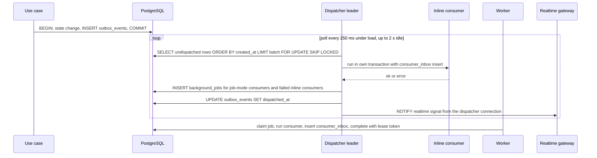
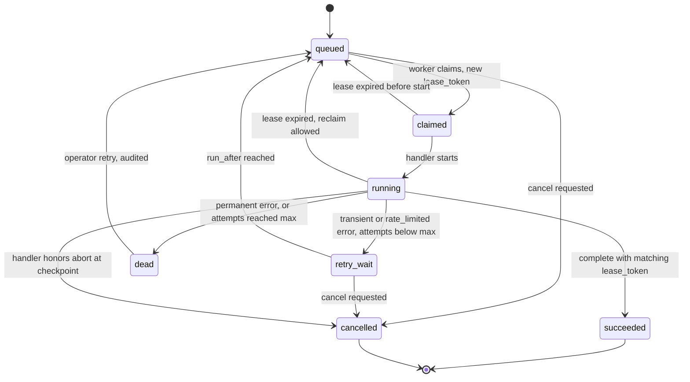

# 04 — Events and Asynchronous Processing

Status: **Proposed target**. As-built input: one `background_jobs` table claimed with `FOR UPDATE SKIP LOCKED` by `runClaimCycle` (10 jobs per claim, 60 s lease, 30 s handler timeout, 3 attempts, exponential backoff with jitter), most handlers only recording events and two transactional mail kinds executing; effects usually commit before `dispatchJob`, leases are not fenced, and timeouts do not abort handlers [SRC: ARCHITECTURE.md §8, §18; migration 00042]. The target keeps PostgreSQL as the queue and adds an outbox, consumer inbox and fencing (DEC-ARC-009, DEC-ARC-010).

Event ids (`EVT-<MOD>-nnn`) are assigned in module specifications. This file fixes the event name format, the envelope, delivery semantics and the starting topic list per module; module specs may add events in the same format.

## 1. Principles

1. **State first, then events, in one transaction.** A use case commits its state change and its outbox rows together. No event is published for a change that did not commit; no committed change lacks its event [SRC: ADR-T05].
2. **At-least-once, idempotent consumers.** Every consumer deduplicates by `event_id` in its own transaction [SRC: EVENT_CATALOG §2].
3. **Events carry facts and ids, not documents.** Consumers fetch details through the owner's interface under policy; no free-text personal data in payloads [SRC: EVENT_CATALOG §1].
4. **Producers never wait for consumers; consumer failure never rolls back the producer.**
5. **No consumer is the only enforcement point of a security rule.** Revocation, consent and sanctions are enforced at read time at the source; events only drive projections and notifications [SRC: EVENT_CATALOG §2].
6. **Ordering only per aggregate.** Consumers that need cross-aggregate facts re-read state.
7. **One durable job engine.** Scheduler, outbox consumers, imports, media and AI all run on the same fenced job engine with queue classes; no second queue technology without a recorded decision [SRC: ARCHITECTURE.md INVARIANT-012].

## 2. Naming and envelope

### 2.1 Event names

Format `<mod>.<entity>.<action>`: lowercase module code, entity in `snake_case`, action as a past-tense verb in `snake_case`. Examples: `job.application.submitted`, `evd.evidence.verified`, `bil.entitlement.changed`. The module code prefix guarantees uniqueness across 30 modules and shows the owner at a glance (the legacy catalog used unprefixed names such as `application.submitted` [SRC: EVENT_CATALOG §4]; those map one-to-one by adding the owner code).

Job kinds use `<mod>.<object>.<verb>` in the present tense (`ntf.email.send`, `src.document.index`). Consumer fallback jobs use `evt:<consumer_module>.<consumer_name>`.

### 2.2 Envelope

| Field | Type | Meaning |
|---|---|---|
| `event_id` | UUIDv7 | Unique id and dedupe key |
| `type` | string | Event name (§2.1) |
| `version` | int | Payload schema version for this type |
| `occurred_at` | timestamptz | Business time (transaction time) |
| `producer` | string | Module code |
| `aggregate` | `{type, id, seq}` | Ordering key; `seq` increments per aggregate within the producing transaction |
| `tenant` | `{org_id?, institution_id?, owner_subject_ref?}` | Scope; consumers must not widen it |
| `actor` | `{kind, human, ref?}` | `kind` ∈ `user, service, system, support, referee`; `human` derived by the producer; `ref` is a `subject_ref`, never an account id [SRC: BE-01-R2 §8] |
| `correlation_id`, `causation_id` | string, uuid | Causal chain; `causation_id` is the event or request that caused this one |
| `trace_context` | W3C `traceparent` | Restored by dispatcher and worker (DEC-ARC-019) |
| `data_class` | enum | Highest data class in `data` (normally DC-INTERNAL or DC-PRIVATE ids) |
| `data` | object | Type-specific payload, Zod-validated |

### 2.3 Delivery classes

| Class | Semantics | Source |
|---|---|---|
| EC-STD | At-least-once; inbox dedupe; per-kind retry (§7); dead-letter with alert | [SRC: EVENT_CATALOG §2] |
| EC-ORD | EC-STD plus per-aggregate order: consumer stores `last_seq` per aggregate; `seq <= last` skipped; gap deferred, then rebuilt from the owner's interface | [SRC: EVENT_CATALOG §2] |
| EC-CRIT | EC-STD with the long retry policy and a page (not only a ticket) on dead-letter: erasure, revocation, verification outcomes, billing and entitlements, passed assessments, offer acceptance | [SRC: EVENT_CATALOG §2] |

### 2.4 Versioning

Adding an optional field keeps the version. Removing, renaming or retyping a field creates `version + 1`; the producer emits both versions for one deprecation window; consumers declare accepted versions; AsyncAPI diff runs in CI [SRC: EVENT_CATALOG §2].

## 3. Outbox pattern

### 3.1 Tables

| Table | Columns | Notes |
|---|---|---|
| `outbox_events` | `event_id` PK, `type`, `version`, `producer`, `aggregate_type`, `aggregate_id`, `aggregate_seq`, `tenant jsonb`, `actor jsonb`, `correlation_id`, `causation_id`, `trace_context`, `data jsonb`, `created_at`, `dispatched_at` nullable, `dispatch_partition smallint` | Partitioned by day; unique (`aggregate_type`, `aggregate_id`, `aggregate_seq`); index (`dispatch_partition`, `created_at`) where `dispatched_at is null`; retained 14 days for replay (RC-OPS-SHORT) |
| `consumer_inbox` | PK (`consumer`, `event_id`), `processed_at` | Partitioned by day; 14 days |
| `consumer_offsets` | PK (`consumer`, `aggregate_type`, `aggregate_id`), `last_seq` | EC-ORD consumers only |
| `consumer_registry` | `consumer` PK, `module`, `event_types text[]`, `mode` (`inline`, `job`), `accepted_versions jsonb`, `enabled` | Generated from module `events.ts` at boot; informational copy for operators |

### 3.2 Write path

`platform/outbox.emit(tx, event)` validates the payload against its contract schema, assigns `event_id` and the next `aggregate_seq` (read from a per-aggregate counter column on the aggregate root, incremented in the same transaction), and inserts the row. `dispatch_partition = hash(aggregate_id) mod outbox.partitions` (default 1 [PROP]); more partitions allow one dispatcher leader per partition when RSK-ARC-05 materializes.

### 3.3 Dispatch path

| Step | Rule |
|---|---|
| Polling | Adaptive interval 250 ms under load, backing off to 2 s idle; no `LISTEN/NOTIFY` on the request path [SRC: BE-01-R2 §1.2] |
| Inline consumers | Cheap database-only reactions (in-app notification rows, counters, cache invalidation, projection deletes on consent change, audit append); 2 s timeout each; on failure the dispatcher enqueues one `evt:<consumer>` job for that event and consumer [SRC: BE-01-R2 §1.1] |
| Job consumers | Anything calling a provider, the AI gateway, object storage, or slow work; enqueued with `idempotency_key = <consumer>:<event_id>` |
| Coalescing | Projection consumers (search documents, match explanations, skill confidence) keep at most one queued job per (`consumer`, `aggregate_id`); a new event updates `payload.upto_seq` instead of adding a row [SRC: BE-01-R2 §1.1] |
| Marking | `dispatched_at` is set only after every inline consumer succeeded or its fallback job was inserted, in the same transaction as the job inserts |
| Realtime | After commit, the dispatcher issues `NOTIFY rt_signals` with a compact signal for events that map to channels ([07 §3](07_SEARCH_MEDIA_REALTIME_ARCHITECTURE.md)) |
| Lag metric | `now() - min(created_at)` of undispatched rows per partition; alert at `outbox.max_lag_seconds` (default 30 [PROP]) |

## 4. Topics per module

The starting topic list. **Class** is the delivery class; EC-ORD implies ordering by the aggregate named in the event. **Consumers** lists consuming modules; `notify` means NTF decides whether and how to notify. Consumers marked `(i)` run inline, others in job mode.

| Module | Event | Class | Consumers |
|---|---|---|---|
| IDN | `idn.account.registered` | EC-STD | NTF (verification mail), SET (subject map), ANL (i) |
| IDN | `idn.account.email_verified` | EC-STD | PRF (i), NTF |
| IDN | `idn.account.status_changed` | EC-ORD | PRF, SRC, AIC, MSG, NET, TSF (i) |
| IDN | `idn.session.revoked` | EC-STD | Realtime (disconnect), NTF (security alert), TSF |
| IDN | `idn.credential.changed` | EC-STD | NTF (security alert) |
| IDN | `idn.organization.created` | EC-ORD | BIL, EMP, INS, ANL (i) |
| IDN | `idn.organization.verified` | EC-ORD | JOB, INS, EVD (issuer trust), SRC |
| IDN | `idn.membership.added` / `idn.membership.changed` / `idn.membership.removed` | EC-ORD | BIL (seats), ATS (reassignment), INS, ENT, MSG, Realtime (re-authorize), NTF |
| IDN | `idn.sso.configured` | EC-ORD | ADM audit (i) |
| SET | `set.consent.changed` | EC-ORD | SRC (i, projection cleanup), AIC (i), JOB, INS, ENT, Realtime (re-authorize) |
| SET | `set.privacy_settings.changed` | EC-ORD | SRC (i), PRF, NET |
| SET | `set.dsr.export_requested` | EC-CRIT | SET export job |
| SET | `set.dsr.erasure_started` | EC-CRIT | every erasure participant |
| SET | `set.dsr.erasure_completed` | EC-CRIT | ADM audit, NTF (final confirmation to the address on file before deletion) |
| NTF | `ntf.notification.created` | EC-STD | Realtime (badge signal) |
| NTF | `ntf.delivery.failed_permanently` | EC-STD | ADM ops metrics (i) |
| PRF | `prf.profile.updated` | EC-ORD | SRC, AIC (match recompute), MKT |
| PRF | `prf.profile.visibility_changed` | EC-ORD | SRC (i), NET |
| PRF | `prf.resume.imported` | EC-STD | NTF |
| PRF | `prf.skill.created` / `prf.skill.merged` | EC-ORD | SRC, JOB, EVD, LRN, ASM, AIC, MKT |
| EVD | `evd.evidence.created` | EC-ORD | BGV (auto-verification), SRC, AIC |
| EVD | `evd.evidence.updated` | EC-ORD | SRC, AIC |
| EVD | `evd.evidence.verified` | EC-ORD + EC-CRIT | PRF (skill confidence), SRC, AIC, JOB (snapshot link status), REP, NTF |
| EVD | `evd.evidence.revoked` | EC-ORD + EC-CRIT | PRF, SRC, AIC, JOB, NTF |
| EVD | `evd.reference.requested` / `evd.reference.submitted` | EC-STD | NTF |
| EVD | `evd.credential.issued` / `evd.credential.revoked` | EC-CRIT | NTF, PLT (CDN purge of `/verify`), partner webhooks |
| BGV | `bgv.check.ordered` / `bgv.check.consented` | EC-ORD | BGV vendor job, NTF |
| BGV | `bgv.check.completed` / `bgv.check.adjudicated` | EC-CRIT | ATS, NTF |
| BGV | `bgv.identity.verified` | EC-CRIT | EVD (identity-backed rung), TSF |
| SRC | `src.saved_search.matched` | EC-STD | NTF (alerts) |
| LRN | `lrn.enrollment.created` | EC-ORD | BIL (seat usage), INS, ENT, NTF, ANL (i) |
| LRN | `lrn.progress.recorded` | EC-ORD | REP (XP), INS, ENT (i, coalesced) |
| LRN | `lrn.course.completed` | EC-ORD + EC-CRIT | EVD (course-completion evidence at `artifact_backed` or `authority_verified` only when the final-assessment rule holds), REP, INS, ENT, NTF |
| LRN | `lrn.certificate.issued` | EC-CRIT | EVD, NTF |
| STU | `stu.course.submitted_for_review` / `stu.course.review_decided` | EC-STD | NTF, ADM |
| STU | `stu.course.published` / `stu.course.retired` | EC-ORD | LRN, SRC, NTF (followers, waitlist) |
| STU | `stu.media.ready` / `stu.media.failed` | EC-STD | STU (i), NTF |
| ASM | `asm.attempt.started` | EC-ORD | Realtime (deadline signal), TSF (i) |
| ASM | `asm.attempt.submitted` | EC-ORD | ASM grading job |
| ASM | `asm.attempt.graded` | EC-ORD + EC-CRIT | EVD (assessment-result evidence; verified only when the attempt is verified), LRN, JOB, ATS, REP, NTF |
| ASM | `asm.integrity_case.opened` / `asm.integrity_case.decided` | EC-CRIT | TSF, EVD (void evidence on upheld case), NTF |
| JOB | `job.job.published` / `job.job.updated` | EC-ORD | SRC, AIC, PLT (job distribution, sitemap, partner webhooks), NTF (saved-search alerts via SRC) |
| JOB | `job.job.closed` / `job.job.taken_down` | EC-ORD | SRC (i), ATS, AIC, PLT (distribution withdrawal) |
| JOB | `job.application.submitted` | EC-ORD | ATS (pipeline placement), AIC (match explanation), NTF, ANL (i), partner webhooks |
| JOB | `job.application.withdrawn` | EC-ORD | ATS, INT (cancel future interviews), NTF |
| ATS | `ats.application.stage_changed` | EC-ORD | JOB (candidate-facing status), NTF, Realtime, ANL (i), partner webhooks |
| ATS | `ats.application.rejected` / `ats.application.hired` | EC-ORD + EC-CRIT for hired | JOB, NTF, INS (placement outcome), EVD (employer-verified work history offer), ANL |
| ATS | `ats.offer.sent` / `ats.offer.accepted` / `ats.offer.declined` / `ats.offer.rescinded` | EC-CRIT | JOB, NTF, BGV (post-offer checks), ATS (requisition fill), partner webhooks |
| ATS | `ats.requisition.approved` / `ats.requisition.filled` | EC-ORD | JOB, ANL |
| INT | `int.interview.scheduled` / `int.interview.rescheduled` / `int.interview.cancelled` | EC-ORD | NTF (with calendar file), INT calendar sync job, Realtime |
| INT | `int.interview.completed` / `int.interview.no_show` | EC-ORD | ATS (scorecard reminders), AIC (optional analysis with consent), ANL |
| EMP | `emp.employer_page.published` | EC-ORD | SRC, PLT (CDN purge) |
| EMP | `emp.review.published` | EC-STD | EMP aggregates, NTF (org) |
| NET | `net.connection.requested` / `net.connection.accepted` | EC-STD | NTF, AIC (people recommendations) |
| NET | `net.post.published` | EC-STD | NET feed fan-out job, TSF (scan), SRC |
| NET | `net.referral.requested` / `net.referral.submitted` | EC-STD | NTF, JOB (referral source on application) |
| MSG | `msg.message.sent` | EC-ORD | Realtime, NTF (if recipient offline, after `msg.offline_notify_delay_seconds`), TSF (scan sample) |
| MSG | `msg.conversation.reported` | EC-STD | TSF |
| REP | `rep.badge.awarded` / `rep.level.changed` | EC-STD | NTF, PRF (public badges) |
| EVT | `evt.registration.created` / `evt.registration.cancelled` | EC-ORD | NTF, BIL (ticket refund rules) |
| EVT | `evt.event.starting_soon` (scheduled) | EC-STD | NTF |
| EVT | `evt.submission.scored` | EC-ORD | REP, EVD (hackathon result evidence at `artifact_backed`) |
| AIC | `aic.run.completed` | EC-STD | Realtime (run status), ANL (i) |
| AIC | `aic.recommendation.generated` | EC-STD | NTF (digest only) |
| AIC | `aic.budget.threshold_reached` | EC-STD | NTF (holder), BIL |
| TSF | `tsf.report.created` | EC-STD | TSF triage job |
| TSF | `tsf.content.actioned` | EC-CRIT | owning module (hide content), SRC (i), NTF |
| TSF | `tsf.sanction.applied` / `tsf.sanction.lifted` | EC-CRIT | IDN (status), every module that gates actions on sanctions, NTF |
| INS | `ins.learner.linked` / `ins.learner.severed` | EC-ORD | LRN, ASM, SRC, NTF |
| INS | `ins.assignment.created` | EC-ORD | LRN (enrollment creation), BIL (seat allocation), NTF |
| INS | `ins.placement_drive.opened` | EC-STD | NTF (eligible consented learners) |
| INS | `ins.import.completed` | EC-STD | NTF (admin) |
| ENT | `ent.opportunity.published` | EC-ORD | SRC (workforce-scoped index), AIC, NTF |
| ENT | `ent.workforce.synced` | EC-STD | ENT inventory job |
| BIL | `bil.checkout.completed` | EC-CRIT | BIL entitlement grant (i) |
| BIL | `bil.subscription.changed` | EC-CRIT | BIL entitlements (i), NTF, ANL |
| BIL | `bil.entitlement.changed` | EC-CRIT | JOB (posting limits), SRC (recruiter search), AIC (budgets), LRN (access), INS, ENT (capabilities), Realtime |
| BIL | `bil.order.paid` / `bil.order.refunded` | EC-CRIT | LRN (enrollment), EVT (tickets), MEN (sessions), NTF |
| BIL | `bil.payment.failed` | EC-CRIT | NTF (dunning) |
| MEN | `men.engagement.started` / `men.session.completed` | EC-ORD | NTF, REP (mentor reputation), BIL (session settlement) |
| GIG | `gig.contract.created` / `gig.milestone.accepted` / `gig.dispute.opened` | EC-CRIT | BIL (payment release when enabled), EVD (completed-project evidence at `peer_attested` when the client attests), TSF, NTF |
| MKT | `mkt.signals.refreshed` | EC-STD | AIC (career plan staleness), SRC |
| ANL | `anl.report_export.ready` | EC-STD | NTF |
| ADM | `adm.flag.changed` / `adm.config.changed` | EC-STD | All replicas reference caches (i) |
| PWA | `pwa.device.registered` | EC-STD | NTF (push targets) |
| PLT | `plt.file.available` / `plt.file.rejected` | EC-ORD | owning module of the file purpose, NTF on rejection |
| PLT | `plt.webhook_endpoint.disabled` | EC-STD | NTF (org admins) |
| PLT | `plt.integration.sync_completed` / `plt.integration.sync_failed` | EC-STD | NTF, owning module |

## 5. Job engine

### 5.1 Target `background_jobs` schema (additive evolution of migration 00042)

| Column | Type | As-built? | Purpose |
|---|---|---|---|
| `id` | uuid | Yes | |
| `kind` | text | Yes | Job kind (§8) |
| `queue` | text | New | Queue class (§5.3); default from the kind registry |
| `payload` | jsonb | Yes | Ids and parameters only; no tokens, codes or email addresses (resolved at run time); `subject_ref` instead of account ids where the job concerns a person |
| `tenant` | jsonb | New | Tenant scope used to set transaction claims for the job (01 §8.5) |
| `status` | text | Changed set | `queued, claimed, running, retry_wait, succeeded, dead, cancelled` [SRC: BE-01-R2 §3.1]; as-built set is `queued, running, succeeded, failed, dead, canceled` |
| `priority` | smallint | New | 0 (highest) to 9; default 5 |
| `attempts`, `max_attempts` | int | `attempts` yes | Every claim increments `attempts` |
| `run_after` | timestamptz | Yes | |
| `lease_token` | uuid | New | Fencing token, regenerated on every claim |
| `lease_expires_at` | timestamptz | Yes as `lock_expires_at` | |
| `claimed_by` | text | New | Worker instance id |
| `last_error_class`, `last_error` | text | `last_error` yes | Error class `transient, permanent, rate_limited, cancelled`; message ≤ 4 KB, redacted |
| `idempotency_key` | text | Yes | Unique per kind where status is not terminal (as-built index is unconditional, kept until migration) |
| `cancel_requested_at` | timestamptz | New | Cooperative cancellation |
| `correlation_id`, `trace_context` | text | New | Tracing |
| `created_at`, `updated_at`, `finished_at` | timestamptz | Partly | |

### 5.2 State machine

### 5.3 Claim, fencing and lease renewal

1. **Claim:** `UPDATE background_jobs SET status = 'claimed', lease_token = gen_random_uuid(), lease_expires_at = now() + lease, claimed_by = $worker, attempts = attempts + 1 WHERE id IN (SELECT id FROM background_jobs WHERE queue = $queue AND status = 'queued' AND run_after <= now() ORDER BY priority, run_after LIMIT $batch FOR UPDATE SKIP LOCKED) RETURNING *`. Batch size per queue class; default 1 for `heavy` and `ai`, 10 for others.
2. **Fencing:** every subsequent write by the worker (`running`, heartbeat, completion, retry scheduling) includes `WHERE id = $id AND lease_token = $token`. Zero rows updated means the lease was lost; the worker abandons the result and records `lease_lost` [SRC: ADR-T09].
3. **Fenced side effects:** a handler that writes domain state does so in a transaction that also completes the job with the lease-token predicate, so the effect and the completion commit together. Handlers that call external providers pass `idempotency_key = <job id>:<attempt-independent operation key>` to the provider where the provider supports it (Stripe, most email providers).
4. **Lease renewal:** handlers longer than half the lease call `heartbeat()` which extends `lease_expires_at` under the fencing predicate; default lease 60 s [SRC: as-built], heavy queue 300 s [PROP].
5. **Abort:** each handler receives an `AbortSignal` that fires at timeout or on `cancel_requested_at`; the as-built `Promise.race` without abort [SRC: ARCHITECTURE.md §18] is replaced.
6. **Reclaim:** a reaper (scheduler role) returns `claimed` or `running` rows with expired leases to `queued`, or to `dead` when `attempts >= max_attempts`.

### 5.4 Queue classes and worker pools

| Queue | Kinds | Pool default | Max ready age alert [PROP] |
|---|---|---|---|
| `critical` | Billing reconciliation, entitlement grants from webhooks, erasure steps, credential revocation fan-out | 2 workers | 60 s |
| `default` | Event consumer fallbacks, projections, search indexing, notifications in-app, reminders | 4 workers | 120 s |
| `email` | `ntf.email.send`, `ntf.push.send`, `ntf.sms.send` (deferred), digests | 2 workers | 300 s |
| `webhook` | `plt.webhook.deliver`, job distribution pushes | 2 workers | 300 s |
| `heavy` | Media scan and transcode orchestration, imports, exports, report exports, resume parsing, bulk actions | 2 workers, separate deployment at trigger S2 | 900 s |
| `ai` | AI runs, embeddings, batch recommendations, match recomputation | 2 workers | 300 s |
| `scheduled` | Sweeps, rollups, digest fan-out, reminders scan | 1 worker | 900 s |

Each pool has its own database connection budget and statement timeout ([01 §20](01_SYSTEM_ARCHITECTURE.md)).

## 6. Retry, dead-letter and replay

### 6.1 Backoff policy

Formula `delay = min(cap, base × 2^(attempt − 1))` with full jitter `random(0, delay)`; `rate_limited` honors `Retry-After` [SRC: BE-01-R2 §3.2].

| Policy | Kinds | Max attempts | Base | Cap | Worst-case span without jitter |
|---|---|---|---|---|---|
| `default` | Most internal jobs, `evt:*` fallbacks, `src.*`, `plt.file.*` | 8 | 5 s | 15 min | about 11 min |
| `delivery` | `ntf.email.send`, `plt.webhook.deliver` | 12 | 60 s | 6 h | about 20.5 h |
| `push` | `ntf.push.send` | 4 | 60 s | 15 min | 7 min |
| `ai` | `aic.*` | 3 | 5 s | 15 min | 15 s |
| `runner` | `asm.code.run` | 2 | 5 s | 15 min | 5 s (new run id per attempt) |
| `critical` | EC-CRIT consumers, `set.erasure.step`, `bil.*` | 12 | 30 s | 1 h | about 7.5 h, then page |

Values are configuration (`jobKinds.<kind>.maxAttempts|baseMs|capMs`) validated at boot. As-built default is 3 attempts [SRC: ARCHITECTURE.md §18].

### 6.2 Error classes

| Class | Examples | Effect |
|---|---|---|
| `transient` | Timeout, 5xx, connection reset, lock timeout | Retry per policy |
| `rate_limited` | Provider 429 | Retry after `Retry-After` or policy delay |
| `permanent` | Validation failure, 4xx other than 408 and 429, missing resource, consent revoked | `dead` immediately; no retry |
| `cancelled` | Abort honored | `cancelled` |

### 6.3 Dead-letter handling

`dead` rows stay in `background_jobs` (RC-OPS, 90 days) and are the dead-letter queue. A dead EC-CRIT job pages on-call; others create an operations ticket and raise the `jobs_dead_total` metric. Operators inspect and retry through `/admin/jobs` (audited). Unknown kinds dead-letter immediately [SRC: as-built ARCHITECTURE.md §18]. Projection consumers also have **rebuild** kinds (`src.index.rebuild`, `aic.match.rebuild`) that recompute from owner interfaces, so a lost event is recoverable without replay.

### 6.4 Replay

Any consumer can replay from `outbox_events` within its 14-day retention by resetting its inbox for a time range (operator action, audited). Consumers are written to tolerate replay of any event within that window [SRC: EVENT_CATALOG §2].
