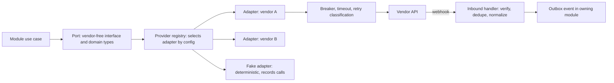

# 05 — Integrations and Adapters

Status: **Proposed target**. As-built input: two provider boundaries exist in source. Stripe calls live only in `apps/api/src/stripe-gateway.ts` with normalized snapshots kept out of business rules; email goes through `apps/worker/src/email` (logical template ids and variable validation in `templates.ts`, a vendor-free contract in `types.ts`, one registry in `service.ts`, the only Brevo code in `brevo.ts` with native fetch and a 20 s timeout, one env reader in `config.ts`, a shared provider contract test, and a labelled dev outbox). Neither live delivery nor live billing has been exercised [SRC: ARCHITECTURE.md §17]. That email design is the template for every integration below (DEC-ARC-021).

Vendor names are defaults or examples, never contracts [SRC: SSOT §13.3]. Choosing a vendor is a recorded decision (ARCHITECTURE.md INVARIANT-011); open vendor choices are listed in §8.

## 1. Adapter pattern

| Element                | Rule                                                                                                                                                                                                                                                       |
| ---------------------- | ---------------------------------------------------------------------------------------------------------------------------------------------------------------------------------------------------------------------------------------------------------- |
| Port                   | A TypeScript interface in `packages/adapters/<port>/types.ts` with domain-shaped inputs and outputs, no vendor types, and an explicit error union (`transient`, `rate_limited`, `permanent`, `unavailable`). One port per capability, owned by one module. |
| Capability flags       | Each adapter declares what it supports (for example the media flags `canEmbed`, `supportsCaptions`, `supportsTranscript` [SRC: SSOT §13.14]); use cases branch on flags, never on vendor names.                                                            |
| Anti-corruption mapper | Vendor payloads are converted to normalized snapshots at the adapter edge; raw payloads are stored only as digests or in the provider event table [SRC: ARCHITECTURE.md §17 "normalized snapshots"].                                                       |
| Registry               | `packages/adapters/<port>/registry.ts` builds the adapter from `packages/config` values (`<PORT>_PROVIDER`); unknown providers fail at boot in deployed modes.                                                                                             |
| Contract suite         | `tests/contract/<port>.ts` runs against every adapter: the fake in unit CI, the vendor sandbox in a scheduled CI job. A new adapter must pass it [SRC: as-built `tests/unit/email/provider-contract.ts`].                                                  |
| Timeouts               | Every call has a timeout from config (`<port>.timeout_ms`; email 20 s as-built; default 10 s; AI 30 s [SRC: SSOT CON-008]).                                                                                                                                |
| Retries                | Adapters do not retry internally beyond one immediate retry for idempotent reads; retries belong to the job engine ([04 §6](04_EVENTS_AND_ASYNC.md)).                                                                                                      |
| Circuit breaker        | Per adapter and per tenant connection: opens after `breaker.failure_threshold` consecutive failures (default 5 [PROP]) for `breaker.open_seconds` (default 30 [PROP]); state visible on `/admin/health` [SRC: SSOT §13.4].                                 |
| Idempotency            | Outbound calls that create something pass a stable idempotency key where the vendor supports one.                                                                                                                                                          |
| Observability          | Each call is a span with `port`, `provider`, `operation`, `outcome`, latency; no secrets or personal payloads in attributes.                                                                                                                               |
| Ownership              | Every integration has an owner role and a documented degraded mode [SRC: SSOT §13.4].                                                                                                                                                                      |
| Removal drill          | Before a release that touches an integration, the fake adapter replaces the live one in staging and the degraded mode is exercised [SRC: SSOT §13.4 VER-021].                                                                                              |

## 2. Port catalog

| Port                       | Owner    | Operations                                                                                         | Default adapter                                                                 | Alternates                                                                                               |
| -------------------------- | -------- | -------------------------------------------------------------------------------------------------- | ------------------------------------------------------------------------------- | -------------------------------------------------------------------------------------------------------- |
| `EmailPort`                | NTF      | `send(templateId, to, variables, idempotencyKey)`, `parseEvent(webhook)`                           | Brevo [SRC: as-built; V61-08 default proposal]                                  | Postmark, Amazon SES, Resend (examples) [SRC: SSOT §13.3]                                                |
| `PushPort`                 | NTF      | `send(subscription, payload, ttl, urgency)`                                                        | Web Push with VAPID [SRC: ADR-T20]                                              | n/a                                                                                                      |
| `SmsPort`                  | NTF      | `send(to, templateId, variables)`                                                                  | None (deferred) [SRC: ADR-T20]                                                  | Twilio, Vonage (examples)                                                                                |
| `PaymentPort`              | BIL      | `createCheckout`, `createPortalSession`, `getSubscription`, `refund`, `parseWebhook`               | Stripe [SRC: as-built; ADR-T15]                                                 | None at launch                                                                                           |
| `TaxPort`                  | BIL      | `quote`, `commit`                                                                                  | Stripe Tax (example)                                                            | Others                                                                                                   |
| `PayoutPort`               | BIL      | `onboardSeller`, `transfer`                                                                        | Gated (marketplace money-flow decision)                                         | Stripe Connect (example)                                                                                 |
| `IdentityFederationPort`   | IDN      | `authorizeUrl`, `exchangeCode`, `verifyIdToken`; SAML `verifyAssertion`                            | Standard OIDC and SAML libraries per provider config                            | Managed IdP if OD-ARC-03 chooses it                                                                      |
| `BreachedPasswordPort`     | IDN      | `isBreached(sha1Prefix)`                                                                           | k-anonymity range API (HaveIBeenPwned) [SRC: SSOT §13.3]                        | Local list                                                                                               |
| `CaptchaPort`              | IDN, TSF | `verify(token, action)`                                                                            | Cloudflare Turnstile or hCaptcha (examples) [PROP]                              | n/a                                                                                                      |
| `StoragePort`              | PLT      | `presignPut`, `presignGet`, `head`, `copy`, `delete`, `listPrefix`                                 | S3-compatible object storage                                                    | Cloud-native equivalents                                                                                 |
| `MalwareScanPort`          | PLT      | `scan(objectRef)`                                                                                  | ClamAV in the heavy worker pool [PROP]                                          | Vendor scanning API                                                                                      |
| `MediaProviderPort`        | STU      | `createUpload`, `getAsset`, `playbackToken`, `deleteAsset`, `parseWebhook`; capability flags       | Managed video vendor (OD-ARC-12)                                                | Mux, Cloudflare Stream (examples) [SRC: SSOT §13.3]                                                      |
| `EmbedMetadataPort`        | STU      | `resolve(url)` → provider, title, duration, embeddability                                          | YouTube, Vimeo oEmbed adapters with SSRF allowlist [SRC: SSOT §13.13, §13.16]   | n/a                                                                                                      |
| `ModelProviderPort`        | AIC      | `complete`, `stream`, `embed`, `moderate`, `countTokens`                                           | At least two providers (OD-ARC-13)                                              | Anthropic, Google, OpenAI, open-weight host (examples)                                                   |
| `CodeRunnerPort`           | ASM      | `run(language, files, tests, limits)` → results, signature                                         | None until OD-ARC-09                                                            | Self-hosted sandbox, vendor API                                                                          |
| `VideoRoomPort`            | INT, MEN | `createRoom`, `joinToken`, `endRoom`, `recordingStatus`                                            | WebRTC provider (OD-ARC-08)                                                     | Daily, LiveKit, Twilio Video (examples)                                                                  |
| `CalendarPort`             | INT      | `connect`, `freeBusy`, `upsertEvent`, `deleteEvent`, `watch`                                       | Google Calendar, Microsoft Graph                                                | CalDAV                                                                                                   |
| `ESignaturePort`           | ATS, GIG | `createEnvelope`, `status`, `parseWebhook`                                                         | Optional; none at launch [PROP]                                                 | DocuSign, Dropbox Sign (examples)                                                                        |
| `BackgroundCheckPort`      | BGV      | `createCandidate`, `orderPackage`, `getReport`, `parseWebhook`                                     | Vendor per region (OD-ARC-26)                                                   | Checkr, Certn, Sterling (examples)                                                                       |
| `IdentityVerificationPort` | BGV      | `createSession`, `getResult`, `parseWebhook`                                                       | Vendor (SSOT OD-27)                                                             | Persona, Onfido, Veriff (examples)                                                                       |
| `ProctoringPort`           | ASM      | `createSession`, `getFlags`                                                                        | None (SSOT OD-35)                                                               | Vendor                                                                                                   |
| `JobDistributionPort`      | ATS      | `publish`, `update`, `withdraw`                                                                    | Google for Jobs structured data plus sitemap (no API call); job boards optional | Indeed, LinkedIn job posting (partner programs; examples)                                                |
| `AtsImportPort`            | PLT, ATS | `listJobs`, `listCandidates`, `listApplications`                                                   | Optional per customer                                                           | Greenhouse, Lever, Workday (examples)                                                                    |
| `HrisPort`                 | ENT      | `listWorkers`, `listOrgUnits`, `listJobs`, `changesSince`                                          | Optional per customer                                                           | Workday, SAP SuccessFactors, BambooHR (examples) [SRC: SSOT §13.3]; unified HRIS API vendor as an option |
| `LmsInteropPort`           | INS      | LTI 1.3 launch and deep linking, Names and Roles, Assignment and Grade Services; OneRoster rosters | Standards-based, no vendor                                                      | Moodle, Canvas, Blackboard [SRC: SSOT §13.3]                                                             |
| `ScimPort` (inbound)       | IDN      | SCIM 2.0 Users and Groups                                                                          | Standards-based                                                                 | n/a                                                                                                      |
| `CredentialIssuancePort`   | EVD      | `sign(credential)`, `verify(credential)`, `publishStatusList`                                      | In-house signer with KMS key, Open Badges 3.0 (OD-ARC-20)                       | Vendor wallet services                                                                                   |
| `GeocodingPort`            | JOB, SRC | `geocode(text)`, `reverse(lat, lng)` coarse                                                        | Open data or commercial geocoder [PROP]                                         | n/a                                                                                                      |
| `FxRatesPort`              | MKT, BIL | `rates(date)`                                                                                      | Central-bank reference rates [PROP]                                             | Commercial feed                                                                                          |
| `ChatOpsPort`              | NTF      | `post(channelRef, message)`                                                                        | Optional Slack and Microsoft Teams apps [SRC: SSOT §13.3 Slack]                 | n/a                                                                                                      |
| `TelemetryExportPort`      | Platform | OTLP export                                                                                        | OpenTelemetry collector [SRC: ADR-T16]                                          | Vendor backends                                                                                          |
| `ErrorReportingPort`       | Platform | `capture(error, context)`                                                                          | Sentry (example) [SRC: SSOT §13.3]                                              | OTLP logs                                                                                                |
| `ProductAnalyticsPort`     | ANL      | `export(batch)`                                                                                    | First-party `analytics_events` only; external export optional                   | PostHog (example) [SRC: SSOT §13.3]                                                                      |

## 3. Integration catalog

Credential kinds: **PS** platform secret in the secret manager; **TC** tenant credential envelope-encrypted in `integration_connections` or `sso_connections`; **UC** user credential (OAuth tokens) envelope-encrypted per user; **WS** webhook signing secret (PS). Sandbox column names the test double used in each environment: unit and integration tests always use the **fake** adapter; staging uses the vendor **sandbox** where one exists.

| Integration (port)                                 | Data sent                                                                         | Data received                                              | Highest data class                               | Failure modes                                                 | Fallback or degraded mode                                                                                                                                               | Credentials                                             | Sandbox and tests                                                                                      |
| -------------------------------------------------- | --------------------------------------------------------------------------------- | ---------------------------------------------------------- | ------------------------------------------------ | ------------------------------------------------------------- | ----------------------------------------------------------------------------------------------------------------------------------------------------------------------- | ------------------------------------------------------- | ------------------------------------------------------------------------------------------------------ |
| Transactional email (`EmailPort`)                  | Recipient address, template id, variables (names, links with tokens)              | Message id; delivery, bounce, complaint events             | DC-PRIVATE                                       | Provider 5xx or timeout; rate limit; bounces; suppression     | Retry up to the delivery policy (about 20.5 h); in-app notification unaffected; bounce and complaint add to `email_suppressions`; second provider only after a decision | PS API key; WS for events                               | Fake with dev outbox [SRC: as-built]; provider sandbox or test domain in staging; contract suite       |
| Web Push (`PushPort`)                              | Encrypted payload ≤ 4 KB, TTL                                                     | Status code                                                | DC-PRIVATE (encrypted)                           | 404 or 410 subscription gone; 429; payload too large          | Delete gone subscriptions; in-app badge still updated                                                                                                                   | PS VAPID key pair                                       | Fake; local push service in browser tests                                                              |
| Payments (`PaymentPort`)                           | Customer email, price ids, quantities, metadata ids                               | Checkout sessions, subscriptions, invoices, payment events | DC-PRIVATE; card data never touches TalentSphere | 5xx, timeout, webhook delay or duplication, signature failure | Checkout `503`; entitlements unchanged; hourly reconcile sweep; webhook dedupe [SRC: as-built]                                                                          | PS secret key; WS webhook secret                        | Stripe test mode and CLI-forwarded webhooks; as-built `BILLING_MODE=disabled` default [SRC: CLAUDE.md] |
| Social login (`IdentityFederationPort`)            | Redirect with state, nonce, PKCE                                                  | ID token: subject, email, email_verified                   | DC-PRIVATE                                       | Provider down; invalid token; email unverified                | Password and passkey sign-in; unverified provider emails never auto-link                                                                                                | PS client secret per provider                           | Mock OIDC provider in tests; provider test apps in staging                                             |
| Enterprise SSO (OIDC or SAML)                      | AuthnRequest                                                                      | Assertion with attributes                                  | DC-PRIVATE                                       | Certificate expiry, clock skew, misconfiguration              | Org admin break-glass account (password plus passkey) exempt from enforcement; certificate expiry warnings 30 days ahead                                                | TC metadata and certificates                            | SAML test IdP; conformance suite                                                                       |
| SCIM provisioning                                  | none outbound                                                                     | Users, groups, deactivations                               | DC-PRIVATE                                       | Bad payloads; duplicate users                                 | Reject with SCIM errors; admin report                                                                                                                                   | TC bearer token hash                                    | SCIM compliance tests                                                                                  |
| Breached passwords                                 | First 5 hex characters of SHA-1 of the password                                   | Suffix list                                                | DC-INTERNAL                                      | Timeout                                                       | Allow the password with a background re-check flag (fail-open is acceptable because it is an extra control) [DER]                                                       | none                                                    | Fake                                                                                                   |
| CAPTCHA                                            | Token, action                                                                     | Score or pass                                              | DC-INTERNAL                                      | Provider down                                                 | Fall back to stricter rate limits and email confirmation; never block all sign-ups                                                                                      | PS secret                                               | Test keys                                                                                              |
| Object storage (`StoragePort`)                     | Objects, metadata                                                                 | Objects, presigned URLs                                    | Up to DC-RESTRICTED                              | Unavailable, throttled                                        | Uploads `503`; text features continue                                                                                                                                   | PS access keys or workload identity                     | Local S3-compatible server (for example MinIO) in tests                                                |
| Malware scan                                       | Object stream                                                                     | Verdict                                                    | Up to DC-RESTRICTED                              | Scanner down or signatures stale                              | Files stay `quarantined` (fail-closed); alert                                                                                                                           | none (in-cluster)                                       | EICAR test file in CI                                                                                  |
| Video media (`MediaProviderPort`)                  | Video file or upload URL, asset metadata                                          | Asset id, renditions, captions, playback ids, webhooks     | DC-PUBLIC after publish; DC-PRIVATE before       | Transcode failure, webhook delay, quota                       | Asset `failed` with retry; course publication blocked until ready                                                                                                       | PS API key; WS                                          | Vendor test environment; fake for unit tests                                                           |
| Embedded video metadata                            | Public URL                                                                        | Title, duration, embeddability                             | DC-PUBLIC                                        | Provider blocks embedding; URL removed                        | Delivery mode E (external link) [SRC: SSOT §13.13]; nightly healthcheck flags broken items                                                                              | PS API keys where needed                                | Recorded fixtures                                                                                      |
| Model providers (`ModelProviderPort`)              | Minimized, redacted prompt context                                                | Completions, embeddings, moderation scores, token counts   | Up to DC-PRIVATE; DC-SENSITIVE and above never   | Timeouts, 429, outages, safety refusals, malformed output     | Fallback chain then heuristic or non-AI fallback with a badge ([06 §8](06_AI_ARCHITECTURE.md))                                                                          | PS keys; TC for org BYO keys                            | Fake model with scripted outputs; eval suites against sandbox keys with budget caps                    |
| Code runner (`CodeRunnerPort`)                     | Code, tests, limits                                                               | Results, resource use, signature                           | DC-PRIVATE                                       | Runner down, timeout, resource exhaustion                     | Attempts queued, "grading delayed"; timer not consumed; never a simulated pass [SRC: ADR-T13]                                                                           | PS mutual TLS between worker and runner                 | Local runner image with fixed test programs                                                            |
| Video interviews (`VideoRoomPort`)                 | Room name, participant display names, window                                      | Join tokens, room events, recording status                 | DC-PRIVATE                                       | Provider outage, join failure                                 | Fallback link stored on the interview (dial-in or external meeting) shown to participants                                                                               | PS API key                                              | Vendor sandbox; fake rooms                                                                             |
| Calendars (`CalendarPort`)                         | Event title, time, attendees, description without sensitive data                  | Free/busy, event ids, change notifications                 | DC-PRIVATE                                       | Token revoked, quota, watch expiry                            | ICS attachment in the notification email; reconnect prompt to the user                                                                                                  | UC OAuth tokens                                         | Provider test accounts; fake                                                                           |
| E-signature (`ESignaturePort`)                     | Offer or contract document, signer emails                                         | Envelope status, signed document                           | DC-SENSITIVE                                     | Provider down                                                 | Click-to-accept with step-up and an audit record                                                                                                                        | TC or PS                                                | Vendor demo environment                                                                                |
| Background checks (`BackgroundCheckPort`)          | Candidate name, contact, consented identifiers, package code                      | Report status, summary, report link                        | DC-RESTRICTED                                    | Vendor delays, disputes, jurisdiction limits                  | Status `pending` visible to both parties; recruiter cannot adjudicate before completion                                                                                 | TC (employer's vendor account) or PS (platform account) | Vendor sandbox with test identities only; never real data in non-production                            |
| Identity verification (`IdentityVerificationPort`) | Session request                                                                   | Verification result, level                                 | DC-RESTRICTED                                    | Vendor down; inconclusive result                              | Retry later; feature that needs IDV stays locked                                                                                                                        | PS key; WS                                              | Vendor sandbox test documents                                                                          |
| Proctoring (`ProctoringPort`)                      | Session metadata, consent                                                         | Flags, recordings (vendor-held)                            | DC-RESTRICTED                                    | Vendor down                                                   | Assessment owner chooses: postpone or run unproctored with `verified: false`                                                                                            | PS or TC                                                | Vendor sandbox                                                                                         |
| Job distribution (`JobDistributionPort`)           | Published job fields (public only)                                                | Posting ids, status                                        | DC-PUBLIC                                        | Partner API rejects or delays                                 | Job remains live on TalentSphere; distribution status shown to recruiter                                                                                                | TC or PS partner keys                                   | Partner sandboxes; structured-data validator for Google for Jobs                                       |
| ATS import (`AtsImportPort`)                       | API calls with customer's key                                                     | Jobs, candidates, applications                             | DC-PRIVATE                                       | Rate limits, schema drift                                     | Partial import with row errors; resumable                                                                                                                               | TC customer API key                                     | Recorded fixtures per vendor                                                                           |
| HRIS (`HrisPort`)                                  | API calls                                                                         | Workers, org units, titles                                 | DC-SENSITIVE                                     | Token expiry, large deltas                                    | Last successful snapshot remains; sync error to EXA                                                                                                                     | TC                                                      | Vendor sandboxes or unified-API sandbox                                                                |
| LMS (LTI 1.3, OneRoster)                           | Launch responses, grades                                                          | Launch claims, rosters                                     | DC-PRIVATE                                       | Key rotation, clock skew                                      | Manual roster import (bulk import)                                                                                                                                      | TC platform registration keys                           | IMS reference tools and certification suite                                                            |
| Credential issuance                                | Signed credential, status list                                                    | Verification requests                                      | DC-PUBLIC                                        | KMS unavailable                                               | Issuance queued; verification of existing credentials unaffected (public keys cached)                                                                                   | KMS signing key                                         | Test keys; Open Badges validator                                                                       |
| Geocoding, FX rates                                | Location text; date                                                               | Coordinates (coarse); rates                                | DC-INTERNAL                                      | Unavailable                                                   | Cached values; location stored as text only                                                                                                                             | PS                                                      | Fixtures                                                                                               |
| Chat ops (Slack, Teams)                            | Notification summaries without personal details beyond names the org already sees | Install tokens                                             | DC-PRIVATE                                       | Token revoked                                                 | Email notification instead                                                                                                                                              | TC                                                      | Vendor test workspaces                                                                                 |
| Observability export                               | Traces, metrics, redacted logs                                                    | none                                                       | DC-INTERNAL (redacted)                           | Backend down                                                  | Local buffering then drop; never blocks requests                                                                                                                        | PS                                                      | Local collector                                                                                        |

## 4. Credentials handling

| Rule | Detail                                                                                                                                                                                                                             |
| ---- | ---------------------------------------------------------------------------------------------------------------------------------------------------------------------------------------------------------------------------------- |
| C-01 | Platform secrets live in a secret manager and are injected at process start; never in the repository, image, logs, error messages or client bundles [SRC: SSOT §13.4 "server-side only"; ARCHITECTURE.md INVARIANT-006].           |
| C-02 | Tenant and user credentials are envelope-encrypted: a per-record data key encrypts the secret (AES-256-GCM), the data key is wrapped by a KMS key; ciphertext, wrapped key and key version are stored together (DEC-ARC-026).      |
| C-03 | Decryption happens only inside the adapter call path, in memory, for the duration of the call. Decrypted values are never returned by any API; the UI shows only "connected", last four characters where safe, and last-used time. |
| C-04 | Rotation: platform secrets support two active versions; tenant credentials can be replaced by the tenant admin with step-up; KMS keys rotate on schedule with re-wrap jobs.                                                        |
| C-05 | OAuth user tokens store the minimum scopes; refresh tokens are revoked at the provider when the user disconnects or the account is erased.                                                                                         |
| C-06 | Bring-your-own AI keys (organization level only, OD-ARC-13) follow C-02 and are used only for that organization's invocations. Consumer subscriptions never imply API rights [SRC: SSOT §16.2].                                    |
| C-07 | Webhook signing secrets (inbound and outbound) are per provider or per endpoint; inbound verification uses the raw body before parsing [SRC: API-STD §4].                                                                          |
| C-08 | Non-production environments never hold production credentials; staging uses vendor sandboxes; production data is never copied to non-production [DER].                                                                             |

## 5. Environments and test strategy

| Environment                                     | Adapters                                         | Purpose                                             |
| ----------------------------------------------- | ------------------------------------------------ | --------------------------------------------------- |
| Unit tests                                      | Fakes only; deterministic; record calls          | Business behavior and error handling                |
| Integration tests (`pnpm test`, `pnpm test:pg`) | Fakes plus real PostgreSQL; local object storage | Persistence, outbox, jobs, RLS                      |
| Contract tests (scheduled CI)                   | Vendor sandboxes with test credentials           | Detect vendor drift; run each port's contract suite |
| End-to-end (`pnpm test:e2e`)                    | Fakes with scripted webhook injection            | User journeys including async completion            |
| Staging                                         | Vendor sandboxes; production-like configuration  | Release verification and removal drills             |
| Production                                      | Live vendors                                     | n/a                                                 |

Every fake supports **fault injection** (timeouts, 429, 5xx, malformed payloads, duplicated and out-of-order webhooks) so degraded modes are tested, not assumed [PROP]. Deployed configuration refuses fake adapters, as the as-built configuration refuses memory storage in deployed modes [SRC: ARCHITECTURE.md §16].

## 6. Inbound webhook handling

All inbound vendor callbacks follow [03 §13.1](03_API_DESIGN.md): raw-body signature check, provider event id dedupe table per vendor (`billing_events`, `bgv_provider_events`, `media_provider_events`, `email_provider_events`), outbox event, fast `2xx`, asynchronous processing. A callback that references an unknown resource is stored and retried for `webhook.orphan_retry_hours` (default 24 [PROP]) in case it arrived before the local commit became visible.

## 7. Adding a new integration (procedure)

1. Record the decision (DEC-ARC entry or module OD) naming the vendor, the data sent and the data class [SRC: ARCHITECTURE.md INVARIANT-011].
2. Define or extend the port in `packages/adapters/<port>/types.ts` with domain types only.
3. Write the fake adapter and the contract suite first; then the vendor adapter until it passes.
4. Add configuration keys to `packages/config` with deployed-mode refusal rules (build-file change; owner approval).
5. Add breaker, timeout, health entry and degraded-mode copy for the UI.
6. Add the data-processing entry (vendor, purpose, data classes, region) for `05_SECURITY_PRIVACY`.
7. Run the removal drill in staging.

## 8. Open decisions and risks

| Id        | Question                                                       | Options                                                                        | Default proposal                                                                                                    | Who decides                | Blocking         |
| --------- | -------------------------------------------------------------- | ------------------------------------------------------------------------------ | ------------------------------------------------------------------------------------------------------------------- | -------------------------- | ---------------- |
| OD-ARC-26 | Background-check and identity-verification vendors and regions | Single global vendor; regional vendors; employer brings its own vendor account | Employer-brought vendor accounts through `BackgroundCheckPort` first, platform account later [DEC-REQ] (SSOT OD-27) | Product owner with counsel | BGV              |
| OD-ARC-27 | Second email provider for failover                             | None; warm standby                                                             | None at launch; add after measured delivery incidents [DEC-REQ] (SSOT OD-10)                                        | Product owner              | NTF resilience   |
| OD-ARC-28 | Unified HRIS and ATS API vendor versus direct adapters         | Direct per vendor; unified-API vendor                                          | Unified-API vendor for HRIS when ENT starts; direct adapters for the two most requested ATS [DEC-REQ]               | Product owner              | ENT, PLT imports |

| Id         | Risk                                                        | Likelihood | Impact | Mitigation                                                                                  | Owner role        |
| ---------- | ----------------------------------------------------------- | ---------- | ------ | ------------------------------------------------------------------------------------------- | ----------------- |
| RSK-ARC-20 | Vendor sandbox behavior differs from production             | High       | Medium | Contract suites plus recorded production-shaped fixtures; canary release per integration    | Integration owner |
| RSK-ARC-21 | Personal data sent to vendors beyond what the purpose needs | Medium     | High   | Per-port allowlisted fields, data-class checks in adapters, data-processing register review | Security officer  |

## 9. Legacy source trace

| Source                                                                                                        | Used for                                                         | Changed                                                              |
| ------------------------------------------------------------------------------------------------------------- | ---------------------------------------------------------------- | -------------------------------------------------------------------- |
| ARCHITECTURE.md §17; `apps/worker/src/email/*`; `apps/api/src/stripe-gateway.ts`                              | Adapter template and as-built boundaries                         | Generalized to all ports; email adapter moves to `packages/adapters` |
| SSOT §13.3, §13.4, §13.13–§13.16                                                                              | Integration register, doctrine, media modes and capability flags | Phases replaced by release tiers; vendors as examples                |
| `Yash_Final_Project_Document/13_API_EVENTS_AND_INTEGRATIONS/INTEGRATION_ARCHITECTURE.md` and ADR-T15, ADR-T20 | Stripe-only billing, email port, Web Push, SMS deferral          | Kept                                                                 |
