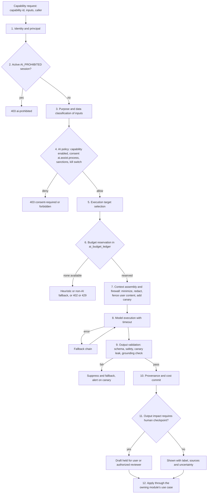
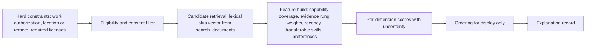

# 06 — AI Architecture

Status: **Proposed target** (DEC-ARC-014). As-built input: a local heuristic career assistant and a simpler assistant query scaffold; `assertWithinAIQuota` with tier limits hard-coded in `packages/domain/src/ai-gateway.ts` (`AI_QUOTA_LIMITS`); prompt sanitization; provenance and usage-meter types; no remote model execution; saved bring-your-own keys are not an integration; the assistant scaffold skips the quota and saved consent is not universally enforced [SRC: ARCHITECTURE.md §3, §20, R-4; `packages/domain/src/ai-gateway.ts`]. The hard-coded quota numbers are as-built values, not decided product parameters: SSOT decides no AI quota, price or cap [SRC: SSOT §16.4; V61-09].

The AIC module owns the gateway; every module that offers an AI feature registers a capability with it. No module calls a model provider directly (layering rule L-05 in [01 §7](01_SYSTEM_ARCHITECTURE.md)).

## 1. Binding principles

| Id | Principle | Source |
|---|---|---|
| AI-P1 | One gateway is the only path to any model, local or remote. | [SRC: SSOT §16.1; ADR-T12] |
| AI-P2 | No paid third-party inference for a free user unless an explicit active cost policy permits it; no silent paid fallback. | [SRC: SSOT §16.4] |
| AI-P3 | Every AI entry point is refused server-side while the caller is in an `AI_PROHIBITED` assessment session; provider adapters cannot override assessment policy. | [SRC: SSOT §17.2–§17.3; ARCHITECTURE.md INVARIANT-008] |
| AI-P4 | AI conversation memory, user profile, talent graph and verified evidence are separate stores; AI output never silently changes verified state. | [SRC: SSOT §16.6] |
| AI-P5 | Output impact decides governance: information, draft, recommendation, analysis, decision support, consequential decision. Autonomous consequential decisions are prohibited. | [SRC: SSOT §16.7] |
| AI-P6 | Every output keeps provenance: request id, capability, provider and model, execution mode, time, data class, context references, policy decision, sources, output and user modifications. | [SRC: SSOT §16.8] |
| AI-P7 | Matching and recommendations are explainable, show uncertainty, never use pay-to-rank, never auto-reject. | [SRC: SSOT §18.1; ADR-T22] |
| AI-P8 | Behavioral and AI-detection signals are indicators for human review, never proof. | [SRC: SSOT §17.4] |

## 2. Gateway pipeline

| Stage | Owner | Detail |
|---|---|---|
| 1 Identity | IDN via policy | Principal claims (01 §8.1); service principals may run only capabilities flagged `svc_allowed` |
| 2 Assessment lock | ASM interface `getActiveAiMode(accountId)` | Read from the primary at request time; `ai_restricted` narrows the allowed capability list; `post_assessment_only` unlocks after submission |
| 3 Classification | AIC | Each input field is tagged with its DC class from the contract; any DC-SENSITIVE, DC-RESTRICTED or DC-NEVER-EXTERNAL input is removed unless the capability declares it and the person consented to that specific use |
| 4 Policy | `packages/policy` | Actions `aic.capability.run:<id>`; consent `ai.assist.process` for personal-data capabilities; organization capability toggles for org-side features |
| 5 Target | AIC | §4 order |
| 6 Budget | AIC with BIL entitlements | §9 |
| 7 Context firewall | AIC | Only context references allowed by the capability; retrieval through owner interfaces under the caller's policy; user content wrapped in delimiters with instruction that it is data; per-request canary token [SRC: SSOT §12.9] |
| 8 Execution | Adapter | Timeout `ai.timeout_ms` (default 30,000 [SRC: SSOT CON-008]); streaming where the capability allows |
| 9 Validation | AIC | Zod schema for structured outputs; safety classifier; canary check; citation check for grounded capabilities |
| 10 Provenance | AIC | `ai_invocations` row; cost committed; reservation released |
| 11 Human checkpoint | Capability definition | §10 |
| 12 Apply | Owning module | AI never writes another module's tables; the user's acceptance calls that module's normal use case, which re-validates |

## 3. Capability registry

Each capability is declared in the owning module (`modules/<mod>/ai.ts`) and registered with the gateway.

| Field | Meaning |
|---|---|
| `id` | `<mod>.<name>`, for example `prf.resume.rewrite` |
| `owner_module` | Module code |
| `output_impact` | `information`, `draft`, `recommendation`, `analysis`, `decision_support`, `consequential` (the last is never allowed as autonomous) |
| `max_input_data_class` | Highest data class allowed in context |
| `consent_scopes` | Required consent scopes |
| `allowed_in_ai_modes` | Subset of `ai_allowed`, `ai_restricted`, `post_assessment_only` |
| `execution_targets` | Allowed targets in order (§4) |
| `prompt_id` and pinned `prompt_version` | §5 |
| `output_schema` | Contract schema id |
| `human_checkpoint` | `none`, `user_review`, `authorized_reviewer` |
| `eval_suite` | Eval suite id (§6) |
| `budget_class` | Cost class used by the budget ledger |
| `fallback` | `heuristic:<function>`, `non_ai:<behavior>`, or `none` |
| `status` | `experimental`, `beta`, `ga`, `disabled` |

Starting capability list (module specs own the feature detail):

| Capability | Owner | Output impact | Checkpoint | Fallback |
|---|---|---|---|---|
| `aic.assistant.chat` | AIC | information | none | Heuristic assistant (as-built) |
| `aic.career_plan.generate` | AIC | recommendation | user_review | Rule-based gap list from evidence and target role |
| `prf.resume.rewrite` | PRF | draft | user_review | Template suggestions |
| `prf.resume.parse_assist` | PRF | draft | user_review | Deterministic parser only |
| `prf.profile.summary_draft` | PRF | draft | user_review | none |
| `evd.evidence.skill_tagging` | EVD | recommendation | user_review | Keyword match against the taxonomy |
| `job.application.cover_letter_draft` | JOB | draft | user_review | none |
| `ats.posting.description_draft` | ATS | draft | user_review (recruiter) | Templates |
| `ats.posting.bias_check` | ATS | analysis | none (advisory) | Word-list check |
| `ats.application.summary` | ATS | decision_support | none for display; never used to auto-reject | none |
| `aic.match.explain` | AIC | decision_support | none | Rule-based explanation from the matching pipeline |
| `aic.match.rank` | AIC | decision_support | none; ranking only orders, never filters out | Lexical and rule-based ranking |
| `int.interview.question_suggest` | INT | draft | user_review | Question bank |
| `int.interview.notes_summary` | INT | draft | authorized_reviewer; requires all participants' recording consent | none |
| `lrn.tutor.explain` | LRN | information | none; blocked in prohibited modes | none |
| `stu.course.outline_draft` | STU | draft | user_review | Templates |
| `stu.media.captions` | STU | draft | user_review (instructor) | Provider captions |
| `asm.item.generate` | ASM | draft | authorized_reviewer (item writer) | none |
| `asm.feedback.post_attempt` | ASM | information | none; only in `post_assessment_only` after submission | Rubric text |
| `tsf.content.classify` | TSF | decision_support | authorized_reviewer for any sanction | Rule-based filters |
| `msg.reply.suggest` | MSG | draft | user_review | none |
| `mkt.insight.narrate` | MKT | information | none; must cite the underlying signals | Table only |
| `src.query.understand` | SRC | information | none | Lexical parsing |
| `src.embedding.document` | SRC | n/a (internal) | none | Lexical search only |
| `men.match.suggest` | MEN | recommendation | user_review | Topic overlap |
| `ent.skills.inference` | ENT | analysis | authorized_reviewer; employee sees and can dispute inferred skills | none |

## 4. Provider abstraction and execution targets

`ModelProviderPort` ([05 §2](05_INTEGRATIONS_AND_ADAPTERS.md)) has operations `complete`, `stream`, `embed`, `moderate`, `countTokens` and declares capabilities (context window, structured output support, tool use, streaming, data-retention terms, region). The gateway selects a target in this order and stops at the first allowed and available one [SRC: SSOT §16.3]:

| Order | Target | Cost to TalentSphere | When allowed |
|---|---|---|---|
| 1 | Local heuristic in the API (`packages/domain` functions) | None | Always, for capabilities with a heuristic |
| 2 | On-device model in the browser (WebGPU or built-in browser AI where available) | None | Capability marked `on_device_ok`, input data stays on device, capability detection succeeds [SRC: SSOT §19.1 local AI capability] |
| 3 | Genuinely free provider quota | None | Provider terms meet §11 rules |
| 4 | Organization-authorized provider (BYO key, OD-ARC-13) | Organization pays provider | Org-side capabilities for that organization's members |
| 5 | TalentSphere platform provider | TalentSphere pays | Only when an active cost policy covers the holder (paid entitlement or an explicit free allowance policy) [SRC: SSOT §16.4] |
| 6 | Non-AI fallback | None | Always |

Model choice inside a target is configuration per capability (`ai.capability.<id>.models`, ordered), not code.

## 5. Prompts and versioning

| Element | Design |
|---|---|
| Location | `apps/api/src/modules/<mod>/prompts/<capability>/<version>.md` plus `manifest.json` (model hints, temperature, max tokens, output schema id, eval suite, owner). Prompts are code-reviewed files, not database rows. |
| Immutability | A published version is never edited; changes create a new version. `ai_invocations.prompt_version` records which ran. |
| Pinning | Each capability pins one version per environment; promotion requires the eval gate (§6). |
| Templates | Variables are typed and filled only from the context firewall; user content is inserted only in fenced slots. |
| System policy block | A shared, versioned policy preamble (safety, honesty about uncertainty, no fabricated evidence, no protected-characteristic inference) prepended by the gateway. |
| Localization | Prompt variants per locale are separate versions with their own evals. |
| Rollback | Re-pin the previous version through configuration; no deploy needed. |

## 6. Evaluations

| Layer | What | When | Gate |
|---|---|---|---|
| Offline golden sets | Per capability: input, expected properties, rubric; includes adversarial cases (prompt injection inside resumes and messages, requests for answers during assessments, protected-attribute probes) | On every prompt or model change in CI with sandbox keys and a budget cap | Must meet the capability's thresholds for correctness, groundedness, safety and format validity (thresholds are parameters per capability, `eval.<id>.<metric>.min`, set at first baseline [PROP]) |
| Fairness checks | Matching, ranking, screening summaries: outcome parity across synthetic profiles that differ only in proxy attributes (names, schools, gaps) | Before GA and on every change | No statistically significant disparity beyond `eval.fairness.max_gap` [DEC-REQ] (OD-ARC-30) |
| Online sampling | `aic.eval.online_sample` samples `eval.online_sample_rate` (default 1% [PROP]) of invocations whose consent permits review, scored by rubric and periodically by humans | Hourly | Regression alerts to the capability owner |
| User feedback | Ratings and reason codes from `POST /ai/runs/{id}/feedback` | Continuous | Dashboards per capability and prompt version |
| Red team | Manual adversarial review before a capability moves to `ga` | Per capability | Sign-off by security officer for capabilities above `draft` impact |

Evaluated dimensions follow SSOT: correctness, groundedness, relevance, safety, privacy, consistency, latency, reliability, cost and domain-specific quality [SRC: SSOT §16.8].

## 7. Guardrails

| Guardrail | Where | Behavior |
|---|---|---|
| Assessment lock | Stage 2 | `403 ai-prohibited`; the attempt records the blocked call as an integrity signal only when the call came from the attempt's own session |
| Indirect assistance block | Stage 2 and capability registry | While `ai_prohibited` is active, every capability is blocked for that account, including summarization, messaging suggestions and search query understanding, because indirect help is also prohibited [SRC: SSOT §17.2] |
| PII minimization and redaction | Stage 3 and 7 | Contact details, identifiers and DC-SENSITIVE fields removed or replaced by placeholders before leaving TalentSphere; placeholders restored in the output only for the requesting user |
| Prompt-injection defense | Stage 7 and 9 | User and third-party content fenced; tools and retrieval limited to the caller's policy scope; outputs that attempt to call undeclared tools or change instructions are rejected |
| Canary | Stage 7 and 9 | Per-request canary string; if it appears in output, the response is dropped, the event alerts security and the account is flagged for review (not sanctioned automatically) [SRC: SSOT §12.9] |
| Output schema | Stage 9 | Structured outputs must parse against the contract schema; one repair attempt, then fallback |
| Safety classification | Stage 9 | Harassment, discrimination, sexual content, self-harm, illegal content categories; blocked outputs are replaced by a neutral message |
| Protected characteristics | System policy and evals | Models are instructed not to infer or use protected characteristics; matching features exclude them and known proxies listed by the AIC module spec |
| Fabrication guard | Stage 9 | Drafts that mention employers, credentials or dates not present in the user's own data are flagged for the user before applying |
| Labels | UI contract | Every AI output is labelled as AI-generated with its execution target; AI text is never shown as verified evidence [SRC: API-STD §12] |
| Rate and budget | Stage 6 | RL-HEAVY plus budgets (§9) |
| Kill switch | Stage 4 | Per capability and per provider (`ai.<capability>` and `ai.provider.<name>` kill switches) |

## 8. Model fallback

Fallback is per capability and ordered: (1) next model in the capability's list on the same target; (2) next allowed target (§4) subject to the cost rules, so a free user never falls through to a paid platform model; (3) the capability's heuristic or non-AI fallback; (4) an explicit "AI unavailable" state. Triggers: timeout, 429 after its retry budget, 5xx, breaker open, schema validation failing twice, or a safety refusal on a benign request. Every fallback is recorded on the invocation (`fallback_from`, `reason`) and shown to the user as a badge [SRC: SSOT §13.2 AI failure row]. Fallback never crosses a data-class boundary: if the second provider's terms or region do not permit the input's data class, that provider is skipped.

## 9. Cost metering and budgets

| Element | Design |
|---|---|
| Holders | Account (personal features), organization (org features, BYO-key usage tracking), platform (internal jobs such as embeddings) |
| Ledger | `ai_budget_ledger` append-only rows: `reserve` before execution (estimate from token count and price table), `commit` with actual cost, `release` of the unused reservation; balance = grants − commits − open reserves |
| Grants | From BIL entitlements (`feature_code = ai.credits`) or from an explicit cost policy row (`ai_cost_policies`: audience, capability set, allowance, period, approved_by, active window) [SRC: SSOT §16.4 "explicit active cost policy"] |
| Free users | No grant means only zero-cost targets; the as-built hard-coded free quota becomes a configurable allowance that requires an approved cost policy before any paid target is used (OD-ARC-31) |
| Price table | `ai_model_prices(provider, model, unit, price_minor_per_million, currency, valid_from)`; updated by FIN |
| Org budgets | Monthly caps per organization and per capability; thresholds at `ai.budget_alert_pcts` (default 50, 80, 100 [PROP]) emit `aic.budget.threshold_reached` |
| Batch work | Embeddings and recommendation batches run under platform budgets with daily caps (`ai.platform_daily_cap_minor`), deferring work when exhausted |
| Reporting | Cost per capability, per prompt version, per holder; unit cost per successful outcome |

## 10. Human-in-the-loop checkpoints

| Output impact | Checkpoint | Examples |
|---|---|---|
| Information | None; labelled | Assistant answers, market narration |
| Draft | The user reviews and edits; nothing is saved to the owning module until the user applies it | Resume rewrite, cover letter, job description |
| Recommendation | Shown with reasons, alternatives and freshness; the user accepts, dismisses or gives feedback [SRC: SSOT §18.2] | Courses, jobs, mentors, career plan |
| Analysis | Shown with method and limitations; no automatic action | Bias check, skills inference |
| Decision support | Shown to an authorized human decider with explanation and uncertainty; the decider's action is a normal audited use case | Candidate summaries, match explanations, moderation classification |
| Consequential decision | AI may not decide. Rejecting a candidate, sanctioning an account, voiding an attempt, verifying evidence, issuing a credential and adjudicating a background check always require a human actor (`actor.human = true`, kind `user` or `support`) [SRC: BE-01-R2 §8; SSOT §16.7] | n/a |

Enforcement: use cases for consequential actions reject calls whose actor is `service` or `system` unless the action is a mechanical consequence of a prior human decision recorded with its id (for example sending the rejection message the recruiter approved).

## 11. Privacy and training-data rules

| Rule | Detail |
|---|---|
| TD-1 | Personal data is sent only to providers whose contract guarantees no training on inputs and no retention beyond abuse monitoring (zero data retention where offered) (OD-ARC-13). |
| TD-2 | TalentSphere does not fine-tune or train models on users' personal data, applications, messages, assessments or evidence without a separate, opt-in, purpose-specific consent and an approved decision (OD-ARC-29). Default: no training. |
| TD-3 | Evaluation datasets use synthetic data or data whose owners consented to `ai.quality_review`; real examples are pseudonymized and stored in a restricted evals bucket with RC-OPS retention. |
| TD-4 | AI conversation memory is user-visible and user-deletable; deleting a conversation deletes its messages and invocation bodies; invocation metadata keeps only `subject_ref` (erasure-safe). |
| TD-5 | Embeddings of personal documents are personal data: stored only in `search_documents` and `match_explanations` under the same consent and erasure rules as their sources. |
| TD-6 | Provider region must satisfy the tenant's `data_region` rule; DEC-ARC-024 applies to AI egress. |
| TD-7 | Employer-side AI on candidate data requires the candidate's application or discoverability consent to cover the purpose; candidates can see which AI features were used on their application (`ats.application.summary` usage is listed on the candidate's application page) [PROP]. |
| TD-8 | Recording-based features (interview notes) require consent from every participant before recording starts and are off by default (OD-ARC-32). |

## 12. Explainability and provenance storage

| Store | Content | Access |
|---|---|---|
| `ai_invocations` | Metadata of every call (§3.9 of [02](02_DATA_MODEL.md)): capability, prompt version, provider, model, target, data class, policy decision, fallback, tokens, cost, latency, outcome, `subject_ref`, tenant | Platform staff with `aic.audit` scope; the person sees their own invocations in account activity |
| Invocation bodies | Redacted input context and output, stored encrypted in the private bucket, referenced by `input_ref`, `output_ref` | RC-OPS retention (default 90 days [PROP]); deleted with the conversation or on erasure |
| `match_explanations` | Per job and candidate: hard-constraint results, required capability coverage with evidence ids and rungs, evidence quality, recency, transferable skills, preference fit, uncertainty, model version [SRC: SSOT §18.1] | Candidate sees their own; employer sees for its jobs under consent; never a single opaque score [SRC: SSOT §18.1] |
| `recommendations` | What, why, inputs, expected benefit, confidence, alternatives, expiry, feedback [SRC: SSOT §18.2] | Recipient |
| Applied-change link | When a user applies an AI draft, the owning module's history row stores `ai_invocation_id` and whether the user edited the draft [SRC: SSOT §16.8 "user modifications"] | Owner and auditors |

## 13. Matching architecture (AIC with SRC)

Rules: hard constraints come only from fields the job marks required and the candidate states; evidence rungs are weighted by issuer class (instructor sign-off never counts as platform verification) [SRC: V61-17]; dimensions are shown separately; the system never removes a candidate from a recruiter's applicant list because of a score; paid plans never change rank [SRC: ADR-T22]. Recomputation is event-driven (`aic.match.recompute`, coalesced).

## 14. Open decisions and risks

| Id | Question | Options | Default proposal | Who decides | Blocking |
|---|---|---|---|---|---|
| OD-ARC-29 | May TalentSphere ever train or fine-tune models on platform data? | Never; opt-in purpose-specific consent; aggregate-only | Never for personal data; reconsider only with opt-in consent and counsel review [DEC-REQ] | Product owner with counsel | Any model customization |
| OD-ARC-30 | Fairness thresholds and external bias audits for hiring-related AI (automated employment decision tool laws in some jurisdictions) | Internal thresholds only; independent audit before launch in regulated jurisdictions | Independent audit before enabling `aic.match.rank` or `ats.application.summary` for employers in jurisdictions that require it [DEC-REQ] | Counsel and product owner | Employer-facing AI |
| OD-ARC-31 | Free-user AI allowance and its cost policy | Zero-cost targets only; a funded allowance | Zero-cost targets only until finance approves a cost policy [DEC-REQ] (V61-09) | Finance and product owner | AIC tiers |
| OD-ARC-32 | Interview recording and AI notes | Not offered; opt-in per interview with all-party consent | Opt-in per interview, off by default, jurisdiction check [DEC-REQ] | Counsel | INT AI features |

| Id | Risk | Likelihood | Impact | Mitigation | Owner role |
|---|---|---|---|---|---|
| RSK-ARC-22 | Prompt injection via resumes, job descriptions or messages manipulates recruiter-facing summaries | High | High | Fencing, output validation, summaries labelled, no tool access from summarization, adversarial evals | AIC owner |
| RSK-ARC-23 | Hidden bias in ranking harms candidates and creates legal exposure | Medium | Very high | Fairness evals, no protected attributes or proxies, display-only ordering, audits (OD-ARC-30) | AIC owner with counsel |
| RSK-ARC-24 | AI spend grows faster than revenue | Medium | High | Budget ledger, per-capability caps, cheap-model defaults, batch embeddings, cost dashboards | Finance |

## 15. Legacy source trace

| Source | Used for | Changed |
|---|---|---|
| SSOT §12.9, §16, §17, §18 | Gateway order, execution policy, free-user invariant, memory separation, output impact, provenance, matching pipeline, assessment AI modes | Pipeline stages made concrete with owners and stores |
| `packages/domain/src/ai-gateway.ts`, ARCHITECTURE.md §20, R-4 | As-built quota, sanitization, provenance types, known gaps | Quota numbers treated as configuration pending a cost policy |
| ADR-T12, ADR-T22, V61-17, V61-22 | Gateway as single door, explainable matching, issuer-class weighting, AI modes | Kept |
