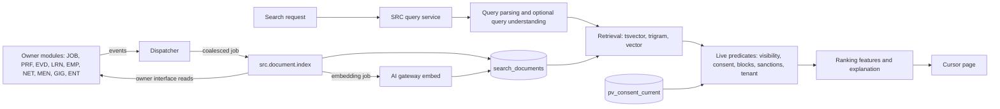
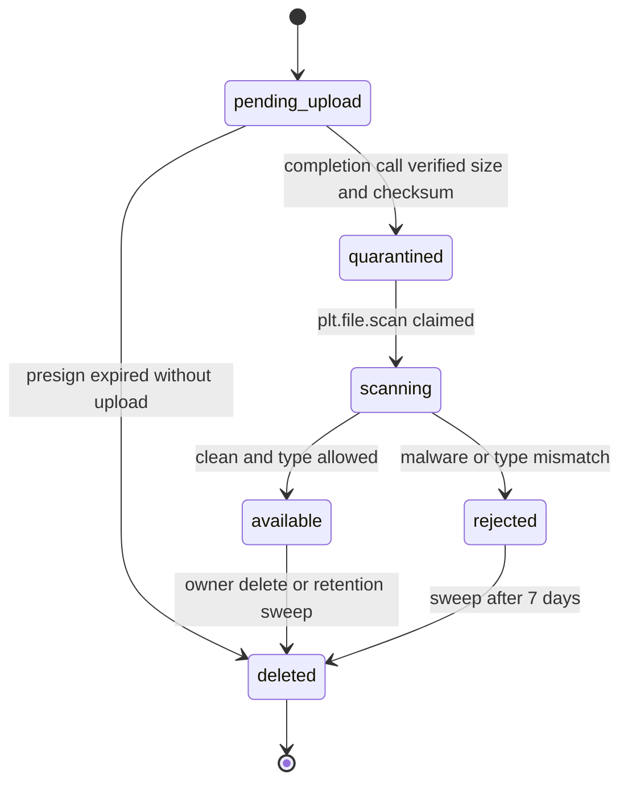
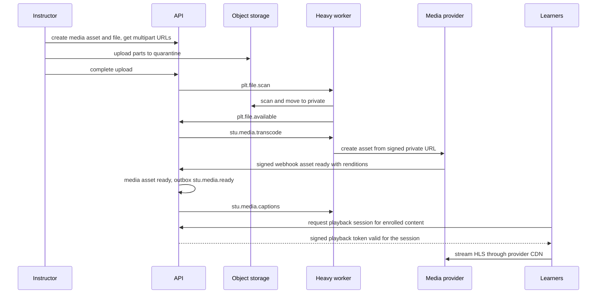
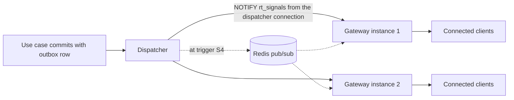

# 07 — Search, Media and Realtime Architecture

Status: **Proposed target**. As-built input: search is in-process matching and ranking over loaded data with no PostgreSQL full-text search at runtime; there is no object storage, media pipeline, CDN configuration or realtime transport in source; Supabase Storage, Realtime and Mux are named only as targets [SRC: ARCHITECTURE.md §3, §17]. Decisions: DEC-ARC-011 (realtime), DEC-ARC-012 (search), DEC-ARC-013 (media), DEC-ARC-016 (cache) in [01 §22](01_SYSTEM_ARCHITECTURE.md).

## 1. Search and discovery (SRC)

### 1.1 Components

### 1.2 Document types and audiences

One row per (`doc_type`, `doc_id`, `audience`). An audience is the projection a class of searcher may see; the same person has a different document for the public, for signed-in members and for recruiters.

| `doc_type` | Audiences | Source owner | Indexed fields (summary) | Live predicates at query time |
|---|---|---|---|---|
| `job` | `public`, `workforce:<org>` for internal opportunities | JOB, ENT | Title, description, skills, location, work mode, salary range when visible, employer | Job status published; not taken down; internal jobs only for workforce members |
| `candidate` | `recruiter` | PRF, EVD | Headline, skills with rung weights, experience titles, location, open-to-work level | `search.discoverable` consent live; not blocked; employer not in `blocked_employer_org_ids`; account active; searcher has entitlement |
| `person` | `member` | PRF | Name, headline, current role | Profile visibility, blocks |
| `course` | `public`, `org:<id>` | LRN | Title, outline, skills, level, language, provider | Published; org-only visibility |
| `company` | `public` | EMP | Name, industry, locations | Page published |
| `mentor` | `member` | MEN | Topics, experience, availability flag | Mentor status active |
| `gig_project` | `member` | GIG | Title, skills, budget band | Open |
| `group`, `event` | `public` or `member` | NET, EVT | Title, topic, date | Visibility |
| `skill` | `public` | MKT | Name, aliases | Not merged |

### 1.3 Storage and indexes (PostgreSQL adapter)

| Element | Design |
|---|---|
| Lexical | `tsv tsvector` built with per-field weights (title A, skills B, body C); language configuration per document `locale`; GIN index per `doc_type` partition |
| Fuzzy | `title_trgm` with GIN `gin_trgm_ops` for names, titles and typeahead |
| Semantic | `embedding vector(<dims>)` with HNSW index per `doc_type` partition; only for job, candidate, course and mentor documents; dimension fixed per embedding model version, re-embedding is a rebuild |
| Facets | `facets jsonb` with documented keys; expression indexes for the high-traffic filters (location country, work mode, employment type, salary band) |
| Geo | Coarse coordinates for location radius search using an index on a geohash prefix or PostGIS if adopted (OD-ARC-33) |
| Freshness | `source_version` and `indexed_at`; lag metric per doc type |
| Consent epoch | `consent_epoch` is a cleanup marker only; enforcement is the live join [SRC: BE-01-R2 §6] |

### 1.4 Query and ranking

1. Parse `q` (max 200 characters) into terms and phrases; optional `src.query.understand` capability maps natural language to filters (shown to the user as editable chips).
2. Retrieve candidates: lexical (`websearch_to_tsquery`) and, when enabled for the doc type, vector nearest neighbours; merge with reciprocal rank fusion (`k = search.rrf_k`, default 60 [PROP]).
3. Apply live predicates in the same SQL statement on the primary (never a replica for consent-guarded types) [SRC: BE-01-R2 §6].
4. Rank with documented features: text relevance, skill overlap with rung weights, recency, location fit, completeness of evidence; per-doc-type weights in `platform_config` (`search.rank.<doc_type>`), versioned; no paid boosting of candidates [SRC: ADR-T22]. Sponsored job placement, if ever offered, is a separate labelled slot and needs a decision because it brushes the SSOT §4.2 ad-network non-goal (OD-ARC-34).
5. Paginate by keyset on (`rank_bucket`, `id`) with best-effort stability [SRC: API-STD §6].
6. Return per-result `why` fields for candidate and job searches (matched skills, evidence rung, location fit).

### 1.5 Discovery features built on search

| Feature | Mechanism |
|---|---|
| Saved searches and alerts | `src.saved_search.run` compares results since `last_run_at`; emits `src.saved_search.matched` for NTF digests |
| Typeahead | `/search/suggestions` on trigram over skills, job titles, companies, courses; CDN-cacheable for anonymous users |
| Similar items | Vector neighbours for jobs and courses |
| Recruiter search audit | Every candidate query and profile open writes an audit event; per-recruiter daily profile-view cap is an entitlement |
| Public SEO | Published jobs, company pages and public profiles are prerendered at the edge with structured data (JobPosting) and sitemaps [SRC: ADR-T24] |

### 1.6 Performance and scale

Target and trigger values are parameters: `search.p95_ms` default 400 [SRC: ADR-T11]. When the trigger in [01 §21](01_SYSTEM_ARCHITECTURE.md) (S6) fires, a second adapter (OpenSearch, Typesense or Meilisearch) implements `SearchPort`; documents are still projections, and the live consent predicate is applied by post-filtering candidate ids against `pv_consent_current` before results are returned, so consent stays enforced at the source.

## 2. Media, files, storage and CDN

### 2.1 Buckets and domains

| Bucket | Contents | Access | Served from |
|---|---|---|---|
| `quarantine` | Fresh uploads before scanning | Write by presigned URL only; read by the scanner | Not served |
| `private` | Resumes, evidence artifacts, message attachments, exports, imports, course drafts | Short-lived signed URLs after policy check | Cookieless user-content registrable domain [SRC: BE-01-R2 §10 REVW-32] |
| `restricted` | Identity documents, background-check documents, proctoring artifacts | Separate KMS key; every read audited; no download links except to named roles | Not served to browsers except through a viewer page with watermarking [PROP] |
| `public` | Avatars and media the owner made public, employer page media, published course thumbnails | Public read through the CDN | CDN on the user-content domain |
| `exports` | Data exports and report exports | Signed URL, `dsr.export_link_ttl_hours` | User-content domain |

Object keys are `<data_region>/<owner_kind>/<owner_id>/<purpose>/<file_id>` so erasure and residency can operate by prefix [DER].

### 2.2 Upload purposes (defaults)

Defaults are [PROP] parameters (`files.purpose.<name>.*`).

| Purpose | Allowed types (detected) | Max size | Data class | Post-processing |
|---|---|---|---|---|
| `avatar` | JPEG, PNG, WebP | 5 MB | DC-PUBLIC when profile public | Strip EXIF, resize to fixed renditions, WebP and AVIF variants |
| `resume` | PDF, DOCX | 10 MB | DC-PRIVATE | Text extraction for parsing; never executed; DOCX converted to PDF for preview |
| `evidence_artifact` | PDF, images, ZIP of documents (no executables) | 50 MB | DC-PRIVATE | Hash recorded on the evidence; previews |
| `portfolio_media` | Images, short video, PDF | 200 MB | DC-PRIVATE or PUBLIC by owner choice | Video goes through the media provider |
| `message_attachment` | Images, PDF, office documents | 25 MB | DC-PRIVATE | Preview images |
| `course_media` | MP4, MOV, WebM, audio, PDF, images | `files.course_media_max_bytes` default 5 GB, multipart | DC-PUBLIC after publish | Transcode, HLS renditions, thumbnails, captions [SRC: SSOT §13.15] |
| `import` | CSV, XLSX | 20 MB | DC-PRIVATE | Parsed by import jobs; formulas never evaluated; CSV injection escaped on any re-export |
| `id_document` | JPEG, PNG, PDF | 15 MB | DC-RESTRICTED | Sent to the IDV vendor; deleted after decision per retention |
| `submission_code` | Text archives for code assessments | 5 MB | DC-PRIVATE | Passed to the code runner only |

Rejected always: executables, scripts, HTML, SVG with scripts (SVG accepted only after sanitization for `portfolio_media`), archives containing executables, files whose detected type differs from the declared type [SRC: SSOT CON-011, §13.16].

### 2.3 File lifecycle

### 2.4 Video pipeline (course and portfolio media)

| Rule | Detail |
|---|---|
| Delivery modes | Upload (A), external video (B), playlist embed (C), playlist import (D), external link (E) [SRC: SSOT §13.13]; mode chosen from provider capability flags |
| Playback protection | Signed playback tokens bound to enrollment and expiry (`media.playback_token_ttl_seconds`, default 3600 [PROP]); DRM is not in scope unless an institution contract requires it (OD-ARC-35) |
| Progress tracking | Player events batched to `PUT /me/enrollments/{id}/progress/{itemId}` every `lrn.progress_flush_seconds` and on pause; idempotent by `clientOpId` |
| Accessibility | Captions required before a course with video can be published, unless the instructor uploads a transcript; auto-captions are drafts the instructor must review [PROP] |
| External embeds | Only allowlisted providers in CSP `frame-src`; provider-specific renderers; no arbitrary HTML or JavaScript from authors; SSRF allowlist for metadata fetches [SRC: SSOT §13.16] |
| Live sessions | Webinars and live classes use `VideoRoomPort`; recordings, when enabled, become media assets |

### 2.5 CDN

| Content | Cache policy | Purge |
|---|---|---|
| Web app shell and hashed assets | `public, max-age=31536000, immutable` | New deploy changes file names |
| `index.html` and service worker script | `no-cache` (revalidate) | n/a |
| Prerendered public pages (jobs, companies, public profiles, credential verification) | `public, max-age=60, stale-while-revalidate=300` [SRC: API-STD §10] | `plt.cdn.purge` on publish, close, takedown, profile visibility change, revocation |
| Public API reads (`/jobs`, `/courses`, `/skills`, `/plans`) without cookies | Same as above | Same |
| Public bucket media | `public, max-age=86400` with versioned keys | Key change on replace |
| Private and restricted files | Never cached by shared caches; signed URLs short-lived | n/a |

The CDN also hosts the WAF and edge rate limits for RL-AUTH, RL-TOKEN and RL-PUBLIC [SRC: BE-01-R2 §5].

## 3. Realtime (DEC-ARC-011)

### 3.1 Transport

| Element | Design |
|---|---|
| Process | `PROCESS_ROLE=realtime`, horizontally scaled, behind the same origin at `/rt` |
| Protocol | WebSocket with a small JSON protocol (`subscribe`, `unsubscribe`, `signal`, `ping`, `refresh`); Server-Sent Events fallback at `/rt/sse` for networks that block WebSockets (receive-only; sends go through HTTP) |
| Authentication | Session cookie on upgrade, plus a CSRF-equivalent check that the `Origin` matches; the gateway resolves the session through IDN's interface |
| Authorization | Each `subscribe` is checked with `packages/policy` against the channel resource (channel patterns in [03 §12](03_API_DESIGN.md)); re-checked when membership, consent, sanction or session-revocation events arrive for the subscriber |
| Payload | `{type, entity, id, cursor, ts}` ≤ 4 KB; no personal free text [SRC: SSOT §13.10] |
| Limits | Per connection: `rt.max_subscriptions` (default 50 [PROP]); per channel: 50 signals per second, overflow sends `refresh` [SRC: SSOT §13.11] |
| Reconnect | Client backoff 1 s to 8 s; after 3 failures the client switches to cursor polling and retries realtime later [SRC: SSOT §13.11] |
| Resync | Every signal carries a cursor (message `seq`, notification id, leaderboard version); on reconnect the client fetches everything after its last cursor over HTTP |

### 3.2 Fan-out

Each gateway instance `LISTEN`s on one dedicated connection and delivers signals to local subscribers of the named channel. `NOTIFY` is issued only by the dispatcher after commit, never by business transactions [SRC: BE-01-R2 §1.2]. Payload limit of `NOTIFY` (8000 bytes) is above the 4 KB signal cap. Redis pub/sub replaces this when trigger S4 fires ([01 §21](01_SYSTEM_ARCHITECTURE.md)).

### 3.3 Surface map

| Surface | Mechanism | Source |
|---|---|---|
| Direct and application messaging | Realtime signal, then HTTP fetch by `seq` | [SRC: SSOT §13.9] |
| Typing and read receipts | Ephemeral realtime only (not stored for typing) | [PROP] |
| Notification badge and toasts | Realtime signal on `user:{id}` | [SRC: SSOT §13.9] |
| Presence in org workspaces | Realtime with 30 s heartbeat; presence not stored durably | [SRC: SSOT §13.9] |
| Feed, job listings, community posts | Cursor polling (30 s) plus a `refresh` hint | [SRC: SSOT §13.9] |
| Leaderboards | Polling plus optimistic UI; contest leaderboards bounded realtime | [SRC: SSOT §13.9] |
| ATS pipeline board | Realtime signals for moves by colleagues; `If-Match` resolves conflicts | [PROP] |
| Live technical interview code pad | WebSocket operations relayed between participants; document state persisted every `int.pad_snapshot_seconds` and at the end; CRDT or operational transform library choice in INT spec | [PROP] |
| Attempt timers | Server deadline signal; the client timer is display only | [SRC: SSOT §17.4] |
| AI streaming responses | HTTP streaming (SSE response of the run request), not the gateway | [DER] |
| Video and audio | External provider through `VideoRoomPort` | [DER] |

## 4. Caching strategy (detail of DEC-ARC-016)

| Data | Layer | Key | TTL and invalidation | Notes |
|---|---|---|---|---|
| Skills taxonomy, plans, flag definitions, policy rules, prompt manifests, job-kind policy | In-process LRU per replica | `<kind>:<version>` | Version bump event (`adm.config.changed`, `mkt.skill.merged`), TTL 60 s | Small, read-heavy |
| Session lookup | In-process, per request only | session id | Request scope | Revocation must take effect at the next request |
| Role and membership grants | Per request, keyed by `grants_version` | `account:grants_version` | New version on change | [SRC: BE-01-R2 §6] |
| Consent, entitlements, balances, sanctions | Never cached | n/a | n/a | Read from the primary each time |
| Public job, company, profile, credential pages | CDN | URL | §2.5 | Purged by events |
| Search typeahead (anonymous) | CDN | URL | 300 s | |
| Market aggregates, salary tables | Materialized tables refreshed by jobs, optional Redis | `metric:scope:period` | Refresh job cadence | Already suppressed below `min_cohort_k` |
| Feed pages | Precomputed feed entries for small audiences; pull for large audiences | `account:cursor` | Event-driven | [SRC: SSOT §13.7 `feed.fanout`] |
| Client server-state cache | Browser memory (OD-ARC-04) | Query key with account id | Invalidated by realtime signals and mutations | Cleared on sign-out |
| Offline read cache | Service worker and IndexedDB | Route plus account | Revalidate on focus; labelled stale; cleared on sign-out [SRC: ADR-T10] | Only owner data allowed by the per-feature offline contract |

Rule: every cache key that holds personalized data includes tenant and actor [SRC: SSOT CON-014]; nothing that decides authorization is cached beyond the request.

## 5. Open decisions and risks

| Id | Question | Options | Default proposal | Who decides | Blocking |
|---|---|---|---|---|---|
| OD-ARC-33 | Geo search implementation | Geohash prefix in plain PostgreSQL; PostGIS extension | Geohash prefix first; PostGIS if radius accuracy complaints or managed host supports it at no extra cost [DEC-REQ] | Architect | Job location radius search |
| OD-ARC-34 | Sponsored or promoted job slots | Not offered; labelled sponsored slot separate from ranking | Not offered; any sponsored slot needs a product decision because it brushes the ad-network non-goal (SSOT §4.2) [DEC-REQ] | Product owner | JOB monetization |
| OD-ARC-35 | DRM or download protection for course video | None (signed tokens only); DRM for institution content | Signed tokens only; DRM only on contract requirement [DEC-REQ] | Product owner | STU, INS premium content |

| Id | Risk | Likelihood | Impact | Mitigation | Owner role |
|---|---|---|---|---|---|
| RSK-ARC-25 | Vector search on PostgreSQL degrades write and vacuum performance as candidate volume grows | Medium | Medium | Partition by doc type, batch re-embedding, monitor HNSW build times, external engine trigger | Database lead |
| RSK-ARC-26 | Malicious files reach users through preview rendering | Low | High | Fail-closed quarantine, type detection, preview generation in the sandboxed heavy pool, separate content domain, `Content-Disposition: attachment` | Security officer |

## 6. Legacy source trace

| Source | Used for | Changed |
|---|---|---|
| SSOT §13.9–§13.16 | Realtime versus polling map, channel contract, resilience numbers, content model, delivery modes, capability flags, media pipeline, media security | Supabase Realtime and Storage replaced by ports and own gateway |
| ADR-T11, ADR-T24, BE-01-R2 §1.2, §6, §10 | PostgreSQL search with external trigger, edge prerender, NOTIFY rule, consent at read time, user-content domain | Kept |
| ARCHITECTURE.md §3, §17 | As-built absence of search runtime, storage and realtime | n/a |
